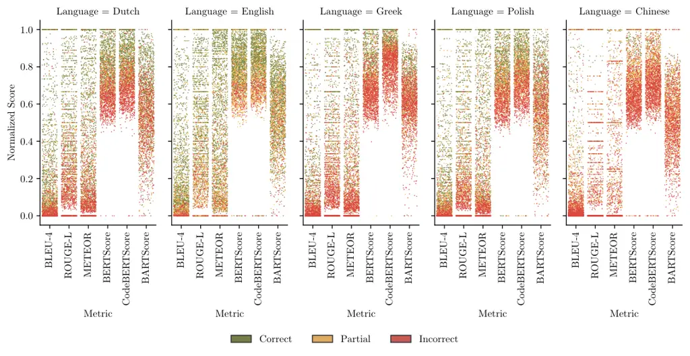
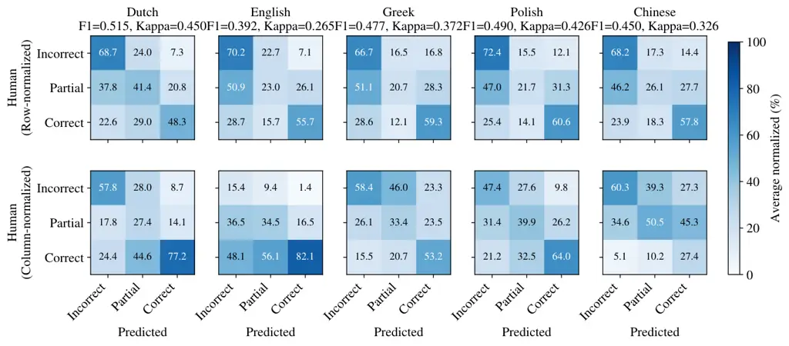
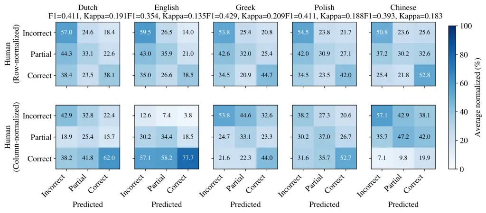
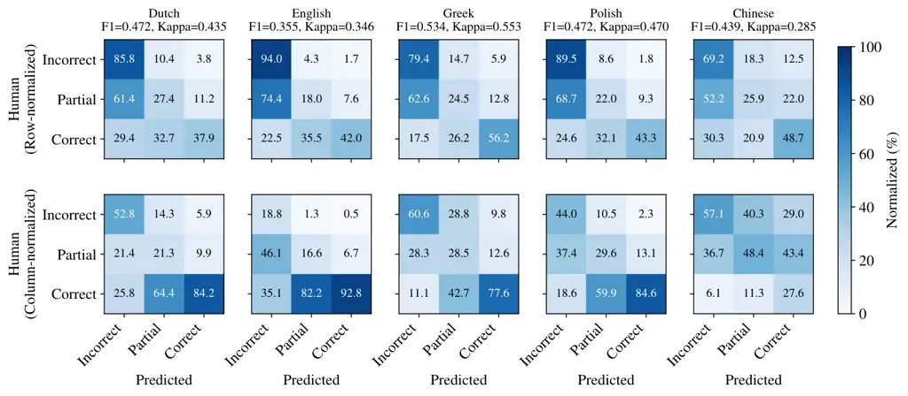
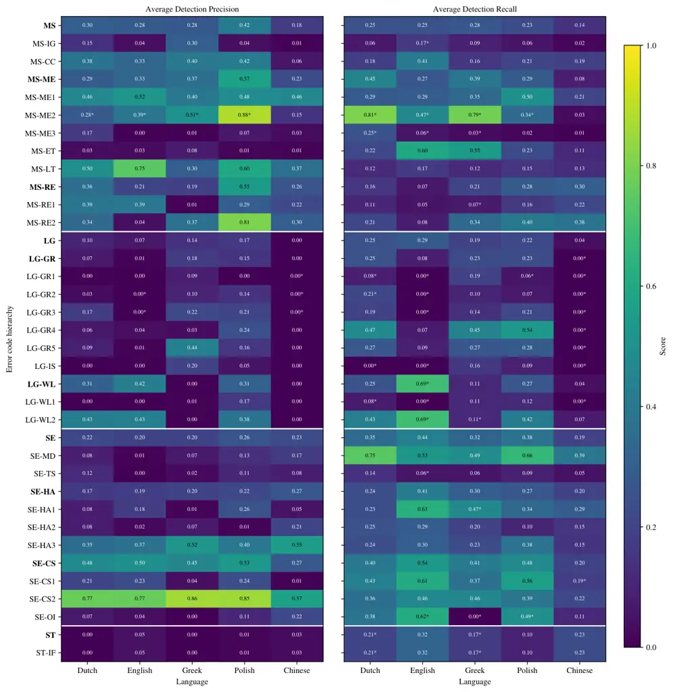
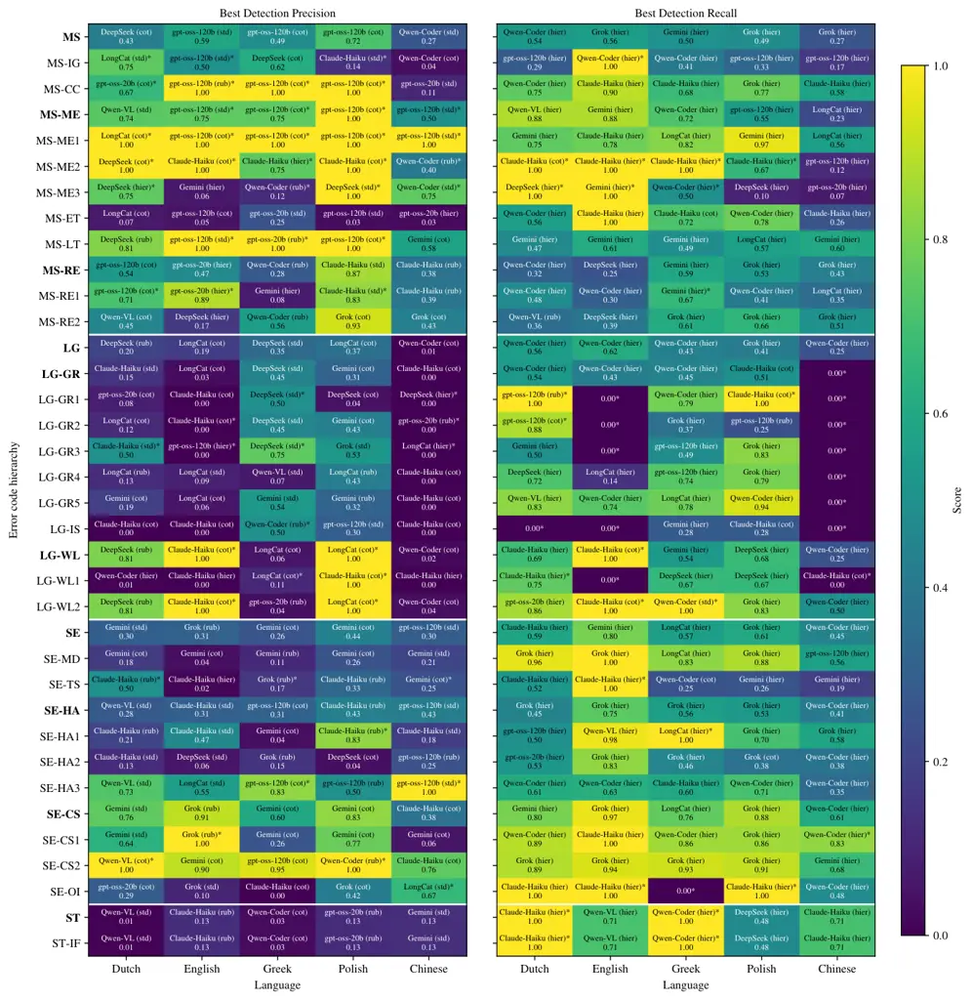

# Evaluating Non-English Developer Support in Machine Learning for Software Engineering

Jonathan Katzy Email: <J.B.Katzy@TUDelft.nl> Affiliation: Software
Engineering Research Group, Delft University of Technology, The
Netherlands    Yongcheng Huang Email: <Y.Huang-51@Student.TUDelft.nl>
Affiliation: Software Engineering Research Group, Delft University of
Technology, The Netherlands    Gopal-Raj Panchu
Email: <G.G.S.Panchu@Student.TUDelft.nl> Affiliation: Software
Engineering Research Group, Delft University of Technology, The
Netherlands    Maksym Ziemlewski
Email: <M.Ziemlewski@Student.TUDelft.nl> Affiliation: Software
Engineering Research Group, Delft University of Technology, The
Netherlands    Paris Loizides Email: <P.Loizides@Student.TUDelft.nl>
Affiliation: Software Engineering Research Group, Delft University of
Technology, The Netherlands    Sander Vermeulen
Email: <S.R.Vermeulen@Student.TUDelft.nl> Affiliation: Software
Engineering Research Group, Delft University of Technology, The
Netherlands    Arie van Deursen Email: <Arie.vanDeursen@TUDelft.nl>
Affiliation: Software Engineering Research Group, Delft University of
Technology, The Netherlands    Maliheh Izadi Email: <M.Izadi@TUDelft.nl>
Affiliation: Software Engineering Research Group, Delft University of
Technology, The Netherlands

###### Abstract

Large Language Models are increasingly used in software engineering, but
both code generation and its evaluation remain predominantly
English-centric. This leaves a major gap in our understanding of how
well current tools support multilingual development, where code contains
non-English natural language. In this paper, we investigate non-English
code comment generation and the reliability of current methods for
evaluating such outputs. We evaluate five code LLMs (CodeGemma,
CodeLlama, CodeQwen1.5, GraniteCode, and StarCoder2) across five natural
languages: Dutch, English, Greek, Polish and Chinese. We further conduct
an open-coding study of 12,500 generated comments, from which we derive
a publicly released human-annotated dataset and a taxonomy of 26 error
types. We use these human annotations, to evaluate the performance of
neural metrics, and LLM-as-a-judge pipelines.

Our findings show that generative performance deteriorates substantially
outside English, with linguistic errors increasing by up to
15.1$`\times`$, alongside more frequent incoherent generations and a
moderate rise in semantic errors. More critically, we show that
detecting errors in non-English comments underperforms. Across classical
overlap-based metrics, off-the-shelf neural metrics, extended neural
metrics using newer multilingual, language-specific, and code-specific
models, and LLM-as-a-judge pipelines, no automatic approach consistently
provides reliable and consistent assessment. Neural metrics often fail
to distinguish correct comments from incorrect outputs or even random
noise, and tend to overestimate quality in non-English settings. This is
not resolved by adding context or using specialized scoring models.
LLM-as-a-judge methods achieve the highest agreement with human
annotations but fail to reliably capture important language-related and
semantic errors. Overall, our results show that evaluation and
generation are key barriers to progress for multilingual tooling, and
that human judgment remains indispensable in this setting.

###### keywords

Multilingual, Large Language Models, Code Comments, Open Coding,
Evaluation, Metrics

## 1 Introduction

The adoption of Large Language Models (LLMs) for code has led to
numerous benefits. When integrated into the software development
process, studies reveal that LLMs boost developer productivity (Ziegler
et al., 2022) and facilitate various software engineering tasks (Jiang
et al., 2024; Izadi and et al., 2022). LLMs have also been shown to
support programming education (Boguslawski et al., 2025), and assist
developers of various skill levels (Nam et al., 2024).

Although code models can enhance both learning and development, most
research and development in this area focus on English contexts. This
emphasis limits the adoption of code models for other languages,
excluding non-English speakers from the benefits of LLMs in
education (Lyu et al., 2024), access to learning in their preferred
language (Airey and Linder, 2006; Pal and Iyer, 2015), and integration
of code models into workflows that often involve substantial non-English
code (Hu et al., 2022; Pawelka and Juergens, 2015). Beyond adoption
challenges, non-English code is sometimes considered a “data smell” to
be avoided when training code models (Vitale et al., 2024) leading to
progressively reduced representation. All these issues combine in a lack
of scientific literature studying how well non-English developers are
supported in the machine learning for software engineering (ML4SE)
ecosystem.

By non-English code, we refer to the presence of a language other than
English in either the identifiers, literals, or comments. This is often
a mixture of English and another language. For software engineering
tasks assisted by an LLM, the presence of these artifacts is crucial and
can improve performance on tasks like automated bug-fixing by up to
threefold  (Vitale et al., 2026). Traditionally, non-English code was
not commonly used in open source projects; however, closed-source
proprietary codebases often contain other languages (Pawelka and
Juergens, 2015). Recently, a shift has been observed in the open-source
landscape, and multilingual participation in open-source repositories is
steadily increasing across code comments, strings, and
documentation (Bhuiyan et al., 2026).

To situate this problem, we consider the machine learning for software
engineering (ML4SE) ecosystem as comprising both generative and
evaluation techniques. Generative techniques are used for tasks such as
code generation, summarization, bug localization and fixing, and comment
generation. Their outputs must then be assessed, which is handled by
evaluation techniques. In this investigation we evaluate the ability of
LLMs to generate non-English comments, and then compare human labels to
quality scores generated by a range of automatic scoring metrics. We
then evaluate the metrics themselves based on their alignment with
humans, reliability, robustness, and coverage of errors detected.

For the generative component, we focus on code comment generation as a
representative task that requires both code understanding and language
proficiency. We evaluate five state-of-the-art code LLMs
(CodeGemma (Team et al., 2024a), CodeLlama (Roziere et al., 2023),
CodeQwen1.5 (Team, 2024a), GraniteCode (Mishra et al., 2024), and
StarCoder2 (Lozhkov et al., 2024)) across five natural languages
(English, Dutch, Chinese, Greek, and Polish).

For the qualitative evaluation, we conduct an open-coding study to
identify common error types in model-generated comments and assign
correctness labels (correct, partially correct, incorrect). This
analysis characterizes key failure modes and provides insight into
challenges related to trust (Witchel et al., 2022),
education (Nishanthi, 2020), and adoption in non-English workflows (Hu
et al., 2022), forming the basis for the following research questions:

- RQ1.1
  What types of errors do LLMs make when generating comments in
  different languages?
- RQ1.2
  How accurately do LLMs generate comments for non-English code?

Using these human annotations, we evaluate the reliability of
off-the-shelf metrics for code comment generation, focusing on metrics
that are readily available through standard libraries and widely used in
practice. We examine their alignment with human judgment, their ability
to distinguish correct from incorrect outputs, and their robustness to
perturbations, addressing the following research questions:

- RQ2.1
  Do off-the-shelf evaluation metrics give a trustworthy evaluation of
  LLM generated code comments?
- RQ2.2
  Do off-the-shelf metrics effectively differentiate between correct and
  incorrect predictions?
- RQ2.3
  Are off-the-shelf metrics robust to perturbations in the input?

Building on these findings, we extend neural evaluation metrics such as
BERTScore and BARTScore by incorporating more recent, language-specific,
and code-specific scoring models. We also vary the amount of contextual
information provided to the models. We evaluate how these extensions
affect alignment with human judgment, the ability to leverage contextual
information, and robustness to perturbations, addressing the following
research questions:

- RQ3.1
  Which neural evaluation models best align with human judgment?
- RQ3.2
  Do neural metrics capture the nuances present in the surrounding
  context?
- RQ3.3
  Are neural metrics robust to perturbations in the input?

Finally, we investigate whether LLM-as-a-judge pipelines can reliably
replace human evaluation in non-English settings. We examine their
limitations, their alignment with human judgment, and their ability to
detect specific error types, addressing the following research
questions:

- RQ4.1
  What are the limitations of LLM-as-a-judge approaches in non-English
  contexts?
- RQ4.2
  Do LLM-as-a-judge setups align with human judgment when identifying
  correct comments?
- RQ4.3
  Do LLM-as-a-judge setups effectively detect individual error types?

Our results reveal significant limitations in current ML4SE support for
non-English code. From our qualitative analysis, we derive a taxonomy of
26 error types and observe that linguistic errors increase substantially
in non-English contexts (up to $`15.1\times`$), alongside a rise in
incoherent generations, while semantic errors increase more moderately.
For evaluation, we find that both classical and neural off-the-shelf
metrics struggle to reliably distinguish correct outputs from incorrect
ones. In particular, neural metrics exhibit a limited sensitivity to
random noise and tend to assign overly high scores, especially in
non-English settings. This behavior contrasts with classical
overlap-based metrics and highlights fundamental differences in how
these approaches respond to noisy or incorrect inputs. Extending neural
metrics with more recent, language-specific, and code-specific models
does not resolve these issues, and incorporating additional context does
not consistently improve performance. Finally, LLM-as-a-judge approaches
exhibit instability across languages, tend to be overly critical, and
fail to reliably detect key error types, especially those related to
language proficiency and semantic correctness. These findings highlight
substantial challenges for the reliable adoption of code LLMs in
non-English workflows.

This paper makes the following contributions:

- •
  We present a comprehensive empirical study of LLM performance on
  non-English code comment generation across five natural languages,
  highlighting substantial differences in error patterns compared to
  English.
- •
  We introduce a taxonomy of 26 error types and publicly release a
  human-annotated dataset of 12,500 code comment samples spanning five
  LLMs and five languages, enabling fine-grained analysis of LLM
  behavior in multilingual code settings, and per model results of all
  settings in the supporting material.
- •
  We evaluate common off-the-shelf evaluation metrics and show that
  neural metrics struggle to distinguish correct outputs from incorrect
  or random noise.
- •
  We extend neural evaluation metrics with more context and show that
  this does not aid them in separating correct from incorrect
  predictions.
- •
  We evaluate LLM-as-a-judge pipelines in non-English settings and
  identify key limitations, including instability across languages and
  difficulty in detecting language-related and semantic errors.

## 2 Related Work

#### Multilingual LLMs in NLP

Studies on LLMs in NLP settings have shown that they perform poorly in
non-English and resource-poor natural languages. The performance of
several models investigated in Indonesian and African languages
continues to be poor, producing responses of lower quality compared to
other high-resource languages such as English (Koto et al., 2023; Ojo et
al., 2024). Further studies showed lower performance for non-English
queries in chat models, resulting in less accurate and lower quality
responses compared to English queries, as well as issues arising with
regard to cultural nuances when dealing with non-English queries (Zhang
et al., 2023). Such findings are consistent with research suggesting a
strong bias in multilingual settings when generating code based on
non-English instructions. In the case of Code LLaMA, a performance drop
$`37.8\%`$ (Pass@1 metric) was observed when code generation was
prompted in Chinese rather than English (Wang et al., 2024a). This
performance gap emphasizes the underlying bias in LLMs trained
predominantly on English-language datasets.

#### Comment/Documentation Generation

Automatic comment generation is a common task that has been shown to
help developers understand code (Khan and Uddin, 2022). In this task,
language models are used to generate a natural language description of a
piece of code. Although it has been shown to improve developer
productivity, most studies focus primarily on the performance of models
in English code. Aside from evaluating models on comment generation,
research has shown that for automated comment generation in general;
practitioners expect automatically generated comments to be fluent and
grammatically correct (82%), be concise (88%), and accurate (88%) (Hu et
al., 2022) in order to include them in their workflows.

#### Qualitative Analyses of LLM Outputs

Previous works on translation and specializations on automatic
translations have led to the development of Taxonomies like
SCATE (Tezcan, Arda and Hoste, Veronique and Macken, Lieve, 2017) and
evaluation frameworks such as MQM (Mariana, 2014), used for natural
language tasks. These provide a basis for error classification; however,
they do not capture all intricacies of code related tasks. Further
qualitative studies of code generation errors have identified common
bugs in LLM-generated code (Tambon et al., 2025; Izadi et al., 2024) and
given important insights into user preference for model invocations and
acceptance rates (Izadi et al., 2024), however, they make the assumption
that code is always written in English, and they focus primarily on the
correctness of a program, rather than specific errors in the language.

#### Non-English Code

Despite the global prevalence of code written in different languages,
non-English code remains significantly under-researched. To our
knowledge, only one study has examined the distribution of non-English
language in code repositories (Pawelka and Juergens, 2015). They show
that there is a significant increase in the use of German in both
comments and identifier names when looking at industry projects,
compared to open source projects, which showed to have almost no
non-English text present. However, a recent large-scale study counters
this trend, revealing that multilingual participation in open-source
code is steadily increasing, particularly in Korean and Chinese, across
code comments, strings, and documentation (Bhuiyan et al., 2026). The
authors show that non-English speaking communities are among the
fastest-growing demographics on GitHub, which further highlights the
need for multilingual LLM evaluation. Datasets that are intended to be
used for the training of LLMs do mention the presence of other languages
in the code, however, do not give any more specific information (Lozhkov
et al., 2024).

For code LLMs, most research focuses on English contexts; even
researchers who are not native English speakers frame their studies
within an English paradigm (López-Navarro et al., 2015), leading to an
under-representation of non-English scenarios. GitHub reports show that
a significant number of non-English speakers contribute code to the
platform each year, highlighting the importance of studying code
generation in non-English contexts (GitHub, 2022).

#### Metrics Reliability

The ability to evaluate the quality of text generated by LLMs is
important to fairly evaluate and compare different models. However,
there are some challenges that arise when attempting to programmatically
evaluate natural language generation. First, many early methods for
evaluating textual generations come from the translation domain, where a
generation can be compared to multiple reference texts in order to score
them appropriately (Papineni et al., 2002; Lin, 2004; Banerjee and
Lavie, 2005). However, these models mainly look at an overlap of letters
in the target generation with the reference generations. This creates
issues when comparing the correctness of the meaning behind the text,
which has been proposed to be solved with embedding based
metrics (Zhang\* et al., 2020; Zhou et al., 2023) or model based
metrics (Yuan et al., 2021). This has led to the development of
frameworks that can be used to compare metrics with each other (Xiao et
al., 2023) as well as studies measuring the correlation between
different metrics (Fabbri et al., 2020) and their resilience to simple
perturbations (Sai et al., 2021). These studies give an overview of what
is to be expected from a metric to be a good judge of generated text. We
summarize the requirements as follows: A metric must differentiate
correct from incorrect samples, agree with human expert expectations,
and be able to detect simple perturbations.

#### LLM-as-a-Judge

In LLM as a Judge setting, an LLM evaluates the output of another model
according to a specified rubric, whether assigning scores or selecting
the better response in pairwise comparisons. This approach enables
scalable evaluation and reduces the reliance on human
annotation (Chehbouni et al., 2025; Li et al., 2024). Recent surveys
provide a broad overview of this paradigm and its adoption across NLP
and software engineering (Gu et al., 2025; Li et al., 2025a). A
literature review focused on 42 SE studies notes that code comment and
documentation quality evaluation remains underexplored within this line
of work (He et al., 2025). In the software engineering domain, this
paradigm has been applied to code generation and code summarization,
where LLM judges achieve moderate to substantial agreement with human
annotators, though even the best-performing models frequently misjudge
output quality (Crupi et al., 2025). It has also been shown that for
certain SE annotation tasks, including code summarization quality, one
human rater can be replaced by an LLM, with model-model agreement being
a useful predictor of whether a task is suitable for this (Ahmed et al.,
2025b). However, the effectiveness of LLM judges is task-dependent.
Output-based methods show near-human alignment for code translation but
are weaker for code summarization (Wang et al., 2025). This indicates
that tasks involving natural language quality, such as code comment
evaluation, are still difficult for automated judges.

Previous work shows that LLM judges exhibit biases in evaluations, such
as the self-bias of assigning higher scores to outputs generated by
models from the same family (Spiliopoulou et al., 2025). Strong
sensitivity to prompt phrasing is also demonstrated (Chen et al., 2024),
along with positional bias, where changing the order of candidate
responses in the prompt influences their quality ranking (Wang et al.,
2024b).

In addition, LLMs have been shown to exhibit sycophantic behavior, with
responses aligning with user statements rather than independent
verification (Fanous et al., 2025; Malmqvist, 2025). This behavior has
been attributed to reinforcement learning from human feedback (RLHF)
training (Christiano et al., 2017), where human preference data
systematically favors agreeable responses over truthful ones (Sharma et
al., 2024). This trend raises concerns when LLMs are used as evaluators,
but despite these limitations, LLM-based evaluators are adopted in
practice because they can automate evaluation workflows and reduce the
cognitive load associated with manual annotation (Chehbouni et al.,
2025).

A limitation that is directly relevant to our work is the reliability of
LLM judges across languages. Studies on multilingual LLM-as-a-Judge show
poor cross-language consistency, with neither multilingual fine-tuning
nor larger model sizes leading to reliable improvements (Fu and Liu,
2025). Evaluations of reward models across languages show a similar
trend, where performance drops from English to non-English languages,
and lower-resource languages are affected more (Gureja et al., 2025). To
date, no work has studied multilingual LLM-as-a-Judge evaluation for
code comments, where both natural language proficiency and code
understanding need to be assessed. Our work addresses this.

A further challenge for LLM-based evaluation concerns the cognitive
demands of large label spaces. LLM performance has been shown to degrade
when relevant information appears in the middle of long input
contexts (Liu et al., 2024). More generally, decomposing complex tasks
into focused sub-tasks consistently outperforms monolithic
prompting (Khot et al., 2023). Together with work on structured LLM
classification (Lee et al., 2024), these findings motivate our
hierarchical evaluation design, which separates the error taxonomy into
semantically coherent clusters to reduce the label space and cognitive
load per evaluation pass.

## 3 Non-English Characteristics

To gain an overview of the differences in the selected languages
compared to English, we list the defining characteristics and how they
may influence the output of a model.

#### Morphosyntactic Complexity

Morphosyntactic features govern how words change form (morphology) and
combine into sentences (syntax). The Chinese uninflected monomorphemic
system eliminates grammatical marks such as tense/case (Pulleyblank,
1995), while Polish uses seven grammatical cases and conjugations with
gender. Greek combines gendered nouns with flexible word order through
inflectional endings, and Dutch employs gendered articles (de/het).
These differences add a layer of complexity to the generation of
languages compared to English. Furthermore, both Polish and Greek are
flexible when it comes to following a Subject Verb Object (SVO)
structure of a sentence, making the outputs context dependent (Haider
and Szucsich, 2022; Tzanidaki, 1995)

#### Orthographic Challenges

Orthographic systems determine how languages represent speech in
writing. Greek’s technical symbols (e.g., $`\alpha`$, $`\beta`$) and
diacritics (tonos/diaeresis) coexist with Polish’s nine accented
characters (ą, ó, etc.), while Chinese uses logograms instead of
alphabetic writing. These add a layer of complexity to the tokenization
of text and require language-specific tokens. Furthermore, these
languages face informal script variations: Greeklish (Latinized Greek),
diacritic omission in Polish code comments, and Chinese character
simplification. These are informal ways of writing a language, often
adopted in online spaces that add complexity to the model of
learning (Toumazatos et al., 2024). Finally, Greek has also been adopted
as a common alphabet for use in mathematics; this adds another source of
noise that could reduce a model’s ability to model Greek.

#### Semantic Nuances

Semantic features require an understanding of meaning beyond direct
translation. Chinese requires contextual interpretation of idioms (Qiang
et al., 2023), Dutch incorporates English loanwords through prolonged
contact (Verheijen and van Hout, 2022), while Polish/Greek use
inflection-enabled word order flexibility to convey pragmatic emphasis.
Such features demand cultural and syntactic awareness beyond direct
translation equivalents, challenging LLMs’ ability to preserve intended
meaning during code comment generation.

## 4 Overall-setup

The basis of our investigation is a dataset of labeled code comments in
5 separate languages. First we lay out the models that are used, and
then we explain the raw data collection procedure, and comment
generation procedure.

### 4.1 Targeted Models

To generate code comments, we use open-weight models. This gives us full
control over the generations. Ensuring that no other pre-processing
steps are performed unknown to us, and allows for reproducible research,
which is not guaranteed when using proprietary or hosted
solutions (Semmelrock et al., 2024). More specifically, we focus on
models within the 7B-8B parameter range, the largest number of
parameters that have releases of all $`5`$ model families. To understand
the prevalence of our target languages in the training procedure of
these models, we present a brief overview.

#### CodeQwen1.5-7B

CodeQwen1.5-7B extends Qwen1.5 with an English and Chinese dataset,
supplemented by 3T tokens of code data spanning 92 programming
languages, although the distribution of natural languages in this corpus
is not specified (Team, 2024a; Team, 2024b).

#### StarCoder2-7B

StarCoder2-7B is trained on The Stack V2 dataset¹¹ 1
[https://huggingface.co/datasets/bigcode/the-stack-v2](https://huggingface.co/datasets/bigcode/the-stack-v2),
totaling 525.5B tokens of programming languages and documentation, with
additional natural language data from Wikipedia, StackOverflow, Arxiv,
Free Programming Books ²² 2
[https://github.com/EbookFoundation/free-programming-books](https://github.com/EbookFoundation/free-programming-books),
and OpenWebMath, covering all languages in our study (Lozhkov et al.,
2024).

#### Granite-8B-code-base

Granite-8B-code-base is trained on a collection of programming language
datasets, including GitHub Code Clean³³ 3
https://huggingface.co/datasets/codeparrot/github-code-clean,
StarCoderData⁴⁴ 4 https://huggingface.co/datasets/bigcode/starcoderdata,
and GitHub issues, combined with natural language datasets from
StackExchange, Arxiv, and OpenWebMath. English is predominant, with
non-English data removed (Mishra et al., 2024).

#### CodeLlama-7B

CodeLlama-7B is based on on Llama2, whose training corpus is 89.7%
English, with minor representation of Chinese, Dutch and Polish.
CodeLlama is further trained on publicly available code, incorporating
8% natural language data related to code and 7% from natural language
dataset, although specific origins remain undisclosed (Roziere et al.,
2023; Touvron et al., 2023).

#### CodeGemma-7B

CodeGemma-7B originates from the Gemma family, trained on 6T tokens
inspired by Gemini, the training details of which remain undisclosed. It
is fine-tuned on a dataset consisting of 80% code and 20% natural
language, predominantly English, with no specified multi-lingual focus.
However, dataset sources are also undisclosed (Team et al., 2024a; Team
et al., 2024b).

### 4.2 Data Collection and Selection

Figure 1: Example input used for inference

To gather a code dataset for each natural language, a list of the
$`2,500`$ most common words in each language was used ⁵⁵ 5
https://github.com/oprogramador/most-common-words-by-language, based on
the OpenSubtitles2016 dataset (Lison and Tiedemann, 2016). For each
word, the GitHub API was queried to gather 100 files containing the
specific word. The collected files were then de-duplicated.

Due to varying architectures, each model has its own maximum token
length. To ensure a fair comparison between models, we filter the
candidate files by their length after tokenization. We then select only
files where all the context fits within the context of the smallest
model (CodeGemma (Team et al., 2024a), $`4,096`$ tokens). To define the
inference limit, we calculated the average comment length plus three
standard deviations of the ground truth of comments. We also filtered
out all files where the context length + average length + $`3`$ standard
deviations was greater than $`4,096`$ tokens to ensure that all files
could be correctly predicted by all models.

For each file, the comments were extracted using regular expressions.
After extracting the comments, the langdetect toolkit (Vogeler, 2022)
was used to verify that the comments were written in the appropriate
language. From the remaining files, comments with less than $`10`$
tokens in all tokenizers were filtered out. To filter out the comments
which were references to licenses, TODOs, contained only the authors’
personal/contact information, or were auto-generated, we randomly
sampled $`550`$ files from the obtained set, and experts reviewed them
manually. We rejected the files that contained more than one natural
language, and also confirmed the presence of the correct target language
detected by the langdetect. Finally, from the files that remained after
the manual verification, the first $`500`$ were taken for each language,
resulting in $`2,500`$ generated comments for each language.

### 4.3 Comment Generation

To control the number of variables to account for, such as finetuning
tasks and prompting template, we evaluate base models for their ability
to generate comments. To do this, we use the Fill In the
Middle (Bavarian et al., 2022) (FIM) input format. This is the same task
that is used to train the base LLMs, giving us the best idea of their
core performance. In order to ensure that the models will generate
predictions in the correct language, we add the first 3 tokens of the
ground truth in order to prime the model for the correct language. Not
doing so results in almost exclusively English comment generation. To
give an overview of the input format, we give an example in Figure 1.

## 5 Qualitative investigation

### 5.1 Approach

#### Open Coding

To label the generations, an open coding methodology was applied. An
initial set of errors based on previous work (Izadi et al., 2024;
Tezcan, Arda and Hoste, Veronique and Macken, Lieve, 2017; Mariana, 2014) was selected and iteratively improved in 5 in-person rounds of
discussion between $`6`$ authors, until the saturation was reached. For
each language, there was at least one author who had a native speaker
level of understanding of the language to ensure that linguistic
nuances, grammar correctness, and semantic accuracy were accurately
evaluated.

An initial subset of $`200`$ files per language was selected for
analysis, similar to the final dataset. The generated comments were
manually compared to the originals to classify any possible errors
according to the initial hypothetical error taxonomy. The results of
this iteration of labeling were discussed in meetings among $`6`$
authors, resulting in adjustments to the error taxonomy. After each
iteration, all of the authors discussed their findings regarding the
error taxonomy and adapted the taxonomy to reflect any changes that
needed to be made according to the newly identified categories. In the
process of adapting the taxonomy, inclusion and exclusion criteria were
defined for each category to clarify when an error should be labeled
within that category. To maintain the quality of the taxonomy, we
ensured that the criteria were mutually exclusive and collectively
exhaustive where possible. This evaluation process was repeated with new
data until no further adjustments were suggested to the error taxonomy,
resulting in five iterations until the error taxonomy no longer changed.
Therefore, the saturation was reached when existing inclusion/exclusion
criteria successfully accounted for all observed samples in all
languages. Conflicts were resolved during the discussions by adjusting
the inclusion/exclusion criteria to be language-agnostic. The criteria
were generalized to focus on the underlying logical failure rather than
the linguistic layer in a certain language. The process of generating a
final taxonomy and labeling all files costs $`500`$ person-hours.

The resulting error taxonomy was then used for error labeling in our
final dataset. This dataset contains $`500`$ files per language for a
total of $`2,500`$ files, with an inference from each model resulting in
$`5`$ inferences per file. This totals $`12,500`$ labeled comments.

#### Expert Accuracy

In addition to recording the errors made by a model, we also use an
evaluation of a native speaker with programming experience to determine
whether a prediction is correct, partially correct, or completely
incorrect. In practice, model suggestions for code completion may be
accepted, but will be edited afterward to better fit the problem at
hand (Mozannar et al., 2024; Liang et al., 2024; Izadi et al., 2024).
Including a partially correct label gives us a more nuanced approach for
situations where the models are close to a valid answer but still make
minor mistakes. This accounts for developers accepting partially correct
completions that they later edit themselves (Izadi et al., 2024).

We define the categories of correct, partially correct, and incorrect as
follows. A correct prediction must include all of the information in the
original comment, but may also include additional, relevant, information
that was omitted. A partially correct comment is a comment where the
content is largely correct but there is a small error, such as an
incorrect variable name or spelling mistake. All other comments were
considered incorrect.

### 5.2 Results

#### Error Taxonomy

From the open coding investigation, we arrive at $`4`$ main categories
of error in comment generation. We present these categories and all
their subcategories in Table 1. We use this taxonomy to answer RQ1.1,
What types of errors do LLMs make when generating comments in different
languages? Semantic errors, the most common category, refer to errors
that relate to the meaning of the comment. This can relate to the amount
of detail provided to the model, whether the model is hallucinating, and
whether code is included in/after the comment. Linguistic errors refer
to errors made in the language itself. This can refer to grammatical
errors, but also to the synonyms the model uses and whether it responds
in the correct language. Model-specific errors are errors due to the
behavior of LLMs; this focuses on memorization, copying information from
the context, and knowing when to stop.

Each of the four categories can be divided into subcategories. The most
common error in the Model-Specific category is the Late Termination
(MS-LT) error, which occurs when the model continues to produce
additional content after the relevant part of the comment has been
completed. On the other hand, there is Early Termination (MS-ET), which
means that the prediction stops when the comment is not complete. Other
error types are Copy Context (MS-CC) when the model copies the
surrounding context verbatim, and Repetition (MS-RE), when the model
repeats what it has already generated, this can happen in two ways. The
model can repeat a pattern, but make minor changes such as increasing a
number (MS-RE1) or the model can repeat a token or set of tokens exactly
the same (MS-RE2). Incoherent Generation (MS-IG) occurs when the
generation consists of random words or symbols with no logic between
them. Memorization (MS-ME) is assigned when the model returns personally
identifiable information (MS-ME1), URL (MS-ME2), or the prediction is
the same as the erroneous ground truth (MS-ME3), indicating that the
comment was in the training set (e.g. the original comment contained a
grammatical error and a model repeated that, or the original comment did
not refer to the code correctly and the model predicted exactly the
same).

Linguistic errors are divided into three subcategories. The first is
Grammar (LG-GR), where all grammatical errors are assigned. The second
one, Incorrect Synonym (LG-IS), occurs when a model uses a similar word
with an incorrect meaning in context. The last category is the Wrong
Language (LG-WL) category. Due to the use of English loan words in many
languages, the models will attempt to translate them when they should
not (LG-WL1). Similarly, the model can also generate most or a
significant part of a comment in a language other than the target
language (LG-WL2).

In the Semantic group, we distinguish several errors, such as the
prediction with Missing Details (SE-MD) or being Too Specific (SE-TS).
Many predictions also include code, either executable (SE-CS2) or
commented out (SE-CS1). The subcategory for Hallucination generations is
divided into three types of errors. Misplaced Facts (SE-HA1) occur when
random facts that do not align with the expected content are present.
Out of Context (SE-HA2), which is a hallucination not grounded in the
provided context. and In Context (SE-HA3) Hallucinations, which are
educated guesses based on the provided context. Finally, we have the
Syntax errors (ST), which are all errors related to the syntax of the
comments.

|                                                                                                                                                                                                                                                                                             |                                                      |                                              |                                                               |                                     |                                       |                                           |
| ------------------------------------------------------------------------------------------------------------------------------------------------------------------------------------------------------------------------------------------------------------------------------------------- | ---------------------------------------------------- | -------------------------------------------- | ------------------------------------------------------------- | ----------------------------------- | ------------------------------------- | ----------------------------------------- |
| Failure category with label ID                                                                                                                                                                                                                                                              | Total                                                | Chinese                                      | Dutch                                                         | English                             | Greek                                 | Polish                                    |
| MS Model-specific Errors    MS-IG Incoherent Generation    MS-CC Copy context    MS-ME Memorization    MS-ME1 PII    MS-ME2 URL    MS-ME3 Training Data    MS-ET Early Termination    MS-LT Late Termination    MS-RE Repetition    MS-RE1 Pattern Repetition    MS-RE2 Verbatim Repetition | 5,007 259 991 422 236 114 72 164 2,324 847 317 530   | 1,191 36 81 224 71 99 54 34 660 156 55 101   | 1,072 42 281 40 36 1 3 48 409 238 106 132                     | 752 2 70 74 68 5 1 13 491 102 79 23 | 928 165 300 40 33 3 4 50 284 89 6 83  | 1,040 12 242 47 31 6 10 19 472 248 68 180 |
| LG Linguistic Error    LG-GR Grammar    LG-GR1 Plurality    LG-GR2 Conjugation    LG-GR3 Gender    LG-GR4 Language Syntax    LG-GR5 Cohesion    LG-IS Incorrect synonym    LG-WL Wrong language    LG-WL1 Undesired translations    LG-WL2 Incorrect language                               | 1,728 1,420 17 169 130 227 876 128 180 40 140        | 17 0 0 0 0 0 0 0 17 1 16                     | 220 124 1 8 20 25 70 0 96 8 88                                | 66 65 0 0 0 42 23 0 1 0 1           | 979 870 14 59 82 38 677 95 14 12 2    | 423 350 1 102 23 121 103 32 41 18 23      |
| SE Semantic error    SE-MD Missing Details    SE-TS Too Specific    SE-HA Hallucination    SE-HA1 Misplaced Facts    SE-HA2 Out of Context    SE-HA3 In context    SE-CS Code Inclusion    SE-CS1 Commented code    SE-CS2 Runnable code    SE-OI Omitted Identifier                        | 8,333 837 168 4,239 325 550 3,364 3,009 171 2,838 80 | 2,915 413 91 1,639 79 385 1,175 718 6 712 54 | 1,381   106   21   664   102   78   484   578   66   512   12 | 786 19 1 406 42 12 352 355 12 343 5 | 1,726 95 12 913 7 57 849 706 14 792 0 | 1,523 202 42 630 91 16 523 640 70 570 9   |
| ST Syntax    ST-IF Incorrect comment format                                                                                                                                                                                                                                                 | 84 84                                                | 31 31                                        | 2 2                                                           | 21 21                               | 5 5                                   | 25 25                                     |

Table 1: Taxonomy of common errors found during the open coding process,
all languages are listed separately, and summed up in the total.
Sub-categories are accumulated in the count of the parent category.

This taxonomy shows that the main issue with comments generated by LLMs
is Semantic Errors, often in the form of Hallucinations (SE-HA). These
errors account for the largest increase in errors for non-English
languages compared to English. Furthermore, we see that the level of
detail (SE-MD and SE-TS) is a cause of errors mainly in non-English
generations. Looking at the Model Specific errors (MS) we see that for
errors related to Memorization (MS-ME), the models are most likely to
make them in English compared to other Western languages. Interestingly,
Chinese has the highest rate of memorization for all categories. For
language-specific errors (LG), we see that Chinese does not have grammar
errors, as discussed in Section 3. Furthermore, we notice that Dutch has
the highest likelihood of returning predictions in the wrong language.
We believe this is due to the similarity of Dutch to English and the
high amount of overlap between the two dictionaries. We also observe a
high rate of incorrect synonyms used in Polish compared to all other
languages and a high rate of language syntax errors for English compared
to all other language errors made by the model. Finally, in the Syntax
errors (ST) we see that the models’ ability to adhere to comment syntax
is dependent on the language it is using.

We further compare languages on a per-language basis and see that Greek
has the highest number of errors for the language grammar, as well as
the use of incorrect synonyms. This amounts to an increase of
$`15.1\times`$ the error rate compared to English. This also appears in
the MS category, where Greek has the highest tendency to generate
incoherent output. However, Greek is the language that is less likely to
generate repetitions of all languages analyzed. We also see that Dutch,
Greek, and Polish are more likely to copy the surrounding context into
the comment, while Chinese do it at a rate similar to English.

|         | CodeGemma      |               |                                                            | CodeLlama      |               |                                                            | CodeQwen 1.5   |               |                                                            | GraniteCode    |               |                                                            | StarCoder2     |               |                                                            |
| ------- | -------------- | ------------- | ---------------------------------------------------------- | -------------- | ------------- | ---------------------------------------------------------- | -------------- | ------------- | ---------------------------------------------------------- | -------------- | ------------- | ---------------------------------------------------------- | -------------- | ------------- | ---------------------------------------------------------- |
|         | $`\checkmark`$ | $`\thicksim`$ |  | $`\checkmark`$ | $`\thicksim`$ |  | $`\checkmark`$ | $`\thicksim`$ |  | $`\checkmark`$ | $`\thicksim`$ |  | $`\checkmark`$ | $`\thicksim`$ |  |
| Chinese | 55             | 221           | 224                                                        | 63             | 201           | 236                                                        | 84             | 200           | 216                                                        | 67             | 175           | 258                                                        | 20             | 218           | 262                                                        |
| Dutch   | 298            | 98            | 104                                                        | 246            | 95            | 159                                                        | 158            | 109           | 233                                                        | 253            | 80            | 167                                                        | 215            | 107           | 178                                                        |
| English | 406            | 76            | 18                                                         | 266            | 162           | 72                                                         | 268            | 183           | 49                                                         | 339            | 123           | 38                                                         | 320            | 145           | 35                                                         |
| Greek   | 259            | 117           | 124                                                        | 118            | 119           | 263                                                        | 78             | 165           | 257                                                        | 132            | 130           | 238                                                        | 118            | 131           | 251                                                        |
| Polish  | 271            | 146           | 83                                                         | 176            | 164           | 160                                                        | 159            | 157           | 184                                                        | 205            | 151           | 144                                                        | 167            | 154           | 179                                                        |

Table 2: Expert accuracy for all models and languages ($`\checkmark`$
correct, $`\thicksim`$ partial,

incorrect)

### 5.3 Expert Accuracy

To understand how well the chosen models perform in generating code
comments in languages they were not intended to be used for (RQ1.2), the
experts labeled each generation as either Correct, Partially Correct, or
Incorrect. We give an overview of the scores in Table 2. Here we see
that while models claim to be only intended to be used for English, and
sometimes Chinese, we see that they generate at least partially accurate
completions in more than half of the cases for Dutch, Greek, and Polish.
Interestingly, we see that although Chinese is the second most common
language present in training corpora, it is the worst-performing
language overall. On a model level, we see that most models follow the
same trend, they perform best in English, then Dutch or Polish, followed
by Greek, and finally Chinese. However, for CodeGemma, we see that the
performance of Greek is doubled in comparison to other models.

## 6 Off-the-shelf metrics

### 6.1 Approach

For the numerical analysis of the comments and the validation of the
metrics, we treat the problem as a text generation problem. We have a
prediction given by the model and a reference comment that we compare it
to. For this evaluation, we use a combination of word level and neural
metrics. To validate the ability of metrics to score a prediction, we
focus on the requirement of a metric to significantly reduce the score
of a generation due to a perturbation (Sai et al., 2021). We push these
perturbations to the extreme. We generate two types of random noise.
First we generate “uniform noise” which is any token from the tokenizer
of the models, equal in length to the target comment in tokens, and
“targeted noise” which are random tokens sampled from the surrounding
context.

#### Word Level Metrics

For word-level metrics, we use the standard metrics used in code-related
studies: BLEU (Papineni et al., 2002), ROUGE (Lin, 2004), and
METEOR (Banerjee and Lavie, 2005). BLEU measures precision by comparing
n-gram matches between the generated and reference summaries while
penalizing overgeneration with a brevity penalty. ROUGE focuses on
recall by measuring the overlap of n-grams between the reference and the
generated texts. ROUGE-1 considers unigrams, ROUGE-2 considers bi-grams,
and ROUGE-L emphasizes the longest common subsequence to assess fluency
and logical consistency. For this investigation, we focus on ROUGE-L.
METEOR combines precision, recall, and synonym-based matching to provide
the score.

#### Embedding Based Metrics

These metrics calculate the cosine similarity between embeddings.
BERTScore (Zhang\* et al., 2020) uses a BERT (Kenton and Toutanova, 2019) model to generate the embeddings. The BERT configuration varies
according to the target language. For English tasks, a 24-layer RoBERTa
large model is used, while for Chinese tasks, a 12-layer BERT Chinese
model is utilized. For other languages, it relies on the 12-layer cased
multilingual BERT (BERT*(multi)) model. BERT*(multi) was trained in 104
languages using the Wikipedia corpora, including Greek, Polish, and
Dutch. However, this model has not been trained on code.
CodeBERTScore (Zhou et al., 2023) is similar to BERTScore, however, it
was specifically developed for code evaluation, it differs from
BERTScore, by using the CodeBERT model (Feng et al., 2020a) and ignoring
some keywords and syntax tokens common throughout the code.

#### Model Based Metrics

BARTScore (Yuan et al., 2021) employs BART (Lewis et al., 2019a), a
transformer model that evaluates the quality of the generated text
through the likelihood scores assigned by the model. The BART models are
trained by both corrupting the input, and introducing arbitrary noise
into the input text, after which it reconstructs the original input.
Although specific details regarding training data are not explicitly
provided, some indirect information suggests that it includes datasets
such as books and Wikipedia entries—similar to those used in RoBERTa’s
pre-training process (Liu, 2019). Similar to BERTScore, code is not
specifically mentioned in the training procedure.

Figure 2: Strip plot, showing the scores assigned to comment generations
by different metrics.

Figure 3: Metric scores comparing LLM generated comments, to random
samples of tokens using two separate distributions.

### 6.2 Results

#### Scoring Collections

We answer RQ2.1 by analyzing the scores that the selected metrics assign
to both the predictions and the random noise that we generated. An
overview is given in Figure 3. Here, we look at two factors identified
as belonging to a good metric, alignment with expert evaluations, and
the ability to differentiate between noise and real prediction.

Looking at only the English results, we see that the scores assigned by
the embedding based metrics align closely with the expert evaluation
(around $`0.8`$). However, when looking at other languages, the
embedding-based metrics score the predictions slightly lower, even when
the expert evaluation scores the generations much lower (especially for
Chinese). However, word-based metrics on the other hand score
predictions lower in general but do match the differences in performance
observed in the expert accuracy.

#### Differentiating Correct From Incorrect

To answer RQ2.2, Do common evaluation metrics effectively differentiate
between correct and incorrect predictions? We plot the scores of
selected metrics in Figure 2. Here we show a strip plot of the score for
each generated comment and color it by the expert evaluation Correct
(green), Partially Correct (orange), and Incorrect (red). Each point in
a stripe represents a single generation. To demonstrate the spreads of
different scores, we normalize all scores between $`0`$ and $`1`$. This
shows us if there is a clear separation between the three colors at a
glance. We see a difference in the distribution between neural models
and classical models. Classical models have the majority of their data
points scored low and have a tail of scores that score high. On the
other hand, neural metrics, especially the embedding-based metrics, have
their scores concentrated towards the top, with few points in the lower
half of the plot. Looking at all the strip plots, we see no clear
separation between correct, partially correct, or incorrect predictions.
Although there is a slight trend to score the correct predictions
higher, a large overlap between the three colors persists, showing that
the metrics do not separate them accurately.

#### Robustness to Noise

Finally, we look at the generated noise to answer RQ2.3, we see that for
all neural metrics (in Figure 3, there is a significant overlap between
the scores assigned to noise and the scores assigned to real
generations. The BARTScores have a lower overlap compared to the
embedding based metrics; however, interestingly, the targeted noise
performed worse than the uniform noise for all languages except Chinese.
Finally, we see a general trend of CodeBERTScore scoring predictions
higher than BERTScore, hinting that the training procedure is a more
important factor for a higher BERTScore than the generations being
studied. For classic metrics, there is a far lower overlap between noise
and real comments, and most noise is scored close to $`0`$ with the
METEOR score showing the largest number of outliers towards high scores.

## 7 Extended neural metrics

While embedding-based and model-based metrics are widely adopted as
off-the-shelf evaluation tools, they are typically deployed with a
default model and operate under limited contextual assumptions. In
particular, the context available during scoring often does not capture
all information required to assess semantic correctness in code
comments. To address this limitation, we extend existing metrics by
systematically varying the amount of contextual information provided
during evaluation, while preserving their underlying scoring mechanisms.
This is motivated by the observation that semantically relevant
information for a code comment is often located in the surrounding code,
and cannot be inferred from the comment alone.

In addition, as observed in Section 6, neural metrics can produce score
distributions that do not align with human judgments. For example,
non-English generations may receive higher scores than English ones
despite being rated lower by human experts. This highlights that
absolute metric scores are not reliable indicators of generation
quality. We therefore introduce a comparison framework based on
agreement with human annotations, rather than raw metric scores.

We evaluate the extended metrics in terms of their alignment with human
judgment and their robustness to perturbations, as introduced in
Section 6.1.

### 7.1 Approach

We evaluate extended neural metrics using a three-stage pipeline
consisting of (i) input generation with varying levels of context, (ii)
metric computation, and (iii) comparison with human annotations through
a classification-based framework.

#### Input generation

When working with neural models that have an encoder or encoder/decoder
based architectures, they generate outputs based on the context that
surrounds the target tokens. This means that changing the context around
a generation will influence the embeddings/loss of a model.

For code comment generation, information relevant to semantic
correctness is often located in the surrounding code, either preceding
or most commonly following the comment. However, existing
implementations of neural evaluation metrics do not support
incorporating such context. For example, BERTScore and BARTScore operate
solely on the generated text (Zhang\* et al., 2020; Yuan et al., 2021),
while CodeBERTScore allows only limited prefix context (Zhou et al.,
2023), which does not capture code that follows the comment.

To study the effect of contextual information, we extend BERTScore and
BARTScore with three context settings:

- •
  No context: Only the generated comment tokens and their corresponding
  ground truth are provided, without additional context. This results in
  partial or incomplete sentences at the start of the comment and no
  information about the surrounding code.
- •
  Minimal context: Only the generated comment is provided, along with a
  short prefix indicating the target language (as described in
  Section 4.3). This ensures well-formed input while removing most
  contextual information.
- •
  Full context: The entire file is provided as input, with the generated
  comment inserted at the correct location. This setting provides
  complete contextual information and is expected to support detection
  of semantic errors.

Figure 4: A visual demonstration of how different amounts of context
will affect the neural metrics.

#### Metric Computation

For the remainder of this investigation, we refer to all encoder-based
metrics under the unified term BERTScore. BERTScore and CodeBERTScore
differ primarily in three aspects. First, CodeBERTScore allows for the
inclusion of a short natural language prefix as additional input.
Second, CodeBERTScore was designed for code inputs and therefore
excludes syntax tokens from the similarity computation. Third, the
underlying encoder model differ depending on the implementation,
CodeBERTScore focuses on code models, while BERTScore focuses on natural
language models. In our setting, including a small prefix of text before
the similarity computation is equivalent to the minimal context setting,
our input is predominantly natural languages due to it being code
comments, reducing the need to filter out syntax tokens, and finally, we
run our experiments for multiple code and natural language encoder
models, making the difference between CodeBERTScore and BERTScore
superfluous for this setting.

When computing BARTScores and BERTScores, we use all tokens relevant to
the given context setting as input to the models, however, once the
loss/embedding has been calculated, we exclude all context tokens and
use only the tokens belonging to the generated comment and the ground
truth. This ensures that scores are not influenced by the quality of the
surrounding code, while still allowing contextual information to affect
the underlying representations through the model input. This process is
illustrated in Figure 4.

#### Comparison

The large number of models evaluated in this study requires a principled
approach to comparing metric performance. As observed in Section 6,
neural metrics produce score distributions that do not align with human
judgments. For example, certain non-English generations may receive
higher scores than English ones despite being rated lower by human
experts, or randomly generated noise may score higher than a real
prediction. This indicates that we need a method to calculate alignment
with human experts, without relying on the absolute score of the
metrics.

To enable this comparison, we instead focus on the relationship between
metric scores and human annotations. We leverage the expert labels
obtained in the qualitative study (correct, partially correct,
incorrect) and associate them with the corresponding metric scores. For
each metric, we fit a kernel density estimator (KDE) to model the score
distribution for each class. We then compute the intersection points
between these distributions to derive threshold values that partition
the score space into regions corresponding to each label. Our choice for
a KDE classifier stems from the fact that we are working in a single
dimension, and we need to account for the class imbalances in our set of
labels.

Using these thresholds, we reclassify all samples based on their metric
scores, resulting in a new set of predicted labels. This classification
procedure is illustrated in Figure 5.

Figure 5: Example of the classifier used for label assignment, the
scatter plot shows each generated comment, colored in red for an
incorrect generation, yellow for a partially correct generation and
green for a correct generation. The KDE-densities are plotted on the
right side with the corresponding colors. All intersections are marked
with a horizontal line and the background is shaded by the classifier
output. The classifier assigns the label of the background color as the
new label of each sample, which are then used for calculating the
alignment.

Given the two sets of labels, namely human annotations and metric-based
predictions, we measure agreement between them to assess metric
reliability. As the labels (correct, partially correct, incorrect) are
ordinal, misclassifications are not equally severe. For example,
predicting partially correct instead of correct is less severe than
predicting incorrect. To account for this, we use quadratically weighted
Cohen’s kappa as our primary agreement measure.

For noise detection, we apply the same framework using real predictions
and randomly generated strings. In this setting, the task reduces to
binary classification (noise vs. not noise). We again fit KDE
distributions, derive thresholds, and evaluate agreement with ground
truth using Cohen’s kappa.

#### Model Selection

When selecting models to use for the neural metrics, we prioritize a
varied selection of model architectures and sizes. We also focus on
having at least one member for each target language, general
multilingual training, and specifically trained on code. Within these
groups we aim to have different architectures such as BERT (Kenton and
Toutanova, 2019), RoBERTA (Liu, 2019), DeBERTA (He et al., 2021),
ELECTRA (Clark et al., 2020), XLM (Lample and Conneau, 2019), for the
embedding based metrics, and BART (Lewis et al., 2019a) or T5 (Raffel et
al., 2020) architectures for the model based metrics where available.
However, especially for language specific models, there are very few
available. Using these selection criteria, we run experiments using the
models listed in Table 3 and Table 4.

|                                               |              |       |                    |                            |
| --------------------------------------------- | ------------ | ----- | ------------------ | -------------------------- |
| Model Identifier                              | Family       | Size  | Training Languages | Citation                   |
| Code-Focused Encoder Models                   |              |       |                    |                            |
| answerdotai/ModernBERT-base                   | ModernBERT   |  125M | English + Code     | (Warner et al., 2024)      |
| answerdotai/ModernBERT-large                  | ModernBERT   |  350M | English + Code     | (Warner et al., 2024)      |
| bigcode/starencoder                           | StarEncoder  | 125M  | Code (multi-PL)    | (Devlin et al., 2019)      |
| microsoft/codebert-base                       | CodeBERT     | 125M  | Multi (PLs + En)   | (Feng et al., 2020b)       |
| huggingface/CodeBERTa-small-v1                | CodeBERTa    |  125M | Multi (PLs)        | (Husain et al., 2019)      |
| Multilingual Encoder Models                   |              |       |                    |                            |
| google-bert/bert-base-multilingual-cased      | mBERT        | 110M  | 104 languages      | (Devlin et al., 2018)      |
| distilbert/distilbert-base-multilingual-cased | Distil mBERT | 134M  | Multi              | (Sanh et al., 2019)        |
| FacebookAI/xlm-mlm-100-1280                   | XLM          |  570M | 100 languages      | (Lample and Conneau, 2019) |
| FacebookAI/xlm-mlm-17-1280                    | XLM          |  570M | 17 languages       | (Lample and Conneau, 2019) |
| FacebookAI/xlm-roberta-base                   | XLM-R        | 270M  | 100 languages      | (Lample and Conneau, 2019) |
| FacebookAI/xlm-roberta-large                  | XLM-R        | 550M  | 100 languages      | (Lample and Conneau, 2019) |
| microsoft/mdeberta-v3-base                    | mDeBERTa     |  278M | Multi              | (He et al., 2021)          |
| AILabTUL/mELECTRA                             | mELECTRA     | 14,3M | Multi              | (Polacek, 2025)            |
| English Encoder Models                        |              |       |                    |                            |
| FacebookAI/xlm-mlm-en-2048                    | English XLM  | 665M  | English            | (Lample and Conneau, 2019) |
| google-bert/bert-base-uncased                 | BERT         | 110M  | English            | (Devlin et al., 2019)      |
| google-bert/bert-large-uncased                | BERT         | 340M  | English            | (Devlin et al., 2019)      |
| albert/albert-base-v2                         | ALBERT       | 12M   | English            | (Lan et al., 2020)         |
| albert/albert-large-v2                        | ALBERT       | 18M   | English            | (Lan et al., 2020)         |
| microsoft/deberta-v3-base                     | DeBERTa-v3   | 98M   | English            | (He et al., 2021)          |
| microsoft/deberta-v3-large                    | DeBERTa-v3   | 131M  | English            | (He et al., 2021)          |
| answerdotai/ModernBERT-base                   | ModernBERT   |  125M | English + Code     | (Warner et al., 2024)      |
| answerdotai/ModernBERT-large                  | ModernBERT   |  350M | English + Code     | (Warner et al., 2024)      |
| Chinese Encoder Models                        |              |       |                    |                            |
| hfl/chinese-macbert-base                      | MacBERT      |  102M | Chinese            | (Cui et al., 2020)         |
| hfl/chinese-macbert-large                     | MacBERT      |  324M | Chinese            | (Cui et al., 2020)         |
| hfl/chinese-roberta-wwm-ext                   | RoBERTa      |  102M | Chinese            | (Cui et al., 2020)         |
| hfl/chinese-bert-wwm-ext                      | BERT         |  102M | Chinese            | (Cui et al., 2020)         |
| Dutch Encoder Models                          |              |       |                    |                            |
| GroNLP/bert-base-dutch-cased                  | BERTje       |  100M | Dutch              | (De Vries et al., 2019)    |
| pdelobelle/robbert-v2-dutch-base              | RobBERT      |  100M | Dutch              | (Delobelle et al., 2020)   |
| DTAI-KULeuven/robbert-2023-dutch-large        | RobBERT      |  400M | Dutch              | (Delobelle and Remy, 2023) |
| DTAI-KULeuven/robbert-2023-dutch-base         | RobBERT      |  100M | Dutch              | (Delobelle and Remy, 2023) |
| DTAI-KULeuven/robbertje-1-gb-merged           | RobBERTje    |  74M  | Dutch              | (Delobelle and Remy, 2023) |
| DTAI-KULeuven/robbertje-1-gb-bort             | RobBERTje    |  46M  | Dutch              | (Delobelle and Remy, 2023) |
| Greek Encoder Models                          |              |       |                    |                            |
| nlpaueb/bert-base-greek-uncased-v1            | GreekBERT    |  110M | Greek              | (Koutsikakis et al., 2020) |
| novelcore/gem-roberta                         | RoBERTa      |  125M | Greek              | (Novelcore, 2024)          |
| novelcore/gem-modernbert                      | ModernBERT   |  139M | Greek              | (Novelcore, 2024)          |
| novelcore/gem-electra                         | ELECTRA      |  100M | Greek              | (Novelcore, 2024)          |
| Polish Encoder Models                         |              |       |                    |                            |
| dkleczek/bert-base-polish-cased-v1            | PolBERT      |  110M | Polish             | (Kłeczek, 2020)            |
| allegro/herbert-base-cased                    | HerBERT      |  100M | Polish             | (Mroczkowski et al., 2021) |
| allegro/herbert-base-large                    | HerBERT      |  400M | Polish             | (Mroczkowski et al., 2021) |
| sdadas/polish-roberta-base-v2                 | RoBERTa      |  100M | Polish             | (Dadas et al., 2020)       |
| sdadas/polish-roberta-large-v2                | RoBERTa      |  400M | Polish             | (Dadas et al., 2020)       |

Table 3: A list of all embedding models used for the BERTScore
evaluation.

|                                        |           |       |                    |                          |
| -------------------------------------- | --------- | ----- | ------------------ | ------------------------ |
| Model Identifier                       | Family    | Size  | Training Languages | Citation                 |
| Multi-lingual Models                   |           |       |                    |                          |
| facebook/mbart-large-cc25              | mBART     | 610M  | 25 languages       | (Liu et al., 2020)       |
| google/mt5-small                       | mT5       | 300M  | 101 languages      | (Xue et al., 2021)       |
| google/mt5-base                        | mT5       | 580M  | 101 languages      | (Xue et al., 2021)       |
| google/mt5-large                       | mT5       | 1.2B  | 101 languages      | (Xue et al., 2021)       |
| google/mt5-xl                          | mT5       | 3.7B  | 101 languages      | (Xue et al., 2021)       |
| google/byt5-small                      | ByT5      | 300M  | Multilingual       | (Xue et al., 2022)       |
| google/byt5-base                       | ByT5      | 580M  | Multilingual       | (Xue et al., 2022)       |
| google/byt5-large                      | ByT5      | 1.2B  | Multilingual       | (Xue et al., 2022)       |
| google/byt5-xl                         | ByT5      | 3.7B  | Multilingual       | (Xue et al., 2022)       |
| google/umt5-small                      | uMT5      | 300M  | Multilingual       | (Xue et al., 2021)       |
| google/umt5-base                       | uMT5      | 580M  | Multilingual       | (Xue et al., 2021)       |
| google/umt5-xl                         | uMT5      | 3.7B  | Multilingual       | (Xue et al., 2021)       |
| Multi-lingual Code Models              |           |       |                    |                          |
| Salesforce/codet5-small                | CodeT5    | 60M   | Multi (7 PLs + En) | (Wang et al., 2021)      |
| Salesforce/codet5-base                 | CodeT5    | 220M  | Multi (7 PLs + En) | (Wang et al., 2021)      |
| Salesforce/codet5-large                | CodeT5    | 770M  | Multi (7 PLs + En) | (Wang et al., 2021)      |
| Salesforce/codet5p-220m                | CodeT5+   | 220M  | Multi (9 PLs + En) | (Wang et al., 2023)      |
| Salesforce/codet5p-770m                | CodeT5+   | 770M  | Multi (9 PLs + En) | (Wang et al., 2023)      |
| uclanlp/plbart-base                    | PLBART    | 140M  | Java, Python, En   | (Ahmad et al., 2021)     |
| English Natural Language Models        |           |       |                    |                          |
| facebook/bart-base                     | BART      | 140M  | English            | (Lewis et al., 2019b)    |
| facebook/bart-large                    | BART      | 400M  | English            | (Lewis et al., 2019b)    |
| Greek Models                           |           |       |                    |                          |
| dascim/greekbart                       | BART      | Base  | Greek              | (Evdaimon et al., 2024)  |
| IMISLab/GreekT5-umt5-base-greeksum     | T5 (uMT5) |  580M | Greek              | (Giarelis et al., 2024)  |
| IMISLab/GreekT5-umt5-small-greeksum    | T5 (uMT5) |  300M | Greek              | (Giarelis et al., 2024)  |
| IMISLab/GreekWiki-umt5-base            | T5 (uMT5) |  580M | Greek              | (Giarelis et al., 2024)  |
| Polish Models                          |           |       |                    |                          |
| allegro/plt5-small                     | T5        |  95M  | Polish             | (Chrabrowa et al., 2022) |
| allegro/plt5-base                      | T5        |  275M | Polish             | (Chrabrowa et al., 2022) |
| allegro/plt5-large                     | T5        |  820M | Polish             | (Chrabrowa et al., 2022) |
| sdadas/polish-bart-base                | BART      |  100M | Polish             | (Dadas, 2021)            |
| Chinese Models                         |           |       |                    |                          |
| OpenMOSS-Team/cpt-large                | CPT       | 0.4B  | Chinese            | (Shao et al., 2021)      |
| uer/bart-base-chinese-cluecorpussmall  | BART      | 0.1B  | Chinese            | (Zhao et al., 2019)      |
| uer/bart-large-chinese-cluecorpussmall | BART      | 0.4B  | Chinese            | (Zhao et al., 2019)      |
| OpenMOSS-Team/bart-base-chinese        | BART      | 0.1B  | Chinese            | (Shao et al., 2021)      |
| OpenMOSS-Team/bart-large-chinese       | BART      | 0.4B  | Chinese            | (Shao et al., 2021)      |
| Dutch Models                           |           |       |                    |                          |
| yhavinga/t5-v1.1-base-dutch-cased      | T5 v1.1   | 220M  | Dutch              | (Havinga, 2021)          |

Table 4: A list of all embedding models used for the BARTScore
evaluation.

### 7.2 Results

We evaluate neural metrics along three dimensions corresponding to our
research questions: (i) their alignment with human annotations, (ii)
their sensitivity to contextual information, and (iii) their robustness
to perturbations. Our goal is to analyze the behavior of these metrics
and identify their limitations in multilingual settings.

Figure 6: Average Alignment of neural metrics with human experts,
divided per language

Figure 7: The confusion matrices for the classification of comment
generations based on the BERTScore metric, for every language. The top
row shows the row normalized matrices, and the bottom row shows the
column normalized matrices

Figure 8: The confusion matrices for the classification of comment
generations based on the BARTScore metric, for every language. The top
row shows the row normalized matrices, and the bottom row shows the
column normalized matrices

#### Alignment with human judgment

Using the large variety of models that we have collected, we first want
to know, which models best align with human preference, RQ3.1. We
evaluate how well neural metrics align with human annotations by
assessing their ability to distinguish between correct, partially
correct, and incorrect generations using the classification method
described in Section 7.1. We report quadratically weighted Cohen’s kappa
between metric-based predictions and human labels. We plot the results
for all models combined in Figure 6. Here we see a trend across all
languages; BERTScore-based models show higher agreement with human
annotations than BARTScore-based models. This indicates that
encoder-based metrics more closely align with human judgments of comment
quality.

We also observe a language-dependent trend. Alignment seems to increase
for less represented languages, contrary to prior findings in
multilingual LLM evaluation where performance typically degrades outside
of English. We further investigate this phenomenon and focus on the
nature of the misclassifications by plotting the confusion matrices for
both the BARTScore and BERTScore classifiers in Figure 7 and Figure 8,
respectively. Here we plot both the row normalized and column normalized
matrices. The row normalized matrices show us the recall of the
classifier, while the column normalized matrices show us the precision.
Here we see that while non-English languages have more of their mass
around the main diagonal, leading to a higher Cohen’s Kappa, they tend
to be more unpredictable in their errors than English.

English has the majority of the mass in the lower triangle (especially
the lower left corner), this gives it a larger penalty for the Cohen’s
Kappa score. From a users perspective, however, when focusing on the
English BERTScore results, if the generation is predicted as being
correct, it would only have a major error in 1.4% of all cases. While
this would be true for 23.3% of cases in Greek. Furthermore, this trend
holds for both BERTScore and BARTScore, and for both Cohen’s Kappa and
the precision of the correct label; BERTScore outperforms BARTScore.

Finally, we see that overall, the correct label can be trusted most for
all languages except Chinese, scoring the highest recall in all settings
except for Chinese. The hardest label to predict correctly was the
partially correct label, which had the worst recall and precision for
all languages and models, except for English. The Incorrect label had
the lowest overall precision in English, yet had a significantly higher
precision in all other languages.

##### Specialized Models

Having established that performance differs across languages overall, we
next examine whether language-specific models help or hinder generation
scoring. To do so, we divide the Cohen’s quadratically weighted kappa
scores obtained from the BERTScore and BARTScore models into three
groups: multilingual models, language-specific models, and code models.
Figure 9 shows the distribution of Cohen’s kappa scores by language,
while Figure 10 presents the precision for the correct label.

Across most languages and for both the BERTScore and BARTScore setups,
the plots suggest small average differences between these model groups.
However, the variance within each group is substantial, making these
differences inconsistent. As a result, the findings do not support a
simple heuristic for model selection, such as prioritizing
language-specific models, in this setting.

Figure 9: Average QWK of neural metrics with human experts, divided per
language, split by scoring model family

Figure 10: Precision of correct label for neural metrics compared to
human experts, divided per language, split by scoring model family

#### Context

Next, we answer RQ3.2 and investigate the importance of context for
scoring generated comments. As encoder-decoder and encoder-only models
depend on the tokens provided as input, incorporating surrounding
context should, in principle, enable a more nuanced evaluation of
generated outputs, similar to the prompted BARTScore variant proposed in
the original work (Yuan et al., 2021). This is particularly relevant for
error types that depend on information from the surrounding code, as
without access to this context, such errors are effectively invisible to
current neural metrics.

To evaluate this, we apply both BERTScore and BARTScore across all
samples with varying amounts of context and report the change in Cohen’s
kappa relative to the no-context setting in Figure 11. The results are
mixed. For BARTScore, increasing the context to complete the sentence
has little effect on Cohen’s kappa, while adding more context leads to a
substantial drop in performance across all BARTScore models, in some
cases reducing performance to the level of random guessing. In contrast,
BERTScore shows greater sensitivity to context. Including minimal
context to complete the sentence can significantly improve alignment for
some models, and incorporating the full context can further increase
performance. However, this effect is not consistent, as for other models
performance decreases, resulting in an average change in kappa of $`0`$
across all languages.

This high variance in performance change raises questions about the
discriminative power of these models across different error types. Since
additional context can either improve or degrade performance depending
on the model, there is no clear strategy for reliably leveraging context
in evaluation. As a result, selecting an appropriate model requires
extensive experimentation and human validation to ensure alignment with
human judgment for any given task.

Figure 11: Change in Quadratically weighted kappa compared to human
experts, for different amounts of context

#### Robustness to noise

Finally, we answer RQ3.3. We evaluate how robust BERTScore and
BARTScore-based models are to noise. To this end, we introduce two types
of noise as described in Section 6.1 and follow the same methodology
used for correctness evaluation in Section 7.1, using a KDE based
classifier to assign binary labels indicating noise or no noise. As this
is a synthetic binary classification task without human annotations, we
report F1 scores instead of Cohen’s kappa.

Figure 12 shows the results across different languages. Contrary to the
previous experiments, we see that both BERTScore and BARTScore models
perform similarly in these tasks, with BARTScore having a higher
variance than BERTScore. We attribute this increase in performance for
BARTScore to the similarity of the denoising setup used in training.
However, for both metrics, we see that the performance can drop to
random guessing, depending on the model.

When comparing noise types, targeted noise leads to a greater drop in
performance than uniform noise. This suggests that the models are
scoring generations higher based on the presence of tokens rather than a
semantic ordering. This hints that this may also be one of the main
causes for the misclassification of accuracy labels in the other
experiments.

Figure 12: The ability of a BERTScore and BARTScore to separate noise
and valid generations.

## 8 LLM-as-a-Judge

Large language models can also be used to approximate the labeling
decisions of human annotators, an evaluation paradigm commonly referred
to as LLM-as-a-judge. In our final evaluation setting, we adapt existing
prompting techniques to approximate expert annotation for multilingual
code comment evaluation. Through this setup, we answer RQ4.1, RQ4.2, and
RQ4.3.

### 8.1 Approach

To assess the effectiveness of LLM-as-a-judge in our setting, we
implement four prompting techniques that have been proposed to mitigate
common shortcomings of LLM-based evaluation. We evaluate these
techniques across a representative set of LLMs spanning different
providers and model sizes.

#### Prompting Techniques

To ensure a robust evaluation, we assess multiple LLM-as-a-judge
strategies for multilingual code comment evaluation. This section
describes the shared evaluation setup, the four prompting strategies we
implement, their underlying motivation, and how they are instantiated in
our pipeline.

We evaluate four prompting strategies independently: bias mitigation,
chain-of-thought reasoning, rubric-based formatting, and hierarchical
category evaluation. Each strategy is designed to address a specific
limitation of LLM-based evaluation, namely systematic bias, shallow
reasoning, ambiguous decision criteria, and cognitive overload when
operating over large taxonomies.

Across all prompting strategies, we use a shared evaluation setup. Each
judge receives a prompt consisting of natural-language instructions
together with structured JSON components. Specifically, the taxonomy,
the original comment, and the five model predictions for a given code
snippet are embedded in JSON format as part of the larger prompt. The
judge then returns the identified error codes from the taxonomy
(Table 1) together with an overall quality label (correct, partially
correct, or incorrect), matching the expert accuracy categories defined
in Table 2. We use a sampling temperature of $`0`$ with a fixed seed
($`42`$) to ensure deterministic outputs for reproducibility, and set a
maximum output length of $`10{,}000`$ tokens to prevent infinite
repetition. All prompts, including system instructions, evaluation
criteria, rubric labels, and output schema field names, are fully
translated into the target language of each evaluation set. The response
parser maps translated field names back to English keys for uniform
processing. For each strategy, we evaluate schema adherence, agreement
with human annotators, and error detection accuracy.

##### Bias Mitigation and Standard Prompt

LLM-based judges are susceptible to several systematic biases that can
undermine evaluation validity. The foundational MT-Bench study (Zheng et
al., 2023) identifies three particularly relevant biases in LLM judges:
_position bias_, or a preference for responses appearing in certain
ordinal positions; _verbosity bias_, or a tendency to favor longer
outputs regardless of quality; and _self-enhancement bias_, where judges
assign higher ratings to outputs produced by models from the same
family. In that study, GPT-4 favored outputs from its own family by
approximately 10%, while Claude-v1 showed an inflation of roughly 25%.
Position bias has since been examined further through systematic
analyses of primacy and recency effects in LLM judges (Shi et al.,
2025).

These biases are particularly relevant in our setting, where the judge
evaluates multiple model predictions for the same code snippet
simultaneously (Figure 1). In such a setup, position bias may
systematically favor or penalize predictions based on their ordering,
while verbosity bias may lead the judge to conflate comment length with
comment quality. This is especially problematic in our task, since the
expert annotation guidelines (Table 2) define correctness in terms of
informational completeness rather than length.

To mitigate these risks, we embed explicit bias-reduction instructions
at multiple levels of the prompt. As shown in Figure 13, the system
message includes three targeted directives: (1) an explicit
anti-verbosity instruction (Do not let comment length influence your
judgment of quality. Short comments can be correct; long comments can
contain errors.”), (2) a position-independence instruction (Evaluate
each prediction independently; do not let order influence your
judgment.”), and (3) a consistency instruction (“Be consistent: apply
the same standards regardless of comment length or verbosity.”). These
principles are repeated in the user message to reinforce their
application throughout the evaluation.

The standard baseline prompting setup is limited to these
bias-mitigation instructions, a system prompt describing the overall
evaluation goal, and a user message containing the step-by-step
evaluation instructions. In other words, it does not include any
additional reasoning scaffold, rubric formatting, or hierarchical
decomposition beyond the core bias-reduction measures described above.
This baseline serves as the reference condition against which we compare
the more specialized prompting strategies introduced in the following
sections. For a full overview of all prompts, we refer to the
visualization package provided with the paper.

| Known LLM Judge Bias  | Our Mitigation Strategy                                |
| --------------------- | ------------------------------------------------------ |
| Verbosity bias        | “Apply the same standards regardless of comment        |
|                       | length or verbosity”                                   |
| Position bias         | “Evaluate each prediction independently; ignore order” |
| Self-enhancement bias | Consistency instruction + independent evaluation       |

Figure 13: Bias mitigation strategy. Each known LLM judge bias
identified in the literature is countered with an explicit prompt-level
instruction embedded in both the system and user messages.

##### Chain-of-Thought (CoT) Reasoning

Direct classification prompts can lead to shallow evaluations that lack
interpretability and overlook important distinctions, such as the
difference between a _partially correct_ comment containing a minor
variable name error and an _incorrect_ hallucinated comment. This
distinction is central to our expert accuracy scheme (Table 2).
G-Eval (Liu et al., 2023) showed that requiring LLMs to generate
step-by-step reasoning before assigning a score can improve alignment
with human judgment, outperforming prior methods on summarization
evaluation. The underlying intuition is that explicit intermediate
reasoning encourages the model to ground its judgment in observable
evidence rather than relying on superficial pattern matching.

Our CoT implementation guides the judge through seven explicit reasoning
steps before classification. These steps are tailored to the structure
of our evaluation task. First, the judge must interpret the
Fill-in-the-Middle (FIM) masking context (Figure 1) to identify which
code region the comment describes. It must then compare the predicted
comment against the original comment and finally apply the inclusion and
exclusion criteria defined in our taxonomy (Table 1). Critically, the
output schema enforces this reasoning-first procedure: the model must
produce a reasoning field containing its step-by-step analysis _before_
the errors array, ensuring that justification precedes classification.
In addition, each identified error must include a confidence score and a
justification field, providing greater transparency into the judge’s
decision-making process (Xiong et al., 2024). We give an overview of the
CoT reasoning steps in Table 5. For the full prompt, we refer the reader
to the extra material.

| Step | Instruction                                            | Phase                  |
| ---- | ------------------------------------------------------ | ---------------------- |
| 1    | Read the predicted comment carefully                   |                        |
| 2    | Identify the code region via FIM masking context       | Context comprehension  |
| 3    | Compare prediction against original comment & code     |                        |
| 4    | For each potential error, check _inclusion criteria_   | Criteria verification  |
| 5    | Verify _exclusion criteria_ before confirming an error |                        |
| 6    | Provide reasoning, _then_ classification               | Reasoning-first output |
| 7    | Determine overall quality based on the above reasoning |                        |

Table 5: Chain-of-Thought reasoning steps. The judge follows seven
explicit steps, designed around the FIM evaluation context (Figure 1)
and the taxonomy’s inclusion/exclusion criteria (Table 1), grouped into
three phases: context comprehension, criteria verification, and
reasoning-first output.

##### Rubric-Based Taxonomy Formatting

Raw taxonomy definitions, even when expressed in structured formats such
as JSON schemas, can remain difficult for LLM judges to operationalize
as concrete evaluation criteria. The Prometheus framework showed that
structured rubrics with explicit scoring criteria achieve substantially
stronger alignment with human evaluators than unstructured instructions,
reaching up to 0.897 Pearson correlation (Kim et al., 2023; Kim et al.,
2024). In addition, _question-specific_ rubrics have been shown to
outperform generic rubrics in code evaluation tasks by reducing
ambiguity in the decision-making process (Pathak et al., 2025).

These findings are directly relevant to our setting. Each of the 26
error categories in our taxonomy (Table 1) was developed through open
coding and includes explicit inclusion and exclusion criteria. For
example, the Incorrect Synonym (LG-IS) category specifies when a word is
“similar but incorrect in context” as an inclusion criterion, and when
it should instead be treated as “an acceptable alternative” under the
exclusion criterion. To make these definitions more directly usable for
LLM judges, we develop an automated rubric formatter that converts the
taxonomy into actionable decision templates. As shown in Figure 14, each
JSON-structured error definition is transformed into a rubric entry with
explicit Mark as PRESENT if and Mark as ABSENT if sections, directly
reflecting the inclusion and exclusion criteria established during
taxonomy refinement. This reformulation turns the evaluation task from
an open-ended classification problem into a series of guided binary
decisions based on the same concrete criteria used by our human
annotators, thereby reducing ambiguity and improving consistency. Full
rubric examples are provided in the extra material.

Figure 14: Rubric transformation. The JSON taxonomy definition (left),
with inclusion and exclusion criteria from the open-coding process, is
automatically converted into an actionable decision template (right)
with explicit binary criteria, mirroring the decision process used by
human annotators (Table 1).

##### Hierarchical Category Evaluation

Presenting all 26 error categories simultaneously introduces substantial
cognitive load for LLM judges. Prior work shows that LLM classification
performance degrades as the label space grows, while incorporating error
relationships and structured label descriptions into the prompt can
improve classification accuracy by up to 21%  (Lee et al., 2024).
Providing both error descriptions and their relationships gives the
model a clearer decision space and reduces ambiguity during
classification.

Our taxonomy (Table 1) already exhibits a natural hierarchical
structure. Its four top-level categories—Model-Specific (MS),
Linguistic (LG), Semantic (SE), and Syntax (ST)—group errors that share
evaluation context and decision criteria. We exploit this structure by
partitioning the 26 categories into seven semantically coherent
clusters, following the conceptual boundaries established during the
open-coding process. Specifically, linguistic_grammar captures
surface-level language correctness, linguistic_language addresses
wrong-language issues, semantic_accuracy and semantic_code distinguish
meaning-related errors from code-snippet errors, model_behavior groups
LLM-specific failure modes such as memorization, repetition, and
premature termination, syntax_format covers comment-formatting issues,
and meta contains exclusion and catch-all codes.

Each cluster is evaluated using a focused prompt that contains only the
relevant error categories, together with explicit instructions to focus
only on the error types listed above and ignore other possible issues.
This reduces cross-cluster interference; for example, the judge is not
distracted by grammatical issues when evaluating semantic accuracy. The
cluster-level outputs are then aggregated in a post-processing step to
produce the final per-instance evaluation. This decomposition reduces
the effective label space of each evaluation pass from 26 categories to
at most 9, placing the task in a range where LLM classifiers have been
shown to perform more reliably. The trade-off is computational cost, as
this approach requires 7 API calls per instance, one for each cluster.
Full cluster prompt examples are provided in the extra material.

#### Model selection

When selecting LLM judges for our setup, we considered several practical
and methodological constraints. First, the token requirements for
detailed prompts, including the full error taxonomy and corresponding
code context, exceed the context windows of models that can feasibly be
hosted locally. As a result, we rely on models accessible through
APIs ⁶⁶ 6 openrouter.com, which introduces significant cost
considerations for large-scale evaluation pipelines such as ours.

Given these constraints, we aim to select a representative set of
models. Similar to the neural scoring models, our selection spans
multiple dimensions, including flagship models, provider origin (Western
vs Chinese), code-specific versus general-purpose models, and variations
in model size and architecture (dense vs sparse). While detailed
information about the training data of these models is not available, we
assume that their scale provides at least some coverage of the target
languages. An overview of all selected models is provided in Table 6.

| Model name         | Selection Criteria                     | Citation               |
| ------------------ | -------------------------------------- | ---------------------- |
| Claude Haiku 4.5   | Flagship model, large, western         | (Anthropic, 2025)      |
| Gemini 3 Flash     | Flagship model, large, western         | (Google, 2025)         |
| Qwen3 Coder Next   | Flagship model, code specific, Chinese | (Cao et al., 2026)     |
| Qwen3 VL 235B A22B | Sparse, Chinese                        | (Bai et al., 2025)     |
| LongCat Flash Chat | Large, Chinese                         | (Team et al., 2025)    |
| Grok 4.1 Fast      | Flagship model, Western                | (xAI, 2025)            |
| gpt-oss-120b       | Mdeium, Western                        | (Agarwal et al., 2025) |
| gpt-oss-20b        | Small, Western                         | (Agarwal et al., 2025) |

Table 6: Selected judges, with selection criteria and sources

### 8.2 Results

#### Technical Challenges

Before assessing how well LLMs can judge comment quality, we first
address RQ4.1 by examining whether LLM judges can reliably produce
usable outputs at all. Because our evaluation pipeline depends on
structured JSON responses, output-generation failures directly affect
the viability of LLM-as-a-judge systems. We therefore analyze two
failure modes: parse failures, which make outputs unusable, and empty
responses, where models return syntactically valid but uninformative
JSON. Together, these issues show that the practical usefulness of LLM
judges depends not only on evaluation quality but also on their ability
to produce consistent and interpretable outputs.

##### Parse failure rate

We first examine whether LLM judges can reliably produce valid outputs
by measuring parse failure rates, shown in Figure 15. Failures arise
from malformed JSON, infinite repetition that leads to truncated
outputs, and over-eager refusals that break the expected schema.
Although most models exhibit low failure rates overall, several
combinations of model, language, and prompting strategy show substantial
degradation. For example, gpt-oss-20b fails on more than $`20\%`$ of
prompts, while Meituan_Longcat exhibits consistently elevated failure
rates under chain-of-thought prompting across all languages. By
contrast, Qwen3-vl-235b achieves near-perfect parse reliability in most
settings, but still shows a high failure rate for chain-of-thought
prompting in Greek. These results demonstrate that the robustness of
LLM-as-a-judge pipelines is highly sensitive to both language and
prompting strategy, and that output reliability must be established
before evaluation performance can be meaningfully interpreted.

Figure 15: Parse failure rate of LLMs, in all settings being evaluated

##### Empty response rate

In addition to explicit parse failures, we observe a quieter failure
mode in which models return empty JSON outputs, as shown in Figure 16.
Unlike parse failures, these responses remain syntactically valid but
contain no usable information, making them more difficult to detect in
practice. Although this behavior is rare overall, it is concentrated in
specific model and prompting combinations. In particular, qwen3-vl-235b
exhibits severe degradation under chain-of-thought prompting in Polish
and Dutch, where more than $`60\%`$ and $`80\%`$ of responses,
respectively, are empty. In these settings, the judge is effectively
unusable despite producing formally valid outputs. As with parse
failures, these results show that reliability is not uniform across
models, languages, or prompting strategies, but can deteriorate sharply
in specific configurations.

Figure 16: Percentage of outputs that contain correct JSON boilerplate,
however the fields themselves are empty

#### Human Alignment – Accuracy

Next, we evaluate the alignment between LLM judges and human experts
with respect to the accuracy of generated comments which will answer
RQ4.2. We measure agreement using quadratically weighted Cohen’s kappa
and aggregate the results by language, as shown in Figure 17. Similar to
the neural metrics evaluation, alignment varies across languages, with
English unexpectedly underperforming relative to the other target
languages. While this finding runs counter to expectations derived from
prior literature, it aligns closely with the language-specific
performance differences observed for the neural metrics. Across
prompting strategies, chain-of-thought prompting yields the highest
agreement, although the differences between prompting strategies are
generally smaller than the variance. The hierarchical setting performs
substantially worse; however, this can be explained by its rating
procedure, which aggregates the outputs of seven separate judge calls,
such that an error in any individual call can lower the final rating.
For the other settings, it is promising that the best models reach
agreement scores in the 0.6–0.8 range, which is commonly interpreted as
moderate agreement (McHugh, 2012). In Chinese, however, none of the
judges perform well, with all scores remaining just below a kappa value
of $`0.3`$.

To better understand the types of errors being made, and to explain why
English, against expectations, performs worse according to Cohen’s
kappa, we analyze the column- and row-normalized confusion matrices for
all languages in Figure 18 similar to the procedure used for neural
metrics in Section 7.2. In this analysis, we group all prompting
strategies together, but exclude the hierarchical setting, as it is
penalized more heavily for individual mistakes due to its aggregation
setup. The confusion matrices provide three key insights into the
alignment between LLM judges and human experts.

First, LLM judges struggle to capture the nuance of partially correct
predictions. This is visible in the middle row of the row-normalized
confusion matrices, where predictions labeled as partially correct by
human experts are most often classified as incorrect by the judges. This
indicates that LLM judges systematically fail to distinguish between
partially correct and incorrect outputs.

Second, when a human expert labels a prediction as incorrect, the LLM
judge is also most likely to classify it as incorrect. However, from a
user perspective, the more relevant question is the inverse: how often
does a human expert agree with the judge’s decision? This is captured by
the column-normalized confusion matrices. Here, we observe the opposite
trend. When a judge labels a prediction as incorrect, human experts
frequently rate the same prediction as at least acceptable. In contrast,
when a judge labels a prediction as correct, human experts agree in the
vast majority of cases. In English, this agreement is strongest,
extending to predictions labeled as partially correct. This implies that
LLM judge outputs are only reliably trustworthy when they assign the
correct label.

Finally, examining the overall distribution of mass in the confusion
matrices reveals systematic differences across languages. For English,
the mass is skewed toward the lower triangle, indicating that LLM judges
tend to assign lower ratings than human experts. For other languages,
the mass shifts toward the upper-right triangle, meaning that
predictions are more likely to be incorrect even when the judge assigns
a positive label. This discrepancy in distribution likely explains the
lower overall agreement scores observed for English.

Figure 17: Alignment of LLM-as-a-judge setups with regard to human
experts

Figure 18: Confusion matrices summarizing agreement between humans and
judges. The top row is row-normalized, showing the recall per label, and
the bottom row is column-normalized showing the precision of the
classifier.

#### Human Alignment – Errors

Finally, we investigate the performance of the LLM-as-a-judge setups at
the level of individual error codes in order to answer RQ4.3. While
overall accuracy captures one aspect of alignment, it does not reveal
which types of errors LLM judges are actually able to detect. To address
this, we report the average precision and recall for each combination of
judge model, prompting technique, and error code in Figure 19. In this
analysis, we also include the hierarchical setting, since here it is no
longer disadvantaged by the aggregation procedure used in the
accuracy-based evaluation.

A striking result is that, for many error labels, average precision is
close to $`0`$. For brevity-related errors such as Early Termination
(MS-ET), Missing Detail (SE-MD), and Missing Identifiers (SE-OI), recall
is relatively high while precision remains low. This indicates that the
judges frequently assign these labels even when human experts do not,
suggesting that they systematically overestimate whether comment
generations are too generic or lack sufficient detail. A related but
inverse pattern appears for Late Termination (MS-LT), where precision is
high and recall is very low, indicating that judges are reluctant to
assign this label and do so only in a small number of cases that are
usually correct.

In contrast, a small number of more concrete error types achieve
relatively strong performance on both precision and recall. This is
particularly visible for the inclusion of runnable code (SE-CS2), as
well as memorization-related errors involving personally identifiable
information (MS-ME1) and URLs (MS-ME2). These results suggest that LLM
judges are more reliable when the target error is explicit and easily
verifiable from surface-level evidence.

Looking at the broader pattern, recall is generally higher than
precision across most error codes. This suggests that LLM judges are
more likely than human experts to assign error labels, reflecting an
overall tendency toward over-prediction rather than omission.

To better understand variation across models, we next examine the
top-performing setup for each error code, we plot these value if
Figure 20. This reveals two important findings. First, there is a large
discrepancy between the average precision and recall scores and the best
observed scores for individual error codes, again indicating substantial
variance across models and prompting setups. Second, there is no single
model or prompting strategy that consistently dominates in terms of
precision: all prompting variants and multiple judge models appear among
the top-performing setups for at least one error code. For recall,
however, the hierarchical setting achieves the highest scores for most
error codes. Given the score distributions, this can largely be
explained by the fact that the hierarchical setup returns approximately
twice as many error labels as the other settings. In other words, its
higher recall appears to come primarily from assigning more labels
overall, rather than from a more accurate identification of the errors
recognized by human experts.

Figure 19: Per error code average precision (left) and recall (right)
for LLM judges. Error codes that have been predicted by models less than
10 times, or by human experts less than 10 times are marked with an \*

Figure 20: Per error code best performing LLM judge for both precision
(left) and recall (right). Error codes that have been predicted by
models less than 10 times, or by human experts less than 10 times are
marked with an \*

## 9 Discussion

This study investigated how the available ML4SE tools support
non-English developers in both the generation and evaluation of code
comments. Across four complementary evaluation settings, namely expert
assessment, off-the-shelf metrics, neural metrics, and LLM-as-a-judge,
we observe a consistent pattern: model performance degrades when
generating non-English comments, while existing evaluation approaches
fail to reliably capture their quality. Off-the-shelf metrics tend to
score non-English comments too high, while the types of errors that
increase the most outside of English, particularly those related to
language quality and semantic correctness, are not reliably detected. In
particular, neural metrics are limited by their reliance on the
generated comment itself, failing to incorporate information from the
surrounding code and thereby missing semantic inconsistencies; even when
provided with additional context, their performance does not improve.
Similarly, LLM-based judges can leverage the full context, yet still
fail to align with human experts when evaluating semantic errors.

#### Non-English performance

The first finding in this investigation was the performance of
non-English code generation. We found that depending on the language
performance can drop from $`81\%`$ correct comment generations in
English to only $`11\%`$ in Chinese, for the same model. A drop in
performance was to be expected, based on literature (Lai et al., 2023),
however the drop is significantly larger than what is commonly reported.
beyond accuracy, we also created a fine grained labeling of failure
cases. This showed that the main types of errors that increased in other
languages were linked to language erorrs and fluency, as well as
semantic errors related to hallucinations. These categories have been
shown by previous research to be the key factors limiting adoption of AI
models into developer workflow (Hu et al., 2022). This leads to
non-English developers being disadvantaged far more for their preferred
language than they are in other LLM systems. This further demonstrates
that there is a large gap between the support of different users that
needs to be addressed, and has been largely invisible in scientific
literature up to now.

We attribute this discrepancy in performance to non-English code being
disproportionately resource scarce compared to other non-English
languages online, due to developers being discouraged from contributing
to open source projects in other languages (Bhuiyan et al., 2026), and
recommendations to exclude non-English from LLM training
procedures (Vitale et al., 2024).

#### Alignment

The first quality of a good metric we will address is alignment with
humans. For both the neural metric and the LLM-as-a-judge setting, we
saw the common trend that the metrics are overly critical in English;
however, they have a high precision for the correct label and are less
critical for other languages, being more likely to score a comment
generation as better than it is. As a result, this will make the
non-English performance of code LLMs appear to be better than they are
in reality, obscuring the gap in performance.

More practically, automatic scores are often used to rank models and
guide deployment decisions. If a metric is more likely to score
incorrect non-English generations as correct, it introduces a systematic
bias into model selection. Furthermore, synthetic data is more commonly
used in deep learning pipelines, where overestimating the ability of a
data generation model will result in lower quality data being introduced
into the training process, compounding the discrepancy. This makes is
essential to recognize this systematic bias in the evaluated metrics,
and to address it in future research.

#### Error Coverage

Next, we investigated what types of errors the metrics were able to
detect. This was done by adding context to the neural metrics, and using
the taxonomy from the open coding section to generate error codes per
comment.

Our open-coding investigation showed that the number of errors related
to the factuality of the comments increased by at most a factor of $`3`$
compared to English, while the number of errors related to language
increased by a factor of $`15.1`$. This larger decrease in the models’
ability to generate accurate natural language damages the trust users
have in the model and is one of the main requirements practitioners name
for automatic comment generation (Hu et al., 2022). Furthermore, the
level of detail (SE-MD) drops significantly (up to $`21.8\times`$ for
Chinese), which is another factor limiting the adoption of models by
practitioners.

For the neural metrics, we see that adding context generally worsens
human alignment for BARTScore, and is inconclusive, improving and
decreasing alignment depending on the model for BERTScore. The
consequence of this is that we see no evidence that neural metrics can
be relied upon for detecting errors that are reliant on the context.
Hallucinations, required level of detail, copying of context, and
Omitted identifiers are all errors that were identified in the open
coding investigation; however, they cannot reliably be detected with
neural metrics.

From the LLM-as-a-Judge setting, the Judges always had access to the
full context for each comment. Yet, they performed poorly in the
categories related to Early termination, specificity of the comment, and
had only weak agreement with human experts on in-context hallucinations.
Furthermore, the judges had a very low average precision for language
errors.

The main implication of these findings is that current evaluation
methods remain weakest on the categories that matter most for practical
adoption. Neural metrics do not reliably incorporate the full code
context, which makes context-dependent issues such as hallucinations,
insufficient detail, copied context, and omitted identifiers difficult
to detect. LLM-as-a-judge setups perform better on more surface-level
problems, such as explicit inclusions of code, but still fail to
reliably identify several of the categories that developers consider
most harmful in practice (Hu et al., 2022). This limitation is
particularly concerning because these same categories increase
substantially in non-English code comment generation, meaning that
current evaluators are least reliable precisely where the underlying
generation problem becomes most severe.

#### Robustness

Next, we look at the robustness to noise of the neural metrics. From the
research we have conducted in this investigation, we see that not all
metrics can capture all types of errors. However, for a metric to be
considered trustworthy, it should be able to detect the difference
between a genuine prediction and random noise.

We showed that from an overall score point of view, this was not the
case for off the shelf neural metrics, where noise had a significant
overlap with the scores assigned to genuine predictions. This raises
questions about what the metrics actually score. We extended these
results to see if it was a consistent issue across any model being used
as the basis for a neural metric, and we show that it is very
inconsistent. For both BARTScore and BERTScore metrics, some models had
close to perfect separation, while others were worse than random.
Consequently, the fact that uniform noise was easier to separate than
targeted noise shows that the neural metrics are still using some
element of token matching when generating their scores. This
inconsistency between models would require each base model to be
evaluated separately before being used, as noise should be separable
from a genuine prediction for a reliable metric.

To increase trust in the outputs of neural metrics and, in turn, their
usability, these are both criteria that should be taken into
consideration. As the scores are based on trained models, we see
potential in changing the training procedure in such a way as to give
more trust that the output of the metric will not be vulnerable to
tokens in the context and will be able to reliably separate noise.

#### Sensitivity

Finally, we focus only on the usability of the LLM-as-a-judge setup.
While it performed better than the neural metrics for scoring the
generations, its sensitivity to specific settings needs to be addressed.
We saw that some models failed to produce usable output in up to 80% of
all cases regarding empty outputs, or around 15% of prompts where the
JSON was malformed.

Importantly, there was no clear correlation between languages and prompt
settings with failure rates. The same models that were returning empty
json in 80% of all responses had no issues when switching prompting
strategy. Furthermore, the parse failures can also vary by 15% between
different prompts within a language. The only general trend we notice is
that, overall, in all models and prompting settings, non-English prompts
seemed to have a slightly higher failure rate.

The biggest issue with these findings for the adoption of LLMs as judges
is that it shows that they are unpredictable. This means that users will
need to run tests to validate that the Judges will return valid
responses for their use case, and if extending their usage, it can
happen that users will need to switch models as the new setting
(prompting, or language) can cause the model to break. All of this adds
extra costs to the adoption of the LLM judges into any real world
pipelines.

#### Practical Recommendation

Based on the findings from all four investigations, we derive the
following practical recommendations for working with non-English code:

1.  1.  Evaluate models per language prior to deployment. Model performance
        varies substantially across languages, and improvements observed in
        English do not reliably transfer to other languages. For example,
        when comparing CodeQwen 1.5 and CodeGemma, English performance
        suggests an expected improvement of 27.6% in correct predictions,
        while in Chinese the same change leads to a decrease in performance.
        This highlights the need to validate model behavior separately for
        each target language.
2.  2.  Interpret metric predictions asymmetrically. Across most languages,
        evaluation metrics are more reliable when predicting that a
        generation is correct than when distinguishing between partially
        correct and incorrect outputs. This asymmetry suggests that metrics
        are better suited for confirming high-quality generations than for
        detecting and categorizing errors. However, this behavior does not
        hold consistently across all languages; in Chinese, none of the
        evaluated metrics demonstrate reliable agreement with human
        annotations.
3.  3.  Prefer BERTScore over BARTScore, rely on relative rankings, and
        account for high model variability. Neural metrics such as BERTScore
        and BARTScore provide a computationally efficient approach to
        evaluating generated comments, but they are limited in their ability
        to distinguish between different levels of generation quality
        compared to LLM-as-a-judge setups. Performance varies substantially
        across scoring models, making model selection a critical factor.
        Heuristics such as selecting models based on target language or code
        specialization do not reliably lead to better performance and can be
        misleading in practice, as alignment varies significantly even
        within these categories.

    Across all settings, BERTScore metrics consistently outperform
    BARTScore metrics. However, absolute metric scores do not reliably
    reflect generation quality and can even suggest the opposite ranking
    of models compared to human judgment. As a result, relative rankings
    between generations are essential for meaningful comparison, and
    should not be used between languages.

4.  4.  Use LLM-as-a-judge pipelines cautiously due to cost, instability,
        and deployment risks. LLM-based evaluators achieve the highest
        overall agreement with human annotations and provide more
        fine-grained assessments than neural metrics, but they come at
        substantially higher computational cost. In addition, their behavior
        can be unpredictable. Depending on the combination of language,
        model, and prompting strategy, it can result in models not
        outputting usable responses, which cannot be effectively predicted.

    In a deployment setting, this creates a practical limitation:
    extending a pipeline to new languages may require reconfiguring the
    entire evaluation setup, including the choice of model and prompting
    strategy, in order to maintain consistent behavior. As observed in
    our experiments, the most important factor for alignment is the
    choice of model rather than the prompting strategy, and this choice
    also determines whether the judge returns a usable output.

    Despite their strong alignment, LLM judges fail to reliably detect
    errors related to language fluency and semantic correctness, which
    are among the most important factors for adoption by practitioners.
    These limitations make LLM-as-a-judge pipelines unsuitable as
    standalone replacements for human evaluation, particularly in
    multilingual scenarios.

## 10 Threats to Validity

Finally, to assess the validity of our method, we structure the threats
to validity according to the standard framework used in empirical
research: internal validity, external validity, conclusion validity, and
construct validity (Wohlin et al., 2012).

### 10.1 Conclusion Validity

#### Labeling Bias

This study is subject to the risk of labeling bias, as only a limited
number of experts labeled errors for each language. We mitigate this
risk by defining clear inclusion criteria for each error label and by
conducting iterative discussions among the six authors to harmonize
these classifications. Nevertheless, labeling bias remains a concern in
a multilingual setting despite these mitigation efforts. To support
transparency and independent verification, we release all labeled data
publicly.

### 10.2 Internal Validity

#### Memorization Risk

Most of the models investigated in this study do not disclose their
training data. As a result, we cannot determine whether memorization
influenced model outputs on the tasks under evaluation. Because
non-disclosure of training data is common, we are unable to control for
this threat directly. In cases where memorization was particularly
obvious, we annotated it as a separate error category. We encourage
open-source model releases to include training data documentation so
that future evaluations can be conducted more fairly and transparently.

#### Judge Bias

Although we include a broad set of leading models across multiple
categories, only a small number of providers currently have the
resources to develop models at the scale required for this
investigation. This creates a risk of family-level judge bias. For
example, comments generated by CodeGemma may be evaluated by related
models such as T5Gemma or Gemini. Prior work suggests that, in pairwise
evaluation settings, models may prefer outputs produced by similar model
families (Li et al., 2025b). However, our setup differs from a direct
pairwise preference task, and the large variety of generation and
evaluation model combinations reduces the likelihood that such effects
systematically determine the overall findings. Even so, this bias cannot
be ruled out entirely.

### 10.3 Construct Validity

#### Limited Model Size

This investigation focuses on comment-generation models in the 7B–8B
parameter range. Although larger models often produce stronger outputs,
we restricted model size to the largest range that was consistently
available across all architectures under investigation. This reduces the
risk of introducing scale as a confounding factor and allows for a
fairer comparison between model families.

This threat primarily affects the results for RQ1, which concerns
comment generation quality. For the remaining experiments, the generated
comments serve mainly as evaluation inputs, meaning that the precise
model size used for generation is less central to the validity of the
results. As a result, this threat is largely limited to the first
research question.

#### Data Source

For this investigation, we collected data by searching GitHub using
keywords in multiple languages. This sampling strategy introduces bias,
as the resulting dataset necessarily contains at least one matched
search term and may therefore over-represent certain types of files. We
mitigate this effect by limiting the number of files contributed by each
keyword. In addition, sourcing files directly from public repositories
may introduce variation in code quality, which may in turn affect LLM
generation performance. Unfortunately, there is currently no established
source of high-quality non-English code that could be used instead, and
constructing such a dataset is beyond the scope of this study.

#### Optimization

The goal of this investigation was to provide a broad overview of the
challenges and opportunities of ML4SE tools for non-English developers.
As a result, our study design spans a diverse set of models, languages,
and evaluation settings, making exhaustive optimization for each
individual configuration prohibitively expensive. It is therefore likely
that alternative hyperparameter choices or different prompt phrasings
could improve performance in specific settings or languages. However,
our conclusions are based primarily on the general trends observed
across experiments rather than on absolute peak performance in any
single configuration. In addition, we follow the best practices
established in prior work in good faith when selecting prompts and
experimental settings. For this reason, although targeted optimization
may shift individual results, we do not expect such changes to be large
enough to alter the overall conclusions of the study.

### 10.4 External Validity

#### Judge Model APIs

The scale of the state-of-the-art models used in the LLM-as-a-judge
setting makes local hosting infeasible for most academic institutions.
This forces reliance on third-party API providers, which may apply
undocumented preprocessing steps or inject additional system
instructions into the input. Reproducibility also depends on trusting
that the API correctly implements features such as fixed random seeds.
Finally, because these models are offered through commercial providers,
access may change over time: providers may discontinue a model, change
its implementation, or cease operations altogether. This creates an
additional threat to the long-term reproducibility of the study.

## 11 Future Work

Future work should begin with a closer investigation of the multilingual
nature of code itself. Although the community generally recognizes that
code can be written in non-English languages, the extent to which this
occurs at scale is still largely unknown. There is also limited research
on how non-English language is distributed within code, whether in
comments, function names, variable names, or strings, and how these
elements interact with English within the same artifact. This challenge
was already central to the construction of our dataset. Although
automatic language detection tools exist (Vogeler, 2022), they struggle
in code settings because of code-switching (Ojo et al., 2025),
transliteration (Dias Cardoso and Roy, 2016), and mismatches between
training data and real-world usage (Ojo et al., 2025). These
difficulties are even more pronounced in code, where natural language is
interleaved with programming syntax, identifiers do not follow standard
grammatical patterns, and English keywords dominate most programming
languages. Edge cases, such as Greek symbols in mathematical contexts,
can also lead to false positives. As a result, reliably identifying and
collecting non-English code remains difficult. This lack of data is
likely reflected in the reduced performance of the initial LLMs used to
generate comments, as we observe lower performance across all languages.
Being able to effectively locate non-English code would be the first
step in supporting non-English developers further.

A second important direction for future work is the development of
stronger evaluation methods. In our investigation, neural methods often
struggled to distinguish between correct and incorrect predictions. In
addition, comparisons based only on average scores could be misleading,
particularly when random noise was introduced. These findings resemble
results from other work on multilingual embeddings of code tokens (Katzy
et al., 2023), where cosine similarity between code tokens increased
depending on the number of training steps. Building on this, future work
could use our human-annotated dataset as a benchmark for measuring how
well neural metrics separate different types of errors. Such an
accessible alignment test could support more targeted pretraining,
including noise-aware or contrastive learning approaches (Clark et al.,
2020), as well as negative sampling (Mikolov et al., 2013), to increase
the distance between embeddings that represent meaningfully different
outputs while minimizing the distance between aligned ones. Our taxonomy
of errors could also serve as a basis for generating more realistic
synthetic negative samples, instead of relying on random
corruptions (Lewis et al., 2019a). The broader goal of this work should
be to develop evaluation models that can be used consistently for code
artifacts, remain robust to noise, align with human judgment, and
generalize across languages.

Finally, recent research on using LLMs to replace manual annotation of
software engineering artifacts (Ahmed et al., 2025a) suggests that,
although LLM-generated annotations can align with human annotations,
they remain costly to evaluate. To support further progress in this
area, we invite the community to use our publicly available dataset to
compare model outputs against expert annotations. This can help advance
the development and evaluation of automated annotation systems while
grounding their performance in human judgment.

## 12 Conclusion

We explored the support for non-English developers in the emerging ML4SE
tool ecosystem. We focused on the ability of 5 LLMs to generate comments
in 4 non-English languages (Chinese, Dutch, Greek, Polish), as well as a
baseline of English comments to compare to. First, we conducted an open
coding study, where experts fluent in each target language rated the
generated comments as either correct, partially correct, or incorrect.
This showed that there was a definite decrease in the target LLMs
ability to generate comments in all target languages other than English.
Along with the accuracy of the comments, we also curated a taxonomy of
common failure cases across all languages. Next, we evaluated the
generated comments using available out of the box metrics commonly used
to score LLM outputs. We showed that neural metrics do not generalize
well across languages. Languages that scored low based on expert
evaluations scored higher than English when using neural metrics.
Furthermore, we investigated how robust neural metrics are to noise and
showed that there is a significant overlap between the scores real LLM
outputs received and synthetic noise. Following this investigation, we
evaluated how non-English developers could be supported by neural
metrics and extended the existing methods by using more modern models,
language specific models, and code specific models. We showed that using
specialized models only marginally increases alignment with human
experts, averaged across all models, and the best performing models are
still multilingual models in most cases. Furthermore, we showed that for
all languages, the ability of neural models to separate noise from real
generations varies widely from almost perfect to worse than random
guessing. Finally, we showed that using LLM-as-a-judge is the best
solution for scoring the accuracy of LLM outputs, scoring higher in
alignment on 3 out of 4 prompting techniques than BERTScore or
BARTScore. This, however, comes at a far higher cost for inference, as
well as LLM specific shortcomings such as not outputting parseable JSON,
false refusals, or empty responses, which can occur in up to 80% of all
outputs depending on language and prompting template. Furthermore, the
LLM judges agreement with human experts varied largely between
error-codes, and between models, showing the importance of a high
quality evaluation dataset.

## References

- Agarwal et al. (2025) S. Agarwal, L. Ahmad, J. Ai, S. Altman, A.
  Applebaum, E. Arbus, R. K. Arora, Y. Bai, B. Baker, H. Bao, et al.
  Gpt-oss-120b & gpt-oss-20b model card. arXiv preprint
  arXiv:2508.10925. Cited by: Table 6, Table 6.
- Ahmad et al. (2021) W. U. Ahmad, S. Chakraborty, B. Ray, and K. Chang
  Unified pre-training for program understanding and generation.
  External Links: 2103.06333, [Link](https://arxiv.org/abs/2103.06333)
  Cited by: Table 4.
- Ahmed et al. (2025a) T. Ahmed, P. Devanbu, C. Treude, and M. Pradel
  Can llms replace manual annotation of software engineering artifacts?.
  In 2025 IEEE/ACM 22nd International Conference on Mining Software
  Repositories, Vol. . Cited by: §11.
- Ahmed et al. (2025b) T. Ahmed, P. Devanbu, C. Treude, and M. Pradel
  Can LLMs replace manual annotation of software engineering artifacts?.
  In Proceedings of the IEEE/ACM 22nd International Conference on Mining
  Software Repositories, pp. 526–538. External Links:
  [Document](https://dx.doi.org/10.1109/MSR66628.2025.00086) Cited by:
  §2.
- Airey and Linder (2006) J. Airey and C. Linder Language and the
  experience of learning university physics in sweden. EUROPEAN JOURNAL
  OF PHYSICS Eur. J. Phys 27, pp. 553–560. External Links:
  [Document](https://dx.doi.org/10.1088/0143-0807/27/3/009) Cited by:
  §1.
- Anthropic (2025) Anthropic Claude 4.5 haiku. Note:
  [https://www.anthropic.com/claude/haiku](https://www.anthropic.com/claude/haiku)Accessed:
  2026-04-01 Cited by: Table 6.
- Bai et al. (2025) S. Bai, Y. Cai, R. Chen, K. Chen, X. Chen, Z.
  Cheng, L. Deng, W. Ding, C. Gao, C. Ge, et al. Qwen3-vl technical
  report. arXiv preprint arXiv:2511.21631. Cited by: Table 6.
- Banerjee and Lavie (2005) S. Banerjee and A. Lavie METEOR: an
  automatic metric for mt evaluation with improved correlation with
  human judgments. In Proceedings of the acl workshop on intrinsic and
  extrinsic evaluation measures for machine translation and/or
  summarization, pp. 65–72. Cited by: §2, §6.1.
- Bavarian et al. (2022) M. Bavarian, H. Jun, N. Tezak, J. Schulman, C.
  McLeavey, J. Tworek, and M. Chen Efficient training of language models
  to fill in the middle. arXiv preprint arXiv:2207.14255. Cited by:
  §4.3.
- Bhuiyan et al. (2026) M. H. M. Bhuiyan, M. K. B. Kumar, and C. Staicu
  " Write in english, nobody understands your language here": a study of
  non-english trends in open-source repositories. arXiv preprint
  arXiv:2602.19446. Cited by: §1, §2, §9.
- Boguslawski et al. (2025) S. Boguslawski, R. Deer, and M. G. Dawson
  Programming education and learner motivation in the age of generative
  ai: student and educator perspectives. Information and Learning
  Sciences 126 (1/2), pp. 91–109. Cited by: §1.
- Cao et al. (2026) R. Cao, M. Chen, J. Chen, Z. Cui, Y. Feng, B.
  Hui, Y. Jing, K. Li, M. Li, J. Lin, et al. Qwen3-coder-next technical
  report. arXiv preprint arXiv:2603.00729. Cited by: Table 6.
- Chehbouni et al. (2025) K. Chehbouni, M. Haddou, J. C. Cheung, and G.
  Farnadi Neither valid nor reliable? investigating the use of LLMs as
  judges. In The Thirty-Ninth Annual Conference on Neural Information
  Processing Systems Position Paper Track, External Links:
  [Link](https://openreview.net/forum?id=yqKfMr0yvY) Cited by: §2, §2.
- Chen et al. (2024) G. H. Chen, S. Chen, Z. Liu, F. Jiang, and B. Wang
  Humans or llms as the judge? a study on judgement bias. In Proceedings
  of the 2024 Conference on Empirical Methods in Natural Language
  Processing, pp. 8301–8327. Cited by: §2.
- Chrabrowa et al. (2022) A. Chrabrowa, Ł. Dragan, K. Grzegorczyk, D.
  Kajtoch, M. Koszowski, R. Mroczkowski, and P. Rybak Evaluation of
  transfer learning for polish with a text-to-text model. arXiv preprint
  arXiv:2205.08808. Cited by: Table 4, Table 4, Table 4.
- Christiano et al. (2017) P. F. Christiano, J. Leike, T. B. Brown, M.
  Martic, S. Legg, and D. Amodei Deep reinforcement learning from human
  preferences. In Advances in Neural Information Processing Systems,
  Vol. 30. Cited by: §2.
- Clark et al. (2020) K. Clark, M. Luong, Q. V. Le, and C. D. Manning
  ELECTRA: pre-training text encoders as discriminators rather than
  generators. In International Conference on Learning Representations,
  External Links: [Link](https://openreview.net/forum?id=r1xMH1BtvB)
  Cited by: §11, §7.1.
- Crupi et al. (2025) G. Crupi, R. Tufano, A. Velasco, A.
  Mastropaolo, D. Poshyvanyk, and G. Bavota On the effectiveness of
  LLM-as-a-judge for code generation and summarization. IEEE
  Transactions on Software Engineering 51, pp. 2329–2345. External
  Links: [Document](https://dx.doi.org/10.1109/TSE.2025.3586082) Cited
  by: §2.
- Cui et al. (2020) Y. Cui, W. Che, T. Liu, B. Qin, S. Wang, and G. Hu
  Revisiting pre-trained models for Chinese natural language processing.
  In Proceedings of the 2020 Conference on Empirical Methods in Natural
  Language Processing: Findings, Online, pp. 657–668. External Links:
  [Link](https://www.aclweb.org/anthology/2020.findings-emnlp.58) Cited
  by: Table 3, Table 3, Table 3, Table 3.
- Dadas et al. (2020) S. Dadas, M. Perełkiewicz, and R. Poświata
  Pre-training polish transformer-based language models at scale. In
  International Conference on Artificial Intelligence and Soft
  Computing, pp. 301–314. Cited by: Table 3, Table 3.
- Dadas (2021) S. Dadas Polish BART Base: pre-trained
  sequence-to-sequence model. Hugging Face. Note:
  [https://huggingface.co/sdadas/polish-bart-base](https://huggingface.co/sdadas/polish-bart-base)Accessed:
  2026-01-27 Cited by: Table 4.
- De Vries et al. (2019) W. De Vries, A. van Cranenburgh, A. Bisazza, T.
  Caselli, G. van Noord, and M. Nissim Bertje: a dutch bert model. arXiv
  preprint arXiv:1912.09582. Cited by: Table 3.
- Delobelle and Remy (2023) P. Delobelle and F. Remy RobBERT-2023:
  keeping dutch language models up-to-date at a lower cost thanks to
  model conversion. Antwerp, Belgium. External Links:
  [Link](https://clin33.uantwerpen.be/abstract/robbert-2023-keeping-dutch-language-models-up-to-date-at-a-lower-cost-thanks-to-model-conversion/)
  Cited by: Table 3, Table 3, Table 3, Table 3.
- Delobelle et al. (2020) P. Delobelle, T. Winters, and B. Berendt
  RobBERT: a Dutch RoBERTa-based Language Model. In Findings of the
  Association for Computational Linguistics: EMNLP 2020, Online,
  pp. 3255–3265. External Links:
  [Link](https://www.aclweb.org/anthology/2020.findings-emnlp.292),
  [Document](https://dx.doi.org/10.18653/v1/2020.findings-emnlp.292)
  Cited by: Table 3.
- Devlin et al. (2018) J. Devlin, M. Chang, K. Lee, and K. Toutanova
  BERT: pre-training of deep bidirectional transformers for language
  understanding. CoRR abs/1810.04805. External Links:
  [Link](http://arxiv.org/abs/1810.04805), 1810.04805 Cited by: Table 3.
- Devlin et al. (2019) J. Devlin, M. Chang, K. Lee, and K. Toutanova
  BERT: pre-training of deep bidirectional transformers for language
  understanding. External Links: 1810.04805,
  [Link](https://arxiv.org/abs/1810.04805) Cited by: Table 3, Table 3,
  Table 3.
- Dias Cardoso and Roy (2016) P. M. Dias Cardoso and A. Roy Language
  identification for social media: short messages and transliteration.
  In Proceedings of the 25th International Conference Companion on World
  Wide Web, WWW ’16 Companion, Republic and Canton of Geneva, CHE,
  pp. 611–614. External Links: ISBN 9781450341448,
  [Link](https://doi.org/10.1145/2872518.2890560),
  [Document](https://dx.doi.org/10.1145/2872518.2890560) Cited by: §11.
- Evdaimon et al. (2024) I. Evdaimon, H. Abdine, C. Xypolopoulos, S.
  Outsios, M. Vazirgiannis, and G. Stamou GreekBART: the first
  pretrained Greek sequence-to-sequence model. In Proceedings of the
  2024 Joint International Conference on Computational Linguistics,
  Language Resources and Evaluation (LREC-COLING 2024), N. Calzolari, M.
  Kan, V. Hoste, A. Lenci, S. Sakti, and N. Xue (Eds.), Torino, Italia,
  pp. 7949–7962. External Links:
  [Link](https://aclanthology.org/2024.lrec-main.700) Cited by: Table 4.
- Fabbri et al. (2020) A. R. Fabbri, W. Kryscinski, B. McCann, R.
  Socher, and D. R. Radev SummEval: re-evaluating summarization
  evaluation. Transactions of the Association for Computational
  Linguistics 9, pp. 391–409. Cited by: §2.
- Fanous et al. (2025) A. Fanous, J. Goldberg, A. Agarwal, J. Lin, A.
  Zhou, S. Xu, V. Bikia, R. Daneshjou, and S. Koyejo Syceval: evaluating
  llm sycophancy. In Proceedings of the AAAI/ACM Conference on AI,
  Ethics, and Society, Vol. 8, pp. 893–900. Cited by: §2.
- Feng et al. (2020a) Z. Feng, D. Guo, D. Tang, N. Duan, X. Feng, M.
  Gong, L. Shou, B. Qin, T. Liu, D. Jiang, and M. Zhou CodeBERT: a
  pre-trained model for programming and natural languages. In Findings
  of the Association for Computational Linguistics: EMNLP 2020, T.
  Cohn, Y. He, and Y. Liu (Eds.), Online. Cited by: §6.1.
- Feng et al. (2020b) Z. Feng, D. Guo, D. Tang, N. Duan, X. Feng, M.
  Gong, L. Shou, B. Qin, T. Liu, D. Jiang, and M. Zhou CodeBERT: a
  pre-trained model for programming and natural languages. External
  Links: 2002.08155, [Link](https://arxiv.org/abs/2002.08155) Cited by:
  Table 3.
- Fu and Liu (2025) X. Fu and W. Liu How reliable is multilingual
  LLM-as-a-judge?. In Findings of the Association for Computational
  Linguistics: EMNLP 2025, pp. 11040–11053. Cited by: §2.
- Giarelis et al. (2024) N. Giarelis, C. Mastrokostas, and N.
  Karacapilidis GreekT5: sequence-to-sequence models for greek news
  summarization. In IFIP International Conference on Artificial
  Intelligence Applications and Innovations, pp. 60–73. Cited by: Table
  4, Table 4, Table 4.
- GitHub (2022) GitHub The state of the octoverse: global tech talent
  report 2022. Note: Accessed: 2024-11-13 External Links:
  [Link](https://octoverse.github.com/2022/global-tech-talent) Cited by:
  §2.
- Google (2025) Google A new era of intelligence with gemini 3. Note:
  [https://blog.google/products-and-platforms/products/gemini/gemini-3/](https://blog.google/products-and-platforms/products/gemini/gemini-3/)Google
  Blog, accessed 2026-04-01 Cited by: Table 6.
- Gu et al. (2025) J. Gu, X. Jiang, Z. Shi, H. Tan, X. Zhai, C. Xu, W.
  Li, Y. Shen, S. Ma, H. Liu, S. Wang, K. Zhang, Y. Wang, W. Gao, L. Ni,
  and J. Guo A survey on LLM-as-a-judge. Artificial Intelligence Review.
  External Links:
  [Document](https://dx.doi.org/10.1007/s10462-025-11265-3) Cited by:
  §2.
- Gureja et al. (2025) S. Gureja, L. J. V. Miranda, S. B. Islam, R.
  Maheshwary, D. Sharma, G. T. Winata, N. Lambert, S. Ruder, S. Hooker,
  and M. Fadaee M-RewardBench: evaluating reward models in multilingual
  settings. In Proceedings of the 63rd Annual Meeting of the Association
  for Computational Linguistics, Cited by: §2.
- Haider and Szucsich (2022) H. Haider and L. Szucsich Slavic languages
  – “svo” languages without svo qualities?. Theoretical Linguistics 48
  (1-2), pp. 1–39. External Links:
  [Link](https://doi.org/10.1515/tl-2022-2035),
  [Document](https://dx.doi.org/doi%3A10.1515/tl-2022-2035) Cited by:
  §3.
- Havinga (2021) Y. Havinga T5 v1.1 Base Dutch Cased: a
  sequence-to-sequence model pre-trained on cleaned dutch mc4. Hugging
  Face. Note:
  [https://huggingface.co/yhavinga/t5-v1.1-base-dutch-cased](https://huggingface.co/yhavinga/t5-v1.1-base-dutch-cased)Accessed:
  2026-01-27 Cited by: Table 4.
- He et al. (2025) J. He, J. Shi, T. Y. Zhuo, C. Treude, J. Sun, Z.
  Xing, X. Du, and D. Lo From code to courtroom: LLMs as the new
  software judges. ACM Transactions on Software Engineering and
  Methodology. Note: Just Accepted External Links:
  [Document](https://dx.doi.org/10.1145/3797276) Cited by: §2.
- He et al. (2021) P. He, J. Gao, and W. Chen DeBERTaV3: improving
  deberta using electra-style pre-training with gradient-disentangled
  embedding sharing. External Links: 2111.09543 Cited by: §7.1, Table 3,
  Table 3, Table 3.
- Hu et al. (2022) X. Hu, X. Xia, D. Lo, Z. Wan, Q. Chen, and T.
  Zimmermann Practitioners’ expectations on automated code comment
  generation. In Proceedings of the 44th international conference on
  software engineering, Cited by: §1, §1, §2, §9, §9, §9.
- Husain et al. (2019) H. Husain, H. Wu, T. Gazit, M. Allamanis, and M.
  Brockschmidt CodeSearchNet Challenge: Evaluating the State of Semantic
  Code Search. arXiv:1909.09436 \[cs, stat\]. Note: arXiv: 1909.09436
  External Links: [Link](http://arxiv.org/abs/1909.09436) Cited by:
  Table 3.
- Izadi and et al. (2022) M. Izadi and et al. Codefill: multi-token code
  completion by jointly learning from structure and naming sequences. In
  Proceedings of the 44th International Conference on Software
  Engineering, pp. 401–412. Cited by: §1.
- Izadi et al. (2024) M. Izadi, J. Katzy, T. Van Dam, M. Otten, R. M.
  Popescu, and A. Van Deursen Language models for code completion: a
  practical evaluation. In Proceedings of the IEEE/ACM 46th
  International Conference on Software Engineering, pp. 1–13. Cited by:
  §2, §5.1, §5.1.
- Jiang et al. (2024) J. Jiang, F. Wang, J. Shen, S. Kim, and S. Kim A
  survey on large language models for code generation. arXiv preprint
  arXiv:2406.00515. Cited by: §1.
- Katzy et al. (2023) J. Katzy, M. Izadi, and A. van Deursen On the
  impact of language selection for training and evaluating programming
  language models. In 2023 IEEE 23rd International Working Conference on
  Source Code Analysis and Manipulation (SCAM), pp. 271–276. Cited by:
  §11.
- Kenton and Toutanova (2019) J. D. M. C. Kenton and L. K. Toutanova
  Bert: pre-training of deep bidirectional transformers for language
  understanding. In Proceedings of naacL-HLT, Vol. 1, pp. 2. Cited by:
  §6.1, §7.1.
- Khan and Uddin (2022) J. Y. Khan and G. Uddin Automatic code
  documentation generation using gpt-3. External Links: 2209.02235 Cited
  by: §2.
- Khot et al. (2023) T. Khot, H. Trivedi, M. Finlayson, Y. Fu, K.
  Richardson, P. Clark, and A. Sabharwal Decomposed prompting: a modular
  approach for solving complex tasks. In Proceedings of the Eleventh
  International Conference on Learning Representations (ICLR), External
  Links: [Link](https://openreview.net/forum?id=_nGgzQjzaRy) Cited by:
  §2.
- Kim et al. (2023) S. Kim, J. Shin, Y. Cho, J. Jang, S. Longpre, H.
  Lee, S. Yun, S. Shin, S. Kim, J. Thorne, and M. Seo Prometheus:
  inducing evaluation capability in language models. In NeurIPS 2023
  Workshop on Instruction Tuning and Instruction Following, External
  Links: [Link](https://openreview.net/forum?id=yeQvl1q8Vy) Cited by:
  §8.1.
- Kim et al. (2024) S. Kim, J. Suk, S. Longpre, B. Y. Lin, J. Shin, S.
  Welleck, G. Neubig, M. Lee, K. Lee, and M. Seo Prometheus 2: an open
  source language model specialized in evaluating other language models.
  In Proceedings of the 2024 Conference on Empirical Methods in Natural
  Language Processing, Y. Al-Onaizan, M. Bansal, and Y. Chen (Eds.),
  Miami, Florida, USA, pp. 4334–4353. External Links:
  [Link](https://aclanthology.org/2024.emnlp-main.248/),
  [Document](https://dx.doi.org/10.18653/v1/2024.emnlp-main.248) Cited
  by: §8.1.
- Koto et al. (2023) F. Koto, N. Aisyah, H. Li, and T. Baldwin Large
  language models only pass primary school exams in Indonesia: a
  comprehensive test on IndoMMLU. In Proceedings of the 2023 Conference
  on Empirical Methods in Natural Language Processing, H. Bouamor, J.
  Pino, and K. Bali (Eds.), Singapore, pp. 12359–12374. External Links:
  [Link](https://aclanthology.org/2023.emnlp-main.760/),
  [Document](https://dx.doi.org/10.18653/v1/2023.emnlp-main.760) Cited
  by: §2.
- Koutsikakis et al. (2020) J. Koutsikakis, I. Chalkidis, P.
  Malakasiotis, and I. Androutsopoulos GREEK-bert: the greeks visiting
  sesame street. In 11th Hellenic Conference on Artificial Intelligence,
  SETN 2020, New York, NY, USA, pp. 110–117. External Links: ISBN
  9781450388788, [Link](https://doi.org/10.1145/3411408.3411440) Cited
  by: Table 3.
- Kłeczek (2020) D. Kłeczek BERT-base Polish Cased: pre-trained language
  model for polish. Hugging Face. Note:
  [https://huggingface.co/dkleczek/bert-base-polish-cased-v1](https://huggingface.co/dkleczek/bert-base-polish-cased-v1)Accessed:
  2026-01-27 Cited by: Table 3.
- Lai et al. (2023) V. D. Lai, N. Ngo, A. Pouran Ben Veyseh, H. Man, F.
  Dernoncourt, T. Bui, and T. H. Nguyen ChatGPT beyond English: towards
  a comprehensive evaluation of large language models in multilingual
  learning. In Findings of the Association for Computational
  Linguistics: EMNLP 2023, H. Bouamor, J. Pino, and K. Bali (Eds.),
  Singapore, pp. 13171–13189. External Links:
  [Link](https://aclanthology.org/2023.findings-emnlp.878/),
  [Document](https://dx.doi.org/10.18653/v1/2023.findings-emnlp.878)
  Cited by: §9.
- Lample and Conneau (2019) G. Lample and A. Conneau Cross-lingual
  language model pretraining. arXiv preprint arXiv:1901.07291. Cited by:
  §7.1, Table 3, Table 3, Table 3, Table 3, Table 3.
- Lan et al. (2020) Z. Lan, M. Chen, S. Goodman, K. Gimpel, P. Sharma,
  and R. Soricut ALBERT: a lite bert for self-supervised learning of
  language representations. In International Conference on Learning
  Representations, External Links:
  [Link](https://openreview.net/forum?id=H1eA7AEtvS) Cited by: Table 3,
  Table 3.
- Lee et al. (2024) Y. Lee, S. Jeong, and J. Kim Improving llm
  classification of logical errors by integrating error relationship
  into prompts. pp. 91–103. External Links: ISBN 978-3-031-63027-9,
  [Document](https://dx.doi.org/10.1007/978-3-031-63028-6%5F8) Cited by:
  §2, §8.1.
- Lewis et al. (2019a) M. Lewis, Y. Liu, N. Goyal, M. Ghazvininejad, A.
  Mohamed, O. Levy, V. Stoyanov, and L. Zettlemoyer Bart: denoising
  sequence-to-sequence pre-training for natural language generation,
  translation, and comprehension. arXiv preprint arXiv:1910.13461. Cited
  by: §11, §6.1, §7.1.
- Lewis et al. (2019b) M. Lewis, Y. Liu, N. Goyal, M. Ghazvininejad, A.
  Mohamed, O. Levy, V. Stoyanov, and L. Zettlemoyer BART: denoising
  sequence-to-sequence pre-training for natural language generation,
  translation, and comprehension. External Links: 1910.13461,
  [Link](https://arxiv.org/abs/1910.13461) Cited by: Table 4, Table 4.
- Li et al. (2025a) D. Li, B. Jiang, L. Huang, A. Beigi, C. Zhao, Z.
  Tan, A. Bhattacharjee, Y. Jiang, C. Chen, T. Wu, K. Shu, L. Cheng,
  and H. Liu From generation to judgment: opportunities and challenges
  of LLM-as-a-judge. In Proceedings of the 2025 Conference on Empirical
  Methods in Natural Language Processing, pp. 2757–2791. External Links:
  [Document](https://dx.doi.org/10.18653/v1/2025.emnlp-main.138) Cited
  by: §2.
- Li et al. (2025b) D. Li, R. Sun, Y. Huang, M. Zhong, B. Jiang, J.
  Han, X. Zhang, W. Wang, and huan liu Preference leakage: a
  contamination problem in LLM-as-a-judge. In Data in Generative
  Models - The Bad, the Ugly, and the Greats, External Links:
  [Link](https://openreview.net/forum?id=gW6NT2IuME) Cited by: §10.2.
- Li et al. (2024) H. Li, Q. Dong, J. Chen, H. Su, Y. Zhou, Q. Ai, Z.
  Ye, and Y. Liu LLMs-as-judges: a comprehensive survey on llm-based
  evaluation methods. arXiv e-prints, pp. arXiv–2412. Cited by: §2.
- Liang et al. (2024) J. T. Liang, C. Yang, and B. A. Myers A
  large-scale survey on the usability of ai programming assistants:
  successes and challenges. In Proceedings of the IEEE/ACM 46th
  International Conference on Software Engineering, ICSE ’24, New York,
  NY, USA. External Links: ISBN 9798400702174,
  [Link](https://doi.org/10.1145/3597503.3608128),
  [Document](https://dx.doi.org/10.1145/3597503.3608128) Cited by: §5.1.
- Lin (2004) C. Lin ROUGE: a package for automatic evaluation of
  summaries. In Text Summarization Branches Out, Barcelona, Spain,
  pp. 74–81. External Links: [Link](https://aclanthology.org/W04-1013)
  Cited by: §2, §6.1.
- Lison and Tiedemann (2016) P. Lison and J. Tiedemann
  OpenSubtitles2016: extracting large parallel corpora from movie and TV
  subtitles. In Proceedings of the Tenth International Conference on
  Language Resources and Evaluation (LREC’16), N. Calzolari, K.
  Choukri, T. Declerck, S. Goggi, M. Grobelnik, B. Maegaard, J.
  Mariani, H. Mazo, A. Moreno, J. Odijk, and S. Piperidis (Eds.),
  Portorož, Slovenia, pp. 923–929. External Links:
  [Link](https://aclanthology.org/L16-1147) Cited by: §4.2.
- Liu et al. (2024) N. F. Liu, K. Lin, J. Hewitt, A. Paranjape, M.
  Bevilacqua, F. Petroni, and P. Liang Lost in the middle: how language
  models use long contexts. Transactions of the Association for
  Computational Linguistics 12, pp. 157–173. External Links:
  [Document](https://dx.doi.org/10.1162/tacl%5Fa%5F00638) Cited by: §2.
- Liu et al. (2023) Y. Liu, D. Iter, Y. Xu, S. Wang, R. Xu, and C. Zhu
  G-eval: NLG evaluation using gpt-4 with better human alignment. In
  Proceedings of the 2023 Conference on Empirical Methods in Natural
  Language Processing, H. Bouamor, J. Pino, and K. Bali (Eds.),
  Singapore, pp. 2511–2522. External Links:
  [Link](https://aclanthology.org/2023.emnlp-main.153/),
  [Document](https://dx.doi.org/10.18653/v1/2023.emnlp-main.153) Cited
  by: §8.1.
- Liu et al. (2020) Y. Liu, J. Gu, N. Goyal, X. Li, S. Edunov, M.
  Ghazvininejad, M. Lewis, and L. Zettlemoyer Multilingual denoising
  pre-training for neural machine translation. External Links:
  2001.08210, [Link](https://arxiv.org/abs/2001.08210) Cited by: Table 4.
- Liu (2019) Y. Liu Roberta: a robustly optimized bert pretraining
  approach. arXiv preprint arXiv:1907.11692 364. Cited by: §6.1, §7.1.
- López-Navarro et al. (2015) I. López-Navarro, A. I. Moreno, M. A.
  Quintanilla, and J. Rey-Rocha Why do i publish research articles in
  english instead of my own language? differences in spanish
  researchers’ motivations across scientific domains. Scientometrics
  103, pp. 939–976. Cited by: §2.
- Lozhkov et al. (2024) A. Lozhkov, R. Li, L. B. Allal, F. Cassano, J.
  Lamy-Poirier, N. Tazi, A. Tang, D. Pykhtar, J. Liu, Y. Wei, T. Liu, M.
  Tian, D. Kocetkov, A. Zucker, Y. Belkada, Z. Wang, Q. Liu, D.
  Abulkhanov, I. Paul, Z. Li, W. Li, M. Risdal, J. Li, J. Zhu, T. Y.
  Zhuo, E. Zheltonozhskii, N. O. O. Dade, W. Yu, L. Krauß, N. Jain, Y.
  Su, X. He, M. Dey, E. Abati, Y. Chai, N. Muennighoff, X. Tang, M.
  Oblokulov, C. Akiki, M. Marone, C. Mou, M. Mishra, A. Gu, B. Hui, T.
  Dao, A. Zebaze, O. Dehaene, N. Patry, C. Xu, J. McAuley, H. Hu, T.
  Scholak, S. Paquet, J. Robinson, C. J. Anderson, N. Chapados, M.
  Patwary, N. Tajbakhsh, Y. Jernite, C. M. Ferrandis, L. Zhang, S.
  Hughes, T. Wolf, A. Guha, L. von Werra, and H. de Vries StarCoder 2
  and the stack v2: the next generation. External Links: 2402.19173,
  [Link](https://arxiv.org/abs/2402.19173) Cited by: §1, §2, §4.1.
- Lyu et al. (2024) W. Lyu, Y. Wang, T. (. Chung, Y. Sun, and Y. Zhang
  Evaluating the effectiveness of llms in introductory computer science
  education: a semester-long field study. In Proceedings of the Eleventh
  ACM Conference on Learning @ Scale, L@S ’24, New York, NY, USA,
  pp. 63–74. External Links: ISBN 9798400706332 Cited by: §1.
- Malmqvist (2025) L. Malmqvist Sycophancy in large language models:
  causes and mitigations. In Intelligent Computing-Proceedings of the
  Computing Conference, pp. 61–74. Cited by: §2.
- Mariana (2014) V. R. Mariana The multidimensional quality metric (mqm)
  framework: a new framework for translation quality assessment. The
  Journal of Specialised Translation. Cited by: §2, §5.1.
- McHugh (2012) M. L. McHugh Interrater reliability: the kappa
  statistic. Biochemia medica 22 (3), pp. 276–282. Cited by: §8.2.
- Mikolov et al. (2013) T. Mikolov, K. Chen, G. Corrado, and J. Dean
  Efficient estimation of word representations in vector space. External
  Links: 1301.3781 Cited by: §11.
- Mishra et al. (2024) M. Mishra, M. Stallone, G. Zhang, Y. Shen, A.
  Prasad, A. M. Soria, M. Merler, P. Selvam, S. Surendran, S. Singh, M.
  Sethi, X. Dang, P. Li, K. Wu, S. Zawad, A. Coleman, M. White, M.
  Lewis, R. Pavuluri, Y. Koyfman, B. Lublinsky, M. de Bayser, I.
  Abdelaziz, K. Basu, M. Agarwal, Y. Zhou, C. Johnson, A. Goyal, H.
  Patel, Y. Shah, P. Zerfos, H. Ludwig, A. Munawar, M. Crouse, P.
  Kapanipathi, S. Salaria, B. Calio, S. Wen, S. Seelam, B. Belgodere, C.
  Fonseca, A. Singhee, N. Desai, D. D. Cox, R. Puri, and R. Panda
  Granite code models: a family of open foundation models for code
  intelligence. External Links: 2405.04324 Cited by: §1, §4.1.
- Mozannar et al. (2024) H. Mozannar, G. Bansal, A. Fourney, and E.
  Horvitz Reading between the lines: modeling user behavior and costs in
  ai-assisted programming. In Proceedings of the 2024 CHI Conference on
  Human Factors in Computing Systems, CHI ’24, New York, NY, USA.
  External Links: ISBN 9798400703300,
  [Link](https://doi.org/10.1145/3613904.3641936),
  [Document](https://dx.doi.org/10.1145/3613904.3641936) Cited by: §5.1.
- Mroczkowski et al. (2021) R. Mroczkowski, P. Rybak, A. Wr’oblewska,
  and I. Gawlik HerBERT: efficiently pretrained transformer-based
  language model for Polish. In Proceedings of the 8th Workshop on
  Balto-Slavic Natural Language Processing, Kiyv, Ukraine, pp. 1–10.
  External Links:
  [Link](https://www.aclweb.org/anthology/2021.bsnlp-1.1) Cited by:
  Table 3, Table 3.
- Nam et al. (2024) D. Nam, A. Macvean, V. Hellendoorn, B. Vasilescu,
  and B. Myers Using an llm to help with code understanding. In
  Proceedings of the IEEE/ACM 46th International Conference on Software
  Engineering, pp. 1–13. Cited by: §1.
- Nishanthi (2020) R. Nishanthi Understanding of the importance of
  mother tongue learning. International Journal of Trend in Scientific
  Research and Development. Cited by: §1.
- Novelcore (2024) Novelcore GEM-RoBERTa HQ Legal: a greek legal
  language model with quality-based data repetition. Hugging Face. Note:
  [https://huggingface.co/novelcore/gem-roberta](https://huggingface.co/novelcore/gem-roberta)Accessed:
  2026-01-27 Cited by: Table 3, Table 3, Table 3.
- Ojo et al. (2025) J. Ojo, Z. Kamel, and D. I. Adelani Divers-bench:
  evaluating language identification across domain shifts and
  code-switching. arXiv preprint arXiv:2509.17768. Cited by: §11.
- Ojo et al. (2024) J. Ojo, K. Ogueji, P. Stenetorp, and D. I. Adelani
  How good are large language models on african languages?. Cited by:
  §2.
- Pal and Iyer (2015) Y. Pal and S. Iyer Classroom versus screencast for
  native language learners: effect of medium of instruction on knowledge
  of programming. In Proceedings of the 2015 ACM Conference on
  Innovation and Technology in Computer Science Education, ITiCSE ’15,
  New York, NY, USA, pp. 290–295. External Links: ISBN 9781450334402,
  [Link](https://doi-org.tudelft.idm.oclc.org/10.1145/2729094.2742618),
  [Document](https://dx.doi.org/10.1145/2729094.2742618) Cited by: §1.
- Papineni et al. (2002) K. Papineni, S. Roukos, T. Ward, and W. Zhu
  Bleu: a method for automatic evaluation of machine translation. In
  Proceedings of the 40th annual meeting of the Association for
  Computational Linguistics, pp. 311–318. Cited by: §2, §6.1.
- Pathak et al. (2025) A. Pathak, R. Gandhi, V. Uttam, A.
  Ramamoorthy, P. Ghosh, A. R. Jindal, S. Verma, A. Mittal, A. Ased, C.
  Khatri, Y. Nakka, Devansh, J. S. Challa, and D. Kumar Rubric is all
  you need: improving llm-based code evaluation with question-specific
  rubrics. In Proceedings of the 2025 ACM Conference on International
  Computing Education Research V.1, pp. 181–195. External Links:
  [Link](http://dx.doi.org/10.1145/3702652.3744220),
  [Document](https://dx.doi.org/10.1145/3702652.3744220) Cited by: §8.1.
- Pawelka and Juergens (2015) T. Pawelka and E. Juergens Is this code
  written in english? a study of the natural language of comments and
  identifiers in practice. In 2015 IEEE International Conference on
  Software Maintenance and Evolution (ICSME), Vol. . Cited by: §1, §1,
  §2.
- Polacek (2025) M. Polacek Study on automatic punctuation restoration
  in bilingual broadcast stream. In Proceedings of the 9th Student
  Research Workshop associated with the International Conference Recent
  Advances in Natural Language Processing, B. Velichkov, I.
  Nikolova-Koleva, and M. Slavcheva (Eds.), Varna, Bulgaria, pp. 37–43.
  External Links: [Link](https://aclanthology.org/2025.ranlp-stud.5/),
  [Document](https://dx.doi.org/10.26615/issn.2603-2821.2025%5F005)
  Cited by: Table 3.
- Pulleyblank (1995) E. G. Pulleyblank Outline of classical chinese
  grammar. UBC Press. Cited by: §3.
- Qiang et al. (2023) J. Qiang, Y. Li, C. Zhang, Y. Li, Y. Zhu, Y. Yuan,
  and X. Wu Chinese idiom paraphrasing. Transactions of the Association
  for Computational Linguistics 11, pp. 740–754. External Links: ISSN
  2307-387X Cited by: §3.
- Raffel et al. (2020) C. Raffel, N. Shazeer, A. Roberts, K. Lee, S.
  Narang, M. Matena, Y. Zhou, W. Li, and P. J. Liu Exploring the limits
  of transfer learning with a unified text-to-text transformer. Journal
  of machine learning research 21 (140), pp. 1–67. Cited by: §7.1.
- Roziere et al. (2023) B. Roziere, J. Gehring, F. Gloeckle, S.
  Sootla, I. Gat, X. E. Tan, Y. Adi, J. Liu, R. Sauvestre, T. Remez, et
  al. Code llama: open foundation models for code. arXiv preprint
  arXiv:2308.12950. Cited by: §1, §4.1.
- Sai et al. (2021) A. B. Sai, T. Dixit, D. Y. Sheth, S. Mohan,
  and M. M. Khapra Perturbation CheckLists for evaluating NLG evaluation
  metrics. In Proceedings of the 2021 Conference on Empirical Methods in
  Natural Language Processing, M. Moens, X. Huang, L. Specia, and S. W.
  Yih (Eds.), Online and Punta Cana, Dominican Republic, pp. 7219–7234.
  Cited by: §2, §6.1.
- Sanh et al. (2019) V. Sanh, L. Debut, J. Chaumond, and T. Wolf
  DistilBERT, a distilled version of bert: smaller, faster, cheaper and
  lighter. ArXiv abs/1910.01108. Cited by: Table 3.
- Semmelrock et al. (2024) H. Semmelrock, T. Ross-Hellauer, S.
  Kopeinik, D. Theiler, A. Haberl, S. Thalmann, and D. Kowald
  Reproducibility in machine learning-based research: overview, barriers
  and drivers. CoRR abs/2406.14325. External Links:
  [Link](https://doi.org/10.48550/arXiv.2406.14325) Cited by: §4.1.
- Shao et al. (2021) Y. Shao, Z. Geng, Y. Liu, J. Dai, F. Yang, L.
  Zhe, H. Bao, and X. Qiu CPT: a pre-trained unbalanced transformer for
  both chinese language understanding and generation. arXiv preprint
  arXiv:2109.05729. Cited by: Table 4, Table 4, Table 4.
- Sharma et al. (2024) M. Sharma, M. Tong, T. Korbak, D. Duvenaud, A.
  Askell, S. R. Bowman, N. Cheng, E. Durmus, Z. Hatfield-Dodds, S. R.
  Johnston, S. Kravec, T. Maxwell, S. McCandlish, K. Ndousse, O.
  Rausch, N. Schiefer, D. Yan, M. Zhang, and E. Perez Towards
  understanding sycophancy in language models. In Proceedings of the
  Twelfth International Conference on Learning Representations (ICLR),
  External Links: [Link](https://openreview.net/forum?id=tvhaxkMKAn)
  Cited by: §2.
- Shi et al. (2025) L. Shi, C. Ma, W. Liang, X. Diao, W. Ma, and S.
  Vosoughi Judging the judges: a systematic study of position bias in
  llm-as-a-judge. International Joint Conference on Natural Language
  Processing (IJCNLP). External Links: 2406.07791,
  [Link](https://arxiv.org/abs/2406.07791) Cited by: §8.1.
- Spiliopoulou et al. (2025) E. Spiliopoulou, R. Fogliato, H.
  Burnsky, T. Soliman, J. Ma, G. Horwood, and M. Ballesteros Play
  favorites: a statistical method to measure self-bias in
  llm-as-a-judge. arXiv e-prints, pp. arXiv–2508. Cited by: §2.
- Tambon et al. (2025) F. Tambon, A. Moradi-Dakhel, A. Nikanjam, F.
  Khomh, M. C. Desmarais, and G. Antoniol Bugs in large language models
  generated code: an empirical study. Empirical Software Engineering.
  Cited by: §2.
- Team et al. (2024a) C. Team, H. Zhao, J. Hui, J. Howland, N.
  Nguyen, S. Zuo, A. Hu, C. A. Choquette-Choo, J. Shen, J. Kelley, K.
  Bansal, L. Vilnis, M. Wirth, P. Michel, P. Choy, P. Joshi, R.
  Kumar, S. Hashmi, S. Agrawal, Z. Gong, J. Fine, T. Warkentin, A. J.
  Hartman, B. Ni, K. Korevec, K. Schaefer, and S. Huffman CodeGemma:
  open code models based on gemma. External Links: 2406.11409,
  [Link](https://arxiv.org/abs/2406.11409) Cited by: §1, §4.1, §4.2.
- Team et al. (2024b) G. Team, T. Mesnard, C. Hardin, R. Dadashi, S.
  Bhupatiraju, S. Pathak, L. Sifre, M. Rivière, M. S. Kale, J. Love, P.
  Tafti, L. Hussenot, P. G. Sessa, A. Chowdhery, A. Roberts, A.
  Barua, A. Botev, A. Castro-Ros, A. Slone, A. Héliou, A. Tacchetti, A.
  Bulanova, A. Paterson, B. Tsai, B. Shahriari, C. L. Lan, C. A.
  Choquette-Choo, C. Crepy, D. Cer, D. Ippolito, D. Reid, E.
  Buchatskaya, E. Ni, E. Noland, G. Yan, G. Tucker, G. Muraru, G.
  Rozhdestvenskiy, H. Michalewski, I. Tenney, I. Grishchenko, J.
  Austin, J. Keeling, J. Labanowski, J. Lespiau, J. Stanway, J.
  Brennan, J. Chen, J. Ferret, J. Chiu, J. Mao-Jones, K. Lee, K. Yu, K.
  Millican, L. L. Sjoesund, L. Lee, L. Dixon, M. Reid, M. Mikuła, M.
  Wirth, M. Sharman, N. Chinaev, N. Thain, O. Bachem, O. Chang, O.
  Wahltinez, P. Bailey, P. Michel, P. Yotov, R. Chaabouni, R.
  Comanescu, R. Jana, R. Anil, R. McIlroy, R. Liu, R. Mullins, S. L.
  Smith, S. Borgeaud, S. Girgin, S. Douglas, S. Pandya, S. Shakeri, S.
  De, T. Klimenko, T. Hennigan, V. Feinberg, W. Stokowiec, Y. Chen, Z.
  Ahmed, Z. Gong, T. Warkentin, L. Peran, M. Giang, C. Farabet, O.
  Vinyals, J. Dean, K. Kavukcuoglu, D. Hassabis, Z. Ghahramani, D.
  Eck, J. Barral, F. Pereira, E. Collins, A. Joulin, N. Fiedel, E.
  Senter, A. Andreev, and K. Kenealy Gemma: open models based on gemini
  research and technology. External Links: 2403.08295 Cited by: §4.1.
- Team et al. (2025) M. L. Team, B. Li, B. Lei, B. Wang, B. Rong, C.
  Wang, C. Zhang, C. Gao, C. Zhang, C. Sun, et al. Longcat-flash
  technical report. arXiv preprint arXiv:2509.01322. Cited by: Table 6.
- Team (2024a) Q. Team Code with codeqwen1.5. External Links:
  [Link](https://qwenlm.github.io/blog/codeqwen1.5/) Cited by: §1, §4.1.
- Team (2024b) Q. Team Introducing qwen1.5. External Links:
  [Link](https://qwenlm.github.io/blog/qwen1.5/) Cited by: §4.1.
- Tezcan, Arda and Hoste, Veronique and Macken, Lieve (2017) Tezcan,
  Arda and Hoste, Veronique and Macken, Lieve SCATE taxonomy and corpus
  of machine translation errors. In Trends in E-tools and resources for
  translators and interpreters, Pastor, Gloria Corpas and Durán-Muñoz,
  Isabel (Ed.), Approaches to Translation Studies, Vol. 45, pp. 219–244
  (eng). Cited by: §2, §5.1.
- Toumazatos et al. (2024) A. Toumazatos, J. Pavlopoulos, I.
  Androutsopoulos, and S. Vassos Still all Greeklish to me: Greeklish to
  Greek transliteration. In Proceedings of the 2024 Joint International
  Conference on Computational Linguistics, Language Resources and
  Evaluation (LREC-COLING 2024), N. Calzolari, M. Kan, V. Hoste, A.
  Lenci, S. Sakti, and N. Xue (Eds.), Torino, Italia, pp. 15309–15319.
  Cited by: §3.
- Touvron et al. (2023) H. Touvron, L. Martin, K. Stone, P. Albert, A.
  Almahairi, Y. Babaei, N. Bashlykov, S. Batra, P. Bhargava, S. Bhosale,
  et al. Llama 2: open foundation and fine-tuned chat models. arXiv
  preprint arXiv:2307.09288. Cited by: §4.1.
- Tzanidaki (1995) D. I. Tzanidaki Greek word order: towards a new
  approach. UCLWorking Paper in Linguistics 7, pp. 247–277. Cited by:
  §3.
- Verheijen and van Hout (2022) L. Verheijen and R. van Hout Manifold
  code-mixing in computer-mediated communication: the use of english in
  dutch youths’ informal online writing. Ampersand 9, pp. 100091.
  External Links: ISSN 2215-0390,
  [Document](https://dx.doi.org/https%3A//doi.org/10.1016/j.amper.2022.100091),
  [Link](https://www.sciencedirect.com/science/article/pii/S2215039022000108)
  Cited by: §3.
- Vitale et al. (2026) A. Vitale, E. Guglielmi, S. Scalabrino, and R.
  Oliveto On the impact of code comments for automated bug-fixing: an
  empirical study. arXiv preprint arXiv:2601.23059. Cited by: §1.
- Vitale et al. (2024) A. Vitale, R. Oliveto, and S. Scalabrino A
  catalog of data smells for coding tasks. ACM TOSEM. Cited by: §1, §9.
- Vogeler (2022) T. K. F. A. S. A. A. N. D. L. F. D. F. L. G. Vogeler
  Langdetect (revision 0215f72). Hugging Face. External Links:
  [Link](https://huggingface.co/ERCDiDip/40_langdetect_v01),
  [Document](https://dx.doi.org/10.57967/hf/0135) Cited by: §11, §4.2.
- Wang et al. (2024a) C. Wang, Z. Li, C. Gao, W. Wang, T. Peng, H.
  Huang, Y. Deng, S. Wang, and M. R. Lyu Exploring multi-lingual bias of
  large code models in code generation. Cited by: §2.
- Wang et al. (2024b) P. Wang, L. Li, L. Chen, Z. Cai, D. Zhu, B.
  Lin, Y. Cao, L. Kong, Q. Liu, T. Liu, et al. Large language models are
  not fair evaluators. In Proceedings of the 62nd Annual Meeting of the
  Association for Computational Linguistics (Volume 1: Long Papers),
  pp. 9440–9450. Cited by: §2.
- Wang et al. (2025) R. Wang, J. Guo, C. Gao, G. Fan, C. Y. Chong,
  and X. Xia Can LLMs replace human evaluators? an empirical study of
  LLM-as-a-judge in software engineering. Proceedings of the ACM on
  Software Engineering 2 (ISSTA). External Links:
  [Document](https://dx.doi.org/10.1145/3728963) Cited by: §2.
- Wang et al. (2023) Y. Wang, H. Le, A. D. Gotmare, N. D.Q. Bui, J. Li,
  and S. C. H. Hoi CodeT5+: open code large language models for code
  understanding and generation. arXiv preprint. Cited by: Table 4, Table 4.
- Wang et al. (2021) Y. Wang, W. Wang, S. Joty, and S. C. H. Hoi CodeT5:
  identifier-aware unified pre-trained encoder-decoder models for code
  understanding and generation. External Links: 2109.00859 Cited by:
  Table 4, Table 4, Table 4.
- Warner et al. (2024) B. Warner, A. Chaffin, B. Clavié, O. Weller, O.
  Hallström, S. Taghadouini, A. Gallagher, R. Biswas, F. Ladhak, T.
  Aarsen, N. Cooper, G. Adams, J. Howard, and I. Poli Smarter, better,
  faster, longer: a modern bidirectional encoder for fast, memory
  efficient, and long context finetuning and inference. External Links:
  2412.13663, [Link](https://arxiv.org/abs/2412.13663) Cited by: Table
  3, Table 3, Table 3, Table 3.
- Witchel et al. (2022) H. J. Witchel, C. I. Jones, G. A.
  Thompson, C. E. I. Westling, J. Romero, A. Nicotra, B. Maag, and H. D.
  Critchley Spelling errors in brief computer-mediated texts implicitly
  lead to linearly additive penalties in trustworthiness. Frontiers in
  Psychology 13, pp. 873844. Cited by: §1.
- Wohlin et al. (2012) C. Wohlin, P. Runeson, M. H"ost, M. C.
  Ohlsson, B. Regnell, A. Wessl’en, et al. Experimentation in software
  engineering. Vol. 236, Springer. Cited by: §10.
- xAI (2025) xAI Grok 4.1 model card. Note:
  [https://data.x.ai/2025-11-17-grok-4-1-model-card.pdf](https://data.x.ai/2025-11-17-grok-4-1-model-card.pdf)Model
  card, accessed 2026-04-01 Cited by: Table 6.
- Xiao et al. (2023) Z. Xiao, S. Zhang, V. Lai, and Q. V. Liao
  Evaluating evaluation metrics: a framework for analyzing nlg
  evaluation metrics using measurement theory. In 2023 Conference on
  Empirical Methods in Natural Language Processing, EMNLP 2023, Cited
  by: §2.
- Xiong et al. (2024) M. Xiong, Z. Hu, X. Lu, Y. LI, J. Fu, J. He,
  and B. Hooi Can LLMs express their uncertainty? an empirical
  evaluation of confidence elicitation in LLMs. In The Twelfth
  International Conference on Learning Representations, External Links:
  [Link](https://openreview.net/forum?id=gjeQKFxFpZ) Cited by: §8.1.
- Xue et al. (2022) L. Xue, A. Barua, N. Constant, R. Al-Rfou, S.
  Narang, M. Kale, A. Roberts, and C. Raffel ByT5: towards a token-free
  future with pre-trained byte-to-byte models. External Links:
  2105.13626, [Link](https://arxiv.org/abs/2105.13626) Cited by: Table
  4, Table 4, Table 4, Table 4.
- Xue et al. (2021) L. Xue, N. Constant, A. Roberts, M. Kale, R.
  Al-Rfou, A. Siddhant, A. Barua, and C. Raffel MT5: a massively
  multilingual pre-trained text-to-text transformer. In Proceedings of
  the 2021 Conference of the North American Chapter of the Association
  for Computational Linguistics: Human Language Technologies, K.
  Toutanova, A. Rumshisky, L. Zettlemoyer, D. Hakkani-Tur, I.
  Beltagy, S. Bethard, R. Cotterell, T. Chakraborty, and Y. Zhou (Eds.),
  Online, pp. 483–498. External Links:
  [Link](https://aclanthology.org/2021.naacl-main.41/),
  [Document](https://dx.doi.org/10.18653/v1/2021.naacl-main.41) Cited
  by: Table 4, Table 4, Table 4, Table 4, Table 4, Table 4, Table 4.
- Yuan et al. (2021) W. Yuan, G. Neubig, and P. Liu Bartscore:
  evaluating generated text as text generation. NeurIPS 34,
  pp. 27263–27277. Cited by: §2, §6.1, §7.1, §7.2.
- Zhang et al. (2023) X. Zhang, S. Li, B. Hauer, N. Shi, and G. Kondrak
  Don’t trust chatgpt when your question is not in english: a study of
  multilingual abilities and types of llms. External Links: 2305.16339
  Cited by: §2.
- Zhang\* et al. (2020) T. Zhang\*, V. Kishore\*, F. Wu\*, K. Q.
  Weinberger, and Y. Artzi BERTScore: evaluating text generation with
  bert. In International Conference on Learning Representations, Cited
  by: §2, §6.1, §7.1.
- Zhao et al. (2019) Z. Zhao, H. Chen, J. Zhang, X. Zhao, T. Liu, W.
  Lu, X. Chen, H. Deng, Q. Ju, and X. Du UER: an open-source toolkit for
  pre-training models. EMNLP-IJCNLP 2019, pp. 241. Cited by: Table 4,
  Table 4.
- Zheng et al. (2023) L. Zheng, W. Chiang, Y. Sheng, S. Zhuang, Z.
  Wu, Y. Zhuang, Z. Lin, Z. Li, D. Li, E. Xing, H. Zhang, J. E.
  Gonzalez, and I. Stoica Judging llm-as-a-judge with mt-bench and
  chatbot arena. In Advances in Neural Information Processing
  Systems, A. Oh, T. Naumann, A. Globerson, K. Saenko, M. Hardt, and S.
  Levine (Eds.), Vol. 36, pp. 46595–46623. External Links:
  [Link](https://proceedings.neurips.cc/paper_files/paper/2023/file/91f18a1287b398d378ef22505bf41832-Paper-Datasets_and_Benchmarks.pdf)
  Cited by: §8.1.
- Zhou et al. (2023) S. Zhou, U. Alon, S. Agarwal, and G. Neubig
  CodeBERTScore: evaluating code generation with pretrained models of
  code. In Proceedings of the 2023 Conference on Empirical Methods in
  Natural Language Processing, H. Bouamor, J. Pino, and K. Bali (Eds.),
  Singapore, pp. 13921–13937. Cited by: §2, §6.1, §7.1.
- Ziegler et al. (2022) A. Ziegler, E. Kalliamvakou, S. Simister, G.
  Sittampalam, A. Li, A. Rice, D. Rifkin, and E. Aftandilian
  Productivity assessment of neural code completion. External Links:
  2205.06537 Cited by: §1.
