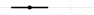

# Bias and Uncertainty in LLM-as-a-Judge Estimation

James Fiedler Affiliation: Indeed Inc.
Email: [jfiedler@indeed.com](mailto:)

###### Abstract

LLM-as-a-Judge evaluation has become a standard tool for assessing base
model performance. However, characterizing performance via the naive
estimator, i.e., raw judge outputs, is systematically biased. Recent
work has proposed estimators to correct this bias, but their reliability
depends critically on judge quality and, for model comparisons, on
calibration stability. Sharing calibration across compared models is
practically attractive but can introduce severe bias, including cases
where the comparison estimate points in the wrong direction with high
apparent confidence. We study these failure modes through analytical
results, simulations over judge quality ($`J`$) and cross-model
calibration instability ($`\Delta J`$), and a real-data MMLU-Pro case
study with sign reversal. We propose $`J`$ and $`\Delta J`$ as
diagnostics for when corrected estimates, especially shared-calibration
comparisons, are likely unreliable, and provide reporting guidance for
LaaJ evaluation.

## 1 Introduction

LLM-as-a-Judge (LaaJ) evaluation has become a standard tool for
assessing base model performance across a growing range of tasks and
benchmarks (Zheng et al., 2023; Liu et al., 2023; Dubois et al., 2024).
Raw judge outputs are often treated as direct measurements of model
quality; reporting these outputs without correction or confidence
intervals has become common practice (Lee et al., 2026).

The core statistical problem is not only bias, but whether corrected
judge outputs can be trusted as estimates of true model performance.
Bias-corrected estimators (Lee et al., 2026; Chen et al., 2026) can
substantially improve estimates, but they are not automatically
trustworthy. Their reliability depends on judge quality, summarized by
Youden’s $`J`$, and on whether the calibration assumptions required to
justify the correction actually hold. The central issue here is not
estimation efficiency, but whether the resulting estimate and
uncertainty statement correspond to the intended quantity. We therefore
treat LaaJ estimation as an evaluation method that should itself be
stress-tested before it is used to support scientific claims.

Lee et al. (2026) show that the Rogan-Gladen estimator (RG) can remain
valid under distribution shift when judge predictions depend only on
latent correctness rather than, for example, properties of the base
model being evaluated. This invites a practical strategy of reusing
calibration estimates across multiple evaluation contexts, to save on
labeling time and cost. However, such reuse is only justified if judge
calibration is effectively invariant across those contexts. When it is
not, estimation can be severely distorted. For model comparison, the
distortion can be large enough to reverse the sign of the estimate,
producing an apparently confident conclusion that points in the wrong
direction.

This paper studies LaaJ estimation for base-model assessment, covering
both single-model accuracy estimation and model comparison, with
particular attention to comparison because it is more fragile. Our
analytical and simulation results focus on the case where the judge
outputs a binary label; it is the most analytically transparent setting
and is one of, if not the, most common in practice. However, the core
lessons apply more broadly, including to ordinal and continuous judge
outputs.

We study these failure modes through three lines of evidence. Analytical
results characterize the bias structure under shared calibration and the
role of $`J`$ in determining estimator stability, where
$`J=\mathrm{sensitivity}+\mathrm{specificity}-1`$ is Youden’s index
(Peirce, 1884; Youden, 1950). Simulations demonstrate the impact that
judge quality ($`J`$) and cross-model calibration instability
($`\Delta J`$) can have on bias and interval coverage. We follow up with
a real-data case study using two subjects from the MMLU-Pro benchmark
(Wang et al., 2024c) that corroborates and expands on the simulation. In
one subject estimators perform relatively well. The other is more severe
and reveals additional failures, including a sign-reversal failure,
where a shared-calibration comparison yields a confidently negative
estimate for a truly positive accuracy difference.

Our contributions are:

1.  1.  We characterize the fragility of bias-corrected LaaJ estimators,
        showing that estimates for both single-model quality and model
        comparison can degrade sharply as judge quality ($`J`$) falls, and
        that the severity and form of failure differ across estimators.
2.  2.  We analyze shared calibration as a risk factor in both single-model
        and comparison estimation, showing that it induces $`1/J`$
        sensitivity to calibration mismatch and, for RG, can yield severely
        amplified systematic bias when $`J`$ is small.
3.  3.  We propose $`J`$ and $`\Delta J`$ as prerequisite diagnostics that
        should be checked and reported before trusting corrected LaaJ
        estimates, with increasing caution with decreasing $`J`$ or
        increasing $`\Delta J`$.
4.  4.  We demonstrate estimator failure modes through simulation and a
        real-data MMLU-Pro case study, and provide practical reporting
        guidance for LaaJ evaluation.

## 2 Related work

LLM-as-a-Judge (LaaJ) evaluation has been widely adopted since MT-Bench
(Zheng et al., 2023) and G-Eval (Liu et al., 2023) helped establish the
use of LLMs to grade model responses at scale. Subsequent work has
extended LaaJ to preference-style evaluation (Dubois et al., 2024) and
created structured judge benchmarks (Tan et al., 2025). Across this
literature, naive judge scores are routinely treated as estimates of
base-model quality without calibration correction or confidence
intervals (Zheng et al., 2023; Tan et al., 2025; Lee et al., 2026).
Miller (2024) is a strong precedent for statistical uncertainty
reporting in LLM evaluation more broadly. Our focus is on calibration
challenges specific to LaaJ that make naive uncertainty statements
unreliable even after accounting for sampling variation.

Lee et al. (2026) showed that naive LaaJ estimates are biased and
proposed applying the Rogan-Gladen estimator (Rogan and Gladen, 1978) to
correct for judge sensitivity and specificity. They establish that the
RG estimator remains valid under test-set distribution shift when the
judge’s predictions depend only on latent correctness, and validate on
Chatbot Arena win-rate data (Chiang et al., 2024). Chen et al. (2026)
subsequently compared RG, PPI++ (Angelopoulos et al., 2024), and an
EIF-based estimator, showing that PPI++ and the EIF estimator are more
efficient than RG in the binary case. Our focus differs: rather than
efficiency, we study when corrected estimates break down, especially in
model comparison under shared calibration and cross-model instability.
Neither paper studies shared calibration, proposes diagnostics for
estimator trustworthiness, or foregrounds the structural distinction
between judge-centric shared calibration and model-specific calibration
that shapes our analysis.

The epidemiological literature has long recognized that the Rogan-Gladen
estimator should not be applied indiscriminately. Greiner (2003) showed
via second-order Taylor-series analysis, confirmed by simulation, that
the corrected estimate can have higher mean squared error than the naive
estimate. Lang and Reiczigel (2014) derived adjusted confidence
intervals accounting for uncertainty in sensitivity and specificity,
establishing that the variance of the RG estimator scales as
$`1/J^{2}`$. This instability is intrinsic to the RG formula but not to
the estimation problem itself: PPI++ degrades more gracefully as judge
quality falls. Both papers address single-population estimation. We
extend to model comparison, where shared calibration can introduce
systematic bias when judge calibration differs across models, a failure
mode we are not aware of prior work characterizing.

Within LLM evaluation literature, Chen et al. (2026) find in simulations
that the efficiency advantage of PPI++ and their EIF-based estimator
over RG is most pronounced at low judge quality, and that RG can
overcover when judge quality and labeled fraction are both small. Their
analysis focuses on efficiency under correctly specified assumptions;
they do not study shared calibration, $`\Delta J`$, or conditions under
which corrected estimates become systematically biased or yield
wrong-signed comparisons. Collot et al. (2026) argue that Youden’s $`J`$
is the right metric for selecting LLM judges, grounding this in its
prevalence-independence properties. We share their view, but our use of
$`J`$ is complementary: rather than selecting judges, we focus on
bias-corrected estimation, asking whether a chosen judge’s estimates are
reliable for both single-model and model-comparison evaluations. The
cross-model stability measure $`\Delta J`$ is, to our knowledge, novel
as a formal diagnostic criterion.

## 3 Naive and Bias-Corrected Estimation

### 3.1 Setup

In LaaJ evaluation, the judge’s labels are themselves noisy (Zheng
et al., 2023; Wang et al., 2024a). That creates two distinct inferential
problems. First, raw judge estimates of performance are generally a
biased estimate. Second, model comparison is more fragile than
single-model estimation because calibration assumptions used to debias
the judge may or may not hold equally well across models.

LLM-as-a-Judge evaluation takes two common forms. In preference
evaluation, the judge is presented multiple model outputs together and
asked which is better; the estimand is the win rate
$`\Pr(\text{judge prefers }A)`$. In accuracy/quality evaluation, the
judge grades each response independently against a rubric or answer key;
the estimand is, e.g., true accuracy $`\theta=\Pr(Z=1)`$. Preference
evaluation is natural when direct comparison is the primary goal;
accuracy evaluation is natural when single-model performance is itself
of interest. Both forms require human-labeled calibration data to
estimate and correct for judge error. Accuracy evaluation extends
naturally to model comparison as $`\Delta\theta=\theta_{A}-\theta_{B}`$.
Many LaaJ pipelines are built for accuracy evaluation and reused for
model comparison, making $`\Delta\theta`$ the natural downstream
estimand.

We focus on the common binary setting in which the judge emits a label
$`\hat{Z}\in\{0,1\}`$ for whether a model response is correct. Let
$`Z\in\{0,1\}`$ denote the corresponding ground-truth label. The target
quantity is the model’s true accuracy $`\theta=\Pr(Z=1)`$. Although we
focus on the binary case, the core lessons extend more broadly to
non-binary outputs.

### 3.2 The naive estimator is biased

The naive estimator for base-model performance is the fraction of
responses judged as correct,

```math
\hat{p}=\frac{1}{n}\sum_{i=1}^{n}\hat{z}_{i}.
```

But $`\hat{p}`$ estimates $`p=\Pr(\hat{Z}=1)`$, not $`\theta`$. If the
judge has sensitivity $`q_{1}=\Pr(\hat{Z}=1\mid Z=1)`$ and specificity
$`q_{0}=\Pr(\hat{Z}=0\mid Z=0)`$, then

```math
p=\theta\cdot q_{1}+(1-\theta)(1-q_{0}), \tag{1}
```

so $`\hat{p}`$ is unbiased for $`\theta`$ only when the judge is
perfect.

In practice, judges are variable and far from perfect (Tan et al.,
2025). Judge inaccuracy remains even with prompt optimization (Zheng
et al., 2023; Xie et al., 2025) and fine-tuning to match human labels
(Wang et al., 2024b; Dubois et al., 2023; Huang et al., 2025).

The same bias structure applies to binary win-rate judges. If option A
is preferred by humans with probability $`\pi=\Pr(Z=1)`$, then
Equation (1) holds with $`\theta`$ replaced by $`\pi`$: the naive win
rate estimates the judge’s marginal preference probability, not the true
human preference rate.

### 3.3 Bias-corrected estimators

To correct the naive estimator’s bias, we use a calibration set of pairs
$`(Z_{j},\hat{Z}_{j})`$ where the true label is known from human
annotation. The Rogan-Gladen estimator (RG; (Rogan and Gladen, 1978);
(Lee et al., 2026)) uses estimated sensitivity and specificity from that
calibration set:

```math
\hat{\theta}_{\mathrm{RG}}=\frac{\hat{p}+\hat{q}_{0}-1}{\hat{q}_{0}+\hat{q}_{1}-1}.
```

The denominator is Youden’s $`J`$, a standard summary of test quality.
When $`\hat{J}`$ is small, the correction becomes unstable and interval
width can increase sharply.

We also consider PPI++ (Angelopoulos et al., 2024), a refinement of the
PPI estimator (Angelopoulos et al., 2023), which in this setting can be
written as

```math
\hat{\theta}_{\mathrm{PPI}\texttt{++}}=\bar{Y}_{\mathrm{cal}}+\lambda\left(\hat{p}_{\mathrm{test}}-\hat{p}_{\mathrm{cal}}\right),
```

with $`\bar{Y}_{\mathrm{cal}}`$, $`\hat{p}_{\mathrm{cal}}`$ determined
from the calibration set and $`\lambda`$ chosen to reduce variance. Chen
et al. (2026) introduced an EIF-based estimator shown to be
asymptotically equivalent to PPI++ in the binary case.

There is an important structural distinction in how these estimators use
calibration data. RG calibration is independent of any base model and
can in principle be reused across base models under a judge-invariance
assumption. PPI++ calibration depends on responses from the particular
base model being evaluated. This distinction shapes the
shared-calibration analysis in the following section and is described
more fully as “judge-centric” and “model-centric” in Appendix A.

## 4 Shared Calibration and Diagnostics

### 4.1 Re-use of calibration sets

Lee et al. (2026) show that the RG estimator can remain valid under
test-set distribution shift if the judge’s predictions depend only on
latent correctness, and no dependence, for example, on the base model.
This invites a practical shortcut: estimate judge calibration once and
reuse it across base models or test sets. Practitioner guidance and
engineering studies already recommend rerunning LaaJ evaluations on the
same human-labeled dataset when the judge changes (LangChain, n.d.;
Microsoft Azure AI Foundry Blog, 2026). Our results address reuse in a
different direction: across base models rather than across judges. A
similar cross-model stability assumption also appears in Collot et al.
(2026), who study judge error rates across assistant models.

This shortcut is only justified if judge calibration is effectively
invariant across the models being evaluated. We study how robust this
strategy is in practice and show that even moderate departures from
calibration invariance can materially distort estimates, for
single-model accuracy and, more severely, for model comparisons.

### 4.2 Why model comparison is harder

For a single model, we need to correct the judge’s systematic bias and
propagate uncertainty from both the test set and the calibration set.
For model comparison, we must also pair models on test items and
consider whether calibration information can legitimately be shared
across models.

RG can reuse calibration estimates if the judge’s $`q_{0}`$ and
$`q_{1}`$ are stable across models, which can substantially reduce
labeling cost. PPI++, by contrast, generally requires model-specific
calibration data (we explore this a bit further in Appendix A.2). But
RG’s labeling-cost advantage depends entirely on the judge-invariance
assumption holding. If it does not, a cross-model RG comparison will
have a bias that scales with $`1/J`$, and this $`1/J`$ amplification is
forced on any estimator using shared calibration, not just RG
(Appendix A). Appendix B derives the explicit variance formula, showing
how $`1/J^{2}`$ scaling enters and why pairing test-set items matters
for comparison estimates.

### 4.3 Uncertainty estimation and the role of the bootstrap

Confidence intervals (CIs) must propagate uncertainty from both the test
set and the calibration set, and in model comparisons, the dependence
induced by paired items and shared calibration. We use the bootstrap
throughout, resampling at the unit that matches the evaluation design:
separately resampling calibration and test items, and resampling paired
item indices for model comparisons. This single procedure covers raw
differences, percentage changes, and shared or model-specific
calibration without requiring a separate variance derivation for each
case.

### 4.4 Diagnosing when comparison estimates can be trusted

Before asking which estimator is most efficient, we must ask whether
calibration assumptions are plausible and whether estimates are stable.
We therefore distinguish two questions:

1.  1.  Is judge quality $`J`$ large enough to produce stable corrected
        estimates?
2.  2.  For shared-calibration comparisons: is $`\widehat{\Delta J}`$ small
        relative to its uncertainty?

We assess both questions using per-model calibration diagnostics,
reporting point estimates and confidence intervals. For the second
diagnostic, the farther $`\widehat{\Delta J}`$ is from zero, the less we
can trust the calibration-invariance assumption. Inclusion of zero in
the confidence interval for $`\Delta J`$ is a necessary, but not
sufficient, condition for shared calibration to be defensible.

The first diagnostic matters regardless of estimator. Low
$`\widehat{J}`$ causes unstable estimates under both RG and, to a lesser
extent, PPI++, and with low $`\widehat{J}`$ the right response is often
not “switch estimators and proceed” but “treat all estimates with more
caution.” Low judge quality is not a pathological edge case: Tan et al.
(2025) document judge accuracy spanning from near-chance to around 80%.
Near-tie comparisons remain fragile even when $`\widehat{\Delta J}`$
looks small, because modest residual bias can still create a spuriously
directional estimate.

For RG, these diagnostic requirements have a practical implication: a
portion of the potential labeling-efficiency gains are unrealizable in
many settings, because per-model calibration data is needed to assess
whether shared calibration is justified. Once stability is established
for a particular judge and set of base models, practitioners can benefit
from shared calibration for subsequent evaluations.

## 5 Simulations over $`J`$ and $`\Delta J`$

The simulation space is too rich to exhaust in one section, so we focus
on a small set of mechanisms most relevant to judge-based model
comparison: overall judge quality, calibration instability across
models, and their interaction with shared versus model-specific
correction. Section 6 complements these controlled simulations with a
real-data case study.

We simulate binary LaaJ model comparison to isolate how estimator
behavior changes with judge quality $`J`$ and cross-model calibration
instability $`\Delta J`$. In this simulation section, the true accuracy
gap is parameterized as $`\theta_{B}-\theta_{A}=0.05`$, and the
calibration gap as $`\Delta J=J_{B}-J_{A}`$. We use equal specificity
$`q_{0}`$ and sensitivity $`q_{1}`$ for analytical transparency, and run
two sweeps: one varying $`J_{A}`$ with $`\Delta J=0.05`$ fixed, and one
varying $`\Delta J`$ with $`J_{A}=0.3`$ fixed. The $`\Delta J`$ sweep
therefore considers nonnegative values in which model $`B`$ is
increasingly easier for the judge than model $`A`$. These conditions are
favorable to model-specific correction with both the measurement model
and the estimator assumptions well-matched. Still, shared-calibration RG
fails materially here, and real-data failures can be harsher still. Full
simulation parameters are in the accompanying code. Figure 1 presents
our results.

(a) Coverage vs. $`J_{A}`$ ($`\Delta J=0.05`$ fixed)

(b) Coverage vs. $`\Delta J`$ ($`J_{A}=0.3`$ fixed)

(c) Bias vs. $`J_{A}`$ ($`\Delta J=0.05`$ fixed)

(d) Bias vs. $`\Delta J`$ ($`J_{A}=0.3`$ fixed)

Figure 1: Simulation results under $`q_{0}=q_{1}`$ with true comparison
effect $`\delta=0.05`$. Dotted horizontal line in coverage panels marks
nominal 95%. Left column sweeps $`J_{A}`$ with $`\Delta J=0.05`$ fixed;
right column sweeps $`\Delta J`$ with $`J_{A}=0.3`$ fixed.

#### Varying $`J_{A}`$.

As judge quality falls, estimator performance deteriorates, but in
different ways. The naive estimator is biased throughout, but the bias
is small at the highest $`J`$ values. RG undercovers even at moderate
$`J`$ because the fixed calibration gap, though small, induces a
persistent shared-calibration bias; at low $`J`$, $`1/J`$ amplification
makes this worse. RG $`2\times`$ removes the shared-calibration
assumption and avoids much of RG’s systematic bias, but PPI++ remains
the better-behaved estimator family in this simulation. PPI++ stays near
nominal coverage across the full range, and PPI++ $`2\times`$ provides a
tighter version of the same behavior. The lesson is not simply that
removing shared calibration solves the problem: model-specific
correction can still be uncompetitive when variance is high.

#### Varying $`\Delta J`$.

At $`\Delta J=0`$, the naive estimator is already biased because
$`J_{A}=0.3`$ is too low for raw judge outputs to recover the true
comparison. As the calibration gap increases, shared-calibration RG bias
grows systematically; by $`\Delta J=0.3`$, RG has both higher absolute
bias and lower coverage than the naive estimator, so calibration
correction actively makes the comparison estimate worse. PPI++ remains
comparatively stable across the full sweep because model-specific
calibration insulates it from cross-model mismatch. The central
mechanism is that shared calibration routes any calibration mismatch
directly into comparison-estimation bias, amplified by $`1/J`$.

## 6 MMLU-Pro case study

We apply these ideas to MMLU-Pro using two subjects with very different
judge behavior: math and biology. This pair contrasts a relatively
well-behaved regime with a failure regime. The compared base models are
Gemma 3 12B and Qwen 2.5 7B, and we use two judges, Mistral Large and
Gemma 4 31B. We report diagnostic estimates in Table 1, comparison
estimates in Table 2, and per-model accuracy estimates in Figure 2. Full
setup details are in Appendix E. The intervals reflect uncertainty from
the realized calibration/test partition, finite calibration size, and,
where applicable, repeated judge runs or estimator-specific calibration
subsampling; generalizing beyond these specific MMLU-Pro questions
requires assuming the test items are representative of a broader target
population.

Additional subjects in Appendix D show qualitatively similar patterns
with more mixed severity.

| Subject | Judge         | $`\hat{J}_{\mathrm{Gemma\,3}}`$ | $`\hat{J}_{\mathrm{Qwen\,2.5}}`$ | $`\widehat{\Delta J}`$    | $`\widehat{\Delta J}`$ plotted                             |
| ------- | ------------- | ------------------------------- | -------------------------------- | ------------------------- | ---------------------------------------------------------- |
| Math    | Mistral Large | $`0.397`$                       | $`0.516`$                        | $`-0.119`$                |  |
|         |               | $`[0.297,\ 0.494]`$             | $`[0.418,\ 0.612]`$              | $`[{-0.253},\ 0.016]`$    |                                                            |
|         | Gemma 4 31B   | $`0.642`$                       | $`0.671`$                        | $`-0.030`$                |  |
|         |               | $`[0.551,\ 0.728]`$             | $`[0.582,\ 0.759]`$              | $`[{-0.140},\ 0.082]`$    |                                                            |
| Biology | Mistral Large | $`0.094`$                       | $`0.382`$                        | $`-0.289`$                |  |
|         |               | $`[{-0.056},\ 0.247]`$          | $`[0.276,\ 0.494]`$              | $`[{-0.456},\ {-0.125}]`$ |                                                            |
|         | Gemma 4 31B   | $`0.181`$                       | $`0.528`$                        | $`-0.347`$                |  |
|         |               | $`[0.027,\ 0.340]`$             | $`[0.415,\ 0.639]`$              | $`[{-0.505},\ {-0.190}]`$ |                                                            |

Table 1: Per-model Youden’s $`\hat{J}=\hat{q}_{0}+\hat{q}_{1}-1`$ and
difference $`\widehat{\Delta J}`$ with 95% bootstrap CIs. Right column
shows $`\widehat{\Delta J}`$ on a common scale $`[-0.6,\ 0.2]`$; dotted
line marks zero. A CI far from zero indicates the shared-calibration
assumption is not defensible. Per-model $`\hat{q}_{0}`$ and
$`\hat{q}_{1}`$ are in Table 6.

Calibration labels play two distinct roles in this case study. First,
they determine the labeling cost of each estimator. For a two-model
comparison, shared calibration requires labels for only one calibration
set, while model-specific calibration requires a separate set per model,
doubling the annotation cost. To make that tradeoff visible, we include
two variants of RG and PPI++ with different calibration budgets.

Second, calibration labels serve a different purpose for diagnostics
than for estimation. Accuracy estimates use only the labels available
under each estimator’s own calibration design, while the judge-quality
diagnostics ($`J`$ and $`\Delta J`$) are computed using pooled
calibration data from both models. The reason is that the diagnostic
question is different: not how accurately a particular estimator
recovers model performance under its own labeling budget, but how
reliably the judge evaluates responses from each model. In practice, we
recommend estimating judge quality in advance, across the relevant
judges and base models, using at least part of the available calibration
data before committing to a shared-calibration design.

Table 2 reports comparison estimates for five estimators: naive, RG
(shared calibration), RG $`2\times`$ (model-specific RG), PPI++
(model-specific), and PPI++ $`2\times`$ (model-specific, double
calibration budget). Calibration requires human-labeled examples to
characterize judge error rates. The $`2\times`$ variants allocate twice
as many such labels as the $`1\times`$ variants, at (presumably)
additional annotation cost; comparing them shows the effect of greater
calibration investment on estimation quality. Per-model accuracy
estimates are shown in Figure 2.

| Subject | Judge         | $`\Delta\theta`$ | $`\widehat{\Delta\theta}_{\mathrm{naive}}`$ | $`\widehat{\Delta\theta}_{\mathrm{RG}}`$ | $`\widehat{\Delta\theta}_{\mathrm{RG,2\times}}`$ | $`\widehat{\Delta\theta}_{\mathrm{PPI{+}{+}}}`$ | $`\widehat{\Delta\theta}_{\mathrm{PPI{+}{+},2\times}}`$ |
| ------- | ------------- | ---------------- | ------------------------------------------- | ---------------------------------------- | ------------------------------------------------ | ----------------------------------------------- | ------------------------------------------------------- |
| Math    | Mistral Large | $`+`$0.003       | $`-`$0.046                                  | $`-`$0.089                               | $`-`$0.037                                       | $`-`$0.009                                      | $`-`$0.007                                              |
|         |               |                  | $`[-0.078,\;-0.016]`$                       | $`[-0.156,\;-0.030]`$                    | $`[-0.176,\;+0.081]`$                            | $`[-0.084,\;+0.059]`$                           | $`[-0.050,\;+0.034]`$                                   |
|         | Gemma 4 31B   | $`+`$0.003       | $`-`$0.038                                  | $`-`$0.057                               | $`-`$0.008                                       | $`-`$0.008                                      | $`-`$0.004                                              |
|         |               |                  | $`[-0.070,\;-0.007]`$                       | $`[-0.106,\;-0.010]`$                    | $`[-0.086,\;+0.072]`$                            | $`[-0.083,\;+0.060]`$                           | $`[-0.044,\;+0.037]`$                                   |
| Biology | Mistral Large | $`+`$0.048       | $`-`$0.127                                  | $`-`$0.330                               | $`-`$0.002                                       | $`+`$0.149                                      | $`+`$0.142                                              |
|         |               |                  | $`[-0.173,\;-0.079]`$                       | $`[-0.493,\;-0.194]`$                    | $`[-0.635,\;+0.528]`$                            | $`[+0.059,\;+0.237]`$                           | $`[+0.090,\;+0.195]`$                                   |
|         | Gemma 4 31B   | $`+`$0.048       | $`-`$0.115                                  | $`-`$0.218                               | $`-`$0.066                                       | $`+`$0.137                                      | $`+`$0.133                                              |
|         |               |                  | $`[-0.165,\;-0.063]`$                       | $`[-0.341,\;-0.117]`$                    | $`[-0.641,\;+0.346]`$                            | $`[+0.042,\;+0.224]`$                           | $`[+0.082,\;+0.185]`$                                   |

Table 2: Gemma 3 minus Qwen 2.5 accuracy on math and biology.
$`\Delta\theta`$ is the true difference. Estimates are bootstrap medians
with 95% bootstrap CIs. RG uses shared calibration; RG $`2\times`$ uses
model-specific calibration with the RG formula; PPI++ variants use
model-specific calibration.

Figure 2: Bootstrap medians and 95% confidence intervals for per-model
accuracy $`\hat{\theta}`$ for the naive estimator and four corrected
estimators, under each judge. The dotted vertical line shows true
accuracy (mean on the test set). Full numerical results appear in
Table 7.

### 6.1 Math: a relatively well-behaved comparison

The base models achieve nearly identical accuracy on math (true
$`\Delta\theta=+0.003`$), making this a near-tie regime where any
non-trivial comparison estimate is suspect. The diagnostics in Table 1
look relatively favorable: $`\widehat{J}`$ is positive and moderate for
both models and both judges, and the $`\widehat{\Delta J}`$ intervals
include zero.

Individual per-model estimates (Figure 2) show that the naive estimator
is visibly off the true accuracy for both models under both judges.
These per-model errors do not cancel in the comparison: the naive
comparison yields $`-0.046`$ and $`-0.038`$ (CIs excluding zero for both
judges) despite a practically zero true difference. Even in this
relatively well-behaved regime, correction is therefore necessary.

RG also gives confidently negative comparison estimates ($`-0.089`$ and
$`-0.057`$, CIs excluding zero): the shared-calibration formula
amplifies the per-model error, and Appendix C derives a formula that
explains the observed bias for Gemma 3. RG $`2\times`$ (model-specific
RG) has medians closer to zero and CIs that include the true value, but
the intervals are substantially wider than those of PPI++.

This case therefore shows that shared calibration remains risky even
when diagnostics look favorable: in a near-tie regime, it can convert
modest per-model bias into a spuriously directional comparison result.
Model-specific PPI++ is the best-behaved estimator family among those we
study in this regime, combining near-zero medians with comparatively
tight intervals containing the true difference for both budget levels
and both judges.

### 6.2 Biology: calibration instability and low judge quality

The biology diagnostics clearly indicate trouble. The
$`\widehat{\Delta J}`$ intervals decisively exclude zero for both
judges, and $`\widehat{J}`$ for Gemma 3 is near zero. Both judges are
substantially better at evaluating Qwen 2.5 7B than Gemma 3 12B, with
especially low specificity for Gemma 3 (Appendix, Table 6). The
diagnostics alone warrant skepticism about any estimate.

Per-model estimates (Figure 2) show that naive systematically
underestimates Gemma 3 and overestimates Qwen 2.5. Both biases push the
comparison in the same wrong direction. PPI++ gives the most accurate
per-model estimates overall, with intervals that track the true
accuracies more closely than the alternatives. The remaining estimators
produce substantially biased per-model results; for Gemma 3
specifically, the near-zero $`J`$ causes the $`1/J`$ amplification in RG
to produce near-degenerate intervals spanning most of $`[0,1]`$.

For model comparison, the true difference is $`+0.048`$. The naive and
RG estimators give confidently wrong-signed estimates with CIs firmly
excluding zero. RG $`2\times`$ avoids the confident wrong sign but
produces CIs too wide to be useful. PPI++ recovers the correct
direction, but its estimates are upward-biased and most CIs exclude the
true difference from above.

Biology is the sharpest failure mode in the paper: diagnostics give
clear advance warning, multiple estimators report confidently
wrong-signed comparisons, and even the most robust option here, PPI++,
has coverage issues. Practitioners should have serious doubt about any
estimator when judge quality is this poor.

### 6.3 Main practical lesson

Naive estimation fails in every comparison, across both subjects and
both judges, establishing that correction is necessary. But correction
is not sufficient. In math, RG fails despite favorable diagnostics,
because shared calibration introduces excess error even when
$`\widehat{\Delta J}`$ is small. In biology, no estimator fully
succeeds: PPI++ performs far better than the alternatives considered
here, but its comparison intervals do not always contain the true value
when judge quality is very low.

For per-model estimates, the naive estimator is also biased in both
subjects. This supports the analytical and simulation results that raw
judge scores should not be treated as unbiased performance estimates
regardless of whether a comparison is being made. We also saw that
shared calibration can bias per-model estimates, as explained in
Appendix C.

Our recommended diagnostics $`J`$ and $`\Delta J`$ provide warning
signals rather than acceptance criteria. When per-model calibration is
feasible, judge quality is moderate to high for both models, and
$`\widehat{\Delta J}`$ is small with a CI near zero, model-specific
PPI++ is the most consistently well-behaved choice among the estimators
we study. When the diagnostics indicate trouble, as with the biology use
case, all estimates should be treated with caution.

## 7 Practical guidance for LaaJ evaluation

Raw judge scores are not unbiased estimates of model accuracy, and the
reliability of corrected estimators depends on judge quality and
calibration design. The following checklist summarizes what LaaJ
evaluation reports should make explicit.

1.  1.  State the estimand and whether it is corrected. Report whether
        results use raw outputs or are bias-corrected. If bias-corrected,
        name the estimator and describe the calibration design.
2.  2.  Distinguish single-model estimation from model comparison. The two
        tasks have different calibration requirements, different error
        propagation, and different diagnostic requirements.
3.  3.  Report calibration design explicitly. State whether calibration is
        shared across models or model-specific, and report calibration set
        size. Shared calibration requires justification; it cannot be a
        default design choice.
4.  4.  Report confidence intervals, and state what randomness they
        represent. Clarify whether the intervals reflect calibration
        sampling, test-set sampling, repeated judge runs, estimator-specific
        subsampling, or some combination. For model comparisons, preserve
        pairing when resampling.
5.  5.  Report judge-quality diagnostics: $`\hat{q}_{0}`$, $`\hat{q}_{1}`$,
        and $`\hat{J}`$. These are necessary for interpreting corrected
        estimates. Include confidence intervals.
6.  6.  For model comparisons, also report $`\widehat{\Delta J}`$ with a
        confidence interval. A large $`|\widehat{\Delta J}|`$ or a
        confidence interval excluding zero is a strong warning sign that
        shared-calibration assumptions are not defensible.
7.  7.  When diagnostics indicate trouble, weaken the claim. Low $`\hat{J}`$
        makes corrected estimates unstable; large $`|\widehat{\Delta J}|`$
        makes shared-calibration comparisons unreliable. The appropriate
        response is not to choose the estimator with the most favorable
        estimate, but, when possible, to choose designs and estimators based
        on robustness, and to weaken the strength of the claim being made.

Items 5–7 deserve particular emphasis. The biology case study shows why:
with near-zero $`\hat{J}`$ for one model and a large, well-estimated
$`\widehat{\Delta J}`$, several estimators gave confidently wrong-signed
comparisons, and even PPI++ produced distorted comparison estimates. The
math case shows a second caution: in near-tie comparisons, even modest
residual bias can create a false directional claim.

## 8 Limitations

We focus on binary-output LaaJ evaluation, judges that emit binary
correctness or preference labels, for single-model accuracy estimation
and model comparison. The naive-bias structure described in Section 3 is
broader: ordinal and continuous judge outputs have analogous issues, but
the correction and inference framework we study is specific to the
binary case. Other settings we do not address include dependent test
inputs, adaptive data collection, and broader classes of nonlinear
metrics.

Our empirical results are finite-sample and benchmark-specific. The
simulations isolate a small number of mechanisms, how estimator quality
changes with $`J`$ and $`\Delta J`$, so that bias and interval-coverage
patterns are interpretable, but they do not span every plausible
data-generating regime. The MMLU-Pro case study is informative because
it contrasts a relatively well-behaved subject with a failure case, but
it does not establish a universal pattern for all benchmarks or judges.
In particular, the biology results show that diagnostics can reveal when
comparison is unreliable, but they do not provide a complete remedy once
judge quality is poor.

Confidence intervals in the MMLU-Pro case study should first be
interpreted narrowly, as reflecting uncertainty from the
calibration/test partition, finite calibration size, and, where
applicable, repeated judge runs or estimator-specific calibration
subsampling. A broader population-level interpretation of the
$`\hat{\theta}`$ intervals additionally requires treating the test items
as representative samples from a target population, so that item
resampling approximates sampling uncertainty beyond these specific
questions. For $`\hat{J}`$ and $`\widehat{\Delta J}`$, the narrower
interpretation is sufficient: the intervals capture how much the
estimated calibration quantities vary with finite calibration data,
which is the relevant uncertainty for the diagnostic question.

Calibration-based corrections depend on the quality and
representativeness of the calibration set. With small calibration sets,
corrected estimates and their intervals can become unstable. This
instability is often most severe at low $`J`$, precisely the regime
where careful diagnostics matter most. Beyond finite-sample effects,
calibration assumptions can fail in ways not modeled here: for shared
calibration, the key risk is the cross-model instability captured by
$`\Delta J`$; for model-specific calibration, mismatch between
calibration and test-time responses can also introduce bias that the
diagnostics we propose would not detect.

## References

- Angelopoulos et al. \[2023\] Anastasios N. Angelopoulos, Stephen
  Bates, Clara Fannjiang, Michael I. Jordan, and Tijana Zrnic.
  Prediction-powered inference. _Science_, 382(6671):669–674, 2023. doi:
  10.1126/science.adi6000. URL
  [https://www.science.org/doi/abs/10.1126/science.adi6000](https://www.science.org/doi/abs/10.1126/science.adi6000).
- Angelopoulos et al. \[2024\] Anastasios N. Angelopoulos, John C.
  Duchi, and Tijana Zrnic. Ppi++: Efficient prediction-powered
  inference, 2024. URL
  [https://arxiv.org/abs/2311.01453](https://arxiv.org/abs/2311.01453).
- Chen et al. \[2026\] Yiqun T. Chen, Sizhu Lu, Sijia Li, Moran Guo, and
  Shengyi Li. Efficient inference for noisy llm-as-a-judge
  evaluation, 2026. URL
  [https://arxiv.org/abs/2601.05420](https://arxiv.org/abs/2601.05420).
- Chiang et al. \[2024\] Wei-Lin Chiang, Lianmin Zheng, Ying Sheng,
  Anastasios Nikolas Angelopoulos, Tianle Li, Dacheng Li, Banghua Zhu,
  Hao Zhang, Michael Jordan, Joseph E. Gonzalez, and Ion Stoica. Chatbot
  arena: An open platform for evaluating LLMs by human preference. In
  Ruslan Salakhutdinov, Zico Kolter, Katherine Heller, Adrian Weller,
  Nuria Oliver, Jonathan Scarlett, and Felix Berkenkamp, editors,
  _Proceedings of the 41st International Conference on Machine
  Learning_, volume 235 of _Proceedings of Machine Learning Research_,
  pages 8359–8388. PMLR, jul 2024. URL
  [https://proceedings.mlr.press/v235/chiang24b.html](https://proceedings.mlr.press/v235/chiang24b.html).
- Collot et al. \[2026\] Stephane Collot, Colin Fraser, Justin Zhao,
  William F. Shen, Timon Willi, and Ilias Leontiadis. Balanced accuracy:
  The right metric for evaluating LLM judges - explained through
  youden’s J statistic. In Yevgen Matusevych, Gülşen Eryiğit, and
  Nikolaos Aletras, editors, _Proceedings of the 19th Conference of the
  European Chapter of the Association for Computational Linguistics
  (Volume 5: Industry Track)_, pages 927–936, Rabat, Morocco,
  March 2026. Association for Computational Linguistics. ISBN
  979-8-89176-384-5. doi: 10.18653/v1/2026.eacl-industry.69. URL
  [https://aclanthology.org/2026.eacl-industry.69/](https://aclanthology.org/2026.eacl-industry.69/).
- Dubois et al. \[2023\] Yann Dubois, Xuechen Li, Rohan Taori, Tianyi
  Zhang, Ishaan Gulrajani, Jimmy Ba, Carlos Guestrin, Percy Liang, and
  Tatsunori Hashimoto. Alpacafarm: A simulation framework for methods
  that learn from human feedback. In _Thirty-seventh Conference on
  Neural Information Processing Systems_, 2023. URL
  [https://openreview.net/forum?id=4hturzLcKX](https://openreview.net/forum?id=4hturzLcKX).
- Dubois et al. \[2024\] Yann Dubois, Balázs Galambosi, Percy Liang, and
  Tatsunori B Hashimoto. Length-controlled alpacaeval: A simple way to
  debias automatic evaluators. _arXiv preprint arXiv:2404.04475_, 2024.
- Greiner \[2003\] Matthias Greiner. A decision criterion for the
  application of the rogan-gladen estimator in prevalence studies. In
  _Proceedings of the 10th Symposium of the International Society for
  Veterinary Epidemiology and Economics_, pages 240–240, Vina del Mar,
  Chile, 01 2003.
- Huang et al. \[2025\] Hui Huang, Xingyuan Bu, Hongli Zhou, Yingqi Qu,
  Jing Liu, Muyun Yang, Bing Xu, and Tiejun Zhao. An empirical study of
  LLM-as-a-judge for LLM evaluation: Fine-tuned judge model is not a
  general substitute for GPT-4. In Wanxiang Che, Joyce Nabende,
  Ekaterina Shutova, and Mohammad Taher Pilehvar, editors, _Findings of
  the Association for Computational Linguistics: ACL 2025_, pages
  5880–5895, Vienna, Austria, July 2025. Association for Computational
  Linguistics. ISBN 979-8-89176-256-5. doi:
  10.18653/v1/2025.findings-acl.306. URL
  [https://aclanthology.org/2025.findings-acl.306/](https://aclanthology.org/2025.findings-acl.306/).
- Lang and Reiczigel \[2014\] Zsolt Lang and Jenő Reiczigel. Confidence
  limits for prevalence of disease adjusted for estimated sensitivity
  and specificity. _Preventive Veterinary Medicine_, 113(1):13–22,
  01 2014. doi: 10.1016/j.prevetmed.2013.09.015.
- LangChain \[n.d.\] LangChain. How to calibrate llm-as-a-judge with
  human corrections, n.d. URL
  [https://www.langchain.com/articles/llm-as-a-judge](https://www.langchain.com/articles/llm-as-a-judge).
  Accessed: 2026-04-29.
- Lee et al. \[2026\] Chungpa Lee, Thomas Zeng, Jongwon Jeong, Jy yong
  Sohn, and Kangwook Lee. How to correctly report llm-as-a-judge
  evaluations, 2026. URL
  [https://arxiv.org/abs/2511.21140](https://arxiv.org/abs/2511.21140).
- Liu et al. \[2023\] Yang Liu, Dan Iter, Yichong Xu, Shuohang Wang,
  Ruochen Xu, and Chenguang Zhu. G-eval: NLG evaluation using gpt-4 with
  better human alignment. In Houda Bouamor, Juan Pino, and Kalika Bali,
  editors, _Proceedings of the 2023 Conference on Empirical Methods in
  Natural Language Processing_, pages 2511–2522, Singapore,
  December 2023. Association for Computational Linguistics. doi:
  10.18653/v1/2023.emnlp-main.153. URL
  [https://aclanthology.org/2023.emnlp-main.153/](https://aclanthology.org/2023.emnlp-main.153/).
- Microsoft Azure AI Foundry Blog \[2026\] Microsoft Azure AI Foundry
  Blog. Evaluating ai agents: Can llm-as-a-judge evaluators be trusted?,
  January 2026. URL
  [https://techcommunity.microsoft.com/blog/azure-ai-foundry-blog/evaluating-ai-agents-can-llm-as-a-judge-evaluators-be-trusted/4480110](https://techcommunity.microsoft.com/blog/azure-ai-foundry-blog/evaluating-ai-agents-can-llm-as-a-judge-evaluators-be-trusted/4480110).
  Accessed: 2026-04-29.
- Miller \[2024\] Evan Miller. Adding error bars to evals: A statistical
  approach to language model evaluations, 2024. URL
  [https://arxiv.org/abs/2411.00640](https://arxiv.org/abs/2411.00640).
- Peirce \[1884\] C. S. Peirce. The numerical measure of the success of
  predictions. _Science_, ns-4(93):453–454, 1884. doi:
  10.1126/science.ns-4.93.453-a.
- Rogan and Gladen \[1978\] Walter J. Rogan and Beth Gladen. Estimating
  prevalence from the results of a screening test. _American Journal of
  Epidemiology_, 107(1):71–76, 1978. doi:
  10.1093/oxfordjournals.aje.a112510.
- Tan et al. \[2025\] Sijun Tan, Siyuan Zhuang, Kyle Montgomery,
  William Yuan Tang, Alejandro Cuadron, Chenguang Wang, Raluca Popa, and
  Ion Stoica. Judgebench: A benchmark for evaluating LLM-based judges.
  In _The Thirteenth International Conference on Learning
  Representations_, 2025. URL
  [https://openreview.net/forum?id=G0dksFayVq](https://openreview.net/forum?id=G0dksFayVq).
- Wang et al. \[2024a\] Peiyi Wang, Lei Li, Liang Chen, Zefan Cai, Dawei
  Zhu, Binghuai Lin, Yunbo Cao, Lingpeng Kong, Qi Liu, Tianyu Liu, and
  Zhifang Sui. Large language models are not fair evaluators. In Lun-Wei
  Ku, Andre Martins, and Vivek Srikumar, editors, _Proceedings of the
  62nd Annual Meeting of the Association for Computational Linguistics
  (Volume 1: Long Papers)_, pages 9440–9450, Bangkok, Thailand, August
  2024a. Association for Computational Linguistics. doi:
  10.18653/v1/2024.acl-long.511. URL
  [https://aclanthology.org/2024.acl-long.511/](https://aclanthology.org/2024.acl-long.511/).
- Wang et al. \[2024b\] Yidong Wang, Zhuohao Yu, Wenjin Yao, Zhengran
  Zeng, Linyi Yang, Cunxiang Wang, Hao Chen, Chaoya Jiang, Rui Xie,
  Jindong Wang, Xing Xie, Wei Ye, Shikun Zhang, and Yue Zhang. PandaLM:
  An automatic evaluation benchmark for LLM instruction tuning
  optimization. In _The Twelfth International Conference on Learning
  Representations_, 2024b. URL
  [https://openreview.net/forum?id=5Nn2BLV7SB](https://openreview.net/forum?id=5Nn2BLV7SB).
- Wang et al. \[2024c\] Yubo Wang, Xueguang Ma, Ge Zhang, Yuansheng Ni,
  Abhranil Chandra, Shiguang Guo, Weiming Ren, Aaran Arulraj, Xuan He,
  Ziyan Jiang, Tianle Li, Max Ku, Kai Wang, Alex Zhuang, Rongqi Fan,
  Xiang Yue, and Wenhu Chen. Mmlu-pro: A more robust and challenging
  multi-task language understanding benchmark. In A. Globerson,
  L. Mackey, D. Belgrave, A. Fan, U. Paquet, J. Tomczak, and C. Zhang,
  editors, _Advances in Neural Information Processing Systems_,
  volume 37, pages 95266–95290. Curran Associates, Inc., 2024c. doi:
  10.52202/079017-3018. URL
  [https://proceedings.neurips.cc/paper_files/paper/2024/file/ad236edc564f3e3156e1b2feafb99a24-Paper-Datasets_and_Benchmarks_Track.pdf](https://proceedings.neurips.cc/paper_files/paper/2024/file/ad236edc564f3e3156e1b2feafb99a24-Paper-Datasets_and_Benchmarks_Track.pdf).
- Xie et al. \[2025\] Qiujie Xie, Qingqiu Li, Zhuohao Yu, Yuejie Zhang,
  Yue Zhang, and Linyi Yang. An empirical analysis of uncertainty in
  large language model evaluations. In _The Thirteenth International
  Conference on Learning Representations_, 2025. URL
  [https://openreview.net/forum?id=J4xLuCt2kg](https://openreview.net/forum?id=J4xLuCt2kg).
- Youden \[1950\] W. J. Youden. Index for rating diagnostic tests.
  _Cancer_, 3(1):32–35, 1950. doi:
  10.1002/1097-0142(1950)3:1\<32::AID-CNCR2820030106\>3.0.CO;2-3.
- Zheng et al. \[2023\] Lianmin Zheng, Wei-Lin Chiang, Ying Sheng,
  Siyuan Zhuang, Zhanghao Wu, Yonghao Zhuang, Zi Lin, Zhuohan Li,
  Dacheng Li, Eric Xing, Hao Zhang, Joseph E Gonzalez, and Ion Stoica.
  Judging llm-as-a-judge with mt-bench and chatbot arena. In A. Oh,
  T. Naumann, A. Globerson, K. Saenko, M. Hardt, and S. Levine, editors,
  _Advances in Neural Information Processing Systems_, volume 36, pages
  46595–46623. Curran Associates, Inc., 2023. URL
  [https://proceedings.neurips.cc/paper_files/paper/2023/file/91f18a1287b398d378ef22505bf41832-Paper-Datasets_and_Benchmarks.pdf](https://proceedings.neurips.cc/paper_files/paper/2023/file/91f18a1287b398d378ef22505bf41832-Paper-Datasets_and_Benchmarks.pdf).

## Appendix A Calibration structure, RG vs PPI++

### A.1 Judge-centric vs model-specific

A key structural difference between RG and PPI++ is the role of the
calibration set. In RG, calibration is judge-centric: the calibration
set consists of examples with known ground-truth labels, and the judge
is run on those examples to estimate its sensitivity $`q_{1}`$ and
specificity $`q_{0}`$. These quantities characterize the judge
independently of the model being evaluated. Under the model-independence
assumption, $`\hat{q}_{0}`$ and $`\hat{q}_{1}`$ can be estimated once
and reused for any model: adding a new model requires only running the
judge on its outputs, with no additional human labeling. In contrast,
PPI++ is model-specific: the calibration set pairs true labels with the
outputs of the specific model under test, and the resulting correction
is tied to that model. Evaluating a new model generally requires a new
calibration set, which can be a substantial ongoing cost in workflows
where models change frequently.

Both estimators can accommodate replacing the judge without new human
labeling, provided the new judge is rerun on the existing labeled
calibration set. The model-specificity constraint still applies: for
PPI++, the calibration set must come from the model being evaluated,
while for RG it is enough that $`q_{0}`$ and $`q_{1}`$ remain stable
between calibration and test.

When model-specific calibration is used, the variance-minimizing
$`\lambda^{*}\approx\theta(1-\theta)J/[p(1-p)]`$. As $`J\to 0`$,
$`\lambda^{*}\to 0`$: PPI++ gives the correction term little weight and
falls back on the labeled calibration mean $`\bar{Y}_{\mathrm{cal}}`$.
This is graceful degradation, as precision is limited by calibration-set
size, but there is no amplification of noise. The contrast with
shared-calibration PPI++ (and with RG) is instructive: the subsection
below shows that shared calibration forces $`\lambda=1/J`$, which
explodes as $`J\to 0`$ and is the source of the instability described in
the main text.

### A.2 PPI++ with shared calibration reduces to the RG estimator

The main text argues that PPI++ requires per-model calibration while the
RG estimator does not. A natural question is whether PPI++ could simply
adopt the same model-independence assumption as RG, reusing a single
calibration set across models. The answer is yes, but doing so turns
PPI++ into the RG estimator. The role of $`\lambda`$ must also change:
instead of minimizing variance, it must be chosen to debias the
estimator.

#### Setup.

Suppose we have calibration data from model $`C`$ (ground-truth labels
paired with judge scores), and we want to estimate $`\theta_{A}`$, the
accuracy of a different model $`A`$, using only judge scores on model
$`A`$’s test outputs. Under model-independence, the judge’s sensitivity
$`q_{1}`$ and specificity $`q_{0}`$ are the same for both models. The
shared-calibration PPI++ estimator takes the form

```math
\hat{\theta}_{A}=\bar{Y}_{C}+\lambda(\hat{p}_{A}-\hat{p}_{C}),
```

where $`\bar{Y}_{C}`$ is the mean ground-truth accuracy in the
calibration set, $`\hat{p}_{A}`$ is the mean judge score on model
$`A`$’s test outputs, and $`\hat{p}_{C}`$ is the mean judge score on the
calibration data (model $`C`$’s outputs).

#### Unbiasedness condition.

For the estimator to be unbiased for $`\theta_{A}`$ we need
$`\mathbb{E}[\hat{\theta}_{A}]=\theta_{A}`$, i.e.,

```math
\theta_{C}+\lambda(p_{A}-p_{C})=\theta_{A}.
```

Since $`p=\theta J+(1-q_{0})`$, we have
$`p_{A}-p_{C}=J(\theta_{A}-\theta_{C})`$, and so the required tuning
parameter is

```math
\lambda=\frac{1}{J},
```

which depends only on the judge, not on either model. This is the same
judge-only quantity that appears in the RG estimator.

#### Algebraic equivalence.

Plugging in $`\lambda=1/\hat{J}`$, where
$`\hat{J}=\hat{q}_{0}+\hat{q}_{1}-1`$, gives

```math
\hat{\theta}_{A}=\bar{Y}_{C}+\frac{1}{\hat{J}}(\hat{p}_{A}-\hat{p}_{C}).
```

Because $`\bar{Y}_{C}`$, $`\hat{p}_{C}`$, $`\hat{q}_{0}`$, and
$`\hat{q}_{1}`$ are all computed from the same calibration sample, they
satisfy the empirical identity

```math
\hat{p}_{C}=\bar{Y}_{C}\hat{q}_{1}+(1-\bar{Y}_{C})(1-\hat{q}_{0}),
```

which implies

```math
\bar{Y}_{C}=\frac{\hat{p}_{C}+\hat{q}_{0}-1}{\hat{J}}.
```

Substituting this into the estimator gives

```math
\displaystyle\hat{\theta}_{A} \displaystyle=\frac{\hat{p}_{C}+\hat{q}_{0}-1}{\hat{J}}+\frac{\hat{p}_{A}-\hat{p}_{C}}{\hat{J}}
```

```math
\displaystyle=\frac{\hat{p}_{A}+\hat{q}_{0}-1}{\hat{J}}
```

```math
\displaystyle=\hat{\theta}_{\mathrm{RG},A}.
```

Thus, under this shared-calibration setup, cross-model PPI++ reduces
exactly to the RG estimator.

#### Implication.

Under the model-independence assumption, the only signal shared across
models is the judge’s error rates $`(q_{0},q_{1})`$. RG uses that signal
directly, and shared-calibration PPI++ collapses to the same estimator.
The efficiency advantage of PPI++ over RG arises only when it uses
model-specific calibration data, but that also incurs a per-model
labeling cost that RG avoids.

#### The $`1/J`$ factor is inescapable under shared calibration.

Equation (1) can be rewritten as $`p=\theta J+(1-q_{0})`$, so under
shared calibration $`\Delta p=\Delta\theta\cdot J`$, giving
$`\Delta\theta=\Delta p/J`$. The derivation above shows that
$`\lambda=1/J`$ is the value forced on any estimator that correctly
recovers $`\Delta\theta`$ from $`\Delta p`$ while sharing calibration
across models. This is not a property of RG or PPI++ specifically; it is
a consequence of the measurement model. Low $`J`$ attenuates the signal
in $`\Delta p`$, and recovering $`\Delta\theta`$ requires undoing that
attenuation regardless of the estimator chosen.

## Appendix B Analytical variance for the RG comparison estimator

This appendix derives the variance for the shared-calibration RG
comparison estimator, showing how $`1/J^{2}`$ scaling enters and why
pairing test-set items matters.

#### Shared-calibration simplification.

When both models share calibration estimates
$`(\hat{q}_{0},\hat{q}_{1})`$, the $`\hat{q}_{0}`$ terms cancel in the
difference:

```math
\widehat{\Delta\theta}_{\mathrm{RG}}=\frac{\hat{p}_{B}+\hat{q}_{0}-1}{\hat{J}}-\frac{\hat{p}_{A}+\hat{q}_{0}-1}{\hat{J}}=\frac{\hat{p}_{B}-\hat{p}_{A}}{\hat{J}},
```

where $`\hat{J}=\hat{q}_{0}+\hat{q}_{1}-1`$. Only uncertainty in
$`\hat{J}`$ survives from the calibration side. Applying the delta
method:

```math
\mathrm{SE}^{2}\approx\underbrace{\frac{\widehat{\mathrm{Var}}(\hat{Z}_{B,i}-\hat{Z}_{A,i})}{N\cdot\hat{J}^{2}}}_{\text{test}}+\underbrace{\frac{(\hat{p}_{B}-\hat{p}_{A})^{2}\left(\dfrac{\hat{q}_{0}(1-\hat{q}_{0})}{m_{0}}+\dfrac{\hat{q}_{1}(1-\hat{q}_{1})}{m_{1}}\right)}{\hat{J}^{4}}}_{\text{calibration}}.
```

The test term scales as $`1/\hat{J}^{2}`$ and the calibration term as
$`1/\hat{J}^{4}`$, so small $`\hat{J}`$ sharply inflates interval width.

#### Pairing.

Estimating the test term from paired per-input differences
$`\hat{Z}_{B,i}-\hat{Z}_{A,i}`$ is preferable to treating the two
models’ scores as independent. The paired estimate captures model
correlation directly and avoids a component-wise expansion that can go
negative when models are highly correlated. The bootstrap preserves this
pairing automatically by resampling both models on the same input
indices in each replicate.

## Appendix C Estimation of bias in $`\theta_{\mathrm{RG}}`$ when sharing calibration

When we estimate $`\theta`$ with model A’s own calibration labels, we
get

```math
\hat{\theta}_{\mathrm{RG,A}}=\frac{\hat{p}_{A}+\hat{q}_{0,A}-1}{\hat{q}_{0,A}+\hat{q}_{1,A}-1},
```

but when we instead use $`\hat{q}_{0,B}`$ and $`\hat{q}_{1,B}`$
estimated from model B’s calibration labels we get

```math
\hat{\theta}_{\mathrm{RG,A}}^{*}=\frac{\hat{p}_{A}+\hat{q}_{0,B}-1}{\hat{q}_{0,B}+\hat{q}_{1,B}-1}.
```

Since $`\hat{\theta}_{\mathrm{RG,A}}`$ is asymptotically unbiased for
$`\theta_{A}`$, the asymptotic bias of
$`\hat{\theta}_{\mathrm{RG,A}}^{*}`$, the limit of
$`\hat{\theta}_{\mathrm{RG,A}}^{*}-\hat{\theta}_{\mathrm{RG,A}}`$ as
calibration-set size grows, is

```math
\displaystyle\text{bias} \displaystyle=\frac{p_{A}+q_{0,B}-1}{J_{B}}-\frac{p_{A}+q_{0,A}-1}{J_{A}}
```

```math
\displaystyle\text{with }\Delta J=J_{A}-J_{B}\text{ and }\Delta q_{0}=q_{0,A}-q_{0,B}
```

```math
\displaystyle=\frac{\theta_{A}\cdot\Delta J-\Delta q_{0}}{J_{B}}
```

```math
\displaystyle=\frac{\theta_{A}\cdot\Delta q_{1}}{J_{B}}-\frac{(1-\theta_{A})\Delta q_{0}}{J_{B}}
```

Thus calibration mismatch between models is amplified by $`1/J`$ into
comparison bias. When $`J`$ is small, this amplification is severe. When
$`J`$ differs between models, the amplification creates directional
comparison bias even if the difference is not statistically significant.
In the middle line, the $`\theta_{A}\cdot\Delta J`$ term means that
models with higher accuracy are more sensitive to calibration mismatch.
The last line shows, since $`0.5<\theta_{A}\leq 1.0`$, that
$`\Delta q_{1}`$ contributes more than $`\Delta q_{0}`$, and the two
terms partially cancel when $`\Delta q_{1}`$ and $`\Delta q_{0}`$ have
the same sign.

Note that $`\theta_{B}`$ will continue to be unbiased, so all of the
bias occurs in $`\hat{\theta}_{\mathrm{RG,A}}^{*}`$, which gets carried
over to $`\widehat{\Delta\theta}`$.

Using the numbers from Mistral Large on the math questions

```math
\displaystyle\Delta J \displaystyle=-0.119
```

```math
\displaystyle\Delta q_{0} \displaystyle=-0.060
```

```math
\displaystyle J_{\text{Qwen}} \displaystyle=0.519
```

```math
\displaystyle\theta_{\text{Gemma\,3}} \displaystyle\approx 0.738
```

```math
\displaystyle\text{bias} \displaystyle\approx(0.738\times(-0.119)-(-0.060))/0.519
```

```math
\displaystyle\approx-0.054
```

```math
\displaystyle\widehat{\theta}_{\text{Gemma\,3}}-\theta_{\text{Gemma\,3}} \displaystyle\approx 0.665-0.738=-0.073
```

Hence this bias can explain the majority of the error in the estimate of
$`\theta_{\text{Gemma\,3}}`$, with the remainder ($`-0.019`$) being
finite-sample noise in the calibration estimates themselves.

## Appendix D Additional law and engineering subjects

Law and engineering add two intermediate regimes. Law shows that low
$`J`$ alone can severely distort naive per-model estimates and make
RG-based correction unstable, even when $`\widehat{\Delta J}`$ is not
clearly different from zero. Engineering is more mixed: under Mistral
Large, naive and shared-calibration RG yield substantially exaggerated
comparison estimates, while under Gemma 4 31B the comparison estimate is
better only because the per-model biases largely cancel. PPI++ remains
relatively well behaved in both subjects. In each subject, one of the
naive comparison estimates is accurate by luck, due to per-model biases
that almost entirely cancel.

Table 3 reports the judge diagnostics. For law, Mistral Large has very
low $`J`$ for both models, while Gemma 4 31B is better but still
moderate. In both cases the $`\widehat{\Delta J}`$ intervals include
zero, so this subject isolates a low-$`J`$ failure mode more than a
dramatic cross-model-instability story. Engineering shows moderate judge
quality overall, with the $`\widehat{\Delta J}`$ intervals again
including zero.

| Subject     | Judge         | $`\hat{J}_{\mathrm{Gemma\,3}}`$ | $`\hat{J}_{\mathrm{Qwen\,2.5}}`$ | $`\widehat{\Delta J}`$ | $`\widehat{\Delta J}`$ plotted                             |
| ----------- | ------------- | ------------------------------- | -------------------------------- | ---------------------- | ---------------------------------------------------------- |
| Law         | Mistral Large | $`0.142`$                       | $`0.184`$                        | $`-0.042`$             |  |
|             |               | $`[0.059,\ 0.222]`$             | $`[0.095,\ 0.269]`$              | $`[{-0.152},\ 0.071]`$ |                                                            |
|             | Gemma 4 31B   | $`0.393`$                       | $`0.486`$                        | $`-0.094`$             |  |
|             |               | $`[0.297,\ 0.486]`$             | $`[0.399,\ 0.573]`$              | $`[{-0.212},\ 0.026]`$ |                                                            |
| Engineering | Mistral Large | $`0.342`$                       | $`0.446`$                        | $`-0.104`$             |  |
|             |               | $`[0.237,\ 0.442]`$             | $`[0.343,\ 0.547]`$              | $`[{-0.245},\ 0.038]`$ |                                                            |
|             | Gemma 4 31B   | $`0.366`$                       | $`0.428`$                        | $`-0.062`$             |  |
|             |               | $`[0.270,\ 0.456]`$             | $`[0.332,\ 0.524]`$              | $`[{-0.176},\ 0.047]`$ |                                                            |

Table 3: Per-model Youden’s $`\hat{J}=\hat{q}_{0}+\hat{q}_{1}-1`$ and
difference $`\widehat{\Delta J}`$ with 95% bootstrap CIs for additional
law and engineering subjects. Right column shows $`\widehat{\Delta J}`$
on the same scale as Table 1; dotted line marks zero.

Table 4 reports comparison estimates, and Figure 3 shows the
corresponding per-model accuracy estimates.

In law, the true comparison is a small positive gap ($`+0.026`$). The
most striking pattern is the per-model bias: under both judges, the
naive estimator substantially overestimates both models’ accuracies. For
Mistral Large, those biases are nearly equal in magnitude and largely
cancel in the difference, so the naive comparison contains the truth by
coincidence rather than by reliability. For Gemma 4 31B, the biases do
not cancel as much, and the naive comparison is mildly wrong-signed at
the point-estimate level; a reminder that even moderate judge quality
does not guarantee a reliable comparison estimate. RG remains relatively
unstable, with fairly wide intervals. PPI++ again gives the most stable
comparison estimates, with medians near the truth and intervals
containing it for both judges and both calibration budgets.

In engineering, the true comparison is smaller ($`+0.012`$), making the
subject another near-tie regime. For Mistral Large, the naive estimator
overestimates Gemma 3’s performance but is close to the truth for
Qwen 2.5, resulting in a comparison estimate and interval that lie
entirely above the true difference. Shared-calibration RG shows the same
pattern, with an even more exaggerated estimate. For Gemma 4 31B, the
naive estimator underestimates both base models by roughly the same
amount, resulting in a comparison estimate that is very accurate, but
only by luck. This is very similar to the naive estimator result for law
with Mistral Large, but with base-model underestimation rather than
overestimation. PPI++ is again relatively well behaved for engineering.

| Subject     | Judge         | $`\Delta\theta`$ | $`\widehat{\Delta\theta}_{\mathrm{naive}}`$ | $`\widehat{\Delta\theta}_{\mathrm{RG}}`$ | $`\widehat{\Delta\theta}_{\mathrm{RG,2\times}}`$ | $`\widehat{\Delta\theta}_{\mathrm{PPI{+}{+}}}`$ | $`\widehat{\Delta\theta}_{\mathrm{PPI{+}{+},2\times}}`$ |
| ----------- | ------------- | ---------------- | ------------------------------------------- | ---------------------------------------- | ------------------------------------------------ | ----------------------------------------------- | ------------------------------------------------------- |
| Law         | Mistral Large | $`+`$0.026       | $`+`$0.025                                  | $`+`$0.126                               | $`-`$0.130                                       | $`+`$0.011                                      | $`+`$0.011                                              |
|             |               |                  | $`[-0.014,\;+0.064]`$                       | $`[-0.071,\;+0.374]`$                    | $`[-0.457,\;+0.245]`$                            | $`[-0.077,\;+0.103]`$                           | $`[-0.045,\;+0.068]`$                                   |
|             | Gemma 4 31B   | $`+`$0.026       | $`-`$0.040                                  | $`-`$0.081                               | $`-`$0.056                                       | $`+`$0.010                                      | $`+`$0.009                                              |
|             |               |                  | $`[-0.083,\;+0.005]`$                       | $`[-0.177,\;+0.011]`$                    | $`[-0.245,\;+0.129]`$                            | $`[-0.076,\;+0.096]`$                           | $`[-0.045,\;+0.064]`$                                   |
| Engineering | Mistral Large | $`+`$0.012       | $`+`$0.093                                  | $`+`$0.208                               | $`-`$0.073                                       | $`+`$0.044                                      | $`+`$0.047                                              |
|             |               |                  | $`[+0.056,\;+0.128]`$                       | $`[+0.122,\;+0.319]`$                    | $`[-0.291,\;+0.122]`$                            | $`[-0.049,\;+0.133]`$                           | $`[-0.010,\;+0.102]`$                                   |
|             | Gemma 4 31B   | $`+`$0.012       | $`+`$0.012                                  | $`+`$0.029                               | $`+`$0.023                                       | $`+`$0.055                                      | $`+`$0.054                                              |
|             |               |                  | $`[-0.019,\;+0.043]`$                       | $`[-0.046,\;+0.108]`$                    | $`[-0.118,\;+0.174]`$                            | $`[-0.039,\;+0.148]`$                           | $`[-0.001,\;+0.110]`$                                   |

Table 4: Gemma 3 minus Qwen 2.5 accuracy on additional law and
engineering subjects. $`\Delta\theta`$ is the true difference. Estimates
are bootstrap medians with 95% bootstrap CIs. RG uses shared
calibration; RG $`2\times`$ uses model-specific calibration with the RG
formula; PPI++ variants use model-specific calibration.

Figure 3: Bootstrap medians and 95% confidence intervals for per-model
accuracy $`\hat{\theta}`$ for the naive estimator and four corrected
estimators on the additional law and engineering subjects. The dotted
vertical line shows true accuracy (mean on the test set).

Taken together, these additional subjects sharpen a few practical
lessons. First, low judge quality alone can be enough to make naive and
RG-based estimates unreliable; a non-alarming $`\widehat{\Delta J}`$
estimate is not enough by itself to make the comparison trustworthy.
Second, near-tie comparisons can sometimes look acceptable because
per-model biases cancel, but such cancellation is fragile and can mask
underlying estimation problems if the comparison estimate is viewed in
isolation. Finally, as with math and biology, PPI++ with model-specific
calibration was the most consistently well-behaved estimator among those
we study.

## Appendix E MMLU-Pro details for LLM-as-a-Judge

### E.1 System prompt and structured output

The system prompt used for all judge evaluations was:

> You are evaluating a student’s reasoning on a multiple-choice
> question. You will see the question and the student’s complete
> reasoning, but NOT their final answer. Assess whether the student’s
> reasoning directly implies the correct answer. First give your own
> reasoning for the problem in reasoning, then give your assessment of
> the student’s reasoning: “Yes” if the student’s reasoning is accurate
> and sufficient to arrive at the correct answer, “No” if it is not.

Structured outputs were required, using the following schema:

{

"type": "json_schema",

"json_schema": {

"name": "JudgeOutput",

"strict": True,

"schema": {

"type": "object",

"properties": {

"reasoning": {"type": "string"},

"prediction": {"type": "string", "enum": \["Yes", "No"\]},

},

"required": \["reasoning", "prediction"\],

"additionalProperties": False,

},

},

}

### E.2 Base model selection and answer extraction

Qwen 2.5 7B and Gemma 3 12B were selected as base models because of
their similar performance across MMLU-Pro subjects studied here.
Responses were generated using a CoT prompt similar to Wang et al.
\[2024c\]. We collected $`k=5`$ outputs per question for each model; not
all runs produced correctly-formatted answers, so the first
correctly-formatted output per question was selected as the single input
used here. Questions for which neither Qwen 2.5 7B nor Gemma 3 12B
produced any correctly-formatted response across all five runs were
dropped entirely. Table 5 shows question counts before and after this
filtering.

|                                           | Math | Biology | Law  | Engineering |
| ----------------------------------------- | ---- | ------- | ---- | ----------- |
| In benchmark                              | 1351 | 717     | 1101 | 969         |
| At least one correctly formatted response | 1290 | 717     | 1101 | 963         |

Table 5: Questions per subject before and after filtering for at least
one correctly formatted response across $`k=5`$ runs.

Each base model’s full response was given to the judge models, except
that the final answer letter was removed. The final answer is identified
as the last match of the first regular expression below; if no match is
found, the last match of the second is used. If neither matches, the
response is considered incorrectly formatted and was excluded.

ANSWER_RE_1 = re.compile(

r"(?:T\|t)he \[a-z \]\*answer is\[a-z \]\*\[:\s\]\*\\?(\[A-Ja-j\])\\?"

)

ANSWER_RE_2 = re.compile(r"(?:A\|a)nswer:\s+\\?(\[A-Ja-j\])\\?")

This procedure does not guard against a base model’s answer being
obvious from the remaining text, for example if it was repeated earlier
in the response. For present purposes the procedure is sufficient: $`J`$
ranges from 0.09 to 0.67 across judges and subjects (Table 1),
indicating moderate rather than near-perfect discriminative ability.

### E.3 Calibration and test sets

We randomly selected one-third of the questions as a calibration set and
two-thirds as a test set. The four estimators use the calibration set as
follows.

RG uses the entire calibration set with true labels from Qwen 2.5 7B
only, applying the resulting calibration quantities to both models. This
simulates Qwen 2.5 7B as the incumbent model with pre-existing labels,
and Gemma 3 12B as a challenger with no additional labeling budget. This
is our base estimator.

RG $`\mathbf{2\times}`$ uses the full calibration set with labels from
both models, creating separate per-model calibration estimates. This
simulates twice the labeling budget of base RG, and is comparable to
PPI++ $`2\times`$.

PPI++ $`\mathbf{1\times}`$ simulates the same total labeling budget as
base RG: labels from both Qwen 2.5 7B and Gemma 3 12B are used, but only
on a randomly selected half of the calibration set. The random selection
introduces additional variability, which is handled in the bootstrap
procedure below.

PPI++ $`\mathbf{2\times}`$ uses labels from both models on the entire
calibration set, matching the labeling budget of RG $`2\times`$.

For the judge models, $`k=1`$ is used for all calibration sets. On the
test set, Mistral Large uses $`k=5`$ runs on the same base model inputs;
Gemma 4 31B uses $`k=1`$, as it was observed to produce highly
consistent outputs in preliminary testing. Nondeterminism in Mistral
Large aligns with findings elsewhere that LLM-as-a-Judge can be
inconsistent across runs (\[Microsoft Azure AI Foundry Blog, 2026\]).

### E.4 Bootstrap procedure

For all estimators, calibration and test sets were separately sampled
(reflecting a fixed split) across 10,000 bootstrap iterations. The
calibration and test sets both represent sources of variance, so both
needed to be sampled. The confidence intervals are the $`\alpha/2`$ and
$`1-\alpha/2`$ quantiles.

PPI++ $`1\times`$ has an extra source of variance due to randomly
sampling half the calibration set. To average out this extra variance,
bootstrapping was repeated 20 times, with 20 separate selections of the
calibration subset. The resulting bootstrap iterations were pooled to
create estimates. This extra randomness also makes a plug-in point
estimate suboptimal. We instead use the bootstrap median, and apply it
to all $`\theta`$ estimates for within-table consistency.

PPI++’s $`\lambda`$ estimation presents a challenge with $`k>1`$:
passing $`k\cdot n_{\text{test}}`$ run-level rows would set
$`N=k\cdot n_{\text{test}}`$ in the $`\lambda`$ formula, underscaling
$`\mathrm{Var}(\hat{Y}_{\text{test}})/N`$ by a factor of $`k`$ and
producing an upward-biased $`\lambda`$. Hence, Mistral’s $`k=5`$ runs in
the test set were collapsed to a per-question mean accuracy, and then
IID bootstrap was used.

### E.5 Full results

Table 6 gives per-model $`\hat{q}_{0}`$ and $`\hat{q}_{1}`$ with 95%
bootstrap CIs for each judge, base model, and subject. Table 7 gives
complete numerical results for per-model accuracy estimates and
comparison differences.

| Subject     | Judge         | Base model  | $`\hat{q}_{0}`$           | $`\hat{q}_{1}`$           |
| ----------- | ------------- | ----------- | ------------------------- | ------------------------- |
| Math        | Mistral Large | Gemma 3 12B | $`0.509`$                 | $`0.887`$                 |
|             |               |             | $`[0.415,\ 0.602]`$       | $`[0.852,\ 0.920]`$       |
|             |               | Qwen 2.5 7B | $`0.569`$                 | $`0.947`$                 |
|             |               |             | $`[0.473,\ 0.661]`$       | $`[0.921,\ 0.970]`$       |
|             |               | $`\Delta`$  | $`-0.060`$                | $`-0.060`$                |
|             |               |             | $`[{-0.186},\ 0.070]`$    | $`[{-0.099},\ {-0.021}]`$ |
|             | Gemma 4 31B   | Gemma 3 12B | $`0.764`$                 | $`0.878`$                 |
|             |               |             | $`[0.680,\ 0.843]`$       | $`[0.841,\ 0.913]`$       |
|             |               | Qwen 2.5 7B | $`0.752`$                 | $`0.919`$                 |
|             |               |             | $`[0.669,\ 0.833]`$       | $`[0.888,\ 0.948]`$       |
|             |               | $`\Delta`$  | $`+0.011`$                | $`-0.041`$                |
|             |               |             | $`[{-0.087},\ 0.108]`$    | $`[{-0.087},\ 0.005]`$    |
| Biology     | Mistral Large | Gemma 3 12B | $`0.348`$                 | $`0.746`$                 |
|             |               |             | $`[0.211,\ 0.488]`$       | $`[0.684,\ 0.806]`$       |
|             |               | Qwen 2.5 7B | $`0.395`$                 | $`0.988`$                 |
|             |               |             | $`[0.288,\ 0.507]`$       | $`[0.969,\ 1.000]`$       |
|             |               | $`\Delta`$  | $`-0.047`$                | $`-0.242`$                |
|             |               |             | $`[{-0.201},\ 0.103]`$    | $`[{-0.307},\ {-0.179}]`$ |
|             | Gemma 4 31B   | Gemma 3 12B | $`0.435`$                 | $`0.746`$                 |
|             |               |             | $`[0.293,\ 0.581]`$       | $`[0.684,\ 0.806]`$       |
|             |               | Qwen 2.5 7B | $`0.553`$                 | $`0.975`$                 |
|             |               |             | $`[0.442,\ 0.662]`$       | $`[0.949,\ 0.994]`$       |
|             |               | $`\Delta`$  | $`-0.118`$                | $`-0.229`$                |
|             |               |             | $`[{-0.262},\ 0.025]`$    | $`[{-0.293},\ {-0.166}]`$ |
| Law         | Mistral Large | Gemma 3 12B | $`0.279`$                 | $`0.862`$                 |
|             |               |             | $`[0.222,\ 0.339]`$       | $`[0.801,\ 0.917]`$       |
|             |               | Qwen 2.5 7B | $`0.342`$                 | $`0.842`$                 |
|             |               |             | $`[0.282,\ 0.401]`$       | $`[0.777,\ 0.903]`$       |
|             |               | $`\Delta`$  | $`-0.062`$                | $`+0.020`$                |
|             |               |             | $`[{-0.139},\ 0.014]`$    | $`[{-0.065},\ 0.102]`$    |
|             | Gemma 4 31B   | Gemma 3 12B | $`0.624`$                 | $`0.768`$                 |
|             |               |             | $`[0.560,\ 0.687]`$       | $`[0.697,\ 0.837]`$       |
|             |               | Qwen 2.5 7B | $`0.637`$                 | $`0.850`$                 |
|             |               |             | $`[0.574,\ 0.697]`$       | $`[0.787,\ 0.910]`$       |
|             |               | $`\Delta`$  | $`-0.012`$                | $`-0.082`$                |
|             |               |             | $`[{-0.094},\ 0.068]`$    | $`[{-0.170},\ 0.006]`$    |
| Engineering | Mistral Large | Gemma 3 12B | $`0.637`$                 | $`0.705`$                 |
|             |               |             | $`[0.566,\ 0.707]`$       | $`[0.627,\ 0.779]`$       |
|             |               | Qwen 2.5 7B | $`0.796`$                 | $`0.650`$                 |
|             |               |             | $`[0.740,\ 0.851]`$       | $`[0.562,\ 0.733]`$       |
|             |               | $`\Delta`$  | $`-0.159`$                | $`+0.055`$                |
|             |               |             | $`[{-0.245},\ {-0.073}]`$ | $`[{-0.052},\ 0.162]`$    |
|             | Gemma 4 31B   | Gemma 3 12B | $`0.891`$                 | $`0.475`$                 |
|             |               |             | $`[0.844,\ 0.933]`$       | $`[0.392,\ 0.558]`$       |
|             |               | Qwen 2.5 7B | $`0.915`$                 | $`0.512`$                 |
|             |               |             | $`[0.876,\ 0.951]`$       | $`[0.423,\ 0.600]`$       |
|             |               | $`\Delta`$  | $`-0.025`$                | $`-0.038`$                |
|             |               |             | $`[{-0.078},\ 0.028]`$    | $`[{-0.131},\ 0.051]`$    |

Table 6: Per-model specificity $`\hat{q}_{0}`$ and sensitivity
$`\hat{q}_{1}`$ with 95% bootstrap CIs, by subject, judge, and base
model.
$`\Delta=\hat{q}_{\mathrm{Gemma\,3}}-\hat{q}_{\mathrm{Qwen\,2.5}}`$.

| Subject     | Judge         | Model    | $`\theta`$ | $`\hat{\theta}_{\mathrm{naive}}`$ | $`\hat{\theta}_{\mathrm{RG}}`$ | $`\hat{\theta}_{\mathrm{RG},2\times}`$ | $`\hat{\theta}_{\mathrm{PPI{+}{+}}}`$ | $`\hat{\theta}_{\mathrm{PPI{+}{+}},2\times}`$ |
| ----------- | ------------- | -------- | ---------- | --------------------------------- | ------------------------------ | -------------------------------------- | ------------------------------------- | --------------------------------------------- |
| Math        | Mistral Large | Gemma 3  | 0.738      | 0.776                             | 0.668                          | 0.720                                  | 0.742                                 | 0.742                                         |
|             |               |          |            | $`[0.749,\;0.802]`$               | $`[0.571,\;0.745]`$            | $`[0.589,\;0.826]`$                    | $`[0.677,\;0.804]`$                   | $`[0.702,\;0.781]`$                           |
|             |               | Qwen 2.5 | 0.735      | 0.822                             | 0.756                          | 0.756                                  | 0.752                                 | 0.749                                         |
|             |               |          |            | $`[0.798,\;0.845]`$               | $`[0.678,\;0.825]`$            | $`[0.678,\;0.825]`$                    | $`[0.695,\;0.807]`$                   | $`[0.712,\;0.785]`$                           |
|             |               | diff     | $`+`$0.003 | $`-`$0.046                        | $`-`$0.089                     | $`-`$0.037                             | $`-`$0.009                            | $`-`$0.007                                    |
|             |               |          |            | $`[-0.078,\;-0.016]`$             | $`[-0.156,\;-0.030]`$          | $`[-0.176,\;0.081]`$                   | $`[-0.084,\;0.059]`$                  | $`[-0.050,\;0.034]`$                          |
|             | Gemma 4 31B   | Gemma 3  | 0.738      | 0.710                             | 0.690                          | 0.739                                  | 0.741                                 | 0.743                                         |
|             |               |          |            | $`[0.679,\;0.741]`$               | $`[0.618,\;0.753]`$            | $`[0.666,\;0.808]`$                    | $`[0.683,\;0.799]`$                   | $`[0.707,\;0.779]`$                           |
|             |               | Qwen 2.5 | 0.735      | 0.749                             | 0.747                          | 0.747                                  | 0.750                                 | 0.747                                         |
|             |               |          |            | $`[0.720,\;0.777]`$               | $`[0.681,\;0.808]`$            | $`[0.681,\;0.808]`$                    | $`[0.694,\;0.805]`$                   | $`[0.712,\;0.781]`$                           |
|             |               | diff     | $`+`$0.003 | $`-`$0.038                        | $`-`$0.057                     | $`-`$0.008                             | $`-`$0.008                            | $`-`$0.004                                    |
|             |               |          |            | $`[-0.070,\;-0.007]`$             | $`[-0.106,\;-0.010]`$          | $`[-0.086,\;0.072]`$                   | $`[-0.083,\;0.060]`$                  | $`[-0.044,\;0.037]`$                          |
| Biology     | Mistral Large | Gemma 3  | 0.766      | 0.699                             | 0.244                          | 0.575                                  | 0.807                                 | 0.806                                         |
|             |               |          |            | $`[0.659,\;0.740]`$               | $`[0.000,\;0.444]`$            | $`[0.000,\;1.000]`$                    | $`[0.717,\;0.890]`$                   | $`[0.755,\;0.855]`$                           |
|             |               | Qwen 2.5 | 0.718      | 0.826                             | 0.577                          | 0.577                                  | 0.658                                 | 0.665                                         |
|             |               |          |            | $`[0.795,\;0.857]`$               | $`[0.381,\;0.700]`$            | $`[0.381,\;0.700]`$                    | $`[0.573,\;0.743]`$                   | $`[0.611,\;0.715]`$                           |
|             |               | diff     | $`+`$0.048 | $`-`$0.127                        | $`-`$0.330                     | $`-`$0.002                             | $`+`$0.149                            | $`+`$0.142                                    |
|             |               |          |            | $`[-0.173,\;-0.079]`$             | $`[-0.493,\;-0.194]`$          | $`[-0.635,\;0.528]`$                   | $`[0.059,\;0.237]`$                   | $`[0.090,\;0.195]`$                           |
|             | Gemma 4 31B   | Gemma 3  | 0.766      | 0.667                             | 0.417                          | 0.570                                  | 0.805                                 | 0.804                                         |
|             |               |          |            | $`[0.623,\;0.711]`$               | $`[0.235,\;0.546]`$            | $`[0.000,\;1.000]`$                    | $`[0.715,\;0.886]`$                   | $`[0.752,\;0.853]`$                           |
|             |               | Qwen 2.5 | 0.718      | 0.782                             | 0.634                          | 0.634                                  | 0.669                                 | 0.671                                         |
|             |               |          |            | $`[0.745,\;0.818]`$               | $`[0.508,\;0.730]`$            | $`[0.508,\;0.730]`$                    | $`[0.586,\;0.750]`$                   | $`[0.619,\;0.720]`$                           |
|             |               | diff     | $`+`$0.048 | $`-`$0.115                        | $`-`$0.218                     | $`-`$0.066                             | $`+`$0.137                            | $`+`$0.133                                    |
|             |               |          |            | $`[-0.165,\;-0.063]`$             | $`[-0.341,\;-0.117]`$          | $`[-0.641,\;0.346]`$                   | $`[0.042,\;0.224]`$                   | $`[0.082,\;0.185]`$                           |
| Law         | Mistral Large | Gemma 3  | 0.334      | 0.723                             | 0.351                          | 0.019                                  | 0.367                                 | 0.370                                         |
|             |               |          |            | $`[0.694,\;0.752]`$               | $`[0.000,\;0.650]`$            | $`[0.000,\;0.378]`$                    | $`[0.292,\;0.448]`$                   | $`[0.322,\;0.421]`$                           |
|             |               | Qwen 2.5 | 0.308      | 0.698                             | 0.216                          | 0.216                                  | 0.356                                 | 0.359                                         |
|             |               |          |            | $`[0.669,\;0.728]`$               | $`[0.000,\;0.503]`$            | $`[0.000,\;0.503]`$                    | $`[0.281,\;0.434]`$                   | $`[0.310,\;0.408]`$                           |
|             |               | diff     | $`+`$0.026 | $`+`$0.025                        | $`+`$0.126                     | $`-`$0.130                             | $`+`$0.011                            | $`+`$0.011                                    |
|             |               |          |            | $`[-0.014,\;+0.064]`$             | $`[-0.071,\;+0.374]`$          | $`[-0.457,\;+0.245]`$                  | $`[-0.077,\;+0.103]`$                 | $`[-0.045,\;+0.068]`$                         |
|             | Gemma 4 31B   | Gemma 3  | 0.334      | 0.480                             | 0.238                          | 0.263                                  | 0.361                                 | 0.365                                         |
|             |               |          |            | $`[0.443,\;0.515]`$               | $`[0.102,\;0.358]`$            | $`[0.089,\;0.414]`$                    | $`[0.289,\;0.438]`$                   | $`[0.320,\;0.413]`$                           |
|             |               | Qwen 2.5 | 0.308      | 0.519                             | 0.319                          | 0.319                                  | 0.352                                 | 0.357                                         |
|             |               |          |            | $`[0.482,\;0.556]`$               | $`[0.190,\;0.437]`$            | $`[0.190,\;0.437]`$                    | $`[0.283,\;0.423]`$                   | $`[0.311,\;0.401]`$                           |
|             |               | diff     | $`+`$0.026 | $`-`$0.040                        | $`-`$0.081                     | $`-`$0.056                             | $`+`$0.010                            | $`+`$0.009                                    |
|             |               |          |            | $`[-0.083,\;+0.005]`$             | $`[-0.177,\;+0.011]`$          | $`[-0.245,\;+0.129]`$                  | $`[-0.076,\;+0.096]`$                 | $`[-0.045,\;+0.064]`$                         |
| Engineering | Mistral Large | Gemma 3  | 0.393      | 0.476                             | 0.610                          | 0.331                                  | 0.427                                 | 0.425                                         |
|             |               |          |            | $`[0.443,\;0.510]`$               | $`[0.474,\;0.781]`$            | $`[0.128,\;0.512]`$                    | $`[0.330,\;0.515]`$                   | $`[0.373,\;0.476]`$                           |
|             |               | Qwen 2.5 | 0.380      | 0.383                             | 0.402                          | 0.402                                  | 0.382                                 | 0.377                                         |
|             |               |          |            | $`[0.351,\;0.417]`$               | $`[0.275,\;0.541]`$            | $`[0.275,\;0.541]`$                    | $`[0.304,\;0.464]`$                   | $`[0.328,\;0.428]`$                           |
|             |               | diff     | $`+`$0.012 | $`+`$0.093                        | $`+`$0.208                     | $`-`$0.073                             | $`+`$0.044                            | $`+`$0.047                                    |
|             |               |          |            | $`[+0.056,\;+0.128]`$             | $`[+0.122,\;+0.319]`$          | $`[-0.291,\;+0.122]`$                  | $`[-0.049,\;+0.133]`$                 | $`[-0.010,\;+0.102]`$                         |
|             | Gemma 4 31B   | Gemma 3  | 0.391      | 0.242                             | 0.367                          | 0.364                                  | 0.429                                 | 0.424                                         |
|             |               |          |            | $`[0.208,\;0.276]`$               | $`[0.253,\;0.506]`$            | $`[0.219,\;0.521]`$                    | $`[0.328,\;0.521]`$                   | $`[0.373,\;0.475]`$                           |
|             |               | Qwen 2.5 | 0.379      | 0.230                             | 0.338                          | 0.338                                  | 0.373                                 | 0.369                                         |
|             |               |          |            | $`[0.197,\;0.262]`$               | $`[0.226,\;0.471]`$            | $`[0.226,\;0.471]`$                    | $`[0.298,\;0.452]`$                   | $`[0.321,\;0.420]`$                           |
|             |               | diff     | $`+`$0.012 | $`+`$0.012                        | $`+`$0.029                     | $`+`$0.023                             | $`+`$0.055                            | $`+`$0.054                                    |
|             |               |          |            | $`[-0.019,\;+0.043]`$             | $`[-0.046,\;+0.108]`$          | $`[-0.118,\;+0.174]`$                  | $`[-0.039,\;+0.148]`$                 | $`[-0.001,\;+0.110]`$                         |

Table 7: Judge-based estimates of model accuracy and model differences
on MMLU-Pro math, biology, law, and engineering. $`\theta`$ denotes true
test-set accuracy. “diff” rows show Gemma 3 minus Qwen 2.5. RG uses
shared calibration; RG $`2\times`$ uses model-specific calibration with
the RG formula; PPI++ variants use model-specific calibration.
