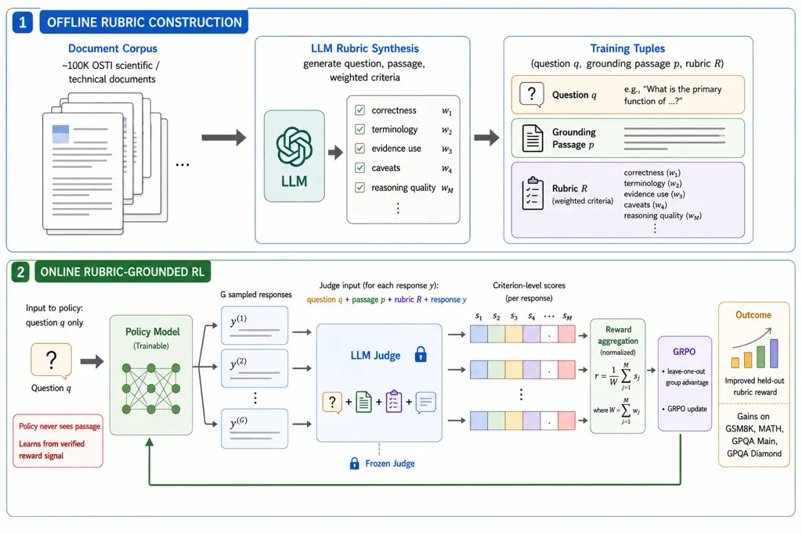
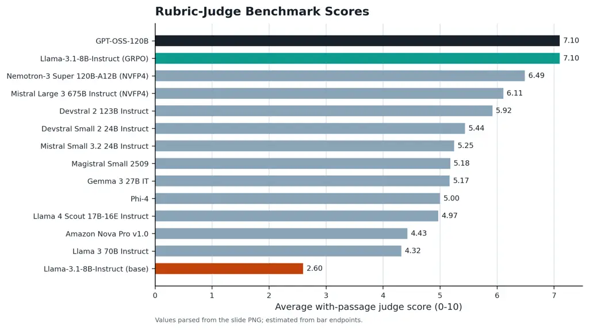
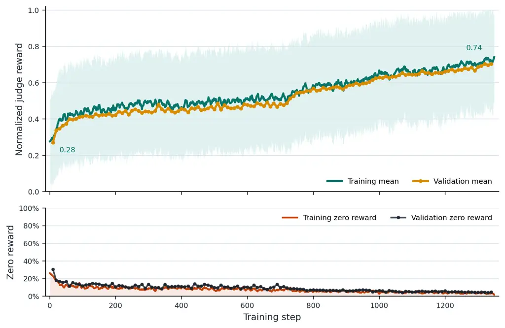

# Rubric-Grounded Reinforcement Learning: Structured Judge Rewards for Generalizable Reasoning in Language Models

Manish Bhattarai Affiliation: Los Alamos National Laboratory, Los
Alamos, NM, USA Correspondence to: <ceodspspectrum@lanl.gov>    Ismael
Boureima Affiliation: Los Alamos National Laboratory, Los Alamos, NM,
USA    Nishath Rajiv Ranasinghe Affiliation: Los Alamos National
Laboratory, Los Alamos, NM, USA    Scott Pakin Affiliation: Los Alamos
National Laboratory, Los Alamos, NM, USA    Dan O’Malley
Affiliation: Los Alamos National Laboratory, Los Alamos, NM, USA

###### Abstract

We argue that decomposing reward into weighted, verifiable criteria and
using an LLM judge to score them provides a partial-credit optimization
signal: instead of a binary outcome or a single holistic score, each
response is graded along multiple task-specific criteria. We formalize
_rubric-grounded reinforcement learning (RL)_: a framework in which the
policy is optimized against a structured, multi-criterion reward
produced by a frozen LLM judge that conditions on auxiliary grounding
the policy never sees. We instantiate the framework by deriving rubrics
from an Office of Scientific and Technical Information (OSTI)-derived
corpus of roughly 100,000 scientific and technical documents and
training Llama-3.1-8B-Instruct with Group Relative Policy Optimization
(GRPO). With GRPO-based training, the model achieves $`71.7\%`$
normalized reward on held-out rubric evaluation. The GRPO-tuned policy
also improves over the base model on four reasoning benchmarks not
derived from the training corpus—GSM8K, MATH, GPQA Main, and GPQA
Diamond. These results provide evidence that structured,
document-grounded rewards can improve held-out rubric performance and
induce transferable reasoning behaviors beyond the corpus used to
construct the training environment.

###### Keywords: 

Reinforcement Learning, GRPO, LLM-as-Judge, Reward Modeling,
Generalization

## 1 Introduction

Reward design is the binding constraint in reinforcement learning of
large language models (LLMs). Standard alignment objectives often
compress multi-faceted quality into one scalar signal—a learned
preference reward, a pairwise comparison, or a binary verifier, and
optimize the policy against that signal. This works when the target
behavior can be summarized by one latent utility, but it under-specifies
the optimization target whenever quality is naturally decomposable: a
strong technical answer must state the right conclusion, use precise
terminology, respect methodological caveats, and connect evidence; a
strong code review must catch correctness bugs, flag style issues, and
surface design concerns. This discarded structure could otherwise
provide partial-credit learning signals.

We study a general principle: _decompose reward into weighted,
verifiable criteria, use an LLM judge to score them, and optimize the
policy with Group Relative Policy Optimization (GRPO) (Shao et al., 2024)_. We call this _rubric-grounded reinforcement learning_. The
framework is domain-agnostic: any task whose quality is plausibly
written as a checklist of weighted criteria (technical Q&A, clinical
summarization, legal drafting, pedagogical assessment, structured code
review) admits a rubric-grounded reward.

To validate the principle, we instantiate it on a concrete and scalable
data source: an OSTI-derived collection of roughly 100,000 scientific
and technical documents ¹¹ 1 https://www.osti.gov/. Each document is
converted offline into question–rubric pairs, where the rubric
decomposes evaluation into weighted criteria with required elements,
scoring guides, and verification cues. During training the policy
answers each question _without_ the source passage; a frozen judge
scores each response _with_ the passage and rubric. This information
asymmetry encourages the policy to learn response patterns that satisfy
grounded criteria, rather than relying on access to the source passage
at rollout time.

#### Central claim.

The empirical claim is that rubric-grounded GRPO can improve a
Llama-3.1-8B-Instruct model on held-out rubric tasks and yield gains on
external reasoning benchmarks. We support this with held-out rubric
evaluation, in-domain comparison to the supervised warm-start, four
reasoning benchmarks against the base model, and training/held-out
reward dynamics.

#### Contributions.

1.  1.  A general framework, rubric-grounded RL, that uses weighted
        criterion-level judge scores as a partial-credit reinforcement
        learning signal (§3).
2.  2.  A reward-to-RL mechanism that converts passage-grounded criterion
        scores into group-relative GRPO advantages while preserving
        partial-credit structure (§3.1–§3.3).
3.  3.  A scalable instantiation, document-derived rubrics, that produces RL
        training data without per-criterion human annotation (§3.4).
4.  4.  An empirical evaluation showing that a rubric-grounded GRPO policy
        improves held-out rubric reward and yields gains on reasoning
        benchmarks not derived from the training corpus relative to the base
        instruction model (§4–§5.5).

Figure 1 summarizes the framework end to end.



Figure 1: Rubric-Grounded Reinforcement Learning pipeline. Offline, a
corpus of scientific and technical documents is used to synthesize
training tuples consisting of a question, grounding passage, and
weighted rubric. Online, the policy model receives only the question and
generates multiple candidate responses. A frozen LLM judge evaluates
each response using the hidden grounding passage and rubric, producing
criterion-level scores that are aggregated into normalized rewards.
These structured rewards provide the GRPO training signal, enabling the
policy to learn from passage-grounded verification without accessing the
passage at inference time.

## 2 Background and Related Work

#### Reward modeling for LLM alignment.

Reinforcement Learning from Human Feedback (RLHF) (Christiano et al.,
2017; Ouyang et al., 2022; Stiennon et al., 2020) trains a scalar reward
model on human pairwise preferences and optimizes the policy with
PPO (Schulman et al., 2017). DPO (Rafailov et al., 2023) and related
preference-optimization methods sidestep explicit reward modeling but
still operate on pairwise comparisons. Reinforcement Learning from AI
Feedback (RLAIF) (Bai et al., 2022; Lee et al., 2023) replaces human
preferences with model-generated ones, retaining the scalar form. Our
framework departs from this scalar lineage: the reward is an explicitly
weighted vector of criterion scores, not a single learned utility, and
is tied to evaluation criteria specified at task-construction time
rather than inferred from preferences.

#### LLM-as-judge and rubric-based evaluation.

LLM-as-judge methods have become a standard evaluation device (Zheng et
al., 2023), with recent work emphasizing structured or rubric-based
grading (Kim et al., 2024a; Kim et al., 2024b; Ye et al., 2024; Lee et
al., 2024). Most of this literature uses judges _for evaluation only_.
We use a rubric-conditioned judge inside the optimization loop, which
makes the judge reliability and rubric design first-class methodological
concerns rather than evaluation details.

#### Rubrics as reinforcement-learning rewards.

Recent work is closest to ours in using rubrics as RL reward signals:
Rubrics as Rewards extends Reinforcement Learning with Verifiable
Rewards (RLVR) beyond automatically verifiable domains with rubric-based
feedback (Gunjal et al., 2025), Rubric Anchors studies large-scale
rubric construction and rubric-based RL for open-ended tasks (Huang et
al., 2025), and Rubric-Scaffolded RL uses checklist rubrics both as
rollout scaffolds and reward references (Zhou et al., 2025). Our setting
differs in three ways: rubrics are synthesized from scientific
documents, the policy never sees the source passage during rollout, and
rubric synthesis is decoupled from the cheaper judge used repeatedly
during RL.

#### Process and step-level rewards.

Process reward models (PRMs) provide dense per-step
supervision (Lightman et al., 2023; Wang et al., 2024; Uesato et al., 2022) and have produced strong reasoning gains, but they typically
require human-annotated step labels or oracle verifiers and are usually
scoped to math. Rubric-grounded rewards generalize the dense-supervision
idea beyond per-step labels: criteria can be at any granularity (an
entire limitation discussion, a specific terminological requirement, a
verification cue) and require only a written rubric, not labeled
trajectories.

#### Group-relative policy optimization.

GRPO (Shao et al., 2024) replaces the learned value baseline with a
group-relative one computed from multiple rollouts per prompt, which is
a natural fit for judge-scored responses. Decoupled Clip and Dynamic
sAmpling Policy Optimization (DAPO) (Yu et al., 2025) and Group Sequence
Policy Optimization (GSPO) (Zheng et al., 2025) refine the sampling and
importance-sampling machinery. We use GRPO as the optimizer; the
contribution lies in the structure of the reward, not the optimizer.

## 3 Method

We present rubric-grounded RL in domain-agnostic terms; then instantiate
it with OSTI-derived documents. A task instance is a tuple
$`(\mathbf{x},g,\mathcal{R})`$ where $`\mathbf{x}`$ is the input shown
to the policy, $`g`$ is auxiliary _grounding_ (a passage, a reference
solution, a code repository, a clinical chart) shown only to the judge,
and $`\mathcal{R}`$ is a structured rubric. The policy
$`\pi_{\theta}(\mathbf{y}\mid\mathbf{x})`$ produces a response
$`\mathbf{y}`$ without access to $`g`$, while a frozen judge
$`\mathcal{J}`$ scores $`\mathbf{y}`$ against $`\mathcal{R}`$ using
$`g`$ as grounding.

###### Definition 1 (Rubric).

A rubric $`\mathcal{R}=\{c_{1},\ldots,c_{M}\}`$ is a collection of
criteria, each
$`c_{j}=(w_{j},\eta_{j},\mathcal{E}_{j},\kappa_{j},\nu_{j})`$ with
non-negative weight $`w_{j}\in\mathbb{R}_{\geq 0}`$, natural-language
description $`\eta_{j}`$, required elements $`\mathcal{E}_{j}`$,
expected keywords $`\kappa_{j}`$, and verification method $`\nu_{j}`$.
The total weight is $`W=\sum_{j}w_{j}`$.

The policy and judge deliberately see different information: the policy
answers from $`\mathbf{x}`$ alone, while the judge sees
$`(\mathbf{x},g,\mathbf{y},\mathcal{R})`$. This separates what the
policy must learn to produce from what the judge may verify. The same
template applies whenever quality can be written as weighted, locally
checkable criteria: technical question answering grounded in source
documents, clinical reasoning grounded in patient charts, code review
grounded in a diff and tests, legal drafting grounded in statutes and
precedent, or pedagogical feedback grounded in a marking scheme. The
following subsections define the reward, show how it enters GRPO,
explain why the resulting scalar is more informative than a flat
holistic score, and describe the OSTI-derived document instantiation.

### 3.1 Reward Construction

#### Multi-Criterion Judge Reward

Given $`(\mathbf{x},g,\mathcal{R})`$ and a sampled response
$`\mathbf{y}\sim\pi_{\theta}(\cdot\mid\mathbf{x})`$, the judge produces
a vector of per-criterion scores

```math
\{s_{j}\}_{j=1}^{M}=\mathcal{J}(\mathbf{x},g,\mathbf{y},\mathcal{R}),\quad s_{j}\in[0,w_{j}], \tag{1}
```

where $`s_{j}`$ is the awarded weight on criterion $`c_{j}`$. The
aggregate raw reward is $`r_{\mathrm{raw}}=\sum_{j}s_{j}`$.

#### Normalization

To compare rubrics with different total weights, we normalize:

```math
r(\mathbf{x},\mathbf{y})=\frac{1}{W}\sum_{j=1}^{M}s_{j}\;\in\;[0,1]. \tag{2}
```

Parsed rewards are clipped to $`[0,1]`$ in implementation to handle
schema or numerical edge cases.

#### Judge Prompt Architecture

The judge prompt contains a strict-evaluator system instruction, the
grounding $`g`$ (truncated to fit context), the policy input
$`\mathbf{x}`$, the response $`\mathbf{y}`$, the rubric serialized as a
numbered list with each criterion’s weight, description, required
elements, scoring guide, keywords, and verification method, and a
structured-output specification requiring JSON with per-criterion
scores, total, max, and a brief justification. The judge is decoded at
low temperature ($`\tau_{\mathcal{J}}=0.1`$) to reduce reward variance.
Full prompt templates are in Appendix D.

Rubric synthesis and reward judging are decoupled. The rubrics can be
created offline with a stronger or more expensive model, while online RL
uses a cheaper judge repeatedly for reward computation. This separation
is important because rubric construction is paid once, whereas judging
is paid at every GRPO step.

Each GRPO step requires $`B\times G`$ judge calls, which dominate
wall-clock time. We deploy $`N_{\mathrm{workers}}`$ parallel judge
actors, each holding an independent client to a vLLM-style inference
endpoint; workers process micro-batches of size $`B_{\mathrm{judge}}`$
in parallel. This separates policy training (GPU-bound, autoregressive)
from judge evaluation (latency-bound, remote).

### 3.2 Rubric-Grounded Policy Optimization

The optimizer receives only a scalar reward, but that scalar is produced
by a structured measurement process: the judge scores each sampled
answer against the same passage-grounded rubric and then aggregates
criterion scores. This section describes how that structured reward is
converted into GRPO updates in the reported experiments. Implementation
variants that were supported but not used in the main run are deferred
to Appendix C.

#### Training Objective

For policy $`\pi_{\theta}`$ and frozen reference $`\pi_{\mathrm{ref}}`$,

```math
\max_{\theta}\;\E_{\mathbf{x}\sim\mathcal{D},\,\mathbf{y}\sim\pi_{\theta}(\cdot\mid\mathbf{x})}[r(\mathbf{x},\mathbf{y})]-\beta\,\E_{\mathbf{x}}[\KL(\pi_{\theta}\,\|\,\pi_{\mathrm{ref}})], \tag{3}
```

with $`r`$ from (2).

#### Group-relative rubric credit.

For each prompt $`\mathbf{x}_{i}`$, we sample $`G`$ responses
$`\{\mathbf{y}_{i}^{(g)}\}_{g=1}^{G}\sim\pi_{\mathrm{gen}}(\cdot\mid\mathbf{x}_{i})`$.
Each response is judged against the same grounding $`g_{i}`$ and rubric
$`\mathcal{R}_{i}`$, producing rewards $`\{R_{i}^{(g)}\}`$. Thus, the
update compares answer strategies under a fixed assessment context
rather than comparing raw scores across unrelated questions. The
leave-one-out (LOO) baseline and group standard deviation are

```math
\displaystyle b_{i}^{(g)} \displaystyle=\tfrac{1}{G-1}\sum_{g^{\prime}\neq g}R_{i}^{(g^{\prime})}, \tag{4}
```

```math
\displaystyle\sigma_{i} \displaystyle=\mathrm{std}\bigl(\{R_{i}^{(g^{\prime})}\}_{g^{\prime}=1}^{G}\bigr), \tag{5}
```

yielding the normalized advantage

```math
A_{i}^{(g)}=\begin{cases}\dfrac{R_{i}^{(g)}-b_{i}^{(g)}}{\sigma_{i}+\delta}&\sigma_{i}>0,\\[4.0pt]
0&\text{otherwise.}\end{cases} \tag{6}
```

The advantage is broadcast to every response token.

#### Information-asymmetric update.

The asymmetry from §3 enters the update through $`R_{i}^{(g)}`$: rewards
are computed by a judge that sees
$`(\mathbf{x}_{i},g_{i},\mathbf{y}_{i}^{(g)},\mathcal{R}_{i})`$, but
gradients update a policy that generated $`\mathbf{y}_{i}^{(g)}`$ from
$`\mathbf{x}_{i}`$ alone. The policy cannot retrieve the passage at
inference time, but it is trained toward responses that satisfy
passage-grounded criteria during learning. The result is a training-time
supervision signal closer to an examiner with an answer key than to a
retrieval-augmented generator.

#### Clipped surrogate, KL, and stabilizers.

With per-token ratio
$`r_{t}=\exp(\log\pi_{\theta}-\log\pi_{\mathrm{gen}})`$, the clipped
surrogate is

```math
\ell_{t}^{\mathrm{clip}}=-\min\!\bigl(r_{t}\,A_{t},\,\mathrm{clip}(r_{t},1-\epsilon_{\mathrm{clip}},1+\epsilon_{\mathrm{clip}})\,A_{t}\bigr), \tag{7}
```

and the per-token KL uses the $`k_{3}`$ approximation (Schulman, 2020):

```math
\widehat{\KL}_{t}=e^{u_{t}}-1-u_{t},\quad u_{t}=\log\pi_{\mathrm{ref}}-\log\pi_{\theta}. \tag{8}
```

Inputs are clamped to $`[-20,20]`$ for numerical stability.

#### Total loss.

Combining the clipped policy term and KL penalty gives the
token-averaged training loss

```math
\boxed{\mathcal{L}(\theta)=\frac{1}{\sum_{i,g}T_{ig}}\sum_{i,g,t}m_{t}^{(ig)}\!\left[\ell_{t}^{\mathrm{clip}}+\beta\,\widehat{\KL}_{t}\right],} \tag{9}
```

where $`m_{t}^{(ig)}`$ masks padding and prompt tokens. The complete
algorithm is given in Algorithm 1 (Appendix A). In addition to KL
regularization, the implementation uses low-temperature judging,
schema-constrained parsing, reward clipping, and conservative zero
reward on parse failures. These choices are not separate contributions;
they are safeguards that make the structured reward usable inside an
online RL loop.

### 3.3 Mechanism: Structured Credit Assignment

The central object is not the final scalar reward but the structured
measurement that produces it. For a rubric with positive-weight criteria
$`w_{1},\ldots,w_{M}`$ and total weight $`W=\sum_{j}w_{j}`$, define
normalized criterion scores

```math
z_{j}(\mathbf{x},g,\mathbf{y})=\frac{s_{j}(\mathbf{x},g,\mathbf{y},\mathcal{R})}{w_{j}}\in[0,1],\qquad\alpha_{j}=\frac{w_{j}}{W}. \tag{10}
```

The reward used by GRPO is the projection

```math
r(\mathbf{x},\mathbf{y})=\sum_{j=1}^{M}\alpha_{j}z_{j}(\mathbf{x},g,\mathbf{y})=\alpha^{\top}z(\mathbf{x},g,\mathbf{y}). \tag{11}
```

Thus rubric-grounded RL is scalar RL over a reward that is first
factorized into interpretable criterion coordinates. The mechanism below
spells out what this factorization buys.

#### Resolution: more ways to be partly right.

Let each criterion score $`z_{j}`$ take values on a finite grid
$`\mathcal{Z}_{j}`$. A binary verifier exposes at most two reward
levels. A holistic judge exposes one scalar axis. A rubric exposes the
product space

```math
\mathcal{Z}_{\mathcal{R}}=\mathcal{Z}_{1}\times\cdots\times\mathcal{Z}_{M} \tag{12}
```

before projection by (11). Even when different criterion vectors collide
after weighting, the judge has evaluated the response through a
higher-resolution measurement. When weighted sums do not collide, this
yields up to $`\prod_{j}|\mathcal{Z}_{j}|`$ attainable scalar reward
levels rather than two.

This is the mathematical version of partial credit: an answer can move
from $`z=(0,0,0)`$ to $`(1,0,0)`$ without satisfying all criteria. Early
in RL, when most generations are imperfect, such intermediate rewards
produce useful ordering among bad, partial, and nearly complete answers.

#### Localization: criterion failures affect the scalar advantage.

The optimizer does not receive separate per-criterion gradients; it
receives the scalar $`\alpha^{\top}z`$. However, the scalar advantage
changes in proportion to the weighted criterion differences between
sampled responses:

```math
r(\mathbf{y}_{a})-r(\mathbf{y}_{b})=\sum_{j=1}^{M}\alpha_{j}\bigl[z_{j}(\mathbf{y}_{a})-z_{j}(\mathbf{y}_{b})\bigr]. \tag{13}
```

A missing required element in criterion $`j`$ changes the scalar reward
by exactly its weighted contribution $`\alpha_{j}\Delta z_{j}`$. The
localization therefore lives in the measurement, not in a new optimizer:
GRPO still updates on a scalar advantage, but that advantage is
assembled from explicit axes of quality rather than from a single
free-form preference judgment.

#### Privileged grounding: a training-time verifier

The reward in (11) depends on $`g`$, but the policy does not condition
on $`g`$:

```math
\mathbf{y}\sim\pi_{\theta}(\cdot\mid\mathbf{x}),\qquad r=\mathcal{J}(\mathbf{x},g,\mathbf{y},\mathcal{R}). \tag{14}
```

This is a learning-with-privileged-information setup: grounding is
available to the verifier at training time, not to the policy at rollout
or evaluation time. Consequently, the reward can penalize unsupported
claims and missing facts without converting the policy into a
retrieval-augmented system. Successful behavior must therefore come from
the policy’s learned parameters rather than from copying the hidden
passage.

#### Noise attenuation by effective criteria.

Suppose criterion scores are observed with independent zero-mean judge
noise: $`\tilde{z}_{j}=z_{j}+\xi_{j}`$, $`\E[\xi_{j}]=0`$,
$`\mathrm{Var}(\xi_{j})=\tau^{2}`$. The aggregate reward noise is

```math
\displaystyle\mathrm{Var}(\alpha^{\top}\xi) \displaystyle=\tau^{2}\sum_{j}\alpha_{j}^{2}=\frac{\tau^{2}}{M_{\mathrm{eff}}}, \tag{15}
```

```math
\displaystyle M_{\mathrm{eff}} \displaystyle=\frac{1}{\sum_{j}\alpha_{j}^{2}}=\frac{W^{2}}{\sum_{j}w_{j}^{2}}.
```

For equally weighted criteria, $`M_{\mathrm{eff}}=M`$: independent
criterion noise is averaged across the rubric. This is not a guarantee
of judge correctness, systematic or correlated judge errors do not
average away, but it explains why decomposed scoring is preferable to a
single holistic call when criterion errors are at least partly
independent.

#### Behavioral transfer hypothesis.

The expected transfer is behavioral rather than factual: criteria such
as precision, constraint satisfaction, stepwise justification, grounded
terminology, and calibrated uncertainty may benefit external tasks that
reward similar behaviors. This motivates evaluating on disjoint
reasoning benchmarks (§5).

### 3.4 Instantiation: Document-Derived Rubrics

We instantiate the framework with rubrics derived from an OSTI-derived
corpus of roughly 100,000 scientific and technical documents. This
corpus is a convenient source because the documents are abundant,
naturally grounded (each rubric points to a specific passage), and
require no per-criterion human annotation.

#### Document-to-rubric pipeline.

The pipeline operates in three LLM-prompted stages:

#### Stage 1: Semantic analysis.

For each document $`d`$, an LLM produces a structured representation
$`\mathbf{s}(d)`$ capturing genre, primary contribution, central
concepts, technical depth, and dominant reasoning mode. This
representation conditions downstream synthesis.

#### Stage 2: Joint question–rubric synthesis.

Conditioned on $`(\mathbf{s}(d),d)`$, the LLM produces $`K_{d}`$ tuples
$`\{(q_{k},p_{k},\mathcal{R}_{k})\}`$ subject to four constraints:
questions and rubrics must be self-contained without the source;
questions must target deep understanding rather than surface recall;
rubrics must include all five components from Definition 1; and weights
must reflect the criterion’s contribution to overall quality.

#### Stage 3: Rubric enrichment.

A post-processing step augments criteria with structured cues, expected
terminology, core concepts, and verification patterns to improve
inter-rater consistency.

#### Quality assurance.

Generated tuples pass structural checks before inclusion: minimum
criteria per rubric, minimum total weight, non-empty question, all
criterion fields present, non-negative weights. Examples failing any
check are discarded. Corpus-level statistics (criteria-per-example,
weight distributions, length histograms) are tracked for reporting.

#### Scalable generation.

Documents are dispatched with bounded asynchronous concurrency; outputs
are written incrementally and a content-hash index supports idempotent
resume. Full data-pipeline configuration is in Appendix E.

## 4 Experimental Setup

### 4.1 Dataset

We construct a rubric-grounded dataset of approximately 100K
document-grounded questions from OSTI scientific and technical
documents. Each question is paired with a grounding passage and a
structured rubric containing 5–10 weighted criteria. We partition the
dataset into 70% training, 15% validation, and 15% test splits. The
training split is used for RL reward computation, the validation split
for model selection and hyperparameter tuning, and the test split for
held-out evaluation.

### 4.2 Model and Infrastructure

The policy is Llama-3.1-8B-Instruct (Dubey et al., 2024) with
$`\pi_{\mathrm{ref}}`$ initialized from the same checkpoint.
Question-rubric dataset generation uses GPT-OSS-120B. Judge inference is
served by a GPT-OSS-20B endpoint. Training is distributed with separate
generation and judge-evaluation workers; the implementation is built on
NeMo-RL ²² 2 https://github.com/NVIDIA/NeMo-RL.

### 4.3 Hyperparameters

For the main GRPO run, each optimization step uses $`B=64`$ prompts and
samples $`G=32`$ generations per prompt, yielding an effective batch
size of $`2048`$. We restrict rollouts to a single turn, and enable both
the leave-one-out baseline and reward normalization. The loss uses
clipping parameter $`\epsilon_{\mathrm{clip}}=0.2`$, advantage
stabilizer $`\delta=10^{-8}`$, KL coefficient $`\beta=0.01`$, and the
$`k_{3}`$ KL approximation. We optimize with AdamW at learning rate
$`\eta=3{\times}10^{-7}`$, weight decay $`0.01`$, and maximum gradient
norm $`1.0`$, using $`13`$ warmup steps followed by a constant
learning-rate schedule. The judge is run with
$`N_{\mathrm{workers}}=32`$, temperature $`\tau_{\mathcal{J}}=0.1`$, a
token budget of $`16{,}000`$, a maximum passage length of $`50{,}000`$
characters, and worker batch size $`4`$. Variants not enabled in the
main configuration are reported in Appendix C.

### 4.4 Comparison Models

We compare the trained policy against its initialization and, for
in-domain rubric evaluation only, the supervised warm-start:

- •
  Base: Llama-3.1-8B-Instruct, no further training.
- •
  SFT: supervised warm-start on question–answer data from the same
  document-derived corpus.
- •
  Ours: the same model after one rubric-grounded GRPO run.

### 4.5 Evaluation Benchmarks

We report (i) held-out rubric reward on a random split of the
synthesized tuples (in-domain), and (ii) standard accuracy on four
reasoning benchmarks not derived from the training corpus: GSM8K (Cobbe
et al., 2021), MATH (Hendrycks et al., 2021), GPQA Main, and GPQA
Diamond (Rein et al., 2023). Using benchmarks not derived from the
corpus is what makes them a transfer test rather than a recall test.
Base and Ours are evaluated with the same prompt template, decoding
parameters, and scoring script. We report single-sample accuracy. GSM8K
and MATH use exact-match final-answer scoring after answer extraction;
GPQA Main and GPQA Diamond use the standard multiple-choice accuracy
protocol. The reported GRPO checkpoint is selected by held-out rubric
reward.

## 5 Results and Analysis

### 5.1 In-Domain Judge Measurements

| Method      | Held-out Rubric Reward |
| ----------- | ---------------------- |
| Base        | $`26.1\%`$             |
| SFT tuned   | $`41.8\%`$             |
| Ours (GRPO) | $`\mathbf{71.7\%}`$    |

Table 1: In-domain held-out rubric evaluation. All rows are evaluated on
the same held-out question–rubric test split using generated model
responses scored by the same LLM judge, GPT-OSS-20B. The table compares
the base model, an SFT-tuned baseline, and our GRPO-tuned model under a
consistent passage-grounded rubric-reward protocol.

| Method | GSM8K              | MATH               | GPQA Main          | GPQA Diamond       | Avg. $`\Delta`$    |
| ------ | ------------------ | ------------------ | ------------------ | ------------------ | ------------------ |
| Base   | $`84.53`$          | $`50.06`$          | $`25.22`$          | $`24.24`$          | –                  |
| Ours   | $`\mathbf{85.44}`$ | $`\mathbf{52.88}`$ | $`\mathbf{33.93}`$ | $`\mathbf{32.32}`$ | $`\mathbf{+5.13}`$ |

Table 2: Transfer to reasoning benchmarks. Numbers are accuracy for the
base model and the best GRPO checkpoint selected by held-out rubric
reward. None of these benchmarks is derived from the training corpus.



Figure 2: Rubric-judge benchmark comparison. In a passage-grounded
rubric-judged evaluation, the RL-tuned 8B policy substantially improves
over the base 8B instruction model and approaches the displayed
GPT-OSS-120B score under the same rubric-judge protocol.

Table 1 reports an in-domain held-out rubric evaluation under a
consistent evaluation protocol. For each model, we generate responses to
the same held-out questions and score them with the same LLM judge,
GPT-OSS-20B, using the corresponding held-out rubrics and grounding
passages. Thus, the base model, the SFT-tuned model, and the GRPO-tuned
model are compared directly under the same passage-grounded
rubric-reward protocol.

The SFT model is instruction-tuned on question–answer pairs derived from
the OSTI dataset; however, its reported performance is computed
exclusively on the held-out question–rubric test split. The results show
that supervised fine-tuning improves substantially over the base model,
increasing held-out rubric reward from $`26.1\%`$ to $`41.8\%`$. GRPO
further improves the policy from the same base initialization, achieving
a held-out rubric reward of $`71.7\%`$.

Figure 2 provides a complementary in-domain comparison under the same
passage-grounded rubric-judge protocol. The GRPO-tuned Llama-3.1-8B
policy improves from the base model’s roughly $`2.6/10`$ judge score to
roughly $`7.1/10`$, approaching the displayed GPT-OSS-120B score and
surpassing several larger comparison models under the same evaluation
protocol.

### 5.2 Out-of-Distribution Transfer

Table 2 shows transfer to disjoint benchmarks. The GRPO-tuned policy
improves on all four benchmarks. The GPQA gains ($`+8.71`$ Main,
$`+8.08`$ Diamond) are larger than the gains on the math benchmarks,
suggesting that rubric-grounded training may be especially helpful for
scientific reasoning tasks where answers must coordinate facts,
assumptions, and evidence. Since none of these benchmarks is derived
from the training corpus, the result is more consistent with
transferable reasoning improvement than direct document recall. The
smaller GSM8K and MATH gains are also informative: our generated
questions are mostly technical question-answering tasks, not
deliberately constructed quantitative-problem or code-generation tasks.
This likely makes the learned reward geometry better aligned with GPQA
than with benchmarks that require explicit calculation routines.

### 5.3 Training Dynamics



Figure 3: Reward dynamics. Training and validation rewards increase over
the GRPO run while zero-reward judge outcomes decrease. The held-out
trajectory supports checkpoint selection by held-out reward and argues
against improvements being confined to sampled training prompts.

Validation reward tracks training reward throughout the run (Figure 3);
zero-reward judge outcomes decrease monotonically. The
validation–training gap stays bounded, which argues against improvements
being confined to sampled training prompts.

### 5.4 Judge Interface Safeguards

The reward signal comes from an LLM, so a reasonable first question is
whether the policy learned to answer well or to game the judge. We do
not yet have independent human-agreement or cross-judge reliability
measurements, so we avoid treating judge reliability as a settled
empirical result. Instead, the current implementation uses four
interface safeguards.

Low-temperature judging. The judge is queried at
$`\tau_{\mathcal{J}}=0.1`$ to reduce stochastic variation in reward
assignments.

Structured parsing. The judge must return schema-conforming criterion
scores, a total score, and a maximum possible score. Invalid outputs are
assigned conservative zero reward rather than repaired optimistically.

Document-grounded scoring. The judge sees the source passage and rubric,
while the policy sees only the question. This makes the judge a
document-grounded verifier and prevents the policy from using retrieval
context at evaluation time.

Held-out validation. The same judge interface is applied to held-out
rubric examples during training. The validation trajectory in Figure 3
therefore serves as the main check that reward increases are not
confined to the sampled training prompts.

### 5.5 Analysis: What Generalizes?

The largest external gains are on GPQA Main and GPQA Diamond. This is
the most natural transfer target for the training signal: the reward
asks the policy to satisfy document-grounded scientific rubrics, and
GPQA also requires careful use of scientific concepts under uncertainty.

GSM8K and MATH improve, but by less than GPQA. This suggests that the
rubric reward is not merely teaching benchmark-specific shortcuts;
rather, it appears to improve general problem-solving behaviors that are
most visible when the downstream task resembles technical assessment. A
direct test of the reward-design hypothesis would generate
document-grounded quantitative tasks and include rubric criteria for
equation setup, calculation, units, numerical consistency, and
final-answer verification. The analogous code setting would synthesize
implementation or debugging tasks from technical documents and score
criteria such as API use, algorithmic correctness, edge cases, and test
behavior.

## 6 Discussion

Rubric-grounded RL is not specific to documents or to scientific
question answering. The framework requires only a checkable rubric and
an instance-level grounding the judge can use; many practical alignment
problems already have these (clinical guidelines, code-style guides,
legal frameworks, marking schemes). The key methodological move is
exposing the structure of evaluation to the optimizer rather than
collapsing it to a scalar.

The framework moves the alignment problem partly into the judge. Noisy
or inconsistent criterion scores become noisy advantages, especially
when the sampled responses for a prompt have nearly identical rewards.
Low-temperature decoding, structured output, parser conservatism, reward
clipping, and held-out evaluation are therefore part of the method
rather than incidental implementation details. Rubric grounding is most
useful when (i) quality decomposes naturally into checkable criteria,
(ii) per-instance grounding is cheap to provide, and (iii) scalar
preference data is hard or expensive to collect. It is _not_ the right
tool when the target behavior is genuinely holistic, when criteria are
difficult to specify without domain experts, or when the cost of grouped
judge calls dominates other training cost considerations.

The present data-generation pipeline mostly produces general
document-grounded technical questions. A natural next step is to sample
documents selectively for latent math, data-analysis, or programming
content and instruct the rubric generator to create tasks whose scoring
criteria explicitly reward quantitative setup, symbolic or numerical
calculation, unit checks, code correctness, and executable tests. This
would test whether the same rubric-grounded RL recipe can move beyond
general scientific reasoning gains and produce larger improvements on
math and code benchmarks.

## 7 Limitations

The empirical study is at one model scale (8B), one corpus family
(OSTI-derived scientific and technical documents), one judge family, and
one GRPO training run. The rubric pipeline can inherit biases of the
synthesizer LLM and of the OSTI-derived source corpus. Single-turn
answering is the only setting evaluated; extending to multi-turn
interactive tasks is straightforward in the framework but not validated
here. We do not report confidence intervals or variance across random
seeds; the external benchmark improvements should therefore be
interpreted as single-run evidence rather than a stable estimate of
expected gain. Because the same judge family is used during training and
validation, held-out rubric reward does not by itself rule out
judge-specific reward hacking. Independent human-agreement or
cross-judge reliability measurements remain important directions for
future evaluation.

## 8 Conclusion

We formalized rubric-grounded RL: reinforcement learning from weighted,
judge-scored criteria grounded in instance-specific evidence unavailable
to the policy at rollout time. Instantiated on rubrics derived from
roughly 100,000 OSTI-derived scientific and technical documents, the
framework produced an 8B policy that improves held-out rubric reward and
yields gains on four reasoning benchmarks not derived from the training
corpus. The current evidence is narrower than a full ablation study: it
shows that one reported rubric-grounded GRPO run improves over the base
model under our evaluation protocol, not that every component has been
causally isolated. Even with that caveat, the result suggests a
promising post-training recipe for domains where quality is naturally
rubric-shaped.

## References

- Bai et al. (2022) Y. Bai, S. Kadavath, S. Kundu, A. Askell, J.
  Kernion, A. Jones, A. Chen, A. Goldie, A. Mirhoseini, C. McKinnon, et
  al. Constitutional AI: harmlessness from AI feedback. arXiv preprint
  arXiv:2212.08073. Cited by: §2.
- Christiano et al. (2017) P. F. Christiano, J. Leike, T. B. Brown, M.
  Martic, S. Legg, and D. Amodei Deep reinforcement learning from human
  preferences. Advances in Neural Information Processing Systems 30.
  Cited by: §2.
- Cobbe et al. (2021) K. Cobbe, V. Kosaraju, M. Bavarian, M. Chen, H.
  Jun, L. Kaiser, M. Plappert, J. Tworek, J. Hilton, R. Nakano, C.
  Hesse, and J. Schulman Training verifiers to solve math word problems.
  arXiv preprint arXiv:2110.14168. Cited by: §4.5.
- Dubey et al. (2024) A. Dubey, A. Jauhri, A. Pandey, A. Kadian, A.
  Al-Dahle, A. Letman, A. Mathur, A. Schelten, A. Yang, A. Fan, et al.
  The Llama 3 herd of models. arXiv preprint arXiv:2407.21783. Cited by:
  §4.2.
- Gunjal et al. (2025) A. Gunjal, A. Wang, E. Lau, V. Nath, Y. He, B.
  Liu, and S. Hendryx Rubrics as rewards: reinforcement learning beyond
  verifiable domains. arXiv preprint arXiv:2507.17746. Cited by: §2.
- Hendrycks et al. (2021) D. Hendrycks, C. Burns, S. Kadavath, A.
  Arora, S. Basart, E. Tang, D. Song, and J. Steinhardt Measuring
  mathematical problem solving with the MATH dataset. arXiv preprint
  arXiv:2103.03874. Cited by: §4.5.
- Huang et al. (2025) Z. Huang, Y. Zhuang, G. Lu, Z. Qin, H. Xu, T.
  Zhao, R. Peng, J. Hu, Z. Shen, X. Hu, et al. Reinforcement learning
  with rubric anchors. arXiv preprint arXiv:2508.12790. Cited by: §2.
- Kim et al. (2024a) S. Kim, J. Shin, Y. Cho, J. Jang, S. Longpre, H.
  Lee, S. Yun, S. Shin, S. Kim, J. Thorne, and M. Seo Prometheus:
  inducing fine-grained evaluation capability in language models. In
  International Conference on Learning Representations, Cited by: §2.
- Kim et al. (2024b) S. Kim, J. Suk, S. Longpre, B. Y. Lin, J. Shin, S.
  Welleck, G. Neubig, M. Lee, K. Lee, and M. Seo Prometheus 2: an open
  source language model specialized in evaluating other language models.
  arXiv preprint arXiv:2405.01535. Cited by: §2.
- Lee et al. (2023) H. Lee, S. Phatale, H. Mansoor, K. Lu, T.
  Mesnard, C. Bishop, V. Carbune, and A. Rastogi RLAIF: scaling
  reinforcement learning from human feedback with AI feedback. arXiv
  preprint arXiv:2309.00267. Cited by: §2.
- Lee et al. (2024) Y. Lee, J. Kim, J. Kim, H. Cho, and P. Kang
  CheckEval: robust evaluation framework using large language model via
  checklist. In HEAL Workshop at CHI, Cited by: §2.
- Lightman et al. (2023) H. Lightman, V. Kosaraju, Y. Burda, H.
  Edwards, B. Baker, T. Lee, J. Leike, J. Schulman, I. Sutskever, and K.
  Cobbe Let’s verify step by step. arXiv preprint arXiv:2305.20050.
  Cited by: §2.
- Ouyang et al. (2022) L. Ouyang, J. Wu, X. Jiang, D. Almeida, C. L.
  Wainwright, P. Mishkin, C. Zhang, S. Agarwal, K. Slama, A. Ray, et al.
  Training language models to follow instructions with human feedback.
  Advances in Neural Information Processing Systems 35, pp. 27730–27744.
  Cited by: §2.
- Rafailov et al. (2023) R. Rafailov, A. Sharma, E. Mitchell, S.
  Ermon, C. D. Manning, and C. Finn Direct preference optimization: your
  language model is secretly a reward model. Advances in Neural
  Information Processing Systems 36. Cited by: §2.
- Rein et al. (2023) D. Rein, B. L. Hou, A. C. Stickland, J.
  Petty, R. Y. Pang, J. Dirani, J. Michael, and S. R. Bowman GPQA: a
  graduate-level google-proof Q&A benchmark. arXiv preprint
  arXiv:2311.12022. Cited by: §4.5.
- Schulman et al. (2017) J. Schulman, F. Wolski, P. Dhariwal, A.
  Radford, and O. Klimov Proximal policy optimization algorithms. arXiv
  preprint arXiv:1707.06347. Cited by: §2.
- Schulman (2020) J. Schulman Approximating KL divergence. Blog post.
  Cited by: §3.2.
- Shao et al. (2024) Z. Shao, P. Wang, Q. Zhu, R. Xu, J. Song, M.
  Zhang, Y. K. Li, Y. Wu, and D. Guo DeepSeekMath: pushing the limits of
  mathematical reasoning in open language models. arXiv preprint
  arXiv:2402.03300. Cited by: §1, §2.
- Stiennon et al. (2020) N. Stiennon, L. Ouyang, J. Wu, D. M.
  Ziegler, R. Lowe, C. Voss, A. Radford, D. Amodei, and P. F. Christiano
  Learning to summarize with human feedback. Advances in Neural
  Information Processing Systems 33, pp. 3008–3021. Cited by: §2.
- Uesato et al. (2022) J. Uesato, N. Kushman, R. Kumar, H. F.
  Song, N. Y. Siegel, L. Wang, A. Creswell, G. Irving, and I. Higgins
  Solving math word problems with process- and outcome-based feedback.
  arXiv preprint arXiv:2211.14275. Cited by: §2.
- Wang et al. (2024) P. Wang, L. Li, Z. Shao, R. Xu, D. Dai, Y. Li, D.
  Chen, Y. Wu, and Z. Sui Math-Shepherd: verify and reinforce LLMs
  step-by-step without human annotations. In Proceedings of the 62nd
  Annual Meeting of the Association for Computational Linguistics,
  pp. 9426–9439. Cited by: §2.
- Ye et al. (2024) S. Ye, D. Kim, S. Kim, H. Hwang, S. Kim, Y. Jo, J.
  Thorne, J. Kim, and M. Seo FLASK: fine-grained language model
  evaluation based on alignment skill sets. In International Conference
  on Learning Representations, Cited by: §2.
- Yu et al. (2025) Q. Yu, Z. Zhang, R. Zhu, Y. Yuan, X. Zuo, Y. Yue, W.
  Dai, T. Fan, G. Liu, L. Liu, et al. DAPO: an open-source LLM
  reinforcement learning system at scale. arXiv preprint
  arXiv:2503.14476. Cited by: §2.
- Zheng et al. (2025) C. Zheng, S. Liu, M. Li, X. Chen, B. Yu, C.
  Gao, K. Dang, Y. Liu, R. Men, A. Yang, J. Zhou, and J. Lin Group
  sequence policy optimization. arXiv preprint arXiv:2507.18071. Cited
  by: §2.
- Zheng et al. (2023) L. Zheng, W. Chiang, Y. Sheng, S. Zhuang, Z.
  Wu, Y. Zhuang, Z. Lin, Z. Li, D. Li, E. P. Xing, et al. Judging
  LLM-as-a-judge with MT-Bench and chatbot arena. Advances in Neural
  Information Processing Systems 36. Cited by: §2.
- Zhou et al. (2025) Y. Zhou, S. Li, S. Liu, W. Fang, K. Zhang, J.
  Zhao, J. Yang, Y. Zhou, J. Lv, T. Zheng, et al. Breaking the
  exploration bottleneck: rubric-scaffolded reinforcement learning for
  general LLM reasoning. arXiv preprint arXiv:2508.16949. Cited by: §2.

## Appendix A Full Algorithm

0:  Policy $`\pi_{\theta}`$, reference $`\pi_{\mathrm{ref}}`$, judge
$`\mathcal{J}`$, dataset $`\mathcal{D}`$, group size $`G`$, clip
$`\epsilon_{\mathrm{clip}}`$, stabilizer $`\delta`$, KL coefficient
$`\beta`$, learning rate $`\eta`$, max gradient norm $`\gamma`$

1:  Initialize $`\pi_{\mathrm{gen}}\leftarrow\pi_{\theta}`$

2:  for epoch $`=1,\ldots,E`$ do

3:   for batch
$`\{(\mathbf{x}_{i},p_{i},\mathcal{R}_{i})\}_{i=1}^{B}\sim\mathcal{D}`$
do

4:    Synchronize $`\pi_{\mathrm{gen}}\leftarrow\pi_{\theta}`$

5:    for $`i=1,\ldots,B`$ do

6:     Sample
$`\{\mathbf{y}_{i}^{(g)}\}_{g=1}^{G}\sim\pi_{\mathrm{gen}}(\cdot\mid\mathbf{x}_{i})`$;
record $`\log\pi_{\mathrm{gen}}`$.

7:    end for

8:    for $`i=1,\ldots,B;\;g=1,\ldots,G`$ (parallel) do

9:
    $`R_{i}^{(g)}\leftarrow\mathcal{J}(\mathbf{x}_{i},p_{i},\mathbf{y}_{i}^{(g)},\mathcal{R}_{i})/W_{i}`$

10:    end for

11:    for $`i=1,\ldots,B;\;g=1,\ldots,G`$ do

12:
    $`b_{i}^{(g)}\leftarrow\tfrac{1}{G-1}\sum_{g^{\prime}\neq g}R_{i}^{(g^{\prime})}`$;
$`\sigma_{i}\leftarrow\mathrm{std}(R_{i})`$

13:
    $`A_{i}^{(g)}\leftarrow(R_{i}^{(g)}-b_{i}^{(g)})/(\sigma_{i}+\delta)`$
if $`\sigma_{i}>0`$, else $`0`$

14:    end for

15:    Compute $`\log\pi_{\theta},\log\pi_{\mathrm{ref}}`$ via forward
passes

16:    for each response token $`(i,g,t)`$ do

17:     $`r_{t}\leftarrow\exp(\log\pi_{\theta}-\log\pi_{\mathrm{gen}})`$

18:
    $`\ell_{t}\leftarrow-\min(r_{t}A_{t},\mathrm{clip}(r_{t},1{-}\epsilon_{\mathrm{clip}},1{+}\epsilon_{\mathrm{clip}})A_{t})`$

19:
    $`\widehat{\KL}_{t}\leftarrow\exp(\log\pi_{\mathrm{ref}}-\log\pi_{\theta})-1-(\log\pi_{\mathrm{ref}}-\log\pi_{\theta})`$

20:    end for

21:
   $`\mathcal{L}\leftarrow\mathrm{mean}(\ell_{t}+\beta\widehat{\KL}_{t})`$

22:
   $`\theta\leftarrow\theta-\eta\,\mathrm{clip\_grad}(\nabla_{\theta}\mathcal{L},\gamma)`$

23:   end for

24:  end for

Algorithm 1 Rubric-Grounded GRPO

## Appendix B Estimator Notes

#### LOO baseline.

For i.i.d. rewards $`R_{1},\ldots,R_{G}`$ with mean $`\mu`$ and variance
$`\sigma^{2}`$, the leave-one-out baseline
$`b^{(g)}=\tfrac{1}{G-1}\sum_{g^{\prime}\neq g}R_{g^{\prime}}`$
satisfies $`\E[b^{(g)}]=\mu`$, $`\mathrm{Cov}(R_{g},b^{(g)})=0`$, and
$`\mathrm{Var}(b^{(g)})=\sigma^{2}/(G-1)`$.

#### $`k_{3}`$ KL approximation.

The approximation $`\widehat{\KL}=e^{u}-1-u`$ is nonnegative by
convexity ($`e^{u}\geq 1+u`$), equals zero iff $`u=0`$, and has Taylor
expansion $`\widehat{\KL}=u^{2}/2+O(u^{3})`$.

#### Judge-noise heuristic.

Let the normalized reward be $`r=\sum_{j}w_{j}s_{j}/W`$, where
$`W=\sum_{j}w_{j}`$. If criterion score noise is zero-mean, independent,
and has common variance $`\tau^{2}`$, then the aggregate noise variance
is

```math
\mathrm{Var}(r)=\tau^{2}\frac{\sum_{j}w_{j}^{2}}{W^{2}}=\frac{\tau^{2}}{M_{\mathrm{eff}}},\quad M_{\mathrm{eff}}=\frac{W^{2}}{\sum_{j}w_{j}^{2}}. \tag{16}
```

Thus equally weighted criteria reduce independent criterion noise by a
factor of $`M`$, and uneven weights reduce it by the effective number of
criteria $`M_{\mathrm{eff}}`$. This motivates multi-criterion rubrics
but is not used as a formal reliability guarantee in the main paper.

## Appendix C Variants Supported but Not Used in the Main Run

#### Importance sampling.

For multi-step updates per rollout, token-level IS uses
$`w_{t}=\exp(\log\pi_{\theta}-\log\pi_{\mathrm{gen}})`$. Sequence-level
IS (GSPO) uses the geometric mean of per-token ratios. Truncated
variants (TIS, ICEPOP, Seq-Mask-TIS) cap or mask weights outside a
configured band.

#### Dual clipping.

For $`A_{t}<0`$,
$`\ell_{t}\leftarrow\max(\ell_{t}^{\mathrm{clip}},-cA_{t})`$ with
$`c>1`$ (typically $`3`$).

#### Dynamic sampling (DAPO).

Filter prompts with $`\sigma_{i}=0`$ and re-sample until the batch
contains the required number of informative prompts.

#### Reward shaping.

A length penalty discourages near-truncation responses; a truncation
penalty multiplies reward by $`\alpha_{\mathrm{stop}}\in[0,1)`$ when the
response lacks a stop token. Both are disabled in main runs.

## Appendix D Judge Prompt Template

```ltx_verbatim
SYSTEM: You are a strict, objective
academic evaluator. Score the RESPONSE
against each evaluation criterion using
the provided scoring guide, required
elements, and expected keywords. Return
ONLY a valid JSON object.

USER:
SOURCE PASSAGE: [g, truncated]
QUESTION: [x]
RESPONSE: [y]
CRITERIA (total weight W):
  1. name, w_1, eta_1,
     required E_1, guide, kappa_1, nu_1
  ...
Return:
{ "scores": {"c_1": s_1, ...},
  "total": <sum>, "max_total": <W>,
  "reasoning": "<brief>" }
```

## Appendix E Data Schema and Pipeline Configuration

```ltx_verbatim
{
  "question": <string>,
  "passage":  <string>,
  "criteria": [
    { "id": <string>, "weight": <float>,
      "name": <string>,
      "description": <string>,
      "required_elements": [<string>],
      "scoring_guide": <string>,
      "verification_method": <string>,
      "expected_keywords": [<string>],
      "expected_concepts": [<string>] },
    ...
  ],
  "question_rationale": <string>,
  "document_analysis": {
    "genre": <string>, "contribution": <string>,
    "concepts": [<string>], "depth": <string>,
    "reasoning_mode": <string>
  },
  "doc_hash": <string>
}
```
