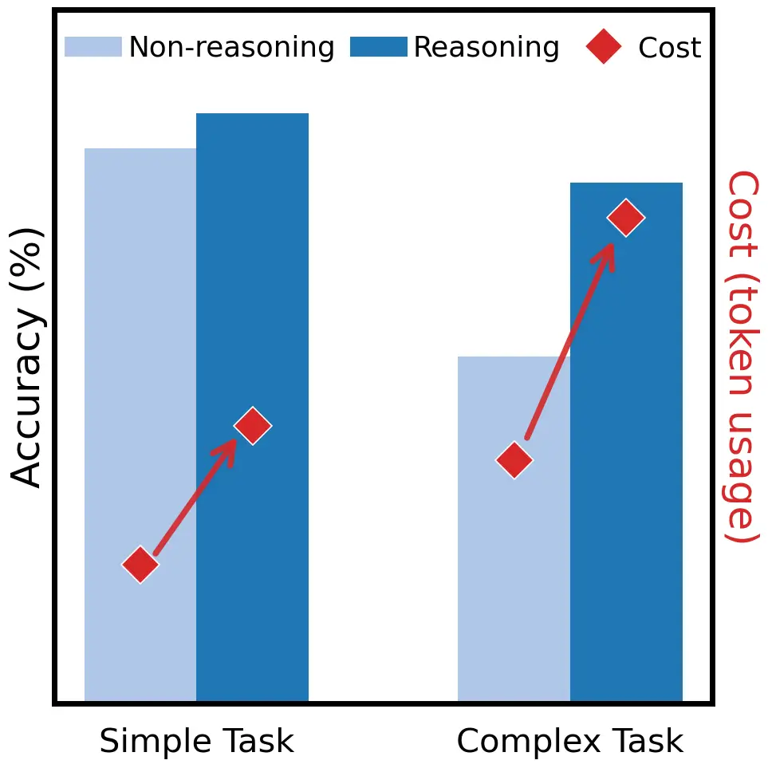
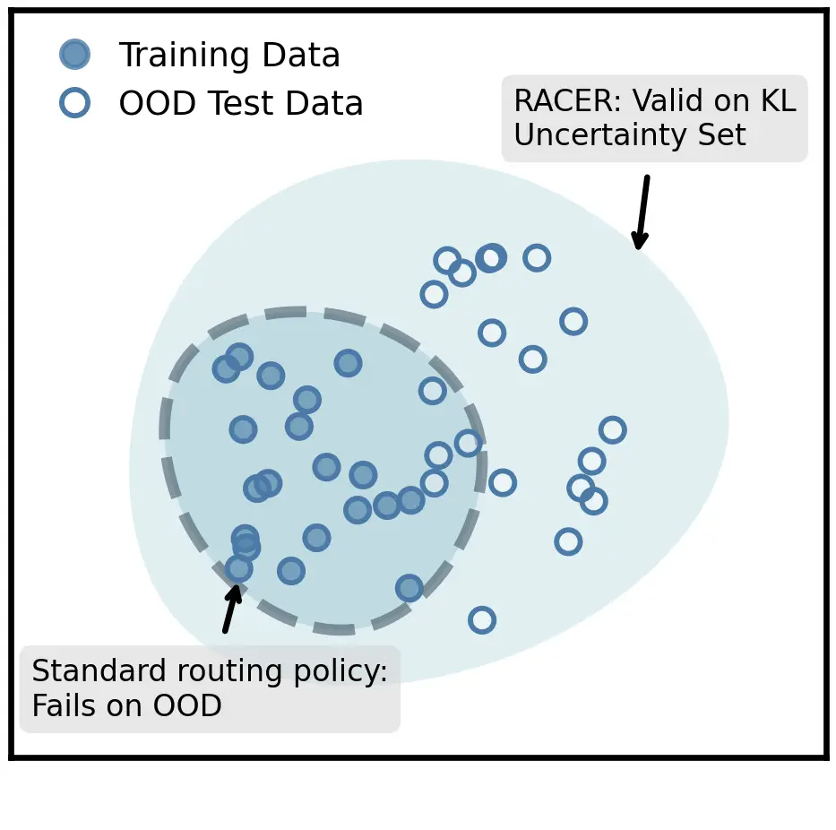
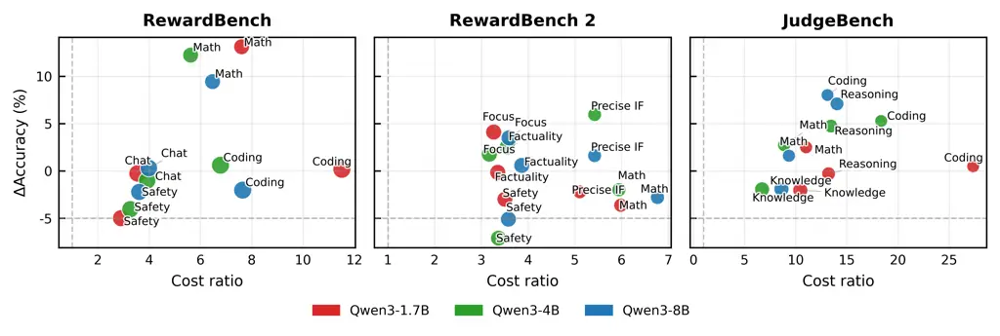
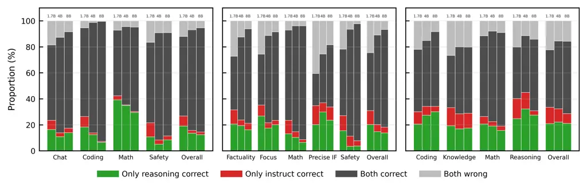
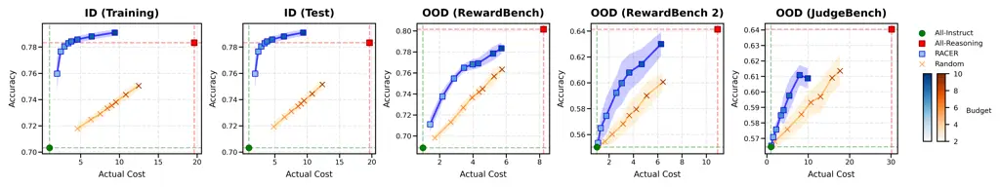
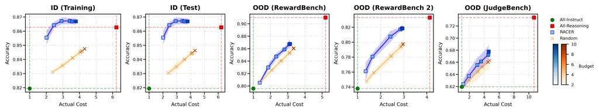
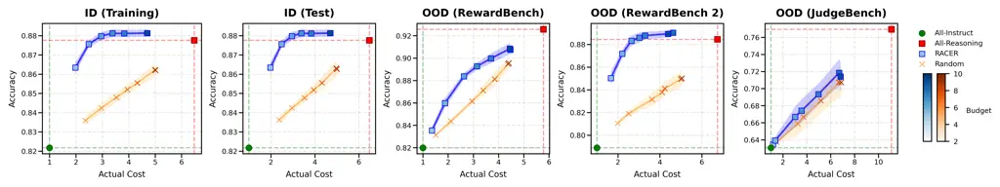
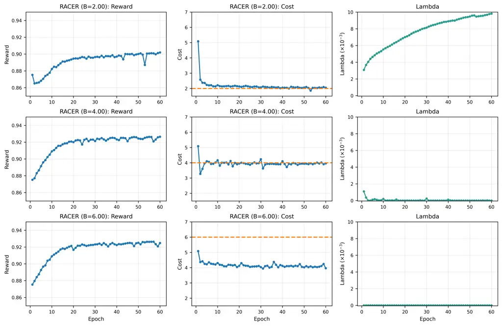

# Reasoning Is Not Free: Robust Adaptive Cost-Efficient Routing for LLM-as-a-Judge

Wenbo Zhang Affiliation: Department of Statistics, University of
California, Irvine, USA    Lijinghua Zhang Affiliation: Department of
Statistics, University of California, Irvine, USA    Liner Xiang
Affiliation: Department of Statistics, University of California, Irvine,
USA    Hengrui Cai Affiliation: Department of Statistics, University of
California, Irvine, USA Correspondence to: <hengrc1@uci.edu>

###### Abstract

Reasoning-capable large language models (LLMs) have recently been
adopted as automated judges, but their benefits and costs in
LLM-as-a-Judge settings remain unclear. Through controlled comparisons
between reasoning and non-reasoning judges, we show that explicit
reasoning substantially improves judgment accuracy on tasks requiring
structured verification (e.g., math and coding), while offering limited
or even negative gains on simpler evaluations and incurring
significantly _higher computational cost_. These findings motivate that
reasoning should be used selectively rather than universally, with
awareness of possible _distribution shift_. We propose a Robust Adaptive
Cost-Efficient Routing (RACER), which dynamically selects between
reasoning and non-reasoning judges under a fixed budget by formulating
routing as a constrained distributionally robust optimization problem.
RACER explicitly accounts for distribution shift via a KL-divergence
uncertainty set, admits an efficient primal–dual algorithm, and enjoys
theoretical guarantees including uniqueness of the optimal policy and
linear convergence. Extensive experiments show that RACER achieves
superior accuracy–cost trade-offs under distribution shift.

###### Keywords: 

Machine Learning, ICML

## 1 Introduction

As large language models (LLMs) continue to advance, reliably evaluating
the quality of their outputs has become increasingly important but
challenging. Owing to the high cost and limited scalability of human
evaluation, the LLM-as-a-Judge paradigm has emerged as a promising
alternative (Zheng et al., 2023; Li et al., 2023; Liu et al., 2023; Kim
et al., 2023; Fu et al., 2024), in which LLMs themselves are used as
evaluators. In parallel, reasoning-capable LLMs (OpenAI, 2024; Guo et
al., 2025) have attracted significant attention. A growing body of work
demonstrates that explicitly training models to generate long-form
reasoning chains prior to producing final answers substantially improves
performance across a wide range of problem-solving tasks, including
mathematics, code generation, instruction following, and agentic
decision-making (Yang et al., 2025; Liu et al., 2025; Yu et al., 2025;
Team et al., 2025). While these findings provide valuable insights into
the role of reasoning in LLMs as problem solvers, they do not
necessarily imply that such models are effective judges. In current
frontier open-source models, reasoning capabilities are typically
acquired via training in verifiable problem-solving tasks, whereas the
judging ability is not explicitly optimized (Yang et al., 2025; Team et
al., 2025; Olmo et al., 2025; Bercovich et al., 2025). This raises a
crucial question:  
_Can the reasoning skills learned from problem-solving tasks be
effectively transferred to judgment tasks?_



(a) Accuracy-cost trade-off



(b) Robust routing under OOD

Figure 1: (a) Reasoning models outperform non-reasoning models on
difficult tasks, achieving higher accuracy at the cost of increased
computation, while offering only marginal gains on simple tasks. (b)
RACER remains robust to out-of-distribution (OOD) inputs by operating
over a KL-divergence uncertainty set, whereas standard routing policies
fail under distribution shift.

Even if such transfer is possible, deploying reasoning-based judgment
models introduces additional challenges. As shown in Fig. 1(a),
reasoning-based judgments incur substantially _higher computational
cost_ due to multi-step deliberation and are _not universally
beneficial_, as they may induce overthinking on simple queries and lead
to incorrect decisions (Chen et al., 2024b; Sui et al., 2025). A natural
mitigation strategy is to learn a routing model that selectively invokes
reasoning or non-reasoning models based on criteria such as expected
performance or inference cost (Chen et al., 2023; Frick et al., 2025;
Liang et al., 2025; Zhang et al., 2025a). However, existing routing
approaches largely overlook the issues of _distribution shift_. Routers
are typically trained on static datasets, whereas real-world queries
evolve due to user heterogeneity (Zhang et al., 2024; Chakraborty et
al., 2024; Son et al., 2024). Consequently, a router trained under a
fixed data distribution may degrade significantly at deployment time,
resulting in cost constraint violations or erroneous selections of the
judging function.

To address these challenges, we propose the Robust Adaptive
Cost-Efficient Routing (RACER), which formulates router learning as a
distributionally robust, constrained policy optimization problem,
illustrated in Fig. 1(b). The distributionally robust learning framework
has recently been used to address the issue of distribution shift in
various settings (Namkoong and Duchi, 2016; Rahimian and Mehrotra, 2019;
Duchi et al., 2021). This formulation explicitly accounts for
distribution shift by optimizing over an uncertainty set of data
distributions centered around training data. By solving the resulting
robust objective, RACER seeks policies that remain reliable under
distribution shift, rather than optimizing solely for average-case
performance.

Our contributions are summarized as follows:

$`\bullet`$ We present a comprehensive study comparing reasoning and
non-reasoning modes of LLMs in LLM-as-a-Judge settings, characterizing
when explicit reasoning improves judgment quality and when it fails, and
providing practical insights into the effective use of reasoning for
evaluation.  
$`\bullet`$ We formulate router learning in a unified mathematical and
algorithmic framework that jointly addresses the cost–performance
trade-off and robustness to distribution shift via constrained
distributionally robust optimization, followed by a tractable algorithm
for efficient solution.  
$`\bullet`$ We are the first in LLM routing to prove that the optimal
router policy is unique and our policy iterates converge to it at a
linear rate, i.e., the error contracts by a constant factor at each
iteration (Wei et al., 2021; Ding et al., 2023). This provides strong
theoretical support for the proposed method.  
$`\bullet`$ Extensive experiments demonstrate that RACER consistently
outperforms baseline methods under distribution shift, achieving
improved accuracy–cost trade-offs.

## 2 Does Reasoning Help LLM-as-a-Judge?

### 2.1 Accuracy–Cost Trade-offs of Reasoning Judges

We study whether, and under what conditions, explicit reasoning improves
LLM-as-a-Judge. To this end, we perform controlled comparisons between
reasoning and non-reasoning judges and characterize the resulting
accuracy–cost trade-offs as well as agreement patterns across benchmarks
and model sizes.

Experimental Setup. To isolate the effect of explicit reasoning, we
consider paired reasoning and non-reasoning judges
$`\{\mathcal{M}_{\mathrm{R}},\mathcal{M}_{\mathrm{no\text{-}R}}\}`$ and
perform controlled comparisons within each pair. By matching the size,
architecture, and overall capability of the model, performance
differences can be primarily attributed to the presence or absence of
reasoning. Concretely, for hybrid models that support both reasoning and
non-reasoning inference, we instantiate the pair by treating the
reasoning mode as $`\mathcal{M}_{\mathrm{R}}`$ and the non-reasoning
mode as $`\mathcal{M}_{\mathrm{no\text{-}R}}`$. We evaluate multiple
open-source hybrid models from the Qwen3 family (1.7B/4B/8B), as well as
reasoning and non-reasoning judges on three widely used LLM-as-a-Judge
benchmarks: JudgeBench (Tan et al., 2024b), RewardBench (Lambert et al.,
2025), and RewardBench 2 (Malik et al., 2025), all of which consist of
tasks from various domains. Each example provides a prompt, two
candidate responses, and a preference label.

Evaluation Metrics. For evaluation, we prompt the LLM judge to compare
the two responses and to provide its preferred choice. We compute _judge
accuracy_ as the fraction of examples for which the judge’s preference
matches the ground-truth label, and we record _cost_ as token
consumption during inference. We define $`\Delta`$Accuracy as the
difference in judgment accuracy between reasoning and non-reasoning
modes,
$`\Delta`$Accuracy$`=\mathrm{Acc}(\mathcal{M}_{\mathrm{R}})-\mathrm{Acc}(\mathcal{M}_{\mathrm{no\text{-}R}})`$,
and define the cost ratio as the ratio of token consumption under
reasoning versus non-reasoning inference.





Figure 2: Accuracy–cost trade-offs and reasoning–instructional agreement
across benchmarks. Upper: Accuracy improvement versus cost ratio. Lower:
Agreement patterns between instruct and reasoning inference.

Results. Fig. 2 (upper) plots $`\Delta`$Accuracy against the cost ratio,
where points closer to the upper-left indicate larger gains at lower
additional cost. Across all three benchmarks, the strongest and most
cost-effective gains concentrate in math and coding, whereas safety and
knowledge show limited improvements and can even degrade under
reasoning. Fig. 2 (lower) summarizes agreement patterns between
reasoning and non-reasoning judges. When both modes reach the same
outcome, non-reasoning is preferable due to its lower cost; when they
disagree, selecting the better judge provides additional headroom. This
headroom shrinks with model size, as larger non-reasoning judges already
achieve stronger baseline judgment accuracy.

Overall, reasoning judge yields significant performance gains,
especially in reasoning-intensive domains, illustrating that skills
learned from problem-solving tasks effectively transfer to judgment
tasks. Also, we notice that the reasoning should be used selectively,
given its substantial cost.

Moreover, the heterogeneous accuracy–cost trade-offs in Fig. 2 suggest
that both reward and compute cost can shift across domains and
benchmarks. As a result, a router tuned on in-distribution data may
mis-estimate either the benefit of reasoning or the risk of budget
violation under distribution shift. This motivates our distributionally
robust objective in Eq. (4), which applies robustness separately to the
reward and cost terms to hedge against these two failure modes.

### 2.2 When and Why Reasoning Helps

To better understand when and why reasoning improves LLM-as-a-Judge, we
conduct a case analysis. This analysis reveals three recurring patterns:
(i) reasoning improves judgment when evaluation requires explicit
verification; (ii) reasoning is largely redundant when the correct
choice is apparent from surface cues; and (iii) reasoning can hurt when
it over-expands the evaluation scope and introduces irrelevant
considerations. Representative examples are summarized in Table C.1 in
the Appendix.

In math and coding tasks, where correct evaluation often requires
checking intermediate steps, validating internal consistency, or
reconciling multiple criteria, reasoning-mode judges are better aligned
with these requirements. In contrast, for tasks such as factual recall
and concise question answering, reasoning and non-reasoning judges
usually agree, leaving little room for improvement. Finally, we observe
failure cases where explicit reasoning introduces irrelevant factors,
leading to degraded judgments.

Taken together, these case-level patterns help explain the heterogeneous
accuracy–cost trade-offs observed in Section 2.1. They provide
qualitative evidence that reasoning improves judgment primarily when its
inductive bias aligns with the evaluation structure of the task,
reinforcing the conclusion that reasoning should be activated
selectively rather than unconditionally under computing constraints.

## 3 RACER: Robust Adaptive Cost-Efficient Routing

### 3.1 Notation

We denote the prompt space by $`\mathcal{X}`$, the response space by
$`\mathcal{Y}`$. Let
$`\mathcal{Z}=\mathcal{X}\times\mathcal{Y}\times\mathcal{Y}`$. We use
$`\rho\in\Delta(\mathcal{Z}\times\{0,1\})`$ to denote the distributions
over pairwise prompt–response tuples with preference labels where
$`\Delta(\cdot)`$ is a probability simplex. For a given pairwise
prompt–response tuple $`(x,y_{1},y_{2})`$, the label $`l=1`$ indicates
that $`y_{1}`$ is preferred to $`y_{2}`$, denoted as
$`y_{1}\succ y_{2}`$, while $`l=0`$ indicates that $`y_{2}\succ y_{1}`$.
We define the judge function of the model $`a`$ as
$`\Phi_{a}:\mathcal{Z}\mapsto\{0,1\}`$, which maps $`z=(x,y_{1},y_{2})`$
to a binary preference label, indicating whether $`y_{1}\succ y_{2}`$
($`\Phi_{a}(z)=1`$) or $`y_{2}\succ y_{1}`$ ($`\Phi_{a}(z)=0`$). Here we
assume deterministic judgments for simple cases, but the framework
readily extends to stochastic settings. We denote the empirical
distribution of the dataset with size $`n`$ as
$`\rho_{n}=\frac{1}{n}\sum_{i=1}^{n}\delta_{(z_{i},l_{i})}`$, where
$`(z_{i},l_{i})\sim\rho`$.

### 3.2 Proposed Method: RACER

Motivated by the accuracy–cost trade-offs of reasoning judges, we
propose to learn a router that selectively activates reasoning modes. We
formulate router learning as a constrained optimization problem. We
define router policy $`{\pi}:\mathcal{Z}\rightarrow\Delta({0,1})`$, and
denote the sampled decision from $`\pi(\cdot\mid z)`$ as $`a`$ taking a
value of $`1`$ if choosing the reasoning mode and $`0`$ if choosing the
non-reasoning mode. Our optimization objective in terms of the budget
$`C`$ is given by:

```math
\displaystyle\max_{\pi\in\Pi}\mathbb{E}_{(z,l)\sim{\rho_{n}},a\sim\pi(\cdot\mid z)}[r(z,a,l)],
```

```math
\displaystyle\text{ s.t. }\mathbb{E}_{(z,l)\sim\rho_{n},a\sim\pi(\cdot\mid x)}[c(z,a)]\leq C, \tag{1}
```

where $`r(z,a,l)=\mathbb{I}(\Phi_{a}(z)=l)`$ with indicator function
$`\mathbb{I}(\cdot)`$ and $`c(z,a)`$ denotes _whether the judgment is
correct_ and the _cost_ of using the selected mode, respectively, and
$`\Pi`$ is the policy class of interest. We call this method Adaptive
Cost-Efficient Routing (ACER). The core idea here is that the routing
policy should maximize judgment reward while controlling cost within a
budget, yielding an adaptive accuracy–cost trade-off.

However, ACER is not explicitly designed to handle distribution shifts,
which are common in real-world scenarios. To address this limitation, we
further propose Robust Adaptive Cost-Efficient Routing (RACER), which
not only optimizes performance under cost constraints, but also remains
robust to distribution shifts through distributionally robust learning.

We reformulate the problem as follows:

```math
\displaystyle\max_{\pi\in\Pi}\min_{\tilde{\rho}\in\mathcal{U}(\rho_{n},\delta)}\mathbb{E}_{(z,l)\sim{\tilde{\rho}},a\sim\pi(\cdot\mid z)}[r(z,a,l)],
```

```math
\displaystyle\text{ s.t. }\max_{\tilde{\rho}\in\mathcal{U}(\rho_{n},\delta)}\mathbb{E}_{(z,l)\sim\tilde{\rho},a\sim\pi(\cdot\mid z)}\left[c\left(z,a\right)\right]\leq C. \tag{2}
```

This optimization is over a distributional uncertainty set within a
distance of at most $`\delta`$ with $`\rho_{n}`$. Here, we utilize the
uncertainty set
$`\mathcal{U}(\rho_{n},\delta)=\left\{\tilde{\rho}:D_{\mathrm{KL}}(\tilde{\rho}\|\rho_{n})\leq\delta\right\}`$
and $`D_{\mathrm{KL}}`$ to denote the KL-divergence. Overall, RACER
seeks to maximize the worst-case reward under a worst-case cost
constraint, explicitly incorporating distributional robustness to prompt
and response shifts, an aspect largely overlooked by existing routing
methods. We now turn to solving (2).

We define the worst-case reward
$`R_{\mathcal{U}(\rho_{n},\delta)}(\pi)`$ and the worst-case cost
$`C_{\mathcal{U}(\rho_{n},\delta)}(\pi)`$ as

```math
\displaystyle R_{\mathcal{U}(\rho_{n},\delta)}(\pi) \displaystyle:=\min_{\tilde{\rho}\in\mathcal{U}(\rho_{n},\delta)}\mathbb{E}_{(z,l)\sim\tilde{\rho},\,a\sim\pi(\cdot\mid z)}\bigl[r(z,a,l)\bigr],
```

```math
\displaystyle C_{\mathcal{U}(\rho_{n},\delta)}(\pi) \displaystyle:=\max_{\tilde{\rho}\in\mathcal{U}(\rho_{n},\delta)}\mathbb{E}_{(z,l)\sim\tilde{\rho},\,a\sim\pi(\cdot\mid z)}\bigl[c(z,a)\bigr].
```

Hence, the original problem (2) can be rewritten as:

```math
\max_{\pi\in\Pi}R_{\mathcal{U}(\rho_{n},\delta)}\left(\pi\right)\quad\text{ s.t. }C_{\mathcal{U}(\rho_{n},\delta)}\left(\pi\right)\leq C. \tag{3}
```

Then the Lagrangian min-max problem associated with (3) is given by:

```math
\displaystyle\max_{\pi\in\Pi}\min_{\lambda\geq 0}L(\pi,\lambda):=\max_{\pi\in\Pi}\min_{\lambda\geq 0}R_{\mathcal{U}(\rho_{n},\delta)}\left(\pi\right)-\lambda C_{\mathcal{U}(\rho_{n},\delta)}\left(\pi\right),
```

where $`\lambda`$ is the Lagrange multiplier. While this formulation is
solvable through alternating gradient descent methods, it is
computationally challenging since we do not have direct control over the
data distribution $`\tilde{\rho}\in\mathcal{U}(\rho_{n},\delta)`$ as
they are not parameterized distributions. Moreover, the training data
are sampled only from the source distribution $`\rho`$, without samples
from other distributions in the uncertainty set
$`\mathcal{U}(\rho,\delta)`$. To overcome this challenge, we introduce
principled tractable algorithms to solve this problem.

The following proposition shows that the worst-case probability
distribution within a KL uncertainty set can be efficiently
approximated. Similar ideas have appeared in prior works on
distributionally robust reinforcement learning (Gadot et al., 2024; Xu
et al., 2025).

###### Theorem 3.1.

Let $`\rho_{n}\in\Delta_{n}`$ be the empirical distribution over
$`\{z_{i},l_{i}\}_{i=1}^{n}`$, and define
$`f_{i}\coloneqq\mathbb{E}_{a\sim\pi(\cdot\mid z_{i})}[f(z_{i},a)]`$.
Let

```math
\mathcal{U}(\rho_{n},\delta)\coloneqq\Big\{\tilde{\rho}\in\Delta_{n}:\sum_{i=1}^{n}\tilde{\rho}(i)\log\frac{\tilde{\rho}(i)}{\rho_{n}(i)}\leq\delta\Big\}.
```

Define $`\underline{\rho}`$ and $`\overline{\rho}`$ as solutions to

```math
\underline{\rho}\in\arg\min_{\tilde{\rho}\in\mathcal{U}(\rho_{n},\delta)}\sum_{i=1}^{n}\tilde{\rho}(i)f_{i},\;\overline{\rho}\in\arg\max_{\tilde{\rho}\in\mathcal{U}(\rho_{n},\delta)}\sum_{i=1}^{n}\tilde{\rho}(i)f_{i}.
```

Then there exist $`\underline{s},\overline{s}\in\mathbb{R}`$ and
$`\tau>0`$ such that, for all $`i`$,

```math
\underline{\rho}(i)\propto\rho_{n}(i)\exp\!\left(\frac{\underline{s}-f_{i}}{\tau}\right),\;\overline{\rho}(i)\propto\rho_{n}(i)\exp\!\left(\frac{\ f_{i}-\overline{s}}{\tau}\right),
```

with $`\underline{s}\leq\sum_{i=1}^{n}\rho_{n}(i)\bar{f}_{i}`$ and
$`\overline{s}\geq\sum_{i=1}^{n}\rho_{n}(i)\bar{f}_{i}`$.

We leave the proof of Theorem 3.1 to the Appendix A.1. Based on this
Theorem, we get a closed-form solution of
$`\underline{\rho},\overline{\rho}`$ over KL uncertainty set
$`\mathcal{U}\left(\rho_{n},\delta\right)`$. The resulting distributions
$`\underline{\rho}`$ and $`\overline{\rho}`$ are obtained by reweighting
the data. In the minimization setting, where $`f`$ is a reward function,
$`\underline{\rho}`$ downweights samples whose expected reward exceeds
the baseline $`\underline{s}`$ and upweights those with
lower-than-baseline rewards. In the maximization setting, where $`f`$ is
a cost function, $`\overline{\rho}`$ upweights samples with
higher-than-baseline cost, focusing optimization on high-risk regions.
The parameter $`\tau`$ controls the strength of reweighting: lower
$`\tau`$ induces a more aggressive concentration on extreme (worst-case)
samples.

Since the baselines $`\underline{s}`$ and $`\overline{s}`$ are generally
unknown, in practice we approximate them using the empirical mean, which
serves as a valid surrogate by providing upper and lower bounds for
$`\underline{s}`$ and $`\overline{s}`$, respectively. Thus, the
Lagrangian min-max problem of (3) can be transformed as:

```math
\displaystyle\max_{\pi\in\Pi}\min_{\lambda\geq 0}L(\pi,\lambda) \displaystyle=\max_{\pi\in\Pi}\min_{\lambda\geq 0}R_{\mathcal{U}(\rho_{n},\delta)}\left(\pi\right)-\lambda C_{\mathcal{U}(\rho_{n},\delta)}\left(\pi\right)
```

```math
\displaystyle=\max_{\pi\in\Pi}\min_{\lambda\geq 0}R_{\underline{\rho}}\left(\pi\right)-\lambda C_{\overline{\rho}}\left(\pi\right). \tag{4}
```

where the last equality is implied by Theorem 3.1.

We introduce a regularized Lagrangian:

```math
L_{\beta}(\pi,\lambda):=L(\pi,\lambda)+\beta\left(\mathcal{H}(\pi)+\frac{1}{2}\lambda^{2}\right), \tag{5}
```

where $`\mathcal{H}(\pi)+\frac{1}{2}\lambda^{2}`$ is added as a
regularization to the original Lagrangian $`L(\pi,\lambda)`$. Here
$`\beta`$ is a regularization parameter, and
$`\mathcal{H}(\pi):=\mathbb{E}_{(z,l)\sim\rho}[\mathcal{H}(\pi(\cdot\mid z)]`$
is the entropy of the policy $`\pi`$. This step allows us to control the
randomness of the routing policy, thereby encouraging exploration and
facilitating convergence (Cen et al., 2022; Ding et al., 2023).

We can then use the primal-dual method to solve (5):

```math
\displaystyle\pi_{t+1} \displaystyle=\underset{\pi\in\Pi}{\operatorname{argmax}}\left\{R_{\underline{\rho}}(\pi)-\lambda_{t}\,C_{\bar{\rho}}(\pi)+\beta\mathcal{H}(\pi)\right\}, \tag{6}
```

```math
\displaystyle\lambda_{t+1} \displaystyle=\underset{\lambda\geq 0}{\operatorname{argmax}}\left\{-\lambda_{t}\,C_{\bar{\rho}}(\pi)+\frac{1}{2}\beta\lambda_{t}^{2}\right\}. \tag{7}
```

Based on the derivations, we propose a practical RACER algorithm in
Algorithm 1.

input: Number of iterations $`T`$, temperature $`\tau`$, regularization
parameter $`\beta`$, distribution $`\rho`$ for preference data
generation, judging functions $`(\Phi_{0},\Phi_{1})`$ by an LLM.

1:  Initialize $`\pi_{0}`$ and $`\lambda_{0}`$.

2:  for Iteration $`t=0,1,\dotsc,T-1`$ do

3:   Construct $`\mathcal{D}_{t}=\{(z,l)\}`$ where $`(z,l)\sim\rho`$.

4:   Sample routing actions: $`a\sim\pi_{t}(\cdot\mid z),`$
$`\forall z\in\mathcal{D}_{t}`$ (_optional: enumerate all actions_).

5:   Calculate reward and cost: For each $`(z,l)\in\mathcal{D}_{t}`$ and
routing choice $`a`$, get judge results $`\Phi_{a}(z)`$, and calculate
the reward $`r(z,a,l)`$ and cost $`c(z,a)`$.

6:   Data reweighting: Calculate batch mean reward
$`\overline{r}=\frac{\sum_{j=1}^{|\mathcal{D}_{t}|}r(z_{j},a_{j},l_{j})}{{{|\mathcal{D}_{t}|}}}`$
and cost
$`\overline{c}=\frac{\sum_{j=1}^{|\mathcal{D}_{t}|}c(z_{j},a_{j})}{{{|\mathcal{D}_{t}|}}}`$,
then approximate worse-case distributions:

```math
\displaystyle\underline{\rho}(i)\propto\exp\left(\frac{\overline{r}-r_{i}}{\tau}\right),\bar{\rho}(i)\propto\exp\left(\frac{c_{i}-\overline{c}}{\tau}\right).
```

7:   Primal-dual update: Obtain $`\pi_{t+1}`$ and $`\lambda_{t+1}`$ by
 (6) and (7).

8:  end for

9:  return The best valid $`\pi_{0:T}`$ on the validation data.

Algorithm 1 RACER

## 4 Theoretical Results

In this section, we first show that the optimization problem admits a
unique solution, and then demonstrate linear convergence in terms of the
KL divergence between the last iterate and the optimal router policy.
While recent works study routing strategies for LLMs with a focus on
practical model selection and performance–cost tradeoffs (Ong et al.,
2025; Liang et al., 2025; Zhang et al., 2025a), these approaches are
primarily empirical and heuristic in nature. To the best of our
knowledge, this work is the _first_ to provide theoretical guarantees on
_the convergence behavior of an LLM routing policy_.

### 4.1 Uniqueness of the Optimal Router Policy

The policy optimization problem can be interpreted as finding a saddle
point of the following max–min problem,

```math
\max_{\pi\in\Pi}\min_{\lambda\geq 0}\mathcal{L}_{\beta}(\pi,\lambda). \tag{8}
```

After establishing feasibility (i.e., the constraint set is nonempty)
and showing that the solution space is bounded, we then prove that the
saddle point exists and is unique, as stated in Theorem 4.1. All proofs
are provided in Appendix A.2.

###### Theorem 4.1 (Existence and Uniqueness of the Saddle Point).

There exists a unique pair
$`(\pi^{\ast},\lambda^{\ast})\in\Pi\times\Lambda`$ such that
$`\mathcal{L}_{\beta}(\pi,\lambda^{\ast})\leq\mathcal{L}_{\beta}(\pi^{\ast},\lambda^{\ast})\leq\mathcal{L}_{\beta}(\pi^{\ast},\lambda)`$
for any $`\pi\in\Pi`$ and $`\lambda\in\Lambda`$, that is,
$`(\pi^{\ast},\lambda^{\ast})`$ is the saddle point of
$`\mathcal{L}_{\beta}(\pi,\lambda)`$.

As a consequence, for any $`(\pi,\lambda)\in\Pi\times\Lambda`$,

```math
\mathcal{L}(\pi,\lambda^{\ast})-\beta\mathcal{H}(\pi)\leq\mathcal{L}(\pi^{\ast},\lambda^{\ast})\leq\mathcal{L}(\pi^{\ast},\lambda)+\frac{\beta}{2}\lambda^{2},
```

which indicates that $`(\pi^{\ast},\lambda^{\ast})`$ is a saddle point
of the original Lagrangian $`\mathcal{L}(\pi,\lambda)`$, up to two
$`\beta`$-regularization terms.

Theorem 4.1 identifies a unique target for the primal–dual iterates. In
the next subsection, we show that the updates (6) and (7) converge to
this unique saddle point.

### 4.2 Convergence of the Router Policy

We next analyze the last-iterate convergence of our router policy
$`\pi_{t}`$ to the optimal policy $`\pi^{\ast}`$. To quantify the
convergence, we measure the distance between $`\pi_{t}`$ and
$`\pi^{\ast}`$ under the distribution $`\rho`$ using the KL divergence,
defined as

```math
\mathrm{KL}(\pi_{t}\|\pi^{\ast})=\mathbb{E}_{(z,l)\sim\rho}\mathrm{KL}(\pi_{t}(\cdot|z)\|\pi^{\ast}(\cdot|z)),
```

where

```math
\mathrm{KL}(\pi_{t}(\cdot|z)\|\pi^{\ast}(\cdot|z))=\sum_{a=0}^{1}\pi_{t}(a|z)\log\left(\frac{\pi_{t}(a|z)}{\pi^{\ast}(a|z)}\right).
```

To derive a closed-form solution for (6), we rewrite it as

```math
\displaystyle\pi_{t+1}=\arg\max_{\pi\in\Pi} \displaystyle\mathbb{E}_{(z,l)\sim{\rho},a\sim\pi(\cdot\mid z)}\left[\frac{p_{\underline{\rho}}}{p_{{\rho}}}r(z,a,l)-\lambda_{t}\frac{p_{\overline{\rho}}}{p_{{\rho}}}c(z,a)\right]
```

```math
\displaystyle+\beta\,\mathbb{E}_{(z,l)\sim{\rho}}\left[\mathcal{H}\left(\pi(\cdot\mid z)\right)\right], \tag{9}
```

where $`p_{\overline{\rho}}`$, $`p_{\underline{\rho}}`$, and
$`p_{{\rho}}`$ denote the densities of the distributions
$`\overline{\rho}`$, $`\underline{\rho}`$, and $`{\rho}`$, respectively.

We then propose Assumptions 1, 2, and 3 to establish the convergence
result in Theorem 4.2.

###### Assumption 1 (Convexity of the policy class $`\Pi`$).

The interested policy class $`\Pi`$ is convex, i.e., for any
$`\pi_{1},\pi_{2}\in\Pi`$ and any $`\alpha\in[0,1]`$,
$`\alpha\pi_{1}+(1-\alpha)\pi_{2}\in\Pi`$.

###### Assumption 2 (Boundness of $`c`$).

There exists a constant $`M>0`$, such that $`c(z,a)\leq M`$ for all
$`z\sim\rho`$ and $`a\in\{0,1\}.`$

###### Assumption 3 (Boundness of density ratio).

There exists a constant $`K>0`$, such that
$`{p_{\overline{\rho}}}/{p_{{\rho}}}\leq K`$ for all
$`z\in\mathcal{Z}`$.

Assumption 1 is standard and has been widely adopted in convex
optimization and policy optimization analyses (Mutti et al., 2023; Ding
et al., 2023, see, e.g.,). Assumption 2 ensures that the cost $`c(z,a)`$
is bounded and has bounded variance, while Assumption 3 controls the
amplification induced by importance reweighting. Together, these
conditions imply that the dual gradient term
$`(p_{\overline{\rho}}/{p_{\rho}})\,c(z,a)`$ is uniformly bounded. This
uniform bound allows us to control how much the policy $`\pi_{t+1}`$
responds to changes in the dual variable $`\lambda_{t}`$, which is a key
ingredient in establishing the linear convergence result below.

###### Theorem 4.2 (Linear Convergence of RACER).

Under Assumptions 1, 2, and 3, the router policy iterates satisfy

```math
\mathrm{KL}(\pi_{t}\|\pi^{\ast})\leq\frac{M^{2}K^{2}}{2\beta^{2}}\left(\frac{M^{2}K^{2}}{M^{2}K^{2}+2\beta^{2}}\right)^{2t}(\lambda_{0}-\lambda^{\ast})^{2}.
```

Theorem 4.2 establishes that the iterates $`\pi_{t}`$ converge to the
optimal policy $`\pi^{\ast}`$ at a linear rate, depending on $`M`$,
$`K`$, and $`\beta`$. Details and the proof are deferred to
Appendix A.3. Importantly, our convergence results can be extended to
the parameterized (non-convex) setting under additional assumptions on
the approximation quality of the policy class $`\Pi`$. In particular, if
each policy update approximates the optimal entropy-regularized solution
up to a controlled error, then the last-iterate convergence result
continues to hold up to an additional approximation error term, as
commonly studied in prior work (Ding et al., 2023; Zhan et al., 2023).

## 5 Experiments

### 5.1 Experimental Setup

We conduct two complementary sets of experiments with a shared training
and judgment generation protocol. The first focuses on controlled
ablations designed to isolate the roles of reward and cost robustness
under targeted distribution shifts. The second evaluates end-to-end
routing performance on real world LLM-as-a-Judge benchmarks to assess
generalization under more realistic evaluation distributions.

Across both experimental settings, we use a unified data generation
protocol to learn a router from the preference data. Given any
preference dataset consisting of a prompt and a response pair
$`(x_{i},y_{i,1},y_{i,2})`$, we prompt an LLM judge under two inference
modes (instruct and reasoning) to select its preferred response. For
each instance, we record (i) whether the judge’s decision matches the
ground-truth preference label, $`r_{i}`$, and (ii) the number of tokens
consumed under each inference mode, $`c_{i}`$. The router takes as input
a text embedding of the concatenated context
$`z_{i}=(x_{i},y_{i,1},y_{i,2})`$ obtained from an embedding model.

Details of the judging prompts, decoding configurations, and the
embedding model are provided in Appendix B. All training and evaluation
sets in the following experiments are constructed using this protocol,
differing only in the underlying dataset.

| Subset       | Split    | \# Pairs     | Cost Ratio |
| ------------ | -------- | ------------ | ---------- |
| Magpie Ultra | Train 1  | $`27{,}785`$ | $`11.2`$   |
| WildGuardMix | Train 2  | $`6{,}709`$  | $`3.4`$    |
| OffsetBias   | OOD Test | $`8{,}504`$  | $`4.7`$    |

Table 1: Dataset statistics and cost ratios.

(a) Trained on Magpie Ultra and evaluated on OffsetBias, exhibiting a
shift toward lower-cost queries.

(b) Trained on WildGuardMix and evaluated on OffsetBias, exhibiting a
shift toward higher-cost queries.

Figure 3: Reward–cost trade-offs evaluated on the OOD dataset with a
budget of 2. (a) shows that reward-robust RACER-R improves performance
when the cost constraint is easily satisfied. (b) illustrates the
importance of cost-robust RACER-C when the cost constraint can be
violated under distribution shift.







Figure 4: Routing performance across compute budgets on ID and OOD
benchmarks (top to bottom: Qwen3-1.7B, 4B, and 8B).

### 5.2 Ablating Reward and Cost Robustness

As shown in our robust objective (3), the proposed formulation
incorporates two levels of robustness: robustness applied to the reward,
denoted as $`R_{\mathcal{U}\left(\rho_{n},\delta\right)}(\pi)`$, and
robustness applied to the cost, denoted as
$`C_{\mathcal{U}\left(\rho_{n},\delta\right)}(\pi)`$. To better
understand the contribution of each component, we conduct an ablation
study to investigate (i) when reward robustness is necessary and (ii)
when cost robustness is necessary. Specifically, we introduce two
variants, RACER-R and RACER-C, which apply distributionally robust
reweighting only to the reward and only to the cost, respectively. We
also include ACER with the non-robust objective in (1) as a baseline.

We consider two representative scenarios: (a) the OOD queries require
less computation than in-distribution queries, and (b) the OOD queries
require more computation than in-distribution queries. We construct our
datasets from the Skywork Reward Preference Dataset (Liu et al., 2024a),
with Magpie-Ultra and WildGuardMix used for training in Scenarios (a)
and (b), respectively, and OffsetBias as the OOD test set. Judgments are
produced by the hybrid reasoning model Qwen3-4B (Yang et al., 2025).
Reward is defined as correctness, and cost as the relative token usage
between reasoning and non-reasoning judgments (Table 1). We use
bge-3 (Chen et al., 2024a) to get embeddings of the query and responses,
and a linear router.

As shown in the left panel of Figure 3, the OOD shift favors lower-cost
queries, all methods satisfy the budget constraint across runs. RACER-R
consistently achieves the highest reward, with stronger robustness
(lower temperature) yielding further gains, indicating that when OOD
cost is low, emphasizing reward robustness enables more effective budget
utilization. In contrast, in the right panel, RACER-C attains a lower
reward than RACER-R and ACER but consistently maintains OOD costs within
budget, demonstrating that cost robustness provides a safer strategy
when in-distribution cost is low but OOD shifts increase violation risk.
Overall, RACER variants exhibit greater robustness in both reward and
cost compared to the non-robust baseline ACER.

### 5.3 Scaling Evaluation to Standard Benchmarks

Training data. Following the data-generation protocol, we construct the
training set from (i) $`20{,}000`$ instances from Skywork-Reward (Liu et
al., 2024a), and (ii) an additional $`20{,}000`$ instances sampled from
Math-Step-DPO-10K (Lai et al., 2024) and Code-Preference-Pairs (Vezora,
2024). We include the math and code data to improve coverage of
reasoning-intensive domains, which are under-represented in
Skywork-Reward. We generate judgments by pairing the reasoning and
non-reasoning variants of Qwen3-1.7B/4B/8B (Yang et al., 2025). We also
include Llama-3.1-8B (Grattafiori et al., 2024) as an additional model
family; the corresponding results, reported in Appendix C.3, exhibit a
similar trend, indicating that RACER generalizes across model families.

Evaluation datasets. We evaluate the learned routing policy on standard
LLM-as-a-Judge benchmarks spanning diverse task domains, including
RewardBench (Lambert et al., 2025), RewardBench-2 (Malik et al., 2025),
and JudgeBench (Tan et al., 2024b). All evaluation benchmarks are held
out from training and are used exclusively for out-of-distribution
evaluation. Judgments are generated using the same model pairs.

Baselines. We compare against three baselines:  
$`\bullet`$ All-Instruct, which always selects the instruct mode (cost
fixed to $`1`$ and accuracy equal to the instruct judge’s average
correctness);  
$`\bullet`$ All-Reasoning, which always selects the reasoning mode
(accuracy and cost given by the reasoning judge’s average correctness
and token consumption, respectively);  
$`\bullet`$ Random, which activates the reasoning mode independently for
each instance with probability equal to the learned policy’s average
reasoning rate.

We evaluate the routing policy under compute budgets
$`C\in\{2,2.5,3,3.5,4,5,7,10\}`$. For each budget, we repeat training
and evaluation $`20`$ times and report the mean and standard deviation
of accuracy and realized cost ratio. Our routing policy is parametrized
by a four-layer neural network. See Appendix B.3 and B.5 for detailed
implementation and hyperparameter choices.

Fig. 4 reports accuracy–cost trade-offs under varying budgets for three
model scales. On both the training split and the in-distribution test
split, RACER achieves a notably favorable regime: at roughly half of the
All-Reasoning cost, it matches and often surpasses the All-Reasoning
judge’s accuracy, indicating that reasoning can be concentrated on the
subset of instances where it delivers the largest marginal benefit.
Under OOD benchmarks, RACER continues to yield consistent improvements
over the baselines, demonstrating that the learned selection rule
generalizes beyond the training distribution. The Random baseline forms
an approximately linear interpolation between the All-Instruct and
All-Reasoning endpoints, corresponding to indiscriminate activation of
reasoning at a fixed rate. In contrast, RACER traces a concave,
higher-accuracy frontier; the area between the RACER curve and the
Random curve reflects the additional gain from strategic instance-level
selection, which cannot be explained by merely increasing the overall
reasoning rate, but instead by allocating reasoning to the right
examples under the same budget.

### 5.4 Additional Results

| Method          | 1.7B              |         | 4B                |         | 8B                |         |
| --------------- | ----------------- | ------- | ----------------- | ------- | ----------------- | ------- |
|                 | Acc.              | Cost    | Acc.              | Cost    | Acc.              | Cost    |
| RouterBench-KNN | $`71.3`$          | $`2.6`$ | $`84.1`$          | $`2.5`$ | $`86.8`$          | $`2.6`$ |
| RouteLLM-MF     | $`69.4`$          | $`3.8`$ | $`84.7`$          | $`3.4`$ | $`88.2`$          | $`4.1`$ |
| M-IRT           | $`71.6`$          | $`3.4`$ | $`84.3`$          | $`2.7`$ | $`88.9`$          | $`3.4`$ |
| RACER           | $`\mathbf{72.2}`$ | $`3.6`$ | $`\mathbf{85.8}`$ | $`3.4`$ | $`\mathbf{90.0}`$ | $`3.9`$ |

Table 2: Accuracy and cost comparison across model scales with advanced
baselines.

Comparison with other advanced baselines. We also compare RACER with
three representative adavcned baselines: RouterBench-KNN (Hu et al.,
2024), RouteLLM-MF (Ong et al., 2024), and M-IRT (Song et al., 2025),
under the same budget constraint ($`C=4`$). The results are averaged on
$`3`$ test datasets and over $`10`$ replications . As shown in Table 2,
RACER achieves the highest accuracy across all three model families
while remaining within the budget. For the $`1.7`$B, $`4`$B, and $`8`$B
models, RACER improves over the strongest baseline by $`0.64`$,
$`1.10`$, and $`1.06`$ percentage points, respectively. These results
suggest that RACER exploits the available budget more effectively by
allocating reasoning to instances where it is most beneficial, yielding
a stronger reward–cost trade-off than prior routing methods. Since RACER
is a general framework, in principle, it can be combined with more
advanced routing architectures to improve performance further.

Ablation and Sensitivity Analysis of Entropy Regularizer. We conduct an
ablation and sensitivity analysis on $`\beta`$ (weight for entropy
regularization) at 3 representative budget levels, using Qwen3-4B judge
pair. As shown in Table 3, removing the entropy regularizer hurts
accuracy under the tight budget, confirming its contribution when the
constraint is binding. Performance remains stable for
$`\beta\in\{0.005,0.01\}`$, while $`\beta=0.05`$ consistently degrades
accuracy, supporting our default choice of $`\beta`$.

| $`\beta`$ | $`C=2`$  |         | $`C=3`$  |         | $`C=4`$  |         |
| --------- | -------- | ------- | -------- | ------- | -------- | ------- |
|           | Acc.     | Cost    | Acc.     | Cost    | Acc.     | Cost    |
| $`0`$     | $`85.2`$ | $`1.9`$ | $`86.7`$ | $`2.9`$ | $`86.8`$ | $`3.7`$ |
| $`0.005`$ | $`85.5`$ | $`2.0`$ | $`86.7`$ | $`2.9`$ | $`86.7`$ | $`3.6`$ |
| $`0.01`$  | $`85.5`$ | $`2.0`$ | $`86.7`$ | $`2.9`$ | $`86.7`$ | $`3.8`$ |
| $`0.05`$  | $`84.8`$ | $`2.0`$ | $`86.0`$ | $`2.9`$ | $`86.2`$ | $`3.8`$ |

Table 3: Sensitivity of RACER to $`\beta`$ under different budgets using
data generated by the Qwen3-4B judge pair.

## 6 Related Work

LLM-as-a-Judge and Reasoning. Human evaluation is considered the
gold-standard metric for assessing LLM-generated content (Ouyang et al.,
2022; Zheng et al., 2023). However, it is costly and time-consuming,
making it difficult to scale in practice. To address this,
LLM-as-a-Judge has been proposed as an automatic proxy (Zheng et al.,
2023; Li et al., 2023; Liu et al., 2023; Kim et al., 2023; Fu et al.,
2024). One advantage is that the LLM can provide explanations for its
final judgments, which facilitates error analysis. To evaluate how well
LLM-as-a-Judge truly performs, benchmarks have been introduced to
measure the accuracy of judgments across different domains (Tan et al.,
2024a; Liu et al., 2024b; Lambert et al., 2025). There are several
recent studies have shown that incorporating reasoning into models
through reinforcement learning on judge-specific tasks can further
enhance evaluation performance (Whitehouse et al., 2025; Saha et al.,
2025; Chen et al., 2025a; Chen et al., 2025b). Notably, our work
demonstrates that even without judge-specific training, reasoning
abilities acquired from general-domain training can still effectively
transfer.

LLM Routing. As the number of parameters in LLMs continues to grow,
their inference cost increases substantially. To address this issue, LLM
routing has emerged as an effective strategy that assigns user queries
to appropriate LLMs while balancing both performance and cost. Chen et
al. (2023) adopted a cascading strategy, sequentially querying LLMs
until a satisfactory response is produced. P2L (Frick et al., 2025)
employs a prompt-to-regression approach to predict a vector of
Bradley–Terry coefficients, which are then used to select the optimal
model. Aggarwal et al. (2023) and Ong et al. (2025) trained a binary
predictor to switch between a strong and weak model. While effective,
this approach requires deploying multiple LLMs simultaneously. Recent
studies (Liang et al., 2025; Zhang et al., 2025a) investigate mode
switching within a single hybrid reasoning model, which is most closely
related to our setting. However, we introduce a principled policy
learning framework that not only maximizes performance under budget
constraints, but also explicitly addresses distribution shift, an
important yet largely overlooked challenge in existing routing systems.
Furthermore, all prior studies predominantly focus on question-answering
tasks, whereas we present the first comprehensive investigation of
routing strategies in the LLM-as-judge domain.

Distributionally Robust Learning. Distributionally Robust Optimization
(DRO) has been extensively studied in machine learning (Shafieezadeh
Abadeh et al., 2015; Deng et al., 2020), statistics (Belloni et al.,
2011; Duchi and Namkoong, 2021), and operations research (Goh and Sim,
2010; Kuhn et al., 2019). It is typically formulated as a minimax
problem, in which an adversary perturbs the data-generating distribution
within a prescribed uncertainty set to maximize the expected loss, while
the learner optimizes model parameters to minimize this worst-case risk.
Among various constructions of uncertainty sets, $`f`$-divergence balls
are a commonly used choice (Hu and Hong, 2013; Namkoong and Duchi, 2016;
Levy et al., 2020; Duchi and Namkoong, 2021), due to their strong
connections with classical divergence measures and well-studied
statistical properties that facilitate analysis and implementation in
DRO frameworks.

## 7 Conclusion and Limitation

In this work, we study whether reasoning capabilities acquired by LLMs
from problem-solving tasks transfer to judgment tasks. We find that
reasoning-based judges can substantially improve accuracy, but the gains
are task-dependent and often incur significantly higher computational
cost, particularly under distribution shift. To address these problems,
we propose RACER, which adaptively activates reasoning judges under a
fixed budget. We are also the first to provide a theoretical analysis
with linear convergence guarantees, supporting both efficiency and
robustness. Empirically, RACER consistently outperforms baselines on
multiple out-of-distribution benchmarks, achieving superior
accuracy–cost trade-offs.

RACER focuses on binary routing with a KL-based uncertainty set; while
effective under moderate distribution shifts, overly large uncertainty
can induce conservative routing that prioritizes cost safety and
underutilizes reasoning. Extending RACER to richer routing schemes and
alternative uncertainty sets to better balance robustness and adaptivity
is an important direction for future work.

## Acknowledgements

This work was supported in part by the National Science Foundation under
Grant No. DMS-2401271. We thank the anonymous reviewers for their
helpful comments.

## Impact Statement

This work examines the benefits and costs of reasoning-capable LLMs in
the LLM-as-a-Judge setting and proposes a robust routing framework that
selectively allocates reasoning under budget and distribution shift
constraints. A key positive impact is promoting more efficient and
sustainable use of computation by showing that reasoning is not
universally beneficial and should be applied selectively, while also
improving the robustness and reliability of automated evaluation under
realistic, non-stationary data distributions. These advances can support
more trustworthy benchmarking and model development practices. Potential
risks include increased reliance on automated judges, which may
propagate biases or systematic errors inherited from the underlying
models, and the possibility that adaptive routing could be misused to
unevenly apply stronger evaluation. We mitigate these concerns by
explicitly analyzing failure cases, prioritizing robustness over maximal
performance, and positioning the method as a complement to human
evaluation rather than a replacement.

## References

- Aggarwal et al. (2023) P. Aggarwal, A. Madaan, A. Anand, S. P.
  Potharaju, S. Mishra, P. Zhou, A. Gupta, D. Rajagopal, K.
  Kappaganthu, Y. Yang, et al. Automix: automatically mixing language
  models. arXiv preprint arXiv:2310.12963. Cited by: §6.
- Belloni et al. (2011) A. Belloni, V. Chernozhukov, and L. Wang
  Square-root lasso: pivotal recovery of sparse signals via conic
  programming. Biometrika 98 (4), pp. 791–806. Cited by: §6.
- Bercovich et al. (2025) A. Bercovich, I. Levy, I. Golan, M. Dabbah, R.
  El-Yaniv, O. Puny, I. Galil, Z. Moshe, T. Ronen, N. Nabwani, et al.
  Llama-nemotron: efficient reasoning models. arXiv preprint
  arXiv:2505.00949. Cited by: §1.
- Cen et al. (2022) S. Cen, C. Cheng, Y. Chen, Y. Wei, and Y. Chi Fast
  global convergence of natural policy gradient methods with entropy
  regularization. Operations Research 70 (4), pp. 2563–2578. Cited by:
  §3.2.
- Chakraborty et al. (2024) S. Chakraborty, J. Qiu, H. Yuan, A.
  Koppel, F. Huang, D. Manocha, A. Bedi, and M. Wang Maxmin-rlhf:
  towards equitable alignment of large language models with diverse
  human preferences. In ICML 2024 Workshop on Models of Human Feedback
  for AI Alignment, Cited by: §1.
- Chen et al. (2024a) J. Chen, S. Xiao, P. Zhang, K. Luo, D. Lian,
  and Z. Liu Bge m3-embedding: multi-lingual, multi-functionality,
  multi-granularity text embeddings through self-knowledge distillation.
  arXiv preprint arXiv:2402.03216 4 (5). Cited by: §5.2.
- Chen et al. (2023) L. Chen, M. Zaharia, and J. Zou Frugalgpt: how to
  use large language models while reducing cost and improving
  performance. arXiv preprint arXiv:2305.05176. Cited by: §1, §6.
- Chen et al. (2025a) N. Chen, Z. Hu, Q. Zou, J. Wu, Q. Wang, B. Hooi,
  and B. He Judgelrm: large reasoning models as a judge. arXiv preprint
  arXiv:2504.00050. Cited by: §6.
- Chen et al. (2024b) X. Chen, J. Xu, T. Liang, Z. He, J. Pang, D.
  Yu, L. Song, Q. Liu, M. Zhou, Z. Zhang, et al. Do not think that much
  for 2+ 3=? on the overthinking of o1-like llms. arXiv preprint
  arXiv:2412.21187. Cited by: §1.
- Chen et al. (2025b) X. Chen, G. Li, Z. Wang, B. Jin, C. Qian, Y.
  Wang, H. Wang, Y. Zhang, D. Zhang, T. Zhang, et al. Rm-r1: reward
  modeling as reasoning. arXiv preprint arXiv:2505.02387. Cited by: §6.
- Deng et al. (2020) Y. Deng, M. M. Kamani, and M. Mahdavi
  Distributionally robust federated averaging. Advances in neural
  information processing systems 33, pp. 15111–15122. Cited by: §6.
- Ding et al. (2023) D. Ding, C. Wei, K. Zhang, and A. Ribeiro
  Last-iterate convergent policy gradient primal-dual methods for
  constrained mdps. Advances in Neural Information Processing Systems
  36, pp. 66138–66200. Cited by: §A.2, §1, §3.2, §4.2, §4.2.
- Ding et al. (2022) D. Ding, K. Zhang, J. Duan, T. Başar, and M. R.
  Jovanović Convergence and sample complexity of natural policy gradient
  primal-dual methods for constrained mdps. arXiv preprint
  arXiv:2206.02346. Cited by: §A.2.
- Duchi et al. (2021) J. C. Duchi, P. W. Glynn, and H. Namkoong
  Statistics of robust optimization: a generalized empirical likelihood
  approach. Mathematics of Operations Research 46 (3), pp. 946–969.
  Cited by: §1.
- Duchi and Namkoong (2021) J. C. Duchi and H. Namkoong Learning models
  with uniform performance via distributionally robust optimization. The
  Annals of Statistics 49 (3), pp. 1378–1406. Cited by: §6.
- Frick et al. (2025) E. Frick, C. Chen, J. Tennyson, T. Li, W.
  Chiang, A. N. Angelopoulos, and I. Stoica Prompt-to-leaderboard. arXiv
  preprint arXiv:2502.14855. Cited by: §1, §6.
- Fu et al. (2024) J. Fu, S. K. Ng, Z. Jiang, and P. Liu Gptscore:
  evaluate as you desire. In Proceedings of the 2024 Conference of the
  North American Chapter of the Association for Computational
  Linguistics: Human Language Technologies (Volume 1: Long Papers),
  pp. 6556–6576. Cited by: §1, §6.
- Gadot et al. (2024) U. Gadot, K. Wang, N. Kumar, K. Y. Levy, and S.
  Mannor Bring your own (non-robust) algorithm to solve robust mdps by
  estimating the worst kernel. In Forty-first International Conference
  on Machine Learning, Cited by: §3.2.
- Goh and Sim (2010) J. Goh and M. Sim Distributionally robust
  optimization and its tractable approximations. Operations research 58
  (4-part-1), pp. 902–917. Cited by: §6.
- Grattafiori et al. (2024) A. Grattafiori, A. Dubey, A. Jauhri, A.
  Pandey, A. Kadian, A. Al-Dahle, A. Letman, A. Mathur, A. Schelten, A.
  Vaughan, et al. The llama 3 herd of models. arXiv preprint
  arXiv:2407.21783. Cited by: §C.3, §5.3.
- Guo et al. (2025) D. Guo, D. Yang, H. Zhang, J. Song, R. Zhang, R.
  Xu, Q. Zhu, S. Ma, P. Wang, X. Bi, et al. Deepseek-r1: incentivizing
  reasoning capability in llms via reinforcement learning. arXiv
  preprint arXiv:2501.12948. Cited by: §C.3, §1.
- Hu et al. (2024) Q. J. Hu, J. Bieker, X. Li, N. Jiang, B. Keigwin, G.
  Ranganath, K. Keutzer, and S. K. Upadhyay Routerbench: a benchmark for
  multi-llm routing system. arXiv preprint arXiv:2403.12031. Cited by:
  §5.4.
- Hu and Hong (2013) Z. Hu and L. J. Hong Kullback-leibler divergence
  constrained distributionally robust optimization. Available at
  Optimization Online 1 (2), pp. 9. Cited by: §6.
- Kim et al. (2023) S. Kim, J. Shin, Y. Cho, J. Jang, S. Longpre, H.
  Lee, S. Yun, S. Shin, S. Kim, J. Thorne, et al. Prometheus: inducing
  fine-grained evaluation capability in language models. In The Twelfth
  International Conference on Learning Representations, Cited by: §1,
  §6.
- Kuhn et al. (2019) D. Kuhn, P. M. Esfahani, V. A. Nguyen, and S.
  Shafieezadeh-Abadeh Wasserstein distributionally robust optimization:
  theory and applications in machine learning. In Operations research &
  management science in the age of analytics, pp. 130–166. Cited by: §6.
- Lai et al. (2024) X. Lai, Z. Tian, Y. Chen, S. Yang, X. Peng, and J.
  Jia Step-dpo: step-wise preference optimization for long-chain
  reasoning of llms. arXiv preprint arXiv:2406.18629. Cited by: §B.1,
  §C.3, §5.3.
- Lambert et al. (2025) N. Lambert, V. Pyatkin, J. Morrison, L. J. V.
  Miranda, B. Y. Lin, K. Chandu, N. Dziri, S. Kumar, T. Zick, Y. Choi,
  et al. Rewardbench: evaluating reward models for language modeling. In
  Findings of the Association for Computational Linguistics: NAACL 2025,
  pp. 1755–1797. Cited by: §B.1, Table B.1, §2.1, §5.3, §6.
- Levy et al. (2020) D. Levy, Y. Carmon, J. C. Duchi, and A. Sidford
  Large-scale methods for distributionally robust optimization. Advances
  in neural information processing systems 33, pp. 8847–8860. Cited by:
  §6.
- Li et al. (2023) X. Li, T. Zhang, Y. Dubois, R. Taori, I.
  Gulrajani, C. Guestrin, P. Liang, and T. B. Hashimoto AlpacaEval: an
  automatic evaluator of instruction-following models. GitHub. Note:
  [https://github.com/tatsu-lab/alpaca_eval](https://github.com/tatsu-lab/alpaca_eval)
  Cited by: §1, §6.
- Liang et al. (2025) G. Liang, L. Zhong, Z. Yang, and X. Quan
  Thinkswitcher: when to think hard, when to think fast. arXiv preprint
  arXiv:2505.14183. Cited by: §1, §4, §6.
- Liu et al. (2024a) C. Y. Liu, L. Zeng, J. Liu, R. Yan, J. He, C.
  Wang, S. Yan, Y. Liu, and Y. Zhou Skywork-reward: bag of tricks for
  reward modeling in llms. arXiv preprint arXiv:2410.18451. Cited by:
  §B.1, §C.3, §5.2, §5.3.
- Liu et al. (2023) Y. Liu, D. Iter, Y. Xu, S. Wang, R. Xu, and C. Zhu
  G-eval: nlg evaluation using gpt-4 with better human alignment. arXiv
  preprint arXiv:2303.16634. Cited by: §1, §6.
- Liu et al. (2024b) Y. Liu, Z. Yao, R. Min, Y. Cao, L. Hou, and J. Li
  Rm-bench: benchmarking reward models of language models with subtlety
  and style. arXiv preprint arXiv:2410.16184. Cited by: §6.
- Liu et al. (2025) Z. Liu, C. Chen, W. Li, P. Qi, T. Pang, C. Du, W. S.
  Lee, and M. Lin Understanding r1-zero-like training: a critical
  perspective. arXiv preprint arXiv:2503.20783. Cited by: §1.
- Malik et al. (2025) S. Malik, V. Pyatkin, S. Land, J. Morrison, N. A.
  Smith, H. Hajishirzi, and N. Lambert RewardBench 2: advancing reward
  model evaluation. External Links: 2506.01937,
  [Link](https://arxiv.org/abs/2506.01937) Cited by: §B.1, Table B.1,
  §2.1, §5.3.
- Mutti et al. (2023) M. Mutti, R. De Santi, P. De Bartolomeis, and M.
  Restelli Convex reinforcement learning in finite trials. Journal of
  Machine Learning Research 24 (250), pp. 1–42. Cited by: §4.2.
- Namkoong and Duchi (2016) H. Namkoong and J. C. Duchi Stochastic
  gradient methods for distributionally robust optimization with
  f-divergences. Advances in neural information processing systems 29.
  Cited by: §1, §6.
- Nesterov (2013) Y. Nesterov Introductory lectures on convex
  optimization: a basic course. Vol. 87, Springer Science & Business
  Media. Cited by: §A.3.
- Olmo et al. (2025) T. Olmo, A. Ettinger, A. Bertsch, B. Kuehl, D.
  Graham, D. Heineman, D. Groeneveld, F. Brahman, F. Timbers, H. Ivison,
  et al. Olmo 3. arXiv preprint arXiv:2512.13961. Cited by: §1.
- Ong et al. (2024) I. Ong, A. Almahairi, V. Wu, W. Chiang, T. Wu, J. E.
  Gonzalez, M. W. Kadous, and I. Stoica Routellm: learning to route llms
  with preference data. arXiv preprint arXiv:2406.18665. Cited by: §5.4.
- Ong et al. (2025) I. Ong, A. Almahairi, V. Wu, W. Chiang, T. Wu, J. E.
  Gonzalez, M. W. Kadous, and I. Stoica RouteLLM: learning to route LLMs
  from preference data. In The Thirteenth International Conference on
  Learning Representations, Cited by: §4, §6.
- OpenAI (2024) OpenAI Learning to reason with LLMs. Note:
  [https://openai.com/index/learning-to-reason-with-llms/](https://openai.com/index/learning-to-reason-with-llms/)Accessed:
  2025-12-28 Cited by: §1.
- Ouyang et al. (2022) L. Ouyang, J. Wu, X. Jiang, D. Almeida, C.
  Wainwright, P. Mishkin, C. Zhang, S. Agarwal, K. Slama, A. Ray, et al.
  Training language models to follow instructions with human feedback.
  Advances in neural information processing systems 35, pp. 27730–27744.
  Cited by: §6.
- Rafailov et al. (2023) R. Rafailov, A. Sharma, E. Mitchell, C. D.
  Manning, S. Ermon, and C. Finn Direct preference optimization: your
  language model is secretly a reward model. Advances in neural
  information processing systems 36, pp. 53728–53741. Cited by: §A.3.
- Rahimian and Mehrotra (2019) H. Rahimian and S. Mehrotra
  Distributionally robust optimization: a review. arXiv preprint
  arXiv:1908.05659. Cited by: §1.
- Saha et al. (2025) S. Saha, X. Li, M. Ghazvininejad, J. Weston, and T.
  Wang Learning to plan & reason for evaluation with
  thinking-llm-as-a-judge. arXiv preprint arXiv:2501.18099. Cited by:
  §6.
- Shafieezadeh Abadeh et al. (2015) S. Shafieezadeh Abadeh, P. M.
  Mohajerin Esfahani, and D. Kuhn Distributionally robust logistic
  regression. Advances in neural information processing systems 28.
  Cited by: §6.
- Sion (1958) M. Sion On general minimax theorems. Pacific Journal of
  Mathematics 8, pp. 171–176. Cited by: §A.2.2, §A.2.3.
- Son et al. (2024) S. Son, W. Bankes, S. R. Chowdhury, B. Paige, and I.
  Bogunovic Right now, wrong then: non-stationary direct preference
  optimization under preference drift. arXiv preprint arXiv:2407.18676.
  Cited by: §1.
- Song et al. (2025) W. Song, Z. Huang, C. Cheng, W. Gao, B. Xu, G.
  Zhao, F. Wang, and R. Wu Irt-router: effective and interpretable
  multi-llm routing via item response theory. In Proceedings of the 63rd
  Annual Meeting of the Association for Computational Linguistics
  (Volume 1: Long Papers), pp. 15629–15644. Cited by: §5.4.
- Sui et al. (2025) Y. Sui, Y. Chuang, G. Wang, J. Zhang, T. Zhang, J.
  Yuan, H. Liu, A. Wen, S. Zhong, N. Zou, et al. Stop overthinking: a
  survey on efficient reasoning for large language models. arXiv
  preprint arXiv:2503.16419. Cited by: §1.
- Tan et al. (2024a) S. Tan, S. Zhuang, K. Montgomery, W. Y. Tang, A.
  Cuadron, C. Wang, R. A. Popa, and I. Stoica Judgebench: a benchmark
  for evaluating llm-based judges. arXiv preprint arXiv:2410.12784.
  Cited by: §6.
- Tan et al. (2024b) S. Tan, S. Zhuang, K. Montgomery, W. Y. Tang, A.
  Cuadron, C. Wang, R. A. Popa, and I. Stoica JudgeBench: a benchmark
  for evaluating llm-based judges. External Links:
  [Link](https://arxiv.org/abs/2410.12784) Cited by: §B.1, Table B.1,
  §2.1, §5.3.
- Team et al. (2025) K. Team, Y. Bai, Y. Bao, G. Chen, J. Chen, N.
  Chen, R. Chen, Y. Chen, Y. Chen, Y. Chen, et al. Kimi k2: open agentic
  intelligence. arXiv preprint arXiv:2507.20534. Cited by: §1.
- Vezora (2024) Vezora Code-preference-pairs dpo mix. Note:
  [https://huggingface.co/datasets/Vezora/Code-Preference-Pairs](https://huggingface.co/datasets/Vezora/Code-Preference-Pairs)Hugging
  Face dataset Cited by: §B.1, §C.3, §5.3.
- Wei et al. (2021) C. Wei, C. Lee, M. Zhang, and H. Luo Linear
  last-iterate convergence in constrained saddle-point optimization. In
  International Conference on Learning Representations, Cited by: §1.
- Whitehouse et al. (2025) C. Whitehouse, T. Wang, P. Yu, X. Li, J.
  Weston, I. Kulikov, and S. Saha J1: incentivizing thinking in
  llm-as-a-judge via reinforcement learning. arXiv preprint
  arXiv:2505.10320. Cited by: §6.
- Xu et al. (2025) Z. Xu, S. Vemuri, K. Panaganti, D. Kalathil, R. Jain,
  and D. Ramachandran Robust llm alignment via distributionally robust
  direct preference optimization. arXiv preprint arXiv:2502.01930. Cited
  by: §3.2.
- Yang et al. (2025) A. Yang, A. Li, B. Yang, B. Zhang, B. Hui, B.
  Zheng, B. Yu, C. Gao, C. Huang, C. Lv, et al. Qwen3 technical report.
  arXiv preprint arXiv:2505.09388. Cited by: §1, §5.2, §5.3.
- Yu et al. (2025) Q. Yu, Z. Zhang, R. Zhu, Y. Yuan, X. Zuo, Y. Yue, W.
  Dai, T. Fan, G. Liu, L. Liu, et al. Dapo: an open-source llm
  reinforcement learning system at scale. arXiv preprint
  arXiv:2503.14476. Cited by: §1.
- Zhan et al. (2023) W. Zhan, S. Cen, B. Huang, Y. Chen, J. D. Lee,
  and Y. Chi Policy mirror descent for regularized reinforcement
  learning: a generalized framework with linear convergence. SIAM
  Journal on Optimization 33 (2), pp. 1061–1091. Cited by: §4.2.
- Zhang et al. (2025a) W. Zhang, S. Qiao, L. Luo, Y. Li, C. Zheng, Q.
  Xu, M. Li, Y. Gui, Y. He, J. Qiu, et al. SynapseRoute: an auto-route
  switching framework on dual-state large language model. arXiv preprint
  arXiv:2507.02822. Cited by: §1, §4, §6.
- Zhang et al. (2025b) Y. Zhang, M. Li, D. Long, X. Zhang, H. Lin, B.
  Yang, P. Xie, A. Yang, D. Liu, J. Lin, et al. Qwen3 embedding:
  advancing text embedding and reranking through foundation models.
  arXiv preprint arXiv:2506.05176. Cited by: §B.2.
- Zhang et al. (2024) Z. Zhang, R. A. Rossi, B. Kveton, Y. Shao, D.
  Yang, H. Zamani, F. Dernoncourt, J. Barrow, T. Yu, S. Kim, et al.
  Personalization of large language models: a survey. arXiv preprint
  arXiv:2411.00027. Cited by: §1.
- Zheng et al. (2023) L. Zheng, W. Chiang, Y. Sheng, S. Zhuang, Z.
  Wu, Y. Zhuang, Z. Lin, Z. Li, D. Li, E. Xing, et al. Judging
  llm-as-a-judge with mt-bench and chatbot arena. Advances in neural
  information processing systems 36, pp. 46595–46623. Cited by: §1, §6.

## Appendix

The appendix provides additional theoretical analysis, experimental
details, and supplementary experimental results. In Section A, we
establish the existence and uniqueness of the saddle point and prove
last-iterate convergence, providing theoretical guarantees for the
convergence and optimality of the proposed algorithm, RACER. In
Section B, we describe in detail the data generation process, the
training procedure, and the evaluation protocol. In Section C, we report
supplementary results, including training curves and representative case
studies that further motivate our proposed algorithm.

## Appendix A Theoretical Analysis

### A.1 Deriving Data Distribution from KL Uncertainty Set

###### Lemma A.1.

Let $`\rho_{n}\in\Delta_{n}`$ be the empirical distribution over
$`\{z_{i}\}_{i=1}^{n}`$, and define
$`f_{i}\coloneqq\mathbb{E}_{a\sim\pi(\cdot\mid z_{i})}[f(z_{i},a)]`$.
Let

```math
\mathcal{U}(\rho_{n},\delta)\coloneqq\Big\{\tilde{\rho}\in\Delta_{n}:\sum_{i=1}^{n}\tilde{\rho}(i)\log\frac{\tilde{\rho}(i)}{\rho_{n}(i)}\leq\delta\Big\}.
```

Define $`\underline{\rho}`$ and $`\overline{\rho}`$ as the solutions to

```math
\underline{\rho}\in\arg\min_{\tilde{\rho}\in\mathcal{U}(\rho_{n},\delta)}\sum_{i=1}^{n}\tilde{\rho}(i)f_{i},\qquad\overline{\rho}\in\arg\max_{\tilde{\rho}\in\mathcal{U}(\rho_{n},\delta)}\sum_{i=1}^{n}\tilde{\rho}(i)f_{i}.
```

Then there exist $`\underline{s},\overline{s}\in\mathbb{R}`$ and
$`\tau>0`$ such that, for all $`i`$,

```math
\underline{\rho}(i)\propto\rho_{n}(i)\exp\!\left(\frac{\underline{s}-f_{i}}{\tau}\right),\qquad\overline{\rho}(i)\propto\rho_{n}(i)\exp\!\left(\frac{\ f_{i}-\overline{s}}{\tau}\right),
```

with $`\underline{s}\leq\sum_{i=1}^{n}\rho_{n}(i)\bar{f}_{i}`$ and
$`\overline{s}\geq\sum_{i=1}^{n}\rho_{n}(i)\bar{f}_{i}`$.

###### Proof.

We prove the claim for $`\underline{\rho}`$; the proof for
$`\overline{\rho}`$ is analogous.

Consider the convex optimization problem

```math
\begin{array}[]{cl}\underset{\tilde{\rho}\in\mathbb{R}^{n}}{\operatorname{minimize}}&\displaystyle\sum_{i=1}^{n}\tilde{\rho}(i)f_{i}\\[4.0pt]
\text{subject to}&\displaystyle\sum_{i=1}^{n}\tilde{\rho}(i)\log\frac{\tilde{\rho}(i)}{\rho_{n}(i)}\leq\delta,\\
&\displaystyle\sum_{i=1}^{n}\tilde{\rho}(i)=1,\\
&\tilde{\rho}(i)\geq 0,\ \forall i.\end{array} \tag{A.1}
```

The objective is linear and the KL constraint is convex. Moreover,
Slater’s condition holds (e.g., $`\tilde{\rho}=\rho_{n}`$ is strictly
feasible when $`\delta>0`$). Hence, the Karush–Kuhn–Tucker (KKT)
conditions are necessary and sufficient for optimality.

Introducing Lagrange multipliers $`\lambda\geq 0`$ for the KL
constraint, $`\mu\in\mathbb{R}`$ for normalization, and
$`\nu_{i}\geq 0`$ for non-negativity, the Lagrangian of (A.1) is

```math
\mathcal{L}(\tilde{\rho},\lambda,\mu,\nu)=\sum_{i=1}^{n}\tilde{\rho}(i)f_{i}+\lambda\!\left(\sum_{i=1}^{n}\tilde{\rho}(i)\log\frac{\tilde{\rho}(i)}{\rho_{n}(i)}-\delta\right)+\mu\!\left(\sum_{i=1}^{n}\tilde{\rho}(i)-1\right)-\sum_{i=1}^{n}\nu_{i}\tilde{\rho}(i). \tag{A.2}
```

The stationarity condition of the KKT implies that, for all $`i`$,

```math
f_{i}+\lambda\!\left(\log\frac{\tilde{\rho}(i)}{\rho_{n}(i)}+1\right)+\mu-\nu_{i}=0. \tag{A.3}
```

Solving (A.3) for $`\tilde{\rho}(i)`$ yields

```math
\tilde{\rho}(i)=\rho_{n}(i)\,\exp\!\left(-\frac{f_{i}+\mu+\lambda-\nu_{i}}{\lambda}\right). \tag{A.4}
```

In the non-degenerate case (e.g., $`\delta>0`$ and $`\{f_{i}\}`$ not all
equal), the KL constraint is active at the optimum, and thus
$`\lambda>0`$. Since $`\rho_{n}(i)>0`$ and the exponential is strictly
positive, Eq. (A.4) implies $`\tilde{\rho}(i)>0`$ for all $`i`$. By
complementary slackness, we therefore have $`\nu_{i}=0`$ for all $`i`$,
and Eq. (A.4) simplifies to

```math
\tilde{\rho}(i)=\rho_{n}(i)\,\exp\!\left(-\frac{f_{i}+\mu+\lambda}{\lambda}\right). \tag{A.5}
```

Let $`\tau\coloneqq\lambda`$ and define
$`\underline{s}\coloneqq-(\mu+\lambda)`$. Then Eq. (A.5) can be written
as

```math
\tilde{\rho}(i)\propto\rho_{n}(i)\,\exp\!\left(\frac{\underline{s}-f_{i}}{\tau}\right), \tag{A.6}
```

which establishes the stated form of $`\underline{\rho}`$.

It remains to show that $`\underline{s}\leq\sum_{i}\rho_{n}(i)f_{i}`$.
Using the normalization condition $`\sum_{i}\tilde{\rho}(i)=1`$ and
Eq. (A.6), we obtain

```math
\exp\!\left(\frac{\underline{s}}{\tau}\right)=\frac{1}{\sum_{i=1}^{n}\rho_{n}(i)\,\exp\!\left(-\frac{f_{i}}{\tau}\right)}. \tag{A.7}
```

Applying Jensen’s inequality to the convex function $`\exp(\cdot)`$
yields

```math
\exp\!\left(-\frac{\sum_{i=1}^{n}\rho_{n}(i)f_{i}}{\tau}\right)\leq\sum_{i=1}^{n}\rho_{n}(i)\,\exp\!\left(-\frac{f_{i}}{\tau}\right). \tag{A.8}
```

Combining (A.7) and (A.8) gives

```math
\exp\!\left(\frac{\underline{s}}{\tau}\right)\leq\exp\!\left(\frac{\sum_{i=1}^{n}\rho_{n}(i)f_{i}}{\tau}\right),
```

which implies $`\underline{s}\leq\sum_{i=1}^{n}\rho_{n}(i)f_{i}`$.

The proof for $`\overline{\rho}`$ follows identically by applying the
same argument to
$`\max_{\tilde{\rho}\in\mathcal{U}(\rho_{n},\delta)}\sum_{i}\tilde{\rho}(i)f_{i}`$
(equivalently, minimizing $`-\sum_{i}\tilde{\rho}(i)f_{i}`$), yielding
$`\overline{\rho}(i)\propto\rho_{n}(i)\exp((f_{i}-\overline{s})/\tau)`$
and $`\overline{s}\geq\sum_{i}\rho_{n}(i)f_{i}`$. ∎

### A.2 Existence and Uniqueness of the Saddle Point (Theorem 4.1)

We first present Proposition A.2, which states the Slater condition
(feasibility) and is commonly required in the duality analysis of
constrained optimization (Ding et al., 2022; Ding et al., 2023, see,
e.g.,).

#### A.2.1 Feasibility Check

###### Proposition A.2 (Feasibility).

There exist a constant $`\xi>0`$ and a policy $`\pi_{0}\in\Pi`$ such
that
$`\mathbb{E}_{(z,l)\sim\underline{\rho},a\sim\pi_{0}(\cdot\mid z)}[c(z,a)]-C\leq-\xi`$,
where $`\pi_{0}(0\mid z)=1`$ and $`\pi_{0}(1\mid z)=0`$ for all
$`z\in\mathcal{Z}`$.

Proposition A.2 is straightforward to verify. Since
$`\mathbb{E}_{(z,l)\sim\underline{\rho},a\sim\pi_{0}(\cdot\mid z)}[c(z,a)]=1`$,
the inequality holds whenever $`\xi\leq C-1`$ with $`C>1`$. To analyze
the saddle point of $`\mathcal{L}_{\beta}(\pi,\lambda)`$, we define
$`\pi^{\ast}`$ as the optimal solution to (8), that is,

```math
\pi^{\ast}\in\arg\max_{\pi\in\Pi}\min_{\lambda\geq 0}\mathcal{L}_{\beta}(\pi,\lambda),
```

and let $`\lambda^{\ast}`$ denote the corresponding optimal dual
variable,

```math
\lambda^{\ast}\in\arg\min_{\lambda\geq 0}\max_{\pi\in\Pi}\mathcal{L}_{\beta}(\pi,\lambda),
```

with $`\Lambda^{\ast}`$ denoting the set of all optimal dual variables.
We denote
$`\mathcal{L}_{\beta}^{\lambda}\coloneqq\max_{\pi\in\Pi}\mathcal{L}_{\beta}(\pi,\lambda)`$.
We can then show that $`\Lambda^{\ast}`$ is bounded as established in
Lemma A.3.

#### A.2.2 Boundness of Solution Space

###### Lemma A.3 (Boundness of $`\lambda^{\ast}`$).

The optimal dual variable $`\lambda^{\ast}`$ satisfies

```math
0\leq\lambda^{\ast}\leq\frac{\mathcal{L}_{\beta}^{\lambda^{\ast}}-\mathbb{P}_{\underline{\rho}}(\phi_{0}(z)=l)}{\xi},
```

and hence $`\Lambda^{\ast}`$ is bounded.

###### Proof.

Let
$`\Lambda_{a}\coloneqq\{\lambda\geq 0\mid\mathcal{L}_{\beta}^{\lambda}\leq a\}`$
be a sublevel set of the dual objective for $`a\in\mathbb{R}`$. Recall
that
$`\mathcal{L}_{\beta}^{\lambda}=\max_{\pi\in\Pi}\mathcal{L}_{\beta}(\pi,\lambda)`$.
For any $`\lambda\in\Lambda_{a}`$, we have

```math
\displaystyle a\geq\mathcal{L}_{\beta}^{\lambda} \displaystyle\geq\mathcal{L}_{\beta}(\pi_{0},\lambda)
```

```math
\displaystyle\geq\mathbb{E}_{(z,l)\sim\underline{\rho},a\sim\pi_{0}(\cdot\mid z)}[r(z,a,l)]-\lambda\left(\mathbb{E}_{(z,l)\sim\overline{\rho},a\sim\pi_{0}(\cdot\mid z)}[c(z,a)]-C\right)+\beta\left(\mathbb{E}_{(z,l)\sim{\rho}}\left[\mathcal{H}\left(\pi_{0}(\cdot\mid z)\right)\right]+\frac{1}{2}\lambda^{2}\right)
```

```math
\displaystyle\geq\mathbb{E}_{(z,l)\sim\underline{\rho},a\sim\pi_{0}(\cdot\mid z)}[r(z,a,l)]+\lambda\xi+\beta\left(\mathbb{E}_{(z,l)\sim{\rho}}\left[\mathcal{H}\left(\pi_{0}(\cdot\mid z)\right)\right]+\frac{1}{2}\lambda^{2}\right),
```

where the last inequality comes from Proposition A.2. Because
$`\mathcal{H}\left(\pi_{0}(\cdot\mid z)\right)=0`$ and

```math
\mathbb{E}_{(z,l)\sim\underline{\rho},a\sim\pi_{0}(\cdot\mid z)}[r(z,a,l)]=\mathbb{P}_{\underline{\rho}}(\phi_{0}(z)=l),
```

it follows that

```math
\displaystyle a\geq\mathcal{L}_{\beta}^{\lambda}\geq\mathbb{P}_{\underline{\rho}}(\phi_{0}(z)=l)+\lambda\xi.
```

Thus we get
$`\lambda\leq\frac{\mathcal{L}_{\beta}^{\lambda}-\mathbb{P}_{\underline{\rho}}(\phi_{0}(z)=l)}{\xi}`$.
Finally, setting $`a=\mathcal{L}_{\beta}^{\lambda^{\ast}}`$ with
$`\Lambda_{a}=\Lambda^{\ast}`$, we derive

```math
0\leq\lambda^{\ast}\leq\frac{\mathcal{L}_{\beta}^{\lambda^{\ast}}-\mathbb{P}_{\underline{\rho}}(\phi_{0}(z)=l)}{\xi}.
```

∎

Based on Lemma A.3, we define the domain for $`\lambda`$ as

```math
\Lambda=[0,\frac{\mathcal{L}_{\beta}^{\lambda^{\ast}}-\mathbb{P}_{\underline{\rho}}(\phi_{0}(z)=l)}{\xi}],
```

which ensures $`\Lambda^{\ast}\subseteq\Lambda`$. With this setup, all
the required conditions for applying Sion’s minimax theorem (Sion, 1958)
are satisfied, which ensures the existence and uniqueness of the
regularized saddle point.

#### A.2.3 Proof of Theorem 4.1

###### Proof.

Based on Assumption 1, $`\Pi`$ is a convex set. Moreover, since
$`\Lambda`$ is convex and bounded, i.e., compact, Sion’s minimax
theorem (Sion, 1958) guarantees the existence of a saddle point of
$`\mathcal{L}_{\beta}(\pi,\lambda)`$ in $`\Pi\times\Lambda`$. We next
prove the uniqueness of this saddle point. Recall that

```math
\mathcal{L}_{\beta}(\pi,\lambda)=\mathbb{E}_{(z,l)\sim\underline{\rho},a\sim\pi(\cdot\mid z)}[r(z,a,l)]-\lambda\left(\mathbb{E}_{(z,l)\sim\overline{\rho},a\sim\pi(\cdot\mid z)}[c(z,a)]-C\right)+\beta\left(\mathbb{E}_{(z,l)\sim{\rho}}\left[\mathcal{H}\left(\pi(\cdot\mid z)\right)\right]+\frac{1}{2}\lambda^{2}\right).
```

Since
$`\frac{\partial^{2}\mathcal{L}_{\beta}(\pi,\lambda)}{\partial\lambda^{2}}=\beta>0`$,
$`\mathcal{L}_{\beta}(\pi,\lambda)`$ is strictly convex in $`\lambda`$.
Then we will show $`\mathcal{L}_{\beta}(\pi,\lambda)`$ is strictly
concave in $`\pi`$. We first examine the expectation terms:

```math
\displaystyle\mathbb{E}_{(z,l)\sim\underline{\rho},a\sim\pi(\cdot\mid z)}[r(z,a,l)]=\mathbb{E}_{(z,l)\sim\underline{\rho}}\left(\sum_{a=0}^{1}r(z,a,l)\pi(a|z)\right),
```

and

```math
\displaystyle\mathbb{E}_{(z,l)\sim\overline{\rho},a\sim\pi(\cdot\mid z)}c(z,a)=\mathbb{E}_{(z,l)\sim\overline{\rho}}\left(\sum_{a=0}^{1}c(z,a)\pi(a|z)\right).
```

Thus, both
$`\mathbb{E}_{(z,l)\sim\underline{\rho},a\sim\pi(\cdot\mid z)}[r(z,a,l)]`$
and
$`\mathbb{E}_{(z,l)\sim\overline{\rho},a\sim\pi(\cdot\mid z)}c(z,a)`$
are linear in $`\pi`$. Because the entropy term
$`\mathcal{H}\left(\pi(\cdot\mid z)\right)`$ is strongly concave in
$`\pi`$, it follows that its expectation
$`\mathbb{E}_{(z,l)\sim{\rho}}\left[\mathcal{H}\left(\pi(\cdot\mid z)\right)\right]`$
remains strongly concave in $`\pi`$. Consequently, we have
$`\mathcal{L}_{\beta}(\pi,\lambda)`$ is also strongly concave in $`\pi`$
for any fixed $`\lambda`$.

Now we have shown $`\mathcal{L}_{\beta}(\pi,\lambda)`$ is strictly
concave in $`\pi`$ and strictly convex in $`\lambda`$, which implies
saddle point $`(\pi^{\ast},\lambda^{\ast})`$ is unique.

The existence of a saddle point as guaranteed by Lemma A.3, further
implies that for any $`(\pi,\lambda)\in\Pi\times\Lambda`$,

```math
\mathcal{L}_{\beta}(\pi,\lambda^{\ast})\leq\mathcal{L}_{\beta}(\pi^{\ast},\lambda^{\ast})\leq\mathcal{L}_{\beta}(\pi^{\ast},\lambda).
```

The first inequality indicates that for any $`\pi\in\Pi`$,

```math
\displaystyle\mathcal{L}(\pi^{\ast},\lambda^{\ast})+\beta\left(\mathbb{E}_{(z,l)\sim{\rho}}\left[\mathcal{H}\left(\pi^{\ast}(\cdot\mid z)\right)\right]+\frac{1}{2}(\lambda^{\ast})^{2}\right) \displaystyle\geq\mathcal{L}(\pi,\lambda^{\ast})+\beta\left(\mathbb{E}_{(z,l)\sim{\rho}}\left[\mathcal{H}\left(\pi(\cdot\mid z)\right)\right]+\frac{1}{2}(\lambda^{\ast})^{2}\right)
```

```math
\displaystyle\geq\mathcal{L}(\pi,\lambda^{\ast})+\frac{\beta}{2}(\lambda^{\ast})^{2},
```

while the second inequality implies that for any $`\lambda\in\Lambda`$,

```math
\displaystyle\mathcal{L}(\pi^{\ast},\lambda)+\beta\left(\mathbb{E}_{(z,l)\sim{\rho}}\left[\mathcal{H}\left(\pi^{\ast}(\cdot\mid z)\right)\right]+\frac{1}{2}\lambda^{2}\right) \displaystyle\geq\mathcal{L}(\pi^{\ast},\lambda^{\ast})+\beta\left(\mathbb{E}_{(z,l)\sim{\rho}}\left[\mathcal{H}\left(\pi^{\ast}(\cdot\mid z)\right)\right]+\frac{1}{2}(\lambda^{\ast})^{2}\right)
```

```math
\displaystyle\geq\mathcal{L}(\pi^{\ast},\lambda^{\ast})+\beta\,\mathbb{E}_{(z,l)\sim{\rho}}\left[\mathcal{H}\left(\pi^{\ast}(\cdot\mid z)\right)\right].
```

Combining the two inequalities above shows that
$`(\pi^{\ast},\lambda^{\ast})`$ is a saddle point of the original
Lagrangian $`\mathcal{L}(\pi,\lambda)`$, up to two
$`\beta`$-regularization terms. ∎

### A.3 Proof of Last-iterate Convergence (Theorem 4.2)

###### Proof.

In practice, we will update $`(\pi_{t},\lambda_{t})`$ as the following
steps.

```math
\displaystyle\pi_{t+1} \displaystyle=\arg\max_{\pi\in\Pi}\mathbb{E}_{z\sim\underline{\rho},a\sim\pi(\cdot\mid z)}\left[r(z,a)\right]-\lambda_{t}\mathbb{E}_{z\sim\overline{\rho},a\sim\pi(\cdot\mid z)}[g(z,a)]+\beta\,\mathbb{E}_{z\sim{\rho}}\left[\mathcal{H}\left(\pi(\cdot\mid z)\right)\right], \tag{A.9}
```

```math
\displaystyle\lambda_{t+1} \displaystyle=\left[\lambda_{t}+\eta\left(\mathbb{E}_{z\sim\overline{\rho},a\sim\pi_{t+1}(\cdot\mid z)}[g(z,a)]-C-\beta\lambda_{t}\right)\right]_{+}, \tag{A.10}
```

where $`\eta`$ denotes the step size.

For notation simplicity, we denote
$`w_{1}(z)={p_{\underline{\rho}}}(z)/{p_{{\rho}}}(z)`$ and
$`w_{2}(z)={p_{\overline{\rho}}}(z)/{p_{{\rho}}}(z)`$ for any
$`z\in\mathcal{Z}`$, which are well defined under Assumption 3.

##### Step 1.

We first derive the closed-form solution to (6).

According to (6), we optimize the following objective

```math
\max_{\pi\in\Pi}\mathbb{E}_{(z,l)\sim\underline{\rho},a\sim\pi(\cdot\mid z)}[r(z,a,l)]-\lambda_{t}\mathbb{E}_{(z,l)\sim\overline{\rho},a\sim\pi(\cdot\mid z)}[c(z,a)]+\beta\,\mathbb{E}_{(z,l)\sim{\rho}}\left[\mathcal{H}\left(\pi(\cdot\mid z)\right)\right]. \tag{A.11}
```

Analogously to arguments used in the proof of DPO (Rafailov et al.,
2023),  (A.11) can be rewritten as

```math
\displaystyle\max_{\pi\in\Pi}\mathbb{E}_{(z,l)\sim\underline{\rho},a\sim\pi(\cdot\mid z)}[r(z,a,l)]-\lambda_{t}\mathbb{E}_{(z,l)\sim\overline{\rho},a\sim\pi(\cdot\mid z)}[c(z,a)]+\beta\,\mathbb{E}_{(z,l)\sim{\rho}}\left[\mathcal{H}\left(\pi(\cdot\mid z)\right)\right] \tag{A.12}
```

```math
\displaystyle= \displaystyle\max_{\pi\in\Pi}\mathbb{E}_{(z,l)\sim{\rho},a\sim\pi(\cdot|z)}\left[w_{1}(z)r(z,a,l)-\lambda_{t}w_{2}(z)c(z,a)\right]+\beta\,\mathbb{E}_{(z,l)\sim{\rho}}\left[\mathcal{H}\left(\pi(\cdot\mid z)\right)\right]
```

```math
\displaystyle= \displaystyle\max_{\pi\in\Pi}\mathbb{E}_{(z,l)\sim{\rho},a\sim\pi(\cdot|z)}\left[w_{1}(z)r(z,a,l)-\lambda_{t}w_{2}(z)c(z,a)\right]-\beta\,\mathbb{E}_{(z,l)\sim{\rho},a\sim\pi(\cdot|z)}\left[\log\left(\pi(a|z)\right)\right]
```

```math
\displaystyle= \displaystyle\beta\max_{\pi\in\Pi}\mathbb{E}_{(z,l)\sim{\rho}}\mathbb{E}_{a\sim\pi(\cdot|z)}\left[\frac{1}{\beta}w_{1}(z)r(z,a,l)-\frac{\lambda_{t}}{\beta}w_{2}(z)c(z,a)-\log\left(\pi(a|z)\right)\right]
```

```math
\displaystyle= \displaystyle\beta\max_{\pi\in\Pi}\mathbb{E}_{(z,l)\sim{\rho}}\mathbb{E}_{a\sim\pi(\cdot|z)}\left[\log\frac{\exp\left(\frac{1}{\beta}w_{1}(z)r(z,a,l)\right)}{\exp\left(\frac{\lambda_{t}}{\beta}w_{2}(z)c(z,a)\right)\pi(a|z)}\right]
```

```math
\displaystyle= \displaystyle-\beta\min_{\pi\in\Pi}\mathbb{E}_{(z,l)\sim{\rho}}\mathbb{E}_{a\sim\pi(\cdot|z)}\left[\log\frac{\pi(a|z)}{\exp\left(\frac{1}{\beta}w_{1}(z)r(z,a,l)-\frac{\lambda_{t}}{\beta}w_{2}(z)c(z,a)\right)}\right]
```

```math
\displaystyle= \displaystyle-\beta\min_{\pi\in\Pi}\mathbb{E}_{(z,l)\sim{\rho}}\mathbb{E}_{a\sim\pi(\cdot|z)}\left[\log\frac{\pi(a|z)}{\exp\left(\frac{1}{\beta}w_{1}(z)r(z,a,l)-\frac{\lambda_{t}}{\beta}w_{2}(z)c(z,a)\right)\frac{1}{Q(z)}}-\log(Q(z))\right], \tag{A.13}
```

where we have partition function:

```math
Q(z,\lambda_{t})=\sum_{a=0}^{1}\exp\left(\frac{1}{\beta}w_{1}(z)r(z,a,l)-\frac{\lambda_{t}}{\beta}w_{2}(z)c(z,a)\right).
```

Note that the partition function depends only on $`z`$, $`\lambda_{t}`$
and is independent of the policy $`\pi`$. We now define

```math
\pi_{t+1}(a|z)=\frac{1}{Q(z,\lambda_{t})}\exp\left(\frac{1}{\beta}w_{1}(z)r(z,a,l)-\frac{\lambda_{t}}{\beta}w_{2}(z)c(z,a)\right),
```

which forms a valid probability distribution. Substituting this
definition into (A.13), we can rewrite the objective as

```math
-\beta\min_{\pi\in\Pi}\mathbb{E}_{(z,l)\sim\rho}\left[\mathrm{KL}(\pi(\cdot\mid z)\|\pi_{t+1}(\cdot\mid z))-\log(Q(z,\lambda_{t}))\right].
```

Since $`Q(z,\lambda_{t})`$ does not depend on $`\pi`$, the minimum is
achieved by the policy that minimizes the KL term. By Gibbs’ inequality,
the KL divergence attains its minimum value of zero if and only if the
two distributions are identical. Therefore, the updated policy is given
by

```math
\pi_{t+1}(a|z)=\frac{1}{Q(z,\lambda_{t})}\exp\left(\frac{1}{\beta}w_{1}(z)r(z,a,l)-\frac{\lambda_{t}}{\beta}w_{2}(z)c(z,a)\right). \tag{A.14}
```

##### Step 2.

We next establish the convergence of $`\lambda_{t}`$.

We view $`\pi_{t+1}`$ as a function of $`\lambda_{t}`$, and denote it by
$`\widetilde{\pi}_{\lambda_{t}}\coloneqq\pi_{t+1}`$. For notational
convenience, we denote
$`d(\lambda)\coloneqq\mathcal{L}_{\beta}^{\lambda}=\max_{\pi\in\Pi}\mathcal{L}_{\beta}(\pi,\lambda)=\mathcal{L}_{\beta}(\widetilde{\pi}_{\lambda},\lambda)`$.
Then $`d(\lambda)`$ can be explicitly written as,

```math
\displaystyle d(\lambda)= \displaystyle\beta\,\mathbb{E}_{(z,l)\sim{\rho}}\left[\log(Q(z,\lambda))\right]+\lambda C+\frac{\beta}{2}\lambda^{2}
```

```math
\displaystyle= \displaystyle\beta\,\mathbb{E}_{(z,l)\sim{\rho}}\left[\log\sum_{a=0}^{1}\exp\left(\frac{1}{\beta}w_{1}(z)r(z,a,l)-\frac{\lambda}{\beta}w_{2}(z)c(z,a)\right)\right]+\lambda C+\frac{\beta}{2}\lambda^{2}.
```

Consequently, the update rule in (7) can be expressed as
$`\lambda_{t+1}=[\lambda_{t}-\eta\,d^{\prime}(\lambda_{t})]_{+}`$. We
then compute the first and second derivatives of $`d(\lambda)`$. Notice
that

```math
d^{\prime}(\lambda)=\beta\,\left(\mathbb{E}_{(z,l)\sim{\rho}}\left[\log(Q(z,\lambda))\right]\right)^{\prime}+C+\beta\lambda, \tag{A.15}
```

so it suffices to compute
$`\left(\mathbb{E}_{(z,l)\sim{\rho}}\left[\log(Q(z,\lambda))\right]\right)^{\prime}`$.
We have

```math
\displaystyle\frac{\partial Q(z,\lambda)}{\partial\lambda}=\sum_{a=0}^{1}\exp\left(\frac{1}{\beta}w_{1}(z)r(z,a,l)-\frac{\lambda}{\beta}w_{2}(z)c(z,a)\right)\left(-\frac{1}{\beta}w_{2}(z)c(z,a)\right),
```

and therefore,

```math
\displaystyle\frac{\partial\log Q(z,\lambda)}{\partial\lambda} \displaystyle=\frac{\sum_{a=0}^{1}\exp\left(\frac{1}{\beta}w_{1}(z)r(z,a,l)-\frac{\lambda}{\beta}w_{2}(z)c(z,a)\right)\left(-\frac{1}{\beta}w_{2}(z)c(z,a)\right)}{\sum_{a=0}^{1}\exp\left(\frac{1}{\beta}w_{1}(z)r(z,a,l)-\frac{\lambda}{\beta}w_{2}(z)c(z,a)\right)}
```

```math
\displaystyle=\sum_{a=0}^{1}\widetilde{\pi}_{\lambda}(a|z)\left[-\frac{1}{\beta}w_{2}(z)c(z,a)\right]=\mathbb{E}_{a\sim\widetilde{\pi}_{\lambda}(\cdot|z)}\left[-\frac{1}{\beta}w_{2}(z)c(z,a)\right].
```

Based on Assumption 2 and 3, we have
$`|-\frac{\lambda}{\beta}w_{2}(z)c(z,a)|\leq\frac{MK}{\beta}`$, thus

```math
\left|\frac{\partial\log Q(z,\lambda)}{\partial\lambda}\right|\leq\frac{MK}{\beta},
```

which ensures the boundedness of the derivative. Hence, the order of
differentiation and expectation can be interchanged. Thus, (A.15) comes
to be

```math
d^{\prime}(\lambda)=-\mathbb{E}_{(z,l)\sim{\rho},a\sim\widetilde{\pi}_{\lambda}(\cdot|z)}w_{2}(z)c(z,a)+C+\beta\lambda.
```

For the second derivative, we have

```math
d^{\prime\prime}(\lambda)=-\left(\mathbb{E}_{(z,l)\sim{\rho},a\sim\widetilde{\pi}_{\lambda}(\cdot|z)}w_{2}(z)c(z,a)\right)^{\prime}+\beta, \tag{A.16}
```

where

```math
\left(\mathbb{E}_{a\sim\widetilde{\pi}_{\lambda}(\cdot|z)}w_{2}(z)c(z,a)\right)^{\prime}=w_{2}(z)\sum_{a=0}^{1}\frac{\partial\,\widetilde{\pi}_{\lambda}(a|z)}{\partial\lambda}c(z,a). \tag{A.17}
```

Let
$`s_{\lambda}(a)=\exp\left(\frac{1}{\beta}w_{1}(z)r(z,a,l)-\frac{\lambda}{\beta}w_{2}(z)c(z,a)\right)`$,
then
$`\widetilde{\pi}_{\lambda}(a|z)=s_{\lambda}(a)/((s_{\lambda}(0)+s_{\lambda}(1))`$.
By the chain rule, we have

```math
\frac{\partial\,\widetilde{\pi}_{\lambda}(a|z)}{\partial\lambda}=\sum_{b=0}^{1}\frac{\partial\,\widetilde{\pi}_{\lambda}(a|z)}{\partial s_{\lambda}(b)}\frac{\partial s_{\lambda}(b)}{\partial\lambda}. \tag{A.18}
```

We can derive that

```math
\frac{\partial s_{\lambda}(b)}{\partial\lambda}=s_{\lambda}(b)\left(-\frac{1}{\beta}w_{2}(z)c(z,b)\right), \tag{A.19}
```

and

```math
\frac{\partial\,\widetilde{\pi}_{\lambda}(a|z)}{\partial s_{\lambda}(b)}=\frac{\mathbb{I}(a=b)s_{\lambda}(1-a)-\mathbb{I}(a\neq b)s_{\lambda}(a)}{\left((s_{\lambda}(0)+s_{\lambda}(1)\right)^{2}}=\frac{\mathbb{I}(a=b)\widetilde{\pi}_{\lambda}(1-a|z)-\mathbb{I}(a\neq b)\widetilde{\pi}_{\lambda}(a|z)}{s_{\lambda}(0)+s_{\lambda}(1)}. \tag{A.20}
```

Combining (A.19) and (A.20), (A.18) comes to be

```math
\displaystyle\frac{\partial\,\widetilde{\pi}_{\lambda}(a|z)}{\partial\lambda} \displaystyle=\widetilde{\pi}_{\lambda}(a|z)\sum_{b=0}^{1}\left(\delta_{ab}-\widetilde{\pi}_{\lambda}(b|z)\right)\left(-\frac{1}{\beta}w_{2}(z)c(z,b)\right)
```

```math
\displaystyle=\frac{w_{2}(z)}{\beta}\,\widetilde{\pi}_{\lambda}(a|z)\left[(\mathbb{E}_{a^{\prime}\sim\widetilde{\pi}_{\lambda}(\cdot|z)}c(z,a^{\prime}))-c(z,a)\right]. \tag{A.21}
```

Similarly, since (A.21) is bounded according to Assumptions 2 and 3, we
can interchange the order of differentiation and expectation.
Combining (A.17) and (A.21), (A.16) turns to be

```math
\displaystyle d^{\prime\prime}(\lambda) \displaystyle=\beta-\mathbb{E}_{(z,l)\sim{\rho}}\frac{1}{\beta}w_{2}(z)^{2}\sum_{a=0}^{1}\widetilde{\pi}_{\lambda}(a|z)\left[(\mathbb{E}_{a^{\prime}\sim\widetilde{\pi}_{\lambda}(\cdot|z)}c(z,a^{\prime}))-c(z,a)\right]c(z,a)
```

```math
\displaystyle=\beta+\frac{1}{\beta}\,\mathbb{E}_{(z,l)\sim{\rho}}w_{2}(z)^{2}\,\text{Var}_{a\sim\widetilde{\pi}_{\lambda}(\cdot|z)}c(z,a). \tag{A.22}
```

Again, due to Assumption 2 and 3, we have $`c(z,a)\leq M`$ and
$`w_{2}(z)\leq K`$. Hence,

```math
\beta\leq d^{\prime\prime}(\lambda)\leq\beta+\frac{M^{2}K^{2}}{\beta}.
```

We therefore conclude that $`d(\lambda)`$ is strongly convex with
parameter $`\beta`$, and its gradient is Lipschitz continuous with
constant $`\beta+\tfrac{M^{2}K^{2}}{\beta}`$. Then, by Theorem 2.1.5
in (Nesterov, 2013), choosing the step size as
$`\eta=2/(\beta+\beta+M^{2}K^{2}/\beta)={2\beta}/(M^{2}K^{2}+2\beta^{2})`$
in (7), we have

```math
|\lambda_{t+1}-\lambda^{\ast}|\leq\left(\frac{\beta+\frac{M^{2}K^{2}}{\beta}-\beta}{\beta+\frac{M^{2}K^{2}}{\beta}+\beta}\right)^{t}|\lambda_{0}-\lambda^{\ast}|=\left(\frac{M^{2}K^{2}}{M^{2}K^{2}+2\beta^{2}}\right)^{t}|\lambda_{0}-\lambda^{\ast}|. \tag{A.23}
```

In our setting, although the update involves a projection onto the
feasible set, the projection operator is non-expansive. Consequently,
standard results for projected gradient descent apply, and the projected
updates achieve the same convergence rate as the corresponding
unconstrained gradient descent.

##### Step 3.

Finally, we show that $`\pi_{t}`$ converges to $`\pi^{\ast}`$ using the
KL divergence.

Given $`z`$, the quantity
$`\mathrm{KL}(\pi_{t}(\cdot|z)\|\pi^{\ast}(\cdot|z))`$ is a Bregman
divergence between the corresponding natural parameters of the
exponential family:

```math
\displaystyle D_{\psi}(\theta_{t},\theta^{\ast})=\mathrm{KL}(\pi_{t}(\cdot|z)\|\pi^{\ast}(\cdot|z)),
```

where the convex potential $`\psi`$ is the log-partition function

```math
\psi(\theta)=\log Q(z,-\theta\beta)=\log\sum_{a=0}^{1}\exp\left(\frac{1}{\beta}w_{1}(z)r(z,a,l)-\theta w_{2}(z)c(z,a)\right).
```

Here we let $`\theta_{t}=-\lambda_{t}/\beta`$ and
$`\theta^{\ast}=-\lambda^{\ast}/\beta`$, treating
$`\widetilde{\pi}_{\lambda}(\cdot|z)`$ as an exponential-family
distribution with natural parameter $`\theta`$.

Then we have

```math
\psi^{\prime}(\theta)=\frac{\exp\left(\frac{1}{\beta}w_{1}(z)r(z,a,l)-\theta w_{2}(z)c(z,a)\right)c(z,a)}{\sum_{a^{\prime}=0}^{1}\exp\left(\frac{1}{\beta}w_{1}(z)r(z,a^{\prime})-\theta w_{2}(z)c(z,a^{\prime})\right)}=\mathbb{E}_{a\sim\widetilde{\pi}_{-\theta\beta}(\cdot|z)}w_{2}(z)c(z,a).
```

By (A.22), we further obtain,

```math
\psi^{\prime\prime}(\theta)=(-\beta)\left(-\frac{w_{2}(z)^{2}}{\beta}\text{Var}_{a\sim\widetilde{\pi}_{\lambda}(\cdot|z)}c(z,a)\right)=w_{2}(z)^{2}\,\text{Var}_{a\sim\widetilde{\pi}_{\lambda}(\cdot|z)}c(z,a)\leq M^{2}K^{2}.
```

By applying Taylor’s expansion to $`\psi`$, there is

```math
\psi(\theta_{t})=\psi(\theta^{\ast})+\psi^{\prime}(\theta^{\ast})(\theta_{t}-\theta^{\ast})+\frac{1}{2}\psi^{\prime\prime}(\widetilde{\theta})(\theta_{t}-\theta^{\ast})^{2},
```

where $`\widetilde{\theta}`$ lies between $`\theta_{t}`$ and
$`\theta^{\ast}`$. Consequently, we get

```math
D_{\psi}(\theta_{t},\theta^{\ast})=\frac{1}{2}\psi^{\prime\prime}(\widetilde{\theta})(\theta_{t}-\theta^{\ast})^{2}\leq\frac{M^{2}K^{2}}{2}(\theta_{t}-\theta^{\ast})^{2}=\frac{M^{2}K^{2}}{2\beta^{2}}(\lambda_{t}-\lambda^{\ast})^{2},
```

which is equivalent to

```math
\mathrm{KL}(\pi_{t}(\cdot|z)\|\pi^{\ast}(\cdot|z))\leq\frac{M^{2}K^{2}}{2\beta^{2}}(\lambda_{t}-\lambda^{\ast})^{2}.
```

Averaging over $`(z,l)\sim\rho`$, we get

```math
\mathrm{KL}(\pi_{t}\|\pi)=\mathbb{E}_{(z,l)\sim\rho}\mathrm{KL}(\pi_{t}(\cdot|z)\|\pi^{\ast}(\cdot|z))\leq\frac{M^{2}K^{2}}{2\beta^{2}}(\lambda_{t}-\lambda^{\ast})^{2}.
```

Combining this with (A.23), we finally derive

```math
\mathrm{KL}(\pi_{t}\|\pi)\leq\frac{M^{2}K^{2}}{2\beta^{2}}\left(\frac{M^{2}K^{2}}{M^{2}K^{2}+2\beta^{2}}\right)^{2t}(\lambda_{0}-\lambda^{\ast})^{2}.
```

∎

## Appendix B Experimental Details

### B.1 Data Construction and Evaluation Protocol

We construct all judge data using a unified generation protocol, and
explicitly separate datasets used for training and in-distribution
analysis from those reserved for out-of-distribution (OOD) evaluation.

##### Judge Generation Protocol.

Across all datasets, we generate judge responses using the same base
model from the Qwen3 family (1.7B/4B/8B), under two inference modes:
non-reasoning and reasoning. All generations use an identical prompting
format (Table C.3) and a fixed sampling temperature of $`0.6`$. This
ensures that any observed performance or cost differences are
attributable solely to the inference mode and data distribution.

##### Training and In-Distribution Data.

We construct the training corpus from three sources: Skywork-Reward (Liu
et al., 2024a), Math-Step-DPO-10K (Lai et al., 2024), and
Code-Preference-Pairs (Vezora, 2024). Specifically, we sample
$`20{,}000`$ instances from Skywork-Reward, and an additional
$`20{,}000`$ instances from a mixture of Math-Step-DPO-10K and
Code-Preference-Pairs. Together, these datasets cover general
instruction-following, mathematical reasoning, and code-related
preference judgments.

For each instance, we generate paired judge outputs under both inference
modes. We record two signals for each mode: (i) a binary correctness
indicator, obtained by comparing the judge’s preference with the
reference label provided by the dataset, and (ii) the number of tokens
consumed during generation. These paired correctness and token-cost
measurements define the empirical accuracy–cost trade-offs used both for
the analysis in Section 2 and for training the routing policy. All
training and in-distribution data are used exclusively for learning the
routing policy.

##### Out-of-Distribution Evaluation Data.

To evaluate generalization, we assess routing performance on multiple
held-out benchmarks that are disjoint from the training data, including
JudgeBench (Tan et al., 2024b), RewardBench (Lambert et al., 2025), and
RewardBench-2 (Malik et al., 2025). These benchmarks span diverse
evaluation domains and exhibit distributional shifts relative to the
training corpus. We briefly summarize the domains they cover and the
distribution in Table B.1.

|                                    |            |       |            |                                                                                                                                                                                                                                                                    |
| ---------------------------------- | ---------- | ----- | ---------- | ------------------------------------------------------------------------------------------------------------------------------------------------------------------------------------------------------------------------------------------------------------------ |
| Benchmark                          | Domain     | Count | Proportion | Description                                                                                                                                                                                                                                                        |
| JudgeBench (Tan et al., 2024b)     | Coding     | 73    | 11.8%      | Challenging programming questions from contest-style platforms (e.g., LeetCode, AtCoder, Codeforces).                                                                                                                                                              |
|                                    | Math       | 90    | 14.5%      | Problems drawn from math competitions (e.g., AMC12, USAMO).                                                                                                                                                                                                        |
|                                    | Reasoning  | 149   | 24.0%      | Reasoning-focused evaluation set.                                                                                                                                                                                                                                  |
|                                    | Knowledge  | 308   | 50.0%      | College-level multiple-choice questions across 14 disciplines (e.g., Physics, Chemistry, Law), with up to 10 answer options.                                                                                                                                       |
| RewardBench (Lambert et al., 2025) | Math       | 447   | 15.0%      | Aggregated from RewardBench original subsets. Subsets: _math-prm_.                                                                                                                                                                                                 |
|                                    | Coding     | 984   | 33.0%      | Subsets: _hep-cpp_, _hep-go_, _hep-java_, _hep-js_, _hep-python_, _hep-rust_.                                                                                                                                                                                      |
|                                    | Chat       | 814   | 27.3%      | General assistant-style. Subsets: _alpacaeval-easy_, _alpacaeval-length_, _alpacaeval-hard_; _mt-bench-easy_, _mt-bench-medium_, _mt-bench-hard_; _llmbar-natural_, _llmbar-adver-neighbor_, _llmbar-adver-GPTInst_, _llmbar-adver-GPTOut_, _llmbar-adver-manual_. |
|                                    | Safety     | 740   | 24.8%      | Refusal/safety-oriented. Subsets: _refusals-dangerous_, _refusals-offensive_, _xstest-should-refuse_, _xstest-should-respond_, _do-not-answer_.                                                                                                                    |
| RewardBench 2 (Malik et al., 2025) | Factuality | 475   | 26.9%      | Evaluates detection of hallucinations and other basic factual errors in completions.                                                                                                                                                                               |
|                                    | Precise IF | 160   | 9.1%       | Precise instruction following: judges whether outputs satisfy detailed, constraint-heavy instructions.                                                                                                                                                             |
|                                    | Math       | 183   | 10.4%      | Assesses math ability on open-ended prompts spanning middle-school topics through college-level chemistry, calculus, and combinatorics.                                                                                                                            |
|                                    | Safety     | 450   | 25.5%      | Measures appropriate compliance vs. refusal under harmful-use prompts and general safety-related behaviors.                                                                                                                                                        |
|                                    | Focus      | 495   | 28.1%      | Tests whether models prefer high-quality, on-topic answers for general user queries.                                                                                                                                                                               |

Table B.1: Domain distribution of OOD evaluation datasets.

For all OOD benchmarks, we apply the same judge generation protocol as
used for training data, including the same base models, inference modes,
prompts, and sampling temperature. Evaluation datasets are used solely
for OOD testing and do not influence model selection or hyperparameter
tuning.

| Field         | Instruct mode                                                                                                                                                                                                                                                                                                                                                                                                                                                                                                                                                                                                                                                                                                                                                                                                                                                                                                                                                               | Reasoning mode                                                                                                                                                                                                                                                                                                                                                                                                                                                                                                                                                                                                                                                                                                                                                                                                                                                                                                                                             |
| ------------- | --------------------------------------------------------------------------------------------------------------------------------------------------------------------------------------------------------------------------------------------------------------------------------------------------------------------------------------------------------------------------------------------------------------------------------------------------------------------------------------------------------------------------------------------------------------------------------------------------------------------------------------------------------------------------------------------------------------------------------------------------------------------------------------------------------------------------------------------------------------------------------------------------------------------------------------------------------------------------- | ---------------------------------------------------------------------------------------------------------------------------------------------------------------------------------------------------------------------------------------------------------------------------------------------------------------------------------------------------------------------------------------------------------------------------------------------------------------------------------------------------------------------------------------------------------------------------------------------------------------------------------------------------------------------------------------------------------------------------------------------------------------------------------------------------------------------------------------------------------------------------------------------------------------------------------------------------------- |
| System        | Please act as an impartial judge and evaluate the quality of the responses provided by two AI assistants to the user question displayed below. You should choose the assistant that follows the user’s instructions and answers the user’s question better. Your evaluation should consider factors such as the helpfulness, relevance, accuracy, depth, creativity, and level of detail of their responses. Begin your evaluation by comparing the two responses and provide a short explanation explanation. Avoid any position biases and ensure that the order in which the responses were presented does not influence your decision. Do not allow the length of the responses to influence your evaluation. Do not favor certain names of the assistants. Be as objective as possible. After providing your explanation, output your final verdict by strictly following this format: ‘‘\[\[A\]\]’’ if assistant A is better, ‘‘\[\[B\]\]’’ if assistant B is better. | Please act as an impartial judge and evaluate the quality of the responses provided by two AI assistants to the user question displayed below. You should choose the assistant that follows the user’s instructions and answers the user’s question better. Your evaluation should consider factors such as the helpfulness, relevance, accuracy, depth, creativity, and level of detail of their responses. Begin your evaluation by comparing the two responses and provide an explanation. Avoid any position biases and ensure that the order in which the responses were presented does not influence your decision. Do not allow the length of the responses to influence your evaluation. Do not favor certain names of the assistants. Be as objective as possible. After providing your explanation, output your final verdict by strictly following this format: ‘‘\[\[A\]\]’’ if assistant A is better, ‘‘\[\[B\]\]’’ if assistant B is better. |
| User template | \[User Question\]{question} \[The Start of Assistant A’s Answer\]{answer_a}\[The End of Assistant A’s Answer\] \[The Start of Assistant B’s Answer\]{answer_b}\[The End of Assistant B’s Answer\]                                                                                                                                                                                                                                                                                                                                                                                                                                                                                                                                                                                                                                                                                                                                                                           |                                                                                                                                                                                                                                                                                                                                                                                                                                                                                                                                                                                                                                                                                                                                                                                                                                                                                                                                                            |

Table B.2: Judge prompting templates for instruct vs. reasoning modes.
Differences are highlighted in red.

### B.2 Text Representations

Each input instance is represented by a fixed-dimensional text embedding
extracted via Qwen3-embedding-4B (Zhang et al., 2025b). Specifically, we
encode the prompt and the two candidate responses separately, and
concatenate their embeddings to form the policy input vector. The same
representation procedure is applied consistently across all training and
evaluation datasets.

### B.3 Routing Policy Architecture and Optimization

Our routing policy is a 4-layer MLP with ReLU activations and hidden
widths $`\{256,128,64\}`$, mapping the input embedding to a single
scalar logit.

Models are trained for $`60`$ epochs using the AdamW optimizer with
learning rate $`10^{-4}`$ and batch size $`64`$. The dual variable
associated with the budget constraint is updated using a step size of
$`10^{-3}`$ and projected onto the non-negative reals after each update.
An entropy regularization term with coefficient $`0.005`$ is applied to
encourage exploration and stabilize training.

For model selection, we evaluate checkpoints on a held-out validation
set. Among checkpoints that satisfy the target budget constraint, we
select the one achieving the highest validation accuracy. If no
checkpoint satisfies the constraint, we select the checkpoint whose
validation cost is closest to the target budget.

### B.4 Budget Settings and Repeated Trials

We evaluate the routing policy under a range of target compute budgets:

```math
C\in\{2.0,2.5,3.0,3.5,4.0,4.5,5.0,6.0,7.0,10.0\}.
```

For each budget level, we repeat the entire training and evaluation
procedure $`10`$ times with independent random seeds. We report the mean
of both accuracy and realized cost ratio across these runs.

### B.5 Hyperparameter Tuning

##### Optimization hyperparameters.

We select standard optimization hyperparameters via a grid search on an
in-distribution validation set, and then fix them for all experiments.
This includes the regularization parameter $`\beta`$, the learning rate
($`10^{-4}`$), batch size ($`64`$), the dual update step size
($`10^{-3}`$), and the entropy regularization coefficient ($`0.005`$).

##### Temperature for robustness.

Since we assume no access to supervision for validation for OOD
evaluation, we adopt the following rule-of-thumb. Let $`\tau_{R}`$ and
$`\tau_{C}`$ denote the robustness strengths for reward and cost,
respectively, where smaller values impose more aggressive (more robust)
reweighting, while larger values indicate a more non-robust behavior. If
the anticipated an OOD dataset requires less computation than
in-distribution, we recommend using a smaller $`\tau_{R}`$ (stronger
reward robustness) and a larger $`\tau_{C}`$ (weaker cost robustness) to
better utilize the budget. If the anticipated an OOD dataset require
more computation, we recommend using a smaller $`\tau_{C}`$ (stronger
cost robustness) to reduce budget-violation risk, while keeping
$`\tau_{R}`$ moderate to avoid over-conservatism. When the shift
direction is uncertain, a conservative default is to use moderate
robustness on both terms.

In the OOD evaluation in Section 5.3, we fix $`\tau_{R}=1`$ and disable
robust reweighting on the cost term.

## Appendix C Supplementary Experimental Results

### C.1 Training Curves

In Figure C.1, we report the training curves for reward, realized cost,
and lambda under different budgets. These training curves indicate that
the Lagrange multiplier dynamically adapts to the tightness of the
compute budget: it grows under stringent budgets to actively enforce
cost control, but collapses toward zero as the budget loosens, signaling
that the constraint becomes non-binding.



Figure C.1: Training dynamics of RACER under different cost budgets.
Training reward (left), realized cost (middle), and the learned dual
variable $`\lambda`$ (right) across epochs for budgets
$`B\in\{2,4,6\}`$. The dashed line denotes the target cost budget.
Reward increases monotonically while $`\lambda`$ adapts to the tightness
of the constraint, driving the training cost toward the specified
budget.

### C.2 Case Studies

In Table C.1, we report some representative cases to illustrate when and
why reasoning helps.

| Dataset (ID)                 | Non-Reasoning Judge                                                                                                                                                                                                                                                                                                                                                                                                                                                                                                                                                                            | Reasoning Judge                                                                                                                                                                                                                                                                                                                                                                                                                                                                                                                                                                                                                                                                                                                                                                                                                                                                                                                                                                          |
| ---------------------------- | ---------------------------------------------------------------------------------------------------------------------------------------------------------------------------------------------------------------------------------------------------------------------------------------------------------------------------------------------------------------------------------------------------------------------------------------------------------------------------------------------------------------------------------------------------------------------------------------------- | ---------------------------------------------------------------------------------------------------------------------------------------------------------------------------------------------------------------------------------------------------------------------------------------------------------------------------------------------------------------------------------------------------------------------------------------------------------------------------------------------------------------------------------------------------------------------------------------------------------------------------------------------------------------------------------------------------------------------------------------------------------------------------------------------------------------------------------------------------------------------------------------------------------------------------------------------------------------------------------------- |
| JudgeBench-Math (515)        | Incorrect (✗) (excerpt) Both Assistant A and Assistant B provide step-by-step solutions. The judge prefers Assistant B due to its more detailed explanations and justifications, which are considered more convincing and thorough, despite an error in counting the contribution of $`49=7^{2}`$. … Final verdict: \[\[B\]\]                                                                                                                                                                                                                                                                  | Correct (✓) (excerpt) The judge explicitly verifies the computation using the Legendre formula: $`\displaystyle\left\lfloor\tfrac{50}{7}\right\rfloor+\left\lfloor\tfrac{50}{49}\right\rfloor=7+1=8`$ It identifies that Assistant B undercounts the contribution of $`49`$, and correctly determines that Assistant A provides the correct answer. … Final verdict: \[\[A\]\]                                                                                                                                                                                                                                                                                                                                                                                                                                                                                                                                                                                                           |
| JudgeBench-Knowledge (38)    | Correct (✓) (excerpt) Both Assistant A and Assistant B provided thorough and accurate responses to the user’s question. … Assistant B’s response is more detailed and provides a step-by-step analysis of each option. They correctly identify the correct answers as (D), (G), and (I) but choose to focus on (D) as the main correct answer… Additionally, Assistant B’s response is more aligned with the user’s request for a single correct answer. Therefore, based on the evaluation, I would say that Assistant B’s response is slightly better than Assistant A’s response. \[\[B\]\] | Incorrect (✗) (excerpt) Okay, so I need to evaluate which AI assistant, A or B, provided a better answer … Assistant A’s response …They provided explanations for each, pointing out which were correct and incorrect. For example, they correctly identified that option (I) is the right answer for vibration sense with a 128 Hz tuning fork. … Assistant B’s response …However, their reasoning had some issues. For instance, they mentioned that the assessment should focus on the dominant arm …and they didn’t fully explain why 128 Hz is better than 256 Hz for vibration testing. They also made a mistake by suggesting that the correct answer is (D) when the user’s main question was about vibration sense, which should point to (I) instead. …Assistant B, while correct on some points, didn’t address the primary question accurately and had some inaccuracies in their reasoning. Therefore, Assistant A’s response is more comprehensive and accurate. \[\[A\]\] |
| RM-Bench-Chat (chat/404/0_0) | Correct (✓) (excerpt) Both Assistant A and Assistant B provide a concise and relevant answer. Assistant A correctly states that Mars appears reddish due to iron oxide …On the other hand, Assistant B incorrectly states that Mars appears reddish due to copper oxide … Considering the accuracy of the responses, Assistant A’s answer is more reliable and trustworthy. … Therefore, based on the evaluation, the final verdict is: \[\[A\]\]                                                                                                                                              | Correct (✓) (excerpt) Okay, let’s see. I need to evaluate the responses … Assistant A’s response …It’s concise and accurate. Assistant B’s response …Both responses mention reddish and rust, but Assistant B says copper oxide instead of iron oxide. That’s a mistake. … So, in terms of accuracy, Assistant A is correct, whereas Assistant B is wrong. …However, the accuracy is key here. Since Assistant A provided the right information, it’s better. … \[\[A\]\]                                                                                                                                                                                                                                                                                                                                                                                                                                                                                                                |

Table C.1: Empirical case studies across benchmarks (excerpts only).
Each row contrasts non-reasoning vs. reasoning judge outputs on the same
instance; the label indicates whether the judge decision matches the
ground-truth winner.

### C.3 Evaluation on Additional Model Family

To show that RACER is not specific to the Qwen3 family, we additionally
train and evaluate RACER using DeepSeek-R1-Distill-Llama-8B (Guo et al., 2025) as the reasoning judge, and the corresponding
Llama-3.1-8B-Instruct (Grattafiori et al., 2024) as the instruct mode
judge. We follow the same data generation protocol defined in
Section 5.3 and construct the training set from the mixture of
Skywork-Reward (Liu et al., 2024a), Math-step-DPO-10K (Lai et al., 2024)
and CODE-PREFERENCE-PAIRS (Vezora, 2024). As shown in the table C.2,
RACER consistently outperforms random routing at matched budgets and
often surpasses all-reasoning accuracy at lower cost, showing that RACER
has generalization with respect to the model family.

| Budget        | RACER Acc (%) | RACER Cost | Random Acc (%) | Random Cost |
| ------------- | ------------- | ---------- | -------------- | ----------- |
| All-Instruct  | 67.32         | 1.00       | –              | –           |
| 2.0           | 79.37         | 2.05       | 73.01          | 2.44        |
| 2.5           | 80.41         | 2.45       | 74.99          | 2.88        |
| 3.0           | 80.87         | 2.89       | 76.06          | 3.15        |
| 3.5           | 80.83         | 3.20       | 76.98          | 3.39        |
| All-Reasoning | 79.93         | 4.12       | –              | –           |

Table C.2: Routing performance and cost comparison across budgets using
data generated by the DeepSeek-R1-Distill-Llama-8B and
Llama-3.1-8B-Instruct pair.

### C.4 Analysis of Self-Routing Behavior

Our approach learns the routing policy from data. As a comparison, we
consider a simple self-routing baseline, where the LLM itself decides
whether reasoning is needed. The training and evaluation data is the
same as we used in Section 5.3, generated by Qwen3-4B pair. The
self-routing baseline is implemented as a two-step procedure: we first
prompt (see table C.3) the instruct mode judge to decide whether to
enable reasoning, and then evaluate the response generated under the
chosen mode, measuring the corresponding accuracy and cost.

As shown in Table C.4, this strategy routes nearly all inputs to the
reasoning mode, resulting in behavior and cost that are effectively
equivalent to the all-reasoning judge. This suggests that self-routing
fails to learn meaningful selectivity. In contrast, RACER learns to
activate reasoning only when beneficial under a budget, achieving a
better accuracy–cost trade-off.

|             |                                                                                                                                                                                                                                                                                                                                                                                                                                         |
| ----------- | --------------------------------------------------------------------------------------------------------------------------------------------------------------------------------------------------------------------------------------------------------------------------------------------------------------------------------------------------------------------------------------------------------------------------------------- |
| Template    | Content                                                                                                                                                                                                                                                                                                                                                                                                                                 |
| User Prompt | You are about to judge which of two AI responses better answers a user question. \[User Question\]{question} \[The Start of Response A\]{answer_a}\[The End of Response A\] \[The Start of Response B\]{answer_b}\[The End of Response B\] Do you need to enable your reasoning mode (i.e., think step-by-step carefully) to judge which response is better for the above question and responses? Answer with a single word: yes or no. |

Table C.3: User prompt template used for self-routing (instruct mode).

| Model | Reasoning Fraction | Accuracy (%) |               |              | Cost Ratio |
| ----- | ------------------ | ------------ | ------------- | ------------ | ---------- |
|       |                    | All-instruct | All-reasoning | Self-routing |            |
| 1.7B  | 99.91              | 70.04        | 78.35         | 78.34        | 19.07      |
| 4B    | 99.51              | 81.96        | 86.50         | 86.50        | 6.25       |
| 8B    | 99.88              | 82.20        | 87.86         | 87.86        | 6.36       |

Table C.4: Self-routing behavior across model scales in Qwen3 family.
