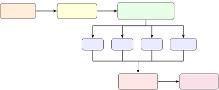

# VERDI: Single-Call Confidence Estimation for Verification-Based LLM Judges via Decomposed Inference

Jasmine Qi, Danylo Dantsev, and Muyang Sun  
Indeed Inc

###### Abstract

LLM-as-Judge systems are widely deployed for automated evaluation, yet
practitioners lack reliable methods to know _when_ a judge’s verdict
should be trusted. Token log-probabilities, the standard post-hoc
confidence signal, are unavailable for many commercial LLMs and, even
when accessible, saturate above 0.999 with structured JSON output. We
introduce Verdi (VERification-Decomposed Inference), a method that
extracts confidence from the reasoning trace a structured judge already
produces, with no additional inference calls. Verdi decomposes each
verification-style evaluation into sub-checks and derives three
structural signals: Step-Verdict Alignment, Claim-Level Margin, and
Evidence Grounding Score. We combine them with Platt-scaled logistic
regression. On three public benchmarks, Verdi achieves auroc 0.72–0.91
on GPT-4.1-mini and 0.66–0.80 on GPT-5.4-mini. On Qwen3.5-4B/9B/27B,
where answer-token logprobs are anti-calibrated (higher confidence on
errors, auroc 0.32–0.49), Verdi achieves 0.56–0.70. We additionally
validate on a production system with eight rubrics (auroc 0.73–0.88 on
factual rubrics), demonstrate cross-model transfer (auroc 0.66–0.69),
and show that a 33 M-parameter NLI (Natural Language Inference) model
provides a scalable alternative to regex extraction.

## 1 Introduction

LLM-as-Judge evaluation (Zheng et al., 2023) has become the default
approach for scalable text quality assessment. Systems such as
G-Eval (Liu et al., 2023) and direct assessment prompts are used in
production across content moderation, recruitment, summarization, and
scientific peer review. But a verdict alone is not enough. Practitioners
need to know _when to trust it_.

The standard answer relies on token log-probabilities (logprobs).
G-Eval (Liu et al., 2023) weights score tokens by their probabilities;
calibration methods (Kadavath et al., 2022) use logprobs to estimate
prediction uncertainty. However, logprob access is increasingly
restricted (Chauvin et al., 2026): as of March 2026, Anthropic Claude
(all versions) provides no logprobs (Anthropic, 2024)¹¹ 1 Anthropic
Messages API docs:
[https://docs.anthropic.com/en/api/messages](https://docs.anthropic.com/en/api/messages);
OpenAI Responses API docs:
[https://platform.openai.com/docs/api-reference/responses](https://platform.openai.com/docs/api-reference/responses).;
OpenAI reasoning models hide logprobs, temperature, and top-$`p`$ when
reasoning is enabled (GPT-5.4 exposes these controls only with reasoning
effort set to none, which removes the reasoning traces that Verdi uses);
and several other providers offer no documented logprob support.

Even when logprobs are available, they are often uninformative. With
structured JSON output (the standard for automated evaluation), we
observe that 99.4–100% of logprobs saturate to values above 0.999 across
SummEval and FEVER (Table 2), reducing logprob-based confidence to a
constant.

We propose Verdi, a post-hoc confidence method for structured
verification judges on tasks of the form evidence + claim $`\to`$
analysis $`\to`$ verdict. This verification pattern underlies a wide
range of deployed LLM-as-Judge applications, including hallucination
detection (Min et al., 2023), fact-checking (Thorne et al., 2018),
summarization consistency (Fabbri et al., 2021), and attribution
verification. Verdi decomposes each evaluation criterion into explicit
verification sub-checks within a single inference call: extract
individual claims, verify each against a source document, and aggregate
the outcomes into a verdict. The verification-style prompt defines the
judge trace; Verdi then scores that trace post-hoc, with no additional
inference calls. Unlike multi-call ensembles (Wang et al., 2023) that
multiply cost by 3–5$`\times`$, Verdi uses only the single original
judge call.

Our contributions: (1) Three structural signals (SVA, CLM, EGS) that
extract confidence from reasoning traces with no additional inference
calls. (2) Verification sub-checks that improve accuracy by +0.2 to
+10.0pp and detect annotation staleness. (3) Validation on three public
benchmarks (SummEval, FEVER, SciFact) across five models from two
families (GPT-4.1-mini, GPT-5.4-mini, Qwen3.5-4B/9B/27B), providing
confidence where logprob baselines are saturated, anti-calibrated, or
unavailable, plus production validation (auroc 0.73–0.88 on GPT-5.4-mini
factual rubrics). (4) Cross-domain transferability and qualitative error
analysis. (5) A 33M-parameter NLI model as a scalable, rubric-agnostic
alternative to regex extraction.

## 2 Related Work

#### LLM-as-Judge confidence.

G-Eval (Liu et al., 2023) uses token probabilities to weight evaluation
scores, requiring logprob access that is increasingly unavailable or
uninformative with structured JSON output. Xiong et al. (2024)
systematically evaluate confidence elicitation strategies and find that
LLMs are consistently overconfident; Tian et al. (2025) confirm this for
LLM judges specifically. CoT-UQ (Zhang and Zhang, 2025) samples multiple
reasoning paths and uses agreement as confidence; on matched 500-sample
subsets, Verdi scores 0.667 vs. 0.652 on SummEval and 0.737 vs. 0.582 on
FEVER at 5$`\times`$ lower cost (Section 5.2).

#### Trace-based uncertainty.

Kuhn et al. (2023) propose semantic entropy, clustering sampled outputs
by meaning to estimate uncertainty; this requires multiple samples,
whereas Verdi uses a single trace. Devic et al. (2025) observe that
trace length correlates with uncertainty; we find trace length alone
achieves moderate discrimination (auroc 0.56–0.57) but is improved by
structural analysis (+0.10–0.16 auroc). Radharapu et al. (2025) use
linear probes on hidden states, requiring white-box access unavailable
through commercial APIs.

#### Structured evaluation.

Chain-of-Verification (Dhuliawala et al., 2024) and FActScore (Min et
al., 2023) decompose evaluation into verifiable sub-steps to improve
_accuracy_. Verdi shows that decomposition also produces rich
_confidence_ signals from the existing trace.

#### Calibration and small judges.

Guo et al. (2017) show that modern neural networks are poorly calibrated
and propose temperature scaling; Kadavath et al. (2022) extend
calibration analysis to LLMs; Lin et al. (2022) propose verbalized
confidence; BaseCal (Tan et al., 2026) improves calibration across model
families. Smaller judge models (Alexandru et al., 2025; Bi et al., 2025)
are typically less well-calibrated, making confidence estimation even
more important.

## 3 Method: VERDI

Verdi operates on the analysis trace produced by a structured LLM judge.
We assume the judge receives evidence (a document, passage, or context)
and a _generated_ claim, that is, a factual assertion produced by an LLM
rather than a statement made by a user, and then produces a step-by-step
analysis culminating in a binary verdict. This _verification pattern_ is
common in fact-checking, consistency evaluation, and attribute
verification. Figure 1 illustrates the full pipeline.



Figure 1: Verdi pipeline. A structured LLM judge produces an analysis
trace via a single inference call. Verdi extracts four signal groups
from the trace and combines them via Platt-scaled logistic regression
into a confidence score.

### 3.1 Rubric Taxonomy

We identify three categories of verification rubrics with distinct trace
characteristics: (1) Factual grounding rubrics verify whether generated
claims are supported by source documents (internal Q1–Q4; public
SummEval and FEVER), producing the richest traces with per-claim
evidence extraction. (2) Relevance rubrics verify whether correct
content is also contextually appropriate (Q5–Q6). (3) Style/integrity
rubrics check tone, grammar, bias, and overpromising (Q7–Q11), producing
less structured traces. This taxonomy predicts Verdi effectiveness:
factual grounding rubrics produce traces that SVA, CLM, and EGS can
analyze, while style rubrics yield weaker signals (Section 5).

### 3.2 Verification Sub-Checks

Rather than evaluating each rubric with a single holistic prompt (“Is
the attribution accurate? Yes/No”), we decompose each into explicit
verification sub-checks within a _single_ LLM call:

1.  1.  Claim extraction: identify specific claims or elements to verify. If
        no claims are present, the sub-check terminates early with a
        “nothing to verify” verdict.
2.  2.  Per-claim adjudication: verify each claim against source evidence,
        recording a per-claim outcome (e.g., VERIFIED, FABRICATED²² 2
        FABRICATED denotes an LLM hallucination: the generated output
        contains a factual assertion not supported by the source document.
        It is not a judgment about the truthfulness of any user-provided
        content., NOT_FOUND).
3.  3.  Aggregation: combine per-claim outcomes into a final verdict with a
        structured analysis trace.

Sub-checks internalize gating logic: they handle both presence _and_
accuracy within a single trace, eliminating silent failures where a
holistic presence-check gate incorrectly skips downstream rubrics. A
concrete comparison is in Table 7 (Appendix D).

### 3.3 Signal Definitions

From the structured trace, Verdi extracts three core signals and a set
of surface features.

#### Step-Verdict Alignment (SVA).

For each reasoning step that contains a local conclusion (e.g., “this
claim is supported,” “no evidence found”), we classify the step as
supporting or opposing the final verdict. SVA is the fraction of steps
aligned with the verdict:

```math
\text{SVA}=\frac{|\{\text{steps aligned with verdict}\}|}{|\{\text{steps with conclusions}\}|} \tag{1}
```

Higher SVA indicates internal consistency; lower SVA suggests the model
reached a conclusion that contradicts its own reasoning.

We implement SVA extraction in two ways:

- •
  Regex-based: keyword patterns match positive conclusions (“supported,”
  “confirmed,” “verified”) and negative conclusions (“not supported,”
  “fabricated,” “no evidence”). This is fast and deterministic but
  requires well-structured traces with consistent verdict language.
- •
  NLI-based: a cross-encoder NLI model (nli-MiniLM2-L6-H768, 33M
  parameters) classifies whether each step entails or contradicts the
  verdict. This runs in under 2 seconds on CPU for a full trace and
  requires no rubric-specific customization.

#### Claim-Level Margin (CLM).

CLM counts the directional balance of sub-claims:

```math
\text{CLM}=\frac{|\{\text{claims in majority direction}\}|}{|\{\text{total claims}\}|} \tag{2}
```

A margin near 1.0 indicates unanimous support; near 0.5 indicates an
even split.

#### Evidence Grounding Score (EGS).

EGS measures how much of the analysis is grounded in quoted evidence
from the source document. We extract quoted text spans (delimited by
quotation marks in the analysis trace) and fuzzy-match each span against
the source document using token-level overlap with a threshold of 80%.
EGS is the fraction of quoted spans that can be verified in the source,
weighted by span length. Hallucinated quotes (where the model fabricates
evidence to support its reasoning) produce low EGS and indicate
unreliable verdicts.

#### Surface features.

We additionally extract: trace length (word count), hedging word count
(“however,” “partially,” “unclear”), negation count (“not,” “no,”
“never”), and quoted span count. All signal extraction is post-hoc: it
operates on the completed trace using deterministic parsing with no
additional LLM calls.

### 3.4 Confidence Scoring

All signals are combined via Platt-scaled logistic regression with L2
regularization ($`\lambda=0.1`$), standardized features, and 5-fold
cross-validated auroc with bootstrap 95% CIs (2000 resamples). The
7-feature model is intentionally low-capacity to prevent overfitting on
datasets as small as $`N=500`$. The logistic regression is fit from
scratch (no external ML libraries), enabling deployment in constrained
environments.

#### Intuition.

Verdi rests on a simple observation: when a judge makes an error, its
reasoning trace often _internally contradicts_ its conclusion, even when
the model’s token probability remains saturated near 1.0. Token-level
confidence reflects generation fluency; reasoning-level consistency
reflects evidential support. These two quantities can diverge. SVA, CLM,
and EGS each capture a different facet of this gap: SVA measures whether
intermediate conclusions agree with the final verdict, CLM measures the
balance of evidence, and EGS measures whether quoted evidence is real.
Their combination provides a post-hoc consistency check that is
complementary to, rather than redundant with, logprob-based calibration.

## 4 Experimental Setup

### 4.1 Datasets

#### Internal verification suite.

A proprietary evaluation system with 8 binary rubrics covering
attribution verification (Q1, Q2), factual accuracy (Q4), skill
relevancy assessment (Q5), logical plausibility (Q7), grammar (Q8), and
integrity checks (Q10, Q11). Each rubric checks whether a factual
assertion in the _LLM-generated output_ (e.g., “the candidate has 5
years of Python experience”) is supported by the source document (job
posting, resume, or other input context); the system evaluates GenAI
output quality, not user-provided content. $`\sim`$476 samples per
rubric, human-labeled ground truth.

#### SummEval (Fabbri et al., 2021).

A public academic benchmark containing 1,681 source–summary pairs from
CNN/DailyMail news articles across 17 summarization models. We frame
consistency evaluation as a binary verification task: “Is this summary
consistent with the source article?” Expert consistency scores
$`\geq 4.3`$ (out of 5) are labeled correct. SummEval and FEVER below
are included solely for reproducibility; they are not part of our
internal evaluation pipeline.

#### FEVER (Thorne et al., 2018).

A public fact-verification benchmark: 500 claims with gold Wikipedia
evidence passages. Binary task: does the evidence support or refute the
claim? Balanced sampling (250 SUPPORTS, 250 REFUTES).

#### SciFact (Wadden et al., 2020).

A scientific claim verification benchmark: 500 claims paired with gold
evidence from biomedical abstracts. Binary task: does the evidence
support or contradict the claim? SciFact tests domain transfer from
general-knowledge (FEVER) to scientific verification. All three public
datasets are released under permissive licenses (SummEval: Apache 2.0;
FEVER: CC-BY-SA 3.0; SciFact: CC-BY-NC 4.0).

### 4.2 Models

- •
  GPT-4.1-mini: supports logprobs, temperature control. Used for all
  external benchmarks and as the primary comparison model.
- •
  GPT-5.4-mini: OpenAI reasoning model. With reasoning enabled,
  logprobs, temperature, and top-$`p`$ are unavailable; setting
  reasoning effort to none exposes these controls but removes the
  reasoning traces that Verdi scores. Verdi is the only confidence
  method among those we evaluate that requires no additional inference
  calls.
- •
  Qwen3.5-4B/9B/27B: open-weight models (Alibaba). Run locally via
  HuggingFace transformers with greedy decoding (temperature $`=0`$,
  thinking mode disabled). Answer-token logprobs extracted via a
  targeted forward pass over the generated sequence.

### 4.3 Baselines

- •
  Logprob confidence: probability of the answer token (“yes”/“no”) from
  the LLM’s log-probabilities.
- •
  Verbalized confidence: modified prompt that requests an explicit
  “confidence: 0–100” field in the JSON output.
- •
  Trace length: word count of the analysis trace (prior work baseline).

## 5 Results

We first validate Verdi on three public benchmarks (SummEval, FEVER, and
SciFact) where all results are fully reproducible, then confirm findings
on an internal verification suite covering 8 rubrics across two model
families. All AUROC values for Verdi are computed via 5-fold stratified
cross-validation with Platt-scaled logistic regression; baseline AUROC
values (logprob, verbalized, trace length) are computed directly without
CV since they involve no learned parameters. Applying Platt scaling to
the logprob baseline would not recover signal: 99.4–100% of logprob
values saturate above 0.999 with structured JSON output, leaving no
variance for calibration to exploit. CoT-UQ is evaluated on 500-sample
subsets due to its 5$`\times`$ API cost.

### 5.1 Sub-Check Accuracy Gains

Before evaluating confidence signals, we measure the accuracy
improvement from verification sub-checks over holistic prompts. Table 1
reports results on GPT-4.1-mini across 476 human-annotated samples.

| Rubric              | Category      | Holistic | Sub-Check | $`\Delta`$ |
| ------------------- | ------------- | -------- | --------- | ---------- |
| Q1 Attrib. Present  | Hallucination | 96.2%    | 98.7%     | +2.5pp     |
| Q2 Attrib. Accuracy | Hallucination | 80.5%    | 88.1%     | +7.6pp     |
| Q5 Skill Relevancy  | Relevance     | 79.2%    | 89.2%     | +10.0pp    |
| Q11 Overpromising   | Integrity     | 95.8%    | 96.0%     | +0.2pp     |

Table 1: Accuracy improvement from sub-check prompts vs. holistic
prompts (GPT-4.1-mini, 476 samples per rubric). The 67 samples flagged
as unreliable ground truth (GT) were identified through annotator
disagreement flags in LabelStudio.

Sub-checks improve accuracy on all four rubrics, with the largest gains
on rubrics requiring evidence verification: Q5 gains +10.0 percentage
points and Q2 gains +7.6pp. The integrity rubric Q11 shows only a
marginal gain (+0.2pp), consistent with the observation that
pattern-based rubrics produce less structured traces.

#### Stricter sub-checks reveal annotation staleness.

When sub-checks enforce stricter criteria than the original ground
truth, raw accuracy _drops_ but confidence calibration _improves_: Q4
drops from 95.6% to 82.1% but gains +0.07 auroc; Q7 drops from 100% to
91.4% but gains +0.16 auroc. This diagnostic pattern indicates
annotation staleness: Verdi confidence is low on exactly these
newly-flagged cases, enabling a workflow where divergences between Verdi
scores and existing labels prioritize annotation guideline updates. This
approach flagged 67 samples where subsequent review confirmed outdated
labels.

### 5.2 External Benchmarks: SummEval, FEVER, and SciFact

We validate Verdi on three public benchmarks where results are fully
reproducible.

|                                                                                                                                                |             |                  |                  |                  |
| ---------------------------------------------------------------------------------------------------------------------------------------------- | ----------- | ---------------- | ---------------- | ---------------- |
| Method                                                                                                                                         | Calls       | SummEval         | FEVER            | SciFact          |
| Logprob confidence                                                                                                                             | 1$`\times`$ | 0.371$`\pm`$0.03 | 0.523$`\pm`$0.03 | 0.511$`\pm`$0.01 |
| CoT-UQ (Zhang and Zhang, 2025)^($`\ddagger`$)                                                                                                  | 5$`\times`$ | 0.652$`\pm`$0.05 | 0.582$`\pm`$0.05 | —                |
| Trace length                                                                                                                                   | 1$`\times`$ | 0.561            | 0.574            | —                |
| Best single signal                                                                                                                             | 1$`\times`$ | 0.675 (SVA)      | 0.718 (neg.)     | —                |
| Verdi LR ensemble                                                                                                                              | 1$`\times`$ | 0.717$`\pm`$0.03 | 0.737$`\pm`$0.07 | 0.910$`\pm`$0.04 |
| ^($`\ddagger`$)CoT-UQ evaluated on 500-sample subsets due to 5$`\times`$ API cost; all other rows use full datasets.                           |             |                  |                  |                  |
| Logprobs saturate above 0.999 on 99.4% of SciFact samples, yielding near-random AUROC.                                                         |             |                  |                  |                  |
| “—” = not reported (CoT-UQ not run on SciFact; trace length and best single signal omitted because SciFact uses a different prompt structure). |             |                  |                  |                  |

Table 2: External benchmark results (GPT-4.1-mini). Verdi uses no extra
inference calls; CoT-UQ uses 5$`\times`$. Logprobs saturate above 0.999
on 99–100% of samples with structured JSON output.

Verdi achieves auroc 0.717–0.910 across the three benchmarks while
logprobs saturate above 0.999 on 99.4–100% of samples. SciFact yields
the strongest result (0.910); biomedical abstracts provide more
structured evidence than news articles. CoT-UQ (Zhang and Zhang, 2025)
samples 5 paths at 5$`\times`$ cost (auroc 0.582–0.652); on the same
500-sample subsets, Verdi scores 0.667 vs. 0.652 on SummEval and 0.737
vs. 0.582 on FEVER.³³ 3 Full-dataset SummEval auroc is 0.717
($`N{=}1{,}681`$); the matched-subset value (0.667, $`N{=}500`$) is
lower due to higher fold variance.

### 5.3 Internal Verification Suite: Head-to-Head (GPT-4.1-mini)

Table 3 and Figure 2 compare all three confidence methods on the same
model (GPT-4.1-mini).

| Rubric              | Logprob | Verbalized | Verdi CV | Winner  |
| ------------------- | ------- | ---------- | -------- | ------- |
| Q1 Attrib. Present  | 0.912   | 0.851      | 0.806    | Logprob |
| Q2 Attrib. Accuracy | 0.716   | 0.632      | 0.825    | Verdi   |
| Q4 Job Detail Acc.  | 0.706   | —          | 0.915    | Verdi   |
| Q5 Skill Relevancy  | 0.840   | 0.610      | 0.877    | Verdi   |
| Q7 Logical Plausib. | 0.905   | —          | 0.905    | Tie     |
| Q8 Grammar          | 0.995   | —          | 1.000    | Tie     |
| Q11 Overpromising   | 0.602   | 0.735      | 0.459    | Verbal. |

Table 3: Confidence signal comparison on internal data (GPT-4.1-mini).
All Verdi numbers are 5-fold CV auroc. Best per rubric in bold.

Figure 2: auroc comparison across methods (GPT-4.1-mini, internal data).
Verdi wins on factual verification rubrics (Q2, Q4, Q5); logprobs win on
Q1, and Q7 is a tie.

Verdi achieves the highest auroc on Q2 (0.825), Q4 (0.915), and Q5
(0.877), the three rubrics requiring factual verification against source
documents. Logprobs win on Q1 (existence-check, 98.7% accuracy) and tie
on Q7. Verbalized confidence wins only on Q11 (overpromising detection),
a rubric where neither logprobs nor Verdi provide strong signals.

#### Why Verdi wins on factual rubrics.

When the model makes a factual error, its intermediate reasoning often
_contradicts_ its conclusion (low SVA), whereas logprobs remain
saturated. SVA has the largest LR coefficient on Q2 (+0.52), Q4 (+0.69),
and Q5 (+0.24).

### 5.4 When Logprobs Are Unavailable: GPT-5.4-mini

GPT-5.4-mini provides no logprobs, temperature, or top-$`p`$. Voting and
CoT-UQ baselines are impossible; verbalized confidence requires a
separate prompt re-run. Verdi extracts confidence from the existing
judge trace with no additional inference calls.

| Rubric              | N   | Accuracy | Verdi CV | ECE   |
| ------------------- | --- | -------- | -------- | ----- |
| Q1 Attrib. Present  | 471 | 99.6%    | 0.902    | 0.115 |
| Q2 Attrib. Accuracy | 364 | 83.0%    | 0.726    | 0.046 |
| Q4 Job Detail Acc.  | 473 | 83.7%    | 0.879    | 0.063 |
| Q5 Skill Relevancy  | 369 | 88.3%    | 0.807    | 0.041 |
| Q7 Logical Plausib. | 475 | 94.5%    | 0.765    | 0.032 |
| Q8 Grammar          | 475 | 99.4%    | 0.977    | 0.021 |

Table 4: Verdi on GPT-5.4-mini (no logprobs available). 5-fold CV
Platt-calibrated auroc.

Figure 3: Reliability diagram for Platt-calibrated Verdi on
GPT-5.4-mini. Diagonal indicates perfect calibration. Q4 and Q5 show
well-calibrated confidence; Q1 shows overconfidence due to the extreme
class imbalance (99.6% accuracy).

#### Confidence-aware routing.

At the optimal Youden threshold, Verdi flags 17–23% of predictions for
human review while catching 71–88% of errors: Q2 (17.6% flagged, 71.1%
errors caught, 95.3% retained accuracy), Q4 (22.9%/87.7%/97.1%), Q5
(22.2%/79.3%/96.8%). In practice, applying a modest human review budget
to the flagged subset substantially improves overall system accuracy.

### 5.5 Cross-Domain Transfer

Using a single 80/20 train/test split, FEVER-trained weights transfer
best: auroc 0.761 on internal ($`-`$0.09 vs. self-fit) and 0.623 on
SummEval ($`-`$0.04). Other source domains transfer poorly
($`\leq`$0.63), suggesting fact verification produces the most
generalizable features (Appendix E).

### 5.6 Signal Ablation

The full 7-feature model provides the best or near-best performance on
all datasets (Table 8, Appendix E). Surface features alone are
competitive on internal data (0.843) but do _not_ transfer. SVA captures
a structural signal (reasoning contradicts the verdict) which transfers
across domains.

### 5.7 NLI as Scalable Alternative

Regex excels on well-structured traces (Q2: 0.821 auroc); a 33M NLI
model (MiniLM, seconds on CPU) excels on unstructured reasoning (Q5:
0.886 vs. 0.528 regex), providing a rubric-agnostic alternative
(Table 11, Appendix H).

### 5.8 Error Analysis

#### When VERDI succeeds.

On FEVER, 95% of errors have saturated logprobs ($`>`$0.999); Verdi
identifies 43% through low SVA. On internal Q2, mean SVA is 0.925 for
correct vs. 0.685 for errors (gap = 0.24), while logprob means differ by
only 0.044.

#### When VERDI fails.

On FEVER, 59% of errors have SVA $`\geq`$ 0.8 (internally consistent but
wrong), arising from evidence misinterpretation or threshold sensitivity
on near-boundary claims. These genuine reasoning failures are
undetectable by any post-hoc signal.

## 6 Discussion

#### Cost and deployment.

Verdi is the only method in our comparison that provides confidence
without additional calls or logprob access; G-Eval requires logprobs,
verbalized confidence requires a re-run, and CoT-UQ requires
3–5$`\times`$ calls at temperature $`>0`$. In deployment, flagging
17–23% of predictions catches 71–88% of errors (Section 5).

#### Beyond OpenAI models.

Table 5 validates Verdi on three open-weight Qwen 3.5 models and
GPT-5.4-mini using identical benchmarks and prompts. Qwen logprobs are
anti-calibrated (auroc 0.32–0.49; Appendix G); Verdi achieves 0.56–0.70,
a gain of +0.08 to +0.31. GPT-5.4-mini achieves auroc 0.66–0.80 with no
logprob access. Cross-model transfer (auroc 0.66–0.69) supports
generalization across families.

| Model        | Method   | SummEval         | FEVER            | SciFact          | Transfer |
| ------------ | -------- | ---------------- | ---------------- | ---------------- | -------- |
| Qwen3.5-4B   | Logprob  | 0.373            | 0.494            | —                | —        |
|              | Verdi LR | 0.681$`\pm`$0.07 | 0.699$`\pm`$0.13 | —                | 0.689    |
| Qwen3.5-9B   | Logprob  | 0.417            | 0.421            | —                | —        |
|              | Verdi LR | 0.654$`\pm`$0.08 | 0.648$`\pm`$0.18 | —                | 0.693    |
| Qwen3.5-27B  | Logprob  | 0.325            | 0.479            | —                | —        |
|              | Verdi LR | 0.637$`\pm`$0.06 | 0.560$`\pm`$0.19 | —                | 0.660    |
| GPT-4.1-mini | Verdi LR | 0.717$`\pm`$0.03 | 0.737$`\pm`$0.07 | 0.910$`\pm`$0.04 | —        |
| GPT-5.4-mini | Verdi LR | 0.755$`\pm`$0.02 | 0.662$`\pm`$0.11 | 0.798$`\pm`$0.05 | —        |

Table 5: Multi-model validation (5-fold CV auroc). Same VERDI pipeline
and prompts across all models. Logprob baseline uses joint answer-token
probability. Transfer trains LR on GPT-4.1-mini traces and evaluates on
Qwen traces. GPT logprobs are saturated ($`>`$99.4% above 0.999) or not
exposed by the API.

#### Scope and limitations.

Verdi targets verification tasks (evidence + claim $`\to`$ verdict); it
does not apply to pairwise comparison (Tan et al., 2025). auroc varies
with task difficulty (0.56–0.91); when accuracy exceeds 94%, few errors
remain for any post-hoc method. Cross-domain transfer degrades when
trace conventions differ (internal$`\to`$SummEval: 0.52); surface
features do not transfer.

#### Reproducibility.

All public benchmark code (prompts, extraction, LR scripts, fold seeds)
and the NLI model will be released upon acceptance. Internal data cannot
be shared; public benchmarks serve as the primary evaluation track.

## 7 Conclusion

We introduced Verdi, a method that extracts confidence from structured
verification-judge traces without additional inference calls, achieving
auroc 0.66–0.91 on GPT models and 0.56–0.70 on Qwen on public
benchmarks. Extending trace-based confidence to open-ended generation
and preference ranking remains an open problem; we release code,
prompts, and all public-benchmark outputs to support reproduction.

## References

- Alexandru et al. (2025) A. Alexandru, A. Calvi, H. Broomfield, J.
  Golden, K. Dai, M. Leys, M. Burger, M. Bartolo, R. Engeler, S.
  Pisupati, T. Drane, and Y. S. Park Atla Selene Mini: a general purpose
  evaluation model. arXiv preprint arXiv:2501.17195. Cited by: §2.
- Anthropic (2024) Anthropic Anthropic Messages API documentation. Note:
  [https://docs.anthropic.com/en/api/messages](https://docs.anthropic.com/en/api/messages)As
  of March 2026, Claude models do not expose token log-probabilities
  Cited by: §1.
- Bi et al. (2025) Z. Bi, G. Srivastava, Y. Li, M. Lu, S. Roy, M.
  Ziyadi, and X. Wang JudgeBoard: benchmarking and enhancing small
  language models for reasoning evaluation. arXiv preprint
  arXiv:2511.15958. Cited by: §2.
- Chauvin et al. (2026) T. Chauvin, E. Le Merrer, F. Taïani, and G.
  Tredan Log probability tracking of LLM APIs. In International
  Conference on Learning Representations, Cited by: §1.
- Devic et al. (2025) S. Devic, C. Peale, A. Bradley, S. Williamson, P.
  Nakkiran, and A. Gollakota Trace length is a simple uncertainty signal
  in reasoning models. arXiv preprint arXiv:2510.10409. Cited by: §2.
- Dhuliawala et al. (2024) S. Dhuliawala, M. Komeili, J. Xu, R.
  Raileanu, X. Li, A. Celikyilmaz, and J. Weston Chain-of-verification
  reduces hallucination in large language models. In Findings of the
  Association for Computational Linguistics: ACL, pp. 3563–3578. Cited
  by: §2.
- Fabbri et al. (2021) A. R. Fabbri, W. Kryściński, B. McCann, C.
  Xiong, R. Socher, and D. Radev SummEval: re-evaluating summarization
  evaluation. Transactions of the Association for Computational
  Linguistics 9, pp. 568–600. Cited by: §1, §4.1.
- Guo et al. (2017) C. Guo, G. Pleiss, Y. Sun, and K. Q. Weinberger On
  calibration of modern neural networks. In International Conference on
  Machine Learning, pp. 1321–1330. Cited by: §2.
- Kadavath et al. (2022) S. Kadavath, T. Conerly, A. Askell, T.
  Henighan, D. Drain, E. Perez, N. Schiefer, Z. Hatfield-Dodds, N.
  DasSarma, E. Tran-Johnson, et al. Language models (mostly) know what
  they know. arXiv preprint arXiv:2207.05221. Cited by: §1, §2.
- Kuhn et al. (2023) L. Kuhn, Y. Gal, and S. Farquhar Semantic
  uncertainty: linguistic invariances for uncertainty estimation in
  natural language generation. In International Conference on Learning
  Representations, Cited by: §2.
- Lin et al. (2022) S. Lin, J. Hilton, and O. Evans Teaching models to
  express their uncertainty in words. Transactions on Machine Learning
  Research. Cited by: §2.
- Liu et al. (2023) Y. Liu, D. Iter, Y. Xu, S. Wang, R. Xu, and C. Zhu
  G-Eval: NLG evaluation using GPT-4 with better human alignment. In
  Proceedings of the 2023 Conference on Empirical Methods in Natural
  Language Processing, pp. 2511–2522. Cited by: §1, §1, §2.
- Min et al. (2023) S. Min, K. Krishna, X. Lyu, M. Lewis, W. Yih, P. W.
  Koh, M. Iyyer, L. Zettlemoyer, and H. Hajishirzi FActScore:
  fine-grained atomic evaluation of factual precision in long form text
  generation. In Proceedings of the 2023 Conference on Empirical Methods
  in Natural Language Processing, pp. 12076–12100. Cited by: §1, §2.
- Radharapu et al. (2025) B. Radharapu, E. Saxena, K. Li, C.
  Whitehouse, A. Williams, and N. Cancedda Calibrating LLM judges:
  linear probes for fast and reliable uncertainty estimation. arXiv
  preprint arXiv:2512.22245. Cited by: §2.
- Tan et al. (2026) H. Tan, W. Yang, J. Zhang, X. Chen, R. Tang, D.
  Su, J. Wang, Y. Wang, F. Sun, and X. Cheng BaseCal: unsupervised
  confidence calibration via base model signals. arXiv preprint
  arXiv:2601.03042. Cited by: §2.
- Tan et al. (2025) S. Tan, S. Zhuang, K. Montgomery, W. Y. Tang, A.
  Cuadron, C. Wang, R. A. Popa, and I. Stoica JudgeBench: a benchmark
  for evaluating LLM-based judges. In International Conference on
  Learning Representations, Cited by: §6.
- Thorne et al. (2018) J. Thorne, A. Vlachos, C. Christodoulopoulos,
  and A. Mittal FEVER: a large-scale dataset for fact extraction and
  VERification. In Proceedings of the 2018 Conference of the North
  American Chapter of the Association for Computational Linguistics:
  Human Language Technologies, pp. 809–819. Cited by: §1, §4.1.
- Tian et al. (2025) Z. Tian, Z. Han, Y. Chen, H. Xu, X. Yang, R.
  Xuan, H. Wang, and L. Liao Overconfidence in LLM-as-a-judge: diagnosis
  and confidence-driven solution. arXiv preprint arXiv:2508.06225. Cited
  by: §2.
- Wadden et al. (2020) D. Wadden, S. Lin, K. Lo, L. L. Wang, M. van
  Zuylen, A. Cohan, and H. Hajishirzi Fact or fiction: verifying
  scientific claims. In Proceedings of the 2020 Conference on Empirical
  Methods in Natural Language Processing (EMNLP), pp. 7534–7550. Cited
  by: §4.1.
- Wang et al. (2023) X. Wang, J. Wei, D. Schuurmans, Q. Le, E. Chi, S.
  Narang, A. Chowdhery, and D. Zhou Self-consistency improves chain of
  thought reasoning in language models. In International Conference on
  Learning Representations, Cited by: §1.
- Xiong et al. (2024) M. Xiong, Z. Hu, X. Lu, Y. Li, J. Fu, J. He,
  and B. Hooi Can LLMs express their uncertainty? an empirical
  evaluation of confidence elicitation in LLMs. In International
  Conference on Learning Representations, Cited by: §2.
- Zhang and Zhang (2025) B. Zhang and R. Zhang CoT-UQ: improving
  response-wise uncertainty quantification in LLMs with
  chain-of-thought. In Findings of the Association for Computational
  Linguistics: ACL, Cited by: §2, §5.2, Table 2.
- Zheng et al. (2023) L. Zheng, W. Chiang, Y. Sheng, S. Zhuang, Z.
  Wu, Y. Zhuang, Z. Lin, Z. Li, D. Li, E. P. Xing, et al. Judging
  LLM-as-a-judge with MT-bench and chatbot arena. In Advances in Neural
  Information Processing Systems, Vol. 36. Cited by: §1.

## Appendix A Example Sub-Check Prompt

Below is an abbreviated version of the Q2 (attribution accuracy)
sub-check prompt used in our experiments. The prompt instructs the judge
to extract, verify, and label each claim individually, producing the
structured trace that Verdi analyzes.

```ltx_verbatim
You are evaluating whether attributed claims
in the generated text are accurate.

Step 1 - Claim Extraction:
  Extract each specific claim attributed to
  the job seeker (e.g., "5 years of Python
  experience", "led a team of 10").
  If NO specific claims are attributed,
  answer YES (nothing to be inaccurate about).

Step 2 - Per-Claim Verification:
  For each claim, find supporting evidence in
  the resume. Label each claim:
    VERIFIED - evidence found in resume
    FABRICATED - no supporting evidence
    NOT_FOUND - claim cannot be checked

Step 3 - Aggregation:
  If ALL claims are VERIFIED -> YES
  If ANY claim is FABRICATED -> NO
  Provide final_answer and analysis as JSON.
```

## Appendix B Example Parsed Trace

The following shows how Verdi extracts signals from a Q2 analysis trace
(abbreviated; all data below is synthetic). Verdi operates entirely
post-hoc on the judge’s existing output trace using deterministic
parsing and a local NLI model. It introduces no additional data exposure
beyond what the judge already processes. The judge evaluated three
claims that the _LLM-generated output_ made about a candidate:

```ltx_verbatim
Analysis trace:
  Claim 1: "Python developer with 5 years
   experience" -> Resume: "Python 2019-2024"
   -> VERIFIED
  Claim 2: "Led cross-functional team of 12"
   -> Resume: no mention of team leadership
   -> FABRICATED
  Claim 3: "Certified AWS Solutions Architect"
   -> Resume: "AWS SAA-C03, 2023"
   -> VERIFIED
  Final answer: NO (1 fabricated claim)

Extracted signals:
  SVA  = 2/3 = 0.67  (2 steps align with NO)
  CLM  = 2/3 = 0.67  (2 verified, 1 fabricated)
  EGS  = 2/3 = 0.67  (2 quotes verified in
                       source document)
  Hedging words: 0
  Trace length: 87 words
```

In this example, FABRICATED means the LLM hallucinated the claim “Led
cross-functional team of 12” because the resume does not contain this
information. The low SVA (0.67) indicates that one reasoning step
contradicts the final verdict: the model found supporting evidence for
two claims but ruled “NO” based on the third. Verdi assigns moderate
confidence to this verdict, reflecting the mixed evidence. A verdict
with SVA $`=`$ 1.0 (all steps unanimous) would receive higher
confidence.

## Appendix C Rubric Descriptions

Table 6 provides paraphrased descriptions of all eight evaluation
rubrics. Each rubric produces a binary verdict (pass/fail) based on a
structured analysis of the generated output against the source document.
Rubric IDs (Q1–Q11) follow the internal numbering; gaps reflect rubrics
not included in this study.

| ID  | Category  | Description (paraphrased)                                                                                                                                                               | Trace  |
| --- | --------- | --------------------------------------------------------------------------------------------------------------------------------------------------------------------------------------- | ------ |
| Q1  | Factual   | Checks whether the generated output contains any attributed factual claims. Acts as a presence gate: if no claims are present, downstream accuracy rubrics are trivially satisfied.     | Low    |
| Q2  | Factual   | Checks whether each factual claim in the generated output is supported by evidence in the source document. Per-claim verification produces a structured trace with individual outcomes. | High   |
| Q4  | Factual   | Checks whether specific details (e.g., dates, quantities, qualifications) in the generated output match the corresponding information in the source document.                           | High   |
| Q5  | Relevance | Checks whether the content selected by the generated output is contextually appropriate, that is, the right information for the task, not just factually correct information.           | Medium |
| Q7  | Integrity | Checks whether the generated output is logically coherent and free of internal contradictions or implausible inferences.                                                                | Low    |
| Q8  | Integrity | Checks whether the generated output meets basic writing quality standards (grammar, spelling, fluency).                                                                                 | Low    |
| Q10 | Integrity | Checks whether the generated output avoids inappropriate editorial framing, unsubstantiated characterizations, or bias in presentation.                                                 | Low    |
| Q11 | Integrity | Checks whether the generated output avoids exaggeration, unsupported superlatives, or promises that go beyond what the source document supports.                                        | Low    |

Table 6: Paraphrased rubric descriptions. Category reflects the taxonomy
in Section 3.1. Trace richness indicates expected signal quality for
Verdi.

Trace richness reflects the depth of structured reasoning each rubric
elicits. High: the sub-check produces per-claim extraction, evidence
matching, and individual verification outcomes; SVA, CLM, and EGS are
all informative. Medium: the sub-check requires contextual judgment
beyond simple evidence matching, producing moderately structured traces.
Low: the rubric relies on pattern-based assessment without per-claim
decomposition; surface features (hedging, trace length) dominate over
structural signals.

## Appendix D Holistic vs. Sub-Check Example

| Holistic prompt                                                                      | Sub-check prompt                                                                                                                                                  |
| ------------------------------------------------------------------------------------ | ----------------------------------------------------------------------------------------------------------------------------------------------------------------- |
| “Are the attributed claims accurate? Provide a brief analysis.”                      | “Step 1: Extract each specific claim. Step 2: For each, find evidence in the resume and mark VERIFIED or FABRICATED. Step 3: Aggregate.”                          |
| _Output_: “Yes. The claims appear consistent with the resume.” (no per-claim detail) | _Output_: “Claim 1: ‘5 years Python’ – resume says ‘Python 2019–2024’ – VERIFIED. Claim 2: ‘Led team of 10’ – no mention – FABRICATED. Final: NO (1/2 verified).” |

Table 7: Holistic vs. sub-check evaluation for Q2 (attribution
accuracy). The sub-check decomposes the task into per-claim
verification, producing a structured trace that Verdi can analyze.

## Appendix E Signal Ablation and Transfer Details

| Subset           | Int. 4.1 | Int. 5.4 | SummEval | FEVER |
| ---------------- | -------- | -------- | -------- | ----- |
| All (7 features) | 0.832    | 0.754    | 0.642    | 0.750 |
| SVA only         | 0.698    | 0.628    | 0.562    | 0.529 |
| Surface only     | 0.843    | 0.717    | 0.629    | 0.690 |
| VERDI structural | 0.715    | 0.689    | 0.565    | 0.704 |
| SVA + surface    | 0.834    | 0.740    | 0.645    | 0.751 |

Table 8: Feature subset ablation (5-fold CV LR auroc).

| Train $`\backslash`$ Test | Internal | SummEval | FEVER |
| ------------------------- | -------- | -------- | ----- |
| Internal                  | 0.855    | 0.517    | 0.631 |
| SummEval                  | 0.574    | 0.662    | 0.570 |
| FEVER                     | 0.761    | 0.623    | 0.796 |

Table 9: Cross-domain LR transfer auroc. Diagonal: self-fit on a single
80/20 train/test split (differs from 5-fold CV in Table 2).
Off-diagonal: zero-shot transfer.

(a) Cross-domain transfer.

(b) Feature ablation.

Figure 4: (a) Cross-domain transfer auroc. FEVER-trained weights
transfer best. (b) Feature subset ablation heatmap.

## Appendix F Prompt-Style Robustness: Holistic vs. Sub-Check

Table 10 compares Verdi auroc when applied to traces from two prompt
styles: (1) the sub-check prompt used throughout the paper, which
decomposes evaluation into numbered verification steps, and (2) a
holistic prompt that asks the model to “analyze and explain your
reasoning step by step” without imposing structure. Verdi achieves
comparable AUROC under both prompt styles, demonstrating that the method
does not depend on a specific prompt format.

| Prompt Style            | SummEval         | FEVER            |
| ----------------------- | ---------------- | ---------------- |
| Sub-check (structured)  | 0.709$`\pm`$0.02 | 0.722$`\pm`$0.07 |
| Holistic (unstructured) | 0.754$`\pm`$0.08 | 0.658$`\pm`$0.10 |

Table 10: Prompt-style robustness (GPT-4.1-mini, $`N=500`$, 5-fold CV
auroc). Verdi works on traces from both structured sub-check and
unstructured holistic prompts.

The sub-check prompt is slightly better on FEVER ($`+0.064`$) and the
holistic prompt slightly better on SummEval ($`+0.045`$); both
differences fall within one standard deviation, indicating that
performance is robust to prompt structure.

## Appendix G Logprob Anti-Calibration on Qwen Models

Figure 5: Answer-token logprob distributions for correct (blue) vs.
incorrect (red) predictions across three Qwen 3.5 model sizes on FEVER
and SummEval. Dashed lines show means. In 4 of 6 settings, incorrect
predictions have _higher_ mean logprobs than correct predictions
(anti-calibrated), explaining the below-random auroc of logprob-based
confidence.

## Appendix H NLI vs. Regex SVA Extraction

| Rubric                            | SVA Regex | SVA NLI | $`\Delta`$ |
| --------------------------------- | --------- | ------- | ---------- |
| Q2 Attrib. Accuracy (structured)  | 0.821     | 0.666   | $`-`$0.16  |
| Q5 Skill Relevancy (unstructured) | 0.528     | 0.886   | +0.36      |
| Q11 Overpromising (no evidence)   | 0.504     | 0.673   | +0.17      |

Table 11: Regex vs NLI SVA extraction (auroc, GPT-4.1-mini internal
data).
