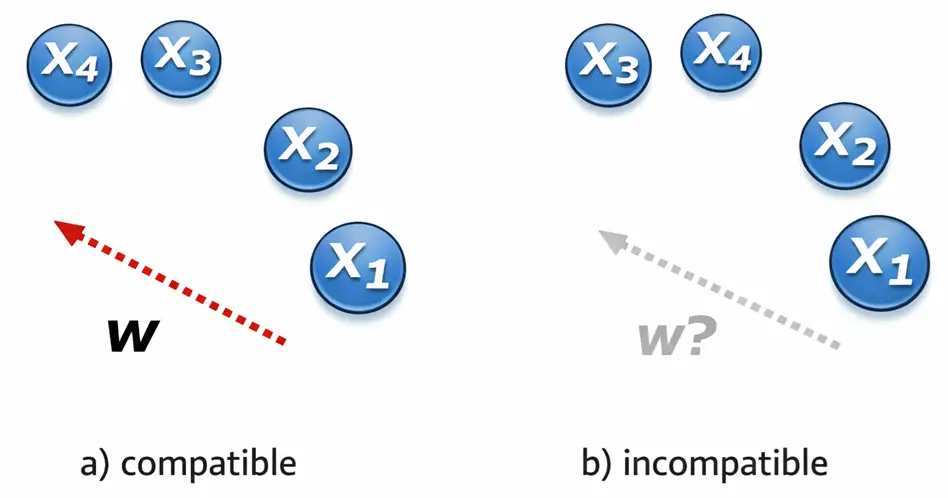

# Predicting Disagreement with Human Raters in LLM-as-a-Judge Difficulty Assessment without Using Generation-Time Probability Signals

Yo Ehara Address: Tokyo Gakugei University
Email: <ehara@u-gakugei.ac.jp>

###### Abstract

Automatic generation of educational materials using large language
models (LLMs) is becoming increasingly common, but assigning difficulty
levels to such materials still requires substantial human effort.
LLM-as-a-Judge has therefore attracted attention, yet disagreement with
human raters remains a major challenge. We propose a method for
predicting which LLM-generated difficulty ratings are likely to disagree
with human raters, so that such cases can be sent for re-rating. Unlike
prior approaches, our method does not rely on generation-time
probability signals, which must be collected during rating generation
and are often difficult to compare across LLMs. Instead, exploiting the
fact that difficulty is an ordinal scale, we use a separate embedding
space, such as ModernBERT, and identify disagreement candidates based on
the geometric consistency of the rating set. Experiments on English
CEFR-based sentence difficulty assessment with GPT-OSS-120B and
Qwen3-235B-A22B showed that the proposed method achieved higher AUC for
predicting disagreement with human raters than probability-based
baselines.

###### keywords

Disagreement, Difficulty Annotation, Large Language Models

## 1 Introduction

In recent years, improvements in the performance of large language
models (LLMs) and the development of supporting infrastructure have made
it increasingly practical to automatically generate educational content
such as practice questions, example sentences, and explanations for
learners. As a result, the potential for educational applications has
been expanding rapidly. At the same time, whether instructional
materials are at an appropriate difficulty level for learners is
directly related to both learning effectiveness and fairness. Difficulty
assessment is therefore a foundational task in the deployment of
generated educational materials. However, manual difficulty rating
requires expertise and time, and thus easily becomes a bottleneck in
large-scale operation.

To address this human evaluation cost, LLM-as-a-Judge, in which an LLM
also serves as an evaluator, has attracted increasing attention \[14\].
LLM-as-a-Judge can reduce the temporal and financial costs of evaluation
by lowering the burden on teachers and other human evaluators who would
otherwise need to assess large numbers of examples and instructional
materials for difficulty and related properties. At the same time,
however, reliability, robustness, and alignment with human judgments
have repeatedly been identified as major challenges (2, 11, 3).
Therefore, in practical use, it is important not to accept LLM ratings
as they are, but instead to efficiently identify cases that are likely
to disagree with human judgments, that is, candidate cases of
inter-rater disagreement.

One promising cue for identifying such disagreement candidates is to use
generation probabilities output by the LLM at rating time, such as
log-likelihoods or probability distributions. However, this approach has
practical limitations: such signals are available only at generation
time, so if they are not collected then, they cannot be recovered later.
In addition, because generation probabilities differ across models, they
are difficult to compare across LLMs.

Building on this motivation, this study extends the framework proposed
in \[6\] and proposes a method for predicting, without using LLM
probability signals, which difficulty ratings produced by LLM-as-a-Judge
are likely to disagree with human raters. The key idea of this study is
that difficulty is an ordinal scale. In language difficulty estimation
and readability assessment, deep representations such as BERT embeddings
have been shown to be effective (4), and it is also well known that
embedding spaces exhibit geometric structure, including directionality
and anisotropy (7). Based on this observation, we prepare, independently
of the LLM used as the rater, a separate embedding space such as that of
ModernBERT (12), and detect as disagreement candidates those ratings
that are geometrically inconsistent with the ordinal difficulty
structure, that is, with the alignment and consistency of the rating set
as a whole.

This approach has two major practical advantages. First, because it does
not depend on probability outputs, it can be applied even when such
signals were not collected at the time the LLM-as-a-Judge generated its
ratings. Second, unlike probability outputs, the quantities used by our
method are geometric, which makes them comparable across difficulty
labels assigned by different LLMs on the same dataset. Furthermore, the
model used for the embedding space is much smaller than the LLM used for
rating, with fewer than 1 billion parameters.

In our experiments, we consider an English CEFR-based difficulty
assessment task, which provides internationally shared and rigorous
difficulty criteria, and predict disagreement with human ratings for
sentence difficulty labels produced by the open-weight LLMs gpt-oss-120b
(10) and Qwen3-235B-A22B (13). The results show that the proposed method
predicts disagreement with higher AUC than methods based on LLM
probability signals, demonstrating its effectiveness as a
probability-free and interpretable method for prioritizing cases for
re-rating.

## 2 Related Work

Methods for LLM-as-a-Judge, which assess the extent to which LLM
evaluations are correct, have often relied on LLM probability signals.
For example, LLM-Rubric presents a framework that calibrates human
ratings by using the probability distribution over rubric-based
questions as input (8). However, the use of probability signals still
poses practical challenges: (i) they must be obtained at the same time
as the rating is generated, and are therefore affected by logging
availability and API constraints; and (ii) probability scales and
calibration differ across models, making comparison and interpretation
difficult. In addition, as a black-box approach to uncertainty
estimation that does not rely on probability distributions, previous
work has proposed detecting anomalies from the self-consistency of
sampled outputs (e.g., SelfCheckGPT) (9), although such methods may
require temperature adjustment or other sampling controls.

In language learning research, assigning difficulty levels based on a
common framework is important, but it has also been pointed out that
constructing sufficiently large, high-quality annotated datasets is
itself difficult. For example, the study that constructed a CEFR-based
sentence difficulty corpus (CEFR-SP) and demonstrated sentence
difficulty estimation using BERT-based models was motivated by this
challenge (1).



Figure 1: Figure reproduced from \[6\] with their permission. In (a),
let $`\mathbf{x}_{1},\mathbf{x}_{2},\mathbf{x}_{3}`$, and
$`\mathbf{x}_{4}`$ denote two-dimensional word or sentence embeddings.
We write
$`\mathbf{x}_{1}\prec\mathbf{x}_{2}\prec\mathbf{x}_{3}\prec\mathbf{x}_{4}`$
to indicate that $`\mathbf{x}_{1}`$ is annotated as easier than
$`\mathbf{x}_{2}`$, $`\mathbf{x}_{2}`$ as easier than
$`\mathbf{x}_{3}`$, and so on. In this case, if the points are ordered
along the direction of $`\mathbf{w}`$ in the two-dimensional space, the
resulting order matches the annotation. In contrast, in example (b), no
such direction exists. In practice, most datasets and embedding spaces
are closer to the situation in (b), but the degree of alignment is
defined by how well one can find a direction that satisfies the ordering
in (a) with as few constraint violations as possible. In addition, for a
given instance, the degree to which the average of the difference
vectors between that instance and all other instances is aligned with
$`\mathbf{w}`$ is defined as the alignment score of that instance.

## 3 Proposed Method

The proposed method extends the framework proposed in \[6\]. We first
provide an intuitive explanation of the method using Fig. 1. First, we
prepare an embedding vector space that is _completely separate_ from the
one used for difficulty labeling. For example, we assume a well-known
encoder such as BERT \[5\] or ModernBERT \[12\], and all embedding
vectors are assumed to be normalized to unit length. The main idea of
\[6\] is that, given such an embedding space together with a set of
difficulty labels assigned by an LLM, one can uniquely compute a vector
that represents the degree of geometric consistency between the
embedding space and the difficulty labeling.

While \[6\] evaluates only the consistency of the difficulty labeling as
a whole, it is also possible to compute the degree of consistency
between the embedding space and each individual difficulty label. The
proposed method uses this property: difficulty labels with low
consistency with the embedding space are treated as candidates for low
inter-rater agreement, that is, cases likely to show disagreement when
another rater is introduced. We now describe their method in more
detail. Consider $`N`$ embedding vectors
$`\{\mathbf{x}_{1},\ldots,\mathbf{x}_{N}\}`$, where each
$`\mathbf{x}_{i}`$ is a $`D`$-dimensional vector. We assume that all
embedding vectors are normalized, that is, $`||\mathbf{x}_{i}||=1`$,
where $`||\mathbf{x}_{i}||`$ denotes the Euclidean norm of the vector.
Let $`\mathbf{w}\in\mathbb{R}^{D}`$ be a $`D`$-dimensional vector
representing a direction in the embedding space. They convert difficulty
labels into pairwise constraints between two instances. They denote by
$`\mathbf{x}_{i}`$ the vector judged to be _easier_, and by
$`\mathbf{x}_{j}`$ the vector judged to be _more difficult_. Then, the
condition that instances are aligned in the embedding space in order of
difficulty when viewed along the direction $`\mathbf{w}`$ can be written
as $`\mathbf{w}^{\top}\left(\mathbf{x}_{i}-\mathbf{x}_{j}\right)<0.`$ To
transform the inequality constraints into equality constraints, we
introduce variables that represent the degree to which each constraint
is satisfied (slack variables), and write
$`\mathbf{w}^{\top}\left(\mathbf{x}_{i_{k}}-\mathbf{x}_{j_{k}}\right)+\xi_{k}=0.`$
Here, $`k`$ is an index over constraints.

At this point, by taking into account that $`\mathbf{w}`$ is a direction
vector, that is, $`||\mathbf{w}||^{2}=1`$, and searching for the
direction $`\mathbf{w}`$ that maximizes the sum of all $`\xi_{k}`$
values (the degrees to which the constraints are satisfied), we obtain
the following mathematical optimization problem. Here, although
originally $`T=0`$, if we relax it to $`T=-\infty`$, the optimal
$`\mathbf{w}`$ can be computed in closed form simply as the mean vector
of the differences between labeled pairs.

```math
\max_{\mathbf{w},\mathbf{\xi}}\sum_{k=1}^{K}\xi_{k}, \tag{1}
```

```math
\textrm{s.t. }\forall k,\quad\mathbf{w}^{\top}(\mathbf{x}_{i_{k}}-\mathbf{x}_{j_{k}})+\xi_{k}=0,\quad\xi_{k}\geq T,\;||\mathbf{w}||^{2}=1 \tag{2}
```

The solution to (2) is given by
$`\mathbf{w}\propto-\sum_{k=1}^{K}(\mathbf{x}_{i_{k}}-\mathbf{x}_{j_{k}})`$.
Let $`\bar{\mathbf{x}}_{i}`$ denote the mean vector of level $`i`$, and
similarly for level $`j`$, and let $`N_{i}`$ and $`N_{j}`$ denote the
numbers of instances at levels $`i`$ and $`j`$, respectively. Then,
$`\mathbf{w}`$ can be written as
$`\mathbf{w}\propto-(N_{i}\bar{\mathbf{x}}_{i}-N_{j}\bar{\mathbf{x}}_{j})`$.
We refer to the method using this direction as “exactw.” Although the
exact solution can be written in this form, in practice, when the
numbers of instances at some levels are small as a result of LLM-based
difficulty labeling, computing $`\mathbf{w}`$ exactly may lead to a
biased direction vector. Since $`\mathbf{w}`$ only needs to be a
direction vector, we also propose a simpler method, “most2,” in which
$`\mathbf{w}`$ is defined as the difference between the mean vectors of
the two labels that were assigned most frequently by the LLM.

Once the direction $`\mathbf{w}`$ has been obtained, the values of
$`\xi_{k}`$ can be computed accordingly. Then, by summing the
$`\xi_{k}`$ values over all constraints involving item $`i`$, we can
compute the degree of consistency for item $`i`$.

## 4 Experimental Setup

For the evaluation in this study, a dataset with rigorously obtained
human ratings is desirable, and it is also important that the dataset
include difficulty labels provided by multiple human raters. For this
reason, we used the CEFR-SP dataset \[1\]. In this dataset, the
difficulty of English sentences is rated by two expert annotators on a
six-level scale, A1, A2, B1, B2, C1, and C2, based on the CEFR (Common
European Framework of Reference for Languages), which is a standard and
widely used framework for English proficiency in English language
education.

Next, in this study, we needed baseline models from which confidence
scores (token generation probabilities) could be obtained. For this
purpose, we used GPT-OSS-120B and Qwen3-235B-A22B (hereafter, Qwen3) for
labeling, as they were among the largest models that could be run
locally on a single GPU as of February 2026.

The input consisted of 10,004 English sentences. The label distribution
produced by GPT-OSS-120B was A1: 500, A2: 3,345, B1: 2,899, B2: 3,230,
C1: 29, and C2: 1. For Qwen3, the distribution was A1: 635, A2: 1,626,
B1: 4,014, B2: 3,293, and C1: 436.

Performance in disagreement detection was evaluated using ROC-AUC,
PR-AUC, and Precision@20. ROC-AUC is the area under the ROC curve
obtained by thresholding the decision function and plotting the
resulting pairs of true positive rate and false positive rate. PR-AUC is
the area under the precision–recall curve obtained by similarly sweeping
the threshold. Precision@20 denotes the precision when the top 20
instances ranked in descending order of $`s(i)`$ are regarded as
candidates for re-evaluation. For all metrics, sentences for which the
label assigned by the LLM differed from that of human rater A or B were
treated as positive instances.

### 4.1 Difficulty Labeling by LLMs

For the logprob-based baseline, we used the token log-probability of the
label sequence output by GPT-OSS-120B or Qwen3 (logprob_label) as the
confidence score for disagreement detection.

The prompt included the CEFR criteria descriptions in the user input,
and in practice we used the following System/User strings exactly as
written:

> System: You are an English proficiency rater who must assign a CEFR
> level (A1, A2, B1, B2, C1, or C2) to a single sentence using the
> provided criteria.

After this, we directly inserted the English descriptions of the CEFR
criteria for each level as given at
https://en.wikipedia.org/wiki/Common_European_Framework_of_Reference_for_Languages.

For the user input, we used the following prompt:

> You must output exactly one label token (A1, A2, B1, B2, C1, or C2)
> with no explanation.
>
> User: Sentence: "sentence" Respond with exactly one of: A1, A2, B1,
> B2, C1, C2.
>
> Assistant:

For Qwen3 instruct models, we additionally appended “\nDo not output
anything else. Answer: ” at the end in order to constrain the response
to a single label only.

### 4.2 Embedding Models Used

The alignment measure of \[6\] estimates a single direction $`w`$ using
the differences between class centroids for each CEFR level, and
measures the degree of constraint violation by the inner product with
$`w`$. In this study, we implemented the aforementioned “exactw” as well
as “most2,” which uses the difference between the centroids of the two
most frequent labels. The embedding models used for comparison are shown
in Tab. 1. Except for ModernBERT, the names correspond to the model
names on Hugging Face (https://huggingface.co/).

| Model                                      | Number of parameters (M) |
| ------------------------------------------ | ------------------------ |
| modernbert                                 | 394.8                    |
| intfloat/e5-large-v2                       | 335.1                    |
| BAAI/bge-large-en-v1.5                     | 335.1                    |
| intfloat/multilingual-e5-large-instruct    | 559.9                    |
| sentence-transformers/LaBSE                | 470.9                    |
| microsoft/deberta-v3-large                 | 434.0                    |
| sentence-transformers/sentence-t5-large    | 737.7                    |
| sentence-transformers/sentence-t5-base     | 222.9                    |
| sentence-transformers/all-roberta-large-v1 | 355.4                    |
| Alibaba-NLP/gte-large-en-v1.5              | 434.1                    |
| hkunlp/instructor-large                    | 737.7                    |

Table 1: Number of parameters in the embedding models

## 5 Experimental Results

Let us first restate the goal of this study. We first assign difficulty
labels using an LLM. We then use various methods to identify, from those
difficulty labels, the cases that are likely to disagree with human
raters. Because the CEFR-SP dataset used in this study contains two
human raters, we conducted experiments for both disagreement with Rater
A and disagreement with Rater B. As noted above, for all three
metrics—ROC-AUC, PR-AUC, and Precision@20—higher values indicate better
performance in predicting disagreement. Tab. 2 and Tab. 3 show the
results when GPT-OSS-120B was used for difficulty labeling, while Tab. 4
and Tab. 5 show the results when Qwen3 was used for difficulty labeling.
Methods with _logprob_ in their names are the conventional baselines
that use the token generation probabilities of each LLM’s output labels.
Since no previous method has proposed using embedding vectors separate
from the LLM itself, all other methods are proposed methods.

The _exactw_ method uses, as the direction of $`\mathbf{w}`$, the
average of all pairwise constraints. In contrast, _most2_ uses as
$`\mathbf{w}`$ the direction of the difference between the mean vectors
of the two levels that were assigned most frequently and second most
frequently by the LLM.

First, across all four combinations of GPT-OSS-120B or Qwen3 with Rater
A or B, modernbert (most2) achieved higher PR-AUC than the conventional
logprob-based method. Previously, the only option was to use the
confidence scores output by the LLM at the time of response generation,
and once these were not collected during generation, it was difficult to
obtain them again afterward. In contrast, the proposed method makes it
possible to obtain, after the response has already been generated, a
more effective indicator of confidence for LLM-as-a-Judge. This is a
novel and practically useful result.

Second, _for most embedding models, including modernbert, most2
performed better than exactw_. This is an important finding. A likely
reason is that the difficulty level labels assigned by each LLM are not
evenly distributed. Rather than measuring consistency with the embedding
space while also taking into account instances assigned to infrequent
levels, better performance was obtained, from the perspective of
detecting the magnitude of disagreement with human raters, by closely
examining the levels most frequently assigned by the LLM and measuring
their consistency with the embedding space.

Furthermore, although various embeddings were tested, _overall,
modernbert showed strong performance_. ModernBERT \[12\] is a method
that comprehensively improves upon BERT, and like BERT, it is designed
not for a specific dataset but for broad use of embedding vectors across
a wide range of tasks. The proposed method in this study uses modernbert
in a way that is consistent with its original design intention. It is
therefore reasonable to interpret the result as showing that, even with
a relatively small number of parameters, an embedding model used in
accordance with its intended design is the most useful.

|                                |         |        |              |
| ------------------------------ | ------- | ------ | ------------ |
| Method (Rater)                 | ROC-AUC | PR-AUC | precision@20 |
| logprob_label (A)              | 0.561   | 0.579  | 0.80         |
| p_i exactw / chain (A)         | 0.509   | 0.528  | 0.55         |
| modernbert \[6\] most2         | 0.606   | 0.652  | 1.00         |
| modernbert \[6\] exactw        | 0.424   | 0.503  | 0.80         |
| e5-large-v2                    | 0.578   | 0.624  | 1.00         |
| bge-large-en-v1.5              | 0.575   | 0.614  | 1.00         |
| multilingual-e5-large-instruct | 0.602   | 0.652  | 1.00         |
| LaBSE                          | 0.588   | 0.637  | 1.00         |
| deberta-v3-large               | 0.589   | 0.622  | 0.95         |
| sentence-t5-large              | 0.568   | 0.604  | 1.00         |
| sentence-t5-base               | 0.571   | 0.610  | 1.00         |
| all-roberta-large-v1           | 0.575   | 0.608  | 0.95         |
| gte-large-en-v1.5              | 0.574   | 0.611  | 0.95         |
| instructor-large               | 0.577   | 0.618  | 1.00         |

Table 2: Evaluation metrics for GPT-OSS-120B (Rater A)

|                                     |         |        |              |
| ----------------------------------- | ------- | ------ | ------------ |
| Method (Rater)                      | ROC-AUC | PR-AUC | precision@20 |
| logprob_label (B)                   | 0.558   | 0.668  | 0.95         |
| p_i exactw / chain (B)              | 0.511   | 0.653  | 0.85         |
| modernbert \[6\] most2 / chain (B)  | 0.547   | 0.690  | 1.00         |
| modernbert \[6\] exactw / chain (B) | 0.427   | 0.578  | 0.70         |
| e5-large-v2                         | 0.552   | 0.676  | 1.00         |
| bge-large-en-v1.5                   | 0.535   | 0.666  | 1.00         |
| multilingual-e5-large-instruct      | 0.548   | 0.683  | 1.00         |
| LaBSE                               | 0.551   | 0.685  | 1.00         |
| deberta-v3-large                    | 0.540   | 0.675  | 1.00         |
| sentence-t5-large                   | 0.530   | 0.665  | 1.00         |
| sentence-t5-base                    | 0.531   | 0.665  | 1.00         |
| all-roberta-large-v1                | 0.539   | 0.661  | 1.00         |
| gte-large-en-v1.5                   | 0.535   | 0.665  | 0.95         |
| instructor-large                    | 0.530   | 0.668  | 1.00         |

Table 3: Evaluation metrics for GPT-OSS-120B (Rater B)

|                                |         |        |              |
| ------------------------------ | ------- | ------ | ------------ |
| Method (Rater)                 | ROC-AUC | PR-AUC | precision@20 |
| logprob_label (A)              | 0.567   | 0.539  | 0.55         |
| p_i exactw / chain (A)         | 0.525   | 0.508  | 0.60         |
| \[6\] most2 / chain (A)        | 0.593   | 0.591  | 0.90         |
| \[6\] exactw / chain (A)       | 0.482   | 0.509  | 0.75         |
| e5-large-v2                    | 0.534   | 0.537  | 0.80         |
| bge-large-en-v1.5              | 0.540   | 0.538  | 0.75         |
| multilingual-e5-large-instruct | 0.567   | 0.568  | 0.95         |
| LaBSE                          | 0.545   | 0.544  | 0.95         |
| deberta-v3-large               | 0.565   | 0.551  | 0.80         |
| sentence-t5-large              | 0.538   | 0.532  | 0.55         |
| sentence-t5-base               | 0.543   | 0.537  | 0.60         |
| all-roberta-large-v1           | 0.544   | 0.536  | 0.75         |
| gte-large-en-v1.5              | 0.540   | 0.538  | 0.80         |
| instructor-large               | 0.542   | 0.539  | 0.85         |

Table 4: Evaluation metrics for Qwen3 (Rater A)

|                                |         |        |              |
| ------------------------------ | ------- | ------ | ------------ |
| Method (Rater)                 | ROC-AUC | PR-AUC | precision@20 |
| logprob_label (B)              | 0.539   | 0.586  | 0.85         |
| p_i exactw / chain (B)         | 0.501   | 0.558  | 0.75         |
| \[6\] most2 / chain (B)        | 0.537   | 0.610  | 0.85         |
| \[6\] exactw / chain (B)       | 0.424   | 0.508  | 0.30         |
| e5-large-v2                    | 0.520   | 0.581  | 0.70         |
| bge-large-en-v1.5              | 0.506   | 0.577  | 0.70         |
| multilingual-e5-large-instruct | 0.526   | 0.592  | 0.75         |
| LaBSE                          | 0.533   | 0.584  | 0.75         |
| deberta-v3-large               | 0.523   | 0.585  | 0.75         |
| sentence-t5-large              | 0.503   | 0.569  | 0.75         |
| sentence-t5-base               | 0.496   | 0.567  | 0.80         |
| all-roberta-large-v1           | 0.503   | 0.570  | 0.70         |
| gte-large-en-v1.5              | 0.505   | 0.574  | 0.75         |
| instructor-large               | 0.503   | 0.573  | 0.80         |

Table 5: Evaluation metrics for Qwen3 (Rater B)

## 6 Conclusion

In this study, we proposed a reliability indicator for individual
difficulty labels assigned by LLM-as-a-Judge that is easier to obtain
and more effective than conventional probability-based approaches.
Unlike prior methods, the proposed method requires only the LLM-assigned
labels and the original text, without relying on generation-time
confidence scores. The method exploits the fact that difficulty is an
ordinal scale and measures, for each label, the geometric consistency
between an additional embedding space and the difficulty labels assigned
by the LLM. Experiments on CEFR-SP showed that the proposed method can
detect labels likely to disagree with human raters more accurately than
conventional methods. It is also memory-efficient, since it uses only
text embedding models with fewer than 1B parameters.

As future work, although this study was evaluated on English text
difficulty assessment, extending the method to STEM subjects will
require establishing a rigorous difficulty scale comparable to CEFR
across human raters. If such a scale can be developed, the proposed
method may also be applied to STEM difficulty assessment.

## Appendix A Scope and Limitations

The proposed method should be understood as a method for detecting
potentially unreliable difficulty labels in settings where the target
difficulty construct is ordinal and is at least partly reflected in an
independent representation space. In this paper, we evaluated the method
on CEFR-based English sentence difficulty assessment. This is a
favorable setting for the proposed approach because the target construct
is linguistic difficulty, and text embedding models such as ModernBERT
are expected to encode lexical, syntactic, and semantic properties that
are relevant to language proficiency levels.

This scope is important. The proposed method is not intended to be a
domain-independent solution to all forms of educational difficulty
assessment. In particular, difficulty in STEM domains may depend on
conceptual prerequisites, problem-solving procedures, mathematical
structure, required operations, common misconceptions, and the
interaction between textual and non-textual representations. These
factors may not be adequately captured by standard text embeddings. In
such cases, geometric consistency in a generic embedding space may
reflect lexical or semantic similarity rather than the educational
difficulty of the item.

Therefore, applying the proposed method to STEM difficulty assessment
would require additional domain-specific assumptions and validation. One
possible direction is to replace the generic text embedding space with a
representation that incorporates prerequisite relations,
knowledge-component annotations, worked-solution structure, or other
features that are known to be relevant to the target domain. Another
requirement is a reliable ordinal difficulty scale with sufficient
agreement among human raters, comparable in role to CEFR in the present
study.

Accordingly, the main contribution of this paper is not that embedding
geometry universally determines educational difficulty. Rather, the
contribution is to show that, in language-based difficulty assessment,
an independently obtained embedding space can provide a practical and
probability-free signal for prioritizing LLM-generated ratings that are
likely to disagree with human raters. Extending this idea beyond
language difficulty assessment is an important direction for future
work, but it should be treated as a domain-specific research problem
rather than as a direct application of the present method.

## Acknowledgments

This work was supported by JST PRESTO, Japan, Grant Number JPMJPR2363
and by JSPS KAKENHI Grant Number JP22K12287. We are deeply grateful to
the anonymous reviewers for their constructive feedback.

## References

- \[1\] Y. Arase, S. Uchida, and T. Kajiwara. CEFR-based sentence
  difficulty annotation and assessment. In Proc. of EMNLP, 2022.
- \[2\] G. H. Chen, S. Chen, Z. Liu, F. Jiang, and B. Wang. Humans or
  LLMs as the judge? a study on judgement bias. In Proceedings of the
  2024 Conference on Empirical Methods in Natural Language Processing,
  pages 8301–8327, Miami, Florida, USA, Nov. 2024. Association for
  Computational Linguistics.
- \[3\] C.-H. Chiang, W.-C. Chen, C.-Y. Kuan, C. Yang, and H.-y. Lee.
  Large language model as an assignment evaluator: Insights, feedback,
  and challenges in a 1000+ student course. In Proc. of EMNLP, 2024.
- \[4\] T. Deutsch, M. Jasbi, and S. Shieber. Linguistic features for
  readability assessment. In Proceedings of the Fifteenth Workshop on
  Innovative Use of NLP for Building Educational Applications, pages
  1–17, Seattle, WA, USA → Online, July 2020. Association for
  Computational Linguistics.
- \[5\] J. Devlin, M.-W. Chang, K. Lee, and K. Toutanova. BERT:
  Pre-training of Deep Bidirectional Transformers for Language
  Understanding. In Proceedings of the 2019 Conference of the North
  American Chapter of the Association for Computational Linguistics:
  Human Language Technologies, Volume 1 (Long and Short Papers), pages
  4171–4186, Minneapolis, Minnesota, June 2019. Association for
  Computational Linguistics.
- \[6\] Y. Ehara. Educational cone model in embedding vector spaces. In
  Proc. of ICCE 2025 (short paper), 2025.
- \[7\] K. Ethayarajh. How contextual are contextualized word
  representations? Comparing the geometry of BERT, ELMo, and GPT-2
  embeddings. In Proceedings of the 2019 Conference on Empirical Methods
  in Natural Language Processing and the 9th International Joint
  Conference on Natural Language Processing (EMNLP-IJCNLP), pages 55–65,
  Hong Kong, China, Nov. 2019. Association for Computational
  Linguistics.
- \[8\] H. Hashemi, J. Eisner, C. Rosset, B. Van Durme, and C. Kedzie.
  LLM-rubric: A multidimensional, calibrated approach to automated
  evaluation of natural language texts. In Proc. of ACL, 2024.
- \[9\] P. Manakul, A. Liusie, and M. Gales. SelfCheckGPT: Zero-resource
  black-box hallucination detection for generative large language
  models. In Proceedings of the 2023 Conference on Empirical Methods in
  Natural Language Processing, pages 9004–9017, Singapore, Dec. 2023.
  Association for Computational Linguistics.
- \[10\] OpenAI. Introducing gpt-oss. OpenAI website, 2025.
- \[11\] V. Raina, A. Liusie, and M. Gales. Is LLM-as-a-judge robust?
  investigating universal adversarial attacks on zero-shot LLM
  assessment. In Proceedings of the 2024 Conference on Empirical Methods
  in Natural Language Processing, pages 7499–7517, Miami, Florida, USA,
  Nov. 2024. Association for Computational Linguistics.
- \[12\] B. Warner, A. Chaffin, B. Clavié, O. Weller, O. Hallström,
  S. Taghadouini, A. Gallagher, R. Biswas, F. Ladhak, T. Aarsen, G. T.
  Adams, J. Howard, and I. Poli. Smarter, better, faster, longer: A
  modern bidirectional encoder for fast, memory efficient, and long
  context finetuning and inference. In Proc. of ACL, 2025.
- \[13\] A. Yang et al. Qwen3 technical report
  (https://arxiv.org/abs/2505.09388), 2025.
- \[14\] L. Zheng, W.-L. Chiang, Y. Sheng, S. Zhuang, Z. Wu, Y. Zhuang,
  Z. Lin, Z. Li, D. Li, E. P. Xing, H. Zhang, J. E. Gonzalez, and
  I. Stoica. Judging llm-as-a-judge with mt-bench and chatbot arena. In
  Proc. of NeurIPS, 2023.

\balancecolumns
