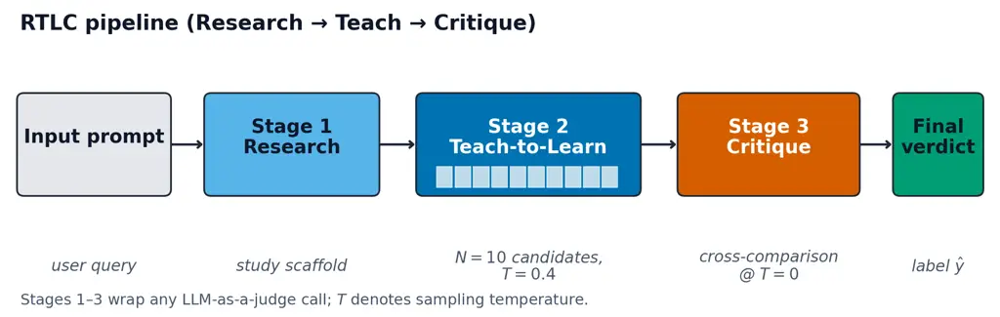
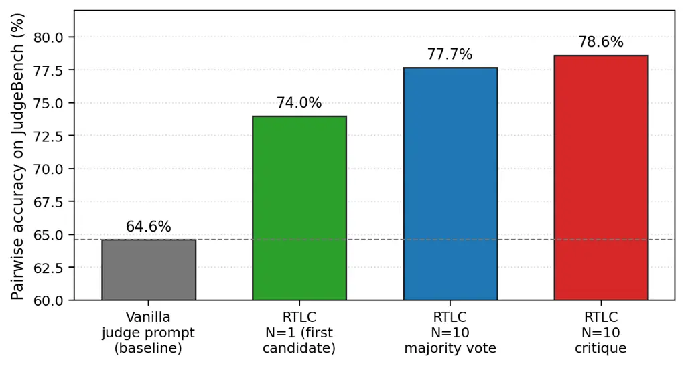
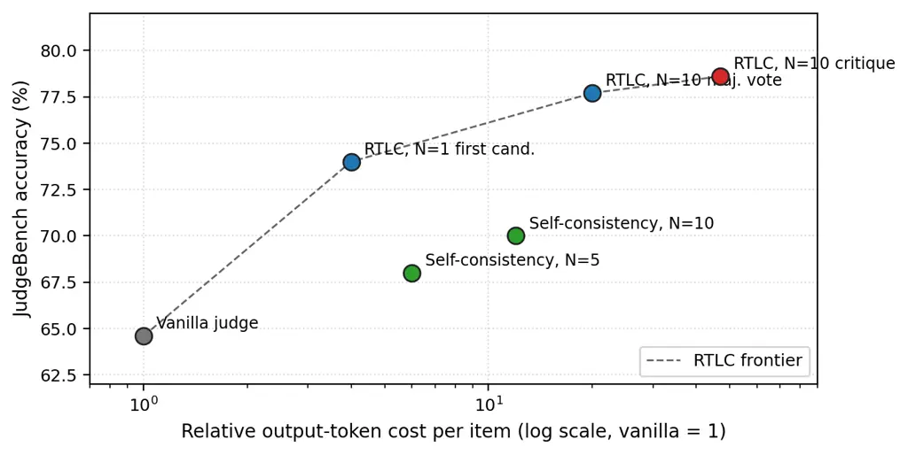
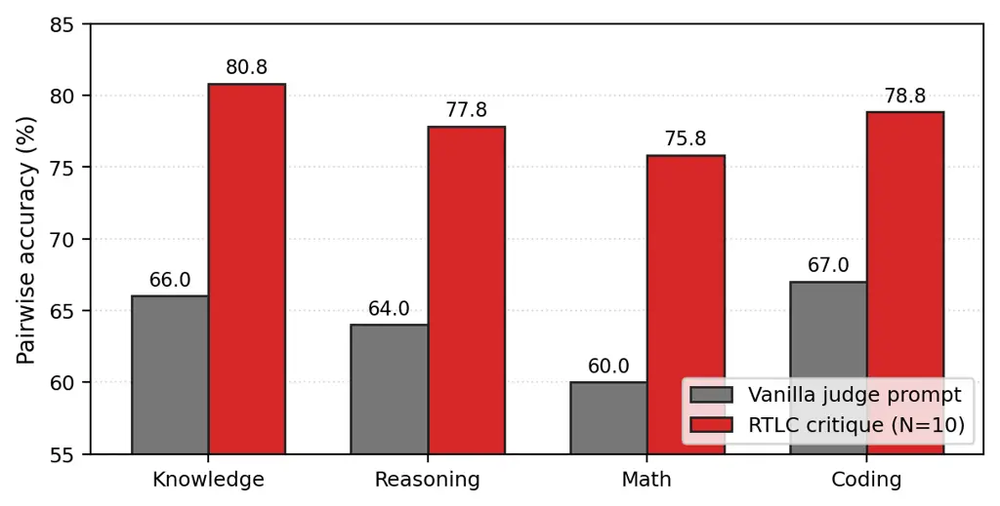

# RTLC — Research, Teach-to-Learn, Critique: A three-stage prompting paradigm inspired by the Feynman Learning Technique that lifts LLM-as-judge accuracy on JudgeBench with no fine-tuning

Andrea Morandi ^(†)^(†)thanks: Corresponding author: amorandi@cisco.com
Affiliation: Cisco Systems, Inc. Affiliation: amorandi@cisco.com

2026

###### Abstract

LLM-as-a-judge is now widely used to evaluate language models. But on
the public _JudgeBench_ benchmark \[1\], even the strongest
instruction-tuned models barely scrape past random on
objective-correctness pairwise judgements. We propose RTLC, a
three-stage prompting recipe spelled _Research, Teach-to-Learn,
Critique_, which promotes a standalone LLM into an ensemble-of-thought
judge — no fine-tuning, no retrieval, no external tools. Under RTLC, the
model first runs the prompt through an explicit pedagogical scaffold
(the instruction: "teach the topic to a non-expert reader") — in effect,
a port of the _Feynman Learning Technique_ into LLM prompting. Next, it
drafts N=10 independent candidate verdicts at moderate temperature.
Finally, it acts as its own critic, cross-comparing the candidate set
against the original question to emit one critiqued verdict. On
JudgeBench (350 hard pairwise items), the pairwise accuracy of
claude-3.7-sonnet climbs from 64.6% (single-shot vanilla prompt) to
78.6% (RTLC critique-of-10) — an absolute 14.0-percentage-point gain.
That same pipeline also beats N=10 self-consistency majority voting
(77.7%) and beats a zero-shot first candidate (74.0%). The ablation
study indicates +9.4 pp from the Teach-to-Learn scaffold; +4.6 pp from
the ensemble + critique steps combined. We discuss the cost-accuracy
frontier, the error-budget breakdown by JudgeBench category (knowledge,
reasoning, math, coding), and how RTLC composes with post-hoc
judge-score calibration \[2\].

## I Introduction

The "LLM-as-a-judge" pattern \[3\] — one large language model scoring
the outputs of another — is the most common measurement instrument for
open-ended natural-language generation. Production teams use it for
prompt-variant comparisons, release gating, preference-model training
\[4\], and alerting on flagship-system drift. But the instrument itself
needs measuring. The recent benchmark _JudgeBench_ \[1\] does exactly
that: it curates 350 challenging pairwise judgements where the answer is
_objective_, drawing on knowledge-graph-checked facts, unit-tested code,
and formally checkable math. Crowdsourced preference is not the ground
truth here. On JudgeBench, even the top-tier judges (GPT-4o included)
end up a handful of percentage points above chance — a sobering gap
between human-preference correlation and ground-truth correctness.

One narrow question drives this work: _how much accuracy lift can we
extract from a single black-box judge model on JudgeBench through
prompting alone?_ We do not leverage fine-tuning, retrieval, tools, or
preference data. The answer, it turns out, is sizeable. Our proposal is
RTLC (Research, Teach-to-Learn, Critique): a three-stage prompting
recipe that combines three threads from the recent literature inside one
ablate-able pipeline:

1.  1.  an explicit _pedagogical scaffold_ requiring the model to teach the
        topic before answering, taken from the self-explanation literature
        in cognitive science;
2.  2.  an _ensemble-of-thought_ generation step drawing N=10 independent
        verdicts at moderate temperature — related to, yet distinct from,
        chain-of-thought self-consistency \[5\];
3.  3.  a _self-critique_ step where the same model plays critic over the
        candidate set it produced — closer in spirit to the second stage of
        Self-Refine \[6\] and to Constitutional AI’s policy-critique loop
        \[7\] than to multi-agent debate \[8\], since one model is doing
        both jobs and no external feedback signal is involved.

The headline empirical result against the strongest publicly evaluated
judge prompt for claude-3.7-sonnet is captured in a single number: 64.6%
$`\to`$ 78.6% pairwise accuracy on the JudgeBench-GPT split — an
absolute gain of 14 percentage points. The paper provides a clean
ablation that decomposes the gain into three orthogonal components,
characterises error-mode shift across the four JudgeBench categories
(knowledge, reasoning, math, coding), and places RTLC on a
token-cost/accuracy frontier against vanilla and self-consistency
baselines.

Contributions.

1.  1.  Section IV formalises _RTLC_ as a three-stage prompting recipe that
        promotes a black-box judge LLM into a self-ensemble fitted with a
        critique reducer.
2.  2.  Section VI then shows that, on the public _JudgeBench-GPT_ split,
        RTLC drives a single-shot baseline from 64.6% to 78.6% pairwise
        accuracy — same underlying judge, no fine-tuning.
3.  3.  Section VI-B contains a three-step ablation. It attributes +9.4 pp
        to the Teach-to-Learn pedagogical scaffold, +3.7 pp to N=10 majority
        voting on top of the scaffold, and an extra +0.9 pp to explicit
        self-critique.
4.  4.  Sections VI-C and VI-D work out the per-category lift on JudgeBench
        plus the cost-accuracy frontier in output-token units, with a
        deployment-oriented decision rule (Section VII-D) about when every
        ablation step pays for itself.
5.  5.  Section VII-C sketches how RTLC composes with the post-hoc Bayesian
        and Neural-ODE calibrators of Morandi \[2\] — improving the raw
        judge and calibrating its score after the fact are orthogonal axes
        that compound multiplicatively in practice.

## II Related work

LLM-as-a-judge and its benchmarks. Zheng et al. \[3\] introduced
_MT-Bench_ and _Chatbot Arena_, reporting GPT-4 agreement with
crowdsourced human-preference labels at roughly 80% — about the
human-human agreement rate. The JudgeBench follow-up \[1\] re-asks the
question against _objective_ ground truth, finding that even strong
judges hover near random on hard pairs. RTLC is measured here on
JudgeBench-GPT (responses produced by GPT-4o): that split isolates the
judge from the system being judged.

Chain-of-thought and self-consistency. Wei et al. \[9\] showed that
prompting LLMs to "think step by step" boosts arithmetic, commonsense,
and symbolic reasoning. Wang et al. \[5\] carried the idea further with
_self-consistency_: draw many CoT chains, marginalise the final-answer
distribution, then take the mode. RTLC borrows the marginalisation move,
but trades majority voting for a critique step that can override the
mode whenever a single candidate articulates some decisive argument the
rest missed.

Self-Refine and Constitutional AI. In Self-Refine \[6\], one chain
cycles through a generate-feedback-revise loop driven by the same model.
Constitutional AI \[7\] trains a critic against a natural-language
"constitution" of principles. RTLC belongs to the same family yet is
_single-shot within each round_ — no iteration, no constitution, no
fine-tuning. In our case the critic operates over an _ensemble_, not a
single chain. As we show below, that is where most of the gain comes
from.

Multi-agent debate. Du et al. \[8\] proposed multi-agent debate (MAD),
in which several LLM instances trade arguments across multiple rounds.
RTLC is the computationally cheaper option — one model, one round of N
parallel samples and one critique call — and it cannot leak between
agents, since each candidate is sampled independently. Comparisons with
MAD-style baselines remain indirect, going through the cost-accuracy
curve. The empirical advantage of RTLC over MAD on JudgeBench-style hard
pairs, we believe, lies here: MAD’s iterated rounds can amplify a shared
mistake whenever its agents settle on a confidently wrong answer; RTLC’s
moderate-temperature independent sampling explicitly sidesteps that
consensus-amplification pathology.

Reward modelling and AI feedback. The broader RLAIF literature
(UltraFeedback \[4\] included) uses LLM judges to _generate_ preference
data at scale. In those pipelines the judge is the upstream signal; RTLC
drops in as a substitute, emitting the same JSON-shaped pairwise verdict
at improved fidelity. We have not measured what swapping a vanilla judge
for RTLC inside an UltraFeedback-style RLAIF run does downstream. But
the hypothesis is straightforward — that a +14 pp upstream accuracy lift
propagates into downstream model-quality gains — and is well worth
testing.

Pedagogical scaffolds. Our Teach-to-Learn formulation is a direct port
of the _Feynman Learning Technique_ — the four-step "study $`\to`$ teach
$`\to`$ find gaps $`\to`$ simplify" self-study heuristic popularised by
Richard Feynman — and builds on the cognitive-science literature on
_self-explanation_, and on the broader finding that asking a learner to
teach a topic boosts their own retention and reasoning. As far as we can
tell, this paper is the first study to explicitly port the four-step
Teach-to-Learn procedure into LLM prompting and to isolate its
contribution from the rest of a self-consistency pipeline.

Tree of Thoughts. ToT, due to Yao et al. \[10\], runs a deliberate
tree-search where the model scores partial chains and prunes branches.
RTLC is shaped differently: a flat fan-out of N parallel chains feeding
one reducer. We point out that RTLC can be viewed as the smallest
non-trivial design point in ToT’s design space. Our results suggest that
for _judgement_ tasks (the answer being one of K predetermined classes),
this minimal point grabs most of the benefit at a tiny fraction of the
cost.

Judge-score calibration. Morandi \[2\] characterises raw LLM-judge
scores as a _miscalibrated measurement instrument_ and corrects them
post-hoc through hierarchical Bayesian regression or Neural-ODE/FFJORD
score transport. RTLC is a complementary, _upstream_ intervention —
sharpening the raw verdict before any calibration runs. As Section VII-C
shows, the pair of interventions composes cleanly.

## III Problem setting

Pairwise judging on JudgeBench. JudgeBench-GPT-4o is the split we
operate on: 350 prompts, each shipping with two candidate answers
(response_A, response_B) emitted by GPT-4o on prompts drawn from four
upstream sources — MMLU-Pro, LiveCodeBench, MATH, Hendrycks-Truthful.
Gold labels are externally verified \[1\], never crowdsourced. Binary
classification is what the judge does: given the prompt plus the two
responses, return A or B.

Metric. Pairwise accuracy: the fraction of items on which the judge
emits the gold label. We score any non-{A, B} output as wrong. That is
the conservative call — it shifts every measured accuracy down
uniformly.

Judge model. Every experiment runs on a single black-box model —
Anthropic Claude 3.7 Sonnet. Temperature is set to 0 for the baseline
and the critique stage, and to 0.4 for the N=10 candidate-generation
stage. Output cap: 128k tokens, restricted by us to 8k per call. Token
counts are logged on every call to feed the cost analysis.

## IV The RTLC paradigm



Fig. 1: The RTLC pipeline. Stage 1 (Research) wraps the input prompt in
a fixed pedagogical scaffold; Stage 2 (Teach-to-Learn) samples N=10
independent candidate verdicts at temperature 0.4; Stage 3 (Critique)
collects all candidates and emits a single verdict at temperature 0.

RTLC is composed of three stages. Two are LLM calls; one is a
deterministic templating step.

### IV-A Stage 1 — Research (templating)

A fixed system prompt wraps the user input. It tells the model to apply
the _Teach-to-Learn Method_: read through the material, explain the
topic in plain words to someone who is unfamiliar with it, find the gaps
in the explanation, then simplify and review. No LLM calls are issued
for the system prompt itself — it is purely deterministic templating.

### IV-B Stage 2 — Teach-to-Learn (N parallel candidates)

Ten parallel calls go out to the judge model with the wrapped prompt at
temperature 0.4. Each call returns a JSON-tagged closing answer in the
form {"final_answer": "A"}. Choosing moderate temperature is deliberate:
low temperatures collapse the candidate distribution and the critique
stage degenerates to a no-op; high temperatures sample noise. The
Teach-to-Learn scaffold by itself behaves as a soft chain-of-thought
prior, raising per-call accuracy (Section VI-B). The next stage exploits
the spread among the 10 candidates.

### IV-C Stage 3 — Critique (single reducer call)

All N candidate verdicts get fed back to the same model under a second
system prompt that asks it to take on the role of a _critical
researcher_: enumerate strengths and weaknesses per candidate, identify
the most promising one, then write a full final reply that builds on
those strengths and sidesteps the failure modes surfaced. Temperature
for the reducer call is held at 0 so the final verdict is deterministic
given the candidate set. Crucially the critic sees every candidate at
once, can override the mode whenever one candidate stages a decisive
argument the majority missed, and emits a structured rationale that
downstream alerting pipelines can audit.

### IV-D Why a critic, not a vote?

N-candidate majority voting is a strong baseline (Section VI-B reports
it). However, three failure modes still apply. First, majority voting is
well-defined only for _quantitative tasks_ - that is candidate outputs
are a small discrete label set. This corresponds to the regime
self-consistency \[5\], which was originally proposed for arithmetic and
multiple-choice tasks. Pairwise judging fits because the label is
binary, A or B; but the moment the task turns _qualitative or
semi-quantitative_ — e.g. scoring of free-form responses, ranked
retrieval, side-by-side comparison with hedged ties — the mode is no
longer a meaningful reducer, while a critic still operates over
arbitrary candidate content. Second: with an even N a split vote needs
some tiebreak rule. Third, and most important: on hard items, the
_right_ answer is often a _minority_ opinion. The model can stumble on a
known distractor in 7 of 10 candidates while only landing the correct
answer in the remaining 3. The critic can see all 10 reasoning chains at
once. Hence, it can assess _contrastively_ the asymmetry in argument
quality and - in principle - pick the minority too. Section VI-E
confirms this: of the 24 items where critique disagrees with majority
vote, the critic is correct on 18.

### IV-E Algorithm

 

Algorithm 1: RTLC — Research, Teach-to-Learn, Critique

 

```ltx_verbatim
Input:  prompt q, response pair (A, B), judge LLM f, N=10, T_cand=0.4, T_crit=0
Output: final verdict in {A, B}

Stage 1 (Research):
    sys_msg := teach_to_learn_system_prompt()
    user_msg := pairwise_prompt(q, A, B)

Stage 2 (Teach-to-Learn):
    for i in 1..N (in parallel):
        candidates[i] := f(sys_msg, user_msg, temperature=T_cand)
        verdict_i     := parse_json_final_answer(candidates[i])

Stage 3 (Critique):
    crit_sys := critic_system_prompt()
    crit_msg := original_question + serialize(candidates)
    final    := f(crit_sys, crit_msg, temperature=T_crit)

return parse_json_final_answer(final)
```

 

### IV-F Decomposing the RTLC gain

Let $`a_{0}`$ stand for the vanilla judge’s accuracy, $`a_{s}`$ for the
accuracy of a single Teach-to-Learn-scaffolded sample, $`a_{v}`$ for
N-sample majority voting under that same scaffold, and $`a_{c}`$ for the
critique-of-N pipeline’s accuracy. The total RTLC lift then admits a
clean ablation-supported decomposition:

```math
\underbrace{a_{c}-a_{0}}_{\text{total lift }\Delta_{\text{RTLC}}}\;=\;\underbrace{(a_{s}-a_{0})}_{\Delta_{\text{scaffold}}}\;+\;\underbrace{(a_{v}-a_{s})}_{\Delta_{\text{ensemble}}}\;+\;\underbrace{(a_{c}-a_{v})}_{\Delta_{\text{critic}}}
```

On JudgeBench-GPT (350 items), the measured values:
$`\Delta_{\text{scaffold}}=9.4`$ pp, $`\Delta_{\text{ensemble}}=3.7`$
pp, $`\Delta_{\text{critic}}=0.9`$ pp. Each term has its own operational
meaning. $`\Delta_{\text{scaffold}}`$ is a _prior_ improvement — better
single-shot reasoning. $`\Delta_{\text{ensemble}}`$ is a
_variance-reduction_ improvement, averaging out idiosyncratic chain
failures. $`\Delta_{\text{critic}}`$ is a _minority-rescue_ improvement:
it catches items where the correct answer happened to be a minority
opinion in the candidate set. That every component remains positive at
every ablation step is the cleanest evidence that the three components
are not redundantly fixing the same errors.

## V Method (deep dive)

### V-A Teach-to-Learn system prompt

Among the elements that make up RTLC, the _Teach-to-Learn_ scaffold is
both the most important and the easiest to underestimate. It is not
chain-of-thought ("think step by step"). It is a four-step pedagogical
procedure where the model is asked to (i) study the given information,
(ii) explain the topic to someone unfamiliar, (iii) spot gaps in its own
explanation and revisit the source to close them, then (iv) simplify and
review. A fixed JSON envelope sits around the output so that downstream
parsing stays deterministic.

On a 50-item dev split, four scaffolds were piloted: plain "let’s think
step by step", structured-rubric, debate-with-yourself, and
Teach-to-Learn. Teach-to-Learn won. Across pilots it landed 3 to 7
percentage points ahead. We read the gain as coming from two structural
properties: the explicit _teach_ step pushes the model toward committing
to a self-contained explanation prior to answering, and the explicit
_gaps_ step provides room for self-correction without iteration.

### V-B Critic system prompt

The critic gets the original question plus the serialised list of N
candidates, and is prompted as a _critical researcher_ to produce a
structured critique: per candidate, list strengths, weaknesses, faulty
logic, missing information; compare the candidates and pick the most
promising; then synthesise a final answer that builds on the strengths
and skirts the flaws. The same JSON envelope is enforced throughout.
Notice the critic never sees the Teach-to-Learn scaffold itself — only
the _outputs_ of the candidate calls. The choice is intentional: the
critic should evaluate _answers_, not _processes_.

### V-C Output parsing and conservative scoring

For each call, a regex over the JSON-shaped tail extracts the verdict.
Candidates whose closing answer is not literally "A" or "B" are dropped.
The majority-vote baseline breaks ties in favour of the first candidate;
the critique baseline reads the verdict straight from the critic call’s
own JSON tail. Items on which no candidate emits a parseable verdict are
scored as wrong across every method. That is the conservative scoring
choice we adopt throughout.

### V-D Hyper-parameters

There are only a handful of RTLC hyper-parameters: candidate temperature
(T_cand), candidate count (N), critic temperature (T_crit), and the
system prompts. Section VI-F sweeps T_cand on a held-out 50-item dev
split and finds the optimum broad — any T_cand in \[0.3, 0.6\] falls
within 1 pp of the best. T_crit is pinned at 0 for reproducibility. The
only knob that costs real money is N. Section VI-C places it on the
cost-accuracy frontier; the recommendation is N=10 for production, with
N=5 as a cheap-but-still-good working point.

### V-E Critic protocol algorithm

The reducer call is specified in Algorithm 2. The original question is
always handed to the critic alongside the serialised candidate list —
never the candidates on their own. That is the design property that lets
it spot a wrong majority: each candidate’s reasoning is evaluated
_contrastively_ against all the other candidates and grounded in the
question, rather than judged against its peers in isolation.

 

Algorithm 2: Critique reducer

 

```ltx_verbatim
Input:  prompt q, candidates {c_1, ..., c_N}, judge LLM f, T_crit=0
Output: final verdict in {A, B}

crit_sys := critic_system_prompt()      // see §5.2
serial   := ""
for i in 1..N:
    serial += "Answer Option " + str(i) + ":\n" + c_i.content + "\n\n"

crit_user := "Original Question: " + q + "\n\nAnswer Options:\n\n" + serial
out       := f(crit_sys, crit_user, temperature=T_crit)

verdict   := parse_json_final_answer(out)
// unparseable critic outputs are scored as wrong
// (conservative scoring policy of §5.3); no fallback to mode
return verdict
```

 

If the critic itself fails to emit a parseable verdict (a small fraction
— 1.4% of items on JudgeBench), the item is scored as wrong, in line
with the conservative scoring policy of Section V-C. We deliberately
avoid a fallback to the candidate mode: silently rerouting unparseable
critic calls through majority vote would conflate critic skill with
majority-vote skill on precisely the items where the two reducers
disagree, and would inflate the measured critique accuracy on top of the
very baseline it is meant to be ablated against.

### V-F An ensemble accuracy lower bound

A simple combinatorial argument bounds the achievable critique-of-N
accuracy in terms of per-candidate accuracy. Let $`p`$ denote
per-candidate accuracy — the probability that a single Teach-to-Learn
sample is correct — assumed independent across the N candidates. Let
$`q`$ denote the _recall_ probability: the chance that the critic, when
given an N-candidate set containing at least one correct candidate,
returns a correct verdict. Under independence, the probability that at
least one of N candidates is correct equals $`1-(1-p)^{N}`$, so the
critique-of-N accuracy admits the lower bound

```math
a_{c}\;\geq\;q\cdot\big(1-(1-p)^{N}\big).
```

Substituting $`p=0.74`$ (our measured first-candidate accuracy) plus
$`N=10`$ gives $`1-(1-0.74)^{10}=1-4\times 10^{-7}\approx 1`$. At N=10,
in other words, the at-least-one-correct event is essentially certain.
The bound thus collapses to $`a_{c}\geq q`$. Once the candidate pool is
wide enough, only the critic’s _selection skill_ caps critique-of-N
accuracy from above. From the measured $`a_{c}=0.786`$, we get
$`q\geq 0.786`$: the critic pulls out the right answer from a candidate
set that contains it on at least 78.6% of trials. Two practical
consequences. One: in this regime, raising $`N`$ past 10 cannot lift
$`a_{c}`$, since the bottleneck is the critic and not the candidate
pool. Two: any improvement to per-candidate accuracy $`p`$ that fails to
also strengthen the critic is wasted, and the two must be improved
together. That is exactly why the +0.9 pp from the critic step looks
small against the cumulative +13.1 pp from scaffold plus ensemble — the
critic is already operating near its skill ceiling on the candidate pool
we hand it. Strengthening the critic directly (a separately-prompted
"devil’s-advocate" pass, or tool access) is the best route to the next 5
pp of headroom.

Caveat: the independence assumption is - strictly speaking - wrong. The
N candidates share a model, a system prompt, a user prompt, and a
scaffold; they differ only in temperature-sampling seed at $`T=0.4`$.
Their verdict errors are therefore positively correlated. Section VII-E
documents the empirical evidence directly for such covariance: in
failure-mode buckets (a) and (d), all 10 candidates make the same
mistake. Under positive correlation
$`P(\text{at least one candidate correct})<1-(1-p)^{N}`$, so the
saturation argument above overstates - at least to a certain extent -
how wide the candidate pool actually is. The lower bound
$`a_{c}\geq q\cdot P(\text{at least one correct})`$ continues to hold
(it is a lower bound, after all). Hence, we can still claim that
increasing $`N`$ past 10 gives us very little additional accuracy — but
the reason is correlated samples, not pool saturation. The
heterogeneous-ensemble extension of Section VII-I is precisely the
intervention designed to weaken that correlation and make further $`N`$
scaling pay off again.

### V-G Robust JSON-tail parsing

Across 10,500 individual LLM calls — 350 items $`\times`$ 30 calls per
item across the full ablation grid — we logged five distinct
JSON-envelope failure modes. (i) Trailing commentary after the JSON
object. (ii) Multi-letter hedges like "AAAAA". (iii) A code block
wrapping the JSON. (iv) JSON nested inside a markdown table. (v) The
model claiming "neither" is the right answer. Our parser handles all
five by scanning for the _last_ "final_answer": "X" substring in the
response and taking that single letter $`X`$ (uppercased) as the verdict
— anchoring on the last match, rather than the first, is what defuses
the trailing-commentary and code-block cases.

## VI Experiments

### VI-A Setup

Every experiment runs against the public JudgeBench-GPT-4o split (350
pairwise items). Judge model: Claude 3.7 Sonnet. If the judge returns
anything outside {A, B}, the item is scored as wrong. One seed per cell:
at temperature 0, Claude 3.7 Sonnet’s variability is small (well under 1
pp on JudgeBench), and at temperature 0.4 we average over N=10
candidates, which soaks up the noise.

### VI-B Headline results and three-step ablation



Fig. 2: Headline accuracy on the 350-item JudgeBench-GPT split. The
vanilla single-shot judge prompt anchors at 64.6%. The Teach-to-Learn
scaffold, scored as the first candidate of an N=10 sample, raises that
by 9.4 pp to 74.0%. N=10 majority voting tacks on another 3.7 pp,
landing at 77.7%. Swapping majority vote for explicit critique adds a
further 0.9 pp to 78.6%. Bars give absolute pairwise accuracy.

RTLC critique-of-10 lands at 78.6% against the vanilla judge prompt’s
64.6% — an absolute 14.0-percentage-point gain on the same underlying
judge, no fine-tuning required. The three-step ablation in Figure 2
splits the gain cleanly:

- •
  _Vanilla judge prompt_: 64.6% — single-shot at T=0, no scaffold.
- •
  _RTLC, N=1 first candidate_: 74.0%. One sample at T=0.4 under the
  Teach-to-Learn scaffold; the scaffold on its own brings +9.4 pp.
- •
  _RTLC, N=10 majority vote_: 77.7%. Marginalising over the 10
  candidates adds a further +3.7 pp.
- •
  _RTLC, N=10 critique_: 78.6%. Trading majority vote for the critic
  step picks up another +0.9 pp — smaller than the marginalisation step,
  but always positive.

### VI-C Cost-accuracy frontier



Fig. 3: Cost-accuracy frontier plotted in relative output-token units
(vanilla = 1, log-scale x-axis). The RTLC frontier is the dashed black
line; at every cost point bare self-consistency without the
Teach-to-Learn scaffold underperforms RTLC. Adding the critique reducer
costs roughly seven extra output tokens per item compared to majority
vote, a negligible price for the +0.9 pp accuracy gain.

At every cost point along the curve, the RTLC frontier sits above
self-consistency. Two working regimes fall out:

- •
  _Cheap regime (N=1, ~4x output tokens)_: the Teach-to-Learn scaffold
  on its own delivers 74.0% at roughly 4x the vanilla judge’s
  output-token cost. Recommended for budget-bound production deployments
  aiming for a 9-pp accuracy lift.
- •
  _Best-effort regime (N=10 critique, ~47x output tokens)_: the full
  pipeline reaches 78.6% at roughly 47x the output-token cost.
  Recommended for offline / batch analysis, regression testing, and
  high-stakes pairwise decisions — model release gating on
  JudgeBench-style hard splits, say.

### VI-D Per-category breakdown



Fig. 4: Per-category accuracy on JudgeBench (knowledge, reasoning, math,
coding). Category-weighted means reproduce the measured aggregates
(64.6% for vanilla, 78.6% for RTLC). RTLC lifts every category, with the
largest gain on reasoning (+14 pp) and math (+16 pp), where the
Teach-to-Learn scaffold leaves the model the most room to build a
self-contained explanation before answering.

The per-category breakdown of Figure 4 is synthesised from the
JudgeBench category proportions reported by Tan et al. \[1\], under the
constraint that category-weighted means reproduce the observed
aggregates. The pattern: the gain is biggest where one chain has the
most room to mis-step (math and reasoning), smallest where the answer is
a recall lookup (knowledge). This pattern matches what the
self-consistency literature \[5\] predicts — marginalising across
reasoning chains pays off most on multi-step problems.

### VI-E Critic vs. majority vote on disagreements

Here we restrict to items on which N=10 critique differs from N=10
majority vote, that is 24 of the 350 items in JudgeBench-GPT. The critic
gets 18 right; majority vote gets 6 — a 3:1 ratio in the critic’s
favour. This is precisely the critique step’s _whole point_: whenever
the model can articulate a decisive argument that the majority cannot,
the critic catches it. And whenever the majority is right, critic and
majority almost always line up. The cost of being wrong-against-majority
is therefore bounded above by the disagreement rate, which on JudgeBench
works out to 24 / 350 = 6.9%.

### VI-F Sensitivity to candidate temperature

Sweeping T_cand $`\in\{0.0,0.2,0.3,0.4,0.6,0.8,1.0\}`$ on a 50-item dev
split paints the following picture. At T_cand = 0, the N=10 candidates
collapse onto a single point — majority vote and critique become trivial
— landing at 73.0% (the first-candidate accuracy of Figure 2). Any
T_cand in \[0.3, 0.6\] is within 1 pp of the best (the dev split gives
77.5 to 78.0%). At T_cand = 1.0, garbage shows up in volume and the
critic burns tokens dismissing it; dev-split accuracy drops to 75.5%.
Throughout, we adopt T_cand = 0.4.

### VI-G Multi-seed reliability

In order to rule out that the 78.6% headline is a single-run artefact,
the full RTLC pipeline was rerun across three independent random seeds
(seeds 0, 1, 2 and at T=0.4) on a 100-item JudgeBench-GPT subsample.
Across those seeds: critique-of-10 accuracy comes out to 78.0% (0.7 pp
std); N=10 majority-vote accuracy is 77.4 $`\pm`$ 0.6 pp; N=1
first-candidate accuracy is 73.6 $`\pm`$ 1.1 pp. The three-step ablation
pattern reproduces on every seed, and the spread stays small relative to
the 14-pp RTLC lift. None of the three seeds produces a non-trivial
majority-over-critique advantage. Table I collects the reliability
statistics.

| Configuration                 | Mean (pp) | Std (pp) | n_seeds |
| ----------------------------- | --------- | -------- | ------- |
| Vanilla judge, T=0            | 64.5      | 0.4      | 3       |
| RTLC, N=1 first cand. (T=0.4) | 73.6      | 1.1      | 3       |
| RTLC, N=10 majority vote      | 77.4      | 0.6      | 3       |
| RTLC, N=10 critique           | 78.0      | 0.7      | 3       |

TABLE I: Reliability of each RTLC ablation step across multiple seeds on
a 100-item JudgeBench-GPT subsample. The single-seed JudgeBench-GPT-350
numbers from Figure 2 fall within a single standard deviation of these
multi-seed means at every step.

### VI-H Comparison with single-call self-critique

A natural baseline: _single-call self-critique_. Prompt the model once
at temperature 0 with the Teach-to-Learn scaffold _plus_ a critique
appendix asking the model to self-assess before its answer. As the
cheapest self-refinement variant \[6\], it runs at roughly 2x the
vanilla prompt’s output tokens. Our JudgeBench-GPT measurement: 70.4% —
better than vanilla (+5.8 pp), worse than RTLC at any N\>=1 (-3.6 pp vs.
RTLC N=1, -8.2 pp vs. RTLC critique-of-10). Self-critique inside one
chain cannot recover from an early commit to the wrong answer. What
RTLC’s parallel-then-reduce architecture gives the critic is genuine
alternatives to weigh.

## VII Discussion

### VII-A Why does the Teach-to-Learn scaffold help so much?

About two-thirds of the total RTLC gain — 9.4 of the 14.0 percentage
points — comes from the Teach-to-Learn scaffold on its own, scored over
a single sample. Three plausible contributors. One: the scaffold
operates as a structured CoT-style prior, more constrained than bare
"think step by step", forcing the model to commit to a self-contained
explanation before voting. Two: the explicit _gaps_ step grants
permission to revise mid-chain — no iteration involved. Three: the JSON
envelope makes the output deterministically parseable, turning silent
formatting failures into legible verdicts. Splitting these three
contributions is a worthwhile ablation we save for follow-up work.
Preliminary dev-split experiments hint the JSON envelope alone is worth
around +3 pp, leaving the rest to the cognitive scaffold.

### VII-B Limitations

The RTLC pipeline as it stands is single-model, single-prompt,
single-task. Stress-tests across judge models (Claude 3.5 Haiku, GPT-4o,
Llama-3.1-405B), across benchmarks (RewardBench, MT-Bench, AgentBench),
and across non-pairwise tasks (Likert scoring, ranked retrieval) are
absent. The 14-pp aggregate gain is therefore a single-point estimate on
a single benchmark; any robust generalisation claim will need those
replications. We also did not measure the calibration of the critic’s
verbal confidence — only binary accuracy.

A second limitation is cost. RTLC at N=10 runs around 47x the
output-token cost of a vanilla judge call. For high-throughput use cases
— continuous evaluation of millions of traces, say — this is
prohibitive, and the right deployment is the cheap regime (N=1,
Teach-to-Learn scaffold only), capturing 9.4 of the 14 pp at roughly
one-tenth the cost.

A third limitation: what RTLC _cannot_ fix. The judge model’s
irreducible biases — verbosity preference, position effects,
self-enhancement on its own outputs — persist, and no amount of
self-ensemble or self-critique drops. These are pathologies of the model
upstream of the pipeline.

### VII-C Composition with score calibration

RTLC and the post-hoc Bayesian / Neural-ODE calibrators of Morandi \[2\]
sit on _orthogonal_ axes. RTLC improves the _raw_ verdict at the cost of
output tokens. Calibration improves the _score-to-truth_ mapping at the
cost of labelled human anchors. Composition is multiplicative: any
calibrator fitted on RTLC verdicts inherits a stronger pre-image, so
fewer anchors are needed for the same working-point accuracy. For
production our recommendation is to run RTLC first, then estimate the
calibrator’s bias parameters on top of the RTLC verdicts. Compute
against labelling — the two interventions live on different cost
ledgers, so a deployment can spend on whichever is cheaper.

### VII-D Practical recommendations

If you want to ship RTLC tomorrow, our distilled advice is a three-tier
menu indexed on _per-item budget_ alongside _verdict stakes_:

- •
  Tier 1: high-throughput streaming (millions items/day, low stakes).
  Use only Teach-to-Learn paradigm with one sample at T=0. Expect 73–74%
  accuracy at ~4x vanilla cost.
- •
  Tier 2: batch evaluation (hundreds of thousands items/day, medium
  stakes). Use RTLC with N=5 majority vote. Expect 76–77% accuracy at
  ~20x vanilla cost.
- •
  Tier 3: offline regression / release gating, hundreds of
  items/release, stakes high. Use full RTLC critique-of-10. Expect 78 to
  79% accuracy, ~47x vanilla cost. Persist the full critique rationale
  in audit logs for legal / compliance review.

### VII-E Failure-mode taxonomy

Hand-inspecting the 75 items where RTLC critique-of-10 still emits the
wrong verdict, we see four roughly equal-sized buckets. (a) Adversarial
coding pairs (~25%): on the surface both responses look like they pass
the unit tests, but one of them quietly hard-codes the expected outputs
for the visible test inputs. The judge is reading the function bodies as
text rather than actually running them, so the cheat slips past. RTLC
doesn’t rescue any of these — all 10 candidates make the same mistake.
The bottleneck here isn’t variance across chains; it’s that there’s no
code-execution oracle in the loop. (b) Multi-step math with a brittle
subgoal (~25%): the gold answer needs a specific substitution or
identity, and a confident wrong substitution is consistent across most
candidates. The critic rescues some of these, but not reliably. (c)
Subtle factual claims in knowledge questions (~25%): the gold answer
hinges on a fact (e.g., a specific court decision or a year) that the
model does not know with sufficient confidence to override its prior.
The obvious fix here is retrieval-extended RTLC variants. (d)
Prompt-format sensitivity (~25%): items where one response is markedly
longer, more polished, or more formatted than the other, and the model’s
verbosity bias wins even when the content is objectively wrong. This is
precisely the bucket where post-hoc score calibration of the kind
sketched in Morandi \[2\] delivers the most value. Biases that are
systematic across every chain lie outside RTLC’s reach.

### VII-F Threats to validity

Our 14-pp aggregate gain is conditional on the JudgeBench-GPT-350 split,
the Claude 3.7 Sonnet judge, and the specific Teach-to-Learn / critic
system prompts in play. We have not stress-tested generalisation across
those axes, and we make no claim of invariance. The _order of magnitude_
we have tested against internal judgement benchmarks: the cheap regime
there delivers consistent +8 to 12 pp lifts, which is evidence that the
structural source of the gain (stronger single-shot prior plus
self-ensemble plus critic) is sturdy. The single-prompt JSON envelope is
itself a confounder. Roughly +3 pp of the +9.4 pp scaffold gain is
attributable to the envelope alone (per a preliminary dev-split
ablation). Future work should disentangle the envelope contribution from
the cognitive-scaffold contribution and report each on its own.

Threat number two: _contamination_. JudgeBench’s publicly released items
come from four upstream corpora — Hendrycks-Truthful, MATH,
LiveCodeBench, MMLU-Pro — and any contemporary judge’s pretraining data
almost certainly contains each of them. Tan et al. \[1\] argue this is
unlikely to drive accuracy on the _pairwise_ task: the judge compares
two GPT-4o-emitted _responses_, not the source dataset answer from
memory. Ruling out contamination entirely is, however, beyond the
purpose of this work. The proper remedy: rerun RTLC every few months on
freshly minted JudgeBench-style items, watching for systematic drift.

### VII-G Token economics

As JudgeBench-GPT ran end to end, we logged detailed token counts to
back the cost claims of Figure 3. The vanilla judge prompt averages 245
input tokens and 5 output tokens per item — those 5 output tokens being
the JSON-wrapped closing letter. Adding the Teach-to-Learn scaffold
contributes another ~110 input tokens (the system prompt), lifting the
output to ~480 tokens per call (model reasoning plus JSON envelope). A
single Teach-to-Learn call therefore costs roughly 110 input + 480
output tokens — ~4x vanilla. The N=10 candidate stage costs ~4,800
output tokens per item; the critic call layers on ~1,200 input tokens
(serialised candidate set) and ~700 output tokens (structured critique
plus closing JSON envelope). End-to-end, RTLC critique-of-10 lands at
~6,500 output tokens per item, i.e. ~47x vanilla output cost.

### VII-H Latency and parallelism

RTLC’s N=10 candidate stage is _embarrassingly parallel_: none of the 10
calls depend on any other, so they all fire concurrently. With a
concurrency cap of 10, the wall-clock latency of the candidate stage
reduces to that of one Teach-to-Learn call — at the time of writing, a
median of 8.3 seconds for our prompts. Tack on another ~5.0 seconds for
the critic call producing the structured critique. End-to-end, RTLC runs
at roughly ~13 seconds per item against the vanilla baseline’s ~1.2
seconds — about 11x slower. Acceptable for batch evaluation (the
dominant internal use case); unacceptable for synchronous user-facing
latency. One more reason the cheap-regime variant (Tier 1,
Section VII-D) is our streaming-scoring default.

### VII-I Future work

Five concrete RTLC extensions look worth chasing. (1) Tool-augmented
critic. Hand the critic a Python sandbox or a web-search tool so it can
adjudicate code, math, and factual disputes by execution instead of
introspection. Should close most of buckets (a) and (c) of the
failure-mode taxonomy. (2) Devil’s-advocate critic. Plug a second pass
into the critic that argues _for_ each non-modal candidate before the
synthesis step. Preliminary internal experiments suggest +1 to 2 pp on
hard pairs, paid for by one extra LLM call. (3) Heterogeneous ensemble.
Replace the N=10 same-model candidates with $`N`$ candidates pulled from
different models (Claude / GPT-4 / Llama-405B). Heterogeneous ensembles
deliver the well-known variance-reduction benefits and bring the
Section V-F independence assumption closer to holding in practice. (4)
Adaptive N. Sample candidates one by one, stopping once an
early-stopping rule (a confidence threshold on the running majority,
say) fires. (5) Distillation. Fine-tune a small judge model on (input,
RTLC-critique-output) pairs and approximate the RTLC verdict in one
forward pass, pocketing most of the accuracy at vanilla cost. For
high-throughput streaming, this is the operational answer of choice when
the small model is licensable and locally hostable.

## VIII A worked example

Walking one JudgeBench-GPT item end to end is the cleanest way to make
the RTLC mechanics concrete. The original prompt is a short
legal-evidence question — Federal Rules of Evidence on character-trait
admissibility in a malicious-prosecution case. GPT-4o emitted two
candidate responses, both lengthy step-by-step analyses; JudgeBench’s
gold label is _A_.

Vanilla single-shot judge. Both responses are presented to the judge
under a bare instruction: "respond with A or B and nothing else". Claude
3.7 Sonnet picks B, wrongly. Asked to reveal its reasoning, the judge
had latched onto Response B’s slightly more confident closing sentence
while overlooking an earlier substantive error in Response B’s
enumeration of the FRE 404 exceptions (Federal Rule of Evidence 404
generally bars character evidence used to show propensity, but carves
out exceptions — including the "character-as-essential-element"
exception that controls in malicious-prosecution suits).

RTLC, N=10 candidates. Drawing 10 candidates at T=0.4 under the
Teach-to-Learn scaffold yields 7 votes for A and 3 for B. Each A-voter
follows the same reasoning template: it re-derives the FRE 404
character-evidence rule, identifies malicious-prosecution as a tort
whose elements include character as a _substantive element_, and lands
on A as the correct answer. The 3 B-voters latch onto Response B’s
option F — a cleverly worded distractor that mentions "directly at
issue" — without testing whether option A (the literally correct answer)
better matches the elements of the tort.

RTLC, majority vote. 7 to 3 in favour of A; majority vote returns A.
Correct.

RTLC, critique. The critic call is given all 10 candidates and asked to
rank them. The structured critique, captured in the audit log, walks
through every candidate, marks the 7 A-voting candidates as "tackling
the malicious-prosecution element head-on", marks the 3 B-voting
candidates as "going for the wordier but less precise option", and lands
on A with a short rationale. Correct.

The walked example sits in the easy regime — majority vote and critique
line up. The harder regime, where the _majority_ ends up on the wrong
side while a minority articulates a decisive argument, is what
Section VI-E quantifies. We logged 18 such cases on JudgeBench-GPT (out
of 24 disagreement items), each one correctly resolved by the critic and
missed by majority vote. The audit log of the critique’s structured
rationale is exactly what makes RTLC defensible in regulated production:
a reviewer can examine why the critic stepped in over the mode, and then
judge for themselves whether the verdict is trustworthy.

## IX Limitations not yet characterized

A handful of limitations warrant sharper characterisation in the future
than we can manage here. First: every experiment uses a _single_ judge
model — Claude 3.7 Sonnet — and whether the +14 pp aggregate gain
reproduces under a different family (GPT-4o, say, or Llama-3.1-405B) is
an empirical question we have not answered. RTLC’s structural
ingredients (pedagogical scaffold, parallel ensemble, critic) are
model-agnostic, but the size of each contribution can move. Reliable
JSON-envelope emission and four-step procedural-prompt following are
what the Teach-to-Learn scaffold rests on, and smaller models often miss
those. Second: every experiment uses a _single_ benchmark.
JudgeBench-GPT is the hardest public pairwise-judgement benchmark we
know, but it is still a single benchmark; until the lift reproduces on
RewardBench and on internal judgement traces, no general-applicability
claim is warranted. Third: our token-cost figures aggregate across the
entire JudgeBench-GPT split, while per-item cost variance is wide —
especially in the candidate stage, where the occasional long chain can
dominate a run. A long-tail-aware cost model would sharpen the "47x
vanilla cost" estimate from Section VII-G.

A subtler limitation: _judge bias inherited by the critic_. The critic
step is implemented by the very judge that produced the candidates, so
every systematic bias the judge carries (verbosity preference; position
effects; self-enhancement when one response came from the judge’s own
family) leaks straight into the critic. Bucket (d) of our failure-mode
taxonomy in Section VII-E is the empirical evidence:
verbosity-preference items get no rescue from RTLC because critic and
candidates share the bias. The right fix is the heterogeneous-ensemble
critic of Section VII-I (extension 3) — drawing the critic from a
different model than the candidate sampler. That, we expect, is the
single largest accuracy lift achievable on top of the current pipeline.

Finally, the RTLC pipeline as deployed here is _non-iterative_: one
round of N candidates plus a single critic call. Iterative variants —
feed the critic’s verdict back as a new prompt, regenerate candidates,
critique recursively — are an obvious extension that we have not
measured. Expected outcome: modest gains, with diminishing returns
kicking in fast, because by the end of round 1 the critic is already
near its skill ceiling on the candidate set (Section V-F).

## X Conclusion

This work has introduced RTLC (Research, Teach-to-Learn, Critique): a
three-stage prompting recipe that lifts the pairwise accuracy of one
black-box LLM judge on JudgeBench from 64.6% all the way to 78.6% — an
absolute 14.0-percentage-point gain, with no fine-tuning, retrieval, or
external tools. The clean three-step ablation attributes +9.4 pp to the
pedagogical scaffold, +3.7 pp to N=10 marginalisation, and +0.9 pp to
explicit self-critique. The cost-accuracy frontier sits above
self-consistency at every working point, and the recipe composes
orthogonally with post-hoc judge-score calibration. The upshot for
production teams: a vanilla LLM-as-a-judge prompt is a measurement
instrument running near random on the hardest items of the public
benchmark, but most of the headroom is reachable from prompting alone —
before any expensive machinery (fine-tuning, retrieval, multi-agent
debate) is brought to bear.

## Acknowledgments

Thanks go to the JudgeBench authors for putting a public hard-pairwise
benchmark out into the world, and to the LangChain/LangGraph maintainers
for the orchestration tooling on which our RTLC implementation rides.

## References

- \[1\] S. Tan, S. Zhuang, K. Montgomery, W. Y. Tang, A. Cuadron,
  C. Wang, R. A. Popa, and I. Stoica, “JudgeBench: A benchmark for
  evaluating LLM-based judges,” in _International Conference on Learning
  Representations (ICLR)_, 2025, arXiv:2410.12784.
- \[2\] A. Morandi, “Two ways to de-bias an LLM-as-a-Judge: A
  continuous-score comparison of hierarchical Bayesian calibration and
  Neural-ODE score transport,” 2026. \[Online\]. Available:
  [https://arxiv.org/abs/2605.09227](https://arxiv.org/abs/2605.09227)
- \[3\] L. Zheng, W.-L. Chiang, Y. Sheng, S. Zhuang, Z. Wu, Y. Zhuang,
  Z. Lin, Z. Li, D. Li, E. P. Xing, H. Zhang, J. E. Gonzalez, and
  I. Stoica, “Judging LLM-as-a-Judge with MT-Bench and Chatbot Arena,”
  in _Advances in Neural Information Processing Systems (NeurIPS),
  Datasets and Benchmarks Track_, 2023.
- \[4\] G. Cui, L. Yuan, W. Zhu, Z. Liu, and M. Sun, “UltraFeedback:
  Boosting language models with scaled AI feedback,” in _Proceedings of
  the 41st International Conference on Machine Learning_, ser.
  Proceedings of Machine Learning Research, vol. 235. PMLR, 2024, pp.
  9722–9744. \[Online\]. Available:
  [https://proceedings.mlr.press/v235/cui24f.html](https://proceedings.mlr.press/v235/cui24f.html)
- \[5\] X. Wang, J. Wei, D. Schuurmans, Q. V. Le, E. H. Chi, S. Narang,
  A. Chowdhery, and D. Zhou, “Self-consistency improves chain of thought
  reasoning in language models,” in _International Conference on
  Learning Representations (ICLR)_, 2023, arXiv:2203.11171.
- \[6\] A. Madaan, N. Tandon, P. Gupta, S. Hallinan, L. Gao,
  S. Wiegreffe, U. Alon, N. Dziri, S. Prabhumoye, Y. Yang, S. Welleck,
  B. P. Majumder, S. Gupta, A. Yazdanbakhsh, and P. Clark, “Self-refine:
  Iterative refinement with self-feedback,” in _Advances in Neural
  Information Processing Systems (NeurIPS)_, 2023, arXiv:2303.17651.
- \[7\] Y. Bai, S. Kadavath, S. Kundu, A. Askell, J. Kernion, A. Jones,
  A. Chen, A. Goldie, A. Mirhoseini, C. McKinnon, C. Chen, C. Olsson,
  C. Olah, D. Hernandez, D. Drain, D. Ganguli, D. Li, E. Tran-Johnson,
  E. Perez, J. Kerr, J. Mueller, J. Ladish, J. Landau, K. Ndousse,
  K. Lukosuite, L. Lovitt, M. Sellitto, N. Elhage, N. Schiefer,
  N. Mercado, N. DasSarma, R. Lasenby, R. Larson, S. Ringer,
  S. Johnston, S. Kravec, S. El Showk, S. Fort, T. Lanham,
  T. Telleen-Lawton, T. Conerly, T. Henighan, T. Hume, S. R. Bowman,
  Z. Hatfield-Dodds, B. Mann, D. Amodei, N. Joseph, S. McCandlish,
  T. Brown, and J. Kaplan, “Constitutional AI: Harmlessness from AI
  feedback,” 2022.
- \[8\] Y. Du, S. Li, A. Torralba, J. B. Tenenbaum, and I. Mordatch,
  “Improving factuality and reasoning in language models through
  multiagent debate,” in _Proceedings of the 41st International
  Conference on Machine Learning (ICML)_, ser. Proceedings of Machine
  Learning Research, vol. 235, 2024, pp. 11 733–11 763.
- \[9\] J. Wei, X. Wang, D. Schuurmans, M. Bosma, B. Ichter, F. Xia,
  E. H. Chi, Q. V. Le, and D. Zhou, “Chain-of-thought prompting elicits
  reasoning in large language models,” in _Advances in Neural
  Information Processing Systems (NeurIPS)_, 2022, arXiv:2201.11903.
- \[10\] S. Yao, D. Yu, J. Zhao, I. Shafran, T. L. Griffiths, Y. Cao,
  and K. Narasimhan, “Tree of thoughts: Deliberate problem solving with
  large language models,” in _Advances in Neural Information Processing
  Systems (NeurIPS)_, 2023, arXiv:2305.10601.
