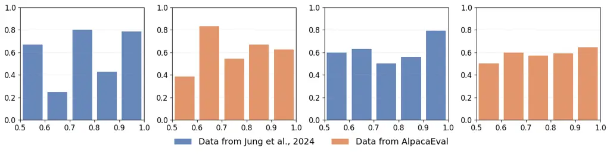
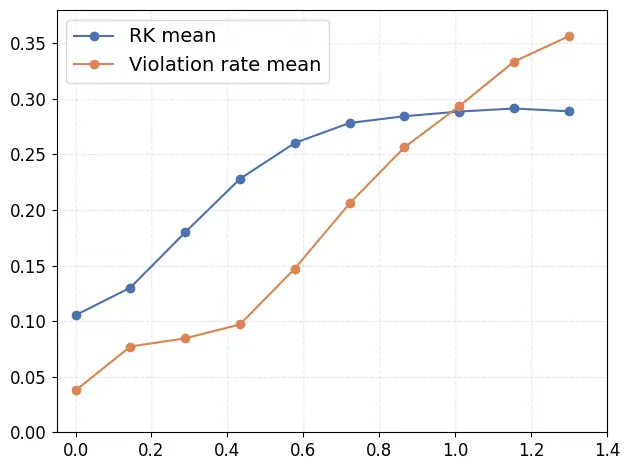
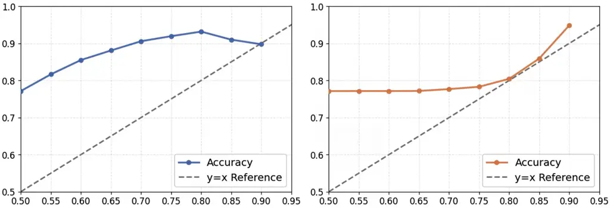
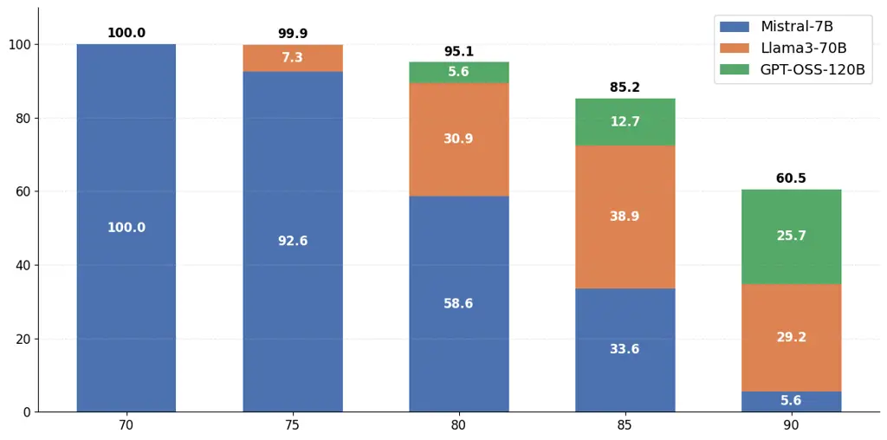
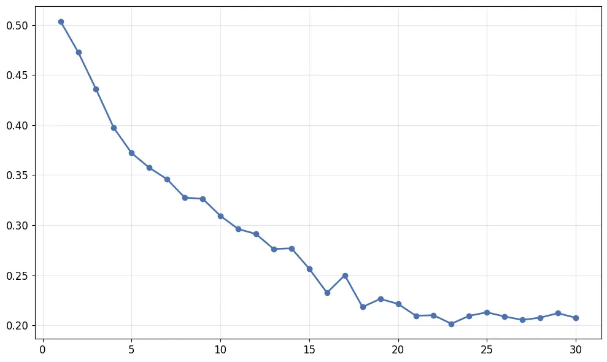

# Margin-Adaptive Confidence Ranking for Reliable LLM Judgement

Gaojie Jin Affiliation: Department of Artificial Intelligence,
University of Macau Affiliation: Department of Computer Science,
University of Exeter    Yong Tao Affiliation: Department of Computer
Science, University of Exeter    Lijia Yu Affiliation: Institute of AI
for Industries, Chinese Academy of Sciences    Tianjin Huang
Affiliation: Department of Computer Science, University of Exeter
Affiliation: Department of Mathematics and Computer Science, Eindhoven
University of Technology Correspondence to: <t.huang2@exeter.ac.uk>

###### Abstract

Jung et al. (2025) introduce a hypothesis testing framework for
guaranteeing agreement between large language models (LLMs) and human
judgments, relying on the assumption that the model’s estimated
confidence is monotonic with respect to human-disagreement risk. In
practice, however, this assumption may be violated, and the
generalization behavior of the confidence estimator is not explicitly
analyzed. We mitigate these issues by learning a dedicated confidence
estimator instead of relying on heuristic confidence signals. Our
approach leverages simulated annotator diversity and a margin-based
ranking formulation to explicitly model how confidently an LLM
distinguishes between human-agreement and human-disagreement cases. We
further derive generalization guarantees for this estimator, revealing a
margin-dependent trade-off that informs the design of an adaptive
estimator training procedure. When integrated into fixed-sequence
testing, the learned confidence estimator yields improved ranking
accuracy and empirically strengthens the monotonic relationship between
confidence and disagreement risk, leading to higher success rates in
satisfying target agreement levels across multiple datasets and judge
models.

###### Keywords: 

Machine Learning, ICML

## 1 Introduction

Large language models are increasingly used as evaluators to judge
output quality and preference alignment (Zheng et al., 2023; Dubois et
al., 2023; Park et al., 2025; Chiang and Lee, 2023). While this offers
scalable, low-cost alternatives to human annotation, a fundamental
challenge remains (Xiong et al., 2024): how can we make LLM-as-a-judge
decisions reliably trustworthy for downstream use, particularly when the
judge reports high confidence?

Recent principled methods have been proposed to improve the reliability
of LLM-as-a-judge systems. For instance, Yadkori et al. (2024) introduce
conformal abstention to better align LLM judgments with human
evaluations, while Mohri and Hashimoto (2024) use conformal prediction
to provide high-probability correctness guarantees. Building on these
ideas, Jung et al. (2025) develop an unsupervised confidence estimator
and derive an exact upper bound on disagreement risk conditioned on a
calibration set.

A key assumption underlying such confidence-thresholding procedures is
monotonicity: instances with higher estimated confidence should
correspond to lower disagreement risk with respect to human judgments.
However, recent empirical findings indicate that this assumption may be
violated in practice, i.e., confidence estimates can be miscalibrated
with human subjectivity (as shown in Figures 1 and 3). Moreover, while
prior work provides guarantees conditioned on the calibration sample,
the generalization behavior of the confidence estimator itself is not
explicitly analyzed, leaving open the question of whether the induced
confidence ordering remains reliable out of sample.

This motivates our perspective: rather than assuming an LLM’s native
confidence is reliable, we learn a dedicated confidence estimator
designed to induce an ordering that generalizes beyond the calibration
set. We treat confidence as a ranking function over instances and
optimize it via a margin-based ranking loss that penalizes misordered
agreement/disagreement pairs. To justify this formulation, we derive a
PAC-Bayesian generalization bound on the misranking probability,
controlled by the empirical margin-based ranking loss and a
margin-dependent complexity term.




Figure 1: Plots of estimated confidence against human–LLM agreement rate
using GPT-4 as the judge: (left) predictive probability–based estimator;
(right) simulated annotator–based estimator. Results are shown on the
dataset of Jung et al. (2025) (light blue) and an additional 500
examples from AlpacaEval (Li et al., 2023) (orange). The horizontal axis
denotes the bin of estimated LLM confidence, the vertical axis denotes
the human–LLM agreement rate for each bin. Empirically, the results
indicate that human–LLM agreement does not necessarily increase with
higher estimated confidence for these two methods.

This analysis reveals a trade-off: larger margins encourage stronger
separation but increase the complexity penalty, while smaller margins
reduce the penalty but weaken separation. Guided by this bound, we
develop a margin-adaptive training procedure that optimizes both the
estimator and its effective margin by balancing empirical ranking loss
with a differentiable approximation of the complexity term.


Empirically, the proposed estimator improves ranking quality compared
with commonly used confidence heuristics. Importantly, these
improvements translate into empirically stronger monotonic behavior of
selective disagreement risk, which in turn yields higher success rates
in meeting target agreement levels within fixed-sequence testing
pipelines, while maintaining competitive coverage. We emphasize that our
theoretical results provide guarantees on the generalization of the
confidence ranking behavior, and our experiments demonstrate that
improved ranking generalization can reduce monotonicity violations in
practice. To summarize, the contributions of this work are as follows:

- $`\star`$
  Confidence Ranking Framework. We propose to learn a parameterized
  confidence estimator for LLM judgment via a margin-based ranking
  objective, targeting generalizable orderings rather than relying on
  heuristic confidence scores.
- $`\star`$
  Theoretical Analyses. We develop PAC-Bayesian generalization bounds
  for the estimator’s out of sample misranking probability, exposing a
  margin-dependent loss–complexity trade-off.
- $`\star`$
  Optimizer and Experiments. Guided by our theoretical insights, we
  introduce a margin-adaptive training procedure and demonstrate
  improved ranking accuracy and higher success rates in meeting target
  agreement levels across datasets and judge models in cascaded
  selective evaluation.

## 2 Preliminary

Let $`f_{LM}:\mathcal{X}\rightarrow\mathcal{Y}`$ denote an LLM judge,
where each input $`x\in\mathcal{X}`$ consists of a query and a pair of
candidate responses $`(r_{1},r_{2})`$, and the output
$`y\in\mathcal{Y}`$ represents a preference judgment between $`r_{1}`$
and $`r_{2}`$ (e.g., $`r_{1}\succ r_{2}`$). Let $`D`$ denote the
underlying joint distribution over $`\mathcal{X}\times\mathcal{Y}`$,
which remains fixed but unknown throughout our analysis.

Given a calibration dataset
$`S_{\mathrm{cal}}=\{(x_{i},y_{i})\}_{i=1}^{m}`$ where each sample
$`(x_{i},y_{i})`$ represents a query-response pair with corresponding
human preference labels, existing calibration methods typically assume
that samples are drawn independently from $`D`$.

Jung et al. (2025) introduce simulated annotators, a confidence
estimator that approximates diverse simulated human annotation
preferences through in-context learning. Concretely, given $`K`$
preference-labelled examples for each of $`N`$ human annotators, they
simulate annotator behaviour by performing $`K`$-shot prompting $`N`$
times and then ensembling the resulting predictions,

```math
\displaystyle C_{LM}(x)=\max_{i}\frac{1}{N}\sum_{j=1}^{N} \displaystyle\mathbb{P}_{LM}(r_{i}|x;(x^{anno}_{1,j},y^{anno}_{1,j}), \tag{1}
```

```math
\displaystyle...,(x^{anno}_{K,j},y^{anno}_{K,j})),
```

where $`\mathbb{P}_{LM}(r_{i}|x;...)`$ denotes the predictive
probability assigned by $`f_{LM}`$ to the candidate response $`r_{i}`$,
$`(x^{anno}_{i,j},y^{anno}_{i,j})`$ represents $`i`$-th
preference-labelled example of $`j`$-th simulated human annotator. Note
that $`x^{anno}_{i,j}`$ is an annotation example used for in-context
prompting and is distinct from the test input $`x`$.

Then, let
$`S_{\lambda}:=\{(x,y)\in S_{\mathrm{cal}}|C_{LM}(x)\geq\lambda\}`$
denote the subset of calibration samples with LLM confidence scores
above threshold $`\lambda`$, define the empirical risk over
$`S_{\lambda}`$ as:

```math
\widehat{R}(\lambda):=\frac{1}{|S_{\lambda}|}\sum_{(x,y)\in S_{\lambda}}\mathbbm{1}\{f_{LM}(x)\neq y\}. \tag{2}
```

The corresponding population risk for samples above confidence threshold
$`\lambda`$ is defined as:

```math
R(\lambda):=\mathbb{E}_{(x,y)\sim D}\mathbbm{1}\{f_{LM}(x)\neq y|C_{LM}(x)\geq\lambda\}.
```

Since the empirical risk follows a binomial distribution with
$`|S_{\lambda}|`$ trials, Jung et al. (2025) compute the exact
$`(1-\delta)`$ upper confidence bound as:

```math
\widehat{R}^{+}(\lambda):=\sup\left\{R:\mathbb{P}(\mathrm{Bin}(|S_{\lambda}|,R)\leq\lceil|S_{\lambda}|\widehat{R}(\lambda)\rceil)\geq\delta\right\}. \tag{3}
```

Jung et al. (2025) assume that the risk function is nearly monotonic in
$`\lambda`$; specifically, the risk tends to increase as $`\lambda`$
decreases (_monotonicity assumption_). This assumption enables the use
of fixed-sequence testing (Bauer, 1991), i.e., one begins testing at the
largest $`\lambda`$ (e.g., 0.999) and proceeds through a decreasing
sequence until the final value at which $`\widehat{R}^{+}(\lambda)`$
remains below the target risk level $`\alpha`$. Formally, the selected
threshold is

```math
\widehat{\lambda}=\inf\left\{\lambda:\widehat{R}^{+}(\lambda^{\prime})\leq\alpha\mathrm{~for~}\forall\lambda^{\prime}\geq\lambda\right\}. \tag{4}
```

Then, they get the guarantee as follows.

###### Theorem 2.1 (Jung et al. (2025)).

Consider a threshold $`\widehat{\lambda}`$ chosen as above, and a
selective evaluator $`(f_{LM},C_{LM})`$ operating based on
$`\widehat{\lambda}`$. Then, with probability at least $`1-\delta`$,

```math
\mathbb{P}(f_{LM}(x)=y|C_{LM}(x)\geq\lambda)\geq 1-\alpha. \tag{5}
```

## 3 Theoretical Analyses for Confidence Ranking

### 3.1 Problem Formulation

Problem. Jung et al. (2025) assume that the selective human-disagreement
risk is approximately monotonic in the confidence threshold $`\lambda`$,
i.e., the risk tends to increase as $`\lambda`$ decreases. However, this
monotonicity condition is primarily empirical and is not supported by a
formal analysis of how the confidence estimator generalizes beyond
calibration data. As a result, treating monotonicity as a given
introduces a structural vulnerability in selective evaluation.

- •
  Miscalibration. If the estimator is miscalibrated, the induced
  ordering of instances may be unreliable, leading to selective risk
  curves that violate the expected monotonic behavior. More broadly, the
  estimator’s out-of-sample behavior is not explicitly characterized.
- •
  Cross-task generalization. In heterogeneous multi-task settings with
  task-specific calibration sets, a single confidence estimator may not
  transfer consistently, making it difficult to maintain stable
  performance across tasks and domains.

To mitigate these issues, we introduce a parameterized confidence
estimator and analyze it through a PAC-Bayesian ranking framework that
bounds its expected misranking error. This provides a principled way to
reason about the generalization of the confidence-induced ordering and
empirically reduces monotonicity violations in practice.



Figure 2: Bernoulli Simulation Study (10,000 trials): Increasing noise
(and thus misranking) consistently increases both ranking loss and the
monotonicity-violation rate, suggesting that reducing ranking error also
improves monotonicity during optimization. Details are given in
Appendix D.1.

Parameterized estimator setting. Given an instance–label pair $`(x,y)`$
and an LLM $`f_{LM}`$, let $`a(x)\in\{0,1\}`$ denote whether the model
prediction agrees with the human annotation, i.e., $`a(x)=1`$ if
$`f_{LM}(x)=y`$ and $`a(x)=0`$ otherwise.

Following the setting of Jung et al. (2025), for each instance $`(x,y)`$
we assume access to $`K`$ preference-labelled examples for each of $`N`$
simulated human annotators. For simulated annotator $`j\in[N]`$, denote
these examples by
$`\{(x^{anno}_{1,j},y^{anno}_{1,j}),...,(x^{anno}_{K,j},y^{anno}_{K,j})\}`$.
We define the collection of all possible $`k`$-shot in-context subsets
as

```math
\mathcal{T}=\bigcup\limits_{j\in[N]}\{t\subseteq\{(x^{anno}_{i,j},y^{anno}_{i,j})\}_{i=1}^{K}\;|\;1\leq|t|\leq K\}, \tag{6}
```

where each element $`t\in\mathcal{T}`$ represents a distinct set of
demonstrations used to condition the LLM judge.

For any $`t\in\mathcal{T}`$, let $`\mathbb{P}_{LM}(r_{1}|x;t)`$ denote
the predictive probability assigned by $`f_{LM}`$ to the candidate
response $`r_{1}`$ when prompted with the in-context examples $`t`$. We
collect these probabilities into a feature vector

```math
s=(\mathbb{P}_{LM}(r_{1}|x;t_{1}),...,\mathbb{P}_{LM}(r_{1}|x;t_{|\mathcal{T}|})), \tag{7}
```

where $`t_{i}\in\mathcal{T}`$. Note that at test time, for each instance
to be scored, we run the LLM judge with each of the in-context subsets
to obtain the feature vector. For the given $`x`$, $`f_{LM}`$, and the
corresponding $`s`$, we then consider a confidence estimator

```math
C_{\theta}(s):\mathbb{R}^{|\mathcal{T}|}\rightarrow[0,1]
```

parameterized by $`\theta`$, typically instantiated as a neural network
(e.g., an MLP) that maps the collection of LLM predictive scores to a
scalar confidence value.

In the theoretical analyses of this work, the confidence function
$`C_{\theta}`$ is modeled as an $`n`$-layer feedforward neural network
with ReLU activations, where each layer consists of $`h`$ hidden units.
The final layer applies a sigmoid activation, rather than a softmax, to
produce a scalar confidence value in $`[0,1]`$. We use $`\theta`$ to
denote the collection of weights across all layers, and $`W_{l}`$ to
denote the weight matrix associated with the $`l`$-th layer. The
corresponding vectorized parameter representation is denoted by
$`w_{l}`$. For brevity, bias terms are incorporated into the weight
matrices. We denote $`\|W_{l}\|_{2}`$ as the spectral norm of $`W_{l}`$,
represents the largest singular value. $`\|W_{l}\|_{F}`$ is the
Frobenius norm of the weight matrix and $`\|w_{l}\|_{p}`$ is the
$`\ell_{p}`$ norm of the weight vector, respectively.

Ranking error. The ideal behavior is that $`C_{\theta}`$ preserves the
ordering induced by agreement likelihood, i.e., if
$`a(x_{i})>a(x_{j})`$, then $`C_{\theta}(s_{i})>C_{\theta}(s_{j})`$ (the
monotonicity assumption in Jung et al. (2025)).

To quantify this behavior, we adopt a pairwise ranking formulation. We
define the distribution $`D_{\mathrm{pair}}`$ and the set
$`S_{\mathrm{pair}}`$ over ordered pairs
$`((x_{i},a(x_{i})),(x_{j},a(x_{j})))`$ restricted to those satisfying
$`a(x_{i})>a(x_{j})`$.

For a given $`f_{LM}`$ and the ordered pairs
$`((x_{i},a(x_{i}),s_{i})`$, $`(x_{j},a(x_{j}),s_{j}))`$, where
$`s_{i}`$ and $`s_{j}`$ are generated through (7), we consider the
following margin-based ranking loss:

```math
\ell_{\gamma}(\theta;x_{i},x_{j}):=\mathbbm{1}(C_{\theta}(s_{i})<C_{\theta}(s_{j})+\gamma), \tag{8}
```

where $`\gamma\geq 0`$ is a margin parameter. The error is $`0`$ when
the higher-agreement point is ranked above the lower-agreement one by
margin $`\gamma`$, and otherwise $`0`$. Note that $`\ell_{0}`$
represents the standard ranking loss with $`\gamma=0`$.

In our theoretical setting, we consider the expected ranking loss,
empirical ranking loss, and its margin-based empirical counterpart as

```math
\displaystyle\mathcal{RK}(\theta):=\mathbb{E}_{(x_{i},x_{j})\sim D_{\mathrm{pair}}}[\ell_{0}(\theta;x_{i},x_{j})], \tag{9}
```

```math
\displaystyle\widehat{\mathcal{RK}}(\theta):=\frac{1}{|S_{\mathrm{pair}}|}\sum_{(x_{i},x_{j})\in S_{\mathrm{pair}}}\ell_{0}(\theta;x_{i},x_{j}),
```

```math
\displaystyle\widehat{\mathcal{RK}}_{\gamma}(\theta):=\frac{1}{|S_{\mathrm{pair}}|}\sum_{(x_{i},x_{j})\in S_{\mathrm{pair}}}\ell_{\gamma}(\theta;x_{i},x_{j}).
```

PAC-Bayes. The PAC-Bayesian framework (McAllester, 1999) provides tight
upper bounds on the generalization performance of stochastic
classifiers, which is defined with respect to a posterior distribution
$`Q`$ over a hypothesis class. The resulting bounds are governed
primarily by the Kullback–Leibler (KL) divergence between the posterior
distribution $`Q`$ and a prior distribution $`P`$ over classifiers.
Within this setting, we define the stochastic confidence estimators over
the posterior $`Q`$ of the type $`C_{\theta+\mathbf{u}}`$ (Neyshabur et
al., 2017), where $`\mathbf{u}`$ is a random variable potentially
influenced by the training data and $`\theta`$ is the deterministic
parameters of the confidence estimator.

### 3.2 Theoretical Analyses

In this section, we develop a PAC-Bayesian framework, inspired by
Neyshabur et al. (2017), for learning a confidence function whose
induced ordering over input instances aligns with human–LLM agreement.
By formulating the problem in terms of pairwise ranking, we derive
generalization bounds on the proportion of misordered pairs. These
bounds, in turn, provide theoretical control over the near-monotonicity
of the selective risk curve that underpins the human-agreement
guarantees.

###### Remark 3.1.

The primary differences between our work and that of Neyshabur et al.
(2017) are twofold. First, we derive generalization bounds for
confidence estimators that produce continuous outputs in the interval
$`[0,1]`$, whereas they focuse on discrete classification settings.
Second, we employ ranking error as a principled measure of the
monotonicity of the estimated confidence scores and establish explicit
generalization guarantees for this ranking-based error, which is not
addressed in their framework.

Let $`P`$ be any prior distribution over the confidence estimators,
chosen independently of the data, and let $`Q`$ denote a posterior
distribution over estimators of the form $`C_{\theta+\mathbf{u}}`$,
where $`\mathbf{u}`$ is a random variable whose distribution may also
depend on the training data. The following theorem gives a PAC-Bayesian
upper bound on the true ranking risk over posterior distribution.

###### Theorem 3.2 (PAC-Bayesian Bound for Expected Ranking Error).

Let $`\delta^{\prime}\in(0,1)`$, $`S_{\mathrm{pair}}`$ be a set of
$`m_{p}`$ i.i.d. training pairs drawn from $`D_{\mathrm{pair}}`$. Then,
with probability at least $`1-\delta^{\prime}`$ over the draw of these
pairs, the expected error of $`C_{\theta+\mathbf{u}}`$ can be bounded as
follows

```math
\displaystyle\mathbb{E}_{\mathbf{u}}\big[\mathcal{RK}(\theta+\mathbf{u})\big] \displaystyle\leq\;\mathbb{E}_{\mathbf{u}}\big[\widehat{\mathcal{RK}}(\theta+\mathbf{u})\big] \tag{10}
```

```math
\displaystyle+\sqrt{\frac{{\mathrm{KL}}(\theta+\mathbf{u}\|P)+\ln\frac{m_{p}}{\delta^{\prime}}}{2(m_{p}-1)}}.
```

###### Sketch of Proof.

The proof follows directly from the classical PAC-Bayesian inequalities
for bounded losses (McAllester, 2003). Since
$`\mathcal{RK}(\theta)\in[0,1]`$ is bounded and measurable, the moment
generating function required by the PAC-Bayesian bound is finite.
Applying the Donsker-Varadhan variational inequality to the exponential
moment and then bounding the empirical process term via Markov’s
inequality yields (10). ∎

Building upon the PAC-Bayesian framework established in Theorem 3.2,
which bounds the discrepancy between the expected ranking risk and the
empirical ranking risk for stochastic confidence estimators, our next
step is to extend the analysis to the deterministic setting. To this
end, we introduce a sharpness constraint inspired by Neyshabur et al.
(2017) and exploit a chain decomposition of ranking risks. This approach
yields an analytically tractable, margin-based generalization bound for
deterministic confidence measures, which we present below.

###### Corollary 3.3.

Given Theorem 3.2, let $`C_{\theta}`$ be any confidence estimator with
parameters $`\theta`$. Let $`P`$ be any prior distribution on the
parameters, $`Q`$ (i.e., $`\theta+\mathbf{u}`$) be the posterior
distribution on learned confidence estimator parameters. Then, for any
$`\delta^{\prime},\gamma>0`$, and any (posterior) random perturbation
$`\mathbf{u}`$ $`s.t.`$
$`\mathbb{P}_{\mathbf{u}}(\max_{s}|C_{\theta+\mathbf{u}}(s)-C_{\theta}(s)|<\frac{\gamma}{4})\geq\frac{1}{2}`$,
with probability at least $`1-\delta^{\prime}`$, we have

```math
\mathcal{RK}(\theta)\;\leq\;\widehat{\mathcal{RK}}_{\gamma}(\theta)+\sqrt{\frac{{\mathrm{KL}}(\theta+\mathbf{u}\!\parallel\!P)+\ln\frac{3\sqrt{m_{p}}}{\delta^{\prime}}}{m_{p}-1}}. \tag{11}
```

###### Proof.

See Appendix. ∎

While the preceding theorem controls the generalization gap between the
expected and empirical ranking losses for deterministic confidence
estimators, its complexity term is governed by the KL divergence between
the posterior and prior. Building on the PAC-Bayesian sharpness
analysis, we reformulate this term as a margin-based complexity measure
that depends explicitly on the parameter norms of the confidence
function. This transformation yields a more interpretable and
practically meaningful generalization bound for confidence measures.

The primary challenge lies in computing the KL divergence within the
sharpness limit (or random perturbation limit). To tackle this, we
employ a two-pronged approach. Firstly, we leverage a pred-determined
grid method to judiciously select the prior distribution $`P`$ of
confidence estimators. Secondly, let
$`\mathbf{u}\sim\mathcal{N}(0,\sigma^{2}I)`$ (Neyshabur et al., 2017),
by carefully accounting for both the sharpness limit and the Lipschitz
property of the model, we derive an upper bound on the randomness of
posterior distribution. This strategic formulation allows us to
effectively bound the KL divergence between $`Q`$ and $`P`$, a crucial
step in obtaining the following generalization bound.

###### Corollary 3.4.

Given Corollary 3.3, for any $`n,h>0`$, let the base estimator
$`C_{\theta}`$ be an $`n`$-layer MLP with $`h`$ units each layer and
ReLU activation function. Then, for any $`\delta^{\prime},\gamma>0`$,
with probability at least $`1-\delta^{\prime}`$, we have

```math
\mathcal{RK}(\theta)\;\leq\;\underbrace{\widehat{\mathcal{RK}}_{\gamma}(\theta)}_{\textbf{Empirical Margin Loss}}+\underbrace{\mathcal{O}\Bigg(\sqrt{\frac{\Phi(C_{\theta})+\ln\frac{3m_{p}}{\delta^{\prime}}}{\gamma^{2}(m_{p}-1)}}\Bigg)}_{\textbf{Margin-based Complexity Term}}, \tag{12}
```

where
$`\Phi(C_{\theta})=n^{2}h\ln(nh)\prod_{l=1}^{n}\|W_{l}\|_{2}^{2}\sum_{l=1}^{n}\frac{\|W_{l}\|^{2}_{F}}{\|W_{l}\|^{2}_{2}}`$.

###### Proof.

See Appendix. ∎


## 4 The Adaptive Optimizer

The main result of the above PAC–Bayesian analyses is a margin-based
ranking generalization bound in (12). For a given confidence estimator
$`C_{\theta}`$, the bound states that the true expected misranking error
is bounded by the empirical margin-based ranking loss and the
margin-dependent complexity term. This decomposition reveals a
fundamental trade–off controlled by the margin parameter $`\gamma`$, as
discussed in Remark 3.5. Thus, achieving the best generalization
performance requires balancing these opposing forces.

Remark 3.5 implies that no fixed margin $`\gamma`$ is uniformly optimal
across datasets, annotation behaviours, or LLM judges. When the data is
clean and the LLM judge is relatively reliable, a larger margin induces
strong ranking separation and produces a smaller complexity term. When
model–human agreement is noisy or heterogeneous, enforcing a large
margin may be unrealistic, causing the empirical margin loss to
dominate. This motivates an adaptive margin strategy that dynamically
calibrates $`\gamma`$ based on empirical behaviour and theoretical
insights.

We propose a training objective that selects the margin $`\gamma`$
automatically by minimizing a bound-guided surrogate objective, i.e.,

```math
\min_{\theta,\gamma}\widehat{\mathcal{RK}}_{\gamma}(\theta)+\beta\mathcal{C}_{\gamma}(\theta), \tag{13}
```

where $`\beta>0`$ controls the trade-off between empirical fit and model
complexity, and $`\mathcal{C}_{\gamma}(\theta)`$ denotes the complexity
term induced by the generalization bound.

Recalling the complexity term in (12), $`\mathcal{C}_{\gamma}(\theta)`$
depends primarily on the margin $`\gamma`$ as well as the spectral and
Frobenius norms of the model weights ($`m_{p},n,h,\delta^{\prime}`$ are
not optimization objects during training). In practice, spectral norms
are upper-bounded and well-controlled by Frobenius norms, i.e.,
$`\|W_{l}\|_{2}\leq\|W_{l}\|_{F}`$. Replacing spectral norms with
Frobenius norms yields a computationally efficient, differentiable
surrogate that preserves the qualitative dependence of the bound on
model capacity and Lipschitzness, while enabling stable end-to-end
optimization with standard optimizers, thus we let
$`\mathcal{C}_{\gamma}(\theta)=\frac{\sqrt{\sum_{l}\|W_{l}\|^{2}_{F}}}{\gamma}`$.

However, jointly optimizing $`(\theta,\gamma)`$ is challenging and can
lead to unstable training, and the $`\gamma`$-based empirical margin
loss is non-smooth. We therefore adopt a decoupled, alternating update
scheme: $`\theta`$ is updated using a smooth surrogate ranking loss with
a fixed $`\gamma`$, while $`\gamma`$ is updated for each iteration with
the minimal objective function, i.e.,

```math
\min_{\theta}\min_{\gamma}\widehat{\mathcal{RK}^{s}_{\gamma}}(\theta)+\beta\mathcal{C}_{\gamma}(\theta). \tag{14}
```

Since $`\widehat{\mathcal{RK}}_{\gamma}(\theta)`$ corresponds to a
non-differentiable 0–1 ranking error, we replace it with a
differentiable surrogate $`\widehat{\mathcal{RK}^{s}_{\gamma}}(\theta)`$
in (14) to enable gradient-based optimization. Specifically, we adopt a
softmax-based ranking loss by replacing $`\ell_{\gamma}`$ with
$`\log(1+e^{-\frac{C_{\theta}(s_{i})-C_{\theta}(s_{j})-\gamma}{0.1}})`$.
This type of surrogate is standard in machine learning; for example, in
classical classification tasks, the cross-entropy is routinely used as a
differentiable replacement for the 0-1 classification error during
training.


|             | Dataset                       |     | AlpacaEval                      |                    |     | HH-RLHF                         |                    |     | Chatbot Arena                   |                    |     | TL;DR                           |                    |
| ----------- | ----------------------------- | --- | ------------------------------- | ------------------ | --- | ------------------------------- | ------------------ | --- | ------------------------------- | ------------------ | --- | ------------------------------- | ------------------ |
|             | Method                        |     | $`\mathcal{RK}`$ $`\downarrow`$ | AUROC $`\uparrow`$ |     | $`\mathcal{RK}`$ $`\downarrow`$ | AUROC $`\uparrow`$ |     | $`\mathcal{RK}`$ $`\downarrow`$ | AUROC $`\uparrow`$ |     | $`\mathcal{RK}`$ $`\downarrow`$ | AUROC $`\uparrow`$ |
| Mistral-7B  | Predictive Probability        |     | 0.4214                          | 0.5795             |     | 0.4763                          | 0.5259             |     | 0.3323                          | 0.6650             |     | 0.4191                          | 0.5806             |
|             | Verbalized Confidence         |     | 0.4367                          | 0.5625             |     | 0.4738                          | 0.5230             |     | 0.3418                          | 0.6503             |     | 0.4269                          | 0.5798             |
|             | Random Annotator              |     | 0.4321                          | 0.5671             |     | 0.3803                          | 0.6202             |     | 0.3355                          | 0.6628             |     | 0.4085                          | 0.6010             |
|             | Simulated Annotators          |     | 0.4177                          | 0.5816             |     | 0.3986                          | 0.5999             |     | 0.3230                          | 0.6767             |     | 0.4029                          | 0.5987             |
|             | Learning Confidence (Vanilla) |     | 0.3865                          | 0.6179             |     | 0.3841                          | 0.6154             |     | 0.2817                          | 0.7032             |     | 0.3970                          | 0.6081             |
|             | Learning Confidence (Ours)    |     | 0.3393                          | 0.6672             |     | 0.3286                          | 0.6805             |     | 0.2743                          | 0.7127             |     | 0.3572                          | 0.6409             |
| Llama3-70B  | Predictive Probability        |     | 0.4022                          | 0.5987             |     | 0.4478                          | 0.5510             |     | 0.2552                          | 0.7456             |     | 0.4159                          | 0.5852             |
|             | Random Annotator              |     | 0.3867                          | 0.6144             |     | 0.3751                          | 0.6374             |     | 0.2629                          | 0.7341             |     | 0.3895                          | 0.6123             |
|             | Simulated Annotators          |     | 0.3839                          | 0.6162             |     | 0.3571                          | 0.6537             |     | 0.2646                          | 0.7354             |     | 0.3919                          | 0.6052             |
|             | Learning Confidence (Vanilla) |     | 0.3236                          | 0.6730             |     | 0.3597                          | 0.6489             |     | 0.2486                          | 0.7520             |     | 0.3584                          | 0.6401             |
|             | Learning Confidence (Ours)    |     | 0.2776                          | 0.7048             |     | 0.3094                          | 0.6945             |     | 0.2165                          | 0.7872             |     | 0.3137                          | 0.6813             |
| Qwen2.5-72B | Predictive Probability        |     | 0.4025                          | 0.5985             |     | 0.4409                          | 0.5540             |     | 0.2457                          | 0.7536             |     | 0.3718                          | 0.6271             |
|             | Random Annotator              |     | 0.3920                          | 0.6084             |     | 0.3760                          | 0.6369             |     | 0.2480                          | 0.7519             |     | 0.3646                          | 0.6364             |
|             | Simulated Annotators          |     | 0.3922                          | 0.6096             |     | 0.3678                          | 0.6473             |     | 0.2469                          | 0.7512             |     | 0.3613                          | 0.6310             |
|             | Learning Confidence (Vanilla) |     | 0.3370                          | 0.6589             |     | 0.3482                          | 0.6578             |     | 0.2435                          | 0.7610             |     | 0.3382                          | 0.6577             |
|             | Learning Confidence (Ours)    |     | 0.2707                          | 0.7064             |     | 0.2813                          | 0.7126             |     | 0.2077                          | 0.7840             |     | 0.2790                          | 0.7021             |

Table 1: Performance of confidence estimators across judge models and
datasets.

## 5 Empirical Results

In the following experiments, we first show that our method achieves
lower ranking loss and higher AUROC than existing baselines, leading to
stronger monotonicity with human-agreement (or disagreement) risk. We
then demonstrate that, when integrated into the hypothesis-testing
framework, our method attains a higher guarantee success rate.

Datasets. We test our approach across four widely used preference and
instruction-following datasets: AlpacaEval (Dubois et al., 2023),
Chatbot Arena (Zheng et al., 2023), HH-RLHF (Bai et al., 2022), and the
TL;DR validation set (Stiennon et al., 2020). AlpacaEval consists of
instruction–response pairs designed to benchmark instruction-following
performance. Chatbot Arena collects human preference judgments from
head-to-head model comparisons in open-ended conversational settings.
HH-RLHF emphasizes safety-aligned behavior, providing paired responses
annotated with human preferences along the axes of helpfulness and
harmlessness. TL;DR focuses on abstractive summarization, where
candidate summaries are evaluated based on their alignment with
human-written references.

Following Jung et al. (2025), to enable a unified evaluation across
these heterogeneous sources, we reorganize all datasets into a
consistent format consisting of an instruction and two candidate
outputs. This formulation allows a judge model to assess the relative
quality of the two outputs conditioned on the instruction, producing a
confidence score that represents the likelihood of preference.

Judge models. We employ six judge models spanning a range of parameter
scales: Mistral-7B-instruct, Llama3-8B, Llama3-70B, Qwen2.5-32B,
Qwen2.5-72B, and GPT-OSS-120B. Each model independently evaluates the
four datasets introduced above, assigning preference scores for each
pair of candidate outputs.



Figure 3: Estimated confidence on Chatbot Arena with Llama3-8B:
Simulated Annotators (left) vs. our method (right). The horizontal axis
denotes the confidence threshold and the vertical axis reports the
human-agreement rate among samples exceeding the threshold. Our
confidence estimates remain monotone with respect to human agreement,
whereas Simulated Annotators fails in this setting.

### 5.1 Evaluating Ranking Loss and Monotonicity

Baselines. We consider five existing confidence measures as baselines:
Predictive Probability, Verbalized Confidence, Random Annotator,
Simulated Annotators, and Learning Confidence (Vanilla). Predictive
Probability directly uses the likelihood of the predicted preference
label, while Verbalized Confidence  (Bai et al., 2022) prompts the LLM
judge to explicitly state its confidence as a scalar. Random Annotator
and Simulated Annotators (Jung et al., 2025) leverage auxiliary human
annotations: the former randomly samples one annotator’s preference into
the prompt and uses the predicted label’s likelihood as confidence; the
latter constructs 5 simulated annotators with the 5 annotation examples,
then uses the largest average likelihood as confidence. Learning
Confidence (Vanilla) trains the estimator using the standard ranking
loss only, while keeping all other settings identical to our method.

Parameterized confidence estimator. In all experiments, we use a
three-layer MLP with hidden widths $`64`$–$`32`$–$`16`$ and ReLU
activations. The output layer applies a sigmoid (rather than a softmax)
to produce a scalar confidence score in $`[0,1]`$. For each dataset, we
additionally generate $`\sim`$3000 training examples, randomly construct
5000 training pairs, and train the estimator for 30 epochs with learning
rate $`10^{-3}`$, weight decay $`10^{-4}`$, and $`\beta=10^{-4}`$.
Following Jung et al. (2025), we set $`K=5`$ and $`N=5`$ for both
Simulated Annotators and our method across all experiments.

Table 1 reports ranking loss (9) and AUROC on test sets, where AUROC
measures the discriminative power of the estimated confidence with
respect to human-agreement rate above the confidence threshold,
evaluated on the test set across four datasets and multiple judge
models. Overall, the results indicate that static, non-parameterized
confidence measures do not generalize reliably across datasets and judge
models. In contrast, our margin-adaptive training approach learns a
dataset- and judge-specific confidence estimator from a small training
set and achieves consistently strong generalization. Across all
settings, our method attains the lowest ranking loss and improved AUROC.
Moreover, Figure 3 shows when Simulated Annotators yields non-monotone
confidence estimates with respect to human agreement, our method
restores monotonicity.

|                       | Dataset             |     | AlpacaEval   |             |     | HH-RLHF      |             |     | Chatbot Arena |             |     | TL;DR        |             |
| --------------------- | ------------------- | --- | ------------ | ----------- | --- | ------------ | ----------- | --- | ------------- | ----------- | --- | ------------ | ----------- |
|                       | Method              |     | Coverage (%) | Success (%) |     | Coverage (%) | Success (%) |     | Coverage (%)  | Success (%) |     | Coverage (%) | Success (%) |
| L $`\to`$ Q $`\to`$ O | Heuristic Selection |     | 74.5         | 0.0         |     | 72.4         | 0.0         |     | 88.4          | 36.1        |     | 71.2         | 31.8        |
|                       | CSE + Predictive    |     | 37.6         | 86.9        |     | 58.6         | 0.0         |     | 56.2          | 87.1        |     | 43.8         | 74.9        |
|                       | CSE + Simulated     |     | 34.1         | 90.8        |     | 31.0         | 46.9        |     | 51.8          | 90.2        |     | 45.8         | 73.6        |
|                       | CSE + Random        |     | 33.2         | 92.0        |     | 34.2         | 35.7        |     | 49.5          | 89.6        |     | 41.5         | 73.1        |
|                       | CSE + Vanilla       |     | 34.6         | 93.4        |     | 32.7         | 37.9        |     | 52.4          | 90.8        |     | 43.5         | 75.4        |
|                       | CSE + Ours          |     | 38.4         | 94.8        |     | 36.9         | 51.6        |     | 56.4          | 92.7        |     | 47.6         | 79.2        |
| M $`\to`$ L $`\to`$ O | Heuristic Selection |     | 78.3         | 0.0         |     | 81.3         | 0.0         |     | 94.3          | 12.6        |     | 82.6         | 12.7        |
|                       | CSE + Predictive    |     | 54.5         | 64.7        |     | 72.3         | 0.0         |     | 83.6          | 72.3        |     | 55.4         | 59.6        |
|                       | CSE + Simulated     |     | 52.6         | 72.8        |     | 42.5         | 37.0        |     | 84.8          | 74.0        |     | 58.9         | 59.0        |
|                       | CSE + Random        |     | 48.7         | 74.6        |     | 45.4         | 29.8        |     | 83.4          | 70.0        |     | 52.9         | 54.7        |
|                       | CSE + Vanilla       |     | 52.0         | 75.7        |     | 41.3         | 33.4        |     | 84.8          | 74.4        |     | 57.3         | 60.5        |
|                       | CSE + Ours          |     | 54.5         | 82.1        |     | 47.2         | 42.8        |     | 85.2          | 77.9        |     | 58.9         | 64.3        |

Table 2: Comparison against baselines on four datasets at target
agreement level $`1-\alpha=0.85`$. Results are averaged over 1000 runs
with random data splits. Guarantee success rate is the fraction of runs
whose empirical human agreement is at least $`1-\alpha`$. CSE denotes
the Cascaded Selective Evaluation framework. L $`\to`$ Q $`\to`$ O
corresponds to the cascade {Llama3-8B, Qwen2.5-72B, GPT-OSS-120B}, and M
$`\to`$ L $`\to`$ O corresponds to {Mistral-7B-Instruct, Llama3-70B,
GPT-OSS-120B}.

### 5.2 Evaluating Guarantee Success Rate

Following Jung et al. (2025), we fix the calibration set size to 500 and
set $`\delta=0.1`$, and repeat each experiment over 1000 random splits
of the calibration and test sets. As baselines, we consider: (1)
Heuristic Selection, which uses GPT-4 as the judge and sets
$`\lambda=1-\alpha`$ under the assumption of perfect calibration; and
(2) Cascaded Selective Evaluation (CSE) with confidence estimated by
Predictive Probability, Simulated Annotators, Random Simulated
Annotator, and Learning Confidence (Vanilla). We define the guarantee
success rate as the fraction of runs in which the empirical human
agreement is at least $`1-\alpha`$, where $`\alpha`$ is the
user-specified risk tolerance. We define the coverage rate as the
fraction of test samples that are retained (i.e., not rejected).



Figure 4: Majority of evaluations are done with weaker judge models,
Mistral-7B and LLama3-70B, on Chatbot Arena.

Table 2 shows that integrating our learned confidence estimator into CSE
consistently yields the strongest human-agreement guarantees across all
four datasets and both cascaded structures. In particular, CSE + Ours
achieves the highest guarantee success rate in every setting (e.g.,
under Llama3-8B $`\to`$ Qwen2.5-72B $`\to`$ GPT-OSS-120B, success rate
improves to 94.8% / 51.6% / 92.7% / 79.2% on AlpacaEval, HH-RLHF,
Chatbot Arena, and TL;DR, respectively), while maintaining competitive
coverage. In contrast, Heuristic Selection fails to reliably satisfy the
target agreement level, achieving 0% success on AlpacaEval and HH-RLHF
and only modest success on Chatbot Arena and TL;DR, highlighting the
limitations of assuming perfect calibration. Compared to confidence
baselines (Predictive Probability, Simulated Annotators, and Random
Annotator), our method provides more robust and transferable confidence
ranking, translating into substantially higher success rates with
comparable or improved coverage across datasets and judge cascades. In
addition, as shown in Figure 4, most evaluations are also handled by the
weaker judge models for our method. We provide more empirical results in
Appendix D. The code is available at
[https://github.com/Alexkael/MACR](https://github.com/Alexkael/MACR).

## 6 Related Work

While human evaluation provides high-quality judgments, it suffers from
limited scalability, high cost, and low efficiency. Moreover, the
increasing fluency of modern LLMs makes it difficult for annotators to
reliably distinguish human- from model-generated text in open-ended
settings (Clark et al., 2021), motivating the use of LLMs as evaluators.
Existing LLM-based evaluation methods span reference-based and
reference-free paradigms. Early approaches augment traditional metrics
by prompting LLMs to generate paraphrased references, improving coverage
but still relying on human-written ground truth (Tang et al., 2023).
More recent reference-free methods prompt LLMs to directly assess
response quality using task descriptions and evaluation rubrics (Liu et
al., 2023; Fu et al., 2023; Chen et al., 2023; Chiang and Lee, 2023).
These evaluators have been applied to summarization, code generation,
and open-ended QA, enabling multi-dimensional assessments via prompt
design (Gao et al., 2023; Zhuo, 2024; Bai et al., 2023; Lin and Chen,
2023). Prior work also evaluates factual correctness using both
proprietary and open-source models (Min et al., 2023; Zha et al., 2023),
and leverages pairwise comparisons inspired by human preference
judgments (Dubois et al., 2023). Despite strong empirical performance,
LLM-based judges exhibit systematic biases, including positional
bias (Wang et al., 2023a), stylistic over-penalization (Wu and Aji,
2023), and self-enhancement bias (Zheng et al., 2023).

To improve efficiency and interpretability, recent work explores judge
distillation (Kim et al., 2024; Zhu et al., 2023), ensemble and
debate-based evaluation (Verga et al., 2024; Chan et al., 2023), and
open-source alternatives such as PandaLM (Wang et al., 2023b). More
advanced systems assign roles or personas to multiple LLM judges to
enable nuanced, multi-trait evaluation (Badshah et al., 2025; Cao et
al., 2025; Wang et al., 2025). However, most existing methods remain
heuristic and lack formal reliability guarantees, with growing evidence
of cognitive vulnerabilities (Zeng et al., 2023; Koo et al., 2023;
Panickssery et al., 2024).

Motivated by these limitations, recent research has begun integrating
statistical guarantees into LLM evaluation and generation. Conformal
prediction has been used to control hallucination rates (Yadkori et al.,
2024; Mohri and Hashimoto, 2024) and false discovery risks in
high-stakes domains (Gui et al., 2024), providing marginal risk control
under minimal assumptions (Angelopoulos et al., 2022). Complementary
efforts improve truthfulness through fine-tuning (Kang et al., 2024;
Tian et al., 2023) or enable principled abstention when uncertainty is
high (Zhang et al., 2024). Jung et al. (2025) develop an unsupervised
confidence measure and an exact bound on conditional disagreement risk.
In contrast, we mitigate the limitations of the monotonicity assumption
in Jung et al. (2025) by learning a parameterized confidence estimator
and providing PAC-Bayesian generalization guarantees for its ranking
error, which further motivates an adaptive margin-based training
procedure.

## 7 Conclusion

This work revisits the reliability of LLM-as-a-judge systems under
human-agreement guarantees and identifies a key limitation of prior
hypothesis-testing frameworks: they rely on an empirical monotonicity
assumption on confidence that can fail out of sample. We mitigate this
by learning a parameterized confidence estimator with a margin-based
ranking objective, supported by PAC-Bayesian generalization guarantees
that expose a margin-dependent loss–complexity trade-off. Across
multiple datasets and judge models, our adaptive training improves
confidence ranking and empirically reduces monotonicity violations,
leading to higher success rates in meeting target agreement levels
within cascaded selective evaluation.

## Acknowledgment

This work was supported by the NVIDIA Academic Grant Program (Exploiting
Overthinking Attacks on GenAI), the Royal Society Grant (Ensuring
Trustworthy AI: Robustness Certification for Large Language Models)
\[Reference RGS\R2\252444\], and the AIRR Gateway project (Exploiting
Robustness of Reasoning Efficiency in Agentic AI).

## Impact Statement

This work advances the reliability of LLM-as-a-judge systems by
providing principled confidence estimation with theoretical
generalization guarantees. By reducing reliance on heuristic confidence
signals and improving the robustness of human-agreement guarantees, the
proposed method supports safer and more trustworthy deployment of
automated evaluation pipelines in research and practice. Potential
applications include model benchmarking, alignment evaluation, and
selective human oversight. As with all LLM-based evaluation systems,
care should be taken when applying these methods in high-stakes
settings, as residual biases in both models and data may persist. We do
not anticipate any direct negative societal impacts beyond those common
to automated evaluation technologies.

## References

- Angelopoulos et al. (2022) A. N. Angelopoulos, S. Bates, A. Fisch, L.
  Lei, and T. Schuster Conformal risk control. arXiv preprint
  arXiv:2208.02814. Cited by: §6.
- Atwell et al. (2025) K. Atwell, M. Simons, and M. Alikhani Measuring
  bias and agreement in large language model presupposition judgments.
  In Findings of the Association for Computational Linguistics: ACL
  2025, pp. 2096–2107. Cited by: Appendix E, Appendix E.
- Badshah et al. (2025) S. Badshah, M. Moustafa, and H. Sajjad CLEV:
  llm-based evaluation through lightweight efficient voting for
  free-form question-answering. arXiv preprint arXiv:2503.08542. Cited
  by: §6.
- Bai et al. (2022) Y. Bai, A. Jones, K. Ndousse, A. Askell, A. Chen, N.
  DasSarma, D. Drain, S. Fort, D. Ganguli, T. Henighan, et al. Training
  a helpful and harmless assistant with reinforcement learning from
  human feedback. arXiv preprint arXiv:2204.05862. Cited by: §5.1, §5.
- Bai et al. (2023) Y. Bai, J. Ying, Y. Cao, X. Lv, Y. He, X. Wang, J.
  Yu, K. Zeng, Y. Xiao, H. Lyu, et al. Benchmarking foundation models
  with language-model-as-an-examiner. arXiv preprint arXiv:2306.04181.
  Cited by: §6.
- Bandeira and Boedihardjo (2021) A. S. Bandeira and M. T. Boedihardjo
  The spectral norm of gaussian matrices with correlated entries. arXiv
  preprint arXiv:2104.02662. Cited by: Appendix B.
- Bates et al. (2021) S. Bates, A. Angelopoulos, L. Lei, J. Malik,
  and M. Jordan Distribution-free, risk-controlling prediction sets.
  JACM. Cited by: Appendix C.
- Bauer (1991) P. Bauer Multiple testing in clinical trials. Statistics
  in medicine 10 (6), pp. 871–890. Cited by: §2.
- Cao et al. (2025) H. Cao, I. Driouich, R. Singh, and E. Thomas
  Multi-agent llm judge: automatic personalized llm judge design for
  evaluating natural language generation applications. arXiv preprint
  arXiv:2504.02867. Cited by: §6.
- Chan et al. (2023) C. Chan, W. Chen, Y. Su, J. Yu, W. Xue, S.
  Zhang, J. Fu, and Z. Liu Chateval: towards better llm-based evaluators
  through multi-agent debate. arXiv preprint arXiv:2308.07201. Cited by:
  §6.
- Chen et al. (2023) Y. Chen, R. Wang, H. Jiang, S. Shi, and R. Xu
  Exploring the use of large language models for reference-free text
  quality evaluation: a preliminary empirical study. arXiv preprint
  arXiv:2304.00723. Cited by: §6.
- Chiang and Lee (2023) C. Chiang and H. Lee Can large language models
  be an alternative to human evaluations?. arXiv preprint
  arXiv:2305.01937. Cited by: §1, §6.
- Clark et al. (2021) E. Clark, T. August, S. Serrano, N. Haduong, S.
  Gururangan, and N. A. Smith All that’s ’human’ is not gold: evaluating
  human evaluation of generated text. In Annual Meeting of the
  Association for Computational Linguistics, Cited by: §6.
- Deng et al. (2025) R. Deng, D. Feng, and W. Lei AMaPO: adaptive
  margin-attached preference optimization for language model alignment.
  arXiv preprint arXiv:2511.09385. Cited by: Appendix E.
- Detommaso et al. (2024) G. Detommaso, M. Bertran, R. Fogliato, and A.
  Roth Multicalibration for confidence scoring in llms. arXiv preprint
  arXiv:2404.04689. Cited by: Appendix E.
- Dubois et al. (2023) Y. Dubois, C. X. Li, R. Taori, T. Zhang, I.
  Gulrajani, J. Ba, C. Guestrin, P. S. Liang, and T. B. Hashimoto
  Alpacafarm: a simulation framework for methods that learn from human
  feedback. Advances in Neural Information Processing Systems 36,
  pp. 30039–30069. Cited by: §1, §5, §6.
- Fu et al. (2023) J. Fu, S. Ng, Z. Jiang, and P. Liu Gptscore: evaluate
  as you desire. arXiv preprint arXiv:2302.04166. Cited by: §6.
- Gao et al. (2023) M. Gao, J. Ruan, R. Sun, X. Yin, S. Yang, and X. Wan
  Human-like summarization evaluation with chatgpt. arXiv preprint
  arXiv:2304.02554. Cited by: §6.
- Grizzard et al. (2025) M. Grizzard, R. Frazer, A. Luttrell, C. K.
  Monge, N. L. Matthews, C. J. Francemone, and M. E. Frazer ChatGPT does
  not replicate human moral judgments: the importance of examining
  metrics beyond correlation to assess agreement. Scientific Reports 15
  (1), pp. 40965. Cited by: Appendix E.
- Gui et al. (2024) Y. Gui, Y. Jin, and Z. Ren Conformal alignment:
  knowing when to trust foundation models with guarantees. arXiv
  preprint arXiv:2405.10301. Cited by: §6.
- Jin et al. (2025) G. Jin, S. Wu, J. Liu, T. Huang, and R. Mu Enhancing
  robust fairness via confusional spectral regularization. In
  International Conference on Learning Representations, Cited by:
  Appendix E.
- Jin et al. (2022a) G. Jin, X. Yi, W. Huang, S. Schewe, and X. Huang
  Enhancing adversarial training with second-order statistics of
  weights. In CVPR, Cited by: Appendix E.
- Jin et al. (2022b) G. Jin, X. Yi, P. Yang, L. Zhang, S. Schewe, and X.
  Huang Weight expansion: a new perspective on dropout and
  generalization. arXiv preprint arXiv:2201.09209. Cited by: Appendix E.
- Jin et al. (2020) G. Jin, X. Yi, L. Zhang, L. Zhang, S. Schewe, and X.
  Huang How does weight correlation affect generalisation ability of
  deep neural networks?. Advances in Neural Information Processing
  Systems 33. Cited by: Appendix E.
- Jung et al. (2025) J. Jung, F. Brahman, and Y. Choi Trust or escalate:
  llm judges with provable guarantees for human agreement. ICLR. Cited
  by: Appendix C, Figure 1, Figure 1, §1, Theorem 2.1, §2, §2, §2, §3.1,
  §3.1, §3.1, §5.1, §5.1, §5.2, §5, §6, Abstract.
- Kang et al. (2024) K. Kang, E. Wallace, C. Tomlin, A. Kumar, and S.
  Levine Unfamiliar finetuning examples control how language models
  hallucinate. arXiv preprint arXiv:2403.05612. Cited by: §6.
- Khanmohammadi et al. (2025) R. Khanmohammadi, E. Miahi, M.
  Mardikoraem, S. Kaur, I. Brugere, C. Smiley, K. S. Thind, and M. M.
  Ghassemi Calibrating llm confidence by probing perturbed
  representation stability. In Proceedings of the 2025 Conference on
  Empirical Methods in Natural Language Processing, pp. 10459–10525.
  Cited by: Appendix E.
- Kim et al. (2024) S. Kim, J. Suk, S. Longpre, B. Y. Lin, J. Shin, S.
  Welleck, G. Neubig, M. Lee, K. Lee, and M. Seo Prometheus 2: an open
  source language model specialized in evaluating other language models.
  arXiv preprint arXiv:2405.01535. Cited by: §6.
- Koo et al. (2023) R. Koo, M. Lee, V. Raheja, J. I. Park, Z. M. Kim,
  and D. Kang Benchmarking cognitive biases in large language models as
  evaluators. arXiv preprint arXiv:2309.17012. Cited by: §6.
- Lee et al. (2024) Y. Lee, J. Kim, J. Kim, H. Cho, and P. Kang
  Checkeval: robust evaluation framework using large language model via
  checklist. CoRR. Cited by: Appendix E.
- Li et al. (2023) X. Li, T. Zhang, Y. Dubois, R. Taori, I.
  Gulrajani, C. Guestrin, P. Liang, and T. B. Hashimoto AlpacaEval: an
  automatic evaluator of instruction-following models. GitHub. Note:
  [https://github.com/tatsu-lab/alpaca_eval](https://github.com/tatsu-lab/alpaca_eval)
  Cited by: Figure 1, Figure 1.
- Lin and Chen (2023) Y. Lin and Y. Chen Llm-eval: unified
  multi-dimensional automatic evaluation for open-domain conversations
  with large language models. arXiv preprint arXiv:2305.13711. Cited by:
  §6.
- Liu et al. (2023) Y. Liu, D. Iter, Y. Xu, S. Wang, R. Xu, and C. Zhu
  Gpteval: nlg evaluation using gpt-4 with better human alignment. arXiv
  preprint arXiv:2303.16634. Cited by: §6.
- Lyu et al. (2024) X. Lyu, Y. Wang, H. Hajishirzi, and P. Dasigi Href:
  human response-guided evaluation of instruction following in language
  models. arXiv preprint arXiv:2412.15524. Cited by: Appendix E.
- McAllester (1999) D. A. McAllester PAC-bayesian model averaging. In
  COLT, Cited by: §3.1.
- McAllester (2003) D. McAllester Simplified pac-bayesian margin bounds.
  In Learning Theory and Kernel Machines: 16th Annual Conference on
  Learning Theory and 7th Kernel Workshop, COLT/Kernel 2003, Washington,
  DC, USA, August 24-27, 2003. Proceedings, pp. 203–215. Cited by: §3.2.
- Min et al. (2023) S. Min, K. Krishna, X. Lyu, M. Lewis, W. Yih, P. W.
  Koh, M. Iyyer, L. Zettlemoyer, and H. Hajishirzi Factscore:
  fine-grained atomic evaluation of factual precision in long form text
  generation. arXiv preprint arXiv:2305.14251. Cited by: §6.
- Mohri and Hashimoto (2024) C. Mohri and T. Hashimoto Language models
  with conformal factuality guarantees. arXiv preprint arXiv:2402.10978.
  Cited by: §1, §6.
- Neyshabur et al. (2017) B. Neyshabur, S. Bhojanapalli, and N. Srebro A
  pac-bayesian approach to spectrally-normalized margin bounds for
  neural networks. arXiv preprint arXiv:1707.09564. Cited by: Lemma B.1,
  Appendix B, Appendix B, §3.1, §3.2, §3.2, §3.2, Remark 3.1.
- Panickssery et al. (2024) A. Panickssery, S. Bowman, and S. Feng Llm
  evaluators recognize and favor their own generations. NeurIPS. Cited
  by: §6.
- Park et al. (2025) S. Park, M. Zecchin, and O. Simeone Adaptive
  prediction-powered autoeval with reliability and efficiency
  guarantees. arXiv preprint arXiv:2505.18659. Cited by: §1.
- Polo et al. (2025) F. M. Polo, X. Wang, M. Yurochkin, G. Xu, M.
  Banerjee, and Y. Sun Bridging human and llm judgments: understanding
  and narrowing the gap. arXiv preprint arXiv:2508.12792. Cited by:
  Appendix E.
- Stiennon et al. (2020) N. Stiennon, L. Ouyang, J. Wu, D. Ziegler, R.
  Lowe, C. Voss, A. Radford, D. Amodei, and P. F. Christiano Learning to
  summarize with human feedback. NeurIPS. Cited by: §5.
- Tang et al. (2023) T. Tang, H. Lu, Y. E. Jiang, H. Huang, D.
  Zhang, W. X. Zhao, and F. Wei Not all metrics are guilty: improving
  nlg evaluation with llm paraphrasing. arXiv preprint arXiv:2305.15067.
  Cited by: §6.
- Tian et al. (2023) K. Tian, E. Mitchell, H. Yao, C. D. Manning, and C.
  Finn Fine-tuning language models for factuality. In ICLR, Cited by:
  §6.
- Verga et al. (2024) P. Verga, S. Hofstatter, S. Althammer, Y. Su, A.
  Piktus, A. Arkhangorodsky, M. Xu, N. White, and P. Lewis Replacing
  judges with juries: evaluating llm generations with a panel of diverse
  models. arXiv preprint arXiv:2404.18796. Cited by: §6.
- Wang et al. (2023a) P. Wang, L. Li, L. Chen, D. Zhu, B. Lin, Y.
  Cao, Q. Liu, T. Liu, and Z. Sui Large language models are not fair
  evaluators. arXiv preprint arXiv:2305.17926. Cited by: §6.
- Wang et al. (2023b) Y. Wang, Z. Yu, Z. Zeng, L. Yang, C. Wang, H.
  Chen, C. Jiang, R. Xie, J. Wang, X. Xie, et al. Pandalm: an automatic
  evaluation benchmark for llm instruction tuning optimization. arXiv
  preprint arXiv:2306.05087. Cited by: §6.
- Wang et al. (2025) Z. Wang, X. Zhou, Y. Yang, B. Ma, L. Wang, R. Dong,
  and A. Anwar OpenForecast: a large-scale open-ended event forecasting
  dataset. In Proceedings of the 31st International Conference on
  Computational Linguistics, pp. 5273–5294. Cited by: §6.
- Wu and Aji (2023) M. Wu and A. F. Aji Style over substance: evaluation
  biases for large language models. arXiv preprint arXiv:2307.03025.
  Cited by: §6.
- Xiong et al. (2024) M. Xiong, Z. Hu, X. Lu, Y. Li, J. Fu, J. He,
  and B. Hooi Can llms express their uncertainty? an empirical
  evaluation of confidence elicitation in llms. In ICLR, Cited by: §1.
- Yadkori et al. (2024) Y. A. Yadkori, I. Kuzborskij, D. Stutz, A.
  György, A. Fisch, A. Doucet, I. Beloshapka, W. Weng, Y. Yang, C.
  Szepesvári, et al. Mitigating llm hallucinations via conformal
  abstention. arXiv preprint arXiv:2405.01563. Cited by: §1, §6.
- Yi et al. (2026) X. Yi, G. Jin, X. Huang, and S. Jin Towards a unified
  pac-bayesian framework for norm-based generalization bounds. arXiv
  preprint arXiv:2601.08100. Cited by: Appendix E.
- Zeng et al. (2023) Z. Zeng, J. Yu, T. Gao, Y. Meng, T. Goyal, and D.
  Chen Evaluating large language models at evaluating instruction
  following. arXiv preprint arXiv:2310.07641. Cited by: §6.
- Zha et al. (2023) Y. Zha, Y. Yang, R. Li, and Z. Hu Alignscore:
  evaluating factual consistency with a unified alignment function.
  arXiv preprint arXiv:2305.16739. Cited by: §6.
- Zhang et al. (2024) H. Zhang, S. Diao, Y. Lin, Y. Fung, Q. Lian, X.
  Wang, Y. Chen, H. Ji, and T. Zhang R-tuning: instructing large
  language models to say ‘i don’t know’. In NAACL, Cited by: §6.
- Zhang et al. (2025) X. Zhang, T. Gao, S. Jin, T. Wang, T. Ye, E. Adar,
  and Q. Mei Through the judge’s eyes: inferred thinking traces improve
  reliability of llm raters. arXiv preprint arXiv:2510.25860. Cited by:
  Appendix E.
- Zheng et al. (2023) L. Zheng, W. Chiang, Y. Sheng, S. Zhuang, Z.
  Wu, Y. Zhuang, Z. Lin, Z. Li, D. Li, E. Xing, et al. Judging
  llm-as-a-judge with mt-bench and chatbot arena. Advances in neural
  information processing systems 36, pp. 46595–46623. Cited by: §1, §5,
  §6.
- Zhou et al. (2024) W. Zhou, R. Agrawal, S. Zhang, S. R. Indurthi, S.
  Zhao, K. Song, S. Xu, and C. Zhu Wpo: enhancing rlhf with weighted
  preference optimization. arXiv preprint arXiv:2406.11827. Cited by:
  Appendix E.
- Zhou et al. (2025) Z. Zhou, T. Jin, J. Shi, and Q. Li SteerConf:
  steering llms for confidence elicitation. arXiv preprint
  arXiv:2503.02863. Cited by: Appendix E.
- Zhu et al. (2023) L. Zhu, X. Wang, and X. Wang Judgelm: fine-tuned
  large language models are scalable judges. arXiv preprint
  arXiv:2310.17631. Cited by: §6.
- Zhuo (2024) T. Y. Zhuo Ice-score: instructing large language models to
  evaluate code. In Findings of the association for computational
  linguistics: EACL 2024, Cited by: §6.

## Appendix A Proof for Corollary 3.3

Let $`S_{\mathbf{u}}`$ be the set of perturbations with the following
property:

```math
S_{\mathbf{u}}\subseteq\left\{\mathbf{u}\Big|\max_{s}|C_{\theta+\mathbf{u}}(s)-\left.C_{\theta}(s)\right|<\frac{\gamma}{4}\right\}. \tag{15}
```

Let $`q`$ be the probability density function over $`\mathbf{u}`$. We
construct a new distribution $`\tilde{Q}`$ over $`\tilde{\mathbf{u}}`$
that is restricted to $`S_{\mathbf{u}}`$ with the probability density
function:

```math
\tilde{q}(\tilde{\mathbf{u}})=\begin{cases}\frac{1}{z}q(\tilde{\mathbf{u}})&\tilde{\mathbf{u}}\in S_{\mathbf{u}},\\
0&\text{ otherwise},\end{cases} \tag{16}
```

where $`z`$ is a normalizing constant and by the lemma assumption
$`z=\mathbb{P}(\tilde{\mathbf{u}}\in S_{\mathbf{u}})\geq\frac{1}{2}`$.
By the definition of $`\tilde{Q}`$, we have:

```math
\max_{s}|C_{\theta+\tilde{\mathbf{u}}}(s)-\left.C_{\theta}(s)\right|<\frac{\gamma}{4}. \tag{17}
```

Therefore, with probability at least $`1-\delta`$ over training dataset
$`S_{\mathrm{pair}}`$, we have:

```math
\displaystyle\mathcal{RK}(\theta) \displaystyle\leq\mathbb{E}_{\tilde{\mathbf{u}}\sim\tilde{Q}}\mathcal{RK}_{\frac{\gamma}{2}}(\theta+\tilde{\mathbf{u}}) \tag{18}
```

```math
\displaystyle\leq\mathbb{E}_{\tilde{\mathbf{u}}\sim\tilde{Q}}\big[\widehat{\mathcal{RK}}_{\frac{\gamma}{2}}(\theta+\tilde{\mathbf{u}})\big]+\sqrt{\frac{{\mathrm{KL}}(\theta+\tilde{\mathbf{u}}\!\parallel\!P)+\ln\frac{m_{p}}{\delta^{\prime}}}{2(m_{p}-1)}} \tag{19}
```

```math
\displaystyle\leq\widehat{\mathcal{RK}}_{\gamma}(\theta)+\sqrt{\frac{{\mathrm{KL}}(\theta+\tilde{\mathbf{u}}\!\parallel\!P)+\ln\frac{m_{p}}{\delta^{\prime}}}{2(m_{p}-1)}} \tag{20}
```

```math
\displaystyle\leq\widehat{\mathcal{RK}}_{\gamma}(\theta)+\sqrt{\frac{{\mathrm{KL}}(\theta+\mathbf{u}\!\parallel\!P)+\ln\frac{3m_{p}}{\delta^{\prime}}}{m_{p}-1}} \tag{21}
```

Hence, proved. $`\square`$

###### Proof for (18).

Given (15) and (16), for all $`\tilde{\mathbf{u}}\in\tilde{Q}`$, we have

```math
\displaystyle\max_{s}|C_{\theta+\tilde{\mathbf{u}}}(s)-\left.C_{\theta}(s)\right|<\frac{\gamma}{4}. \tag{22}
```

For all ordered pairs $`((x_{i},a(x_{i})),(x_{j},a(x_{j})))`$ s.t.
$`a(x_{i})>a(x_{j})`$ and $`C_{\theta}(s_{i})<C_{\theta}(s_{j})`$, we
have

```math
C_{\theta+\tilde{\mathbf{u}}}(s_{i})<C_{\theta+\tilde{\mathbf{u}}}(s_{j})+\frac{\gamma}{2} \tag{23}
```

Thus we have

```math
\mathcal{RK}(\theta)\leq\mathbb{E}_{\tilde{\mathbf{u}}\sim\tilde{Q}}\mathcal{RK}_{\frac{\gamma}{2}}(\theta+\tilde{\mathbf{u}}). \tag{24}
```

∎

###### Proof for (19).

Apply Theorem 3.2. ∎

###### Proof for (20).

For all ordered pairs $`((x_{i},a(x_{i})),(x_{j},a(x_{j})))`$ s.t.
$`a(x_{i})>a(x_{j})`$, if there exists
$`\tilde{\mathbf{u}}\in\tilde{Q}`$ s.t.
$`C_{\theta+\tilde{\mathbf{u}}}(s_{i})<C_{\theta+\tilde{\mathbf{u}}}(s_{j})+\frac{\gamma}{2}`$,
we have

```math
C_{\theta}(s_{i})<C_{\theta}(s_{j})+\gamma. \tag{25}
```

Thus we have

```math
\mathbb{E}_{\tilde{\mathbf{u}}\sim\tilde{Q}}\big[\widehat{\mathcal{RK}}_{\frac{\gamma}{2}}(\theta+\tilde{\mathbf{u}})\big]\leq\widehat{\mathcal{RK}}_{\gamma}(\theta). \tag{26}
```

∎

###### Proof for (21).

Given $`q`$, $`\tilde{q}`$, $`z`$, and $`S_{\mathbf{u}}`$ in (15), let
$`S_{\mathbf{u}}^{c}`$ denote the complement set of $`S_{\mathbf{u}}`$
and $`\tilde{q}^{c}`$ denote the normalized density function restricted
to $`S_{\mathbf{u}}^{c}`$. Then, we have

```math
{\mathrm{KL}}(q\|p)=z{\mathrm{KL}}(\tilde{q}\|p)+(1-z){\mathrm{KL}}(\tilde{q}^{c}\|p)-H(z), \tag{27}
```

where $`H(z)=-z\ln z-(1-z)\ln(1-z)\leq 1`$ is the binary entropy
function. Since $`{\mathrm{KL}}`$ is always positive, we get

```math
{\mathrm{KL}}(\tilde{q}\|p)=\frac{1}{z}[{\mathrm{KL}}(q\|p)+H(z))-(1-z){\mathrm{KL}}(\tilde{q}^{c}\|p)]\leq 2({\mathrm{KL}}(q\|p)+1). \tag{28}
```

Thus we have
$`2({\mathrm{KL}}(\theta+\mathbf{u}||P)+\ln\frac{3m_{p}}{\delta^{\prime}})\geq{\mathrm{KL}}(\theta+\tilde{\mathbf{u}}||P)+\ln\frac{m_{p}}{\delta^{\prime}}`$.
∎

## Appendix B Proof for Corollary 3.4

Following Neyshabur et al. (2017), we use two main steps to prove
Corollary 3.4. Firstly, we compute the maximum allowable perturbation of
$`\mathbf{u}`$ required to satisfy the given condition on the margin
$`\gamma`$. In the second step, we compute the KL term in the bound,
considering the perturbation obtained from the previous step. This
computation is essential in deriving the PAC-Bayesian bound.

Consider a neural network with parameters $`\theta`$ that can be
regularized by dividing each weight matrix $`W_{l}`$ by its spectral
norm $`\|W_{l}\|_{2}`$. Let $`\beta`$ be the geometric mean of the
spectral norms of all weight matrices, defined as:

```math
\beta=\left(\prod_{l=1}^{n}\|W_{l}\|_{2}\right)^{\frac{1}{n}},
```

where $`n`$ is the number of weight matrices in the network. We
introduce a modified version of the weights, denoted as
$`\widetilde{W}_{l}`$, which is obtained by scaling the original weights
$`W_{l}`$ by a factor of $`\frac{\beta}{\|W_{l}\|_{2}}`$:

```math
\widetilde{W}_{l}=\frac{\beta}{\|W_{l}\|_{2}}W_{l}.
```

Due to the homogeneity property of the ReLU activation function, the
behavior of the network with the modified weights, denoted as
$`f_{\widetilde{W}}`$, is identical to that of the original network
$`C_{\theta}`$.

Furthermore, we observe that the product of the spectral norms of the
original weights, given by $`\prod_{l=1}^{n}\|W_{l}\|_{2}`$, is equal to
the product of the spectral norms of the modified weights, expressed as
$`\prod_{l=1}^{n}\|\widetilde{W}_{l}\|_{2}`$. Moreover, the ratio of the
Frobenius norm to the spectral norm remains unchanged for both the
original and modified weights:

```math
\frac{\|W_{l}\|_{F}}{\|W_{l}\|_{2}}=\frac{\|\widetilde{W}_{l}\|_{F}}{\|\widetilde{W}_{l}\|_{2}}.
```

As a result, the excess error mentioned in the theorem statement remains
unaffected by this weight normalization. Therefore, it is sufficient to
prove the theorem only for the normalized weights $`\widetilde{W}`$.
Without loss of generality, we assume that the spectral norm of each
weight matrix is equal to $`\beta`$, i.e., $`\|W_{l}\|_{2}=\beta`$ for
any layer $`l`$.

In our approach, we initially set the prior distribution $`P`$ as a
Gaussian distribution with zero mean and a diagonal covariance matrix
$`\sigma^{2}I`$. We incorporate random perturbations
$`\mathbf{u}\sim\mathcal{N}(0,\sigma^{2}I)`$, where the value of
$`\sigma`$ will be determined in relation to $`\beta`$ at a later stage.
Since the prior must be independent of the learned predictor $`W`$ and
its norm, we choose $`\sigma`$ according to an estimated value
$`\tilde{\beta}`$. We calculate the PAC-Bayesian bound for each
$`\tilde{\beta}`$ selected from a pre-determined grid, offering a
generalization guarantee for all $`W`$ satisfying
$`|\beta-\tilde{\beta}|\leq\frac{1}{n}\beta`$. This ensures that each
relevant $`\beta`$ value is covered by some $`\tilde{\beta}`$ in the
grid. Subsequently, we apply a union bound across all $`\tilde{\beta}`$
defined by the grid. For now, we will consider a set of
$`\tilde{\beta}`$ and the corresponding $`W`$ that meet the condition
$`|\beta-\tilde{\beta}|\leq\frac{1}{n}\beta`$, which implies:

```math
\frac{1}{e}\beta^{n-1}\leq\tilde{\beta}^{n-1}\leq e\beta^{n-1}.
```

According to (Bandeira and Boedihardjo, 2021) and the fact that
$`\mathbf{u}\sim\mathcal{N}(0,\sigma^{2}I)`$, we can obtain the
following bound for the spectral norm of the perturbation matrix
$`\mathbf{U}_{l}`$ ($`\mathbf{u}_{l}=\text{vec}(\mathbf{U}_{l})`$):

```math
\mathbb{P}_{\mathbf{u}_{l}\sim\mathcal{N}(0,\sigma^{2}I)}\left[\|\mathbf{U}_{l}\|_{2}>t\right]\leq 2h\exp\left(-\frac{t^{2}}{2h\sigma^{2}}\right), \tag{29}
```

where $`h`$ is the width of the hidden layers. By taking a union bound
over the layers, we can establish that, with a probability of at least
$`\frac{1}{2}`$, the spectral norm of the perturbation
$`\mathbf{U}_{l}`$ in each layer is bounded by
$`\sigma\sqrt{2h\ln(4nh)}.`$

Plugging the bound into Lem. B.1, we have that

```math
\displaystyle\max_{s}|C_{\theta+\mathbf{u}}(s)-C_{\theta}(s)| \displaystyle\leq e\beta^{n}\sum_{l}\frac{\left\|\mathbf{U}_{l}\right\|_{2}}{\beta} \tag{30}
```

```math
\displaystyle=e\beta^{n-1}\sum_{l}\left\|\mathbf{U}_{l}\right\|_{2}
```

```math
\displaystyle\leq e^{2}n\tilde{\beta}^{n-1}\sigma\sqrt{2h\ln(4nh)}\leq\frac{\gamma}{4}.
```

To make (30) hold, given $`\tilde{\beta}^{n-1}\leq e\beta^{n-1}`$, we
can choose the largest $`\sigma`$ as

```math
\sigma=\frac{\gamma}{114n\sqrt{h\ln(4nh)}\prod_{l=1}^{n}\|W_{l}\|_{2}^{\frac{n-1}{n}}}. \tag{31}
```

Hence, the perturbation $`\mathbf{u}`$ with the above value of
$`\sigma`$ satisfies the assumptions of the Corollary 3.3. We now
compute the KL-term using the selected distributions for $`P`$ and
$`Q`$, considering the given value of $`\sigma`$,

```math
\displaystyle{\mathrm{KL}}(\theta+\mathbf{u}\|P) \displaystyle\leq\frac{\sum_{l=1}^{n}\|W_{l}\|_{F}^{2}}{2\sigma^{2}} \tag{32}
```

```math
\displaystyle\leq\mathcal{O}\left(B^{2}n^{2}h\ln(nh)\frac{\prod_{l=1}^{n}\|W_{l}\|_{2}^{2}}{\gamma^{2}}\sum_{l=1}^{n}\frac{\|W_{l}\|^{2}_{F}}{\|W_{l}\|^{2}_{2}}\right).
```

Then, we can give a union bound over different choices of
$`\tilde{\beta}`$. We only need to form the bound for
$`\left(\frac{\gamma}{2B}\right)^{\frac{1}{n}}\leq\beta\leq\left(\frac{\gamma\sqrt{m}}{2B}\right)^{\frac{1}{n}}`$
which can be covered using a cover of size $`nm^{\frac{1}{2n}}`$ as
discussed in Neyshabur et al. (2017). Thus, with probability
$`\geq 1-\delta^{\prime}`$, for any $`\tilde{\beta}`$ and for all
$`\mathbf{w}`$ such that $`|\beta-\tilde{\beta}|\leq\frac{1}{n}\beta`$,
we have:

```math
\mathcal{RK}(\theta)\;\leq\;\widehat{\mathcal{RK}}_{\gamma}(\theta)+\mathcal{O}\Bigg(\sqrt{\frac{\Phi(C_{\theta})+\ln\frac{3m_{p}}{\delta^{\prime}}}{\gamma^{2}(m_{p}-1)}}\Bigg), \tag{33}
```

where
$`\Phi(C_{\theta})=n^{2}h\ln(nh)\prod_{l=1}^{n}\|W_{l}\|_{2}^{2}\sum_{l=1}^{n}\frac{\|W_{l}\|^{2}_{F}}{\|W_{l}\|^{2}_{2}}`$.

###### Lemma B.1 (Neyshabur et al. (2017)).

For any $`n>0`$, let $`C_{\theta}`$ be an $`n`$-layer feedforward
network with ReLU activation function. Then for any $`\theta`$, $`s`$,
and any perturbation
$`\mathbf{u}=\text{vec}(\{\mathbf{U}_{l}\}_{l=1}^{n})`$ such that
$`\|\mathbf{U}_{l}\|_{2}\leq\frac{1}{n}\|W_{l}\|_{2}`$, the change in
the output of the network can be bounded as follow

```math
\displaystyle|C_{\theta+\mathbf{u}}(s)-C_{\theta}(s)|\leq e\left(\prod_{l=1}^{n}\left\|W_{l}\right\|_{2}\right)\sum_{l=1}^{n}\frac{\|\mathbf{U}_{l}\|_{2}}{\left\|W_{l}\right\|_{2}}. \tag{34}
```

## Appendix C Proof for Theorem 2.1

We rewrite the following proof which is provided in Jung et al. (2025);
Bates et al. (2021). Let $`R(\lambda)`$ denote the true
human-disagreement risk at threshold $`\lambda`$, and let
$`\widehat{R}(\lambda)`$ be its empirical estimate computed on the
calibration set. Our goal is to show

```math
\mathbb{P}\big(R(\widehat{\lambda})\leq\alpha\big)\geq 1-\delta. \tag{35}
```

We first analyze the statistical behavior of $`\widehat{R}(\lambda)`$
for a fixed $`\lambda`$. Let $`|S_{\lambda}|`$ denote the number of
selected samples at threshold $`\lambda`$. Since each selected instance
yields an independent Bernoulli disagreement outcome with probability
$`R(\lambda)`$, we have

```math
|S_{\lambda}|\widehat{R}(\lambda)\sim\mathrm{Bin}\big(|S_{\lambda}|,R(\lambda)\big).
```

Define the lower-tail binomial CDF

```math
g(t;R(\lambda)):=\mathbb{P}\!\left(\mathrm{Bin}(|S_{\lambda}|,R(\lambda))\leq\lfloor|S_{\lambda}|t\rfloor\right).
```

Then, for any $`t\in\mathbb{R}`$,

```math
\mathbb{P}\big(\widehat{R}(\lambda)\leq t\big)=g(t;R(\lambda)).
```

Recall the definition of the upper confidence bound
$`\widehat{R}^{+}(\lambda)`$ in (3):

```math
\widehat{R}^{+}(\lambda):=\sup\Big\{R(\lambda):g\big(\widehat{R}(\lambda);R(\lambda)\big)\geq\delta\Big\}.
```

Let $`G`$ denote the CDF of $`\widehat{R}(\lambda)`$, and define

```math
G^{-1}(\delta):=\sup\{x:G(x)\leq\delta\}.
```

By construction, if $`R(\lambda)>\widehat{R}^{+}(\lambda)`$, then

```math
g\big(\widehat{R}(\lambda);R(\lambda)\big)<\delta.
```

Therefore,

```math
\displaystyle\mathbb{P}\big(R(\lambda)>\widehat{R}^{+}(\lambda)\big) \displaystyle\leq\mathbb{P}\big(g(\widehat{R}(\lambda);R(\lambda))<\delta\big)
```

```math
\displaystyle=\mathbb{P}\big(G(\widehat{R}(\lambda))<\delta\big)
```

```math
\displaystyle\leq\mathbb{P}\big(\widehat{R}(\lambda)<G^{-1}(\delta)\big)
```

```math
\displaystyle\leq\delta.
```

Hence,

```math
\mathbb{P}\big(R(\lambda)\leq\widehat{R}^{+}(\lambda)\big)\geq 1-\delta,
```

which shows that $`\widehat{R}^{+}(\lambda)`$ is a $`(1-\delta)`$ upper
confidence bound on $`R(\lambda)`$.

Finally, by the definition of $`\widehat{\lambda}`$, we have
$`\widehat{R}^{+}(\widehat{\lambda})\leq\alpha`$. Combining the above
results yields

```math
\mathbb{P}\big(R(\widehat{\lambda})\leq\widehat{R}^{+}(\widehat{\lambda})\leq\alpha\big)\geq 1-\delta,
```

which completes the proof. $`\square`$

## Appendix D More Details of Experiments

### D.1 Simulation Setup

We design a controlled simulation to study how a confidence score’s
pairwise ranking quality relates to the monotonicity of selective
reliability. Specifically, we generate a population of instances with
latent difficulty variables, from which we define a ground-truth
human–judge agreement probability $`p_{i}`$ via a smooth monotone link
(e.g., a sigmoid), and sample binary agreement outcomes
$`y_{i}\sim\mathrm{Bernoulli}(p_{i})`$. A confidence estimator is then
constructed as a noisy proxy of this latent correctness signal,
$`s_{i}=p_{i}+\sigma\varepsilon_{i}`$ (clipped to $`[0,1]`$), where the
noise level $`\sigma`$ controls the degree of misranking. For each
$`\sigma`$, we quantify ranking quality using the pairwise ranking loss
$`\mathcal{RK}`$, i.e., the fraction of $`(y=1,y=0)`$ pairs for which
the confidence ordering is incorrect, and we assess monotonicity by
computing the selective agreement curve
$`A(t)=\mathbb{E}[y\mid s\geq t]`$ over a grid of thresholds $`t`$,
measuring the frequency of local decreases as the monotonicity violation
rate. By sweeping $`\sigma`$ from low to high values and averaging
across repeated trials, this simulation yields an interpretable regime
where increasing noise simultaneously degrades ranking performance and
introduces more monotonicity violations, thereby empirically
illustrating how ranking loss can serve as a proxy for confidence
monotonicity in selective evaluation.

### D.2 Ablation

| Dataset           |     | AlpacaEval |     | HH-RLHF |     | Chatbot Arena |     | TL;DR  |
| ----------------- | --- | ---------- | --- | ------- | --- | ------------- | --- | ------ |
| $`\beta=0.0`$     |     | 0.3865     |     | 0.3841  |     | 0.2817        |     | 0.3970 |
| $`\beta=10^{-5}`$ |     | 0.3648     |     | 0.3451  |     | 0.2790        |     | 0.3694 |
| $`\beta=10^{-4}`$ |     | 0.3393     |     | 0.3286  |     | 0.2743        |     | 0.3572 |
| $`\beta=10^{-3}`$ |     | 0.3429     |     | 0.3297  |     | 0.2711        |     | 0.3616 |
| $`\beta=10^{-2}`$ |     | 0.3943     |     | 0.3760  |     | 0.2985        |     | 0.4032 |

Table 3: Performance of ranking loss for different $`\beta`$ on
Mistral-7B-instruct across datasets.

Table 3 presents a sensitivity analysis of the hyperparameter $`\beta`$
on Mistral-7B-Instruct across datasets. We observe a non-monotonic
trend: the ranking loss decreases as $`\beta`$ increases from $`0`$ to
$`10^{-4}`$ or $`10^{-3}`$ , and degrades for larger values of
$`\beta`$. Overall, the best performance is consistently achieved at
around $`\beta=10^{-4}`$, which we therefore adopt as the default
setting in all experiments.

### D.3 More Empirical Results

As shown in Table 4, our method also gets the best performance of
ranking loss and AUROC on 4 datasets across Llama3-7B and Qwen2.5-32B.

As shown in Figure 5, the ranking loss curves under our method exhibit
stable convergence, demonstrating the robustness and training stability
of the approach.

|             | Dataset                       |     | AlpacaEval                      |                    |     | HH-RLHF                         |                    |     | Chatbot Arena                   |                    |     | TL;DR                           |                    |
| ----------- | ----------------------------- | --- | ------------------------------- | ------------------ | --- | ------------------------------- | ------------------ | --- | ------------------------------- | ------------------ | --- | ------------------------------- | ------------------ |
|             | Method                        |     | $`\mathcal{RK}`$ $`\downarrow`$ | AUROC $`\uparrow`$ |     | $`\mathcal{RK}`$ $`\downarrow`$ | AUROC $`\uparrow`$ |     | $`\mathcal{RK}`$ $`\downarrow`$ | AUROC $`\uparrow`$ |     | $`\mathcal{RK}`$ $`\downarrow`$ | AUROC $`\uparrow`$ |
| Llama3-7B   | Predictive Probability        |     | 0.4339                          | 0.5570             |     | 0.4718                          | 0.5294             |     | 0.3407                          | 0.6615             |     | 0.4094                          | 0.5893             |
|             | Verbalized Confidence         |     | 0.4395                          | 0.5589             |     | 0.4621                          | 0.5336             |     | 0.3524                          | 0.6471             |     | 0.4210                          | 0.5805             |
|             | Random Annotator              |     | 0.4269                          | 0.5740             |     | 0.3854                          | 0.6199             |     | 0.3428                          | 0.6547             |     | 0.4012                          | 0.6034             |
|             | Simulated Annotators          |     | 0.4129                          | 0.5904             |     | 0.3910                          | 0.6047             |     | 0.3376                          | 0.6591             |     | 0.3975                          | 0.6058             |
|             | Learning Confidence (Vanilla) |     | 0.3871                          | 0.6189             |     | 0.3766                          | 0.6240             |     | 0.2956                          | 0.6913             |     | 0.3912                          | 0.6134             |
|             | Learning Confidence (Ours)    |     | 0.3297                          | 0.6710             |     | 0.3305                          | 0.6784             |     | 0.2658                          | 0.7201             |     | 0.3461                          | 0.6539             |
| Qwen2.5-32B | Predictive Probability        |     | 0.4159                          | 0.5850             |     | 0.4524                          | 0.5483             |     | 0.2708                          | 0.7293             |     | 0.4006                          | 0.5924             |
|             | Random Annotator              |     | 0.3958                          | 0.6022             |     | 0.3806                          | 0.6279             |     | 0.2812                          | 0.7204             |     | 0.3964                          | 0.6063             |
|             | Simulated Annotators          |     | 0.3874                          | 0.6107             |     | 0.3629                          | 0.6485             |     | 0.2697                          | 0.7309             |     | 0.3931                          | 0.6068             |
|             | Learning Confidence (Vanilla) |     | 0.3345                          | 0.6679             |     | 0.3658                          | 0.6392             |     | 0.2574                          | 0.7433             |     | 0.3640                          | 0.6321             |
|             | Learning Confidence (Ours)    |     | 0.2845                          | 0.7012             |     | 0.3123                          | 0.6912             |     | 0.2253                          | 0.7749             |     | 0.3196                          | 0.6760             |

Table 4: Performance of confidence estimators across Llama3-7B and
Qwen2.5-32B on 4 datasets.



Figure 5: Ranking loss vs. Epochs. We train the MLP on the extra
training data from Qwen2.5-72B with Chatbot Arena.

### D.4 Dataset Examples


## Appendix E More Related Work

A growing body of work studies how to align LLM-based evaluation with
human judgments and to provide reliability guarantees. Polo et al.
(2025) propose statistical frameworks that explicitly target human–LLM
agreement, Deng et al. (2025) also propose an adaptive margin for
preference optimization to balance between fitting and generalization.
Zhou et al. (2024) propose weighting preferences based on their quality,
which is conceptually similar to learning a confidence score to
prioritize certain judgments. Khanmohammadi et al. (2025) propose an
alternative method for confidence calibration by analyzing internal
representations. Detommaso et al. (2024) apply multicalibration, a
strong and theoretically-grounded notion of calibration, to LLMs. These
works typically rely on hypothesis testing or calibration-style
assumptions on confidence estimates to control disagreement risk. In
contrast, our work departs from assuming confidence monotonicity and
instead treats it as a learnable property, formalized through a
ranking-based formulation with PAC-Bayesian generalization guarantees.
Related empirical analyses of LLM judge capability and domain-specific
agreement, such as presupposition judgments (Atwell et al., 2025),
further demonstrate that agreement varies significantly across tasks and
metrics, motivating our focus on ranking generalization rather than raw
correlation or average agreement. Similarly, critiques of simplistic
agreement metrics in moral judgment settings (Grizzard et al., 2025)
reinforce the need for stronger, distribution-aware guarantees, which
our margin-based confidence ranking aims to provide.

There are other works study generalization and robustness of deep neural
networks from the lens of PAC-Bayes (Jin et al., 2020; Jin et al.,
2022a; Jin et al., 2025; Jin et al., 2022b; Yi et al., 2026). Other
lines of work improve judge reliability through architectural or
human-guided design choices rather than confidence learning (Zhou et
al., 2025). Zhang et al. (2025) enhance LLM raters by modeling inferred
reasoning traces, showing that richer internal representations can
improve agreement with humans; our approach is complementary, as it
operates at the level of confidence ordering and selective guarantees,
independent of the internal reasoning mechanism of the judge. CheckEval
(Lee et al., 2024) introduces a checklist-based, decomposed evaluation
framework to improve robustness and interpretability, focusing on
structured criteria rather than probabilistic guarantees. HREF (Lyu et
al., 2024) leverages human responses to guide evaluation of
instruction-following models, particularly relevant to datasets such as
AlpacaEval and Chatbot Arena; unlike HREF, we do not rely on direct
human-in-the-loop guidance at test time but instead learn a confidence
estimator that generalizes beyond calibration data. Finally, work on
metacognition and confidence divergence between humans and LLMs (Atwell
et al., 2025) provides additional motivation for learning robust
confidence estimators. Taken together, these approaches are largely
complementary: while prior methods focus on richer judge architectures,
task decomposition, or human guidance, our contribution centers on
statistical generalization of confidence ranking as a principled route
to reliable, scalable LLM evaluation with human-agreement guarantees.

## Appendix F Additional Empirical Results

We provide more empirical results in this section.

| Dataset       | $`\bm{\beta=0}`$ | $`\bm{\beta=10^{-5}}`$ | $`\bm{\beta=10^{-4}}`$ | $`\bm{\beta=10^{-3}}`$ | $`\bm{\beta=10^{-2}}`$ |
| ------------- | ---------------- | ---------------------- | ---------------------- | ---------------------- | ---------------------- |
| AlpacaEval    | 0.6201           | 0.6401                 | 0.6672                 | 0.6643                 | 0.6087                 |
| HH-RLHF       | 0.6159           | 0.6604                 | 0.6805                 | 0.6783                 | 0.6290                 |
| Chatbot Arena | 0.7034           | 0.7085                 | 0.7127                 | 0.7156                 | 0.6961                 |
| TL;DR         | 0.6083           | 0.6347                 | 0.6409                 | 0.6372                 | 0.6004                 |

Table 5: AUROC results of Mistral-7B under different values of
$`\beta`$.

| Epoch | $`\gamma`$ (Chatbot Arena) | $`\gamma`$ (HH-RLHF) |
| ----- | -------------------------- | -------------------- |
| 1     | 0.0109                     | 0.0102               |
| 10    | 0.0420                     | 0.0127               |
| 20    | 0.0564                     | 0.0180               |
| 30    | 0.0626                     | 0.0253               |

Table 6: Representative trajectory of $`\gamma`$ during training for
Mistral-7B.
