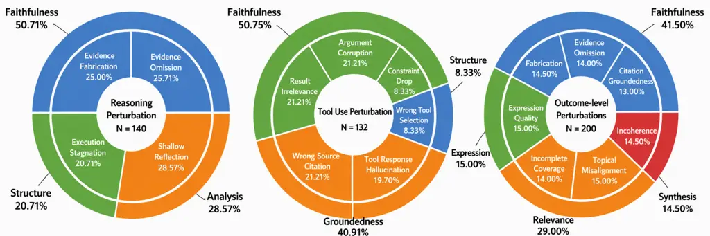
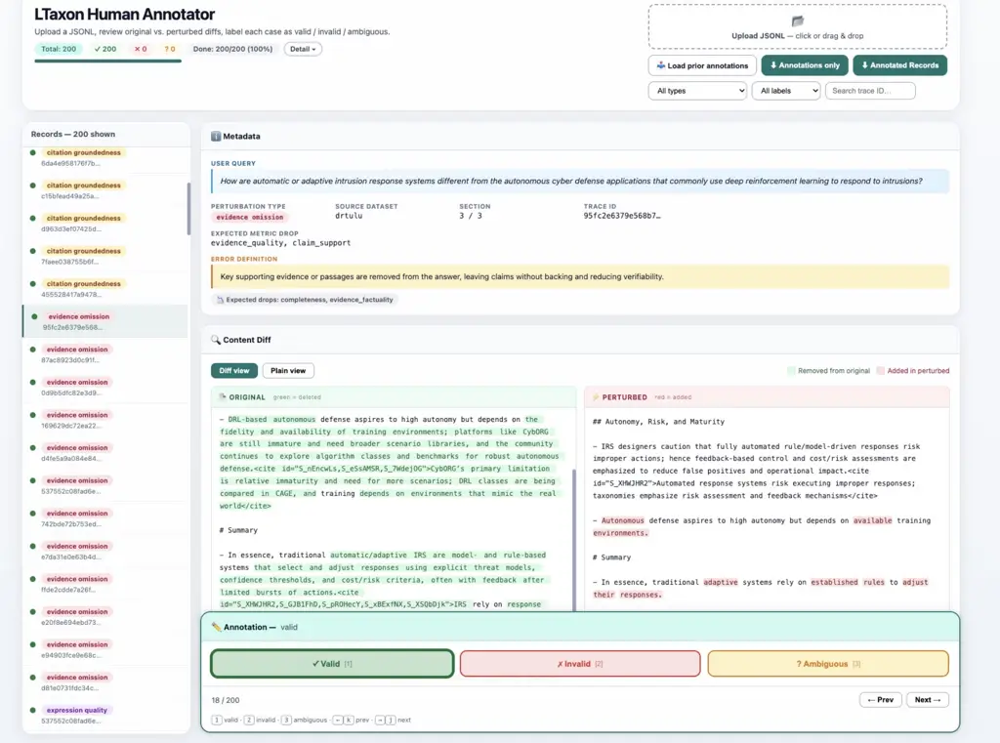

# Time to Reflect : Can We Trust LLM Judges for Evidence-based Research Agents?

Leyao Wang^(1,♡,†) Yanan He^(1,♡,†) Peng Chen^(1,†) Asaf Yehudai^(2,†)
Yixin Liu¹ Rex Ying¹ Michal Shmueli-Scheuer² Arman Cohan^(1,†)  
¹Yale University   ²IBM Research  
{leyao.wang.lw855, yanan.he, peng.chen.pc838, yixin.liu, rex.ying,
arman.cohan}@yale.edu  
Asaf.Yehudai@ibm.com, shmueli@il.ibm.com  
$`\heartsuit`$ Joint first authors.  $`\dagger`$ Core contributors.

###### Abstract

Deep research agents increasingly automate complex information-seeking
tasks, producing evidence-grounded reports via multi-step reasoning,
tool use, and synthesis. Their growing role demands scalable, reliable
evaluation, positioning LLM-as-judge as a supervision paradigm for
assessing factual accuracy, evidence use, and reasoning quality. Yet the
reliability of these judges for deep research agents remains poorly
understood, posing a critical meta-evaluation problem: before deploying
LLM judges to supervise research agents, we must first evaluate the
judges themselves. Existing meta-evaluations fall short in two ways: (1)
reliance on coarse, subjective human-preference agreement; (2) focus on
instruction-following or verifiable tasks, leaving open-ended agent
executions unexplored. To address these gaps, we introduce
Reflect (REliable Fine-grained LLM judge Evaluation via Controlled
inTervention), a meta-evaluation benchmark targeting fine-grained
failure detection in agentic environments. Reflect defines a detailed
taxonomy of process- and outcome-level failure modes, instantiated by
performing controlled and localized interventions on quality-screened
agent execution traces. This yields verifiable, comprehensive, and
fine-grained instances for validating the judge models. Our experiments
show that current LLM judges remain unreliable: even the best-performing
models achieve overall accuracies below 55% across reasoning, tool-use,
and report-quality failures, with especially poor performance on
evidence verification. Together, our taxonomy and findings expose
systematic judge limitations, reveal tradeoffs in cost and reliability,
and offer actionable guidance for building more reliable evaluation
pipelines for deep research agents.

^(†)^(†)footnotetext: See full author contributions here.

## 1 Introduction

Deep research agents are increasingly important for automating complex
information-seeking tasks. They can investigate open-ended questions
through browser interaction, reasoning, and synthesis, ultimately
producing evidence-grounded long-form reports \[34, 23, 52, 43\]. As
these agents are increasingly used in realistic research workflows,
rigorous evaluation becomes essential, motivating recent benchmarks that
assess long-form report generation, research-tools integration and
research-process quality \[6, 17, 5, 49, 54\]. However, evaluation
remains challenging: the final report is long-form and
knowledge-intensive, making cited sources difficult to verify; and the
execution trajectory is multi-step, open-ended, and difficult to audit,
making it hard to assess whether a fluent report truly reflects sound
retrieval and well-supported claims.



Figure 1: Data distribution of Reflect across reasoning-process
($`N=140`$), tool-use ($`N=132`$), and outcome-level ($`N=200`$) error
types. The outer rings represent the high-level failure dimensions of
deep research agents and their corresponding proportions, while the
inner rings break each dimension down into fine-grained error types
defined by our taxonomy, which is summarized from prior work (see
Table 4) and further verified through case studies of natural rollouts
(see Appendix D).

Such challenges make human evaluation over full research trajectories
costly and infeasible at scale, motivating LLM-as-judge as a scalable
supervision paradigm for assessing report quality, tool integration, and
intermediate reasoning processes \[63, 26, 7, 6, 5, 17, 54\]. Related
work further uses LLM judges or reward models to supervise search
behavior, step-level reasoning, and citation-aware training
signals \[58, 44, 59, 18, 61, 45\]. Yet the reliability of these judges
when evaluating deep research agents remains poorly understood, posing a
critical meta-evaluation problem \[27\]: before deploying LLM judges to
supervise research agents, we must first evaluate the judges themselves.

However, existing meta-evaluation protocols are ill-suited for assessing
judge reliability in deep research agent settings. Prior work validates
automated judges by measuring agreement with human ratings, rankings, or
pairwise preferences over model outputs \[20, 10, 5, 55\]. This paradigm
leaves three critical gaps for evidence-based research agents: (1)
Coarse and subjective labels. Overall preferences indicate which output
humans favor, but shed little light on which specific failures a judge
detects or misses. (2) Absence of ground truth in open-ended tasks.
Prior meta-evaluation targets settings with verifiable answers, such as
mathematics, coding, or factual QA. Deep research agents instead operate
in open-ended settings with no single correct answer or canonical
trajectory, making reliable labels difficult to construct for retrieval,
tool use, reasoning, and synthesis. (3) Insufficient coverage of
process-level execution. Existing protocols assess judges against coarse
human judgments over final outputs, offering limited insight into
whether LLM judges can detect process-level failures such as poor
evidence gathering or tool misuse.

To address these gaps, we introduce Reflect (REliable Fine-grained LLM
judge Evaluation via Controlled inTervention), a meta-evaluation
benchmark targeting fine-grained failure detection of LLM judges for
non-verifiable agentic execution. Reflect offers three key advantages:
(1) Verifiable ground-truth labels: instead of relying on subjective
human preferences, we make controlled, localized interventions on
quality-screened agent trajectories and reports, making labels objective
and directly verifiable by construction. (2) Comprehensive and realistic
failure coverage: perturbations are drawn from a taxonomy of realistic
failures spanning both process- and outcome-level errors in reasoning,
tool use, evidence gathering, and synthesis. (3) Fine-grained diagnostic
signal: by reframing meta-evaluation as failure detection with known
failure types and locations, Reflect enables precise identification of
judge blind spots and systematic comparison between fine-grained and
holistic evaluation paradigms.

Using Reflect, we evaluate various LLM-judges, including both those that
perform holistic and fine-grained, step-level evaluations. Our
experiments reveal major reliability gaps in current LLM judges: judges
fail in different ways, and no single aggregate score captures overall
reliability. Fine-grained evaluation is more effective than holistic
scoring, particularly for macro-level structural failures that require
cross-stage tracing. Overall, Reflect exposes overlooked failure types
and vulnerable components, offering guidance for improving judge prompts
and protocols for more reliable agentic research systems. Our
contributions are threefold:

1.  1.  We introduce Reflect, the first comprehensive and fine-grained
        meta-evaluation benchmark for assessing LLM judges in deep research
        agent executions traces and reports, converting judge evaluation
        from subjective, coarse preference matching into targeted failure
        detection.
2.  2.  We construct the benchmark using controlled, localized interventions
        based on comprehensive error taxonomy of deep research agent,
        producing instances with specific failure types and verifiable
        ground-truth labels.
3.  3.  We systematically study judge reliability and cost across models,
        failure categories, and evaluation protocols. Our findings reveal
        major reliability gaps in current judges and point to fine-grained
        judging protocols as a potential enhancement for robust evaluation
        pipelines for deep research agents.

## 2 Reflect

### 2.1 Benchmark Task Formulation

Reflect frames judge meta-evaluation as an accuracy-based preference
task over research-agent executions. Each instance pairs a reference
execution with a controlled failure-bearing alternative. A reliable
judge should assign higher quality to the reference, thereby showing
sensitivity to the targeted failure. This formulation supports both
process-level evaluation of trajectories and outcome-level evaluation of
final reports, while retaining verifiable labels for open-ended research
tasks that lack a single canonical answer. We first formalize the
benchmark task and failure space in §2.1, then describe the four-stage
construction pipeline used to build verified clean-perturbed pairs in
§2.2.

Agent executions. An evidence-based deep research agent $`\mathcal{A}`$
maps an input query $`q`$ to an execution $`\xi=(q,\tau,y)`$, where
$`\tau`$ is the research trajectory and $`y`$ is the final long-form
answer. Following ReAct \[52\], the trajectory is a sequence of
reasoning, tool-call, and tool-response triples,
$`\tau=\big((r_{t},c_{t},s_{t})\big)_{t=1}^{T}`$, with history
$`h_{<t}=(q,r_{<t},c_{<t},s_{<t})`$. At each step, the agent generates
$`r_{t}=\mathcal{A}_{\mathrm{reason}}(h_{<t})`$ and selects a tool call
$`c_{t}=\mathcal{A}_{\mathrm{tool}}(h_{<t},r_{t})`$. Each tool call
$`c_{t}=(u_{t},\theta_{t})`$ specifies a tool $`u_{t}`$ from the
available tool set $`\mathcal{U}`$ and its arguments $`\theta_{t}`$. The
tool returns a response $`s_{t}=\mathcal{E}(c_{t})`$. After completing
the trajectory, the final answer is produced as
$`y=\mathcal{A}_{\mathrm{ans}}(q,\tau)`$.

Failure space. We partition the failure space as
$`\mathcal{F}=\mathcal{F}_{\mathrm{proc}}\cup\mathcal{F}_{\mathrm{out}}`$.
Process-level failures $`\mathcal{F}_{\mathrm{proc}}`$ arise within the
trajectory $`\tau`$, including errors in reasoning, tool calls, and the
use or interpretation of tool responses. Outcome-level failures
$`\mathcal{F}_{\mathrm{out}}`$ arise in the final answer $`y`$. We
derived and adapted the full error taxonomy from prior work on long-form
QA, deep research agents, and agent evaluation \[66, 58, 44, 59\].
Details of the our error taxonomy distribution can be found in Figure 1
and its relation to existing schemes are given in Appendix A.2.

Figure 2: Overview of the benchmark construction pipeline of Reflect,
which collects agent trajectories, applies controlled perturbations to
reasoning, tool use, and answers, and validates the resulting samples
through automated filtering and human review.

Benchmark instances. Given a quality-screened agent execution
$`\xi^{\star}=(q,\tau^{\star},y^{\star})`$ and a target failure type
$`f\in\mathcal{F}`$, a perturbation operator $`\Pi_{f}`$ produces a
corrupted execution $`\tilde{\xi}=\Pi_{f}(\xi^{\star})`$ that contains
$`f`$ and differs from $`\xi^{\star}`$ only at a designated edit site.
Each benchmark instance $`b_{i}\in\mathcal{B}`$ consists of a verified
reference-corrupted execution pair, a failure label, and an edit site
$`\ell_{i}`$:

```math
\mathcal{B}=\big\{b_{i}=(\xi_{i}^{\star},\tilde{\xi}_{i},f_{i},\ell_{i})\big\}_{i=1}^{M},\qquad\tilde{\xi}_{i}=\Pi_{f_{i}}(\xi_{i}^{\star}).
```

Here $`\ell_{i}`$ is a trajectory step $`t\in\{1,\dots,T_{i}\}`$ for
process-level perturbations and a contiguous answer chunk for
outcome-level perturbations. Since $`\xi_{i}^{\star}`$ is verified to be
free of $`f_{i}`$ and $`\tilde{\xi}_{i}`$ to contain it, each instance
provides ground truth for judge meta-evaluation. The edit-site metadata
also supports localization analysis, scored by step-level exact match
for trajectories and chunk-level overlap for answers; see Section 3.

Judge interfaces. A judge $`\mathcal{J}`$ is evaluated by whether it
identifies or prefers the reference execution over its failure-bearing
counterpart. We support three interfaces commonly used in evaluation and
training.

Scalar judging. A scalar (or pointwise) judge assigns a quality score
$`S_{\mathcal{J}}(\xi)\in\mathbb{R}`$, as in reward modeling or
score-based filtering. For a reference-corrupted pair, we define the
score gap and success indicator as

```math
\Delta_{\mathcal{J}}(\xi^{\star},\tilde{\xi})=S_{\mathcal{J}}(\xi^{\star})-S_{\mathcal{J}}(\tilde{\xi}),\qquad z_{\mathcal{J}}(\xi^{\star},\tilde{\xi})=\mathbb{I}\!\left[\Delta_{\mathcal{J}}(\xi^{\star},\tilde{\xi})>\epsilon\right].
```

We use $`\epsilon=0`$ as the default margin throughout the paper.

Pairwise judging. A pairwise judge directly compares two executions,
matching preference-learning settings such as DPO-style training, \[40\]
and returns
$`P_{\mathcal{J}}(\xi^{\star},\tilde{\xi})\in\{\xi^{\star},\tilde{\xi},\mathrm{tie}\}`$.
It succeeds when

```math
z_{\mathcal{J}}(\xi^{\star},\tilde{\xi})=\mathbb{I}\!\left[P_{\mathcal{J}}(\xi^{\star},\tilde{\xi})=\xi^{\star}\right].
```

Ranking judging. A ranking judge selects the best execution from a
candidate set, corresponding to Best-of-$`N`$ inference-time scaling or
reranking. Let $`\mathcal{P}`$ denote a set of perturbation types, each
producing a candidate $`\tilde{\xi}_{a}`$ for $`a\in\mathcal{P}`$. The
judge sees
$`\mathcal{C}=\{\xi^{\star}\}\cup\{\tilde{\xi}_{a}:a\in\mathcal{P}\}`$,
selects $`T_{\mathcal{J}}(\mathcal{C})\in\mathcal{C}`$, and succeeds
when

```math
z_{\mathcal{J}}(\mathcal{C})=\mathbb{I}\!\left[T_{\mathcal{J}}(\mathcal{C})=\xi^{\star}\right].
```

### 2.2 Benchmark Construction Pipeline

We instantiate the perturbation operators $`\Pi_{f}`$ through a
four-stage pipeline: taxonomy construction, reference screening,
controlled intervention, and combined automated filtering and human
validation.

Taxonomy construction. We construct a failure space $`\mathcal{F}`$ by
synthesizing categories from prior work on long-form QA, deep research
benchmark, and agentic trajectory supervision \[66, 64, 59, 44\].
Existing taxonomies typically emphasize either final-answer quality or
trajectory behavior in isolation; ours unifies both views and is the
basis for the process/outcome partition above. To verify that the
taxonomy reflects real agent behavior rather than an a priori list, we
sample natural rollouts on held-out queries and, under model-assisted
and human review, map each observed failure either to a category in
$`\mathcal{F}`$ or to an out-of-taxonomy bucket. Case studies can be
found in Appendix D.

Reference screening. We draw candidate reference executions from strong
agent rollouts. For each target failure type $`f`$, we only require that
the selected reference does not already contain $`f`$ at the chosen edit
(i.e. the step or chunk to edit). Candidate references are screened
using automatic checks for schema validity, English language content,
and usable trajectory or answer structure, followed by targeted
validation for the absence of $`f`$.

Controlled Intervention. For each failure type $`f\in\mathcal{F}`$, we
define a perturbation operator $`\Pi_{f}`$ implemented as an LLM-based
editor. Starting from clean seeds $`\xi^{\star}`$ obtained from strong
agent rollouts, we use LLM along with human supervision to pre-filter to
ensure $`f`$ is absent in the seed, then apply

```math
\tilde{\xi}=\Pi_{f}(\xi^{\star})=\mathrm{Edit}_{\theta}\!\big(\xi^{\star},\,f,\,d_{f},\,\ell;\,p_{f}\big),
```

where $`\mathrm{Edit}_{\theta}`$ denotes an LLM editor with parameters
$`\theta`$, $`d_{f}`$ is a natural-language definition of the failure
type, $`\ell`$ is the target edit site sampled from candidate sites in
$`\xi^{\star}`$, and $`p_{f}`$ is a type-specific perturbation prompt.
Each operator targets either the trajectory $`\tau^{\star}`$ (for
$`f\in\mathcal{F}_{\mathrm{proc}}`$) or the answer $`y^{\star}`$ (for
$`f\in\mathcal{F}_{\mathrm{out}}`$); concrete worked examples are listed
in Appendix D.

Following adversarial comparison benchmarks such as LLMBar \[57\], we
constrain edits to be localized, plausible, and minimal: a perturbation
should introduce $`f`$ at $`\ell`$ while preserving fluency, coherence,
and all content outside $`\ell`$. For trajectories, this means that
surrounding steps and their observations are left unchanged and the
edited step remains syntactically well-formed; for answers, it means
that only the targeted chunk is rewritten. This discipline ensures that
judge success depends on detecting $`f`$ rather than exploiting
superficial artifacts such as length, formatting, or stylistic drift.

Automated filtering and human validation. Every original-perturbed pair
is screened by automated filters that remove pairs with no substantive
change, malformed outputs, non-English text, formatting artifacts, or
invalid input-output structure for the target judge interface. Pairs
that pass the filter proceed to a human validation step. Two annotators
with graduate-level expertise in NLP independently verify three
conditions for every pair: $`\tilde{\xi}`$ contains the target failure
$`f`$, $`\xi^{\star}`$ does not, and the perturbation introduces no
major unintended failures. Annotators completed a calibration round on a
held-out development sample before the main study, and disagreements on
the main study were resolved through adjudicated discussion. We obtain
an inter-annotator agreement of $`\kappa=0.86`$, indicating substantial
agreement. Final dataset statistics are illustrated in Figure 1 and
report in in Table 6 in Appendix B.1.

## 3 Experiments

We design our experiments to answer the following key research
questions:

RQ1: Model capability. How do different judge models perform in
detecting various fine-grained failure modes, and how do open-weight
models compare with frontier closed-source models? RQ2: Evaluation
protocol. How do judging protocols, including holistic versus
fine-grained evaluation, rubric guidance, and explicit reasoning, affect
the judge’s reliability? RQ3: Judge blind spots. Which process-level and
outcome-level failure types are systematically missed by LLM judges, and
how do these blind spots depend on evaluation granularity? RQ4:
best-of-$`N`$ and cost-performance trade-off. Can LLM judges identify
the verified original execution among multiple failure-bearing
alternatives (a useful setup for best-of-N inference-time scaling), and
which protocol choices provide the best reliability-cost trade-off?

### 3.1 Experimental Setup

Evaluation Protocols. We formulate judge reliability as an
accuracy-based preference task: given a verified reference execution and
failure-bearing alternatives, the judge should prefer the reference. We
evaluate two targets: the agent’s execution process and its final
output. Process-level evaluation assesses trajectories, distinguishing
_reasoning behavior_ (e.g., planning, reflection, and evidence use) from
_tool-use behavior_ (e.g., tool selection, argument construction, and
response interpretation), while outcome-level evaluation assesses the
final report.

We vary three protocol axes: (i) _judging granularity_, comparing
holistic judgments over full trajectories or reports with fine-grained
judgments over localized steps or chunks; (ii) _comparison format_,
comparing pointwise independent scoring with pairwise direct comparison;
and (iii) _prompting format_, comparing rubric-based judgments with
non-rubric overall judgments. For pairwise evaluation, we use a
swapped-order design to mitigate position bias \[27\]. Additional prompt
details are provided in Appendix C.

Judge Models. We evaluate a wide array of LLM judges covering both
open-weight and proprietary models . Such judges are increasingly used
beyond offline evaluations, such as best-of-$`N`$ selection and RL-style
training signals \[65, 30\]. The open-weight judges include Qwen3-8B,
Qwen3-32B, and Qwen3-235B-A22B \[51\], Llama-3.1-70B \[16\],
Gemma3-27B \[12\], and GPT-OSS-120B \[1\]. The proprietary judges
include Gemini-2.0-Flash \[13\], Gemini-2.5-Flash \[14\],
Gemini-3.1-Pro \[15\], GPT-5.3-Codex \[37\], GPT-5.4 \[38\],
GPT-5-mini \[36\], Claude-Haiku-4.5 \[2\], and Claude-Opus-4.7 \[3\].

Benchmark Instances. Our benchmark draws on different sources for
process-level and outcome-level perturbations. For process-level
evaluation, we use clean agent trajectories from two trace sources:
cleaned DR.TULU \[45\] and Tongyi DeepResearch \[48\].¹¹ 1 We do not
assume that source trajectories are globally error-free. They are used
as reference executions after screening and validation for the target
failure type: the reference must not contain the target failure at the
selected edit site, while the edited alternative must contain that
failure and preserve the surrounding trajectory. This paired
counterfactual design controls for residual imperfections shared by both
executions and tests whether judges are sensitive to the controlled
localized degradation. These traces provide the reasoning and tool-use
steps used to construct process-level perturbations. For outcome-level
evaluation, we use final reports from cleaned DR.TULU \[45\] and English
final answers sampled from DeepResearch Bench \[6\]. All instances are
normalized into a shared format containing the user question, final
answer, and trajectory steps when available.

Metrics. We use accuracy as the primary metric, consistent with
reward-model and judge meta-evaluation benchmarks \[30, 65\], and
following the scalar-judging success criterion defined in Section 2.1. A
judge is correct on a pair $`(\xi_{i}^{\star},\tilde{\xi}_{i})`$ if the
original execution receives a strictly higher final score than the
perturbed execution. I.e.,
$`\mathrm{Acc}=\frac{1}{N}\sum_{i=1}^{N}\mathbb{I}\!\left[S_{\mathcal{J}}(\xi_{i}^{\star})>S_{\mathcal{J}}(\tilde{\xi}_{i})\right].`$

For non-rubric scoring, $`S_{\mathcal{J}}`$ is the judge’s direct
overall score. For rubric scoring,
$`S_{\mathcal{J}}(x)=\frac{1}{K}\sum_{k=1}^{K}s_{\mathcal{J},k}(x)`$,
where $`s_{\mathcal{J},k}(x)\in\{1,\ldots,n\}`$ is the score for rubric
dimension $`k`$. We report accuracy overall and by failure type.

|                      |                          |      |      |      |                         |      |      |      |                               |      |      |      |      |
| -------------------- | ------------------------ | ---- | ---- | ---- | ----------------------- | ---- | ---- | ---- | ----------------------------- | ---- | ---- | ---- | ---- |
| Model                | Process-level: Reasoning |      |      |      | Process-level: Tool Use |      |      |      | Outcome-level: Report Quality |      |      |      |      |
|                      | AN                       | ST   | FI   | OV   | ST                      | FI   | GR   | OV   | RE                            | FI   | EX   | SY   | OV   |
| Open-source Models   |                          |      |      |      |                         |      |      |      |                               |      |      |      |      |
| Qwen3-8B             | 0.0                      | 3.4  | 0.0  | 0.7  | 0.0                     | 7.5  | 0.0  | 3.8  | 5.2                           | 9.6  | 26.7 | 34.5 | 14.5 |
| Qwen3-32B            | 0.0                      | 0.0  | 0.0  | 0.0  | 0.0                     | 0.0  | 3.7  | 1.5  | 34.5                          | 34.9 | 50.0 | 51.7 | 39.5 |
| Gemma3-27B           | 5.0                      | 10.3 | 7.0  | 7.1  | 0.0                     | 1.5  | 1.9  | 1.5  | 20.7                          | 19.3 | 6.7  | 34.5 | 20.0 |
| Llama3.1-70B         | 0.0                      | 0.0  | 0.0  | 0.0  | 9.1                     | 1.5  | 1.9  | 2.3  | 6.9                           | 7.2  | 20.0 | 10.3 | 9.5  |
| Qwen3-235B-a22B      | 30.0                     | 24.1 | 22.5 | 25.0 | 18.2                    | 19.4 | 22.2 | 20.5 | 17.2                          | 32.5 | 30.0 | 27.6 | 27.0 |
| GPT-OSS-120B         | 57.5                     | 48.3 | 38.0 | 45.7 | 36.4                    | 28.4 | 24.1 | 27.3 | 43.1                          | 43.4 | 43.3 | 65.5 | 46.5 |
| Closed-source Models |                          |      |      |      |                         |      |      |      |                               |      |      |      |      |
| Gemini-2.0-Flash     | 2.6                      | 3.4  | 6.0  | 4.5  | 0.0                     | 4.5  | 1.9  | 3.0  | 3.4                           | 6.0  | 3.3  | 3.4  | 4.5  |
| Gemini-2.5-Flash     | 33.3                     | 31.0 | 32.8 | 32.6 | 27.3                    | 19.4 | 20.4 | 20.5 | 22.4                          | 18.1 | 30.0 | 41.4 | 24.5 |
| Gemini-3.1-Pro       | 20.0                     | 31.0 | 23.5 | 24.1 | 54.5                    | 28.4 | 22.2 | 28.0 | 41.4                          | 30.1 | 23.3 | 31.0 | 32.5 |
| Claude-Haiku-4.5     | 15.0                     | 20.7 | 12.7 | 15.0 | 63.6                    | 41.8 | 40.7 | 43.2 | 32.8                          | 31.3 | 30.0 | 37.9 | 32.5 |
| Claude-Opus-4.7      | 15.0                     | 20.7 | 21.1 | 19.3 | 81.8                    | 49.3 | 51.9 | 53.0 | 29.3                          | 37.3 | 26.7 | 48.3 | 35.0 |
| GPT-5.4              | 40.0                     | 41.4 | 33.8 | 37.1 | 90.9                    | 55.2 | 37.0 | 50.8 | 39.7                          | 33.7 | 36.7 | 48.3 | 38.0 |
| GPT-5-mini           | 30.0                     | 48.3 | 36.6 | 37.1 | 36.4                    | 28.4 | 42.6 | 34.8 | 34.5                          | 44.6 | 43.3 | 58.6 | 43.5 |
| GPT-5.3-codex        | 30.0                     | 37.9 | 19.7 | 26.4 | 63.6                    | 59.7 | 46.3 | 54.5 | 39.7                          | 51.8 | 43.3 | 55.2 | 47.5 |

Table 1: Detection accuracy for process- and outcome-level evaluations
with pointwise judges. Values are percentages with % omitted.
Abbreviations: AN = Analysis, ST = Structure, OV = Overall, FI =
Faithfulness, GR = Groundedness, RE = Relevance, EX = Expression, SY =
Synthesis. Bold and underline mark the best and the runner-up.

### 3.2 Model Capability (RQ1)

Table 1 shows that judge performance remains low across process-level
reasoning, tool-use accuracy, and outcome-level evaluations. The results
reveal the following main findings.

Existing judges remain unreliable. Even the best overall scores are far
from reliable: 45.7% for reasoning, 54.5% for tool use, and 47.5% for
report quality. Performance also varies widely across model families and
evaluation targets. Smaller open-weight judges perform poorly in most
settings, while larger open-weight and proprietary models are more
competitive but still unreliable.

Judge reliability is failure-type dependent. Tool-use “structure” errors
are generally easier for several frontier models to detect, whereas
“groundedness” and “faithfulness” failures remain substantially more
challenging. At the outcome level, models also differ in whether they
are more sensitive to relevance, faithfulness, expression, or synthesis
failures. This heterogeneity indicates that aggregate accuracy alone can
obscure important differences in what judges can and cannot detect.

Agent-oriented judges are strongest overall. The strongest overall
results come from GPT-5.3-codex, which achieves the best process-level
tool-use accuracy of 54.5% and the best outcome-level report accuracy of
47.5%. This suggests that models optimized for agentic coding and
tool-oriented tasks may be well suited to evidence-based judge
evaluation, though this advantage comes with higher inference cost and
requires further controlled study.

### 3.3 Evaluation Protocol Comparison (RQ2)

We next study how protocol choices affect judge reliability. Because
exhaustive fine-grained protocol sweeps are expensive, we run these
comparisons on a representative subset of judges spanning open-weight
and proprietary models. For evaluation granularity, we compare holistic
judging over the full trajectory or report with fine-grained judging
over localized trajectory steps or answer chunks. Table 2 reports
$`\Delta_{\text{scale}}`$, the accuracy difference between fine-grained
and holistic judging, across process- and outcome-level settings.

Fine-grained evaluation improves over holistic judging. Fine-grained
judging consistently improves detection accuracy across models,
evaluation levels, and rubric settings. The gains are substantial in
both process-level and outcome-level evaluation, with
$`\Delta_{\text{scale}}`$ reaching over 30 points in several settings.
This suggests that localized evaluation helps judges identify errors
that may be diluted under holistic scoring, whether they appear in
intermediate reasoning trajectories or in final reports. Overall, the
results show that granularity is a robust protocol effect, and we next
ask whether explicit rubric dimensions provide an additional source of
judge reliability.

|                |               |      |                           |           |      |                           |               |      |                           |           |      |                           |
| -------------- | ------------- | ---- | ------------------------- | --------- | ---- | ------------------------- | ------------- | ---- | ------------------------- | --------- | ---- | ------------------------- |
| Model          | Process-Level |      |                           |           |      |                           | Outcome-Level |      |                           |           |      |                           |
|                | Rubric        |      |                           | No-Rubric |      |                           | Rubric        |      |                           | No-Rubric |      |                           |
|                | Hol.          | FG   | $`\Delta_{\text{scale}}`$ | Hol.      | FG   | $`\Delta_{\text{scale}}`$ | Hol.          | FG   | $`\Delta_{\text{scale}}`$ | Hol.      | FG   | $`\Delta_{\text{scale}}`$ |
| Qwen3-8B       | 0.7           | 20.0 | (+19.3)                   | 3.6       | 25.7 | (+22.1)                   | 14.5          | 34.0 | (+19.5)                   | 10.5      | 25.4 | (+14.9)                   |
| Qwen3-32B      | 0.0           | 21.4 | (+21.4)                   | 0.0       | 34.3 | (+34.3)                   | 39.5          | 45.5 | (+6.0)                    | 14.5      | 37.6 | (+23.1)                   |
| GPT-5.4        | 37.1          | 55.7 | (+18.6)                   | 22.9      | 56.4 | (+33.5)                   | 38.0          | 55.3 | (+17.3)                   | 32.0      | 34.8 | (+2.8)                    |
| Gemini-3.1 Pro | 24.1          | 55.4 | (+31.3)                   | 25.0      | 55.7 | (+30.7)                   | 32.5          | 56.9 | (+24.4)                   | 12.5      | 23.2 | (+10.7)                   |

Values are detection accuracy percentages. Hol. = holistic; FG =
fine-grained.

Table 2: Effect of evaluation granularity across process- and
outcome-level settings. $`\Delta_{\text{scale}}`$ denotes the difference
between fine-grained and holistic detection accuracy, measured in
percentage points.

Rubric effects are context-dependent, motivating dynamic instance-based
rubrics. Figure 3(a) shows that dimension-wise rubric scoring is not a
uniform improvement. At the outcome level, rubrics consistently improve
detection accuracy across all selected models, with the largest gain
reaching $`+33.7`$ points for Gemini-3.1-Pro under fine-grained judging.
This suggests that final-report failures align relatively well with
explicit scoring dimensions, allowing rubrics to expose localized
factuality, evidence-use, or citation errors that overall scores may
overlook. In contrast, process-level effects are mixed and sometimes
negative, especially for weaker judges. For process evaluation, rubrics
turn a single overall decision into a more demanding task: reading long
trajectories, locating cross-step evidence, separating nearby error
dimensions, and calibrating multiple scores. When the judge lacks
sufficient long-context reasoning or scoring stability, this extra
structure can become noise rather than guidance. Overall, rubric scoring
is most useful when the judge is strong enough to apply it reliably,
motivating more adaptive, instance-specific rubrics for process-level
evaluation.

(a) Rubric benefit across models and granularities.

(b) CoT reasoning effect with rubrics.

Figure 3: Effects of rubric-guided evaluation and chain-of-thought
reasoning on perturbation detection accuracy. $`\Delta`$ denotes Rubric
$`-`$ No-Rubric accuracy in percentage points.

CoT helps only when judges can effectively leverage rubrics. We next
examine whether chain-of-thought (CoT) prompting further improves
rubric-guided judging. Figure 3(b) compares rubric gains with and
without CoT: point height represents the rubric benefit, and slope
indicates how this benefit changes after adding CoT.

The results show that CoT amplifies rubric gains only selectively. It is
most helpful for stronger judges in outcome-level evaluation, where
final-report errors align well with rubric dimensions such as relevance,
factuality, expression, and synthesis. For process-level evaluation,
however, the effect is more mixed, as judges must track reasoning, tool
use, and evidence flow across multiple steps. Thus, CoT is better
characterized as a capability-dependent complement to rubric-based
evaluation, rather than a uniformly effective intervention.

### 3.4 Blind Spots across Error Taxonomy (RQ3)

Figure 4: Failure detection accuracy across process-level and
outcome-level perturbation types. Results are shown for GPT-5.4 and
Gemini-3.1 Pro under fine-grained and holistic judging.

Fine-grained judging surfaces local errors, whereas holistic judging
captures context-dependent global failures. Figure 4 compares GPT-5.4
and Gemini-3.1 Pro across perturbation types under fine-grained and
holistic judging. The results reveal granularity-dependent blind spots:
failures that are salient at the step or span level may be obscured in a
full trajectory, while failures that depend on broader context may only
emerge when the entire response is evaluated.

Fine-grained judging is most effective for localized failures because it
makes the perturbed step or answer span directly visible. This helps
identify local process failures such as execution stagnation, as well as
local outcome failures such as evidence omission, expression quality,
and incomplete coverage. Under holistic judging, these signals can be
diluted as they are embedded within a longer reasoning trajectory or
report. Holistic judging, in contrast, is better suited to failures that
require global context, accumulated evidence, or overall task intent to
detect. These include shallow reflection and topical misalignment, which
may not be obvious from any single step but become clearer when the
response is evaluated as a whole.

### 3.5 Best-of-N Selection and Cost Trade-offs (RQ4)

##### Best-of-$`N`$ Metric.

Beyond single-pair discrimination, many evaluation and deployment
pipelines use judges for best-of-$`N`$ inference-time selection: the
system generates multiple candidate executions and selects the candidate
with the highest judge score. We model this setting by grouping each
verified execution $`\xi_{i}^{\star}`$ with its failure-bearing
alternatives,
$`\mathcal{C}_{i}=\{\xi_{i}^{\star}\}\cup\{\tilde{\xi}_{i,f}:f\in\mathcal{F}_{i}\}`$,
where $`\mathcal{F}_{i}`$ denotes the failure types instantiated for
that execution. A group is correct only if the verified reference
receives the highest judge score:
$`S_{\mathcal{J}}(\xi_{i}^{\star})>\max_{f\in\mathcal{F}_{i}}S_{\mathcal{J}}(\tilde{\xi}_{i,f}).`$
Best-of-$`N`$ accuracy is the fraction of groups satisfying this
condition.

Best-of-$`N`$ Selection Gap. Figure 5(a) shows a clear _best-of-$`N`$
selection gap_: accuracy drops when judges must select the verified
reference from a candidate set instead of scoring a single
reference-alternative pair. The drop is largest at the _process level_,
where selection requires comparing multiple long trajectories and
tracking distributed reasoning, tool-use, and evidence-flow failures
across candidates. The _outcome-level_ setting is less affected, likely
because final reports provide a more compact and directly comparable
evaluation target. These results indicate that judge scores are less
reliable for best-of-$`N`$ selection than for isolated pairwise
discrimination, especially when candidate quality differs in
trajectory-level behavior.

(a) Best-of-$`N`$ selection accuracy

(b) Cost–performance trade-off

Figure 5: Judge reliability across evaluation settings. (a)
Best-of-$`N`$ selection accuracy. Single-pair scoring evaluates each
reference–alternative pair independently, while Best-of-$`N`$ selection
requires the judge to select the verified reference among 4–7
failure-bearing alternatives. (b) Estimated total evaluation cost versus
detection accuracy for closed-source judge settings, computed over the
full benchmark by multiplying the measured input/output token counts by
each model’s API pricing.

Cost-Performance Trade-off. Finally, we analyze the trade-off between
judge reliability and evaluation cost across closed-source judge
settings. Figure 5(b) shows a general _positive cost-performance trend_:
higher-cost settings usually obtain higher detection accuracy. The
strongest accuracies come from more expensive pairwise CoT
configurations, although the gains are not determined by cost alone.
_Process-level_ evaluation is less cost-effective, as long trajectories
increase token cost while remaining harder to judge. Taken together, the
results indicate that reliable judge evaluation requires balancing model
strength and protocol design rather than simply choosing the most
expensive setting.

## 4 Related Works

Evidence-Based Research Agent Evaluation. Recent benchmarks evaluate
deep research agents that perform multi-step information seeking and
synthesize evidence-grounded reports \[6, 10, 5, 17, 24\]. They assess
report quality—relevance, factuality, citation groundedness, coverage,
and evidence use \[6, 17, 5, 49, 46\]—as well as process behavior,
including search decisions, source selection, trajectory validity, and
step-level reasoning \[44, 54, 59, 58, 18, 61, 45\]. To scale beyond
expert review, they increasingly rely on LLM judges for reports,
citations, and evidence traces \[63, 26, 7, 5, 17, 67\]. Our work
complements this setting by meta-evaluating such judges under controlled
process- and outcome-level failures.

Meta-Evaluation for LLM Judges. Another line of work meta-evaluates LLM
judges and reward models using preference pairs, ranking tasks,
verification settings, or trajectory-level annotations, including
RewardBench2 \[30\], JudgeBench \[47\], JETTS \[65\],
VerifyBench \[25\], AgentRewardBench \[29\], and Sage \[9\]. These
benchmarks are informative but usually evaluate complete responses
rather than localized failures in extended agent executions \[47, 27\].
LLMBar \[57\] and ReIFE \[27\] are closest, using clean–flawed
adversarial pairs to isolate evaluation errors across models and
protocols. However, they mainly target response-level instruction
deviations, while research agents can fail during search, tool use,
evidence selection, and synthesis \[58, 59, 44, 22\]. Our Reflect
investigates open-ended agent executions in non-verifiable settings.

## 5 Conclusion

We introduced Reflect, a meta-evaluation benchmark for assessing whether
LLM judges can reliably evaluate evidence-based research agents. By
constructing verified reference executions and controlled
failure-bearing alternatives, Reflect provides fine-grained labels over
both process-level trajectory and outcome-level report failures. Our
experiments show that current judges remain limited across reasoning,
tool use, and final-report evaluation. They also reveal substantial
variation across failure types, evaluation granularity, prompting
formats, and best-of-$`N`$ selection settings. Overall, these results
suggest that judge reliability should be evaluated as a first-class
property of research-agent evaluation pipelines. Fine-grained protocols
improve failure sensitivity, but robust judge evaluation still requires
careful choices about model capability, cost, scoring interface, and
evaluation unit.

##### Limitations.

Reflect is a meta-evaluation benchmark, so its scope is intentionally
controlled. The taxonomy covers common failures from current
research-agent traces and prior evaluation work, but it cannot exhaust
every domain-specific, naturally occurring or interactive failure mode.
The controlled degradations isolate target failures to make judge
behavior measurable, complementing human audit studies of naturally
occurring agent errors. Like many modern benchmarks, Reflect requires
updating for longer term reliability: As judge models and research-agent
systems evolve, the benchmark should be also updated with new traces,
failure types, and evaluator families.

## 6 Author Contributions

We summarize each author’s primary contributions to the project below.
Authors shown in bold took the lead role in the corresponding category.

- •
  Project leadership: Leyao Wang, Yanan He
- •
  Core contributions: Leyao Wang, Yanan He, Peng Chen, Asaf Yehudai,
  Arman Cohan
- •
  Reflect development (Process-Reasoning): Leyao Wang
- •
  Reflect development (Process-Tool Use): Peng Chen
- •
  Reflect development (Outcome): Yanan He
- •
  Evaluations and baselines: Leyao Wang, Yanan He, Peng Chen
- •
  Paper writing: Leyao Wang, Yanan He, Arman Cohan
- •
  Administration and policy review: Leyao Wang, Yixin Liu
- •
  Advising and mentorship: Arman Cohan, Asaf Yehudai, Yixin Liu, Rex
  Ying, Michal Shmueli-Scheuer

Core contributors made sustained and significant contributions
throughout the project. All authors contributed to project discussions,
experiment planning, and manuscript reviewing.

## References

- \[1\] S. Agarwal et al. gpt-oss-120b & gpt-oss-20b model card. _arXiv
  preprint arXiv:2508.10925_, 2025.
- \[2\] Anthropic. Introducing claude haiku 4.5. Anthropic release
  announcement, 2025.
- \[3\] Anthropic. Introducing claude opus 4.7. Anthropic release
  announcement, 2026.
- \[4\] Jiawei Chen, Hongyu Lin, Xianpei Han, and Le Sun. Benchmarking
  large language models in retrieval-augmented generation. In
  _Proceedings of the AAAI Conference on Artificial Intelligence_, 2024.
- \[5\] João Coelho, Jingjie Ning, Jingyuan He, Kangrui Mao, Abhijay
  Paladugu, Pranav Setlur, Jiahe Jin, Jamie Callan, João Magalhães,
  Bruno Martins, and Chenyan Xiong. Deepresearchgym: A free,
  transparent, and reproducible evaluation sandbox for deep research.
  _arXiv preprint arXiv:2505.19253_, 2025.
- \[6\] Mingxuan Du, Benfeng Xu, Chiwei Zhu, Xiaorui Wang, and Zhendong
  Mao. Deepresearch bench: A comprehensive benchmark for deep research
  agents. _arXiv preprint arXiv:2506.11763_, 2025.
- \[7\] Yann Dubois, Xuechen Li, Rohan Taori, Tianyi Zhang, Ishaan
  Gulrajani, Jimmy Ba, Carlos Guestrin, Percy Liang, and Tatsunori
  Hashimoto. Alpacafarm: A simulation framework for methods that learn
  from human feedback. In _Thirty-seventh Conference on Neural
  Information Processing Systems_, 2023. URL
  [https://openreview.net/forum?id=4hturzLcKX](https://openreview.net/forum?id=4hturzLcKX).
- \[8\] Shahul Es, Jithin James, Luis Espinosa-Anke, and Steven
  Schockaert. RAGAS: Automated evaluation of retrieval augmented
  generation. In _Proceedings of the 18th Conference of the European
  Chapter of the Association for Computational Linguistics_, 2024.
- \[9\] Yuanning Feng, Sinan Wang, Zhengxiang Cheng, Yao Wan, and
  Dongping Chen. Are we on the right way to assessing LLM-as-a-judge?
  _arXiv preprint arXiv:2512.16041_, 2025. URL
  [https://arxiv.org/abs/2512.16041](https://arxiv.org/abs/2512.16041).
- \[10\] FutureSearch, :, Nikos I. Bosse, Jon Evans, Robert G. Gambee,
  Daniel Hnyk, Peter Mühlbacher, Lawrence Phillips, Dan Schwarz, and
  Jack Wildman. Deep research bench: Evaluating ai web research
  agents, 2025. URL
  [https://arxiv.org/abs/2506.06287](https://arxiv.org/abs/2506.06287).
- \[11\] Tianyu Gao, Howard Yen, Jiatong Yu, and Danqi Chen. Enabling
  large language models to generate text with citations. In _Proceedings
  of the 2023 Conference on Empirical Methods in Natural Language
  Processing_, 2023.
- \[12\] Gemma Team et al. Gemma 3 technical report. _arXiv preprint
  arXiv:2503.19786_, 2025.
- \[13\] Google. Gemini 2.0 is now available to everyone. Google Blog,
  feb 2025a. URL
  [https://blog.google/innovation-and-ai/models-and-research/google-deepmind/gemini-model-updates-february-2025/](https://blog.google/innovation-and-ai/models-and-research/google-deepmind/gemini-model-updates-february-2025/).
  Accessed: 2026-05-06.
- \[14\] Google. Gemini 2.5 flash is now in preview.
  [https://blog.google/products-and-platforms/products/gemini/gemini-2-5-flash-preview/](https://blog.google/products-and-platforms/products/gemini/gemini-2-5-flash-preview/),
  April 2025b. Accessed: 2026-05-06.
- \[15\] Google DeepMind. Gemini 3.1 pro model card.
  [https://deepmind.google/models/model-cards/gemini-3-1-pro/](https://deepmind.google/models/model-cards/gemini-3-1-pro/),
  February 2026. Accessed: 2026-05-06.
- \[16\] Aaron Grattafiori et al. The llama 3 herd of models. _arXiv
  preprint arXiv:2407.21783_, 2024.
- \[17\] Janghoon Han, Heegyu Kim, Changho Lee, Dahm Lee, Min Hyung
  Park, Hosung Song, Stanley Jungkyu Choi, Moontae Lee, and Honglak Lee.
  DEER: A benchmark for evaluating deep research agents on expert report
  generation. _arXiv preprint arXiv:2512.17776_, 2025.
- \[18\] Chen Hu, Haikuo Du, Heng Wang, Lin Lin, Mingrui Chen, Peng Liu,
  Ruihang Miao, Tianchi Yue, Wang You, Wei Ji, Wei Yuan, Wenjin Deng,
  Xiaojian Yuan, Xiaoyun Zhang, Xiangyu Liu, Xikai Liu, Yanming Xu,
  Yicheng Cao, Yifei Zhang, Yongyao Wang, et al. Step-DeepResearch
  technical report. _arXiv preprint arXiv:2512.20491_, 2025.
- \[19\] Yue Huang, Jiawen Shi, Yuan Li, Chenrui Fan, Siyuan Wu, Qihui
  Zhang, Yixin Liu, Pan Zhou, Yao Wan, Neil Zhenqiang Gong, and Lichao
  Sun. MetaTool benchmark for large language models: Deciding whether to
  use tools and which to use. In _The Twelfth International Conference
  on Learning Representations_, 2024.
- \[20\] Jena D. Hwang, Varsha Kishore, Amanpreet Singh, Dany Haddad,
  Aakanksha Naik, Malachi Hamada, Jonathan Bragg, Mike D’Arcy, Daniel S.
  Weld, Lucy Lu Wang, Doug Downey, and Sergey Feldman. Deep research,
  shallow evaluation: A case study in meta-evaluation for long-form qa
  benchmarks, 2026. URL
  [https://arxiv.org/abs/2603.06942](https://arxiv.org/abs/2603.06942).
- \[21\] Shirley Kokane, Ming Zhu, Tulika Manoj Awalgaonkar, Jianguo
  Zhang, Akshara Prabhakar, Thai Quoc Hoang, Zuxin Liu, Rithesh R N,
  Liangwei Yang, Weiran Yao, Juntao Tan, Zhiwei Liu, Shelby Heinecke,
  Huan Wang, Juan Carlos Niebles, Caiming Xiong, and Silvio Savarese.
  Toolscan: A benchmark for characterizing errors in tool-use
  LLMs, 2025. URL
  [https://openreview.net/forum?id=09tnQgqKuZ](https://openreview.net/forum?id=09tnQgqKuZ).
- \[22\] Tian Lan, Bin Zhu, Qianghuai Jia, Junyang Ren, Haijun Li,
  Longyue Wang, Zhao Xu, Weihua Luo, and Kaifu Zhang. Deepwidesearch:
  Benchmarking depth and width in agentic information seeking. _arXiv
  preprint arXiv:2510.20168_, 2025.
- \[23\] Patrick Lewis, Ethan Perez, Aleksandra Piktus, Fabio Petroni,
  Vladimir Karpukhin, Naman Goyal, Heinrich Küttler, Mike Lewis, Wen-tau
  Yih, Tim Rocktäschel, Sebastian Riedel, and Douwe Kiela.
  Retrieval-augmented generation for knowledge-intensive nlp tasks. In
  _Advances in Neural Information Processing Systems_, 2020.
- \[24\] Minghao Li, Ying Zeng, Zhihao Cheng, Cong Ma, and Kai Jia.
  ReportBench: Evaluating deep research agents via academic survey
  tasks. _arXiv preprint arXiv:2508.15804_, 2025a.
- \[25\] Xuzhao Li, Xuchen Li, Shiyu Hu, Yongzhen Guo, and Wentao Zhang.
  VerifyBench: A systematic benchmark for evaluating reasoning verifiers
  across domains. _arXiv preprint arXiv:2507.09884_, 2025b.
- \[26\] Yang Liu, Dan Iter, Yichong Xu, Shuohang Wang, Ruochen Xu, and
  Chenguang Zhu. G-Eval: NLG evaluation using GPT-4 with better human
  alignment. In _Proceedings of the 2023 Conference on Empirical Methods
  in Natural Language Processing_, pages 2511–2522. Association for
  Computational Linguistics, 2023.
- \[27\] Yixin Liu, Kejian Shi, Alexander Fabbri, Yilun Zhao, PeiFeng
  Wang, Chien-Sheng Wu, Shafiq Joty, and Arman Cohan. ReIFE:
  Re-evaluating instruction-following evaluation. In Luis Chiruzzo, Alan
  Ritter, and Lu Wang, editors, _Proceedings of the 2025 Conference of
  the Nations of the Americas Chapter of the Association for
  Computational Linguistics: Human Language Technologies (Volume 1: Long
  Papers)_, pages 12247–12287, Albuquerque, New Mexico, April 2025.
  Association for Computational Linguistics. ISBN 979-8-89176-189-6.
  doi: 10.18653/v1/2025.naacl-long.610. URL
  [https://aclanthology.org/2025.naacl-long.610/](https://aclanthology.org/2025.naacl-long.610/).
- \[28\] Jiarui Lu, Thomas Holleis, Yizhe Zhang, Bernhard Aumayer, Feng
  Nan, Felix Bai, Shuang Ma, Shen Ma, Mengyu Li, Guoli Yin, Zirui Wang,
  and Ruoming Pang. ToolSandbox: A stateful, conversational, interactive
  evaluation benchmark for LLM tool use capabilities. In _Findings of
  the Association for Computational Linguistics: NAACL 2025_, 2025.
- \[29\] Xing Han Lù, Amirhossein Kazemnejad, Nicholas Meade, Arkil
  Patel, Dongchan Shin, Alejandra Zambrano, Karolina Stańczak, Peter
  Shaw, Christopher J. Pal, and Siva Reddy. AgentRewardBench: Evaluating
  automatic evaluations of web agent trajectories. _arXiv preprint
  arXiv:2504.08942_, 2025. URL
  [https://arxiv.org/abs/2504.08942](https://arxiv.org/abs/2504.08942).
- \[30\] Saumya Malik, Valentina Pyatkin, Sander Land, Jacob Morrison,
  Noah A. Smith, Hannaneh Hajishirzi, and Nathan Lambert. Rewardbench 2:
  Advancing reward model evaluation. In _The Fourteenth International
  Conference on Learning Representations_, 2026.
- \[31\] Anna Martin-Boyle, William Humphreys, Martha Brown, Cara
  Leckey, and Harmanpreet Kaur. An expert schema for evaluating large
  language model errors in scholarly question-answering systems. In
  _Proceedings of the 2026 CHI Conference on Human Factors in Computing
  Systems_, 2026.
- \[32\] Sewon Min, Kalpesh Krishna, Xinxi Lyu, Mike Lewis, Wen-tau Yih,
  Pang Wei Koh, Mohit Iyyer, Luke Zettlemoyer, and Hannaneh Hajishirzi.
  FActScore: Fine-grained atomic evaluation of factual precision in long
  form text generation. In _Proceedings of the 2023 Conference on
  Empirical Methods in Natural Language Processing_, 2023.
- \[33\] Yifei Ming, Senthil Purushwalkam, Shrey Pandit, Zixuan Ke,
  Xuan-Phi Nguyen, Caiming Xiong, and Shafiq Joty. FaithEval: Can your
  language model stay faithful to context, even if “the moon is made of
  marshmallows”. In _The Thirteenth International Conference on Learning
  Representations_, 2025.
- \[34\] Reiichiro Nakano, Jacob Hilton, Suchir Balaji, Jeff Wu, Long
  Ouyang, et al. Webgpt: Browser-assisted question-answering with human
  feedback. _arXiv preprint arXiv:2112.09332_, 2021.
- \[35\] Cheng Niu, Yuanhao Wu, Juno Zhu, Siliang Xu, Kashun Shum, Randy
  Zhong, Juntong Song, and Tong Zhang. RAGTruth: A hallucination corpus
  for developing trustworthy retrieval-augmented language models. In
  _Proceedings of the 62nd Annual Meeting of the Association for
  Computational Linguistics_, 2024.
- \[36\] OpenAI. GPT-5 mini.
  [https://developers.openai.com/api/docs/models/gpt-5-mini](https://developers.openai.com/api/docs/models/gpt-5-mini),
  August 2025. Model version: gpt-5-mini-2025-08-07.
- \[37\] OpenAI. Introducing gpt-5.3-codex. OpenAI release and API
  documentation, 2026a.
- \[38\] OpenAI. Gpt-5.4 model. OpenAI API documentation, 2026b.
- \[39\] Shishir G Patil, Huanzhi Mao, Fanjia Yan, Charlie Cheng-Jie Ji,
  Vishnu Suresh, Ion Stoica, and Joseph E. Gonzalez. The berkeley
  function calling leaderboard (BFCL): From tool use to agentic
  evaluation of large language models, 2025. URL
  [https://openreview.net/forum?id=2GmDdhBdDk](https://openreview.net/forum?id=2GmDdhBdDk).
- \[40\] Rafael Rafailov, Archit Sharma, Eric Mitchell, Christopher D
  Manning, Stefano Ermon, and Chelsea Finn. Direct preference
  optimization: Your language model is secretly a reward model, 2023.
  URL
  [https://openreview.net/forum?id=HPuSIXJaa9](https://openreview.net/forum?id=HPuSIXJaa9).
- \[41\] Jon Saad-Falcon, Omar Khattab, Christopher Potts, and Matei
  Zaharia. ARES: An automated evaluation framework for
  retrieval-augmented generation systems. In _Proceedings of the 2024
  Conference of the North American Chapter of the Association for
  Computational Linguistics: Human Language Technologies_, 2024.
- \[42\] Rachneet Singh Sachdeva, Yixiao Song, Mohit Iyyer, and Iryna
  Gurevych. Localizing and mitigating errors in long-form question
  answering. In _Findings of the Association for Computational
  Linguistics: ACL 2025_, pages 20437–20469, 2025.
- \[43\] Timo Schick, Jane Dwivedi-Yu, Roberto Dessi, Roberta Raileanu,
  Maria Lomeli, Eric Hambro, Luke Zettlemoyer, Nicola Cancedda, and
  Thomas Scialom. Toolformer: Language models can teach themselves to
  use tools. In _Thirty-seventh Conference on Neural Information
  Processing Systems_, 2023. URL
  [https://openreview.net/forum?id=Yacmpz84TH](https://openreview.net/forum?id=Yacmpz84TH).
- \[44\] Jiaqi Shao, Yuxiang Lin, Munish Prasad Lohani, Yufeng Miao, and
  Bing Luo. Do LLM agents know how to ground, recover, and assess? a
  benchmark for epistemic competence in information-seeking agents.
  _arXiv preprint arXiv:2509.22391_, 2025a.
- \[45\] Rulin Shao, Akari Asai, Shannon Zejiang Shen, Hamish Ivison,
  Varsha Kishore, Jingming Zhuo, Xinran Zhao, Molly Park, Samuel G.
  Finlayson, David Sontag, Tyler Murray, Sewon Min, Pradeep Dasigi, Luca
  Soldaini, Faeze Brahman, Wen tau Yih, Tongshuang Wu, Luke Zettlemoyer,
  Yoon Kim, Hannaneh Hajishirzi, and Pang Wei Koh. Dr tulu:
  Reinforcement learning with evolving rubrics for deep research, 2025b.
  URL
  [https://arxiv.org/abs/2511.19399](https://arxiv.org/abs/2511.19399).
- \[46\] Manasi Sharma, Chen Bo Calvin Zhang, Chaithanya Bandi, Clinton
  Wang, Ankit Aich, Huy Nghiem, Tahseen Rabbani, Ye Htet, Brian Jang,
  Sumana Basu, et al. Researchrubrics: A benchmark of prompts and
  rubrics for evaluating deep research agents. _arXiv preprint
  arXiv:2511.07685_, 2025.
- \[47\] Sijun Tan, Siyuan Zhuang, Kyle Montgomery, William Yuan Tang,
  Alejandro Cuadron, Chenguang Wang, Raluca Popa, and Ion Stoica.
  Judgebench: A benchmark for evaluating LLM-based judges. In _The
  Thirteenth International Conference on Learning
  Representations_, 2025.
- \[48\] Tongyi DeepResearch Team, Baixuan Li, Bo Zhang, Dingchu Zhang,
  Fei Huang, Guangyu Li, Guoxin Chen, Huifeng Yin, Jialong Wu, Jingren
  Zhou, et al. Tongyi deepresearch technical report. _arXiv preprint
  arXiv:2510.24701_, 2025.
- \[49\] Yibo Wang, Lei Wang, Yue Deng, Keming Wu, Yao Xiao, Huanjin
  Yao, Liwei Kang, Hai Ye, Yongcheng Jing, and Lidong Bing.
  DeepResearchEval: An automated framework for deep research task
  construction and agentic evaluation. _arXiv preprint
  arXiv:2601.09688_, 2026.
- \[50\] Jerry Wei, Chengrun Yang, Xinying Song, Yifeng Lu, Nathan Zixia
  Hu, Jie Huang, Dustin Tran, Daiyi Peng, Ruibo Liu, Da Huang, Cosmo Du,
  and Quoc V Le. Long-form factuality in large language models. In _The
  Thirty-eighth Annual Conference on Neural Information Processing
  Systems_, 2024. URL
  [https://openreview.net/forum?id=4M9f8VMt2C](https://openreview.net/forum?id=4M9f8VMt2C).
- \[51\] An Yang, Anfeng Li, Baosong Yang, Beichen Zhang, Binyuan Hui,
  Bo Zheng, Bowen Yu, Chang Gao, Chengen Huang, Chenxu Lv, Chujie Zheng,
  Dayiheng Liu, Fan Zhou, Fei Huang, Feng Hu, Hao Ge, Haoran Wei, Huan
  Lin, Jialong Tang, Jian Yang, Jianhong Tu, Jianwei Zhang, Jianxin
  Yang, Jiaxi Yang, Jing Zhou, Jingren Zhou, Junyang Lin, Kai Dang,
  Keqin Bao, Kexin Yang, Le Yu, Lianghao Deng, Mei Li, Mingfeng Xue,
  Mingze Li, Pei Zhang, Peng Wang, Qin Zhu, Rui Men, Ruize Gao, Shixuan
  Liu, Shuang Luo, Tianhao Hao, Tianyi Li, Wenbiao Yin, Xingzhang Ren,
  Xinyu Wang, Xinyu Zhang, Xuancheng Ren, Yang Fan, Yang Su, Yichang
  Zhang, Yinger Zhang, Yu Wan, Yuqiong Liu, Zekun Wang, Zeyu Cui, Zhenru
  Zhang, Zhipeng Zhou, and Zihan Qiu. Qwen3 technical report. _arXiv
  preprint arXiv:2505.09388_, 2025.
- \[52\] Shunyu Yao, Jeffrey Zhao, Dian Yu, Nan Du, Izhak Shafran,
  Karthik Narasimhan, and Yuan Cao. React: Synergizing reasoning and
  acting in language models. In _International Conference on Learning
  Representations_, 2023.
- \[53\] Yang Yao, Yixu Wang, Yuxuan Zhang, Yi Lu, Tianle Gu, Lingyu Li,
  Dingyi Zhao, Keming Wu, Haozhe Wang, Ping Nie, Yan Teng, and Yingchun
  Wang. A rigorous benchmark with multidimensional evaluation for deep
  research agents: From answers to reports. _arXiv preprint
  arXiv:2510.02190_, 2025.
- \[54\] Fangda Ye, Yuxin Hu, Pengxiang Zhu, Yibo Li, Ziqi Jin, Yao
  Xiao, Yibo Wang, Lei Wang, Zhen Zhang, Lu Wang, Yue Deng, Bin Wang,
  Yifan Zhang, Liangcai Su, Xinyu Wang, He Zhao, Chen Wei, Qiang Ren,
  Bryan Hooi, An Bo, Shuicheng Yan, and Lidong Bing. MiroEval:
  Benchmarking multimodal deep research agents in process and outcome.
  _arXiv preprint arXiv:2603.28407_, 2026.
- \[55\] Li S. Yifei, Allen Chang, Chaitanya Malaviya, and Mark Yatskar.
  Researchqa: Evaluating scholarly question answering at scale across 75
  fields with survey-mined questions and rubrics, 2025. URL
  [https://arxiv.org/abs/2509.00496](https://arxiv.org/abs/2509.00496).
- \[56\] Xiang Yue, Boshi Wang, Ziru Chen, Kai Zhang, Yu Su, and Huan
  Sun. Automatic evaluation of attribution by large language models. In
  _Findings of the Association for Computational Linguistics: EMNLP
  2024_, 2024.
- \[57\] Zhiyuan Zeng, Jiatong Yu, Tianyu Gao, Yu Meng, Tanya Goyal, and
  Danqi Chen. Evaluating large language models at evaluating instruction
  following, 2024. URL
  [https://arxiv.org/abs/2310.07641](https://arxiv.org/abs/2310.07641).
- \[58\] Yuhao Zhan, Tianyu Fan, Linxuan Huang, Zirui Guo, and Chao
  Huang. Why your deep research agent fails? on hallucination evaluation
  in full research trajectory. _arXiv preprint arXiv:2601.22984_, 2026.
- \[59\] Chen Zhang, Kuicai Dong, Dexun Li, Wenjun Li, Qu Yang, Wei Han,
  and Yong Liu. SRR-Judge: Step-level rating and refinement for
  enhancing search-integrated reasoning in search agents. _arXiv
  preprint arXiv:2602.07773_, 2026a.
- \[60\] Jiajie Zhang, Yushi Bai, Xin Lv, Wanjun Gu, Danqing Liu, Minhao
  Zou, Shulin Cao, Lei Hou, Yuxiao Dong, Ling Feng, and Juanzi Li.
  LongCite: Enabling LLMs to generate fine-grained citations in
  long-context qa. _arXiv preprint arXiv:2409.02897_, 2024a.
- \[61\] Jiajie Zhang, Xin Lv, Ling Feng, Lei Hou, and Juanzi Li.
  Chaining the evidence: Robust reinforcement learning for deep search
  agents with citation-aware rubric rewards. _arXiv preprint
  arXiv:2601.06021_, 2026b.
- \[62\] Yuxiang Zhang, Jing Chen, Junjie Wang, Yaxin Liu, Cheng Yang,
  Chufan Shi, Xinyu Zhu, Zihao Lin, Hanwen Wan, Yujiu Yang, Tetsuya
  Sakai, Tian Feng, and Hayato Yamana. ToolBeHonest: A multi-level
  hallucination diagnostic benchmark for tool-augmented large language
  models. In _Proceedings of the 2024 Conference on Empirical Methods in
  Natural Language Processing_, 2024b.
- \[63\] Lianmin Zheng, Wei-Lin Chiang, Ying Sheng, Siyuan Zhuang,
  Zhanghao Wu, Yonghao Zhuang, Zi Lin, Zhuohan Li, Dacheng Li, Eric
  Xing, et al. Judging LLM-as-a-judge with MT-Bench and chatbot arena.
  In _Advances in Neural Information Processing Systems_, 2023.
- \[64\] Lucen Zhong, Zhengxiao Du, Xiaohan Zhang, Haiyi Hu, and Jie
  Tang. Complexfuncbench: Exploring multi-step and constrained function
  calling under long-context scenario, 2025. URL
  [https://arxiv.org/abs/2501.10132](https://arxiv.org/abs/2501.10132).
- \[65\] Yilun Zhou, Austin Xu, PeiFeng Wang, Caiming Xiong, and Shafiq
  Joty. Evaluating judges as evaluators: The JETTS benchmark of
  LLM-as-judges as test-time scaling evaluators. In _Forty-second
  International Conference on Machine Learning_, 2025.
- \[66\] Kunlun Zhu, Zijia Liu, Bingxuan Li, Muxin Tian, Yingxuan Yang,
  Jiaxun Zhang, Pengrui Han, Qipeng Xie, Fuyang Cui, Weijia Zhang,
  Xiaoteng Ma, Xiaodong Yu, Gowtham Ramesh, Jialian Wu, Zicheng Liu, Pan
  Lu, James Zou, and Jiaxuan You. Where llm agents fail and how they can
  learn from failures. _arXiv preprint arXiv:2509.25370_, 2025.
- \[67\] Mingchen Zhuge, Changsheng Zhao, Dylan R. Ashley, Wenyi Wang,
  Dmitrii Khizbullin, Yunyang Xiong, Zechun Liu, Ernie Chang, Raghuraman
  Krishnamoorthi, Yuandong Tian, Yangyang Shi, Vikas Chandra, and Jürgen
  Schmidhuber. Agent-as-a-judge: Evaluate agents with agents. In
  _Proceedings of the 42nd International Conference on Machine
  Learning_, volume 267 of _Proceedings of Machine Learning Research_,
  pages 80569–80611. PMLR, 2025.

## Appendix A Taxonomy Details and Related Work

### A.1 Full Perturbation Taxonomy

Table 3 provides the complete definitions of all process-level and
outcome-level perturbation types used in our benchmark.

|                      |              |                             |                                                                                                                                                                                                            |
| -------------------- | ------------ | --------------------------- | ---------------------------------------------------------------------------------------------------------------------------------------------------------------------------------------------------------- |
| Module               | Category     | Error Type                  | Definition                                                                                                                                                                                                 |
| Process-level errors |              |                             |                                                                                                                                                                                                            |
| Reasoning            | Structure    | Execution Stagnation        | Consecutive search rounds repeat the same terms or fail to build on prior findings, causing the search process to loop without expanding coverage.                                                         |
| Reasoning            | Analysis     | Shallow Reflection          | Summarizes prior results without identifying knowledge gaps or adjusting the subsequent search direction, adding little analytical value.                                                                  |
| Reasoning            | Faithfulness | Evidence Omission           | Relevant evidence is available in the collected sources but is not incorporated into the final answer, resulting in incomplete synthesis.                                                                  |
| Reasoning            | Faithfulness | Evidence Fabrication        | Fabricates citations, findings, or author positions that are not present in any retrieved source.                                                                                                          |
| Tool                 | Structure    | Wrong Tool Selection        | The agent invokes a tool whose capability does not match the user’s information need.                                                                                                                      |
| Tool                 | Faithfulness | Constraint Drop             | The tool call omits one or more constraints implied by the user’s information need, causing the retrieved content to fall outside the user’s requested scope.                                              |
| Tool                 | Faithfulness | Argument Corruption         | A tool-call argument contains an incorrect value while preserving the argument structure. Includes named-entity errors and numeric or temporal values that deviate from the user’s intended specification. |
| Tool                 | Faithfulness | Result Irrelevance          | The content returned by the tool falls outside the scope defined by the call’s arguments.                                                                                                                  |
| Tool                 | Groundedness | Wrong Source Citation       | A claim in the response is attributed to a specific retrieved source, but the source’s actual content does not support the paired claim.                                                                   |
| Tool                 | Groundedness | Tool Response Hallucination | The response contains a fact or entity-claim binding that is not grounded in any retrieved source.                                                                                                         |
| Outcome-level errors |              |                             |                                                                                                                                                                                                            |
| Output               | Relevance    | Incomplete Coverage         | The response does not adequately cover the key aspects of the user’s question. Some aspects may be missing entirely, while others may be mentioned only briefly or without enough detail.                  |
| Output               | Relevance    | Topical Misalignment        | The response includes content that is not directly relevant to the user’s question, or gradually drifts away from the requested topic.                                                                     |
| Output               | Faithfulness | Citation Groundedness       | The response uses a citation that is incorrect or unsupported, such as a fake citation, wrong citation number, misattributed source, or a citation that does not actually support the claim.               |
| Output               | Faithfulness | Evidence Omission           | The response states a conclusion or important claim without providing sufficient evidence, examples, citations, or supporting details.                                                                     |
| Output               | Faithfulness | Fabrication                 | The response presents facts, findings, conclusions, examples, or relationships that are demonstrably false, invented, or attributed to the wrong entity/source.                                            |
| Output               | Expression   | Expression Quality          | The response has problems in readability, clarity, or language quality, such as awkward phrasing, repetition, or unnecessary verbosity.                                                                    |
| Output               | Synthesis    | Incoherence                 | The response does not form a coherent whole due to contradictions, unclear transitions, reasoning gaps, or poor structural organization.                                                                   |

Table 3: Full definitions for all perturbation types in our taxonomy.

### A.2 Related Work Coverage

Tables 4 and 5 summarize how prior work motivates and overlaps with our
process-level and outcome-level error taxonomy.

|              |                             |                                                                                                                                                                                                                                                                                                                |
| ------------ | --------------------------- | -------------------------------------------------------------------------------------------------------------------------------------------------------------------------------------------------------------------------------------------------------------------------------------------------------------- |
| Category     | Error Type                  | Paper Mentioning the Error Types                                                                                                                                                                                                                                                                               |
| Structure    | Execution Stagnation        | SRR-Judge (Coverage & Improvement Potential; Query Appropriateness; Logical Structure) \[59\]                                                                                                                                                                                                                  |
| Analysis     | Shallow Reflection          | AgentErrorTaxonomy (Over-simplification / Incomplete Summary) \[66\]; SRR-Judge (Coverage & Improvement Potential; Logical Structure; Clarity & Conciseness) \[59\]; DeepWideSearch (lack of reflection) \[22\]                                                                                                |
| Faithfulness | Evidence Omission           | AgentErrorTaxonomy (Memory: Over-simplification / Incomplete Summary) \[66\]; DeepHalluBench (Hallucination) \[58\]; SeekBench (Groundedness) \[44\]                                                                                                                                                           |
| Faithfulness | Evidence Fabrication        | AgentErrorTaxonomy (Hallucination) \[66\]; DeepHalluBench (Hallucination) \[58\]; SeekBench (Groundedness) \[44\]                                                                                                                                                                                              |
| Structure    | Wrong Tool Selection        | AgentErrorTaxonomy (Unnecessary Tool; Missing Tool) \[66\]; MetaTool (Tool Selection) \[19\]; ToolBeHonest (Tool-Selection Hallucination) \[62\]; BFCL (Function Selection; Relevance Detection) \[39\]                                                                                                        |
| Faithfulness | Constraint Drop             | AgentErrorTaxonomy (Constraint Ignorance) \[66\]; ComplexFuncBench (Implicit Parameter Reasoning) \[64\]; SRR-Judge (Query Appropriateness) \[59\]; ToolSandbox (Insufficient Information) \[28\]                                                                                                              |
| Faithfulness | Argument Corruption         | AgentErrorTaxonomy (Incorrect Argument) \[66\]; SpecTool (Incorrect Argument Value; Name; Type) \[21\]; BFCL (Parameter-Value Correctness) \[39\]; ToolBeHonest (Tool Format Hallucination; Tool Content Hallucination) \[62\]; ToolSandbox (Time-related Argument Hallucinations; Named-Entity Errors) \[28\] |
| Faithfulness | Result Irrelevance          | RAGAs (Context Relevance) \[8\]; ARES (Context Relevance) \[41\]; RGB (Noise Robustness; Negative Rejection) \[4\]; SeekBench (Recovery from Low-Quality Evidence) \[44\]                                                                                                                                      |
| Groundedness | Wrong Source Citation       | ALCE (Citation Precision; Citation Recall) \[11\]; AttrScore (Attributable; Extrapolatory; Contradictory) \[56\]; LongCite (Citation F1) \[60\]; DeepResearch Bench (Citation Accuracy) \[6\]; DEER (Cited Claim Verification) \[17\]                                                                          |
| Groundedness | Tool Response Hallucination | RAGTruth (Baseless Info; Conflict-with-Context) \[35\]; FActScore (Atomic Fact Support) \[32\]; DeepHalluBench (PIES Taxonomy) \[58\]; FaithEval (Contextual Faithfulness) \[33\]; SAFE (Long-form Factuality) \[50\]                                                                                          |

Table 4: Related works for process-level error taxonomy.

|              |                       |                                                                                                                                                                                                                                                                                                                           |
| ------------ | --------------------- | ------------------------------------------------------------------------------------------------------------------------------------------------------------------------------------------------------------------------------------------------------------------------------------------------------------------------- |
| Category     | Error Type            | Paper Mentioning the Error Types                                                                                                                                                                                                                                                                                          |
| Relevance    | Incomplete Coverage   | HaluQuestQA (Completeness; incomplete information) \[42\]; Expert Schema (Incomplete Answer; Major omissions; Lacking details) \[31\]; Dr. Bench (Information coverage; Informational coverage & content depth) \[53\]; ResearchRubrics (Completeness; rubric-item coverage) \[46\]                                       |
| Relevance    | Topical Misalignment  | Dr. Bench (Topical Focus; SemanticDrift) \[53\]; DRSE (Answer Relevance) \[20\]; HaluQuestQA (Relevance) \[42\]; Expert Schema (Question redirection; Question misinterpretation) \[31\]                                                                                                                                  |
| Faithfulness | Citation Groundedness | DRSE (Citation Precision; Citation Recall) \[20\]; DeepResearch Bench (Effective Citation Count; Overall Citation Accuracy) \[6\]; Dr. Bench (Retrieval Trustworthiness; Trustworthy-Source Links) \[53\]; Expert Schema (Citation information; Source confusion; Incomplete references; Inconsistent referencing) \[31\] |
| Faithfulness | Evidence Omission     | HaluQuestQA (Completeness; References; incomplete information) \[42\]; Expert Schema (Incomplete references; Lacking details; Incomplete Answer) \[31\]; Dr. Bench (Citation quality & source credibility; source verification; evidence organization) \[53\]; DEER (Evidence Coverage; Information Sufficiency) \[17\]   |
| Faithfulness | Fabrication           | Expert Schema (Contains hallucinations; Basic accuracy issues) \[31\]; Dr. Bench (factual accuracy; source verification) \[53\]; HaluQuestQA (Factuality; factual inconsistencies) \[42\]                                                                                                                                 |
| Expression   | Expression Quality    | Expert Schema (Verbosity; Language issues; Notation errors) \[31\]; Dr. Bench (logical clarity & expression; formatting consistency) \[53\]; ResearchRubrics (Clarity) \[46\]                                                                                                                                             |
| Synthesis    | Incoherence           | Expert Schema (Self-contradiction; Disjointed response) \[31\]; Dr. Bench (structural organization; information integration) \[53\]; DRSE (Organization) \[20\]; ResearchRubrics (cross-document synthesis; reasoning soundness; clarity) \[46\]                                                                          |

Table 5: Related works for outcome-level error taxonomy.

## Appendix B Benchmark Construction and Validation

This section provides additional details on how benchmark instances are
organized and validated. We report the distribution of perturbation
types to make clear how many paired examples are available for each
failure mode, and we describe the validation process used to ensure that
each perturbed instance reflects the intended error type.

### B.1 Dataset Statistics

Table 6 reports the number of perturbation pairs for each failure type
in our benchmark. The distribution is approximately balanced across the
process-level (reasoning and tool-use) and outcome-level error types.

|                                 |              |                             |          |        |
| ------------------------------- | ------------ | --------------------------- | -------- | ------ |
| Target                          | Category     | Perturbation Type           | \# Pairs | %      |
| Reasoning process perturbations |              |                             |          |        |
| Reasoning                       | Faithfulness | Evidence Fabrication        | 35       | 25.00  |
| Reasoning                       | Faithfulness | Evidence Omission           | 36       | 25.71  |
| Reasoning                       | Analysis     | Shallow Reflection          | 40       | 28.57  |
| Reasoning                       | Structure    | Execution Stagnation        | 29       | 20.71  |
| Reasoning                       | Total        | –                           | 140      | 100.00 |
| Tool-use perturbations          |              |                             |          |        |
| Tool Use                        | Structure    | Wrong Tool Selection        | 11       | 8.33   |
| Tool Use                        | Faithfulness | Constraint Drop             | 11       | 8.33   |
| Tool Use                        | Faithfulness | Argument Corruption         | 28       | 21.21  |
| Tool Use                        | Faithfulness | Result Irrelevance          | 28       | 21.21  |
| Tool Use                        | Groundedness | Wrong Source Citation       | 28       | 21.21  |
| Tool Use                        | Groundedness | Tool Response Hallucination | 26       | 19.70  |
| Tool Use                        | Total        | –                           | 132      | 100.00 |
| Outcome-level perturbations     |              |                             |          |        |
| Outcome                         | Faithfulness | Citation Groundedness       | 26       | 13.00  |
| Outcome                         | Faithfulness | Evidence Omission           | 28       | 14.00  |
| Outcome                         | Faithfulness | Fabrication                 | 29       | 14.50  |
| Outcome                         | Expression   | Expression Quality          | 30       | 15.00  |
| Outcome                         | Relevance    | Incomplete Coverage         | 28       | 14.00  |
| Outcome                         | Relevance    | Topical Misalignment        | 30       | 15.00  |
| Outcome                         | Synthesis    | Incoherence                 | 29       | 14.50  |
| Outcome                         | Total        | –                           | 200      | 100.00 |

Table 6: Dataset statistics for Reflectperturbation types.

### B.2 Human-in-the-Loop Calibration and Curation

We validate perturbations to ensure that each edited instance introduces
the intended failure type while preserving the surrounding execution or
report context. This validation step checks that the reference instance
does not already contain the target failure at the selected edit site,
and that the perturbed instance reflects the controlled degradation
rather than an unrelated change. The following examples illustrate
representative perturbations and validation cases across our taxonomy.

##### Human Annotation Interface.

Figure 6 shows the annotation interface used in our validation process.
The top panel displays metadata for the instance, including the user
query, source dataset, trace identifier, perturbation type, and expected
metric drops. The middle panel shows a side-by-side comparison of the
original and perturbed text, with deleted spans highlighted in green and
inserted spans highlighted in red. The bottom panel allows annotators to
assign one of three labels: valid, invalid, or ambiguous. This design
helps annotators judge whether the perturbation is aligned with the
target error definition and whether the local edit produces the intended
degradation in relevance, factuality, coherence, coverage, or expression
quality.



Figure 6: Human annotation interface for perturbation validation.
Annotators review the user query, target perturbation type, error
definition, expected metric drops, and side-by-side diff between the
original and perturbed content. They then label each perturbation as
valid, invalid, or ambiguous.

## Appendix C Implementation Details and Prompts

### C.1 Pointwise Judge Prompts


## Appendix D Taxonomy Validation: Case Studies and Perturbation Examples

### D.1 Outcome-level Analysis

#### D.1.1 Error Case Studies

The following cases are drawn from Deep Research Bench \[6\] and Tongyi
DeepResearch \[48\]. Each example includes the user query, selected
response excerpts, and annotations based on our output-level error
taxonomy.

Case 1: Citation Groundedness and Evidence Omission.


Citation Groundedness: The response contains many citations, but several
precise market claims are not clearly grounded in strong or directly
relevant sources. For example, it gives exact-looking market shares such
as Adobe Premiere Pro $`\sim`$35%, Final Cut Pro X $`\sim`$25%, and
DaVinci Resolve $`\sim`$15%, but the surrounding sources are mostly
market overview pages, software review articles, or general industry
reports, not clearly authoritative market-share evidence for those exact
percentages. It also cites weaker sources such as LinkedIn posts,
blog-style articles, Reddit, and product-review pages for market-level
claims. This creates a gap between the specificity of the claims and the
quality/directness of the citations.

Evidence Omission: The report makes many quantitative claims, such as
the global market being \$2.5–\$3.65 billion, AI video editing growing
from \$1.6B to \$9.3B, paid users reaching 48.2 million, and
Asia-Pacific having 7.5% CAGR. These claims are presented as facts, but
the response does not explain how the estimates were derived, whether
different reports define the market differently, or why the ranges vary
so much. The answer gives numbers, but does not provide enough
methodological context or evidence detail to support them.

Case 2: Expression Quality, Incoherence, and Topical Misalignment.


Expression Quality: The response exhibits severe readability degradation
in its later sections. What begins as a structured policy discussion
deteriorates into multi-clause sentences with no discernible logical
endpoint, such as the “Governance Structure Overview” passage, which
accumulates subordinate clauses for over 200 words without completing a
coherent thought. Further on, the text degenerates into repetitive word
strings (“autonomous autonomous autonomous autonomous,” “liberated
liberated liberated”) and taxonomically unrelated noun lists
(“colonization…visualization…communities”). These are not merely
stylistic imperfections; they render substantial portions of the
response unreadable and unprofessional.

Incoherence: The response does not form a coherent whole. It begins with
a clear structure, discussing Canada’s ethical stance, support for
restrictions on LAWS, and strategic safeguards. However, the second half
abandons this framework and shifts into content with no clear
argumentative purpose or organizational logic. The transitions become
especially weak, moving through synonym-like phrases and loosely
associated nouns rather than developing the original analysis. Although
the conclusion tries to return to a coherent “dual commitment”
narrative, the earlier breakdown in structure makes the overall response
feel fragmented and poorly organized.

Topical Misalignment: The user asks about Canada’s moral stance,
strategic perspective, and regulations on LAWS. While the response
starts on-topic, later sections drift into unrelated content such as
natural disasters, supply chains, atmospheric phenomena, and programming
languages, which have no connection to LAWS policy and fall outside the
requested scope.

Case 3: Incomplete Coverage and Incoherence.


Incomplete Coverage: The response focuses almost entirely on West
Germany and Japan, while the prompt asks for diverse development paths
across Europe, Asia, and the Americas. Although Germany and Japan are
analyzed in depth, the Americas receive only a brief contextual mention,
with no substantive case study of the U.S., Canada, or any Latin
American country. Therefore, the answer does not fully cover the
regional breadth requested by the user.

Incoherence: The response does not form a fully coherent or
well-organized whole because its overall structure does not align with
the user’s requested dimensions. The prompt asks for a comparative
analysis across Europe, Asia, and the Americas, but the answer is
organized primarily around two detailed case studies: West Germany and
Japan. The Americas are only added as a brief supplementary note rather
than being integrated as a parallel regional dimension. As a result, the
response’s structure does not coherently support the requested
multi-region comparison, even though the individual sections are locally
organized.

Case 4: Fabrication.


Fabrication: It claims that miR-308 directly targets dp53, but the known
relationship is that miR-308 is associated with dMyc regulation, while
miR-305 is the miRNA linked to modulation of Dmp53/p53 levels. This is
not merely under-supported; it assigns the regulatory role to the wrong
miRNA and therefore creates a false mechanistic claim.

#### D.1.2 Perturbation Examples

To illustrate how the output-level taxonomy is operationalized during
perturbation construction, we provide representative examples of
original and perturbed answer spans. Blue text marks the original span
targeted by the perturbation, while red text marks the inserted or
modified perturbed span. The examples are designed to preserve surface
fluency while inducing a controlled degradation aligned with a specific
output-level error type.

Sample 1: Incomplete Coverage.

Query: In FinTech, how do machine learning algorithms apply to asset
allocation?

Original: The core innovation of the Black-Litterman model lies in its
application of Bayesian statistics to estimate expected asset returns.
Instead of relying solely on historical data or requiring the user to
specify a complete vector of expected returns for all assets, as in MVO,
the BL model starts with a prior distribution for expected returns
derived from market equilibrium. This prior represents a neutral,
objective starting point. This market-implied prior is then updated with
the investor’s subjective views, which act as the “data” or
“observations” in the Bayesian sense, to arrive at a posterior
distribution of expected returns.

Perturbed: The core innovation of the Black-Litterman model lies in its
application of Bayesian statistics to estimate expected asset returns.
This approach systematically combines a market-implied prior
distribution of expected returns with an investor’s subjective views to
produce a refined posterior distribution.

Perturbation Rationale: The perturbation compresses the mechanism into a
high-level summary. It preserves the surface topic of the
Black-Litterman model, but removes the explanation of why market
equilibrium defines the prior and how investor views function as
Bayesian observations. As a result, the answer remains structurally
relevant but loses substantive coverage of how the method works.

Sample 2: Topical Misalignment.

Query: Institutional Drivers of Digital Integration into Ethiopian
Higher Education

Original: The pandemic demonstrated that one-off directives cannot
substitute for sustained institutional readiness; where infrastructure
is thin and users have limited digital literacy, transitions to blended
or online modalities are fragile and inequitable.

Perturbed: The pandemic demonstrated that emergency remote teaching
demands resilient techno-pedagogical scaffolding; when Learning
Management Systems lack optimized asynchronous architectures, cognitive
load overwhelms students navigating poorly integrated multimedia
content.

Perturbation Rationale: The perturbation preserves the broad
pandemic-and-digital-education context, but shifts the focus from
institutional readiness and equity to LMS design and cognitive load,
creating a subtle topical drift away from the requested institutional
drivers.

Sample 3: Citation Groundedness.

Query: In FinTech, how do ML algorithms apply to asset allocation?
(Black-Litterman model)

Original: The BL model assumes that the market portfolio is optimal.
\[6\] Using reverse MVO, the model calculates the implied equilibrium
excess returns given the market’s covariance matrix and risk aversion.
\[7\]

Perturbed: The BL model assumes that the market portfolio is optimal.
\[7\] Using reverse MVO, the model calculates the implied equilibrium
excess returns given the market’s covariance matrix and risk aversion.
\[6\]

Perturbation Rationale: The perturbation swaps the inline citation
markers \[6\] and \[7\], breaking the connection between the claim and
its supporting source.

Sample 4: Evidence Omission.

Query: Link SDG6 target 6.a with other SDG targets

Original: …from health, education, and gender (SDG 3, 4, 5) to
agriculture and energy (SDG 2, 7), resilient cities and climate (SDG 11,
13), pollution control and biodiversity (SDG 12, 14, 15), and inclusive
growth and innovation (SDG 8, 9). Closing the financing and capacity
gaps identified in the SDG 6 Synthesis Report is thus a practical
pathway for using 6.a to accelerate the wider 2030 Agenda.

Perturbed: …which UN syntheses describe as central to progress across
all SDGs. The research literature converges on this broad
interconnectedness, though the precise inter-goal mechanisms continue to
be refined as new evidence emerges.

Perturbation Rationale: The perturbation preserves the general claim
that SDG 6.a is connected to other SDGs, but removes the specific
cross-SDG mappings and synthesis-report support that substantiate the
claim.

Sample 5: Fabrication.

Query: Are there differences in uptake and benefits of a Selenium-rich
diet of biofortified crops vs. inorganic Se salt supplementation?

Original: Agronomic evidence shows that foliar selenate fertilization
efficiently supports selenium biofortification in crops.

Perturbed: Agronomic evidence shows that foliar selenite fertilization
efficiently supports selenium biofortification in crops.

Perturbation Rationale: The perturbation swaps one selenium compound for
another mechanistically different compound, creating a domain-specific
factual error.

Sample 6: Expression Quality.

Query: Explain why a first-order ODE system may have infinitely many
solutions.

Original: A system of first-order ODEs, like the one derived in Section
5.3, generally admits an infinite number of solutions.

Perturbed: A system of first-order ODEs, like the one derived in Section
5.3, generally admit an infinite number of solutions.

Perturbation Rationale: The perturbation introduces a subject–verb
agreement error by replacing “admits” with “admit.” Since the
grammatical subject is the singular noun phrase “A system,” the verb
should also be singular. This change does not alter the underlying
mathematical claim, but it reduces grammatical correctness, fluency, and
professional writing quality.

Sample 7: Incoherence.

Query: vehicle routing algorithm supply and demand considering
congestion

Original: Choosing the congestion model: use time-dependent travel times
when congestion is primarily exogenous/predictable, and flow-dependent
travel times with equilibrium when the fleet’s routing materially
affects traffic.

Perturbed: Choosing the congestion model: use flow-dependent travel
times with equilibrium when congestion is primarily
exogenous/predictable, and time-dependent travel times when the fleet’s
routing materially affects traffic.

Perturbation Rationale: The perturbation reverses the mapping between
congestion conditions and modeling choices. As a result, each congestion
scenario is paired with the modeling choice intended for the opposite
case, creating an internally incoherent recommendation.

### D.2 Process-Level Analysis

#### D.2.1 Error Case Studies

The following cases are drawn from rollout traces for the query “Does
p53 regulate myc in Drosophila melanogaster?” Each example includes
selected process excerpts and annotations based on our process-level
error taxonomy.

Case 1: Execution Stagnation.


Execution Stagnation: The search process loops around the same evidence
target after repeated access failures. Rather than using the failed
visits as a signal to reformulate the search direction, seek alternative
review articles, inspect different experimental contexts, or explicitly
separate direct regulation from indirect genetic interaction, the
rollout keeps trying near-duplicate queries and access paths for the
same paper. This matches the definition of execution stagnation:
consecutive retrieval rounds repeat similar terms and fail to build on
prior findings, causing the search process to expend many steps without
meaningfully expanding coverage.

Case 2: Shallow Reflection.


Shallow Reflection: The reflection identifies a surface-level retrieval
problem, but it does not translate that observation into a stronger
reasoning adjustment. A deeper reflection would distinguish which
subquestions remain unresolved, such as whether dp53 directly regulates
dMyc transcription, whether dMyc regulates dp53, whether the observed
relationship is limited to apoptosis or cell competition, and whether
available evidence supports direct regulation or only indirect
interaction. Instead, the rollout merely notes the access limitation and
proceeds with a confident final synthesis. This adds little analytical
value beyond summarizing that retrieval failed.

Case 3: Evidence Omission.


Evidence Omission: The retrieved statement is highly relevant to the
user query because it directly addresses whether dp53 affects dMyc level
under an overexpression condition. The final answer should have used
this evidence as a central support for a limited claim, for example: in
the cited experimental context, dp53 overexpression did not appear to
change dMyc levels. Instead, the final response compresses the point
into a broader conclusion without preserving the experimental condition,
comparison target, or evidential specificity. As a result, relevant
evidence available in the collected sources is not fully incorporated
into the synthesis.

Case 5: Evidence Fabrication.


Evidence Fabrication: The response introduces a specific class of
supporting evidence—“recent large-scale genomic experiments”—that is not
present in the retrieved sources. This is not merely a weakly supported
inference; it fabricates the existence and evidential role of a source
type that the rollout did not actually obtain. The claim also increases
the apparent authority of the conclusion by implying broad genomic
confirmation, even though the available process evidence consists mainly
of inaccessible pages, search snippets, and limited paper-level
observations.

#### D.2.2 Perturbation Examples

To illustrate how the process-level taxonomy is operationalized during
perturbation construction, we provide representative examples of
original and perturbed reasoning or retrieval-process spans. Blue text
marks the original span targeted by the perturbation, while red text
marks the inserted or modified perturbed span. The examples are designed
to preserve surface fluency while inducing a controlled degradation
aligned with a specific process-level error type.

Sample 1: Execution Stagnation.

Query: Can you give me the latest WIMP dark matter search results?

Original: After identifying that additional coverage was needed beyond
the already retrieved XENONnT results, the search process moved toward a
complementary experiment and a more recent evidence target: Next query:
“PandaX-4T WIMP spin-independent cross section latest results 2023 2024
PRL”.

Perturbed: After identifying that additional coverage was needed, the
next search instead returned to a previously covered direction: Next
query: “XENONnT experiment dark matter initial nuclear recoil findings
2023 spin-independent WIMP-nucleon interaction cross-section upper limit
90% confidence”.

Perturbation Rationale: The original search step advances the
evidence-gathering process by moving from XENONnT to PandaX-4T, thereby
expanding experimental coverage. The perturbation keeps the search
fluent and topically relevant, but causes the process to loop back to
XENONnT rather than building on the identified evidence gap. This
directly instantiates Execution Stagnation: consecutive search rounds
repeat or fail to expand the search direction.

Sample 2: Shallow Reflection.

Query: Search online for studies regarding color preferences in clothing
of young males. Provide a table too, with at least 10 rows each with a
color.

Original: Goal: Find empirical studies that directly measure clothing
color preferences among young males, ideally with ranked lists or
frequency distributions across multiple colors to support a 10+ color
table. The first search was too broad and returned studies about
identity, attractiveness, or fashion preferences rather than direct
color-preference surveys. I should next search for survey,
questionnaire, favorite color, apparel color preference, and male youth
or college-student subsamples.

Perturbed: The objective was to locate empirical studies focused on
clothing color preferences specifically among young males. The target
demographic included adolescents, college-aged individuals, and young
adults. The desired outcome was to find data supporting a color table
with ten or more colors.

Perturbation Rationale: The original reflection diagnoses why the
previous search was insufficient: it found adjacent but not directly
relevant studies, and it proposes a concrete adjustment to the next
search direction. The perturbation preserves the general task
description, but merely restates the objective and demographic scope
without identifying the evidence gap or changing the search strategy.
This makes the reflection superficially coherent but analytically
shallow.

Sample 3: Evidence Omission.

Query: The effects of environmental enrichment on neuroinflammation or
cytokine marker in wild-type male aged mice and wild-type male young
mice

Original: The synthesis planning span incorporated retrieved evidence
about environmental enrichment and inflammatory markers: We found: (1) a
review summarizing WT male C57BL/6 studies in which 7 weeks of
environmental enrichment changed microglial density and prolonged
environmental enrichment decreased microglial pro-inflammatory
cytokines, with age-modulated effects; and (2) a primary study where
environmental enrichment starting at middle age reduced inflammatory
cytokines and MHC-II and altered microglial morphology after long-term
housing.

Perturbed: The perturbed span removes those findings and jumps directly
to the remaining uncertainty: The initial search largely returned
baseline aging effects rather than environmental-enrichment
interventions. However, we still lack multiple primary, head-to-head WT
male datasets directly comparing young and aged cohorts under
environmental enrichment with quantified cytokines.

Perturbation Rationale: The omitted material contains central retrieved
evidence: environmental enrichment effects on microglial density,
pro-inflammatory cytokines, MHC-II, and microglial morphology. The
perturbation remains plausible because it still mentions the evidence
gap, but it suppresses the strongest available findings needed for
synthesis. This exemplifies Evidence Omission: relevant evidence is
available in the collected sources but is not incorporated into the
reasoning path.

Sample 5: Evidence Fabrication.

Query: Tell me how to determine my marginal tax rate.

Original: The user asks how to determine their marginal tax rate. I will
provide a concise, step-by-step procedure centered on U.S. federal
taxes, grounded in authoritative sources. I need: (1) a clear definition
of marginal tax rate, (2) IRS guidance on tax brackets and how to
identify your bracket using taxable income and filing status, (3)
treatment of long-term capital gains and qualified dividends, and (4)
surtaxes and special regimes that change the marginal rate.

Perturbed: The user asks how to determine their marginal tax rate. I
will provide a concise, step-by-step procedure centered on U.S. A recent
study by the Congressional Budget Office found that over 60% of
taxpayers miscalculate their marginal tax rate by at least one bracket.
Federal taxes, grounded in authoritative sources. According to IRS
Publication 525, individuals with complex investment income are
statistically 35% more likely to make errors when calculating their tax
liability.

Perturbation Rationale: The perturbed span inserts highly specific
statistical claims attributed to authoritative institutions, but those
claims are not supported by the retrieved sources. The additions are
fluent and plausible because they mention the Congressional Budget
Office and IRS Publication 525, yet they introduce unsupported findings
into the reasoning process. This directly instantiates Evidence
Fabrication: fabricating findings or source positions that are not
present in the evidence.

## Appendix E Ethics and Broader Impact

This work studies the reliability of LLM judges for evidence-based deep
research agents. As such systems are increasingly used to support
information seeking, report generation, and research-oriented workflows,
reliable evaluation is important for both scientific progress and
responsible deployment. A potential positive impact of REFLECT is that
it provides a more diagnostic way to evaluate judge models: rather than
relying only on coarse human-preference agreement or aggregate scores,
it tests whether judges can detect localized failures in reasoning, tool
use, grounding, factuality, and synthesis. This may help researchers and
practitioners identify evaluator blind spots, design more robust
evaluation protocols, and avoid overestimating the trustworthiness of
automated research agents.

At the same time, REFLECT is a meta-evaluation benchmark rather than a
guarantee of judge reliability in all real-world settings. Strong
performance on controlled perturbations should not be interpreted as
sufficient evidence for safe use in high-stakes domains such as
medicine, law, finance, public policy, or scientific decision-making,
where automated judge outputs should be combined with human oversight,
domain-expert review, and additional evaluations on naturally occurring
errors. Detailed failure taxonomies and perturbation examples may also
create risks of benchmark gaming or overfitting to known error patterns,
and the underlying traces, reports, model outputs, and annotations may
reflect biases or coverage gaps from the source data and model families
used in the study. We therefore encourage future work to expand and
update the taxonomy, document data and model provenance carefully, and
study fairness, robustness, privacy, and safety implications in more
detail.
