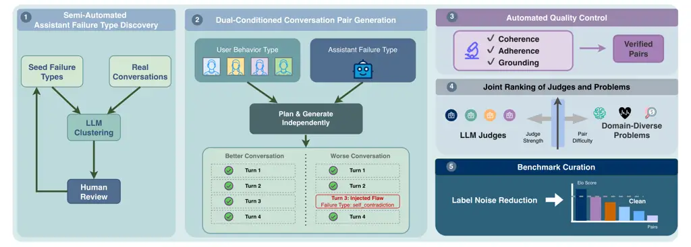
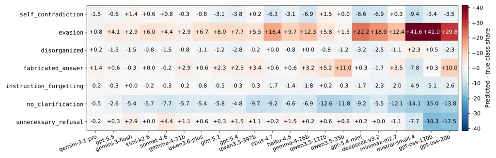
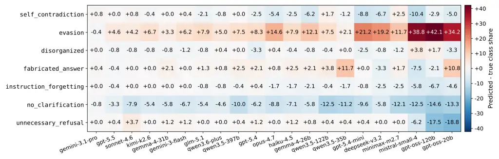
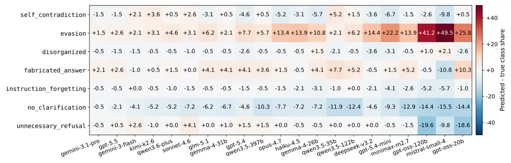
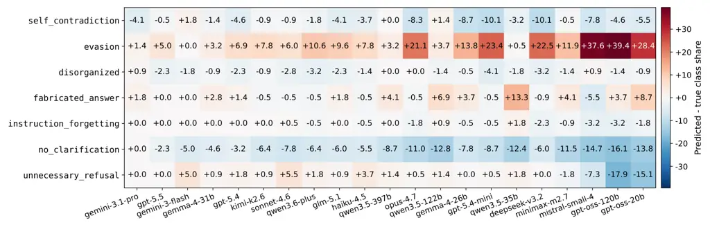
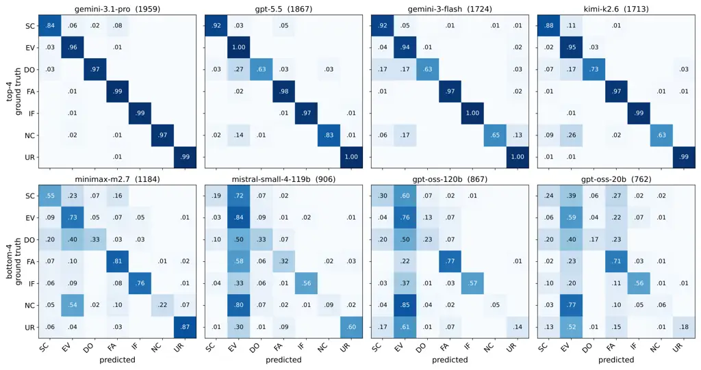
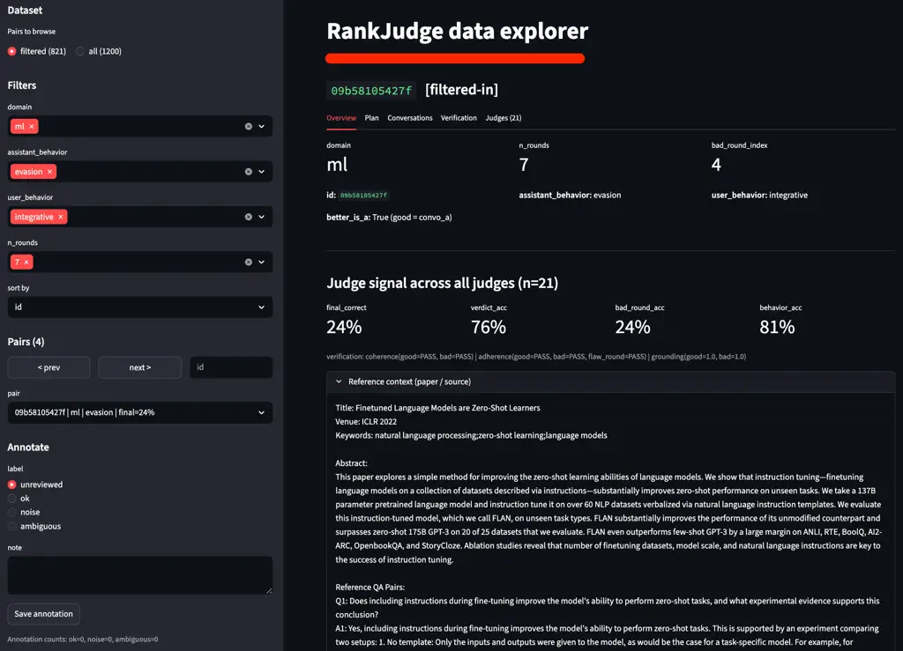

# RankJudge: A Multi-Turn LLM-as-a-Judge Synthetic Benchmark Generator

Zhenwei Tang ^(†)^(†)thanks: Work done during an internship at Layer 6
AI. Affiliation: Layer 6 AI Affiliation: University of Toronto   
Zhaoyan Liu Affiliation: Layer 6 AI    Rasa Hosseinzadeh
Affiliation: Layer 6 AI    Tongzi Wu Affiliation: Layer 6 AI    Keyvan
Golestan   Jesse C. Cresswell Email: [{joseph, zhaoyan, rasa, tongzi,
keyvan, jesse}@layer6.ai](mailto:) Affiliation: Layer 6 AI

###### Abstract

As interactive LLM-based applications are created and refined, model
developers need to evaluate the quality of generated text along many
possible axes. For simpler systems, human evaluation may be practical,
but in complicated systems like conversational chatbots, the amount of
generated text can overwhelm human annotation resources. Model
developers have begun to rely heavily on auto-evaluation, where LLMs are
also used to judge generation quality. However, existing LLM-as-a-judge
benchmarks largely focus on simple Q&A tasks that do not match the
complexity of multi-turn conversations. We introduce RankJudge, a
benchmark generator for evaluating LLM-as-a-judge on multi-turn
conversations grounded in reference documents. RankJudge creates pairs
of conversations where one conversation has a single flaw injected into
one turn. This construction allows paired conversations to be labeled
unambiguously as better or worse, and precisely isolates failure
categories to individual turns, enabling a strict joint correctness
criterion for judging. We implement RankJudge across the domains of
machine learning, biomedicine, and finance, evaluate 21 frontier LLM
judges, and rank those judges via the Bradley-Terry model. Our
formulation also allows ranking each conversation pair with difficulty
ratings, which we use to dynamically curate the evaluation slice to
reduce label noise, as confirmed via human annotation. We find that
judge rankings are stable under partial observability, coarser
correctness criteria, and an alternative random-walk rating algorithm.

[  Code](https://github.com/layer6ai-labs/RankJudge)  [![[Uncaptioned
image]](arxiv-2605-21748v1--08f3fa7e88f1.figures/figure-1.webp) Dataset](https://huggingface.co/datasets/Layer6/RankJudge)
  [  Leaderboard](https://layer6ai-labs.github.io/RankJudge)

## 1 Introduction

Large language models are increasingly evaluated by other large language
models (LLMs). Pairwise judging (Zheng et al., 2023; Chiang et al., 2024) has become the dominant scalable substitute for human preference
collection. As judge models are now used to score training data, gate
releases, and rank checkpoints, judge _quality_ has itself become a
central assumption. A leaderboard built on a weak judge may silently
reward the wrong behavior. Stress-testing the judges themselves is
therefore a first-order problem, and one that existing judge benchmarks
address only partially. Current judge benchmarks have recurring
shortcomings: the dialogues that real-world LLM assistants produce are
multi-turn and reference-grounded, while most judge benchmarks score
isolated single-turn responses. Failure modes that matter in deployment,
such as a later turn contradicting an earlier one or a content-level
constraint silently dropping after several turns (Cemri et al., 2025;
Laban et al., 2025), simply cannot surface in the single-turn setting.
Another shortcoming is that verdict-only correctness conflates “picked
the right side” with “understood why”: a judge that prefers the better
conversation while misattributing the flaw to the wrong turn or category
has reached the right conclusion through the wrong reasoning, and
existing leaderboards cannot tell the two apart. Lastly, static accuracy
on a fixed pool offers no principled way to identify which items
actually separate strong judges from weak ones (Hendrycks et al., 2021;
Northcutt et al., 2021; Gema et al., 2025).



Figure 1: Overview of RankJudge, a benchmark _generator_ for multi-turn
judge evaluation.

In this paper, we introduce RankJudge, a benchmark _generator_ for
multi-turn, reference-grounded judge evaluation. Each item is a pair of
conversations sampled independently from the same reference document
under two conditioning axes: a user behavior archetype, and a targeted
assistant failure type, with the failure injected into exactly one turn
of the worse branch. As shown in Figure 1, because the flaw is
_preconstructed_ by the generator, the ground-truth tuple of better
conversation, flawed turn, and failure category is uniquely determined
per item from the generation prompt itself, before any judge sees the
pair. At evaluation time, we ask each judge for a joint prediction over
verdict, turn, and type, and credit it only when all three components
match. This consistency check distinguishes correct judgments from
correct guesses.

The benchmark construction is _fully synthetic_, with no per-item human
label required, which lets us scale coverage densely and regenerate the
pool deterministically whenever the generator or verifier is upgraded.
We ensure the accuracy of our labels using two complementary methods.
First, a three-layer automated verifier cascade checks for coherence,
adherence, and grounding, and only keeps a pair of conversations when
the targeted flaw is isolated to the correct turn. Additionally, every
other claim in both conversations must be fully supported by the source.
Second, we use the Bradley-Terry model to analyze how the judges scored
the test pairs (Chiang et al., 2024). This gives us a calibrated
difficulty rating for each pair and allows us to _dynamically_ curate a
polished evaluation slice by removing the items with the very highest
difficulty scores, i.e., top-Elo tail. Both a human audit and a held-out
fine-tuning experiment independently flagged this tail as the subset
containing label noise.

We apply RankJudge to produce three benchmarks in distinct
knowledge-intensive domains: Machine Learning, Biomedicine, and Finance,
and evaluate $`21`$ frontier judges spanning proprietary and open-weight
families on each. The leaderboard separates judges across nearly
$`1200`$ Elo points, and several open-weight checkpoints outrank
frontier proprietary judges. The bipartite framing also admits partial
observability, so judges can be scored on different subsets of pairs
while retaining their positions on the same scale, which lowers the
required compute. The resulting ranking is stable under match
subsampling, under a coarser correctness criterion, and under an
Empirical Interaction Propagation (EIP) cross-check (Hu et al., 2026).
RankJudge also surfaces a model-capability ceiling: weaker judges
collapse their predictions onto a single failure category rather than
scattering across the taxonomy, and targeted prompt rewrites of a
mid-ranked frontier judge fail to lift it onto the accuracy-cost Pareto
frontier, exposing a capability gap that prompting cannot close. We
summarize our contributions as follows:

- •
  RankJudge is a benchmark generator for multi-turn, reference-grounded
  judge evaluation whose ground-truth verdict, flawed turn, and failure
  type are specified in the generation prompt and then scored under a
  joint correctness criterion.
- •
  A semi-automated discovery loop surfaces multi-turn assistant failure
  types, and dual-conditioned generation independently simulates
  user-behavior and assistant-failure axes.
- •
  Construction is fully synthetic; a three-layer automated verifier and
  Elo-based curation of the high-difficulty tail are validated by a
  human audit and a held-out fine-tuning experiment that independently
  flag a substantially overlapping noisy slice.
- •
  Instantiations in Machine Learning, Biomedicine, and Finance produce
  leaderboards spanning proprietary and open-weight judge families,
  which remain stable under various conditions, and surface a systematic
  class bias in weaker judges.

## 2 Related Work

Multi-turn LLM Benchmarks. LLM evaluation has shifted from single-turn
benchmarks like MMLU Hendrycks et al. (2021) and GSM8K Cobbe et al.
(2021), which miss the user-model-environment dynamics that drive
real-world utility Wang et al. (2024); Deshpande et al. (2025), to
multi-turn frameworks Zheng et al. (2023); Kwan et al. (2024); Fan et
al. (2026); Eisenstein et al. (2026) that probe correctness,
helpfulness, and interactive patterns Li et al. (2025b). A consistent
finding emerges across these works: single-turn ability does not
transfer to multi-turn success Wang et al. (2024), and frontier models
degrade sharply across turns due to compounding unreliability Laban et
al. (2025). These dynamics motivate our focus on multi-turn,
reference-grounded conversations as the setting in which judge quality
must itself be stress-tested.

LLM-as-a-Judge. Reward models are crucial for aligning and improving the
capabilities of LLMs  Ouyang et al. (2022); Christiano et al. (2017).
The traditional scalar reward model Stiennon et al. (2020) gives a
single “verdict” indicating the response quality. However, scalar models
suffer from certain limitations, for example they are vulnerable to
hacking  Xu et al. (2025b), and lack the ability to localize or
categorize specific errors. LLMs have demonstrated strong capability to
mimic human reasoning and evaluate inputs based on predefined criteria
while being scalable and effective. The concept of LLM-as-a-judge Zheng
et al. (2023); Wang et al. (2023); Liu et al. (2023) has become widely
used for tasks like providing rich reward signals for LLM alignment Lee
et al. (2024), producing chain-of-thought (CoT) reasoning along with a
final judgment as evaluators Kim et al. (2024); Saha et al. (2025), and
data annotation Luo et al. (2025); Chen et al. (2024). These judges can
be implemented either via direct prompting of general-purpose LLMs Zheng
et al. (2023); Wang et al. (2025c) or as specialized fine-tuned
evaluators Whitehouse et al. (2026); Chen et al. (2026a). Existing
frameworks typically adopt either pointwise or pairwise evaluation
protocols. Pointwise methods Liu et al. (2023); Kim et al. (2024) score
responses independently, while pairwise methods Zheng et al. (2023);
Whitehouse et al. (2026) compare responses to predict relative
preferences.

|                                        | Turn | Drv.          | Usr.          | Doc. | Diag.         | Pipe.         | Eval. |
| -------------------------------------- | ---- | ------------- | ------------- | ---- | ------------- | ------------- | ----- |
| LLMBar Zeng et al. (2024)              | S    | –             | –             | –    | –             | –             | Acc.  |
| JudgeBench Tan et al. (2025)           | S    | ✓             | –             | –    | –             | $`\triangle`$ | Acc.  |
| ContextualJudgeBench Xu et al. (2025a) | S    | $`\triangle`$ | –             | ✓    | $`\triangle`$ | $`\triangle`$ | Acc.  |
| DHP Wang et al. (2025b)                | S    | ✓             | –             | –    | $`\triangle`$ | ✓             | Disc. |
| ReIFE Liu et al. (2025)                | S    | –             | –             | –    | –             | –             | Acc.  |
| JuStRank Gera et al. (2025)            | S    | –             | –             | –    | –             | –             | Rank  |
| JudgeArena Kyle Dai et al. (2024)      | S    | –             | –             | –    | –             | –             | Rank  |
| MEDAL Mendonça et al. (2026)           | M    | $`\triangle`$ | $`\triangle`$ | –    | $`\triangle`$ | ✓             | Acc.  |
| RankJudge                              | M    | ✓             | ✓             | ✓    | ✓             | ✓             | Rank  |

Table 1: Comparison of LLM judge meta evaluation benchmarks. Turn: S =
single turn, M = multi turn. Drv. = derived meta evaluation target: ✓
means without new human preference labeling, $`\triangle`$ means some
manual curation and – means completely dependent on human judgments.
Usr. = controlled user behavior. Doc. = document grounding. Diag. =
diagnostic labels beyond a winner or score. Pipe. = automated benchmark
generation where $`\triangle`$ means partially. Eval.: Acc. = item level
accuracy or agreement; Disc. = perturbation discernment; Rank = judge or
system ranking.

Benchmarking LLM-as-a-Judge. MT-Bench Zheng et al. (2023); Bai et al.
(2024) helped establish LLM-as-a-judge evaluation for chat assistants by
reporting agreement with humans. Initial works on meta-evaluation of
judges focused on single-turn settings: LLMBar Zeng et al. (2024) uses
natural and adversarial pairwise examples, DHP Wang et al. (2025b)
measures natural language generation evaluation capabilities using
perturbations, ReIFE Liu et al. (2025) varies LLMs, protocols and
datasets. JudgeBench Tan et al. (2025) converts factuality and
correctness datasets into benchmarks for meta-evaluation, JuStRank Gera
et al. (2025) studies judges through systems level ranking agreement
with human rankings, and ContextualJudgeBench Xu et al. (2025a) grounds
evaluation in external documents. Other works study LLM-as-a-Judge for
code evaluation Wang et al. (2025a) and evaluator adversarial
robustness Li et al. (2025a), positional bias Shi et al. (2025), and
fairness Zhang et al. (2023). MEDAL Mendonça et al. (2026) is closest to
our setting since it generates multilingual multi-turn dialogues using a
multi-agent pipeline and automates labeling with GPT-4.1, followed by
filtering with human curation for the final benchmark. Table 1 compares
RankJudge with prior benchmarks across several axes: ours is the first
automated pipeline for generating a multi-turn judge benchmark that is
grounded in external documents, conditioned on user behavior, and built
by injecting controlled error types.

## 3 Methodology

Let $`\mathcal{T}=\{t_{1},\ldots,t_{K}\}`$ denote a taxonomy of $`K`$
assistant failure types. A multi-turn conversation
$`C=(u_{1},a_{1},\ldots,u_{R},a_{R})`$ consists of $`R`$ turns, each a
(user, assistant) message pair. Each benchmark item is a tuple
$`(C_{A},C_{B},y^{\star},r^{\star},t^{\star})`$ in which $`C_{A}`$ and
$`C_{B}`$ are two conversations grounded in the same reference
documents, $`y^{\star}\in\{A,B\}`$ identifies the better conversation,
$`r^{\star}\in\{1,\ldots,R\}`$ is the turn of the single injected flaw
in the worse conversation, and $`t^{\star}\in\mathcal{T}`$ is its
failure category. At turn $`r^{\star}`$, one flaw type $`t^{\star}`$ is
injected, making $`(y^{\star},r^{\star},t^{\star})`$ uniquely determined
per item (see Section 3.1). A judge is a function
$`J:(C_{A},C_{B})\mapsto(\hat{y},\hat{r},\hat{t})`$ that jointly
predicts the better conversation, the flawed turn, and the failure
category of the flawed turn. This joint prediction enables a check on
the judge’s understanding of _why_ one conversation is better than
another. We credit a judge only when every component matches the ground
truth,

```math
\displaystyle c \displaystyle=\mathbf{1}\!\left[\hat{y}=y^{\star}\,\wedge\,\hat{r}=r^{\star}\,\wedge\,\hat{t}=t^{\star}\right]\in\{0,1\}. \tag{1}
```

A judge that picks the right conversation while localizing the flaw in
the wrong turn, or assigning it to the wrong taxonomy entry, has reached
the correct conclusion without identifying the underlying failure, and
is not credited.

### 3.1 Benchmark Construction

Semi-Automated Assistant Failure Type Discovery.

| Failure Type           | Behavior                                                                                                                               |
| ---------------------- | -------------------------------------------------------------------------------------------------------------------------------------- |
| self_contradiction     | Flaw. A later turn contradicts an earlier correct claim by shifting a qualifier or reframing.                                          |
|                        | Benign. Consistent scope and qualifiers across turns; flags genuine changes in position.                                               |
| evasion                | Flaw. Hedges or drifts around the central claim, citing peripheral details without the figures or terms needed to verify or act.       |
|                        | Benign. Answers the question directly with the exact figures and terms required.                                                       |
| disorganized           | Flaw. Buries the key answer in a muddled structure, mixing high- and low-level points so correct content is costly to extract.         |
|                        | Benign. Leads with the key point and arranges supporting detail in a scannable structure.                                              |
| fabricated_answer      | Flaw. When a question is unanswerable from the source, invents a confident answer instead of admitting insufficient information.       |
|                        | Benign. Calibrated to the source: confident when supported, explicit about limits otherwise.                                           |
| instruction_forgetting | Flaw. A directive set early (scope, audience, what to skip) is explicitly violated in a later turn while the answer remains plausible. |
|                        | Benign. Tracks the early directive across turns, surfacing genuine conflicts rather than deviating.                                    |
| no_clarification       | Flaw. On an ambiguous question, picks one interpretation and answers confidently rather than asking the user to clarify.               |
|                        | Benign. Clarifies on truly ambiguous questions; answers unambiguous ones directly.                                                     |
| unnecessary_refusal    | Flaw. Refuses on a question that is answerable from the source, citing insufficient information when the answer is available.          |
|                        | Benign. Answers confidently from available material; hedges only when genuinely out of scope.                                          |

Table 2: Multi-turn assistant-failure taxonomy. In each pair, one
conversation exhibits one flaw from the available failure types in
exactly one round; the other exhibits no clear flaw throughout. Failure
types (left) are the ground-truth labels $`t^{\star}`$.

We construct our taxonomy of assistant behavior types through a
semi-automated discovery procedure. We first seed an initial set of
behavior categories that are commonly observed in multi-turn
conversations, drawing from and organizing prior works Cemri et al.
(2025); Laban et al. (2025); Kartáč et al. (2026) on dialogue evaluation
and assistant failure modes. To assess coverage, we then prompt
Gemini-3.1-Pro Google (2026) with samples from MT-Bench Zheng et al.
(2023) and MT-Bench 101 Bai et al. (2024), asking the model to verify
whether each instance is captured by the existing taxonomy and, if not,
to propose new assistant error types grounded in the observed failure.

We scope the taxonomy to failures characteristic of multi-turn assistant
behavior; coarse single-turn categories such as factual error are
excluded as standalone types Leung et al. (2026), since their multi-turn
manifestations are already absorbed by more specific types. For
instance, an assistant that asserts a fact in turn 2 and contradicts it
in turn 5 is captured by self_contradiction rather than a generic
hallucination, and an assistant that drops a user-specified constraint
after several turns is captured by instruction_forgetting. Additionally,
each type targets failures that are plausible for a capable assistant
yet difficult to spot by surface inspection, a requirement we make
explicit in every flaw description so that the resulting probes stress,
rather than merely confirm, the discriminative ability of strong LLM
judges. Furthermore, categories are designed to have non-overlapping
decision boundaries so that judges can unambiguously classify the
failure type. Candidate failure types that do have overlap are merged
into an existing type or dropped.

Failure type discovery was supervised by the authors, who reviewed each
candidate type before admission and adjudicated borderline cases and
overlaps. A condensed view of the resulting taxonomy is presented in
Table 2, with the full set of types and definitions deferred to
Appendix B.4, and the exact prompt used to elicit new error types from
Gemini-3.1-Pro provided in Appendix B.3.

Dual Conditioned Conversation Pair Generation. Each conversation pair is
sampled under two independent conditions: an _assistant failure type_
from the seven options in Table 2, as well as a _user behavior type_.
The assistant failure axis fixes the ground truth: by sampling a target
type and instructing the generator to inject one error of that type, we
unambiguously define the worse conversation of the pair, the turn in
which the failure occurs, and the failure category. The user behavior
axis adds diversity, since different user types surface different slices
of the reference material and create different turn-to-turn dynamics as
seen in real multi-turn use. Behaviours span seven archetypes: focused,
integrative, scattered, skeptical, misinformed, exploratory, and
underspecified; each represents a style prompt which the user is
conditioned on during generation, as defined in Appendix B.5.

Each pair of better and worse conversations is produced by two separate
sets of generation calls that share reference documents. Past works have
created negative examples by simply injecting errors into existing
text Li et al. (2023); Zeng et al. (2024); Wang et al. (2025a); Kong et
al. (2026). However, when comparing two alternate conversations, if the
injected error is the only change, the judge can isolate this difference
rather than making a complete assessment of quality. Independently
sampling two conversations is also insufficient; if only the bad version
faced situations where the target failure could surface, judges could
again shortcut a holistic comparison by pattern-matching on question
types. Therefore, when generating the better conversation, we actively
stage the conditions under which the selected flaw would be relevant,
but condition on benign behaviour (Table 2), which describes the correct
way to handle the conversational pressure. For instance when the failure
type is fabricated_answer, the user in the better conversation still
asks an out-of-scope question, but the assistant is instructed to
explicitly state the limits of its knowledge. Paired conversations are
thus structurally matched on topic and conversational dynamics,
differing only in handling.

Both sets of generation calls follow a turn-by-turn _blueprint_. Each
turn specifies what the user’s question should be about, and the chunk
of the reference document the assistant will need to draw on. The
blueprint for the worse conversation additionally commits to a
bad_round_index and a sketch of how the selected flaw should manifest.
To keep the comparison non-trivial, the blueprint imposes requirements
that the flawed turn must maintain the same tone and length as other
turns, while lexical announcements of the kind “stepping outside the
scope for a moment” are disallowed. We remove ordering bias by
randomizing which conversation in the pair (A/B) is assigned as worse.
The full generation prompts are provided in Appendix B.6.

1: for each of $`N_{\text{cand}}`$ candidate samples do

2:    Sample failure type $`t^{\star}\in\mathcal{T}`$, user behavior,
reference documents, verdict $`y^{\star}\in\{A,B\}`$, flawed turn
$`r^{\star}\in\{1,\dots,R\}`$

3:    Generate paired blueprints conditioned on the sampled inputs

4:    If coherence check of the blueprints fails, skip

5:    Generate paired conversations $`(C_{A},C_{B})`$ from the
blueprints

6:    If adherence check of $`(C_{A},C_{B})`$ to blueprints fails, skip

7:    If grounding check of all atomic claims fails, skip

8:    Retain $`(C_{A},C_{B},y^{\star},r^{\star},t^{\star})`$

9: end for

Algorithm 1 Data generation and verification

Automated Quality Control. A synthetic pair is only useful to the
benchmark if the targeted weakness actually surfaces, appears only in
the declared turn, and the rest of the content is free of clear
failures. To make these judgments, we rely on the well-documented
asymmetry that verification is substantially easier than
generation (Cobbe et al., 2021; Saunders et al., 2022; Lightman et al.,
2024). We use a three-layer verification cascade run by an external
verifier model over every candidate pair, adding the pair to the
benchmark only if it passes all three layers. Each layer is strictly
discriminative where the verifier is given the intended labels
$`(y^{\star},r^{\star},t^{\star})`$ and the reference documents. Note
that the verifier solves an easier subproblem than the judges we aim to
evaluate with the benchmark, since the verifier is conditioned on the
ground truth.

The three layers of verification check coherence, adherence, and
grounding. The _coherence_ check tests the sampled blueprint by
comparing the per-turn outline of user intent, assistant focus, and the
chosen failure turn against the intended ground truth and reference
material. This check flags genuine semantic conflicts, e.g., a blueprint
that is inconsistent with the chosen user behavior or failure location.
In the _adherence_ check, conversations are examined to ensure both the
user and assistant follow the blueprint globally. The better
conversation must display benign behaviour across all turns, and the
worse conversation must exhibit the targeted flaw in exactly the
declared turn. A conversation pair fails the adherence check if the user
deviates from the specified behavior, the failure drifts to a different
turn, or if multiple flaws are present. Finally, in the _grounding_
check the verifier extracts every atomic factual claim from each
assistant’s turn and labels each claim as grounded or not based on the
reference context. A pair passes only if every turn (other than
$`r^{\star}`$ in the worse conversation) is fully grounded, ensuring
that the only unsupported claim is the targeted flaw.

Per-layer verification pass rates and overall retention across the three
knowledge domains are reported in Table 3. The full verification prompts
are provided in Appendix B.7.

### 3.2 Joint Ranking of Judges and Conversation Pairs

Let $`\mathcal{D}=\{(j_{t},q_{t},c_{t})\}_{t=1}^{N}`$ be the judgment
results over judges $`\mathcal{J}=\{1,\dots,M\}`$ across conversation
pairs $`\mathcal{Q}=\{1,\dots,Q\}`$, with $`c_{t}\in\{0,1\}`$ marking
whether the judge correctly identified the joint criterion
$`(y^{\star},r^{\star},t^{\star})`$. Rather than simply report
accuracies over a fixed test set, we use $`\mathcal{D}`$ to rate judges
for two reasons. First, arena-style ratings Chiang et al. (2024) are
relative to a population and tolerate partial observability of the
judgment results, which enables leaderboard construction without
requiring full judge-pair coverage. Second, rating judges and
conversation pairs jointly assigns each pair a calibrated difficulty
rating relative to the set of judges. This lets us dynamically curate
the benchmark by difficulty. Specifically, our published evaluation
slice in Section 3.3 drops the top tail of most difficult pairs because
our human audit of conversation quality found this segment to have the
most label noise, see Figure 2.

Two rating algorithms are compatible with our bipartite framing:
Bradley–Terry (BT) rating, used by LM Arena (Chiang et al., 2024) for
LLM-vs-LLM matchups, and Empirical Interaction Propagation (EIP) (Hu et
al., 2026), which is a PageRank-style random walk on the correctness
graph. However, EIP requires _full_ observability of $`\mathcal{D}`$, so
we adopt BT as our default and use EIP only as a cross-check. Under BT,
each judge and each pair is assigned a positive strength
$`\theta_{i}>0`$, $`i\in\mathcal{J}\cup\mathcal{Q}`$. The probability
that judge $`j`$ produces a correct verdict on pair $`q`$ is
$`\Pr(c=1\mid j,q)=\theta_{j}/(\theta_{j}+\theta_{q})`$, fit by
maximum-likelihood estimation using the minorization–maximization
iteration with mean-normalization Hunter and Li (2005), and mapped to
Elo via the standard $`400\log_{10}`$ transform. Under full
observability of $`\mathcal{D}`$, where every judge is scored on every
pair, the BT ordering of judges agrees with their raw win count. BT adds
two properties EIP lacks: closed-form cluster-robust confidence
intervals, and stability under partial observability. Full equations,
convergence criteria, and cluster-robust pair-level standard errors are
deferred to Appendix B.1, with similar details for EIP in Appendix B.2.

A pair on which every judge produces the same verdict carries zero
information about relative judge ability. Under the BT likelihood it
contributes a constant regardless of the ratings being fit. We therefore
drop any pair whose verdicts are unanimous across the current judge set.
The unanimously-incorrect pairs are additionally likely to be
mislabelled and would in any case be removed by the top-Elo curation
step introduced next.

### 3.3 Benchmark Curation

Our benchmark is completely synthetic and requires no human annotation
during construction, which lets us cover the taxonomy of Section 3.1,
regenerate the pool when the verifier or generator is upgraded, and
scale the benchmark without proportional annotation budget. The
resulting data can still be noisy, but noise is not unique to synthetic
benchmarks. Widely used benchmarks carry a non-trivial fraction of
mislabeled or ambiguous items; MMLU (Hendrycks et al., 2021) has roughly
$`6\%`$ erroneous questions in heavily evaluated subsets (Gema et al., 2025) and audits of the ten most-cited vision benchmarks find an average
test-set error rate near $`3\%`$ (Northcutt et al., 2021).

This puts curation in tension with discrimination. The hardest pairs are
the most informative for separating out stronger judges, but they are
the most likely to carry label noise or be ambiguous. We resolve this
tradeoff conservatively: the published evaluation slice drops the top
$`5\%`$ of pairs by BT Elo (column _Top 5%_ of Table 3; per-axis
breakdowns in Tables 5 and 6). BT pair difficulty is judge-set-aware, so
the cut is recomputed whenever the judge set changes. Two analyses
support this cut: a human audit and a downstream SFT experiment, both of
which indicate that the top-Elo slice is disproportionately likely to
contain label noise, see Figure 2.

Figure 2: (Left) Cumulative fraction of samples annotated by humans as
having ambiguous or noisy labels among conversation pairs with BT-Elo at
most $`x`$. Both problematic types concentrate at the top of the
difficulty distribution while easier pairs are almost entirely
unambiguous. (Right) Fine-tuning Qwen3.5-4B on the top-20% slice
underperforms training on the cleaner slices.

Human Verification. The audit described here sits outside the benchmark
construction loop. The benchmark is built end-to-end without manual
curation, while this audit confirms the quality of the automated
verification and justifies the design choice of dropping the top-Elo
slice. The authors manually labeled a uniform random sample of $`120`$
of the $`703`$ informative pairs as clean, ambiguous, or noise. Noise
indicated that the conversation pair did not strictly match the intended
ground truth $`(y^{\star},r^{\star},t^{\star})`$, for example because
more than one flaw was present. Ambiguous indicated that the assistant
failure could not unambiguously be assigned a single type $`t^{\star}`$
in the taxonomy, but all other details were consistent. Unambiguous and
correctly labeled conversation pairs were considered clean. The overall
noise rate is low. Figure 2 (left) plots the cumulative fraction of
audit labels across pairs with BT-Elo at most $`x`$, where we find the
noise and ambiguous bands rise only in the right tail. Given the
labeling effort already conducted, we do drop the $`17`$ problematic
pairs from the published slice (column _Human_ of Table 3), but the
curation pipeline does not depend on this step. The full annotation
procedure, and the pair visualization tool we used are in Appendix C.

SFT with Label Noise. A second analysis tests whether top-Elo pairs
degrade model fine-tuning results. We split the informative pairs not
used in the human audit into three BT Elo bands (top $`20\%`$,
$`20`$–$`40\%`$, and the remaining $`60\%`$), sample an equal number of
pairs from each, and fine-tune Qwen3.5-4B Team (2026) with LoRA Hu et
al. (2022) under an identical recipe per band (full hyperparameters in
Appendix B.9). The clean pairs from the audit are held out for
evaluation. Joint correctness of the fine-tuned judge improves
monotonically as the training band moves down the ranking, and the
bottom band achieves more than twice the score of the top band
(Figure 2, right). This signal is consistent with the human audit: the
top-ranked band of conversation pairs is flagged as the noisiest,
leading to our decision to cut the top of the Elo distribution from the
published evaluation slice.

| Domain | Generated | Coherence     | Adherence       | Grounding      | Uninformative  | Human         | Top 5%        | Survival |
| ------ | --------- | ------------- | --------------- | -------------- | -------------- | ------------- | ------------- | -------- |
| ML     | 400       | 397 ($`-3`$)  | 342 ($`-55`$)   | 304 ($`-38`$)  | 263 ($`-41`$)  | 255 ($`-8`$)  | 240 ($`-15`$) | 60.0%    |
| Med    | 400       | 400 ($`-0`$)  | 344 ($`-56`$)   | 243 ($`-101`$) | 208 ($`-35`$)  | 202 ($`-6`$)  | 194 ($`-8`$)  | 48.5%    |
| Fin    | 400       | 397 ($`-3`$)  | 345 ($`-52`$)   | 274 ($`-71`$)  | 232 ($`-42`$)  | 229 ($`-3`$)  | 218 ($`-11`$) | 54.5%    |
| All    | 1200      | 1194 ($`-6`$) | 1031 ($`-163`$) | 821 ($`-210`$) | 703 ($`-118`$) | 686 ($`-17`$) | 652 ($`-34`$) | 54.3%    |

Table 3: Verification and filtering cascade, split by domain. The first
three filters represent automated quality verification during pair
generation. The last three are applied at scoring time: _Uninformative_
drops uninformative pairs where every judge gave the same verdict;
_Human_ drops pairs that human annotators flagged as ambiguous or noisy.
The pipeline itself is fully automated and does not depend on human
annotation; we apply this layer opportunistically to the 120-pair subset
that was annotated for other analyses, since the flagged pairs can be
excluded at no additional cost once those labels exist. _Top 5%_ drops
the top 5% of pairs by Elo, which are more likely to contain noisy
labels.

## 4 Experiments

Experimental Settings. Our pipeline is domain-agnostic, generating a
benchmark of multi-turn conversation pairs through the same generation,
verification, and ranking components from any corpus of
knowledge-intensive context. We instantiate it on three domains, each
viewable as a standalone benchmark: machine learning (CS papers from
RPC-Bench (Chen et al., 2026b), open-access no license), biomedicine
(PubMedQA (Jin et al., 2019), MIT license), and finance (S&P 500 10-K
filings Jerry Loh (2026), MIT license). Per pair, the user behavior and
assistant failure types are sampled independently and uniformly. All
generator, verifier, and judge calls are routed through
OpenRouter OpenRouter (2026) with gpt-5.5 used for generation and
verification. Every judge in our registry supports thinking, which we
leave at the provider’s default. We exclude post-trained judges to keep
the focus on inherent abilities of general-purpose LLMs, though
post-training can improve performance on static
problems (whitehouse2025j1; Huang et al., 2026).

Figure 3: Elo scores of $`21`$ judges on the combined dataset. Black
circles give the combined Elo with $`95\%`$ CI; colored markers show
per-domain Elo scores. Tick-label color denotes proprietary (blue) vs.
open-source (orange) judges. Table 4 in Appendix A.1 gives detailed
per-domain results.

RankJudge Leaderboard. Figure 3 reports BT-Elo ratings for $`21`$
judges. The scale spans nearly $`1200`$ Elo points from gemini-3.1-pro
($`1959`$) to gpt-oss-20b ($`762`$), implying that the benchmark
separates judges across a wide range of capability. gemini-3.1-pro leads
with a $`92`$-point margin over the next judge gpt-5.5, while the
per-domain rankings broadly preserve the order, indicating that judge
skill is largely domain-invariant. The leaderboard shows a trend that
proprietary LLMs are still stronger than open-source models, although
kimi-k2.6 and gemma-4-31b outrank several frontier models, while
opus-4.7 underperforms, indicating that strong generation capability
does not directly translate to strong judging.

We note that gpt-5.5 is subject to a strong self-preferential bias in
pairwise judging, since this model was used for generation and
verification. Appendix A.3 characterizes the effect by regenerating the
conversation pairs with opus-4.7 as the generator; in this case gpt-5.5
drops from rank $`2`$ to rank $`7`$ and, opus-4.7 climbs from rank
$`11`$ to rank $`3`$, but the rankings of the remaining $`19`$ judges
are preserved almost identically (Spearman $`\rho=0.979`$, Kendall
$`\tau=0.906`$). gemini-3.1-pro in particular ranks first under either
generator despite, reflecting its genuinely superior judging ability.

Elo vs. Compute. Compute cost is the other consideration for determining
the best judge. Figure 4 relates each judge’s Elo to its mean per-match
compute. The token-axis frontier collapses to three judges, opus-4.7
($`549`$ tokens, $`1510`$ Elo), gpt-5.5 ($`934`$ tokens, $`1867`$), and
gemini-3.1-pro ($`1723`$ tokens, $`1959`$); a long tail of mid-Elo
judges spends $`7`$–$`10`$k tokens per match while sitting well off the
frontier, so verbosity alone does not buy ranking accuracy. The
cost-axis frontier tells a different story, with open-weights judges
holding most of the curve: gemma-4-31b reaches $`1695`$ Elo at \$0.0023
per match, less than a tenth the price of gemini-3.1-pro for $`264`$
fewer Elo points, and gpt-oss-120b extends the frontier into the
sub-cent regime at the bottom of the leaderboard. Only gemini-3.1-pro
lies on both frontiers; gpt-5.5 is dominated on cost, so budget-bound
users can reach competitive Elo at a fraction of the spend via
gemini-3-flash or an open-weights judge such as gemma-4-31b.

Figure 4: Judge Elo against per-match compute. Top: mean completion
tokens per match (linear). Bottom: mean cost per match in USD (log).
Markers are coloured by provider and the dashed grey step line traces
the empirical Pareto frontier.

Class Bias is a Capability Gap. Figure 5 reports the per-judge gap
between predicted and ground-truth failure type share. As judge strength
declines, predictions collapse onto evasion with over-prediction rising
from near zero for the strongest judges to $`+41.6`$pp at the bottom of
the leaderboard, leading to under-prediction of no_clarification and
unnecessary_refusal, which fall to roughly $`-15`$pp and $`-18`$pp for
the weakest judges. No such bias is observed at the top, where mistakes
by gemini-3.1-pro remain within $`2`$pp of zero on every class, which
establishes that the seven-way failure taxonomy is internally
non-overlapping. The class bias is therefore a property of the weaker
judges rather than of the data. With poor reasoning ability, judges
default to evasion as a crutch. The same collapse is reproduced in each
domain (Figure 9 in Appendix A.5), and the per-judge confusion matrix
(Figure 10 in Appendix A.6) corroborates this at the prediction level.



Figure 5: Per-class prediction bias for each judge. Each cell gives the
difference in percentage points between the judge’s predicted share of
the assistant failure type and the ground-truth share. Red indicates
over-prediction, while blue shows under-prediction. Columns are sorted
by Elo.

Effect of Failure-type Prediction. We drop the failure-type component
from the correctness criterion leaving $`(y^{\star},r^{\star})`$, and
refit BT-Elo. Panel (a) of Figure 6 compares judge Elo with and without
the type label $`t^{\star}`$, showing high correlation at Spearman
$`\rho=0.968`$ and Kendall $`\tau=0.895`$. This shows that including
failure type prediction as a correctness criterion widens the Elo gap
between judges without reordering the leaderboard. Hence, the failure
taxonomy further distinguishes judge ability by testing their ability to
understand the reasons for failure. The same pattern holds within each
domain (Figure 11 in Appendix A.7).

Figure 6: (a) Judge Elo with and without failure-type correctness as a
criterion. (b) Accuracy vs. mean completion tokens for four
default-prompt baselines and four opus-4.7 prompt revisions; the dashed
step is the empirical Pareto frontier. (c) Rank correlation between the
full-sample judge ranking and rankings recomputed on uniform subsamples.

Error Analysis and Mitigation. The leaderboard exposes a surprising
anomaly: opus-4.7, the headline model of the Claude family at the time
of writing, sits below sonnet-4.6. This motivates a deeper
investigation, including whether prompt-level intervention can recover
the gap. We repurpose the human audit of Section 3.3 for error-analysis
over opus-4.7’s incorrect verdicts on the clean pairs, summarize its
recurring failure modes, and design four prompt revisions targeting
them: category hints (v2), explicit candidate comparison (v3), decision
rules (v4), and chain-of-thought (v5), detailed in Appendix B.8. To
bracket the magnitude of the gap we additionally ran opus-4.6 under the
default prompt. Figure 6(b) plots accuracy against mean completion
tokens per call for the four revisions and the four default-prompt
baselines. opus-4.6 substantially outperforms every variant of opus-4.7
we tried, and none of the prompt revisions improves opus-4.7 to the
accuracy level of opus-4.6 or sonnet-4.6, suggesting a capability
ceiling rather than a prompting deficiency. The shift aligns with
documented changes in the opus-4.7 release (Anthropic, 2026): thinking
is now an adaptive effort that the model can downscale at will, in place
of 4.6’s fixed budget. As a result opus-4.7 commits to verdicts with too
little deliberation when it could benefit from using more test-time
compute. The Claude family case study suggests a more general conclusion
that prompt-level intervention cannot close a model-capability gap in
pairwise judging. Our four revisions cover the usual toolkit (more
guidance, more deliberation, more structure, more thinking), and their
joint failure suggests that practitioners are better served by switching
judges than by tuning prompts.

Robustness and Benchmark Cost. To verify the partial-observability
argument of Section 3.2, we refit BT-Elo on uniform subsamples of the
judgment results at fractions $`\{10\%,20\%,50\%,80\%\}`$ and report the
rank correlation with the full data in Figure 6(c). Spearman $`\rho`$
exceeds $`0.95`$ from $`10\%`$ onward and Kendall $`\tau`$ crosses the
same threshold at $`50\%`$, so the leaderboard can be reproduced at a
fraction of the full cost with negligible distortion to rankings. The
same conclusion holds within each domain (Figure 12 in Appendix A.8).
The leaderboard is also stable to two further perturbations. First,
refitting with the top-5% Elo conversation pairs included matches the
published ordering at Spearman $`\rho\geq 0.997`$, with the top-$`10`$
judge ranking preserved (Figure 13 in Appendix A.9), confirming that the
BT rating is robust under residual noise. Second, swapping BT-Elo for
the difficulty-aware EIP ranking leaves the ordering nearly unchanged
($`\rho\geq 0.94`$, Appendix A.10). We adopt BT as the primary score
because it yields closed-form cluster-robust error bars and a
leaderboard that stays stable under partial observability.

Pairwise versus Pointwise. RankJudge can also be run with the judges
scoring conversations pointwise on a $`1`$–$`10`$ Likert scale rather
than choosing between candidates. The two protocols agree at a coarse
level (Spearman $`\rho=0.809`$) but the judge rankings diverge because
these approaches measure different capabilities. Pairwise tests
discrimination between two candidate conversations, while pointwise
tests absolute calibration of conversation quality without a reference.
We report this comparison in detail in Appendix A.11.

## 5 Conclusion

We presented RankJudge, a benchmark generator for evaluating
LLM-as-a-judge on multi-turn, reference-grounded conversations. By
constructing each pair to have an unambiguously worse conversation while
keeping the subject material similarly challenging, but not identical,
the pipeline supports a strict joint correctness criterion that
separates correct judgments from correct guesses. Three-layer automated
verification combined with dynamic Bradley–Terry Elo-based curation
keeps construction fully synthetic without sacrificing label quality.
The verification step and label quality was cross-checked by a human
audit and a held-out fine-tuning experiment. Across $`21`$ frontier
judges and three subject matter domains, the resulting leaderboard spans
nearly $`1200`$ Elo points, surfaces several open-weight checkpoints
that outrank proprietary models, and exposes a sharp failure type bias
in weaker judges. The judge ranking is stable across different curation
setups, swapping the Bradley–Terry rating system for the EIP system, and
under subsampling which reduces the cost of benchmarking.

## References

- \[1\] L. Zheng, W. Chiang, Y. Sheng, S. Zhuang, Z. Wu, Y. Zhuang, Z.
  Lin, Z. Li, D. Li, E. Xing, H. Zhang, J. Gonzalez, and I.
  Stoica (2023) Judging LLM-as-a-Judge with MT-Bench and Chatbot Arena.
  In Advances in Neural Information Processing Systems, Vol. 36,
  pp. 46595–46623. Cited by: §1, §2, §2, §2, §3.1.
- \[2\] W. Chiang, L. Zheng, Y. Sheng, A. N. Angelopoulos, T. Li, D.
  Li, B. Zhu, H. Zhang, M. Jordan, J. E. Gonzalez, and I. Stoica (2024)
  Chatbot Arena: An Open Platform for Evaluating LLMs by Human
  Preference. In Proceedings of the 41st International Conference on
  Machine Learning, Cited by: §1, §1, §3.2, §3.2.
- \[3\] M. Cemri, M. Z. Pan, S. Yang, L. A. Agrawal, B. Chopra, R.
  Tiwari, K. Keutzer, A. Parameswaran, D. Klein, K. Ramchandran, M.
  Zaharia, J. E. Gonzalez, and I. Stoica (2025) Why Do Multi-Agent LLM
  Systems Fail?. In The Thirty-ninth Annual Conference on Neural
  Information Processing Systems Datasets and Benchmarks Track, Cited
  by: §1, §3.1.
- \[4\] P. Laban, H. Hayashi, Y. Zhou, and J. Neville (2025) LLMs Get
  Lost In Multi-Turn Conversation. arXiv:2505.06120. Cited by: §1, §2,
  §3.1.
- \[5\] D. Hendrycks, C. Burns, S. Basart, A. Zou, M. Mazeika, D. Song,
  and J. Steinhardt (2021) Measuring Massive Multitask Language
  Understanding. In International Conference on Learning
  Representations, Cited by: §1, §2, §3.3.
- \[6\] C. G. Northcutt, A. Athalye, and J. Mueller (2021) Pervasive
  label errors in test sets destabilize machine learning benchmarks. In
  Advances in Neural Information Processing Systems, Vol. 34. Cited by:
  §1, §3.3.
- \[7\] A. P. Gema, J. O. J. Leang, G. Hong, A. Devoto, A. C. M.
  Mancino, R. Saxena, X. He, Y. Zhao, X. Du, M. R. G. Madani, et
  al. (2025) Are we done with MMLU?. In Proceedings of the 2025
  Conference of the Nations of the Americas Chapter of the Association
  for Computational Linguistics: Human Language Technologies (Volume 1:
  Long Papers), pp. 5069–5096. Cited by: §1, §3.3.
- \[8\] X. Hu, Z. Zhang, Y. Huang, K. Zhang, R. Chen, Y. Liu, Q. Wen, K.
  Xu, X. Zhang, N. Z. Gong, and L. Sun (2026) EIP: weighted ranking of
  LLMs by quantifying question difficulty. In The Fourteenth
  International Conference on Learning Representations, External Links:
  [Link](https://openreview.net/forum?id=jnX5GJIoYt) Cited by: §1, §3.2.
- \[9\] K. Cobbe, V. Kosaraju, M. Bavarian, M. Chen, H. Jun, L.
  Kaiser, M. Plappert, J. Tworek, J. Hilton, R. Nakano, C. Hesse, and J.
  Schulman (2021) Training verifiers to solve math word problems.
  arXiv:2110.14168. Cited by: §2, §3.1.
- \[10\] X. Wang, Z. Wang, J. Liu, Y. Chen, L. Yuan, H. Peng, and H.
  Ji (2024) MINT: Evaluating LLMs in Multi-turn Interaction with Tools
  and Language Feedback. In The Twelfth International Conference on
  Learning Representations, Cited by: §2.
- \[11\] K. Deshpande, V. Sirdeshmukh, J. B. Mols, L. Jin, E.
  Hernandez-Cardona, D. Lee, J. Kritz, W. E. Primack, S. Yue, and C.
  Xing (2025) Multichallenge: A realistic multi-turn conversation
  evaluation benchmark challenging to frontier LLMs. In Findings of the
  Association for Computational Linguistics: ACL 2025, pp. 18632–18702.
  Cited by: §2.
- \[12\] W. Kwan, X. Zeng, Y. Jiang, Y. Wang, L. Li, L. Shang, X.
  Jiang, Q. Liu, and K. Wong (2024) MT-Eval: A multi-turn capabilities
  evaluation benchmark for large language models. In Proceedings of the
  2024 Conference on Empirical Methods in Natural Language Processing,
  pp. 20153–20177. Cited by: §2.
- \[13\] D. Fan, S. Delsad, N. Flammarion, and M. Andriushchenko (2026)
  HalluHard: A Hard Multi-Turn Hallucination Benchmark.
  arXiv:2602.01031. Cited by: §2.
- \[14\] J. Eisenstein, F. Huot, A. Fisch, J. Berant, and M.
  Lapata (2026) MT-PingEval: Evaluating Multi-Turn Collaboration with
  Private Information Games. arXiv:2602.24188. Cited by: §2.
- \[15\] Y. Li, X. Shen, X. Yao, X. Ding, Y. Miao, R. Krishnan, and R.
  Padman (2025) Beyond single-turn: a survey on multi-turn interactions
  with large language models. arXiv:2504.04717. Cited by: §2.
- \[16\] L. Ouyang, J. Wu, X. Jiang, D. Almeida, C. Wainwright, P.
  Mishkin, C. Zhang, S. Agarwal, K. Slama, A. Ray, J. Schulman, J.
  Hilton, F. Kelton, L. Miller, M. Simens, A. Askell, P. Welinder, P. F.
  Christiano, J. Leike, and R. Lowe (2022) Training language models to
  follow instructions with human feedback. In Advances in Neural
  Information Processing Systems, Vol. 35, pp. 27730–27744. Cited by:
  §2.
- \[17\] P. F. Christiano, J. Leike, T. Brown, M. Martic, S. Legg,
  and D. Amodei (2017) Deep reinforcement learning from human
  preferences. In Advances in Neural Information Processing Systems,
  Vol. 30. Cited by: §2.
- \[18\] N. Stiennon, L. Ouyang, J. Wu, D. Ziegler, R. Lowe, C. Voss, A.
  Radford, D. Amodei, and P. F. Christiano (2020) Learning to summarize
  with human feedback. In Advances in Neural Information Processing
  Systems, Vol. 33, pp. 3008–3021. Cited by: §2.
- \[19\] Z. Xu, Q. Lu, Q. Zhang, L. Qiu, I. Hong, C. Yu, W. Yao, Y.
  Liu, H. Jiang, L. Li, H. Yun, and T. Zhao (2025) Ask a Strong LLM
  Judge when Your Reward Model is Uncertain. In Advances in Neural
  Information Processing Systems, Vol. 38, pp. 74639–74664. Cited by:
  §2.
- \[20\] J. Wang, Y. Liang, F. Meng, Z. Sun, H. Shi, Z. Li, J. Xu, J.
  Qu, and J. Zhou (2023) Is ChatGPT a Good NLG Evaluator? A Preliminary
  Study. In Proceedings of the 4th New Frontiers in Summarization
  Workshop, pp. 1–11. External Links:
  [Document](https://dx.doi.org/10.18653/v1/2023.newsum-1.1) Cited by:
  §2.
- \[21\] Y. Liu, D. Iter, Y. Xu, S. Wang, R. Xu, and C. Zhu (2023)
  G-Eval: NLG Evaluation using GPT-4 with Better Human Alignment. In
  Proceedings of the 2023 Conference on Empirical Methods in Natural
  Language Processing, pp. 2511–2522. External Links:
  [Document](https://dx.doi.org/10.18653/v1/2023.emnlp-main.153) Cited
  by: §2.
- \[22\] H. Lee, S. Phatale, H. Mansoor, T. Mesnard, J. Ferret, K. R.
  Lu, C. Bishop, E. Hall, V. Carbune, A. Rastogi, and S. Prakash (2024)
  RLAIF vs. RLHF: Scaling Reinforcement Learning from Human Feedback
  with AI Feedback. In Proceedings of the 41st International Conference
  on Machine Learning, Proceedings of Machine Learning Research, Vol.
  235, pp. 26874–26901. Cited by: §2.
- \[23\] S. Kim, J. Shin, Y. Cho, J. Jang, S. Longpre, H. Lee, S.
  Yun, S. Shin, S. Kim, J. Thorne, and M. Seo (2024) Prometheus:
  inducing fine-grained evaluation capability in language models. In The
  Twelfth International Conference on Learning Representations, Cited
  by: §2.
- \[24\] S. Saha, X. Li, M. Ghazvininejad, J. E. Weston, and T.
  Wang (2025) Learning to Plan & Reason for Evaluation with
  Thinking-LLM-as-a-Judge. In Proceedings of the 42nd International
  Conference on Machine Learning, Proceedings of Machine Learning
  Research, Vol. 267, pp. 52565–52583. Cited by: §2.
- \[25\] H. Luo, Q. Sun, C. Xu, P. Zhao, J. Lou, C. Tao, X. Geng, Q.
  Lin, S. Chen, Y. Tang, and D. Zhang (2025) WizardMath: Empowering
  Mathematical Reasoning for Large Language Models via Reinforced
  Evol-Instruct. In The Thirteenth International Conference on Learning
  Representations, Cited by: §2.
- \[26\] D. Chen, R. Chen, S. Zhang, Y. Wang, Y. Liu, H. Zhou, Q.
  Zhang, Y. Wan, P. Zhou, and L. Sun (2024) MLLM-as-a-Judge: Assessing
  Multimodal LLM-as-a-Judge with Vision-Language Benchmark. In
  Proceedings of the 41st International Conference on Machine Learning,
  Proceedings of Machine Learning Research, Vol. 235, pp. 6562–6595.
  Cited by: §2.
- \[27\] Y. Wang, P. Ji, C. Yang, K. Li, M. Hu, J. Li, and G.
  Sartoretti (2025) MCTS-Judge: Test-Time Scaling in LLM-as-a-Judge for
  Code Correctness Evaluation. arXiv:2502.12468. Cited by: §2.
- \[28\] C. Whitehouse, T. Wang, P. Yu, X. Li, J. E. Weston, I. Kulikov,
  and S. Saha (2026) J1: incentivizing thinking in LLM-as-a-judge via
  reinforcement learning. In The Fourteenth International Conference on
  Learning Representations, External Links:
  [Link](https://openreview.net/forum?id=dnJEHl6DI1) Cited by: §2.
- \[29\] X. Chen, G. Li, Z. Wang, B. Jin, C. Qian, Y. Wang, H. Wang, Y.
  Zhang, D. Zhang, T. Zhang, H. Tong, and H. Ji (2026) RM-R1: Reward
  Modeling as Reasoning. In The Fourteenth International Conference on
  Learning Representations, Cited by: §2.
- \[30\] Z. Zeng, J. Yu, T. Gao, Y. Meng, T. Goyal, and D. Chen (2024)
  Evaluating large language models at evaluating instruction following.
  In The Twelfth International Conference on Learning Representations,
  External Links: [Link](https://openreview.net/forum?id=tr0KidwPLc)
  Cited by: Table 1, §2, §3.1.
- \[31\] S. Tan, S. Zhuang, K. Montgomery, W. Y. Tang, A. Cuadron, C.
  Wang, R. Popa, and I. Stoica (2025) JudgeBench: A Benchmark for
  Evaluating LLM-Based Judges. In The Thirteenth International
  Conference on Learning Representations, Cited by: Table 1, §2.
- \[32\] A. Xu, S. Bansal, Y. Ming, S. Yavuz, and S. Joty (2025) Does
  context matter? ContextualJudgeBench for evaluating LLM-based judges
  in contextual settings. In Proceedings of the 63rd Annual Meeting of
  the Association for Computational Linguistics (Volume 1: Long Papers),
  External Links: [Link](https://aclanthology.org/2025.acl-long.470/),
  [Document](https://dx.doi.org/10.18653/v1/2025.acl-long.470) Cited by:
  Table 1, §2.
- \[33\] Y. Wang, J. Yuan, Y. Chuang, Z. Wang, Y. Liu, M. Cusick, P.
  Kulkarni, Z. Ji, Y. Ibrahim, and X. Hu (2025) DHP benchmark: are LLMs
  good NLG evaluators?. In Findings of the Association for Computational
  Linguistics: NAACL 2025, External Links:
  [Link](https://aclanthology.org/2025.findings-naacl.451/),
  [Document](https://dx.doi.org/10.18653/v1/2025.findings-naacl.451)
  Cited by: Table 1, §2.
- \[34\] Y. Liu, K. Shi, A. Fabbri, Y. Zhao, P. Wang, C. Wu, S. Joty,
  and A. Cohan (2025) ReIFE: re-evaluating instruction-following
  evaluation. In Proceedings of the 2025 Conference of the Nations of
  the Americas Chapter of the Association for Computational Linguistics:
  Human Language Technologies (Volume 1: Long Papers), External Links:
  [Link](https://aclanthology.org/2025.naacl-long.610/) Cited by: Table
  1, §2.
- \[35\] A. Gera, O. Boni, Y. Perlitz, R. Bar-Haim, L. Eden, and A.
  Yehudai (2025) JuStRank: benchmarking LLM judges for system ranking.
  In Proceedings of the 63rd Annual Meeting of the Association for
  Computational Linguistics (Volume 1: Long Papers), External Links:
  [Link](https://aclanthology.org/2025.acl-long.34/),
  [Document](https://dx.doi.org/10.18653/v1/2025.acl-long.34) Cited by:
  Table 1, §2.
- \[36\] Kyle Dai, Maurice Burger, Roman Engeler, Max Bartolo,
  Clémentine Fourrier, Toby Drane, Mathias Leys, and Jake Golden (2024)
  Judge Arena: Benchmarking LLMs as Evaluators. Note: Accessed:
  2026-05-01 External Links:
  [Link](https://huggingface.co/blog/arena-atla) Cited by: Table 1.
- \[37\] J. Mendonça, A. Lavie, and I. Trancoso (2026) MEDAL: A
  Framework for Benchmarking LLMs as Multilingual Open-Domain Dialogue
  Evaluators. In Findings of the Association for Computational
  Linguistics: EACL 2026, External Links:
  [Document](https://dx.doi.org/10.18653/v1/2026.findings-eacl.109),
  ISBN 979-8-89176-386-9 Cited by: Table 1, §2.
- \[38\] G. Bai, J. Liu, X. Bu, Y. He, J. Liu, Z. Zhou, Z. Lin, W.
  Su, T. Ge, B. Zheng, and W. Ouyang (2024) MT-Bench-101: A Fine-Grained
  Benchmark for Evaluating Large Language Models in Multi-Turn
  Dialogues. In Proceedings of the 62nd Annual Meeting of the
  Association for Computational Linguistics (Volume 1: Long Papers),
  External Links:
  [Document](https://dx.doi.org/10.18653/v1/2024.acl-long.401) Cited by:
  §2, §3.1.
- \[39\] R. Wang, X. Wang, C. Gao, C. Y. Chong, X. Xia, and Q.
  Liao (2025) AXIOM: Benchmarking LLM-as-a-Judge for Code via Rule-Based
  Perturbation and Multisource Quality Calibration. arXiv:2512.20159.
  Cited by: §2, §3.1.
- \[40\] S. Li, C. Xu, J. Wang, X. Gong, C. Chen, J. Zhang, J. Wang, K.
  Lam, and S. Ji (2025) LLMs Cannot Reliably Judge (Yet?): A
  Comprehensive Assessment on the Robustness of LLM-as-a-Judge.
  arXiv:2506.09443. Cited by: §2.
- \[41\] L. Shi, C. Ma, W. Liang, X. Diao, W. Ma, and S. Vosoughi (2025)
  Judging the judges: a systematic study of position bias in
  LLM-as-a-judge. In Proceedings of the 14th International Joint
  Conference on Natural Language Processing and the 4th Conference of
  the Asia-Pacific Chapter of the Association for Computational
  Linguistics, External Links:
  [Link](https://aclanthology.org/2025.ijcnlp-long.18/),
  [Document](https://dx.doi.org/10.18653/v1/2025.ijcnlp-long.18) Cited
  by: §2.
- \[42\] X. Zhang, B. Yu, H. Yu, Y. Lv, T. Liu, F. Huang, H. Xu, and Y.
  Li (2023) Wider and Deeper LLM Networks are Fairer LLM Evaluators.
  arXiv:2308.01862. Cited by: §2.
- \[43\] I. Kartáč, M. Lango, and O. Dušek (2026) Reasoning Gets Harder
  for LLMs Inside A Dialogue. arXiv:2603.20133. Cited by: §3.1.
- \[44\] Google (2026) Gemini 3.1 pro. Note: Large language
  model[https://gemini.google.com/](https://gemini.google.com/) Cited
  by: §3.1.
- \[45\] K. K. Leung, M. Belbahri, Y. Sui, A. Labach, X. Zhang, S. A.
  Rose, and J. C. Cresswell (2026) Classifying and Addressing the
  Diversity of Errors in Retrieval-Augmented Generation Systems. In
  Proceedings of the 19th Conference of the European Chapter of the
  Association for Computational Linguistics (Volume 1: Long Papers),
  pp. 3185–3207. External Links:
  [Document](https://dx.doi.org/10.18653/v1/2026.eacl-long.147), ISBN
  979-8-89176-380-7 Cited by: §3.1.
- \[46\] J. Li, X. Cheng, X. Zhao, J. Nie, and J. Wen (2023) HaluEval: A
  Large-Scale Hallucination Evaluation Benchmark for Large Language
  Models. In Proceedings of the 2023 Conference on Empirical Methods in
  Natural Language Processing, pp. 6449–6464. External Links:
  [Document](https://dx.doi.org/10.18653/v1/2023.emnlp-main.397) Cited
  by: §3.1.
- \[47\] F. Kong, R. Zhang, H. Yin, G. Zhang, X. Zhang, Z. Chen, Z.
  Zhang, X. Zhang, S. Zhu, and X. Feng (2026) Aegis: automated error
  generation and attribution for multi-agent systems. In The Fourteenth
  International Conference on Learning Representations, Cited by: §3.1.
- \[48\] W. Saunders, C. Yeh, J. Wu, S. Bills, L. Ouyang, J. Ward,
  and J. Leike (2022) Self-critiquing models for assisting human
  evaluators. arXiv:2206.05802. Cited by: §3.1.
- \[49\] H. Lightman, V. Kosaraju, Y. Burda, H. Edwards, B. Baker, T.
  Lee, J. Leike, J. Schulman, I. Sutskever, and K. Cobbe (2024) Let’s
  Verify Step by Step. In The Twelfth International Conference on
  Learning Representations, Cited by: §3.1.
- \[50\] D. R. Hunter and R. Li (2005) Variable Selection using MM
  Algorithms. Annals of Statistics 33 (4), pp. 1617. Cited by: §B.1,
  §3.2.
- \[51\] Q. Team (2026) Qwen3.5: accelerating productivity with native
  multimodal agents. External Links:
  [Link](https://qwen.ai/blog?id=qwen3.5) Cited by: §3.3.
- \[52\] E. J. Hu, yelong shen, P. Wallis, Z. Allen-Zhu, Y. Li, S.
  Wang, L. Wang, and W. Chen (2022) LoRA: Low-Rank Adaptation of Large
  Language Models. In International Conference on Learning
  Representations, Cited by: §3.3.
- \[53\] Y. Chen, F. Zhang, S. Sun, Y. Pang, Y. Wang, J. Song, X. Li, L.
  Hou, S. Zhao, J. Tang, and J. Li (2026) RPC-Bench: A Fine-grained
  Benchmark for Research Paper Comprehension. arXiv:2601.14289. Cited
  by: §4.
- \[54\] Q. Jin, B. Dhingra, Z. Liu, W. Cohen, and X. Lu (2019)
  PubMedQA: A Dataset for Biomedical Research Question Answering. In
  Proceedings of the 2019 Conference on Empirical Methods in Natural
  Language Processing and the 9th International Joint Conference on
  Natural Language Processing (EMNLP-IJCNLP), pp. 2567–2577. External
  Links: [Document](https://dx.doi.org/10.18653/v1/D19-1259) Cited by:
  §4.
- \[55\] Jerry Loh (2026) SP500-EDGAR-10K. Note: Accessed: 2026-05-06
  External Links:
  [Link](https://huggingface.co/datasets/jlohding/sp500-edgar-10k) Cited
  by: §4.
- \[56\] OpenRouter (2026) OpenRouter. Note: Accessed: 2026-05-06
  External Links: [Link](https://openrouter.ai) Cited by: §4.
- \[57\] H. Huang, Y. He, H. Zhou, R. Zhang, W. Liu, W. Wang, J. Liu,
  and W. Su (2026) Think-J: Learning to Think for Generative
  LLM-as-a-Judge. In Proceedings of the AAAI Conference on Artificial
  Intelligence, Vol. 40, pp. 31158–31166. Cited by: §4.
- \[58\] Anthropic (2026) Claude Opus 4.7 System Card. Note:
  [https://www.anthropic.com/system-cards](https://www.anthropic.com/system-cards)Accessed:
  2026-05-06 Cited by: §4.
- \[59\] C. Mohri and T. Hashimoto (2024) Language models with conformal
  factuality guarantees. In Proceedings of the 41st International
  Conference on Machine Learning, Cited by: §B.7.
- \[60\] B. Kuwahara, C. Lin, X. S. Huang, K. K. Leung, J. Yapeter, I.
  Stanevich, F. Perez, and J. C. Cresswell (2025) Document summarization
  with conformal importance guarantees. In Advances in Neural
  Information Processing Systems, Vol. 38, pp. 67107–67152. Cited by:
  §B.7.
- \[61\] B. L. Ross, N. Vouitsis, A. A. Ghomi, R. Hosseinzadeh, J.
  Xin, Z. Liu, Y. Sui, S. Hou, K. K. Leung, G. Loaiza-Ganem, and J. C.
  Cresswell (2026) Textual bayes: quantifying prompt uncertainty in
  LLM-based systems. In The Fourteenth International Conference on
  Learning Representations, Cited by: §B.8.

## Appendix A Additional Results

### A.1 Detailed Judge Elo Ratings

Table 4 gives each judge’s combined Elo together with the per-domain
breakdown, where confidence intervals are obtained from the
cluster-robust sandwich estimator of Appendix B.1. The intervals tighten
toward the middle of the leaderboard, where contested matches
concentrate, and widen at the extremes, where the strongest and weakest
judges win or lose decisively against most opponents and so accumulate
little discriminative information. Finance is the lowest-Elo domain for
most mid-leaderboard judges, consistent with the heavier numerical
reasoning load imposed by 10-K filings; gpt-5.4, the only judge whose
Finance Elo exceeds its ML and Biomedical scores, is a notable
exception.

| Judge                | All       | ML         | Med        | Fin        | Type  |
| -------------------- | --------- | ---------- | ---------- | ---------- | ----- |
| gemini-3.1-pro       | 1959 ± 80 | 1992 ± 156 | 1910 ± 131 | 1933 ± 129 | Prop. |
| gpt-5.5              | 1867 ± 65 | 1854 ± 109 | 1852 ± 119 | 1850 ± 107 | Prop. |
| gemini-3-flash       | 1724 ± 49 | 1665 ± 81  | 1759 ± 93  | 1713 ± 83  | Prop. |
| kimi-k2.6            | 1713 ± 54 | 1743 ± 99  | 1732 ± 93  | 1634 ± 89  | Open  |
| sonnet-4.6           | 1706 ± 49 | 1755 ± 88  | 1707 ± 90  | 1624 ± 80  | Prop. |
| gemma-4-31b          | 1695 ± 47 | 1708 ± 81  | 1671 ± 87  | 1662 ± 76  | Open  |
| qwen3.6-plus         | 1671 ± 51 | 1665 ± 88  | 1719 ± 103 | 1597 ± 79  | Prop. |
| glm-5.1              | 1637 ± 47 | 1665 ± 87  | 1671 ± 89  | 1546 ± 73  | Open  |
| gpt-5.4              | 1631 ± 54 | 1581 ± 90  | 1617 ± 83  | 1653 ± 99  | Prop. |
| qwen3.5-397b-a17b    | 1571 ± 43 | 1590 ± 74  | 1597 ± 80  | 1490 ± 72  | Open  |
| opus-4.7             | 1510 ± 43 | 1523 ± 75  | 1587 ± 82  | 1395 ± 71  | Prop. |
| haiku-4.5            | 1505 ± 47 | 1492 ± 80  | 1487 ± 78  | 1490 ± 82  | Prop. |
| gemma-4-26b-a4b      | 1444 ± 42 | 1428 ± 70  | 1487 ± 75  | 1380 ± 74  | Open  |
| qwen3.5-122b-a10b    | 1422 ± 37 | 1381 ± 60  | 1454 ± 68  | 1395 ± 62  | Open  |
| qwen3.5-35b-a3b      | 1373 ± 38 | 1349 ± 65  | 1471 ± 73  | 1272 ± 63  | Open  |
| gpt-5.4-mini         | 1342 ± 37 | 1343 ± 62  | 1363 ± 73  | 1279 ± 61  | Prop. |
| deepseek-v3.2        | 1307 ± 43 | 1260 ± 69  | 1370 ± 85  | 1259 ± 72  | Open  |
| minimax-m2.7         | 1184 ± 40 | 1119 ± 68  | 1313 ± 70  | 1094 ± 70  | Open  |
| mistral-small-4-119b | 906 ± 42  | 887 ± 68   | 873 ± 80   | 911 ± 76   | Open  |
| gpt-oss-120b         | 867 ± 42  | 842 ± 67   | 911 ± 72   | 805 ± 80   | Open  |
| gpt-oss-20b          | 762 ± 45  | 734 ± 73   | 812 ± 81   | 697 ± 81   | Open  |

Table 4: Elo of LLM judges (95% CI). Best per column in bold. Sorted by
Elo measured by the combined dataset (All).

### A.2 Problem Rankings

Figure 7: Per-pair Elo on the combined dataset, grouped by (a) assistant
failure type and (b) user behavior type. Categories are sorted by median
Elo; violins show the full distribution, overlaid boxes mark the
interquartile range (IQR) with the median in red, and jittered points
mark individual pairs.

Assistant failure type separates pair difficulty cleanly.
no_clarification (median Elo $`1525`$) and disorganized ($`1475`$)
consistently beat judges, while unnecessary_refusal and
fabricated_answer (both $`849`$) are the easiest to catch: refusals
stand out in context and fabrications are directly checkable against the
grounding document. User behavior, by contrast, barely shifts pair
difficulty: the seven categories span only $`979`$ to $`1247`$ in median
Elo with heavily overlapping IQRs. This is by design. The user behavior
axis is included to diversify the conversational contexts in the
benchmark rather than to differentiate judges, so the lack of separation
here is the expected outcome.

### A.3 Model Bias and Self-Preference

Figure 8: Same-model preference does not distort the rest of the
leaderboard. Each panel is a slope chart of judge Elo ranks under the
published pair set generated by gpt-5.5 (left axis) against the parallel
set generated by opus-4.7 (right axis), with ranks recomputed from a
Bradley–Terry fit within the panel’s judge subset.

#### Setup.

To isolate the effect of the generator we re-ran the pair-generation
pipeline a second time with opus-4.7 substituted for gpt-5.5 as the
generator and the rest of the recipe held fixed: the same source
documents, the dual-conditioning prompts of Appendix B.6, the coherence,
adherence, and grounding gates of Appendix B.7, and the same 21-judge
panel evaluated under the pairwise prompt of Appendix B.8. To bound API
cost the parallel set was restricted to 50 items per domain, drawn from
the same source pool used for the published evaluation, yielding 150
candidate pairs of which 131 survive verification. Bradley–Terry is fit
independently on each condition’s match set with the MM iteration of
Appendix B.1: on the published top_removed slice (652 pairs, after
dropping the ambiguous and noise pairs and the top-Elo trim), and on the
filtered slice (107 non-trivial pairs). Since the parallel set has no
human audit it cannot be cut to the clean subset. Spearman $`\rho`$ and
Kendall $`\tau`$ in each panel are computed on judge ranks computed
within that panel’s subset, so they are invariant to the absolute Elo
scale and to which judges are removed.

#### Findings.

As shown in Figure 8, panel (a) keeps all 21 judges and exposes a clear
self-preference: gpt-5.5 slips from rank 2 to rank 7 once it is no
longer the generator, and opus-4.7 climbs from rank 11 to rank 3 once it
is. The other 19 judges, whose outputs are never used to construct
pairs, are nevertheless ordered almost identically across the two
conditions. gemini-3.1-pro is in particular ranked first under both
generators, even though no condition uses its outputs, suggesting that
its lead is driven by judging ability rather than generator alignment.
Panel (b) drops the two generators and recomputes the ranks on the same
matches: Spearman $`\rho`$ rises from $`0.917`$ to $`0.979`$ and Kendall
$`\tau`$ from $`0.810`$ to $`0.906`$. The bias is therefore localized to
whichever model is producing the conversations; one generator still has
to be chosen for the published evaluation, but that choice does not
materially shift any other judge’s ranking.

### A.4 Filtering Cascade

Tables 3, 5, and 6 report the filtering cascade sliced three ways: by
domain, by assistant failure type, and by user behavior type. Of
$`1200`$ generated pairs, $`652`$ survive every layer (overall survival
$`54.3\%`$). The dominant signal sits on the assistant-failure axis.
unnecessary_refusal and fabricated_answer clear the adherence verifier
with zero loss, while disorganized loses $`130`$ of its $`174`$
generated pairs at that single layer and ends up the rarest type in the
published evaluation set ($`30`$ pairs, $`17.2\%`$ survival). The
per-domain and per-user-behavior survival rates are far tighter and have
no comparable bottleneck ($`48.5`$–$`60.0\%`$ across domains,
$`46.4`$–$`61.8\%`$ across user behaviors), so the shape of the cascade
is set almost entirely by which flaw is being injected. The next
paragraph and worked example explain why disorganized is the hard case:
it is the only assistant flaw whose detection condition is structural
rather than categorical, so a turn must lack logical flow strongly
enough for the verifier to confirm the flaw, but not so strongly that
every judge picks the better conversation on sight.

| Assistant Failure Type | Generated | Coherence     | Adherence       | Grounding      | Uninformative  | Human         | Top 5%        | Survival |
| ---------------------- | --------- | ------------- | --------------- | -------------- | -------------- | ------------- | ------------- | -------- |
| self_contradiction     | 132       | 131 ($`-1`$)  | 117 ($`-14`$)   | 96 ($`-21`$)   | 94 ($`-2`$)    | 92 ($`-2`$)   | 88 ($`-4`$)   | 66.7%    |
| evasion                | 165       | 165 ($`-0`$)  | 152 ($`-13`$)   | 126 ($`-26`$)  | 113 ($`-13`$)  | 111 ($`-2`$)  | 108 ($`-3`$)  | 65.5%    |
| disorganized           | 174       | 174 ($`-0`$)  | 44 ($`-130`$)   | 34 ($`-10`$)   | 34 ($`-0`$)    | 33 ($`-1`$)   | 30 ($`-3`$)   | 17.2%    |
| fabricated_answer      | 180       | 180 ($`-0`$)  | 180 ($`-0`$)    | 156 ($`-24`$)  | 104 ($`-52`$)  | 104 ($`-0`$)  | 104 ($`-0`$)  | 57.8%    |
| instruction_forgetting | 147       | 144 ($`-3`$)  | 143 ($`-1`$)    | 86 ($`-57`$)   | 80 ($`-6`$)    | 80 ($`-0`$)   | 79 ($`-1`$)   | 53.7%    |
| no_clarification       | 231       | 229 ($`-2`$)  | 224 ($`-5`$)    | 178 ($`-46`$)  | 137 ($`-41`$)  | 126 ($`-11`$) | 103 ($`-23`$) | 44.6%    |
| unnecessary_refusal    | 171       | 171 ($`-0`$)  | 171 ($`-0`$)    | 145 ($`-26`$)  | 141 ($`-4`$)   | 140 ($`-1`$)  | 140 ($`-0`$)  | 81.9%    |
| All                    | 1200      | 1194 ($`-6`$) | 1031 ($`-163`$) | 821 ($`-210`$) | 703 ($`-118`$) | 686 ($`-17`$) | 652 ($`-34`$) | 54.3%    |

Table 5: Verification and filtering cascade, split by assistant failure
type.

| User Behavior Type | Generated | Coherence     | Adherence       | Grounding      | Uninformative  | Human         | Top 5%        | Survival |
| ------------------ | --------- | ------------- | --------------- | -------------- | -------------- | ------------- | ------------- | -------- |
| focused            | 150       | 148 ($`-2`$)  | 140 ($`-8`$)    | 115 ($`-25`$)  | 93 ($`-22`$)   | 90 ($`-3`$)   | 87 ($`-3`$)   | 58.0%    |
| integrative        | 222       | 222 ($`-0`$)  | 192 ($`-30`$)   | 139 ($`-53`$)  | 117 ($`-22`$)  | 110 ($`-7`$)  | 103 ($`-7`$)  | 46.4%    |
| scattered          | 144       | 142 ($`-2`$)  | 126 ($`-16`$)   | 103 ($`-23`$)  | 92 ($`-11`$)   | 90 ($`-2`$)   | 89 ($`-1`$)   | 61.8%    |
| skeptical          | 138       | 138 ($`-0`$)  | 123 ($`-15`$)   | 94 ($`-29`$)   | 80 ($`-14`$)   | 79 ($`-1`$)   | 77 ($`-2`$)   | 55.8%    |
| misinformed        | 174       | 173 ($`-1`$)  | 141 ($`-32`$)   | 132 ($`-9`$)   | 122 ($`-10`$)  | 119 ($`-3`$)  | 107 ($`-12`$) | 61.5%    |
| exploratory        | 174       | 173 ($`-1`$)  | 151 ($`-22`$)   | 111 ($`-40`$)  | 89 ($`-22`$)   | 88 ($`-1`$)   | 83 ($`-5`$)   | 47.7%    |
| underspecified     | 198       | 198 ($`-0`$)  | 158 ($`-40`$)   | 127 ($`-31`$)  | 110 ($`-17`$)  | 110 ($`-0`$)  | 106 ($`-4`$)  | 53.5%    |
| All                | 1200      | 1194 ($`-6`$) | 1031 ($`-163`$) | 821 ($`-210`$) | 703 ($`-118`$) | 686 ($`-17`$) | 652 ($`-34`$) | 54.3%    |

Table 6: Verification and filtering cascade, split by user behavior
type.

#### Why disorganized struggles at adherence.

Refusals, fabrications, contradictions, and instruction violations are
binary properties of a turn’s content: a turn either declines an
answerable question or it does not. disorganized is different. The flaw
lives in the ordering and foregrounding of _correct_ content, not in the
content itself, so the bad turn must reshuffle the same facts that the
good turn presents cleanly. Make the reshuffle too mild and the
adherence verifier rejects the pair, with rejection reasons like “Round
2 is mostly clear and foregrounds the main correction, so it does not
actually exhibit the required disorganized flaw’’.¹¹ 1 Verbatim from the
adherence.bad_issue field of a rejected disorganized pair in
verification.json; analogous strings (“clear and logically organized”,
“gives a clear lead answer”) account for the bulk of the $`130`$-pair
attrition in row disorganized of Table 5. Make the reshuffle too
aggressive and the bad turn either drops or distorts a fact, which a
strong judge then catches as a fabrication or evasion rather than as
disorganization, and the pair is removed at the informativeness, human,
or top-Elo layer.

The example below is from pair id=40589ed7f7f0 (ml,
user_behavior_type=misinformed, assistant_behavior_type=disorganized,
bad_round_index=$`2`$). The user’s second turn pushes a misinformed
claim that the paper’s main novelty was DP-Adam beating DP-SGD, that no
DP-SGD baseline was reported, and that prior work had privately
fine-tuned GPT-2 with DP-SGD. Both assistant responses contain the same
three corrections: the E2E DP-SGD BLEU number ($`63.17`$), that DP-Adam
was not claimed as the contribution, and that the cited GPT-2 prior work
fine-tuned GPT-2 non-privately. The only difference is structural:
convo_a leads with the answer to the user’s question (“DP-Adam was not
claimed as a new algorithm”), while convo_b opens with a peripheral
hyperparameter detail and threads the lead correction through a
privacy-by-post-processing aside, leaving it half a paragraph in.


The two responses are factually equivalent against the source; only the
ordering differs. This pair sits in the narrow band where the verifier
accepts (the lead answer is genuinely buried, mid-paragraph, after a
hyperparameter aside and a post-processing detour) and judges still
split (the correct facts are all present, so a judge has to actually
read for structure rather than skim for missing content). Most
generation attempts miss this band in one direction or the other, which
is why disorganized loses three quarters of its candidate pairs at the
adherence layer alone.

### A.5 Class Bias by Domain



(a) Machine Learning



(b) Biomedical



(c) Finance

Figure 9: Per-class prediction bias for each judge across the three
domains. Each cell gives the difference between the judge’s predicted
share of the assistant failure type and its ground-truth share, in
percentage points; red indicates over-prediction and blue
under-prediction. Columns are sorted by Elo.

Figure 9 shows that the prediction-bias signature is essentially
domain-invariant: across Machine Learning, Biomedical, and Finance, the
same column pattern repeats, with evasion the dominant red column and
no_clarification the dominant blue one, and the magnitude of the bias
growing as Elo decreases from left to right. The other five categories
carry only small, noisy biases. This mirrors the confusion structure of
Appendix A.6: weak judges fold ambiguous failures into evasion and
rarely commit to no_clarification, regardless of the underlying domain.

### A.6 Assistant Failure Type Confusion



Figure 10: Per-judge confusion of assistant failure type predictions,
row-normalized so each row sums to one. Top row: the four highest-Elo
judges; bottom row: the four lowest. Class labels abbreviate the seven
assistant failure types (SC self_contradiction, EV evasion, DO
disorganized, FA fabricated_answer, IF instruction_forgetting, NC
no_clarification, UR unnecessary_refusal).

Figure 10 contrasts how the four highest- and lowest-Elo judges classify
the assistant failure type. The top row concentrates nearly all of its
mass on the diagonal across most categories; the only residual confusion
is on disorganized and no_clarification, both of which leak modestly
into evasion. The bottom row collapses toward a single dump bin: weak
judges relabel a large share of no_clarification, self_contradiction,
disorganized, and unnecessary_refusal predictions as evasion, suggesting
that taxonomy resolution, not failure detection, is what separates the
leaderboard tail from its head.

### A.7 Failure-type Correctness by Domain

Figure 11: Per-domain version of Figure 6(a). Judge Elo with the full
correctness criterion (x-axis) vs. Elo with the failure-type label
dropped from the loss (y-axis), refit independently within each domain.
Each marker is a judge; the dashed line marks $`y=x`$ and the red line
is the least-squares fit. Per-panel Spearman $`\rho`$ and Kendall
$`\tau`$ are computed on the underlying Elo scores.

Figure 11 repeats the with-vs.-without-type analysis inside each domain.
Spearman $`\rho`$ ranges from $`0.969`$ (ML) to $`0.993`$ (Finance) and
Kendall $`\tau`$ from $`0.885`$ to $`0.959`$, with the red fits sitting
below the diagonal at the top of every panel. The seven-way taxonomy
therefore widens the Elo range within every domain without reordering
the local leaderboard, matching the combined-dataset result.

### A.8 Subsample Stability by Domain

Figure 12: Per-domain version of Figure 6(c). Each panel reports
Spearman $`\rho`$ and Kendall $`\tau`$ between the full-sample
top_removed BT ranking and the partial_obs BT ranking refit on uniform
subsamples at fractions $`\{10\%,20\%,50\%,80\%\}`$, computed
independently within each domain.

Figure 12 reproduces the subsample-stability check within each domain.
Spearman $`\rho`$ exceeds $`0.98`$ from the $`50\%`$ subsample onward in
all three domains and Kendall $`\tau`$ crosses $`0.9`$ for Machine
Learning and Finance at the same fraction. Biomedical is the slowest to
stabilise ($`\rho=0.786`$ at $`10\%`$), consistent with the tighter
mid-leaderboard band for that domain reported in Appendix A.1, but joins
the other two by the $`50\%`$ fraction. The match-cost reduction
therefore transfers to per-domain leaderboards as well, with a
marginally larger minimum sample required for Biomedical.

### A.9 Top-Ranked Pair Removal

Figure 13: Judge ranks with (x-axis) and without (y-axis) the top-ranked
pair removal, one panel per slice. The “with” condition is the published
top_removed slice; the “without” condition is the raw filtered slice
taken straight from the automatic verification pipeline of Appendix B.7.
Each marker is a judge; the dashed line is $`y=x`$. Both axes are
inverted so that rank 1 sits at the top-right. Per-panel Spearman
$`\rho`$ and Kendall $`\tau`$ are computed on the underlying Elo scores.

The published evaluation pipeline applies a single noise-mitigation step
on top of automatic verification: the top-ranked pair removal, which
drops the highest-Elo pairs from the filtered pool. The human audit of
Appendix C and the SFT-with-noise experiments of Appendix B.9 are not
pipeline components but supporting evidence for this step, showing that
the top-Elo cohort is where mislabelled ambiguous and noise pairs
concentrate, so removing it strips the bulk of residual label noise.
Figure 13 closes the loop: refitting Elo on the raw filtered slice
yields a leaderboard nearly identical to the published one, with
Spearman $`\rho\geq 0.997`$, Kendall $`\tau\geq 0.981`$, and the
top-$`10`$ set preserved in full on all four slices. We read this two
ways. First, the automated quality control of Appendix B.7 already
removes most of the label noise, so the additional top-Elo trim and the
human audit only have small residual noise left to clean up. Second, the
Bradley–Terry ranking and the surrounding evaluation pipeline are robust
under that small residual noise.

### A.10 Ranking Methods: BT vs. EIP

Figure 14: Judge ranks under Bradley–Terry Elo (x-axis) and Empirical
Interaction Propagation (y-axis), one panel per slice. Each marker is a
judge; the dashed line is $`y=x`$. Both axes are inverted so that rank 1
sits at the top-right. Per-panel Spearman $`\rho`$ and Kendall $`\tau`$
are computed on the underlying scores.

Figure 14 compares the Bradley–Terry Elo leaderboard with the
difficulty-aware EIP ranking of Appendix B.2, on the combined dataset
and each domain. The two methods agree strongly across all four slices:
Spearman $`\rho`$ ranges from $`0.944`$ to $`0.953`$ and Kendall
$`\tau`$ from $`0.820`$ to $`0.852`$, with the top-$`3`$ set always
sharing two of three judges and the top-$`10`$ sets overlapping by
$`80\%`$ to $`90\%`$. EIP is designed to up-weight judges that solve
pairs which fool strong judges, so its near-identical ordering with Elo
indicates that the benchmark does not contain a pocket of hard pairs
whose signal Elo discards. We adopt Bradley–Terry Elo as the primary
score throughout the paper for its closed-form cluster-robust confidence
intervals (Appendix B.1) and its stability under partial observability
(Figure 12).

### A.11 Pointwise Judges

Figure 15: Pointwise vs. pairwise judging on a $`100`$-pair stratified
sample. (a) Each judge’s pointwise Elo plotted against its pairwise Elo
recomputed on the same pair set; the dashed line marks $`y=x`$. (b)
Per-judge pointwise score-gap: the mean Likert score on the good
conversation in each pair minus the mean score on the flawed one, sorted
descending.

#### Setup.

The pointwise prompt of Appendix B.8 differs from the pairwise default
in that each judge sees a single conversation in isolation and returns a
$`1`$-$`10`$ Likert score together with an is_flawed flag, the
worst-round index, and the A-G flaw category. Pairwise verdicts are
derived post-hoc by scoring convo_a and convo_b independently and taking
the higher-scoring side as the winner; equal scores are recorded as ties
and given $`0.5`$/$`0.5`$ credit so the same Bradley–Terry machinery
applies. The experiment is run on a $`100`$-pair sample stratified by
domain and assistant failure type, judged by the same $`21`$-model
panel; the pairwise axis in Figure 15(a) is recomputed on the identical
sample, so the only difference between the two axes is the prompt mode.

#### Findings.

Pointwise and pairwise rankings agree at the coarse level (Spearman
$`\rho=0.809`$, Kendall $`\tau=0.660`$) but the judge rankings differ.
This divergence is expected, because the two protocols measure different
judge capabilities: pairwise tests discrimination between two candidate
conversations under direct comparison, while pointwise tests absolute
calibration of conversation quality without a reference. Panel (b) makes
the calibration axis explicit: the mean score gap between the good and
flawed conversations exceeds $`4`$ Likert points for gemini-3.1-pro but
falls below $`1`$ for the weakest three judges, a per-judge resolution
that pairwise discards once scores collapse to a binary winner. Pairwise
remains the more discriminative protocol for ranking judges; the
pointwise score-gap serves as a complementary diagnostic for absolute
calibration.

## Appendix B Reproducibility

### B.1 Bradley–Terry Elo Details

#### Setup, log-likelihood, and MM iteration.

With notation as in Section 3.2, the BT win probability
$`\Pr(c=1\mid j,q)=\theta_{j}/(\theta_{j}+\theta_{q})`$ induces the
log-likelihood

```math
\ell(\bm{\theta})\;=\;\sum_{(j,q,c)\in\mathcal{D}}\Bigl[c\log\tfrac{\theta_{j}}{\theta_{j}+\theta_{q}}+(1-c)\log\tfrac{\theta_{q}}{\theta_{j}+\theta_{q}}\Bigr]. \tag{2}
```

Let
$`w_{i}=\sum_{(j,q,c)\in\mathcal{D}}\bigl[c\,\mathbf{1}[i=j]+(1-c)\,\mathbf{1}[i=q]\bigr]`$
denote the total wins of player $`i`$, and let
$`n_{ik}=\bigl|\{t:\{j_{t},q_{t}\}=\{i,k\}\}\bigr|`$ denote the total
number of matches between players $`i`$ and $`k`$. The standard MM
update \[50\] maximises (2) via

```math
\theta_{i}^{(t+1)}\;=\;\frac{w_{i}}{\displaystyle\sum_{k\,:\,n_{ik}>0}\frac{n_{ik}}{\theta_{i}^{(t)}+\theta_{k}^{(t)}}}. \tag{3}
```

After each iteration we mean-normalise
$`\bm{\theta}\leftarrow\bm{\theta}/\bar{\theta}`$ to fix the otherwise
unidentifiable global scale, and we declare convergence when
$`\|\bm{\theta}^{(t+1)}-\bm{\theta}^{(t)}\|_{\infty}<10^{-6}`$ (or after
$`1000`$ iterations). To avoid numerical issues we floor the strengths
at $`10^{-10}`$ before taking logarithms, and finally we map the
strengths to the Elo scale,

```math
R_{i}\;=\;400\log_{10}\bigl(\theta_{i}\bigr)+R_{0}, \tag{4}
```

with $`R_{0}=1500`$.

#### Cluster-robust sandwich standard errors.

A single conversation pair contributes one match per judge, so the
residuals within a pair are not independent: a pair that happens to be
ambiguous will fool many judges simultaneously. We therefore report a
sandwich variance estimator with clustering at the pair level. Working
in the log-strength parameterisation $`\beta_{i}=\log\theta_{i}`$,
define for each match $`(j,q,c)`$

```math
\eta_{j,q}\;=\;\beta_{j}-\beta_{q},\qquad\sigma_{j,q}\;=\;\frac{1}{1+e^{-\eta_{j,q}}},\qquad w_{j,q}\;=\;\sigma_{j,q}\bigl(1-\sigma_{j,q}\bigr). \tag{5}
```

The observed information matrix $`I\in\mathbb{R}^{(M+Q)\times(M+Q)}`$
accumulates the symmetric contribution

```math
I_{jj}\mathrel{+}{=}w_{j,q},\quad I_{qq}\mathrel{+}{=}w_{j,q},\quad I_{jq}\mathrel{-}{=}w_{j,q},\quad I_{qj}\mathrel{-}{=}w_{j,q}, \tag{6}
```

for every $`(j,q,c)\in\mathcal{D}`$. For each pair-cluster
$`\rho\in\mathcal{Q}`$ we accumulate a score vector
$`\bm{s}_{\rho}\in\mathbb{R}^{M+Q}`$ from its residuals
$`r_{j,q}=c-\sigma_{j,q}`$:

```math
\bm{s}_{\rho}[j]\mathrel{+}{=}r_{j,q},\qquad\bm{s}_{\rho}[q]\mathrel{-}{=}r_{j,q},\qquad\forall(j,q,c)\in\mathcal{D}\text{ with }q=\rho. \tag{7}
```

The cluster-robust “meat” matrix is then

```math
B\;=\;\sum_{\rho\in\mathcal{Q}}\bm{s}_{\rho}\bm{s}_{\rho}^{\top}, \tag{8}
```

and the sandwich variance on the log-strength scale is

```math
V\;=\;I^{+}\,B\,I^{+}, \tag{9}
```

where $`I^{+}`$ denotes the Moore–Penrose pseudoinverse, used because
$`I`$ has an unavoidable rank-1 deficiency from the global-shift
invariance of $`\bm{\beta}`$ (and may have additional deficiencies if
the comparison graph splits into disconnected components, which we
detect and warn about). Mapping back to the Elo scale via (4) gives

```math
\mathrm{SE}_{\mathrm{Elo}}(i)\;=\;\frac{400}{\ln 10}\,\sqrt{\bigl[V\bigr]_{ii}},\qquad\mathrm{CI}_{95}(i)\;=\;1.96\cdot\mathrm{SE}_{\mathrm{Elo}}(i). \tag{10}
```

We report $`R_{i}\pm\mathrm{CI}_{95}(i)`$ for every judge and pair.

### B.2 Empirical Interaction Propagation (EIP) Details

Let $`\mathcal{J}=\{1,\dots,M\}`$ be the set of LLM judges and
$`\mathcal{Q}=\{1,\dots,Q\}`$ be the set of conversation pairs. We
assume full observability: every judge has been evaluated on every pair,
with outcome $`c_{j,q}\in\{0,1\}`$ equal to $`1`$ iff judge $`j`$
produces the correct verdict on pair $`q`$ under the joint criterion of
Eq 1 (matching the ground-truth verdict $`y^{\star}`$, flawed turn
$`r^{\star}`$, and failure category $`t^{\star}`$). EIP casts
judge-quality scoring as a PageRank-style random walk on the bipartite
graph of judges and pairs. We compute it on the _filtered_ match set,
where any pair on which a judge is missing or on which all judges agree
(unanimously correct or unanimously incorrect) is removed; such pairs
carry no discriminative signal and break the identifiability of the
random walk.

Let $`A\in\{0,1\}^{Q\times M}`$ be the binary competency matrix, with
$`A_{q,j}=c_{j,q}`$. Let $`\mathbf{1}`$ denote the $`Q\times M`$ matrix
of ones, and define the failure matrix

```math
\widehat{A}\;=\;\mathbf{1}-A. \tag{11}
```

The per-pair correctness count and per-judge failure count are floored
at $`1`$ to avoid division by zero on (rare) all-correct rows or
all-failed columns,

```math
S_{q}\;=\;\max\!\Bigl(\sum_{j}A_{q,j},\;1\Bigr),\qquad F_{j}\;=\;\max\!\Bigl(\sum_{q}\widehat{A}_{q,j},\;1\Bigr). \tag{12}
```

We form two row-stochastic transition matrices on the bipartite graph,

```math
P_{Q\to M}[q,j]\;=\;\frac{A_{q,j}}{S_{q}},\qquad P_{M\to Q}[j,q]\;=\;\frac{\widehat{A}_{q,j}}{F_{j}}. \tag{13}
```

Walking from a pair, the chain hops to a judge that solved it (weighted
by that judge’s competence on this pair); walking from a judge, the
chain hops to a pair that judge _failed_ (weighted by that judge’s
failure mass). Iterating this walk concentrates probability mass on
judges that solve hard pairs and on pairs that fool strong
judges—precisely the desired “difficulty-aware” ranking.

With damping factor $`\alpha=0.85`$ and uniform teleport vectors
$`\bm{u}_{M}=\mathbf{1}_{M}/M`$ and $`\bm{u}_{Q}=\mathbf{1}_{Q}/Q`$, we
run the coupled iteration

```math
\displaystyle\bm{\pi}_{Q}^{(t+1)} \displaystyle\;=\;\alpha\,P_{M\to Q}^{\top}\,\bm{\pi}_{M}^{(t)}\;+\;(1-\alpha)\,\bm{u}_{Q}, \tag{14}
```

```math
\displaystyle\bm{\pi}_{M}^{(t+1)} \displaystyle\;=\;\alpha\,P_{Q\to M}^{\top}\,\bm{\pi}_{Q}^{(t+1)}\;+\;(1-\alpha)\,\bm{u}_{M}, \tag{15}
```

initialised at $`\bm{\pi}_{M}^{(0)}=\bm{u}_{M}`$ and
$`\bm{\pi}_{Q}^{(0)}=\bm{u}_{Q}`$. Both vectors are renormalised to sum
to $`1`$ after each step to prevent numerical drift, and we declare
convergence when

```math
\bigl\|\bm{\pi}_{M}^{(t+1)}-\bm{\pi}_{M}^{(t)}\bigr\|_{1}+\bigl\|\bm{\pi}_{Q}^{(t+1)}-\bm{\pi}_{Q}^{(t)}\bigr\|_{1}\;<\;10^{-6}, \tag{16}
```

or after $`100`$ iterations.

Finally, both stationary distributions are min–max rescaled to the
interpretable range $`[0,100]`$. For
$`\bm{v}\in\{\bm{\pi}_{M},\bm{\pi}_{Q}\}`$,

```math
\mathrm{score}_{\mathrm{EIP}}(i)\;=\;100\cdot\frac{v_{i}-\min_{k}v_{k}}{\max_{k}v_{k}-\min_{k}v_{k}}, \tag{17}
```

with the degenerate convention $`\mathrm{score}_{\mathrm{EIP}}(i)=50`$
for all $`i`$ whenever $`\max_{k}v_{k}-\min_{k}v_{k}<10^{-12}`$. The
reported judge ranking is the descending sort of
$`\{\mathrm{score}_{\mathrm{EIP}}(j)\}_{j\in\mathcal{J}}`$, and the
corresponding pair difficulty is
$`\{\mathrm{score}_{\mathrm{EIP}}(q)\}_{q\in\mathcal{Q}}`$.

### B.3 Prompt for Assistant Failure Type Discovery

The following box gives the prompt used for automated discovery and
refinement of the assistant failure type taxonomy used in Section 3.1.


### B.4 Assistant Failure Types

The following boxes define the expected behaviours for assistant failure
types, and the corresponding benign behaviours when no failure is
present. These are the full versions of the behaviour specifications
that assistants are conditioned on, corresponding to Table 2.


### B.5 User Behavior Types

The following boxes define the user-behavior taxonomy used in
Section 3.1. Each generated pair samples one user behavior, which
conditions how the simulated user interacts with the assistant across
all rounds. The seven behaviors split into navigation patterns (how the
user moves through the material) and epistemic stances (how the user
relates to the material’s content). Keys match the labels used by the
pipeline.


### B.6 Prompts for Dual Conditioned Conversation Pair Generation

The following boxes display the prompts used for generating conversation
based on blueprints, as described in Section 3.1. The two prompts give
instructions for generating a good conversation, and a worse
conversation which intentionally has weaknesses.

` `

### B.7 Prompts for Automated Quality Control

The following boxes display the prompts used for automated quality
control of generated conversations, namely for checking coherence,
adherence, and grounding as described in Section 3.1. Breaking generated
text into atomic claims is a common practice when verifying factuality
of statements \[59\]. Rather than demand exact factuality of all claims,
it is also possible to relax to a specified precision level and
calibrate removal of conversations using statistical techniques \[60\].

` `

### B.8 Prompt for Judges and its Variants

The following boxes display the prompts used for the main judge results
across all 21 models, and variants used as ablations throughout
Section 4. LLM-as-a-judge systems can be sensitive to prompt phrasing.
Our prompt revisions were refined manually, but future iterations of the
benchmark could evaluate judge robustness using prompt-level uncertainty
quantification \[61\].

` `

### B.9 SFT Details

|                               |                                                  |
| ----------------------------- | ------------------------------------------------ |
| Hyperparameter                | Value                                            |
| Base model and adapter        |                                                  |
| Base model                    | Qwen3.5-4B                                       |
| Chat template                 | qwen3_5_nothink                                  |
| Finetuning method             | LoRA                                             |
| LoRA rank                     | 16                                               |
| LoRA $`\alpha`$               | 32                                               |
| LoRA target modules           | all linear layers                                |
| Precision                     | bf16                                             |
| Data                          |                                                  |
| Examples per band             | 100 (Alpaca format)                              |
| Bands ($`q_{1},q_{2},q_{3}`$) | top 20% / 20–40% / 40–100% by BT Elo             |
| Input                         | full judge prompt with reference context         |
| Output                        | no-CoT JSON (verdict, worst_round, problem_type) |
| Cutoff length                 | 8192 tokens                                      |
| Optimization                  |                                                  |
| Optimizer                     | AdamW                                            |
| Learning rate                 | $`1\times 10^{-4}`$                              |
| LR schedule                   | cosine                                           |
| Warmup ratio                  | 0.1                                              |
| Epochs                        | 5                                                |
| Per-device batch size         | 2                                                |
| Gradient accumulation steps   | 2                                                |
| Effective batch size          | 4                                                |
| Checkpointing                 | every epoch                                      |
| Held-out evaluation           |                                                  |
| Decoding                      | greedy (temperature $`=0`$, top_p $`=1`$)        |
| Max generated tokens          | 32,768                                           |
| Max model length              | 49,152                                           |
| Constrained decoding          | guided JSON against JUDGE_SCHEMA                 |

Table 7: Supervised fine-tuning hyperparameters. We train one LoRA
adapter per Bradley–Terry difficulty band ($`q_{1}`$: top 20%,
$`q_{2}`$: 20–40%, $`q_{3}`$: 40–100%), each with 100 randomly sampled
pairs, on top of a frozen Qwen3.5-4B base. Held-out evaluation uses vLLM
with guided JSON decoding against the schema in Appendix B.8.

Table 7 displays the model architecture and all the hyperparameters used
for supervised fine-tuning with LoRA.

## Appendix C Human Audit

### C.1 Participants

The authors performed the audit themselves. The audit was carried out as
part of regular research duties; no additional compensation was paid and
no external annotators were recruited, so no IRB review was required.
Each annotator was assigned a disjoint bundle of $`20`$ pairs.

### C.2 Annotation Tool

The pair-audit interface is a Streamlit application that surfaces every
artefact relevant to a single pair on one screen. The sidebar exposes
filters for domain, declared assistant behavior, and turn count,
together with sort modes including ascending joint correctness
(suspicious first) and per-component accuracy. The main view splits into
five tabs: Overview (ground-truth verdict, bad_round_index,
assistant_behavior_type, user_behavior_type, and a per-judge accuracy
summary), Plan (plan.good and plan.bad side-by-side), Conversations
(convo_a and convo_b rendered as collapsible per-turn cards, with the
injected-flaw turn opened by default and tagged with the declared
assistant_behavior_type), Verification (per-claim grounding decisions
plus the coherence and adherence gates from Section 3.1), and Judges
(each of the 21 judges’ raw verdict, picked turn, picked behavior type,
and reasoning). The annotator commits one of three labels (clean,
ambiguous, or noise) together with a free-text note; labels persist to a
per-annotator JSON file.



Figure 16: The pair-audit interface used for the human label-noise
audit. The annotator inspects the ground-truth metadata, the good and
bad plans, the two conversation transcripts (with the injected-flaw turn
opened and tagged), the three verifier outputs, and each of the 21
judges’ verdicts and reasoning, then commits one of three labels (clean,
ambiguous, noise) along with a free-text note. The screenshot shows the
Conversations tab on a representative ml pair.

### C.3 Annotation Procedure

Auditing every pair end-to-end is impractical, so each annotator works
only through the candidate noisy slice surfaced by Section 3.3 ($`20`$
pairs across two parts). Each pair is processed using the following
five-step procedure, and the disposition rubric at the end of the
subsection maps the resulting observations to one of clean, ambiguous,
or noise.

1.  1.  Triage by judge-disagreement signal. Open the Overview tab and scan
        the per-judge accuracy summary. Pairs that nearly all judges miss,
        or that split close to $`50/50`$ between the two candidate
        conversations, are the most likely to be mislabelled and are
        inspected first; pairs on which the ensemble agrees with the
        declared verdict are quickly skimmed and moved through.
2.  2.  Confirm the injected flaw is on-target. On the Plan tab, read
        plan.bad and verify that the planned weakness is consistent with the
        declared assistant_behavior_type. The plan is a single narrative
        paragraph rather than a turn-by-turn script, but it must be specific
        enough to determine which turn realises the flaw. Hold the planned
        weakness in mind for the remaining steps; if the plan describes a
        different category of flaw than the one declared, label noise
        immediately.
3.  3.  Confirm the bad conversation executes the plan. On the Conversations
        tab, locate the turn at bad_round_index in convo_b and verify that
        the assistant response realises the planned weakness, neither a
        different category nor a milder version. If convo_b exhibits a
        different assistant_behavior_type than the one declared, or if no
        turn realises the planned flaw, label noise.
4.  4.  Cross-check using the judge ensemble. Open the Judges tab. If the
        strongest judges in the registry (gemini-3.1-pro, gpt-5.5, opus-4.7)
        consistently miss the verdict while several weaker judges
        (gpt-oss-20b, gemma-4-31b) get it right, treat the pair as
        suspicious. The strong judges’ reasoning text usually points at a
        competing flaw in convo_a, which is the next thing to verify.
5.  5.  Verify the good conversation has no competing flaw. For each strong
        judge that picked the wrong side: (i) locate the disputed turn in
        convo_a on the Conversations tab, (ii) retrieve the relevant span
        from metadata.context (the source document), and (iii) consult an
        external LLM with a focused fact-check prompt that contains only the
        disputed turn, the matching source span, and the user’s preceding
        question. Verify the LLM’s answer by hand against the source. This
        step is the most expensive and is the rate-limiting one on med and
        fin pairs, where domain expertise is needed to resolve subtle
        factual disputes.

The disposition rubric maps observations to labels: clean when the
injected weakness is the only material flaw and both conversations are
otherwise faithful to their plans and to the source; ambiguous when
failure could fit more than one type defined in the taxonomy; and noise
when there was any deviation from the intended label
$`(y^{\star},r^{\star},t^{\star})`$. Examples of noise include when the
better conversation contains any clear flaw, the worse conversation has
no clear flaw or a flaw in the wrong turn, or when the failure type is
different than $`t^{\star}`$. The label-noise rates surfaced by this
procedure are reported in Section A.9 and motivate the top-Elo trim of
the published evaluation slice.

## Appendix D Examples

We illustrate the joint correctness criterion on two pairs labelled
clean by the audit of Section C. The first is presented in full (source
context, both plans, both transcripts, and a curated subset of judge
responses) to make every component of the criterion visible. The second
uses a single $`21`$-row table to show how the criterion partitions the
full judge ensemble on a representative pair.

### D.1 Full Example: Unnecessary Refusal in ml

The pair (id = 2d63594b210e) is drawn from the ml domain, with
user_behavior_type = underspecified and assistant_behavior_type =
unnecessary_refusal. The injected flaw lives in the second assistant
turn (bad_round_index = $`2`$); convo_b is the better conversation
(better_is_a = false).

#### Source.

The reference document is the ICLR 2022 paper _MCL-GAN: Generative
Adversarial Networks with Multiple Specialized Discriminators_. The
relevant content for the second turn is the paper’s description of the
flag variables $`v_{i,m}`$ and $`u_{j,m}`$, which are set by the
$`k`$-largest discriminator scores per sample and are explicitly _not_
included in backpropagation; a balance loss prevents collapse onto a
single discriminator.

#### Plans.

The full text of both plans is shown in the two boxes below. The
behavioural divergence between them is highlighted in red: turn 2 is
where the injected flaw lives, and turn 3 picks a different follow-up
topic in each plan (GMAN comparison vs. ADA trick) while keeping both
planned responses clean.


#### Judge responses.

We show six of the $`21`$ judges, chosen for spread across the
leaderboard. Each block reports the judge’s verdict, picked turn, picked
behavior type, and a trimmed excerpt of its raw analysis. A check mark
indicates joint correctness on this pair.


All five frontier judges identify the same flaw and label it
unnecessary_refusal; the weakest judge in the registry (gpt-oss-20b)
still picks the correct conversation and the correct turn but mislabels
the flaw type as evasion, so it scores zero on the joint criterion
despite a defensible reading. This pattern, weak judges getting the
verdict but missing the type, is the dominant failure mode the joint
criterion is designed to surface.

### D.2 Compact Example: Evasion in fin

The pair (id = 4b6d7345f058) is drawn from the fin domain. The reference
document is Monsanto Company’s 2010-10-27 10-K filing (SIC 2870). The
user takes an integrative stance, asking the assistant to connect
Monsanto’s two segments (Seeds and Genomics; Agricultural Productivity)
through their risk factors. convo_a is the better conversation
(better_is_a = true); the injected evasion flaw is in the second
assistant turn of convo_b, which sounds substantive (naming competition,
IP, Roundup, and the $`37\%`$/$`57\%`$ foreign-origin sales) but evades
the user’s central request to spell out the concrete mechanisms
(seed-saving in non-hybrid crops, inconsistent jurisdictional IP
enforcement, generic glyphosate supply, distributor channel inventory,
and margin erosion). Full transcripts are available in the released
pairs_filtered.json.

Table 8 reports each of the $`21`$ judges’ joint correctness on this
pair, partitioned into the verdict, the picked bad turn, and the picked
behavior type. Every judge picks evasion as the flaw type, so the only
disagreement is on the verdict and on which turn carries the flaw; six
judges localize the flaw to the third turn rather than the second, and
four miss the verdict outright. The pair scores $`13/21`$ joint-correct,
close to the median for the candidate noisy slice and a representative
target for the audit procedure.

| Judge                | Elo  | Verdict        | Turn           | Type           | Joint          |
| -------------------- | ---- | -------------- | -------------- | -------------- | -------------- |
| gemini-3.1-pro       | 1959 | $`\checkmark`$ | $`\checkmark`$ | $`\checkmark`$ | $`\checkmark`$ |
| gpt-5.5              | 1867 | $`\times`$     | $`\checkmark`$ | $`\checkmark`$ | $`\times`$     |
| gemini-3-flash       | 1724 | $`\checkmark`$ | $`\checkmark`$ | $`\checkmark`$ | $`\checkmark`$ |
| kimi-k2.6            | 1713 | $`\checkmark`$ | $`\checkmark`$ | $`\checkmark`$ | $`\checkmark`$ |
| sonnet-4.6           | 1706 | $`\checkmark`$ | $`\checkmark`$ | $`\checkmark`$ | $`\checkmark`$ |
| gemma-4-31b          | 1695 | $`\checkmark`$ | $`\checkmark`$ | $`\checkmark`$ | $`\checkmark`$ |
| qwen3.6-plus         | 1671 | $`\checkmark`$ | $`\checkmark`$ | $`\checkmark`$ | $`\checkmark`$ |
| glm-5.1              | 1637 | $`\checkmark`$ | $`\times`$     | $`\checkmark`$ | $`\times`$     |
| gpt-5.4              | 1631 | $`\checkmark`$ | $`\checkmark`$ | $`\checkmark`$ | $`\checkmark`$ |
| qwen3.5-397b-a17b    | 1571 | $`\checkmark`$ | $`\times`$     | $`\checkmark`$ | $`\times`$     |
| opus-4.7             | 1510 | $`\checkmark`$ | $`\checkmark`$ | $`\checkmark`$ | $`\checkmark`$ |
| haiku-4.5            | 1505 | $`\checkmark`$ | $`\checkmark`$ | $`\checkmark`$ | $`\checkmark`$ |
| gemma-4-26b-a4b      | 1444 | $`\checkmark`$ | $`\times`$     | $`\checkmark`$ | $`\times`$     |
| qwen3.5-122b-a10b    | 1422 | $`\times`$     | $`\times`$     | $`\checkmark`$ | $`\times`$     |
| qwen3.5-35b-a3b      | 1373 | $`\times`$     | $`\times`$     | $`\checkmark`$ | $`\times`$     |
| gpt-5.4-mini         | 1342 | $`\checkmark`$ | $`\checkmark`$ | $`\checkmark`$ | $`\checkmark`$ |
| deepseek-v3.2        | 1307 | $`\checkmark`$ | $`\checkmark`$ | $`\checkmark`$ | $`\checkmark`$ |
| minimax-m2.7         | 1184 | $`\times`$     | $`\times`$     | $`\checkmark`$ | $`\times`$     |
| mistral-small-4-119b | 906  | $`\checkmark`$ | $`\checkmark`$ | $`\checkmark`$ | $`\checkmark`$ |
| gpt-oss-120b         | 867  | $`\checkmark`$ | $`\times`$     | $`\checkmark`$ | $`\times`$     |
| gpt-oss-20b          | 762  | $`\checkmark`$ | $`\checkmark`$ | $`\checkmark`$ | $`\checkmark`$ |

Table 8: Per-judge joint correctness on the compact fin example (id =
4b6d7345f058, assistant_behavior_type = evasion, bad_round_index =
$`2`$). Judges are listed in descending Elo order on the published
evaluation slice. Verdict = picked convo_a; Turn = picked turn $`2`$;
Type = picked evasion; Joint = all three correct simultaneously.
