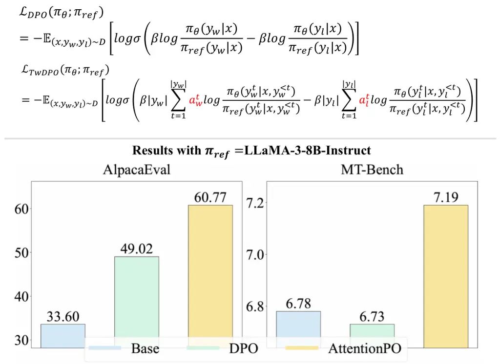
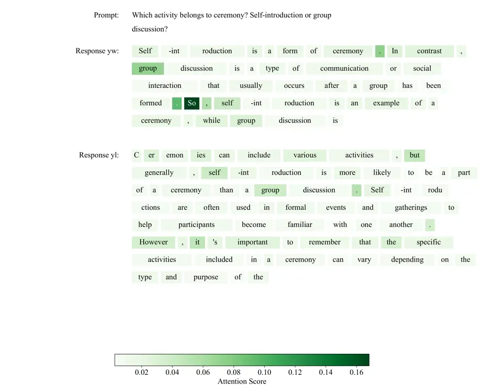
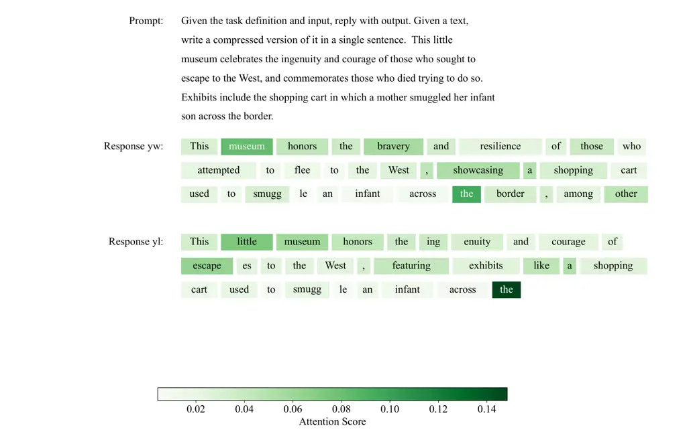

# Token-weighted Direct Preference Optimization with Attention

Chengyu Huang Affiliation: Cornell University    Zhuohang Li
Affiliation: Vanderbilt University{ch2263,sc3379,ctc9}@cornell.edu,
zhuohang.li@vanderbilt.edu    Sheng-Yen Chou Affiliation: Cornell
University    Claire Cardie Affiliation: Cornell University

###### Abstract

Direct Preference Optimization (DPO) aligns Large Language Models with
human preferences without the need for a separate reward model. However,
DPO treats all tokens in responses equally, neglecting the differing
importance of individual tokens. Existing token-level PO methods compute
the token weights using either token-position-based heuristic functions
or probability estimates given by a separately trained model, which
lacks robustness and incurs extra training cost. In contrast, we propose
Token-weighted DPO (TwDPO)—a novel training objective grounded on
token-weighted RL—and AttentionPO—an instantiation of TwDPO that uses
attention from the LLM itself to estimate token weights.
AttentionPO prompts the LLM to serve as a pairwise judge and check where
the model attends when comparing the responses. This design makes
AttentionPO content-aware, adjusting weights based on response content,
and efficient, incurring only two extra forward passes per example.
Experiment results show that AttentionPO significantly improves
performance on AlpacaEval, MT-Bench, and ArenaHard, surpassing existing
Preference Optimization methods. GitHub:
[https://github.com/HCY123902/AttentionPO](https://github.com/HCY123902/AttentionPO)

## 1 Introduction

The alignment of Large Language Models (LLMs) with human preferences and
values is critical for ensuring the quality and safety of generated
outputs. Early efforts in this domain utilized policy-gradient
reinforcement learning (RL) algorithms like Proximal Policy Optimization
(PPO) Schulman et al. (2017a); Ouyang et al. (2022). However, these
traditional RL methods require training a separate reward model on
annotated preference pairs to provide feedback during training Ouyang et
al. (2022). To address this complexity, Preference Optimization (PO)
methods such as Direct Preference Optimization (DPO) Rafailov et al.
(2023) have emerged. DPO’s training objective is derived from the policy
gradient, but it learns the reward landscape directly from preference
pairs, avoiding the need for an external reward model.



Figure 1: AttentionPO weighs each token by attention, surpassing DPO and
various other baselines.

Despite the advancements introduced by DPO and its variants—including
IPO Azar et al. (2024), KTO Ethayarajh et al. (2024), and SimPO Meng et
al. (2024)—these methods generally treat every token within a response
as equally important Meng et al. (2024). This uniform weighting neglects
the fact that different tokens contribute variably to the overall
quality of a response Meng et al. (2024). Consequently, traditional PO
methods fail to provide the fine-grained credit assignment necessary to
account for the specific importance of individual tokens to human
preference.

Recent research has attempted to enable token-level credit assignment
through various estimation techniques. Grounded in token-level policy
gradient methods, TDPO adds sequence KL terms to the DPO objective Zeng
et al. (2024). Other approaches, such as TIS-DPO Liu et al. (2025), SePO
Yang et al. (2025), and cDPO Lin et al. (2024), estimate token
importance by contrasting probabilities between different policies or
models. Alternatively, TI-DPO utilizes gradient norms and Gaussian
priors Yang et al. (2026), while D²PO employs heuristic temporal decay
functions that prioritize earlier tokens Shao et al. (2025). However,
many of these methods either require the training of additional models
to estimate weights Yang et al. (2025); Liu et al. (2025); Lin et al.
(2024) or rely on heuristic functions based on token positions rather
than the specific semantic content of the tokens Yang et al. (2026);
Shao et al. (2025).

In this work, we propose Token-weighted DPO (TwDPO), a training
objective that is theoretically-grounded on token-weighted RL, and
AttentionPO, an instantiation of TwDPO that utilizes the attentions from
the LLM itself to estimate token weights. By obtaining attention weights
for response tokens from a pairwise judge prompt, AttentionPO provides a
content-aware importance metric. These weights are then normalized and
applied during the credit assignment process to better align the model
with human preferences.

Experimental results demonstrate the effectiveness of our proposed
approach. AttentionPO achieves significant performance improvements
across several models and standard benchmarks. On LLaMA-3-8B-Base-SFT
Grattafiori et al. (2024); Meng et al. (2024), AttentionPO improves
performance by 12% (win rate against GPT-4-1106-preview Hurst et al.
(2023)) on AlpacaEval Li et al. (2023); Dubois et al. (2024), 1.05
(LLM-judged score) on MT-Bench Zheng et al. (2023), and 40% (win rate
against GPT-4-0314) on ArenaHard Li et al. (2024); Li et al. (2025b). On
LLaMA-3-8B-Insturct, AttentionPO improves performance by 27% on
AlpacaEval, 1.41 on MT-Bench, and 14% on ArenaHard. AttentionPO also
surpasses strong baselines such as SimPO (up to 4% on AlpacaEval; 0.20
on MT-Bench). AttentionPO highlights the value of using intrinsic model
attentions for precise, token-level preference optimization.

## 2 Methodology

Figure 2: Workflow of AttentionPO. First, we prompt $`\pi_{ref}`$ to act
as a pairwise judge and indicate which response is better in a single
output token $`y_{verdict}`$. We extract $`\pi_{ref}`$’s attentions at
layer $`\mathcal{L}`$ that attend from $`y_{verdict}`$ to the response
tokens of both $`y_{w}`$ and $`y_{l}`$. Prompting and weight extraction
are repeated two times with the position of $`y_{w}`$ and $`y_{l}`$
swapped, and the final attention weights $`A_{w}`$ and $`A_{l}`$ are
averaged over the two rounds. Second, we post-process the weights by
applying normalization and fixing the attention sink. Finally, we apply
TwDPO with the post-processed attention weights.

We first introduce the notations (§ 2.1) and preliminaries (§ 2.2), then
present our TwDPO objective (§ 2.3) and its math derivations (§ 2.4).
Finally, we discuss an instantiation of the TwDPO, AttentionPO, which
uses attentions as weights. AttentionPO takes three steps: (1) First, we
prompt the initial LLM to act as a pairwise judge to extract the
attention weights (§ 2.5); (2) We post-process the attention weights to
obtain a weight distribution (§ 2.6); (3) We apply TwDPO using the
attention weight distribution. See Figure 2 for visualization.

### 2.1 Notations

We initialize our main policy $`\pi_{\theta}`$ with a reference model
$`\pi_{ref}`$. We train $`\pi_{\theta}`$ on a preference dataset
$`\mathcal{D}=\{x^{(i)},y_{w}^{(i)},y_{l}^{(i)}\}_{i=1}^{N}`$, where
each example contains a prompt $`x^{(i)}`$, a preferred response
$`y_{w}^{(i)}`$ and a dispreferred response $`y_{l}^{(i)}`$. Each
response $`y`$ consists of tokens $`\{y^{1},\cdots,y^{|y|}\}`$.

### 2.2 Preliminaries

Direct Preference Optimization is an offline variant of traditional
policy gradient methods to align LLMs with human preferences. It avoids
the need for a separate reward model. Instead, it trains LLMs as reward
models themselves, on the annotated preference pairs. In particular, DPO
maximizes the model’s predicted probability of $`y_{w}`$ being preferred
over $`y_{l}`$. Formally, given the preference dataset $`\mathcal{D}`$,
DPO trains $`\pi_{\theta}`$ using the following objective:

```math
\begin{split}\mathcal{L}=-\mathbb{E}_{(x,y_{w},y_{l})\sim\mathcal{D}}\biggl[log\biggl(p_{\theta}(y_{w}\succ y_{l}|x)\biggr)\biggr].\end{split} \tag{1}
```

where $`p_{\theta}(y_{w}\succ y_{l}|x)`$ is the model’s predicted
preference probability. Following the Bradley-Terry model Bradley and
Terry (1952),

```math
\begin{split}p_{\theta}(y_{w}\succ y_{l}|x)&=\frac{\exp(r(x,y_{w}))}{\exp(r(x,y_{w}))+\exp(r(x,y_{l}))}\\
&=\sigma(r_{\theta}(x,y_{w})-r_{\theta}(x,y_{l})).\end{split} \tag{2}
```

where $`r_{\theta}(x,y_{w})`$ is model’s predicted reward and $`\sigma`$
is the sigmoid function. Further, DPO derives the model’s predicted
reward to be
$`r_{\theta}(x,y)=\beta log\frac{\pi_{\theta}(y|x)}{\pi_{ref}(y|x)}+\beta log(Z(x))`$,
where $`Z(x)`$ is a partition function depending only on $`x`$. Thus,
the final DPO objective is to minimize

```math
\begin{split}\mathcal{L}=-\mathbb{E}_{(x,y_{w},y_{l})\sim\mathcal{D}}\biggl[log\sigma\biggl(\beta log\frac{\pi_{\theta}(y_{w}|x)}{\pi_{ref}(y_{w}|x)}-\\
\beta log\frac{\pi_{\theta}(y_{l}|x)}{\pi_{ref}(y_{l}|x)}\biggr)\biggr].\end{split} \tag{3}
```

Equation 3 can be rewritten into the token-level form:

```math
\begin{split}\mathcal{L}=-\mathbb{E}_{(x,y_{w},y_{l})\sim\mathcal{D}}\biggl[log\sigma\biggl(\beta\sum_{t=1}^{|y_{w}|}\log\frac{\pi_{\theta}(y_{w}^{t}|x,y_{w}^{<t})}{\pi_{ref}(y_{w}^{t}|x,y_{w}^{<t})}-\\
\beta\sum_{t=1}^{|y_{l}|}log\frac{\pi_{\theta}(y_{l}^{t}|x,y_{l}^{<t})}{\pi_{ref}(y_{l}^{t}|x,y_{l}^{<t})}\biggr)\biggr].\end{split} \tag{4}
```

Note that DPO assigns an equal weight of 1 to all the
$`\frac{\pi_{\theta}(y^{t}|x,y^{<t})}{\pi_{ref}(y^{t}|x,y^{<t})}`$
terms. This does not consider the varying degrees of importance of
different tokens to the final response quality.

### 2.3 Token-weighted DPO

Instead, our objective multiplies each probability ratio term in
Equation 4 with a token weight $`a^{t}`$:

```math
\begin{split}\mathcal{L}=-\mathbb{E}_{\mathcal{D}}\biggl[log\sigma\biggl(&\beta|y_{w}|\sum_{t=1}^{|y_{w}|}a_{w}^{t}\log\frac{\pi_{\theta}(y_{w}^{t}|x,y_{w}^{<t})}{\pi_{ref}(y_{w}^{t}|x,y_{w}^{<t})}\\
-&\beta|y_{l}|\sum_{t=1}^{|y_{l}|}a_{l}^{t}log\frac{\pi_{\theta}(y_{l}^{t}|x,y_{l}^{<t})}{\pi_{ref}(y_{l}^{t}|x,y_{l}^{<t})}\biggr)\biggr].\end{split} \tag{5}
```

### 2.4 Mathematical Derivation

We closely follow the proof of Rafailov et al. (2023) to derive the
token-weighted DPO objective from a token-weighted RL objective. First,
we find the closed-form expression of the near-optimal policy
$`\pi^{*}`$ and reward function $`r^{*}`$ attained by the token-weighted
RL objective (§ 2.4.1). Next, we derive the token-weighted DPO objective
(§ 2.4.2).

#### 2.4.1 Deriving the Near Optimum of the Token-weighted Objective

DPO Rafailov et al. (2023) derives the equivalence between their optimal
policy and the one attained by a sequence-level RL objective, which
maximizes response reward with KL constraints:

```math
\begin{split}&\max_{\pi}\mathbb{E}_{x\sim\mathcal{D},y\sim\pi(\cdot|x)}\left[r(x,y)\right]-\beta\mathbb{D_{KL}}(\pi_{\theta}(y|x)||\pi_{ref}(y|x))\\
&=\max_{\pi}\mathbb{E}_{x\sim\mathcal{D},y\sim\pi(\cdot|x)}\biggl[r(x,y)-\beta\sum_{t=1}^{|y|}\frac{\pi_{\theta}(y^{t}|x,y^{<t})}{\pi_{ref}(y^{t}|x,y^{<t})}\biggr].\end{split} \tag{6}
```

Instead, we show that our objective 5 gives a model equivalent to the
near-optimal policy produced by a token-weighted RL objective. We start
by reformulating objective 6. For a given prompt $`x`$, a policy
$`\pi`$, and a reference model $`\pi_{ref}`$, our objective is to find
an optimal policy that maximizes the reward under a token-weighted KL
penalty. As we will show in § 2.4.3, this objective naturally induces a
token-weighted reward function $`r`$. Our KL penalty weighs the
log-probability ratios at each token step $`t`$ by the weight $`a^{t}`$:

```math
\begin{split}&\max_{\pi}\mathbb{E}_{x\sim\mathcal{D},y\sim\pi(\cdot|x)}\biggl[r(x,y)-\\
&~~~~~~~~~~\beta|y|\sum_{t=1}^{|y|}a^{t}\log\frac{\pi(y^{t}|x,y^{<t})}{\pi_{ref}(y^{t}|x,y^{<t})}\biggr].\end{split} \tag{7}
```

Note that $`a^{t}`$ is a proper distribution and sums up to 1. In light
of this, we scale the KL term by the sequence length $`|y|`$ so that the
total weight of the logprob ratio terms $`|y|\sum_{t=1}^{|y|}a^{t}`$
equals $`|y|`$, which is consistent with the DPO objective 6.

To solve this mathematically, we define a sequence-level "weighted"
log-probability¹¹ 1 $`\tilde{\pi}(y|x)`$ and $`\tilde{\pi}(y|x)_{ref}`$
do not need to be proper distribution, but can be normalized to be one.
See Appendix D. for both the policy and the reference model:

```math
\begin{split}\log\tilde{\pi}(y|x)&=|y|\sum_{t=1}^{|y|}a^{t}\log\pi(y^{t}|x,y^{<t}),\\
\log\tilde{\pi}_{ref}(y|x)&=|y|\sum_{t=1}^{|y|}a^{t}\log\pi_{ref}(y^{t}|x,y^{<t}).\end{split} \tag{8}
```

Substituting these into our objective, we can follow the standard
derivation steps:

```math
\begin{split}&\max_{\pi}\mathbb{E}_{x\sim\mathcal{D}}\mathbb{E}_{y\sim\pi(\cdot|x)}\left[r(x,y)-\beta\log\frac{\tilde{\pi}(y|x)}{\tilde{\pi}_{ref}(y|x)}\right]\\
&=\min_{\pi}\mathbb{E}_{x\sim\mathcal{D}}\mathbb{E}_{y\sim\pi(\cdot|x)}\left[\log\frac{\tilde{\pi}(y|x)}{\tilde{\pi}_{ref}(y|x)}-\frac{1}{\beta}r(x,y)\right]\\
&=\min_{\pi}\mathbb{E}_{x\sim\mathcal{D}}\mathbb{E}_{y\sim\pi(\cdot|x)}\biggl[\log\frac{\tilde{\pi}(y|x)}{\frac{1}{Z(x)}\tilde{\pi}_{ref}(y|x)\exp(\frac{1}{\beta}r(x,y))}\\
&~~~~~~~~~~~~~~~~~~~~~~~~~~~~~~~~~~~-\log Z(x)\biggr],\end{split}
```

where $`Z(x)=\sum_{y}\tilde{\pi}_{ref}(y|x)\exp(\frac{1}{\beta}r(x,y))`$
is the partition function.

The near optimal weighted policy $`\tilde{\pi}^{*}`$ (we analyze the
error bounds between $`\tilde{\pi}^{*}`$ and the intractable true
optimal policy in Appendix B) that minimizes this expression satisfies:

```math
\tilde{\pi}^{*}(y|x)=\frac{1}{Z(x)}\tilde{\pi}_{ref}(y|x)\exp\left(\frac{1}{\beta}r(x,y)\right). \tag{9}
```

By taking the logarithm of both sides and rearranging the terms, we can
express the true reward $`r^{*}(x,y)`$ entirely in terms of the optimal
policy:

```math
r^{*}(x,y)=\beta\log\frac{\tilde{\pi}^{*}(y|x)}{\tilde{\pi}_{ref}(y|x)}+\beta\log Z(x). \tag{10}
```

Substituting the expanded definition of our weighted log-probabilities
back into this reward expression yields:

```math
r^{*}(x,y)=\beta|y|\sum_{t=1}^{|y|}a^{t}\log\frac{\pi^{*}(y^{t}|x,y^{<t})}{\pi_{ref}(y^{t}|x,y^{<t})}+\beta\log Z(x). \tag{11}
```

#### 2.4.2 Deriving the Objective Under the Bradley-Terry Model

We substitute our token-weighted reparameterization of $`r^{*}(x,y)`$
into the Bradley-Terry preference model (Equation 2):

```math
\begin{split}&p^{*}(y_{w}\succ y_{l}|x)=\sigma(r^{*}(x,y_{w})-r^{*}{\theta}(x,y_{l}))\\
&=\sigma\Bigg(\left(\beta|y_{w}|\sum_{t=1}^{|y_{w}|}a_{w}^{t}\log\frac{\pi^{*}(y_{w}^{t}|x,y_{w}^{<t})}{\pi_{ref}(y_{w}^{t}|x,y_{w}^{<t})}+\beta\log Z(x)\right)\\
&\quad-\left(\beta|y_{l}|\sum_{t=1}^{|y_{l}|}a_{l}^{t}\log\frac{\pi^{*}(y_{l}^{t}|x,y_{l}^{<t})}{\pi_{ref}(y_{l}^{t}|x,y_{l}^{<t})}+\beta\log Z(x)\right)\Bigg).\end{split}
```

Crucially, the partition function terms $`\beta\log Z(x)`$ cancel out,
leaving:

```math
\begin{split}p^{*}(y_{w}\succ y_{l}|x)=\sigma\biggl(\beta|y_{w}|\sum_{t=1}^{|y_{w}|}a_{w}^{t}\log\frac{\pi^{*}(y_{w}^{t}|x,y_{w}^{<t})}{\pi_{ref}(y_{w}^{t}|x,y_{w}^{<t})}\\
-\beta|y_{l}|\sum_{t=1}^{|y_{l}|}a_{l}^{t}\log\frac{\pi^{*}(y_{l}^{t}|x,y_{l}^{<t})}{\pi_{ref}(y_{l}^{t}|x,y_{l}^{<t})}\biggr).\end{split} \tag{12}
```

To frame this as a maximum likelihood objective for training a
parameterized policy $`\pi_{\theta}`$, we take the negative
log-likelihood over the preference dataset $`\mathcal{D}`$. This leads
to our final objective in Equation 5.

#### 2.4.3 Properties

##### Reward function is token-weighted.

Equation 10 shows that $`r`$ weighs tokens by $`a^{t}`$. For tokens with
higher $`a^{t}`$, their logprob ratio between
$`\pi^{*}(y^{t}|x,y^{<t})`$ and $`\pi_{ref}(y^{t}|x,y^{<t})`$
significantly affect $`r`$, while tokens with lower $`a^{t}`$ affect
$`r`$ less.

##### Token-weighted KL penalty enables locally-adaptive trust region.

Our KL penalty in objective 7 scales the KL divergence at the token
level via $`a^{t}`$. Consequently, the model is granted greater freedom
to deviate from the reference policy on low-importance tokens, while
being strictly constrained on high-importance ones. While restricting
the most critical tokens may seem counterintuitive, this adaptive
weighting is essential because important tokens dominate the implicitly
derived reward function, and thus are highly susceptible to reward
hacking and over-optimization. The token-weighted KL term acts as a
locally adaptive regulator: for high-weight tokens, the massive
incentives to deviate are safely balanced by proportionally stricter
penalties, ensuring the model only updates when the expected reward
justifies the risk.

The above suggests that objective 7 is indeed a token-weighted RL
objective in terms of both the reward function and KL penalty.
Consequently, both its derived policy and the near-optimal policy
derived from objective 5 learn more signals from important tokens, which
is what we desire. We further provide an analysis on the gradient in
Appendix C. While we use attention as the weights, there are no
assumptions about how the weights are derived, and AttentionPO is only
one possible instantiation.

### 2.5 Token Weights Extraction Through Attention Scores

We hypothesize that if we ask the LLM to judge the response quality, the
tokens that get more attention are more important. As such, we prompt
$`\pi_{ref}`$ with a general pairwise judge prompt (See Appendix 6) that
asks it to predict which of $`y_{w}`$ and $`y_{l}`$ has better quality.
We explicitly require $`\pi_{ref}`$ to output the identifier ("A" or
"B") of the better response, and we denote this single token as
$`y_{verdict}`$. To avoid bias, we hide the preference labels in the
prompt and call $`\pi_{ref}`$ two rounds, each round with the positions
of $`y_{w}`$ and $`y_{l}`$ swapped. For each round, we do a single
forward pass and obtain the attention weights at a fixed layer $`L`$. We
extract the attention weights from $`y_{verdict}`$ to all the tokens in
$`y_{w}`$ and denote them as
$`A_{w}^{round\_r}=[a_{w}^{1},\cdots,a_{w}^{|y_{w}|}]`$. Similarly, we
extract the attention weights from $`y_{verdict}`$ to all the tokens in
$`y_{l}`$ as $`A_{l}^{round\_r}=[a_{l}^{1},\cdots,a_{l}^{|y_{l}|}]`$.
For simplicity, we compute the final attention weight of each token as
the mean attention weight for that token across attention heads.

For rounds $`r\in\{1,2\}`$ ,This produces $`A_{w}^{round\_1}`$,
$`A_{w}^{round\_2}`$, $`A_{l}^{round\_1}`$, $`A_{l}^{round\_2}`$. The
final attention is the average of the two rounds:

```math
\begin{split}a_{w}^{t}&=\frac{1}{2}a_{w}^{t,round\_1}+\frac{1}{2}a_{w}^{t,round\_2},\\
a_{l}^{t}&=\frac{1}{2}a_{l}^{t,round\_1}+\frac{1}{2}a_{l}^{t,round\_2}.\end{split} \tag{13}
```

### 2.6 Post-Processing

##### Normalization.

$`\pi_{ref}`$ also attends to other tokens in the pairwise judge prompt
and so neither $`A_{w}`$ nor $`A_{l}`$ form a proper distribution (i.e.,
it does not sum up to 1.0). Therefore, we normalize the attention
weights $`A_{w}`$ and $`A_{l}`$:
$`a_{w}^{t}\leftarrow a_{w}^{t}/(\sum_{q=1}^{|y_{w}|}a_{w}^{q})`$,
$`a_{l}^{t}\leftarrow a_{l}^{t}/(\sum_{q=1}^{|y_{l}|}a_{l}^{q})`$.

##### Fixing Attention Sink.

Attention sink is a phenomenon where the LLMs predominantly attend to
the initial tokens Xiao et al. (2024). Manual inspection on our dataset
$`\mathcal{D}`$ suggests that these initial tokens are usually of low
importance, consisting of starting phrases. As such, for any response
with at least $`K^{\prime}`$ tokens, we reset the attention weights of
the first $`K`$ tokens of each response $`y`$ to the average weight
$`1/|y|`$ and renormalize the remaining tokens:

```math
\begin{split}\forall t\in\{K+1,\cdots,|y_{w}|\},a_{w}^{t}&\leftarrow a_{w}^{t}\frac{1-\frac{K}{|y_{w}|}}{\sum_{q=K+1}^{|y_{w}|}a_{w}^{q}}\\
\forall t\in\{K+1,\cdots,|y_{l}|\},a_{l}^{q}&\leftarrow a_{l}^{q}\frac{1-\frac{K}{|y_{l}|}}{\sum_{q=K+1}^{|y_{l}|}a_{l}^{q}}\end{split} \tag{14}
```

## 3 Experiment Setup

##### Models and Datasets.

We follow the settings from Meng et al. (2024). For the initial model
$`\pi_{ref}`$, we experiment with Llama-3-8B-Base-SFT from Meng et al.
(2024) (princeton-nlp/Llama-3-Base-8B-SFT), which is
supervised-finetuned from the pretrained model LLaMA-3-8B Grattafiori et
al. (2024) on UltraChat-200K Ding et al. (2023); and LLaMA-3-8B-Instruct
Grattafiori et al. (2024) (meta-llama/Meta-Llama-3-8B-Instruct).

For the SFT model (Llama-3-8B-Base-SFT), we apply AttentionPO on the
UltraFeedback binarized dataset Cui et al. (2024)
(HuggingFaceH4/ultrafeedback*binarized). This dataset contains
61,135/2,000 training/validation examples covering diverse
instruction-following tasks such as creative writing, document-assisted
writing, and open-ended QA. Each query is accompanied by four responses
generated by diverse LLMs and graded by GPT-4 in terms of
instruction-following, helpfulness, honesty, and truthfulness. $`y*{w}`$
is set to the response with the highest overall score, and $`y\_{l}`$ is
chosen randomly from the remaining three.

For the Instruction-Tuned model (LLaMA-3-8B-Instruct), we use the
dataset produced by Meng et al. (2024)
(princeton-nlp/llama3-ultrafeedback). It contains 59,876/1,961
training/validation examples. The questions are subsampled from the
binarized datasets, but for each question, five responses are sampled
from $`\pi_{ref}`$ and then scored by a reward model PairRM Jiang et al.
(2023b). $`y_{w}`$ is set to the response with the highest score and
$`y_{l}`$ is set to the one with the lowest score.

|           | $`\pi_{ref}`$=LLaMA-3-8B-Base-SFT |        |          | $`\pi_{ref}`$=LLaMA-3-8B-Instruct |        |          |
| --------- | --------------------------------- | ------ | -------- | --------------------------------- | ------ | -------- |
|           | Std                               | Max    | Len      | Std                               | Max    | Len      |
| $`y_{w}`$ | 0.0177                            | 0.1242 | 269.0895 | 0.0126                            | 0.0915 | 356.9848 |
| $`y_{l}`$ | 0.0175                            | 0.1202 | 235.3978 | 0.0137                            | 0.0959 | 365.8176 |

Table 1: Statistics of the attention weights after post-processing in
§ 2.6. Std: Standard deviation of token weights within a response. Max:
Maximum weights; Len: Response length; Metrics are averaged across the
training set.

| $`\pi_{ref}`$=LLaMA-3-8B-Base-SFT |        |            |        | $`\pi_{ref}`$=LLaMA-3-8B-Instruct |        |           |        |
| --------------------------------- | ------ | ---------- | ------ | --------------------------------- | ------ | --------- | ------ |
| $`y_{w}`$                         |        | $`y_{l}`$  |        | $`y_{w}`$                         |        | $`y_{l}`$ |        |
| Token                             | Weight | Token      | Weight | Token                             | Weight | Token     | Weight |
| True                              | 0.1237 | Ye         | 0.8212 | (Note                             | 0.1269 | (Note     | 0.1276 |
| idence                            | 0.1227 | Neutral    | 0.1213 | YES                               | 0.0918 | Yes       | 0.0853 |
| Neutral                           | 0.1184 | ye         | 0.1065 | "What                             | 0.0844 | "What     | 0.0673 |
| POS                               | 0.1148 | Completion | 0.0987 | doesn                             | 0.0643 | doesn     | 0.0618 |
| False                             | 0.1016 | idence     | 0.0886 | wouldn                            | 0.0606 | No        | 0.0598 |
| Completion                        | 0.0997 | No         | 0.0845 | False                             | 0.0572 | !ĊĊ       | 0.0529 |
| No                                | 0.0990 | True       | 0.0796 | Yes                               | 0.0563 | didn      | 0.0528 |
| Negative                          | 0.0788 | Ent        | 0.0721 | No                                | 0.0556 | wouldn    | 0.0510 |
| Positive                          | 0.0668 | Negative   | 0.0692 | Explanation                       | 0.0505 | don       | 0.0497 |
| Yes                               | 0.0591 | False      | 0.0686 | don                               | 0.0492 | "The      | 0.0447 |

Table 2: Most weighted tokens after post-processing in § 2.6. Weight:
Weights averaged across all occurrences of the token in the training
set. We only keep tokens that occur at least 100 times.

##### Attention Weights.

We set $`L`$ to the index of the last layer for every model (i.e., we
take the attention weights from the last layer). To fix the attention
sink issue, we use $`K=1`$ and $`K^{\prime}=5`$. That is, for response
$`y`$ that has at least 5 tokens, we set the attention weight of its
first token to $`1/|y|`$. The rationale is that for our models, the
attention sink primarily concentrates on the first token. For
LLaMA3-8B-Base-SFT, significant attention weights are on the first token
(12.55%), whereas the weights on the second (3.35%) and third (2.55%)
tokens are much smaller. For LLaMA-3-8B-Instruct, the proportion is
8.25%/2.11%/1.55% for the first, second, and third tokens, respectively.

We show detailed statistics of the attention weights in Table 1. The
standard deviation of the weights from both SFT and Instruct models is
above 0.01, suggesting that the weights vary across tokens. We also show
the ten most weighted tokens in Table 2. For the SFT model, 7/10 tokens
are related to binary judgment words (e.g., "Yes", "True") for both
$`y_{w}`$ and $`y_{l}`$. The highly weighted tokens of the Instruct
model not only include these but also negation words (e.g., "doesn").

##### Training Details.

We set learning rate to $`1e-6`$ with a cosine scheduler and a warmup
ratio of 0.1. We use the AdamW optimizer Loshchilov and Hutter (2019).
The KL regularizer $`\beta`$ is set to $`0.005`$. See more details in
Appendix F.

##### Baselines.

We compare AttentionPO against the initial model $`\pi_{ref}`$ and
models trained with common PO methods, including RRHF Yuan et al.
(2023), SLiC-HF Zhao et al. (2023), DPO Rafailov et al. (2023), TDPO
Zeng et al. (2024), TI-DPO Yang et al. (2026), OTPO Li et al. (2025a),
IPO Azar et al. (2024), CPO Xu et al. (2024), KTO Ethayarajh et al.
(2024), ORPO Hong et al. (2024), R-DPO Park et al. (2024), and SimPO
Meng et al. (2024). Except TDPO, TI-DPO, and OTPO, we adopt the training
hyperparameters from Meng et al. (2024), which have been separately
searched to be optimal.

##### Evaluation.

Following prior work Meng et al. (2024); Yang et al. (2025); Huang and
Goyal (2025), we evaluate the models on AlpacaEval Li et al. (2023),
MT-Bench Zheng et al. (2023), and ArenaHard Li et al. (2024). For
AlpacaEval, we report the raw and length-controlled win rate of our
model against GPT-4-1106-preview. For MT-Bench, we report the LLM-judged
quality score of our model’s generated response on a scale of 1 to 10.
For ArenaHard, we report the win rate of our model against GPT4-0314. We
use GPT-4o-mini Achiam et al. (2024) as the judge model for these
benchmarks. See more evaluation details in Appendix F.

## 4 Results

We first present the main results (§ 4.1), followed by comparing our
method with other choices of token weights (§ 4.2), and finally
conducting an ablation study (§ 4.3).

### 4.1 Main Results

|              |                                   |                 |                    |                 |                         |                                   |                 |                    |                 |                         |
| ------------ | --------------------------------- | --------------- | ------------------ | --------------- | ----------------------- | --------------------------------- | --------------- | ------------------ | --------------- | ----------------------- |
|              | $`\pi_{ref}`$=LLaMA-3-8B-Base-SFT |                 |                    |                 |                         | $`\pi_{ref}`$=LLaMA-3-8B-Instruct |                 |                    |                 |                         |
|              | AlpacaEval                        |                 | MT                 | ArenaHard       | Avg Rank $`\downarrow`$ | AlpacaEval                        |                 | MT                 | ArenaHard       | Avg Rank $`\downarrow`$ |
|              | LR $`\uparrow`$                   | WR $`\uparrow`$ | Score $`\uparrow`$ | WR $`\uparrow`$ |                         | LR $`\uparrow`$                   | WR $`\uparrow`$ | Score $`\uparrow`$ | WR $`\uparrow`$ |                         |
| Base         | 9.20                              | 4.63            | 5.47               | 9.92            | 13.75                   | 33.60                             | 32.60           | 6.78               | 37.57           | 12.25                   |
| +RRHF        | 11.29                             | 6.63            | 6.18               | 26.00           | 9.25                    | 43.75                             | 37.65           | 6.63               | 41.91           | 10.00                   |
| +SLiC-HF     | 16.73                             | 12.08           | 5.95               | 13.08           | 10.00                   | 38.38                             | 37.03           | 6.76               | 42.76           | 10.13                   |
| +DPO         | 22.88                             | 17.70           | 6.54               | 38.54           | 3.25                    | 49.02                             | 44.72           | 6.73               | 53.98           | 6.00                    |
| +TDPO        | 11.96                             | 6.18            | 5.68               | 12.09           | 11.75                   | 37.74                             | 37.34           | 6.64               | 41.00           | 11.50                   |
| +TI-DPO      | 9.94                              | 4.77            | 5.29               | 10.14           | 13.25                   | 35.41                             | 34.57           | 6.80               | 38.73           | 10.75                   |
| +OTPO        | 24.24                             | 14.43           | 6.22               | 46.31           | 4.50                    | 51.26                             | 44.65           | 6.91               | 52.60           | 4.50                    |
| +IPO         | 20.69                             | 19.73           | 6.23               | 34.56           | 4.75                    | 48.94                             | 47.47           | 6.99               | 50.50           | 4.50                    |
| +CPO         | 18.94                             | 24.56           | 5.38               | 36.04           | 4.88                    | 41.26                             | 45.13           | 6.67               | 52.07           | 7.50                    |
| +KTO         | 18.24                             | 15.05           | 5.93               | 18.28           | 8.75                    | 43.10                             | 39.73           | 6.79               | 48.98           | 7.38                    |
| +ORPO        | 19.36                             | 13.47           | 5.72               | 17.32           | 9.25                    | 40.92                             | 36.95           | 6.76               | 44.64           | 9.88                    |
| +R-DPO       | 20.94                             | 15.57           | 6.33               | 28.72           | 5.25                    | 52.11                             | 46.98           | 6.79               | 54.98           | 3.38                    |
| +SimPO       | 32.26                             | 29.11           | 6.13               | 47.01           | 3.63                    | 56.79                             | 47.73           | 6.51               | 54.94           | 5.00                    |
| +AttentionPO | 21.55                             | 20.23           | 6.52               | 49.72           | 2.25                    | 60.77                             | 58.29           | 7.19               | 52.06           | 2.25                    |

Table 3: Main results. Base: $`\pi_{ref}`$; MT: MT-Bench; AlpacaEval: LR
is the length-controlled win rate and WR is the raw win rate against
GPT-4-1106-Preview; MT-Bench: LLM-judged quality score of the model’s
responses, on a scale of 1 to 10; ArenaHard: Win rate against
GPT-4-0314. Avg Rank: arithmetic mean of the method’s ranks across all
individual metrics. AttentionPO achieves the best overall ranking across
both Base-SFT and Instruct settings. See Table 10 for results with
multiple evaluation runs.

As shown in Table 3, AttentionPO significantly improves the performance
over the base model $`\pi_{ref}`$ in all settings. On
LLaMA-3-8B-Base-SFT, performance increases by 12% on AlpacaEval, 1.05 on
MT-Bench, 40% on ArenaHard. On LLaMA-3-8B-Instruct, performance
increases by 27% on AlpacaEval, 0.41 on MT-Bench, and 14% on ArenaHard.
Furthermore, AttentionPO outperforms the baselines in most settings. For
the SFT model, AttentionPO ranks first on ArenaHard, second on MT-Bench,
and third on AlpacaEval. For the Instruct model, AttentionPO outperforms
all baselines on AlpacaEval and MT-Bench. Across the benchmarks,
AttentionPO achieves the best overall rank for both models.

### 4.2 Impact of Token Weight Sources

There are alternative ways to obtain token-level weights. Prior work Lin
et al. (2024); Yang et al. (2025); Liu et al. (2025); Shao et al.
(2025); Yang et al. (2026) either requires training a separate model to
estimate weights or relies on strong heuristics. Instead, we stick to
our setting where the weights are attained through self-judging, but we
experiment with various changes to the current design. This includes (1)
Extracting the attention weights from a different hidden layer $`L`$ of
$`\pi_{ref}`$; (2) Using attention rollout Abnar and Zuidema (2020) to
aggregate the weights across different hidden layers; (3) Prompting
$`\pi_{ref}`$ to verbally assign a weight for each token. For these
experiments, we use LLaMA-3-8B-Instruct as an example.

Figure 3: Results for different layers. x-axis: index of the layer from
which attention weights are extracted; y-axis: benchmark performance.

##### Changing layers.

LLaMA-3-8B-Instruct consists of 32 hidden layers. We use $`L=32`$ for
our main experiments. Here, we experiment with $`L\in\{1,8,16,24,32\}`$
and present the results in Figure 3. We find that the first and last
layers perform better than the middle ones, with the last layer
achieving the best results. We leave more investigation on this to
future work.

##### Attention rollout (w/ attn rollout).

Attention rollout aggregates the attentions across all the layers to
estimate the total attentions from tokens in the final output layer to
tokens in the initial input layer. Table 4 shows that using their
aggregated weights underperforms our method. This is potentially
associated with our previous observation that middle-layer attentions
are not suitable for AttentionPO, since attention rollout incorporates
attentions from these layers into the final weights.

##### Verbalized self-judged weights (w/ verbal w).

Instead of using attention, we ask $`\pi_{ref}`$ to verbally assign an
importance score on a scale of 1 to 5 to each token in the response. We
observe that it is difficult for the model to precisely give a score for
every token (e.g., malformed scoring report; not being able to recall
every token in the response). Therefore, we adapt a coarser granularity
and ask the model to first partition the response into parts and then
assign a score for each part (See prompts in Appendix J). Even with a
coarser granularity, $`\pi_{ref}`$ still cannot perfectly recall the
response tokens. We filter out examples where fewer than 90% of the
tokens are matched with a verbalized weight for either $`y_{w}`$ or
$`y_{l}`$. After filtering, we get 10,111/343 train/validation examples.
To compensate for a smaller dataset, we increase the number of training
epochs from 1 to 5 and validate at each epoch.

|                 | $`\pi_{ref}`$=LLaMA-3-8B-Instruct |                 |                    |                 |
| --------------- | --------------------------------- | --------------- | ------------------ | --------------- |
|                 | AlpacaEval                        |                 | MT                 | ArenaHard       |
|                 | LR $`\uparrow`$                   | WR $`\uparrow`$ | Score $`\uparrow`$ | WR $`\uparrow`$ |
| Base            | 33.60                             | 32.60           | 6.78               | 37.57           |
| +DPO            | 49.02                             | 44.72           | 6.73               | 53.98           |
| +AttentionPO    | 60.77                             | 58.29           | 7.19               | 52.06           |
| w/ attn rollout | 54.84                             | 54.87           | 6.71               | 48.23           |
| w/ verbal w     | 57.95                             | 57.76           | 6.89               | 61.41           |

Table 4: Results with different weight sources.

Table 4 shows that this method outperforms ours on ArenaHard but
underperforms on AlpacaEval and MT-Bench. A potential reason is the use
of a coarser granularity. We leave more investigation on the viability
of this approach to future work.

### 4.3 Ablation Study

##### Restoring the attention sink (w/ attn sink).

We restore the attention sink, in which case the first token occupies
roughly 8.25% of the total weights. Table 5 shows that this variant
underperforms our method on all benchmarks, indicating the benefits of
averaging out the attention sink.

##### Adding length normalization (w/ len norm).

Prior work Yang et al. (2025); Meng et al. (2024) argues that DPO is
biased toward lengthy responses (i.e., lengthy responses receive more
gradient updates than concise ones). They add a length normalizer to the
objective. Similarly, we remove the $`|y|`$ multiplier in front of the
logprob ratio term for $`y_{w}`$ and $`y_{l}`$, giving a weighted,
length-normalized variant:

```math
\begin{split}\mathcal{L^{\prime}}=-\mathbb{E}_{\mathcal{D}}\biggl[log\sigma\biggl(&\beta\sum_{t=1}^{|y_{w}|}a_{w}^{t}\log\frac{\pi_{\theta}(y_{w}^{t}|x,y_{w}^{<t})}{\pi_{ref}(y_{w}^{t}|x,y_{w}^{<t})}\\
-&\beta\sum_{t=1}^{|y_{l}|}a_{l}^{t}log\frac{\pi_{\theta}(y_{l}^{t}|x,y_{l}^{<t})}{\pi_{ref}(y_{l}^{t}|x,y_{l}^{<t})}\biggr)\biggr]\end{split} \tag{15}
```

Adding the length normalization effectively reduces the KL
regularization constant $`\beta`$. Therefore, we increase $`\beta`$ to
2.0 for this baseline. For these experiments, we use LLaMA-3-8B-Instruct
as an example.

|              | $`\pi_{ref}`$=LLaMA-3-8B-Instruct |                 |                    |                 |
| ------------ | --------------------------------- | --------------- | ------------------ | --------------- |
|              | AlpacaEval                        |                 | MT                 | ArenaHard       |
|              | LR $`\uparrow`$                   | WR $`\uparrow`$ | Score $`\uparrow`$ | WR $`\uparrow`$ |
| Base         | 33.60                             | 32.60           | 6.78               | 37.57           |
| +DPO         | 49.02                             | 44.72           | 6.73               | 53.98           |
| +AttentionPO | 60.77                             | 58.29           | 7.19               | 52.06           |
| w/ attn sink | 61.14                             | 57.27           | 6.93               | 51.64           |
| w/ len norm  | 62.00                             | 55.69           | 6.79               | 44.59           |

Table 5: Ablation Results.

Table 5 shows that applying length normalization significantly hurts
performance on MT-Bench and AreaHard. One speculated reason for this is
the misalignment with the original RL objective. Instead of maximizing
the total rewards of the entire rollout $`y`$, the dual-RL objective of
objective 15 (which is the same as objective 7 but with $`|y|`$ removed
in both the reward function and the KL penalty) maximizes the average
per-token reward of $`y`$, undermining the total rewards.

## 5 Related Work

##### Preference Optimization.

Aligning LLMs with human preferences originally relied on RLHF via PPO
Ouyang et al. (2022); Schulman et al. (2017a), which requires a separate
reward model. Modern Preference Optimization (PO) methods bypass this by
training the policy directly on preference pairs $`(y_{w},y_{l})`$ using
contrastive objectives. For instance, RRHF Yuan et al. (2023) and
SLiC-HF Zhao et al. (2023) apply ranking losses, while DPO Rafailov et
al. (2023) derives a reference-normalized objective from policy
gradients. Subsequent variants introduce bounded objectives (IPO Azar et
al. (2024)), pointwise formulations (KTO Ethayarajh et al. (2024)),
auxiliary SFT objectives (CPO Xu et al. (2024), ORPO Hong et al.
(2024)), length penalties (R-DPO Park et al. (2024)), or reference-free
length normalization with reward margins (SimPO Meng et al. (2024)).
However, these methods weight all response tokens equally, failing to
capture token-level importance.

##### Token-level PO.

To enable fine-grained credit assignment, recent work explores
token-level weighting. TDPO Zeng et al. (2024) incorporates token-level
sequential KL terms. TIS-DPO Liu et al. (2025), SePO Yang et al. (2025),
and cDPO Lin et al. (2024) estimate token importance by contrasting
probabilities between reference/negative models and oracle/positive
models. TI-DPO Yang et al. (2026) combines Gaussian priors with logit
gradient norms. Alternatively, heuristic approaches like D²PO Shao et
al. (2025) decay weights based on token position. OTPO Li et al. (2025a)
uses the euclidean distances between token hidden states to estimate
token weights. Nonetheless, most of these methods either demand
expensive auxiliary models Liu et al. (2025); Yang et al. (2025); Lin et
al. (2024) or rely on rigid, position-based heuristics Shao et al.
(2025) rather than semantic content. Among the methods Zeng et al.
(2024); Yang et al. (2026); Li et al. (2025a) that share the same
advantage as ours, which do not require an extra model for weight
estimation and are adaptive to context, our method exhibits higher
performance than theirs across models and benchmarks.

##### Attentions for credit assignment.

The idea of using attentions for fine-grained credit assignment has been
explored in the context of reward shaping and found to work well. Prior
work Ferret et al. (2020); Holmes and Chi (2025) uses the reward model’s
attentions for reward shaping, which densifies the rewards and boosts
training efficiency in various RL environments. Attention-Based Credit
Chan et al. (2024) uses a similar approach to obtain dense rewards in
the LLM RLHF (PPO (Schulman et al., 2017b)) setting, which boosts
efficiency and effectiveness. Our design choice of attention-based
weights draws inspiration from these. The high-level motivation is that
we use LLM as a pairwise judge (reward) model and use the attentions
from the final verdict token (predicted reward) as the token weights.

## 6 Conclusion

We propose TwDPO—a token-weighted DPO objective, theoretically grounded
on token-weighted RL—and AttentionPO—an instantiation of TwDPO that
prompts the model to judge the response qualities and extract attentions
from the model itself to weigh the response tokens. Experiment results
show that AttentionPO significantly improves the performance of the base
model across AlpacaEval, MT-Bench, and ArenaHard, outperforming various
prior PO methods. We hope AttentionPO paves the way for
highly-performant and efficient preference alignment with humans.

## Limitations

Due to computational constraints, we do not experiment with our method
on larger models. In addition, our training and evaluation focus on the
instruction-following task, but it can be applied to other more
specialized domains such as reasoning or knowledge-based QA. Analysing
the performance and generalizability of AttentionPO on other models and
tasks is an important future direction.

Moreover, the search space for the optimal choice of attention weights
for TwDPO is large. For example, while we simply take the mean across
attention heads, future work could investigate selecting a specific head
or group of heads for weight extraction. However, we argue that such a
choice of attention heads is likely model-dependent and may not transfer
across settings.

## References

- Abnar and Zuidema (2020) S. Abnar and W. Zuidema Quantifying attention
  flow in transformers. In Proceedings of the 58th Annual Meeting of the
  Association for Computational Linguistics, Cited by: Appendix A, §4.2.
- Achiam et al. (2024) J. Achiam, S. Adler, S. Agarwal, L. Ahmad, I.
  Akkaya, F. L. Aleman, D. Almeida, J. Altenschmidt, S. Altman,
  and S. A. et al. GPT-4o system card. arXiv preprint arXiv:2410.21276.
  Cited by: §3.
- Azar et al. (2024) M. G. Azar, M. Rowland, B. Piot, D. Guo, D.
  Calandriello, M. Valko, and R. Munos A general theoretical paradigm to
  understand learning from human preferences. In Proceedings of the 27th
  International Conference on Artificial Intelligence and Statistics,
  Cited by: Appendix A, §1, §3, §5.
- Bradley and Terry (1952) R. A. Bradley and M. E. Terry Rank analysis
  of incomplete block designs: i. the method of paired comparisons.
  Biometrika 39, pp. 324–345. External Links:
  [Document](https://dx.doi.org/https%3A//doi.org/10.2307/2334029) Cited
  by: §2.2.
- Chan et al. (2024) A. J. Chan, H. Sun, S. Holt, and M. van der Schaar
  Dense reward for free in reinforcement learning from human feedback.
  In Proceedings of International Conference on Machine Learning, Cited
  by: §5.
- Clark et al. (2019) K. Clark, U. Khandelwal, O. Levy, and C. D.
  Manning What does bert look at?. In Proceedings of the 2019 ACL
  Workshop BlackboxNLP: Analyzing and Interpreting Neural Networks for
  NLP, Cited by: Appendix A.
- Cui et al. (2024) G. Cui, L. Yuan, N. Ding, G. Yao, B. He, W. Zhu, Y.
  Ni, G. Xie, R. Xie, Y. Lin, Z. Liu, and M. Sun UltraFeedback: boosting
  language models with scaled ai feedback. In Proceedings of
  International Conference on Machine Learning, Cited by: §G.2, §3.
- Ding et al. (2023) N. Ding, Y. Chen, B. Xu, Y. Qin, S. Hu, Z. Liu, M.
  Sun, and B. Zhou Enhancing chat language models by scaling
  high-quality instructional conversations. In Proceedings of the 2023
  Conference on Empirical Methods in Natural Language Processing, Cited
  by: §G.2, §3.
- Dubois et al. (2024) Y. Dubois, B. Galambosi, P. Liang, and T. B.
  Hashimoto Length-controlled alpacaeval: a simple way to debias
  automatic evaluators. In Proceedings of Conference on Language
  Modeling, Cited by: §1.
- Ethayarajh et al. (2024) K. Ethayarajh, W. Xu, N. Muennighoff, D.
  Jurafsky, and D. Kiela KTO: model alignment as prospect theoretic
  optimization. In Proceedings of International Conference on Machine
  Learning, Cited by: Appendix A, §1, §3, §5.
- Ferret et al. (2020) J. Ferret, R. Marinier, M. Geist, and O. Pietquin
  Self-attentional credit assignment for transfer in reinforcement
  learning. In Proceedings of International Joint Conferences on
  Artificial Intelligence, Cited by: §5.
- Grattafiori et al. (2024) A. Grattafiori, A. Dubey, A. Jauhri, A.
  Pandey, A. Kadian, A. Al-Dahle, A. Letman, A. Mathur, A. Schelten,
  and A. V. et al. The llama 3 herd of models. arXiv preprint
  arXiv:2407.21783. Cited by: §1, §3.
- Holmes and Chi (2025) I. Holmes and M. Chi Attention-based reward
  shaping for sparse and delayed rewards. arXiv preprint
  arXiv:2505.10802. Cited by: §5.
- Hong et al. (2024) J. Hong, N. Lee, and J. Thorne ORPO: monolithic
  preference optimization without reference model. In Proceedings of the
  2024 Conference on Empirical Methods in Natural Language Processing,
  Cited by: Appendix A, §3, §5.
- Huang and Goyal (2025) C. Huang and T. Goyal DCRM: a heuristic to
  measure response pair quality in preference optimization. In Findings
  of the Association for Computational Linguistics: EMNLP 2025, Cited
  by: §3.
- Hurst et al. (2023) A. Hurst, A. Lerer, A. P. Goucher, A. Perelman, A.
  Ramesh, A. Clark, A. Ostrow, A. Welihinda, A. Hayes, and A. R. et al.
  GPT-4 technical report. arXiv preprint arXiv:2303.08774. Cited by: §1.
- Jain and Wallace (2019) Jain and Wallace Attention is not explanation.
  In Proceedings of the 2019 Conference on Empirical Methods in Natural
  Language Processing and the 9th International Joint Conference on
  Natural Language Processing (EMNLP-IJCNLP), Cited by: Appendix A.
- Jiang et al. (2023a) A. Q. Jiang, A. Sablayrolles, A. Mensch, C.
  Bamford, D. S. Chaplot, D. de las Casas, F. Bressand, G. Lengyel, G.
  Lample, L. Saulnier, L. R. Lavaud, M. Lachaux, P. Stock, T. L.
  Scao, T. Lavril, T. Wang, T. Lacroix, and W. E. Sayed Mistral 7b.
  arXiv preprint arXiv:2310.06825. Cited by: §G.2.
- Jiang et al. (2023b) D. Jiang, X. Ren, and B. Y. Lin LLM-blender:
  ensembling large language models with pairwise ranking and generative
  fusion. In Proceedings of the 61st Annual Meeting of the Association
  for Computational Linguistics (Volume 1: Long Papers), Cited by: §3.
- Li et al. (2025a) M. Li, G. Huzhang, H. Zhang, X. Wang, and A. Zeng
  Optimal transport-based token weighting scheme for enhanced preference
  optimization. In Proceedings of the 63th Annual Meeting of the
  Association for Computational Linguistics, Cited by: §3, §5.
- Li et al. (2025b) T. Li, W. Chiang, E. Frick, L. Dunlap, T. Wu, B.
  Zhu, J. E. Gonzalez, and I. Stoica From crowdsourced data to
  high-quality benchmarks: arena-hard and benchbuilder pipeline. In
  Proceedings of International Conference on Machine Learning, Cited by:
  §1.
- Li et al. (2024) T. Li, W. Chiang, E. Frick, L. Dunlap, B. Zhu, J. E.
  Gonzalez, and I. Stoica From live data to high-quality benchmarks: the
  arena-hard pipeline. External Links:
  [Link](https://lmsys.org/blog/2024-04-19-arena-hard/) Cited by: §1,
  §3.
- Li et al. (2023) X. Li, T. Zhang, Y. Dubois, R. Taori, I.
  Gulrajani, C. Guestrin, P. Liang, and T. B. Hashimoto AlpacaEval: an
  automatic evaluator of instruction-following models. GitHub. Note:
  [https://github.com/tatsu-lab/alpaca_eval](https://github.com/tatsu-lab/alpaca_eval)
  Cited by: §1, §3.
- Lin et al. (2024) Z. Lin, T. Liang, J. Xu, Q. Lin, X. Wang, R. Luo, C.
  Shi, S. Li, Y. Yang, and Z. Tu Critical tokens matter: token-level
  contrastive estimation enhances llm’s reasoning capability. arXiv
  preprint arXiv:2411.19943. Cited by: Appendix A, §1, §4.2, §5.
- Liu et al. (2025) A. Liu, H. Bai, Z. Lu, Y. Sun, X. Kong, S. Wang, J.
  Shan, A. M. Jose, X. Liu, L. Wen, P. S. Yu, and M. Cao TIS-dpo:
  token-level importance sampling for direct preference optimization
  with estimated weights. In Proceedings of International Conference on
  Learning Representations, Cited by: Appendix A, §1, §4.2, §5.
- Loshchilov and Hutter (2019) I. Loshchilov and F. Hutter Decoupled
  weight decay regularization. In Proceedings of International
  Conference on Learning Representations, Cited by: §3.
- McCoy et al. (2019) R. T. McCoy, E. Pavlick, and T. Linzen Right for
  the wrong reasons: diagnosing syntactic heuristics in natural language
  inference. In Proceedings of the 57th Annual Meeting of the
  Association for Computational Linguistics, Cited by: Appendix A.
- Meng et al. (2024) Y. Meng, M. Xia, and D. Chen SimPO: simple
  preference optimization with a reference-free reward. In Advances in
  Neural Information Processing Systems, Cited by: Appendix A, Appendix
  F, §1, §1, §3, §3, §3, §3, §4.3, §5.
- Ouyang et al. (2022) L. Ouyang, J. Wu, X. Jiang, D. Almeida, C. L.
  Wainwright, P. Mishkin, C. Zhang, S. Agarwal, K. Slama, A. Ray, J.
  Schulman, J. Hilton, F. Kelton, L. Miller, M. Simens, A. Askell, P.
  Welinder, P. Christiano, J. Leike, and R. Lowe Training language
  models to follow instructions with human feedback. arXiv preprint
  arXiv:2203.02155. Cited by: Appendix A, §1, §5.
- Park et al. (2024) R. Park, R. Rafailov, S. Ermon, and C. Finn
  Disentangling length from quality in direct preference optimization.
  In Proceedings of Findings of the Association for Computational
  Linguistics, Cited by: Appendix A, §3, §5.
- Rafailov et al. (2023) R. Rafailov, A. Sharma, E. Mitchell, S.
  Ermon, C. D. Manning, and C. Finn Direct preference optimization: your
  language model is secretly a reward model. In Advances in Neural
  Information Processing Systems, Cited by: Appendix A, Appendix B, §1,
  §2.4.1, §2.4, §3, §5.
- Schulman et al. (2017a) J. Schulman, F. Wolski, P. Dhariwal, A.
  Radford, and O. Klimov Proximal policy optimization algorithms. arXiv
  preprint arXiv:1707.06347. Cited by: Appendix A, §1, §5.
- Schulman et al. (2017b) J. Schulman, F. Wolski, P. Dhariwal, A.
  Radford, and O. Klimov Proximal policy optimization algorithms. arXiv
  preprint arXiv:1707.06347. Cited by: §5.
- Serrano and Smith (2019) S. Serrano and N. A. Smith Is attention
  interpretable?. In Proceedings of the 57th Annual Meeting of the
  Association for Computational Linguistics, Cited by: Appendix A.
- Shao et al. (2025) R. Shao, B. Li, G. Liu, Y. Chen, X. Zhou, J.
  Wang, X. Cai, and P. Li Earlier tokens contribute more: learning
  direct preference optimization from temporal decay perspective. In
  Proceedings of International Conference on Learning Representations,
  Cited by: Appendix A, §1, §4.2, §5.
- Tunstall et al. (2023) L. Tunstall, E. Beeching, N. Lambert, N.
  Rajani, K. Rasul, Y. Belkada, S. Huang, L. von Werra, C. Fourrier,
  and e. a. Nathan Habib Zephyr: direct distillation of lm alignment..
  arXiv preprint arXiv:2310.16944. Cited by: §G.2.
- Vaswani et al. (2017) A. Vaswani, N. Shazeer, N. Parmar, J.
  Uszkoreit, L. Jones, A. N. Gomez, L. Kaiser, and I. Polosukhin
  Attention is all you need. In Advances in Neural Information
  Processing Systems, Cited by: Appendix A.
- Vig (2019) J. Vig A multiscale visualization of attention in the
  transformer model. In Proceedings of the 57th Annual Meeting of the
  Association for Computational Linguistics: System Demonstrations,
  Cited by: Appendix A.
- Wiedemann et al. (2019) G. Wiedemann, S. Remus, A. Chawla, and C.
  Biemann Does bert make any sense? interpretable word sense
  disambiguation with contextualized embeddings. In Conference on
  Natural Language Processing, Cited by: Appendix A.
- Xiao et al. (2024) G. Xiao, Y. Tian, B. Chen, S. Han, and M. Lewis
  Efficient streaming language models with attention sinks. In
  Proceedings of International Conference on Machine Learning, Cited by:
  §2.6.
- Xu et al. (2024) H. Xu, A. Sharaf, Y. Chen, W. Tan, L. Shen, B. V.
  Durme, K. Murray, and Y. J. Kim Contrastive preference optimization:
  pushing the boundaries of llm performance in machine translation. In
  Proceedings of International Conference on Machine Learning, Cited by:
  Appendix A, §3, §5.
- Yang et al. (2025) K. Yang, Z. Liu, Q. Xie, J. Huang, E. Min, and S.
  Ananiadou Selective preference optimization via token-level reward
  function estimation. In Proceedings of Empirical Methods in Natural
  Language Processing, Cited by: Appendix A, §1, §3, §4.2, §4.3, §5.
- Yang et al. (2026) N. Yang, H. Lin, Y. Liu, B. Tian, G. Liu, and H.
  Zhang Token-importance guided direct preference optimization. In
  Proceedings of International Conference on Learning Representations,
  Cited by: Appendix A, §1, §3, §4.2, §5.
- Yuan et al. (2023) Z. Yuan, H. Yuan, C. Tan, W. Wang, S. Huang, and F.
  Huang RRHF: rank responses to align language models with human
  feedback without tears. In Advances in Neural Information Processing
  Systems, Cited by: Appendix A, §3, §5.
- Zeng et al. (2024) Y. Zeng, G. Liu, W. Ma, N. Yang, H. Zhang, and J.
  Wang Token-level direct preference optimization. In Proceedings of
  International Conference on Machine Learning, Cited by: Appendix A,
  §1, §3, §5.
- Zhao et al. (2023) Y. Zhao, R. Joshi, T. Liu, M. Khalman, M. Saleh,
  and P. J. Liu SLiC-hf: sequence likelihood calibration with human
  feedback. arXiv preprint arXiv:2305.10425. Cited by: Appendix A, §3,
  §5.
- Zheng et al. (2023) L. Zheng, W. Chiang, Y. Sheng, S. Zhuang, Z.
  Wu, Y. Zhuang, Z. Lin, Z. Li, D. Li, E. P. Xing, H. Zhang, J. E.
  Gonzalez, and I. Stoica Judging llm-as-a-judge with mt-bench and
  chatbot arena. In Advances in Neural Information Processing Systems,
  Datasets and Benchmarks Track, Cited by: §1, §3.

## Appendix A Extended Related Work

##### Preference Optimization.

The alignment with human preferences and values is critical for
LLM-generated output. Early work Ouyang et al. (2022) trains LLM using
policy-gradient RL-algorithm such as PPO Schulman et al. (2017a).
However, these methods require training a separate reward model on
annotated preference pairs to provide RL rewards. Preference
Optimization (PO) methods avoid the need for an extra reward model and
train the main policy directly on the preference pairs to learn the
reward landscape. On a high level, PO methods use a contrastive learning
objective between a preferred response $`y_{w}`$ and a dispreferred
response $`y_{l}`$. For example, RRHF Yuan et al. (2023) and
SLiC-HF Zhao et al. (2023) use ranking losses. DPO Rafailov et al.
(2023) drives its training objective from policy gradient, which
normalizes the model’s probability with the reference model’s
probability. IPO Azar et al. (2024) uses a bounded objective in contrast
to DPO. KTO Ethayarajh et al. (2024) avoids the pairwise assumption and
uses a pointwise formulation. CPO Xu et al. (2024) and ORPO Hong et al.
(2024) add an SFT term in addition to the contrastive term. R-DPO Park
et al. (2024) adds an extra term to the original DPO objective to avoid
the length exploitation. SimPO Meng et al. (2024) modifies DPO by
removing dependencies on the reference model, incorporating length
normalization, and adding a reward margin term. However, all the methods
above assign equal weights to every response token, which cannot account
for the fine-grained importance of each token to the overall response
quality.

##### Token-level PO.

Various attempts are made to enable fine-grained, token-level credit
assignment during PO training. TDPO Zeng et al. (2024) is grounded on
token-level policy gradient methods. It adds two sequence KL terms to
the original DPO objective. TIS-DPO Liu et al. (2025) and cDPO Lin et
al. (2024) estimate the token importance via contrasting the probability
to produce the token from a positive policy with the one from a negative
policy, given the same prefix. The positive and negative policies are
induced either from prompts or training. SePO Yang et al. (2025) takes a
similar approach, but it trains an oracle model with DPO on a subset of
the original training set and contrasts the probability from the oracle
against the one from the reference model. TI-DPO Yang et al. (2026)
estimates the token weights by combining a pre-defined Gaussian prior
distribution with the gradient norm of the last token’s maximum logit
with respect to each token. Certain methods use heuristics to assign
weights. For example, D²PO Shao et al. (2025) gives earlier tokens more
weight than later ones. However, many of these methods require training
extra models to estimate weights. The rest compute weights using
heuristic functions, which are purely based on token positions rather
than the tokens themselves.

##### Attention Weights.

Early studies on transformers Vaswani et al. (2017) indicate that
specific attention heads capture linguistic properties like coreference
resolution, framing attention weights as transparent windows into model
reasoning Clark et al. (2019). However, subsequent research challenges
this notion by demonstrating that attention distributions can be
manipulated without altering model predictions, implying that attention
correlates with but does not cause model outputs Jain and Wallace
(2019); Serrano and Smith (2019). Counter-counter-arguments suggest
attention remains a useful, albeit incomplete, diagnostic signal when
contextualized Wiedemann et al. (2019). While individual attention heads
specialize Vig (2019), they operate redundantly. Furthermore, attention
patterns are frequently associated with superficial heuristics rather
than deep semantic understanding McCoy et al. (2019). When aggregated
across multiple layers with residual connections, the aggregated
attentions show a higher correlation with gold token importance scores,
compared with raw attentions Abnar and Zuidema (2020). These findings
suggest that attention could potentially provide a complementary view of
information flow. In summary, whether attention is interpretable is
still under debate. As such, in this work, we do not explicitly assume
the interpretability of attentions.

## Appendix B Theoretical Analysis and Error Bounds

Because the sequence-level expectation $`\mathbb{E}_{y\sim\pi}`$ in the
TwDPO objective is coupled with token-weighted log-probabilities,
deriving an exact analytical closed-form solution for the optimal policy
is intractable without invoking complex token-level dynamic programming.
In this section, we establish a formal theoretical guarantee for TwDPO
by framing it as a bounded perturbation around the standard Direct
Preference Optimization (DPO) objective (Rafailov et al., 2023). We
first bound the divergence between the true, intractable TwDPO optimal
policy $`\pi_{\text{opt}}`$ and the standard DPO optimal policy
$`\pi_{\text{DPO}}`$. We then bound the distance between our empirical
autoregressive heuristic policy $`\tilde{\pi}^{*}`$ and
$`\pi_{\text{DPO}}`$, concluding with a unified Total Variation (TV)
distance bound between the empirical heuristic and the true optimum.

### B.1 Objective Formulation and Perturbation Setup

Let $`\mathcal{D}`$ denote the dataset of prompts $`x`$, and let
$`y=(y^{1},y^{2},\dots,y^{|y|})`$ represent a generated sequence of
length $`|y|`$. For a given prompt $`x`$, policy $`\pi`$, and reference
policy $`\pi_{\text{ref}}`$, the TwDPO objective
$`J_{\text{TwDPO}}(\pi)`$ modifies the standard sequence-level KL
penalty by weighting individual token steps using attention weights
$`a^{t}`$:

```math
\begin{split}&J_{\text{TwDPO}}(\pi)=\mathbb{E}_{x\sim\mathcal{D}}\mathbb{E}_{y\sim\pi(\cdot|x)}\\
&~~~~~~~~~~\left[r(x,y)-\beta|y|\sum_{t=1}^{|y|}a^{t}\log\frac{\pi(y^{t}\mid x,y^{<t})}{\pi_{\text{ref}}(y^{t}\mid x,y^{<t})}\right],\end{split} \tag{16}
```

where $`\beta>0`$ is the global scaling parameter. By definition, the
token attention weights are normalized such that
$`\sum_{t=1}^{|y|}a^{t}=1`$. Let us define the effective token weights
as $`w^{t}=|y|a^{t}`$, satisfying
$`\frac{1}{|y|}\sum_{t=1}^{|y|}w^{t}=1`$.

We parameterize the deviation of these attention weights from a uniform
distribution as a perturbation vector $`\epsilon^{t}`$:

```math
w^{t}=1+\epsilon^{t},\quad\text{where}\quad\sum_{t=1}^{|y|}\epsilon^{t}=0. \tag{17}
```

###### Assumption 1 (Bounded Attention Deviation).

There exists a constant $`\delta\geq 0`$ such that the maximum
token-level attention perturbation is strictly bounded for all
sequences:

```math
\max_{t}|\epsilon^{t}|\leq\delta. \tag{18}
```

###### Assumption 2 (Bounded Trust Region Log-Ratios).

The log-probability ratio between any valid policy $`\pi`$ under
consideration and the reference policy $`\pi_{\text{ref}}`$ is bounded
at the token level by a finite constant $`C>0`$:

```math
\max_{t}\left|\log\frac{\pi(y^{t}\mid x,y^{<t})}{\pi_{\text{ref}}(y^{t}\mid x,y^{<t})}\right|\leq C. \tag{19}
```

Using this formulation, we decompose the TwDPO objective into the
standard DPO objective $`J_{\text{DPO}}(\pi)`$ and a descriptive
perturbation term:

```math
\begin{split}J_{\text{TwDPO}}(\pi)&=\mathbb{E}_{x\sim\mathcal{D}}\mathbb{E}_{y\sim\pi(\cdot|x)}\\
&\left[r(x,y)-\beta\sum_{t=1}^{|y|}(1+\epsilon^{t})\log\frac{\pi(y^{t}\mid x,y^{<t})}{\pi_{\text{ref}}(y^{t}\mid x,y^{<t})}\right]\\
&=J_{\text{DPO}}(\pi)-\beta\mathbb{E}_{x\sim\mathcal{D}}\mathbb{E}_{y\sim\pi(\cdot|x)}\left[R_{\epsilon}(\pi;x,y)\right],\end{split}
```

where the point-wise sequence perturbation $`R_{\epsilon}(\pi;x,y)`$ is
defined as:

```math
R_{\epsilon}(\pi;x,y)=\sum_{t=1}^{|y|}\epsilon^{t}\log\frac{\pi(y^{t}\mid x,y^{<t})}{\pi_{\text{ref}}(y^{t}\mid x,y^{<t})}. \tag{20}
```

### B.2 Bounding the Objective Discrepancy

We now bound the magnitude of the expected perturbation term. Under
Assumptions 1 and 2, the sequence-level perturbation can be
upper-bounded via the triangle inequality:

```math
\begin{split}|R_{\epsilon}(\pi;x,y)|&\leq\sum_{t=1}^{|y|}|\epsilon^{t}|\cdot\left|\log\frac{\pi(y^{t}\mid x,y^{<t})}{\pi_{\text{ref}}(y^{t}\mid x,y^{<t})}\right|\\
&\leq\sum_{t=1}^{|y|}\delta C=|y|\delta C.\end{split} \tag{21}
```

Taking the expectation over the prompt and sequence distributions, the
discrepancy between the two objectives is strictly bounded by:

```math
\left|J_{\text{TwDPO}}(\pi)-J_{\text{DPO}}(\pi)\right|\leq\beta\delta C\mathbb{E}_{x\sim\mathcal{D}}\mathbb{E}_{y\sim\pi(\cdot|x)}[|y|]. \tag{22}
```

For ease of notation, let $`B(\pi)=\beta\delta C\mathbb{E}_{\pi}[|y|]`$
denote the policy-dependent bound constraint.

### B.3 Distance Bound for True Optima

Let $`\pi_{\text{opt}}=\arg\max_{\pi}J_{\text{TwDPO}}(\pi)`$ be the
true, intractable optimal policy under the token-weighted framework, and
let $`\pi_{\text{DPO}}=\arg\max_{\pi}J_{\text{DPO}}(\pi)`$ be the
analytical optimal policy for the standard DPO objective.

From the exact mathematical properties of KL-constrained reinforcement
learning objectives, the suboptimality gap of any arbitrary policy
$`\pi`$ evaluated under $`J_{\text{DPO}}`$ is exactly equal to its
generalized KL divergence from the optimal DPO policy:

```math
\begin{split}&J_{\text{DPO}}(\pi_{\text{DPO}})-J_{\text{DPO}}(\pi)\\
&=\beta\mathbb{E}_{x\sim\mathcal{D}}\left[D_{\text{KL}}(\pi(\cdot\mid x)\parallel\pi_{\text{DPO}}(\cdot\mid x))\right].\end{split} \tag{23}
```

Evaluating the true optimal policy $`\pi_{\text{opt}}`$ using the
identity in Equation 23 yields:

```math
\begin{split}&J_{\text{DPO}}(\pi_{\text{DPO}})-J_{\text{DPO}}(\pi_{\text{opt}})\\
&=\beta\mathbb{E}_{x\sim\mathcal{D}}\left[D_{\text{KL}}(\pi_{\text{opt}}(\cdot\mid x)\parallel\pi_{\text{DPO}}(\cdot\mid x))\right].\end{split} \tag{24}
```

By the definition of functional optimality, $`\pi_{\text{opt}}`$
maximizes $`J_{\text{TwDPO}}`$, meaning
$`J_{\text{TwDPO}}(\pi_{\text{opt}})\geq J_{\text{TwDPO}}(\pi_{\text{DPO}})`$.
We construct a double inequality chain by introducing the objective
boundaries $`B(\pi_{\text{opt}})`$ and $`B(\pi_{\text{DPO}})`$:

```math
\begin{split}J_{\text{DPO}}(\pi_{\text{opt}})+B(\pi_{\text{opt}})&\geq J_{\text{TwDPO}}(\pi_{\text{opt}})\\
&\geq J_{\text{TwDPO}}(\pi_{\text{DPO}})\\
&\geq J_{\text{DPO}}(\pi_{\text{DPO}})-B(\pi_{\text{DPO}}).\end{split} \tag{25}
```

Rearranging the outermost components of this inequality gives an upper
bound on the DPO objective gap:

```math
J_{\text{DPO}}(\pi_{\text{DPO}})-J_{\text{DPO}}(\pi_{\text{opt}})\leq B(\pi_{\text{DPO}})+B(\pi_{\text{opt}}). \tag{26}
```

Substituting this directly back into the identity in Equation 24, we
obtain:

```math
\begin{split}\beta\mathbb{E}_{x\sim\mathcal{D}}\left[D_{\text{KL}}(\pi_{\text{opt}}(\cdot\mid x)\parallel\pi_{\text{DPO}}(\cdot\mid x))\right]\\
\leq\beta\delta C\left(\mathbb{E}_{\pi_{\text{DPO}}}[|y|]+\mathbb{E}_{\pi_{\text{opt}}}[|y|]\right).\end{split} \tag{27}
```

Dividing both sides by the regularization parameter $`\beta`$
establishes our first localized distance guarantee.

###### Lemma 1 (Optima Distance Bound).

The expected KL divergence between the true optimal token-weighted
policy $`\pi_{\text{opt}}`$ and the standard DPO policy
$`\pi_{\text{DPO}}`$ is linearly bounded by the maximum attention
perturbation $`\delta`$:

```math
\begin{split}\mathbb{E}_{x\sim\mathcal{D}}\left[D_{\text{KL}}(\pi_{\text{opt}}(\cdot\mid x)\parallel\pi_{\text{DPO}}(\cdot\mid x))\right]\\
\leq\delta C\left(\mathbb{E}_{\pi_{\text{DPO}}}[|y|]+\mathbb{E}_{\pi_{\text{opt}}}[|y|]\right).\end{split} \tag{28}
```

### B.4 Bounding the Autoregressive Heuristic Policy

We now address our empirical heuristic policy, denoted as
$`\tilde{\pi}^{*}`$. While $`\tilde{\pi}^{*}`$ is derived via a
localized parameterization mapping, it is generated sequentially in an
autoregressive fashion, ensuring that
$`\tilde{\pi}^{*}(y\mid x)=\prod_{t=1}^{|y|}\tilde{\pi}^{*}(y^{t}\mid x,y^{<t})`$
constitutes a mathematically proper, normalized probability distribution
over sequence space ($`\sum_{y}\tilde{\pi}^{*}(y\mid x)=1`$).

By definition, our empirical token-weighted optimal parameterization
satisfies the equality:

```math
\sum_{t=1}^{|y|}w^{t}\log\frac{\tilde{\pi}^{*}(y^{t}\mid x,y^{<t})}{\pi_{\text{ref}}(y^{t}\mid x,y^{<t})}=\frac{1}{\beta}r(x,y)-\log Z(x). \tag{29}
```

Expanding $`w^{t}=1+\epsilon^{t}`$ yields:

```math
\log\frac{\tilde{\pi}^{*}(y\mid x)}{\pi_{\text{ref}}(y\mid x)}+R_{\epsilon}(\tilde{\pi}^{*};x,y)=\frac{1}{\beta}r(x,y)-\log Z(x). \tag{30}
```

Recall that the standard sequence-level DPO optimal policy satisfies:

```math
\log\frac{\pi_{\text{DPO}}(y\mid x)}{\pi_{\text{ref}}(y\mid x)}=\frac{1}{\beta}r(x,y)-\log Z_{\text{DPO}}(x). \tag{31}
```

Subtracting Equation 31 from Equation 30 isolates the log-ratio between
our heuristic policy and the standard DPO policy:

```math
\log\frac{\tilde{\pi}^{*}(y\mid x)}{\pi_{\text{DPO}}(y\mid x)}=\log Z_{\text{DPO}}(x)-\log Z(x)-R_{\epsilon}(\tilde{\pi}^{*};x,y). \tag{32}
```

Let $`\Delta Z(x)=\log Z_{\text{DPO}}(x)-\log Z(x)`$. Taking the
expectation of Equation 32 under $`\tilde{\pi}^{*}`$ yields the forward
KL divergence:

```math
D_{\text{KL}}(\tilde{\pi}^{*}\parallel\pi_{\text{DPO}})=\Delta Z(x)-\mathbb{E}_{y\sim\tilde{\pi}^{*}}\left[R_{\epsilon}(\tilde{\pi}^{*};x,y)\right]. \tag{33}
```

Similarly, taking the expectation of Equation 32 under the standard DPO
policy yields the reverse KL divergence:

```math
-D_{\text{KL}}(\pi_{\text{DPO}}\parallel\tilde{\pi}^{*})=\Delta Z(x)-\mathbb{E}_{y\sim\pi_{\text{DPO}}}\left[R_{\epsilon}(\tilde{\pi}^{*};x,y)\right]. \tag{34}
```

Subtracting Equation 34 from Equation 33 cancels the intractable
partition scaling term $`\Delta Z(x)`$:

```math
\begin{split}&D_{\text{KL}}(\tilde{\pi}^{*}\parallel\pi_{\text{DPO}})+D_{\text{KL}}(\pi_{\text{DPO}}\parallel\tilde{\pi}^{*})\\
&=\mathbb{E}_{y\sim\pi_{\text{DPO}}}\left[R_{\epsilon}(\tilde{\pi}^{*};x,y)\right]-\mathbb{E}_{y\sim\tilde{\pi}^{*}}\left[R_{\epsilon}(\tilde{\pi}^{*};x,y)\right].\end{split} \tag{35}
```

Since the reverse KL divergence is strictly non-negative
($`D_{\text{KL}}(\pi_{\text{DPO}}\parallel\tilde{\pi}^{*})\geq 0`$), we
drop it to establish an upper bound, and apply the triangle inequality
across expectations:

```math
\begin{split}D_{\text{KL}}(\tilde{\pi}^{*}\parallel\pi_{\text{DPO}})&\leq\left|\mathbb{E}_{y\sim\pi_{\text{DPO}}}\left[R_{\epsilon}(\tilde{\pi}^{*};x,y)\right]\right|+\\
&~~~~~~~~~~~~\left|\mathbb{E}_{y\sim\tilde{\pi}^{*}}\left[R_{\epsilon}(\tilde{\pi}^{*};x,y)\right]\right|\\
&\leq\delta C\mathbb{E}_{y\sim\pi_{\text{DPO}}}[|y|]+\delta C\mathbb{E}_{y\sim\tilde{\pi}^{*}}[|y|].\end{split}
```

Taking the expectation across the entire prompt distribution
$`\mathcal{D}`$ establishes our second localization lemma.

###### Lemma 2 (Heuristic Distance Bound).

The expected KL divergence between the empirical autoregressive
heuristic policy $`\tilde{\pi}^{*}`$ and the closed-form standard DPO
policy $`\pi_{\text{DPO}}`$ is strictly bounded by:

```math
\begin{split}\mathbb{E}_{x\sim\mathcal{D}}\left[D_{\text{KL}}(\tilde{\pi}^{*}(\cdot\mid x)\parallel\pi_{\text{DPO}}(\cdot\mid x))\right]\\
\leq\delta C\left(\mathbb{E}_{\pi_{\text{DPO}}}[|y|]+\mathbb{E}_{\tilde{\pi}^{*}}[|y|]\right).\end{split} \tag{36}
```

### B.5 Unified Suboptimality Guarantee via Total Variation Distance

We now unify Lemma 1 and Lemma 2 to bound the final distance between our
empirical heuristic policy $`\tilde{\pi}^{*}`$ and the true intractable
optimal policy $`\pi_{\text{opt}}`$. We map our KL bounds to Total
Variation (TV) distance using Pinsker’s inequality, which states that
for any distributions $`P`$ and $`Q`$,
$`D_{\text{TV}}(P,Q)\leq\sqrt{\frac{1}{2}D_{\text{KL}}(P\parallel Q)}`$.

Applying Pinsker’s inequality to Lemma 1 and Lemma 2 gives:

```math
\begin{split}&\mathbb{E}_{x\sim\mathcal{D}}[D_{\text{TV}}(\pi_{\text{opt}},\pi_{\text{DPO}})]\\
&\leq\mathbb{E}_{x\sim\mathcal{D}}\biggl[\sqrt{\frac{1}{2}D_{\text{KL}}\left(\pi_{\text{opt}}(\cdot\mid x)\parallel\pi_{\text{DPO}}(\cdot\mid x)\right)}\biggr]\\
&\leq\mathbb{E}_{x\sim\mathcal{D}}\biggl[\sqrt{\frac{\delta C}{2}\left(\mathbb{E}_{y\sim\pi_{\text{DPO}}}[|y|]+\mathbb{E}_{y\sim\pi_{\text{opt}}}[|y|]\right)}\biggr]\\
&\leq\sqrt{\frac{\delta C}{2}\left(\mathbb{E}_{\pi_{\text{DPO}}}[|y|]+\mathbb{E}_{\pi_{\text{opt}}}[|y|]\right)},\end{split} \tag{37}
```

where the first inequality comes from Pinsker’s inequality, the second
comes from equation 28 with $`\mathcal{D}`$ containing only a single
query $`x`$, the third comes from Jensen’s inequality.

Similarly, applying Pinsker’s inequality, equation 36 with
$`\mathcal{D}`$ containing only a single query $`x`$, and Jensen’s
inequality, we get

```math
\begin{split}&\mathbb{E}_{x\sim\mathcal{D}}[D_{\text{TV}}(\tilde{\pi}^{*},\pi_{\text{DPO}})]\leq\sqrt{\frac{\delta C}{2}\left(\mathbb{E}_{\pi_{\text{DPO}}}[|y|]+\mathbb{E}_{\tilde{\pi}^{*}}[|y|]\right)}.\end{split} \tag{38}
```

Finally, by utilizing the triangle inequality property of Total
Variation distances, we bound the direct distance between the empirical
heuristic and the true functional optimum:

```math
D_{\text{TV}}(\pi_{\text{opt}},\tilde{\pi}^{*})\leq D_{\text{TV}}(\pi_{\text{opt}},\pi_{\text{DPO}})+D_{\text{TV}}(\tilde{\pi}^{*},\pi_{\text{DPO}}). \tag{39}
```

Taking expectations over $`\mathcal{D}`$ and substituting Equations 37
and 38 leads directly to our main result.

###### Theorem 1 (TwDPO Suboptimality Consistancy).

Under Assumptions 1 and 2, the expected Total Variation distance between
the empirical autoregressive heuristic policy $`\tilde{\pi}^{*}`$ and
the true, intractable token-weighted optimal policy $`\pi_{\text{opt}}`$
is strictly bounded by $`\mathcal{O}(\sqrt{\delta})`$:

```math
\begin{split}&\mathbb{E}_{x\sim\mathcal{D}}[D_{\text{TV}}(\pi_{\text{opt}}(\cdot\mid x),\tilde{\pi}^{*}(\cdot\mid x))]\leq\sqrt{\frac{\delta C}{2}}\\
&~~~~\left(\sqrt{\mathbb{E}_{\pi_{\text{DPO}}}[|y|]+\mathbb{E}_{\pi_{\text{opt}}}[|y|]}+\sqrt{\mathbb{E}_{\pi_{\text{DPO}}}[|y|]+\mathbb{E}_{\tilde{\pi}^{*}}[|y|]}\right).\end{split} \tag{40}
```

This theorem provides a rigorous theoretical safety net for TwDPO. It
demonstrates that while a clean closed-form sequence-level derivation is
structurally impossible due to token-weight expectation coupling, the
empirical objective remains mathematically consistent. As long as the
attention variance deviation from uniform is controlled
($`\delta\to 0`$), the empirical policy behaves predictably and stays
bounded within a localized neighborhood of the true mathematical
optimum.

## Appendix C Gradient Analysis

The gradient of objective 5 is:

```math
\begin{split}\nabla_{\theta}\mathcal{L}&=-\beta\mathbb{E}_{(x,y_{w},y_{l})\sim\mathcal{D}}\biggl[\sigma\biggl(r^{\prime}_{\theta}(x,y_{l})-r^{\prime}_{\theta}(x,y_{w})\biggr)\\
&\biggl(|y_{w}|\sum_{t=1}^{|y_{w}|}a_{w}^{t}\nabla_{\theta}log\pi_{\theta}(y_{w}^{t}|x,y_{w}^{<t})-\\
&~~~|y_{l}|\sum_{t=1}^{|y_{l}|}a_{l}^{t}\nabla_{\theta}log\pi_{\theta}(y_{l}^{t}|x,y_{l}^{<t})\biggr)\biggr],\end{split} \tag{41}
```

where
$`r^{\prime}_{\theta}(x,y)=\beta|y|\sum_{t=1}^{|y|}a^{t}\log\frac{\pi_{\theta}(y^{t}|x,y^{<t})}{\pi_{ref}(y^{t}|x,y^{<t})}`$.

Similar to DPO, the
$`\sigma(r^{\prime}_{\theta}(x,y_{l})-r^{\prime}_{\theta}(x,y_{w}))`$
term scales up our combined gradient when the reward margin between
$`y_{w}`$ and $`y_{l}`$ is smaller or negative. The main difference from
DPO is that we weigh the gradient of each token at position $`t`$ by
$`a^{t}`$, so that higher-weighted tokens get more gradient updates and
the model learns more on these tokens.

## Appendix D Note on the weighted log probability term

Despite the use of notation $`\tilde{\pi}`$, our original derivation
does not require the weighted probability terms $`\tilde{\pi}`$ and
$`\tilde{\pi}_{ref}`$ to be proper distributions. Nonetheless, we can
normalize the weighted likelihood to form a proper distribution, and the
near-optimal policy, as well as its error bound, remains the same. The
true optimal policy remains intractable because, in contrast to the
original RL objective, the token-weighted RL objective cannot be
expressed as a proper KL divergence between the sampling policy and the
optimal policy.

In the following, we show how to make the weighted log-likelihood a
proper distribution.

Define $`\log\bar{\pi}(y|x)=\log\tilde{\pi}(y|x)-\log C^{1}(x)`$. Then
$`\bar{\pi}(y|x)=\tilde{\pi}(y|x)/C^{1}(x)`$. Setting
$`C^{1}(x)=\sum_{y}\tilde{\pi}(y|x)`$ makes $`\bar{\pi}(y|x)`$ a proper
distribution. We can define $`\bar{\pi}_{ref}(y|x)`$ in a similar way.
Setting $`C^{2}(x)=\sum_{y}\tilde{\pi}_{ref}(y|x)`$ makes it a proper
distribution.

Now denote $`\tilde{Q}=\log\tilde{\pi}(y|x)/\tilde{\pi}_{ref}(y|x)`$ and
$`\bar{Q}=\log\bar{\pi}(y|x)/\bar{\pi}_{ref}(y|x)`$. Then the TwDPO
objective in equation 7 is equivalent to

```math
\begin{split}&\max_{\pi}\mathbb{E}_{x\sim\mathcal{D},y\sim\pi(\cdot|x)}\biggl[r(x,y)-\beta\tilde{Q}\biggr]\\
&=\max_{\pi}\mathbb{E}_{x\sim\mathcal{D},y\sim\pi(\cdot|x)}\biggl[r(x,y)-\beta\tilde{Q}-\\
&~~~~~~~~~~~~~~~~~~~~~~~~~~~~~~~~~~\log C^{1}(x)-\log C^{2}(x)\biggr]\\
&=\max_{\pi}\mathbb{E}_{x\sim\mathcal{D},y\sim\pi(\cdot|x)}\biggl[r(x,y)-\beta\bar{Q}\biggr]\\
&=\max_{\pi}\mathbb{E}_{x\sim\mathcal{D},y\sim\pi(\cdot|x)}\biggl[\frac{\bar{\pi}(y|x)}{\bar{\pi}^{*}(y|x)}-\log\bar{Z}(x)\biggr]\quad(1)^{*}\end{split}
```

where

```math
\begin{split}\bar{\pi}^{*}(y|x)=\frac{\bar{\pi}_{ref}(y|x)exp(\frac{1}{\beta}r(x,y))}{\bar{Z}(x)}\quad\quad(2)^{*}\end{split}
```

and

```math
\begin{split}\bar{Z}(x)=\sum_{y}\bar{\pi}_{ref}(y|x)exp(\frac{1}{\beta}r(x,y))\end{split}
```

Note that, for every y, $`\bar{\pi}_{ref}(y|x)`$ is just the original
$`\tilde{\pi}_{ref}(y|x)`$ multiplied by $`C^{2}(x)`$. Expanding it
makes the $`C^{2}(x)`$ in the numerator and denominator in $`(2)^{*}`$
cancel out.

Therefore, the new near-optimum policy $`\bar{\pi}^{*}(y|x)`$ is
equivalent to the original near-optimum policy in Equation 9 and has the
same error bound. The new reward is the same as in Equation 11, but
there is an extra $`-\log C^{1}(x)-\log C^{2}(x)`$ term, which cancels
out in pairwise subtraction, and leads to the same optimization
objective 12.

So we can make the weighted likelihood a proper distribution and it
leads to the exact same final objective, but we argue that the true
optimal solution is still intractable because the expectation in
$`(1)^{*}`$ is over the original policy $`y\sim\pi(\cdot|x)`$, not the
new distribution $`y\sim\bar{\pi}(\cdot|x)`$, and so $`(1)^{*}`$ is not
a proper KL divergence.

## Appendix E Token Matching

We note that certain attention scores may not be matched to any tokens,
and certain tokens may not be assigned an attention weight. This is
because when we extract the attention weights in § 2.5, the response
$`y`$ is tokenized with the pairwise judge prompt as the surrounding
context. During training, $`y`$ is tokenized with a different
surrounding context, and consequently, the first and last several tokens
do not match the original tokens extracted from the pairwise judge
prompt. In case no perfect match is found, we use the "edit_distance"
Python library to match the attention weight to the response tokens
during training. For tokens without a match, we assign a weight of 0. We
observe that in most cases, more than 95% of the tokens are matched to
attention weights.

## Appendix F Hyperparameters

|                        |             |
| ---------------------- | ----------- |
| Parameter              | Value       |
| Max Context Length     | 2048        |
| Max Prompt Length      | 1800        |
| Learning Rate          | 1e-6        |
| $`\beta`$              | 5e-3        |
| Batch Size             | 32          |
| \# Epochs              | 1           |
| \# Train Examples      | $`\sim`$60K |
| \# Validation Examples | $`\sim`$2K  |
| Scheduler              | Cosine      |
| Warmup Ratio           | 0.1         |
| Optimizer              | AdamW       |

Table 6: Training Hyperparameters

##### Training.

We tune our training $`\beta`$ in the range
$`\{\text{1e-3, 5e-3, 1e-2, 2e-2}\}`$ and show the final training
hyperparameters for AttentionPOfor both LLaMA-3-8B-Base-SFT and
LLaMA-3-8B-Instruct in Figure 6. We train for around 2K steps and
validate every 500 steps to pick the best checkpoint for evaluation. For
the baselines except TDPO and TI-DPO, we take the existing checkpoints
from Meng et al. (2024) and use their hyperparameters.

For TDPO and TI-DPO, since the original method is applied on different
task and training datasets, we retrain new checkpoints on our datasets.
For TDPO, we use the TDPO₂ variant due to its superior performance over
TPO₁, as reported in the original paper. We tune $`\beta`$ in the range
$`\{\text{1e-2},\text{1e-1}\}`$ and adopt the default for other
hyperparameters. The final hyperparameters are
$`\beta=\text{1e-2},\alpha=0.5,\text{Learning Rate}=\text{5e-6}`$. For
TI-DPO, we try different mixed-precision training setups. The original
TIDPO implementation uses float32 for the main model and float16 for the
reference model. We found that it worked much worse than our current
setup, so we experiment with fp16 and bf16 and finally discover that
bf16 works the best. We also tune $`\beta`$ in the range
$`\{\text{1e-2},\text{1e-1}\}`$ and Learning Rate in the range
$`\{\text{1e-6},\text{5e-6},\text{1e-5}\}`$. We adopt the default for
the other hyperparameters. The final hyperparameters are
$`\beta=\text{1e-2},\alpha=0.5,\alpha_{\text{triplet}}=\text{1e-3},\gamma=0.1,\lambda=0.7,\text{Learning Rate}=\text{1e-6}`$.

There could be multiple reasons for the suboptimal results of TDPO and
TIDPO in our setting. Qualitatively, we inspect and compare their
outputs with DPO’s on the ArenaHard benchmark, for LLaMA-3-8B-Instruct.
For TDPO, we find that the model’s outputs are more hallucinatory than
DPO’s on math and coding questions, and its outputs are more generic
than DPO’s on technical writing questions. For TIDPO, across different
types of queries, the model tends to produce outputs that are simpler
and less comprehensive than DPO’s, and only addresses the core part of
the user’s queries, despite having longer responses. For instance, for
coding questions, TDPO’s programs have fewer explanatory comments. The
fundamental causes of these behavioral differences need to be
investigated further.

For OTPO, the authors use
$`\beta=\text{1e-2},\text{Learning Rate}=\text{5e-7}`$ for their
training of LLaMA-3-8B-Instruct on UltraFeedback. We adopt their
hyperparameters for our experiments.

| Parameter            | Value             |
| -------------------- | ----------------- |
| Max New Tokens       | 4096              |
| Temperature          | 0.7               |
| Top K                | 50                |
| Top P                | 0.9               |
| Presence Penalty     | 0.1               |
| Frequency Penalty    | 0.1               |
| Judge Max New Tokens | 1                 |
| Judge Temperature    | 1.0               |
| Baseline Model       | GPT4-1106-preview |

Table 7: Hyperparameters for AlpacaEval

| Parameter            | Value  |
| -------------------- | ------ |
| Max New Tokens       | 1024   |
| Temperature          | varies |
| Judge Max New Tokens | 2048   |
| Judge Temperature    | 0      |

Table 8: Hyperparameters for MT-Bench. We use the default temperature,
which varies between different task subsets.

| Parameter            | Value      |
| -------------------- | ---------- |
| Max New Tokens       | 2048       |
| Temperature          | 0          |
| Judge Max New Tokens | 16000      |
| Judge Temperature    | 0          |
| Baseline Model       | GPT-4-0314 |

Table 9: Hyperparameters for ArenaHard

##### Evaluation.

The default hyperparameters are used whenever they are available. See
the details in Figure 7, 8, and  9.

## Appendix G Additional Results

### G.1 Multiple Runs

We run three rounds of independent evaluations for all the checkpoints
and report the mean and 95% confidence interval in Table 10.

|              |                                   |                 |                    |                 |                         |                                   |                 |                    |                 |                         |
| ------------ | --------------------------------- | --------------- | ------------------ | --------------- | ----------------------- | --------------------------------- | --------------- | ------------------ | --------------- | ----------------------- |
|              | $`\pi_{ref}`$=LLaMA-3-8B-Base-SFT |                 |                    |                 |                         | $`\pi_{ref}`$=LLaMA-3-8B-Instruct |                 |                    |                 |                         |
|              | AlpacaEval                        |                 | MT                 | ArenaHard       | Avg Rank $`\downarrow`$ | AlpacaEval                        |                 | MT                 | ArenaHard       | Avg Rank $`\downarrow`$ |
|              | LR $`\uparrow`$                   | WR $`\uparrow`$ | Score $`\uparrow`$ | WR $`\uparrow`$ |                         | LR $`\uparrow`$                   | WR $`\uparrow`$ | Score $`\uparrow`$ | WR $`\uparrow`$ |                         |
| Base         | 8.61\_(±1.94)                     | 4.15\_(±0.89)   | 5.49\_(±0.05)      | 9.72\_(±0.56)   | 13.50                   | 33.86\_(±1.09)                    | 33.22\_(±1.24)  | 6.76\_(±0.02)      | 36.88\_(±0.80)  | 12.50                   |
| +RRHF        | 11.68\_(±0.60)                    | 6.75\_(±0.26)   | 6.18\_(±0.05)      | 25.71\_(±0.40)  | 9.00                    | 44.31\_(±1.18)                    | 37.92\_(±0.55)  | 6.67\_(±0.06)      | 41.80\_(±0.61)  | 9.63                    |
| +SLiC-HF     | 16.83\_(±0.35)                    | 11.98\_(±0.24)  | 5.93\_(±0.03)      | 13.31\_(±1.12)  | 10.25                   | 38.75\_(±1.26)                    | 37.45\_(±0.83)  | 6.77\_(±0.02)      | 42.73\_(±0.82)  | 9.38                    |
| +DPO         | 21.90\_(±1.57)                    | 17.02\_(±0.91)  | 6.58\_(±0.05)      | 38.31\_(±0.40)  | 3.50                    | 49.02\_(±0.00)                    | 44.98\_(±0.29)  | 6.72\_(±0.01)      | 55.32\_(±1.58)  | 5.75                    |
| +TDPO        | 10.67\_(±1.44)                    | 5.49\_(±0.76)   | 5.71\_(±0.03)      | 13.24\_(±1.14)  | 11.88                   | 36.98\_(±1.03)                    | 36.74\_(±0.99)  | 6.63\_(±0.02)      | 39.35\_(±1.61)  | 12.00                   |
| +TIDPO       | 8.33\_(±1.74)                     | 4.23\_(±0.70)   | 5.32\_(±0.03)      | 9.79\_(±0.37)   | 13.50                   | 34.98\_(±0.45)                    | 34.10\_(±0.50)  | 6.78\_(±0.02)      | 37.51\_(±1.21)  | 11.00                   |
| +OTPO        | 22.44\_(±1.79)                    | 13.58\_(±1.06)  | 6.22\_(±0.00)      | 45.57\_(±0.94)  | 4.50                    | 52.26\_(±1.10)                    | 44.95\_(±0.51)  | 6.89\_(±0.02)      | 52.49\_(±0.11)  | 4.25                    |
| +IPO         | 19.87\_(±1.18)                    | 19.42\_(±0.91)  | 6.27\_(±0.05)      | 33.65\_(±0.89)  | 5.00                    | 49.12\_(±0.32)                    | 47.00\_(±0.85)  | 6.98\_(±0.02)      | 51.80\_(±1.65)  | 4.00                    |
| +CPO         | 19.14\_(±19.14)                   | 24.40\_(±0.31)  | 6.13\_(±0.00)      | 36.82\_(±0.92)  | 5.25                    | 42.04\_(±0.78)                    | 45.80\_(±0.76)  | 6.67\_(±0.01)      | 50.59\_(±1.75)  | 7.88                    |
| +KTO         | 18.92\_(±18.92)                   | 15.58\_(±0.70)  | 5.95\_(±0.02)      | 17.61\_(±0.68)  | 8.25                    | 43.66\_(±1.70)                    | 40.15\_(±1.41)  | 6.77\_(±0.02)      | 47.01\_(±1.95)  | 7.63                    |
| +ORPO        | 18.08\_(±1.41)                    | 12.79\_(±0.80)  | 5.71\_(±0.04)      | 17.04\_(±0.48)  | 9.88                    | 40.49\_(±0.94)                    | 36.48\_(±0.83)  | 6.69\_(±0.07)      | 44.07\_(±1.24)  | 10.25                   |
| +RDPO        | 22.23\_(±1.98)                    | 15.94\_(±1.11)  | 6.32\_(±0.04)      | 28.12\_(±0.79)  | 4.75                    | 50.48\_(±1.69)                    | 45.61\_(±1.37)  | 6.84\_(±0.05)      | 54.18\_(±1.15)  | 4.00                    |
| +SimPO       | 29.78\_(±2.54)                    | 27.23\_(±1.99)  | 6.10\_(±0.04)      | 46.03\_(±1.32)  | 3.00                    | 57.00\_(±0.45)                    | 48.16\_(±0.46)  | 6.52\_(±0.02)      | 55.86\_(±1.06)  | 4.75                    |
| +AttentionPO | 21.74\_(±0.36)                    | 20.53\_(±0.41)  | 6.54\_(±0.02)      | 50.79\_(±1.86)  | 2.75                    | 60.20\_(±0.57)                    | 57.68\_(±0.60)  | 7.14\_(±0.09)      | 52.30\_(±0.70)  | 2.00                    |

Table 10: Main results from three rounds of independent evaluations on
the same checkpoints. We report the mean and 95% Confidence Interval
across the evaluation runs.

### G.2 Results on other models

We additionally experiment with zephyr-7b-sft-full Tunstall et al.
(2023), which is a model supervised-finetuned from Mistral-7B-v0.1 Jiang
et al. (2023a) on UltraChat-200K Ding et al. (2023). We denote this
model as Mistral-7B-Base-SFT. We use the same UltraFeedback binarized
dataset Cui et al. (2024) (HuggingFaceH4/ultrafeedback_binarized) and
the same hyperparameters to train it. The results are shown in Table 11.

|              | $`\pi_{ref}`$=Mistral-7B-Base-SFT |                 |                    |                 |
| ------------ | --------------------------------- | --------------- | ------------------ | --------------- |
|              | AlpacaEval                        |                 | MT                 | ArenaHard       |
|              | LR $`\uparrow`$                   | WR $`\uparrow`$ | Score $`\uparrow`$ | WR $`\uparrow`$ |
| Base         | 8.77                              | 4.20            | 4.54               | 2.26            |
| +DPO         | 18.56                             | 14.62           | 5.85               | 12.45           |
| +AttentionPO | 22.39                             | 19.47           | 5.36               | 13.88           |

Table 11: Results on Mistral-7B-Base-SFT.

Compared with $`\pi_{ref}`$, AttentionPO significantly enhances
performances across different benchmarks. We observe a 14% increase on
AlpacaEval, a 0.82 increase on MT-Bench, and a 12% increase on
ArenaHard. In addition, AttentionPO outperforms DPO in terms of
AlpacaEval and ArenaHard, but DPO has a higher MT-Bench score.

### G.3 Using attentions from other models

|                   | $`\pi_{ref}`$=LLaMA-3-8B-Base-SFT |                 |                    |                 | $`\pi_{ref}`$=LLaMA-3-8B-Instruct |                 |                    |                 |
| ----------------- | --------------------------------- | --------------- | ------------------ | --------------- | --------------------------------- | --------------- | ------------------ | --------------- |
|                   | AlpacaEval                        |                 | MT                 | ArenaHard       | AlpacaEval                        |                 | MT                 | ArenaHard       |
|                   | LR $`\uparrow`$                   | WR $`\uparrow`$ | Score $`\uparrow`$ | WR $`\uparrow`$ | LR $`\uparrow`$                   | WR $`\uparrow`$ | Score $`\uparrow`$ | WR $`\uparrow`$ |
| Base              | 9.20                              | 4.63            | 5.47               | 9.92            | 33.60                             | 32.60           | 6.78               | 37.57           |
| +DPO              | 22.88                             | 17.70           | 6.54               | 38.54           | 49.02                             | 44.72           | 6.73               | 53.98           |
| +AttentionPO      | 21.55                             | 20.23           | 6.52               | 49.72           | 60.77                             | 58.29           | 7.19               | 52.06           |
| w/ attn from sft  | \-                                | \-              | \-                 | \-              | 48.54                             | 44.67           | 6.99               | 45.71           |
| w/ attn from inst | 26.97                             | 27.74           | 6.44               | 58.21           | \-                                | \-              | \-                 | \-              |

Table 12: Results of using attentions from other models.

We investigate whether attention weights from one model can be used to
train another model. In particular, we use the attentions from
LLaMA-3-8B-Base-SFT to train LLaMA-3-8B-Instruct (w/ attn from sft) and
vice versa (w/ attn from inst). The results are shown in Table 12.

Training the SFT model with attentions from the stronger Instruct model
(w/ attn from inst) leads to a further increase in performance on
AlpacaEval and ArenaHard on top of the original AttentionPO results. In
contrast, training the instruction model with attentions from the SFT
model (w/ attn from sft) gives worse performance than the original
AttentionPO, but the results are nonetheless better than $`\pi_{ref}`$
by a significant margin across benchmarks. This suggests that attentions
from a stronger model gives stronger performance. AttentionPO can still
deliver performance gains even with attentions from a model weaker than
$`\pi_{ref}`$, but to a lesser extent.

### G.4 Analysis of Response Length

|              |                   |          |                        |          |
| ------------ | ----------------- | -------- | ---------------------- | -------- |
|              | $`\pi_{ref}`$=SFT |          | $`\pi_{ref}`$=Instruct |          |
|              | WR $`\uparrow`$   | \#Tokens | WR $`\uparrow`$        | \#Tokens |
| Base         | 9.92              | 1254     | 37.57                  | 580      |
| +RRHF        | 26.00             | 1506     | 41.91                  | 506      |
| +SLiC-HF     | 13.08             | 556      | 42.76                  | 575      |
| +DPO         | 38.54             | 921      | 53.98                  | 533      |
| +TDPO        | 12.09             | 1233     | 41.00                  | 565      |
| +TI-DPO      | 10.14             | 1238     | 38.73                  | 585      |
| +IPO         | 34.56             | 675      | 50.50                  | 546      |
| +CPO         | 36.04             | 1588     | 52.07                  | 631      |
| +KTO         | 18.28             | 516      | 48.98                  | 535      |
| +ORPO        | 17.32             | 594      | 44.64                  | 540      |
| +R-DPO       | 28.72             | 731      | 54.98                  | 524      |
| +SimPO       | 47.01             | 796      | 54.94                  | 505      |
| +AttentionPO | 49.72             | 1157     | 52.06                  | 553      |

Table 13: ArenaHard Results. WR: Win Rate against GPT-4-0314. \#Tokens:
Number of response tokens.

We report the length of generated responses on ArenaHard in Table 13.
For both the SFT and Instruct model, responses produced by
AttentionPO are not longer than those from either the base model or
other baseline methods. This shows that the performance boost does not
come from verbosity.

## Appendix H Examples

We show an example of attention weights for LLaMA-3-8B-Base-SFT in
Figure 4 and LLaMA-3-8B-Instruct in Figure 5.



Figure 4: An example for LLaMA-3-8B-Base-SFT.



Figure 5: An example for LLaMA-3-8B-Instruct.

## Appendix I Compute

We run all experiments on a single node with 40 CPU cores, 256 GB of
memory, and 2 Nvidia A100 80 GB GPUs.

## Appendix J Prompt

Figure 6: Pairwise Judge Prompt

Figure 7: Verbalized Self-judge System Prompt

Figure 8: Verbalized Self-judge User Prompt
