# Faithful or Fabricated? A Causal Framework for Rationalization Bias in LLM Judges

Riya Tapwal School of Computing and Electrical Engineering Indian
Institute of Technology (IIT) Mandi riya@iitmandi.ac.in and Abhishek
Kumar The Alan Turing Institute, London, U.K. akumar@turing.ac.uk and
Carsten Maple Warwick Manufacturing Group University of Warwick, U.K.
CM@warwick.ac.uk

###### Abstract

Large language models (LLMs) are increasingly used as automatic judges
for summarization and dialogue evaluation. Prior work has documented
biases such as position, verbosity, and style preferences, but largely
focuses on _outcomes_, leaving judge _explanations_ underexplored. We
instead ask whether LLM judges are cue-invariant, i.e., whether their
rankings and explanations remain stable when _non-evidential cues_ are
perturbed while holding the underlying texts fixed. We introduce a suite
of _cue interventions_ (Blind, Truth, Flip, Placebo, Reveal-After) and
tie-aware metrics that quantify _outcome anchoring_ and _rationale
anchoring_ (label-aligned rhetoric and explanation drift), alongside
consistency and stereotype-intrusion checks. We design _anchoring
attacks_ via verbosity and confidence cues, and compare two mitigations:
structured chain-of-thought prompting and Proof-Before-Preference
(evidence lock $`\rightarrow`$ score $`\rightarrow`$ rank). Using a new
dataset of 1,000 summaries from traditional extractive models and LLMs,
we find substantial _cue-anchored rationalization_ under label/placebo
perturbations, while Proof-Before-Preference markedly improves cue
invariance over baselines.

###### Index Terms:

Large language models, LLM-as-a-judge, rationalization bias, explanation
faithfulness, cue invariance, causal probing, bias mitigation,
trustworthy AI.

^(†)^(†)impactstatement: The increasing adoption of large language
models (LLMs) as automated judges in evaluation pipelines raises
critical concerns about the reliability and faithfulness of their
decisions and explanations. This work makes a timely and impactful
contribution by introducing a causal framework to formally characterize
and quantify rationalization bias, where LLM judges align their verdicts
and explanations with non-evidential cues rather than the underlying
textual evidence. By proposing cue-invariance probing, anchoring
metrics, and the Proof-Before-Preference (PBP) mitigation protocol, this
study provides both diagnostic tools and practical solutions to improve
robustness, fairness, and auditability in LLM-based evaluation systems.
These advances are particularly significant for high-stakes applications
such as benchmarking, compliance monitoring, and automated decision
support, where unreliable or cue-sensitive judgments could undermine
trust and fairness. At the same time, this work promotes responsible
deployment by exposing systemic vulnerabilities and demonstrating
mitigation strategies that reduce post-hoc rationalization, thereby
contributing to the development of more transparent, accountable, and
trustworthy AI systems.

## I Introduction

Summarization has long been a flagship task in NLP, historically
benchmarked against human-authored gold summaries and judged by human
annotators \[1\]. Yet this paradigm is rapidly disappearing. Do humans
still summarize? In practice, the answer is largely no \[2\]. Producing
human summaries at scale is prohibitively costly and inconsistent, while
automated systems, both traditional extractive methods and modern large
language models (LLMs), can generate summaries instantly \[3, 2, 1\].
Further, relying on human evaluation does not scale, leading to the
widespread adoption of LLMs as judges \[4\]. In this new regime, the
central question shifts from whether LLMs match human summarization
quality to whether our _evaluation pipeline_ remains reliable when
decisions and explanations are delegated to LLMs. In particular,
applications that still favor lightweight extractive summarization,
e.g., large-scale monitoring, enterprise reporting, or compliance,
depend on judges whose verdicts and rationales are grounded in the
_evidence_, not in superficial artifacts. Prior studies have documented
outcome-level biases in LLM judges, including position, verbosity,
stylistic preference, and self-enhancement \[5\]. These findings are
important but incomplete: they primarily track _what_ the judge decides,
not _why_. A decision is trustworthy only if its explanation reflects
the same evidential features of the input that drove the choice. If,
instead, explanations realign to extraneous signals, labels, badges, or
stylistic hints, then evaluation can be steered without changing the
underlying texts, eroding both auditability and fairness.

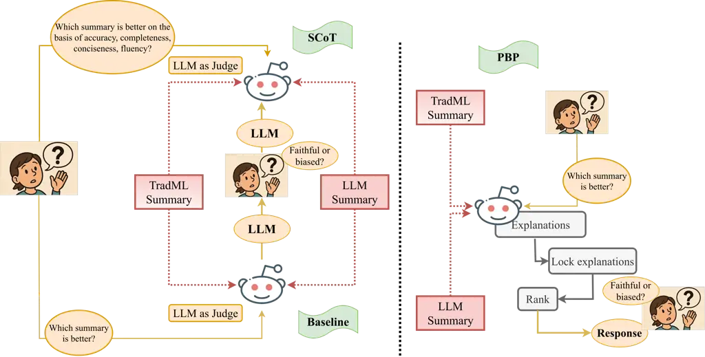

Figure 1: Overview of the three judging protocols and where
rationalization can arise. _Baseline_ (left: bottom): a single LLM judge
directly chooses between an LLM and a TradML summary; explanations are
post-hoc and thus cue/label-susceptible. _SCoT_ (left:top): the judge
reasons along predefined criteria (accuracy, completeness, conciseness,
fluency) before deciding, but evidence is not locked, allowing
rubric-amplified rationalization. _PBP_ (right):
Proof-Before-Preference, the judge first writes and _locks_
criterion-wise evidence, then scores and aggregates to rank, which curbs
label anchoring and explanation drift.

We frame this reliability requirement as cue invariance. Let $`X`$
denote the fixed textual evidence (source document and candidate
summaries) and let $`C`$ denote _non-evidential cues_ such as metadata
labels. An LLM judge is cue-invariant if its ranking $`r`$ and
explanation $`e`$ remain stable when $`C`$ is perturbed while $`X`$ is
held constant. This perspective turns a vague notion of “faithfulness”
into a precise robustness target: measure the causal effect of $`C`$ on
$`(r,e)`$ under controlled interventions. To that end, we introduce a
suite of _cue interventions_ that manipulate $`C`$ while keeping $`X`$
fixed: Blind (no cues), Truth (ground-truth label), Flip (inverted
label), Placebo (credible but non-informative badge), and Reveal-After
(applies FLIP, then reveals TRUTH). These probes expose when a judge’s
decisions and explanations move toward the presented cues. We complement
them with _tie-aware_ metrics that separate two phenomena: _outcome
anchoring_ (directional shifts in rankings) and _rationale anchoring_
(label-aligned rhetoric and explanation drift). The same framework also
reveals a structural weakness: _anchoring attacks_ that use innocuous
style cues, verbosity and confidence, to sway both decisions and
rationales even for identical summaries. Finally, we study defenses. A
_criterion-guided structured chain-of-thought_ (SCoT) prompts judges to
reason along explicit dimensions (accuracy, completeness, conciseness,
fluency) before deciding. Building on this, _Proof-Before-Preference
(PBP)_ first _locks_ criterion-wise notes with cited spans, then scores
and ranks strictly from the locked evidence, reducing opportunities for
post-hoc rationalization and label anchoring.

##### Motivation

The increasing use of large language models (LLMs) as automated judges
in evaluation pipelines has introduced significant scalability and
efficiency benefits, but it also raises critical concerns about the
reliability and faithfulness of their decisions and explanations. While
prior work has identified outcome-level biases such as position,
verbosity, and stylistic preferences, it remains unclear whether LLM
judges base their decisions on the underlying textual evidence or on
superficial, non-evidential cues such as labels, confidence signals, or
formatting. In high-stakes applications such as benchmarking, compliance
monitoring, and automated reporting, explanations are essential for
transparency and auditability; however, if these explanations are
generated post hoc to justify decisions influenced by external cues, the
evaluation process becomes vulnerable to manipulation and loses its
trustworthiness. This problem, which we characterize as rationalization
bias, highlights a fundamental gap in current evaluation methodologies:
the lack of a principled framework to causally isolate and measure the
influence of irrelevant cues on both judgments and explanations.
Addressing this gap is essential to ensure that LLM judges produce
decisions and rationales that are grounded in evidence, thereby
improving the robustness, fairness, and accountability of automated
evaluation systems.

##### Contributions

- •
  Cue-invariance probing: We propose a controlled intervention suite
  (Blind/Truth/Flip/Placebo/Reveal-After) that isolates the causal
  effect of non-evidential cues on both decisions and explanations while
  holding texts fixed.
- •
  Anchoring metrics: We present tie-aware measures for _outcome
  anchoring_ and _rationale anchoring_ (label-aligned rhetoric,
  explanation drift), enabling standardized comparison across judges and
  prompts.
- •
  Rationalization attacks: We present a demonstration that verbosity and
  confidence cues reliably shift outcomes and rationales even for
  identical summaries, exposing a practical vulnerability in
  LLM-as-judge pipelines.
- •
  Mitigations. We evaluate two defenses:
  - –
    _Criterion-guided SCoT:_ require reasoning along explicit dimensions
    (e.g., accuracy, completeness, conciseness, fluency) before
    deciding.
  - –
    _Proof-Before-Preference (PBP):_ _lock_ criterion-wise notes with
    cited spans, then score and rank strictly from the locked evidence,
    reducing post-hoc rationalization and label anchoring.

## II Related Work

### II-A Biases in LLMs as Judges

A growing line of work has investigated the reliability of LLMs as
evaluators, often called the LLM-as-a-judge paradigm. Zheng et al. \[6\]
introduced MT-Bench and Chatbot Arena, showing that LLM judges exhibit
systematic biases, including position bias, verbosity bias, and
self-enhancement bias (favoring their own family of models). Wu & Aji
\[7\] highlighted a related fluency/style bias, where LLMs prefer
eloquent but less accurate answers, rationalizing their decisions by
praising surface form.

Broader studies have cataloged biases using benchmark suites. Koo et al.
\[8\] proposed CoBBLEr, identifying implicit biases (e.g., order,
egocentric, salience/length) and induced biases (bandwagon, distractor
cues). Ye et al. \[9\] extended this work with Calm, measuring twelve
bias types, including authority bias, sentiment bias, and diversity
bias, and introducing metrics like robustness rate. Chen et al. \[10\]
compared human vs. LLM judges, revealing vulnerabilities to
misinformation oversight, authority cues, and formatting (“beauty
bias”). Lee et al. \[11\] examined judgments of epistemic markers,
showing that LLMs penalize expressions of uncertainty while humans do
not.

Several works explore adversarial attacks on LLM evaluators. Chen et al.
\[10\] and Raina et al. \[12\] design optimization-based or prompt-based
attacks that reliably flip judgments, while Li et al. \[13\] propose
bias-mitigation techniques (e.g., randomized ordering). Surveys such as
Szymanski et al. \[14\], Croxford et al. \[15\], and Thakur et al.
(\[16\] emphasize both the promise and fragility of LLM judges: they can
align well with human preferences, but remain vulnerable to superficial
cues.

### II-B Rationalization and Explanation Faithfulness in LLMs

Parallel work examines the faithfulness of model-generated explanations.
Turpin et al. \[5\] demonstrated that LLMs often rely on hidden cues to
answer correctly but omit them from their chain-of-thought (CoT),
generating post-hoc rationalizations. Chen et al. \[17\] extended this
to state-of-the-art reasoning models, showing low “reveal rates” even
when hints clearly influenced answers. Lanham et al. \[18\] introduced
metrics for CoT faithfulness, such as early-answer and confidence
trajectories, while Lewis-Lim et al. \[19\] analyzed when CoT actively
guides reasoning versus narrates predetermined outcomes. Other studies
propose methods for improving faithfulness. Chuang et al. \[20\]
introduced FaithLM, which ties explanations causally to model outputs by
testing against contrary rationales. Li et al. \[21\] proposed DRiFT,
using dual rewards (accuracy + faithfulness) to guide probabilistic
inference, improving rationale fidelity.

## III Problem Formulation

Let $`D=\{d_{1},d_{2},\dots,d_{N}\}`$ be a collection of source
documents. For each document $`d\in D`$, we generate a set of candidate
summaries

```math
S_{d}=\{s^{\text{ML}}_{1},\dots,s^{\text{ML}}_{M},\;s^{\text{LLM}}_{1},\dots,s^{\text{LLM}}_{L}\},
```

where $`\{s^{\text{ML}}_{i}\}`$ are produced by traditional machine
learning–based extractive systems and $`\{s^{\text{LLM}}_{j}\}`$ are
produced by large language models. An LLM judge $`J`$ evaluates
$`S_{d}`$ and returns two outputs:

1.  1.  A ranking of candidates,

    ```math
    r_{J,d}\in\mathcal{R}_{M+L},
    ```

    where $`\mathcal{R}_{M+L}`$ is the set of permutations of the
    $`M+L`$ summaries.

2.  2.  An explanation or rationale,

    ```math
    e_{J,d}=f_{J}(S_{d}),
    ```

    in free-text form, to justify the ranking.

### III-A From Faithfulness to Cue Invariance

Classically, an explanation $`e_{J,d}`$ is called _faithful_ if it
reflects exactly the evidential features $`\mathcal{X}_{d}`$ of the
fixed texts (source and candidate summaries) that determine the judge’s
ranking $`r_{J,d}`$. A standard formalization is the conditional
invariance

```math
\Pr\!\big(r_{J,d}\mid\mathcal{X}_{d},e_{J,d}\big)\;=\;\Pr\!\big(r_{J,d}\mid\mathcal{X}_{d}\big), \tag{1}
```

which asserts that, given the evidence $`\mathcal{X}_{d}`$, exposing the
explanation does not change the distribution of decisions, i.e., the
explanation neither adds spurious signal nor reflects hidden,
non-evidential influences. In practice, LLM judges can produce
_rationalized_ explanations: texts that are persuasive to humans yet
cite features not causally responsible for the decision. In such cases,
(1) fails:

```math
\Pr\!\big(r_{J,d}\mid\mathcal{X}_{d},e_{J,d}\big)\;\neq\;\Pr\!\big(r_{J,d}\mid\mathcal{X}_{d}\big). \tag{2}
```

We refer to the systematic production of such plausible-but-unfaithful
rationales as rationalization bias. Directly verifying (1) is
challenging because we cannot exhaustively observe or control all
evidential factors in $`\mathcal{X}_{d}`$. We therefore operationalize
reliability through _cue invariance_. Let $`C`$ denote _non-evidential
cues_ (e.g., labels, badges, stylistic hints). Holding
$`\mathcal{X}_{d}`$ fixed, a judge is _cue-invariant_ if perturbing
$`C`$ leaves both the decision and the explanation (in expectation over
measurable properties $`\phi`$ of the rationale) unchanged:

```math
\displaystyle\Pr\!\big(r_{J,d}\mid\mathcal{X}_{d},C\big) \displaystyle=\Pr\!\big(r_{J,d}\mid\mathcal{X}_{d}\big), \tag{3}
```

```math
\displaystyle\mathbb{E}\!\left[\phi\!\left(e_{J,d}\right)\middle|\mathcal{X}_{d},C\right] \displaystyle=\mathbb{E}\!\left[\phi\!\left(e_{J,d}\right)\middle|\mathcal{X}_{d}\right]. \tag{4}
```

Violations of (3) indicate _outcome anchoring_; violations of (4)
indicate _rationale anchoring_ (e.g., increased label-aligned rhetoric
or greater explanation drift). In our framework, we intervene on $`C`$
via controlled conditions (Blind, Truth, Flip, Placebo, Reveal-After)
while keeping $`\mathcal{X}_{d}`$ fixed, and we quantitatively estimate
the resulting shifts in $`r_{J,d}`$ and $`e_{J,d}`$. This causal,
cue-centric view provides a practical surrogate for faithfulness: when a
judge is cue-invariant, its decisions and explanations are robust to
non-evidential perturbations, thereby reducing opportunities for
post-hoc rationalization.

## IV Methodology

Our methodology has five components: dataset construction, cue-based
causal probing, anchoring metrics, mitigation strategies, and anchoring
attacks.

### IV-A Dataset and Notation

For each $`d\in D`$, we construct two candidate summaries drawn from
traditional extractive systems and LLM. Each summary $`s_{i}`$ has
observable textual properties (e.g., length, fluency, coverage,
factuality), denoted collectively by $`\mathcal{X}(s_{i})`$. We write
$`\mathcal{X}_{d}=\{\mathcal{X}(s_{i})\}_{i=1}^{2}`$ for the feature set
associated with $`S_{d}`$. A judge $`J\in\mathcal{J}`$ observes
$`S_{d}`$ under a probe condition $`p\in\mathcal{P}`$ and produces: (i)
a ranking $`r^{(p)}_{J,d}\in\mathcal{R}_{K}`$ (for experiments, we
consider K=2, i.e one LLM and one traditional ML method), and (ii) a
free-text explanation $`e^{(p)}_{J,d}=f_{J}(S_{d},p)`$. To control
trivial position effects, the presentation order of $`S_{d}`$ is
randomized for each trial.

### IV-B Cue-Based Causal Probing

We intervene on _non-evidential cues_ while holding the texts fixed. Let
$`C`$ denote the cue vector shown with $`S_{d}`$ (e.g., source labels
such as LLM/ML, or Placebo labels). The ground-truth labels for
$`S_{d}`$ are $`C^{\ast}`$. We define five probe conditions:

```math
\displaystyle B \displaystyle:\penalty\ \operatorname{do}(C=\varnothing) \tag{Blind}
```

```math
\displaystyle T \displaystyle:\penalty\ \operatorname{do}(C=C^{\ast}) \tag{Truth}
```

```math
\displaystyle F \displaystyle:\penalty\ \operatorname{do}(C=\pi(C^{\ast})) \tag{Flip}
```

```math
\displaystyle P \displaystyle:\penalty\ \operatorname{do}(C=C^{\text{placebo}}) \tag{Placebo}
```

```math
\displaystyle R \displaystyle:\penalty\ \operatorname{do}(C=\pi(C^{\ast}))
```

```math
\displaystyle\to\operatorname{do}(C=C^{\ast}) \displaystyle\text{(Reveal-After)}.
```

Here, $`B`$ hides cues; $`T`$ reveals correct cues; $`F`$ reveals
inverted cues; $`P`$ attaches credible but non-informative badges; and
$`R`$ first applies FLIP, then reveals TRUTH.

##### Cue invariance as our reliability target

Directly asserting explanation _faithfulness_ is intractable without
full control of all evidential factors in $`\mathcal{X}_{d}`$. We
therefore operationalize reliability via _cue invariance_. Holding
$`\mathcal{X}_{d}`$ fixed, a judge is cue-invariant if perturbing $`C`$
does not change (a) the decision distribution and (b) measurable
properties of the explanation as shown in Eq. (3) and (4) . Our probes
estimate these effects by contrasting $`p\in\{T,F,P,R\}`$ against the
blind baseline $`B`$ while keeping $`S_{d}`$ (and thus
$`\mathcal{X}_{d}`$) fixed.

### IV-C Anchoring Metrics

We quantify how non-evidential cues affect _outcomes_ and _explanations_
when texts are held fixed. Let
$`\mathcal{O}=\{[1,2],[2,1],\mathrm{Tie}\}`$ be the outcome set for a
two-candidate comparison. For probe
$`p\in\{\mathrm{B},\mathrm{T},\mathrm{F},\mathrm{P},\mathrm{R}\}`$,
define

```math
p^{(p)}_{J,o}\;=\;\Pr\!\big(r^{(p)}_{J,d}=o\big),\quad o\in\mathcal{O},\qquad t^{(p)}_{J}\;=\;p^{(p)}_{J,\mathrm{Tie}}.
```

We use $`\mathrm{B}`$ (Blind) as the reference condition.

##### Equality Detection Rate (EDR):

EDR measures whether the judge recognizes that two candidates are
effectively equal _when they truly are_. Let
$`\mathcal{C}_{\text{eq}}\subseteq D`$ denote comparisons labeled as
equal (e.g., identical summaries or near-duplicates by a predefined
content-equality heuristic). Then:

```math
\boxed{\ \mathrm{EDR}(J)\;=\;\frac{1}{|\mathcal{C}_{\text{eq}}|}\sum_{d\in\mathcal{C}_{\text{eq}}}\mathbb{I}\!\big[r^{(\mathrm{B})}_{J,d}=\mathrm{Tie}\big]\ ;}
```

Here, $`\mathbb{I}\{\cdot\}`$ is an Indicator function which provides
$`1`$ if the condition is true, $`0`$ otherwise. Higher EDR is better
(fewer spurious preferences when cues are hidden).

##### Neutrality Deviation under Blind (tie-aware):

Among non-ties under Blind, a neutral judge should split $`[1,2]`$ vs.
$`[2,1]`$ at $`50{\small\%}`$-$`50{\small\%}`$. Let

```math
p^{(\mathrm{B})}_{J,12\mid\neg\mathrm{Tie}}=\frac{p^{(\mathrm{B})}_{J,12}}{p^{(\mathrm{B})}_{J,12}+p^{(\mathrm{B})}_{J,21}},\qquad t^{(\mathrm{B})}_{J}=\Pr(r^{(\mathrm{B})}_{J,d}=\mathrm{Tie}).
```

Then

```math
\boxed{\ \mathrm{ND}_{\mathrm{B}}(J)=\bigl|\,2\,p^{(\mathrm{B})}_{J,12\mid\neg\mathrm{Tie}}-1\,\bigr|\cdot\bigl(1-t^{(\mathrm{B})}_{J}\bigr)\ ;}
```

when ties are disallowed, $`t^{(\mathrm{B})}_{J}{=}0`$ and
$`\mathrm{ND}_{\mathrm{B}}=|2p^{(\mathrm{B})}_{J,12}-1|`$. Lower is
better (more neutral Blind behavior).

##### Tie-aware, Directional Label Susceptibility (LAO):

We compare each labeled probe to _the same scheme’s_ Blind and count
only movement _toward_ the label-favored decision, while not penalizing
movement into $`\mathrm{Tie}`$. For $`p\in\{\mathrm{T},\mathrm{F}\}`$,
let the favored non-tie outcome be

```math
\mathrm{fav}_{\mathrm{T}}=[1,2],\qquad\mathrm{fav}_{\mathrm{F}}=[2,1],
```

and $`\mathrm{opp}_{p}`$ the other non-tie. Let

```math
\displaystyle\Delta_{\mathrm{fav}}^{(p)} \displaystyle=p_{J,\mathrm{fav}_{p}}^{(p)}-p_{J,\mathrm{fav}_{p}}^{(\mathrm{B})},
```

```math
\displaystyle\Delta_{\mathrm{opp}}^{(p)} \displaystyle=p_{J,\mathrm{opp}_{p}}^{(p)}-p_{J,\mathrm{opp}_{p}}^{(\mathrm{B})},
```

```math
\displaystyle\Delta_{\mathrm{tie}}^{(p)} \displaystyle=t_{J}^{(p)}-t_{J}^{(\mathrm{B})}.
```

Decompose positive “movement-in” mass:

```math
\displaystyle\mathrm{LDS}^{(p)} \displaystyle=\max\!\bigl(0,\Delta_{\mathrm{fav}}^{(p)}\bigr),
```

```math
\displaystyle\mathrm{OLS}^{(p)} \displaystyle=\max\!\bigl(0,\Delta_{\mathrm{opp}}^{(p)}\bigr),
```

```math
\displaystyle\mathrm{TS}^{(p)} \displaystyle=\max\!\bigl(0,\Delta_{\mathrm{tie}}^{(p)}\bigr).
```

Then

```math
\boxed{\mathrm{LAO}(J;p)=\frac{\mathrm{LDS}^{(p)}}{\mathrm{LDS}^{(p)}+\mathrm{OLS}^{(p)}+\mathrm{TS}^{(p)}+\varepsilon}}
```

$`p\in\{\mathrm{T},\mathrm{F}\}`$.

with small $`\varepsilon{>}0`$ for numerical stability. Lower is better
(less label-directed movement). We also report the _absolute_
label-directed shift

```math
\boxed{\ \mathrm{LDS}^{(p)}=\max(0,\Delta_{\mathrm{fav}}^{(p)})\ ;\ }
```

to show magnitude, not only fraction.

##### Label-Aligned Rationale on Same-Decision (Flip).

Let
$`\mathcal{C}_{\text{same}}^{(\mathrm{F})}=\{d\in D:\ r^{(\mathrm{F})}_{J,d}=r^{(\mathrm{B})}_{J,d}\}`$
be items whose verdict under Flip matches Blind. We quantify
label-aligned rhetoric with a hard, temperature-0 embedding scorer
$`\alpha(e,L^{(\mathrm{F})})\in[0,1]`$: letting $`\mathbf{e}`$ be the
explanation embedding and
$`\mathbf{d}_{\mathrm{fav}},\mathbf{d}_{\mathrm{opp}}`$ the embeddings
of favored/opposite label descriptors under Flip, set

```math
\alpha(e,L^{(\mathrm{F})})=\begin{cases}1,&\cos(\mathbf{e},\mathbf{d}_{\mathrm{fav}})>\cos(\mathbf{e},\mathbf{d}_{\mathrm{opp}}),\\
0,&\cos(\mathbf{e},\mathbf{d}_{\mathrm{opp}})>\cos(\mathbf{e},\mathbf{d}_{\mathrm{fav}}),\\
0.5,&\text{otherwise.}\end{cases}
```

Then

```math
\boxed{\ \mathrm{LAI}_{\text{text}}\!\mid\!\mathrm{SD}(\mathrm{F})=\frac{1}{|\mathcal{C}_{\text{same}}^{(\mathrm{F})}|}\sum_{d\in\mathcal{C}_{\text{same}}^{(\mathrm{F})}}\alpha\!\big(e^{(\mathrm{F})}_{J,d},\,L^{(\mathrm{F})}\big)\ ;}
```

larger values indicate stronger label-aligned rhetoric even when the
verdict is unchanged.

##### Explanation Shift on Same-Decision (Flip).

Let
$`\mathcal{C}_{\text{same}}^{(\mathrm{F})}=\{d\in D:r^{(\mathrm{F})}_{J,d}=r^{(\mathrm{B})}_{J,d}\}`$.
We measure how much the _textual explanation itself_ changes when
misleading labels are shown, while the verdict remains fixed.

For two explanations $`x`$ and $`y`$, we define a normalized cosine
distance:

```math
\delta(x,y)=\frac{1-\cos(x,y)}{2}\in[0,1],
```

where $`0`$ indicates identical explanations and $`1`$ indicates maximal
dissimilarity.

The average explanation drift is

```math
\boxed{\Delta e\mid\mathrm{SD}(\mathrm{F})=\frac{1}{|\mathcal{C}_{\text{same}}^{(\mathrm{F})}|}\sum_{d\in\mathcal{C}_{\text{same}}^{(\mathrm{F})}}\delta\!\big(e^{(\mathrm{F})}_{J,d},\,e^{(\mathrm{B})}_{J,d}\big)}
```

and we report a thresholded change rate

```math
\boxed{\delta^{(\mathrm{F})}_{J}(\tau)=\frac{1}{|\mathcal{C}_{\text{same}}^{(\mathrm{F})}|}\sum_{d\in\mathcal{C}_{\text{same}}^{(\mathrm{F})}}\mathbb{I}\!\Big[\delta\!\big(e^{(\mathrm{F})}_{J,d},e^{(\mathrm{B})}_{J,d}\big)>\tau\Big]}
```

with $`\tau\in[0,1)`$ fixed _a priori_. If
$`|\mathcal{C}_{\text{same}}^{(\mathrm{F})}|=0`$, both metrics are
reported as n/a.

### IV-D Mitigation Strategies

We study two complementary defenses:

Structured Chain-of-Thought (SCoT): Judges are instructed to evaluate
along predefined criteria
$`\mathcal{C}=\{\text{accuracy},\text{completeness},\text{conciseness},\text{fluency}\}`$.
For each $`s_{i}`$, the judge outputs criterion-specific scores (and
optionally cited spans), and we aggregate with nonnegative weights
$`\{w_{c}\}_{c\in\mathcal{C}}`$ (typically $`\sum_{c}w_{c}=1`$):

```math
r^{(p)}_{J,d}=\mathrm{rank}\Big(\big\{\sum_{c\in\mathcal{C}}w_{c}\cdot\text{score}_{c}(s_{i})\big\}_{i=1}^{K}\Big).
```

Structuring the rationale can reduce scope for free-form post-hoc
justifications.

Proof-Before-Preference (PBP): PBP enforces _evidence lock_ before any
preference is stated. Given candidates $`\{s_{i}\}_{i=1}^{K}`$ and
criteria $`\mathcal{C}`$, Turn 1 collects for each $`(i,c)`$ a short
note $`n_{i,c}`$ with cited spans from the source; these notes are then
locked, $`\mathrm{lock}(\{n_{i,c}\})`$, prohibiting edits. Turn 2
assigns scores using only the locked notes:

```math
\text{score}_{c}(s_{i})\;=\;f_{c}\!\big(\mathrm{lock}(\{n_{i,c}\})\big).
```

Turn 3 aggregates scores into a final ranking,

```math
r^{(p)}_{J,d}\;=\;\mathrm{rank}\Big(\big\{\sum_{c\in\mathcal{C}}w_{c}\cdot\text{score}_{c}(s_{i})\big\}_{i=1}^{K}\Big),
```

and the narrative justification must reference the locked evidence. By
forcing _evidence before preference_, PBP reduces post-hoc
rationalization and label anchoring.

### IV-E Anchoring Attacks

To further stress-test robustness, we apply semantic-preserving style
transformations $`\mathcal{A}:S_{d}\mapsto S_{d}^{\prime}`$ that inject
known cues.

Verbosity Attack: $`\mathcal{A}_{\text{verb}}`$ appends redundant but
content-preserving text to target summaries, probing whether judges
reward length and then rationalize it as “detail.”

Confidence Attack: $`\mathcal{A}_{\text{conf}}`$ rewrites tone to be
more assertive without altering factual content, probing whether judges
reward certainty and rationalize it as “precision.”

## V Experimental Setup

### V-A Dataset Construction

Reliable bias testing requires evaluation data that is (i) _unseen_ by
the judged models and (ii) _decontaminated_ from common pretraining
corpora. Widely used benchmarks such as CNN/DailyMail \[22\] and XSum
\[23\] are likely present, at least in part, in LLM training data,
risking confounds from memorization or prior exposure. We therefore
curate a new corpus of $`N{=}1{,}000`$ _summaries_ drawn from publicly
available sources spanning business, literature, mathematics, science,
and technology to ensure topical diversity. Each document is between 500
and 1,200 tokens.

For each document $`d`$, we create a comparison set
$`S_{d}=\{s_{1},\dots,s_{K}\}`$ that mixes traditional extractive
systems, TextRank, LexRank, KL-Sum, SumBasic, and LLM summaries
(instruction-following prompts with fixed decoding parameters). In
initial experiments, LLM judges frequently preferred LLM outputs over
extractive baselines; importantly, these preferences often reflected
_genuine quality gains_ (e.g., higher coverage/fluency) rather than mere
self-favoring (refer to Table IX in Appendix). To _isolate_ cue effects
from true quality differences, we add two controlled subsets that hold
content fixed while perturbing labels:

##### Equal-content pair subset ($`\mathcal{C}_{\text{eq-pair}}`$)

For each $`d`$, the _same_ LLM produces two paraphrases
$`\tilde{s}_{1},\tilde{s}_{2}`$ that preserve semantics but vary
superficially. We then vary cues $`C`$ (e.g., label one as LLM and the
other as TradML) across the T/F/P probes, keeping texts fixed. Any
movement in outcomes or explanations on $`\mathcal{C}_{\text{eq-pair}}`$
quantifies _pure_ cue anchoring. Most of the experiments are conducted
using this approach (except the ones which are explicitly mentioned).

##### Single-summary relabel subset ($`\mathcal{C}_{\text{single}}`$)

We also present the _identical_ summary $`s`$ under different labels
across probes while holding the opponent fixed. Because
$`\mathcal{X}(s)`$ is constant, any change in ranking or rationale must
be driven by cues $`C`$, not content refer to Table X in Appendix.

### V-B Judges

We employ five open-weight LLMs, Gemma-2-9B, Llama-3.1-8B, Mistral-7B,
Qwen2.5-7B, and Zephyr-7B, as _judges_, executed from downloaded
checkpoints on our local infrastructure; no third-party APIs were used.
For each document $`d`$, each judge $`J`$ is shown the full candidate
set $`S_{d}`$ under probe condition $`p\in\mathcal{P}`$ and produces (i)
a complete ranking $`r^{(p)}{J,d}\in\mathcal{R}{2}`$ and (ii) a
free-form explanation $`e^{(p)}_{J,d}`$. Prompts are standardized across
models; only the probe condition varies. All judge generations use
temperature 0 to ensure deterministic outputs and reproducibility.

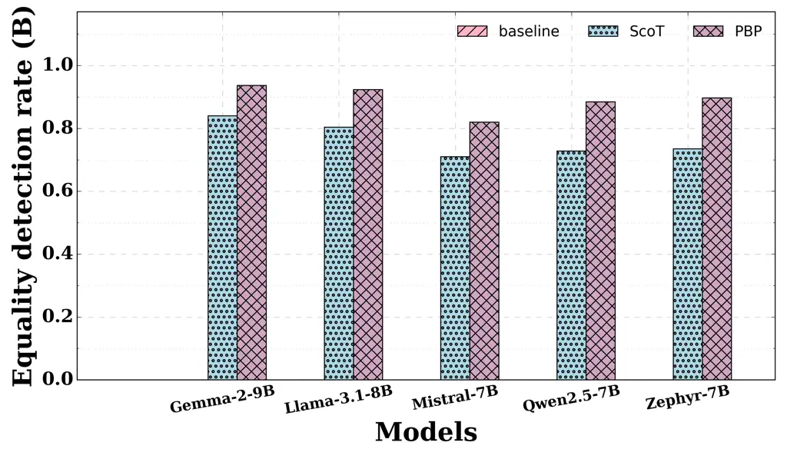

(a) Equality Detection Rate.

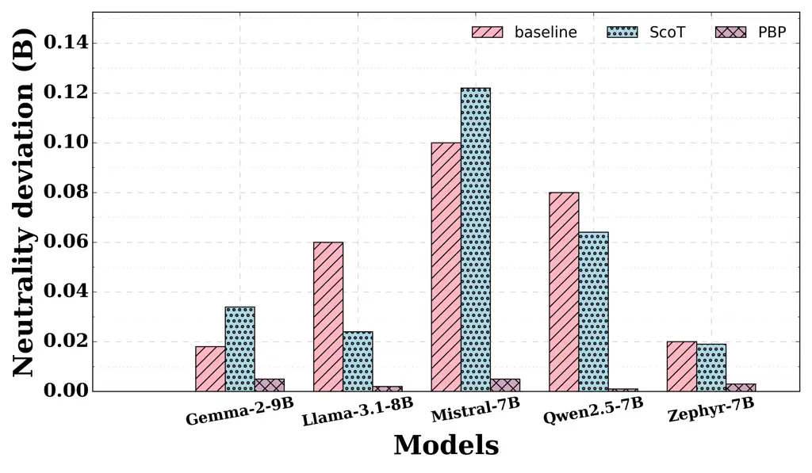

(b) Neutrality Deviation.

Figure 2: Blind-Condition Behavior of Different Judges.

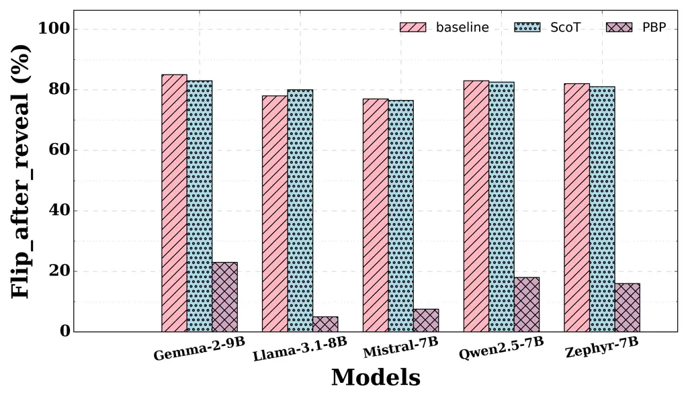

Figure 3: Revision Susceptibility after Label Reveal

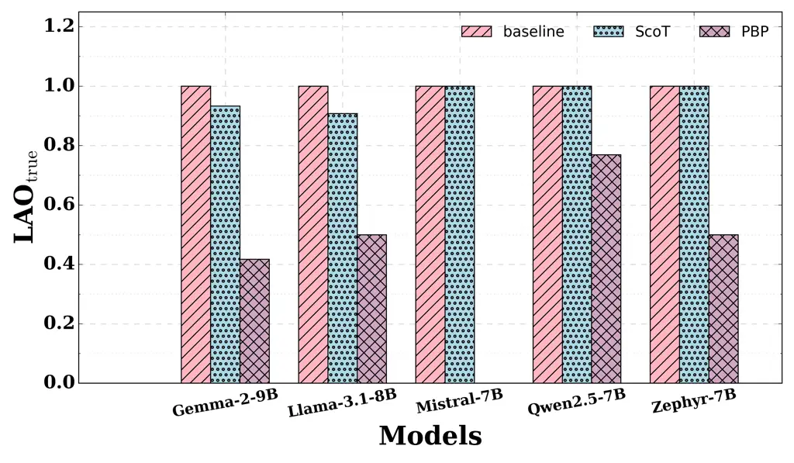

(a) Label–Anchoring in Outcomes for True Labels.

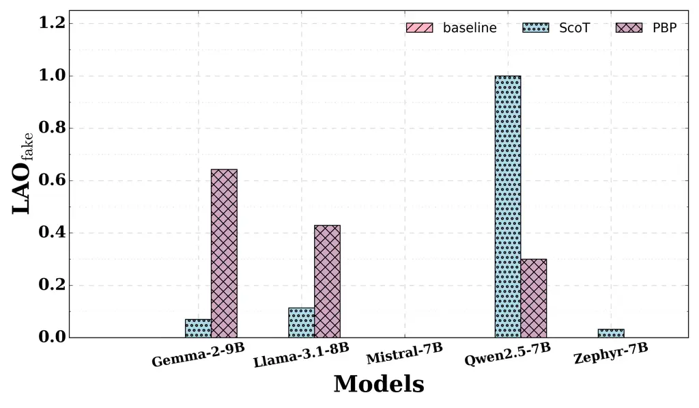

(b) Label–Anchoring in Outcomes for Flip Labels.

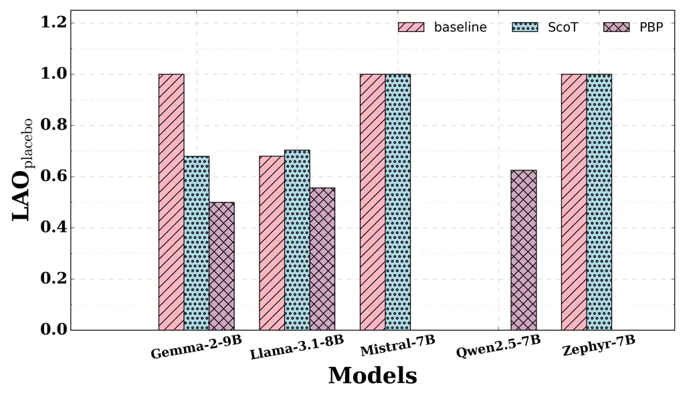

(c) Label–Anchoring in Outcomes for Placebo Labels.

Figure 4: Label–Anchoring in Outcomes for Different Judges.

### V-C Prompt Examples

We document the prompt templates used for _generation_ and _judging_.
Our goals are (i) reproducibility via frozen, model-agnostic
instructions; (ii) comparability across protocols by holding wording
constant except for the protocol-specific constraints; and (iii)
diagnosability of bias via controlled label probes (Blind, True, FLIP,
Placebo, Reveal-after) and style attacks (Verbosity, Confidence). All
judges emit structured verdict & rationale, and all templates forbid
external knowledge to isolate effects of labels/cues rather than content
leakage. The three protocols differ only in _how_ evidence is elicited:
Baseline gives a direct verdict with a brief post-hoc explanation; SCoT
requires criterion-guided notes and scores (accuracy, completeness,
conciseness, fluency) prior to the verdict; and PBP enforces an
_evidence lock_ (Explain$`\rightarrow`$Score$`\rightarrow`$Rank), so
decisions and rationales must derive from quoted spans captured before
scoring. Placeholders in {BRACES} are programmatically filled at runtime
and hyperparameters (e.g., temperature, max tokens, seeds) are fixed
across conditions.


### V-D Results

#### V-D1 Blind-Condition Behavior: Equality Detection and Neutrality

Under the Blind condition (B), we assess two complementary properties of
judge behavior: the _Equality Detection Rate_ $`\mathrm{EDR}_{B}`$
(refer Fig. 2(a)), the fraction of items marked _Tie/No selection_, and
the _Neutrality Deviation_ $`\mathrm{ND}_{B}`$ (refer Fig. 2(b)), the
tie-adjusted deviation from a 50–50 split between $`[1,2]`$ and
$`[2,1]`$ (lower is better). Taken together, these metrics reveal a
consistent pattern across models: PBP exhibits the most faithful Blind
behavior, SCoT is intermediate, and the Baseline is worst. Specifically,
$`\mathrm{EDR}_{B}`$ is essentially zero for Baseline (no abstention),
rises for SCoT ($`\approx 0.71`$–$`0.84`$), and is highest for PBP
($`\approx 0.82`$–$`0.94`$), indicating that PBP most often recognizes
near-equivalent summaries. The same ordering holds in reverse for
$`\mathrm{ND}_{B}`$: Baseline shows the largest deviations (e.g., Gemma
$`0.018`$, Llama $`0.060`$, Mistral $`0.100`$, Qwen $`0.080`$, Zephyr
$`0.020`$), SCoT is modestly skewed ($`\approx 0.019`$–$`0.122`$), and
PBP is closest to neutral ($`\approx 0.001`$–$`0.005`$). For instance,
_Gemma-2-9B_ moves from $`\mathrm{EDR}_{B}\approx 0`$ (Baseline) to
$`\sim 0.84`$ (SCoT) and 0.937 (PBP), while $`\mathrm{ND}_{B}`$ drops
from $`0.018`$ (Baseline) to 0.005 (PBP); _Llama-3.1-8B_ shows a similar
reduction in $`\mathrm{ND}_{B}`$ from $`0.060`$ (Baseline) to 0.002
(PBP).

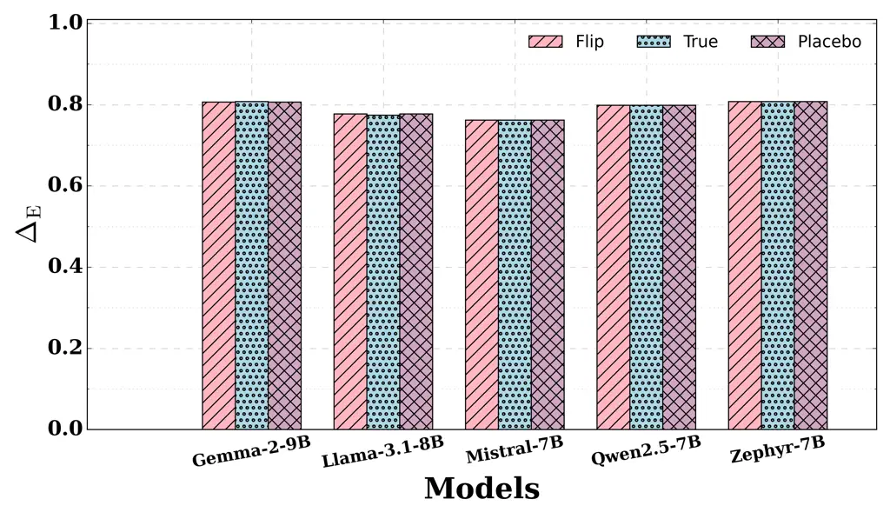

(a) Explanation drift under Same–Decision.

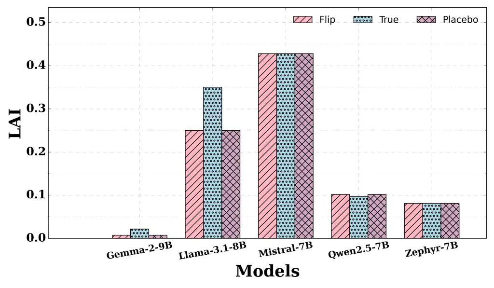

(b) Label-aligned explanation under Same–Decision.

Figure 5: Explanation rationalization with the verdict held constant.

### V-E Label–Anchoring in Outcomes (LAO):

We quantify label susceptibility using the tie-aware Label–Anchoring in
Outcomes (LAO) metric. It captures the fraction of total outcome
movement that aligns with the presented label or cue, with higher values
indicating stronger label-directed anchoring. Fig. 4 presents LAO values
under three probe conditions: True labels, Flip labels, and Placebo
labels. Under True labels (refer Fig. 4(a)), the Baseline protocol
exhibits maximal anchoring (LAO = 1.00) across all models. SCoT also
shows high anchoring, with LAO values ranging from approximately 0.91 to
1.00. In contrast, PBP consistently exhibits lower LAO values across
models (approximately 0.00–0.77), indicating reduced alignment between
outcomes and label cues when evidence locking is enforced.

Under Flip labels (refer Fig. 4(b)), where misleading labels are
presented, the Baseline protocol shows negligible anchoring (LAO
$`\approx`$ 0), indicating minimal movement toward incorrect
label-favored outcomes. SCoT exhibits selective anchoring, with some
models showing low LAO and others showing elevated anchoring, notably
Qwen2.5-7B approaching LAO $`\approx`$ 1.00. PBP generally maintains
lower anchoring than SCoT, with most values near zero and moderate
anchoring observed in only a subset of models.

Under Placebo labels (refer Fig. 4(c)), which introduce non-informative
but credible cues, the Baseline protocol again shows strong anchoring in
several models (LAO $`\approx`$ 1.00 in Gemma-2-9B, Mistral-7B, and
Zephyr-7B). SCoT also exhibits elevated anchoring across models, with
values ranging from approximately 0.68 to 1.00. In contrast, PBP
maintains lower LAO values overall, although moderate anchoring is
observed in some models (approximately 0.50–0.63), while remaining near
zero in others.

Overall, these results show that the Baseline protocol is highly
sensitive to label and cue signals, SCoT reduces anchoring under some
conditions but remains susceptible when cues are present, and PBP
consistently exhibits lower anchoring across probe conditions.

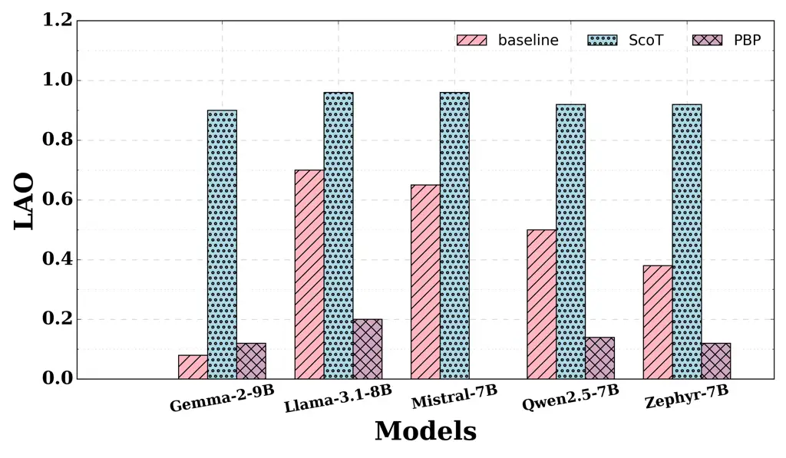

(a) Variation in LAO.

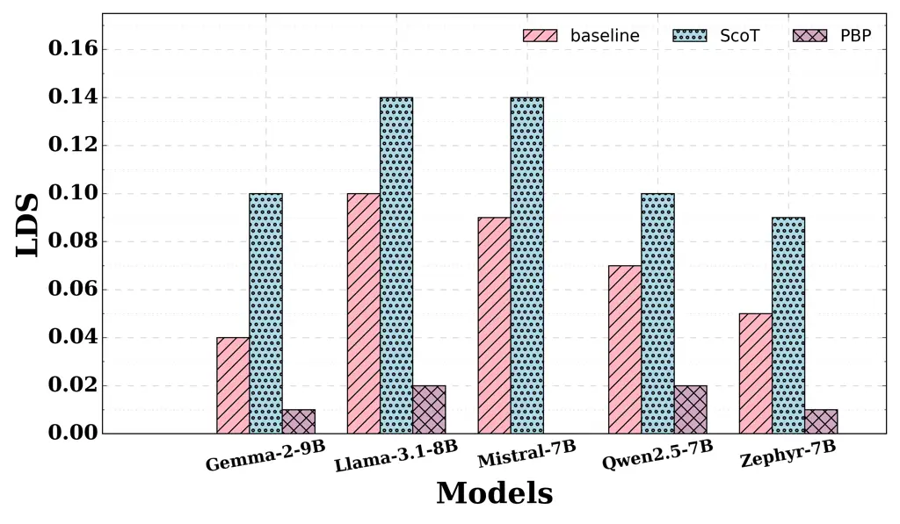

(b) Variation in LDS.

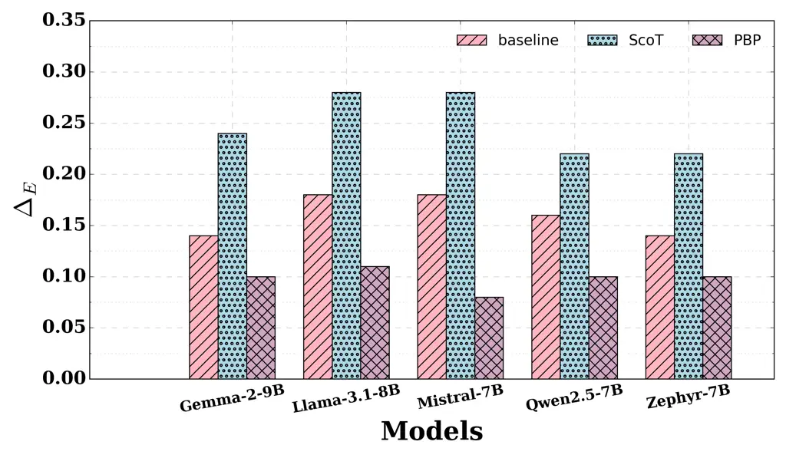

(c) Variation in Explanation drift under Same–Decision.

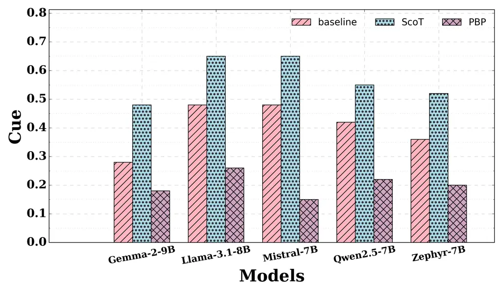

(d) Variation in Cue.

Figure 6: Variation in Different Parameters under Verbosity attack.

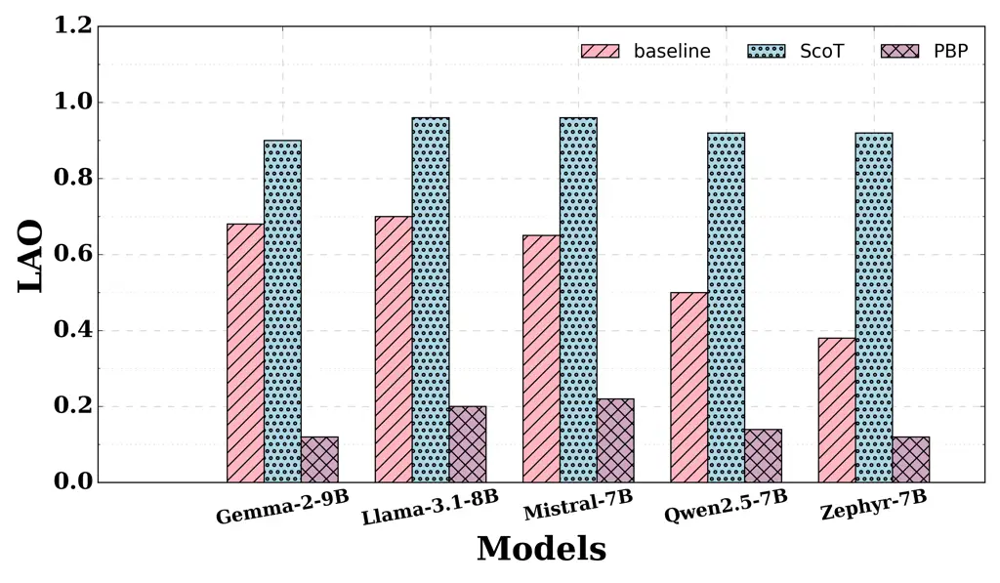

(a) Variation in LAO.

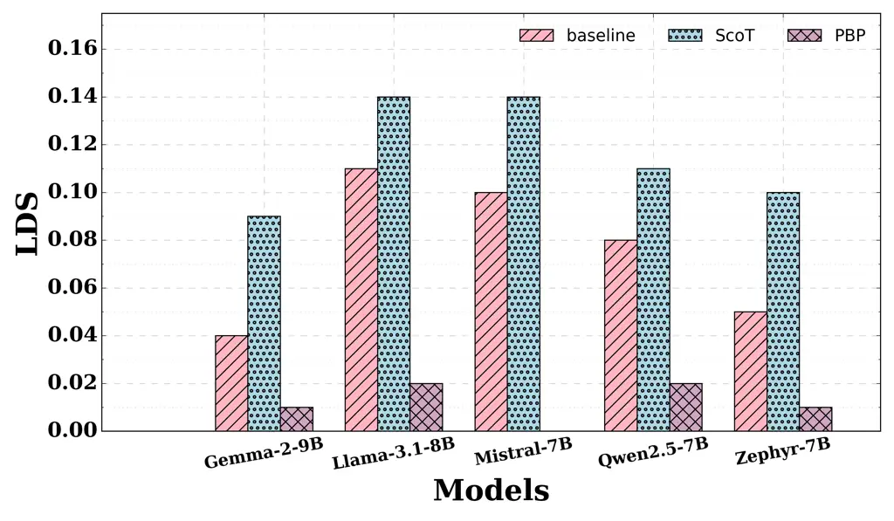

(b) Variation in LDS.

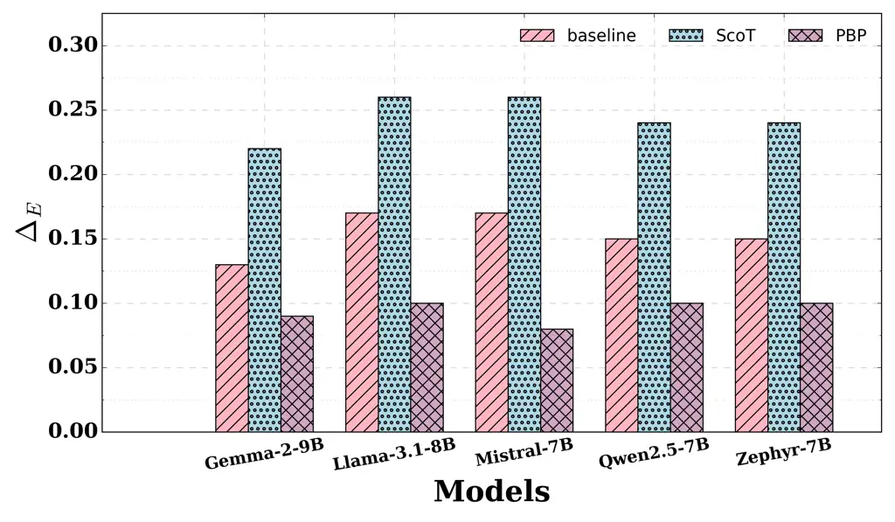

(c) Variation in Explanation drift under Same–Decision.

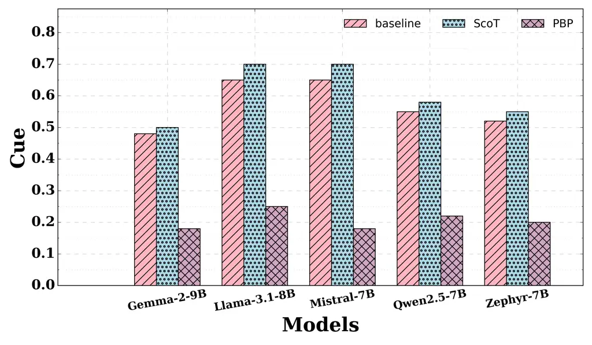

(d) Variation in Cue.

Figure 7: Variation in Different Parameters under Confidence attack.

### V-F Revision Susceptibility after Label Reveal.

We quantify revision after revealing true labels following an initial
judgment under _Flip_ labels:

```math
\Pr\!\big[r^{(\mathrm{R})}_{J,d}\neq r^{(\mathrm{F})}_{J,d}\big].
```

Across models, Baseline/SCoT show high flip-after-reveal rates (75–85%),
while PBP is markedly lower (5–22%) (refer Fig. 3). Concretely, for
(Gemma, Llama, Mistral, Qwen, Zephyr): Baseline
$`\{85,78,76,83,82\}\%`$, SCoT $`\{80,80,76,82,80\}\%`$, PBP
$`\{22,5,8,18,15\}\%`$. This indicates strong label-anchored revision
for Baseline/SCoT and robust resistance for PBP.

### V-G Explanation Rationalization under Same–Decision.

We evaluate explanation rationalization while holding the verdict fixed
using (i) _explanation drift_ $`\Delta e\!\mid\!\text{Same}`$ (refer to
Fig. 5(a)) (distance between probe and Blind explanations) and (ii)
_label–aligned explanation_
$`\mathrm{LAI}_{\text{text}}\!\mid\!\text{Same}`$ (share of
label-conforming rhetoric) (refer to Fig. 5(b)). Across probes and
models, $`\Delta e\!\mid\!\text{Same}`$ is high
($`\approx 0.75`$–$`0.81`$) accorss all models, indicating substantial
rewriting even when outcomes do not change. In contrast,
$`\mathrm{LAI}_{\text{text}}\!\mid\!\text{Same}`$ differentiates models:
_Mistral-7B_ and _Llama-3.1-8B_ show the strongest label alignment
($`\approx 0.43`$ and $`0.25`$–$`0.35`$), whereas _Gemma-2-9B_,
_Qwen2.5-7B_, and _Zephyr-7B_ remain low ($`\approx 0.00`$–$`0.10`$).
Notably, Placebo yields alignment comparable to Flip/True for the more
susceptible models, suggesting increased alignment with presented cues
even under Placebo labels.

### V-H Robustness under a Verbosity Attack.

We inflate one candidate with redundant but fluent tokens and evaluate
four complementary views of susceptibility: (i) _LAO_ (tie–aware,
directional outcome anchoring) (refer to Fig. 6(a)), (ii) _LDS_
(absolute outcome mass moving toward the verbosity–favored side) (refer
to Fig. 6(b)), (iii) $`\Delta e\!\mid\!\text{Same}`$ (explanation drift
vs. Blind on items whose verdict does not change) (refer to Fig. 6(c)),
and (iv) _Cue–align %_ (share of explanations whose rhetoric aligns with
the injected cue) (refer to Fig. 6(d)). The four panels collectively
show a coherent ordering across models: PBP is most robust, SCoT is most
susceptible, and the Baseline lies in between. Concretely, PBP keeps
$`\emph{LAO}`$ low (Gemma 0.15, Llama 0.18, Mistral 0.00, Qwen 0.12,
Zephyr 0.10) with _LDS_ near zero (0.00–0.02), and its textual changes
are modest ($`\Delta e\!\mid\!\text{Same}\approx 0.08`$–$`0.11`$) with
muted cue alignment (15–26%). The Baseline shows moderate anchoring
(e.g., LAO 0.35–0.70; LDS 0.04–0.11), larger rewrites
($`\Delta e\!\mid\!\text{Same}\approx 0.14`$–$`0.18`$), and higher cue
alignment (30–55%). In contrast, SCoT exhibits pronounced label–directed
movement (LAO 0.90–0.97 with LDS 0.09–0.14), the largest narrative drift
($`\Delta e\!\mid\!\text{Same}\approx 0.22`$–$`0.28`$), and the
strongest cue alignment (48–70%).

### V-I Robustness to a Confidence Attack

We evaluate susceptibility to assertive phrasing by increasing the
confidence of one candidate and measuring four indicators: (i) the
tie–aware, directional label–anchoring of outcomes
$`\mathrm{LAO}=\mathrm{LDS}/(\mathrm{LDS}+\mathrm{TS}+\mathrm{OLS})`$
(refer to Fig. 7(a)); (ii) the absolute label–directed shift in outcome
probability $`\mathrm{LDS}`$ (refer to Fig. 7(b)); (iii) the explanation
drift under same–decision $`\Delta e\!\mid\!\text{Same}`$ (distance
between probe and Blind explanations, conditional on unchanged verdicts)
(refer to Fig. 7(c)); and (iv) the fraction of cue–aligned explanations
(_Cue_) (refer to Fig. 7(d)). Across models, the ordering is consistent
and statistically salient: PBP exhibits the lowest outcome anchoring and
minimal text drift, the Baseline shows moderate effects, and SCoT is
most affected. Concretely, under PBP, $`\mathrm{LAO}`$ remains small
(approximately $`0.00`$–$`0.15`$) with near–zero $`\mathrm{LDS}`$
($`0.00`$–$`0.02`$), while explanations change only modestly
($`\Delta e\!\approx\!0.08`$–$`0.11`$) and cue alignment is limited
($`\approx\!18`$–$`26\%`$). The Baseline exhibits intermediate
susceptibility ($`\mathrm{LAO}\!\approx\!0.35`$–$`0.65`$,
$`\mathrm{LDS}\!\approx\!0.04`$–$`0.11`$,
$`\Delta e\!\approx\!0.13`$–$`0.18`$, Cue $`\approx\!48`$–$`67\%`$). By
contrast, SCoT displays pronounced anchoring and rationalization
($`\mathrm{LAO}\!\approx\!0.90`$–$`0.96`$,
$`\mathrm{LDS}\!\approx\!0.08`$–$`0.14`$,
$`\Delta e\!\approx\!0.22`$–$`0.28`$, Cue $`\approx\!50`$–$`70\%`$),
indicating that rubric dimensions such as fluency/authority are
over–rewarded by assertive tone.

## VI Limitations and Scope

This paper targets a specific reliability failure in LLM-based
evaluation, _cue-driven rationalization_, where decisions and
explanations change under non-evidential cues while the underlying texts
remain fixed. We frame _cue invariance_ as a necessary (but not
sufficient) condition for reliable explanations and use controlled
interventions to diagnose violations of this condition, rather than to
fully validate explanation faithfulness. Our explanation-level metrics
function as relative diagnostics under fixed evidence and are not
intended as ground-truth semantic judgments; their behavior may depend
on the choice of scorer. Empirically, we focus on pairwise summarization
and report aggregate effects without confidence intervals, multi-seed
variance, or measured cost/latency; the PBP protocol also increases
abstention when candidates are near-equivalent and introduces modest,
predictable overhead due to serialized prompting. These constraints
reflect deliberate design trade-offs to isolate a clean causal signal,
and motivate future work on cross-task generalization, uncertainty
estimation, human validation of explanation alignment, and
cost–robustness analysis.

## VII Conclusion

In this paper, we investigated whether explanations provided by LLM
judges were faithful to their decision-making or served as post-hoc
rationalizations. We introduced a causal probing framework that
manipulated metadata labels and allowed us to isolate the influence of
external cues on explanations. We defined a suite of metrics to measure
fabrication, label alignment, cue susceptibility, stereotype intrusion,
and consistency. We further designed rationalization attacks that
exposed systematic vulnerabilities and proposed two mitigation
strategies: structured chain-of-thought prompting and PBP. Our
experiments showed that LLM judges frequently rationalized under label
perturbations, but that our mitigation strategies reduced
rationalization bias significantly. Overall, this work established a
foundation for auditing and mitigating explanation faithfulness in LLM
judges.

However, our evaluation is limited in scope and statistical depth: we
study summarization only, rely on explanation-level metrics that depend
on specific rationale scorers, and do not report confidence intervals or
multi-seed variance. These are principled deferrals; future work will
test transfer to tasks with tighter contextual control, compare
rationale scorers to disentangle semantic and stylistic effects, and
measure cost-robustness trade-offs across models and serving stacks.

## References

- \[1\] A. Nenkova and K. McKeown (2011) Automatic summarization.
  Foundations and Trends® in Information Retrieval 5 (2–3), pp. 103–233.
  External Links: [Link](http://dx.doi.org/10.1561/1500000015),
  [Document](https://dx.doi.org/10.1561/1500000015), ISSN 1554-0669
  Cited by: §I.
- \[2\] A. R. Fabbri, W. Kryściński, B. McCann, C. Xiong, R. Socher,
  and D. Radev (2021) SummEval: re-evaluating summarization evaluation.
  Transactions of the Association for Computational Linguistics 9,
  pp. 391–409. External Links: ISSN 2307-387X,
  [Document](https://dx.doi.org/10.1162/tacl%5Fa%5F00373),
  [Link](https://doi.org/10.1162/tacl_a_00373),
  https://direct.mit.edu/tacl/article-pdf/doi/10.1162/tacl_a_00373/1923949/tacl_a_00373.pdf
  Cited by: §I.
- \[3\] J. Zhang, Y. Zhao, M. Saleh, and P. J. Liu (2020) PEGASUS:
  pre-training with extracted gap-sentences for abstractive
  summarization. In Proceedings of the 37th International Conference on
  Machine Learning, ICML’20. External Links:
  [Link](https://dl.acm.org/doi/abs/10.5555/3524938.3525989) Cited by:
  §I.
- \[4\] M. Desmond, Z. Ashktorab, W. Geyer, E. M. Daly, M. S. Cooper, Q.
  Pan, R. Nair, N. Wagner, and T. Pedapati (2025) EvalAssist:
  llm-as-a-judge simplified. In Proceedings of the AAAI Conference on
  Artificial Intelligence, Demonstration Track, Vol. 39, pp. 35351.
  External Links:
  [Document](https://dx.doi.org/10.1609/aaai.v39i28.35351),
  [Link](https://doi.org/10.1609/aaai.v39i28.35351) Cited by: §I.
- \[5\] M. Turpin, J. Michael, E. Perez, and S. R. Bowman (2023)
  Language models don’t always say what they think: unfaithful
  explanations in chain-of-thought prompting. In Advances in Neural
  Information Processing Systems (NIPS 2023), Poster, Note: Poster
  External Links: [Link](https://dl.acm.org/doi/10.5555/3666122.3669397)
  Cited by: §I, §II-B.
- \[6\] L. Zheng, W. Chiang, Y. Sheng, S. Zhuang, Z. Wu, Y. Zhuang, Z.
  Lin, Z. Li, D. Li, E. P. Xing, H. Zhang, J. E. Gonzalez, and I.
  Stoica (2023) Judging llm-as-a-judge with mt-bench and chatbot arena.
  In Proceedings of the 37th International Conference on Neural
  Information Processing Systems, NIPS ’23, Red Hook, NY, USA. External
  Links: [Link](https://neurips.cc/virtual/2023/poster/73434) Cited by:
  §II-A.
- \[7\] M. Wu and A. F. Aji (2025) Style over substance: evaluation
  biases for large language models. In Proceedings of the 31st
  International Conference on Computational Linguistics, O. Rambow, L.
  Wanner, M. Apidianaki, H. Al-Khalifa, B. D. Eugenio, and S. Schockaert
  (Eds.), Abu Dhabi, UAE, pp. 297–312. External Links:
  [Link](https://aclanthology.org/2025.coling-main.21/) Cited by: §II-A.
- \[8\] R. Koo, M. Lee, V. Raheja, J. I. Park, Z. M. Kim, and D.
  Kang (2024) Benchmarking cognitive biases in large language models as
  evaluators. In Findings of the Association for Computational
  Linguistics: ACL 2024, L. Ku, A. Martins, and V. Srikumar (Eds.),
  Bangkok, Thailand, pp. 517–545. External Links:
  [Link](https://aclanthology.org/2024.findings-acl.29/),
  [Document](https://dx.doi.org/10.18653/v1/2024.findings-acl.29) Cited
  by: §II-A.
- \[9\] J. Ye, Y. Wang, Y. Huang, D. Chen, Q. Zhang, N. Moniz, T.
  Gao, W. Geyer, C. Huang, P. Chen, N. V. Chawla, and X. Zhang (2025)
  Justice or prejudice? quantifying biases in LLM-as-a-judge. In The
  Thirteenth International Conference on Learning Representations,
  External Links: [Link](https://openreview.net/forum?id=3GTtZFiajM)
  Cited by: §II-A.
- \[10\] G. H. Chen, S. Chen, Z. Liu, F. Jiang, and B. Wang (2024)
  Humans or LLMs as the judge? a study on judgement bias. In Proceedings
  of the 2024 Conference on Empirical Methods in Natural Language
  Processing, Y. Al-Onaizan, M. Bansal, and Y. Chen (Eds.), Miami,
  Florida, USA, pp. 8301–8327. External Links:
  [Link](https://aclanthology.org/2024.emnlp-main.474/),
  [Document](https://dx.doi.org/10.18653/v1/2024.emnlp-main.474) Cited
  by: §II-A, §II-A.
- \[11\] D. Lee, Y. Hwang, Y. Kim, J. Park, and K. Jung (2025) Are
  llm-judges robust to expressions of uncertainty? investigating the
  effect of epistemic markers on llm-based evaluation.
  pp. 8962–89848962–8984. External Links:
  [Document](https://dx.doi.org/10.18653/v1/2025.naacl-long.452),
  [Link](https://aclanthology.org/2025.naacl-long.452.pdf) Cited by:
  §II-A.
- \[12\] V. Raina, A. Liusie, and M. Gales (2024) Is LLM-as-a-judge
  robust? investigating universal adversarial attacks on zero-shot LLM
  assessment. In Proceedings of the 2024 Conference on Empirical Methods
  in Natural Language Processing, Y. Al-Onaizan, M. Bansal, and Y. Chen
  (Eds.), Miami, Florida, USA, pp. 7499–7517. External Links:
  [Link](https://aclanthology.org/2024.emnlp-main.427/),
  [Document](https://dx.doi.org/10.18653/v1/2024.emnlp-main.427) Cited
  by: §II-A.
- \[13\] Z. Li, C. Wang, P. Ma, D. Wu, S. Wang, C. Gao, and Y.
  Liu (2024) Split and merge: aligning position biases in LLM-based
  evaluators. In Proceedings of the 2024 Conference on Empirical Methods
  in Natural Language Processing, Y. Al-Onaizan, M. Bansal, and Y. Chen
  (Eds.), Miami, Florida, USA, pp. 11084–11108. External Links:
  [Link](https://aclanthology.org/2024.emnlp-main.621/),
  [Document](https://dx.doi.org/10.18653/v1/2024.emnlp-main.621) Cited
  by: §II-A.
- \[14\] A. Szymanski, N. Ziems, H. A. Eicher-Miller, T. J. Li, M.
  Jiang, and R. A. Metoyer (2025) Limitations of the llm-as-a-judge
  approach for evaluating llm outputs in expert knowledge tasks. In
  Proceedings of the 30th International Conference on Intelligent User
  Interfaces, IUI ’25, New York, NY, USA, pp. 952–966. External Links:
  ISBN 9798400713064, [Link](https://doi.org/10.1145/3708359.3712091),
  [Document](https://dx.doi.org/10.1145/3708359.3712091) Cited by:
  §II-A.
- \[15\] E. Croxford, Y. Gao, N. Pellegrino, et al. (2025) Current and
  future state of evaluation of large language models for medical
  summarization tasks. npj Health Systems 2 (6), pp. 6. External Links:
  [Document](https://dx.doi.org/10.1038/s44401-024-00011-2),
  [Link](https://doi.org/10.1038/s44401-024-00011-2) Cited by: §II-A.
- \[16\] A. S. Thakur, K. Choudhary, V. S. Ramayapally, S. Vaidyanathan,
  and D. Hupkes (2025) Judging the judges: evaluating alignment and
  vulnerabilities in LLMs-as-judges. In Proceedings of the Fourth
  Workshop on Generation, Evaluation and Metrics (GEM²), Vienna, Austria
  and virtual meeting, pp. 404–430. External Links:
  [Link](https://aclanthology.org/2025.gem-1.33/), ISBN
  979-8-89176-261-9 Cited by: §II-A.
- \[17\] Y. Chen, J. Benton, A. Radhakrishnan, J. Uesato, C. Denison, J.
  Schulman, A. Somani, P. Hase, M. Wagner, F. Roger, V. Mikulik, S.
  Bowman, J. Leike, J. Kaplan, E. Perez, and A. Alignment Science
  Team (2025) Reasoning models don’t always say what they think.
  Anthropic Research Report. Note: Working paper; available at
  Anthropic’s website under “Reasoning Models Don’t Always Say What They
  Think” External Links:
  [Link](https://assets.anthropic.com/m/71876fabef0f0ed4/original/reasoning_models_paper.pdf)
  Cited by: §II-B.
- \[18\] T. Lanham, A. Chen, A. Radhakrishnan, B. Steiner, C.
  Denison, D. Hernandez, D. Li, E. Durmus, E. Hubinger, J. Kernion, K.
  Lukošiūtė, K. Nguyen, N. Cheng, N. Joseph, N. Schiefer, O. Rausch, R.
  Larson, S. McCandlish, S. Kundu, S. Kadavath, S. Yang, T. Henighan, T.
  Maxwell, T. Telleen-Lawton, T. Hume, Z. Hatfield-Dodds, J. Kaplan, J.
  Brauner, S. R. Bowman, and E. Perez (2023) Measuring faithfulness in
  chain-of-thought reasoning. External Links: 2307.13702,
  [Link](https://arxiv.org/abs/2307.13702) Cited by: §II-B.
- \[19\] S. Lewis-Lim, X. Tan, Z. Zhao, and N. Aletras (2025) Analysing
  chain of thought dynamics: active guidance or unfaithful post-hoc
  rationalisation?. External Links: 2508.19827,
  [Link](https://arxiv.org/abs/2508.19827) Cited by: §II-B.
- \[20\] Y. Chuang, G. Wang, C. Chang, R. Tang, S. Zhong, F. Yang, M.
  Du, X. Cai, and X. Hu (2024) FaithLM: towards faithful explanations
  for large language models. External Links: 2402.04678,
  [Link](https://arxiv.org/abs/2402.04678) Cited by: §II-B.
- \[21\] J. Li, H. Yan, and Y. He (2025) Drift: enhancing LLM
  faithfulness in rationale generation via dual-reward probabilistic
  inference. In Proceedings of the 63rd Annual Meeting of the
  Association for Computational Linguistics (Volume 1: Long Papers), W.
  Che, J. Nabende, E. Shutova, and M. T. Pilehvar (Eds.), Vienna,
  Austria, pp. 6850–6866. External Links:
  [Link](https://aclanthology.org/2025.acl-long.340/),
  [Document](https://dx.doi.org/10.18653/v1/2025.acl-long.340), ISBN
  979-8-89176-251-0 Cited by: §II-B.
- \[22\] K. M. Hermann, T. Kocisky, E. Grefenstette, L. Espeholt, W.
  Kay, M. Suleyman, and P. Blunsom (2015) Teaching machines to read and
  comprehend. In Advances in Neural Information Processing Systems
  (NeurIPS), Vol. 28. Cited by: §V-A.
- \[23\] S. Narayan, S. B. Cohen, and M. Lapata (2018) Don’t give me the
  details, just the summary! topic-aware convolutional neural networks
  for extreme summarization. In Proceedings of the 2018 Conference on
  Empirical Methods in Natural Language Processing (EMNLP),
  pp. 1797–1807. Cited by: §V-A.
- \[24\] J. Maynez, S. Narayan, B. Bohnet, and R. T. Mcdonald (2020) On
  faithfulness and factuality in abstractive summarization. In
  Proceedings of The 58th Annual Meeting of the Association for
  Computational Linguistics (ACL), External Links:
  [Link](https://aclanthology.org/2020.acl-main.173.pdf) Cited by:
  Rationale for Choosing Evaluation Categories..
- \[25\] T. Goyal and G. Durrett (2021) Annotating and modeling
  fine-grained factuality in summarization. In Proceedings of the 2021
  Conference of the North American Chapter of the Association for
  Computational Linguistics: Human Language Technologies, K.
  Toutanova, A. Rumshisky, L. Zettlemoyer, D. Hakkani-Tur, I.
  Beltagy, S. Bethard, R. Cotterell, T. Chakraborty, and Y. Zhou (Eds.),
  Online, pp. 1449–1462. External Links:
  [Link](https://aclanthology.org/2021.naacl-main.114/),
  [Document](https://dx.doi.org/10.18653/v1/2021.naacl-main.114) Cited
  by: Rationale for Choosing Evaluation Categories..
- \[26\] A. Nenkova and R. Passonneau (2004) Evaluating content
  selection in summarization: the pyramid method. In Proceedings of the
  Human Language Technology Conference of the North American Chapter of
  the Association for Computational Linguistics: HLT-NAACL 2004, Boston,
  Massachusetts, USA, pp. 145–152. External Links:
  [Link](https://aclanthology.org/N04-1019/) Cited by: Rationale for
  Choosing Evaluation Categories..
- \[27\] C. Lin and E. Hovy (2003) Automatic evaluation of summaries
  using n-gram co-occurrence statistics. In Proceedings of the 2003
  Human Language Technology Conference of the North American Chapter of
  the Association for Computational Linguistics, pp. 150–157. External
  Links: [Link](https://aclanthology.org/N03-1020/) Cited by: Rationale
  for Choosing Evaluation Categories..
- \[28\] F. Koto, T. Baldwin, and J. H. Lau (2022) Ffci: a framework for
  interpretable automatic evaluation of summarization. Journal of
  Artificial Intelligence Research 73, pp. 1553–1607. External Links:
  [Link](https://dl.acm.org/doi/10.1613/jair.1.13167) Cited by:
  Rationale for Choosing Evaluation Categories..

## Category & Likert Scale

|                                 |                                                                                                                                                              |
| ------------------------------- | ------------------------------------------------------------------------------------------------------------------------------------------------------------ |
| Category                        | Definition                                                                                                                                                   |
| Factual Accuracy                | Measures how faithfully the summary reflects the information in the source document, without introducing hallucinations, distortions, or fabricated details. |
| Completeness (Content Coverage) | Evaluates how well the summary captures the key information, main points, and essential content units of the source document.                                |
| Coherence & Fluency             | Assesses the linguistic quality of the summary, including clarity, grammatical correctness, logical flow, and readability.                                   |

Table I: Summary evaluation categories and their definitions.

##### Rationale for Choosing Evaluation Categories.

We evaluate summaries using three core dimensions: Factual Accuracy,
Completeness, and Coherence & Fluency. Factual Accuracy is essential
because modern abstractive models often generate fluent but incorrect
statements; prior work shows that factual consistency is a crucial
determinant of trustworthy summarization \[24, 25\]. Completeness
ensures that summaries retain key content elements from the source,
aligned with classical frameworks such as the Pyramid Method and ROUGE,
which emphasise coverage of important information \[26, 27\]. Coherence
& Fluency capture the readability and structural quality of the summary,
reflecting grammaticality, clarity, and logical flow, dimensions shown
to correlate strongly with human preferences in recent evaluation
benchmarks \[28\]. Together, these categories form a comprehensive and
balanced framework for assessing both content and linguistic quality in
summarization.

##### Scoring Rubric:

For each evaluation category, we adopt a Likert-scale scoring rubric
ranging from 1 to 5, where 1 denotes the lowest quality and 5 denotes
the highest. This scale provides fine-grained resolution while remaining
intuitive for both human evaluators and LLM-based judges. A score of 1
indicates severe deficiencies, such as major factual errors, missing
essential content, or incoherent writing, whereas a score of 5 reflects
excellent factual grounding, comprehensive content coverage, and highly
fluent and well-structured summaries. The 1–5 scale is widely used in
summarization evaluation because it offers a reliable and interpretable
method for comparing models across multiple dimensions.

## Appendix A LLM Judge Prompt.

We instruct the LLM to evaluate a candidate summary with respect to
three dimensions: Factual Accuracy, Completeness, and Coherence &
Fluency. The model is explicitly informed of the definition of each
dimension and is required to assign a score from 1 to 5 (1 = worst, 5 =
best) using a Likert-scale rubric. The full prompt is shown below.

> You are an expert evaluator of text summarization quality. You will be
> given:
>
> 1\. A Source Document, and 2. A Candidate Summary.
>
> Your task is to evaluate the quality of the summary using the three
> criteria defined below. Assign a score from 1 to 5 for each criterion,
> where 1 indicates very poor performance and 5 indicates excellent
> performance.
>
> Evaluation Criteria
>
> - •
>   Factual Accuracy: Assess how faithfully the summary reflects the
>   information in the source document. The summary should not introduce
>   hallucinated content, distort facts, or omit critical causal or
>   factual relationships.
> - •
>   Completeness (Content Coverage): Evaluate how well the summary
>   captures the key information, major points, and essential content
>   units from the source document. Consider whether important content
>   is missing.
> - •
>   Coherence & Fluency: Assess the linguistic quality of the summary.
>   The summary should be grammatically correct, logically structured,
>   clear, and easy to read. Sentences should flow smoothly and maintain
>   a consistent style.
>
> Scoring Rubric (1–5 Scale)
>
> - •
>   1: Very poor. Major errors, severe factual inconsistencies, missing
>   key content, or extremely unclear writing.
> - •
>   2: Poor. Multiple issues, limited content coverage, or low fluency.
> - •
>   3: Acceptable. Partially correct and somewhat informative, but with
>   noticeable inaccuracies, omissions, or awkward writing.
> - •
>   4: Good. Mostly correct, captures most key information, and reads
>   well with minor issues.
> - •
>   5: Excellent. Fully accurate, complete, and highly fluent with no
>   notable errors.
>
> ## Ablation study
>
> ### A-A Human Check for Near-Equivalent Pairs
>
> To confirm that many instances are genuinely hard to separate in
> overall quality, we conducted a small human check. We randomly sampled
> $`n=100`$ documents for manual review.
>
> Two annotators independently compared the two summaries for each
> sampled document and gave a single overall label: either selecting the
> better summary or marking _Tie_ when neither summary was clearly
> better. Annotator 1 marked _Tie_ on $`94`$ of the $`100`$ items, and
> Annotator 2 marked _Tie_ on $`92`$ of the $`100`$ items. These results
> support our assumption that a substantial portion of our comparisons
> are near-equivalent, which motivates tie-aware analysis.
>
> ### A-B Blind Judgments (no labels revealed).
>
> Table II reports raw Blind counts per model and scheme for _No
> Selection_ (Tie) and strict pairings $`[1,2]`$ and $`[2,1]`$. The
> pattern is consistent across judges: PBP yields the largest abstention
> rates (e.g., Gemma 937/1000; Llama 924/1000; Mistral 824/1000; Qwen
> 885/1000; Zephyr 897/1000), SCoT attains substantial but lower tie
> rates (Gemma 840/1000; Llama 804/1000; Mistral 710/1000; Qwen
> 728/1000; Zephyr 735/1000), and the Baseline never abstains (all zeros
> in the _No Selection_ column). Consequently, equality detection
> $`\mathrm{EDR}_{B}`$ is highest for PBP (approx 0.82–0.94), moderate
> for SCoT (approx 0.71–0.84), and zero for Baseline. The residual
> non–tie choices under SCoT/PBP are roughly balanced (e.g., Gemma SCoT:
> $`97`$ vs. $`63`$; PBP: $`34`$ vs. $`29`$), leading to very small
> neutrality deviation $`\mathrm{ND}_{B}`$ for PBP (approx 0.001–0.005)
> and modest values for SCoT (approx 0.019–0.122), while Baseline shows
> skew because it is forced to pick a side (e.g., Gemma $`540`$ vs.
> $`460`$ over 1000 items). Overall, the Blind counts already separate
> the schemes: PBP exhibits the highest abstention rates under Blind
> conditions, SCoT helps but still finds small differences, and Baseline
> cannot abstain.
>
> |               |              |         |         |              |         |         |              |         |         |
> | ------------- | ------------ | ------- | ------- | ------------ | ------- | ------- | ------------ | ------- | ------- |
> | Model (Judge) | Baseline     |         |         | SCoT         |         |         | PBP          |         |         |
> |               | No Selection | \[1,2\] | \[2,1\] | No Selection | \[1,2\] | \[2,1\] | No Selection | \[1,2\] | \[2,1\] |
> | Gemma-2-9B    | 0            | 540     | 460     | 840          | 97      | 63      | 937          | 34      | 29      |
> | Llama-3.1-8B  | 0            | 470     | 530     | 804          | 110     | 86      | 924          | 37      | 39      |
> | Mistral-7B    | 0            | 550     | 450     | 710          | 206     | 84      | 824          | 93      | 88      |
> | Qwen2.5-7B    | 0            | 460     | 540     | 728          | 168     | 104     | 885          | 58      | 57      |
> | Zephyr-7B     | 0            | 510     | 490     | 735          | 142     | 123     | 897          | 50      | 53      |
>
> Table II: Blind (no-label) decisions by scheme and model. Each cell
> reports raw counts of _No Selection_ (Tie), $`[1,2]`$ (LLM $`\succ`$
> TradML), and $`[2,1]`$ (TradML $`\succ`$ LLM). Totals per model are
> $`1000`$ for SCoT and PBP and the Baseline. The consistent ordering,
> PBP $`\gg`$ SCoT $`\gg`$ Baseline in _No Selection_, implies highest
> equality detection and lowest neutrality deviation for PBP.
>
> |               |              |         |         |              |         |         |              |         |         |
> | ------------- | ------------ | ------- | ------- | ------------ | ------- | ------- | ------------ | ------- | ------- |
> | Model (Judge) | Baseline     |         |         | SCoT         |         |         | PBP          |         |         |
> |               | No Selection | \[1,2\] | \[2,1\] | No Selection | \[1,2\] | \[2,1\] | No Selection | \[1,2\] | \[2,1\] |
> | Gemma-2-9B    | 0            | 1000    | 0       | 215          | 680     | 105     | 925          | 39      | 36      |
> | Llama-3.1-8B  | 0            | 860     | 140     | 198          | 660     | 142     | 920          | 42      | 38      |
> | Mistral-7B    | 0            | 1000    | 0       | 76           | 920     | 4       | 825          | 90      | 85      |
> | Qwen2.5-7B    | 0            | 750     | 250     | 103          | 867     | 30      | 872          | 68      | 60      |
> | Zephyr-7B     | 0            | 1000    | 0       | 128          | 805     | 67      | 895          | 51      | 54      |
>
> Table III: True-label decisions by scheme and model. Counts for _No
> Selection_ (Tie) and strict pairings $`[1,2]`$ (LLM $`\succ`$ TradML)
> and $`[2,1]`$ (TradML $`\succ`$ LLM). Baseline exhibits maximal label
> anchoring (no ties, heavy $`[1,2]`$), SCoT shows reduced but still
> substantial anchoring with limited abstention, and PBP sustains high
> abstention with near-balanced non–tie choices, reflecting minimal
> outcome-level label susceptibility.
>
> ### A-C Decisions with True Labels Revealed.
>
> Table III reports raw counts when the correct labels are shown. The
> Baseline is maximally label–anchored: it never abstains and selects
> $`[1,2]`$ almost exclusively (e.g., Gemma/Mistral/Zephyr
> $`1000\!:\!0`$, Llama $`860\!:\!140`$, Qwen $`750\!:\!250`$). SCoT
> introduces some abstention (No Selection $`76`$–$`215`$) but still
> strongly favors the label–advantaged option (e.g., Gemma
> $`680\!:\!105`$, Mistral $`920\!:\!4`$), yielding large label–directed
> shifts. In contrast, PBP maintains high abstention (No Selection
> $`825`$–$`925`$) with small, nearly balanced non–tie choices (e.g.,
> Gemma $`39\!:\!36`$, Llama $`42\!:\!38`$, Mistral $`90\!:\!85`$),
> indicating minimal label susceptibility in outcomes. Overall,
> revealing true labels sharply separates the schemes: Baseline $`\gg`$
> SCoT in label anchoring, while PBP largely preserves Blind neutrality
> and tie behavior.
>
> ### A-D Decisions with FLIP (Misleading) Labels in Summaries.
>
> Table IV presents raw counts when summaries carry _FLIP_ labels; the
> identification of candidates remains fixed ($`1\!=\!`$LLM,
> $`2\!=\!`$TradML). The Baseline again shows strong anchoring toward
> $`[1,2]`$ despite labels being incorrect (e.g., Gemma $`800{:}200`$,
> Llama $`760{:}240`$, Qwen $`750{:}250`$, and $`1000{:}0`$ for
> Mistral/Zephyr), with no abstention. SCoT introduces limited
> abstention (No Selection $`71`$–$`210`$) but still exhibits
> substantial label-directed preference (e.g., Gemma $`683{:}107`$,
> Llama $`645{:}155`$, Mistral $`898{:}31`$, Qwen $`861{:}42`$, Zephyr
> $`820{:}57`$), indicating susceptibility to misleading cues. In
> contrast, PBP largely preserves Blind behavior: high abstention (No
> Selection $`823`$–$`923`$) and non-tie choices that remain small and
> near-balanced (e.g., Gemma $`39{:}38`$, Llama $`41{:}42`$, Mistral
> $`91{:}86`$, Qwen $`65{:}60`$, Zephyr $`50{:}53`$). Overall, when
> exposed to incorrect labels, Baseline and SCoT continue to favor the
> label-indicated side, whereas PBP resists such anchoring by keeping
> most mass in _Tie_ and limiting outcome shifts.
>
> |               |              |         |         |              |         |         |              |         |         |
> | ------------- | ------------ | ------- | ------- | ------------ | ------- | ------- | ------------ | ------- | ------- |
> | Model (Judge) | Baseline     |         |         | SCoT         |         |         | PBP          |         |         |
> |               | No Selection | \[1,2\] | \[2,1\] | No Selection | \[1,2\] | \[2,1\] | No Selection | \[1,2\] | \[2,1\] |
> | Gemma-2-9B    | 0            | 800     | 200     | 210          | 683     | 107     | 923          | 39      | 38      |
> | Llama-3.1-8B  | 0            | 760     | 240     | 200          | 645     | 155     | 917          | 41      | 42      |
> | Mistral-7B    | 0            | 1000    | 0       | 71           | 898     | 31      | 823          | 91      | 86      |
> | Qwen2.5-7B    | 0            | 750     | 250     | 97           | 861     | 42      | 875          | 65      | 60      |
> | Zephyr-7B     | 0            | 1000    | 0       | 123          | 820     | 57      | 897          | 50      | 53      |
>
> Table IV: FLIP-label decisions by scheme and model. Counts for _No
> Selection_ (Tie) and strict pairings $`[1,2]`$ (LLM $`\succ`$ TradML)
> and $`[2,1]`$ (TradML $`\succ`$ LLM). Despite labels being misleading,
> Baseline and SCoT still prefer $`[1,2]`$ strongly, while PBP maintains
> high abstention and near-balanced non-tie choices, indicating
> robustness to incorrect cues.
>
> |               |              |         |         |              |         |         |              |         |         |
> | ------------- | ------------ | ------- | ------- | ------------ | ------- | ------- | ------------ | ------- | ------- |
> | Model (Judge) | Baseline     |         |         | SCoT         |         |         | PBP          |         |         |
> |               | No Selection | \[1,2\] | \[2,1\] | No Selection | \[1,2\] | \[2,1\] | No Selection | \[1,2\] | \[2,1\] |
> | Gemma-2-9B    | 0            | 960     | 40      | 240          | 540     | 220     | 928          | 39      | 33      |
> | Llama-3.1-8B  | 0            | 680     | 320     | 213          | 620     | 167     | 917          | 44      | 39      |
> | Mistral-7B    | 0            | 1000    | 0       | 95           | 880     | 25      | 816          | 97      | 92      |
> | Qwen2.5-7B    | 0            | 230     | 770     | 103          | 127     | 770     | 879          | 62      | 59      |
> | Zephyr-7B     | 0            | 920     | 80      | 140          | 718     | 142     | 890          | 54      | 56      |
>
> Table V: Placebo–label decisions by scheme and model ($`1{=}`$LLM,
> $`2{=}`$TradML). Counts for _No Selection_ (Tie) and strict pairings
> $`[1,2]`$ and $`[2,1]`$. Placebo labels should be irrelevant;
> nonetheless, Baseline and SCoT exhibit sizable shifts toward one side
> (and a consistent $`[2,1]`$ preference for _Qwen2.5-7B_), whereas PBP
> sustains high abstention and near-balanced non–ties, indicating
> robustness to irrelevant cues.
>
> |               |             |            |             |             |            |             |             |            |             |
> | ------------- | ----------- | ---------- | ----------- | ----------- | ---------- | ----------- | ----------- | ---------- | ----------- |
> | Model (Judge) | Baseline    |            |             | SCoT        |            |             | PBP         |            |             |
> |               | $`LDS_{T}`$ | $`TS_{T}`$ | $`OLS_{T}`$ | $`LDS_{T}`$ | $`TS_{T}`$ | $`OLS_{T}`$ | $`LDS_{T}`$ | $`TS_{T}`$ | $`OLS_{T}`$ |
> | Gemma-2-9B    | 0.509       | 0.000      | 0.000       | 0.583       | 0.000      | 0.041       | 0.005       | 0.000      | 0.007       |
> | Llama-3.1-8B  | 0.390       | 0.000      | 0.000       | 0.550       | 0.000      | 0.056       | 0.005       | 0.000      | 0.005       |
> | Mistral-7B    | 0.450       | 0.000      | 0.000       | 0.714       | 0.000      | 0.000       | 0.000       | 0.004      | 0.000       |
> | Qwen2.5-7B    | 0.290       | 0.000      | 0.000       | 0.699       | 0.000      | 0.000       | 0.010       | 0.000      | 0.003       |
> | Zephyr-7B     | 0.490       | 0.000      | 0.000       | 0.583       | 0.000      | 0.041       | 0.001       | 0.000      | 0.001       |
>
> Table VI: Decomposition of outcome shifts from Blind to True when both
> candidates are LLM outputs (two independent samples), while labels
> still present $`1{=}`$LLM and $`2{=}`$TradML. $`\mathrm{LDS}_{T}`$
> denotes movement toward the label–favored side $`[1,2]`$,
> $`\mathrm{TS}_{T}`$ movement into Tie, and $`\mathrm{OLS}_{T}`$
> movement toward $`[2,1]`$. Large $`\mathrm{LDS}_{T}`$ with
> $`\mathrm{TS}_{T}{\approx}0`$ and $`\mathrm{OLS}_{T}{\approx}0`$
> evidences pure label anchoring; PBP nearly eliminates it.
>
> |               |             |            |             |             |            |             |             |            |             |
> | ------------- | ----------- | ---------- | ----------- | ----------- | ---------- | ----------- | ----------- | ---------- | ----------- |
> | Model (Judge) | Baseline    |            |             | SCoT        |            |             | PBP         |            |             |
> |               | $`LDS_{F}`$ | $`TS_{F}`$ | $`OLS_{F}`$ | $`LDS_{F}`$ | $`TS_{F}`$ | $`OLS_{F}`$ | $`LDS_{F}`$ | $`TS_{F}`$ | $`OLS_{F}`$ |
> | Gemma-2-9B    | 0.000       | 0.000      | 0.240       | 0.044       | 0.000      | 0.142       | 0.009       | 0.000      | 0.005       |
> | Llama-3.1-8B  | 0.000       | 0.000      | 0.230       | 0.081       | 0.000      | 0.248       | 0.003       | 0.000      | 0.004       |
> | Mistral-7B    | 0.000       | 0.000      | 0.250       | 0.000       | 0.000      | 0.028       | 0.000       | 0.006      | 0.000       |
> | Qwen2.5-7B    | 0.000       | 0.000      | 0.250       | 0.666       | 0.000      | 0.000       | 0.003       | 0.000      | 0.007       |
> | Zephyr-7B     | 0.000       | 0.000      | 0.210       | 0.019       | 0.000      | 0.225       | 0.000       | 0.003      | 0.000       |
>
> Table VII: Decomposition of outcome shifts from Blind under _FLIP_
> labels when both candidates are LLM outputs (two independent draws).
> $`\mathrm{LDS}_{F}`$ = movement toward $`[1,2]`$ (label–favored);
> $`\mathrm{TS}_{F}`$ = into Tie; $`\mathrm{OLS}_{F}`$ = toward
> $`[2,1]`$. PBP $`\approx 0`$ on all components; Baseline moves
> slightly opposite the cue; SCoT shows mixed behavior with large
> label–directed shifts for some models (e.g., Qwen).
>
> |               |             |            |             |             |            |             |             |            |             |
> | ------------- | ----------- | ---------- | ----------- | ----------- | ---------- | ----------- | ----------- | ---------- | ----------- |
> | Model (Judge) | Baseline    |            |             | SCoT        |            |             | PBP         |            |             |
> |               | $`LDS_{P}`$ | $`TS_{P}`$ | $`OLS_{P}`$ | $`LDS_{P}`$ | $`TS_{P}`$ | $`OLS_{P}`$ | $`LDS_{P}`$ | $`TS_{P}`$ | $`OLS_{T}`$ |
> | Gemma-2-9B    | 0.420       | 0.000      | 0.000       | 0.586       | 0.000      | 0.279       | 0.005       | 0.000      | 0.005       |
> | Llama-3.1-8B  | 0.180       | 0.000      | 0.084       | 0.560       | 0.000      | 0.302       | 0.005       | 0.000      | 0.004       |
> | Mistral-7B    | 0.490       | 0.000      | 0.000       | 0.688       | 0.000      | 0.236       | 0.000       | 0.005      | 0.000       |
> | Qwen2.5-7B    | 0.000       | 0.270      | 0.000       | 0.000       | 0.000      | 0.576       | 0.010       | 0.000      | 0.006       |
> | Zephyr-7B     | 0.420       | 0.000      | 0.000       | 0.587       | 0.000      | 0.326       | 0.000       | 0.004      | 0.000       |
>
> Table VIII: Decomposition of outcome shifts from Blind under _placebo_
> labels with both candidates drawn from the same LLM.
> $`\mathrm{LDS}_{P}`$ = movement toward the cue-favored outcome
> $`[1,2]`$; $`\mathrm{TS}_{P}`$ = into _Tie_; $`\mathrm{OLS}_{P}`$ =
> toward $`[2,1]`$. PBP $`\approx 0`$ across components (best); Baseline
> shows moderate placebo anchoring; SCoT is most susceptible.
>
> ### A-E Decisions with Placebo Labels (Placebo labels, $`1{=}`$LLM, $`2{=}`$TradML).
>
> Table V reports raw outcomes when summaries carry _placebo_ labels
> that should be ignored. A robust judge ought to preserve its Blind
> behavior, i.e., maintain high abstention and near-balanced non–tie
> choices. The Baseline fails this desideratum: it never abstains and
> remains strongly polarized toward $`[1,2]`$ for most models (e.g.,
> Gemma $`960{:}40`$, Mistral $`1000{:}0`$, Zephyr $`920{:}80`$), with a
> notable reversal for _Qwen2.5-7B_ ($`230{:}770`$ toward $`[2,1]`$),
> indicating substantial sensitivity even to Placebo labels. SCoT
> introduces some abstention (No Selection $`95`$–$`240`$) yet still
> displays large placebo-driven preferences (e.g., Gemma $`540{:}220`$,
> Llama $`620{:}167`$, Mistral $`880{:}25`$), and again markedly favors
> $`[2,1]`$ for _Qwen2.5-7B_ ($`127{:}770`$), consistent with strong cue
> susceptibility. In contrast, PBP largely preserves Blind neutrality:
> abstention remains high (No Selection $`816`$–$`928`$) and the
> residual non–tie decisions are both small and nearly balanced (e.g.,
> Gemma $`39{:}33`$, Llama $`44{:}39`$, Mistral $`97{:}92`$, Qwen
> $`62{:}59`$, Zephyr $`54{:}56`$). These counts align with the
> tie–aware, directional analysis ($`\mathrm{LAO}_{\text{Placebo}}`$ low
> for PBP, high for Baseline/SCoT): placebo labels spur outcome shifts
> for Baseline and SCoT but are largely defused by PBP’s evidence–first
> workflow.
>
> ### A-F Label anchoring when both candidates are LLM (two independent draws).
>
> To isolate _pure_ label effects, we compare two summaries sampled
> independently from the same LLM (candidate $`1`$ and $`2`$ are both
> LLM outputs) while keeping the display labels fixed as $`1{=}`$LLM and
> $`2{=}`$TradML. We decompose the change from Blind to True into
> _label–directed shift_ ($`\mathrm{LDS}_{T}`$), _movement into Tie_
> ($`\mathrm{TS}_{T}`$), and _movement toward the opposite side_
> ($`\mathrm{OLS}_{T}`$). As Table VI shows, the Baseline channels a
> large fraction of probability mass toward the label–favored decision
> $`[1,2]`$ (e.g., Gemma $`0.509`$, Llama $`0.390`$, Mistral $`0.450`$,
> Qwen $`0.290`$, Zephyr $`0.490`$) with essentially no countervailing
> movement ($`\mathrm{TS}_{T}{=}0`$, $`\mathrm{OLS}_{T}{=}0`$),
> indicating strong label anchoring even though the candidates are
> content–equivalent in provenance. SCoT amplifies this effect:
> $`\mathrm{LDS}_{T}`$ is larger than Baseline for every model (up to
> $`0.714`$ for Mistral), while $`\mathrm{OLS}_{T}`$ is only marginally
> nonzero ($`0.041`$–$`0.056`$), yielding a net pull toward the
> label–favored outcome. In contrast, PBP substantially suppresses label
> influence: $`\mathrm{LDS}_{T}`$ is near zero (Gemma $`0.005`$, Llama
> $`0.005`$, Mistral $`0.000`$, Qwen $`0.010`$, Zephyr $`0.001`$), with
> small compensating moves into Tie or the opposite side (e.g., Mistral
> $`\mathrm{TS}_{T}{=}0.004`$), effectively preserving Blind behavior.
> Because the two candidates are generated by the _same_ model, these
> shifts cannot be attributed to content quality; rather, they quantify
> _rationalization bias_ driven solely by the label framing, with PBP
> offering the strongest mitigation, Baseline moderate susceptibility,
> and SCoT the highest susceptibility.
>
> |               |         |         |          |         |         |         |          |         |
> | ------------- | ------- | ------- | -------- | ------- | ------- | ------- | -------- | ------- |
> | Model (Judge) | LexRank |         | TextRank |         | KL-Sum  |         | SumBasic |         |
> |               | \[1,2\] | \[2,1\] | \[1,2\]  | \[2,1\] | \[1,2\] | \[2,1\] | \[1,2\]  | \[2,1\] |
> | Gemma-2-9B    | 1000    | 0       | 1000     | 0       | 1000    | 0       | 1000     | 0       |
> | Llama-3.1-8B  | 1000    | 0       | 1000     | 0       | 1000    | 0       | 995      | 5       |
> | Mistral-7B    | 1000    | 0       | 1000     | 0       | 1000    | 0       | 1000     | 0       |
> | Qwen2.5-7B    | 970     | 30      | 1000     | 0       | 1000    | 0       | 1000     | 0       |
> | Zephyr-7B     | 1000    | 0       | 1000     | 0       | 1000    | 0       | 1000     | 0       |
>
> Table IX: Head-to-head decisions for candidate $`1`$ (LLM) versus
> candidate $`2`$ (TradML) across four extractive baselines. Entries are
> counts of $`[1,2]`$ (LLM $`\succ`$ TradML) and $`[2,1]`$ (TradML
> $`\succ`$ LLM). The LLM dominates universally, with only two minor
> exceptions (Llama vs. SumBasic: $`995{:}5`$; Qwen vs. LexRank:
> $`970{:}30`$).
>
> |               |              |          |         |
> | ------------- | ------------ | -------- | ------- |
> | Model (Judge) | No Selection | \[1, 2\] | \[2,1\] |
> | Gemma-2-9B    | 987          | 6        | 7       |
> | Llama-3.1-8B  | 985          | 9        | 6       |
> | Mistral-7B    | 976          | 13       | 11      |
> | Qwen2.5-7B    | 982          | 10       | 8       |
> | Zephyr-7B     | 981          | 9        | 10      |
>
> Table X: Identical-summary test: raw counts when both candidates
> contain the _same_ text but are labeled $`1`$ (LLM) and $`2`$
> (TradML). The very high abstention and near-balanced rare picks
> indicate minimal bias when content is controlled.
>
> ### A-G FLIP-Label Outcome Shift with Same-Model Candidates (LDS/TS/OLS).
>
> Table VII decomposes the change from Blind when _FLIP_ (misleading)
> labels are displayed, for the case in which both candidates are
> independently sampled from the same LLM (labels fixed as $`1{=}`$LLM,
> $`2{=}`$TradML). We report $`\mathrm{LDS}_{F}`$ (positive movement
> toward the label–favored side $`[1,2]`$), $`\mathrm{TS}_{F}`$ (into
> Tie), and $`\mathrm{OLS}_{F}`$ (toward the opposite side $`[2,1]`$).
> The Baseline shows _no_ label–ward movement ($`\mathrm{LDS}_{F}{=}0`$
> across models) and a moderate shift _against_ the misleading cue
> ($`\mathrm{OLS}_{F}\!\approx\!0.21`$–$`0.25`$), with no mass going to
> Tie ($`\mathrm{TS}_{F}{=}0`$). SCoT is mixed but notably vulnerable:
> while some models still move opposite the cue (e.g., Gemma
> $`\mathrm{OLS}_{F}{=}0.142`$, Llama $`0.248`$, Zephyr $`0.225`$),
> others exhibit substantial _label–directed_ movement despite the
> labels being incorrect (e.g., Qwen $`\mathrm{LDS}_{F}{=}0.666`$; Llama
> $`\mathrm{LDS}_{F}{=}0.081`$). In contrast, PBP keeps all components
> near zero ($`\mathrm{LDS}_{F}\!\leq\!0.009`$,
> $`\mathrm{TS}_{F}\!\leq\!0.006`$, $`\mathrm{OLS}_{F}\!\leq\!0.007`$),
> effectively preserving Blind behavior under misleading cues. Overall,
> these results confirm that PBP minimizes framing-only rationalization
> under FLIP labels, Baseline exhibits modest corrective movement away
> from the cue, and SCoT remains the most susceptible to misleading
> label pressure.
>
> ### A-H Placebo-Label Outcome Shift with Same-Model Candidates (LDS/TS/OLS).
>
> Table VIII decomposes the change from Blind when _placebo_
> (irrelevant) labels are displayed, holding provenance fixed by
> sampling both candidates from the same LLM ($`1{=}`$LLM,
> $`2{=}`$TradML). We report $`\mathrm{LDS}_{P}`$ (positive movement
> toward the cue-favored side $`[1,2]`$), $`\mathrm{TS}_{P}`$ (movement
> into _Tie_), and $`\mathrm{OLS}_{P}`$ (movement toward the opposite
> side $`[2,1]`$). Ideally, placebo cues should be ignored, yielding
> $`\mathrm{LDS}_{P}\!\approx\!0`$ and at most small $`\mathrm{TS}_{P}`$
> (benign) or $`\mathrm{OLS}_{P}`$ (counter-cue). The Baseline shows
> moderate placebo anchoring with sizeable $`\mathrm{LDS}_{P}`$ for most
> judges (Gemma $`0.420`$, Mistral $`0.490`$, Zephyr $`0.420`$; Llama
> $`0.180`$ plus some opposite shift $`\mathrm{OLS}_{P}{=}0.084`$),
> while _Qwen2.5-7B_ pushes mass into _Tie_
> ($`\mathrm{TS}_{P}{=}0.270`$), reflecting partial cue immunity. SCoT
> is markedly susceptible: $`\mathrm{LDS}_{P}`$ is large across models
> (Gemma $`0.586`$, Llama $`0.560`$, Mistral $`0.688`$, Zephyr
> $`0.587`$), with nontrivial opposite shifts for some (e.g., Gemma
> $`\mathrm{OLS}_{P}{=}0.279`$, Llama $`0.302`$, Zephyr $`0.326`$), and
> a striking counter-cue for _Qwen2.5-7B_ ($`\mathrm{OLS}_{P}{=}0.576`$)
> but _no_ move into _Tie_. In contrast, PBP remains near Blind: all
> components are tiny ($`\mathrm{LDS}_{P}\leq 0.010`$,
> $`\mathrm{TS}_{P}\leq 0.005`$, $`\mathrm{OLS}_{P}\leq 0.006`$),
> indicating that Placebo labels are largely ignored. Overall, placebo
> labels elicit outcome shifts for Baseline and especially SCoT, whereas
> PBP effectively neutralizes them.
>
> ### A-I Sanity check with identical summaries (labels only).
>
> To isolate pure label effects, we present _identical_ summaries while
> assigning them different labels ($`1{=}`$LLM, $`2{=}`$TradML). As
> shown in Table X, judges overwhelmingly abstain (_No Selection_
> $`=\!`$ 976–987/1000), yielding very high equality detection
> ($`\mathrm{EDR}\!\approx\!0.976`$–$`0.987`$). The residual non–tie
> choices are rare and nearly balanced (e.g., Gemma 6 vs. 7; Llama 9 vs.
> 6; Zephyr 9 vs. 10), implying a near–zero neutrality deviation and
> confirming that, when content is strictly controlled, decisions are
> not driven by the label identity. This sanity check supports our
> interpretation of label–anchoring results: outcome shifts observed
> under True/Flip/Placebo arise from cue susceptibility rather than an
> inherent preference for the LLM (1) or TradML (2) label.
>
> ### A-J LLM vs. Classical Extractive Baselines.
>
> We compare candidate $`1`$ (LLM) against candidate $`2`$ (TradML)
> across four extractive baselines, _LexRank_, _TextRank_, _KL-Sum_, and
> _SumBasic_. Across judges and datasets, the preference is
> overwhelmingly in favor of the LLM summaries. For Gemma-2-9B,
> Mistral-7B, and Zephyr-7B, the LLM is selected in _all_ evaluations
> for all four baselines ($`[1,2]=1000`$, $`[2,1]=0`$). Llama-3.1-8B
> shows the same unanimity for LexRank, TextRank, and KL-Sum
> ($`1000{:}0`$ each), with a single minor deviation against SumBasic
> ($`995{:}5`$). Qwen2.5-7B is likewise unanimous for TextRank, KL-Sum,
> and SumBasic ($`1000{:}0`$), and remains decisively in favor of the
> LLM against LexRank ($`970{:}30`$). These results indicate a
> consistent and substantive quality advantage of LLM-generated
> summaries over classical extractive methods, rather than an effect of
> label susceptibility: when content differs, judges nearly always
> prefer the LLM output.
