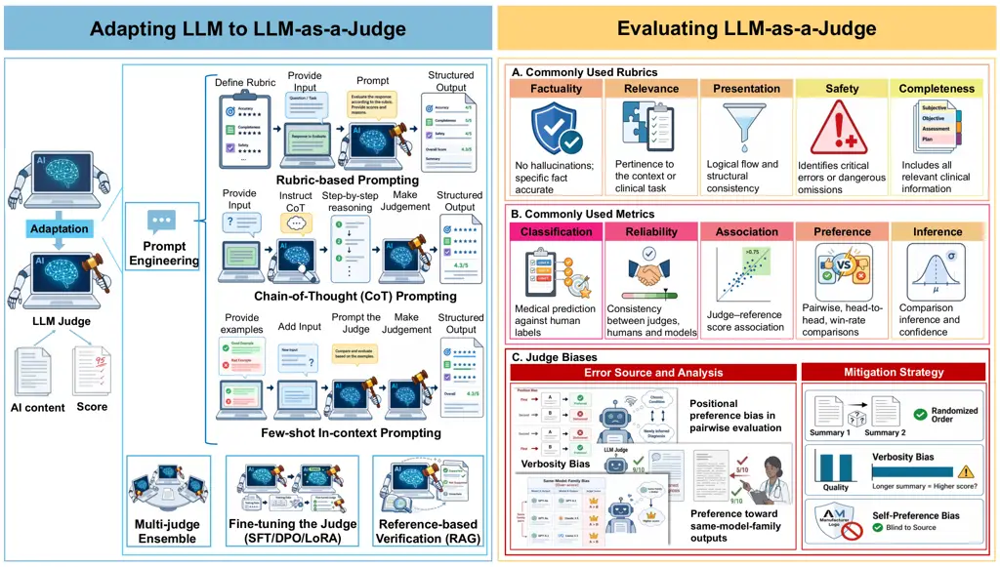
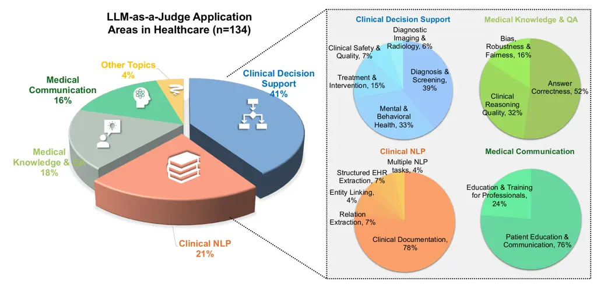
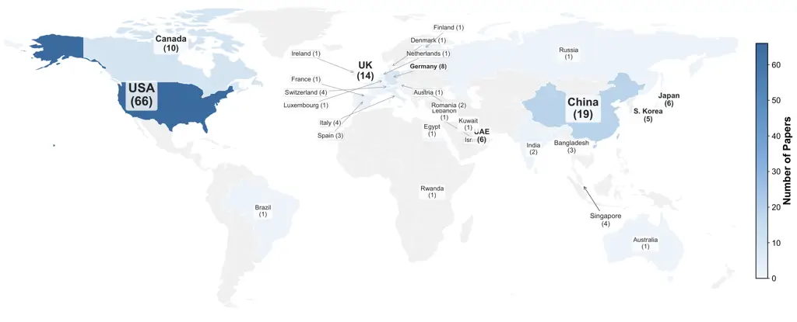

# LLM-as-a-Judge in Healthcare: A Scoping Analysis of Applications, Methods, and Human Alignment

CCS: Applied computing Health informatics

Lingyao Li

Note: Both authors contributed equally to this research.
Note: Corresponding authors. email: <lingyaol@usf.edu>
Affiliation: University of South Florida, Tampa, FL, University of
Florida, Gainesville, FL, USA , Deyi Li

email: <lideyi@ufl.edu> Affiliation: University of South Florida, Tampa,
FL, University of Florida, Gainesville, FL, USA , Chen Chen

email: <chechen@fiu.edu> Affiliation: Florida International University,
Miami, FL, USA , Renkai Ma

email: <renkai.ma@uc.edu> Affiliation: University of Cincinnati,
Cincinnati, OH, USA , Runlong Yu

email: <ryu5@ua.edu> Affiliation: University of Alabama, Tuscaloosa, AL,
USA , Mingquan Lin

email: <lin01231@umn.edu> Affiliation: University of Minnesota,
Minneapolis, MN, USA , Rui Yin

email: <ruiyin@ufl.edu> Affiliation: University of Florida, Gainesville,
FL, USA , Lizhou Fan

email: <lizhouf@umich.edu> Affiliation: University of Michigan, Ann
Arbor, MI, USA , Cathy Shyr

email: <cathy.shyr@vumc.org> Affiliation: Vanderbilt University Medical
Center, Nashville, TN, USA , Siyuan Ma

email: <siyuan.ma@vumc.org> Affiliation: Vanderbilt University Medical
Center, Nashville, TN, USA , Mei Liu

email: <mei.liu@ufl.edu> Affiliation: University of Florida,
Gainesville, FL, USA and Steven Bethard

email: <bethard@email.arizona.edu> Affiliation: University of Arizona,
Tucson, AZ, USA

© none

###### Abstract.

Abstract: Large language models (LLMs) are increasingly deployed across
healthcare applications, including clinical documentation, diagnostic
reasoning, medicine recommendation, and medical education. Their outputs
are largely unstructured clinical text, which is difficult to reliably
evaluate at scale. LLM-as-a-Judge, in which an LLM evaluates another
system’s output against task-specific criteria, offers a scalable
alternative and is increasingly used in clinical evaluation, yet its
validity in healthcare remains underexamined. Existing reviews focus on
general-purpose LLM evaluation or on risk framework, rather than
systematically characterizing how LLM-as-a-Judge is applied in
healthcare and how well their judgments align with human experts. We
therefore conduct a PRISMA-guided comprehensive review of LLM-as-a-Judge
applications in healthcare, searching five databases for studies
published between January 2023 and February 2026. After screening 541
records, 134 studies meet the eligibility and are coded by health
scenario, judge configuration, technical approach, and validation
design. LLM-as-a-Judge is concentrated in clinical decision support,
clinical natural language processing (NLP), medical knowledge and
question answering (QA), and medical communication. OpenAI models are
the most frequently used judges, and prompt engineering appears in
nearly all studies, with ensemble, multi-agent, and retrieval-augmented
designs as common extensions. Among studies reporting human validation,
LLM judges often show moderate to strong alignment with expert
judgments, although reliability varies substantially across tasks.
Overall, this review positions LLM-as-a-Judge as a promising framework
for scalable healthcare AI evaluation, while emphasizing that its
clinical value depends on model design and rigorous validation.

###### Keywords: 

Healthcare AI, LLM-as-a-Judge, Clinical NLP, Human–AI alignment

## 1. INTRODUCTION

Artificial intelligence (AI) systems, particularly large language models
(LLMs), are increasingly incorporated into healthcare applications and
clinical workflows, including documentation (Kweon et al., 2024),
diagnostic reasoning (Goh et al., 2024), medicine recommendation (Zhou
et al., 2025a), emergency service (Li et al., 2026c), and medical
education (Yu et al., 2025a). As these systems generate clinical text
that may shape interpretation, communication, or decisions, rigorous
evaluation is essential for safe deployment. However, scalable
evaluation remains challenging, as clinical notes, patient narratives,
and interview transcripts are often not organized by structured
variables (Adnan et al., 2020; Dawson and Ananyan, 2017; Tayefi et al.,
2021). Assessing AI-generated clinical outputs therefore goes beyond
checking whether facts are correct; it also requires judging whether the
output is complete, appropriate to the clinical context, and safe for
its intended use (Adnan et al., 2020).

Traditional evaluation pipelines face several challenges. Expert
annotation remains the gold standard but is slow and expensive, which
restricts both dataset size and evaluation throughput (Gu et al., 2024;
Malmasi et al., 2018). Automated metrics (e.g., BLEU (Papineni et al.,
2002), ROUGE (Lin, 2004), BERTscore (Zhang et al., 2019)) measure
lexical similarity rather than medical correctness or reasoning
validity. Structured benchmarks often simplify clinical tasks into
fixed-answer formats that do not fully capture ambiguity or contextual
variation in real-world practice. This limitation is particularly
important in healthcare, where many quality indicators are embedded in
narrative clinical notes rather than structured fields (Malmasi et al.,
2018). These challenges have motivated growing interest in scalable
evaluation methods that can approximate expert judgment.

A growing response to these gaps is “LLM-as-a-Judge,” which uses an LLM
to score another system’s output against task-specific criteria such as
factual accuracy, completeness, safety, or clinical appropriateness (Gu
et al., 2024; Zheng et al., 2023). Prior work suggests that LLM-based
judges can approximate human judgments in reasoning, summarization, and
dialogue tasks (Kobayashi et al., 2024; Pan et al., 2024). In
healthcare, they have been used to evaluate clinical note
generation (Croxford et al., 2025), diagnostic reasoning (Sarvari and
Al-Fagih, 2025), medical question answering (Zhao et al., 2026), and
radiology report summarization (Vasilev et al., 2025). Their advantages
lie in the capacity to scale evaluation across large datasets while
supporting multidimensional assessment of clinical quality, beyond what
can be captured by simple numerical scores.

However, applying LLM-as-a-Judge to clinical tasks raises important
concerns. Clinical evaluation requires domain expertise and careful
consideration of patient safety. In this regard, LLM judges may
hallucinate, overestimate reasoning quality, exhibit bias, or share
failure modes with the models they evaluate (Asgari et al., 2025; Zack
et al., 2024). Such errors may have substantial downstream consequences
if they shape deployment decisions (Kim et al., 2025b). These risks also
indicate that LLM applications in healthcare require continuous
monitoring rather than one-time evaluation, making scalable automated
evaluation essential. However, existing reviews are largely situated in
computer science and focus on general-purpose LLM evaluation (Li et al.,
2024; Li et al., 2025a; Gu et al., 2024). To the best of our knowledge,
only one prior review has examined a closely related topic (Li et al.,
2026a); however, it primarily focuses on risk validation and governance
frameworks rather than systematically characterizing LLM-as-a-Judge
applications or judge–human alignment across healthcare tasks. These
gaps motivate the following research questions.

- •
  RQ1. How has LLM-as-a-Judge been applied across healthcare and
  clinical tasks?
- •
  RQ2. What LLMs and technical approaches have been used to implement
  LLM-as-a-Judge?
- •
  RQ3. What measures have been used to evaluate judge-human agreement
  and to what extent do LLM judges align with human experts?
- •
  RQ4. What are the key opportunities and failure modes of
  LLM-as-a-Judge in clinical contexts?

In this review, we examine existing literature on the “LLM-as-a-Judge”
method in healthcare and clinical applications. We first characterize
how LLM judges have been applied, with attention to application areas
such as clinical decision support, clinical natural language processing
(NLP), medical knowledge & question answering (QA), and medical
communication. We then examine the judge models and technical
approaches, including prompt engineering, ensemble, retrieval-augmented
generation (RAG), fine-tuning, and multi-agent frameworks. We further
summarize empirical evidence on judge-human alignment, focusing on
commonly reported metrics such as agreement rate, Cohen’s $`\kappa`$,
and correlation with human annotation. Finally, we identify key
opportunities and failure modes of LLM-as-a-Judge in clinical contexts,
including risks related to hallucination, bias, and insufficient human
validation. Together, this study provides a comprehensive review of
where LLM-as-a-Judge is being used in healthcare, how it is implemented,
how its reliability is evaluated, and where safeguards remain necessary.

## 2. DATA & METHODS

### 2.1. Data Preparation

The study begins with data preparation and study filtering. We conduct a
systematic literature search in accordance with PRISMA guidelines (Page
et al., 2021b; Page et al., 2021a) across five academic databases,
including PubMed¹¹ 1 PubMed:
[https://pubmed.ncbi.nlm.nih.gov](https://pubmed.ncbi.nlm.nih.gov).,
Scopus²² 2 Scopus:
[https://www.scopus.com/pages/home](https://www.scopus.com/pages/home).,
DBLP³³ 3 DBLP: [https://dblp.org](https://dblp.org)., OpenAlex⁴⁴ 4
OpenAlex: [https://openalex.org](https://openalex.org)., and arXiv⁵⁵ 5
ArXiv: [https://arxiv.org](https://arxiv.org).. The search covers
publications from January 2023 to February 2026 and is performed on a
paper’s title and abstract. The search strategy and inclusion/exclusion
criteria are summarized in Table 1, and the study selection process is
illustrated in Figure 1.

|                    |                                                                                                                                                                                                                                                                                                                                                                                                                                                                                                                                                                                                                       |
| ------------------ | --------------------------------------------------------------------------------------------------------------------------------------------------------------------------------------------------------------------------------------------------------------------------------------------------------------------------------------------------------------------------------------------------------------------------------------------------------------------------------------------------------------------------------------------------------------------------------------------------------------------- |
| Component          | Description                                                                                                                                                                                                                                                                                                                                                                                                                                                                                                                                                                                                           |
| Search Databases   | PubMed, Scopus, DBLP, OpenAlex, arXiv                                                                                                                                                                                                                                                                                                                                                                                                                                                                                                                                                                                 |
| Search Date Range  | January 1, 2023 – February 28, 2026                                                                                                                                                                                                                                                                                                                                                                                                                                                                                                                                                                                   |
| Search Terms       | (“LLM-as-a-Judge” OR “LLM as a judge” OR “LLM as judge” OR “large language model as judge” OR “large language model as a judge” OR “agent as a judge” OR “agent as judge” OR “GPT as judge” OR “GPT as a judge” OR “Gemini as judge” OR “Gemini as a judge” OR “Claude as judge” OR “Claude as a judge” OR “Llama as judge” OR “Llama as a judge” OR “Qwen as judge” OR “Qwen as a judge” OR “DeepSeek as judge” OR “DeepSeek as a judge”) AND (“health” OR “healthcare” OR “medical” OR “clinical” OR “diagnosis” OR “diagnostic” OR “patient” OR “EHR” OR “electronic health record” OR “biomedical” OR “medicine”) |
| Screening Criteria | Inclusion: (I1) Uses LLM; (I2) Employs LLM as judge; (I3) Addresses clinical/healthcare tasks; (I4) Original research; (I5) Written in English. Exclusion: (E1) Not using LLM; (E2) Not using LLM as a judge; (E3) No clinical/healthcare relevance; (E4) Conference abstract; (E5) Review or survey paper; (E6) Master thesis; and (E7) Non-English publications                                                                                                                                                                                                                                                     |

Table 1. Literature search strategy and selection criteria.

Figure 1. PRISMA flow diagram illustrating the study filtering process.

The screening process is conducted in multiple stages. First, filtering
by publication year (2023–2026) reduces the dataset to 474 records.
After exact duplicates are removed, 287 records remain. A subsequent
similarity analysis based on author names and titles identifies and
excludes 14 additional duplicate records, primarily cases in which
official publications duplicate earlier preprint versions. This process
results in 273 unique records. Title and abstract screening is then
performed according to the predefined inclusion criteria, with a
specific focus on studies using an LLM-as-a-Judge methodology in
healthcare contexts. This step yields 169 potentially relevant papers
for full-text review, of which 157 full-text articles are retrieved (12
excluded because the full-text PDFs could not be accessed). Full-text
screening is conducted by two authors using the predefined eligibility
criteria in Table 1, including use of an LLM as a judge or evaluator,
relevance to clinical or healthcare tasks, original research papers, and
English-language publication. This process results in 134 studies
meeting all criteria for final inclusion.

### 2.2. Data Extraction and Coding

For each of the 134 studies retained after full-text screening, we
extract structured information using a pre-specified codebook of 18 key
fields, organized into four groups: (i) bibliographic metadata, (ii)
study and clinical context, (iii) judge configuration, and (iv)
evaluation and validation. Fields are coded with controlled vocabularies
or short free-text narratives, depending on whether a closed taxonomy is
practical. The complete codebook with field-level definitions and
example values is provided in Appendix Table 4.

The first group records bibliographic metadata: paper title, author
list, author affiliations, publication year-month, and DOI. The second
group captures study and clinical context, including the study dataset,
data modality (e.g., text, images), and clinical context. Clinical
context is coded as one of five top-level scenarios, including Clinical
Decision Support, Clinical NLP, Medical Knowledge & QA, Medical
Education, and Other, paired with a free-text task description. The
taxonomy is iteratively refined to be mutually exclusive at the scenario
level while preserving task-level granularity for downstream analysis.

The third group describes judge configuration. We record the judge
content (what type of output is evaluated) together with the specific
evaluation dimensions, specific LLM used as a judge with version and
provider, and the techniques employed. The technique vocabulary uses
non-mutually-exclusive labels, including Prompt Engineering, Ensemble,
RAG, Calibration, Fine-tuning, Multi-agent, Distillation, as many
combine two or more. The fourth group records how each study assesses
its judge. We capture the list of reported evaluation metrics (e.g.,
percent agreement, Cohen’s $`\kappa`$, Pearson’s $`r`$, F1, ROC-AUC),
corresponding numerical performance, and validation sample size. A
binary judge against human validation field flags whether the judge has
been compared against expert human ratings.

### 2.3. LLM-as-a-Judge Framework in Healthcare

LLM-as-a-Judge refers to the use of an LLM to evaluate outputs generated
by another model or system (Gu et al., 2024; Zheng et al., 2023). In
healthcare, this approach often cannot be treated as a simple automated
scoring step. Clinical outputs often require interpretation in context,
comparison with evidence, and attention to patient safety. We therefore
organize its use in healthcare into three parts: (i) defining the
healthcare task, (ii) configuring the judge, and (iii) validating the
resulting judgments. After the healthcare task is defined, the judging
process typically centers on the interaction between judge configuration
and evaluation design, as illustrated in Figure 2. Specific technical
implementations of LLM-as-a-Judge methods are discussed in Section 2.4.

Step 1: Task and rubric specification. The first step defines the
healthcare task under evaluation and the judge’s task with respect to
it. We identify and group current studies into five categories: Clinical
Decision Support (outputs related to diagnostic, prognostic, or
therapeutic decision-making), Clinical NLP (note/discharge summary
generation for clinical documentation and clinical entity extraction for
information structuring), Medical Knowledge & QA (factual and
reasoning-based responses to biomedical or clinical questions), Medical
Communication (applications involving communication between healthcare
systems, patients, and healthcare professionals), and other biomedical
topics. Then the judge’s task may take several forms: scoring a single
output against a rubric (Cheng et al., 2026; Vasilev et al., 2025;
Croxford et al., 2025), comparing two candidates head-to-head (Hosseini
et al., 2024; Morse et al., 2025), checking factual consistency against
a reference (Chung et al., 2025; Steinigen et al., 2026), or assigning a
categorical safety label (Aali et al., 2025). The chosen task in turn
determines the rating scale and the judgment format, which may be a
structured rubric-anchored judgment, a pairwise preference, or an
agreement-based label aligned with an expert reference.

Step 2: Judge configuration and enhancement. A general-purpose LLM is
configured for the task defined in Step 1 and, where needed, augmented
with additional information or structure. The base configuration encodes
the rubric directly into the judge through prompt-level mechanisms such
as rubric-based prompting (Cheng et al., 2026; Vasilev et al., 2025;
Croxford et al., 2025), chain-of-thought (CoT) instructions (Cai et al.,
2025; Wu et al., 2025c), or few-shot exemplars (Wu et al., 2025a). On
top of this, several extension strategies are available. The judge model
can be fine tuned via supervised fine-tuning (Zheng et al., 2025; Laskar
et al., 2025), parameter-efficient methods (Hu et al., 2022), preference
optimization (Rafailov et al., 2023), or distillation from a stronger
teacher (Aali et al., 2025; Yao et al., 2026). The judge can also be
provided with retrieved external material (e.g., guidelines, drug
references, or EHR snippets) so that factuality is checked against a
ground source (Sarvari and Al-Fagih, 2025; Yan et al., 2026). Multiple
judges can also be deployed to vote in an ensemble or interact in a
multi-agent configuration (Chen et al., 2025c; Chen et al., 2025b).
These extensions are not mutually exclusive, and the choice should
follow the clinical risk profile and rubric structure.

Step 3: Validation and bias mitigation. The final step is to validate
the judge’s performance, often through the comparison with human or
expert assessment. The validation metric depends on the form of the
judgment. Categorical and ordinal ratings are commonly assessed with
Cohen’s $`\kappa`$ or ICC, continuous scores with Pearson’s $`r`$ or
Spearman’s $`\rho`$, classification labels with standard classification
metrics, and pairwise judgments with win rates. Additional mitigation
strategy is also needed because LLM judges can introduce their own
biases or errors (Dai et al., 2025; Laskar et al., 2025; Vasilev et al.,
2025; Williams et al., 2025; Wu et al., 2025a). A judge may prefer the
first answer in a pair, favor longer responses, overvalue fluent but
weak reasoning, or show preference for outputs from related models.
These biases can be reduced by randomizing response order, blinding the
source model, controlling response length, repeating the judgment, or
aggregating results across runs or judges.

Figure 2. Overview of LLM-as-a-Judge frameworks in healthcare. The
framework typically includes adaptation strategies, evaluation rubrics
and metrics, and common judge biases with corresponding mitigation
approaches.

### 2.4. LLM-as-a-Judge Techniques

To describe how LLM-as-a-Judge systems are implemented in healthcare
studies, we identify the following major technical strategies used to
shape the judge’s behavior, as illustrated in Figure 2 (blue box). These
strategies are not mutually exclusive. A single study may, for example,
use a rubric-based prompt and aggregate judgments from several models.

Prompt engineering is the most typical mechanism for instructing the
judge. It uses task instructions, scoring criteria, in-context learning
examples, and response-format constraints (e.g., JSON) (Marvin et al.,
2023). In healthcare studies, prompt engineering often appears as
rubric-based evaluation, where the prompt can define dimensions such as
factual accuracy, completeness, safety, empathy, or clinical
usefulness (He et al., 2024; Khatwani et al., 2025; Sayeedi et al.,
2026; Jarchow et al., 2025). Some prompts use Likert
scales (Cardenal-Antolin et al., 2025), while others ask for binary or
categorical judgments, such as correct versus incorrect (Sesen et al.,
2025). Few-shot examples can be added to illustrate the expected
judgment standard (Sangwon et al., 2025). CoT instructions may also be
used when the study asks the judge to explain its reasoning before
assigning a final score (Cai et al., 2025).

Ensemble methods combine more than one judgment into a final score or
label. The component judgments may come from different LLMs, repeated
runs of the same LLM, or alternative prompts. Majority voting is
commonly used for categorical labels, whereas numerical scores are
usually averaged or combined through weighted aggregation. Ensemble
designs are intended to reduce dependence on a single model and to
mitigate model-specific biases, such as verbosity preference or
self-preference (Chen et al., 2025c; Chen et al., 2025b).

Retrieval-augmented generation (RAG) grounds models in external evidence
before the evaluation is made (Lewis et al., 2020). In the study
context, retrieval supports the judging process rather than the
generation of the candidate answer. The retrieved material can include
clinical guidelines, institutional protocols, drug references,
electronic health record (EHR) snippets, biomedical knowledge bases, or
web-search results. The judge then uses this evidence to assess
factuality and evaluate consistency with other models’ outputs (Sarvari
and Al-Fagih, 2025; Yan et al., 2026). We treat RAG as an LLM-as-a-Judge
technique only when the retrieved evidence is supplied to the judge
itself, rather than only to the model whose output is being evaluated.

Calibration refers to procedures that reduce predictable bias or improve
score stability (Wang et al., 2024). For pairwise comparison, a common
approach is to swap the order of candidate responses so that each answer
appears in both positions before the final preference is determined.
Other procedures include randomizing answer order, normalizing scores
across repeated runs, and testing whether the judge favors longer, more
confident, or self-generated responses (Shi et al., 2025; Li et al.,
2025b). Unlike general prompt design, calibration focuses on making the
judge’s scores more comparable and less sensitive to irrelevant factors
such as answer order, length, or model identity.

Fine-tuning adapts the judge model using evaluation-specific
data (Chiang et al., 2025). This may involve supervised fine-tuning on
expert-labeled rubric scores (Zheng et al., 2025; Laskar et al., 2025),
parameter-efficient adaptation such as LoRA (Hu et al., 2022), or
preference optimization (Rafailov et al., 2023) using human or
model-generated judgments. Distillation is a related but narrower
strategy in which a smaller judge is trained to approximate the outputs
of a stronger teacher model (Aali et al., 2025; Yao et al., 2026).
Fine-tuning mainly adapts the judge to a domain or task, whereas
distillation transfers judgment behavior to a cheaper or more deployable
evaluator.

Multi-agent judging uses several LLM agents that interact before a final
evaluation is produced (Chen et al., 2025a). Unlike a standard ensemble,
these agents are not simply independent voters. They may assume
different roles, critique one another, debate alternative
interpretations, or pass intermediate assessments to a reviewer or
supervisor (Luo and Laban, 2025; Wu et al., 2025b; Chen et al., 2025a).
This design is often used for multidimensional or safety-sensitive
evaluations, where different agents can focus on factual consistency,
patient profile analysis, or clinical reasoning.

Together, these techniques define the main ways in which LLM judges are
configured for evaluation across healthcare tasks. For each study, we
record the technique category and a brief implementation description.
Table 2 summarizes how each technique is implemented and provides
representative examples from the reviewed studies.

|                    |                                                                                                  |                                                                                                                                                                                              |                                                                                                                |
| ------------------ | ------------------------------------------------------------------------------------------------ | -------------------------------------------------------------------------------------------------------------------------------------------------------------------------------------------- | -------------------------------------------------------------------------------------------------------------- |
| Technique          | Purpose                                                                                          | Typical implementation                                                                                                                                                                       | Example studies                                                                                                |
| Prompt engineering | Guides the judge model through explicit instructions and evaluation criteria.                    | Rubric-based scoring, anchored Likert scales, binary or categorical labels, few-shot examples, CoT reasoning, prompt optimization, and structured outputs such as JSON or key-value schemas. | Sangwon et al. (2025); Khatwani et al. (2025); Sayeedi et al. (2026); Jarchow et al. (2025); Cai et al. (2025) |
| Ensemble           | Combines multiple judgments to reduce instability and model-specific bias.                       | Majority voting for categorical labels; averaging or weighted aggregation for numerical scores; aggregation across different models, repeated runs, or prompt variants.                      | Williams et al. (2025); Li et al. (2025d); Chen et al. (2025b); Abdullahi et al. (2026)                        |
| RAG                | Grounds the judge’s evaluation in external evidence.                                             | Retrieval from clinical guidelines, institutional protocols, references, EHR documentation, biomedical knowledge bases, or web-search results before judgment.                               | Sarvari and Al-Fagih (2025); Yan et al. (2026)                                                                 |
| Calibration        | Reduces predictable judge biases and improves score stability.                                   | Position swapping in pairwise comparison, randomized answer order, score normalization, verbosity-bias checks, and self-preference tests.                                                    | Hosseini et al. (2024); Chang and Chang (2025)                                                                 |
| Fine-tuning        | Adapts the judge model to a specific evaluation task or clinical domain.                         | Supervised fine-tuning on expert labels, LoRA/QLoRA adaptation, and preference optimization using evaluation-specific data.                                                                  | He et al. (2026); Croxford et al. (2025); Nghiem et al. (2025)                                                 |
| Distillation       | Transfers judgment behavior from a stronger teacher model to a smaller evaluator.                | Teacher-generated labels, scores, or preference judgments are used to train a smaller model for efficient or local deployment.                                                               | Aali et al. (2025); Yao et al. (2026)                                                                          |
| Multi-agent        | Uses interaction among multiple agents to evaluate complex scenarior or judge reasoning outputs. | Role-specialized debate, critic, such as reviewer pipelines, persona-based juries, and cross-informed voting.                                                                                | Luo and Laban (2025); Wu et al. (2025b); Chen et al. (2025a)                                                   |

Table 2. Major LLM-as-a-Judge techniques and their implementation in
healthcare studies.

## 3. RESULTS

Research on LLM-as-a-Judge in healthcare expanded rapidly over the two
years studied (Figure 3). Only 7 studies were published in 2024, but the
literature grew sharply to 81 studies in 2025, with an additional 46
studies published in the first two months of 2026 alone. This trend
indicates that automated evaluation has quickly become an important
methodological direction for assessing AI-generated clinical content.
Additional analyses of the geographic distribution of publications and
author collaborations based on institutional affiliations are presented
in Appendix B.

The following results are organized around the study research questions.
Section 3.1 addresses RQ1 by characterizing where LLM-as-a-Judge has
been applied across healthcare domains, including Clinical Decision
Support, Clinical NLP, Medical Knowledge & QA, and Medical Education
(corresponding to Step 1 in Section 2.3). Section 3.2 addresses RQ2 by
summarizing the judge models and technical approaches used to implement
LLM-based judges (corresponding to Step 2 in Section 2.3). Sections 3.3
and  3.4 address RQ3 by mapping the evaluation metrics used across
application domains and then synthesizing empirical evidence on
judge-human alignment, with an illustration on agreement rate, Cohen’s
$`\kappa`$, and correlation (corresponding to Step 3 in Section 2.3).
These results together describe the evolving applications,
methodological design, and reliability evidence supporting
LLM-as-a-Judge for healthcare applications.

Figure 3. Publication trend of LLM-as-a-Judge studies in healthcare
during the study period. Bars show the number of monthly publications,
and the line shows the cumulative number of eligible publications over
time. The sharp increase in 2025 and early 2026 indicates the rapid
emergence of LLM-as-a-Judge in the studies.

### 3.1. Healthcare Applications of LLM-as-a-Judge

Overall distribution. Across the 134 included studies, applications of
LLM-as-a-Judge in healthcare are concentrated in Clinical Decision
Support (n=54, 40.3%), followed by Clinical NLP (n=28, 20.9%), Medical
Knowledge & QA (n=24, 17.9%), and Medical Communication (n=22, 16.4%)
(Figure 4). This distribution shows that LLM-as-a-Judge is primarily
used in decision-critical and text-intensive settings, where scalable
and consistent evaluation is needed. A more detailed task-level
breakdown is shown in Figure 5, which groups each study into specific
healthcare applications.

Clinical Decision Support. Within Clinical Decision Support, most
studies focus on diagnosis and screening tasks (n=19, 35.2%), reflecting
the use of LLM-as-a-Judge to assess diagnostic accuracy and triage
decisions. For example, Sarvari and Al-Fagih (2025) use an
LLM-as-a-Judge framework to benchmark diagnostic performance across 18
LLMs using MIMIC-IV admissions. Wu et al. (2025a) evaluate concordance
between AI-generated and specialist responses in physician-to-physician
eConsult scenarios. Sangwon et al. (2025) use GPT-4o as an LLM judge to
assess diagnostic equivalence in free-response clinical reasoning tasks
within a multi-agent, multi-turn conversational benchmarking framework.

Mental and behavioral health represents another major area within
Clinical Decision Support (n=18, 33.3%). These studies extend evaluation
beyond correctness to appropriateness, cultural sensitivity, empathy,
and safety in emotionally sensitive settings. For example, Liu et al.
(2026a) use LLM judges alongside human annotators and clinical
psychologists to evaluate cultural sensitivity and emotional
appropriateness across diverse populations. Han et al. (2026) leverage
LLM judges within a two-stage evaluation framework for culturally
adapted mental health counseling models with psychiatrist-based expert
validation. Wang et al. (2025a) apply LLM-as-a-Judge alongside blinded
clinicians to assess empathy, clinical relevance, and behavioral change
effectiveness in a multi-session language agent for substance use
disorder recovery.

By contrast, treatment-related evaluations (n=8, 14.8%) and clinical
safety and quality assessment (n=5, 9.3%) remain underrepresented. This
imbalance suggests that current research gives greater attention to
front-end decision-making, such as diagnosis and triage, than to
downstream intervention validation and safety monitoring, despite the
importance of these areas for real-world clinical deployment.

Figure 4. LLM-as-a-Judge research areas in healthcare. Major research
domains include Clinical Decision Support, Clinical NLP, Medical
Knowledge & QA, and Medical Communication.

Clinical NLP. In Clinical NLP tasks (n=28), LLM-as-a-Judge is mainly
used for clinical documentation tasks (n=21, 75.0%), reflecting a strong
focus on evaluating generated and summarized clinical notes. Vasilev et
al. (2025) assess EHR-based summaries across multiple quality
dimensions. Croxford et al. (2025) report strong agreement between LLM
judges and human evaluators in multi-document summarization tasks. Saito
et al. (2025) employ an LLM-as-a-Judge framework to evaluate
automatically generated SOAP-format nursing records, with emphasis on
hallucination and information omission.

Other Clinical NLP applications, including relation extraction (n=2,
7.1%), entity linking (n=1, 3.6%), and structured data extraction (n=2,
7.1%), are less common. This pattern suggests that LLM-as-a-Judge is
most often applied to holistic, language-intensive evaluation tasks,
where traditional rule-based or metric-based methods may be
insufficient. Fine-grained structured prediction tasks remain less
explored, potentially because standardized rubrics for LLM-based judging
are less developed in these settings.

Medical Knowledge & QA. In Medical Knowledge & QA tasks (n=24),
evaluation primarily focuses on answer correctness (n=11, 45.8%),
followed by clinical reasoning quality (n=9, 37.5%) and bias,
robustness, and fairness-related dimensions (n=4, 16.7%). This pattern
suggests a shift from outcome-oriented evaluation of factual correctness
toward process-aware assessment of reasoning quality, although fairness
and robustness remain relatively underexplored. For example, Hosseini et
al. (2024) use LLM judges to evaluate long-form medical QA responses for
correctness, helpfulness, harmfulness, efficiency, and bias alignment
with physician annotations. Zhou et al. (2025b) and Liu et al. (2026b)
apply LLM-as-a-Judge frameworks to assess the quality and fidelity of
step-by-step clinical reasoning. Liu and He (2024) employ LLM judges to
examine cognitive bias and robustness in COVID-19 misinformation
assessment under decoy-effect settings.

Medical Communication. In Medical Communication applications (n=22),
most studies focus on patient education and communication (n=17, 77.3%),
while fewer studies address education and training for healthcare
professionals (n=5, 22.7%). This distribution highlights the predominant
use of LLM-as-a-Judge frameworks in evaluating patient-facing
interactions. For example, Abrar et al. (2025) use cross-model LLM
judges to evaluate the quality and expert alignment of consumer-facing
medical question-answering responses using real-world Reddit-based
health queries. Saggar et al. (2026) use an LLM-as-a-Judge framework to
assess the educational utility of simulated clinician–patient
interactions in pediatric OSCE-style training scenarios.

Other areas. A small subset of studies (n=6) applies LLM-as-a-Judge to
public health and governance (Li et al., 2026b; Wu et al., 2025e; Tec et
al., 2025), as well as research and evidence synthesis tasks (Curran et
al., 2024; Matsui et al., 2024; Gan et al., 2025). Although limited in
number, these studies indicate the potential value of LLM-based
evaluation for system-level decision-making and policy evaluation. Their
limited representation also suggests that the field has not yet fully
addressed macro-level healthcare challenges, including regulatory
evaluation and population health assessment.

Figure 5. Detailed categorization of LLM-as-a-Judge research in
healthcare. Included studies are grouped according to major healthcare
research domains and their corresponding application tasks.

### 3.2. LLM-as-a-Judge Models and Techniques

Overall distribution. Figure 6 presents the overall distribution of
judge model families and technical approaches. Regarding the judge
models, OpenAI models are the most frequently used judges, appearing in
90 of 134 studies (67.2%), followed by Google (Gemini, Gemma; n=35,
26.1%), Anthropic (Claude; n=27, 20.1%), Meta (LLaMA; n=25, 18.7%),
Alibaba (Qwen; n=24, 17.9%), and DeepSeek (n=13, 9.7%) (Figure 6a). Most
studies employ models from multiple families, consistent with
multi-model jury configurations designed to reduce provider-specific
biases.

Regarding the judge techniques, prompt engineering is used in 132 of 134
studies (98.5%) (Figure 6b). Common strategies include rubric-based
prompting, few-shot prompting, and CoT prompting. Beyond prompting,
ensemble methods combining multiple judges are used in 18 studies
(13.4%), multi-agent configurations in 10 studies (7.5%), and
calibration in 8 studies (6.0%). Fine-tuning via supervised learning or
parameter-efficient adaptation appears in 10 studies (7.5%), RAG in 6
studies (4.5%), and knowledge distillation in 5 studies (3.7%).

Judge model selection. Figure 7 provides a more detailed breakdown of
specific model versions within each major family. Overall, closed-source
models appear to be selected as judges more frequently than open-source
models. Within the OpenAI family, GPT-4o is the most common judge (n=34,
25%), followed by GPT-4o-mini (n=17, 13%) and GPT-4.1 (n=11, 8%); other
OpenAI variants, including GPT-4, o3, and GPT-5, are used in 31% of
studies that employ OpenAI models (Figure 7). Among Google models,
Gemini-2.5-Pro (n=9) and Gemini-2.5-Flash (n=8) are the most prevalent,
with Gemma-3-27B (n=5) and MedGemma-27B (n=4) also represented. For
Anthropic, Claude-3.7-Sonnet (n=5), Claude-3-Haiku (n=4), and
Claude-3.5-Sonnet (n=4) are the most frequently used models. Among
open-source model families, LLaMA-3.3-70B (n=5) and LLaMA-3.1-8B (n=4)
are the leading Meta models, while Qwen3-32B (n=5) is the most common
Alibaba model. DeepSeek-R1 appears in 11 studies (8%), making it the
third most frequently used individual judge model overall. The temporal
trend of open-source and closed-source models is presented in
Appendix C.

Figure 6. Model family and technique distributions for LLM-as-a-Judge in
healthcare based on N=134 studies. (a) Number of studies employing each
model family, counted at the study level. (b) Distribution of technical
approaches for configuring LLM judges. Techniques are not mutually
exclusive.

Technical approaches. For prompting strategies, rubric-based prompting
is predominant, which encodes structured evaluation criteria with
explicit score-level descriptors. Rubrics can range from general
clinical-quality dimensions (Li et al., 2025d) to instrument-aligned
frameworks, such as PDSQI-9 for documentation quality (Li et al., 2026b)
and OSCE-style scoring for clinical examination skills (Yao et al.,
2026). Few-shot prompting is often used to guide model outputs; for
example, eConsult concordance evaluation embeds one concordant and one
discordant case within the prompt (Wu et al., 2025a). CoT prompting is
associated with improved transparency and reduced variability across
evaluations (Cai et al., 2025; Shen et al., 2025). Programmatic prompt
optimization also appears; GEPA-style evolutionary search is applied to
optimize prompts for assessing the clinical impact of ASR errors (Ellis
et al., 2026).

Ensemble approaches combine outputs from multiple judges to mitigate
single-model biases. Several ensemble strategies have been applied.
Majority voting is used for categorical outputs. For example,
three-judge voting on element-wise rubric items (Chen et al., 2025b).
Score averaging is used for continuous outputs; for instance, MedGUIDE
averages ratings from four heterogeneous judges per criterion (Li et
al., 2025d). Weighted aggregation based on agreement with human
annotations is also applied (Williams et al., 2025). Several studies
address positional bias by evaluating pairwise comparisons (in both AB
and BA order) prior to voting (Hosseini et al., 2024).

Multi-agent configurations deploy multiple collaborating or adversarial
agents. For example, role-specialized debate assigns agents to opposing
positions; DialogGuard implements this for psychosocial safety with
pro-risk and pro-safe agents and an impartial aggregator (Luo and Laban,
2025). Critic-reviewer pipelines layer specialized agents (detector,
critic, reviewer), each with responsibilities such as hallucination
flagging or omission detection (Liu et al., 2025b). Persona-based juries
assign each agent a stakeholder persona and conduct free debate before
aggregation (Chen et al., 2025a). Cross-informed voting, where each
agent observes others’ outputs before voting, achieves stronger
agreement with gold-standard rankings than independent voting in
de-identification model selection (Wu et al., 2025b).

RAG provides judges with access to external knowledge sources. Among the
examined studies, applications include grounding diagnoses in ABIM lab
reference ranges (Sarvari and Al-Fagih, 2025), and triggering
re-evaluation with a modified prompt when judge confidence falls below a
threshold (Anantha et al., 2025). Dual-stage factuality verification
classifies atomic claims against FAISS-retrieved EHR snippets as
supported, contradicted, or not found (Wu et al., 2025d).

For fine tuning, SFT on human-annotated rubric labels is the most common
approach; for instance, a curated SFT corpus is used to fine-tune
Qwen3-14B for disputed clinical cases (He et al., 2026). QLoRA is
applied in clinical summary evaluation with both SFT and direct
preference optimization (Croxford et al., 2025). Knowledge distillation
trains small models from more advanced teacher judges. For example, a
LLaMA-3B judge is distilled from GPT-4o-mini safety labels (Nghiem et
al., 2025). MedVAL combines self-supervised distillation,
consistency-based data filtering, and QLoRA fine-tuning  (Aali et al.,
2025). Fine-tuned judges trade some alignment with frontier models for
reproducibility, lower inference cost, and on-premises deployment where
transmitting protected health information to external APIs is not
permissible.

Figure 7. Specific model versions used as LLM judges. Each subplot shows
the top most frequently used models within each major model family:
OpenAI (n=90 studies), Google (n=35), Meta (n=25), Anthropic (n=27),
Alibaba (n=24), and DeepSeek (n=13). Numbers on each node indicate the
count of studies employing that model version; percentages reflect the
proportion of total included studies (N=134). “Others” aggregates
remaining models within each family.

### 3.3. LLM-as-a-Judge Performance Measures

We summarize evaluation frameworks for LLM-as-a-Judge in healthcare
research along two dimensions: _Rubric_ and _Metric_ (Table 3). We use
_Rubric_ to refer to the subjective evaluation criteria adopted in prior
studies when using LLM-as-a-Judge to assess newly proposed
healthcare-related AI systems (Table 3a). In contrast, _Metric_ refers
to the quantitative measures used to compare LLM-as-a-Judge outputs with
assessments from human evaluators (Table 3b).

(a) Rubric  How is LLM-as-a-Judge used to evaluate novel healthcare data
and frameworks?  
Category Definition Rubrics Example Studies Behavior Whether the judged
output reflects appropriate reasoning behavior or action alignment.
memory rationality; action alignment (Song et al., 2026) Communication
Whether the judged output communicates with appropriate empathy,
naturalness, authenticity, or emotional fit. empathy; personality
consistency; language naturalness; authenticity; emotional
reasonableness (Song et al., 2026; Yao et al., 2025a; She et al., 2025;
Kafi et al., 2026; Li et al., 2025e) Completeness Whether the judged
output covers the needed information without important omissions.
completeness; coverage; thoroughness (Adib et al., 2026; Hisada et al.,
2025; Poore et al., 2025; Piya and Beheshti, 2026) Factuality Whether
the judged output is medically correct, faithful to evidence, and free
from hallucinated claims. faithfulness; correctness; hallucination;
answer correctness; medical consistency (Kocaman et al., 2025; Vasilev
et al., 2025; Adib et al., 2026; Remaki et al., 2026) Presentation
Whether the judged output is concise, clear, readable, and logically
organized. coherence; succinctness; readability; organization; synthesis
(Poore et al., 2025; She et al., 2025; Piya and Beheshti, 2026; Shah et
al., 2025) Relevance Whether the judged output is pertinent to the
question, context, or clinical task. answer relevancy (Boll et al.,
2025; Croitoru et al., 2026; Poore et al., 2025; Zheng et al., 2025)
Safety Whether the judged output avoids unsafe, risky, or ethically
problematic content. safety (Zhuang et al., 2025; Aali et al., 2025; She
et al., 2025) Utility Whether the judged output is useful or helpful for
the intended clinical purpose. helpfulness; usefulness (Liu et al.,
2026a; Wang et al., 2025c; Sayeed et al., 2025; Wu et al., 2025e)

(b) Metric  What metrics are used to assess the reliability of results
generated by LLM-as-a-Judge?  
Category Definition Metrics Example Studies Association Continuous-score
or rank association between judge outputs and reference scores. Pearson
correlation coefficient; rank correlation; Spearman’s rank correlation
coefficient; Kendall’s tau; $`R^{2}`$ (Vasilev et al., 2025; Kocaman et
al., 2025; Luo and Laban, 2025; Yao et al., 2026) Classification
Discrete-label performance against human labels, expert labels, or a
ground truth. accuracy; F1-score; recall; precision; specificity;
sensitivity; AUC/AUROC; exact match; balanced accuracy;
clinician-confirmed false negative rate (Liu et al., 2025a; Niculae et
al., 2025; Jeong et al., 2026; Peled-Cohen et al., 2025) Efficiency
Runtime, time, or cost of judge evaluation. runtime; cost (Vasilev et
al., 2025; Zhou et al., 2025b; Williams et al., 2025; Fan et al., 2026)
Error Continuous error or loss between judge outputs and reference
values. root mean square error; mean absolute error; mean squared error;
Hamming loss (Vasilev et al., 2025; Badawi et al., 2026) Inference
Statistical inference for comparisons or uncertainty around metric
estimates. confidence interval; Wilcoxon signed-rank test; Friedman
test; Cohen’s $`d`$ (Vasilev et al., 2025; Williams et al., 2025;
Bolpagni et al., 2025; Kim et al., 2026) Preference Pairwise,
head-to-head, win-rate, or preference-based comparisons. win rate;
preference rate; pairwise comparison; ties; LLM wins; vendor wins
(Hosseini et al., 2024; Gunjal et al., 2025; Wang et al., 2025a;
DiGiacomo et al., 2025) Reference Reference-based text similarity or
retrieval-context measures. ROUGE; BERT; BLEU; METEOR; context
precision; context recall; context relevance (Adib et al., 2026;
Ferdousi and Hossain, 2025; Wang et al., 2025c) Reliability Agreement or
consistency between judges, humans, models, or repeated ratings.
agreement rate; Cohen’s kappa; inter-rater agreement; Krippendorff’s
alpha; intraclass correlation coefficient; Gwet’s AC1/AC2; Fleiss’ kappa
(Li et al., 2026b; Kocaman et al., 2025; Jarchow et al., 2025; Remaki et
al., 2026) Scale Rubric, Likert, benchmark, scalar, or average score
used as a measurement scale. rubric score; Likert scale; HealthBench
score; PDSQI-9 rubric score; CRIT score; mean/average score; scalar
rating (0–5) (Cheng et al., 2026; Croxford et al., 2025; Yao et al.,
2026; Williams et al., 2025)

Table 3. Categorization of evaluation frameworks for LLM-as-a-Judge in
healthcare research.

Evaluation Rubrics. Our analysis identifies eight rubric types used in
collected studies (Table 3a). A single study may use multiple rubric
types. _Behavior_ refers to rubrics that use LLM-as-a-Judge to assess
specific behaviors, reasoning processes, or action alignment (Song et
al., 2026). For example, Song et al. (2026) evaluate a dementia
simulation agent by assessing memory rationality, including whether
forgetting, repetition, and cue responses are consistent with the
dementia profile, and action alignment, including whether nonverbal
actions were plausible and consistent with verbal cues and clinical
characteristics. _Communication_ refers to rubrics that evaluate
communicative aspects of AI outputs (Song et al., 2026; Yao et al.,
2025a; She et al., 2025; Kafi et al., 2026; Li et al., 2025e). These
aspects include empathy (Song et al., 2026; Yao et al., 2025a; She et
al., 2025), language naturalness (Song et al., 2026), authenticity (Song
et al., 2026), and emotional fit (Song et al., 2026; Yao et al., 2025a;
Liu et al., 2026a). Some studies further decompose communication quality
into more specific dimensions. For example, in a dataset designed to
support individuals in distress, Liu et al. (2026a) used LLM-as-a-Judge
to assess emotional supportiveness and cultural awareness.

Existing studies also evaluate _Completeness_, which assesses whether
all key information is included (Adib et al., 2026; Hisada et al., 2025;
Poore et al., 2025; Piya and Beheshti, 2026), and _Factuality_, which
assesses whether the output is accurate and free from hallucinated
claims (Vasilev et al., 2025; Curran et al., 2024; Chen et al., 2025c;
Kocaman et al., 2025). In addition, prior work has used LLM-as-a-Judge
to evaluate _Presentation_, including conciseness, clarity, and
readability, and _Relevance_, referring to the degree to which an output
addresses the question, context, or clinical task. Several studies
assess both presentation and relevance (Kocaman et al., 2025;
Madrid-García et al., 2025; Poore et al., 2025; Wang et al., 2025c; Chen
et al., 2025a). In addition, _Safety_ captures rubrics that use
LLM-as-a-Judge to assess whether outputs contain unsafe, risky, or
ethically problematic content. For example, Adib et al. (2026) evaluate
safety in iCliniq medical QA tasks based on LLM judges, including the
appropriateness of safety disclaimers, avoidance of harmful advice, and
recommendations to consult healthcare professionals when appropriate,
using a 1–5 rating scale. Finally, _Utility_ refers to rubrics that
assess whether an output is useful or helpful for the intended clinical
purpose (Liu et al., 2026a; Wang et al., 2025c; Sayeed et al., 2025; Wu
et al., 2025e).

Evaluation Metrics. To understand how existing studies assesses the
reliability of LLM-as-a-Judge generated inferences, we also identify
multiple categories of metrics used in existing work (Table 3b). Our
analysis focuses on three major healthcare application domains (as
identified in Section 3.1). While these domains share some common
evaluation paradigms, each exhibits distinct emphases reflecting its
task characteristics.

Metrics for Clinical Decision Support. Across Clinical Decision Support
studies, LLM-as-a-Judge is evaluated with a diverse but coherent set of
metrics. One evaluation assesses alignment with human experts, commonly
using agreement measures such as Cohen’s $`\kappa`$, Krippendorff’s
$`\alpha`$, Fleiss’ $`\kappa`$, or agreement rate, together with
correlation-based metrics such as Pearson’s $`r`$, Spearman’s $`\rho`$,
and Kendall’s $`\tau`$ to measure concordance with clinician ratings (Wu
et al., 2025a). When LLM judges produce discrete labels, studies often
report classification metrics, including accuracy, precision, recall,
F1-score, and ROC-AUC (Sarvari and Al-Fagih, 2025); when judges produce
continuous scores, error-based metrics such as MAE, MSE, and RMSE are
also used (Badawi et al., 2026). Many studies further apply rubric-based
or Likert-scale evaluations across clinically relevant dimensions, as in
LiveMedBench (Yan et al., 2026) and CounselBench (Li et al., 2025e).
Beyond predictive performance, several studies examine judge reliability
and robustness through inter-judge agreement, consistency, and
task-specific downstream metrics such as diagnostic recall or safety
detection (Stamatis et al., 2026).

Metrics for Clinical NLP. Evaluation in Clinical NLP places particular
emphasis on fine-grained textual quality, factual grounding, and
workflow-level utility. Many studies use multi-dimensional rubric or
Likert-scale evaluations to assess factual accuracy, hallucination,
completeness, coherence, conciseness, and clinical actionability,
reflecting the practical requirements of generated notes, summaries, and
extracted information (Piya and Beheshti, 2026; Aali et al., 2025;
Croxford et al., 2025). A distinctive feature of this domain is
claim-level factuality verification, in which outputs are decomposed
into atomic statements and judged as supported, contradicted, or missing
relative to source data (Chung et al., 2025). Clinical NLP studies also
often embed LLM judges within end-to-end systems for summarization,
information extraction, or de-identification, where task-specific
downstream metrics (e.g., hallucination detection rate, extraction
accuracy, and de-identification precision and recall) are used to
evaluate operational performance (Lilli et al., 2026; Miranda et al.,
2025). In addition, prior research assesses robustness and
reproducibility through repeated runs and cross-judge consistency (Chen
et al., 2025c). Overall, compared with Clinical Decision Support,
metrics in Clinical NLP are more text-centric and decomposition-driven,
with emphasis on fine-grained rubric design and assessment of
document-level clinical workflows.

Metrics for Medical Knowledge & QA. In this domain, LLM-as-a-Judge
evaluation places greater emphasis on reasoning quality, factual
correctness, and answer justification, reflecting the explanatory nature
of medical QA tasks. A key feature is the use of reasoning-oriented
rubrics, in which judges assess logical validity, clinical reasoning
quality, evidence use, and safety. For example, Zhou et al. (2025b) use
Likert-style reasoning scores aligned with expert ratings, while Chen et
al. (2025b) adopt multi-dimensional rubric frameworks to capture more
nuanced reasoning performance. Another prominent feature is the use of
pairwise or ranking-based metrics (e.g., win rate, rank agreement, and
Kendall’s $`\tau`$) are often used to assess whether LLM judges can
distinguish higher-quality answers from weaker alternatives (De la
Iglesia et al., 2025).

Medical QA evaluation also emphasizes fine-grained factuality and
statement-level error analysis. Several studies quantify correctness
using counts or proportions of correct, incorrect, or missing facts, or
through structured factuality scores (Steinigen et al., 2026). This
granular approach enables targeted assessment of hallucination and
misinformation beyond a single overall score. The domain also
incorporates robustness- and bias-oriented evaluation, such as
sensitivity to adversarial inputs, misleading context, and cultural
cues (Liu and He, 2024; Rezaei and Shakeri, 2026). Several studies
further include meta-evaluation and efficiency measures, such as
judge–expert correlation, statistical discrimination tests, evaluation
cost, runtime, and confidence calibration (Zhou et al., 2025b; Anantha
et al., 2025). Compared with other application domains, medical QA
evaluation is more reasoning-centric and comparison-driven, with
emphasis on ranking consistency, fine-grained factual verification, and
robustness to adversarial or contextual variation.

### 3.4. LLM-as-a-Judge Alignment with Human Annotators

Because LLM judges are imperfect evaluators, their reliability should be
assessed by the extent to which their judgments align with human
annotations. Human-LLM alignment is therefore central to validating
LLM-as-a-Judge methods in healthcare. However, studies quantify this
alignment using different metrics depending on task structure, output
format, and rating scale. Commonly reported metrics include raw
agreement rate, Cohen’s $`\kappa`$, Pearson’s $`r`$, accuracy, F1-score,
Spearman’s $`\rho`$, win rate, Kendall’s $`\tau`$, and Krippendorff’s
$`\alpha`$ (see Section 3.3 for specific explanations). To support a
comparable synthesis, we focus on three widely reported metrics,
including agreement rate, Cohen’s $`\kappa`$, and correlation, and use
them to illustrate the reliability of LLM-as-a-Judge methods across
healthcare tasks in the current literature.

Agreement rate with human experts. Across 13 examined studies reporting
agreement against expert judgments (Figure 8), judge-expert concordance
ranges from 0.66 to 0.96 (median 0.83, mean 0.83). The lowest value is
observed in fine-grained biomedical entity linking, where GPT-5.2
reaches 0.66 in distinguishing Correct, Broad, Narrow, and No-relation
labels (Remaki et al., 2026); the highest value appears in MedGUIDE,
where an ensemble of GPT-4o-mini, Claude-3.5-Haiku, Gemini-2.5-Flash,
and DeepSeek-V3 is used to score guideline-grounded multiple-choice
questions, with validation on 500 human-reviewed samples (Li et al.,
2025d). In addition, we observe that LLM-as-a-Judge ensembles cluster
near the top, including a three-judge ensemble (GPT-4, Claude, DeepSeek)
that reaches 0.90 on rubric-anchored adequacy and safety items in NSCLC
care (Chen et al., 2025b), supporting the view that aggregating
heterogeneous judges can reduce idiosyncratic bias. Well-scoped tasks
with anchored rubrics generally outperform open-ended generation:
structured factuality checks on Brief Hospital Course narratives reach
0.89 across 13,290 propositions (Chung et al., 2025), whereas
mental-health counseling rubrics with more subjective language register
0.73 (Li et al., 2025e). Finally, raw agreement can be sensitive to the
reference standard: in one study, the same judge that reached 0.83
agreement with at least one expert dropped to 0.51 against
majority-of-experts judgments (Chen et al., 2025c), highlighting how
expert disagreement and subjective criteria can affect apparent judge
reliability.

Figure 8. Agreement rate between LLM-as-a-Judge and human experts Forest
plot of 13 examined studies reporting agreement rate with 95% confidence
intervals sorted by agreement rate. The dotted line marks the median
agreement rate (0.83), and the dashed line marks the mean agreement rate
(0.83) across the 13 examined studies. Agreement values are rounded to
two decimal places.

Chance-corrected agreement (Cohen’s $`\kappa`$). Across 10 examined
studies reporting Cohen’s $`\kappa`$ (Figure 9), values range from 0.59
to 0.88, broadly covering the “moderate” to “strong” agreement range
under conventional benchmarks. The lowest value ($`\kappa=0.59`$) is
observed for DeepSeek-V3 evaluating educator dialogues and personalized
discharge summaries (Yao et al., 2025b). The highest value is reported
for GPT-4o in medical image quality assessment ($`\kappa=0.88`$) (Liu et
al., 2025a), followed by GPT-4o-mini for personalized longevity
recommendations ($`\kappa=0.87`$) (Jarchow et al., 2025).
Claude-Opus-4.6 also shows good alignment with human annotators for
unperturbed medical concept validation ($`\kappa=0.78`$), but its
performance drops substantially for perturbed concepts
($`\kappa=0.24`$) (Shawon et al., 2026). More subjective or
multi-dimensional rubric tasks tend to show lower reliability; for
example, four-class clinical risk grading in MedVAL remains in the
moderate range ($`\kappa=0.67`$) (Aali et al., 2025). Agreement is also
task-dependent within the same judge family: GPT-4o reaches 0.88 in
medical image quality assessment (Liu et al., 2025a), but shows lower
agreement on mental and behavioral health prompts (Lalwani and Salam,
2026). Finally, the gap between raw agreement and $`\kappa`$ is
informative. Yao et al. (2025b) report 0.80 raw agreement but
$`\kappa=0.59`$ on the same dataset, showing that prevalence-corrected
reliability can be substantially lower when one rating category
dominates.

Figure 9. Chance-corrected agreement (Cohen’s $`\kappa`$) between
LLM-as-a-Judge and human experts. Forest plot of 10 studies reporting
Cohen’s $`\kappa`$ with 95% confidence intervals and validation sample
sizes ($`N`$), sorted by $`\kappa`$. The dotted line marks the median
Cohen’s $`\kappa`$ (0.78), and the dashed line marks the mean Cohen’s
$`\kappa`$ (0.76) across the 10 examined studies. Cohen’s $`\kappa`$
values are rounded to two decimal places.

Score-level correlation with experts. Across 13 examined studies
reporting Pearson or Spearman correlation (Figure 10; 10 Pearson, 3
Spearman), judge–expert correlation ranges from 0.40 to 0.94 (median
0.69, mean 0.68). DeepSeek-R1 reaches $`r=0.938`$ on the behavior
dimension of a five-dimension psychosocial safety rubric (Luo and Laban,
2025), GPT-4 attains $`r=0.92`$ on OSCE-style InfoGatherQA (Yao et al.,
2026), and MedVAL-fine-tuned Qwen3-4B reaches $`r=0.833`$ on a
clinical-summary subset (Aali et al., 2025). In contrast, GPT-4o reaches
only $`r=0.483`$ on counseling responses evaluated across five
subjective safety dimensions (Cai et al., 2025). The lower end of the
distribution is concentrated in open-ended counseling and
multi-dimensional clinical text evaluation, whereas the upper end
includes tasks like psychosocial safety, clinical-skills scoring, and
clinical summary. In addition, it should be highlighted that score-level
correlation and agreement capture different aspects of judge
reliability. Correlation indicates whether LLM judges preserve the
relative ordering of expert scores, whereas agreement metrics assess
consistency in assigned labels or categories. These metrics therefore
capture different forms of human–LLM alignment and should be interpreted
separately when comparing judge reliability as seen in prior studies (Li
et al., 2025e; Han et al., 2026; Jang et al., 2025).

Figure 10. Score-level correlation between LLM-as-a-Judge and human
expert ratings. Forest plot of 13 studies reporting Pearson’s $`r`$ (P,
$`n=10`$) or Spearman’s $`\rho`$ (S, $`n=3`$) with 95% confidence
intervals, sorted by correlation. The dotted line marks the median
correlation value (0.69), and the dashed line marks the mean correlation
value (0.68) across the 13 examined studies. Correlation values are
rounded to two decimal places.

## 4. DISCUSSION

The rapid growth of LLM-as-a-Judge research in healthcare (Figure 3)
suggests a broad change in how clinical AI systems are evaluated. As
these systems increasingly produce open-ended outputs—diagnostic
narratives, counseling responses, discharge summaries, and
patient-facing explanations—the evaluation gap of fixed-answer
benchmarks and conventional metrics for unstructured clinical data have
become more pronounced. LLM-as-a-Judge has emerged as a practical
response to this gap, offering a way to assess content along dimensions
(e.g., reasoning quality, factual consistency, completeness, safety,
empathy, and clinical usefulness) that are difficult to formalize (Gu et
al., 2024; Croxford et al., 2025; Liu et al., 2025a; Xue et al., 2026;
Ding et al., 2025; Li et al., 2025e; Chen et al., 2025a). In response to
RQ4, we draw on the reviewed studies to identify the opportunities and
challenges that LLM-as-a-Judge holds for future healthcare AI
evaluation. We then discuss considerations for deploying LLM-as-a-Judge,
along with the limitations of this review.

### 4.1. Potential of LLM-as-a-Judge in Healthcare

Scaling evaluation across unstructured clinical content. Much of
clinical practice is recorded in unstructured text, where
lexical-overlap metrics and fixed-answer benchmarks often miss clinical
correctness or contextual appropriateness (Adnan et al., 2020; Malmasi
et al., 2018). Expert annotation can capture the clinical nuance but is
costly, slow, and difficult to apply at the volumes required for modern
AI development and monitoring (Malmasi et al., 2018; Tayefi et al.,
2021). LLM-as-a-Judge offers a path through this trade-off by
approximating rubric-based expert judgment on free-text outputs at
substantially reduced time and cost. The popular application areas in
this review, including Clinical Decision Support, Clinical NLP, Medical
Knowledge & QA, and Medical Communication, are precisely the settings
where this bottleneck is most evident, as each generates open-ended
outputs at volumes that exceed the capacity of expert review. The
potential of LLM-as-a-Judge is therefore not to replace clinician
review, but to enable evaluation at a scale supporting routine
monitoring, iterative refinement, and continuous improvement of clinical
AI systems.

Moving from correctness to clinically meaningful endpoint. The reviewed
studies show that LLM-as-a-Judge is often used for more than checking
whether an answer is correct. Many rubrics evaluate whether an output is
factual, complete, safe, readable, and clinically useful (Table 3). This
broader evaluation is important because clinical errors are not always
captured by accuracy alone. For example, prior work has shown that
fluent clinical summaries can contain hallucinated facts or omit
critical relevant information (Vasilev et al., 2025; Saito et al.,
2025). Similarly, long-form medical Q&A benchmarks suggest that
correctness alone is insufficient for assessing clinical answer
quality (Hosseini et al., 2024). This suggests that LLM-as-a-Judge is
informative when the rubric is tied to the specific clinical output,
such as PDSQI-9 for documentation quality (Croxford et al., 2025),
OSCE-style criteria for clinical skills (Yao et al., 2026), or
atomic-claim factuality assessment against EHR evidence (Chung et al.,
2025). By contrast, generic prompts that ask for overall “quality” are
less likely to produce clinically interpretable judgments.

Matching judging strategy to clinical risk. A third potential lies in
the growing ability to calibrate LLM-as-a-Judge architecture to the risk
profile of the clinical task, rather than applying a uniform evaluator
across heterogeneous settings. Although prompt engineering appears in
nearly all studies, the technical toolkit has expanded to include
ensembles, multi-agent designs, retrieval grounding, and fine-tuning,
giving researchers concrete options for tuning evaluation depth to
clinical stakes. A single rubric-based judge may suffice for structured
factuality checks or low-risk documentation review. For safety-sensitive
tasks such as psychosocial risk assessment or treatment recommendation,
multi-agent or persona-based designs can expose disagreement that would
be hidden in a single score (Luo and Laban, 2025; Chen et al., 2025c).
For knowledge-intensive judgments, retrieval can supply guidelines, drug
information, or patient records directly to the judge (Sarvari and
Al-Fagih, 2025; Yan et al., 2026). This flexibility opens the
possibility of risk-stratified evaluation pipelines, in which
lightweight judges handle routine monitoring while more advanced
multi-agent or retrieval-grounded designs are reserved for high-stakes
clinical content.

Building toward auditable evaluation co-pilots. Another potential
concerns how LLM judges can be integrated with expert workflows. Across
examined studies reporting quantitative validation (Section 3.4), the
evidence is encouraging. For example, agreement rate ranges between 0.66
and 0.96 (Figure 8), while median Cohen’s $`\kappa`$ is between 0.59 and
0.93 (Figure 9). These results indicate that strong alignment with
experts is achievable, particularly when the task is well scoped and the
rubric is explicit. They also point to a potential path forward. Rather
than positioning LLM judges as substitutes for clinical expertise, the
more promising role is as evaluation co-pilots that handle routine
assessment at scale while routing uncertain or high-stakes cases to
human experts. This could expand the scale of clinical AI evaluation
without diminishing expert oversight, with human experts increasingly
focused on the cases where their judgment adds the most value.

Bridging the methodological-to-clinical translation gap. A final
potential lies in the translational deployment of LLM-as-a-Judge
systems. The methodology originated in the computer science community,
and publications continue to be disseminated primarily as preprints (46
arXiv studies among our 134 filtered records). While this partly
reflects the fast pace of AI methodology iteration, the limited
representation in PubMed-indexed journals signals unrealized
translational opportunities: fields such as medical informatics,
decision support, mental and behavioral health, patient communication,
and medical education stand to benefit substantially from the scalable
evaluation pipelines enabled by LLM-as-a-Judge, but peer-reviewed
publications in relevant venues are still sparse. This is particularly
notable given the moderate-to-high performance of such systems observed
across these fields in our review. We anticipate that LLM-as-a-Judge is
approaching a critical point at which deployment can deliver meaningful
benefit to healthcare practitioners and patients, particularly in the
high-performance subdomains synthesized here.

### 4.2. Failure Modes of LLM-as-a-Judge in Healthcare

Evaluation bias from shared model families. Bias arising from judges
evaluating outputs generated by models in the same family has been
examined in prior work (Li et al., 2026a). Specifically, when both the
generator and the evaluator belong to the same model family, they often
share similar training data distributions, inductive biases, and
knowledge gaps. As a result, a GPT-based judge evaluating GPT-generated
clinical text may assign high scores to outputs containing errors that
GPT-family models systematically fail to recognize, not because such
errors are absent, but because both systems lack the capacity to
identify them reliably. This creates a form of correlated evaluation
bias in which shared blind spots can artificially inflate perceived
performance.

Conflating surface presentation with substantive quality. LLM judges
often struggle to consistently interpret and apply evaluation criteria,
conflating surface-level features with substantive quality. For example,
linguistic fluency may be rewarded despite factual inaccuracies, clearer
organization mistaken for greater completeness, and an assertive tone
interpreted as a marker of professional credibility (Vasilev et al.,
2025; Williams et al., 2025; De la Iglesia et al., 2025). In clinical
document summarization, LLM judges perform poorly on redundancy,
coherence, hallucination detection, and grammar, and in some cases
correlate less strongly with expert assessments than conventional
metrics such as BERTScore (Vasilev et al., 2025). Similar findings
appear in medical education, where “ExaminerGPT” grades leniently until
explicitly instructed to mark more strictly (Saggar et al., 2026). These
findings suggest that LLM judges do not reliably execute rubrics as
formal decision rules, but instead simulate what scoring behavior should
look like based on textual cues.

Insufficient depth in clinical semantic reasoning. A related failure
mode concerns shallow domain reasoning beneath fluent biomedical
language. Although frontier models encode broad biomedical knowledge,
they continue to struggle when evaluating nuanced clinical outputs. In
ICD-10-CM prediction studies, LLM judges misclassified chronic versus
newly inferred diagnoses, mishandled historical conditions, and
misinterpreted prompt terminology, leading to inflated estimates of
model performance (Dai et al., 2025). In biomedical relation extraction,
even domain-adapted judges with structured outputs remained limited in
recognizing complex relations, ambiguous terminology, and implicit
entity connections (Laskar et al., 2025). These findings indicate that
fluency in medical language should not be conflated with competence in
clinical semantics, a distinction that becomes consequential when judges
are deployed on tasks requiring fine-grained clinical reasoning.

Evaluation hallucination. Prior work on hallucination has focused
primarily on generation models inventing facts, but several studies show
that evaluator models can hallucinate as well. LLM judges may
misdescribe candidate responses, fabricate flaws, or even alter the task
definition itself. In one trustworthiness analysis, LaaJ-alpha (a
GPT-4o-based prototype) is found to “solve” matching tasks by changing
the underlying matching problems rather than correctly evaluating the
original task specification (Curran et al., 2024). In clinical document
summarization, judges are similarly unreliable in detecting factual
hallucinations in generated outputs (Vasilev et al., 2025). This poses a
particular safety concern: when both the generator and the evaluator are
LLMs, their errors can reinforce rather than correct one another.
Automated evaluation, in this case, no longer provides an independent
check on generation quality.

Prompt sensitivity and cross-linguistic fragility. Robustness of LLM
judges remains contingent on prompt design and language environment.
Minor changes in prompt wording can alter grading strictness, score
distributions, and rationale quality (Saggar et al., 2026). In global
health evaluations, performance deteriorates and costs increases when
moving from English to Kinyarwanda (Williams et al., 2025). These
findings indicate that current LLM judges remain sensitive to prompt
design and language resources, raising concerns for both reproducibility
and equity across clinical settings.

### 4.3. Considerations of LLM-as-a-Judge Deployment in Clinical Settings

Moving LLM-as-a-Judge from retrospective evaluation to real-world
clinical deployment fundamentally changes its role: the judge is no
longer merely a measurement tool, but an active component of the
clinical workflow that may directly influence downstream decisions and
patient care. In practice, lower-risk applications such as documentation
screening, summary review, and preliminary factuality checking may
represent more feasible early deployment settings, where LLM judges can
function as triage systems that identify potentially problematic cases
for clinician review rather than fully autonomous evaluators. However,
broader clinical deployment still requires careful consideration of
safety, reliability, and human oversight.

Clinical risks remain a major barrier to deploying LLM judges in
healthcare. Errors in judging diagnostic reasoning or treatment
recommendations may propagate unsafe clinical decisions (Vasilev et al.,
2025; Williams et al., 2025; Ding et al., 2025), while inaccuracies in
evaluating clinical notes or discharge summaries may compromise
communication, billing, and medico-legal records (Chen et al., 2025c;
Shah et al., 2025). Importantly, overly favorable or overconfident
judgments may create false reassurance and obscure unsafe model outputs,
particularly when healthcare LLMs generate fluent but factually
incorrect or clinically inappropriate responses (Vasilev et al., 2025;
Shah et al., 2025; Ding et al., 2025). In addition, disagreement across
judges and low-confidence assessments may serve as useful uncertainty
signals that trigger additional human review (Liu et al., 2025b; Badawi
et al., 2026). Even when LLM judges demonstrate strong average
performance, limited clinician trust in automated judge systems may
still necessitate continued manual verification.

Healthcare heterogeneity limits model generalizability. Healthcare
settings vary widely in patient populations, disease prevalence, EHR
systems, documentation practices, clinical workflows, local policies,
resources, and language use. As a result, a judge that performs well on
a benchmark or within one hospital system may not perform equally well
in another setting (Dai et al., 2025; Williams et al., 2025; Aali et
al., 2025). This limits the portability and external validity of
LLM-as-a-Judge frameworks. A further concern is that LLM judges may
inherit demographic, linguistic, and socioeconomic biases from their
underlying foundation models. These biases could lead to uneven
evaluation quality across patient subgroups, institutions, or care
environments (Williams et al., 2025; Hisada et al., 2025).

Continuous monitoring is necessary for reliable deployment. Clinical
standards change over time as new guidelines, therapies, evidence, and
local workflows emerge. Without regular updates or re-validation, an LLM
judge may continue to apply outdated criteria or produce evaluations
that no longer align with current standards of care (Yan et al., 2026;
Ding et al., 2025). Reliable deployment also requires transparent
reporting of the judge model, prompt, validation data, calibration
behavior, measures, and common error patterns (Liu et al., 2025b;
Sarvari and Al-Fagih, 2025). In safety-critical settings, false-negative
judgments are especially important because they may allow unsafe outputs
to pass without human review (Chen et al., 2025c; Vasilev et al., 2025).
For this reason, deployed LLM-as-a-Judge systems should include audit
logs, version tracking, drift monitoring, and periodic re-validation.
These governance mechanisms can help preserve interpretability,
accountability, and reliability as models and clinical workflows
evolve (Yadav et al., 2025; Li et al., 2026b).

Patient-facing use raises ethical and legal concerns. These concerns are
especially important when LLM judges are used to evaluate patient–LLM
conversations or patient education materials. In these settings,
automated judgments may shape how clinical information is communicated
to patients, raising questions about liability, informed consent,
privacy, transparency, and accountability (Bentley et al., 2026; Liu et
al., 2026a). The risks are amplified when judging workflows involve
protected health information. Such workflows require secure data
handling, clear audit trails, and compliance with relevant privacy and
regulations during both model development and deployment (Aali et al.,
2025; Thomas et al., 2025; Wu et al., 2025c).

Prospective evaluation in the intended care workflow. An important
consideration for clinical deployment of LLM-as-a-Judge is evidence from
prospective evaluation in the intended care workflow. Most evidence for
LLM-as-a-Judge is currently retrospective, relying on archived cases,
benchmark datasets, or post-hoc comparison with expert annotations.
While essential for system development and initial validation,
retrospective studies may not capture real-world workflow constraints,
clinician interaction, alert fatigue, automation bias, latency, or the
safety implications of hallucinated outputs. Prospective “silent mode"
evaluation, in which LLM-as-a-Judge outputs are generated for real
clinical cases but not shown to clinicians or used to alter care, may
provide a useful intermediate step for assessing reliability and failure
modes before broader clinical deployment (Tikhomirov et al., 2026; Kwong
et al., 2022). For applications in which LLM-as-a-Judge influences
clinical decision-making, pragmatic trials or other prospective
implementation studies may be needed to assess clinical effectiveness,
safety, and impact on the clinical workflow or clinician behavior (Han
et al., 2024).

### 4.4. Limitations and Future Work

This review has several limitations. First, limitations arise from
evidence synthesis. Reported metrics (e.g., agreement, correlation, and
pairwise preference) capture different aspects of judge performance
under different task conditions. For this reason, our meta-analysis
emphasizes cross-study patterns rather than deriving a single pooled
estimate of judge performance across healthcare tasks. In addition, our
extracted study-level variables and manually coded labels may be
affected by annotation ambiguity, especially when papers provide
incomplete descriptions of rubrics, judge prompts, validation samples,
or human reference standards.

Another limitation comes from the design and reporting of the included
studies. They differ in clinical task, judge model, rubric design, and
validation protocol. As a result, the observed variation in judge
performance may reflect differences in study design and reporting
quality, rather than differences in the capability of LLM judges. Many
studies illustrate the alignment with human experts but provide limited
information on operational dimensions of LLM-as-a-Judge deployment, such
as inference cost, latency, reproducibility, privacy safeguards, and
integration with existing clinical workflows. These factors are likely
to be decisive for real-world adoption but remain underreported in the
current analysis.

Next, limitations stem from the composition and timing of the study
corpus. Although we use a structured search strategy across multiple
academic databases, LLM-as-a-Judge research is evolving rapidly, and
many studies appear first as preprints or benchmark releases before they
are indexed in major databases. This is reflected in the substantial
proportion of preprints in our collection. The pace of LLM release
further compounds this limitation, as our review may not fully capture
the performance of the most recent frontier models, such as GPT-5.5. In
addition, the included studies are drawn predominantly from
English-language settings, with limited representation of low-resource
languages and underrepresented patient populations. Future work could
continuously track new models and broaden geographic and linguistic
coverage as the field evolves.

A further limitation concerns the actionable guidance this review can
offer. We describe a broad set of methods, including prompt engineering,
ensembles, multi-agent designs, RAG, fine-tuning, distillation, and
calibration, together with diverse rubrics and metrics, but do not
recommend configurations for specific clinical tasks. This restraint
reflects the current state of the evidence: included studies vary along
clinical task, judge model, rubric design, validation sample, and
reference standard, making it difficult to isolate the contribution of
any single design choice. To our knowledge, no large-scale controlled
comparison has systematically varied judge architecture (e.g., single
judge vs. ensemble vs. multi-agent), prompting strategy (e.g.,
rubric-only vs. CoT vs. few-shot), or grounding source (e.g.,
closed-book vs. retrieval-augmented) while holding the clinical task
fixed. Future work could address this gap through benchmarking on shared
healthcare evaluation corpora spanning multiple clinical scenarios,
moving the field from a catalog of techniques toward evidence-based
guidance on which judging strategies suit which clinical tasks.

## 5. CONCLUSION

This review demonstrates that LLM-as-a-Judge has emerged as a feasible
approach for scalable evaluation in healthcare AI, with concentrated
application in clinical decision support, clinical NLP, medical
knowledge and QA, and medical communication. Across the 134 included
studies, LLM judges are most commonly implemented through prompt-based
evaluation, augmented by strategies such as ensembles, multi-agent
designs, RAG, and fine-tuning. Evidence from human validation indicates
that LLM judges can approximate expert judgments with moderate to strong
alignment in many settings, although reliability varies substantially by
task, rubric design, and model choice. LLM judges should therefore be
understood not as replacements for expert evaluation, but as scalable
tools that complement clinical expertise and require transparent,
rigorous validation. Going forward, the field should establish when
these judges are trustworthy, for which clinical tasks, and under what
validation standards, so that LLM-as-a-Judge can be deployed as an
auditable and clinically grounded component of healthcare AI evaluation.

## References

- Aali et al. (2025) A. Aali, V. Bikia, M. Varma, N. Chiou, S.
  Ostmeier, A. Singhvi, M. Paschali, A. Kumar, A. Johnston, K.
  Amador-Martinez, E. J. P. Guerrero, P. N. C. Rivera, S. Gatidis, C.
  Bluethgen, E. P. Reis, E. D. Zandee van Rilland, P. L. Hosamani, K. R.
  Keet, M. Go, E. Ling, D. B. Larson, C. Langlotz, R. Daneshjou, J.
  Hom, S. Koyejo, E. Alsentzer, and A. S. Chaudhari Medval: toward
  expert-level medical text validation with language models. arXiv
  preprint arXiv:2507.03152. Cited by: §2.3, §2.3, §2.4, Table 2, Figure
  5, §3.2, §3.3, §3.4, §3.4, Table 3, §4.3, §4.3.
- Abdullahi et al. (2026) T. Abdullahi, S. Ghosh, H. S. Fraser, D. L.
  Tramontini, A. Abbasi, G. Bourjeily, C. Eickhoff, and R. Singh The
  persona paradox: medical personas as behavioral priors in clinical
  language models. arXiv preprint arXiv:2601.05376. Cited by: Table 2,
  Figure 5.
- Abedi et al. (2026) A. Abedi, C. H. Chu, and S. S. Khan
  Evidence-informed guidance on cannabidiol use in older adults:
  development and evaluation of retrieval-augmented large language
  models. arXiv preprint arXiv:2604.09548. Cited by: Figure 5.
- Abrar et al. (2025) M. Abrar, Y. Sermet, and I. Demir An empirical
  evaluation of large language models on consumer health questions.
  BioMedInformatics 5 (1), pp. 12. Cited by: Figure 5, §3.1.
- Abu-Daoud et al. (2026) M. Abu-Daoud, L. Kharouf, O. E. Hajj, D. E.
  Samad, M. Al-Omari, J. Mallat, K. Saleh, N. Habash, and F. E. Shamout
  MedAraBench: large-scale arabic medical question answering dataset and
  benchmark. arXiv preprint arXiv:2602.01714. Cited by: Figure 5.
- Adib et al. (2026) S. E. S. Adib, A. A. Sani, E. A. Esham, A. Abrar,
  and T. M. Chowdhury Assessing large language models for medical qa:
  zero-shot and llm-as-a-judge evaluation. arXiv preprint
  arXiv:2602.14564. Cited by: Figure 5, §3.3, Table 3, Table 3, Table 3.
- Adnan et al. (2020) K. Adnan, R. Akbar, S. W. Khor, and A. B. A. Ali
  Role and challenges of unstructured big data in healthcare. Data
  management, analytics and innovation, pp. 301–323. Cited by: §1, §4.1.
- Ahrens et al. (2025) L. Ahrens, W. Haverkamp, and N. Strodthoff
  ECG-llm–training and evaluation of domain-specific large language
  models for electrocardiography. arXiv preprint arXiv:2510.18339. Cited
  by: Figure 5.
- Al Tamimi et al. (2026) A. Al Tamimi, J. Andrews, J. Benfield, C.
  Sweby, C. Gilmartin, R. Lindley, D. Trusson, M. Dziunka, D. Webster,
  and K. Radford Development and qualitative evaluation of r-speak:
  acceptability and usability of a smartphone app system using ai to
  enhance communication in people with expressive aphasia. Cited by:
  Figure 5.
- Anantha et al. (2025) R. Anantha, S. Hor, T. N. Antoniu, and L. C.
  Price NanoFlux: adversarial dual-llm evaluation and distillation for
  multi-domain reasoning. arXiv preprint arXiv:2509.23252. Cited by:
  Figure 5, §3.2, §3.3.
- Asgari et al. (2025) E. Asgari, N. Montaña-Brown, M. Dubois, S.
  Khalil, J. Balloch, J. A. Yeung, and D. Pimenta A framework to assess
  clinical safety and hallucination rates of llms for medical text
  summarisation. NPJ digital medicine 8 (1), pp. 274. Cited by: §1.
- Badawi et al. (2026) A. Badawi, E. Rahimi, M. T. R. Laskar, S.
  Grach, L. Bertrand, L. Danok, P. Dhanesh, J. X. Huang, F. Rudzicz,
  and E. Dolatabadi When can we trust llms in mental health? large-scale
  benchmarks for reliable llm evaluation. In Proceedings of the 19th
  Conference of the European Chapter of the Association for
  Computational Linguistics (Volume 1: Long Papers), pp. 3873–3896.
  Cited by: Figure 5, §3.3, Table 3, §4.3.
- Bazgir et al. (2025) O. Bazgir, V. Manthapuri, I. Rattsev, and M.
  Jafarnejad GRASP: graph reasoning agents for systems pharmacology with
  human-in-the-loop. arXiv preprint arXiv:2512.05502. Cited by: Figure 5.
- Bentley et al. (2026) K. H. Bentley, L. Belli, A. M. Chekroud, E. J.
  Ward, E. R. Dworkin, E. Van Ark, K. M. Johnston, W. Alexander, M.
  Brown, and M. Hawrilenko VERA-mh: reliability and validity of an
  open-source ai safety evaluation in mental health. arXiv preprint
  arXiv:2602.05088. Cited by: Figure 5, §4.3.
- Blondeel et al. (2025) M. Blondeel, N. Codella, S. Preston, H. Qiu, L.
  Schettini, F. Tuan, W. Yim, S. Saligrama, M. Öz, S. Jain, M. P.
  Lungren, and T. Osborne Healthcare agent orchestrator (hao) for
  patient summarization in molecular tumor boards. arXiv preprint
  arXiv:2509.06602. Cited by: Figure 5.
- Boll et al. (2025) H. O. Boll, A. O. Boll, L. P. Boll, A. A. Hanna,
  and I. Calixto DistillNote: toward a functional evaluation framework
  of llm-generated clinical note summaries. arXiv preprint
  arXiv:2506.16777. Cited by: Figure 5, Table 3.
- Bolpagni et al. (2025) M. Bolpagni, S. De Carli, L. Sanna, M. Dragoni,
  and S. Gabrielli VALISE: a virtual agent laboratory for
  instruction-following simulation and evaluation of llm-powered digital
  health interventions. In Frontiers in Artificial Intelligence and
  Applications, Vol. 413, pp. 5096–5099. Cited by: Figure 5, Table 3.
- Cai et al. (2025) Y. Cai, F. Wang, H. Wang, K. Wang, K. Yang, S.
  Ananiadou, M. Li, and M. Fan Exploring safety alignment evaluation of
  llms in chinese mental health dialogues via llm-as-judge. arXiv
  preprint arXiv:2508.08236. Cited by: §2.3, §2.4, Table 2, Figure 5,
  §3.2, §3.4.
- Cardenal-Antolin et al. (2025) G. Cardenal-Antolin, J. Fellay, B.
  Jaha, R. Kouyos, N. Beerenwinkel, and D. Duroux HIVMedQA: benchmarking
  large language models for hiv medical decision support. arXiv preprint
  arXiv:2507.18143. Cited by: §2.4, Figure 5.
- Chang and Chang (2025) E. Y. Chang and E. Y. Chang Multi-agent
  collaborative intelligence: dual-dial control for reliable llm
  reasoning. arXiv preprint arXiv:2510.04488. Cited by: Table 2, Figure 5.
- Chen et al. (2025a) J. Chen, Y. Lu, X. Wang, H. Zeng, J. Huang, J.
  Gesi, Y. Xu, B. Yao, and D. Wang Multi-agent-as-judge: aligning
  llm-agent-based automated evaluation with multi-dimensional human
  evaluation. arXiv preprint arXiv:2507.21028. Cited by: §2.4, Table 2,
  Figure 5, §3.2, §3.3, §4.
- Chen et al. (2025b) X. Chen, T. Sun, D. Su, A. Yu, J. Liu, Z. Chen, G.
  Jin, X. Wang, J. Liu, H. Xiao, H. Zhou, D. Tao, C. Guo, M. Yang, Y.
  Xia, J. Zhao, Q. Fan, Y. Wang, S. Zhen, K. Chen, J. Wang, Z. Sun, H.
  Zhao, T. Guan, S. Wang, G. Chang, J. Deng, H. Chen, K. Feng, R. Li, J.
  Geng, C. Zhao, J. Wang, G. Lin, P. Li, L. Liu, P. Wei, J. Wang, J.
  Gu, P. Wang, and F. Yang GAPS: a clinically grounded, automated
  benchmark for evaluating ai clinicians. arXiv preprint
  arXiv:2510.13734. Cited by: §2.3, §2.4, Table 2, Figure 5, §3.2, §3.3,
  §3.4.
- Chen et al. (2025c) Y. Chen, B. Wen, and F. Zulkernine A multiagent
  summarization and auto-evaluation framework for medical text:
  development and evaluation study. JMIR AI 4, pp. e75932. Cited by:
  §2.3, §2.4, Figure 5, §3.3, §3.3, §3.4, §4.1, §4.3, §4.3.
- Chen and Feng (2025) Z. Chen and M. Feng Med-banana-50k: a
  cross-modality large-scale dataset for text-guided medical image
  editing. arXiv preprint arXiv:2511.00801. Cited by: Figure 5.
- Cheng et al. (2026) H. Cheng, Y. Wu, S. Khatwani, M. Kruse, D.
  Dligach, T. A. Miller, M. Afshar, and Y. Gao Scaling biomedical
  knowledge graph retrieval for interpretable reasoning: applications to
  clinical diagnosis prediction. medRxiv. External Links:
  [Document](https://dx.doi.org/10.64898/2026.01.12.26343957),
  [Link](https://doi.org/10.64898/2026.01.12.26343957) Cited by: §2.3,
  §2.3, Figure 5, Table 3.
- Chiang et al. (2025) C. Chiang, H. Lee, and M. Lukasik Tract:
  regression-aware fine-tuning meets chain-of-thought reasoning for
  llm-as-a-judge. In Proceedings of the 63rd Annual Meeting of the
  Association for Computational Linguistics (Volume 1: Long Papers),
  pp. 2934–2952. Cited by: §2.4.
- Chung et al. (2025) P. Chung, A. Swaminathan, A. J. Goodell, Y.
  Kim, S. M. Reincke, L. Han, B. Deverett, M. A. Sadeghi, A. Ariss, M.
  Ghanem, D. Seong, A. A. Lee, C. E. Coombes, B. Bradshaw, M. A.
  Sufian, H. J. Hong, T. P. Nguyen, M. R. Rasouli, K. Kamra, M. A.
  Burbridge, J. C. McAvoy, R. Saffary, S. P. Ma, D. Dash, J. Xie, E. Y.
  Wang, C. A. Schmiesing, N. Shah, and N. Aghaeepour Verifact: verifying
  facts in llm-generated clinical text with electronic health records.
  arXiv preprint arXiv:2501.16672. Cited by: §2.3, Figure 5, §3.3, §3.4,
  §4.1.
- Croitoru et al. (2026) I. Croitoru, C. E. Turcu, and C. O. Turcu
  Privacy-by-design in ai-assisted systems for caregivers of children
  with autism: a secure multi-agent architecture. Applied Sciences 16
  (4), pp. 2157. Cited by: Figure 5, Table 3.
- Croxford et al. (2025) E. Croxford, Y. Gao, E. First, N.
  Pellegrino, M. Schnier, J. Caskey, M. Oguss, G. Wills, G. Chen, D.
  Dligach, M. M. Churpek, A. Mayampurath, F. Liao, C. Goswami, K. K.
  Wong, B. W. Patterson, and M. Afshar Evaluating clinical ai summaries
  with large language models as judges. npj Digital Medicine 8 (1),
  pp. 640. Cited by: §1, §2.3, §2.3, Table 2, Figure 5, §3.1, §3.2,
  §3.3, Table 3, §4.1, §4.
- Curran et al. (2024) C. Curran, N. Neehal, K. Murugesan, and K. P.
  Bennett Examining trustworthiness of llm-as-a-judge systems in a
  clinical trial design benchmark. In 2024 IEEE International Conference
  on Big Data (BigData), pp. 4627–4631. Cited by: Figure 5, §3.1, §3.3,
  §4.2.
- Dai et al. (2025) H. Dai, Z. Li, A. Lu, B. Shain, M. Li, T. H. Mir, K.
  Wang, M. Su, P. Liu, and M. Tsai Model selection meets clinical
  semantics: optimizing icd-10-cm prediction via llm-as-judge
  evaluation, redundancy-aware sampling, and section-aware fine-tuning.
  arXiv preprint arXiv:2509.18846. Cited by: §2.3, Figure 5, §4.2, §4.3.
- Dawson and Ananyan (2017) A. Dawson and S. Ananyan The role of
  unstructured data in healthcare analytics. In Actionable Intelligence
  in Healthcare, pp. 241–262. Cited by: §1.
- De la Iglesia et al. (2025) I. De la Iglesia, I. Goenaga, J.
  Ramirez-Romero, J. M. Villa-Gonzalez, J. Goikoetxea, and A. Barrena
  Ranking over scoring: towards reliable and robust automated evaluation
  of llm-generated medical explanatory arguments. In Proceedings of the
  31st International Conference on Computational Linguistics,
  pp. 9456–9471. Cited by: Figure 5, §3.3, §4.2.
- Diego et al. (2026) F. V. Diego, O. Proniakin, V. Gruber, and R.
  Marinescu MedPI: evaluating ai systems in medical patient-facing
  interactions. medRxiv, pp. 2025–12. Cited by: Figure 5.
- DiGiacomo et al. (2025) P. DiGiacomo, H. Wang, J. Fang, Y. Leng, W. M.
  Brode, and Y. Ding Demo: guide-rag: evidence-driven corpus curation
  for retrieval-augmented generation in long covid. arXiv preprint
  arXiv:2510.15782. Cited by: Figure 5, Table 3.
- Ding et al. (2025) J. Ding, L. Lu, C. Ding, M. Bian, J. Chen, W.
  Pang, R. Chen, X. Peng, R. Lu, S. Ren, G. Zhu, X. Wu, Z. Liu, R.
  Zhang, L. Jiang, B. Han, Y. Wang, and J. Xu MedBench v4: a robust and
  scalable benchmark for evaluating chinese medical language models,
  multimodal models, and intelligent agents. arXiv preprint
  arXiv:2511.14439. Cited by: Figure 5, §4.3, §4.3, §4.
- Ellis et al. (2026) Z. Ellis, J. Joselowitz, Y. Deo, Y. V. He, A.
  Kalygina, A. Higham, M. Rahimzadeh, Y. Jia, I. Habli, and E. Lim Wer
  is unaware: assessing how asr errors distort clinical understanding in
  patient facing dialogue. In Proceedings of the 16th International
  Workshop on Spoken Dialogue System Technology, pp. 391–417. Cited by:
  Figure 5, §3.2.
- Fan et al. (2026) D. Fan, S. Delsad, N. Flammarion, and M.
  Andriushchenko HalluHard: a hard multi-turn hallucination benchmark.
  arXiv preprint arXiv:2602.01031. Cited by: Figure 5, Table 3.
- Feng et al. (2026) Y. Feng, J. Du, Y. Hong, Q. Wang, and L. Yu PASS:
  probabilistic agentic supernet sampling for interpretable and adaptive
  chest x-ray reasoning. In Proceedings of the AAAI Conference on
  Artificial Intelligence, Vol. 40, pp. 30717–30725. Cited by: Figure 5.
- Ferdousi and Hossain (2025) R. Ferdousi and M. A. Hossain RHealthTwin:
  towards responsible and multimodal digital twins for personalized
  well-being. arXiv preprint arXiv:2506.08486. Cited by: Figure 5, Table 3.
- Fouda et al. (2026) A. E. Fouda, A. A. Hassan, R. J. Hanafy, and M. E.
  Fouda PsychiatryBench: a multi-task benchmark for llms in psychiatry.
  npj Digital Medicine. Cited by: Figure 5.
- Fukataki et al. (2026) Y. Fukataki, W. Hayashi, M. Kitayama, and Y. M.
  Ito Measurement of retrieved chunk quality from real-world knowledge
  in retrieval-augmented generation: a phase 1 foundational study.
  medRxiv, pp. 2026–01. Cited by: Figure 5.
- Gan et al. (2025) C. Gan, D. Yang, B. Hu, Z. Liu, Y. Shen, Z.
  Zhang, J. Wang, and J. Zhou POLYRAG: integrating polyviews into
  retrieval-augmented generation for medical applications. arXiv
  preprint arXiv:2504.14917. Cited by: Figure 5, §3.1.
- Goh et al. (2024) E. Goh, R. Gallo, J. Hom, E. Strong, Y. Weng, H.
  Kerman, J. A. Cool, Z. Kanjee, A. S. Parsons, N. Ahuja, E. Horvitz, D.
  Yang, A. Milstein, A. P. J. Olson, A. Rodman, and J. H. Chen Large
  language model influence on diagnostic reasoning: a randomized
  clinical trial. JAMA network open 7 (10), pp. e2440969. Cited by: §1.
- Gu et al. (2024) J. Gu, X. Jiang, Z. Shi, H. Tan, X. Zhai, C. Xu, W.
  Li, Y. Shen, S. Ma, H. Liu, S. Wang, K. Zhang, Z. Lin, B. Zhang, L.
  Ni, W. Gao, Y. Wang, and J. Guo A survey on llm-as-a-judge. The
  Innovation. Cited by: §1, §1, §1, §2.3, §4.
- Gunjal et al. (2025) A. Gunjal, A. Wang, E. Lau, V. Nath, Y. He, B.
  Liu, and S. Hendryx Rubrics as rewards: reinforcement learning beyond
  verifiable domains. arXiv preprint arXiv:2507.17746. Cited by: Figure
  5, Table 3.
- Han et al. (2026) J. Han, B. So, W. Jung, M. Kim, H. Kim, and D. Shin
  Optimizing small local language models for culturally competent mental
  health counseling: comparative evaluation with gpt-4o by
  psychiatrists. JMIR Preprints. External Links:
  [Document](https://dx.doi.org/10.2196/preprints.92470),
  [Link](https://preprints.jmir.org/preprint/92470) Cited by: §3.1,
  §3.4.
- Han et al. (2024) R. Han, J. N. Acosta, Z. Shakeri, J. P.
  Ioannidis, E. J. Topol, and P. Rajpurkar Randomised controlled trials
  evaluating artificial intelligence in clinical practice: a scoping
  review. The lancet digital health 6 (5), pp. e367–e373. Cited by:
  §4.3.
- Hasan et al. (2025) H. Hasan, H. K. Bashier, J. Dai, M. Kim, and R.
  Goebel Reason2Decide: rationale-driven multi-task learning. arXiv
  preprint arXiv:2512.20074. Cited by: Figure 5.
- He et al. (2026) Q. He, D. Bi, J. Lu, M. Yang, Z. Chen, J. Lu, J.
  Chen, N. Du, X. Cu, S. Wu, P. Xiang, Y. Hu, Y. Guo, C. Li, S. Li, Z.
  Dong, M. Jiang, S. Guo, L. Feng, J. Peng, J. Wang, J. Gu, and J. Liu
  MLB: a scenario-driven benchmark for evaluating large language models
  in clinical applications. arXiv preprint arXiv:2601.06193. Cited by:
  Table 2, Figure 5, §3.2.
- He et al. (2024) Z. He, B. Bhasuran, Q. Jin, S. Tian, K. Hanna, C.
  Shavor, L. G. Arguello, P. Murray, and Z. Lu Quality of answers of
  generative large language models versus peer users for interpreting
  laboratory test results for lay patients: evaluation study. Journal of
  medical Internet research 26, pp. e56655. Cited by: §2.4, Figure 5.
- Hisada et al. (2025) S. Hisada, E. Sunao, H. Yamato, S. Wakamiya,
  and E. Aramaki Filling in the clinical gaps in benchmark: case for
  healthbench for the japanese medical system. arXiv preprint
  arXiv:2509.17444. Cited by: Figure 5, §3.3, Table 3, §4.3.
- Hosseini et al. (2024) P. Hosseini, J. M. Sin, B. Ren, B. G.
  Thomas, E. Nouri, A. Farahanchi, and S. Hassanpour A benchmark for
  long-form medical question answering. arXiv preprint arXiv:2411.09834.
  Cited by: §2.3, Table 2, Figure 5, §3.1, §3.2, Table 3, §4.1.
- Hu et al. (2022) E. J. Hu, Y. Shen, P. Wallis, Z. Allen-Zhu, Y. Li, S.
  Wang, L. Wang, and W. Chen Lora: low-rank adaptation of large language
  models.. Iclr 1 (2), pp. 3. Cited by: §2.3, §2.4.
- Hu et al. (2026) Z. Hu, Y. Wang, Y. He, J. Wu, Y. Zhao, S. Ng, C.
  Breazeal, A. T. Luu, H. W. Park, and B. Hooi Rewarding the rare:
  uniqueness-aware rl for creative problem solving in llms. arXiv
  preprint arXiv:2601.08763. Cited by: Figure 5.
- Jang et al. (2025) D. Jang, Z. Shangguan, K. Tegtmeyer, A.
  Gupta, J. T. Czerminski, S. Chheang, and A. Cohan MedTutor: a
  retrieval-augmented llm system for case-based medical education. In
  Proceedings of the 2025 Conference on Empirical Methods in Natural
  Language Processing: System Demonstrations, pp. 319–353. Cited by:
  Figure 5, §3.4.
- Jarchow et al. (2025) H. Jarchow, C. Bobrowski, S. Falk, A.
  Hermann, A. Kulaga, J. Põder, M. Unfried, N. Usanov, B. Zendeh, B. K.
  Kennedy, S. Lobentanzer, and G. Fuellen Benchmarking large language
  models for personalized, biomarker-based health intervention
  recommendations. NPJ Digital Medicine 8 (1), pp. 631. Cited by: §2.4,
  Table 2, Figure 5, §3.4, Table 3.
- Jayalath et al. (2025) D. Jayalath, S. Goel, T. Foster, P. Jain, S.
  Gururangan, C. Zhang, A. Goyal, and A. Schelten Compute as teacher:
  turning inference compute into reference-free supervision. arXiv
  preprint arXiv:2509.14234. Cited by: Figure 5.
- Jeong et al. (2026) S. Jeong, Y. Choi, J. Kim, and B. Jang Tool-mad: a
  multi-agent debate framework for fact verification with diverse tool
  augmentation and adaptive retrieval. arXiv preprint arXiv:2601.04742.
  Cited by: Figure 5, Table 3.
- Kafi et al. (2026) M. A. A. Kafi, R. Moni, and S. K. Banshal Reasoning
  over recall: evaluating the efficacy of generalist architectures vs.
  specialized fine-tunes in rag-based mental health dialogue systems.
  arXiv preprint arXiv:2601.01341. Cited by: Figure 5, §3.3, Table 3.
- Kaumenova et al. (2025) T. Kaumenova, S. Chakraborty, E.
  Fosler-Lussier, K. Gofar, I. Metcalf, A. Perrault, and M. White
  Evaluating large language models for colonoscopy preparation
  assistance: correctness and diversity in synthetic dialogues. medRxiv,
  pp. 2025–11. Cited by: Figure 5.
- Khatwani et al. (2025) S. Khatwani, H. Cheng, M. Afshar, D. Dligach,
  and Y. Gao Brittleness and promise: knowledge graph based reward
  modeling for diagnostic reasoning. arXiv preprint arXiv:2509.18316.
  Cited by: §2.4, Table 2, Figure 5.
- Kim et al. (2025a) E. Kim, R. Foty, M. Shrestha, and V.
  Seyfert-Margolis Conformal prediction and verification of large
  language model extractions in ehr data. In Proceedings of the AAAI
  Symposium Series, Vol. 7, pp. 539–546. Cited by: Figure 5.
- Kim et al. (2026) J. Kim, V. J. Rodriguez, D. W. Yoo, E.
  Chandrasekharan, and K. Saha PAIR-safe: a paired-agent approach for
  runtime auditing and refining ai-mediated mental health support. arXiv
  preprint arXiv:2601.12754. Cited by: Figure 5, Table 3.
- Kim et al. (2025b) Y. Kim, H. Jeong, S. Chen, S. S. Li, C. Park, M.
  Lu, K. Alhamoud, J. Mun, C. Grau, M. Jung, R. Gameiro, L. Fan, E.
  Park, T. Lin, J. Yoon, W. Yoon, M. Sap, Y. Tsvetkov, P. Liang, X.
  Xu, X. Liu, C. Park, H. Lee, H. W. Park, D. McDuff, S. Tulebaev,
  and C. Breazeal Medical hallucinations in foundation models and their
  impact on healthcare. arXiv preprint arXiv:2503.05777. Cited by: §1.
- Kobayashi et al. (2024) M. Kobayashi, M. Mita, and M. Komachi Large
  language models are state-of-the-art evaluator for grammatical error
  correction. In Proceedings of the 19th Workshop on Innovative Use of
  NLP for Building Educational Applications (BEA 2024), pp. 68–77. Cited
  by: §1.
- Kocaman et al. (2025) V. Kocaman, M. A. Kaya, A. M. Feier, and D.
  Talby Clinical large language model evaluation by expert review
  (clever): framework development and validation. JMIR AI 4 (1),
  pp. e72153. Cited by: Figure 5, §3.3, Table 3, Table 3, Table 3.
- Kweon et al. (2024) S. Kweon, J. Kim, H. Kwak, D. Cha, H. Yoon, K.
  Kim, J. Yang, S. Won, and E. Choi Ehrnoteqa: an llm benchmark for
  real-world clinical practice using discharge summaries. Advances in
  Neural Information Processing Systems 37, pp. 124575–124611. Cited by:
  §1.
- Kwong et al. (2022) J. C. Kwong, L. Erdman, A. Khondker, M. Skreta, A.
  Goldenberg, M. D. McCradden, A. J. Lorenzo, and M. Rickard The silent
  trial-the bridge between bench-to-bedside clinical ai applications.
  Frontiers in digital health 4, pp. 929508. Cited by: §4.3.
- Lalwani and Salam (2026) H. Lalwani and H. Salam The
  supportiveness-safety tradeoff in llm well-being agents. arXiv
  preprint arXiv:2602.04487. Cited by: Figure 5, §3.4.
- Laskar et al. (2025) M. T. R. Laskar, I. Jahan, E. Dolatabadi, C.
  Peng, E. Hoque, and J. Huang Improving automatic evaluation of large
  language models (llms) in biomedical relation extraction via
  llms-as-the-judge. In Proceedings of the 63rd Annual Meeting of the
  Association for Computational Linguistics (Volume 1: Long Papers),
  pp. 25483–25497. Cited by: §2.3, §2.3, §2.4, Figure 5, §4.2.
- Lewis et al. (2020) P. Lewis, E. Perez, A. Piktus, F. Petroni, V.
  Karpukhin, N. Goyal, H. Küttler, M. Lewis, W. Yih, T. Rocktäschel, S.
  Riedel, and D. Kiela Retrieval-augmented generation for
  knowledge-intensive nlp tasks. Advances in neural information
  processing systems 33, pp. 9459–9474. Cited by: §2.4.
- Li et al. (2026a) C. Li, Z. Akhtar, M. Kwak, Y. Ji, H. Zhang, T.
  Obi, Y. Ren, X. Wu, S. Sivarajkumar, H. P. Lehmann, S.
  Visweswaran, M. J. Becich, D. L. Mowery, R. Liu, H. Sun, and Y. Wang A
  scoping review of llm-as-a-judge in healthcare and the medjudge
  framework. arXiv preprint arXiv:2604.25933. External Links:
  [Document](https://dx.doi.org/10.48550/arXiv.2604.25933) Cited by: §1,
  §4.2.
- Li et al. (2025a) D. Li, B. Jiang, L. Huang, A. Beigi, C. Zhao, Z.
  Tan, A. Bhattacharjee, Y. Jiang, C. Chen, T. Wu, K. Shu, L. Cheng,
  and H. Liu From generation to judgment: opportunities and challenges
  of llm-as-a-judge. In Proceedings of the 2025 Conference on Empirical
  Methods in Natural Language Processing, pp. 2757–2791. Cited by: §1.
- Li et al. (2025b) H. Li, J. Chen, Q. Ai, Z. Chu, Y. Zhou, Q. Dong,
  and Y. Liu Calibraeval: calibrating prediction distribution to
  mitigate selection bias in llms-as-judges. In Proceedings of the 63rd
  Annual Meeting of the Association for Computational Linguistics
  (Volume 1: Long Papers), pp. 16537–16552. Cited by: §2.4.
- Li et al. (2024) H. Li, Q. Dong, J. Chen, H. Su, Y. Zhou, Q. Ai, Z.
  Ye, and Y. Liu Llms-as-judges: a comprehensive survey on llm-based
  evaluation methods. arXiv preprint arXiv:2412.05579. Cited by: §1.
- Li et al. (2026b) H. Li, X. He, A. Subbaswamy, P. Vossler, A.
  Gossmann, K. Singh, and J. Feng Scaling medical device regulatory
  science using large language models. npj Digital Medicine. Cited by:
  Figure 5, §3.1, §3.2, Table 3, §4.3.
- Li et al. (2025c) K. Li, J. Guo, Z. Shang, Y. Liu, H. Du, L. Liu, Y.
  Zhao, and L. Dong A benchmark dataset for evaluating syndrome
  differentiation and treatment in large language models. arXiv preprint
  arXiv:2512.02816. Cited by: Figure 5.
- Li et al. (2026c) X. Li, H. Yu, W. Wang, Y. Wu, J. Zhou, W. Hua, X.
  Lin, W. Tan, L. Zhu, B. Chen, G. Chen, M. Chen, Y. Zhou, Z. Li, T. L.
  Assimes, Y. Zhang, Q. Wu, X. Ma, L. Li, and L. Fan DispatchMAS: fusing
  taxonomy and artificial intelligence agents for emergency medical
  services. BMC Emergency Medicine 26 (1), pp. 78. Cited by: §1.
- Li et al. (2025d) X. Li, M. Gao, Y. Hao, T. Li, G. Wan, Z. Wang,
  and Y. Wang Medguide: benchmarking clinical decision-making in large
  language models. arXiv preprint arXiv:2505.11613. Cited by: Table 2,
  Figure 5, §3.2, §3.2, §3.4.
- Li et al. (2025e) Y. Li, J. Yao, J. B. S. Bunyi, A. C. Frank, A. H.
  Hwang, and R. Liu CounselBench: a large-scale expert evaluation and
  adversarial benchmarking of large language models in mental health
  question answering. arXiv preprint arXiv:2506.08584. Cited by: Figure
  5, §3.3, §3.3, §3.4, §3.4, Table 3, §4.
- Lilli et al. (2026) L. Lilli, A. Rosati, G. P. Tobia, M. Criscione, F.
  Tomassini, C. Dachena, A. Luraschi, C. Cantarini, C. De Maria, L.
  Congedo, M. Bernaschi, S. Patarnello, and A. Fagotti
  Prompt-orchestrated large language models for clinical information
  extraction. Research Square. External Links:
  [Link](https://www.researchsquare.com/article/rs-8560782/v1) Cited by:
  Figure 5, §3.3.
- Lin (2004) C. Lin Rouge: a package for automatic evaluation of
  summaries. In Text summarization branches out, pp. 74–81. Cited by:
  §1.
- Liu et al. (2026a) C. C. Liu, H. Arnaout, N. Kovačić, D. Atzil-Slonim,
  and I. Gurevych Tailored emotional llm-supporter: enhancing cultural
  sensitivity. In Proceedings of the 19th Conference of the European
  Chapter of the Association for Computational Linguistics (Volume 1:
  Long Papers), pp. 535–574. Cited by: Figure 5, §3.1, §3.3, §3.3, Table
  3, §4.3.
- Liu et al. (2026b) J. Liu, Y. Jiang, R. Krishnan, R. Padman, Y. Zhang,
  and J. Bian Closing reasoning gaps in clinical agents with
  differential reasoning learning. arXiv preprint arXiv:2602.09945.
  Cited by: Figure 5, §3.1.
- Liu and He (2024) J. Liu and J. He The decoy dilemma in online medical
  information evaluation: a comparative study of credibility assessments
  by llm and human judges. arXiv preprint arXiv:2411.15396. Cited by:
  Figure 5, §3.1, §3.3.
- Liu et al. (2025a) J. Liu, J. Wei, W. Qu, C. Ma, J. Ning, Y. Li, Y.
  Chen, X. Luo, P. Chen, X. Gao, M. Hu, H. Xu, X. Wang, S. Gao, D.
  Yang, Z. Deng, J. Ye, L. Liu, J. He, and N. Xu MedQ-bench: evaluating
  and exploring medical image quality assessment abilities in mllms.
  arXiv preprint arXiv:2510.01691. Cited by: Figure 5, §3.4, Table 3,
  §4.
- Liu et al. (2025b) J. Liu, H. Qiu, J. Lasko, D. Karakos, M.
  Yarmohammadi, and M. Dredze Statistically significant results on
  biases and errors of llms do not guarantee generalizable results.
  arXiv preprint arXiv:2511.02246. Cited by: Figure 5, §3.2, §4.3, §4.3.
- Liu et al. (2025c) S. Liu, Y. Chen, and J. Wang A lightweight large
  language model for personal sleep quality estimation. In 2025 IEEE
  20th Conference on Industrial Electronics and Applications (ICIEA),
  pp. 1–6. Cited by: Figure 5.
- Luo and Laban (2025) H. Luo and G. Laban DialogGuard: multi-agent
  psychosocial safety evaluation of sensitive llm responses. arXiv
  preprint arXiv:2512.02282. Cited by: §2.4, Table 2, Figure 5, §3.2,
  §3.4, Table 3, §4.1.
- Lyu et al. (2026) S. Lyu, X. Wang, L. Liu, H. Zhu, C. Zhang, J.
  Wang, J. Gu, B. Wang, and Y. Shen ClinAlign: scaling healthcare
  alignment from clinician preference. arXiv preprint arXiv:2602.09653.
  Cited by: Figure 5.
- Madani and Srihari (2025) N. Madani and R. K. Srihari Esc-judge: a
  framework for comparing emotional support conversational agents. In
  Proceedings of the 2025 Conference on Empirical Methods in Natural
  Language Processing, pp. 16059–16076. Cited by: Figure 5.
- Madrid-García et al. (2025) A. Madrid-García, D. Benavent, C.
  Plasencia-Rodríguez, Z. Rosales-Rosado, B. Merino-Barbancho, and D.
  Freites-Núnez Optimising the clinical application of rheumatology
  guidelines using large language models: a retrieval-augmented
  generation framework integrating eular and acr recommendations. EULAR
  Rheumatology Open 1 (3), pp. 228–236. Cited by: Figure 5, §3.3.
- Malmasi et al. (2018) S. Malmasi, N. Hosomura, L. Chang, C. J.
  Brown, S. Skentzos, and A. Turchin Extracting healthcare quality
  information from unstructured data. In AMIA Annual Symposium
  Proceedings, Vol. 2017, pp. 1243. Cited by: §1, §4.1.
- Marvin et al. (2023) G. Marvin, N. Hellen, D. Jjingo, and J.
  Nakatumba-Nabende Prompt engineering in large language models. In
  International conference on data intelligence and cognitive
  informatics, pp. 387–402. Cited by: §2.4.
- Matsui et al. (2024) K. Matsui, T. Utsumi, Y. Aoki, T. Maruki, M.
  Takeshima, and Y. Takaesu Human-comparable sensitivity of large
  language models in identifying eligible studies through title and
  abstract screening: 3-layer strategy using gpt-3.5 and gpt-4 for
  systematic reviews. Journal of Medical Internet Research 26,
  pp. e52758. Cited by: Figure 5, §3.1.
- Miranda et al. (2025) M. Miranda, S. Bratières, S. Patarnello, and L.
  Lilli Mamma mia! where’s my name? de-identifying italian clinical
  notes with large language models. In Proceedings of the Eleventh
  Italian Conference on Computational Linguistics (CLiC-it 2025),
  pp. 735–746. Cited by: Figure 5, §3.3.
- Morse et al. (2025) J. Morse, K. Gilbert, K. Shin, R. Cooke, P.
  Rose, J. Sullivan, and A. Sisante A custom-built ambient scribe
  reduces cognitive load and documentation burden for telehealth
  clinicians. arXiv preprint arXiv:2507.17754. Cited by: §2.3, Figure 5.
- Mullappilly et al. (2026) S. S. Mullappilly, M. I. Kurpath, O.
  Mohamed, M. Zidan, F. Khan, S. Khan, R. Anwer, and H. Cholakkal
  Medix-r1: open ended medical reinforcement learning. arXiv preprint
  arXiv:2602.23363. Cited by: Figure 5.
- Nghiem et al. (2025) H. Nghiem, S. Panda, D. Khatwani, H. V.
  Nguyen, K. Kenthapadi, and H. Daumé III Balancing safety and
  helpfulness in healthcare ai assistants through iterative preference
  alignment. arXiv preprint arXiv:2512.04210. Cited by: Table 2, Figure
  5, §3.2.
- Niculae et al. (2025) A. Niculae, A. Cosma, C. Dumitrache, and E.
  Radoi Dr. copilot: a multi-agent prompt optimized assistant for
  improving patient-doctor communication in romanian. In Proceedings of
  the 2025 Conference on Empirical Methods in Natural Language
  Processing: Industry Track, pp. 1780–1792. Cited by: Figure 5, Table 3.
- Okocha et al. (2025) C. Okocha, M. Bakri, and C. Grant Can large audio
  language models understand child stuttering speech? speech
  summarization, and source separation. arXiv preprint arXiv:2510.20850.
  Cited by: Figure 5.
- Page et al. (2021a) M. J. Page, J. E. McKenzie, P. M. Bossuyt, I.
  Boutron, T. C. Hoffmann, C. D. Mulrow, L. Shamseer, J. M. Tetzlaff,
  and D. Moher Updating guidance for reporting systematic reviews:
  development of the prisma 2020 statement. Journal of clinical
  epidemiology 134, pp. 103–112. Cited by: §2.1.
- Page et al. (2021b) M. J. Page, J. E. McKenzie, P. M. Bossuyt, I.
  Boutron, T. C. Hoffmann, C. D. Mulrow, L. Shamseer, J. M.
  Tetzlaff, E. A. Akl, S. E. Brennan, R. Chou, J. Glanville, J. M.
  Grimshaw, A. Hróbjartsson, M. M. Lalu, T. Li, E. W. Loder, E.
  Mayo-Wilson, S. McDonald, L. A. McGuinness, L. A. Stewart, J.
  Thomas, A. C. Tricco, V. A. Welch, P. Whiting, and D. Moher The prisma
  2020 statement: an updated guideline for reporting systematic reviews.
  bmj 372. Cited by: §2.1.
- Pan et al. (2024) Q. Pan, Z. Ashktorab, M. Desmond, M. S. Cooper, J.
  Johnson, R. Nair, E. Daly, and W. Geyer Human-centered design
  recommendations for llm-as-a-judge. In Proceedings of the 1st
  Human-Centered Large Language Modeling Workshop, pp. 16–29. Cited by:
  §1.
- Papineni et al. (2002) K. Papineni, S. Roukos, T. Ward, and W. Zhu
  Bleu: a method for automatic evaluation of machine translation. In
  Proceedings of the 40th annual meeting of the Association for
  Computational Linguistics, pp. 311–318. Cited by: §1.
- Pappone et al. (2025) F. Pappone, R. M. Lazzaroni, F. Califano, N.
  Gentile, and R. Marras Shaping explanations: semantic reward modeling
  with encoder-only transformers for grpo. arXiv preprint
  arXiv:2509.13081. Cited by: Figure 5.
- Peled-Cohen et al. (2025) L. Peled-Cohen, M. Zadok, N. Calderon, H.
  Gonen, and R. Reichart Dementia through different eyes: explainable
  modeling of human and llm perceptions for early awareness. arXiv
  preprint arXiv:2505.13418. Cited by: Figure 5, Table 3.
- Pham and Ngo (2025) T. Pham and C. Ngo Rarl: improving medical vlm
  reasoning and generalization with reinforcement learning and lora
  under data and hardware constraints. arXiv preprint arXiv:2506.06600.
  Cited by: Figure 5.
- Piya and Beheshti (2026) F. L. Piya and R. Beheshti AgenticSum: an
  agentic inference-time framework for faithful clinical text
  summarization. arXiv preprint arXiv:2602.20040. Cited by: Figure 5,
  §3.3, §3.3, Table 3, Table 3.
- Poore et al. (2025) T. J. Poore, C. J. Pinard, A. Shabbir, A.
  Lagree, A. Telfer, and K. Wu Context matters: comparison of commercial
  large language tools in veterinary medicine. arXiv preprint
  arXiv:2510.01224. Cited by: Figure 5, §3.3, Table 3, Table 3, Table 3.
- Prem et al. (2026) P. Prem, K. Shidara, V. Kuppa, E. Wheeler, F.
  Liu, A. Alaa, and D. Bernardo MedEvalArena: a self-generated,
  peer-judged benchmark for medical reasoning. medRxiv, pp. 2026–01.
  Cited by: Figure 5.
- Proniakin et al. (2025) O. Proniakin, D. Fajardo, R. Nazarenko, and R.
  Marinescu Automatic replication of llm mistakes in medical
  conversations. arXiv preprint arXiv:2512.20983. Cited by: Figure 5.
- Rafailov et al. (2023) R. Rafailov, A. Sharma, E. Mitchell, C. D.
  Manning, S. Ermon, and C. Finn Direct preference optimization: your
  language model is secretly a reward model. Advances in neural
  information processing systems 36, pp. 53728–53741. Cited by: §2.3,
  §2.4.
- Remaki et al. (2026) A. Remaki, C. Gérardin, E. Farré-Maduell, M.
  Krallinger, and X. Tannier SynCABEL: synthetic contextualized
  augmentation for biomedical entity linking. arXiv preprint
  arXiv:2601.19667. Cited by: Figure 5, §3.4, Table 3, Table 3.
- Rezaei and Shakeri (2026) A. H. M. Rezaei and Z. Shakeri
  Counterfactual cultural cues reduce medical qa accuracy in llms:
  identifier vs context effects. arXiv preprint arXiv:2601.20102. Cited
  by: Figure 5, §3.3.
- Sadanandan and Behzadan (2025) B. Sadanandan and V. Behzadan VSF-med:
  a vulnerability scoring framework for medical vision-language models.
  arXiv preprint arXiv:2507.00052. Cited by: Figure 5.
- Saggar et al. (2026) A. Saggar, V. Dimitrova, D. Sarikaya, D. Hogg,
  and J. C. Darling AI-simulated clinical consultations: assessing the
  potential of chatgpt to support medical training. Archives of Disease
  in Childhood. Cited by: Figure 5, §3.1, §4.2, §4.2.
- Saito et al. (2025) T. Saito, R. Yamanaka, Y. Wakabayashi, and N.
  Kitaoka Generation and automatic evaluation of soap notes from medical
  dialogue using large language models. In 2025 28th Conference of the
  Oriental COCOSDA International Committee for the Co-ordination and
  Standardisation of Speech Databases and Assessment Techniques
  (O-COCOSDA), pp. 1–6. Cited by: Figure 5, §3.1, §4.1.
- Sangwon et al. (2025) K. L. Sangwon, J. Zhang, R. Steele, J.
  Stryker, J. V. Lee, J. Choi, K. Vishwanath, D. A. Alber, D.
  Kondziolka, M. Mankowski, and E. K. Oermann Evaluating large language
  model diagnostic performance on jama clinical challenges via a
  multi-agent conversational framework. medRxiv, pp. 2025–08. Cited by:
  §2.4, Table 2, Figure 5, §3.1.
- Sarvari and Al-Fagih (2025) P. Sarvari and Z. Al-Fagih Rapidly
  benchmarking large language models for diagnosing comorbid patients:
  comparative study leveraging the llm-as-a-judge method. JMIRx Med 6,
  pp. e67661. Cited by: §1, §2.3, §2.4, Table 2, Figure 5, §3.1, §3.2,
  §3.3, §4.1, §4.3.
- Sayeed et al. (2025) M. A. Sayeed, M. T. Alam, R. Imam, S. S. Sohail,
  and A. Hussain From rag to agentic: validating islamic-medicine
  responses with llm agents. arXiv preprint arXiv:2506.15911. Cited by:
  Figure 5, §3.3, Table 3.
- Sayeedi et al. (2026) M. F. A. Sayeedi, R. Rahman, S. T. Bhuiyan, S.
  Wasi, A. Islam, S. B. Alam, and A. Rahman Route, retrieve, reflect,
  repair: self-improving agentic framework for visual detection and
  linguistic reasoning in medical imaging. arXiv preprint
  arXiv:2601.08192. Cited by: §2.4, Table 2, Figure 5.
- Sengupta et al. (2025) A. Sengupta, D. A. Selby, S. J. Vollmer, and G.
  Großmann MEDAKA: construction of biomedical knowledge graphs using
  large language models. arXiv preprint arXiv:2509.26128. Cited by:
  Figure 5.
- Sesen et al. (2025) M. B. Sesen, J. Au Yeung, and E. Asgari
  Development and validation of retrieval augmented generation (rag) and
  graphrag for complex clinical cases. medRxiv, pp. 2025–11. Cited by:
  §2.4, Figure 5.
- Shah et al. (2025) R. S. Shah, L. Xu, Q. Liu, J. Burnsky, A.
  Bertagnolli, and C. Shivade TN-eval: rubric and evaluation protocols
  for measuring the quality of behavioral therapy notes. In Proceedings
  of the 63rd Annual Meeting of the Association for Computational
  Linguistics (Volume 6: Industry Track), pp. 179–199. Cited by: Figure
  5, Table 3, §4.3.
- Shawon et al. (2026) M. T. R. Shawon, M. S. Irbaz, H. R.
  Elyazori, K. R. Resapu, Y. Lin, V. F. Cardenas, F. Alemi, and K.
  Lybarger Advancing ai trustworthiness through patient simulation: risk
  assessment of conversational agents for antidepressant selection.
  arXiv preprint arXiv:2602.11391. Cited by: Figure 5, §3.4.
- She et al. (2025) W. J. She, L. Pereira, F. Cheng, S. Yahata, P.
  Siriaraya, and E. Aramaki EmplifAI: a fine-grained dataset for
  japanese empathetic medical dialogues in 28 emotion labels. In
  Proceedings of the 14th International Joint Conference on Natural
  Language Processing and the 4th Conference of the Asia-Pacific Chapter
  of the Association for Computational Linguistics, pp. 1116–1131. Cited
  by: Figure 5, §3.3, Table 3, Table 3, Table 3.
- Shen et al. (2025) Y. Shen, J. Qian, S. Zhang, Z. Chen, T. Lu, and J.
  Zhou Towards trustworthy dermatology mllms: a benchmark and multimodal
  evaluator for diagnostic narratives. arXiv preprint arXiv:2511.09195.
  Cited by: Figure 5, §3.2.
- Shi et al. (2025) L. Shi, C. Ma, W. Liang, X. Diao, W. Ma, and S.
  Vosoughi Judging the judges: a systematic study of position bias in
  llm-as-a-judge. In Proceedings of the 14th International Joint
  Conference on Natural Language Processing and the 4th Conference of
  the Asia-Pacific Chapter of the Association for Computational
  Linguistics, pp. 292–314. Cited by: §2.4.
- Song et al. (2026) Y. Song, J. Wu, K. Sharif, H. Xu, N. Dutt, and A.
  Rahmani DemMA: dementia multi-turn dialogue agent with expert-guided
  reasoning and action simulation. arXiv preprint arXiv:2601.06373.
  Cited by: Figure 5, §3.3, Table 3, Table 3.
- Stamatis et al. (2026) C. A. Stamatis, J. Meyerhoff, R. Zhang, O.
  Tieleman, M. Malgaroli, and T. D. Hull Beyond simulations: what 20,000
  real conversations reveal about mental health ai safety. arXiv
  preprint arXiv:2601.17003. Cited by: Figure 5, §3.3.
- Steinigen et al. (2026) D. Steinigen, R. Teucher, T. H. Ruland, M.
  Rudat, N. Flores-Herr, P. Fischer, N. Milosevic, C. Schymura, and A.
  Ziletti Fact finder-enhancing domain expertise of large language
  models by incorporating knowledge graphs. In Proceedings of the 19th
  Conference of the European Chapter of the Association for
  Computational Linguistics (Volume 3: System Demonstrations),
  pp. 101–110. Cited by: §2.3, Figure 5, §3.3.
- Su et al. (2025a) X. Su, C. Luo, Y. Li, W. Yang, and L. Ma
  MedCritical: enhancing medical reasoning in small language models via
  self-collaborative correction. arXiv preprint arXiv:2509.23368. Cited
  by: Figure 5.
- Su et al. (2025b) Y. Su, A. Choudhuri, Z. Gao, B. Planche, V. N.
  Nguyen, M. Zheng, Y. Shen, A. Innanje, T. Chen, E. Elhamifar, and Z.
  Wu Medgrpo: multi-task reinforcement learning for heterogeneous
  medical video understanding. arXiv preprint arXiv:2512.06581. Cited
  by: Figure 5.
- Tayefi et al. (2021) M. Tayefi, P. Ngo, T. Chomutare, H. Dalianis, E.
  Salvi, A. Budrionis, and F. Godtliebsen Challenges and opportunities
  beyond structured data in analysis of electronic health records. Wiley
  Interdisciplinary Reviews: Computational Statistics 13 (6), pp. e1549.
  Cited by: §1, §4.1.
- Tec et al. (2025) M. Tec, G. Xiong, H. Wang, F. Dominici, and M. Tambe
  Rule-bottleneck reinforcement learning: joint explanation and decision
  optimization for resource allocation with language agents. arXiv
  preprint arXiv:2502.10732. Cited by: Figure 5, §3.1.
- Thomas et al. (2025) J. Thomas, A. Mudgal, W. Liu, N. Tahiraj, Z.
  Mohammed, and D. Diddi Preserving privacy, increasing accessibility,
  and reducing cost: an on-device artificial intelligence model for
  medical transcription and note generation. arXiv preprint
  arXiv:2507.03033. Cited by: Figure 5, §4.3.
- Tikhomirov et al. (2026) L. Tikhomirov, C. Semmler, N. Prizant, S.
  Bhasin, G. Kenyon, A. van der Vegt, L. Erdman, N. C. Kurian, H.
  Thompson, L. J. Palmer, A. Mohamud, J. W. Gichoya, S. Soremekun, M. P.
  Sendak, J. A. Anderson, S. R. Pfohl, I. Stedman, D. Ehrmann, K.
  Verspoor, J. C. C. Kwong, L. Farmer, A. J. London, I. Akrout, S.
  Joshi, E. Dicus, X. Liu, and M. D. McCradden A scoping review of
  silent trials for medical artificial intelligence. Nature Health,
  pp. 1–23. Cited by: §4.3.
- Vasilev et al. (2025) Y. Vasilev, I. Raznitsyna, A. Pamova, T.
  Burtsev, T. Bobrovskaya, P. Kosov, A. Vladzymyrskyy, O. Omelyanskaya,
  and K. Arzamasov Evaluating medical text summaries using automatic
  evaluation metrics and llm-as-a-judge approach: a pilot study.
  Diagnostics 16 (1), pp. 3. Cited by: §1, §2.3, §2.3, §2.3, Figure 5,
  §3.1, §3.3, Table 3, Table 3, Table 3, Table 3, Table 3, §4.1, §4.2,
  §4.2, §4.3, §4.3.
- Wada et al. (2025) A. Wada, Y. Tanaka, M. Nishizawa, A. Yamamoto, T.
  Akashi, A. Hagiwara, Y. Hayakawa, J. Kikuta, K. Shimoji, K. Sano, K.
  Kamagata, A. Nakanishi, and S. Aoki Retrieval-augmented generation
  elevates local llm quality in radiology contrast media consultation.
  NPJ Digital Medicine 8 (1), pp. 395. Cited by: Figure 5.
- Wang et al. (2025a) J. Wang, Z. Yao, L. Li, J. Qian, Z. Yang, and H.
  Yu ChatThero: an llm-supported chatbot for behavior change and
  therapeutic support in addiction recovery. arXiv preprint
  arXiv:2508.20996. Cited by: Figure 5, §3.1, Table 3.
- Wang et al. (2024) P. Wang, L. Li, L. Chen, Z. Cai, D. Zhu, B. Lin, Y.
  Cao, L. Kong, Q. Liu, T. Liu, and Z. Sui Large language models are not
  fair evaluators. In Proceedings of the 62nd Annual Meeting of the
  Association for Computational Linguistics (Volume 1: Long Papers),
  pp. 9440–9450. Cited by: §2.4.
- Wang et al. (2025b) P. Wang, P. Liu, Z. Sang, C. Xie, and H. Yang
  InfiMed-orbit: aligning llms on open-ended complex tasks via
  rubric-based incremental training. arXiv preprint arXiv:2510.15859.
  Cited by: Figure 5.
- Wang et al. (2025c) Z. Wang, H. Li, D. Huang, H. Kim, C. Shin,
  and A. M. Rahmani Healthq: unveiling questioning capabilities of llm
  chains in healthcare conversations. Smart Health 36, pp. 100570. Cited
  by: Figure 5, §3.3, Table 3, Table 3.
- Williams et al. (2025) G. Williams, S. Rutunda, F. Nzabakira,
  and B. A. Mateen Human evaluators vs. llm-as-a-judge: toward scalable,
  real-time evaluation of genai in global health. medRxiv, pp. 2025–10.
  Cited by: §2.3, Table 2, Figure 5, §3.2, Table 3, Table 3, Table 3,
  §4.2, §4.2, §4.3, §4.3.
- Wu et al. (2025a) D. J. Wu, F. N. Haredasht, D. Wu, V. Ravi, L. G.
  McCoy, Y. Weng, K. Chopra, S. S. Everett, G. Nageeb, W. Chen, S. P.
  Ma, S. K. Maharaj, J. Tran, L. Rosengaus, L. Giang, O. Jee, E. Goh,
  and J. H. Chen Automated evaluation of large language model response
  concordance with human specialist responses on physician-to-physician
  econsult cases. In Biocomputing 2026: Proceedings of the Pacific
  Symposium, pp. 372–387. Cited by: §2.3, §2.3, Figure 5, §3.1, §3.2,
  §3.3.
- Wu et al. (2025b) G. Wu, Z. Chen, Y. Xie, and C. Yang Towards
  automatic evaluation and selection of phi de-identification models via
  multi-agent collaboration. arXiv preprint arXiv:2510.16194. Cited by:
  §2.4, Table 2, Figure 5, §3.2.
- Wu et al. (2025c) J. Wu, K. Xie, B. Gu, N. Krüger, K. J. Lin, and J.
  Yang Why chain of thought fails in clinical text understanding. arXiv
  preprint arXiv:2509.21933. Cited by: §2.3, Figure 5, §4.3.
- Wu et al. (2025d) J. Wu, S. Zaidi, B. Teitge, H. Leung, J. Zhou, J.
  Holodinsky, and S. Drew Dual-stage and lightweight patient chart
  summarization for emergency physicians. arXiv preprint
  arXiv:2510.06263. Cited by: Figure 5, §3.2.
- Wu et al. (2025e) J. Wu, Z. Fu, H. Wang, F. Li, J. Guo, P. Nakov,
  and M. Kan Beyond the crowd: llm-augmented community notes for
  governing health misinformation. arXiv preprint arXiv:2510.11423.
  Cited by: Figure 5, §3.1, §3.3, Table 3.
- Xu et al. (2026) S. Xu, T. Zhou, J. Ma, Y. Ding, Y. Yan, M. Xiao, G.
  Li, H. Geng, Y. Han, J. Chen, and Y. Deng LingxiDiagBench: a
  multi-agent framework for benchmarking llms in chinese psychiatric
  consultation and diagnosis. arXiv preprint arXiv:2602.09379. Cited by:
  Figure 5.
- Xue et al. (2026) D. Xue, J. Tu, M. Wang, X. Yan, F. Liu, and J. Hu
  Towards privacy-preserving mental health support with large language
  models. External Links: 2601.01993,
  [Document](https://dx.doi.org/10.48550/arXiv.2601.01993),
  [Link](https://doi.org/10.48550/arXiv.2601.01993) Cited by: Figure 5,
  §4.
- Yadav et al. (2025) S. Yadav, J. Gajcin, E. Miehling, and E. Daly Who
  sees the risk? stakeholder conflicts and explanatory policies in
  llm-based risk assessment. arXiv preprint arXiv:2511.03152. Cited by:
  Figure 5, §4.3.
- Yan et al. (2026) Z. Yan, D. Song, Z. Fang, Y. Ji, X. Li, Q. Li,
  and L. Sun Livemedbench: a contamination-free medical benchmark for
  llms with automated rubric evaluation. arXiv preprint
  arXiv:2602.10367. Cited by: §2.3, §2.4, Table 2, Figure 5, §3.3, §4.1,
  §4.3.
- Yang and Rahmani (2025) Z. Yang and A. M. Rahmani Personalized causal
  graph reasoning for llms: an implementation for dietary
  recommendations. IEEE Journal of Biomedical and Health Informatics 29
  (12), pp. 8767–8774. Cited by: Figure 5.
- Yao et al. (2025a) J. Yao, S. Liu, G. Drui, R. Pettersson, A.
  Blasimme, and S. Kijewski The biased oracle: assessing llms’
  understandability and empathy in medical diagnoses. arXiv preprint
  arXiv:2511.00924. Cited by: Figure 5, §3.3, Table 3.
- Yao et al. (2025b) Z. Yao, M. Sun, W. S. Jang, S. Kwon, S. Kwon,
  and H. Yu DischargeSim: a simulation benchmark for educational
  doctor–patient communication at discharge. In Proceedings of the 2025
  Conference on Empirical Methods in Natural Language Processing,
  pp. 10783–10809. Cited by: Figure 5, §3.4.
- Yao et al. (2026) Z. Yao, Z. Zhang, C. Tang, X. Bian, Y. Zhao, Z.
  Yang, J. Wang, H. Zhou, W. S. Jang, F. Ouyang, and H. Yu Medqa-cs:
  objective structured clinical examination (osce)-style benchmark for
  evaluating llm clinical skills. In Proceedings of the 19th Conference
  of the European Chapter of the Association for Computational
  Linguistics (Volume 1: Long Papers), pp. 6183–6257. Cited by: §2.3,
  §2.4, Table 2, Figure 5, §3.2, §3.4, Table 3, Table 3, §4.1.
- Yu et al. (2025a) H. Yu, J. Zhou, L. Li, S. Chen, J. Gallifant, A.
  Shi, J. Sun, X. Li, J. He, W. Hua, M. Jin, G. Chen, Y. Zhou, Z. Li, T.
  Gupte, M. Chen, Z. Azizi, Q. Dou, B. P. Yan, Y. Xing, Y. Zhang, T. L.
  Assimes, D. S. Bitterman, X. Ma, L. Lu, and L. Fan Simulated patient
  systems powered by large language model-based ai agents offer
  potential for transforming medical education. Communications Medicine.
  Cited by: §1.
- Yu et al. (2025b) Y. Yu, H. Ying, H. Jin, W. Jiang, D. Xian, B.
  Wang, Z. Yang, and M. Wu Medkgeval: a knowledge graph-based multi-turn
  evaluation framework for open-ended patient interactions with clinical
  llms. arXiv preprint arXiv:2510.12224. Cited by: Figure 5.
- Zack et al. (2024) T. Zack, E. Lehman, M. Suzgun, J. A.
  Rodriguez, L. A. Celi, J. Gichoya, D. Jurafsky, P. Szolovits, D. W.
  Bates, R. E. Abdulnour, A. J. Butte, and E. Alsentzer Assessing the
  potential of gpt-4 to perpetuate racial and gender biases in health
  care: a model evaluation study. The Lancet Digital Health 6 (1),
  pp. e12–e22. Cited by: §1.
- Zhang et al. (2019) T. Zhang, V. Kishore, F. Wu, K. Q. Weinberger,
  and Y. Artzi Bertscore: evaluating text generation with bert. arXiv
  preprint arXiv:1904.09675. Cited by: §1.
- Zhao et al. (2026) M. Zhao, I. Y. Oh, A. Gupta, S. Cohen-Cutler, K. M.
  Harmoney, A. M. Lai, and B. A. Sisk Automating evaluation of
  llm-generated responses to patient questions about rare diseases.
  JAMIA open 9 (2), pp. ooag054. Cited by: §1.
- Zheng et al. (2023) L. Zheng, W. Chiang, Y. Sheng, S. Zhuang, Z.
  Wu, Y. Zhuang, Z. Lin, Z. Li, D. Li, E. P. Xing, H. Zhang, J. E.
  Gonzalez, and I. Stoica Judging llm-as-a-judge with mt-bench and
  chatbot arena. Advances in neural information processing systems 36,
  pp. 46595–46623. Cited by: §1, §2.3.
- Zheng et al. (2025) W. Zheng, L. Turner, J. Kropczynski, M. Ozer, T.
  Nguyen, and S. Halse Llm-as-a-fuzzy-judge: fine-tuning large language
  models as a clinical evaluation judge with fuzzy logic. arXiv preprint
  arXiv:2506.11221. Cited by: §2.3, §2.4, Figure 5, Table 3.
- Zhou et al. (2025a) H. Zhou, F. Liu, J. Wu, W. Zhang, G. Huang, L.
  Clifton, D. Eyre, H. Luo, F. Liu, K. Branson, P. Schwab, X. Wu, Y.
  Zheng, A. Thakur, and D. A. Clifton A collaborative large language
  model for drug analysis. Nature Biomedical Engineering, pp. 1–12.
  Cited by: §1.
- Zhou et al. (2025b) S. Zhou, W. Xie, J. Li, Z. Zhan, M. Song, H.
  Yang, C. Espinoza, L. Welton, X. Mai, Y. Jin, Z. Xu, Y. Chung, Y.
  Xing, M. Tsai, E. Schaffer, Y. Shi, N. Liu, Z. Liu, and R. Zhang
  Automating expert-level medical reasoning evaluation of large language
  models. npj Digital Medicine. Cited by: Figure 5, §3.1, §3.3, §3.3,
  Table 3.
- Zhuang et al. (2025) X. Zhuang, F. Tang, H. Yang, X. Liu, M. Hu, H.
  Li, H. Xue, J. He, Z. Ge, Y. Li, Y. Qian, and I. Razzak Towards
  efficient medical reasoning with minimal fine-tuning data. arXiv
  preprint arXiv:2508.01450. Cited by: Figure 5, Table 3.

## Appendix A Codebook for Data Extraction

To support transparent and reproducible synthesis, we develop a
structured codebook for extracting information from the included
studies. The codebook contains fields organized into four groups:
bibliographic metadata, study and clinical context, judge configuration,
and evaluation and validation (Table 4). Each field is coded as a
controlled vocabulary (CV), free text (FT), numeric (Num), or binary
(Bin) entry, depending on whether a closed taxonomy or open description
is appropriate. Controlled vocabularies are iteratively refined through
pilot coding, with disagreements resolved by team discussion. Free-text
fields preserve study-specific details that resist standardization,
while numeric and binary fields support quantitative synthesis and
inclusion checks for the meta analytics.

|                                     |        |                                                                                                                                                                                                                      |
| ----------------------------------- | ------ | -------------------------------------------------------------------------------------------------------------------------------------------------------------------------------------------------------------------- |
| Field                               | Coding | Description and example values                                                                                                                                                                                       |
| Group 1. Bibliographic metadata     |        |                                                                                                                                                                                                                      |
| Paper title                         | FT     | Title of the publication as it appears in the source record.                                                                                                                                                         |
| Author                              | FT     | Full author list, in publication order.                                                                                                                                                                              |
| Author affiliations                 | FT     | Primary institutional affiliations of the authors, including department and country.                                                                                                                                 |
| Year-month                          | Num    | Publication year and month in YYYY-MM format; preprint posting date used for non-peer-reviewed records.                                                                                                              |
| DOI                                 | FT     | Digital Object Identifier; arXiv ID recorded when no DOI was assigned.                                                                                                                                               |
| Group 2. Study and clinical context |        |                                                                                                                                                                                                                      |
| Study dataset                       | FT     | Underlying data source(s); e.g., MIMIC-IV, MedQA, institutional EHR cohort, simulated patient cases, curated clinician-authored question bank.                                                                       |
| Study data modality                 | CV     | Input modality used by the system being judged: text only, text + EHR, text + radiology images, radiology images only, audio, or other multimodal.                                                                   |
| Clinical scenario                   | CV     | Top-level clinical domain: clinical decision support, clinical NLP, medical knowledge & QA, medical education, or other.                                                                                             |
| Clinical task description           | FT     | Short free-text summary of the specific application; e.g., “evaluating concordance between AI-generated and specialist eConsult responses,” “fact-checking long-form clinical narratives against patient EHR notes.” |
| Group 3. Judge configuration        |        |                                                                                                                                                                                                                      |
| Judge content                       | CV     | Type of artifact being evaluated; e.g., AI content \[EHR summaries\], AI content \[diagnosis\], AI content \[counseling response\], biomedical data \[medical question\], biomedical data \[image\].                 |
| Judge content description           | FT     | Specific evaluation dimensions targeted by the rubric; e.g., factual consistency, hallucination, completeness, safety, reasoning quality, empathy.                                                                   |
| LLM judge model                     | FT     | Model name, version, and provider for every model used as a judge; e.g., GPT-4o, Claude 3.5 Sonnet, Gemini 2.5 Pro, DeepSeek-V3, Qwen3-14B, Llama-3.1-70B.                                                           |
| LLM technique category              | CV     | One or more of seven non-mutually-exclusive labels: Prompt Engineering, Ensemble, RAG, Fine-tuning, Multi-agent, Calibration, Distillation.                                                                          |
| LLM technique description           | FT     | Specific implementation; e.g., few-shot rubric prompting with chain-of-thought reasoning; self-supervised distillation from GPT-4o with QLoRA fine-tuning; majority voting over three heterogeneous judges.          |
| Group 4. Evaluation and validation  |        |                                                                                                                                                                                                                      |
| Judge evaluation metrics            | FT     | Full list of statistics reported in the original study; e.g., percent agreement, Cohen’s $`\kappa`$, Krippendorff’s $`\alpha`$, Pearson’s $`r`$, Spearman’s $`\rho`$, F1, ROC-AUC, win rate.                         |
| Judge performance                   | FT     | Corresponding numerical results, including point estimates and 95% confidence intervals where reported.                                                                                                              |
| Judge sample size                   | Num    | Number of items in the validation set used to compute judge–human agreement; sub-sampling design noted where applicable.                                                                                             |
| Judge against human validation      | Bin    | Whether the judge was directly compared against expert human ratings (Yes/No); precondition for inclusion in the meta-analytic figures.                                                                              |

Table 4. Data extraction codebook. The 18 fields used to code each of
the 134 included studies, organized into four groups. “Coding” indicates
whether the field was coded with a controlled vocabulary (CV), free text
(FT), numeric (Num), or binary (Bin).

## Appendix B Geographic Distribution and Institutional Collaboration

The geographic distribution of LLM-as-a-Judge research in healthcare
reveals a pronounced concentration in the United States, which
contributed to 66 of 134 studies (49.3%), followed by China (n=19,
14.2%), the United Kingdom (n=14, 10.4%), Canada (n=10, 7.5%), and
Germany (n=8, 6.0%) (Figure 11). These five countries accounted for over
86% of all publications. Research contributions spanned 30 countries
across six continents, with notable representation from Asia-Pacific
nations including Japan (n=6), the UAE (n=6), South Korea (n=5), and
Singapore (n=4), reflecting the global interest in applying LLMs for
clinical evaluation. European contributions extended beyond Germany to
include Switzerland (n=4), Italy (n=4), Spain (n=3), and several other
nations, indicating broad adoption across diverse healthcare systems.

The institutional collaboration network illustrates the
multi-institutional nature of this research area (Figure 12). Among 277
unique institutions represented across the included studies, Harvard
University was the most prolific contributor (n=8 studies), followed by
Stanford University, the University of Illinois Urbana-Champaign, and
Ant Group (n=5 each), and MIT, the University of Colorado Anschutz, the
National University of Singapore, and Mohamed bin Zayed University of
Artificial Intelligence (n=4 each). Community detection analysis
revealed distinct clusters of collaborating institutions, with a large
US-centric cluster centered around Harvard, Stanford, and MIT, an
Asia-Pacific cluster anchored by MBZUAI, NUS, and the Chinese Academy of
Sciences, and a Chinese technology cluster led by Ant Group and Peking
University, among others.

International collaboration was observed in 33 of 134 studies, with the
most frequent cross-border partnerships occurring between the USA and
Canada (n=4), China and the UK (n=4), and the USA and the UK (n=3). The
predominance of US-based institutions and the relatively moderate rate
of international co-authorship suggest opportunities for expanding
cross-national collaboration, particularly between Western and Asian
research groups, to address the diverse clinical and linguistic contexts
in which LLM-based evaluation systems are deployed.

Figure 11. Geographic distribution of LLM-as-a-Judge studies in
healthcare. World map showing the number of publications by country,
colored by paper count. The United States contributed the largest share
(n=66, 48.9%), followed by China (n=19), the United Kingdom (n=14),
Canada (n=10), and Germany (n=8). Research contributions spanned 30
countries across six continents. Based on analysis of n=134 included
studies.

Figure 12. Institutional collaboration network for LLM-as-a-Judge
research in healthcare. Nodes represent institutions, sized by the
number of contributing studies and colored by country/region. Edges
indicate co-authorship on at least one study, with solid lines for
intra-community collaborations and dashed lines for inter-community
collaborations. Shaded regions denote communities identified by Louvain
modularity optimization. Harvard University (n=8), Stanford University
(n=5), UIUC (n=5), and Ant Group (n=5) were the most prolific
contributors. Based on 241 institutions with at least one collaboration
across 134 studies.

## Appendix C Temporal Trends of Judge Models

Among 130 studies with identifiable model types (4 studies do not
clarify the judge models), 71 (54.6%) use closed-source models
exclusively, 26 (20.0%) use open-source models exclusively, and 33
(25.4%) use both (Figure 13). Overall, closed-source models appear in
104 studies (80.0%) and open-source models in 59 studies (45.4%).
Bimonthly trend analysis shows that closed-source models dominate
throughout the study period, but open-source adoption accelerates
markedly from mid-2025 onward. In the most recent period
(January–February 2026, n=44), 22 studies use closed-source models only,
13 use both, and 9 use open-source models only, indicating that 40%
studies incorporate open-source LLM judges.

The growing adoption of open-source models is possibly driven by the
release of capable open-weight models such as DeepSeek-R1,
LLaMA-3.3-70B, Qwen3-32B, and Gemma-3-27B, which approach proprietary
model performance on many evaluation tasks. The concurrent rise of the
“both” category reflects a trend toward multi-model evaluation pipelines
that combine proprietary and open-weight judges, balancing evaluation
quality against cost, reproducibility, and data privacy constraints.
Open-source models are particularly attractive in healthcare settings
where protected health information cannot be transmitted to external
APIs, enabling on-premises deployment of judge models while maintaining
evaluation reliability through ensemble configurations with
closed-source models.

Figure 13. Temporal trends in open-source vs. closed-source LLM judge
adoption. Stacked bar chart showing the number of studies per bimonthly
period classified by model type: closed-source only (blue), open-source
only (green), and both (gray). Dashed lines show cumulative counts of
studies using any closed-source model (blue) and any open-source model
(green). Studies using both types are counted in both cumulative lines.
N=130 studies with identifiable model types.
