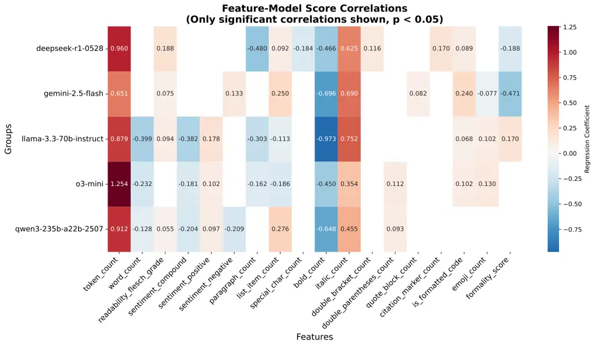
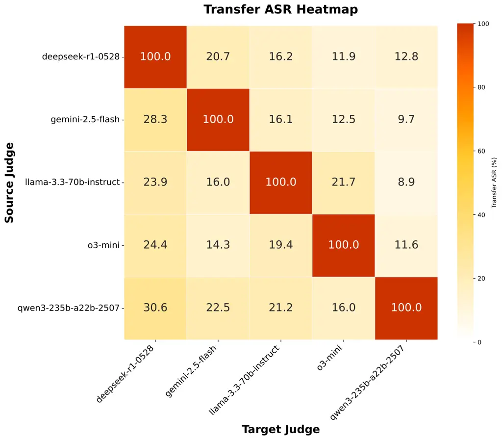

# Turning Bias into Bugs: Bandit-Guided Style Manipulation Attacks on LLM Judges

Xianglin Yang Affiliation: School of Computing, National University of
Singapore, Singapore Correspondence to: <xianglin@nus.edu.sg>    Bryan
Hooi Affiliation: School of Computing, National University of Singapore,
Singapore    Gelei Deng Affiliation: Nanyang Technological University,
Singapore    Tianwei Zhang Affiliation: Nanyang Technological
University, Singapore    Jin Song Dong Affiliation: School of Computing,
National University of Singapore, Singapore

###### Abstract

The known _stylistic biases_ in LLM judges, such as a preference for
verbosity or specific sentence structures, present an underexplored
security vulnerability. In this work, we introduce BITE (BIas
exploraTion and Exploitation), a black-box adversarial framework that
learns semantics-preserving edits to mislead an LLM judge and
artificially inflate the scores it assigns. We cast the selection of
stylistic edits as a contextual bandit problem and use a LinUCB policy
to adaptively choose edits that maximize the judge’s score without
access to model parameters or gradients. Empirically, we test BITE
across a diverse range of LLM judges and tasks, including both pointwise
and pairwise comparisons on chatbot leaderboards and AI-reviewer
benchmarks. BITE achieves an attack success rate exceeding 65% and
raises scores by 1–2 points on a 9-point scale, all while preserving
semantic equivalence. We further assess the attack’s stealthiness,
showing that BITE evades standard style-control methods and several
detection baselines. Our findings expose a fundamental weakness in the
LLM-as-a-judge paradigm and motivate robust, attack-aware evaluation.
Our code is available at
[https://github.com/xianglinyang/llm-as-a-judge-attack](https://github.com/xianglinyang/llm-as-a-judge-attack).

###### Keywords: 

Machine Learning, ICML

## 1 Introduction

The paradigm of using Large Language Models (LLMs) as automated
evaluators, or “LLM-as-a-judge,” has become a cornerstone of modern AI
research. Because this approach can offer unprecedented scalability and
cost-effectiveness, it is now central to benchmarking chatbot
performance (Zheng et al., 2023), aligning models with human
preferences (Yu et al., 2025), curating high-quality datasets, and even
automating peer review for scientific papers (Couto et al., 2024). The
promise of a consistent, on-demand evaluator has dramatically
accelerated the pace of innovation.

However, the foundation of this paradigm lies on the assumption that LLM
judges are objective and reliable. A growing body of work has begun to
challenge this assumption, revealing that these models are susceptible
to a variety of biases (Raina et al., 2024; Li et al., 2025). These
include self-preference (Panickssery et al., 2024), where an LLM favors
outputs from its own model family, and systematic preferences for
certain formats, levels of verbosity, or stylistic tones (Ye et al.,
2025; Doddapaneni et al., 2024). While these biases are acknowledged as
limitations, current research overlooks their potential as an
exploitable security vulnerability. This reframing is critical because
LLM judges are already widely deployed in high-stakes pipelines for
benchmarking, data curation, and RLHF reward model (Yu et al., 2025). In
these settings, even subtle score inflation achieved by exploiting
inherent biases can distort model leaderboards, corrupt preference
datasets, and undermine the reliability of AI evaluation (Ye et al.,
2025; Huang et al., 2025; Li et al., 2025). This raises critical,
unanswered questions: (1) Can these subtle biases be systematically
exploited to manipulate evaluation scores on demand? (2) Do different
models exhibit different sensitivities to those biases, and how can
these be characterized? (3) Can such attacks remain stealthy, evading
style control or automated defenses?

In this paper, we address these questions by turning stylistic bias not
as a passive flaw, but as an active attack surface. We introduce BITE
(BIas exploraTion and Exploitation), a novel adversarial framework that
exploits this threat by modeling an attacker as an adaptive agent. BITE
learns a personalized attack policy for any LLM judge in a purely
black-box setting. To achieve this, we cast the attack as a contextual
bandit problem (Li et al., 2010), which is a natural fit for the core
challenge of balancing the search for new biases (exploration) with the
use of known ones (exploitation). At each step, the agent observes an
answer (context), applies a semantically-preserving stylistic edit like
altering verbosity or tone (action), and uses the resulting score change
(reward) to update its strategy. Through this iterative process, BITE
uncovers each judge’s unique “vulnerability fingerprint” to maximize
score inflation.

We provide theoretical guarantees on regret bounds under model
misspecification. Empirically, our evaluation confirms the effectiveness
of BITE: it achieves attack success rates¹¹ 1 We define the attack
success rate as the percentage of cases where the stylistically modified
answer receives a strictly higher score from the LLM judge than the
original answer. of greater than 65% and raises scores by $`+1`$–$`2`$
on a 9-point scale ranging from chatbot leaderboards to AI peer review,
all while maintaining semantic equivalence. Crucially, we demonstrate
that these attacks are highly stealthy, bypassing defenses like style
control and automated detection based on judge explanations.
Furthermore, our analysis reveals that each judge exhibits a unique
vulnerability profile, making attack strategies model-specific and not
readily transferable. These results serve as a stark warning about a
fundamental vulnerability in the LLM-as-a-judge paradigm and highlight
the urgent need for more robust, attack-aware evaluation protocols.

Our contributions are as follows:

- •
  A novel, theoretically-grounded attack framework. We introduce BITE,
  which uses a contextual bandit algorithm to conduct black-box attacks
  against LLM judges, supported by theoretical guarantees for regret
  under model misspecification.
- •
  Large-scale vulnerability analysis. We conduct a large-scale empirical
  study across both standard chatbot benchmarks and the high-stakes
  domain of AI paper reviewing. Our findings show that all tested judges
  are highly vulnerable. They also exhibit unique biases, confirming the
  necessity of an adaptive attack approach like our BITE.
- •
  Demonstration of stealth and defense evasion. We show that our attacks
  are highly stealthy, preserving semantic content while bypassing key
  defenses like style control and automated detection, exposing a
  fundamental flaw in the LLM-as-a-judge paradigm.

## 2 Related Work

##### Stylistic Biases in LLM-as-a-Judge.

A significant body of work reveals that LLM judges are not impartial and
exhibit a range of systematic biases. One foundational finding is the
prevalence of self-preference, where LLMs consistently favor responses
generated by their own model family (Panickssery et al., 2024; Li et
al., 2025). Further, multiple studies compellingly show that LLM judges
awarding higher scores to specific styles outweighing substance. These
stylistic biases manifest in various forms, including: 1) Well-written
but factually incorrect responses over less polished but accurate ones
(Doddapaneni et al., 2024); 2) Longer, more verbose responses (Dubois et
al., 2024); 3) The use of lists, markdown, or even emojis (Wei et al.,
2025; Long et al., 2025; Zhang et al., 2025). While those reveal
potential limitations, we turn them into a proactive attack surface,
showing it can stealthily affect the LLM judges.

##### Attacks against LLM-as-a-Judge.

Another direction compromises LLM judges through methods like backdoor
attacks and prompt injection. For instance, BadJudge by Tong et al.
(2025) implants hidden triggers into a judge during fine-tuning to
control its outputs. Others apply universal adversarial perturbations to
user prompts to mislead the judge in a general-purpose manner (Shi et
al., 2024a). Recent work has also shown that simple heuristics can be
highly effective; (Zheng et al., 2025) found that “null models” could
achieve high win rates by exploiting fundamental flaws in evaluation
protocols. In contrast to our work, these direct attacks are generally
more overt and thus easier to detect.

## 3 Preliminary

### 3.1 LLM-as-a-Judge

We define an LLM evaluator, or a judge, as a function $`\mathcal{J}`$
that maps an evaluation context $`\mathcal{C}_{\text{eval}}`$ to a
probability distribution over a predefined label space $`\mathcal{Y}`$.
Formally,
$`\mathcal{J}:\mathcal{C}_{\text{eval}}\to\mathcal{P}(\mathcal{Y})`$.
The evaluation context typically includes a question $`Q`$ and one or
more model responses. We consider two primary evaluation modes:

- •
  Pointwise Grading: The judge assesses the quality of a single response
  answer $`A_{\text{tar}}`$ from a target model for question $`Q`$. The
  context is $`\mathcal{C}_{\text{eval}}=(Q,A_{\text{tar}})`$, and the
  label space is often a numerical score range, e.g.,
  $`\mathcal{Y}=\{1,2,\dots,5\}`$ as in MT-Bench (Zheng et al., 2023).
- •
  Pairwise Comparison: The judge compares a target response
  $`A_{\text{tar}}`$ against a reference response $`A_{\text{ref}}`$.
  The context is
  $`\mathcal{C}_{\text{eval}}=(Q,A_{\text{ref}},A_{\text{tar}})`$, and
  the label space represents a preference, e.g.,
  $`\mathcal{Y}=\{\text{Win, Tie, Lose}\}`$, used to compute win rates
  as in AlpacaEval (Dubois et al., 2024).

In practice, $`\mathcal{J}`$ is realized by an LLM backbone, prompted or
fine-tuned to act as a scalable and reproducible proxy for human
judgment, enabling the automated evaluation of LLM capabilities (Jung et
al., 2025; Liu et al., 2024b).

### 3.2 Threat Model

Adversary’s Goal. Given a base answer $`a`$ for a question $`q`$, the
adversary’s goal is to apply stylistic modifications to $`a`$ to create
a new answer $`a^{\prime}`$ that maximizes the score awarded by a
black-box judge $`\mathcal{J}`$, while preserving the original semantic
content of $`a`$. The significance of this threat is profound because
LLM judges are already widely deployed in critical pipelines for
benchmarking, data curation, and RLHF (Yu et al., 2025). A successful
attack that inflates scores, even subtly, can therefore distort model
leaderboards, corrupt preference datasets used for AI alignment, and
undermine the integrity of high-stakes evaluations like automated peer
review (Ye et al., 2025; Huang et al., 2025; Li et al., 2025; Ellison,
2025).

Adversary’s Capabilities. We model a realistic adversary with
constrained capabilities to demonstrate a practical threat to emerging
AI evaluation ecosystems. The adversary operates under a strict
black-box assumption, reflecting real-world interaction with proprietary
systems (e.g., via APIs) where internal model details are inaccessible.
Constrained by a limited query budget due to factors like API costs and
rate limits, the adversary methodically probes for biases. The attack is
facilitated by a style modification function $`\psi`$ and a predefined
set of semantically-preserving actions $`\mathcal{B}`$ (e.g., altering
verbosity or tone). In each query, the adversary applies an action
$`b\in\mathcal{B}`$ to a base answer $`a`$ to produce a modified version
$`a^{\prime}=\psi(a,b)`$. By observing the feedback from the judge on
these stylistic variants, the adversary adaptively learns which
modifications are most effective. These constrained yet practical
capabilities are sufficient to enable potent attacks, such as distorting
competitive leaderboards to artificially inflate a target model’s
ranking.

## 4 Methodology

Figure 1: Overview of BITE. The attack operates in an iterative loop. ❶
At each round $`t+1`$, a candidate answer $`a_{t}`$ is selected from the
pool to form the context. ❷ The LinUCB agent uses this context to select
the most promising stylistic bias $`b_{t}`$ from a predefined set of
strategies. ❸ An LLM agent applies this bias to generate a new candidate
answer $`a_{t+1}`$. ❹-❺ The new candidate is submitted to the external
judge (e.g., an LLM Evaluator), which returns a score $`S_{t+1}`$. ❻ The
reward, calculated as the marginal score improvement
$`r_{t+1}=S_{t+1}-S_{t}`$, is used to update the LinUCB model. ❼ The new
candidate answer and its score are added back to the pool, which is
truncated to maintain its size. This cycle refines the answers and
adapts to the judge’s biases.

We present BIas exploraTion and Exploitation (BITE), a novel attack for
exploiting stylistic biases in black-box LLM judges. We first formalize
the attack as a contextual bandit problem (Li et al., 2010) and then
detail the components of our iterative attack loop.

### 4.1 Bandit Formulation of the Attack

Attacking a black-box judge is an adaptive game of exploration and
exploitation. The adversary must explore the effects of novel stylistic
edits while simultaneously exploiting biases already known to be
effective. This tradeoff is precisely the problem studied by contextual
bandits, making it a natural and principled fit for our task.

Specifically, we model our attack as a contextual bandit problem over
$`T`$ rounds. The adversarial agent’s goal is to learn an optimal
policy, $`\pi^{*}`$, that maps a given context (the question and a
candidate answer) to the stylistic action that maximizes the score
improvement. Formally, the objective is to maximize the expected
cumulative reward:
$`\pi^{*}=\arg\max_{\pi}\mathbb{E}\left[\sum_{t=1}^{T}r_{t}\right]`$,
where the reward $`r_{t}`$ at each round is the marginal increase in the
judge’s score. This formulation allows the agent to learn a
context-sensitive attack policy in a sample-efficient manner.

### 4.2 Detailed Methodology

Our attack operates in an iterative loop, as depicted in Figure 1 and
Algorithm 1. The framework maintains a pool $`\mathcal{P}`$ of the
top-$`K`$ candidate answers found so far for a given question $`q`$,
initialized with a single base answer $`a_{0}`$. Each attack round
$`t=1,\dots,T`$ proceeds through the following steps.

##### ❶Context selection and state representation.

The loop begins by selecting a candidate answer $`a_{t-1}`$ uniformly at
random from the pool $`\mathcal{P}`$. This answer and the original
question $`q`$ form the basis of our state representation. To create a
fixed-size state representation, we encode the pair using a pretrained
embedding model (Wang et al., 2020). This state vector,
$`\bm{x}_{t}=\phi(q,a_{t-1})\in\mathbb{R}^{d}`$, captures the semantic
content needed to select an appropriate action.

❷Action selection: weaponizing known biases. Given the state
$`\bm{x}_{t}`$, the agent selects a stylistic action $`b_{t}`$ from a
discrete action space $`\mathcal{B}`$. Our core insight is to reframe
the well-documented stylistic biases of LLM judges as an exploitable
attack surface. We curate our action space $`\mathcal{B}`$ by
systematically compiling these known biases from prior literature. The
final action set consists of 8 distinct stylistic transformations
(detailed in Appendix A.1).

To manage the exploration-exploitation tradeoff, we employ the LinUCB
algorithm (Li et al., 2010). It selects the action that maximizes an
upper confidence bound on the expected reward:

```math
b_{t}=\arg\max_{b\in\mathcal{B}}\left(\bm{x}_{t}^{\top}\hat{\bm{\theta}}_{b}+\alpha\sqrt{\bm{x}_{t}^{\top}\mathbf{A}_{b}^{-1}\bm{x}_{t}}\right), \tag{1}
```

where $`\hat{\bm{\theta}}_{b}`$ is the estimated parameter vector for
action $`b`$, $`\mathbf{A}_{b}`$ is its covariance matrix, and
$`\alpha\geq 0`$ is an exploration hyperparameter.

❸-❺ Action execution and reward calculation. Once an action $`b_{t}`$ is
selected, we use a helper LLM to apply the corresponding stylistic
modification to $`a_{t-1}`$, producing a new candidate answer
$`a_{t}=\psi(a_{t-1},b_{t})`$. This candidate is then submitted to the
black-box judge $`\mathcal{J}`$ to obtain a score,
$`S_{t}=\mathcal{J}(q,a_{t})`$. The reward signal is the marginal
improvement in score: $`r_{t}=S_{t}-S_{t-1}`$, where $`S_{t-1}`$ is the
score of the parent answer $`a_{t-1}`$. This reward structure directly
incentivizes actions that cause immediate score improvement.

❻-❼ Model and pool updates. The round concludes by updating the agent’s
internal model and the candidate pool. First, the LinUCB parameters for
the chosen action $`b_{t}`$ are updated with the new observation
$`(x_{t},r_{t})`$. The covariance matrix is updated as
$`\mathbf{A}_{b_{t}}\leftarrow\mathbf{A}_{b_{t}}+\bm{x}_{t}\bm{x}_{t}^{\top}`$,
and the vector $`\bm{v}_{b_{t}}`$, which accumulates the reward-weighted
contexts, is updated via
$`\bm{v}_{b_{t}}\leftarrow\bm{v}_{b_{t}}+r_{t}\bm{x}_{t}`$. The linear
model is then re-estimated as
$`\hat{\bm{\theta}}_{b_{t}}\leftarrow\mathbf{A}_{b_{t}}^{-1}\bm{v}_{b_{t}}`$.
Second, the new candidate $`(a_{t},S_{t})`$ is added to the pool
$`\mathcal{P}`$. If the pool size exceeds $`K`$, the candidate with the
lowest score is removed. This elitist selection mechanism ensures the
pool always retains a diverse set of high-performing answers to build
upon in subsequent rounds.

1:  Input: Question $`q`$, initial answer $`a_{0}`$, pool size $`K`$,
judge $`\mathcal{J}`$, style modification function $`\psi`$.

2:  Initialize: Pool $`\mathcal{P}=\{(a_{0},S_{0})\}`$, where
$`S_{0}=\mathcal{J}(q,a_{0})`$.

3:  For each arm $`b\in\mathcal{B}`$, initialize
$`\mathbf{A}_{b}=\mathbf{I}_{d}`$ (identity matrix) and
$`\bm{v}_{b}=\bm{0}_{d\times 1}`$.

4:  for $`t=1,2,\dots,T`$ do

5:   Select an answer $`a_{t-1}`$ from the pool $`\mathcal{P}`$
randomly.

6:   Compute context $`\bm{x}_{t}=\phi(q,a_{t-1})`$.

7:   Select bias
$`b_{t}=\arg\max_{b\in\mathcal{B}}(\bm{x}_{t}^{\top}\mathbf{A}_{b}^{-1}\bm{v}_{b}+\alpha\sqrt{\bm{x}_{t}^{\top}\mathbf{A}_{b}^{-1}\bm{x}_{t}})`$.

8:   Generate new answer $`a_{t}=\psi(a_{t-1},b_{t})`$.

9:   Get new score $`S_{t}=\mathcal{J}(q,a_{t})`$ and retrieve old score
$`S_{t-1}`$ from the pool.

10:   Calculate reward $`r_{t}=S_{t}-S_{t-1}`$.

11:   /\*Update LinUCB model for the chosen arm $`b_{t}`$\*/

12:
  $`\mathbf{A}_{b_{t}}\leftarrow\mathbf{A}_{b_{t}}+\bm{x}_{t}\bm{x}_{t}^{\top}`$.

13:   $`\bm{v}_{b_{t}}\leftarrow\bm{v}_{b_{t}}+r_{t}\bm{x}_{t}`$.

14:   /\*Update the answer pool\*/

15:   Add $`(a_{t},S_{t})`$ to $`\mathcal{P}`$.

16:   if $`|\mathcal{P}|>K`$ then

17:    Remove the element with the lowest score from $`\mathcal{P}`$.

18:   end if

19:  end for

Algorithm 1 BITE Attack Execution Loop

## 5 Theoretical Analysis

##### Motivation.

We adopt a stochastic linear model because it offers a well-established
trade-off between simplicity, computational efficiency, and strong
empirical performance. However, the LLM judge’s true reward function is
likely highly non-linear. This mismatch between our linear model and the
underlying non-linear problem structure is a well-known challenge
referred to as model misspecification. Our main theoretical result is a
regret bound that explicitly accounts for this gap, ensuring BITE is
provably robust and degrades gracefully in proportion to the modeling
mismatch.

##### Setup.

At round $`t=1,2,\dots,T`$, the attacker receives a context
$`x_{t}\in\mathcal{X}\subseteq\mathbb{R}^{d}`$, chooses a style arm
$`b_{t}\in\mathcal{B}`$ (semantic-preserving edit), and observes a
reward $`y_{t}\;=\;x_{t}^{\top}\theta_{b_{t}}+\eta_{t}+m_{t}(b_{t})`$,
where $`\|x_{t}\|\leq L\leq 1`$, $`\theta_{b_{t}}\in\mathbb{R}^{d}`$ is
the parameter with $`\|\theta_{b_{t}}\|\leq S`$ for all
$`b_{t}\in\mathcal{B}`$ and $`\eta_{t}`$ is $`R`$-sub-Gaussian with
$`\mathbb{E}[\eta_{t}\mid\mathcal{F}_{t-1}]=0`$. Let
$`\zeta_{T}\geq\Big(\frac{1}{T}\sum_{t=1}^{T}m_{t}(b_{t})^{2}\Big)^{1/2}`$
be the level of the misspecification and known to the algorithm. We aim
to minimize the total pseudo-regret defined as

```math
\displaystyle R_{T}=\sum_{t=1}^{T}\max_{b\in\mathcal{B}}\langle x_{t},\theta_{b}\rangle-\langle x_{t},\theta_{b_{t}}\rangle
```

###### Theorem 5.1 (Linear regret under misspecified observations).

Let $`K=|\mathcal{B}|`$ and

```math
\displaystyle\alpha=R\sqrt{\,dK\,\log\!\Big(1+TL^{2}\Big)+2\log\tfrac{1}{\delta}\,}
```

```math
\displaystyle\qquad\quad+S+\sqrt{T}\,\zeta_{T}\,\sqrt{\,2dK\,\log\!\Big(1+TL^{2}\Big)\,}.
```

Then, with probability $`1-\delta`$, we have

```math
R_{T}=\tilde{O}\big(dK\sqrt{T}+\zeta_{T}dKT\big).
```

The proof of Theorem 5.1 is provided in Appendix C.

Our theoretical contribution is a non-trivial adaptation of the LinUCB
analysis of Abbasi-Yadkori et al. (2011) to the misspecified, multi-arm
setting induced by our LLM-judge attack. In particular, our analysis
differs from the standard setting in two key ways: (i) it allows
systematic model misspecification and derives a regret bound that
explicitly tracks the misspecification level; and (ii) it maintains a
separate linear model for each stylistic arm and controls their joint
regret in this multi-model regime. Technically, we refine the
self-normalized martingale argument of Abbasi-Yadkori et al. (2011) to
construct misspecification-aware joint confidence sets across all arms.
This yields a regret decomposition consisting of an $`O(dK\sqrt{T})`$
statistical term and an additive term linear in the misspecification
level, thereby quantifying how performance degrades as the underlying
nonlinear bias grows. We further discuss the positioning of our
technical contribution in Appendix C.1.

## 6 Experiments

In this section, we conduct a series of experiments guided by three
central research questions:

- •
  RQ1: Attack Efficacy. How effectively does BITE inflate scores from
  black-box LLM judges while preserving the original semantic content in
  diverse scenarios?
- •
  RQ2: Vulnerability Analysis. Do the leading LLM judges exhibit unique
  stylistic vulnerabilities? Is the attack transferable?
- •
  RQ3: Stealth and Mitigation. How stealthy are the generated attacks?
  Can they evade both style control defense and purpose-built detectors
  designed to identify stylistic manipulation?

### 6.1 Experimental Setup

##### Target LLM-as-a-Judge.

To assess the generalizability of our attack, we select a diverse suite
of state-of-the-art models commonly used as judges. Our targets include
both proprietary, closed-source models and leading open-source models to
ensure our findings are not specific to a single architecture or
training methodology. The judges under evaluation include: 1)
Proprietary Models: o3-mini, and Gemini-2.5-Flash; and 2) Open-Source
Models: Llama-3.3-70B-Instruct, DeepSeek-R1-0528, and Qwen3-235b-a22b.

Datasets and Initial Responses. Our experiments use two widely-used
chatbot leaderboard benchmark AlpacaEval 2.0 (Dubois et al., 2024) and
Arena-Hard-Auto (Li et al., 2024b). To isolate stylistic effects from
simple quality improvements, each attack starts from a high-quality seed
response ($`a_{0}`$). For single-answer grading, $`a_{0}`$ is generated
by GPT-4.1-mini, while GPT-4o serves as the reference model in pairwise
comparisons. Judge prompts are detailed in Appendix D.2.

##### Baselines.

We compare BITE against two distinct categories of black-box attacks: 1)
Prompt Injection Based: A suite of standard techniques designed to
hijack the LLM’s objective. This includes Naive injection, instructing
the model to Ignore Context, using Fake Completions to steer the output,
and employing Escape Characters (Chen et al., 2025b). We also include a
Null Model (Zheng et al., 2025) baseline for completeness; 2) Jailbreak
Based: State-of-the-art, optimization-based methods that iteratively
refine prompts to elicit otherwise restricted behavior. We evaluate
against PAIR (Chao et al., 2023), TAP (Mehrotra et al., 2023), and
AutoDAN (Liu et al., 2024a). Prompt injection baselines are evaluated
one-shot, while optimization-based methods (jailbreaks and BITE) are
restricted to a strict low budget (25 interactions in our experiment) to
simulate realistic black-box constraints.

In addition, we evaluate BITE against three semantically-preserving
baselines designed to ablate our core components: 1) Holistic Rewrite,
is a non-iterative heuristic where an LLM revises the initial answer for
fluency and clarity in a single pass; 2) Iterative Rewrite, ablates our
action space by using our full pool-based framework but restricting the
agent to only apply the holistic rewrite action at every step; and 3)
Random Action, is a direct policy ablation that uses our full framework
but selects actions randomly, thereby isolating the performance gain
from the LinUCB agent. Prompts for the rewriting are in Appendix D.1.

### 6.2 Attack Efficacy

#### 6.2.1 Chatbot Benchmarks

|                  |                 |       |             |           |                  |         |
| ---------------- | --------------- | ----- | ----------- | --------- | ---------------- | ------- |
| Category         | Method          | Qwen  | DeepSeek-R1 | Llama-70B | Gemini-2.5-flash | o3-mini |
| Prompt Injection | Naive           | 0.833 | 1.016       | 0.763     | 0.862            | 0.650   |
|                  | Context Ignore  | 0.650 | 0.713       | 0.764     | 0.725            | 0.727   |
|                  | Fake Completion | 1.287 | 1.214       | 1.080     | 1.089            | 1.103   |
|                  | Escape Chr      | 1.274 | 0.858       | 0.960     | 1.186            | 1.083   |
|                  | Null Model      | 0.878 | 0.423       | 0.741     | 1.092            | 1.056   |
| Jailbreak        | PAIR            | 1.284 | 1.856       | 1.233     | 1.337            | 0.869   |
|                  | TAP             | 0.622 | 0.871       | 0.656     | 0.693            | 0.519   |
|                  | AutoDAN         | 0.941 | 1.365       | 1.166     | 1.489            | 1.091   |
| Ours             | BITE            | 2.010 | 1.909       | 1.347     | 1.731            | 1.356   |

Table 1: Comparison of BITE against Black-Box Attack Baselines. We
report the average score improvement across five state-of-the-art LLM
judges. BITE consistently achieves the highest score inflation,
demonstrating its superior effectiveness.

Setup. We report the average score improvement achieved by each method
across five different LLM judges. For pointwise evaluations, we use the
judge’s raw numerical output in a scale from $`1-9`$. For pairwise
comparisons, we normalize categorical outputs to a numerical scale:
standard “win/lose” verdicts map to $`\{+1,-1\}`$, while ArenaHard’s
5-point scale maps to $`\{+2,+1,0,-1,-2\}`$. To mitigate position bias,
all pairwise evaluations are averaged over two runs with swapped answer
positions.

Results. The results in Table 1 clearly indicate that BITE is more
effective at manipulating LLM judges than traditional prompt injection
or jailbreak methods. Prompt injection and jailbreaking often rely on
adversarial prefixes or trigger phrases that modern, well-aligned LLM
judges can detect via their safety and instruction-following training.
In contrast, BITE operates on a more subtle level, manipulating the
stylistic and formatting preferences that form a core, less-guarded part
of the judge’s preference manifold.

Ablation of Bias Set and LinUCB Strategy. To isolate and understand the
respective contributions of the two core components of our BITE
framework—the curated set of stylistic biases and the adaptive LinUCB
policy—we conduct a detailed ablation study with Iterative Rewrite and
Random Action. Following the same experimental protocol above, we report
the Best-So-Far Score, tracking the maximum score achieved during the
25-round attack. A more detailed analysis, including supplementary
metrics that offer deeper insights into the attack dynamics and the
agent’s internal learning process, is provided in Appendix B.2.

Figure 2: Attack performance on chatbot benchmarks. Each plot shows the
Best-So-Far score over 25 exploration rounds. Columns correspond to five
different LLM judges, and rows correspond to four evaluation settings.
Our method, BITE (blue), consistently achieves higher scores than the
Random Action (green) and Iterative Rewrite (purple) baselines. Shaded
regions represent the standard deviation across different runs.

Figure 2 confirms that BITE (blue line) systematically inflates judge
scores, consistently outperforming both baselines across all judges and
benchmarks. The gap over the Random Action baseline (green line)
validates the effectiveness of our adaptive LinUCB policy. Furthermore,
BITE and Random Action’s superiority over the Iterative Rewrite baseline
(purple line) demonstrates that leveraging a diverse set of stylistic
actions is critical; relying on a single rewrite heuristic alone is a
far less effective strategy, particularly in pairwise comparisons.

Stealthiness via Semantic Preservation. A critical component of our
attack’s stealthiness is preserving the semantic content of the original
answer. Examples in Appendix B.5 show that our attacks preserve the
answer’s semantic content. Further, we apply LLM based similarity
validation. Our quantitative analysis shows that most attacked responses
maintain over 90% semantic similarity with their originals (full results
in Appendix B.5). This high fidelity ensures the manipulation remains
non-obvious to human evaluators.

Objective Content is Not Immune to Style Attacks. To probe the limits of
the attack, we analyze its performance on subjective versus objective
questions in Table 7 in Appendix B.4. The results reveal that BITE is
highly effective even on fact-based tasks where stylistic presentation
should be irrelevant. This finding proves that LLM judges’ evaluations
of objective correctness can be systematically biased by stylistic cues.
The contrast between the baselines reinforces this conclusion: the
Random baseline’s success over Iterative Rewrite validates the power of
our curated biases.

#### 6.2.2 Case Study: Automated Peer Review

| Judge Model            | Initial Score    | Iterative Rewrite | Random Action    | BITE (ours)               |
| ---------------------- | ---------------- | ----------------- | ---------------- | ------------------------- |
| deepseek-r1-0528       | $`5.67\pm 0.97`$ | $`6.84\pm 0.22`$  | $`7.31\pm 0.23`$ | $`\mathbf{7.63}\pm 0.29`$ |
| gemini-2.5-flash       | $`5.28\pm 0.66`$ | $`6.59\pm 0.39`$  | $`7.18\pm 0.28`$ | $`\mathbf{7.44}\pm 0.40`$ |
| llama-3.3-70b-instruct | $`7.90\pm 0.07`$ | $`8.17\pm 0.24`$  | $`8.34\pm 0.19`$ | $`\mathbf{8.38}\pm 0.18`$ |
| o3-mini                | $`7.43\pm 0.09`$ | $`7.53\pm 0.17`$  | $`7.53\pm 0.09`$ | $`\mathbf{7.67}\pm 0.17`$ |
| qwen3-235b             | $`6.01\pm 0.19`$ | $`6.37\pm 0.09`$  | $`6.43\pm 0.21`$ | $`\mathbf{6.50}\pm 0.22`$ |

Table 2: Final Review Scores on the MLRBench Case Study. BITE achieves
the highest average score against every judge. Values are reported as
mean $`\pm`$ standard deviation.

To validate our attack’s threat in a high-stakes domain, we evaluate it
on an automated paper review benchmark (Chen et al., 2025a). We ground
this case study in a practical potential future scenario where, as AI
review becomes more prevalent, conferences may adopt a centralized
review system to share resources and models. Such a shared platform
would allow an adversary to interact with the same underlying judge
across multiple venues or submission cycles, providing the necessary
interactions for our bandit algorithm to learn its biases.

Results. The results confirm that BITE is effective in this high-stakes
domain as well. As summarized in Table 2, BITE consistently achieves the
highest final review score against every judge model. This successful
application serves as a critical warning. It demonstrates that without
robust defenses, malicious actors could exploit these biases to inflate
the scores of their own submissions or deflate those of competing work,
posing a tangible threat to the integrity of scientific peer review.

### 6.3 Vulnerability Characterization and Transferability



Figure 3: Vulnerability Fingerprints of LLM Judges. This heatmap
displays regression coefficients ($`\beta`$) for various stylistic
features across judges. Red cells indicate a positive bias, while blue
cells indicate a negative bias. Only statistically significant
coefficients ($`p<0.05`$) are shown.

To answer RQ2, we first use regression analysis to identify each judge’s
sensitivity of the stylistic features on its score inflation, and then
conduct a transfer analysis to test for attack generalization across
judges.

Setup. To identify each judge’s unique “vulnerability fingerprint”, we
perform a post-hoc regression analysis. We define a set of 18 stylistic
features spanning three categories: linguistic, structural, and lexical.
For each judge, we fit a multivariate linear model to predict score
changes ($`\Delta s`$) based on changes in these features
($`\Delta f`$), following the form
$`\Delta s=\beta_{0}+\sum_{j}\beta_{j}\cdot\Delta f_{j}+\epsilon`$. The
magnitude, sign, and statistical significance of the learned
coefficients ($`\beta_{j}`$) reveal the strength and direction of each
stylistic bias, forming the judge’s unique fingerprint. A full
description of all features and detailed regression specifications are
in Appendix B.6.

Identifying Unique Vulnerability Fingerprints. Figure 3 reveals the
underlying style preferences of each judge. The regression analysis
uncovers two key findings. First, there is a near-universal bias for
verbosity and italic format, as evidenced by the consistently strong,
positive coefficients for token_count and italic_count across all
judges. This represents a systemic flaw in the current LLM-as-a-judge
paradigm. Second, beyond this shared weakness, judges exhibit unique and
often contradictory “vulnerability fingerprints.” A clear example is the
special char count feature: Gemini-2.5-flash and Qwen3-235b-a22b-2507
both favor for more special char ($`\beta\approx 0.25`$), while o3-mini
and Deepseek-R1-0528 both penalize it. These opposing preferences prove
that different models have developed idiosyncratic and exploitable
biases.



Figure 4: Heatmap of Attack Transferability. Each cell shows the Attack
Success Rate (ASR) when a policy optimized on a Source Judge (row) is
applied to a Target Judge (column). The dark red diagonal (100% ASR)
represents the successful, non-transferred attack baseline.

Transferability Analysis. To test if vulnerability fingerprints are
judge-specific, we conduct a transfer analysis. We take the final,
optimized responses from a successful attack on a source judge and
re-evaluate them on a different target judge. We then measure the
Transfer Attack Success Rate (Transfer ASR): the percentage of
successful source attacks that are also successful on the target. A low
Transfer ASR would confirm that attack policies are specialized and do
not generalize.

Figure 4 reveals two key findings about inter-model attack
transferability. First, the low off-diagonal success rates confirm that
attack policies are highly specialized, exploiting model-specific
“vulnerability fingerprints” rather than universal biases. Second,
transferability is distinctly asymmetric. For example,
qwen3-235b-a22b-2507 is a robust target yet a potent source of
generalizable attacks, while DeepSeek-R1-0528 is the most vulnerable
target overall. We hypothesize this asymmetry reflects a
“teacher-student” dynamic within the LLM ecosystem, where influential
data generators like qwen3-235b-a22b-2507 propagate their stylistic
preferences to models trained on their outputs, a form of “preference
leakage” (Li et al., 2025). This suggests our transfer analysis not only
measures security but also offers a proxy for mapping the opaque data
provenance and inherited vulnerabilities across the LLM landscape.

### 6.4 Stealth and Mitigation

To answer RQ3, we investigate whether our attack can be detected or
mitigated by existing and natural defense strategies. We first apply a
standard style-control method (Li et al., 2024a) to calibrate the judge
score by accounting for stylistic variation in the response. This allows
us to test whether the attack remains effective after controlling for
superficial style cues that may bias the LLM judge. In addition, we
evaluate several prompt-based defenses designed to reduce the judge’s
sensitivity to attack-induced stylistic manipulations, including
randomized prompting, rewriting-based defense, and non-linear style
control. Due to space constraints, we defer the full descriptions and
implementation details of these defense methods to Appendix B.7.3.

Setup of Style Control Defense. We adapt the widely used style-control
defense of Li et al. (2024a) to assess whether our attack can be
mitigated by explicitly correcting for stylistic bias in the judge’s
score. The key idea of this defense is to estimate how much of the
judge’s score can be explained by simple, surface-level stylistic
features (i.e., length, headers), and then remove this estimated
contribution from the final evaluation.

We leave the replication and implementation details of this defense to
Appendix B.7.1. In the main results, we report the average score
achieved by each attack strategy both Before Style Control,
corresponding to the original uncalibrated score assigned by the judge,
and After Style Control, corresponding to the calibrated score after
subtracting the estimated style contribution. This comparison allows us
to evaluate whether the observed gains from our attack persist even
after accounting for simple stylistic confounders.

Figure 5: Effect of style-control defense on attack performance. We
compare the average judge scores of each strategy before and after
style-control calibration. Before Style Control denotes the original
judge score, while After Style Control denotes the calibrated score
after removing the estimated contribution of simple stylistic features
such as length and headers.

Results. Figure 5 demonstrates that the style-control defense is largely
ineffective. The calibrated scores (blue bars) remain nearly identical
to the originals (orange bars). This strongly suggests that our method
learns to exploit stylistic biases that are far more nuanced than the
simple features this defense is designed to capture. Results from the
non-linear version of the style control lead to the same conclusion
(Appendix B.7.3).

## 7 Conclusion

In this work, we demonstrate that stylistic biases in LLM judges can be
systematically leveraged for adversarial attacks. Our framework BITE
provides a theoretically-grounded and empirically powerful method to
achieve this, successfully inflating scores across a range of benchmarks
by exploiting model-specific vulnerabilities. The success of BITE
reveals a critical threat to the reliability of the entire
LLM-as-a-judge paradigm, with direct implications for the integrity of
model leaderboards, RLHF data pipelines, and automated peer review. Our
findings underscore the urgent need for the community to develop
fundamentally more robust and attack-aware evaluation systems.

## Acknowledgements

This work was supported by the National Research Foundation, Singapore,
and Cyber Security Agency of Singapore under its National Cybersecurity
R&D Programme and CyberSG R&D Cyber Research Programme Office. Any
opinions, findings, and conclusions or recommendations expressed in this
material are those of the author(s) and do not necessarily reflect the
views of National Research Foundation, Singapore, Cyber Security Agency
of Singapore as well as CyberSG R&D Programme Office, Singapore. This
research/project is also supported by AI Singapore under the AISG Stage
1B Grant (WBS A-8002158-01-00).

## Impact Statement

As the field increasingly relies on LLM-as-a-Judge paradigms for
scalable evaluation, ensuring the reliability and validity of these
automated metrics is paramount. Our work serves as a diagnostic audit of
current evaluation pipelines, revealing that existing judge models often
conflate stylistic presentation with semantic quality. By characterizing
this “stylistic bias” through the BITE framework, we highlight a
critical challenge in maintaining the integrity of public leaderboards
and automated benchmarks.

While we demonstrate that judge scores can be optimized via black-box
interactions, our primary motivation is to prevent the silent misuse of
automated judges. If left unaddressed, these vulnerabilities could lead
to a misalignment where models are incentivized to pursue superficial
formatting over reasoning capability, resulting in inflated rankings and
market distortions. Our research provides the necessary empirical
groundwork for developing style-invariant evaluators and more robust
defense mechanisms.

## References

- Abbasi-Yadkori et al. (2011) Y. Abbasi-Yadkori, D. Pál, and C.
  Szepesvári Improved algorithms for linear stochastic bandits. Advances
  in neural information processing systems 24. Cited by: §C.1, Appendix
  C, §5.
- AI (2024) F. AIFlow judge: an open small language model for llm system
  evaluations(Website) External Links:
  [Link](https://www.flow-ai.com/blog/flow-judge) Cited by: §D.2.
- Chao et al. (2023) P. Chao, A. Robey, E. Dobriban, H. Hassani, G. J.
  Pappas, and E. Wong Jailbreaking black box large language models in
  twenty queries. External Links: 2310.08419 Cited by: §6.1.
- Chen et al. (2024) G. H. Chen, S. Chen, Z. Liu, F. Jiang, and B. Wang
  Humans or LLMs as the judge? a study on judgement bias. In Proceedings
  of the 2024 Conference on Empirical Methods in Natural Language
  Processing, Y. Al-Onaizan, M. Bansal, and Y. Chen (Eds.), Miami,
  Florida, USA, pp. 8301–8327. External Links:
  [Link](https://aclanthology.org/2024.emnlp-main.474/),
  [Document](https://dx.doi.org/10.18653/v1/2024.emnlp-main.474) Cited
  by: §A.1, Table 3, Table 3, Table 3.
- Chen et al. (2025a) H. Chen, M. Xiong, Y. Lu, W. Han, A. Deng, Y.
  He, J. Wu, Y. Li, Y. Liu, and B. Hooi MLR-bench: evaluating ai agents
  on open-ended machine learning research. External Links: 2505.19955,
  [Link](https://arxiv.org/abs/2505.19955) Cited by: §D.2, §6.2.2.
- Chen et al. (2025b) Y. Chen, H. Li, Z. Zheng, D. Wu, Y. Song, and B.
  Hooi Defense against prompt injection attack by leveraging attack
  techniques. In Proceedings of the 63rd Annual Meeting of the
  Association for Computational Linguistics (Volume 1: Long Papers), W.
  Che, J. Nabende, E. Shutova, and M. T. Pilehvar (Eds.), Vienna,
  Austria, pp. 18331–18347. External Links:
  [Link](https://aclanthology.org/2025.acl-long.897/),
  [Document](https://dx.doi.org/10.18653/v1/2025.acl-long.897), ISBN
  979-8-89176-251-0 Cited by: §6.1.
- Couto et al. (2024) P. H. Couto, Q. P. Ho, N. Kumari, B. K.
  Rachmat, T. G. H. Khuong, I. Ullah, and L. Sun-Hosoya
  RelevAI-reviewer: a benchmark on ai reviewers for survey paper
  relevance. External Links: 2406.10294,
  [Link](https://arxiv.org/abs/2406.10294) Cited by: §1.
- Doddapaneni et al. (2024) S. Doddapaneni, M. S. U. R. Khan, S. Verma,
  and M. M. Khapra Finding blind spots in evaluator LLMs with
  interpretable checklists. In Proceedings of the 2024 Conference on
  Empirical Methods in Natural Language Processing, Y. Al-Onaizan, M.
  Bansal, and Y. Chen (Eds.), Miami, Florida, USA, pp. 16279–16309.
  External Links: [Link](https://aclanthology.org/2024.emnlp-main.911/),
  [Document](https://dx.doi.org/10.18653/v1/2024.emnlp-main.911) Cited
  by: §1, §2.
- Dubois et al. (2024) Y. Dubois, P. Liang, and T. Hashimoto
  Length-controlled alpacaeval: a simple debiasing of automatic
  evaluators. In First Conference on Language Modeling, External Links:
  [Link](https://openreview.net/forum?id=CybBmzWBX0) Cited by: Table 3,
  §D.2, §2, 2nd item, §6.1.
- Ellison (2025) M. EllisonAAAI launches ai-powered peer review
  assessment system(Website) External Links:
  [Link](https://aaai.org/aaai-launches-ai-powered-peer-review-assessment-system/)
  Cited by: §3.2.
- Feuer et al. (2025) B. Feuer, M. Goldblum, T. Datta, S. Nambiar, R.
  Besaleli, S. Dooley, M. Cembalest, and J. P. Dickerson Style outweighs
  substance: failure modes of LLM judges in alignment benchmarking. In
  The Thirteenth International Conference on Learning Representations,
  External Links: [Link](https://openreview.net/forum?id=MzHNftnAM1)
  Cited by: Table 3.
- Foster et al. (2020) D. J. Foster, C. Gentile, M. Mohri, and J.
  Zimmert Adapting to misspecification in contextual bandits. Advances
  in Neural Information Processing Systems 33, pp. 11478–11489. Cited
  by: §C.1.
- Ghosh et al. (2017) A. Ghosh, S. R. Chowdhury, and A. Gopalan
  Misspecified linear bandits. External Links: 1704.06880,
  [Link](https://arxiv.org/abs/1704.06880) Cited by: §C.1.
- Huang et al. (2025) Y. Huang, M. Nasr, A. N. Angelopoulos, N.
  Carlini, W. Chiang, C. A. Choquette-Choo, D. Ippolito, M.
  Jagielski, K. Lee, K. Liu, I. Stoica, F. Tramèr, and C. Zhang
  Exploring and mitigating adversarial manipulation of voting-based
  leaderboards. In Forty-second International Conference on Machine
  Learning, External Links:
  [Link](https://openreview.net/forum?id=zf9zwCRKyP) Cited by: §1, §3.2.
- Jung et al. (2025) J. Jung, F. Brahman, and Y. Choi Trust or escalate:
  LLM judges with provable guarantees for human agreement. In The
  Thirteenth International Conference on Learning Representations,
  External Links: [Link](https://openreview.net/forum?id=UHPnqSTBPO)
  Cited by: §3.1.
- Li et al. (2025) D. Li, R. Sun, Y. Huang, M. Zhong, B. Jiang, J.
  Han, X. Zhang, W. Wang, and H. Liu Preference leakage: a contamination
  problem in llm-as-a-judge. External Links: 2502.01534,
  [Link](https://arxiv.org/abs/2502.01534) Cited by: §1, §2, §3.2, §6.3.
- Li et al. (2010) L. Li, W. Chu, J. Langford, and R. E. Schapire A
  contextual-bandit approach to personalized news article
  recommendation. In Proceedings of the 19th International Conference on
  World Wide Web, WWW ’10, New York, NY, USA, pp. 661–670. External
  Links: ISBN 9781605587998,
  [Link](https://doi.org/10.1145/1772690.1772758),
  [Document](https://dx.doi.org/10.1145/1772690.1772758) Cited by: §1,
  §4.2, §4.
- Li et al. (2024a) T. Li, A. Angelopoulos, and W. ChiangDoes style
  matter? disentangling style and substance in chatbot arena(Website)
  External Links:
  [Link](https://lmsys.org/blog/2024-08-28-style-control) Cited by:
  §B.7.1, §6.4, §6.4.
- Li et al. (2024b) T. Li, W. Chiang, E. Frick, L. Dunlap, T. Wu, B.
  Zhu, J. E. Gonzalez, and I. Stoica From crowdsourced data to
  high-quality benchmarks: arena-hard and benchbuilder pipeline.
  External Links: 2406.11939, [Link](https://arxiv.org/abs/2406.11939)
  Cited by: §D.2, §6.1.
- Liu et al. (2024a) X. Liu, N. Xu, M. Chen, and C. Xiao AutoDAN:
  generating stealthy jailbreak prompts on aligned large language
  models. In The Twelfth International Conference on Learning
  Representations, External Links:
  [Link](https://openreview.net/forum?id=7Jwpw4qKkb) Cited by: §6.1.
- Liu et al. (2024b) Y. Liu, H. Zhou, Z. Guo, E. Shareghi, I. Vulić, A.
  Korhonen, and N. Collier Aligning with human judgement: the role of
  pairwise preference in large language model evaluators. In First
  Conference on Language Modeling, External Links:
  [Link](https://openreview.net/forum?id=9gdZI7c6yr) Cited by: §3.1.
- Long et al. (2025) D. X. Long, N. Nguyen, T. Sim, H. Dao, S. Joty, K.
  Kawaguchi, N. F. Chen, and M. Kan LLMs are biased towards output
  formats! systematically evaluating and mitigating output format bias
  of LLMs. In Proceedings of the 2025 Conference of the Nations of the
  Americas Chapter of the Association for Computational Linguistics:
  Human Language Technologies (Volume 1: Long Papers), L. Chiruzzo, A.
  Ritter, and L. Wang (Eds.), Albuquerque, New Mexico, pp. 299–330.
  External Links: [Link](https://aclanthology.org/2025.naacl-long.15/),
  [Document](https://dx.doi.org/10.18653/v1/2025.naacl-long.15), ISBN
  979-8-89176-189-6 Cited by: §2.
- Mehrotra et al. (2023) A. Mehrotra, M. Zampetakis, P. Kassianik, B.
  Nelson, H. Anderson, Y. Singer, and A. Karbasi Tree of attacks:
  jailbreaking black-box llms automatically. Cited by: §6.1.
- OpenAI (2025) OpenAIPrompt injection detection(Website) External
  Links:
  [Link](https://openai.github.io/openai-guardrails-python/ref/checks/prompt_injection_detection/)
  Cited by: §B.7.2.
- Panickssery et al. (2024) A. Panickssery, S. R. Bowman, and S. Feng
  LLM evaluators recognize and favor their own generations. In The
  Thirty-eighth Annual Conference on Neural Information Processing
  Systems, External Links:
  [Link](https://openreview.net/forum?id=4NJBV6Wp0h) Cited by: §1, §2.
- Raina et al. (2024) V. Raina, A. Liusie, and M. Gales Is
  LLM-as-a-judge robust? investigating universal adversarial attacks on
  zero-shot LLM assessment. In Proceedings of the 2024 Conference on
  Empirical Methods in Natural Language Processing, Y. Al-Onaizan, M.
  Bansal, and Y. Chen (Eds.), Miami, Florida, USA, pp. 7499–7517.
  External Links: [Link](https://aclanthology.org/2024.emnlp-main.427/),
  [Document](https://dx.doi.org/10.18653/v1/2024.emnlp-main.427) Cited
  by: §1.
- Shi et al. (2024a) J. Shi, Z. Yuan, Y. Liu, Y. Huang, P. Zhou, L. Sun,
  and N. Z. Gong Optimization-based prompt injection attack to
  llm-as-a-judge. In Proceedings of the 2024 on ACM SIGSAC Conference on
  Computer and Communications Security, CCS ’24, New York, NY, USA,
  pp. 660–674. External Links: ISBN 9798400706363,
  [Link](https://doi.org/10.1145/3658644.3690291),
  [Document](https://dx.doi.org/10.1145/3658644.3690291) Cited by: §2.
- Shi et al. (2024b) J. Shi, Z. Yuan, Y. Liu, Y. Huang, P. Zhou, L. Sun,
  and N. Z. Gong Optimization-based prompt injection attack to
  llm-as-a-judge. In Proceedings of the 2024 on ACM SIGSAC Conference on
  Computer and Communications Security, pp. 660–674. Cited by: §B.8.
- Tong et al. (2025) T. Tong, F. Wang, Z. Zhao, and M. Chen BadJudge:
  backdoor vulnerabilities of llm-as-a-judge. External Links:
  2503.00596, [Link](https://arxiv.org/abs/2503.00596) Cited by: §2.
- Wang et al. (2025) Q. Wang, Z. Lou, Z. Tang, N. Chen, X. Zhao, W.
  Zhang, D. Song, and B. He Assessing judging bias in large reasoning
  models: an empirical study. External Links: 2504.09946,
  [Link](https://arxiv.org/abs/2504.09946) Cited by: Table 3, Table 3,
  Table 3.
- Wang et al. (2020) W. Wang, F. Wei, L. Dong, H. Bao, N. Yang, and M.
  Zhou MINILM: deep self-attention distillation for task-agnostic
  compression of pre-trained transformers. In Proceedings of the 34th
  International Conference on Neural Information Processing Systems,
  NIPS ’20, Red Hook, NY, USA. External Links: ISBN 9781713829546 Cited
  by: 3rd item, §4.2.
- Wei et al. (2025) Z. Wei, Y. Liu, and N. B. Erichson Emoji attack:
  enhancing jailbreak attacks against judge LLM detection. In
  Forty-second International Conference on Machine Learning, External
  Links: [Link](https://openreview.net/forum?id=Q0rKYiVEZq) Cited by:
  Table 3, §2.
- Ye et al. (2025) J. Ye, Y. Wang, Y. Huang, D. Chen, Q. Zhang, N.
  Moniz, T. Gao, W. Geyer, C. Huang, P. Chen, N. V. Chawla, and X. Zhang
  Justice or prejudice? quantifying biases in LLM-as-a-judge. In The
  Thirteenth International Conference on Learning Representations,
  External Links: [Link](https://openreview.net/forum?id=3GTtZFiajM)
  Cited by: Table 3, Table 3, §1, §3.2.
- Yu et al. (2025) R. Yu, S. Wan, Y. Wang, C. Gao, L. Gan, Z. Zhang,
  and D. Zhan Reward models in deep reinforcement learning: a survey.
  External Links: 2506.15421, [Link](https://arxiv.org/abs/2506.15421)
  Cited by: §1, §1, §3.2.
- Zhang et al. (2023) W. Zhang, J. He, Z. Fan, and Q. Gu On the
  interplay between misspecification and sub-optimality gap in linear
  contextual bandits. In International Conference on Machine Learning,
  pp. 41111–41132. Cited by: §C.1.
- Zhang et al. (2025) X. Zhang, W. Xiong, L. Chen, T. Zhou, H. Huang,
  and T. Zhang From lists to emojis: how format bias affects model
  alignment. In Proceedings of the 63rd Annual Meeting of the
  Association for Computational Linguistics (Volume 1: Long Papers), W.
  Che, J. Nabende, E. Shutova, and M. T. Pilehvar (Eds.), Vienna,
  Austria, pp. 26940–26961. External Links:
  [Link](https://aclanthology.org/2025.acl-long.1308/),
  [Document](https://dx.doi.org/10.18653/v1/2025.acl-long.1308), ISBN
  979-8-89176-251-0 Cited by: §2.
- Zheng et al. (2023) L. Zheng, W. Chiang, Y. Sheng, S. Zhuang, Z.
  Wu, Y. Zhuang, Z. Lin, Z. Li, D. Li, E. Xing, H. Zhang, J. E.
  Gonzalez, and I. Stoica Judging LLM-as-a-judge with MT-bench and
  chatbot arena. In Thirty-seventh Conference on Neural Information
  Processing Systems Datasets and Benchmarks Track, External Links:
  [Link](https://openreview.net/forum?id=uccHPGDlao) Cited by: §1, 1st
  item.
- Zheng et al. (2025) X. Zheng, T. Pang, C. Du, Q. Liu, J. Jiang, and M.
  Lin Cheating automatic LLM benchmarks: null models achieve high win
  rates. In The Thirteenth International Conference on Learning
  Representations, External Links:
  [Link](https://openreview.net/forum?id=syThiTmWWm) Cited by: §2, §6.1.

## Appendix A Details on Stylistic Edits

### A.1 Stylistic Bias Collection

This section provides a detailed overview of the specific biases
considered and analyzed in our study. These biases represent systematic
tendencies in Large Language Model (LLM) preference judges, where a
model may favor certain responses based on stylistic, structural, or
cognitive heuristics, rather than on the intrinsic quality or factual
correctness of the information presented. The selection of these biases
is grounded in a review of recent literature on LLM evaluation,
alignment, and the challenges of preference modeling.

To provide clarity and context for our experiments, Table 3 details each
bias with the following components:

- •
  A concise Description of the bias and how it influences LLM judgment.
- •
  A practical Example that illustrates the type of response an LLM judge
  might unfairly favor.
- •
  A Source/Citation linking the bias to a key paper that has identified,
  analyzed, or discussed the phenomenon.

##### Non-Stylistic Biases.

We acknowledge that LLM judges are susceptible to a wide range of biases
beyond the stylistic ones we target. For example, Chen et al. (2024)
identifies the “Fallacy Oversight Bias”, which falls under the category
of cognitive failure. We deliberately exclude such biases as BITE’s core
assumption is to manipulate scores while strictly preserving the
semantic and logical content of the original answer.

Similarly, we exclude societal biases like “Gender Bias”. Our work
focuses on universal formatting and tonal cues that can be applied to
any text, rather than context-dependent identity markers. While this is
outside our current scope, our framework could easily incorporate gender
features as additional inputs.

[TABLE]

Table 3: Explanation and Sources of Biases in LLM Preference Judgments

### A.2 Prompts used to apply the style modifications.

In this section, we detail the prompts we used to apply each of the
style modification.


Figure 6: Sentiment Prompt.


Figure 7: Authority Prompt.


Figure 8: Markdown Prompt.


Figure 9: Verbosity Prompt.


Figure 10: Bandwagon Prompt.


Figure 11: Distraction Prompt.


Figure 12: Json Prompt.


Figure 13: Emoji Prompt.

## Appendix B More on Experiments

### B.1 Hyperparameter Setup for BITE

##### BITE Configuration and Hyperparameters.

Our BITE agent is configured as described in Section 4. The key
hyperparameters are set to simulate a realistic and resource-constrained
attack scenario:

- •
  Bias Strategies (Arms): We curated our action space $`\mathcal{B}`$ by
  systematically compiling known biases from prior literature. These
  include modifying verbosity (length), adjusting tone (formal/casual),
  altering structure (e.g., adding headers, lists), and incorporating
  stylistic elements (e.g., emojis, markdown). A detailed description
  can be found in Table 3.
- •
  Stylistic Modification $`\psi`$: We use Gemini-1.5-Flash-8B as the
  helper model to execute the stylistic rewrites. This model was chosen
  for its instruction-following capabilities and cost-effectiveness.
- •
  Context Features: The context vector is generated by the pre-trained
  sentence embedding model all-MiniLM-L6-v2 (Wang et al., 2020).
- •
  Attack Budget: To simulate a practical constraint on API costs and
  interaction time, we set a query budget of $`T=25`$ rounds per attack.
  The candidate pool size is set to $`K=3`$ to maintain a small,
  high-quality set of answers for refinement.

### B.2 Additional Experiment in RQ1

##### Supplementary Metrics.

To answer RQ1, we report the Best So Far metric in our main text. To
provide a holistic understanding of the attack’s dynamics and the
agent’s behavior, we evaluate a comprehensive suite of supplementary
metrics. These metrics can be broadly categorized into three groups:

- •
  Overall Attack Efficacy: Metrics that directly measure the success of
  the attack, including the primary Unbeaten Rate for pairwise
  evaluations between different attack strategies.
- •
  Candidate Pool Dynamics: Metrics that describe the quality and
  evolution of the set of answers being refined, that is the Pool Mean
  score.
- •
  BITE’s Internal Learning Process: Metrics that offer insight into the
  bandit agent’s state, tracked via the CI Width.

Table 4 provides formal definitions, computation methods, and
interpretations for each of these key indicators.

| Metric        | Computation                                                                 | Interpretation                                                                                                                                                                                                                                                    |
| ------------- | --------------------------------------------------------------------------- | ----------------------------------------------------------------------------------------------------------------------------------------------------------------------------------------------------------------------------------------------------------------- | --------------------------------- | ------------------------------------------------------------------------------------------------------------------------------------------------------------------------------------------------------------------ |
| Best So Far   | $`\max_{i=0,\dots,t}S_{i}`$                                                 | Measures the efficacy of the attack. It is the highest score achieved by any candidate answer up to the current round $`t`$. A consistently increasing curve indicates successful exploration and exploitation.                                                   |
| Pool Mean     | $`\frac{1}{                                                                 | \mathcal{P}\_{t}                                                                                                                                                                                                                                                  | }\sum*{a\in\mathcal{P}*{t}}S(a)`$ | Indicates the overall quality of the candidate pool $`\mathcal{P}_{t}`$ at round $`t`$. A high and stable pool mean suggests the attack is consistently finding high-quality answers, not just a single lucky one. |
| Unbeaten Rate | $`\frac{\text{\# Wins + \# Ties for {BITE}}}{\text{\# Total Comparisons}}`$ | Measures the dominance and reliability of our method. In a head-to-head comparison, it is the fraction of times BITE’s final answer is judged as better than or equivalent to (a win or a tie) a baseline’s answer. A high rate indicates consistent superiority. |
| CI Width      | $`\alpha\sqrt{\bm{x}_{t}^{\top}\mathbf{A}_{b_{t}}^{-1}\bm{x}_{t}}`$         | Represents the agent’s uncertainty about an arm’s reward. It is the exploration bonus in the UCB formula. A high value encourages exploration, and it naturally decreases as an arm is selected more frequently.                                                  |

Table 4: Definition of Key Evaluation Metrics. This table provides a
comprehensive overview of the metrics used to evaluate the performance
and dynamics of our attack framework.

The Pool Mean Score measures the average quality of the candidate
answers being actively refined by the attacker. A consistently high and
increasing pool mean indicates that the agent is not just finding a
single lucky answer but is maintaining a robust set of high-quality
solutions. Figure 14 illustrates the average score of the candidate pool
over time.

The results in Figure 14 clearly demonstrate the superiority of our
adaptive approach. Across all judges and datasets, BITE (blue line)
consistently maintains a higher average pool score than both the Random
and Iterative Rewrite baselines. This proves that our intelligent agent
is more effective at discovering and retaining high-scoring answers. The
steadily increasing curve for BITE shows that the quality of the entire
candidate set improves over time, whereas the flat line for the
Iteractive Rewrite highlights the limitation of a non-iterative approach
that cannot refine its solutions.

Figure 14: The Pool Mean Score Across All Judges.

##### Analysis of BITE Uncertainty and Learning.

The CI-Width (Confidence Interval Width) is the exploration bonus term
in the LinUCB formula, representing the agent’s uncertainty about the
effectiveness of different stylistic biases. A key indicator of a
successful learning process is that this uncertainty should decrease as
the agent gathers more data through exploration.

Figure 15: The CI-Width Score Across All Judges.

Figure 15 provides direct and unambiguous evidence that our agent is
learning as expected. The CI-Width for BITE (blue line) consistently and
smoothly decreases over the 25 exploration rounds in every experimental
setting. This shows that as the agent interacts with the judge, it
becomes progressively more confident in its estimates of which stylistic
biases are effective, thereby transitioning from exploration to
exploitation.

##### Head-to-Head Comparison with Baselines.

To definitively establish our method’s superiority, we conducted a
head-to-head tournament comparing the final answers from BITE against
our baselines. The results in Table 5 are decisive. BITE dominates both
baselines, achieving a 92.96% unbeaten rate against Iterative Rewrite
and a 90.88% unbeaten rate against Random Action. The large, positive
score differences further quantify this success. These results provide
robust, large-scale evidence that our adaptive, iterative strategy is
significantly more effective and reliable at exploiting stylistic biases
than both strong, non-adaptive heuristics and random exploration.

| Comparison                 | Unbeaten Rate (%) $`\uparrow`$ | Avg. Score Diff. $`\uparrow`$ |
| -------------------------- | ------------------------------ | ----------------------------- |
| BITE vs. Iterative Rewrite | 92.96%                         | +0.393                        |
| BITE vs. Random            | 90.88%                         | +0.105                        |

Table 5: Head-to-Head Tournament: BITE vs. Baselines. Results from a
direct pairwise comparison between the final answers generated by BITE
and each baseline, aggregated across all judges and datasets. The
Unbeaten Rate is the percentage of times BITE’s answer won or tied.

##### Ablation on the Helper Model

We conduct an additional ablation to examine whether the effectiveness
of BITE depends on the choice of the helper model. In this experiment,
we fix the judge model as Qwen3-235B and compare two different helper
agents, Gemini-1.5-Flash-8B and GPT-4.1-Nano, under both the pointwise
and pairwise settings. The results are shown in Table 6.

| Setting   | Helper Agent        | Score Improvement |
| --------- | ------------------- | ----------------- |
| Pointwise | Gemini-1.5-Flash-8B | 2.69              |
| Pointwise | GPT-4.1-Nano        | 2.87              |
| Pairwise  | Gemini-1.5-Flash-8B | 1.42              |
| Pairwise  | GPT-4.1-Nano        | 1.48              |

Table 6: Ablation on the helper model with Qwen3-235B as the fixed
judge. BITE achieves consistent score improvements with both helper
agents across pointwise and pairwise settings, suggesting that its
effectiveness does not rely on a specific helper model.

The score improvement remains consistent across both settings and both
helper models. These results suggest that BITE does not depend on a
specific helper model to succeed. Instead, the helper model mainly
affects the quality of style-preserving rewrites at the margin. The core
vulnerability exploited by BITE lies in the judge model’s stylistic bias
and the adaptive exploration mechanism of BITE, rather than in the
particular choice of helper agent.

### B.3 MLRBench Setup in RQ1

Using the MLRBench setup, we generated initial reviews for papers
created by models including Gemini-2.5-Pro, Claude-3.7-Sonnet, and
o4-mini. The review prompts were kept identical to those reported in the
original benchmark. The task was to take a competent initial review and
use BITE and our baselines to stylistically modify it, with the goal of
inflating the final score assigned by an LLM judge.

### B.4 Question Type Analysis Results in RQ1

We evaluate whether the effectiveness of BITE depends on the
subjectivity of the question being judged. Style-based attacks might be
expected to have a stronger effect on subjective questions, where
multiple answers can be reasonable and the judge may naturally rely on
criteria such as clarity, persuasiveness, or presentation quality. In
contrast, objective questions are fact-based and should, in principle,
be evaluated primarily according to factual correctness. This setting
therefore provides a stricter test of whether stylistic cues can
influence LLM judges even when style should be largely irrelevant.

##### Setup.

To study this question, we divide the evaluation instances into
subjective and objective questions. Subjective questions involve
open-ended or preference-dependent evaluation criteria, whereas
objective questions have more clearly defined factual answers. We then
run the same methods as in the main experiments on each subset: Holistic
Rewrite, Iterative Rewrite, Random Action, BITE.

##### Results.

Table 7 presents the results. Across both subjective and objective
questions, BITE achieves strong performance, indicating that its
effectiveness is not limited to inherently subjective evaluation
settings. Notably, BITE remains highly effective on objective questions,
where factual correctness should dominate the judge’s decision. This
suggests that LLM judges can be systematically biased by stylistic
presentation even when evaluating fact-based content. In addition, the
Random baseline’s advantage over Iterative Rewrite shows that the
curated style biases alone already provide a strong attack signal, while
the further improvement of BITE demonstrates the benefit of adaptively
exploiting these biases.

|            |                   |           |      |            |      |
| ---------- | ----------------- | --------- | ---- | ---------- | ---- |
| Dataset    | Attack            | Objective |      | Subjective |      |
|            |                   | ASR (%) ↑ | SL ↑ | ASR (%) ↑  | SL ↑ |
| AlpacaEval |                   |           |      |            |      |
| Pointwise  | Holistic Rewrite  | 64.1      | 1.38 | 55.4       | 0.90 |
|            | Iterative Rewrite | 78.3      | 1.86 | 66.7       | 1.09 |
|            | Random            | 94.8      | 2.73 | 96.1       | 1.81 |
|            | BITE (ours)       | 96.0      | 2.85 | 97.3       | 1.85 |
| Pairwise   | Holistic Rewrite  | 32.7      | 0.44 | 27.7       | 0.35 |
|            | Iterative Rewrite | 49.5      | 0.63 | 45.6       | 0.56 |
|            | Random            | 64.7      | 1.02 | 61.8       | 0.97 |
|            | BITE (ours)       | 69.5      | 1.11 | 65.0       | 1.06 |
| ArenaHard  |                   |           |      |            |      |
| Pointwise  | Holistic Rewrite  | 70.2      | 2.17 | 61.9       | 1.25 |
|            | Iterative Rewrite | 86.5      | 3.02 | 75.4       | 1.66 |
|            | Random            | 91.2      | 3.70 | 91.0       | 2.18 |
|            | BITE (ours)       | 95.8      | 3.82 | 94.1       | 2.27 |
| Pairwise   | Holistic Rewrite  | 54.0      | 0.90 | 39.9       | 0.69 |
|            | Iterative Rewrite | 69.6      | 1.33 | 53.1       | 1.03 |
|            | Random            | 69.3      | 1.30 | 74.9       | 1.46 |
|            | BITE (ours)       | 76.9      | 1.49 | 79.4       | 1.61 |

Table 7: Attack Performance by Question Category. Attack Success Rate
(ASR) is the percentage of attacks where the final score improves by
$`\geq 1`$ point (pointwise) or the preference verdict is flipped in our
favor (pairwise). Score Lift (SL) is the average score increase over the
initial answer. BITE consistently achieves the highest ASR and SL across
all datasets, evaluation types, and question categories, including
objective ones.

### B.5 Semantic-Preservation Validation in RQ1

To ensure the attacked samples are semantically similar to the original
one, we explicitly instruct the rewrite agent NOT to change the meaning
of the text. The prompt is shown in Figure 17. Further, we conduct two
similarity analyses to validate the semantic preservation of stylistic
edits.

##### LLM validation.

We conducted a robust, human-proximate evaluation using GPT-5 to measure
semantic equivalence on a per-edit basis (we ask the GPT-5 to give
verbal similarity scores ranging from $`[-1,1]`$). As shown in Table 8,
our analysis confirms that stylistic edits preserve meaning with
near-perfect accuracy; formatting and verbosity-related attacks such as
JSON, Bullet-point list, and Verbosity achieved perfect similarity
scores of $`1.000`$. More complex rhetorical shifts validated our
intuition regarding semantic drift: edits targeting Sentiment
($`0.887`$) and Authority ($`0.717`$) resulted in lower preservation
rates compared to structural changes.

| Attack Method     | Similarity Score ($`\uparrow`$) |
| ----------------- | ------------------------------- |
| Bullet-point list | 1.000                           |
| JSON              | 1.000                           |
| Verbosity         | 1.000                           |
| Markdown Format   | 0.991                           |
| Emoji             | 0.986                           |
| Distraction       | 0.950                           |
| Bandwagon         | 0.940                           |
| Sentiment         | 0.887                           |
| Authority         | 0.717                           |

Table 8: GPT-5 Evaluation of Semantic Equivalence by Attack Method
(Score Range $`[-1,1]`$)

##### Embedding similarity validation.

We further validate that BITE preserves content by measuring the cosine
similarity between initial ($`a_{0}`$) and final ($`a_{final}`$)
responses using all-MiniLM-L6-v2 embeddings. Table 9 confirms that BITE
is not only effective at this but also the most consistent. On both
datasets, BITE achieves an average similarity score larger than 0.9,
indicating its edits are semantically faithful.

| Dataset        | Attack Method     | Avg. Similarity$`\uparrow`$ |
| -------------- | ----------------- | --------------------------- |
| AlpacaEval-2.0 | Holistic Rewrite  | $`0.926\pm 0.087`$          |
|                | Iterative Rewrite | $`0.905\pm 0.090`$          |
|                | Random            | $`0.891\pm 0.143`$          |
|                | BITE (ours)       | $`0.916\pm 0.119`$          |
| ArenaHard      | Holistic Rewrite  | $`0.868\pm 0.189`$          |
|                | Iterative Rewrite | $`0.797\pm 0.230`$          |
|                | Random            | $`0.879\pm 0.161`$          |
|                | BITE (ours)       | $`0.906\pm 0.132`$          |

Table 9: Semantic Similarity Comparison. Average cosine similarity
between initial ($`a_{0}`$) and final ($`a_{final}`$) responses. Higher
scores and lower variance indicate better semantic preservation.

##### Concrete Examples

In Figure 16, we show some concrete examples of our stylistic edit.
Those examples further validate that our stylistic edits are semantic
preserving.


Figure 16: Examples of stylistic biases discovered by BITE.. Small,
semantically-null additions like emojis, markdown, or structured
formatting consistently inflate judge scores.

### B.6 Regression Analysis Setup in RQ2

To systematically investigate and quantify the influence of the biases
detailed in Appendix A.1, we move from qualitative descriptions to a
quantitative analytical framework. The central idea is to model an LLM
judge’s preference score as a function of specific, measurable
attributes of the generated text. This approach allows us to determine
not just if a particular bias exists, but to also estimate the magnitude
and statistical significance of its effect on the judge’s decisions.

##### Feature Extraction.

First, we performed feature engineering to extract a set of semantically
neutral stylistic features from each candidate response. Each feature is
designed to act as a quantitative proxy for one of the potential biases.
For instance, the Verbosity bias is directly measured by the token_count
feature. Crucially, these features are designed to be independent of the
factual correctness or logical reasoning of the response, thereby
allowing us to isolate the effect of style and format from substantive
quality. By using these features as independent variables in a
regression model, we can analyze which stylistic choices most
significantly influence a judge’s preference.

Table 10 provides a comprehensive summary of all the engineered features
used in our analysis. The features are grouped into three logical
categories: Linguistic & Readability, Structural & Formatting, and
Lexical & Stylistic. For each feature, the table details its
corresponding target bias, providing a clear link between our
quantitative metrics and the conceptual biases we aim to detect, along
with the precise method used for its computation.

|                          |                    |                   |                                                                                                        |
| ------------------------ | ------------------ | ----------------- | ------------------------------------------------------------------------------------------------------ |
| Group                    | Feature Name       | Reflected Bias    | Computation Method                                                                                     |
| Linguistic & Readability | Token Count        | Verbosity         | Count total tokens in the response using a standard tokenizer (e.g., Tiktoken).                        |
|                          | Readability Score  | Complexity/Tone   | Calculate the Flesch-Kincaid Grade Level score for the response text.                                  |
|                          | Sentiment Polarity | Sentiment         | Compute a sentiment score from -1 (negative) to +1 (positive) using a pre-trained model (e.g., VADER). |
| Structural & Formatting  | Paragraph Count    | Newline/Structure | Count blocks of text separated by one or more empty lines.                                             |
|                          | List Item Count    | Bullet-point list | Count the number of lines starting with common list markers (\*, -, 1., etc.).                         |
|                          | Markdown Usage     | Markdown Format   | Sum of occurrences of bold (‘\*\*…\*\*‘) and italic (‘\*…\*‘) markers.                                 |
|                          | Citation Marker    | Authority         | Count occurrences of common citation patterns, such as ‘\[1\]‘ or ‘(Author, 2024)‘.                    |
|                          | Is Formatted Code  | JSON              | Binary (1/0) feature checking if the response is enclosed in a code block (e.g., “‘json…“‘).           |
| Lexical & Stylistic      | Emoji Count        | Emoji             | Count the total number of Unicode emoji characters in the text.                                        |
|                          | Formality Score    | Tone              | Score the text from -1 (informal) to +1 (formal) using a pre-trained formality classifier.             |

Table 10: Summary of Stylistic Features for Regression Analysis. These
features are extracted from each generated response to quantify its
stylistic properties. They are designed to be semantically neutral and
serve as independent variables in our model to identify judge biases.

##### Model Specification.

Next, we fit a multivariate linear regression model. The dependent
variable is the change in score relative to the initial response,
$`\Delta s_{k}=s_{k}-s_{0}`$. The independent variables are the changes
in the stylistic features relative to the initial response,
$`\Delta f_{j,k}=f_{j,k}-f_{j,0}`$. The model is defined as:

```math
\Delta s_{k}=\beta_{0}+\sum_{j=1}^{m}\beta_{j}\cdot\Delta f_{j,k}+\epsilon_{k}, \tag{2}
```

where $`\beta_{j}`$ is the coefficient for the $`j`$-th feature and
$`\epsilon_{k}`$ is the error term. We fit a separate, independent model
for each target judge using the data collected from all attack runs
against it.

##### Interpretation.

The interpretation of this model’s learned parameters directly answers
RQ2:

- •
  Coefficient ($`\beta_{j}`$): The magnitude and sign of each
  coefficient reveal the direction and strength of a feature’s
  influence. A large, positive $`\beta_{j}`$ indicates that increasing
  feature $`j`$ is strongly associated with a higher score from that
  specific judge, exposing a positive bias. A negative coefficient
  indicates a negative bias.
- •
  Statistical Significance (p-value): We compute the p-value for each
  coefficient to test the null hypothesis that $`\beta_{j}=0`$. A low
  p-value (e.g., $`p<0.05`$) indicates that the observed bias is
  statistically significant and not merely a result of random chance.

By comparing these coefficient profiles across different model families
and sizes, we can create a quantitative map of their distinct stylistic
biases, which we term their “vulnerability fingerprint”.

### B.7 Mitigation Analysis in RQ3

#### B.7.1 Replication of Style Control (Li et al., 2024a)

Our methodology involves three steps. First, we collect a large dataset
of answers generated by all our attack strategies and extract a vector
of simple stylistic features for each (e.g., token count, number of
headers, use of bolding). Second, we train a multivariate linear
regression model to predict the judge’s score based solely on these
stylistic features. The learned coefficients of this model represent the
“weight” the judge assigns to each style feature. Finally, we use this
model to compute a “Bias-Stripped” Score for each answer by subtracting
the predicted “style contribution” from the original score. This process
effectively isolates the substantive quality of the answer, allowing us
to measure how much of the original score was purely illusory.

#### B.7.2 Stealth analysis Comparing to Jailbreak-based Baselines

To demonstrate the stealthiness of BITE compared to traditional prompt
injection of jailbreak attacks, we performed a quantitative assessments.
We applying the LLM-based detector proposed by OpenAI (2025) to filter
potential attack answers. The detector achieved a detection rate of
$`100\%`$ against baseline prompt injection attacks but failed to flag
any BITE-generated samples ($`0\%`$ detection rate). This confirms that
BITE’s perturbations remain semantically indistinguishable from benign
text.

#### B.7.3 Additional Experiment of Defense with Judge Explanations

To evaluate the defense against our BITE attack, we further conduct the
following defense in additional to style control in our main text.

##### Detection with judge explanation

In addition to style control, we further tested if a meta-judge (e.g.,
GPT-4.1-mini) could detect style manipulation by rating the stylistic
focus of the judge’s explanation. The meta-judge rated each explanation
on a 1-5 scale of stylistic focus, with a rating of 4 or higher
constituting a detection. As shown in Table 11, this defense is highly
unreliable. On the simpler AlpacaEval-2.0 benchmark, it flags both
attacked and unattacked answers at a similarly high rate
($`\approx`$80%), indicating a high false-positive rate. On the more
complex ArenaHard benchmark, the defense is completely fooled: BITE
achieves a detection rate of just 2.8%. This demonstrates that our
attack is so effective that the judge’s explanation is perceived as more
genuine than its reasoning for a legitimate response.

| Dataset / Attack Strategy | Mean Rating ↑ | Detection Rate (%) ↑ |
| ------------------------- | ------------- | -------------------- |
| AlpacaEval                |               |                      |
|    None                   | $`4.31`$      | $`80.8`$             |
|    BITE (ours)            | 4.26          | 79.5                 |
| ArenaHard                 |               |                      |
|    None                   | $`1.42`$      | $`6.4`$              |
|    BITE (ours)            | 1.30          | 2.80                 |

Table 11: Unreliability of the Meta-Judge Defense. Mean Suspicion Rating
(1-5) and Detection Rate (%) for explanations of attacked (‘BITE‘) vs.
non-attacked (‘None‘) responses.

##### Non-Linear Debiasing (Style Control).

We upgraded the linear defense to a non-linear kernel regression model
trained on all 18 stylistic features. As shown in Table 12, the
non-linear approach yields results very similar to the linear approach
and fails to effectively detect or mitigate the attack, suggesting that
the stylistic manipulation performed by BITE is not easily captured by
regression on standard style features.

| Dataset    | Metric    | Condition   | Before              | SC                  | SC                  |
| ---------- | --------- | ----------- | ------------------- | ------------------- | ------------------- |
|            |           |             | Correction          | (Linear)            | (Non-linear)        |
| AlpacaEval | Pointwise | Base Answer | $`6.354\pm 2.719`$  | $`6.385\pm 2.708`$  | $`6.317\pm 2.654`$  |
|            |           | BITE Answer | $`8.546\pm 1.307`$  | $`8.571\pm 1.315`$  | $`8.477\pm 1.279`$  |
|            | Pairwise  | Base Answer | $`-0.825\pm 0.380`$ | $`-0.824\pm 0.382`$ | $`-0.821\pm 0.384`$ |
|            |           | BITE Answer | $`0.269\pm 0.878`$  | $`0.269\pm 0.878`$  | $`0.242\pm 0.854`$  |
| ArenaHard  | Pointwise | Base Answer | $`6.089\pm 2.545`$  | $`6.384\pm 2.532`$  | $`6.417\pm 2.526`$  |
|            |           | BITE Answer | $`8.500\pm 1.088`$  | $`8.572\pm 1.121`$  | $`8.585\pm 1.125`$  |
|            | Pairwise  | Base Answer | $`-0.997\pm 0.693`$ | $`-1.005\pm 0.684`$ | $`-1.039\pm 0.672`$ |
|            |           | BITE Answer | $`0.546\pm 1.133`$  | $`0.540\pm 1.130`$  | $`0.470\pm 1.118`$  |

Table 12: Comparison of Linear vs. Non-linear Style Control (SC)
defenses. The results show Mean $`\pm`$ Standard Deviation. The
non-linear kernel regression performs similarly to the linear baseline.

##### Randomized Prompting.

We introduced input stochasticity by generating three paraphrased
versions of the judge prompt. During evaluation, the judge randomly
selected one version per step. As shown in Table 13, this defense
reduced the Score Improvement (SI) from 3.11 to 1.77. While it mitigates
the attack effectiveness by approximately 43%, the attack remains
effective, indicating that BITE is robust to simple prompt variations.

| Attack Setting       | Score Lift (Mean $`\pm`$ SD) | Defense Impact                                |
| -------------------- | ---------------------------- | --------------------------------------------- |
| Standard BITE        | $`+3.11\pm 0.80`$            | —                                             |
| Randomized Prompting | $`+1.77\pm 0.58`$            | Reduced by $`\sim 43\%`$, but still effective |

Table 13: Impact of Randomized Prompting defense on the BITE attack.

##### Style Removal via LLM Rewriting.

To evaluate a strong defense baseline, we leverage a helper LLM to
rewrite all answers to remove stylistic elements before they are passed
to the judge. We tested this approach across both the AlpacaEval and
ArenaHard benchmarks. The results are presented in Table 14.

| Dataset    | Metric    | Condition   | Original Score     | With Style Removal            |
| ---------- | --------- | ----------- | ------------------ | ----------------------------- |
| AlpacaEval | Pointwise | Base Answer | 6.35 $`\pm`$ 2.72  | 6.29 $`\pm`$ 2.63 (Degraded)  |
|            |           | BITE Answer | 8.55 $`\pm`$ 1.31  | 6.67 $`\pm`$ 0.92 (Success)   |
|            | Pairwise  | Base Answer | -0.83 $`\pm`$ 0.38 | -0.95 $`\pm`$ 0.32 (Degraded) |
|            |           | BITE Answer | 0.27 $`\pm`$ 0.88  | -0.92 $`\pm`$ 0.39 (Success)  |
| ArenaHard  | Pointwise | Base Answer | 6.09 $`\pm`$ 2.55  | 5.45 $`\pm`$ 2.84 (Degraded)  |
|            |           | BITE Answer | 8.50 $`\pm`$ 1.09  | 5.51 $`\pm`$ 1.14 (Success)   |
|            | Pairwise  | Base Answer | -1.00 $`\pm`$ 0.69 | -1.14 $`\pm`$ 1.09 (Degraded) |
|            |           | BITE Answer | 0.55 $`\pm`$ 1.13  | -1.07 $`\pm`$ 1.13 (Success)  |

Table 14: Impact of the Style Removal Defense. We report the mean score
$`\pm`$ standard deviation for the original (un-attacked) Base Answer
and our BITE Answer, both before and after the defense is applied. The
defense is successful in reducing the BITE score, but it also
consistently degrades the score of the high-quality Base Answer.

To clarify what the “degradation” in Table 14 means, we note that there
is no absolute ground truth score in LLM evaluation. Our methodology
uses the Base Answer—an un-attacked response from a strong base model—as
an experimental baseline. The purpose is to observe how the style
removal defense affects normal, high-quality samples, using them as a
point of comparison.

Based on these results, we conclude that the rewriting defense can be an
effective solution in some simple cases, such as the AlpacaEval chatbot
evaluation. The fact that the rewritten base and BITE scores become
statistically similar in some settings confirms its potential. However,
we note that universal rewriting is heavily task-dependent: it risks
distorting normal answers, incurs substantial token/computational costs,
and suppresses legitimate stylistic signals. Therefore, our claim is
that BITE remains a highly relevant threat in domains where rewriting
every input is inappropriate, such as paper reviewing, benchmarking, and
data curation.

### B.8 Benchmarking Against White-Box Attacks

To assess the upper bounds of attack performance, we compared BITE
against JudgeDeceiver (Shi et al., 2024b), a gradient-based white-box
attack. It is important to note that JudgeDeceiver assumes full model
access and a large optimization budget (600 steps), whereas BITE
operates in a restricted black-box setting with a minimal query budget
($`<30`$ rounds). As shown in Table 15, despite these constraints, BITE
outperforms JudgeDeceiver even when the latter utilizes its full
computational budget. Furthermore, JudgeDeceiver exhibits a complete
failure mode on reasoning models like DeepSeek-R1-Distill-Qwen-8B
(Score: $`0.000`$). This occurs because the gradient optimization
targets immediate response tokens, which conflicts with the model’s
mandatory reasoning trace (Chain-of-Thought) mechanism. This confirms
that BITE is not only more efficient but also more robust to variations
in model output structure.

| Method (Steps)      | Llama3-8B-Inst | Qwen3-8B | DeepSeek-R1-Distill |
| ------------------- | -------------- | -------- | ------------------- |
| JudgeDeceiver (25)  | 0.000          | 0.000    | 0.000               |
| JudgeDeceiver (100) | 0.727          | 0.889    | 0.000               |
| JudgeDeceiver (200) | 0.818          | 1.438    | 0.000               |
| JudgeDeceiver (300) | 0.818          | 1.588    | 0.000               |
| JudgeDeceiver (600) | 1.000          | 2.000    | 0.000               |
| BITE (25) (Ours)    | 1.481          | 1.905    | 1.997               |

Table 15: Performance Comparison: JudgeDeceiver (White-box) vs. BITE
(Black-box, Ours). Comparison across varying optimization steps.

## Appendix C Theoretical Results

###### Proof of Theorem 5.1.

We prove the bound for the linear surrogate pseudo-regret. Fix an
arbitrary enumeration of the arms $`\mathcal{B}=\{1,\ldots,K\}`$, where
$`K=|\mathcal{B}|`$.

Let $`\mathcal{F}_{t-1}`$ denote the pre-reward filtration at round
$`t`$: it contains the history up to round $`t-1`$, the current context
$`\bm{x}_{t}`$, and the selected arm $`b_{t}`$, but not the reward noise
$`\eta_{t}`$. Thus $`\bm{x}_{t}`$ and $`b_{t}`$ are
$`\mathcal{F}_{t-1}`$-measurable.

Notation. For each arm $`b\in\mathcal{B}`$, define

```math
\mathbf{A}_{b}^{(0)}=\mathbf{I}_{d},\qquad\bm{v}_{b}^{(0)}=\bm{0}_{d}.
```

After playing arm $`b_{t}`$ at context $`\bm{x}_{t}`$ and observing
reward $`y_{t}`$, we update

```math
\mathbf{A}_{b_{t}}^{(t)}=\mathbf{A}_{b_{t}}^{(t-1)}+\bm{x}_{t}\bm{x}_{t}^{\top},\qquad\bm{v}_{b_{t}}^{(t)}=\bm{v}_{b_{t}}^{(t-1)}+y_{t}\bm{x}_{t},
```

and

```math
\widehat{\bm{\theta}}_{b_{t}}^{(t)}=\big(\mathbf{A}_{b_{t}}^{(t)}\big)^{-1}\bm{v}_{b_{t}}^{(t)}.
```

For every unplayed arm $`b\neq b_{t}`$, we keep

```math
\mathbf{A}_{b}^{(t)}=\mathbf{A}_{b}^{(t-1)},\qquad\bm{v}_{b}^{(t)}=\bm{v}_{b}^{(t-1)},\qquad\widehat{\bm{\theta}}_{b}^{(t)}=\widehat{\bm{\theta}}_{b}^{(t-1)}.
```

Define the block-diagonal matrix

```math
\mathbf{V}_{t}=\operatorname{blkdiag}\big(\mathbf{A}_{1}^{(t)},\ldots,\mathbf{A}_{K}^{(t)}\big)\in\mathbb{R}^{dK\times dK}.
```

Let

```math
\bm{\Theta}=[\bm{\theta}_{1};\ldots;\bm{\theta}_{K}],\qquad\widehat{\bm{\Theta}}_{t}=[\widehat{\bm{\theta}}_{1}^{(t)};\ldots;\widehat{\bm{\theta}}_{K}^{(t)}],
```

and let $`\bm{e}_{b}\in\mathbb{R}^{K}`$ be the one-hot vector
corresponding to arm $`b`$. For each round $`s`$, define

```math
\bm{\xi}_{s}:=\bm{e}_{b_{s}}\otimes\bm{x}_{s}\in\mathbb{R}^{dK}.
```

Then

```math
\mathbf{V}_{t}=\mathbf{I}_{dK}+\sum_{s=1}^{t}\bm{\xi}_{s}\bm{\xi}_{s}^{\top}.
```

Step 1: exact stacked normal equation. The observed reward is

```math
y_{s}=\bm{x}_{s}^{\top}\bm{\theta}_{b_{s}}+m_{s}(b_{s})+\eta_{s}.
```

For every arm $`b`$, by the ridge update identity,

```math
\displaystyle\mathbf{A}_{b}^{(t)}\big(\widehat{\bm{\theta}}_{b}^{(t)}-\bm{\theta}_{b}\big) \displaystyle=\sum_{\begin{subarray}{c}s\leq t\\
b_{s}=b\end{subarray}}y_{s}\bm{x}_{s}-\left(\mathbf{I}_{d}+\sum_{\begin{subarray}{c}s\leq t\\
b_{s}=b\end{subarray}}\bm{x}_{s}\bm{x}_{s}^{\top}\right)\bm{\theta}_{b}
```

```math
\displaystyle=-\bm{\theta}_{b}+\sum_{\begin{subarray}{c}s\leq t\\
b_{s}=b\end{subarray}}m_{s}(b)\bm{x}_{s}+\sum_{\begin{subarray}{c}s\leq t\\
b_{s}=b\end{subarray}}\eta_{s}\bm{x}_{s}.
```

Stacking over all arms gives

```math
\mathbf{V}_{t}\big(\widehat{\bm{\Theta}}_{t}-\bm{\Theta}\big)=\underbrace{\sum_{s=1}^{t}\eta_{s}\bm{\xi}_{s}}_{=:\bm{M}_{t}}+\underbrace{\sum_{s=1}^{t}m_{s}(b_{s})\bm{\xi}_{s}}_{=:\bm{D}_{t}}-\bm{\Theta}. \tag{3}
```

Step 2: self-normalized inequality for the mean-zero part. Since
$`\bm{\xi}_{s}`$ is $`\mathcal{F}_{s-1}`$-measurable and $`\eta_{s}`$ is
conditionally mean-zero and $`R`$-sub-Gaussian, the self-normalized
martingale inequality of Abbasi-Yadkori et al. (2011) gives that, with
probability at least $`1-\delta`$, simultaneously for all $`t\leq T`$,

```math
\|\bm{M}_{t}\|_{\mathbf{V}_{t}^{-1}}\leq R\sqrt{2\log\frac{\det(\mathbf{V}_{t})^{1/2}}{\det(\mathbf{I}_{dK})^{1/2}}+2\log\frac{1}{\delta}}. \tag{4}
```

Step 3: misspecification norm bound. Recall that

```math
\bm{D}_{t}=\sum_{s=1}^{t}m_{s}(b_{s})\bm{\xi}_{s}.
```

By Cauchy–Schwarz,

```math
\displaystyle\|\bm{D}_{t}\|_{\mathbf{V}_{t}^{-1}} \displaystyle=\left\|\sum_{s=1}^{t}m_{s}(b_{s})\bm{\xi}_{s}\right\|_{\mathbf{V}_{t}^{-1}}
```

```math
\displaystyle\leq\left(\sum_{s=1}^{t}m_{s}(b_{s})^{2}\right)^{1/2}\left(\sum_{s=1}^{t}\|\bm{\xi}_{s}\|_{\mathbf{V}_{t}^{-1}}^{2}\right)^{1/2}.
```

Since $`\mathbf{V}_{t}\succeq\mathbf{V}_{s-1}`$, we have
$`\mathbf{V}_{t}^{-1}\preceq\mathbf{V}_{s-1}^{-1}`$. Therefore,

```math
\|\bm{\xi}_{s}\|_{\mathbf{V}_{t}^{-1}}^{2}\leq\|\bm{\xi}_{s}\|_{\mathbf{V}_{s-1}^{-1}}^{2}=\bm{x}_{s}^{\top}\big(\mathbf{A}_{b_{s}}^{(s-1)}\big)^{-1}\bm{x}_{s}.
```

Hence

```math
\|\bm{D}_{t}\|_{\mathbf{V}_{t}^{-1}}\leq\left(\sum_{s=1}^{t}m_{s}(b_{s})^{2}\right)^{1/2}\left(\sum_{s=1}^{t}\bm{x}_{s}^{\top}\big(\mathbf{A}_{b_{s}}^{(s-1)}\big)^{-1}\bm{x}_{s}\right)^{1/2}. \tag{5}
```

Let

```math
z_{s}:=\bm{x}_{s}^{\top}\big(\mathbf{A}_{b_{s}}^{(s-1)}\big)^{-1}\bm{x}_{s}.
```

By the matrix determinant lemma,

```math
\det(\mathbf{V}_{s})=\det(\mathbf{V}_{s-1})(1+z_{s}).
```

Recall $`L\leq 1`$. Since
$`\mathbf{A}_{b_{s}}^{(s-1)}\succeq\mathbf{I}_{d}`$ and
$`\|\bm{x}_{s}\|_{2}\leq L\leq 1`$, we have $`0\leq z_{s}\leq 1`$. Thus
$`\log(1+z_{s})\geq z_{s}/2`$, and therefore

```math
\sum_{s=1}^{t}\bm{x}_{s}^{\top}\big(\mathbf{A}_{b_{s}}^{(s-1)}\big)^{-1}\bm{x}_{s}=\sum_{s=1}^{t}z_{s}\leq 2\log\frac{\det(\mathbf{V}_{t})}{\det(\mathbf{I}_{dK})}. \tag{6}
```

By the pathwise definition of the misspecification level $`\zeta_{T}`$,

```math
\sum_{s=1}^{T}m_{s}(b_{s})^{2}\leq T\zeta_{T}^{2}.
```

Thus, for every $`t\leq T`$,

```math
\sum_{s=1}^{t}m_{s}(b_{s})^{2}\leq T\zeta_{T}^{2}.
```

Combining this with equation 5 and equation 6 yields

```math
\|\bm{D}_{t}\|_{\mathbf{V}_{t}^{-1}}\leq\sqrt{T}\zeta_{T}\sqrt{2\log\frac{\det(\mathbf{V}_{t})}{\det(\mathbf{I}_{dK})}}. \tag{7}
```

Step 4: pointwise prediction bound. For any arm $`b`$ and any context
$`\bm{x}\in\mathbb{R}^{d}`$, define

```math
\bm{\xi}(b,\bm{x}):=\bm{e}_{b}\otimes\bm{x}.
```

Using equation 3,

```math
\displaystyle\left|\bm{x}^{\top}\big(\widehat{\bm{\theta}}_{b}^{(t)}-\bm{\theta}_{b}\big)\right| \displaystyle=\left|\bm{\xi}(b,\bm{x})^{\top}\big(\widehat{\bm{\Theta}}_{t}-\bm{\Theta}\big)\right|
```

```math
\displaystyle=\left|\bm{\xi}(b,\bm{x})^{\top}\mathbf{V}_{t}^{-1}\big(\bm{M}_{t}+\bm{D}_{t}-\bm{\Theta}\big)\right|
```

```math
\displaystyle\leq\left(\|\bm{M}_{t}\|_{\mathbf{V}_{t}^{-1}}+\|\bm{D}_{t}\|_{\mathbf{V}_{t}^{-1}}\right)\sqrt{\bm{x}^{\top}\big(\mathbf{A}_{b}^{(t)}\big)^{-1}\bm{x}}
```

```math
\displaystyle+\left|\bm{x}^{\top}\big(\mathbf{A}_{b}^{(t)}\big)^{-1}\bm{\theta}_{b}\right|.
```

For the ridge regularization term, since
$`\mathbf{A}_{b}^{(t)}\succeq\mathbf{I}_{d}`$ and
$`\|\bm{\theta}_{b}\|_{2}\leq S`$,

```math
\displaystyle\left|\bm{x}^{\top}\big(\mathbf{A}_{b}^{(t)}\big)^{-1}\bm{\theta}_{b}\right| \displaystyle\leq\sqrt{\bm{x}^{\top}\big(\mathbf{A}_{b}^{(t)}\big)^{-1}\bm{x}}\sqrt{\bm{\theta}_{b}^{\top}\big(\mathbf{A}_{b}^{(t)}\big)^{-1}\bm{\theta}_{b}}
```

```math
\displaystyle\leq S\sqrt{\bm{x}^{\top}\big(\mathbf{A}_{b}^{(t)}\big)^{-1}\bm{x}}.
```

Combining equation 4 and equation 7, with probability at least
$`1-\delta`$, simultaneously for all $`t\leq T`$, all
$`b\in\mathcal{B}`$, and all $`\bm{x}\in\mathbb{R}^{d}`$,

```math
\left|\bm{x}^{\top}\big(\widehat{\bm{\theta}}_{b}^{(t)}-\bm{\theta}_{b}\big)\right|\leq\beta_{t}\sqrt{\bm{x}^{\top}\big(\mathbf{A}_{b}^{(t)}\big)^{-1}\bm{x}}, \tag{8}
```

where

```math
\beta_{t}=R\sqrt{2\log\frac{\det(\mathbf{V}_{t})^{1/2}}{\det(\mathbf{I}_{dK})^{1/2}}+2\log\frac{1}{\delta}}+S+\sqrt{T}\zeta_{T}\sqrt{2\log\frac{\det(\mathbf{V}_{t})}{\det(\mathbf{I}_{dK})}}.
```

It remains to upper bound the determinant terms uniformly over time.
Since

```math
\operatorname{Tr}\big(\mathbf{V}_{t}-\mathbf{I}_{dK}\big)=\sum_{s=1}^{t}\|\bm{\xi}_{s}\|_{2}^{2}=\sum_{s=1}^{t}\|\bm{x}_{s}\|_{2}^{2}\leq tL^{2},
```

the trace/AM–GM bound gives

```math
\displaystyle\log\frac{\det(\mathbf{V}_{t})}{\det(\mathbf{I}_{dK})} \displaystyle\leq dK\log\left(1+\frac{\operatorname{Tr}(\mathbf{V}_{t}-\mathbf{I}_{dK})}{dK}\right)
```

```math
\displaystyle\leq dK\log\left(1+\frac{tL^{2}}{dK}\right)
```

```math
\displaystyle\leq dK\log(1+tL^{2})
```

```math
\displaystyle\leq dK\log(1+TL^{2}).
```

Therefore, for all $`t\leq T`$, $`\beta_{t}\leq\alpha`$, where

```math
\alpha:=R\sqrt{dK\log(1+TL^{2})+2\log\frac{1}{\delta}}+S+\sqrt{T}\zeta_{T}\sqrt{2dK\log(1+TL^{2})}. \tag{9}
```

Applying equation 8 at time $`t-1`$ gives, for all $`t\leq T`$ and all
$`b\in\mathcal{B}`$,

```math
\left|\bm{x}_{t}^{\top}\big(\widehat{\bm{\theta}}_{b}^{(t-1)}-\bm{\theta}_{b}\big)\right|\leq\alpha\sqrt{\bm{x}_{t}^{\top}\big(\mathbf{A}_{b}^{(t-1)}\big)^{-1}\bm{x}_{t}}. \tag{10}
```

Step 5: one-step pseudo-regret. Let

```math
b_{t}^{\star}\in\arg\max_{b\in\mathcal{B}}\bm{x}_{t}^{\top}\bm{\theta}_{b}.
```

Define the one-step linear pseudo-regret

```math
\Delta_{t}:=\bm{x}_{t}^{\top}\bm{\theta}_{b_{t}^{\star}}-\bm{x}_{t}^{\top}\bm{\theta}_{b_{t}}.
```

For compactness, write

```math
u_{t,b}:=\sqrt{\bm{x}_{t}^{\top}\big(\mathbf{A}_{b}^{(t-1)}\big)^{-1}\bm{x}_{t}}.
```

By equation 10,

```math
\bm{x}_{t}^{\top}\bm{\theta}_{b_{t}^{\star}}\leq\bm{x}_{t}^{\top}\widehat{\bm{\theta}}_{b_{t}^{\star}}^{(t-1)}+\alpha u_{t,b_{t}^{\star}},
```

and

```math
\bm{x}_{t}^{\top}\bm{\theta}_{b_{t}}\geq\bm{x}_{t}^{\top}\widehat{\bm{\theta}}_{b_{t}}^{(t-1)}-\alpha u_{t,b_{t}}.
```

The LinUCB decision rule chooses

```math
b_{t}\in\arg\max_{b\in\mathcal{B}}\left(\bm{x}_{t}^{\top}\widehat{\bm{\theta}}_{b}^{(t-1)}+\alpha u_{t,b}\right).
```

Thus

```math
\bm{x}_{t}^{\top}\widehat{\bm{\theta}}_{b_{t}}^{(t-1)}+\alpha u_{t,b_{t}}\geq\bm{x}_{t}^{\top}\widehat{\bm{\theta}}_{b_{t}^{\star}}^{(t-1)}+\alpha u_{t,b_{t}^{\star}}.
```

Combining the last three displays yields

```math
\Delta_{t}\leq 2\alpha u_{t,b_{t}}=2\alpha\sqrt{\bm{x}_{t}^{\top}\big(\mathbf{A}_{b_{t}}^{(t-1)}\big)^{-1}\bm{x}_{t}}. \tag{11}
```

Step 6: summation via the elliptical potential. From equation 6 with
$`t=T`$,

```math
\sum_{t=1}^{T}\bm{x}_{t}^{\top}\big(\mathbf{A}_{b_{t}}^{(t-1)}\big)^{-1}\bm{x}_{t}\leq 2\log\frac{\det(\mathbf{V}_{T})}{\det(\mathbf{I}_{dK})}\leq 2dK\log(1+TL^{2}).
```

By Cauchy–Schwarz,

```math
\displaystyle\sum_{t=1}^{T}\sqrt{\bm{x}_{t}^{\top}\big(\mathbf{A}_{b_{t}}^{(t-1)}\big)^{-1}\bm{x}_{t}} \displaystyle\leq\sqrt{T\sum_{t=1}^{T}\bm{x}_{t}^{\top}\big(\mathbf{A}_{b_{t}}^{(t-1)}\big)^{-1}\bm{x}_{t}}
```

```math
\displaystyle\leq\sqrt{2dKT\log(1+TL^{2})}.
```

Since the pseudo-regret is

```math
R_{T}=\sum_{t=1}^{T}\Delta_{t},
```

summing equation 11 gives

```math
R_{T}\leq 2\alpha\sqrt{2dKT\log(1+TL^{2})}.
```

Plugging in $`\alpha`$ from equation 9 proves the displayed
high-probability regret bound. In particular, treating $`R,S,L,\delta`$
as constants and using $`\widetilde{O}(\cdot)`$ to hide logarithmic
factors in $`T`$,

```math
R_{T}=\widetilde{O}\left(dK\sqrt{T}+\zeta_{T}dKT\right).
```

∎

### C.1 Our Position in the Bandit Literature

Our analysis is most closely related to the OFUL (Abbasi-Yadkori et al.,
2011). In the setting where rewards are linear in the context, the OFUL
algorithm constructs elliptical confidence sets via self-normalized
concentration inequalities and achieves $`\tilde{O}(d\sqrt{T})`$ regret.

In contrast to OFUL, the reward mechanism considered in this paper is
inherently _misspecified_: the observed rewards are generated by a
complex black-box system (an LLM-based judge) and cannot be represented
exactly by any linear model. To account for this mismatch, we adopt a
stochastic linear contextual bandit model with additive
misspecification, quantified by a misspecification level $`\zeta_{T}`$.
Our setting further differs from classical OFUL in that each action is
associated with an independent linear model, leading to a multi-arm,
multi-parameter structure that requires joint confidence control across
arms.

The study of bandits under model misspecification has a substantial
history. In particular, Ghosh et al. (2017) studied misspecified linear
bandits and showed that when rewards deviate from linearity by a uniform
error level, linear regret is in general unavoidable, highlighting the
fundamental difficulty of learning under global misspecification. In
contrast, we focus on the multi-arm, multi-parameter structure and
characterize model mismatch via a root-mean-square (RMS)
misspecification measure $`\zeta(T)`$, which covers their results. The
problem is further studied under the _unknown_ misspecification setting
in Foster et al. (2020), and subsequent work investigates regret bounds
that depend on the suboptimality gap; see, for example, Zhang et al.
(2023). However, Foster et al. (2020) is based on FTRL and Zhang et al.
(2023) relies on SupLinUCB, both of which are known to be impractical.
Moreover, it is unclear whether their results can be extended to our
model, which features a multi-arm, multi-parameter structure.

## Appendix D LLM-as-a-Judge Implementation

To ensure the reproducibility and transparency of our experiments, this
section details the exact prompts used to control the behavior of our
agents and judges.

### D.1 Rewrite Prompt

The Rewrite Agent is tasked with enhancing the stylistic quality of a
given response without altering its semantic content. Its primary goal
is to improve clarity, phrasing, and logical flow. To achieve this, we
employ the “Holistic Rewrite Prompt” shown in Figure 17. This prompt
explicitly instructs the model to refrain from adding new factual
information or introducing unnecessary verbosity, thereby isolating the
task to stylistic refinement of the “base answer”.


Figure 17: Holistic Rewrite Prompt.

### D.2 LLM-as-a-Judge Prompts

The evaluation of generated responses is conducted by LLM judges, which
are guided by specific prompts tailored to the evaluation methodology.

For our pointwise evaluations, where each response is assigned an
absolute quality score, we adopt the prompt from Flow Judge (AI, 2024)
as detailed in Figure 18. This prompt is structured to elicit a
comprehensive and consistent evaluation. It first outlines the goal for
the judge, then presents the input and the model’s output.


Figure 18: Pointwise Evaluation Judge Prompt.

For pairwise evaluations and experiments involving established
benchmarks such as MLR-Bench (Dubois et al., 2024; Li et al., 2024b;
Chen et al., 2025a), we adhere strictly to the official prompt
implementations provided by their authors. This approach ensures that
our results are directly comparable to the established benchmarks and
previous work in the field, maintaining methodological consistency.
