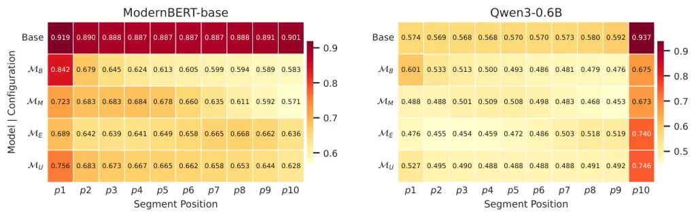
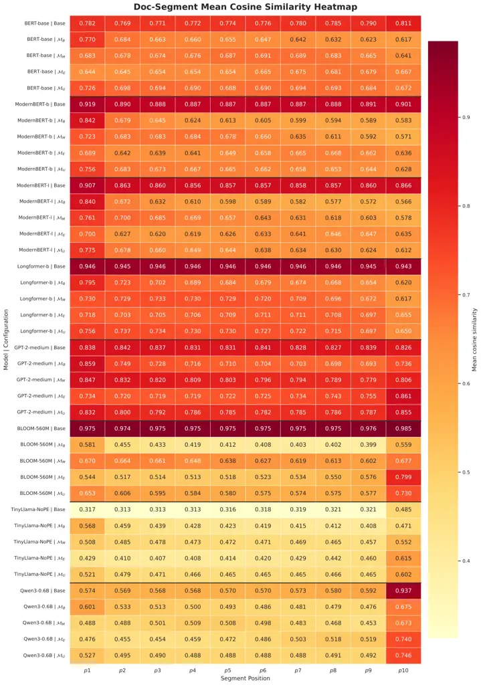
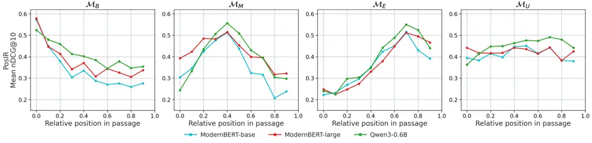

# Is Position Bias in Dense Retrievers Built In—or Learned from Data?

Daegon Yu ^(†)^(†)thanks: Equal contribution. Affiliation: Sionic AI
Email: [dgyu@sionic.ai](mailto:)    SeungYoon Han¹¹footnotemark: 1
Affiliation: Sionic AI Email: [seungyoon@sionic.ai](mailto:)   
Woomyoung Park Affiliation: Sionic AI Email: [max@sionic.ai](mailto:)

###### Abstract

Dense retrievers exhibit positional bias, favoring documents whose
query-relevant information appears near the beginning and degrading
retrieval performance when the information appears later. While prior
work on positional bias in dense retrievers has largely focused on
architectural explanations, we study how the positional distribution of
evidence in training data affects retrieval-level bias direction. To
test this, we construct synthetic position-targeted training sets in
which query-relevant evidence appears at the beginning, middle, or end
of documents, and fine-tune eight architecturally diverse pretrained
models under position-skewed and balanced training distributions. At the
ranking level, we observe a strong directional pattern across the
examined models: skewed training distributions favor evidence at the
corresponding positions. Position-balanced training reduces positional
sensitivity by 56–87% on position-aware benchmarks, with competitive
mean retrieval performance in our controlled setting.
Representation-level analyses further suggest that fine-tuning often
reshapes learned positional preferences, although pre-existing
architectural or pretraining-specific tendencies persist in some models.
These results identify training-position distribution as a major
controllable factor in retrieval-level position bias and suggest
balanced data curation as a practical mitigation strategy. Our code is
available at
[https://github.com/sionic-ai/position-bias-dense-retrievers](https://github.com/sionic-ai/position-bias-dense-retrievers).

## 1 Introduction

Dense retrievers (Karpukhin et al., 2020; Izacard et al., 2022) now
serve as a core component in open-domain question answering and
retrieval-augmented generation (Lewis et al., 2020; Jeong et al., 2024).
Yet they exhibit a systematic position bias. Retrieval performance drops
substantially when query-relevant information appears in the middle or
end of a document rather than near the beginning (Coelho et al., 2024;
Zeng et al., 2025). A retriever that disproportionately favors early
positions risks missing critical information, potentially degrading
downstream RAG performance (Fayyaz et al., 2025); understanding the
source of this bias is therefore important.

Prior work has largely examined position bias empirically: it has been
observed across training stages (Coelho et al., 2024), positional
encodings (Lee et al., 2025), and pooling-token attention patterns
(Schuhmacher et al., 2026). Zeng et al. (2026) further show that
positional sensitivity does not correlate with architectural factors.
The underlying cause in dense retrievers thus remains unclear. In
autoregressive transformers, causal attention has been identified as a
primary cause of position bias (Wang et al., 2025; Wu et al., 2025). Yet
encoder-based dense retrievers—which lack causal masking—still exhibit
strong primacy bias (Coelho et al., 2024; Zeng et al., 2025), indicating
that architectural factors alone may not fully explain position bias in
dense retrievers.

This raises a fundamental question: to what extent can retrieval-level
position bias be changed by the positional distribution of fine-tuning
data, beyond tendencies induced by architecture and pretraining? In this
work, we hypothesize that training-position distribution is an important
factor in shaping retrieval-level position bias in dense retrievers. Two
forms of positional skew motivate this hypothesis: in training corpora,
texts such as news articles place key information in early positions
(Po¨ttker, 2003; Catena et al., 2019), and in retrieval fine-tuning
data, such as MS MARCO, query-relevant passages are heavily concentrated
in early document positions (Hofstätter et al., 2021; Coelho et al.,
2024). Yet no prior work has directly manipulated training data to
isolate its role.

To test this hypothesis, we construct position-controlled datasets in
which query-relevant information appears at the beginning, middle, or
end of documents, and fine-tune eight architecturally diverse pretrained
models—covering encoder and decoder architectures, multiple positional
encodings, and different pooling strategies—on them. If models with
fundamentally different positional processing nevertheless develop bias
patterns that mirror the training distribution, this would suggest that
architecture alone cannot fully explain the bias. We evaluate positional
sensitivity on position-aware benchmarks and standard retrieval
performance on evidence-annotated BEIR subsets.

Our key finding is that retrieval-level position bias direction follows
the training data distribution across all eight models, despite their
architectural differences: begin-skewed data produces begin-favoring
retrieval, mid-skewed data produces mid-favoring retrieval, and
end-skewed data produces end-favoring retrieval. Position-balanced
training reduces positional sensitivity on position-aware benchmarks
while preserving competitive retrieval performance, suggesting that data
curation can reduce position bias.

Our contributions are as follows:

- •
  We design a position-controlled data construction pipeline and release
  the datasets, enabling controlled experiments on the effect of
  training data on retrieval-level position bias.
- •
  We show that training data distributions shape the direction of
  retrieval-level position bias, with controlled experiments on eight
  architecturally diverse models revealing predictable shifts in bias
  direction.
- •
  We show that position-balanced training reduces positional sensitivity
  while preserving competitive retrieval performance, suggesting that
  position bias can be reduced through data curation.

## 2 Related Work

##### Position Bias in Dense Retrievers.

Dense retrievers exhibit position bias, favoring evidence at the
beginning of documents (Fayyaz et al., 2025; Lee et al., 2025; Zeng et
al., 2025). Across retriever types, dense embedding and ColBERT-style
models show performance degradation due to this bias, while BM25 and
cross-encoder rerankers remain robust (Zeng et al., 2025). Zeng et al.
(2026) evaluate embedding models on a position-aware benchmark and find
that most exhibit primacy bias, though positional sensitivity does not
correlate with architectural factors—model size, vector dimension,
attention mechanism, or pooling strategy. Similarly, Lee et al. (2025)
report that the bias persists across positional encodings—APE, ALiBi,
and RoPE. These findings show that position bias is widespread in dense
retrievers, but they do not explain its cause.

##### Architectural Explanations.

Prior studies have examined architecture-based explanations for position
bias in dense retrievers, but they do not fully explain the observed
bias patterns. Schuhmacher et al. (2026) link primacy bias to
front-loaded self-attention in pooling-token embeddings of encoder-based
models, though its generality across the diverse architectures used in
dense retrieval has not been established. In autoregressive
transformers, by contrast, Wu et al. (2025) prove that causal attention
favors earlier tokens with deeper layers amplifying the effect, and Wang
et al. (2025) show that RoPE favors nearby tokens through
distance-dependent attention decay. However, encoder-based dense
retrievers, which lack causal masking, still exhibit strong primacy bias
(Coelho et al., 2024; Zeng et al., 2025), and RoPE-based decoder
retrievers such as Qwen3-Embedding show primacy rather than recency bias
(Zeng et al., 2025; Zeng et al., 2026), indicating that architectural
factors alone do not fully explain position bias in dense retrievers.

##### Training Data as a Source of Bias.

Training data has also been implicated as a source of position bias.
Coelho et al. (2024) show that position bias emerges during unsupervised
contrastive pre-training and is amplified by MS MARCO fine-tuning, where
relevant passages are disproportionately concentrated in early document
positions. Similarly, Fayyaz et al. (2025) find that MS MARCO-trained
models exhibit stronger position bias than unsupervised Contriever.
Earlier work connects training data to position bias in rerankers:
Hofstätter et al. (2021) show that rerankers trained on data with
early-skewed answer positions inherit this bias. Across these studies,
training data appears as a common factor, yet the evidence comes from
observation rather than direct manipulation of the positional
distribution. Our work addresses this gap by training eight
architecturally diverse models on position-controlled datasets,
providing direct evidence that training data distribution drives the
direction of position bias in dense retrievers.

## 3 Method

Our approach has two components: a data construction pipeline that
produces position-controlled training datasets (§3.1), and an
experimental design that tests how changing the positional distribution
of fine-tuning data affects retrieval-level position bias (§3.2).

### 3.1 Position-Controlled Data Construction

We construct datasets where the location of query-relevant information
is controlled through a three-stage pipeline: corpus preparation with
length-stratified binning, position-targeted query generation, and
multi-reranker position verification.

#### 3.1.1 Corpus Preparation

We use English Wikipedia as our source corpus for its topical diversity
and wide range of article lengths. Within each pool, we stratify
articles by character count into five length bins (256–512, 512–1024,
1024–2048, 2048–4096, and 4096–8192), using character count rather than
token count for tokenizer-agnostic consistency across models. Each
document is divided into three equal-length segments—beginning, middle,
and end—following Zeng et al. (2025).

#### 3.1.2 Position-Targeted Query Generation

For each document, we generate queries targeting each of the three
positional segments using persona-conditioned prompting with
GPT-4o-mini¹¹ 1
[https://developers.openai.com/api/docs/models/gpt-4o-mini](https://developers.openai.com/api/docs/models/gpt-4o-mini),
following Zhang et al. (2025). A persona is sampled from PersonaHub (Ge
et al., 2025) to encourage diverse information needs; the model then
generates a query answerable from only the target segment. This yields
three query subsets—$`q_{\text{begin}}`$, $`q_{\text{mid}}`$, and
$`q_{\text{end}}`$—where the same document appears in all three, each
time paired with a different position-targeted query. Details of the
generation prompts are provided in Appendix A.

#### 3.1.3 Multi-Reranker Position Verification

The generation prompt asks the LLM to produce a query answerable from
the intended target segment, but this constraint is not guaranteed: a
generated query may also be answerable from a non-target segment or from
multiple segments. To filter such cases, we verify each generated
candidate with a panel of three cross-encoder rerankers:
bge-reranker-v2-m3 (Chen et al., 2024), gte-multilingual-reranker-base
(Zhang et al., 2024), and jina-reranker-v2-base-multilingual²² 2
[https://huggingface.co/jinaai/jina-reranker-v2-base-multilingual](https://huggingface.co/jinaai/jina-reranker-v2-base-multilingual).

We use cross-encoder rerankers, rather than dense retrievers, as
verifiers because full-interaction rerankers have been shown to be more
robust to evidence position than dense embedding models (Zeng et al.,
2025). This reduces the risk that the filtering step itself inherits the
position bias that we aim to study.

The verification rule requires unanimous agreement across rerankers. Let
$`q`$ be a generated query for document $`d`$, and let
$`t\in\mathcal{P}`$ be its intended target position, where
$`\mathcal{P}=\{\mathrm{begin},\mathrm{middle},\mathrm{end}\}`$. We
denote the segment at position $`i`$ by $`s_{i}`$.

For each reranker $`R\in\mathcal{R}`$, we score each segment as

```math
r_{R,i}=R(q,s_{i}),\quad i\in\mathcal{P}. \tag{1}
```

The candidate is retained only if every reranker scores the target
segment at least $`\delta`$ higher than the strongest non-target
segment:

```math
r_{R,t}-\max_{u\neq t}r_{R,u}\geq\delta,\quad\forall R\in\mathcal{R}. \tag{2}
```

The maximum is taken over the two non-target positions. Thus, even the
least favorable reranker must prefer the intended target segment by at
least the margin threshold $`\delta`$.

All main experiments use a margin threshold of $`\delta=0.3`$.
Appendix B reports filtering statistics under different margin
thresholds and an independent segment-wise LLM audit. We refer to the
candidates that pass this rule as the retained pool.

#### 3.1.4 Controlled Training Set Sampling

Applying the multi-reranker position-verification rule with margin
threshold $`\delta=0.3`$ yields 481,236 retained candidate examples for
training. Table 1 reports the retained pool by length bin and target
position.

The retained pool is not position-balanced, so we do not train on it
directly. Instead, we construct the final training sets by downsampling
within length-position cells. The smallest retained length-position cell
is the middle-position cell in the 4096–8192 length bin, which contains
8,189 examples. This cell determines the sampling budget for the
controlled training configurations defined in Section 3.2.

This downsampling step ensures that the final training sets use the same
number of examples from each length bin, rather than inheriting the
uneven length and position counts of the retained pool. As a result,
later comparisons are not driven by differences in training size or
document length.

| Length Bin | Begin   | Middle | End    |
| ---------- | ------- | ------ | ------ |
| 256–512    | 105,652 | 13,934 | 21,405 |
| 512–1024   | 86,495  | 16,660 | 21,427 |
| 1024–2048  | 60,357  | 13,594 | 16,691 |
| 2048–4096  | 43,946  | 10,527 | 13,363 |
| 4096–8192  | 39,200  | 8,189  | 9,796  |
| Total      | 335,650 | 62,904 | 82,682 |

Table 1: Retained candidate examples by length bin and target position
after the multi-reranker position-verification rule with margin
threshold $`\delta=0.3`$, before downsampling.

### 3.2 Position-Controlled Experiment Design

Our experimental design tests whether retrieval-level position bias
follows the positional distribution of training data across models with
different architectural properties.

#### 3.2.1 Model Selection and Initial Tendencies

We select eight pretrained models without retrieval-specific
fine-tuning, spanning encoder and decoder architectures, multiple
positional encodings, and different pooling strategies. This diversity
is central to our design: if models with fundamentally different
positional processing develop bias patterns that mirror their training
data, the bias cannot be attributed to any single architectural
property.

Before retrieval fine-tuning, these models are not perfectly
position-neutral at the representation level: encoder models show mild
primacy tendencies, while decoder models show recency tendencies
(Appendix C). This makes the test stricter: a data-driven effect should
appear despite different initial tendencies, and in some configurations
must reverse them.

#### 3.2.2 Controlled Training Configurations

Each model is fine-tuned as a dense retriever under four configurations
that differ only in the target-position distribution of training
queries, expressed as begin:middle:end ratios. Three concentrated
configurations—100:0:0 (begin; $`\mathcal{M}_{B}`$), 0:100:0 (middle;
$`\mathcal{M}_{M}`$), and 0:0:100 (end; $`\mathcal{M}_{E}`$)—restrict
all queries to a single target position. The uniform configuration,
33:33:33 ($`\mathcal{M}_{U}`$), samples evenly across all three target
positions.

All four configurations are sampled from the $`\delta=0.3`$ retained
pool using the per-bin budget defined in Section 3.1.4. Each
concentrated configuration samples 8,189 examples from its target
position in each length bin, yielding 40,945 training examples. The
uniform configuration randomly samples 2,729 examples from each target
position within each length bin, yielding 40,935 training examples.
Thus, the configurations are matched in training scale and
document-length distribution up to the integer split required by the
uniform setting.

This yields 32 training runs: 8 base models $`\times`$ 4 training
configurations. After training, we evaluate each model on position-aware
benchmarks to measure how retrieval performance varies across target
positions. If bias is data-driven, concentrated configurations should
favor their respective target positions, while uniform training should
reduce position sensitivity.

### 3.3 Mechanism and Predictions

We hypothesize that the directional effects in our experiments arise
from shortcut learning (Geirhos et al., 2020; Robinson et al., 2021).
InfoNCE-style contrastive objectives reward any feature that separates
positives from negatives. When evidence position correlates with
relevance in the training data, position-linked features become
discriminative and can be acquired as shortcuts; under a
position-balanced distribution, position carries no discriminative
value, leaving content matching as the primary learning signal. We
present this as an empirically supported hypothesis about learned
features rather than a formal analysis of the optimization dynamics.

This account makes four testable predictions. (P1) Reversing the
position–relevance correlation reverses the bias direction (§5.1;
Appendix F.2). (P2) Removing the correlation through uniform training
flattens position-wise performance while maintaining competitive mean
performance (§5.2–§5.3). (P3) The learned preference is visible at the
representation level, in query–document similarities and document
embeddings (§6.1–§6.2). (P4) When the data signal opposes a model’s
pre-existing positional tendency, the data signal dominates
(Appendix C). A formal account of how data distributions induce
positional features—the data-side counterpart to the architectural
analysis of Wu et al. (2025)—is left to future work, which our released
position-controlled datasets are designed to support.

## 4 Experimental Setups

### 4.1 Base Models

| Model          | Type | PE    | Pool   | Params | Max Len |
| -------------- | ---- | ----- | ------ | ------ | ------- |
| BERT-base      | Enc  | APE   | CLS    | 110M   | 512     |
| Longformer-b   | Enc  | APE   | Mean   | 149M   | 4k      |
| ModernBERT-b   | Enc  | RoPE  | CLS    | 149M   | 8k      |
| ModernBERT-l   | Enc  | RoPE  | CLS    | 395M   | 8k      |
| GPT-2-medium   | Dec  | APE   | Last-t | 355M   | 1k      |
| BLOOM-560M     | Dec  | ALiBi | Last-t | 560M   | 2k      |
| TinyLlama-NoPE | Dec  | NoPE  | Last-t | 1.1B   | 2k      |
| Qwen3-0.6B     | Dec  | RoPE  | Last-t | 0.6B   | 32k     |

Table 2: Overview of the eight pretrained models used in controlled
fine-tuning. PE denotes positional encoding; Pool denotes the
document-pooling strategy; Max Len denotes the maximum input length.

Table 2 lists the eight pretrained base models and their architectural
properties. On the encoder side, we include BERT-base (Devlin et al.,
2019), ModernBERT-base and ModernBERT-large (Warner et al., 2025), and
Longformer-base (Beltagy et al., 2020); on the decoder side,
GPT-2-medium (Radford et al., 2019), BLOOM-560M (Workshop et al., 2023),
TinyLlama-NoPE (Wang et al., 2024), and Qwen3-0.6B (Yang et al., 2025).
ModernBERT-base and large share the same architecture at different
scales, enabling a within-architecture scale comparison. TinyLlama-NoPE,
which lacks explicit positional encoding, tests whether explicit
positional encoding is a necessary condition for bias emergence.

### 4.2 Training Details

All eight models are fine-tuned as bi-encoder retrievers using InfoNCE
loss with chunk-aware negatives: each batch is drawn from a single
length bin so that all negatives share the same document length as the
positive. We avoid hard negative mining, as mining strategies may
introduce position-dependent confounds. All hyperparameters are held
constant across the four configurations within each model; the only
variable is the positional distribution of training data. Full training
details are provided in Appendix E.

### 4.3 Evaluation

We evaluate all trained models on three position-aware benchmarks:
SQuAD-PosQ, FineWeb-PosQ (Zeng et al., 2025), and PosIR (Zeng et al.,
2026). Since FineWeb-PosQ and PosIR contain longer passages, we evaluate
these benchmarks only on models with sufficient context length:
ModernBERT-base, ModernBERT-large, and Qwen3-0.6B. We additionally
evaluate on three BEIR datasets (Thakur et al., 2021)—SciFact, HotpotQA,
and FEVER—where the provided annotations allow us to identify the
position of evidence, enabling analysis of how the training
distributions affect performance under standard retrieval settings.

We report nDCG@10 computed separately for each positional bin of the
benchmark. To summarize position sensitivity as a single scalar, we
adopt the Position Sensitivity Index (PSI) proposed by Zeng et al.
(2025):

```math
\text{PSI}=1-\frac{\min(s)}{\max(s)},\quad\text{where }\max(s)>0 \tag{3}
```

and $`s`$ collects the metric scores across the positional bins of each
benchmark. A PSI of 0 indicates perfect positional robustness; higher
values indicate greater sensitivity.

As characterized by Zeng et al. (2025), PSI takes a worst-case
perspective: unlike dispersion measures such as the standard deviation
or the coefficient of variation (Arachchige et al., 2022), it quantifies
the maximum relative degradation across positional buckets. This suits
our setting, where the practical concern is systematic failure at
specific evidence positions rather than overall score variability.
Because PSI is scale-invariant, we interpret it alongside mean
performance to ensure that low PSI does not merely reflect uniformly
poor retrieval.

## 5 Experimental Results

Figure 1: Position-wise nDCG@10 across training configurations. The top
row reports SQuAD-PosQ, and the bottom row reports FineWeb-PosQ. Columns
correspond to configurations, $`\mathcal{M}_{B}`$, $`\mathcal{M}_{M}`$,
$`\mathcal{M}_{E}`$, and $`\mathcal{M}_{U}`$; lines denote evaluated
base models.

|                  |                     |                     |                     |                     |                     |                     |                     |                     |
| ---------------- | ------------------- | ------------------- | ------------------- | ------------------- | ------------------- | ------------------- | ------------------- | ------------------- |
|                  | NDCG@10             |                     |                     |                     | PSI $`\downarrow`$  |                     |                     |                     |
| Model            | $`\mathcal{M}_{B}`$ | $`\mathcal{M}_{M}`$ | $`\mathcal{M}_{E}`$ | $`\mathcal{M}_{U}`$ | $`\mathcal{M}_{B}`$ | $`\mathcal{M}_{M}`$ | $`\mathcal{M}_{E}`$ | $`\mathcal{M}_{U}`$ |
| SQuAD-PosQ       |                     |                     |                     |                     |                     |                     |                     |                     |
| BERT-base        | 0.438               | 0.432               | 0.408               | 0.487               | 0.281               | 0.371               | 0.533               | 0.136               |
| Longformer-base  | 0.481               | 0.539               | 0.489               | 0.543               | 0.304               | 0.236               | 0.331               | 0.143               |
| ModernBERT-base  | 0.466               | 0.520               | 0.463               | 0.516               | 0.433               | 0.286               | 0.341               | 0.088               |
| ModernBERT-large | 0.490               | 0.564               | 0.499               | 0.557               | 0.348               | 0.166               | 0.335               | 0.082               |
| GPT-2-medium     | 0.231               | 0.287               | 0.244               | 0.283               | 0.592               | 0.233               | 0.431               | 0.080               |
| BLOOM-560M       | 0.359               | 0.447               | 0.361               | 0.465               | 0.536               | 0.290               | 0.431               | 0.080               |
| TinyLlama-NoPE   | 0.362               | 0.455               | 0.418               | 0.462               | 0.561               | 0.271               | 0.389               | 0.132               |
| Qwen3-0.6B       | 0.546               | 0.626               | 0.556               | 0.655               | 0.395               | 0.283               | 0.409               | 0.068               |
| FineWeb-PosQ     |                     |                     |                     |                     |                     |                     |                     |                     |
| ModernBERT-base  | 0.554               | 0.570               | 0.571               | 0.640               | 0.476               | 0.422               | 0.343               | 0.108               |
| ModernBERT-large | 0.592               | 0.647               | 0.595               | 0.675               | 0.426               | 0.305               | 0.361               | 0.116               |
| Qwen3-0.6B       | 0.578               | 0.533               | 0.535               | 0.604               | 0.359               | 0.245               | 0.272               | 0.116               |

Table 3: Mean nDCG@10 and Position Sensitivity Index (PSI) across
training configurations. The upper block reports SQuAD-PosQ for all
eight models; the lower block reports FineWeb-PosQ for models with
sufficient context length. Higher is better for nDCG@10; lower is better
for PSI. Best values for each model and metric are in bold. PosIR
results for the same three long-context models are in Table 12
(Appendix F.1).

### 5.1 Training Distribution Sets the Bias Direction

Figure 1 shows a consistent directional effect: retrieval performance
peaks near the position emphasized during fine-tuning. Begin-trained
retrievers ($`\mathcal{M}_{B}`$) favor early evidence, mid-trained
retrievers ($`\mathcal{M}_{M}`$) favor middle evidence, and end-trained
retrievers ($`\mathcal{M}_{E}`$) favor later evidence, consistently
across all eight base models. In contrast, uniformly trained retrievers
($`\mathcal{M}_{U}`$) do not exhibit a comparable single-position
preference; their position-wise curves are flatter, providing an initial
indication that balanced training weakens the learned positional
shortcut.

Representative cases illustrate the magnitude of this shift in both
short- and long-passage position-aware benchmarks. On SQuAD-PosQ,
Qwen3-0.6B scores 0.672 in the 0–100 position bucket under begin
training but 0.415 under end training; in the 500–3120 bucket, the
pattern reverses, with end training scoring 0.702 versus 0.407 for begin
training. On FineWeb-PosQ, ModernBERT-large follows the same pattern:
when evidence appears at the beginning, the $`\mathcal{M}_{B}`$ scores
0.778, compared with 0.475 for the $`\mathcal{M}_{E}`$; when evidence
appears at the end, the $`\mathcal{M}_{E}`$ scores 0.743, compared with
0.447 for the $`\mathcal{M}_{B}`$. The pattern also appears in
TinyLlama-NoPE. Since causal masking, segment boundaries, padding, and
last-token pooling still provide implicit position channels, we read
this as a weakest-explicit-position condition: directional bias emerges
without explicit positional encoding, though not necessarily without
positional signal (Appendix D).

Overall, these results show that retrieval-level bias direction can be
redirected by the positional distribution of fine-tuning data,
indicating that architecture alone does not fix the observed bias
direction. Appendix F.2 provides an additional mirror-reversal
diagnostic that confirms the same directional effect under document
reversal, consistent with prediction P1 (§3.3).

### 5.2 Balanced Training Reduces Positional Sensitivity

Table 3 shows a consistent pattern on SQuAD-PosQ and FineWeb-PosQ, and
Appendix F.1 reports the same pattern on PosIR: $`\mathcal{M}_{U}`$ is
the least sensitive to evidence location. It achieves the lowest PSI for
all eight models on SQuAD-PosQ and for all three evaluated models on
FineWeb-PosQ, indicating that balanced training produces more stable
retrieval performance across positions.

On SQuAD-PosQ, $`\mathcal{M}_{U}`$ reduces PSI by 57–87% relative to the
worst skewed configuration for every model. For example, GPT-2-medium
drops from 0.592 under begin training to 0.080 under uniform training,
Qwen3-0.6B drops from 0.409 under end training to 0.068, and
Longformer-base drops from 0.331 under end training to 0.143. The same
pattern holds on FineWeb-PosQ: ModernBERT-base drops from 0.476 to
0.108, ModernBERT-large from 0.426 to 0.116, and Qwen3-0.6B from 0.359
to 0.116.

These results show that position-balanced training does not merely move
the bias to a different evidence position. Instead, it makes retrieval
performance more consistent across positions, so the model is less
affected by where the relevant evidence appears.

### 5.3 Sensitivity Reduction with Competitive Mean Performance

Table 3 shows that $`\mathcal{M}_{U}`$ consistently achieves the lowest
PSI across position-aware benchmarks. On SQuAD-PosQ, $`\mathcal{M}_{U}`$
achieves the highest mean nDCG@10 for five of the eight models. For the
remaining three models, its gap to the best skewed configuration is
marginal (0.004–0.007). The pattern is even clearer on FineWeb-PosQ,
where $`\mathcal{M}_{U}`$ achieves the highest mean nDCG@10 for all
three evaluated models. Thus, position-balanced training reduces
sensitivity to evidence location while maintaining competitive retrieval
performance in this controlled setting, as predicted by P2.

These results also clarify the limitation of skewed training. A skewed
model can perform well when the evidence appears at its trained
position, but this gain often comes with larger drops at other
positions. In contrast, $`\mathcal{M}_{U}`$ avoids relying on a single
evidence location, leading to more stable retrieval across positions
with competitive retrieval performance.

### 5.4 Evidence-Location Skew in Standard Benchmarks

After evaluating models on controlled position-aware benchmarks, we test
whether training-induced positional priors also affect performance under
the standard BEIR evaluation setting, where evidence location is not
controlled. Figure 10 shows that the three BEIR subsets differ in their
evidence-location distributions. HotpotQA and FEVER are strongly
concentrated near the beginning, while SciFact is broader and less
early-concentrated.

Table 4 aligns with these distributional patterns. Across the three BEIR
subsets and all eight base models, the begin-trained model
$`\mathcal{M}_{B}`$ achieves the highest average nDCG@10: 0.393,
followed by $`\mathcal{M}_{U}`$ at 0.345, $`\mathcal{M}_{M}`$ at 0.241,
and $`\mathcal{M}_{E}`$ at 0.220. The advantage of $`\mathcal{M}_{B}`$
over $`\mathcal{M}_{U}`$ is largest on the most early-skewed subsets,
with a gap of +0.134 on FEVER and +0.054 on HotpotQA. In contrast, this
advantage disappears when evidence is less concentrated near the
beginning: the gap reverses on SciFact.

These results suggest that standard benchmark scores can partly reflect
evidence-location skew. When evaluation data place much of the relevant
evidence near the beginning, a model with an early-position prior can
obtain higher scores even if it is less robust to evidence appearing
elsewhere. The BEIR results therefore indicate benchmark-specific gains
rather than evidence-location robustness.

## 6 Analyses

| BEIR subset | $`\mathcal{M}_{B}`$ | $`\mathcal{M}_{M}`$ | $`\mathcal{M}_{E}`$ | $`\mathcal{M}_{U}`$ |
| ----------- | ------------------- | ------------------- | ------------------- | ------------------- |
| SciFact     | 0.351               | 0.368               | 0.340               | 0.393               |
| HotpotQA    | 0.338               | 0.192               | 0.165               | 0.284               |
| FEVER       | 0.491               | 0.164               | 0.156               | 0.357               |
| Average     | 0.393               | 0.241               | 0.220               | 0.345               |

Table 4: BEIR nDCG@10 averaged over all eight models. Best values are in
bold; second-best values are underlined. Full results are reported in
Table 22.

Figure 2: Position-wise nDCG@10 for ModernBERT-base under four pooling
strategies. The top and bottom rows report SQuAD-PosQ and FineWeb-PosQ,
respectively. Columns correspond to begin-, middle-, end-, and
uniform-trained retrievers; lines denote pooling strategies.

| Model           | Config              | Peak | Lowest | $`\Delta`$ |
| --------------- | ------------------- | ---- | ------ | ---------- |
| ModernBERT-base | $`\mathcal{M}_{B}`$ | 1    | 9      | 21.5       |
|                 | $`\mathcal{M}_{M}`$ | 4    | 10     | 9.4        |
|                 | $`\mathcal{M}_{E}`$ | 9    | 1      | 20.6       |
|                 | $`\mathcal{M}_{U}`$ | 10   | 2      | 1.9        |
| Qwen3-0.6B      | $`\mathcal{M}_{B}`$ | 1    | 10     | 21.5       |
|                 | $`\mathcal{M}_{M}`$ | 5    | 10     | 27.1       |
|                 | $`\mathcal{M}_{E}`$ | 9    | 1      | 20.6       |
|                 | $`\mathcal{M}_{U}`$ | 9    | 10     | 5.5        |

Table 5: Evidence-moving cosine analysis, where Peak and Lowest denote
the insertion positions with the highest and lowest query-document
cosine similarity, and $`\Delta`$ is the peak-minus-lowest cosine
difference multiplied by $`10^{3}`$. Full results are reported in
Table 18.



Figure 3: Mean cosine similarity between full-document embeddings and
segment embeddings ($`p_{1}`$–$`p_{10}`$) for ModernBERT-base and
Qwen3-0.6B. Each column corresponds to one of ten equal-length document
segments. Full results for all eight models in Figure 7.

### 6.1 Query–Document Similarity Follows the Training Distribution

We first test whether the ranking-level bias observed in Section 5 is
reflected in query-document similarity. Following Coelho et al. (2024),
we use MS MARCO query-document pairs and relocate the query-relevant
evidence to ten uniformly spaced positions within the same document
while keeping the remaining content fixed.

Table 5 shows that the highest-similarity position follows the
fine-tuning distribution. For both ModernBERT-base and Qwen3-0.6B,
$`\mathcal{M}_{B}`$ models peak at position 1 and $`\mathcal{M}_{E}`$
models peak at position 9. $`\mathcal{M}_{M}`$ models peak in the middle
range, at p4 for ModernBERT-base and p5 for Qwen3-0.6B. Uniform training
produces a flatter pattern: the peak-to-lowest gap drops to 1.9 for
ModernBERT-base and 5.5 for Qwen3-0.6B, much smaller than under the
concentrated settings.

These results suggest that positional preference is reflected in
query-document embedding similarities, consistent with prediction P3.
Fine-tuning changes which evidence locations appear most similar to the
query, rather than affecting only the final ranking output. Full results
for all eight models are provided in Appendix I.

### 6.2 Fine-Tuning Reshapes Document Representations

We next examine whether the document embedding itself reflects
positional preference, independent of any query. For each document, we
measure cosine similarity between the full-document embedding and
embeddings of its ten equal-length segments. Because this analysis is
query-free, it can be applied both before and after retrieval
fine-tuning. Figure 3 shows ModernBERT-base and Qwen3-0.6B; full results
are in Figure 7.

Before retrieval fine-tuning, the pretrained base models show only mild
initial positional tendencies: ModernBERT-base is slightly closer to
early segments, while Qwen3-0.6B is nearly flat across segments 1–9,
with a final-segment spike likely caused by last-token pooling. After
fine-tuning, however, the similarity profiles shift toward the training
distribution. In Qwen3-0.6B, begin training raises similarity to
segment 1 while lowering later non-final segments, end training reverses
this pattern, and uniform training compresses the profile across
positions. ModernBERT-base shows the same qualitative trend.

These results show that retrieval fine-tuning can reshape document
representations, not only query-document matching scores. Although the
base checkpoints may retain weak positional tendencies, retrieval
fine-tuning largely redirects them toward the positional distribution of
the training data.

### 6.3 Robustness of the Directional Effect to Pooling Strategy

Finally, we examine whether the observed bias direction depends on the
pooling strategy. We train ModernBERT-base under the same four
positional training distributions using CLS, mean, max, and last-token
pooling.

Figure 2 shows that, in this ModernBERT-base ablation, pooling changes
absolute retrieval performance but the observed retrieval-level
preference remains aligned with the fine-tuning position distribution.
Across the four pooling choices tested, position-skewed training leads
models to favor the corresponding positions on both SQuAD-PosQ and
FineWeb-PosQ. Uniform training again yields a more position-balanced
pattern.

These results suggest that the directional effect is not an artifact of
a single pooling choice within ModernBERT-base. In this controlled
ablation, changing the fine-tuning position distribution has a larger
observed effect on retrieval-level bias direction than changing the
pooling method.

## 7 Conclusion

We fine-tuned eight architecturally diverse dense retrievers on
position-controlled data and found that the direction of retrieval-level
position bias follows the positional distribution of the fine-tuning
data rather than being fixed by the architecture. Representation
analyses further suggest that fine-tuning reshapes query–document
similarities and document embeddings toward the emphasized positions,
while model-specific tendencies remain. Position-balanced training
reduces positional sensitivity by 56–87% on position-aware benchmarks
while maintaining competitive mean retrieval performance in our
controlled setting. These results identify training-position
distribution as a major controllable factor in retrieval-level position
bias and support balanced data curation as a practical mitigation.

## Limitations

This study uses synthetic position-targeted fine-tuning data built from
English Wikipedia with LLM-generated queries. The segment-permutation
intervention (Appendix H) shows that the learned preference follows
physical position rather than segment content, although generated
queries may exhibit position-correlated stylistic variation and position
remains partially entangled with discourse role in some configurations;
our conclusions therefore identify the training-position distribution as
the dominant, not the sole, factor. The retained pool is verified by
multiple rerankers and a held-out LLM audit (Appendix B) rather than by
human annotation.

To keep the intervention controlled, all runs share fixed
hyperparameters without hard-negative mining or early stopping;
three-seed replications on two backbones (Appendix J) show that the
directional effects and PSI reductions are stable under data
re-sampling. Our evaluation targets retrieval-level behavior together
with a controlled RAG pipeline (Appendix K); validating the effect in
production-scale systems, hard-negative training pipelines, and
naturally occurring long-document collections remains future work.

## Ethics Statement

This work constructs synthetic position-targeted retrieval data from
English Wikipedia and LLM-generated queries. We do not collect private
user data, conduct human-subject experiments, or infer protected
attributes. However, because Wikipedia contains articles about real
individuals, organizations, and sensitive topics, derived examples may
include public names or sensitive or offensive content from the source
corpus. The artifacts are intended for research on retrieval robustness
and position-aware evaluation, not for deployment decisions about
individuals or groups. Any released data or code will document the
source data, licenses or terms of use, intended use, and known
limitations.

## References

- Arachchige et al. (2022) C. N. P. G. Arachchige, L. A. Prendergast,
  and R. G. Staudte Robust analogs to the coefficient of variation.
  Journal of Applied Statistics 49 (2), pp. 268–290. Cited by: §4.3.
- Beltagy et al. (2020) I. Beltagy, M. E. Peters, and A. Cohan
  Longformer: the long-document transformer. External Links: 2004.05150,
  [Link](https://arxiv.org/abs/2004.05150) Cited by: §4.1.
- Catena et al. (2019) M. Catena, O. Frieder, C. I. Muntean, F. M.
  Nardini, R. Perego, and N. Tonellotto Enhanced news retrieval:
  passages lead the way!. In Proceedings of the 42nd International ACM
  SIGIR Conference on Research and Development in Information Retrieval,
  SIGIR’19, New York, NY, USA, pp. 1269–1272. External Links: ISBN
  9781450361729,
  [Link](<https://%5Bhttps://doi.org/10.1145/3331184.3331373%5D(https://doi.org/10.1145/3331184.3331373)>),
  [Document](https://dx.doi.org/10.1145/3331184.3331373) Cited by: §1.
- Chen et al. (2024) J. Chen, S. Xiao, P. Zhang, K. Luo, D. Lian, and Z.
  Liu BGE M3-embedding: multi-lingual, multi-functionality,
  multi-granularity text embeddings through self-knowledge distillation.
  arXiv preprint arXiv:2402.03216. Cited by: §3.1.3.
- Coelho et al. (2024) J. Coelho, B. Martins, J. Magalhaes, J. Callan,
  and C. Xiong Dwell in the beginning: how language models embed long
  documents for dense retrieval. In Proceedings of the 62nd Annual
  Meeting of the Association for Computational Linguistics (Volume 2:
  Short Papers), L. Ku, A. Martins, and V. Srikumar (Eds.), Bangkok,
  Thailand, pp. 370–377. External Links:
  [Link](<https://%5Bhttps://aclanthology.org/2024.acl-short.35/%5D(https://aclanthology.org/2024.acl-short.35/)>),
  [Document](https://dx.doi.org/10.18653/v1/2024.acl-short.35) Cited by:
  §1, §1, §1, §2, §2, §6.1.
- Devlin et al. (2019) J. Devlin, M. Chang, K. Lee, and K. Toutanova
  BERT: pre-training of deep bidirectional transformers for language
  understanding. In Proceedings of the 2019 Conference of the North
  American Chapter of the Association for Computational Linguistics:
  Human Language Technologies, Volume 1 (Long and Short Papers), J.
  Burstein, C. Doran, and T. Solorio (Eds.), Minneapolis, Minnesota,
  pp. 4171–4186. External Links:
  [Link](https://aclanthology.org/N19-1423/),
  [Document](https://dx.doi.org/10.18653/v1/N19-1423) Cited by: §4.1.
- Fayyaz et al. (2025) M. Fayyaz, A. Modarressi, H. Schuetze, and N.
  Peng Collapse of dense retrievers: short, early, and literal biases
  outranking factual evidence. In Proceedings of the 63rd Annual Meeting
  of the Association for Computational Linguistics (Volume 1: Long
  Papers), W. Che, J. Nabende, E. Shutova, and M. T. Pilehvar (Eds.),
  Vienna, Austria, pp. 9136–9152. External Links:
  [Link](<https://%5Bhttps://aclanthology.org/2025.acl-long.447/%5D(https://aclanthology.org/2025.acl-long.447/)>),
  [Document](https://dx.doi.org/10.18653/v1/2025.acl-long.447), ISBN
  979-8-89176-251-0 Cited by: §1, §2, §2.
- Ge et al. (2025) T. Ge, X. Chan, X. Wang, D. Yu, H. Mi, and D. Yu
  Scaling synthetic data creation with 1,000,000,000 personas. External
  Links: 2406.20094, [Link](https://arxiv.org/abs/2406.20094) Cited by:
  Appendix A, §3.1.2.
- Geirhos et al. (2020) R. Geirhos, J. Jacobsen, C. Michaelis, R.
  Zemel, W. Brendel, M. Bethge, and F. A. Wichmann Shortcut learning in
  deep neural networks. Nature Machine Intelligence 2 (11), pp. 665–673.
  External Links: ISSN 2522-5839,
  [Link](http://dx.doi.org/10.1038/s42256-020-00257-z),
  [Document](https://dx.doi.org/10.1038/s42256-020-00257-z) Cited by:
  §3.3.
- Hofstätter et al. (2021) S. Hofstätter, A. Lipani, S. Althammer, M.
  Zlabinger, and A. Hanbury Mitigating the position bias of transformer
  models in passage re-ranking. In Advances in Information Retrieval:
  43rd European Conference on IR Research, ECIR 2021, Virtual Event,
  March 28 – April 1, 2021, Proceedings, Part I, Berlin, Heidelberg,
  pp. 238–253. External Links: ISBN 978-3-030-72112-1,
  [Link](<https://%5Bhttps://doi.org/10.1007/978-3-030-72113-8_16%5D(https://doi.org/10.1007/978-3-030-72113-8_16)>),
  [Document](https://dx.doi.org/10.1007/978-3-030-72113-8%5F16) Cited
  by: §1, §2.
- Izacard et al. (2022) G. Izacard, M. Caron, L. Hosseini, S. Riedel, P.
  Bojanowski, A. Joulin, and E. Grave Unsupervised dense information
  retrieval with contrastive learning. External Links: 2112.09118,
  [Link](https://arxiv.org/abs/2112.09118) Cited by: §1.
- Jeong et al. (2024) S. Jeong, J. Baek, S. Cho, S. J. Hwang, and J.
  Park Adaptive-RAG: learning to adapt retrieval-augmented large
  language models through question complexity. In Proceedings of the
  2024 Conference of the North American Chapter of the Association for
  Computational Linguistics: Human Language Technologies (Volume 1: Long
  Papers), K. Duh, H. Gomez, and S. Bethard (Eds.), Mexico City, Mexico,
  pp. 7036–7050. External Links:
  [Link](https://aclanthology.org/2024.naacl-long.389/),
  [Document](https://dx.doi.org/10.18653/v1/2024.naacl-long.389) Cited
  by: §1.
- Karpukhin et al. (2020) V. Karpukhin, B. Oguz, S. Min, P. Lewis, L.
  Wu, S. Edunov, D. Chen, and W. Yih Dense passage retrieval for
  open-domain question answering. In Proceedings of the 2020 Conference
  on Empirical Methods in Natural Language Processing (EMNLP), B.
  Webber, T. Cohn, Y. He, and Y. Liu (Eds.), Online, pp. 6769–6781.
  External Links:
  [Link](<https://%5Bhttps://aclanthology.org/2020.emnlp-main.550/%5D(https://aclanthology.org/2020.emnlp-main.550/)>),
  [Document](https://dx.doi.org/10.18653/v1/2020.emnlp-main.550) Cited
  by: §1.
- Lee et al. (2025) R. J. Lee, S. Goel, and K. Ramchandran Quantifying
  positional biases in text embedding models. External Links:
  2412.15241,
  [Link](<https://%5Bhttps://arxiv.org/abs/2412.15241%5D(https://arxiv.org/abs/2412.15241)>)
  Cited by: §1, §2.
- Lewis et al. (2020) P. Lewis, E. Perez, A. Piktus, F. Petroni, V.
  Karpukhin, N. Goyal, H. Küttler, M. Lewis, W. Yih, T. Rocktäschel, S.
  Riedel, and D. Kiela Retrieval-augmented generation for
  knowledge-intensive nlp tasks. In Proceedings of the 34th
  International Conference on Neural Information Processing Systems,
  NIPS ’20, Red Hook, NY, USA. External Links: ISBN 9781713829546 Cited
  by: §1.
- Lim et al. (2019) S. Lim, M. Kim, and J. Lee KorQuAD1.0: korean qa
  dataset for machine reading comprehension. External Links: 1909.07005,
  [Link](https://arxiv.org/abs/1909.07005) Cited by: §G.2.
- Po¨ttker (2003) H. Po¨ttker News and its communicative quality: the
  inverted pyramid—when and why did it appear?. Journalism Studies 4
  (4), pp. 501–511. External Links:
  [Document](https://dx.doi.org/10.1080/1461670032000136596),
  [Link](https://doi.org/10.1080/1461670032000136596),
  https://doi.org/10.1080/1461670032000136596 Cited by: §1.
- Radford et al. (2019) A. Radford, J. Wu, R. Child, D. Luan, D. Amodei,
  and I. Sutskever Language models are unsupervised multitask learners.
  OpenAI. Note: Accessed: 2024-11-15 External Links:
  [Link](https://cdn.openai.com/better-language-models/language_models_are_unsupervised_multitask_learners.pdf)
  Cited by: §4.1.
- Reimers and Gurevych (2019) N. Reimers and I. Gurevych Sentence-BERT:
  sentence embeddings using Siamese BERT-networks. In Proceedings of the
  2019 Conference on Empirical Methods in Natural Language Processing
  and the 9th International Joint Conference on Natural Language
  Processing (EMNLP-IJCNLP), K. Inui, J. Jiang, V. Ng, and X. Wan
  (Eds.), Hong Kong, China, pp. 3982–3992. External Links:
  [Link](https://aclanthology.org/D19-1410/),
  [Document](https://dx.doi.org/10.18653/v1/D19-1410) Cited by: Appendix
  E.
- Robinson et al. (2021) J. Robinson, L. Sun, K. Yu, K.
  Batmanghelich, S. Jegelka, and S. Sra Can contrastive learning avoid
  shortcut solutions?. External Links: 2106.11230,
  [Link](https://arxiv.org/abs/2106.11230) Cited by: §3.3.
- Schuhmacher et al. (2026) E. Schuhmacher, A. Michail, J. Opitz, R.
  Sennrich, and S. Clematide Information representation fairness in
  long-document embeddings: the peculiar interaction of positional and
  language bias. External Links: 2601.16934,
  [Link](https://arxiv.org/abs/2601.16934) Cited by: §1, §2.
- Thakur et al. (2021) N. Thakur, N. Reimers, A. Rücklé, A. Srivastava,
  and I. Gurevych BEIR: a heterogeneous benchmark for zero-shot
  evaluation of information retrieval models. In Advances in Neural
  Information Processing Systems (NeurIPS), Cited by: §4.3.
- Wang et al. (2024) J. Wang, T. Ji, Y. Wu, H. Yan, T. Gui, Q. Zhang, X.
  Huang, and X. Wang Length generalization of causal transformers
  without position encoding. In Findings of the Association for
  Computational Linguistics: ACL 2024, L. Ku, A. Martins, and V.
  Srikumar (Eds.), Bangkok, Thailand, pp. 14024–14040. External Links:
  [Link](https://aclanthology.org/2024.findings-acl.834/),
  [Document](https://dx.doi.org/10.18653/v1/2024.findings-acl.834) Cited
  by: §4.1.
- Wang et al. (2025) Z. Wang, H. Zhang, X. Li, K. Huang, C. Han, S.
  Ji, S. M. Kakade, H. Peng, and H. Ji Eliminating position bias of
  language models: a mechanistic approach. External Links: 2407.01100,
  [Link](https://arxiv.org/abs/2407.01100) Cited by: §1, §2.
- Warner et al. (2025) B. Warner, A. Chaffin, B. Clavié, O. Weller, O.
  Hallström, S. Taghadouini, A. Gallagher, R. Biswas, F. Ladhak, T.
  Aarsen, G. T. Adams, J. Howard, and I. Poli Smarter, better, faster,
  longer: a modern bidirectional encoder for fast, memory efficient, and
  long context finetuning and inference. In Proceedings of the 63rd
  Annual Meeting of the Association for Computational Linguistics
  (Volume 1: Long Papers), W. Che, J. Nabende, E. Shutova, and M. T.
  Pilehvar (Eds.), Vienna, Austria, pp. 2526–2547. External Links:
  [Link](https://aclanthology.org/2025.acl-long.127/),
  [Document](https://dx.doi.org/10.18653/v1/2025.acl-long.127), ISBN
  979-8-89176-251-0 Cited by: §4.1.
- Wolf et al. (2020) T. Wolf, L. Debut, V. Sanh, J. Chaumond, C.
  Delangue, A. Moi, P. Cistac, T. Rault, R. Louf, M. Funtowicz, J.
  Davison, S. Shleifer, P. von Platen, C. Ma, Y. Jernite, J. Plu, C.
  Xu, T. Le Scao, S. Gugger, M. Drame, Q. Lhoest, and A. Rush
  Transformers: state-of-the-art natural language processing. In
  Proceedings of the 2020 Conference on Empirical Methods in Natural
  Language Processing: System Demonstrations, Q. Liu and D. Schlangen
  (Eds.), Online, pp. 38–45. External Links:
  [Link](https://aclanthology.org/2020.emnlp-demos.6/),
  [Document](https://dx.doi.org/10.18653/v1/2020.emnlp-demos.6) Cited
  by: Appendix E.
- Workshop et al. (2023) B. Workshop, :, T. L. Scao, A. Fan, C.
  Akiki, E. Pavlick, S. Ilić, D. Hesslow, R. Castagné, A. S.
  Luccioni, F. Yvon, M. Gallé, J. Tow, A. M. Rush, S. Biderman, A.
  Webson, P. S. Ammanamanchi, T. Wang, B. Sagot, N. Muennighoff, A. V.
  del Moral, O. Ruwase, R. Bawden, S. Bekman, A. McMillan-Major, I.
  Beltagy, H. Nguyen, L. Saulnier, S. Tan, P. O. Suarez, V. Sanh, H.
  Laurençon, Y. Jernite, J. Launay, M. Mitchell, C. Raffel, A.
  Gokaslan, A. Simhi, A. Soroa, A. F. Aji, A. Alfassy, A. Rogers, A. K.
  Nitzav, C. Xu, C. Mou, C. Emezue, C. Klamm, C. Leong, D. van
  Strien, D. I. Adelani, D. Radev, E. G. Ponferrada, E. Levkovizh, E.
  Kim, E. B. Natan, F. D. Toni, G. Dupont, G. Kruszewski, G.
  Pistilli, H. Elsahar, H. Benyamina, H. Tran, I. Yu, I. Abdulmumin, I.
  Johnson, I. Gonzalez-Dios, J. de la Rosa, J. Chim, J. Dodge, J.
  Zhu, J. Chang, J. Frohberg, J. Tobing, J. Bhattacharjee, K.
  Almubarak, K. Chen, K. Lo, L. V. Werra, L. Weber, L. Phan, L. B.
  allal, L. Tanguy, M. Dey, M. R. Muñoz, M. Masoud, M. Grandury, M.
  Šaško, M. Huang, M. Coavoux, M. Singh, M. T. Jiang, M. C. Vu, M. A.
  Jauhar, M. Ghaleb, N. Subramani, N. Kassner, N. Khamis, O. Nguyen, O.
  Espejel, O. de Gibert, P. Villegas, P. Henderson, P. Colombo, P.
  Amuok, Q. Lhoest, R. Harliman, R. Bommasani, R. L. López, R.
  Ribeiro, S. Osei, S. Pyysalo, S. Nagel, S. Bose, S. H. Muhammad, S.
  Sharma, S. Longpre, S. Nikpoor, S. Silberberg, S. Pai, S. Zink, T. T.
  Torrent, T. Schick, T. Thrush, V. Danchev, V. Nikoulina, V.
  Laippala, V. Lepercq, V. Prabhu, Z. Alyafeai, Z. Talat, A. Raja, B.
  Heinzerling, C. Si, D. E. Taşar, E. Salesky, S. J. Mielke, W. Y.
  Lee, A. Sharma, A. Santilli, A. Chaffin, A. Stiegler, D. Datta, E.
  Szczechla, G. Chhablani, H. Wang, H. Pandey, H. Strobelt, J. A.
  Fries, J. Rozen, L. Gao, L. Sutawika, M. S. Bari, M. S.
  Al-shaibani, M. Manica, N. Nayak, R. Teehan, S. Albanie, S. Shen, S.
  Ben-David, S. H. Bach, T. Kim, T. Bers, T. Fevry, T. Neeraj, U.
  Thakker, V. Raunak, X. Tang, Z. Yong, Z. Sun, S. Brody, Y. Uri, H.
  Tojarieh, A. Roberts, H. W. Chung, J. Tae, J. Phang, O. Press, C.
  Li, D. Narayanan, H. Bourfoune, J. Casper, J. Rasley, M. Ryabinin, M.
  Mishra, M. Zhang, M. Shoeybi, M. Peyrounette, N. Patry, N. Tazi, O.
  Sanseviero, P. von Platen, P. Cornette, P. F. Lavallée, R. Lacroix, S.
  Rajbhandari, S. Gandhi, S. Smith, S. Requena, S. Patil, T.
  Dettmers, A. Baruwa, A. Singh, A. Cheveleva, A. Ligozat, A.
  Subramonian, A. Névéol, C. Lovering, D. Garrette, D. Tunuguntla, E.
  Reiter, E. Taktasheva, E. Voloshina, E. Bogdanov, G. I. Winata, H.
  Schoelkopf, J. Kalo, J. Novikova, J. Z. Forde, J. Clive, J. Kasai, K.
  Kawamura, L. Hazan, M. Carpuat, M. Clinciu, N. Kim, N. Cheng, O.
  Serikov, O. Antverg, O. van der Wal, R. Zhang, R. Zhang, S.
  Gehrmann, S. Mirkin, S. Pais, T. Shavrina, T. Scialom, T. Yun, T.
  Limisiewicz, V. Rieser, V. Protasov, V. Mikhailov, Y.
  Pruksachatkun, Y. Belinkov, Z. Bamberger, Z. Kasner, A. Rueda, A.
  Pestana, A. Feizpour, A. Khan, A. Faranak, A. Santos, A. Hevia, A.
  Unldreaj, A. Aghagol, A. Abdollahi, A. Tammour, A. HajiHosseini, B.
  Behroozi, B. Ajibade, B. Saxena, C. M. Ferrandis, D. McDuff, D.
  Contractor, D. Lansky, D. David, D. Kiela, D. A. Nguyen, E. Tan, E.
  Baylor, E. Ozoani, F. Mirza, F. Ononiwu, H. Rezanejad, H. Jones, I.
  Bhattacharya, I. Solaiman, I. Sedenko, I. Nejadgholi, J. Passmore, J.
  Seltzer, J. B. Sanz, L. Dutra, M. Samagaio, M. Elbadri, M. Mieskes, M.
  Gerchick, M. Akinlolu, M. McKenna, M. Qiu, M. Ghauri, M. Burynok, N.
  Abrar, N. Rajani, N. Elkott, N. Fahmy, O. Samuel, R. An, R.
  Kromann, R. Hao, S. Alizadeh, S. Shubber, S. Wang, S. Roy, S.
  Viguier, T. Le, T. Oyebade, T. Le, Y. Yang, Z. Nguyen, A. R.
  Kashyap, A. Palasciano, A. Callahan, A. Shukla, A.
  Miranda-Escalada, A. Singh, B. Beilharz, B. Wang, C. Brito, C.
  Zhou, C. Jain, C. Xu, C. Fourrier, D. L. Periñán, D. Molano, D. Yu, E.
  Manjavacas, F. Barth, F. Fuhrimann, G. Altay, G. Bayrak, G.
  Burns, H. U. Vrabec, I. Bello, I. Dash, J. Kang, J. Giorgi, J.
  Golde, J. D. Posada, K. R. Sivaraman, L. Bulchandani, L. Liu, L.
  Shinzato, M. H. de Bykhovetz, M. Takeuchi, M. Pàmies, M. A.
  Castillo, M. Nezhurina, M. Sänger, M. Samwald, M. Cullan, M.
  Weinberg, M. D. Wolf, M. Mihaljcic, M. Liu, M. Freidank, M. Kang, N.
  Seelam, N. Dahlberg, N. M. Broad, N. Muellner, P. Fung, P. Haller, R.
  Chandrasekhar, R. Eisenberg, R. Martin, R. Canalli, R. Su, R. Su, S.
  Cahyawijaya, S. Garda, S. S. Deshmukh, S. Mishra, S. Kiblawi, S.
  Ott, S. Sang-aroonsiri, S. Kumar, S. Schweter, S. Bharati, T. Laud, T.
  Gigant, T. Kainuma, W. Kusa, Y. Labrak, Y. S. Bajaj, Y.
  Venkatraman, Y. Xu, Y. Xu, Y. Xu, Z. Tan, Z. Xie, Z. Ye, M. Bras, Y.
  Belkada, and T. Wolf BLOOM: a 176b-parameter open-access multilingual
  language model. External Links: 2211.05100,
  [Link](https://arxiv.org/abs/2211.05100) Cited by: §4.1.
- Wu et al. (2025) X. Wu, Y. Wang, S. Jegelka, and A. Jadbabaie On the
  emergence of position bias in transformers. In ICML, Cited by: §1, §2,
  §3.3.
- Yang et al. (2025) A. Yang, A. Li, B. Yang, B. Zhang, B. Hui, B.
  Zheng, B. Yu, C. Gao, C. Huang, C. Lv, C. Zheng, D. Liu, F. Zhou, F.
  Huang, F. Hu, H. Ge, H. Wei, H. Lin, J. Tang, J. Yang, J. Tu, J.
  Zhang, J. Yang, J. Yang, J. Zhou, J. Zhou, J. Lin, K. Dang, K. Bao, K.
  Yang, L. Yu, L. Deng, M. Li, M. Xue, M. Li, P. Zhang, P. Wang, Q.
  Zhu, R. Men, R. Gao, S. Liu, S. Luo, T. Li, T. Tang, W. Yin, X.
  Ren, X. Wang, X. Zhang, X. Ren, Y. Fan, Y. Su, Y. Zhang, Y. Zhang, Y.
  Wan, Y. Liu, Z. Wang, Z. Cui, Z. Zhang, Z. Zhou, and Z. Qiu Qwen3
  technical report. External Links: 2505.09388,
  [Link](https://arxiv.org/abs/2505.09388) Cited by: §4.1.
- Zeng et al. (2025) Z. Zeng, D. Zhang, J. Li, Zoupanxiang, Y. Zhou,
  and Y. Yang An empirical study of position bias in modern information
  retrieval. In Findings of the Association for Computational
  Linguistics: EMNLP 2025, C. Christodoulopoulos, T. Chakraborty, C.
  Rose, and V. Peng (Eds.), Suzhou, China, pp. 5069–5081. External
  Links:
  [Link](<https://%5Bhttps://aclanthology.org/2025.findings-emnlp.271/%5D(https://aclanthology.org/2025.findings-emnlp.271/)>),
  [Document](https://dx.doi.org/10.18653/v1/2025.findings-emnlp.271),
  ISBN 979-8-89176-335-7 Cited by: §1, §1, §2, §2, §3.1.1, §3.1.3, §4.3,
  §4.3, §4.3.
- Zeng et al. (2026) Z. Zeng, D. Zhang, Y. Yan, X. Sun, Y. Zhou, and Y.
  Yang PosIR: position-aware heterogeneous information retrieval
  benchmark. External Links: 2601.08363,
  [Link](https://arxiv.org/abs/2601.08363) Cited by: §1, §2, §2, §4.3.
- Zhang et al. (2024) X. Zhang, Y. Zhang, D. Long, W. Xie, Z. Dai, J.
  Tang, H. Lin, B. Yang, P. Xie, F. Huang, M. Zhang, W. Li, and M. Zhang
  MGTE: generalized long-context text representation and reranking
  models for multilingual text retrieval. External Links: 2407.19669,
  [Link](https://arxiv.org/abs/2407.19669) Cited by: §3.1.3.
- Zhang et al. (2025) Y. Zhang, M. Li, D. Long, X. Zhang, H. Lin, B.
  Yang, P. Xie, A. Yang, D. Liu, J. Lin, F. Huang, and J. Zhou Qwen3
  embedding: advancing text embedding and reranking through foundation
  models. External Links: 2506.05176,
  [Link](https://arxiv.org/abs/2506.05176) Cited by: Appendix A, §3.1.2.

## Appendix A Qwen3-Embedding Style Query Generation

We adopt a two-stage generation pipeline following Zhang et al. (2025).
Stage 1 selects a shared configuration (persona, difficulty, query
length) for each document, and Stage 2 generates position-conditioned
query–answer pairs using that configuration. For each document, the
persona candidate set is retrieved from PersonaHub (Ge et al., 2025) by
embedding similarity using BGE-M3 (top-$`k{=}20`$). Both stages use
GPT-4o-mini with temperature $`T{=}1.0`$ and top-$`p{=}1.0`$.

### A.1 Prompt for Configuration Selection (Stage 1)

Given a document and a set of candidate personas, the model selects the
most appropriate generation configuration (Figure 4). This configuration
is shared across all three positional queries for the same document to
keep persona, difficulty, and query length fixed across target
positions. Here, {CHARACTERS} contains the 20 retrieved personas, each
on a separate line. If any field fails to parse, the document is
excluded from downstream processing.

`\iow_now:Ne``¨``\iow_now:Ne``¨[USER]``\iow_now:Ne``¨<task>``\iow_now:Ne``¨You are given a passage. Select the most appropriate configuration for generating a search query about this passage.``\iow_now:Ne``¨</task>``\iow_now:Ne``¨<passage> {PASSAGE} </passage>``\iow_now:Ne``¨<instructions>``\iow_now:Ne``¨Based on the passage content, select:``\iow_now:Ne``¨1. Character: A persona who would naturally search for this information``\iow_now:Ne``¨2. Difficulty: The education level appropriate for understanding this content``\iow_now:Ne``¨3. Query_Length: The appropriate length for the query``\iow_now:Ne``¨</instructions>``\iow_now:Ne``¨<options>``\iow_now:Ne``¨Character Candidates: {CHARACTERS}``\iow_now:Ne``¨Difficulties: high_school, university, phd``\iow_now:Ne``¨Query_Lengths: short (under 10 words), medium (10–20 words), long (over 20 words)``\iow_now:Ne``¨</options>``\iow_now:Ne``¨Output as JSON: {"Character": "selected character description", "Difficulty": "selected difficulty", "Query_Length": "selected length"}`` `

Figure 4: Stage 1 prompt for configuration selection. A single
configuration is determined per document and reused across all
positional queries.

### A.2 Prompt for Position-Conditioned Query Generation (Stage 2)

For each document–position pair, the model generates a query–answer pair
using the shared configuration from Stage 1 (Figure 5). The model
receives both the full document and the target segment, and is
instructed to produce a query answerable only from the target segment.
The positional constraint is enforced at the prompt level but is not
guaranteed by the generator. Generated pairs are subsequently validated
through the multi-reranker filtering pipeline described in
Section 3.1.3.

`\iow_now:Ne``¨``\iow_now:Ne``¨[USER]``\iow_now:Ne``¨<task>``\iow_now:Ne``¨You are {CHARACTER}. Generate a search query to find information about the TARGET SEGMENT within the document. The query should be answerable ONLY by the target segment, not by other parts of the document.``\iow_now:Ne``¨</task>``\iow_now:Ne``¨<full_document> {FULL_DOCUMENT} </full_document>``\iow_now:Ne``¨<target_segment position="{POSITION}"> {TARGET_SEGMENT} </target_segment>``\iow_now:Ne``¨<configuration>``\iow_now:Ne``¨- Your persona: {CHARACTER}``\iow_now:Ne``¨- Difficulty level: {DIFFICULTY}``\iow_now:Ne``¨- Target query length: {QUERY_LENGTH}``\iow_now:Ne``¨</configuration>``\iow_now:Ne``¨<requirements>``\iow_now:Ne``¨- Generate a query from your persona’s perspective``\iow_now:Ne``¨- The query MUST require information specifically from the target segment to answer``\iow_now:Ne``¨- The query should NOT be answerable using only the other parts of the document``\iow_now:Ne``¨- Match the specified difficulty and length``\iow_now:Ne``¨- The answer must be directly extractable from the target segment``\iow_now:Ne``¨</requirements>``\iow_now:Ne``¨Output as JSON: {"query": "the generated search query", "answer": "the answer extracted from target segment", "reasoning": "brief explanation of why this query targets the specific segment"}`` `

Figure 5: Stage 2 prompt for position-conditioned query generation.
{POSITION} $`\in`$ {beginning, middle, end}. The configuration fields
are inherited from Stage 1.

## Appendix B Reranker Filtering and Data Quality Audit

This appendix provides additional validation for the multi-reranker
filtering step used to construct the position-controlled training data.
The goal of this filtering step is to obtain a high-confidence retained
pool of candidate examples whose generated queries are grounded in the
intended target segment. The retained pool is not used directly as the
final training distribution; instead, final training sets are
constructed by downsampling within length-position cells, as described
in Section 3.1.4.

We first define the consensus margin used for threshold analysis, then
report filtering statistics under different margin thresholds. We next
validate the retained candidates with an independent segment-wise LLM
audit. Finally, we summarize how the final $`\delta=0.3`$ training sets
are sampled from the retained pool.

### B.1 Consensus Margin for Threshold Analysis

Section 3.1.3 defines the multi-reranker position verification using a
margin threshold $`\delta`$. For threshold analysis, we summarize the
same filtering rule with a scalar consensus margin. For a candidate
example with query $`q`$, document $`d`$, and intended target position
$`t`$, we define

```math
m_{\mathrm{cons}}(q,d,t)=\min_{R\in\mathcal{R}}\left[R(q,s_{t})-\max_{u\neq t}R(q,s_{u})\right],
```

where $`\mathcal{R}`$ is the set of three rerankers and $`u\neq t`$
ranges over the two non-target positions.

The consensus margin is the smallest target-vs-non-target score gap
among the three rerankers. A candidate passes margin threshold
$`\delta`$ if and only if $`m_{\mathrm{cons}}(q,d,t)\geq\delta`$. Thus,
$`m_{\mathrm{cons}}\geq 0`$ means that all three rerankers rank the
target segment above both non-target segments, while larger thresholds
require stronger agreement that the query is grounded in the intended
target segment.

We refer to candidates with $`m_{\mathrm{cons}}\geq 0`$ as non-failing
candidates. The final training sets use the retained pool obtained with
margin threshold $`\delta=0.3`$.

### B.2 Filtering Statistics and Retained-Pool Skew

|                               |           |             |                                      |       |         |       |         |       |
| ----------------------------- | --------- | ----------- | ------------------------------------ | ----- | ------- | ----- | ------- | ----- |
|                               |           |             | Target position within retained pool |       |         |       |         |       |
|                               |           |             | Begin                                |       | Middle  |       | End     |       |
| Filter                        | Retained  | % generated | $`N`$                                | Share | $`N`$   | Share | $`N`$   | Share |
| All generated candidates      | 2,948,006 | 100.00      | –                                    | –     | –       | –     | –       | –     |
| Failed top-rank check         | 945,845   | 32.08       | –                                    | –     | –       | –     | –       | –     |
| $`m_{\mathrm{cons}}\geq 0`$   | 2,002,161 | 67.92       | 925,013                              | 46.20 | 523,440 | 26.14 | 553,708 | 27.66 |
| $`m_{\mathrm{cons}}\geq 0.1`$ | 1,385,322 | 46.99       | 754,366                              | 54.45 | 295,120 | 21.30 | 335,836 | 24.24 |
| $`m_{\mathrm{cons}}\geq 0.2`$ | 869,738   | 29.50       | 539,882                              | 62.07 | 149,127 | 17.15 | 180,729 | 20.78 |
| $`m_{\mathrm{cons}}\geq 0.3`$ | 481,236   | 16.32       | 335,650                              | 69.75 | 62,904  | 13.07 | 82,682  | 17.18 |

Table 6: Cumulative multi-reranker filtering statistics for training
candidates. Position columns report the number of retained candidates
and their share within each thresholded pool. Increasing the margin
threshold reduces coverage but requires stronger agreement that the
generated query is grounded in the intended target segment.

We first quantify how many generated candidates remain under different
cumulative margin thresholds. Table 6 reports the number of retained
candidates, their fraction among all generated candidates, and the
target-position composition of the retained pool.

The final threshold $`\delta=0.3`$ retains 481,236 candidates, including
62,904 middle-targeted and 82,682 end-targeted candidates. Although
stricter thresholds make the retained pool increasingly begin-skewed,
the $`\delta=0.3`$ pool still contains enough examples in every target
position for controlled sampling.

Together, these statistics show that the $`\delta=0.3`$ retained pool is
conservative under our model-based verification criteria and
higher-confidence than lower-margin strata, but not position-balanced or
length-neutral. We therefore use it only as a source pool for controlled
sampling, rather than as the final training distribution.

### B.3 Segment-Wise LLM Audit

To independently validate that the reranker margin corresponds to
segment-exclusive answerability, we conduct a held-out LLM audit. The
audit uses a single binary judge prompt: for each candidate example, we
pair the query independently with each of the three document segments
and ask whether that segment contains the answer. The intended target
position is not revealed to the judge. This audit is used only for
post-hoc validation and is not part of the training-set construction
pipeline.

Figure 6 shows the exact binary prompt used for all reported audit
results. The reported quantities—TargetYes, DistractorNo, and
Exclusive—are aggregate metrics computed from independent segment-level
yes/no judgments, not separate prompts.

`\iow_now:Ne``¨``\iow_now:Ne``¨[SYSTEM]``\iow_now:Ne``¨You are a precise reading comprehension evaluator. Given a question and a text segment, determine whether the segment contains the answer to the question.``\iow_now:Ne``¨``\iow_now:Ne``¨[USER]``\iow_now:Ne``¨Question: {question}``\iow_now:Ne``¨``\iow_now:Ne``¨Text:``\iow_now:Ne``¨{segment_text}``\iow_now:Ne``¨``\iow_now:Ne``¨Does the text above contain the answer to the question?``\iow_now:Ne``¨Respond in JSON: {"reasoning": "…", "answer": "yes|no"}`` `

Figure 6: Binary segment-level prompt used for the LLM audit. Each
query–segment pair is evaluated independently, and the audit metrics are
computed by aggregating the resulting yes/no judgments across the target
and non-target segments.

Let $`\mathcal{P}=\{\mathrm{begin},\mathrm{middle},\mathrm{end}\}`$. For
candidate $`j`$, let $`t_{j}\in\mathcal{P}`$ be the labeled target
position. We let $`J_{j,i}\in\{0,1\}`$ denote the binary LLM judgment
for whether segment $`s_{j,i}`$ contains the answer to query $`q_{j}`$,
where $`J_{j,i}=1`$ indicates yes and $`J_{j,i}=0`$ indicates no. We
also let $`\bar{J}_{j,i}=1-J_{j,i}`$, so $`\bar{J}_{j,i}=1`$ means that
segment $`s_{j,i}`$ is judged answer-absent. Let $`N`$ be the number of
audited candidate examples.

We report three aggregate metrics:

```math
\displaystyle\mathrm{TargetYes} \displaystyle=\frac{1}{N}\sum_{j=1}^{N}J_{j,t_{j}},
```

```math
\displaystyle\mathrm{DistractorNo} \displaystyle=\frac{1}{2N}\sum_{j=1}^{N}\sum_{i\neq t_{j}}\bar{J}_{j,i},
```

```math
\displaystyle\mathrm{Exclusive} \displaystyle=\frac{1}{N}\sum_{j=1}^{N}J_{j,t_{j}}\prod_{i\neq t_{j}}\bar{J}_{j,i}.
```

Here, $`i\neq t_{j}`$ ranges over the two non-target positions.
$`\mathrm{TargetYes}`$ measures whether the labeled target segment is
judged answer-containing. $`\mathrm{DistractorNo}`$ measures whether the
two non-target segments are judged answer-absent. $`\mathrm{Exclusive}`$
is the strictest metric: it requires the target segment to be judged
answer-containing and both non-target segments to be judged
answer-absent for the same candidate.

Table 7 reports the audit results across non-overlapping
consensus-margin strata. Unlike Table 6, which reports cumulative
retained pools, this audit uses disjoint margin ranges so that
lower-margin groups are not mixed with candidates that would also pass
stricter thresholds. The final $`\delta=0.3`$ retained pool corresponds
to the highest-margin stratum, $`m_{\mathrm{cons}}\geq 0.3`$.

| Reranker Condition                      | Target Yes | Distractor No | Exclusive |
| --------------------------------------- | ---------- | ------------- | --------- |
| Failed top-rank check                   | 87.7%      | 73.8%         | 51.4%     |
| $`0\>\>\,\,\leq m_{\mathrm{cons}}<0.1`$ | 93.4%      | 83.5%         | 67.0%     |
| $`0.1\leq m_{\mathrm{cons}}<0.2`$       | 93.7%      | 90.2%         | 77.7%     |
| $`0.2\leq m_{\mathrm{cons}}<0.3`$       | 94.7%      | 94.4%         | 85.3%     |
| $`0.3\leq m_{\mathrm{cons}}`$           | 95.4%      | 97.0%         | 90.4%     |

Table 7: Segment-wise LLM audit across non-overlapping consensus-margin
strata. Target Yes, Distractor No, and Exclusive are aggregate metrics
computed from independent binary yes/no judgments. Exclusive requires
the target segment to be judged as containing the answer and both
non-target segments to be judged as not containing the answer. Higher
values indicate better segment exclusivity.

The exclusive rate increases monotonically across higher-margin strata,
indicating that the reranker margin is an effective precision-control
signal. Reranker-failed candidates have the lowest exclusive rate, while
the $`m_{\mathrm{cons}}\geq 0.3`$ group has the highest audited
exclusivity. Combined with the retained-pool statistics in Table 6, this
supports $`\delta=0.3`$ as a conservative high-precision setting: it
yields the strongest audited segment exclusivity while still leaving
enough candidates for controlled training-set construction.

### B.4 Final Sampling from the $`\delta=0.3`$ Retained Pool

| Length bin | Begin pool | Middle pool | End pool | Budget |
| ---------- | ---------- | ----------- | -------- | ------ |
| 256–512    | 105,652    | 13,934      | 21,405   | 8,189  |
| 512–1024   | 86,495     | 16,660      | 21,427   | 8,189  |
| 1024–2048  | 60,357     | 13,594      | 16,691   | 8,189  |
| 2048–4096  | 43,946     | 10,527      | 13,363   | 8,189  |
| 4096–8192  | 39,200     | 8,189       | 9,796    | 8,189  |
| Total      | 335,650    | 62,904      | 82,682   | 40,945 |

Table 8: Final sampling budget from the $`\delta=0.3`$ retained pool.
The smallest length-position cell is the 4096–8192 middle cell with
8,189 examples, which sets the per-bin budget for concentrated
configurations. The uniform configuration samples 2,729 examples from
each target position within each length bin, yielding 40,935 examples in
total.

The $`\delta=0.3`$ retained pool is used as a high-confidence source
pool, not as the final training distribution. As shown above, the
retained pool is begin-skewed and retention varies by length bin. To
prevent these raw counts from becoming confounding factors, we construct
final training sets by downsampling within length-position cells.

Table 8 reports the retained cell sizes and the sampling budget used for
the final training configurations. The smallest retained length-position
cell is the middle-position cell in the 4096–8192 length bin, which
contains 8,189 examples. This cell sets the common per-bin sampling
budget for concentrated configurations.

Each concentrated configuration samples 8,189 examples from its target
position in each length bin, yielding 40,945 training examples. The
uniform configuration samples 2,729 examples from each target position
within each length bin, yielding 40,935 training examples. The slight
difference in total size comes from the integer split of 8,189 examples
into three target positions.

This sampling design prevents the final training sets from inheriting
the uneven position and length counts of the retained pool. As a result,
comparisons across training configurations are not driven by differences
in training size or document-length distribution.



Figure 7: Full-document–segment cosine similarity for all eight models
across ten equal-length document segments. “Base” denotes pretrained
base models before retrieval fine-tuning; “$`\mathcal{M}_{B}`$,”
“$`\mathcal{M}_{M}`$,” “$`\mathcal{M}_{E}`$,” and “$`\mathcal{M}_{U}`$”
denote retrievers fine-tuned under the corresponding training
configuration. Columns $`p_{1}`$–$`p_{10}`$ denote segment positions.

## Appendix C Pre-Existing Positional Tendencies in Pretrained Models

As noted in Section 3.2.1, pretrained models are not strictly
position-neutral at the representation level. To quantify these
pre-existing positional tendencies, we compute cosine similarity between
each full-document embedding and the embedding of each of its ten
equal-length segments. Figure 7 (“Base” rows, denoting pretrained models
before retrieval fine-tuning) reports the results for all eight models.
Here, range denotes the maximum minus minimum similarity across the ten
document segments.

The base checkpoints show weak, model-specific tendencies rather than a
consistent directional bias. Among encoders, Longformer-base is nearly
flat (range 0.003), ModernBERT-base and ModernBERT-large show mild early
preference (ranges 0.032 and 0.051), and BERT-base is shallowly U-shaped
(range 0.042). Among decoders, GPT-2-medium is also nearly flat (range
0.016). BLOOM-560M, TinyLlama-NoPE, and Qwen3-0.6B show a spike at
segment 10. Excluding segment 10, their profiles are almost flat, with
ranges of 0.002, 0.008, and 0.024, respectively.

These initial tendencies are much smaller than the changes induced by
retrieval fine-tuning. ModernBERT-base’s range increases from 0.032
before fine-tuning to 0.259 under begin training, and Qwen3-0.6B’s range
over segments 1–9 increases from 0.024 to 0.125 under begin training and
0.065 under end training. Thus, the main experiments are conservative
because the observed bias must arise despite weak, model-specific
tendencies already present before fine-tuning; that the data signal
overrides these tendencies is the behavior predicted by P4 (§3.3).

## Appendix D Segment-Contribution Probe and Position-Channel Necessity Control

Two analyses substantiate the reading of the NoPE result in §5.1:
positional sensitivity predates retrieval fine-tuning and is redirected
rather than created by it, and removing the usable position channel
eliminates directional induction.

##### Leave-one-segment-out contribution.

We measure each segment’s contribution to the document embedding as the
change in the embedding when that segment is removed ($`n{=}600`$
documents per cell; Table 9). Before fine-tuning, last-token-pooled
Qwen3-0.6B already weights the final segment far more heavily than
earlier ones (0.102, document-bootstrap 95% CI \[0.094, 0.110\], versus
0.010–0.014), indicating that the model’s rotary encoding, causal
structure, and last-token pooling jointly yield positional sensitivity
before any retrieval training. Fine-tuning redirects and amplifies this
sensitivity rather than creating it de novo: $`\mathcal{M}_{B}`$
reverses the pre-existing end emphasis, moving the largest contribution
to the beginning (0.257), $`\mathcal{M}_{E}`$ reinforces and strengthens
it (0.278), $`\mathcal{M}_{M}`$ shifts it to the middle (0.191, versus
0.135/0.109 for the beginning/end), and $`\mathcal{M}_{U}`$ spreads it
across segments (0.059–0.088).

##### Position-channel necessity control.

As a stricter test, we fine-tune BERT-base with its absolute positional
embeddings zeroed and frozen (CLS pooling) under three configurations
($`\mathcal{M}_{B}`$, $`\mathcal{M}_{E}`$, $`\mathcal{M}_{U}`$). The
directional slope (the least-squares slope of nDCG@10 over the six
SQuAD-PosQ bin indices) collapses for the skewed arms
($`\mathcal{M}_{B}`$: $`-0.0297\to+0.0010`$; $`\mathcal{M}_{E}`$:
$`+0.0476\to-0.0001`$), while $`\mathcal{M}_{U}`$ remains near zero as
before ($`+0.0060\to+0.0014`$) and retrieval itself does not collapse
(nDCG@10 remains within 0.39–0.47): removing the usable position channel
eliminates directional induction without collapsing the model. A
residual inverted-U shape shared by all three arms remains, which we
attribute to truncation or data artifacts rather than directional
induction, as it is common across configurations. This control
establishes necessity only for this bidirectional, short-document
setting. Together, the two analyses support reading the TinyLlama-NoPE
result as a weakest-explicit-position condition rather than as evidence
that positional signal is absent.

| Config              | Begin | Middle | End   |
| ------------------- | ----- | ------ | ----- |
| Base                | 0.014 | 0.010  | 0.102 |
| $`\mathcal{M}_{B}`$ | 0.257 | 0.016  | 0.029 |
| $`\mathcal{M}_{M}`$ | 0.135 | 0.191  | 0.109 |
| $`\mathcal{M}_{E}`$ | 0.035 | 0.066  | 0.278 |
| $`\mathcal{M}_{U}`$ | 0.080 | 0.059  | 0.088 |

Table 9: Leave-one-segment-out contribution to the document embedding
for Qwen3-0.6B (last-token pooling), before (Base) and after fine-tuning
under each configuration ($`n{=}600`$ documents per cell). Each entry is
the mean embedding change when the corresponding segment is removed;
document-bootstrap 95% CI half-widths are at most 0.011. For Base and
the skewed configurations, the largest contribution is in bold;
$`\mathcal{M}_{U}`$ has no single dominant segment (0.059–0.088).

## Appendix E Training Details

| Model                              | Checkpoint identifier                                                                                           |
| ---------------------------------- | --------------------------------------------------------------------------------------------------------------- |
| BERT-base                          | [google-bert/bert-base-uncased](https://huggingface.co/google-bert/bert-base-uncased)                           |
| Longformer-base                    | [allenai/longformer-base-4096](https://huggingface.co/allenai/longformer-base-4096)                             |
| ModernBERT-base                    | [answerdotai/ModernBERT-base](https://huggingface.co/answerdotai/ModernBERT-base)                               |
| ModernBERT-large                   | [answerdotai/ModernBERT-large](https://huggingface.co/answerdotai/ModernBERT-large)                             |
| GPT-2-medium                       | [openai-community/gpt2-medium](https://huggingface.co/openai-community/gpt2-medium)                             |
| BLOOM-560M                         | [bigscience/bloom-560m](https://huggingface.co/bigscience/bloom-560m)                                           |
| TinyLlama-NoPE-1.1B                | [AntNLP/TinyLlama-NoPE-1.1B](https://huggingface.co/AntNLP/TinyLlama-NoPE-1.1B)                                 |
| Qwen3-0.6B                         | [Qwen/Qwen3-0.6B](https://huggingface.co/Qwen/Qwen3-0.6B)                                                       |
| bge-reranker-v2-m3                 | [BAAI/bge-reranker-v2-m3](https://huggingface.co/BAAI/bge-reranker-v2-m3)                                       |
| gte-multilingual-reranker-base     | [Alibaba-NLP/gte-multilingual-reranker-base](https://huggingface.co/Alibaba-NLP/gte-multilingual-reranker-base) |
| jina-reranker-v2-base-multilingual | [jinaai/jina-reranker-v2-base-multilingual](https://huggingface.co/jinaai/jina-reranker-v2-base-multilingual)   |

Table 10: Public checkpoint identifiers for the eight base models used
in controlled fine-tuning and the three cross-encoder rerankers used for
multi-reranker position verification.

|                       |                      |
| --------------------- | -------------------- |
| Parameter             | Value                |
| Loss function         | InfoNCE (CachedMNRL) |
| Optimizer             | AdamW                |
| Batch size            | 256                  |
| Epochs                | 3                    |
| Warmup ratio          | 0.1                  |
| Similarity scale      | 20.0 ($`\tau=0.05`$) |
| Chunk-aware negatives | Enabled              |
| Hard negative mining  | None                 |
| Seed                  | 42                   |

Table 11: Shared training hyperparameters for all 32 fine-tuning runs.

Table 10 lists the public base checkpoints used in our controlled
fine-tuning experiments. All 32 model configurations are trained using
the Sentence Transformers library (Reimers and Gurevych, 2019), built on
Transformers (Wolf et al., 2020), with identical hyperparameters except
for the learning rate, which varies by model scale. Table 11 lists the
shared training configuration.

We set the learning rate to $`4\times 10^{-5}`$ for the smaller models
(BERT-base, ModernBERT-base, Longformer-base, GPT-2-medium) and
$`2\times 10^{-5}`$ for the larger models (ModernBERT-large, BLOOM-560M,
TinyLlama-NoPE, Qwen3-0.6B). All runs use the final checkpoint after
three epochs with no early stopping or checkpoint selection.

We prepend an instruction prefix to all query inputs at both training
and inference time: "query: " for encoder-only models and "Retrieve a
relevant passage: " for decoder-only models. No prefix is applied to
document inputs.

Fine-tuning all 32 model configurations took approximately 6 hours on 8
NVIDIA A100-SXM4-80GB GPUs, or about 48 GPU-hours, excluding data
generation, filtering, and evaluation.

The position-controlled training sets for all four configurations
($`\mathcal{M}_{B}`$, $`\mathcal{M}_{M}`$, $`\mathcal{M}_{E}`$,
$`\mathcal{M}_{U}`$; $`\delta=0.3`$) are publicly available at
[https://huggingface.co/datasets/sionic-ai/position-bias-training-datasets](https://huggingface.co/datasets/sionic-ai/position-bias-training-datasets).



Figure 8: Position-wise nDCG@10 on four selected PosIR domains: Subject
Education, News Media, Law Judiciary, and Finance Economics. Columns
correspond to configurations, $`\mathcal{M}_{B}`$, $`\mathcal{M}_{M}`$,
$`\mathcal{M}_{E}`$, and $`\mathcal{M}_{U}`$; lines denote evaluated
base models.

|              | NDCG@10             |                     |                     |                     | PSI $`\downarrow`$  |                     |                     |                     |
| ------------ | ------------------- | ------------------- | ------------------- | ------------------- | ------------------- | ------------------- | ------------------- | ------------------- |
| Model        | $`\mathcal{M}_{B}`$ | $`\mathcal{M}_{M}`$ | $`\mathcal{M}_{E}`$ | $`\mathcal{M}_{U}`$ | $`\mathcal{M}_{B}`$ | $`\mathcal{M}_{M}`$ | $`\mathcal{M}_{E}`$ | $`\mathcal{M}_{U}`$ |
| ModernBERT-b | 0.341               | 0.359               | 0.358               | 0.411               | 0.547               | 0.596               | 0.570               | 0.158               |
| ModernBERT-l | 0.377               | 0.419               | 0.362               | 0.423               | 0.472               | 0.383               | 0.562               | 0.138               |
| Qwen3-0.6B   | 0.409               | 0.401               | 0.386               | 0.450               | 0.341               | 0.562               | 0.590               | 0.261               |

Table 12: Mean nDCG@10 and Position Sensitivity Index (PSI) on PosIR
across training configurations for models with sufficient context
length. Higher is better for nDCG@10; lower is better for PSI. Best
values for each model and metric are in bold.

## Appendix F Additional Experimental Results: PosIR

This appendix reports additional PosIR results: the main position-wise
results on four selected domains (§F.1), and a mirror-reversal
diagnostic (§F.2).

### F.1 Main Results on Four PosIR Domains

Figure 8 reports position-wise nDCG@10 on the PosIR four selected subset
domains: Subject Education, News Media, Law Judiciary, and Finance
Economics. The same directional pattern observed on SQuAD-PosQ and
FineWeb-PosQ also appears on PosIR: begin-trained retrievers
($`\mathcal{M}_{B}`$) favor earlier evidence, mid-trained retrievers
($`\mathcal{M}_{M}`$) peak around the middle, and end-trained retrievers
($`\mathcal{M}_{E}`$) improve toward later evidence. Uniformly trained
retrievers ($`\mathcal{M}_{U}`$) produce a flatter curve, indicating
lower sensitivity to the physical location of the reference evidence.

Table 12 summarizes mean nDCG@10 and PSI. The $`\mathcal{M}_{U}`$
achieves the highest mean nDCG@10 for all three evaluated long-context
models: 0.411 for ModernBERT-base, 0.423 for ModernBERT-large, and 0.450
for Qwen3-0.6B. It also achieves the lowest PSI for all three models,
reducing PSI relative to the worst skewed configuration by 73.5% for
ModernBERT-base, 75.4% for ModernBERT-large, and 55.8% for Qwen3-0.6B.

These results show that the main position-aware findings extend to
PosIR. Position-skewed training still induces position-specific
preferences, while position-balanced training reduces sensitivity to
evidence location with higher mean nDCG@10 on the evaluated PosIR
domains.

### F.2 Mirror-Reversal Diagnostic on PosIR

As a counterfactual diagnostic, we divide each PosIR document into five
equal contiguous segments and reverse their order
($`1,2,3,4,5\to 5,4,3,2,1`$), keeping the query and relevance label
fixed. Queries are stratified by the original location of their
evidence: front-origin evidence (segments 1–2) moves to the back after
reversal (F$`\to`$B), and back-origin evidence (segments 4–5) moves to
the front (B$`\to`$F); mid-origin evidence (segment 3) is unaffected and
not reported. We define the reversal front–back gap as

```math
\Delta_{\mathrm{rev}}=\mathrm{B{\to}F}-\mathrm{F{\to}B},
```

so positive values indicate better retrieval when evidence is moved to
the front and negative values when it is moved to the back.

Table 13 reports the results. For every backbone, $`\mathcal{M}_{B}`$
has a positive $`\Delta_{\mathrm{rev}}`$ ($`+0.194`$, $`+0.205`$,
$`+0.236`$) and $`\mathcal{M}_{E}`$ a negative one ($`-0.126`$,
$`-0.137`$, $`-0.230`$): the same origin group is retrieved better once
its evidence occupies the trained position, so the preference follows
the current physical position, as predicted by P1 (§3.3).
$`\mathcal{M}_{M}`$ shows an intermediate positive gap ($`+0.114`$ to
$`+0.153`$), and $`\mathcal{M}_{U}`$ the smallest magnitude on every
backbone ($`+0.039`$ to $`+0.090`$). Because reversal also changes
discourse order, this diagnostic complements the controlled intervention
in Appendix H.

|                     |                      |                |                     |                |                           |
| ------------------- | -------------------- | -------------- | ------------------- | -------------- | ------------------------- |
|                     | Front-origin queries |                | Back-origin queries |                |                           |
| Model               | Orig. front          | Rev. F$`\to`$B | Orig. back          | Rev. B$`\to`$F | $`\Delta_{\mathrm{rev}}`$ |
| ModernBERT-base     |                      |                |                     |                |                           |
| $`\mathcal{M}_{B}`$ | 0.435                | 0.187          | 0.272               | 0.382          | +0.194                    |
| $`\mathcal{M}_{M}`$ | 0.364                | 0.238          | 0.288               | 0.375          | +0.138                    |
| $`\mathcal{M}_{E}`$ | 0.238                | 0.458          | 0.458               | 0.331          | -0.126                    |
| $`\mathcal{M}_{U}`$ | 0.385                | 0.353          | 0.413               | 0.413          | +0.060                    |
| ModernBERT-large    |                      |                |                     |                |                           |
| $`\mathcal{M}_{B}`$ | 0.447                | 0.238          | 0.326               | 0.443          | +0.205                    |
| $`\mathcal{M}_{M}`$ | 0.431                | 0.310          | 0.371               | 0.463          | +0.153                    |
| $`\mathcal{M}_{E}`$ | 0.232                | 0.497          | 0.478               | 0.360          | -0.137                    |
| $`\mathcal{M}_{U}`$ | 0.415                | 0.387          | 0.416               | 0.477          | +0.090                    |
| Qwen3-0.6B          |                      |                |                     |                |                           |
| $`\mathcal{M}_{B}`$ | 0.475                | 0.353          | 0.352               | 0.589          | +0.236                    |
| $`\mathcal{M}_{M}`$ | 0.354                | 0.417          | 0.372               | 0.531          | +0.114                    |
| $`\mathcal{M}_{E}`$ | 0.254                | 0.680          | 0.502               | 0.450          | -0.230                    |
| $`\mathcal{M}_{U}`$ | 0.409                | 0.581          | 0.469               | 0.620          | +0.039                    |

Table 13: Original and mirror-reversed PosIR performance for front- and
back-origin queries. Queries are stratified by the original location of
their reference evidence. Front-origin queries have evidence in segments
1–2; after reversal, this evidence moves to the back, denoted F$`\to`$B.
Back-origin queries have evidence in segments 4–5; after reversal, this
evidence moves to the front, denoted B$`\to`$F. $`\mathcal{M}_{B}`$,
$`\mathcal{M}_{M}`$, and $`\mathcal{M}_{E}`$ denote retrievers trained
on begin-, middle-, and end-concentrated configurations, respectively,
and $`\mathcal{{M}_{U}}`$ denotes the uniform configuration. We define
$`\Delta_{\mathrm{rev}}=\mathrm{B{\to}F}-\mathrm{F{\to}B}`$, so positive
values indicate a preference for evidence currently placed near the
front after reversal, while negative values indicate a preference for
evidence currently placed near the back.

## Appendix G Cross-Lingual Zero-Shot Transfer

We test whether the positional prior induced by English-only fine-tuning
transfers across languages. We use Qwen3-0.6B, the only multilingually
pretrained backbone among the three models with sufficient context
length for PosIR.

### G.1 Seven-Language Evaluation on PosIR

The four retrievers ($`\mathcal{M}_{B}`$, $`\mathcal{M}_{M}`$,
$`\mathcal{M}_{E}`$, $`\mathcal{M}_{U}`$), fine-tuned exclusively on
English position-controlled data, are evaluated unchanged—without any
multilingual adaptation—on the Arabic, Chinese, French, Japanese,
Korean, and Russian versions of the four PosIR domains used in
Appendix F.1; the English results are included for reference.

Figure 9 shows that the directional pattern transfers zero-shot: in
every evaluation language, $`\mathcal{M}_{B}`$ favors earlier evidence,
$`\mathcal{M}_{M}`$ peaks near the middle, $`\mathcal{M}_{E}`$ improves
toward later positions, and $`\mathcal{M}_{U}`$ remains comparatively
flat. Absolute nDCG@10 varies across languages, but the position
preference consistently follows the English training distribution.
Table 14 quantifies this: $`\mathcal{M}_{U}`$ attains the highest mean
nDCG@10 in all seven languages (+10.0–27.3% over the best skewed
configuration) together with the lowest PSI (0.132–0.261 versus
0.332–0.637 for the skewed configurations). Because the evaluation
languages share little surface or lexical overlap with the English
training data, the transferred positional preference is difficult to
attribute to English-specific surface or query-style artifacts; the
models instead appear to encode the position of evidence itself,
consistent with the shortcut account in Section 3.3. Content- and
discourse-level confounds, which multilingual pretraining does not rule
out, are addressed separately by the segment-permutation intervention
(Appendix H).

### G.2 Human-Written Korean Questions (KorQuAD)

To corroborate this transfer with human-written queries, we further
evaluate the same retrievers—together with the unfine-tuned Qwen3-0.6B
checkpoint—on KorQuAD v1 (Lim et al., 2019), grouping its 66,639
human-written Korean questions into six bins by the character-start
offset of the gold answer, following the SQuAD-PosQ protocol. Table 15
shows the same directional transfer: the performance peak shifts from
early to late bins as the English training emphasis moves from begin to
middle to end, while $`\mathcal{M}_{U}`$ is substantially flatter (PSI
0.167 versus 0.438–0.530). The unfine-tuned base shows near-floor
performance across bins, indicating that the base checkpoint alone has
no usable retrieval ability on this task; the measured pattern therefore
emerges only through the English fine-tuning. Moreover, since
pretraining is shared across the four configurations, the directional
differences among them are attributable to the training-position
distribution rather than to pretraining. Because these questions are
human-written and share no surface or lexical overlap with the English
training data, the transferred prior can be attributed neither to the
LLM query-generation style nor to surface-level English-specific
artifacts.

We note the scope of these results: they establish zero-shot transfer of
an English-induced prior, not evidence about multilingual training.
Whether fine-tuning on position-controlled data in other languages
induces or mitigates the same bias remains future work.

Figure 9: Position-wise nDCG@10 on the four selected PosIR domains
(Subject Education, News Media, Law Judiciary, and Finance Economics)
for Qwen3-0.6B retrievers fine-tuned only on English position-controlled
data and evaluated zero-shot in seven languages. Columns correspond to
training configurations $`\mathcal{M}_{B}`$, $`\mathcal{M}_{M}`$,
$`\mathcal{M}_{E}`$, and $`\mathcal{M}_{U}`$; lines denote evaluation
languages. Each skewed configuration retains its trained-position
preference in every language, while $`\mathcal{M}_{U}`$ remains
comparatively flat.

|          | NDCG@10             |                     |                     |                     | PSI $`\downarrow`$  |                     |                     |                     |
| -------- | ------------------- | ------------------- | ------------------- | ------------------- | ------------------- | ------------------- | ------------------- | ------------------- |
| Language | $`\mathcal{M}_{B}`$ | $`\mathcal{M}_{M}`$ | $`\mathcal{M}_{E}`$ | $`\mathcal{M}_{U}`$ | $`\mathcal{M}_{B}`$ | $`\mathcal{M}_{M}`$ | $`\mathcal{M}_{E}`$ | $`\mathcal{M}_{U}`$ |
| English  | 0.409               | 0.401               | 0.386               | 0.450               | 0.341               | 0.562               | 0.590               | 0.261               |
| Arabic   | 0.222               | 0.172               | 0.205               | 0.257               | 0.456               | 0.525               | 0.624               | 0.163               |
| Chinese  | 0.349               | 0.350               | 0.349               | 0.394               | 0.351               | 0.332               | 0.512               | 0.175               |
| French   | 0.337               | 0.304               | 0.308               | 0.374               | 0.351               | 0.412               | 0.535               | 0.132               |
| Japanese | 0.233               | 0.196               | 0.232               | 0.297               | 0.447               | 0.499               | 0.612               | 0.197               |
| Korean   | 0.227               | 0.205               | 0.221               | 0.283               | 0.450               | 0.478               | 0.637               | 0.161               |
| Russian  | 0.282               | 0.239               | 0.253               | 0.321               | 0.401               | 0.481               | 0.604               | 0.176               |

Table 14: Mean nDCG@10 and Position Sensitivity Index (PSI) by
evaluation language for Qwen3-0.6B retrievers fine-tuned only on English
position-controlled data, evaluated zero-shot on the four selected PosIR
domains (Subject Education, News Media, Law Judiciary, and Finance
Economics). Higher is better for nDCG@10; lower is better for PSI. Best
values for each language and metric are in bold.

| Config              | 0+    | 100+  | 200+  | 300+  | 400+  | 500+  | PSI $`\downarrow`$ |
| ------------------- | ----- | ----- | ----- | ----- | ----- | ----- | ------------------ |
| Base                | 0.033 | 0.034 | 0.039 | 0.044 | 0.040 | 0.038 | —                  |
| $`\mathcal{M}_{B}`$ | 0.639 | 0.481 | 0.389 | 0.366 | 0.337 | 0.300 | 0.530              |
| $`\mathcal{M}_{M}`$ | 0.420 | 0.607 | 0.576 | 0.434 | 0.390 | 0.341 | 0.438              |
| $`\mathcal{M}_{E}`$ | 0.351 | 0.421 | 0.589 | 0.667 | 0.654 | 0.604 | 0.474              |
| $`\mathcal{M}_{U}`$ | 0.621 | 0.630 | 0.634 | 0.602 | 0.584 | 0.528 | 0.167              |

Table 15: Zero-shot transfer to human-written Korean questions. nDCG@10
on KorQuAD v1 for Qwen3-0.6B retrievers fine-tuned only on English
position-controlled data; Base denotes the unfine-tuned checkpoint.
Questions are grouped into six bins by the character-start offset of the
gold answer; columns are labeled by the lower edge of each 100-character
bin (0+ denotes offsets in $`[0,100)`$, …, and 500+ denotes offsets
beyond 500). The highest bin for each configuration and the lowest PSI
are in bold.

## Appendix H Segment Permutation: Physical Position vs. Content

The position-aware benchmarks vary where evidence occurs across
documents, so evidence position naturally co-varies with the content and
discourse role of the surrounding segments. To separate the effect of
physical position from these content-level factors, we run a controlled
intervention in which the identical evidence span is moved across
physical positions while everything else is held fixed.

##### Protocol.

We use held-out query–evidence pairs from the position-verified pool
(15,000 pairs; a 3,000-pair subsample for Qwen3-0.6B owing to decoder
encoding cost). For each pair we construct three variants of the
document that place the same evidence segment at the beginning, middle,
or end; the surrounding context consists of the same two remaining
segments of that document, so content type, discourse function, and
segment difficulty are identical across placements, and only the
physical position of the evidence changes. A reversed-distractor control
imposes an identical permutation burden on every condition, and queries
are never modified. This yields a $`3{\times}3`$ grid of (evidence
content role $`\times`$ physical position) conditions; we compute mean
nDCG@10 per cell and decompose the variance of the cell means into the
share attributable to physical position, the share attributable to
content role, and a residual interaction term.

##### Results.

Table 16 reports the decomposition. For every skewed configuration,
physical position dominates: it accounts for 82.7–92.0% of cell-mean
variance for ModernBERT and 66.8–97.9% for Qwen3, and moving the same
evidence into versus out of the trained position shifts nDCG@10 by up to
37.7 points. $`\mathcal{M}_{U}`$ is the mirror image: position explains
at most 2.1% of the variance, content role explains 92.6–99.7%, and the
max–min gap collapses to below one point.

##### Replication on benchmark documents.

Applying the same permutation to SQuAD-PosQ and FineWeb-PosQ documents
reproduces the pattern (Table 17): the position share ranges over
50.2–93.1% for skewed configurations versus 1.3–12.2% for
$`\mathcal{M}_{U}`$. The natural-order check in parentheses preserves
the separation, with lower position shares for Qwen3-0.6B on
FineWeb-PosQ.

##### What this shows—and what it does not.

The intervention isolates the physical placement of a fixed evidence
span; it does not eliminate every content-related factor. In particular,
content role retains a 28.2% share for Qwen3 $`\mathcal{M}_{B}`$,
indicating partial entanglement between position and content signals in
that configuration. We therefore interpret these results as showing that
physical position is the _dominant_ driver of the learned preference,
not that content effects are absent. The direction of the effect is
consistent with the mirror-reversal analysis in Appendix F.2.

| Model                          | Config              | Position share | Content share | Max–min gap (pp) |
| ------------------------------ | ------------------- | -------------- | ------------- | ---------------- |
| ModernBERT-base (15,000 pairs) | $`\mathcal{M}_{B}`$ | 82.7%          | 16.7%         | 37.7             |
|                                | $`\mathcal{M}_{M}`$ | 92.0%          | 7.4%          | 24.8             |
|                                | $`\mathcal{M}_{E}`$ | 92.0%          | 5.2%          | 32.2             |
|                                | $`\mathcal{M}_{U}`$ | 0.1%           | 99.7%         | 0.7              |
| Qwen3-0.6B (3,000 pairs)       | $`\mathcal{M}_{B}`$ | 66.8%          | 28.2%         | 20.8             |
|                                | $`\mathcal{M}_{M}`$ | 97.3%          | 0.5%          | 17.3             |
|                                | $`\mathcal{M}_{E}`$ | 97.9%          | 0.4%          | 25.8             |
|                                | $`\mathcal{M}_{U}`$ | 2.1%           | 92.6%         | 0.9              |

Table 16: Variance decomposition of the segment-permutation
intervention. The identical evidence span is placed at the beginning,
middle, or end of the document while the query and all content are held
fixed. Position and content shares give the fraction of variance in
cell-mean nDCG@10 attributable to physical position and to evidence
content role, respectively; the remainder is their interaction. Max–min
gap is the spread of cell-mean nDCG@10 across placements, in points. The
dominant share in each row is in bold.

|                 |                     |             |              |
| --------------- | ------------------- | ----------- | ------------ |
| Model           | Config              | SQuAD-PosQ  | FineWeb-PosQ |
| ModernBERT-base | $`\mathcal{M}_{B}`$ | 93.1 (80.3) | 91.1 (87.8)  |
|                 | $`\mathcal{M}_{M}`$ | 67.8 (71.1) | 90.3 (87.1)  |
|                 | $`\mathcal{M}_{E}`$ | 84.8 (89.8) | 89.9 (94.7)  |
|                 | $`\mathcal{M}_{U}`$ | 10.0 (14.8) | 10.9 0(9.7)  |
| Qwen3-0.6B      | $`\mathcal{M}_{B}`$ | 91.0 (79.3) | 77.1 (40.7)  |
|                 | $`\mathcal{M}_{M}`$ | 76.2 (79.3) | 69.0 (22.1)  |
|                 | $`\mathcal{M}_{E}`$ | 85.3 (89.8) | 50.2 (55.5)  |
|                 | $`\mathcal{M}_{U}`$ | 01.3 0(0.5) | 12.2 0(8.8)  |

Table 17: Position share (%) of the variance in cell-mean nDCG@10 when
the segment permutation is applied to benchmark documents. Primary
values use the constant-burden (reversed-distractor) ordering;
parentheses report the natural-order robustness check. Sample sizes:
$`n{=}17{,}757`$ for SQuAD-PosQ (context-deduplicated; the answer
segment is located exactly via answer starts) and $`n{=}9{,}563`$ for
FineWeb-PosQ (content-deduplicated; answer segments follow span-class
labels).

## Appendix I Evidence-Moving Analysis Full Results

| Base Model       | Config              | p1    | p2    | p3    | p4    | p5    | p6    | p7    | p8    | p9    | p10   | Range |
| ---------------- | ------------------- | ----- | ----- | ----- | ----- | ----- | ----- | ----- | ----- | ----- | ----- | ----- |
| BERT-base        | $`\mathcal{M}_{B}`$ | .6832 | .6720 | .6777 | .6805 | .6733 | .6713 | .6730 | .6750 | .6778 | .6803 | 11.9  |
|                  | $`\mathcal{M}_{M}`$ | .6599 | .6596 | .6577 | .6686 | .6869 | .6732 | .6722 | .6666 | .6613 | .6722 | 29.3  |
|                  | $`\mathcal{M}_{E}`$ | .6326 | .6393 | .6371 | .6332 | .6366 | .6605 | .6582 | .6547 | .6399 | .6337 | 27.8  |
|                  | $`\mathcal{M}_{U}`$ | .6702 | .6717 | .6715 | .6716 | .6739 | .6775 | .6796 | .6780 | .6755 | .6746 | 9.4   |
| ModernBERT-base  | $`\mathcal{M}_{B}`$ | .6582 | .6454 | .6420 | .6403 | .6387 | .6380 | .6375 | .6369 | .6366 | .6370 | 21.5  |
|                  | $`\mathcal{M}_{M}`$ | .6045 | .6064 | .6077 | .6078 | .6074 | .6062 | .6048 | .6027 | .6008 | .5985 | 9.4   |
|                  | $`\mathcal{M}_{E}`$ | .5622 | .5626 | .5637 | .5653 | .5674 | .5706 | .5759 | .5802 | .5829 | .5803 | 20.6  |
|                  | $`\mathcal{M}_{U}`$ | .6144 | .6143 | .6147 | .6148 | .6149 | .6148 | .6151 | .6147 | .6150 | .6162 | 1.9   |
| ModernBERT-large | $`\mathcal{M}_{B}`$ | .6452 | .6364 | .6345 | .6331 | .6327 | .6322 | .6321 | .6318 | .6315 | .6323 | 13.7  |
|                  | $`\mathcal{M}_{M}`$ | .6054 | .6062 | .6067 | .6064 | .6059 | .6051 | .6046 | .6033 | .6024 | .6010 | 5.7   |
|                  | $`\mathcal{M}_{E}`$ | .5732 | .5747 | .5757 | .5766 | .5777 | .5791 | .5814 | .5834 | .5856 | .5881 | 14.9  |
|                  | $`\mathcal{M}_{U}`$ | .6160 | .6168 | .6169 | .6165 | .6164 | .6166 | .6169 | .6169 | .6169 | .6175 | 1.6   |
| Longformer-base  | $`\mathcal{M}_{B}`$ | .6261 | .6204 | .6188 | .6174 | .6174 | .6180 | .6192 | .6203 | .6183 | .6164 | 9.7   |
|                  | $`\mathcal{M}_{M}`$ | .5838 | .5856 | .5871 | .5877 | .5878 | .5870 | .5869 | .5855 | .5849 | .5807 | 7.1   |
|                  | $`\mathcal{M}_{E}`$ | .5622 | .5641 | .5656 | .5660 | .5671 | .5681 | .5691 | .5696 | .5712 | .5779 | 15.7  |
|                  | $`\mathcal{M}_{U}`$ | .6030 | .6033 | .6043 | .6042 | .6049 | .6050 | .6056 | .6058 | .6057 | .6061 | 3.1   |
| GPT-2-medium     | $`\mathcal{M}_{B}`$ | .6637 | .6684 | .6666 | .6655 | .6686 | .6693 | .6658 | .6711 | .6687 | .6713 | 7.6   |
|                  | $`\mathcal{M}_{M}`$ | .6984 | .6989 | .6969 | .6945 | .6983 | .6994 | .6960 | .7004 | .6979 | .7009 | 6.5   |
|                  | $`\mathcal{M}_{E}`$ | .7044 | .7040 | .7029 | .7011 | .7023 | .7047 | .7030 | .7049 | .7060 | .7109 | 9.8   |
|                  | $`\mathcal{M}_{U}`$ | .6831 | .6876 | .6846 | .6816 | .6861 | .6868 | .6822 | .6861 | .6851 | .6819 | 6.0   |
| BLOOM-560M       | $`\mathcal{M}_{B}`$ | .3289 | .3174 | .3164 | .3167 | .3185 | .3146 | .3163 | .3149 | .3143 | .3058 | 23.1  |
|                  | $`\mathcal{M}_{M}`$ | .5459 | .5483 | .5487 | .5489 | .5482 | .5465 | .5467 | .5458 | .5460 | .5442 | 4.7   |
|                  | $`\mathcal{M}_{E}`$ | .5576 | .5562 | .5608 | .5627 | .5629 | .5601 | .5673 | .5686 | .5776 | .5579 | 21.4  |
|                  | $`\mathcal{M}_{U}`$ | .6026 | .6024 | .6032 | .6037 | .6032 | .6004 | .6029 | .6034 | .6054 | .6058 | 5.4   |
| TinyLlama-NoPE   | $`\mathcal{M}_{B}`$ | .4401 | .4266 | .4254 | .4238 | .4231 | .4235 | .4228 | .4238 | .4228 | .4207 | 19.5  |
|                  | $`\mathcal{M}_{M}`$ | .4514 | .4483 | .4479 | .4477 | .4471 | .4472 | .4476 | .4477 | .4472 | .4378 | 13.6  |
|                  | $`\mathcal{M}_{E}`$ | .4068 | .4034 | .4035 | .4042 | .4055 | .4068 | .4081 | .4095 | .4155 | .4182 | 14.8  |
|                  | $`\mathcal{M}_{U}`$ | .4363 | .4324 | .4323 | .4322 | .4322 | .4321 | .4326 | .4331 | .4334 | .4276 | 8.7   |
| Qwen3-0.6B       | $`\mathcal{M}_{B}`$ | .6085 | .6035 | .6003 | .5986 | .5989 | .5981 | .5986 | .5977 | .5981 | .5870 | 21.5  |
|                  | $`\mathcal{M}_{M}`$ | .5401 | .5428 | .5459 | .5489 | .5509 | .5484 | .5451 | .5417 | .5397 | .5238 | 27.1  |
|                  | $`\mathcal{M}_{E}`$ | .5161 | .5174 | .5172 | .5177 | .5216 | .5254 | .5309 | .5353 | .5368 | .5278 | 20.6  |
|                  | $`\mathcal{M}_{U}`$ | .5498 | .5519 | .5513 | .5505 | .5518 | .5516 | .5521 | .5516 | .5522 | .5467 | 5.5   |

Table 18: Full evidence-moving cosine similarity across all eight models
within each document (p1–p10). Bold marks the highest cosine (peak);
underline marks the lowest cosine. Range is the cosine difference
between peak and lowest ($`\times 10^{3}`$).

Table 18 reports the full position-wise cosine similarity for all eight
models under the evidence-moving experiment described in Section 6, with
insertion positions p1–p10 ordered from earliest to latest.

Five of the eight models—ModernBERT-base, ModernBERT-large,
Longformer-base, BLOOM-560M, and Qwen3-0.6B—show clear directional
alignment with the fine-tuning distribution: $`\mathcal{M}_{B}`$ models
peak at p1, $`\mathcal{M}_{E}`$ models peak at p9 or p10, and
$`\mathcal{M}_{M}`$ models peak in the middle range, between p3 and p5.
Uniform training produces the smallest Range for seven of the eight
models. The only exception is BLOOM-560M, where the mid-trained Range is
4.7 and the uniform-trained Range is 5.4; both values are much lower
than the begin- and end-trained Ranges of 23.1 and 21.4. Overall, the
uniform setting compresses the peak-to-lowest cosine differences and
weakens position-specific preference.

The remaining three models exhibit model-specific deviations from clean
directional alignment. GPT-2-medium shows a persistent late-position
preference: cosine similarity peaks at p10 under the begin-, mid-, and
end-trained configurations, suggesting that fine-tuning does not fully
redirect this pre-existing tendency; under uniform training, however,
the peak shifts to p2 and the Range decreases to 6.0. BERT-base aligns
with begin and middle training, peaking at p5 under $`\mathcal{M}_{M}`$,
but its end-trained configuration peaks at p6 rather than at p9 or p10.
TinyLlama-NoPE aligns under begin and end training, peaking at p1 under
$`\mathcal{M}_{B}`$ and p10 under $`\mathcal{M}_{E}`$, but its peak
remains at p1 under mid-training.

These model-specific deviations do not change the ranking-level
conclusions in Section 5: across all eight models, position-skewed
fine-tuning induces retrieval behavior aligned with the corresponding
training-position distribution. Table 18 instead shows that the strength
and exact embedding-level location of this preference can vary by
architecture, with some models retaining residual positional tendencies
even after controlled fine-tuning.

|                     |                   |                   |                   |                   |                   |                   |                   |                    |
| ------------------- | ----------------- | ----------------- | ----------------- | ----------------- | ----------------- | ----------------- | ----------------- | ------------------ |
| Config              | 0–100             | 100–200           | 200–300           | 300–400           | 400–500           | 500+              | Mean              | PSI $`\downarrow`$ |
| ModernBERT-base     |                   |                   |                   |                   |                   |                   |                   |                    |
| $`\mathcal{M}_{B}`$ | 0.589$`\pm`$0.004 | 0.565$`\pm`$0.011 | 0.511$`\pm`$0.014 | 0.454$`\pm`$0.016 | 0.417$`\pm`$0.018 | 0.352$`\pm`$0.018 | 0.481$`\pm`$0.013 | 0.403$`\pm`$0.026  |
| $`\mathcal{M}_{M}`$ | 0.463$`\pm`$0.005 | 0.529$`\pm`$0.001 | 0.584$`\pm`$0.001 | 0.584$`\pm`$0.002 | 0.539$`\pm`$0.002 | 0.415$`\pm`$0.005 | 0.519$`\pm`$0.002 | 0.289$`\pm`$0.009  |
| $`\mathcal{M}_{E}`$ | 0.377$`\pm`$0.007 | 0.400$`\pm`$0.006 | 0.434$`\pm`$0.004 | 0.488$`\pm`$0.006 | 0.549$`\pm`$0.005 | 0.566$`\pm`$0.005 | 0.469$`\pm`$0.005 | 0.334$`\pm`$0.007  |
| $`\mathcal{M}_{U}`$ | 0.492$`\pm`$0.005 | 0.518$`\pm`$0.005 | 0.535$`\pm`$0.007 | 0.538$`\pm`$0.004 | 0.536$`\pm`$0.001 | 0.503$`\pm`$0.002 | 0.520$`\pm`$0.004 | 0.085$`\pm`$0.006  |
| Qwen3-0.6B          |                   |                   |                   |                   |                   |                   |                   |                    |
| $`\mathcal{M}_{B}`$ | 0.688$`\pm`$0.016 | 0.645$`\pm`$0.013 | 0.574$`\pm`$0.015 | 0.514$`\pm`$0.018 | 0.475$`\pm`$0.022 | 0.399$`\pm`$0.025 | 0.549$`\pm`$0.016 | 0.420$`\pm`$0.036  |
| $`\mathcal{M}_{M}`$ | 0.549$`\pm`$0.007 | 0.649$`\pm`$0.004 | 0.717$`\pm`$0.001 | 0.703$`\pm`$0.005 | 0.636$`\pm`$0.004 | 0.514$`\pm`$0.001 | 0.628$`\pm`$0.002 | 0.282$`\pm`$0.001  |
| $`\mathcal{M}_{E}`$ | 0.402$`\pm`$0.015 | 0.442$`\pm`$0.016 | 0.497$`\pm`$0.016 | 0.574$`\pm`$0.014 | 0.663$`\pm`$0.009 | 0.704$`\pm`$0.005 | 0.547$`\pm`$0.012 | 0.429$`\pm`$0.020  |
| $`\mathcal{M}_{U}`$ | 0.615$`\pm`$0.016 | 0.642$`\pm`$0.010 | 0.659$`\pm`$0.007 | 0.667$`\pm`$0.003 | 0.672$`\pm`$0.003 | 0.630$`\pm`$0.001 | 0.648$`\pm`$0.006 | 0.088$`\pm`$0.018  |

Table 19: Three-seed replication of the main results (Table 3) on
SQuAD-PosQ for ModernBERT-base and Qwen3-0.6B. Each run independently
re-draws the training sets from the position-verified pool (data seeds
42, 84, 100), with the training seed held fixed. The reported
variability therefore reflects training-data re-sampling together with
the induced change in the training trajectory. The single-run patterns
of Table 3 replicate across seeds: each skewed configuration peaks at
its trained position, and $`\mathcal{M}_{U}`$ remains near-flat,
combining the best overall retrieval quality with the greatest
positional stability on both backbones. Within each model, the highest
nDCG@10 in each bin, the highest Mean, and the lowest PSI are in bold.

|                     |                   |                   |                   |                   |                    |
| ------------------- | ----------------- | ----------------- | ----------------- | ----------------- | ------------------ |
| Config              | Begin             | Mid               | End               | Mean              | PSI $`\downarrow`$ |
| ModernBERT-base     |                   |                   |                   |                   |                    |
| $`\mathcal{M}_{B}`$ | 0.780$`\pm`$0.012 | 0.505$`\pm`$0.010 | 0.409$`\pm`$0.007 | 0.565$`\pm`$0.009 | 0.475$`\pm`$0.003  |
| $`\mathcal{M}_{M}`$ | 0.559$`\pm`$0.008 | 0.734$`\pm`$0.002 | 0.423$`\pm`$0.002 | 0.572$`\pm`$0.002 | 0.424$`\pm`$0.002  |
| $`\mathcal{M}_{E}`$ | 0.456$`\pm`$0.018 | 0.562$`\pm`$0.009 | 0.688$`\pm`$0.009 | 0.569$`\pm`$0.007 | 0.338$`\pm`$0.031  |
| $`\mathcal{M}_{U}`$ | 0.649$`\pm`$0.006 | 0.677$`\pm`$0.003 | 0.603$`\pm`$0.001 | 0.643$`\pm`$0.003 | 0.110$`\pm`$0.004  |
| Qwen3-0.6B          |                   |                   |                   |                   |                    |
| $`\mathcal{M}_{B}`$ | 0.749$`\pm`$0.012 | 0.546$`\pm`$0.016 | 0.482$`\pm`$0.011 | 0.592$`\pm`$0.012 | 0.356$`\pm`$0.012  |
| $`\mathcal{M}_{M}`$ | 0.548$`\pm`$0.008 | 0.615$`\pm`$0.013 | 0.471$`\pm`$0.015 | 0.545$`\pm`$0.010 | 0.235$`\pm`$0.009  |
| $`\mathcal{M}_{E}`$ | 0.464$`\pm`$0.015 | 0.484$`\pm`$0.014 | 0.668$`\pm`$0.024 | 0.539$`\pm`$0.014 | 0.304$`\pm`$0.029  |
| $`\mathcal{M}_{U}`$ | 0.639$`\pm`$0.003 | 0.568$`\pm`$0.001 | 0.605$`\pm`$0.007 | 0.604$`\pm`$0.003 | 0.111$`\pm`$0.004  |

Table 20: Three-seed replication on FineWeb-PosQ, following the same
protocol as Table 19. The single-run patterns of Table 3 again
replicate: every skewed configuration peaks at its trained position in
each individual seed, while $`\mathcal{M}_{U}`$ stays near-flat and
delivers the strongest average retrieval with the least positional
sensitivity on both backbones. Within each model, the highest nDCG@10 in
each position, the highest Mean, and the lowest PSI are in bold.

## Appendix J Seed Replication

We replicate the main results for ModernBERT-base and Qwen3-0.6B,
covering one encoder and one decoder backbone. Each replication uses a
distinct data seed (42, 84, 100) that re-runs the data-preparation stage
on the position-verified pool: the internal held-out split is
re-sampled, the per-cell sampling budget is recomputed, and the training
set of every configuration is independently re-drawn. The training seed
and all evaluation benchmarks are identical across runs, so the reported
variability isolates training-data re-sampling together with the
training trajectory it induces. Tables 19 and 20 report the results: the
single-run patterns of Table 3 replicate across all seeds.

## Appendix K Downstream RAG Evaluation

To test whether retrieval-level position bias propagates to downstream
QA, we build a standard RAG pipeline on SQuAD-PosQ that holds the
generator (Qwen3-8B, greedy decoding), prompt, corpus, and context
ordering fixed and swaps only the retriever among the four Qwen3-0.6B
configurations ($`\mathcal{M}_{B}`$, $`\mathcal{M}_{M}`$,
$`\mathcal{M}_{E}`$, $`\mathcal{M}_{U}`$), so that any difference in
answer quality is attributable to retrieval. We sample 2,000 questions
from each of the six answer-start bins (100-character bins from 0 to
500, plus a 500$`{+}`$ bin; 11,987 unique questions; seed 42); each
retriever selects the top-$`1`$ or top-$`5`$ of the 20,233 benchmark
contexts, and answers are scored with the official SQuAD metrics
(Table 21).

Per-bin QA accuracy mirrors each retriever’s training bias, and
position-balanced retrieval largely removes this sensitivity: QA-PSI
falls from 0.448 (worst skewed) to 0.104 at top-$`1`$ and from 0.335 to
0.055 at top-$`5`$, a 77–84% reduction paralleling the retrieval-level
reductions, and $`\mathcal{M}_{U}`$ attains the highest minimum and
bin-averaged scores throughout. Three observations support a
retrieval-driven account: per-bin F1 rises almost linearly with per-bin
recall ($`r=0.982`$ at top-$`1`$, $`0.974`$ at top-$`5`$); the
no-context baseline is low and only weakly position-dependent, ruling
out the generator’s parametric knowledge as the source of the pattern;
and on retrieval misses F1 collapses to 12.0--14.4, below even the
16.9--19.3 the same questions attain with no context,³³ 3 A miss means
no gold context appears in the retrieved top-$`k`$
($`n_{\text{miss}}=3{,}039`$–$`7{,}087`$ per condition); the no-context
figures are computed on the same miss subsets and hence differ from the
full no-context row in Table 21. indicating abstention rather than
compensation. All $`\mathcal{M}_{U}`$-versus-skewed comparisons are
significant (McNemar on EM, $`p\leq 2.3{\times}10^{-8}`$;
paired-bootstrap F1 gains of $`{+}2.36`$ to $`{+}8.07`$ points,
$`p<10^{-4}`$). We do not claim that balanced training maximizes mean
accuracy on every distribution; the finding is that retrieval-level
positional instability propagates downstream, and that position-balanced
training confines this failure mode.

|          |                     |       |      |      |      |      |      |      |                    |       |      |      |      |      |      |      |                    |
| -------- | ------------------- | ----- | ---- | ---- | ---- | ---- | ---- | ---- | ------------------ | ----- | ---- | ---- | ---- | ---- | ---- | ---- | ------------------ |
|          |                     | Top-1 |      |      |      |      |      |      |                    | Top-5 |      |      |      |      |      |      |                    |
|          | Config              | 0+    | 100+ | 200+ | 300+ | 400+ | 500+ | Mean | PSI $`\downarrow`$ | 0+    | 100+ | 200+ | 300+ | 400+ | 500+ | Mean | PSI $`\downarrow`$ |
| Recall   | $`\mathcal{M}_{B}`$ | 53.6  | 50.9 | 43.6 | 37.4 | 35.2 | 25.8 | 41.1 | 0.519              | 75.3  | 71.6 | 66.0 | 59.3 | 57.3 | 46.5 | 62.7 | 0.382              |
|          | $`\mathcal{M}_{M}`$ | 38.6  | 51.3 | 58.3 | 53.6 | 49.3 | 34.2 | 47.6 | 0.414              | 63.8  | 74.5 | 80.3 | 77.0 | 72.4 | 57.9 | 71.0 | 0.279              |
|          | $`\mathcal{M}_{E}`$ | 25.2  | 30.8 | 35.4 | 43.5 | 52.6 | 57.8 | 40.9 | 0.564              | 49.7  | 55.6 | 59.4 | 66.5 | 75.0 | 79.2 | 64.2 | 0.372              |
|          | $`\mathcal{M}_{U}`$ | 45.8  | 52.1 | 53.0 | 52.2 | 54.0 | 48.3 | 50.9 | 0.153              | 73.0  | 75.4 | 76.5 | 75.2 | 75.5 | 72.3 | 74.7 | 0.055              |
| EM       | No context          | 10.5  | 08.9 | 08.4 | 07.8 | 07.2 | 08.6 | 08.6 | —                  | 10.5  | 08.9 | 08.4 | 07.8 | 07.2 | 08.6 | 08.6 | —                  |
|          | $`\mathcal{M}_{B}`$ | 41.0  | 37.5 | 31.8 | 27.5 | 25.9 | 20.1 | 30.6 | 0.510              | 51.8  | 46.6 | 43.2 | 38.9 | 35.9 | 31.6 | 41.3 | 0.390              |
|          | $`\mathcal{M}_{M}`$ | 31.1  | 38.0 | 41.0 | 38.2 | 35.0 | 25.7 | 34.8 | 0.374              | 45.4  | 48.4 | 52.3 | 47.5 | 45.2 | 37.9 | 46.1 | 0.276              |
|          | $`\mathcal{M}_{E}`$ | 23.9  | 25.2 | 27.4 | 32.3 | 36.5 | 39.1 | 30.7 | 0.387              | 37.5  | 37.0 | 39.3 | 42.6 | 46.5 | 48.7 | 41.9 | 0.241              |
|          | $`\mathcal{M}_{U}`$ | 36.6  | 38.6 | 37.3 | 36.9 | 37.3 | 34.2 | 36.8 | 0.112              | 49.9  | 48.4 | 50.0 | 47.2 | 46.9 | 46.0 | 48.1 | 0.079              |
| F1       | No context          | 22.9  | 19.7 | 19.5 | 17.9 | 19.1 | 19.4 | 19.8 | —                  | 22.9  | 19.7 | 19.5 | 17.9 | 19.1 | 19.4 | 19.8 | —                  |
|          | $`\mathcal{M}_{B}`$ | 52.3  | 49.1 | 42.2 | 37.6 | 36.7 | 28.9 | 41.1 | 0.448              | 64.9  | 60.7 | 56.0 | 51.3 | 49.6 | 43.2 | 54.3 | 0.335              |
|          | $`\mathcal{M}_{M}`$ | 41.7  | 49.4 | 53.2 | 49.4 | 46.9 | 35.6 | 46.0 | 0.331              | 58.5  | 62.6 | 66.2 | 62.4 | 59.6 | 50.9 | 60.0 | 0.231              |
|          | $`\mathcal{M}_{E}`$ | 33.0  | 34.8 | 36.9 | 43.0 | 49.0 | 51.7 | 41.4 | 0.362              | 49.3  | 49.7 | 51.5 | 55.9 | 61.1 | 64.4 | 55.3 | 0.234              |
|          | $`\mathcal{M}_{U}`$ | 47.5  | 50.7 | 49.4 | 48.6 | 50.1 | 45.4 | 48.6 | 0.104              | 63.5  | 63.7 | 63.6 | 61.8 | 61.6 | 60.1 | 62.4 | 0.055              |
| Contains | No context          | 17.3  | 14.6 | 15.8 | 13.4 | 12.7 | 14.4 | 14.7 | —                  | 17.3  | 14.6 | 15.8 | 13.4 | 12.7 | 14.4 | 14.7 | —                  |
|          | $`\mathcal{M}_{B}`$ | 51.9  | 47.9 | 40.8 | 35.9 | 33.8 | 26.3 | 39.4 | 0.494              | 65.6  | 60.2 | 54.8 | 50.0 | 47.1 | 42.4 | 53.4 | 0.353              |
|          | $`\mathcal{M}_{M}`$ | 40.1  | 47.2 | 52.9 | 48.4 | 44.0 | 33.6 | 44.4 | 0.366              | 57.6  | 61.8 | 65.8 | 61.7 | 57.4 | 49.9 | 59.0 | 0.242              |
|          | $`\mathcal{M}_{E}`$ | 30.6  | 32.1 | 34.8 | 40.9 | 46.7 | 50.4 | 39.3 | 0.394              | 48.1  | 48.5 | 50.1 | 54.6 | 58.8 | 63.9 | 54.0 | 0.246              |
|          | $`\mathcal{M}_{U}`$ | 46.3  | 49.0 | 48.4 | 47.0 | 46.9 | 44.4 | 47.0 | 0.095              | 63.6  | 62.7 | 62.8 | 61.2 | 59.3 | 60.1 | 61.6 | 0.068              |

Table 21: RAG performance on SQuAD-PosQ with top-$`1`$ and top-$`5`$
retrieval, grouped by metric. Columns are labeled by the lower edge of
each 100-character answer-start bin ($`0{+}`$ denotes positions in
$`[0,100)`$, …, and $`500{+}`$ denotes positions beyond 500). Recall is
per-bin retrieval recall, and EM, F1, and contains-answer use the
official SQuAD scoring (all in %). The no-context baseline generates
answers without retrieval, isolating the generator’s parametric
knowledge; it is therefore identical across $`k`$ and has no recall row.
QA-PSI applies the paper’s PSI to the per-bin scores and is reported
only for the four retriever configurations. Within each metric and each
$`k`$, the highest per-bin score, the highest Mean, and the lowest
QA-PSI among the four retrievers are in bold.

Figure 10: Relative evidence start-position distributions for the BEIR
subsets used in our analysis, restricted to examples where the evidence
location could be identified. Evidence start positions are normalized by
relevant-document length. Dashed red lines indicate mean relative start
positions, and dotted gray lines mark the begin/middle/end boundaries.

| BEIR subset      | $`\mathcal{M}_{B}`$ | $`\mathcal{M}_{M}`$ | $`\mathcal{M}_{E}`$ | $`\mathcal{M}_{U}`$ |
| ---------------- | ------------------- | ------------------- | ------------------- | ------------------- |
| BERT-base        |                     |                     |                     |                     |
| SciFact          | 0.298               | 0.154               | 0.138               | 0.273               |
| HotpotQA         | 0.271               | 0.110               | 0.077               | 0.190               |
| FEVER            | 0.432               | 0.088               | 0.047               | 0.225               |
| Average          | 0.334               | 0.117               | 0.087               | 0.229               |
| ModernBERT-base  |                     |                     |                     |                     |
| SciFact          | 0.422               | 0.379               | 0.383               | 0.434               |
| HotpotQA         | 0.402               | 0.251               | 0.209               | 0.335               |
| FEVER            | 0.604               | 0.199               | 0.200               | 0.443               |
| Average          | 0.476               | 0.276               | 0.264               | 0.404               |
| ModernBERT-large |                     |                     |                     |                     |
| SciFact          | 0.472               | 0.499               | 0.440               | 0.497               |
| HotpotQA         | 0.432               | 0.254               | 0.224               | 0.354               |
| FEVER            | 0.660               | 0.259               | 0.229               | 0.497               |
| Average          | 0.521               | 0.337               | 0.298               | 0.449               |
| Longformer-base  |                     |                     |                     |                     |
| SciFact          | 0.371               | 0.370               | 0.319               | 0.370               |
| HotpotQA         | 0.408               | 0.255               | 0.253               | 0.358               |
| FEVER            | 0.559               | 0.235               | 0.297               | 0.470               |
| Average          | 0.446               | 0.287               | 0.290               | 0.399               |
| GPT-2-medium     |                     |                     |                     |                     |
| SciFact          | 0.084               | 0.148               | 0.122               | 0.119               |
| HotpotQA         | 0.096               | 0.050               | 0.031               | 0.053               |
| FEVER            | 0.213               | 0.049               | 0.030               | 0.086               |
| Average          | 0.131               | 0.082               | 0.061               | 0.086               |
| Qwen3-0.6B       |                     |                     |                     |                     |
| SciFact          | 0.550               | 0.604               | 0.628               | 0.624               |
| HotpotQA         | 0.485               | 0.299               | 0.299               | 0.481               |
| FEVER            | 0.657               | 0.286               | 0.296               | 0.577               |
| Average          | 0.564               | 0.396               | 0.408               | 0.561               |
| BLOOM-560M       |                     |                     |                     |                     |
| SciFact          | 0.365               | 0.458               | 0.384               | 0.470               |
| HotpotQA         | 0.331               | 0.133               | 0.098               | 0.251               |
| FEVER            | 0.508               | 0.082               | 0.082               | 0.346               |
| Average          | 0.401               | 0.224               | 0.188               | 0.356               |
| TinyLlama-1.1B   |                     |                     |                     |                     |
| SciFact          | 0.243               | 0.329               | 0.308               | 0.354               |
| HotpotQA         | 0.280               | 0.183               | 0.129               | 0.254               |
| FEVER            | 0.291               | 0.116               | 0.069               | 0.213               |
| Average          | 0.271               | 0.209               | 0.169               | 0.274               |

Table 22: Full BEIR nDCG@10 by base model and training configuration.
Averages are computed over the three BEIR subsets. Higher is better.
Best values within each model–subset row are in bold; second-best values
are underlined.
