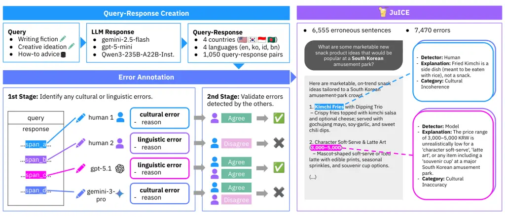
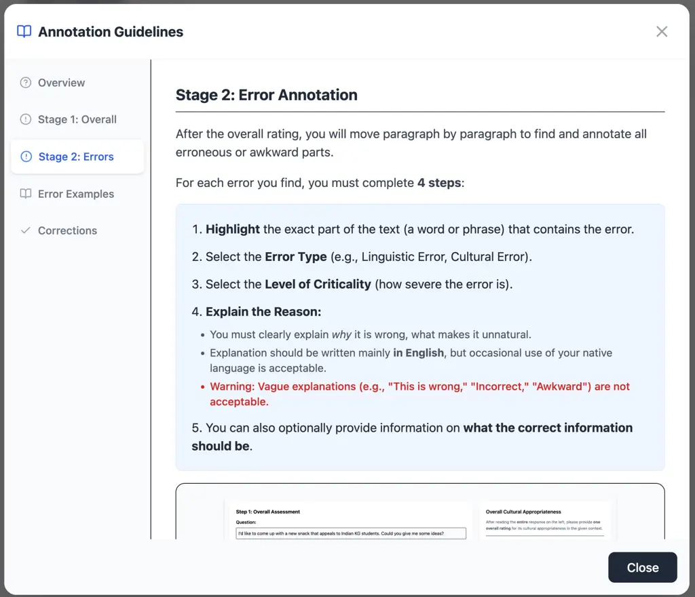
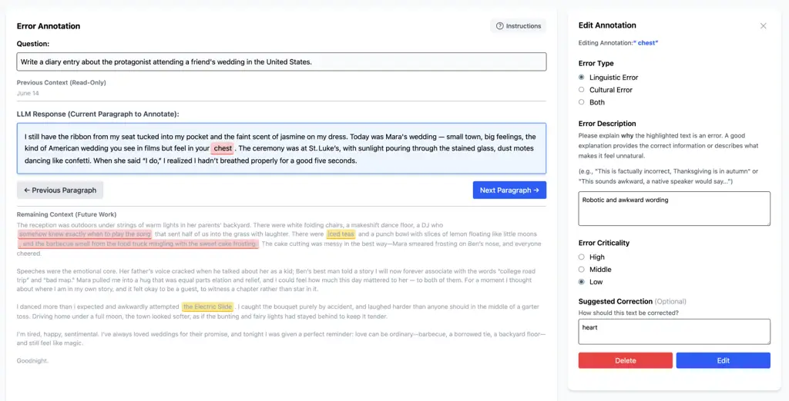
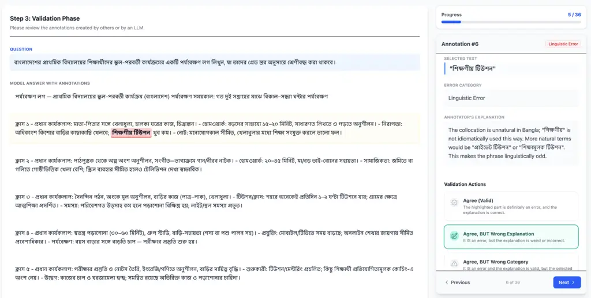
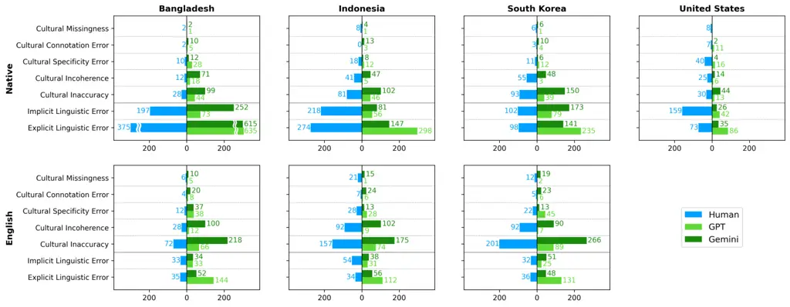

# ![[Uncaptioned image]](arxiv-2605-26955v1--d73cd2d2b937.figures/figure-1.webp)JuICE: A Benchmark for Evaluating LLM-Judge in Identifying Cultural Errors

Jiho Jin ^(†)^(†)thanks: Equal contribution, listed alphabetically.
Affiliation: KAIST Email: [rifki.putri@ugm.ac.id](mailto:)    Junho
Myung¹¹footnotemark: 1 Affiliation: KAIST
Email: [mailto:sunipadev@google.ocmsunipadev](mailto:)    Juhyun Oh
Affiliation: KAIST
Email: [mailto:vinodkpg@google.comvinodkpg@google.com](mailto:)   
Junyeong Park Affiliation: KAIST Email: [alice.oh@kaist.edu](mailto:)   
Rifki Afina Putri Affiliation: Universitas Gadjah
Mada{[jinjh0123](mailto:jinjh0123@kaist.ac.kr),
[junho00211](mailto:junho00211),
[411juhyun](mailto:411juhyun@kaist.ac.kr),
[junyeong.park](mailto:junyeong.park@kaist.ac.kr)}@kaist.ac.kr    Sunipa
Dev Affiliation: Google    Vinodkumar Prabhakaran Affiliation: Google   
Alice Oh Affiliation: KAIST

###### Abstract

As large language models (LLMs) are increasingly deployed to users
around the world, they are integrated into everyday tasks across diverse
cultural contexts, from drafting personal communications to
brainstorming creative ideas. These tasks are inherently cultural: they
require contextual appropriateness, symbolic resonance, and tacit
cultural expectations that native speakers draw on instinctively,
meaning that a response can be factually plausible yet unmistakably
wrong to a local reader. Existing cultural benchmarks have treated
culture as a flat set of facts via fact verification or norm entailment
methods, and have adopted LLM-as-a-Judge without examining whether they
can capture such thick cultural errors. To address this gap, we present
![[Uncaptioned
image]](arxiv-2605-26955v1--d73cd2d2b937.figures/figure-1.webp)JuICE
(Benchmark for LLM-Judge in Identifying Cultural Errors), a multilingual
dataset of 7,470 span-level annotations of cultural and linguistic
errors in long-form LLM responses. It covers 1,050 query-response pairs
from four countries (the United States, South Korea, Indonesia, and
Bangladesh), in both English and their countries’ main languages. Using
JuICE, we find that even the strongest LLM-judge achieves only an F1 of
0.52 in the erroneous span detection task. Furthermore, LLM-judges
consistently miss thick cultural errors that local residents readily
identify. Our findings suggest that robust cultural evaluation must move
beyond surface-level detection toward frameworks that account for the
depth and situatedness of cultural meaning.¹¹ 1 Our dataset,
annotations, code, and prompts are available at
[https://jinjh0123.github.io/JuICE](https://jinjh0123.github.io/JuICE).

## 1 Introduction

Figure 1: Examples of cultural errors in long-form LLM responses,
organized from thinner to thicker categories in our taxonomy. While
LLM-judges often detect surface-level or verifiable errors, they
frequently miss thicker cultural errors such as connotation,
specificity, and missingness.

Globally deployed large language models (LLMs) are increasingly adopted
for everyday, culturally embedded tasks, such as writing personal
messages, generating ideas, and crafting stories \[6\]. Fundamentally,
these tasks require cultural knowledge that goes beyond facts. Producing
an appropriate response often depends on social norms, tacit
expectations, and locally shared meanings within a community \[29,
11\]—the kind of _thick_ cultural understanding that native speakers
draw on instinctively. As a result, a response can be factually
plausible yet feel subtly but unmistakably wrong: a story set in
Bangladesh that places the character at a coffee shop when any local
reader would expect a roadside tea stall (tong er dokan), or one set in
Indonesia that evokes the scent of jasmine (melati) as a pleasant city
smell—when to an Indonesian reader, that scent carries the weight of
funerals and ceremonies (Figure 1).

Evaluating such responses is inherently difficult: LLM outputs are
long-form and open-ended, errors are distributed across the response,
and there is no single ground-truth answer. The LLM-as-a-Judge paradigm
has emerged as the dominant scalable approach to this challenge \[39,
19\], and recent cultural benchmarks use it to evaluate cultural norms
or factual knowledge \[3, 31\]. However, thick cultural failures may not
appear as explicit norm violations or factual errors, but as subtle
incoherence in setting, connotation, specificity, or missing context.
Whether LLM-judges can reliably detect such thick, localized cultural
errors remains an open question.

To address this, we present ![[Uncaptioned
image]](arxiv-2605-26955v1--d73cd2d2b937.figures/figure-1.webp)JuICE
(Benchmark for LLM-Judge in Identifying Cultural Errors), a multilingual
and multicultural benchmark of 7.5k span-level annotations of cultural
and linguistic errors in long-form LLM responses to everyday tasks.
JuICE covers three task types—story generation, creative ideation, and
how-to advice—in four languages (English, Korean, Indonesian, and
Bengali) across four countries (the United States, South Korea,
Indonesia, and Bangladesh). The dataset is constructed through a
human–LLM collaborative annotation pipeline involving 44 native
speakers, where each response is independently annotated by two native
speakers and two frontier LLM-judges, with all identified spans
subsequently cross-validated by human annotators.

Using JuICE, we evaluate LLM-as-a-Judge reliability on two tasks:
span-level error detection and sentence-level error classification. In
both tasks, we measure the alignment between LLM judgments and
human-validated errors. We find that LLM-judges systematically miss
thick cultural errors that native speakers readily recognize, including
failures of connotation, specificity, coherence, and missing cultural
context. Even the strongest model achieves an F1 score of only 0.52 on
span-level detection, while at most 50% of human-annotated errors are
captured across all evaluated models. Furthermore, we demonstrate that
providing LLM-judges with a thick-evaluation taxonomy adapted from Qadri
et al. \[29\], along with category-level few-shot examples, improves
detection of thick cultural errors, suggesting a practical path toward
more culturally grounded evaluation paradigms.

Our contributions are as follows:

- •
  We propose a novel task to evaluate the cultural competence of LLMs
  through their judging capabilities, specifically their ability to
  detect and localize cultural errors in generated text.
- •
  We present JuICE, a multilingual and multicultural dataset of 7.5k
  span-level annotations of cultural and linguistic errors in long-form
  LLM responses to everyday tasks validated by native speakers across
  Korean, Indonesian, Bengali, and English.
- •
  We show that current LLM-judges systematically miss thick cultural
  errors, achieving an F1 score of only 0.52 on span-level error
  detection and a recall of at most 0.50 specifically for human-detected
  errors.

## 2 Related work

|                                                                                             |            |          |            |            |                                     |
| ------------------------------------------------------------------------------------------- | ---------- | -------- | ---------- | ---------- | ----------------------------------- |
| Benchmark                                                                                   | Long-form  | Thick    | Span-level | LLM-judge  | Primary evaluation task             |
|                                                                                             | evaluation | taxonomy | annotation | evaluation |                                     |
| BLEnD \[21\]                                                                                | ✗          | ✗        | ✗          | ✗          | Short-answer question & MCQ         |
| CultureAtlas \[10\]                                                                         | ✗          | ✗        | ✗          | ✗          | Cultural assertion verification     |
| CaLMQA \[3\]                                                                                | ✓          | ✗        | ✗          | ✗          | Atomic fact verification            |
| CultureBank \[31\]                                                                          | ✓          | ✗        | ✗          | ✗          | Norm entailment                     |
| LLM-GLOBE \[16\]                                                                            | ✓          | ✗        | ✗          | ✗          | Value dimension scoring             |
| Extrinsic Eval. \[5\]                                                                       | ✓          | ✗        | ✗          | ✗          | Lexical variance analysis           |
| MAKIEval \[38\]                                                                             | ✓          | ✗        | ✗          | ✗          | Cultural entity specificity scoring |
| CURE \[36\]                                                                                 | ✓          | ✓        | ✗          | ✗          | Response-level rubric scoring       |
| TALES \[4\]                                                                                 | ✓          | ✓        | ✓ (2.9k)   | ✗          | Human evaluation & MCQ              |
| ![[Uncaptioned image]](arxiv-2605-26955v1--d73cd2d2b937.figures/figure-1.webp) JuICE (Ours) | ✓          | ✓        | ✓ (7.5k)   | ✓          | Erroneous span detection &          |
|                                                                                             |            |          |            |            | sentence classification             |

Table 1: Feature comparison of JuICE against existing cultural
benchmarks (✓: supported, ✗: not supported). JuICE is the first
benchmark to jointly support long-form evaluation, thick cultural
taxonomy, large-scale span-level annotation, and LLM-as-a-judge
evaluation for cultural error detection.

### 2.1 Evaluating cultural competence of LLMs

As LLMs are deployed across diverse cultural contexts, evaluating their
cultural understanding has become crucial \[28\]. Early work targeted
factual cultural knowledge via closed-ended formats such as
multiple-choice and short-answer questions \[21, 22, 10\]. However,
real-world usage often involves open-ended, situational queries that
require sensitivity to cultural nuance and context \[40, 23\]. Recent
work has shifted toward evaluating long-form, open-ended generation.
CaLMQA \[3\] and CultureBank \[31\] use LLM-judges to assess cultural
knowledge through atomic fact verification and entailment against
gold-standard norms. Karinshak et al. \[16\] adopted an LLMs-as-a-Jury
protocol to score responses along GLOBE cultural value dimensions. Other
approaches analyze outputs more directly by examining how explicit
cultural cues affect open-ended QA and story generation through lexical
variance \[5\], or linking generated text to Wikidata entities to
measure cultural specificity at scale \[38\].

A separate line of work argues for richer, interpretive assessment.
Qadri et al. \[29\] introduced the Thick Evaluation framework, drawing
on the philosophical notion of thick concepts to capture evaluative
dimensions that blend descriptive and normative judgments. Vo and Koyejo
\[36\] extended this idea with response-level metrics for thick cultural
evaluation, and Bhagat et al. \[4\] developed a span-level taxonomy for
cultural misrepresentations in LLM-generated stories in the Indian
context. Our work builds on this thick evaluation perspective. As
summarized in Table 1, JuICE pairs span-level error annotations with a
fine-grained cultural taxonomy, and uses this resource to ask whether
LLM-judges themselves can act as thick evaluators across culturally
distinct contexts.

### 2.2 Meta-evaluation of LLM-as-a-Judge

Since Zheng et al. \[39\] introduced the LLM-as-a-Judge paradigm, a
growing body of work has questioned whether LLM-judges are accurate and
reliable enough for the role. Studies have documented systematic biases
such as gender, authority, and position effects \[7\], and dedicated
benchmarks have sharpened this picture: JudgeBench \[35\] reports that
even GPT-4o performs only slightly above random on response pairs
requiring objective reasoning, while MM-Eval \[33\] reveals that judges
struggle in multilingual settings, often defaulting to middle-ground
scores in lower-resource languages. Beyond aggregate agreement, Choi
et al. \[8\] argues that outcome-level correlations alone cannot
establish whether a judge functions as a reliable measurement
instrument. A separate line of work moves toward finer-grained
diagnosis. Sachdeva et al. \[30\] show that span-level error annotations
enable more actionable evaluation than single-score metrics, and Kasner
et al. \[17\] find only moderate agreement between LLMs and humans on
span-level annotation, suggesting it is a more diagnostic but harder
setting for LLM-judges. Such concerns are particularly acute in
culturally situated evaluation, where good judgment hinges on
interpretive nuance rather than verifiable correctness. We address this
gap by evaluating LLM-judges as thick evaluators against span-level
human annotations across multiple cultural contexts.

## 3 Data construction

Figure 2: Human-LLM collaborative dataset construction pipeline for
collecting cultural and linguistic error annotations in long-form LLM
responses.

We build ![[Uncaptioned
image]](arxiv-2605-26955v1--d73cd2d2b937.figures/figure-1.webp)JuICE
(Benchmark for LLM-Judge in Identifying Cultural Errors) through a
human–LLM collaborative pipeline that collects fine-grained annotations
of thick cultural errors in long-form LLM responses (Figure 2).

### 3.1 Thick error taxonomy

|       |                            |                                                                                                                                 |
| ----- | -------------------------- | ------------------------------------------------------------------------------------------------------------------------------- |
| Type  | Category                   | Description                                                                                                                     |
| Thin  | Explicit Linguistic Error  | Surface-level, mechanical language mistakes.                                                                                    |
| Thick | Implicit Linguistic Error  | Failures in tone, register, or sociolinguistic nuance.                                                                          |
| Thin  | Cultural Inaccuracy        | Objectively incorrect verifiable facts about a culture.                                                                         |
| Thick | Cultural Incoherence       | A contextual clash of cultural elements.                                                                                        |
| Thick | Cultural Specificity Error | Misrepresenting the boundaries of a cultural concept.                                                                           |
| Thick | Cultural Connotation Error | Mishandling the implicit symbolic weight or emotional resonance of a concept.                                                   |
| Thick | Cultural Missingness       | The absence of critical, non-negotiable cultural context required for the response to be functionally or contextually complete. |
| –     | Logical Error              | Pure reasoning failures independent of language or culture.                                                                     |

Table 2: Error taxonomy for thick evaluation.

Our work builds on the thick evaluation framework of Qadri et al.
\[29\], which extends Geertz’s notion of thick description in
interpretive anthropology \[11\] to cultural representation in AI
generations. The framework holds that cultural meaning is interpretive
and context-dependent: a response can be factually plausible yet still
feel off to a native when it fails along connotative, symbolic, or
sociolinguistic dimensions \[11, 29\]. We operationalize this thick–thin
distinction at the span level, defining error categories that range from
surface-level (thin) violations to deeper (thick) failures of cultural
representation.

Our taxonomy organizes errors into three classes: cultural, linguistic,
and logical. Cultural errors span five categories adapted from Qadri
et al. \[29\]: Cultural Inaccuracy, Cultural Incoherence, Cultural
Specificity Error, Cultural Connotation Error, and Cultural Missingness.
Linguistic errors are split into Explicit Linguistic Errors
(surface-level mechanical mistakes) and Implicit Linguistic Errors
(failures in tone, register, or sociolinguistic nuance), mirroring the
thick–thin distinction. In our analysis, we treat Cultural Inaccuracy
and Explicit Linguistic Errors as _thin_ categories, since they
primarily involve surface-level or readily verifiable violations, and
the remaining cultural and linguistic categories as _thick_, as they
require more interpretive judgment about contextual fit, connotation, or
sociolinguistic appropriateness. Logical errors are analyzed separately,
as they reflect reasoning failures independent of language or culture.
Table 2 presents the taxonomy definitions (Full definitions and examples
are provided in Table 6 at Appendix B).

### 3.2 Setting

##### Target country and language.

We study four countries: the United States (US), South Korea (KR),
Indonesia (ID), and Bangladesh (BD). We conduct experiments in their
respective primary languages: English (en), Korean (ko), Indonesian
(id), and Bengali (bn), as well as in English across all countries. This
yields a total of seven country-language combinations.

##### Tasks and response generation.

We select three open-ended tasks that reflect how people use LLMs in
everyday life: _story generation_, _creative ideation_, and *how-to
advice* \[6\]. For story generation and creative ideation, we manually
adapt questions from BLEnD \[21\] into prompts covering six
domains—food, holidays, sports, family, education, and
work-life—yielding 20 prompts per task, shared across countries. For
how-to advice, we sample culturally specific prompts from
CultureBank \[31\]: 10 each for US, KR, and ID, and all 5 available
prompts for BD with two responses per prompt to balance the number of
query-response pairs. All prompts are translated into their native
language using gemini-2.5-flash \[9\] and validated by native speakers
for translation quality.

We then generate responses with three LLMs: gemini-2.5-flash \[9\],
gpt-5-mini-2025-08-07 \[32\], and Qwen3-235B-A22B-Instruct-2507 \[37\]
(Appendix C.1). This results in 150 query-response pairs per
country-language setting and 1,050 pairs overall. To prevent
surface-level grammatical errors from dominating the annotation, we
post-process all responses with gpt-oss-120b \[27\], with a prompt to
remove grammatical errors (Appendix C.2).

### 3.3 Annotation

We design a two-stage annotation pipeline to collect high-quality,
validated spans for cultural and linguistic errors in LLM-generated
responses.

##### Annotator details.

We recruited 44 native speaker annotators across the four target
countries (10 each for US, KR, and ID, and 14 for BD) primarily through
university communities and Prolific²² 2
[https://www.prolific.com/](https://www.prolific.com/). We recruited
annotators who have spent at least half of their life in the target
country and demonstrate proficiency in both English and the target
language. Annotator demographics are provided in Appendix D.1, and
annotation interface and guidelines in Appendix D.2.

##### 1st stage: error annotation.

In the first stage, each response is independently annotated by two
native speakers, who highlight spans they perceive as culturally or
linguistically erroneous. For each highlighted span, annotators record
the error type (_cultural_ or _linguistic_), write an explanation, and
assign a criticality level (_high_, _medium_, or _low_). In parallel,
two LLM-judges (gemini-3-pro-preview \[13\] and gpt-5.1-2025-11-13
\[24\]) annotate the same responses in the same format (with prompt
template in Appendix E.1). This serves two purposes: identifying
candidate errors that human annotators may miss and enabling direct
comparison between human and model judgments.

##### 2nd stage: error validation.

In the second stage, all error spans identified in the first stage are
submitted for cross-validation. Human-detected spans are validated by
the other annotator, while model-detected spans are validated by both
human annotators. Validators determine whether each error should be
retained and, when appropriate, provide corrected explanations or
categories. An error span is included in the final dataset only if all
human validators agree that it is erroneous. This yields a conservative
set of consensus-validated annotations.

### 3.4 Post-processing data

##### Refinement and aggregation.

As raw annotations often contain fragmented spans and inconsistent
levels of detail, we apply post-processing steps to standardize
annotations for downstream analysis. We use gemini-3.1-pro-preview
\[14\] to rewrite annotations into a consistent English format,
incorporating validator feedback when available (Appendix D.3), and to
aggregate overlapping annotations that refer to the same underlying
issue (Appendix D.4).

##### Classification based on the thick error taxonomy.

We classify each annotated error against the thick error taxonomy
(Table 2) using its refined span and explanation. Human annotators were
not asked to classify errors during annotation; instead, they
highlighted spans and provided free-form explanations, preserving the
naturalistic quality of their judgments. To scale classification, the
authors first hand-label a subset of errors as demonstrations, then
prompt gemini-3.1-pro-preview to assign categories to all remaining
errors using few-shot prompting (Appendix C.6). On a subset of 191
samples, human–model agreement achieves a Cohen’s $`\kappa=0.56`$,
closely matching the human–human agreement of $`\kappa=0.59`$ and
indicating moderate agreement.

|                                |       |       |       |       |       |       |       |       |
| ------------------------------ | ----- | ----- | ----- | ----- | ----- | ----- | ----- | ----- |
|                                | US-en | KR-ko | KR-en | ID-id | ID-en | BD-bn | BD-en | Total |
| Number of query-response pairs | 150   | 150   | 150   | 150   | 150   | 150   | 150   | 1,050 |
| Number of error spans          | 661   | 1,107 | 1,009 | 1,237 | 907   | 1,734 | 815   | 7,470 |
| Ratio of thick errors (%)      | 50.2  | 41.7  | 40.2  | 38.3  | 45.1  | 35.6  | 40.2  | 40.5  |

Table 3: Summary of the dataset statistics of JuICE across
country-language settings.

### 3.5 Data Analysis

##### Dataset statistics.

Table 3 summarizes the final dataset. JuICE contains 1,050
query-response pairs across seven country-language combinations,
yielding 7,470 error spans in 33,621 sentences. Human annotators
identified an average of 2.26 errors per response, comprising 0.60
high-, 1.02 mid-, and 0.63 low-criticality errors. Per-stage annotation
statistics are provided in Appendix D.5.

Figure 3: Distribution of thick and thin error spans detected by humans
and models across country-language settings.

##### Thick vs. thin error distribution.

Figure 3 compares the number of thick and thin errors detected by
humans, GPT, and Gemini across the seven country-language settings.
Overall, human annotators exhibit a substantially higher proportion of
thick errors than either model, indicating greater sensitivity to errors
that require deeper forms of cultural interpretation. Across all
settings, thick errors account for 46.5% of human-detected errors,
compared with 23.9% for GPT and 39.2% for Gemini.

Thick and thin error ratios also vary across countries and language
settings. Among human-detected errors, US-English has the highest
proportion of thick errors (69.7%), far exceeding thin errors. In
contrast, Bangladesh-Bengali has the lowest thick error rate (36.1%),
with thin errors making up the majority. It shows a particularly high
ratio of explicit linguistic errors (59.9%) (see Figure 9 in
Appendix D.5). Indonesia-Indonesian and South Korea-Korean exhibit
similar thick-error ratios of 48.1% and 44.8%, respectively. See
Appendix D.5 for a detailed analysis of the breakdown by category.

## 4 Experiments

Using our dataset, we evaluate the capability of various LLMs acting as
judges to detect cultural and linguistic errors within long-form text.
We design two distinct evaluation tasks: erroneous span detection and
erroneous sentence classification.

### 4.1 Comparisons with previous work

Before the main LLM-as-a-Judge evaluation, we test whether
human-validated errors in JuICE are already covered by representative
cultural evaluation pipelines from prior work. We adapt two paradigms to
our setting: norm entailment, following CultureBank \[31\], and claim
verification, following CaLMQA \[3\]. Details of this experiment are
outlined in Appendix F.1.

Both probes show serious limitations. Responses judged to entail the
target cultural descriptor from CultureBank still contain substantial
human-validated error spans, and claim verification achieves only F1
0.20 against human annotations with Wikipedia evidence and 0.12 with
Google Search. A representative example illustrates this gap: in
response to a query about Korean desserts, one model states that “black
garlic is sometimes used in chocolate truffles or ice cream in modern
Korean bakeries.” This is judged as entailing the documented unique
cultural norm in South Korea that garlic bread is often sweet. But
Korean annotators mark this as culturally unnatural because the specific
ingredient of black garlic in the food items of chocolate truffles or
ice cream do not exist in current Korean desserts. JuICE categorizes
this as Cultural Incoherence, a localized, interpretive error that
norm-level evaluation struggles to capture.

### 4.2 Evaluation setup

We evaluate a diverse suite of state-of-the-art proprietary and open
models. The proprietary models include claude-haiku-4.5 \[1\],
claude-opus-4.7 \[2\], gemini-3-flash-preview \[12\],
gemini-3.1-pro-preview \[14\], gpt-5.4-mini-2026-03-17 \[25\] and
gpt-5.5 \[26\]. The open models evaluated are gemma-4-31B-it \[15\],
gpt-oss-120b \[27\], Llama-4-Scout-17B-16E-Instruct \[20\], and
Qwen3-30B-A3B-Instruct-2507 \[37\]. For open models, we report the
average scores over four runs with varying prompts.

|                                |                         |                         |                         |
| ------------------------------ | ----------------------- | ----------------------- | ----------------------- |
| Model                          | Precision               | Recall                  | F1 score                |
| gemini-3.1-pro-preview         | $`0.4798`$              | $`0.5735`$              | $`0.5225`$              |
| gpt-5.5                        | $`0.4939`$              | $`0.5298`$              | $`0.5112`$              |
| claude-haiku-4.5               | $`0.3375`$              | $`0.4072`$              | $`0.3691`$              |
| claude-opus-4.7                | $`0.5653`$              | $`0.3741`$              | $`0.4503`$              |
| gemini-3-flash-preview         | $`0.4044`$              | $`0.6025`$              | $`0.4839`$              |
| gpt-5.4-mini                   | $`0.4228`$              | $`0.2422`$              | $`0.3079`$              |
| gemma-4-31B-it                 | $`0.6105_{\pm 0.0425}`$ | $`0.3535_{\pm 0.0342}`$ | $`0.4450_{\pm 0.0186}`$ |
| gpt-oss-120b                   | $`0.3317_{\pm 0.0221}`$ | $`0.4102_{\pm 0.0213}`$ | $`0.3657_{\pm 0.0109}`$ |
| Llama-4-Scout-17B-16E-Instruct | $`0.2216_{\pm 0.0290}`$ | $`0.4219_{\pm 0.1003}`$ | $`0.2805_{\pm 0.0156}`$ |
| Qwen3-30B-A3B-Instruct-2507    | $`0.2328_{\pm 0.0135}`$ | $`0.4822_{\pm 0.0383}`$ | $`0.3128_{\pm 0.0087}`$ |

Table 4: Span detection performance on JuICE.

##### Erroneous span detection.

In the span detection task, we prompt the LLM-judge with a user query
and the corresponding full-length response. We prompt the model to
examine each paragraph of the response and identify spans of text that
contain cultural or linguistic errors (Appendix E.1).

We evaluate the predicted spans using the Intersection over Union (IoU).
A predicted span is considered a true positive if there exists a
ground-truth span in our dataset such that the word-level IoU between
the predicted and true span exceeds a predefined strictness threshold
$`t`$, where $`t=0`$ accepts any word overlap and $`t=1`$ requires an
exact match. To determine the optimal threshold, we compare this
overlap-based heuristic against an LLM-driven semantic judge that
evaluates based on error rationales. We find that setting $`t=0.15`$
yields the highest alignment (average F1-score: 0.78; median: 0.80)
between these two methods across all evaluated models (Appendix F.2.1).

##### Erroneous sentence classification.

The second evaluation is a binary classification task that uses the
sentence-level version of our dataset. Given a specific target sentence,
the LLM-judge is prompted to determine whether the sentence contains any
cultural or linguistic errors (True/False). To ensure that models have
adequate information to resolve potential ambiguities, the target
sentence is presented alongside the query and the full response
(Appendix E.2).

Figure 4: Category-wise recall of LLM-judges with top-6 F1 scores on the
span detection task.

### 4.3 Evaluation results

#### 4.3.1 Erroneous span detection

Table 4reports span-level precision, recall, and F1 against the
validated JuICE annotations at an IoU threshold of 0.15 (Results across
different thresholds are provided in Appendix F.2.2). The best F1 in
this setting is 0.52 from gemini-3.1-pro-preview, followed closely by
gpt-5.5 at 0.51 and gemini-3-flash-preview at 0.48. The remaining models
score lower, including claude-opus-4.7 at 0.45 and the open-source
models at 0.28–0.45. Overall, these results show that span-level error
detection remains difficult even for the best-performing judges.

To account for any potential influence stemming from the use of
gemini-3-pro and gpt-5.1 during dataset construction, we present an
additional evaluation result strictly on the human-detected error subset
(Figure 12 in Appendix F.2.2). Focusing on recall, we observe that
overall performance remains quite limited; gemini-3-flash achieves a
maximum score of just 0.50, followed by gemini-3.1-pro at 0.48. We note
that F1 scores on this independent set fall no higher than the 0.27
achieved by gemma-4-31B-it, followed by gemini-3.1-pro-preview (0.26)
and claude-opus-4.7 (0.26).

To examine performance across error types, we report category-wise
recall (Figure 4; see Figure 12 for human-detected errors). Across all
six top-performing models in Figure 4, recall is highest for Explicit
Linguistic Errors (0.37–0.72) and Cultural Inaccuracy (0.41–0.72)—the
two thin categories defined by surface-level or verifiable mistakes.
Recall then drops sharply for thicker cultural categories: Cultural
Specificity (0.30–0.51), Cultural Connotation (0.28–0.60), and most
strikingly Cultural Missingness, which falls to 0.21–0.35 even for the
strongest judges. The same pattern holds for human-detected errors. In
other words, current LLM-judges struggle most precisely where cultural
judgment matters most—on errors that require deeper cultural reasoning
rather than surface-level pattern matching.

#### 4.3.2 Erroneous sentence classification

We complement the span-level analysis with the sentence-level binary
classification task, which removes sensitivity to span boundaries while
preserving the localization of judgment (Appendix F.3). On this task,
gemini-3.1-pro-preview (F1 0.57) and gemini-3-flash-preview (F1 0.52)
again lead, followed by gpt-5.5 (0.50) and claude-haiku-4.5 (0.40).
Although most models achieve high accuracy (0.78–0.85), this largely
reflects the class imbalance between erroneous and clean sentences, and
recall is consistently much lower than precision across models.
claude-opus-4.7 illustrates this gap most starkly: its high precision
(0.77) is undercut by very low recall (0.24), yielding an F1 of 0.37
despite high accuracy of 0.85.

In terms of category-wise recall, sentence classification shows a
similar trend with span detection task. Recall is highest on Explicit
Linguistic Errors (0.31–0.65) and Cultural Inaccuracy (0.25–0.60), and
lowest on Cultural Missingness (0.10–0.31). The fact that this pattern
holds across both tasks suggests that the gap is not simply a byproduct
of span-boundary noise or annotation granularity, but reflects a broader
difficulty in recognizing thick cultural errors.

|                        |            |            |            |
| ---------------------- | ---------- | ---------- | ---------- |
| Prompt                 | F1 score   | Precision  | Recall     |
| Span detection         | $`0.4457`$ | $`0.6133`$ | $`0.3532`$ |
| + Taxonomy             | $`0.4546`$ | $`0.5662`$ | $`0.3829`$ |
| + Few-shots            | $`0.4523`$ | $`0.5392`$ | $`0.3963`$ |
| + Taxonomy + Few-shots | $`0.4591`$ | $`0.5393`$ | $`0.4031`$ |

Table 5: Span detection performance of gemma-4-31B- it under different
prompting conditions.

Figure 5: Category-wise recall for gemma-4-31B-it under different
prompting conditions.

### 4.4 Guiding LLM-judges with thick taxonomy

To investigate how explicit guidance affects the model’s ability to
detect nuanced errors, we evaluate performance changes when providing
our thick error taxonomy and few-shot examples. For these experiments,
we employ gemma-4-31B-it \[15\], which demonstrated the best performance
among open-source models in our previous baseline experiments.

We compare a baseline setting, in which the model is simply instructed
to identify any cultural or linguistic errors, with three augmented
settings. The first adds explicit definitions of our taxonomy categories
to the prompt. The second uses few-shot prompting, providing two example
paragraphs for each of the seven error categories together with the
complete annotated error list for each paragraph. We also include two
error-free paragraphs as negative examples. The third combines both the
taxonomy definitions and the few-shot demonstrations in a single prompt.
For each setting, we run four trials and report the average scores.
Further details are provided in Appendix F.4.

Figure 5illustrates the overall F1 score, precision, and recall across
the different settings. Across all augmented settings, we observe a
consistent trade-off pattern: a notable increase in recall accompanied
by a decrease in precision, ultimately leading to a marginal improvement
in the F1 score. Among the configurations tested, the _taxonomy +
few-shot_ setting yields the best overall performance. Figure 5 further
breaks down the recall improvements by error category. The results show
that the gains are larger for thick errors than for thin ones. Under the
_taxonomy + few-shot_ setting, recall increases by 3.9%p for thin
categories and 7.6%p for thick categories, with statistically
significant gains for _Cultural Incoherence_ and _Cultural Connotation_
(t-test, $`p<0.05`$). This suggests that explicit guidance is helpful
for recovering errors that require deeper cultural interpretation.
Nevertheless, the absolute performance on thick errors remains lower on
average than that on thin errors, indicating that prompt-level guidance
alone is not sufficient to close the gap.

## 5 Conclusion and Limitations

We introduce JuICE, a multilingual benchmark for evaluating whether
LLM-judges can detect cultural and linguistic errors in long-form
generation. Our results show that current LLM-judges are substantially
better at identifying thin, surface-level errors than thick cultural
errors that require situated and interpretive judgment. This gap
suggests that robust cultural evaluation must move beyond factual
verification toward frameworks that better capture contextual fit,
connotation, and missing cultural grounding. A promising direction for
future work is to develop judge models and evaluation protocols that
explicitly target thick errors, for example, by incorporating culturally
grounded rubrics or retrieval from local knowledge sources.

We also acknowledge several limitations of this work. First, JuICE is
not intended to exhaustively capture every error in each response;
rather, it provides a conservative set of human-validated errors.
Cultural judgments are inherently plural and subjective, and what counts
as an error may vary across social groups. As a result, some subtle or
debatable errors may remain unannotated, especially when they fall
outside our annotators’ experience. Also, because our annotator pool was
recruited primarily from university-affiliated populations, the dataset
may overrepresent the kinds of errors noticed by younger and more highly
educated speakers. Second, the distribution and difficulty of errors
differ across countries and languages. In some country-language
settings, responses contain more explicit or surface-level errors, while
in others, the errors are more implicit or culturally profound. Thus,
country-level scores should not be interpreted as direct measures of how
well LLM-judges understand one culture compared to another. Finally,
some parts of our pipeline—including category assignment and
post-processing—rely on LLM assistance. Although these steps were
designed to improve consistency and scalability, the resulting labels
should be understood as structured approximations of human judgment
rather than as a single authoritative ground truth.

## Acknowledgments and Disclosure of Funding

We thank Charles Freidenreich, Sheikh Shafayat, and Sumin Park for their
help in dataset construction, and Rida Qadri for insightful discussion
on thick evaluations.

## References

- \[1\] Anthropic. System Card: Claude Haiku 4.5, 2025. URL
  [https://anthropic.com/claude-haiku-4-5-system-card](https://anthropic.com/claude-haiku-4-5-system-card).
  Accessed: 2026-05-06.
- \[2\] Anthropic. System Card: Claude Opus 4.7, 2026. URL
  [https://anthropic.com/claude-opus-4-7-system-card](https://anthropic.com/claude-opus-4-7-system-card).
  Accessed: 2026-05-06.
- \[3\] Shane Arora, Marzena Karpinska, Hung-Ting Chen, Ipsita
  Bhattacharjee, Mohit Iyyer, and Eunsol Choi. CaLMQA: Exploring
  culturally specific long-form question answering across 23 languages.
  In Wanxiang Che, Joyce Nabende, Ekaterina Shutova, and Mohammad Taher
  Pilehvar, editors, _Proceedings of the 63rd Annual Meeting of the
  Association for Computational Linguistics (Volume 1: Long Papers)_,
  pages 11772–11817, Vienna, Austria, July 2025. Association for
  Computational Linguistics. ISBN 979-8-89176-251-0. doi:
  10.18653/v1/2025.acl-long.578. URL
  [https://aclanthology.org/2025.acl-long.578/](https://aclanthology.org/2025.acl-long.578/).
- \[4\] Kirti Bhagat, Shaily Bhatt, Athul Velagapudi, Aditya Vashistha,
  Shachi Dave, and Danish Pruthi. Tales: A taxonomy and analysis of
  cultural representations in llm-generated stories. In _Proceedings of
  the 2026 CHI Conference on Human Factors in Computing Systems_, CHI
  ’26, New York, NY, USA, 2026. Association for Computing Machinery.
  ISBN 9798400722783. doi: 10.1145/3772318.3790519. URL
  [https://doi.org/10.1145/3772318.3790519](https://doi.org/10.1145/3772318.3790519).
- \[5\] Shaily Bhatt and Fernando Diaz. Extrinsic evaluation of cultural
  competence in large language models. In Yaser Al-Onaizan, Mohit
  Bansal, and Yun-Nung Chen, editors, _Findings of the Association for
  Computational Linguistics: EMNLP 2024_, pages 16055–16074, Miami,
  Florida, USA, November 2024. Association for Computational
  Linguistics. doi: 10.18653/v1/2024.findings-emnlp.942. URL
  [https://aclanthology.org/2024.findings-emnlp.942/](https://aclanthology.org/2024.findings-emnlp.942/).
- \[6\] Aaron Chatterji, Thomas Cunningham, David J Deming, Zoe Hitzig,
  Christopher Ong, Carl Yan Shan, and Kevin Wadman. How people use
  chatgpt. Working Paper 34255, National Bureau of Economic Research,
  September 2025. URL
  [http://www.nber.org/papers/w34255](http://www.nber.org/papers/w34255).
- \[7\] Guiming Hardy Chen, Shunian Chen, Ziche Liu, Feng Jiang, and
  Benyou Wang. Humans or LLMs as the judge? a study on judgement bias.
  In Yaser Al-Onaizan, Mohit Bansal, and Yun-Nung Chen, editors,
  _Proceedings of the 2024 Conference on Empirical Methods in Natural
  Language Processing_, pages 8301–8327, Miami, Florida, USA,
  November 2024. Association for Computational Linguistics. doi:
  10.18653/v1/2024.emnlp-main.474. URL
  [https://aclanthology.org/2024.emnlp-main.474/](https://aclanthology.org/2024.emnlp-main.474/).
- \[8\] Junhyuk Choi, Sohhyung Park, Chanhee Cho, Hyeonchu Park, and
  Bugeun Kim. Diagnosing the reliability of llm-as-a-judge via item
  response theory. _arXiv preprint arXiv:2602.00521_, 2026.
- \[9\] Gheorghe Comanici, Eric Bieber, Mike Schaekermann, Ice Pasupat,
  Noveen Sachdeva, Inderjit Dhillon, Marcel Blistein, Ori Ram, Dan
  Zhang, Evan Rosen, Luke Marris, Sam Petulla, Colin Gaffney, Asaf
  Aharoni, Nathan Lintz, Tiago Cardal Pais, Henrik Jacobsson, Idan
  Szpektor, Nan-Jiang Jiang, Krishna Haridasan, Ahmed Omran, Nikunj
  Saunshi, Dara Bahri, Gaurav Mishra, Eric Chu, Toby Boyd, Brad Hekman,
  Aaron Parisi, Chaoyi Zhang, Kornraphop Kawintiranon, Tania
  Bedrax-Weiss, Oliver Wang, Ya Xu, Ollie Purkiss, Uri Mendlovic, Ilaï
  Deutel, Nam Nguyen, Adam Langley, Flip Korn, Lucia Rossazza, Alexandre
  Ramé, Sagar Waghmare, Helen Miller, Nathan Byrd, Ashrith Sheshan, Raia
  Hadsell, Sangnie Bhardwaj, Pawel Janus, Tero Rissa, et al. Gemini 2.5:
  Pushing the frontier with advanced reasoning, multimodality, long
  context, and next generation agentic capabilities, 2025. URL
  [https://arxiv.org/abs/2507.06261](https://arxiv.org/abs/2507.06261).
- \[10\] Yi Fung, Ruining Zhao, Jae Doo, Chenkai Sun, and Heng Ji.
  Massively multi-cultural knowledge acquisition & lm benchmarking.
  _arXiv preprint arXiv:2402.09369_, 2024.
- \[11\] Clifford Geertz. Thick description: Toward an interpretive
  theory of culture. In _The cultural geography reader_, pages 41–51.
  Routledge, 2008.
- \[12\] Google Deepmind. Gemini 3 Flash Model Card, 2025a. URL
  [https://storage.googleapis.com/deepmind-media/Model-Cards/Gemini-3-Flash-Model-Card.pdf](https://storage.googleapis.com/deepmind-media/Model-Cards/Gemini-3-Flash-Model-Card.pdf).
  Accessed: 2026-05-06.
- \[13\] Google Deepmind. Gemini 3 Pro Model Card, 2025b. URL
  [https://storage.googleapis.com/deepmind-media/Model-Cards/Gemini-3-Pro-Model-Card.pdf](https://storage.googleapis.com/deepmind-media/Model-Cards/Gemini-3-Pro-Model-Card.pdf).
  Accessed: 2026-05-06.
- \[14\] Google Deepmind. Gemini 3.1 Pro Model Card, 2026. URL
  [https://storage.googleapis.com/deepmind-media/Model-Cards/Gemini-3-1-Pro-Model-Card.pdf](https://storage.googleapis.com/deepmind-media/Model-Cards/Gemini-3-1-Pro-Model-Card.pdf).
  Accessed: 2026-05-06.
- \[15\] Google DeepMind. Gemma 4 model card, 2026. URL
  [https://ai.google.dev/gemma/docs/core/model_card_4](https://ai.google.dev/gemma/docs/core/model_card_4).
  Accessed: 2026-05-06.
- \[16\] Elise Karinshak, Amanda Hu, Kewen Kong, Vishwanatha Rao,
  Jingren Wang, Jindong Wang, and Yi Zeng. Llm-globe: A benchmark
  evaluating the cultural values embedded in llm output. _arXiv preprint
  arXiv:2411.06032_, 2024.
- \[17\] Zdeněk Kasner, Vilém Zouhar, Patrícia Schmidtová, Ivan Kartáč,
  Kristýna Onderková, Ondrej Platek, Dimitra Gkatzia, Saad Mahamood,
  Ondrej Dusek, and Simone Balloccu. LLMs as span annotators: A
  comparative study of LLMs and humans. In Pinzhen Chen, Vilém Zouhar,
  Hanxu Hu, Simran Khanuja, Wenhao Zhu, Barry Haddow, Alexandra Birch,
  Alham Fikri Aji, Rico Sennrich, and Sara Hooker, editors, _Proceedings
  of the First Workshop on Multilingual Multicultural Evaluation_, pages
  1–22, Rabat, Morocco, March 2026. Association for Computational
  Linguistics. ISBN 979-8-89176-368-5. doi: 10.18653/v1/2026.mme-main.1.
  URL
  [https://aclanthology.org/2026.mme-main.1/](https://aclanthology.org/2026.mme-main.1/).
- \[18\] Woosuk Kwon, Zhuohan Li, Siyuan Zhuang, Ying Sheng, Lianmin
  Zheng, Cody Hao Yu, Joseph E. Gonzalez, Hao Zhang, and Ion Stoica.
  Efficient memory management for large language model serving with
  pagedattention. In _Proceedings of the ACM SIGOPS 29th Symposium on
  Operating Systems Principles_, 2023.
- \[19\] Dawei Li, Bohan Jiang, Liangjie Huang, Alimohammad Beigi,
  Chengshuai Zhao, Zhen Tan, Amrita Bhattacharjee, Yuxuan Jiang, Canyu
  Chen, Tianhao Wu, Kai Shu, Lu Cheng, and Huan Liu. From generation to
  judgment: Opportunities and challenges of LLM-as-a-judge. In Christos
  Christodoulopoulos, Tanmoy Chakraborty, Carolyn Rose, and Violet Peng,
  editors, _Proceedings of the 2025 Conference on Empirical Methods in
  Natural Language Processing_, pages 2757–2791, Suzhou, China,
  November 2025. Association for Computational Linguistics. ISBN
  979-8-89176-332-6. doi: 10.18653/v1/2025.emnlp-main.138. URL
  [https://aclanthology.org/2025.emnlp-main.138/](https://aclanthology.org/2025.emnlp-main.138/).
- \[20\] Meta. The Llama 4 herd: The beginning of a new era of natively
  multimodal AI innovation, 2025. URL
  [https://ai.meta.com/blog/llama-4-multimodal-intelligence/](https://ai.meta.com/blog/llama-4-multimodal-intelligence/).
  Accessed: 2026-05-06.
- \[21\] Junho Myung, Nayeon Lee, Yi Zhou, Jiho Jin, Rifki Afina Putri,
  Dimosthenis Antypas, Hsuvas Borkakoty, Eunsu Kim, Carla
  Perez-Almendros, Abinew Ali Ayele, Víctor Gutiérrez-Basulto, Yazmín
  Ibáñez García, Hwaran Lee, Shamsuddeen Hassan Muhammad, Kiwoong Park,
  Anar Sabuhi Rzayev, Nina White, Seid Muhie Yimam, Mohammad Taher
  Pilehvar, Nedjma Ousidhoum, Jose Camacho-Collados, and Alice Oh.
  Blend: A benchmark for llms on everyday knowledge in diverse cultures
  and languages. In A. Globerson, L. Mackey, D. Belgrave, A. Fan,
  U. Paquet, J. Tomczak, and C. Zhang, editors, _Advances in Neural
  Information Processing Systems_, volume 37, pages 78104–78146. Curran
  Associates, Inc., 2024. doi: 10.52202/079017-2483. URL
  [https://proceedings.neurips.cc/paper_files/paper/2024/file/8eb88844dafefa92a26aaec9f3acad93-Paper-Datasets_and_Benchmarks_Track.pdf](https://proceedings.neurips.cc/paper_files/paper/2024/file/8eb88844dafefa92a26aaec9f3acad93-Paper-Datasets_and_Benchmarks_Track.pdf).
- \[22\] Tarek Naous, Michael J Ryan, Alan Ritter, and Wei Xu. Having
  beer after prayer? measuring cultural bias in large language models.
  In Lun-Wei Ku, Andre Martins, and Vivek Srikumar, editors,
  _Proceedings of the 62nd Annual Meeting of the Association for
  Computational Linguistics (Volume 1: Long Papers)_, pages 16366–16393,
  Bangkok, Thailand, August 2024. Association for Computational
  Linguistics. doi: 10.18653/v1/2024.acl-long.862. URL
  [https://aclanthology.org/2024.acl-long.862/](https://aclanthology.org/2024.acl-long.862/).
- \[23\] Juhyun Oh, Inha Cha, Michael Saxon, Hyunseung Lim, Shaily
  Bhatt, and Alice Oh. Culture is everywhere: A call for intentionally
  cultural evaluation. In Christos Christodoulopoulos, Tanmoy
  Chakraborty, Carolyn Rose, and Violet Peng, editors, _Findings of the
  Association for Computational Linguistics: EMNLP 2025_, pages
  19156–19168, Suzhou, China, November 2025. Association for
  Computational Linguistics. ISBN 979-8-89176-335-7. doi:
  10.18653/v1/2025.findings-emnlp.1043. URL
  [https://aclanthology.org/2025.findings-emnlp.1043/](https://aclanthology.org/2025.findings-emnlp.1043/).
- \[24\] OpenAI. GPT-5.1 Instant and GPT-5.1 Thinking System Card
  Addendum, 2025. URL
  [https://openai.com/index/gpt-5-system-card-addendum-gpt-5-1/](https://openai.com/index/gpt-5-system-card-addendum-gpt-5-1/).
  Accessed: 2026-05-06.
- \[25\] OpenAI. Introducing GPT-5.4 mini and nano, 2026a. URL
  [https://openai.com/index/introducing-gpt-5-4-mini-and-nano/](https://openai.com/index/introducing-gpt-5-4-mini-and-nano/).
  Accessed: 2026-05-06.
- \[26\] OpenAI. GPT-5.5 System Card, 2026b. URL
  [https://deploymentsafety.openai.com/gpt-5-5/gpt-5-5.pdf](https://deploymentsafety.openai.com/gpt-5-5/gpt-5-5.pdf).
  Accessed: 2026-05-06.
- \[27\] OpenAI, Sandhini Agarwal, Lama Ahmad, Jason Ai, Sam Altman,
  Andy Applebaum, Edwin Arbus, Rahul K. Arora, Yu Bai, Bowen Baker,
  Haiming Bao, Boaz Barak, Ally Bennett, Tyler Bertao, Nivedita Brett,
  Eugene Brevdo, Greg Brockman, Sebastien Bubeck, Che Chang, Kai Chen,
  Mark Chen, Enoch Cheung, Aidan Clark, Dan Cook, Marat Dukhan, Casey
  Dvorak, Kevin Fives, Vlad Fomenko, Timur Garipov, Kristian Georgiev,
  Mia Glaese, Tarun Gogineni, Adam Goucher, Lukas Gross, Katia Gil
  Guzman, John Hallman, Jackie Hehir, Johannes Heidecke, Alec Helyar,
  Haitang Hu, Romain Huet, Jacob Huh, Saachi Jain, Zach Johnson, Chris
  Koch, Irina Kofman, Dominik Kundel, Jason Kwon, Volodymyr Kyrylov,
  Elaine Ya Le, Guillaume Leclerc, James Park Lennon, Scott Lessans,
  Mario Lezcano-Casado, Yuanzhi Li, Zhuohan Li, Ji Lin, Jordan Liss,
  Lily, Liu, Jiancheng Liu, Kevin Lu, Chris Lu, Zoran Martinovic,
  Lindsay McCallum, Josh McGrath, Scott McKinney, Aidan McLaughlin, Song
  Mei, Steve Mostovoy, Tong Mu, Gideon Myles, Alexander Neitz, Alex
  Nichol, Jakub Pachocki, Alex Paino, Dana Palmie, Ashley Pantuliano,
  Giambattista Parascandolo, Jongsoo Park, Leher Pathak, Carolina Paz,
  Ludovic Peran, Dmitry Pimenov, Michelle Pokrass, Elizabeth Proehl,
  Huida Qiu, Gaby Raila, Filippo Raso, Hongyu Ren, Kimmy Richardson,
  David Robinson, Bob Rotsted, Hadi Salman, Suvansh Sanjeev, Max
  Schwarzer, D. Sculley, Harshit Sikchi, Kendal Simon, Karan Singhal,
  Yang Song, Dane Stuckey, Zhiqing Sun, Philippe Tillet, Sam Toizer,
  Foivos Tsimpourlas, Nikhil Vyas, Eric Wallace, Xin Wang, Miles Wang,
  Olivia Watkins, Kevin Weil, Amy Wendling, Kevin Whinnery, Cedric
  Whitney, Hannah Wong, Lin Yang, Yu Yang, Michihiro Yasunaga, Kristen
  Ying, Wojciech Zaremba, Wenting Zhan, Cyril Zhang, Brian Zhang, Eddie
  Zhang, and Shengjia Zhao. gpt-oss-120b & gpt-oss-20b Model Card, 2025.
  URL
  [https://arxiv.org/abs/2508.10925](https://arxiv.org/abs/2508.10925).
- \[28\] Siddhesh Pawar, Junyeong Park, Jiho Jin, Arnav Arora, Junho
  Myung, Srishti Yadav, Faiz Ghifari Haznitrama, Inhwa Song, Alice Oh,
  and Isabelle Augenstein. Survey of cultural awareness in language
  models: Text and beyond. _Computational Linguistics_, 51(3):907–1004,
  September 2025. doi: 10.1162/coli.a.14. URL
  [https://aclanthology.org/2025.cl-3.7/](https://aclanthology.org/2025.cl-3.7/).
- \[29\] Rida Qadri, Mark Díaz, Ding Wang, and Michael Madaio. The case
  for "thick evaluations" of cultural representation in ai. _Proceedings
  of the AAAI/ACM Conference on AI, Ethics, and Society_, 8:2067–2080,
  10 2025. doi: 10.1609/aies.v8i3.36696.
- \[30\] Rachneet Singh Sachdeva, Yixiao Song, Mohit Iyyer, and Iryna
  Gurevych. Localizing and mitigating errors in long-form question
  answering. In Wanxiang Che, Joyce Nabende, Ekaterina Shutova, and
  Mohammad Taher Pilehvar, editors, _Findings of the Association for
  Computational Linguistics: ACL 2025_, pages 20437–20469, Vienna,
  Austria, July 2025. Association for Computational Linguistics. ISBN
  979-8-89176-256-5. doi: 10.18653/v1/2025.findings-acl.1049. URL
  [https://aclanthology.org/2025.findings-acl.1049/](https://aclanthology.org/2025.findings-acl.1049/).
- \[31\] Weiyan Shi, Ryan Li, Yutong Zhang, Caleb Ziems, Sunny Yu, Raya
  Horesh, Rogério Abreu De Paula, and Diyi Yang. CultureBank: An online
  community-driven knowledge base towards culturally aware language
  technologies. In Yaser Al-Onaizan, Mohit Bansal, and Yun-Nung Chen,
  editors, _Findings of the Association for Computational Linguistics:
  EMNLP 2024_, pages 4996–5025, Miami, Florida, USA, November 2024.
  Association for Computational Linguistics. doi:
  10.18653/v1/2024.findings-emnlp.288. URL
  [https://aclanthology.org/2024.findings-emnlp.288/](https://aclanthology.org/2024.findings-emnlp.288/).
- \[32\] Aaditya Singh, Adam Fry, Adam Perelman, Adam Tart, Adi Ganesh,
  Ahmed El-Kishky, Aidan McLaughlin, Aiden Low, AJ Ostrow, Akhila
  Ananthram, Akshay Nathan, Alan Luo, Alec Helyar, Aleksander Madry,
  Aleksandr Efremov, Aleksandra Spyra, Alex Baker-Whitcomb, Alex Beutel,
  Alex Karpenko, Alex Makelov, Alex Neitz, Alex Wei, Alexandra Barr,
  Alexandre Kirchmeyer, Alexey Ivanov, Alexi Christakis, Alistair
  Gillespie, Allison Tam, Ally Bennett, Alvin Wan, Alyssa Huang,
  Amy McDonald Sandjideh, Amy Yang, Ananya Kumar, Andre Saraiva, Andrea
  Vallone, Andrei Gheorghe, Andres Garcia Garcia, Andrew Braunstein,
  Andrew Liu, Andrew Schmidt, Andrey Mereskin, Andrey Mishchenko, Andy
  Applebaum, Andy Rogerson, Ann Rajan, Annie Wei, Anoop Kotha, Anubha
  Srivastava, Anushree Agrawal, Arun Vijayvergiya, Ashley Tyra, Ashvin
  Nair, Avi Nayak, Ben Eggers, Bessie Ji, Beth Hoover, Bill Chen, Blair
  Chen, Boaz Barak, Borys Minaiev, Botao Hao, Bowen Baker, Brad
  Lightcap, Brandon McKinzie, Brandon Wang, Brendan Quinn, Brian Fioca,
  Brian Hsu, Brian Yang, Brian Yu, Brian Zhang, Brittany Brenner,
  Callie Riggins Zetino, et al. Openai gpt-5 system card, 2026. URL
  [https://arxiv.org/abs/2601.03267](https://arxiv.org/abs/2601.03267).
- \[33\] Guijin Son, Dongkeun Yoon, Juyoung Suk, Javier Aula-Blasco,
  Mano Aslan, Vu Trong Kim, Shayekh Bin Islam, Jaume Prats-Cristià,
  Lucía Tormo-Bañuelos, and Seungone Kim. Mm-eval: a multilingual
  meta-evaluation benchmark for llm-as-a-judge and reward models. _arXiv
  preprint arXiv:2410.17578_, 2024.
- \[34\] Yixiao Song, Yekyung Kim, and Mohit Iyyer. VeriScore:
  Evaluating the factuality of verifiable claims in long-form text
  generation. In Yaser Al-Onaizan, Mohit Bansal, and Yun-Nung Chen,
  editors, _Findings of the Association for Computational Linguistics:
  EMNLP 2024_, pages 9447–9474, Miami, Florida, USA, November 2024.
  Association for Computational Linguistics. doi:
  10.18653/v1/2024.findings-emnlp.552. URL
  [https://aclanthology.org/2024.findings-emnlp.552/](https://aclanthology.org/2024.findings-emnlp.552/).
- \[35\] Sijun Tan, Siyuan Zhuang, Kyle Montgomery, William Yuan Tang,
  Alejandro Cuadron, Chenguang Wang, Raluca Popa, and Ion Stoica.
  Judgebench: A benchmark for evaluating LLM-based judges. In _The
  Thirteenth International Conference on Learning
  Representations_, 2025. URL
  [https://openreview.net/forum?id=G0dksFayVq](https://openreview.net/forum?id=G0dksFayVq).
- \[36\] Truong Vo and Sanmi Koyejo. Cure: Cultural understanding and
  reasoning evaluation - a framework for "thick" culture alignment
  evaluation in llms, 2025. URL
  [https://arxiv.org/abs/2511.12014](https://arxiv.org/abs/2511.12014).
- \[37\] An Yang, Anfeng Li, Baosong Yang, Beichen Zhang, Binyuan Hui,
  Bo Zheng, Bowen Yu, Chang Gao, Chengen Huang, Chenxu Lv, Chujie Zheng,
  Dayiheng Liu, Fan Zhou, Fei Huang, Feng Hu, Hao Ge, Haoran Wei, Huan
  Lin, Jialong Tang, Jian Yang, Jianhong Tu, Jianwei Zhang, Jianxin
  Yang, Jiaxi Yang, Jing Zhou, Jingren Zhou, Junyang Lin, Kai Dang,
  Keqin Bao, Kexin Yang, Le Yu, Lianghao Deng, Mei Li, Mingfeng Xue,
  Mingze Li, Pei Zhang, Peng Wang, Qin Zhu, Rui Men, Ruize Gao, Shixuan
  Liu, Shuang Luo, Tianhao Li, Tianyi Tang, Wenbiao Yin, Xingzhang Ren,
  Xinyu Wang, Xinyu Zhang, Xuancheng Ren, Yang Fan, Yang Su, Yichang
  Zhang, Yinger Zhang, Yu Wan, Yuqiong Liu, Zekun Wang, Zeyu Cui, Zhenru
  Zhang, Zhipeng Zhou, and Zihan Qiu. Qwen3 Technical Report, 2025. URL
  [https://arxiv.org/abs/2505.09388](https://arxiv.org/abs/2505.09388).
- \[38\] Raoyuan Zhao, Beiduo Chen, Barbara Plank, and Michael A.
  Hedderich. MAKIEval: A multilingual automatic WiKidata-based framework
  for cultural awareness evaluation for LLMs. In Christos
  Christodoulopoulos, Tanmoy Chakraborty, Carolyn Rose, and Violet Peng,
  editors, _Findings of the Association for Computational Linguistics:
  EMNLP 2025_, pages 23104–23136, Suzhou, China, November 2025.
  Association for Computational Linguistics. ISBN 979-8-89176-335-7.
  doi: 10.18653/v1/2025.findings-emnlp.1256. URL
  [https://aclanthology.org/2025.findings-emnlp.1256/](https://aclanthology.org/2025.findings-emnlp.1256/).
- \[39\] Lianmin Zheng, Wei-Lin Chiang, Ying Sheng, Siyuan Zhuang,
  Zhanghao Wu, Yonghao Zhuang, Zi Lin, Zhuohan Li, Dacheng Li, Eric
  Xing, Hao Zhang, Joseph Gonzalez, and Ion Stoica. Judging
  llm-as-a-judge with mt-bench and chatbot arena. In A. Oh, T. Naumann,
  A. Globerson, K. Saenko, M. Hardt, and S. Levine, editors, _Advances
  in Neural Information Processing Systems_, volume 36, pages
  46595–46623. Curran Associates, Inc., 2023. URL
  [https://proceedings.neurips.cc/paper_files/paper/2023/file/91f18a1287b398d378ef22505bf41832-Paper-Datasets_and_Benchmarks.pdf](https://proceedings.neurips.cc/paper_files/paper/2023/file/91f18a1287b398d378ef22505bf41832-Paper-Datasets_and_Benchmarks.pdf).
- \[40\] Naitian Zhou, David Bamman, and Isaac L. Bleaman. Culture is
  not trivia: Sociocultural theory for cultural NLP. In Wanxiang Che,
  Joyce Nabende, Ekaterina Shutova, and Mohammad Taher Pilehvar,
  editors, _Proceedings of the 63rd Annual Meeting of the Association
  for Computational Linguistics (Volume 1: Long Papers)_, pages
  25869–25886, Vienna, Austria, July 2025. Association for Computational
  Linguistics. ISBN 979-8-89176-251-0. doi:
  10.18653/v1/2025.acl-long.1256. URL
  [https://aclanthology.org/2025.acl-long.1256/](https://aclanthology.org/2025.acl-long.1256/).

## Appendix A Ethical considerations

This research project was performed under approval from the
Institutional Review Board (IRB). We ensured that annotators’ wages
exceeded the country’s minimum wage and the recommended amount from
Prolific. There was no discrimination in recruiting workers based on
demographics, including gender and age.

The dataset is designed to measure LLM-Judges’ capabilities for
detecting thick cultural and linguistic errors in long-form
LLM-generated text. We explicitly state the terms of use in that we do
not condone any malicious use. We strongly encourage researchers and
practitioners to use this dataset for beneficial purposes, such as
building more culturally inclusive, globally aware AI systems that
respect local customs and sociolinguistic norms.

Users of this dataset might falsely assume that the cultural norms
annotated here represent an absolute, monolithic truth. To mitigate
this, the dataset includes rich annotations detailing why an error was
flagged. We also strongly recommend that users review the annotator
demographic metadata to understand the specific lens through which the
annotations were made.

Gemini³³ 3 [https://gemini.google.com/](https://gemini.google.com/),
ChatGPT⁴⁴ 4 [https://chatgpt.com/](https://chatgpt.com/), and Claude⁵⁵ 5
[https://claude.ai](https://claude.ai) were used for writing and coding
assistance. Asta⁶⁶ 6 [https://asta.allen.ai/](https://asta.allen.ai/)
was used for literature search assistance.

## Appendix B Taxonomy

[TABLE]

Table 6: Taxonomy for thick evaluations (Full version)

## Appendix C Prompts for dataset construction

### C.1 Response generation

{query}

### C.2 Grammar correction

### C.3 Human-detected error refinement

### C.4 Model-detected error refinement

### C.5 Error grouping

### C.6 Category classification

## Appendix D Annotation details

### D.1 Annotator demographics

|                   |      |      |      |      |
| ----------------- | ---- | ---- | ---- | ---- |
|                   | US   | KR   | ID   | BD   |
| No. of Annotators | 10   | 10   | 10   | 14   |
| Gender (%)        |      |      |      |      |
| Female            | 70.0 | 90.0 | 40.0 | 7.1  |
| Male              | 30.0 | 10.0 | 60.0 | 92.9 |
| Age (%)           |      |      |      |      |
| -24               | 40.0 | 80.0 | 60.0 | 71.4 |
| 25–34             | 20.0 | 20.0 | 30.0 | 21.4 |
| 35–44             | 10.0 | –    | 10.0 | 7.1  |
| 45+               | 30.0 | –    | –    | –    |

Table 7: Annotator demographics

We recruited 44 native speakers across the four target countries (10
each for the US, KR, and ID, and 14 for BD). To be eligible,
participants had to have spent at least half of their life in the target
country and demonstrate proficiency in both English and the country’s
primary local language. Detailed annotator demographics is specified in
Table 7.

### D.2 Error annotation and validation interface

Figure 6 shows the annotation guidelines provided to human annotators,
Figure 7 presents the interface used for error annotation, and Figure 8
for error validation.

Figure 6: Annotation interface: Error annotation guideline

Figure 7: Annotation interface: Error annotation

Figure 8: Annotation interface: Error validation

### D.3 Annotation refinement

Raw annotations frequently contained fragmented spans, inconsistent
levels of detail, or explanations written in different languages. To
standardize annotations for analysis, we used gemini-3.1-pro to rewrite
explanations into a consistent English format while incorporating
validator feedback from the second annotation stage. When validator
feedback conflicted with the original annotation, human-provided
corrections were prioritized.

We manually reviewed 200 refined annotations to assess whether the
refinement process altered annotation meaning. Only 2 annotations
introduced additional details beyond the original annotation, and none
introduced factual inaccuracies. The full refinement prompt is shown in
Appendix C.3-C.4.

### D.4 Aggregation into error groups

Because multiple annotators often identified the same underlying issue
using partially overlapping spans, we aggregated redundant annotations
into a unified error. Candidate pairs were first generated using span
overlap within each response. We then prompted gemini-3.1-pro to
determine whether paired annotations referred to the same underlying
error based on both the highlighted spans and accompanying explanations.

Annotations with overlapping spans but distinct semantic concerns were
retained as separate errors. We manually reviewed 50 candidate pairs to
validate the quality of the aggregation, and all were valid. Full
prompts used from grouping are provided in Appendix C.5.

### D.5 Annotation statistics

Detailed annotation statistics for each stage are specified in Table 8.
Overall, the annotation pipeline produced 7,470 validated error spans
across 1,050 query-response pairs, with the number and composition of
errors varying across country-language settings. This variation reflects
differences not only in the frequency of errors, but also in the kinds
of errors that annotators and model judges identified.

Figure 9further breaks down the distribution of error categories by
detector type and language setting. A clear distinction emerges between
native-language and English settings. In native-language responses,
linguistic errors constitute a much larger share of the annotations,
particularly explicit linguistic errors in Bengali, Indonesian, and
Korean. This suggests that when responses are generated in the local
language, annotators are more likely to notice surface-level fluency
issues as well as sociolinguistic mismatches in tone, register, or
naturalness. By contrast, in English settings, the relative share of
cultural errors increases, especially cultural inaccuracy and cultural
incoherence. This pattern indicates that English responses often avoid
some language-specific fluency problems, but still fail to capture
locally appropriate cultural details.

The distribution also differs between human annotators and LLM-judges.
Human annotators identify a broader range of implicit linguistic and
culturally situated errors, whereas model judges tend to concentrate
more heavily on explicit linguistic errors and cultural inaccuracies.
This supports our main finding that LLM-judges are more sensitive to
surface-level or verifiable errors than to thicker errors requiring
local cultural interpretation.

|                                             |        |        |        |        |        |        |        |
| ------------------------------------------- | ------ | ------ | ------ | ------ | ------ | ------ | ------ |
|                                             | US     | KR     | KR     | ID     | ID     | BD     | BD     |
|                                             | en     | ko     | en     | id     | en     | bn     | en     |
| (1st stage) avg. number of annotated errors |        |        |        |        |        |        |        |
| – human                                     | 2.44   | 1.93   | 2.02   | 3.46   | 2.02   | 2.92   | 1.00   |
|    – high criticality                       | 0.31   | 0.48   | 0.75   | 0.73   | 0.51   | 1.21   | 0.24   |
|    – middle criticality                     | 0.94   | 0.96   | 0.92   | 1.57   | 1.01   | 1.21   | 0.56   |
|    – low criticality                        | 1.20   | 0.49   | 0.35   | 1.16   | 0.50   | 0.50   | 0.20   |
| – gemini-3-pro                              | 1.55   | 4.90   | 4.80   | 3.88   | 4.38   | 9.47   | 4.99   |
| – gpt-5.1                                   | 1.65   | 3.13   | 2.49   | 3.78   | 2.29   | 6.57   | 2.91   |
| (2nd stage) avg. ratio of agreement         |        |        |        |        |        |        |        |
| – detected by another human annotator       | 0.6398 | 0.7945 | 0.8182 | 0.7190 | 0.7644 | 0.8721 | 0.7300 |
| – detected by gemini-3-pro                  | 0.8409 | 0.9097 | 0.9102 | 0.8801 | 0.8909 | 0.9085 | 0.8768 |
| – detected by gpt-5.1                       | 0.8629 | 0.9227 | 0.9118 | 0.8794 | 0.9009 | 0.9281 | 0.8727 |

Table 8: Annotation statistics.

Figure 9: Distribution of annotation per class-country.

## Appendix E Prompts for LLM-judge evaluation

For each setting, we construct four distinct versions of the prompt. We
present one representative version here, while the complete set of
prompts is available in our code repository.

### E.1 Erroneous span detection

### E.2 Erroneous sentence classification

### E.3 Erroneous span detection + taxonomy

### E.4 Erroneous span detection + few-shots

### E.5 Erroneous span detection + taxonomy + few-shots

## Appendix F Evaluation details

### F.1 Comparison with existing cultural evaluation pipelines

To contextualize our LLM-judge results against prior cultural evaluation
methodologies, we adapt two representative pipelines to our setting: a
norm-entailment approach inspired by CultureBank \[31\] and a
claim-verification approach inspired by CalmQA \[3\].

Norm entailment. Following CultureBank’s evaluation pipeline, we assess
whether the response entails the cultural descriptor from which the
query was derived. We apply this evaluation to the 210 query-response
pairs in JuICE sourced from CultureBank, using gemini-3.1-pro-preview as
the LLM-judge (prompt adopted from Arora et al. \[3\]).

Cultural claim verification. CalmQA employs VeriScore \[34\] to extract
verifiable atomic claims from model outputs and verify them against
external evidence. Because our responses are long-form narratives rather
than factual answers, naive atomic-claim extraction yields a large
fraction of culturally irrelevant claims. We therefore design a cultural
claim extraction step that prompts the model with few-shot examples to
extract only the cultural facts or assumptions a sentence implies about
the target country, together with the triggering span. For instance, the
sentence “She hurried downstairs where her mother had made paratha and
lentil soup” yields claims such as “Paratha is a common Bangladeshi
breakfast food” (from paratha), “Lentil soup is a common Bangladeshi
breakfast food” (from lentil soup), and “Multi-story houses are common
in Bangladesh” (from hurried downstairs). Each claim is then verified
against two evidence sources: a curated set of Wikipedia articles
related to the target country (e.g., for Bangladesh: Bangladesh, Culture
of Bangladesh, Bangladeshi cuisine, and similar topical pages), and
Google Search results retrieved by querying the claim verbatim through
the Serper API, following CalmQA. An LLM-judge then determines whether
the retrieved evidence supports each claim, and any unsupported claim is
treated as an error span.

We compared gemini-3.1-pro-preview and gemma-4-31B-it as cultural-claim
extractors. Treating the former as the reference, gemma-4-31B-it
semantically recovers 78.9% of its claims (cosine $`\geq`$ 0.7 with
all-MiniLM-L6-v2). Given this agreement and the substantial cost
difference, we use gemma-4-31B-it for both claim extraction and
evidence-based verification in all reported results. Full prompts for
extraction are as follows. (Verification prompt adopted from
VeriScore\[34\]).

##### Norm entailment underestimates errors in entailing responses.

We first apply CultureBank’s norm-entailment protocol to the 210
query–response pairs in JuICE sourced from CultureBank. Of these, 98
responses are judged to entail the underlying cultural descriptor, and
112 are judged not to entail it. As expected, non-entailing responses
contain more error spans than entailing ones (avg. 8.63 vs. 6.08 per
response; Mann–Whitney $`U=4558`$, $`p<0.05`$), and this direction holds
across most culture-language pairs (with the exception of Korean-English
and US-English). However, the effect size is small, and entailing
responses still contain on average 6.08 error spans—meaning that even
responses that pass norm-level verification contain a substantial volume
of culturally problematic content that JuICE surfaces.

This pattern reflects a structural limitation: norm entailment verifies
a single, abstract proposition while remaining insensitive to local
cultural detail. For instance, in response to a query about Korean
desserts, a model states that “black garlic is sometimes used in
chocolate truffles or ice cream in modern Korean bakeries”—a claim
loosely entailed by the cultural norm that Korean food is often adapted
to local tastes (e.g., garlic bread with sugar), and thus accepted by
norm-based verification. Yet the response strikes Korean speakers as
off: the specific ingredient and pairing are not part of any
recognizable Korean dessert practice—an instance of Cultural Incoherence
that norm-level entailment cannot adjudicate.

##### Claim verification fails on both surface and connotative grounds.

We next evaluate the cultural claim extraction-and-verification
pipeline. Across the 33,621 sentences in JuICE, the extractor identified
cultural claims in 9,957 sentences, yielding 15,134 claims in total. Of
these, 11,052 were not supported by Wikipedia evidence and 2,958 were
not supported by Google Search evidence—reflecting Wikipedia’s narrower
coverage of the target cultures relative to the open web. Treating any
sentence containing an unsupported claim as an error span and comparing
against JuICE, both variants perform substantially worse than every
LLM-judge in Table 4: the Wikipedia-based pipeline achieves an F1 of
0.20 (precision 0.17, recall 0.24), and the Google Search variant only
0.12 (precision 0.20, recall 0.09). The two variants trade off in
opposite directions—Wikipedia over-flags claims for which it simply has
no entry, while Google Search under-flags claims that are technically
findable on the web but culturally misused—and neither approaches the
performance of even the weakest direct LLM-judge.

More tellingly, 2,122 sentences contain a claim that the Search-based
verifier marks as supported, yet JuICE’s annotators flag the surrounding
span as culturally erroneous. A representative case: the claim “Han is a
distinct Korean cultural concept referring to a collective feeling of
grief and sorrow” is correctly verified as true, but the response embeds
it within a description of Korean funeral practices, framing han as a
concept specifically about mourning the dead. While the literal
definition is supported by external evidence, the connotative scope of
han—a diffuse, historical sentiment far broader than funerary grief—is
misrepresented. Verification against atomic factual support has no
mechanism to detect this kind of mismatch, which is precisely the
territory where thick cultural errors live.

Figure 10: F1-scores of overlap-based evaluation against semantic-based
evaluation with various IoU thresholds.

Figure 11: Span detection performance by IoU threshold.

Figure 12: Category-wise recall of LLM-judges with top-6 F1 scores on
the span detection of human-detected errors.

### F.2 Erroneous span detection

#### F.2.1 Evaluation setup

To evaluate the predicted spans, we use a word-level Intersection over
Union (IoU) metric. A model’s predicted span is considered a true
positive if there exists a ground-truth span in our dataset such that
the IoU between the predicted and true span exceeds a predefined
strictness threshold $`t`$.

To empirically determine a well-calibrated threshold $`t`$ that
accurately reflects semantic equivalence, we implement a two-step
alignment process:

1.  1.  Heuristic Classification: We compute a word-level IoU-based
        “same/different” classification, where an error prediction is deemed
        the “same” as the ground truth if the IoU $`>t`$.
2.  2.  Semantic Oracle Classification: We employ gemma-4-31B-it \[15\] as
        an independent semantic judge. Given a pair of error spans and their
        accompanying rationales (one from the dataset, one from the model
        prediction), the oracle determines whether both spans fundamentally
        point to the identical underlying cultural or linguistic issue.

As shown in Figure 10, we sweep across values of $`t`$ to find the
threshold that maximizes the F1-score between the heuristic
classification and the semantic oracle classification (i.e., finding the
IoU threshold that best approximates the LLM-judged semantic match). We
repeat this calibration across all evaluated models and take the median
threshold, which yields $`t=0.15`$. Using this threshold ($`t=0.15`$),
the IoU-based heuristic achieves strong alignment with the semantic
oracle, yielding an average F1-score of 0.78 and a median F1-score of
0.80 across all models.

#### F.2.2 Evaluation results

Figure 11presents the span detection performance of LLM-judges across
different IoU thresholds. As thresholds become stricter, performance
decreases; however, most models share a similar degradation trajectory,
thereby preserving their relative order.

Figure 12shows the overall and category-wise recall of LLM-judges in the
span detection task on human-detected errors.

### F.3 Erroneous sentence classification

Table 9and Figure 13 show the performance and category-wise recall of
LLM-judges in the sentence classification task.

|                                |                         |                         |                         |                         |
| ------------------------------ | ----------------------- | ----------------------- | ----------------------- | ----------------------- |
| model                          | accuracy                | precision               | recall                  | f1                      |
| claude-haiku-4.5               | $`0.7805`$              | $`0.4018`$              | $`0.4059`$              | $`0.4038`$              |
| claude-opus-4.7                | $`0.8481`$              | $`0.7714`$              | $`0.2427`$              | $`0.3693`$              |
| gemini-3-flash-preview         | $`0.8444`$              | $`0.5969`$              | $`0.4629`$              | $`0.5214`$              |
| gemini-3.1-pro-preview         | $`0.8519`$              | $`0.6108`$              | $`0.5285`$              | $`0.5667`$              |
| gpt-5.4-mini                   | $`0.8249`$              | $`0.6061`$              | $`0.1257`$              | $`0.2082`$              |
| gpt-5.5                        | $`0.8546`$              | $`0.6787`$              | $`0.3916`$              | $`0.4967`$              |
| gemma-4-31B-it                 | $`0.8434_{\pm 0.0006}`$ | $`0.7310_{\pm 0.0649}`$ | $`0.2488_{\pm 0.0670}`$ | $`0.3623_{\pm 0.0563}`$ |
| gpt-oss-120b                   | $`0.7866_{\pm 0.0196}`$ | $`0.4054_{\pm 0.0447}`$ | $`0.3116_{\pm 0.0472}`$ | $`0.3470_{\pm 0.0233}`$ |
| Llama-4-Scout-17B-16E-Instruct | $`0.7750_{\pm 0.0296}`$ | $`0.3275_{\pm 0.0889}`$ | $`0.1428_{\pm 0.0787}`$ | $`0.1732_{\pm 0.0762}`$ |
| Qwen3-30B-A3B-Instruct-2507    | $`0.5253_{\pm 0.1952}`$ | $`0.2415_{\pm 0.0364}`$ | $`0.6433_{\pm 0.2117}`$ | $`0.3374_{\pm 0.0185}`$ |

Table 9: Sentence classification performance on JuICE.

Figure 13: Category-wise recall of LLM-judges with top-6 F1 scores on
the sentence classification task.

### F.4 Guiding LLM-judges with thick taxonomy

|                         |                         |                         |                         |
| ----------------------- | ----------------------- | ----------------------- | ----------------------- |
| Prompt                  | F1 Score                | Precision               | Recall                  |
| Span detection          | $`0.4457_{\pm 0.0203}`$ | $`0.6133_{\pm 0.0477}`$ | $`0.3532_{\pm 0.0375}`$ |
| \+ Few-shots            | $`0.4523_{\pm 0.0328}`$ | $`0.5392_{\pm 0.0418}`$ | $`0.3963_{\pm 0.0622}`$ |
| \+ Taxonomy             | $`0.4546_{\pm 0.0140}`$ | $`0.5662_{\pm 0.0447}`$ | $`0.3829_{\pm 0.0337}`$ |
| \+ Taxonomy + Few-shots | $`0.4591_{\pm 0.0228}`$ | $`0.5393_{\pm 0.0277}`$ | $`0.4031_{\pm 0.0455}`$ |

Table 10: Span detection performance of gemma-4-31B-it under different
prompting conditions.

The prompts used for guiding LLM-judges with thick taxonomy are in
Appendix E.3, E.4, and E.5. To strictly separate the few-shot
demonstrations from the test set, we first sample one query from each of
the three tasks. We then extract demonstrations from queries of the same
type (i.e., variants involving different countries or languages),
ensuring they are balanced across error categories. Finally, we exclude
those specific query types from the test set to evaluate performance.
Table 10 reports the mean and standard deviation of span detection
performance scores for gemma-4-31B-it across four trials with different
instructions and demonstration sets.

## Appendix G Model inference

##### Proprietary models.

We use APIs and inference infrastructure from OpenAI ⁷⁷ 7
[https://openai.com/](https://openai.com/), Google AI Studio ⁸⁸ 8
[https://aistudio.google.com/](https://aistudio.google.com/), and
OpenRouter ⁹⁹ 9 [https://openrouter.ai/](https://openrouter.ai/).

- •
  OpenAI. We use the following model through OpenAI Platform API:
  gpt-5.1 \[24\] and gpt-5.4-mini-2026-03-17 \[25\].
- •
  Google AI Studio. We use the following models through Google AI Studio
  API: gemini-3-pro \[13\], gemini-3-flash-preview \[12\], and
  gemini-3.1-pro-preview \[14\].
- •
  OpenRouter. We use the following models through OpenRouter API:
  claude-haiku-4.5 \[1\], claude-opus-4.7 \[2\], and gpt-5.5 \[26\].

##### Open models.

We use servers with 8 $`\times`$ 141GB H200 GPUs to run
Qwen3-235B-A22B-Instruct, and servers with 4 $`\times`$ 80GB H100 GPUs
to run gemma-4-31B-it \[15\], gpt-oss-120b \[27\],
Llama-4-Scout-17B-16E-Instruct \[20\], and Qwen3-30B-A3B-Instruct-2507
\[37\]. We run the inference using vLLM \[18\] with the default
parameters.
