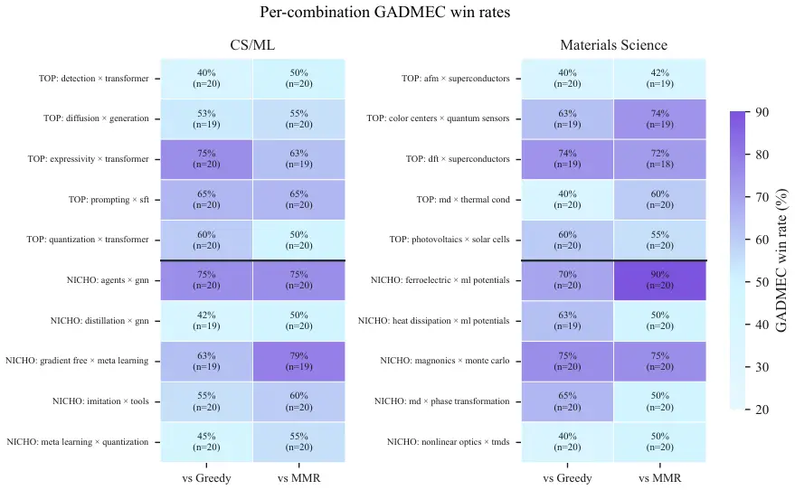

# A Fixed-Budget, Cluster-Aware Standard for LLM-as-a-Judge Evaluation: A Multi-Hop RAG Stress Test

Camilo Chacón
Sartori[](https://orcid.org/0000-0002-8543-9893)^(\*)
   José H.
García[](https://orcid.org/0000-0002-5752-4759)
Affiliation: Catalan Institute of Nanoscience and Nanotechnology (ICN2),
CSIC and BIST, Affiliation: Campus UAB, Bellaterra, Barcelona, Spain
Email: [camilo.chacon@icn2.cat](mailto:)    josehugo.garcia@icn2.cat
Affiliation: Code and materials:
[github.com/camilochs/fixed-budget-llm-judge-rag](https://github.com/camilochs/fixed-budget-llm-judge-rag)
Affiliation: ^(\*)Corresponding author

###### Abstract

Retrieval-augmented generation (RAG) systems are often compared by
asking a large language model (LLM) judge which answer is better. For
multi-hop RAG, this has become a measurement problem as much as a
modeling problem: the same score can reflect retrieval quality, answer
length, lexical overlap, or a statistical test that ignores clustered
data. We ask what happens when these choices are made explicit.

We propose a minimum measurement standard for LLM-as-a-judge comparisons
in RAG. The standard fixes the top-100 candidate pool, evidence budget,
answer cap, generator, and prompt; it also requires pre-registered
hypotheses, cluster-aware inference, an exact cluster sign-flip check
when feasible, and second-judge replication. Clustered benchmarks can
overstate progress; the field should adopt this standard. We stress-test
it with Genetic Algorithm Decoder for Multi-hop Evidence Composition
(GADMEC), an evolutionary evidence selector, on 400 multi-hop questions
in computer science/machine learning (CS/ML) and Materials Science. The
protocol changes the empirical story. A binomial test makes all four
semantic-baseline comparisons look significant; cluster-aware inference
leaves only one Bonferroni-significant result. BM25 beats pure semantic
GADMEC under the same budget, while a lexical-semantic hybrid recovers
in CS/ML and narrows the Materials Science gap.

## 1 Introduction

RAG systems are increasingly compared with pairwise LLM-as-a-judge
protocols: two answers are shown to a judge model, and the preferred
answer is counted as a win. This protocol is attractive because it is
simple and cheap to scale. It also hides important choices. A method can
look better because it selected better evidence, because it induced
longer answers, because it matched lexical cues that dense retrieval
missed, or because the statistical test treated clustered examples as
independent. In multi-hop RAG, these mechanisms are easy to mix.

This paper asks whether the headline of a RAG comparison survives when
those choices are controlled. In our experiment, the answer is mixed. A
binomial test would make all four pre-registered semantic-baseline
comparisons look significant. Cluster-aware inference leaves only one
comparison significant after Bonferroni correction, with two more
significant only before correction. The empirical story therefore
depends not only on the selector, but also on the measurement protocol
used to evaluate it.

We make two claims. First, pairwise LLM-as-a-judge evaluation for
multi-hop RAG is more fragile than standard reporting suggests. Second,
the field should adopt a minimum measurement standard for
cluster-structured LLM-as-a-judge benchmarks. The standard fixes
evidence and answer budgets. It separates confirmatory from exploratory
analyses through pre-registration and a public deviation log, uses
cluster-aware inference, adds an exact sign-flip check when the cluster
count permits it, and replicates headline results with a second judge.
These components are not individually new. The contribution is to make
them operate together in one controlled RAG comparison and show how the
conclusions change.

We stress-test the standard with Genetic Algorithm Decoder for Multi-hop
Evidence Composition (GADMEC), a Biased Random-Key Genetic Algorithm
(BRKGA; Gonçalves and Resende, 2011) for evidence subset selection.
GADMEC is the instrument, not the protagonist. Its evolutionary search
is separated from the decoder that enforces budget and diversity
constraints, so a random-fitness ablation can test whether the fitness
function contributes beyond the decoder machinery.

#### Contributions.

1.  1.  A fixed-budget evaluation design for LLM-as-a-judge comparisons in
        RAG: same top-100 candidate pool, 2000-token evidence budget,
        300-token answer cap, and generator settings for all methods.
2.  2.  A pre-registered analysis protocol: four Bonferroni-corrected
        primary hypotheses, an addendum for length matching and ablations,
        and a deviation log for post-hoc analyses.
3.  3.  A cross-domain benchmark: 687 arXiv papers (2024–2026), a 3-level
        taxonomy, 10 cross-subfield combinations per area, 20 questions per
        combination, and 200 contrastive multi-hop questions per area.
4.  4.  A methodological demonstration: the headline of a multi-hop RAG
        comparison can change when inference respects the cluster structure.
        The binomial test would have reported all four primary tests as
        significant; wild-cluster bootstrap leaves only one
        Bonferroni-significant result. The same protocol exposes a
        lexical-vs-semantic axis: BM25 beats pure semantic GADMEC, while a
        hybrid recovers in CS/ML.

The paper unfolds as follows. Section 2 situates fixed-budget evaluation
relative to LLM-as-a-judge evaluation, multi-hop question answering
(QA), subset selection, and pre-registration. Sections 3 and 4 define
GADMEC, the baselines, and the controlled evaluation protocol. Section 5
reports the pre-registered results, length controls, content-distance
diagnostics, and ablations. Sections 6–8 interpret the mechanisms,
conclude, and state the limitations.

## 2 Related Work

#### LLM-as-a-Judge Evaluation for RAG.

Reference-free LLM-as-a-judge evaluation is now common in RAG research.
RAGAS formalised the setup for retrieval-augmented generation Es et al.
(2024), and recent surveys catalogue its variants Li et al. (2025). The
closest concern for this paper is length bias Zheng et al. (2023);
Dubois et al. (2024). We control both input and output budgets, then ask
what signal remains after length matching.

#### Multi-hop QA benchmarks.

HotpotQA, 2WikiMultiHop, MuSiQue, and GRADE target chained-evidence
multi-hop reasoning Lee et al. (2025). Our questions have a different
shape: _contrastive composition_ (“how do $`X`$ and $`Y`$ differ on
aspect $`Z`$”). This makes evidence selection budget-sensitive because a
good answer must cover several sub-aspects at once.

#### Combinatorial subset selection in retrieval.

Maximal Marginal Relevance (MMR; Carbonell and Goldstein, 1998) and
Determinantal Point Processes (DPPs; Kulesza and Taskar, 2012) are
classical instances. Genetic algorithms have been applied to RAG
primarily for adversarial attack and corpus poisoning Cho et al. (2024).
We use a BRKGA constructively: the candidate pool is the search space,
and the selected subset is the evidence plan.

#### Pre-registration in NLP.

Pre-registration is rare in natural language processing (NLP). We follow
social-science practice with a primary registration, timestamped
addenda, and a deviation log separating confirmatory and exploratory
analyses.

Together, these strands motivate an evaluation instrument rather than
only a new retriever. The selector is allowed to vary; the evidence
budget, answer cap, judge protocol, and evidential status of each
analysis are not.

Figure 1: GADMEC pipeline. The protocol first builds a taxonomy-filtered
corpus, then generates contrastive multi-hop questions, and finally
evaluates four selectors under the same candidate pool, evidence budget,
generator, answer cap, and judge (Claude Opus 4.7, randomised
answer-A/answer-B positions). The only intended source of variation is
the evidence selector. We re-judge the six headline comparisons with a
second strong proprietary judge from a different provider (DeepSeek V4
Pro, thinking mode) to assess inter-judge robustness (§5.5).

## 3 Method

We first define the selector, then the controls that make the
comparisons interpretable. Figure 1 summarizes the full pipeline. The
key rule is simple: every method sees the same candidates and uses the
same generation settings. Only the evidence plan changes.

### 3.1 GADMEC fitness

GADMEC’s fitness over a candidate evidence plan $`\mathcal{P}`$ combines
five components:

```math
f(\mathcal{P})=\alpha\,\textsc{cov}+\beta\,\textsc{div}+\gamma\,\textsc{cost}+\delta\,\textsc{coh}+\varepsilon\,\textsc{sub}
```

Here cov rewards mean query similarity, and div rewards pairwise
dissimilarity among selected chunks. cost is a normalised token penalty,
coh is centroid–query similarity, and sub measures coverage of
GPT-5.4-mini query sub-aspects embedded with all-MiniLM-L6-v2.

We use
$`\alpha=0.30,\beta=0.15,\gamma=0.00,\delta=0.15,\varepsilon=0.40`$,
with sub-coverage threshold $`0.40`$. The BM25 lexical component
$`\zeta`$ is $`0`$ for pure semantic GADMEC and activated only in the
hybrid analyses.

### 3.2 BRKGA decoder

BRKGA Gonçalves and Resende (2011) represents each plan as random keys
in $`[0,1]^{n}`$ and leaves feasibility to a decoder. The decoder sorts
chunks by key and accepts them greedily until the plan reaches the
2000-token budget. It also enforces minimum query similarity $`0.15`$,
redundancy threshold $`0.80`$, and at least three $`k`$-means thematic
clusters. The search uses population size 20, elite fraction $`0.24`$,
elite-inheritance probability $`0.70`$, at most 50 generations, early
stopping after 15 stagnant generations, and seed $`42`$.

### 3.3 Baselines

We compare against greedy top-$`k`$ budget-fill, Maximal Marginal
Relevance (MMR) with $`\lambda=0.5`$ Carbonell and Goldstein (1998), and
the BM25 lexical retriever ($`k_{1}=1.5,b=0.75`$). All methods operate
on the same top-$`100`$ cosine-pre-filtered candidate pool. Win-rate
differences therefore reflect how methods choose evidence from the same
pool, not whether one method had access to better candidates.

### 3.4 Question generation and judging

Question generation uses a contrastive multi-hop prompt with
GPT-5.4-mini at $`T=0.7`$. Each area has 10 combinations, with 20
questions per combination. Answers use GPT-5.4-mini at $`T=0`$, seed
$`42`$, evidence-only prompting, and max_completion_tokens=300. Claude
Opus 4.7 judges randomised answer-A/answer-B pairs in a single pass
using a fixed pairwise prompt. The prompt asks for a global preference
based on factual correctness, completeness, evidence support, clarity,
specificity of evidence-backed claims, multi-source synthesis, and
coverage of the question aspects. Ties are allowed but reserved for
answers that are truly equivalent; ties are recorded and excluded from
the win-rate denominator.

## 4 Experimental Setup

The setup applies the fixed-budget design to two scientific domains.
Each pairwise judgment compares evidence selection under the same
retrieval substrate, input budget, and answer-generation budget.

### 4.1 Corpus

The corpus is organised by a 3-level taxonomy: area $`\to`$ subarea
$`\to`$ topic. We use two areas, Computer Science/Machine Learning
(CS/ML; 341 papers) and Materials Science (MatSci; 346 papers), drawn
from arXiv between 2024-01 and 2026-05. Each area contributes 10
cross-subfield combinations: five high-density TOP-regime combinations
with at least 100 arXiv papers and five lower-density NICHO combinations
with 10–50 papers. The manifest includes SHA-256 hashes over arXiv IDs.

### 4.2 Fixed-budget control

All methods use a 2000-token evidence budget with budget-fill. For
compact tables and figures, we abbreviate GADMEC as GA. The resulting
input lengths are tightly matched (median evidence tokens over 200
questions per area; parentheses give IQRs when shown):

|          |                              |                              |
| -------- | ---------------------------- | ---------------------------- |
| Selector | CS/ML                        | MatSci                       |
| GA       | $`1979`$ ($`1960`$–$`1993`$) | $`1973`$ ($`1938`$–$`1992`$) |
| Greedy   | $`1986`$ ($`1966`$–$`1994`$) | $`1979`$ ($`1960`$–$`1992`$) |
| MMR      | $`1984`$                     | $`1982`$                     |
| BM25     | $`1986`$ ($`1972`$–$`1995`$) | $`1987`$ ($`1967`$–$`1994`$) |

All methods fill approximately $`99`$ % of the budget. Answer generation
also uses identical caps and settings. Thus systematic answer-length
differences are not caused by unequal budgets; they reflect what the
selected evidence makes available to the generator.

### 4.3 Pre-registration

The primary registration locks four hypotheses of the form
$`\mathrm{WR}(\mathrm{GA}\ \text{vs.}\ \textsc{base})>0.5`$, where WR
denotes win rate. Each hypothesis uses one-sided cluster bootstrap over
combination identifiers (10 000 resamples) and Bonferroni
$`\alpha=0.0125`$. The addenda lock the $`\leq 200`$-character
length-matched bin, ablation predictions, BM25 parity checks, and hybrid
predictions before judging. The deviation log records analyses added
later, including bin sensitivity, content-distance slicing, and hybrid
configurations. It also records two drift items: Opus 4.7 rather than
the pre-registered 4.6 judge, and 200 rather than 100 questions per
area.

## 5 Results

### 5.1 Main results

We report results in four blocks. Block 1 gives the pre-registered
semantic comparison against Greedy and MMR. Block 2 adds BM25 as a
lexical baseline under the same budget. Block 3 tests whether the BRKGA
machinery alone explains the gains. Block 4 asks whether adding lexical
signal to the GADMEC fitness recovers the BM25 gap. The order is
diagnostic: each block removes a different explanation for the observed
win rates.

Block 1 — Primary (pre-registered, Bonferroni $`\alpha=0.0125`$ over 4
tests). Table 1 reports the four primary semantic comparisons.

| Comparison       | Area   | WR % | $`p^{\mathrm{V}}`$ | $`p^{\mathrm{W}}`$ | $`p^{\mathrm{P}}`$ | Bonf        |
| ---------------- | ------ | ---- | ------------------ | ------------------ | ------------------ | ----------- |
| GADMEC vs Greedy | CS/ML  | 57.4 | 0.0251             | 0.0515             | 0.0586             | $`\times`$  |
| GADMEC vs Greedy | MatSci | 58.9 | 0.0205             | 0.0394             | 0.0391             | $`\bullet`$ |
| GADMEC vs MMR    | CS/ML  | 60.1 | 0.0000             | 0.0043             | 0.0078             | $`\star`$   |
| GADMEC vs MMR    | MatSci | 61.7 | 0.0025             | 0.0201             | 0.0234             | $`\bullet`$ |

Table 1: Primary semantic comparisons.

We report three p-values, each with a separate role. $`p^{\mathrm{V}}`$
comes from a vanilla cluster bootstrap by combination identifier (10,000
resamples). $`p^{\mathrm{W}}`$ comes from a pivotal wild-cluster
bootstrap with Webb 6-point weights Cameron et al. (2008), centred at
the null $`H_{0}\!:\!\mathrm{WR}=0.5`$. $`p^{\mathrm{P}}`$ comes from an
exact cluster sign-flip permutation test. Because each area has 10
clusters, the exact test can enumerate all $`2^{10}=1024`$ sign
assignments. It therefore does not rely on large-cluster asymptotics.

The wild bootstrap and the exact sign-flip test agree to within
$`0.005`$ on every primary comparison. This makes the small-cluster
concern visible rather than hidden in a single number. For the four-test
primary family, Bonferroni decisions use $`p^{\mathrm{W}}`$ at
$`\alpha=0.0125`$: $`\star`$ passes Bonferroni, $`\bullet`$ passes
uncorrected $`\alpha=0.05`$, and $`\times`$ fails. One of four primary
tests passes Bonferroni (GADMEC vs MMR in CS/ML); two more pass only
before correction. The gap between $`p^{\mathrm{V}}`$ and the
cluster-aware p-values reflects per-cluster heterogeneity
(cross-combination standard deviation of win rate $`\approx 12`$
percentage points; see results/all_bootstrap_pvalues.json). We return to
this point in §6.

Block 2 — Secondary (BM25 retrieval baseline, addendum, descriptive).
Table 2 adds the lexical BM25 baseline under the same budget.

| Comparison     | Area   | WR % | $`p^{\mathrm{W}}`$ | Bonf        |
| -------------- | ------ | ---- | ------------------ | ----------- |
| GADMEC vs BM25 | CS/ML  | 40.2 | 0.0188             | $`\bullet`$ |
| GADMEC vs BM25 | MatSci | 39.2 | 0.0007             | $`\star`$   |

Table 2: BM25 lexical-baseline comparisons.

BM25 beats pure semantic GADMEC in both domains under the same budget.
The effect is Bonferroni-significant in MatSci
($`p^{\mathrm{W}}=0.0007`$) and significant at uncorrected
$`\alpha=0.05`$ in CS/ML ($`p^{\mathrm{W}}=0.0188`$). Dense
pre-filtering therefore does not subsume lexical signal. Block 4 tests
whether adding that lexical signal to GADMEC’s fitness recovers the gap.

Block 3 — Ablations (descriptive, addendum-locked). Table 3 tests
whether the BRKGA machinery alone explains the gains.

| Ablation vs Greedy                 | CS/ML WR            | MatSci WR           |
| ---------------------------------- | ------------------- | ------------------- |
| random_fitness                     | 42.9 \[36.7, 49.2\] | 37.2 \[29.6, 43.2\] |
| random_fitness + no_constr.        | 39.8 \[34.7, 45.9\] | 36.7 \[29.9, 43.0\] |
| no_subaspect ($`\varepsilon{=}0`$) | 57.4 \[51.0, 63.5\] | 55.8 \[49.2, 62.8\] |

Table 3: Ablations against Greedy.

Figure 2: Main results. Each row is one pairwise comparison. Markers:
circles = CS/ML, triangles = Materials Science. Colours: Slate Blue =
GADMEC variant wins, Dark Teal = hybrid variant wins, grey = focal
variant loses. Horizontal bars are 95% cluster-bootstrap confidence
intervals (CIs) by combination identifier; dashed vertical line is the
50% no-effect reference.

Block 4 — Hybrid GADMEC ($`\zeta=0.3`$, exploratory, locked before
judging).

Block 2 shows that lexical signal matters. We therefore activate the
BM25 component of the surrogate fitness ($`\zeta=0.3`$) while leaving
the other fitness weights unchanged. For each question, we compare the
hybrid against Greedy, BM25, and original semantic GA ($`\zeta=0`$).
Table 4 reports the hybrid comparisons:

| Hybrid vs            | Area   | WR % | $`p^{\mathrm{W}}`$ | Bonf        |
| -------------------- | ------ | ---- | ------------------ | ----------- |
| Greedy               | CS/ML  | 69.3 | 0.0016             | $`\star`$   |
| Greedy               | MatSci | 65.7 | 0.0021             | $`\star`$   |
| BM25                 | CS/ML  | 57.0 | 0.0007             | $`\star`$   |
| BM25                 | MatSci | 43.7 | 0.0335             | $`\bullet`$ |
| Pure semantic GADMEC | CS/ML  | 63.5 | 0.0012             | $`\star`$   |
| Pure semantic GADMEC | MatSci | 63.5 | 0.0015             | $`\star`$   |

Table 4: Hybrid GADMEC comparisons.

Block 4 is a separate family of six comparisons. With within-family
Bonferroni correction ($`\alpha=0.05/6\approx 0.0083`$), five of six
hybrid comparisons pass under wild-cluster inference. The exception is
hybrid vs BM25 in MatSci: it passes at uncorrected $`\alpha=0.05`$, but
not Bonferroni, and it remains directionally a _loss_ (win rate
$`43.7\%`$).

Taken together, the hybrid reverses the BM25 deficit in CS/ML (hybrid vs
BM25 $`p^{\mathrm{W}}=0.0007`$), narrows but does not eliminate the BM25
deficit in MatSci ($`-10.8`$ percentage points before, $`-6.3`$ after),
and improves over both semantic baselines and pure semantic GADMEC.
Pre-registered predictions for $`\zeta=0.3`$ (deviations entry 7, locked
before judging) were vs Greedy $`[55,65]\%`$, vs BM25 $`[45,60]\%`$, and
vs pure semantic GADMEC $`[50,60]\%`$. Observed values met or exceeded
the predicted interval in 5 of 6 cells; the exception was hybrid vs BM25
in MatSci ($`43.7\%`$), marginally below the $`[45,60]`$ lower bound.
Figure 2 summarizes Blocks 1–4 with confidence intervals.

### 5.2 Length-matched robustness

Length matching is a mechanism check, not a second primary endpoint. If
the advantage is mostly a length artifact, it should weaken when GADMEC
and Greedy answers have similar character counts. Bracketed intervals
are 95% confidence intervals (CIs). Table 5 reports the pre-registered
$`\leq 200`$-character matched bin:

| Subset             | CS/ML WR \[CI\]     | MatSci WR \[CI\]    |
| ------------------ | ------------------- | ------------------- |
| All pairs          | 57.4 \[50.0, 64.8\] | 58.9 \[50.5, 66.8\] |
| In matched bin     | 50.0 \[39.8, 60.4\] | 56.1 \[46.4, 65.2\] |
| Out of matched bin | 64.4 \[56.9, 71.6\] | 62.2 \[51.0, 73.8\] |

Table 5: Length-matched robustness for GADMEC vs Greedy.

We then vary the bin width as an exploratory sensitivity sweep (Table 6;
Figure 3).

| Bin width              | CS/ML WR % | MatSci WR % |
| ---------------------- | ---------- | ----------- |
| $`\leq 50`$            | 44.8       | 54.8        |
| $`\leq 100`$           | 50.9       | 58.7        |
| $`\leq 150`$           | 50.0       | 58.0        |
| $`\leq 200`$ (pre-reg) | 50.0       | 56.1        |
| $`\leq 300`$           | 53.7       | 55.5        |
| $`\leq 400`$           | 53.3       | 56.3        |
| all                    | 57.4       | 58.9        |

Table 6: Bin-width sensitivity for length matching.

MatSci remains in the 54–58 % range across bin widths. CS/ML moves
toward parity and drops to 44.8 % at the tightest bin, where most
answers are too short to differ structurally. This domain split is
exploratory rather than confirmatory. The pre-registered
$`\leq 200`$-character bin is not Bonferroni-significant in either area,
so the stable MatSci range should be read as a sensitivity pattern for
follow-up work, not as a settled domain difference.

Figure 3: Bin sensitivity. The figure varies the allowed answer-length
difference between GADMEC and Greedy. MatSci remains stable across bin
widths, while CS/ML moves toward parity as the bin tightens; this is
consistent with a less length-entangled MatSci advantage.

### 5.3 Content-distance slicing within matched bin (exploratory)

Within the matched bin, we ask whether answer pairs that differ more in
content show a stronger GADMEC signal. Table 7 slices pairs by quartiles
of Jaccard similarity between GA and Greedy answers:

| Jaccard slice      | CS/ML WR %        | MatSci WR %       |
| ------------------ | ----------------- | ----------------- |
| Q1 (most distinct) | 62.5 ($`n{=}24`$) | 65.4 ($`n{=}26`$) |
| Q2                 | 45.8              | 55.6              |
| Q3                 | 66.7              | 44.4              |
| Q4 (most similar)  | 25.0              | 59.3              |

Table 7: Jaccard slices within the matched bin.

Across four additional slicing specifications, MatSci’s most-distinct
bucket stays at 60–66 %. CS/ML is specification-dependent: lexical
Jaccard shows a 62.5 % Q1 win rate, but cosine Q1 drops to 45.8 %. One
plausible reason is geometric: CS/ML answers occupy a narrower
embedding-space region (cosine range 0.67–0.97) than MatSci (0.53–1.00),
so cosine slices discriminate less in CS/ML. Figure 4 compares the
lexical and semantic-distance slices.

Figure 4: Content-distance slicing within the matched bin. Panel (a)
groups answer pairs by lexical overlap; panel (b) groups them by
semantic cosine similarity. MatSci is stable in the most-distinct bucket
under both definitions, while CS/ML depends on the distance measure.

### 5.4 Ablation discussion

#### Fitness signal contribution.

Randomising the surrogate fitness while keeping the decoder machinery
drops win rate to 42.9 % in CS/ML and 37.2 % in MatSci. Disabling
constraints as well lowers performance slightly further (39.8 %,
36.7 %). Thus the fitness signal, not merely the BRKGA decoder, accounts
for the 14.5–21.7 percentage-point gap to full GADMEC.

#### Sub-aspect coverage.

Removing the $`\varepsilon`$ sub-aspect component is inert in CS/ML
(57.4 % vs. 57.4 %) and costs 3.1 percentage points in MatSci (58.9 % to
55.8 %). This is a domain finding rather than a calibration failure:
MatSci appears to benefit from explicit decomposable-query coverage,
while CS/ML’s remaining gain is more entangled with length and lexical
content distance.

### 5.5 Inter-judge agreement

We re-judge the four primary tests and the two hybrid-vs-BM25
comparisons with DeepSeek V4 Pro (thinking mode), a second strong
proprietary judge from a different provider. We use the same prompt,
answer-A/answer-B randomisation, and tie-handling rule; ties are
recorded but excluded from the win-rate denominator. MatSci primary uses
$`n=199`$ shared pairs (one Opus pair was a parse-error retry; Opus WR
is recomputed on the matched subset for this section). The two judges
come from different providers (Anthropic and DeepSeek). Table 8 reports
Cohen’s $`\kappa`$ and Gwet’s agreement coefficient (AC1):

| Comparison            | Opus WR | DeepSeek WR | raw % | $`\kappa`$ | AC1   |
| --------------------- | ------- | ----------- | ----- | ---------- | ----- |
| CS/ML GA vs Greedy    | 57.4    | 57.4        | 87.0  | 0.745      | 0.826 |
| CS/ML GA vs MMR       | 60.1    | 62.2        | 85.5  | 0.705      | 0.808 |
| MatSci GA vs Greedy   | 58.7    | 61.1        | 84.9  | 0.693      | 0.800 |
| MatSci GA vs MMR      | 62.1    | 59.4        | 86.4  | 0.731      | 0.819 |
| CS/ML hybrid vs BM25  | 57.0    | 52.0        | 83.0  | 0.658      | 0.663 |
| MatSci hybrid vs BM25 | 43.7    | 41.7        | 77.0  | 0.535      | 0.694 |

Table 8: Inter-judge agreement.

Cohen’s $`\kappa`$ ranges from moderate (0.535, MatSci hybrid vs BM25)
to substantial (0.745, CS/ML GA vs Greedy) per Landis and Koch (1977).
Gwet’s AC1 is in the substantial-to-almost-perfect range (0.663–0.826).
Win-rate point estimates differ by at most 5 percentage points, and the
directional verdict matches in all six comparisons. This reduces the
risk that the headline depends on one judge model. It does not replace
human gold annotation, which we leave to follow-up work.

## 6 Discussion

The results are best read as a mechanism map, not as a ranking of
retrievers. Fixed budgets remove one structural confound. What remains
separates into three signals: semantic composition, lexical matching,
and answer-length effects.

#### Composition vs. length under fixed budgets.

Even after matching input budgets and answer caps, a method can win in
several ways. Its evidence may induce longer answers. It may support
denser answers of similar length. Or the judge may still reward small
length differences. The domain split suggests that these mechanisms
should not be collapsed into a single “better retrieval” story.

#### MatSci: composition-driven (exploratory).

Across seven bin widths and five content-distance specifications,
GADMEC’s matched-bin advantage is stable (54–66 %). In the
pre-registered matched bin, GADMEC is slightly longer more often than
Greedy ($`63`$ vs. $`44`$ cases at $`\leq 200`$ chars). This suggests
that composition can show up as length in MatSci, rather than length
simply causing the judged advantage. The reading remains exploratory:
the MatSci CI in the pre-registered bin is $`[46.4,65.2]`$, which
crosses $`50\%`$.

#### CS/ML: composition entangled with length.

CS/ML behaves differently. The composition signal appears under lexical
content-distance (Q1 Jaccard 62.5 %) but not under semantic distance (Q1
cosine 45.8 %). CS/ML answers cluster in a narrower embedding region, so
semantic-distance slicing has lower discriminating power. The mechanism
is more entangled with length in CS/ML than in MatSci.

#### BM25 as complementary signal.

BM25’s dominance over pure semantic GADMEC shows that lexical signal
still matters after dense pre-filtering. The hybrid beats BM25 in CS/ML
and narrows, but does not close, the MatSci gap. We therefore treat
lexical matching and semantic composition as complementary signals.

#### Inference under cluster heterogeneity.

The gap between $`p^{\mathrm{V}}`$ and $`p^{\mathrm{W}}`$ in Block 1 is
not a quirk. It is what happens when cluster correlation is taken
seriously in a small-cluster design. Dual reporting of vanilla and
wild-cluster bootstrap is standard in econometrics, but rare in NLP
evaluation. We recommend it for cluster-structured NLP benchmarks where
some categories, domains, or sources may be easier than others. The test
choice can change the headline, so the cost of that choice should be
visible to the reader.

#### Scope of the proposed standard.

The cluster issue is not specific to this benchmark. Many LLM-as-a-judge
evaluations have natural clusters. MT-Bench groups 80 multi-turn
questions into eight capability categories; AlpacaEval draws 805
instructions from five source datasets; MMLU spans 57 subjects in four
broad domains; and MTEB spans eight task families across 58 datasets.
Multi-hop RAG benchmarks such as HotpotQA and 2WikiMultiHop also build
questions around bridge or comparison entities. In each case, some
clusters may be easier, harder, or more favorable to one method. A
binomial p-value over pooled pairs can therefore overstate confidence.
We do not test the standard on those benchmarks here, but the
recommendation is meant for cluster-structured pairwise judging designs
in general.

## 7 Conclusion

Fixed-budget evaluation makes multi-hop RAG comparisons easier to
interpret. Under matched evidence budgets and answer caps, pure semantic
GADMEC beats Greedy and MMR directionally in all four pre-registered
tests. Under wild-cluster bootstrap, however, only one test passes
Bonferroni and two more pass only at uncorrected $`\alpha=0.05`$. A
standard binomial test would have reported all four as significant.

The same protocol also changes how we read retrieval signals. BM25 beats
pure semantic GADMEC in both domains, showing that lexical matching
remains important under the same budget. A lexical-semantic hybrid
reverses the BM25 gap in CS/ML and narrows it in MatSci without closing
it. Length-matched analyses suggest a domain split. This claim remains
exploratory: in the pre-registered $`\leq 200`$-character bin neither
area reaches Bonferroni significance and the MatSci CI $`[46.4,65.2]`$
crosses $`50\%`$. Code, data manifests, registrations, deviations,
prompts, and judgments are available in the project repository.
Appendix A, Appendix B, and Appendix C provide descriptive diagnostics,
cost logs, and registration summaries.

## 8 Limitations

The conclusions are bounded by the evaluation instrument. The main
limits are the judge, the number of domains, the exploratory status of
several diagnostics, the small number of clusters, and the current
granularity of the mechanism analysis.

#### Judge robustness.

The primary judge is Claude Opus 4.7. We replicate the six pairwise
comparisons that drive the headline (4 primary + 2 hybrid vs BM25) with
DeepSeek V4 Pro in thinking mode, a second strong proprietary judge from
a different provider. Agreement is moderate-to-substantial across all
six comparisons. Cohen’s $`\kappa\in[0.535,0.745]`$ Landis and Koch
(1977), Gwet’s AC1 $`\in[0.663,0.826]`$, raw agreement is
$`77`$–$`87\%`$, and the directional verdict matches in all six (§5.5).
Win-rate point estimates differ by at most 5 percentage points. We did
not replicate the BM25-only and ablation comparisons; full multi-judge
replication is future work.

#### Two domains.

The domain-dependent mechanism is based on CS/ML and MatSci only.
Replication on biomedical, legal, or social-science corpora is needed.

#### Exploratory analyses.

The bin-sensitivity sweep, content-distance slicing, hybrid
$`\zeta=0.3`$, and MatSci $`\zeta=0.5`$ analyses were added after the
primary results, although their predictions were locked before judging
where applicable. Primary inference rests on the pre-registered tests.
The MatSci matched-bin CI $`[46.4,65.2]`$ crosses $`50\%`$, so the
strongest MatSci robustness claim should be read as an exploratory
pattern.

#### Cluster count.

We have 10 combinations per area, which is at the lower edge of what
wild-cluster bootstrap is recommended for
($`n_{\mathrm{clusters}}\geq 20`$–30 in Cameron et al., 2008). We
address this by also reporting the exact cluster sign-flip permutation
test. It enumerates all $`2^{10}=1024`$ sign assignments and is
unaffected by the small cluster count. The two tests agree to within
$`0.005`$ on every primary comparison (and within $`0.01`$ across all
reported comparisons), so the Block 1 inference is not driven by
wild-bootstrap asymptotics alone. Replication on benchmarks with more
cluster-level diversity would improve external validity and precision.

#### Mechanistic granularity.

We do not yet quantify which chunks GADMEC selects differently from
Greedy. Chunk-overlap and evidence-structure analyses are needed to
isolate the CS/ML residual mechanism.

#### Necessity of each standard component.

The proposed measurement standard has four components. This paper
directly tests two: fixed-budget design (controlled in the experimental
setup; §4) and cluster-aware inference (Block 1 dual reporting plus the
permutation check). Pre-registration with a deviation log and
second-judge replication constrain reporting, but they are not variables
we can ablate after the fact. We therefore do not claim that removing
pre-registration would change conclusions in this dataset. Future work
should test each component across multiple benchmarks.

## Acknowledgments

Camilo Chacón Sartori acknowledges funding from R&D Project
PID2022-138283NBI00, funded by MICIU/AEI/10.13039/501100011033 and
“FEDER – A way of making Europe”.

## References

- Cameron et al. (2008) A. C. Cameron, J. B. Gelbach, and D. L. Miller
  Bootstrap-based improvements for inference with clustered errors.
  Review of Economics and Statistics 90 (3), pp. 414–427. Note:
  [doi:10.1162/rest.90.3.414](https://doi.org/10.1162/rest.90.3.414)
  External Links: [Document](https://dx.doi.org/10.1162/rest.90.3.414)
  Cited by: §5.1, §8.
- Carbonell and Goldstein (1998) J. Carbonell and J. Goldstein The use
  of MMR, diversity-based reranking for reordering documents and
  producing summaries. In Proceedings of the 21st Annual International
  ACM SIGIR Conference on Research and Development in Information
  Retrieval, pp. 335–336. Note:
  [doi:10.1145/290941.291025](https://doi.org/10.1145/290941.291025)
  External Links: [Document](https://dx.doi.org/10.1145/290941.291025)
  Cited by: §2, §3.3.
- Cho et al. (2024) S. Cho, S. Jeong, J. Seo, T. Hwang, and J. C. Park
  Typos that broke the RAG’s back: genetic attack on RAG pipeline by
  simulating documents in the wild via low-level perturbations. In
  Findings of the Association for Computational Linguistics: EMNLP 2024,
  Note:
  [doi:10.18653/v1/2024.findings-emnlp.161](https://doi.org/10.18653/v1/2024.findings-emnlp.161)
  External Links:
  [Document](https://dx.doi.org/10.18653/v1/2024.findings-emnlp.161),
  [Link](https://aclanthology.org/2024.findings-emnlp.161/) Cited by:
  §2.
- Dubois et al. (2024) Y. Dubois, B. Galambosi, P. Liang, and T. B.
  Hashimoto Length-controlled AlpacaEval: a simple way to debias
  automatic evaluators. In Proceedings of the Conference on Language
  Modeling (COLM), Note:
  [doi:10.48550/arXiv.2404.04475](https://doi.org/10.48550/arXiv.2404.04475)
  External Links:
  [Document](https://dx.doi.org/10.48550/arXiv.2404.04475),
  [Link](https://arxiv.org/abs/2404.04475) Cited by: §2.
- Es et al. (2024) S. Es, J. James, L. Espinosa-Anke, and S. Schockaert
  RAGAs: automated evaluation of retrieval augmented generation. In
  Proceedings of the 18th Conference of the European Chapter of the
  Association for Computational Linguistics: System Demonstrations,
  pp. 150–158. Note:
  [doi:10.18653/v1/2024.eacl-demo.16](https://doi.org/10.18653/v1/2024.eacl-demo.16)
  External Links:
  [Document](https://dx.doi.org/10.18653/v1/2024.eacl-demo.16),
  [Link](https://aclanthology.org/2024.eacl-demo.16/) Cited by: §2.
- Gonçalves and Resende (2011) J. F. Gonçalves and M. G. C. Resende
  Biased random-key genetic algorithms for combinatorial optimization.
  Journal of Heuristics 17 (5), pp. 487–525. Note:
  [doi:10.1007/s10732-010-9143-1](https://doi.org/10.1007/s10732-010-9143-1)
  External Links:
  [Document](https://dx.doi.org/10.1007/s10732-010-9143-1) Cited by: §1,
  §3.2.
- Kulesza and Taskar (2012) A. Kulesza and B. Taskar Determinantal point
  processes for machine learning. Foundations and Trends in Machine
  Learning 5 (2–3), pp. 123–286. Note:
  [doi:10.1561/2200000044](https://doi.org/10.1561/2200000044) External
  Links: [Document](https://dx.doi.org/10.1561/2200000044) Cited by: §2.
- Landis and Koch (1977) J. R. Landis and G. G. Koch The measurement of
  observer agreement for categorical data. Biometrics 33 (1),
  pp. 159–174. Note:
  [doi:10.2307/2529310](https://doi.org/10.2307/2529310) External Links:
  [Document](https://dx.doi.org/10.2307/2529310) Cited by: §5.5, §8.
- Lee et al. (2025) J. Lee, D. Kwon, and K. Jin GRADE: generating
  multi-hop QA and fine-gRAined difficulty matrix for RAG evaluation. In
  Findings of the Association for Computational Linguistics: EMNLP 2025,
  Note:
  [doi:10.18653/v1/2025.findings-emnlp.236](https://doi.org/10.18653/v1/2025.findings-emnlp.236)
  External Links:
  [Document](https://dx.doi.org/10.18653/v1/2025.findings-emnlp.236),
  [Link](https://aclanthology.org/2025.findings-emnlp.236/) Cited by:
  §2.
- Li et al. (2025) D. Li, B. Jiang, L. Huang, A. Beigi, C. Zhao, Z.
  Tan, A. Bhattacharjee, Y. Jiang, C. Chen, T. Wu, K. Shu, L. Cheng,
  and H. Liu From generation to judgment: opportunities and challenges
  of LLM-as-a-judge. In Proceedings of the 2025 Conference on Empirical
  Methods in Natural Language Processing (EMNLP), Note:
  [doi:10.18653/v1/2025.emnlp-main.138](https://doi.org/10.18653/v1/2025.emnlp-main.138)
  External Links:
  [Document](https://dx.doi.org/10.18653/v1/2025.emnlp-main.138),
  [Link](https://aclanthology.org/2025.emnlp-main.138/) Cited by: §2.
- Zheng et al. (2023) L. Zheng, W. Chiang, Y. Sheng, S. Zhuang, Z.
  Wu, Y. Zhuang, Z. Lin, Z. Li, D. Li, E. P. Xing, H. Zhang, J. E.
  Gonzalez, and I. Stoica Judging LLM-as-a-judge with MT-Bench and
  Chatbot Arena. In Advances in Neural Information Processing Systems 36
  (NeurIPS 2023), Note:
  [doi:10.48550/arXiv.2306.05685](https://doi.org/10.48550/arXiv.2306.05685)
  External Links:
  [Document](https://dx.doi.org/10.48550/arXiv.2306.05685),
  [Link](https://openreview.net/forum?id=uccHPGDlao) Cited by: §2.

## Appendix A Supplementary Diagnostics

The appendix is descriptive. It does not introduce new primary claims;
instead, it makes the aggregate results easier to audit. Figure 5,
Figure 6, and Figure 7 answer three diagnostic questions: whether the
aggregate win rates are driven by a few combinations, whether wins
against Greedy and MMR tend to co-occur, and whether the TOP/NICHO
corpus regime changes the interpretation.

Table 9 adds three logged examples to make the mechanisms less abstract.
These examples are illustrative only: they are selected from existing
answer-pair and verdict logs, and they do not define a new hypothesis
test.

| Logged example                        | Preferred answer adds                                                                                                                            | Mechanism illustrated                                                                |
| ------------------------------------- | ------------------------------------------------------------------------------------------------------------------------------------------------ | ------------------------------------------------------------------------------------ |
| CS/ML, GADMEC $`>`$ Greedy, $`q{=}3`$ | Covers reward/Kullback–Leibler (KL) infringement control and spatial-aware compositional generation; Greedy supports only the infringement side. | Semantic composition improves sub-aspect coverage under the same budget.             |
| CS/ML, BM25 $`>`$ GADMEC, $`q{=}2`$   | Gives details for the two-stage structural pipeline and entity-relation mining; pure semantic GADMEC is correct but terser.                      | Lexical matching recovers method and control terms missed by embedding-only fitness. |
| CS/ML, Hybrid $`>`$ BM25, $`q{=}4`$   | Retrieves constraint-feedback and semantic action/entity control evidence; BM25 lacks the law-grounded comparison.                               | Lexical signal inside semantic fitness can recover part of the BM25 gap.             |

Table 9: Illustrative examples from logged answer pairs and judge
verdicts. The table is descriptive and is not used for statistical
inference. It shows how the aggregate mechanisms in the main text appear
in individual comparisons.

### A.1 Per-combination win rates



Figure 5: Pure semantic GADMEC win rate per combination, stratified by
domain and corpus regime (TOP/NICHO). Each panel is one domain; each row
is a cross-subfield combination; the two columns report win rates
against Greedy and MMR. The heatmap is a descriptive stability check: it
exposes heterogeneity behind the aggregate rates without adding a
separate hypothesis test.

Figure 5 should be read as a stability check, not as a separate
hypothesis test. The main text reports cluster-bootstrap intervals over
combination identifiers; this figure shows the same source of variation
directly. It also helps identify where a future mechanistic analysis
should focus: combinations with high semantic-GADMEC win rates likely
contain evidence sets where coverage and diversity help, while low-rate
combinations are candidates for lexical or length-driven failure modes.

### A.2 Joint outcome matrix

Figure 6: Joint outcome matrix for GADMEC against Greedy and MMR, by
area. Rows give verdicts against Greedy and columns give verdicts
against MMR. Off-diagonal cells show where the two semantic baselines
expose different failure modes.

Figure 6 gives a more concrete view of what the aggregate primary tests
mean. In both domains, many questions are wins against both semantic
baselines, but there are also substantial off-diagonal cells. Thus
Greedy and MMR are not redundant controls: they overlap, but they do not
define the same comparison.

### A.3 Stratified TOP/NICHO analysis

Figure 7: Pure semantic GADMEC win rates stratified by corpus regime.
TOP denotes dense topic pairs; NICHO denotes lower-density pairs. Bars
show win rates and 95% bootstrap intervals within each regime.

Figure 7 is included because the corpus construction deliberately mixes
common and niche cross-subfield combinations. The figure is reassuring
only in a limited sense: it shows no obvious collapse in either regime,
but the intervals are wide enough that the main paper should rely on the
pooled, pre-registered tests rather than regime-specific claims.

## Appendix B Cost log

Total judging cost across all conditions (primary + BM25 + 3 ablations +
hybrid $`\zeta=0.3`$ + hybrid $`\zeta=0.5`$ MatSci): approximately €82
(\$95 USD, May 23 2026 European Central Bank rate $`0.8605`$ EUR/USD),
via the Claude Opus 4.7 application programming interface (API), billed
at \$15/1M input tokens and \$75/1M output tokens. Per-run logs are
included in results/cost_v3_judging.json and
results/cost_v3_extras_judging.json.

The cost log is reported for audit, not as a metric. It makes the
evaluation scale visible: every reported comparison uses the same
evidence budget, generator, answer cap, judge, and answer-position
randomisation, so the paired design carries the inference rather than
any cost normalisation.

## Appendix C Pre-registration documents

The prepared release archive includes the primary pre-registration,
dated 2026-05-19; the addendum, dated 2026-05-23; and the running
deviation log.

The primary registration fixes the four pairwise hypotheses, the
Bonferroni correction, tie handling, and cluster-bootstrap reporting
before judging. The addendum records analyses that became necessary
after inspecting the design, including length matching and ablations.
The deviation log separates later descriptive checks, such as bin-width
sensitivity, content-distance slicing, and hybrid lexical weights.

This structure is meant to keep the paper readable without blurring
evidential status. The main claims come from registered fixed-budget
comparisons. The remaining analyses explain where the signal is stable,
where it is domain-dependent, and which mechanisms should be tested in
follow-up work rather than treated as settled here.
