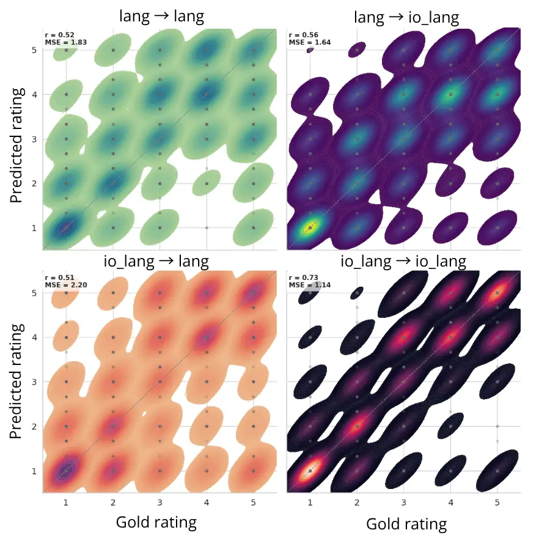
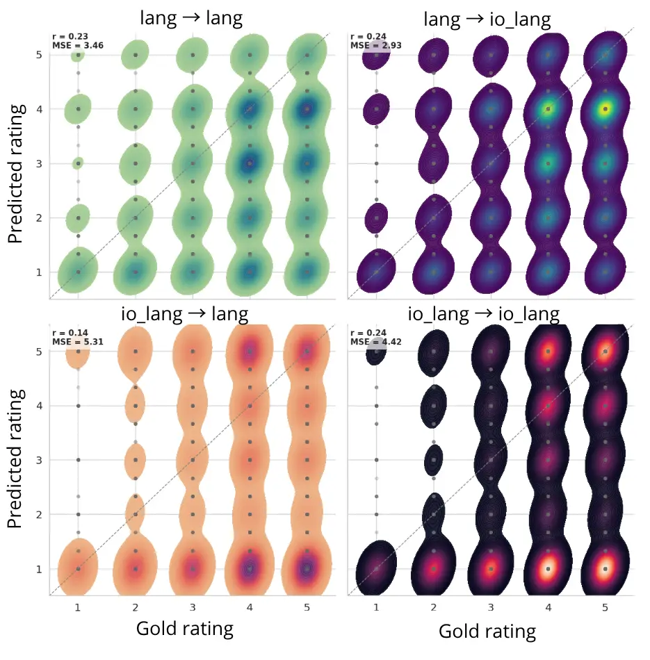
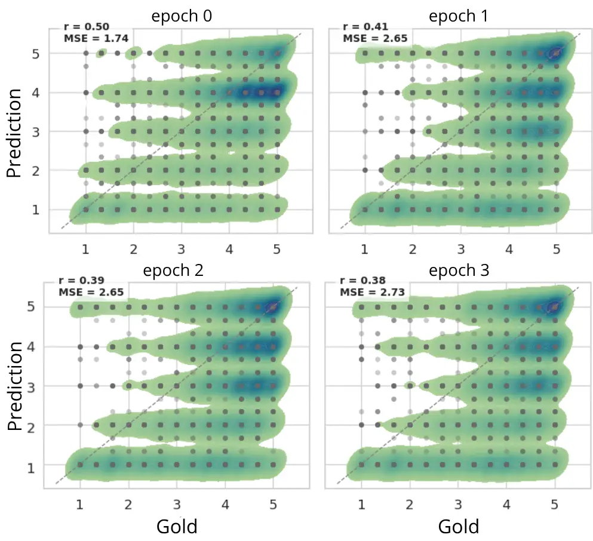
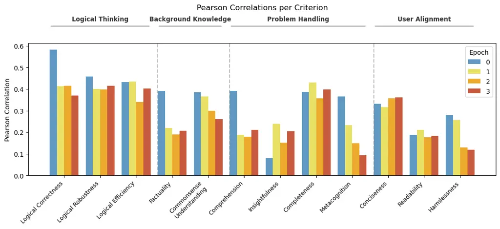
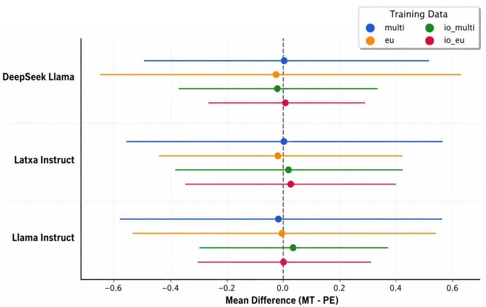

# Towards Reliable Multilingual LLMs-as-a-Judge: An Empirical Study

Irune Zubiaga    Aitor Soroa    Rodrigo Agerri Affiliation: HiTZ
Center - Ixa, University of the Basque Country EHU
Affiliation: {irune.zubiaga, a.soroa, rodrigo.agerri}@ehu.eus

###### Abstract

Large language models (LLMs) are increasingly used for the automatic
evaluation of generated text, yet most prior work focuses on English.
Despite the growing demand for multilingual evaluation, extending
LLM-based evaluators to multilingual settings remains challenging,
particularly for low-resource languages and scenarios where in-domain
data is scarce. This work explores several strategies for developing
multilingual LLMs-as-a-judge, considering whether in-domain data is
available for fine-tuning or not. We systematically analyze English,
Spanish, and Basque, representing high-, mid-, and low-resource
languages, considering instruction translation, monolingual versus
multilingual supervision, and model size. For evaluation, we extend two
existing meta-evaluation datasets to Basque and Spanish. Our results
reveal key trade-offs: When in-domain data is available, fine-tuned
smaller models can achieve performance comparable to proprietary models,
whereas zero-shot evaluation with larger models proves more effective in
out-of-domain settings. We also observe that fine-tuning on
out-of-domain data can adversely affect model performance. These
findings provide practical guidance for building efficient, reliable
multilingual evaluation pipelines. The data and code are publicly
available at
[hitz-zentroa/mJudge](https://github.com/hitz-zentroa/mJudge).

## 1 Introduction

Large language models (LLMs) are increasingly used not only for text
generation but also for evaluating the outputs of other LLMs. However,
most existing research remains centered on English, leaving open
research questions unanswered about how to extend LLM-based evaluation
to multilingual contexts, especially when low-resource languages are
involved. ¹¹ 1 We use low-resource to denote limited representation and
performance in current open-weight language models, rather than overall
linguistic vitality (Nigatu et al., 2024).

In this work, we study how to design effective training and evaluation
strategies that enable robust multilingual performance across languages
with different levels of support in existing pretraining corpora. We
focus on three languages with varying resource availability: English
(high-resource), Spanish (mid-resource), and Basque (low-resource).
Typologically, they span distinct families and structures: English is
Germanic, Spanish is Romance, and Basque is a language isolate with
agglutinative morphology. These languages provide a representative and
controlled testbed for analyzing how evaluation strategies behave across
multilingual conditions, while capturing complementary typological and
resource-level variation in a computationally tractable setting.

We frame our investigation around two conditions: (i) the availability
of in-domain data for fine-tuning the evaluators, and (ii) the absence
of in-domain training data. Each scenario raises a distinct set of
evaluation questions. When training data is available, we examine how
translating the data from English to the target language affects
performance, the relative benefits of cross-lingual transfer versus
multilingual training, and the impact of model size. We also investigate
whether it is more effective to train a model directly on
target-language data or to leverage a model already proficient in said
language and adapt it to the task. Conversely, in the absence of
in-domain data, we explore whether fine-tuning on related out-of-domain
data is helpful and how model size influences zero-shot generalization.

This work makes several key contributions. First, in settings with
in-domain data, we find that smaller 8B models remain highly competitive
with much larger 70B and proprietary models, suggesting that scale alone
is not the decisive factor when task-specific data is available. Second,
we observe that multilingual training improves performance in Spanish
and Basque compared to monolingual training, indicating effective
cross-lingual transfer for evaluation tasks. We further find that
providing evaluation rubrics and instructions in English, rather than
translating them into the target language, yields more consistent
judgments across languages, suggesting that full prompt translation is
often unnecessary. Third, we find that starting from a
language-proficient model and adapting it to the evaluation task is
generally more effective than training a model on target-language
task-specific data. Finally, in out-of-domain settings, we find that
fine-tuning on related data can degrade performance in larger models,
while smaller models benefit but still underperform compared to
zero-shot large models.

## 2 Related Work

As the use of LLMs continues to grow, the need for multilingual
capabilities becomes increasingly important to ensure accessibility for
a diverse range of users. While most LLMs remain English-centric, new
models targeting other languages have started to emerge. For instance,
Pangea (Yue et al., 2025) is a fully open multilingual and multimodal
LLM trained on diverse instructions in 39 languages, designed to improve
cross-cultural representation and evaluation coverage. Similarly,
EuroLLM (Martins et al., 2024) develops a suite of open-weight
multilingual models supporting all official EU languages, demonstrating
strong performance on generation and translation benchmarks. Efforts
have also focused on broader multilingual coverage, including
low-resource languages, such as BLOOM: A 176B-Parameter Open-Access
Multilingual Language Model (Scao et al., 2023). These initiatives
highlight the importance of developing and evaluating models that cater
to linguistically diverse populations.

Multilingual pre-training can improve cross-lingual transfer to
low-resource languages, although gains tend to saturate as model
capacity is shared across many languages, a phenomenon known as the
curse of multilinguality (Conneau et al., 2020; Chang et al., 2024).
Cross-lingual transfer helps mitigate data scarcity (Zoph et al., 2016;
Conneau and Lample, 2019), but fine-tuning on additional languages may
introduce interference or catastrophic forgetting (Garcia et al., 2021).
To address this, prior work explores selecting related source languages
and parameter-efficient methods such as adapter-based approaches, which
can improve transfer in low-resource settings (Bapna and Firat, 2019;
Pfeiffer et al., 2021).

Due to the poor correlation of traditionally used metrics such as BLEU,
ROUGE-L or BertScore with human judgments (Sai et al., 2022), LLMs are
increasingly being used as evaluators, achieving considerably higher
correlations (Zheng et al., 2023). Unfortunately, most of this work
relies on proprietary LLMs (Minaee et al., 2024), which limits
reproducibility and accessibility. Some open alternatives have emerged,
such as JudgeLM (Zhu et al., 2023) or Prometheus (Kim et al., 2024).
However, most of this research has been conducted primarily in English.
While a few works such as M-Prometheus (Pombal et al., 2025) have begun
exploring multilingual settings, determining the best method for
training a multilingual LLM evaluator remains an open and largely
unexplored research question.

While some efforts have been made in evaluating these systems,
benchmarks remain scarce. A large portion of existing benchmarks are
automatically generated using GPT or similar LLMs. While such benchmarks
are relatively easy to scale, they can introduce model bias,
circularity, and lack of robustness, since the same families of models
are often used for both generation and evaluation (Laskar et al., 2024).
On the other hand, human-annotated benchmarks are more reliable but also
more costly and difficult to construct. A considerable amount of these
rely on preference-based annotations (e.g., pairwise comparisons between
outputs), rather than absolute scoring (Gu et al., 2025). However, prior
work shows that pairwise evaluation can amplify biases in
LLM-as-a-judge, such as favoring verbosity or authoritative tone,
whereas pointwise evaluation, which assesses outputs independently, is
less susceptible to these issues (Jeong et al., 2025).

Nonetheless, some human-scored resources for absolute evaluation are
available for English, such as FLASK (Ye et al., 2024), highlighting the
potential value of expanding this line of work. However, very few
available multilingual benchmarks are currently available. Among them,
RECON (Doddapaneni et al., 2025) stands out as a human-supervised,
multilingual evaluation dataset. It contains prompts written in multiple
languages paired with English references and evaluation rubrics.
However, the currently covered languages (Bengali, German, French,
Hindi, Telugu, and Urdu) remain limited. While this set spans both high-
and low-resource languages, the scope of RECON is still narrow,
highlighting the need for broader multilingual benchmarks for
meta-evaluation. Expanding such resources is crucial for enabling more
comprehensive assessment and comparison of LLMs across diverse
languages.

## 3 Dataset Creation

Since no publicly available judgment datasets exist for Basque or
Spanish, we rely on existing English datasets and adapt them to these
languages. Each instance in both train and test data consists of an
instruction, a candidate output, an evaluation rubric, a reference
answer, and a scalar score ranging from 1 to 5, along with an
explanation of the assigned score. Each component is described in more
detail in Appendix A.

### 3.1 Training corpus

We automatically translate the FeedBack Collection²² 2
[https://huggingface.co/datasets/prometheus-eval/Feedback-Collection](https://huggingface.co/datasets/prometheus-eval/Feedback-Collection)
into Basque and Spanish obtaining a parallel dataset³³ 3 We translate
text into Spanish using
[Llama-3.1-70B-Instruct](https://huggingface.co/meta-llama/Llama-3.1-70B-Instruct)
and into Basque using
[Latxa-Llama-3.1-70B-Instruct](https://huggingface.co/HiTZ/Latxa-Llama-3.1-70B-Instruct)..
The corpus, originally introduced in Kim et al. (2023), consists of 100k
instruction–response pairs annotated with explicit evaluation
instructions, evaluator feedback, and scalar scores. The translation
prompt is given in Appendix B. The dataset was selected due to its wide
validation in prior work (Kim et al., 2024; Pombal et al., 2025) and its
explicit rubric-based scoring, which helps ground model evaluations and
produce more reliable assessments (Hashemi et al., 2024). Following
common practice in LLM-based translation, we use a temperature of
$`T=0.2`$, while all other settings were kept at their default values.
This low temperature reduces stochasticity, producing more consistent
and reproducible outputs. We retain the original training and validation
splits.

### 3.2 Evaluation benchmarks

In an effort to extend multilingual evaluation coverage, we translate
two general instruction-following English benchmarks: RECON (Doddapaneni
et al., 2025) and FLASK (Ye et al., 2024). We treat RECON as in-domain,
as it follows the same generation protocol as the training data
described in Kim et al. (2023). In contrast, FLASK is considered
out-of-domain, as it is based on a different annotation paradigm relying
on human scoring of model outputs.

RECON is a meta-evaluation benchmark consisting of 500 instances.
Similarly to the FeedBack Collection dataset, it was created by first
collecting 500 original instructions and then prompting GPT-4o to
generate question-specific evaluation criteria and detailed scoring
rubrics. Evaluation responses are subsequently generated by prompting
GPT-4o to produce answers targeting each score $`x\in\{1,\ldots,5\}`$
according to these rubrics. Although the benchmark is already
multilingual, it does not originally include Spanish or Basque; by
translating it into these languages, we broaden its linguistic coverage
and create additional partitions that may be valuable for future
multilingual evaluation research.

In contrast, FLASK (Fine-grained Language Model Evaluation based on
Alignment Skill Sets) is a 2000-instance benchmark that serves as an
out-of-domain evaluation set, annotated entirely by humans. It provides
fine-grained judgments across multiple alignment dimensions, including
helpfulness, safety, and factuality. For each instance, three
independent human scores are provided. We use the mode of these scores
as the final label.

The translation setup follows that used for the training corpus
(Section 3.1), employing the same models and hyperparameters for machine
translation. RECON was further post-edited by professional translators,
who were instructed to ensure both correctness and naturalness,
resulting in a human-verified reference subset. We then use this data to
assess whether machine translation alone is sufficient, or whether
post-editing is necessary for accurate performance estimation, by
evaluating the statistical significance of differences between the MT
and POS benchmarks (see Appendix C). We found that the models did not
differ systematically in their sensitivity to translation quality. These
findings indicate that the benchmarks do not substantially affect the
relative performance of the evaluated models, suggesting that the MT
dataset is suitable for identifying the most effective training
strategies for multilingual LLMs-as-a-judge. Consequently, we retain the
machine-translated version of FLASK. We provide further analysis of
translation quality in Appendix D.

## 4 Experimental Setup

In our experiments, we consider two evaluation scenarios. In the first
scenario (see Section 5.1), in-domain task-specific data is available to
train the LLM-based judges. In the second scenario (see Section 5.2), no
in-domain data is available, reflecting a setting commonly encountered
in practice where only related out-of-domain data may be accessible. Our
experimental setting is designed to analyze how multilingual tasks can
be evaluated under each of these conditions and to identify the most
effective evaluation strategies in each case.

We assess models in-domain with RECON and out-of-domain with FLASK,
using the evaluation prompts and scoring rubrics provided by each
benchmark. In both cases, we train the judge models under different
language configurations to study how models and training languages
influence multilingual evaluation performance. Using the parallel data
described in Section 3.1, we consider two training data configurations:
monolingual, where models are trained on a single language (Basque,
Spanish, or English), and multilingual (dubbed _multi_), where parallel
instances across all three languages are combined, resulting in a
dataset three times larger. The combined dataset is then shuffled to
ensure a balanced and randomized distribution of examples.

### 4.1 Model choice

For our analysis, we selected models from the LLaMA family (Touvron et
al., 2023), as they support English, Spanish, and Basque to varying
degrees and comprise a diverse set of models with varying capabilities
and scales.

Alongside Llama-3.1-8B-Instruct, we evaluate two LLaMA 3.1-based
variants: DeepSeek-R1-Distill-Llama-8B (DeepSeek-AI, 2025), fine-tuned
on reasoning data, and Latxa-Llama-3.1-8B-Instruct (Sainz et al., 2025),
fine-tuned and instructed for Basque, and therefore proficient in the
language. Our main analysis uses the 8B variants, while the 70B versions
of Llama-Instruct and Latxa are additionally evaluated to analyze
scaling effects and whether larger models yield substantial gains over
smaller ones. The selected models represent three scenarios: an
instruction-tuned model, a model fine-tuned on reasoning data, and a
model already proficient in the target language.

We fine-tune the models using the llama-recipes⁴⁴ 4
[https://github.com/facebookresearch/llama-recipes](https://github.com/facebookresearch/llama-recipes)
framework, updating all model parameters. Models are trained for 3
epochs with a learning rate of $`1e^{-5}`$, which was selected via grid
search, and the context length is set to 8,100 tokens to accommodate the
maximum length of inputs in the Basque dataset. We use a batch size of 1
with gradient accumulation over 4 steps. Fully Sharded Data Parallel
(FSDP) is enabled with bfloat16 precision, and fast kernels are used to
improve training efficiency. During training, validation loss is
monitored and the checkpoint with the lowest validation loss is selected
for evaluation.

To guarantee scoring consistency, we run all models with deterministic
decoding ($`T=0`$) at inference time, which eliminates stochastic
variation in the assigned scores and ensures that the evaluations
reflect the models’ rating behavior rather than sampling noise. We use
constrained decoding to enforce the required output format (Appendix E)
and set the maximum generation length to match the training context
length. Inference is performed using the vLLM framework (Kwon et al.,
2023), which manages batching automatically and optimizes GPU
utilization.

Given the computationally and memory-intensive nature of this work, all
experiments were conducted on high-performance computing (HPC) systems
to ensure efficient execution at scale.

## 5 Results

We organize our results across two evaluation scenarios: when in-domain
training data is available and when it is not. The subsections are
further structured around our key research questions, highlighting how
data availability influences evaluation outcomes.

### 5.1 When In-Domain Training Data Is Available

We train on the feedback dataset and evaluate on RECON, which serves as
an in-domain benchmark for the task. This setting isolates the effect of
model design choices under ideal supervision conditions.

#### Must evaluation instructions be translated into the target language, or do English-only instructions suffice when evaluating multilingual tasks?

To answer this question, we consider two different data translation
scenarios:

- •
  Full translation (lang): In this configuration, the entire
  dataset—including input prompts, reference answers, scoring rubrics,
  and model outputs—is translated into the target language. The
  resulting corpora are denoted as en, es, eu, and multi, corresponding
  to English, Spanish, Basque, and multilingual, respectively.
- •
  Partial translation (io_lang) : In this configuration, only the
  original instructions and model outputs are translated, while all
  other components (such as scoring rubrics and system prompts) remain
  in English. These variants are denoted as io_en, io_es, io_eu, and
  io_multi.

This comparison assesses whether translating the evaluation rubrics
provides measurable benefits or if keeping them in English suffices,
considering both training and test to capture potential inference-time
effects.



Figure 1: Density plot of predictions against gold labels on the
in-domain RECON benchmark. We denote configurations as
$`X\rightarrow Y`$, where $`X`$ indicates the training-time language
setup and $`Y`$ the evaluation-time language setup. lang refers to fully
translated instructions (es, eu, or multi), and io_lang refers to
partially translated instructions, where only the original instructions
and model outputs are translated while the rest is kept in English.

Figure 1 visualizes model predictions against gold labels. A key
observation is the substantial gain obtained when evaluating on
partially translated benchmarks: models evaluated with English
instructions ($`X\rightarrow io\_lang`$) consistently outperform those
evaluated with fully translated instructions ($`X\rightarrow lang`$).
Our results show that using English-only evaluation instructions at test
time is not only sufficient but often preferable for multilingual
evaluation, even when the underlying model is trained monolingually.

In this test-time setting, models trained on fully translated data
($`X=lang`$) exhibit weaker alignment with reference judgments, whereas
models trained on partially translated data ($`X=io\_lang`$) show
substantially stronger alignment. In the latter setting, the correlation
with gold labels reaches 0.73, compared to 0.56 for monolingual
fine-tuning. The density plot makes this improvement clear: predictions
concentrate tightly along the diagonal with reduced off-diagonal spread,
indicating better calibration and greater consistency with gold labels
resulting in a lower mean squared error (MSE). We also observe a slight
tendency across settings toward score overestimation rather than
underestimation, as the region above the diagonal appears denser than
the region below it. Together, these results suggest that retaining
English evaluation rubrics during training in a different target
language is beneficial for model performance.

Based on these findings, we adopt English evaluation instructions
(io_lang) as the standard training and test-time configuration in all
subsequent experiments. For notational simplicity, eu and es will
henceforth be used to refer to io_eu and io_es, respectively.

#### Multilingual training and cross-lingual transfer

We analyze whether multilingual training provides advantages over
monolingual models, and to what extent models trained on one language
can be applied to other languages. To this end, we train models
separately on each language (English, Spanish, or Basque) and evaluate
their performance on the remaining languages to measure cross-lingual
transfer. We also compare their performance to multilingual variants
trained on the combined parallel dataset. We report the mean of each
metric across model variants in Table 1. Individual scores per model are
reported in Appendix F.

|       |                |                    |                |                    |                |                    |
| ----- | -------------- | ------------------ | -------------- | ------------------ | -------------- | ------------------ |
|       | RECON $`{en}`$ |                    | RECON $`{es}`$ |                    | RECON $`{eu}`$ |                    |
|       | r $`\uparrow`$ | MSE $`\downarrow`$ | r $`\uparrow`$ | MSE $`\downarrow`$ | r $`\uparrow`$ | MSE $`\downarrow`$ |
| en    | 0.840          | 0.773              | 0.663          | 2.131              | 0.636          | 1.693              |
| es    | 0.767          | 1.059              | 0.771          | 1.071              | 0.671          | 1.566              |
| eu    | 0.755          | 1.091              | 0.757          | 1.117              | 0.724          | 1.201              |
| multi | 0.793          | 0.919              | 0.785          | 0.961              | 0.766          | 1.029              |
| zs    | 0.602          | 1.693              | 0.468          | 2.344              | 0.567          | 2.05               |

Table 1: Mean model performance per language on RECON. The models that
have been trained and tested on the same language appear in gray. The
best score in each language appears in bold.

We first focus on comparing multilingual and monolingual settings when
the training and test languages are the same. Multilingual training
yields improvements for Basque ($`4.2`$ points in Pearson) and Spanish
($`1.4`$ points in Pearson), while performance degrades in English (a
drop of $`4.7`$ points in Pearson). These results corroborate previous
findings that cross-lingual transfer mostly occurs from high-resource
languages to lower-resource ones. In the cross-lingual setting, results
indicate that training and testing on the same language remains
preferable, as expected. Nevertheless, cross-lingual training
consistently outperforms the zero-shot approach, which achieves lower
overall performance. This demonstrates that cross-lingual transfer
occurs: learning the evaluation task in one language helps the model
generalize to others.

#### The effect of scale

We analyze the effect of scale by including results for the 70B versions
of Llama-Instruct and Latxa in both the multilingual setting (which
achieved the best average results for the 8B models) and the zero-shot
setting. For baseline comparison, we include results from available open
models (the Prometheus family) and proprietary models (GPT-5.2 and
Command-A).

|                      |                                                 |                                                 |                                                 |
| -------------------- | ----------------------------------------------- | ----------------------------------------------- | ----------------------------------------------- |
| Model                | RECON $`{en}`$                                  | RECON $`{es}`$                                  | RECON $`{eu}`$                                  |
|                      | $`(\mathrm{r}\uparrow/\mathrm{MSE}\downarrow)`$ | $`(\mathrm{r}\uparrow/\mathrm{MSE}\downarrow)`$ | $`(\mathrm{r}\uparrow/\mathrm{MSE}\downarrow)`$ |
| Latxa-Inst-8B\_(ft)  | 0.836/0.724                                     | 0.816/0.824                                     | 0.805/0.888                                     |
| Latxa-Inst-8B\_(zs)  | 0.526/1.978                                     | 0.266/3.147                                     | 0.745/1.042                                     |
| Latxa-Inst-70B\_(ft) | 0.831/0.720                                     | 0. 816/0.800                                    | 0.828/0.754                                     |
| Latxa-Inst-70B\_(zs) | 0.803/0.871                                     | 0.705/1.238                                     | 0.750/1.062                                     |
| Llama-Inst-8B\_(ft)  | 0.741/1.102                                     | 0.757/1.044                                     | 0.732/1.140                                     |
| Llama-Inst-8B\_(zs)  | 0.678/1.408                                     | 0.669/1.540                                     | 0.388/3.058                                     |
| Llama-Inst-70B\_(ft) | 0.790/0.876                                     | 0.754/1.060                                     | 0.774/0.980                                     |
| Llama-Inst-70B\_(zs) | 0.812/0.788                                     | 0.735/1.074                                     | 0.734/1.096                                     |
| Prometheus-v1        | 0.828/0.718                                     | 0.752/1.018                                     | 0.269/4.894                                     |
| Prometheus-v2        | 0.826/0.742                                     | 0.766/0.964                                     | 0.588/1.718                                     |
| M-Prometheus         | 0.829/0.698                                     | 0.784/0.844                                     | 0.689/1.414                                     |
| GPT-5.2              | 0.844/0.650                                     | 0.818/0.770                                     | 0.700/0.900                                     |
| Command-A            | 0.777/0.914                                     | 0.703/1.256                                     | 0.662/1.436                                     |

Table 2: Comparison with state-of-the-art models using our
best-performing setting, including zero-shot evaluation. The best
overall model appears in bold and the best open model underscored.

Table 2 shows that, in zero-shot settings, the models exhibit
substantial performance gains as model size increases, with the
exception of Latxa on Basque, where performance remains largely stable
across scales. However, after fine-tuning, the benefits of scaling are
markedly reduced: larger models yield only marginal and inconsistent
improvements across evaluation metrics, resulting in limited overall
gains relative to the increase in parameter count. Overall, our models
outperform the open baselines and are competitive with proprietary
models, with strong improvements in performance for Basque. These
results suggest that, while scaling model size yields limited benefits
for this task, targeted fine-tuning can meaningfully improve
performance, particularly in languages where the zero-shot baseline is
weaker.

#### Training data language vs. model language proficiency

We now investigate whether it is more beneficial to adapt the training
data to the target language or to leverage a model proficient in that
language for the task, focusing our analysis on Basque. Specifically, we
compare two strategies: (i) fine-tuning a general-purpose model
(Llama-Instruct) on Basque instructions translated from the English
corpus, and (ii) fine-tuning a Basque-proficient model (Latxa) using the
original English instructions.

| Model         | train | RECON $`{eu}`$     |                    |
| ------------- | ----- | ------------------ | ------------------ |
|               | lang  | $`r`$ $`\uparrow`$ | MSE $`\downarrow`$ |
| Latxa-Inst-8B | en    | 0.760              | 1.065              |
| Llama-Inst-8B | eu    | 0.717              | 1.179              |

Table 3: Performance of LLMs-as-a-judge in Basque under two
language-alignment strategies: English instructions with a
Basque-proficient model vs. Basque-translated instructions with an
English model. The best scores appear in bold.

Table 3 shows the results of both strategies when tested on Basque. The
optimal strategy is to fine-tune the Basque-proficient model using
English instructions, with a substantial gain of $`4.3`$ points in
Pearson.

### 5.2 When In-Domain Training Data Is Unavailable

We now focus on the out-of-domain setting. We replicate the analysis
from Section 5.1, and evaluate models fine-tuned on the feedback dataset
on FLASK, an out-of-domain benchmark. As in the previous setting, we
begin by analyzing the impact of full versus partial translation in the
train and test data.



Figure 2: Density plot of predictions against gold labels on the
out-of-domain FLASK benchmark. We denote configurations as
$`X\rightarrow Y`$, where $`X`$ indicates the training-time language
setup and $`Y`$ the evaluation-time language setup. lang refers to fully
translated instructions (es, eu, or multi), and io_lang refers to
partially translated instructions, where only the original instructions
and model outputs are translated while the rest is kept in English.

Figure 2 shows that the impact of language configuration under
out-of-domain evaluation differs substantially from what is observed
in-domain. While training on partially translated data and testing on
fully translated data ($`io\_lang\rightarrow lang`$) performs worst,
correlation differences across the remaining configurations are
marginal, and no single training strategy clearly dominates. Instead,
the main differences emerge in the shape of the score distributions and
are reflected in the MSE.

Models fine-tuned with English evaluation instructions ($`X=io\_lang`$)
tend to produce more polarized judgments, assigning a higher proportion
of extreme scores (1 and 5) and fewer intermediate values. This effect
becomes increasingly pronounced at higher score levels: while
predictions for score 1 remain largely unaffected, deviations begin to
appear at score 3 and become substantial for scores 4 and 5, where
extreme predictions dominate. Although this polarization persists when
models are trained with fully translated evaluation instructions
($`X=lang`$), it is notably less pronounced, as reflected by a lower MSE
(2.96 compared to 4.42 when testing on io_lang, and 3.46 compared to
5.31 when testing on lang).

Despite these differences, overall performance remains poor in terms of
both Pearson and MSE, indicating limited generalization beyond the
training domain. Taken together, these results suggest that the models
lack sufficient robustness for out-of-domain multilingual evaluation,
and that gains observed in-domain do not reliably transfer across
datasets or domains.

#### The effect of scale

|     |       |                                                    |             |                                                    |             |                                                    |             |
| --- | ----- | -------------------------------------------------- | ----------- | -------------------------------------------------- | ----------- | -------------------------------------------------- | ----------- |
|     |       | en $`(\mathrm{r}\uparrow/\mathrm{MSE}\downarrow)`$ |             | es $`(\mathrm{r}\uparrow/\mathrm{MSE}\downarrow)`$ |             | eu $`(\mathrm{r}\uparrow/\mathrm{MSE}\downarrow)`$ |             |
|     |       |                                                    |             |                                                    |             |                                                    |             |
|     |       | zs                                                 | ft          | zs                                                 | ft          | zs                                                 | ft          |
| 8B  | RECON | 0.526/1.978                                        | 0.841/0.716 | 0.501/2.272                                        | 0.723/1.164 | 0.460/2.541                                        | 0.735/1.070 |
|     | FLASK | 0.301/3.161                                        | 0.393/3.840 | 0.193/2.935                                        | 0.258/4.183 | 0.213/3.352                                        | 0.308/3.042 |
| 70B | RECON | 0.803/0.871                                        | 0.900/0.470 | 0.705/1.238                                        | 0.856/0.657 | 0.750/1.062                                        | 0.831/0.713 |
|     | FLASK | 0.594/1.476                                        | 0.440/3.016 | 0.476/1.657                                        | 0.350/2.680 | 0.424/2.502                                        | 0.336/2.077 |

Table 4: Performance of Latxa 70B and 8B on in-domain and out-of-domain
settings after finetuning on the multilingual dataset. Best results in
bold and gray.

Given the limited out-of-domain generalization observed so far, a
natural question is whether increasing model size can mitigate these
effects. Larger language models are often assumed to generalize better,
and we therefore investigate whether fine-tuning larger models leads to
more robust evaluation behavior. To this end, we evaluate the previously
fine-tuned 70B-parameter Latxa model and compare its performance to its
8B-parameter counterpart. Results across languages are summarized in
Table 4, which also includes in-domain results for comparison.

The table reveals a clear divergence between small and large models:
fine-tuning improves both in-domain and out-of-domain performance for
smaller models, whereas for 70B-parameter models it enhances in-domain
performance but degrades out-of-domain generalization.



Figure 3: Density plot showing the distribution of predictions produced
by the Latxa 70B model after each fine-tuning epoch across the English
(en), Spanish (es), and Basque (eu) benchmarks. Epoch 0 corresponds to
the zero-shot performance of the model.

To further investigate the source of the performance drop after
fine-tuning the 70B model, we examine the model’s score distributions
across training epochs. As illustrated in Figure 3, the model tends to
assign lower scores than the gold ratings in general. However, after
each fine-tuning epoch, we observe a growing concentration of
predictions at the maximum score (5).

Taking all of this into account, a plausible explanation for the
observed behavior in Table 4 is that smaller models lack sufficient
prior knowledge to perform the task reliably and therefore benefit more
from additional supervision. In contrast, larger models already exhibit
strong baseline capabilities, and fine-tuning seems to introduce a
tendency to systematically assign higher scores than the ground truth,
which becomes increasingly pronounced with additional training epochs.
This behavior suggests a potential reduction in generalization ability,
possibly due to overconfidence induced by fine-tuning.

As a final step, we evaluate several large language models on the FLASK
benchmark (see Table 5).

|                      |                                                 |                                                 |                                                 |
| -------------------- | ----------------------------------------------- | ----------------------------------------------- | ----------------------------------------------- |
| Model                | FLASK $`{en}`$                                  | FLASK $`{es}`$                                  | FLASK $`{eu}`$                                  |
|                      | $`(\mathrm{r}\uparrow/\mathrm{MSE}\downarrow)`$ | $`(\mathrm{r}\uparrow/\mathrm{MSE}\downarrow)`$ | $`(\mathrm{r}\uparrow/\mathrm{MSE}\downarrow)`$ |
| Llama-Inst-70B\_(zs) | 0.531/2.035                                     | 0.450/2.178                                     | 0.417/2.073                                     |
| Latxa-Inst-70B\_(zs) | 0.524/1.969                                     | 0.4213/2.236                                    | 0.372/2.625                                     |
| prometheus-v2        | 0.477/1.944                                     | 0.413/2.110                                     | 0.318/3.077                                     |
| prometheus-v1        | 0.275/3.520                                     | 0.266/2.971                                     | 0.079/6.673                                     |
| M-prometheus         | 0.339/3.520                                     | 0.356/3.376                                     | 0.227/4.404                                     |
| GPT-5.2              | 0.684/1.372                                     | 0.577/1.423                                     | 0.606/1.531                                     |
| Command-A            | 0.570/1.894                                     | 0.424/2.399                                     | 0.436/2.074                                     |

Table 5: Comparison of the zs performance of the LLaMA models and
state-of-the-art models. The best model appears in bold and the best
open model underscored.

For each benchmark, we report our best fine-tuned model since no best
strategy was identified. Overall, the table shows that zero-shot
performance is competitive, with performance generally improving as
model size increases.

Taken together, these results suggest that in out-of-domain settings,
using large language models in a zero-shot configuration is preferable
to task-specific fine-tuning on out-of-domain data.

#### The effect of finetuning



Figure 4: Pearson correlations between model predictions and human
judgments across FLASK evaluation criteria after 0, 1, 2 and 3 training
epochs.

To further examine the effects of fine-tuning and leverage the
categorical structure of FLASK, Figure 4 reports the Pearson
correlations for each evaluation criterion using the Latxa 70B model in
zero-shot, as well as after fine-tuning for one, two, and three epochs.
As shown in the figure, fine-tuning yields modest improvements in some
User Alignment aspects, such as Conciseness and Readability, and also
slightly improves Insightfulness. However, performance generally
declines across other dimensions, particularly those related to Logical
Thinking and Background Knowledge, with notable drops in Logical
Correctness and Factuality. We also observe a drop in Metacognition, a
measure of how well the model avoids responding to ambiguous or
uncertain instructions and explicitly acknowledges the uncertainty of
its responses, disclosing its limitations when it lacks sufficient
information for a reliable answer. The observed decrease in Factuality
and Metacognition could be attributed to effects reported in prior work
suggesting that fine-tuning can exacerbate hallucinations Gekhman et al.
(2024). We also observe a noticeable decline in Harmlessness consistent
with prior work showing that fine-tuning can reduce safety Qi et al.
(2024). Overall, these results suggest that while fine-tuning may
enhance certain stylistic properties, zero-shot performance remains more
reliable for knowledge- and reasoning-intensive dimensions.

## 6 Conclusions and Future Work

In this work, we study several strategies for building reliable
multilingual LLMs-as-a-judge when natural training data in the target
language is unavailable, considering both scenarios where in-domain data
is available and where it is not. Focusing on English, Spanish, and
Basque, our experiments reveal several practical insights. When
fine-tuning data is available, providing evaluation rubrics and
instructions in English leads to more consistent judgments across
languages, suggesting that translating evaluation prompts may not always
be necessary. We further show that multilingual training improves
performance in Spanish and Basque compared to strictly monolingual
training, indicating beneficial cross-lingual transfer when learning the
evaluation task. Interestingly, smaller 8B models perform competitively
with larger 70B models, in some cases matching or surpassing proprietary
alternatives, highlighting the potential of efficient open models for
evaluation. However, in out-of-domain settings, fine-tuning on
task-related out-of-domain data can degrade performance, and zero-shot
evaluation often proves more robust.

Looking ahead, we plan to expand both the scale and diversity of our
evaluation by collecting additional human-annotated data and developing
new multilingual benchmarks, with a focus on low-resource languages. We
also aim to explore downstream tasks to evaluate model generalization in
varied real-world contexts. Together, these efforts will support the
creation of more robust, transparent, and linguistically inclusive
evaluation systems.

## Limitations

Our study is constrained primarily by the limited availability of
suitable benchmarks, especially those that include Basque alongside
major languages. The scarcity of multilingual evaluation resources
restricts the diversity of tasks we can consider and may limit the
generalizability of our findings across domains.

In addition, the training data used for our models is derived from a
translated version of the FeedBack Collection, originally generated with
GPT models. While this resource enables consistent and scalable
experimentation across languages, it may not fully capture the
variability, nuance, and pragmatic richness of naturally occurring human
interactions. The absence of comparable human-authored datasets further
highlights the current gap in high-quality, open multilingual resources
for judgment and evaluation tasks. Similarly, as RECON and FLASK are
machine-translated, the lack of natively generated benchmarks in Spanish
and Basque limits our ability to capture language-specific pragmatics
and may affect the extent to which our findings generalize to real-world
use in these languages.

Finally, our study is limited to three languages, which, while selected
to capture variation in both resource availability and linguistic
typology, do not fully represent the diversity of multilingual settings.
Expanding the analysis to additional languages would provide a more
comprehensive picture.

## Acknowledgments

This work has been partially supported by the Basque Government
(Research group funding IT-1805-22). We are also thankful to the
following MCIN/AEI/10.13039/501100011033 projects: (i) DeepMinor
(CNS2023-144375) funded by MTDFP/ and by European Union Next
GenerationEU/ PRTR; (ii) DeepThought ((PID2024-159202OB-C21) and by
ERDF, EU. Irune Zubiaga is supported by the UPV/EHU PIF24/08 predoc
grant. We acknowledge the EuroHPC Joint Undertaking for awarding this
project access to the EuroHPC supercomputer LEONARDO, hosted by CINECA
(Italy) and the LEONARDO consortium through an EuroHPC Extreme Access
call. We also acknowledge SCAYLE for granting this project access to the
Calendula supercomputer through CLARIAH-ES.

## References

- Bapna and Firat (2019) A. Bapna and O. Firat Simple, scalable
  adaptation for neural machine translation. In Proceedings of the 2019
  Conference on Empirical Methods in Natural Language Processing and the
  9th International Joint Conference on Natural Language Processing
  (EMNLP-IJCNLP), K. Inui, J. Jiang, V. Ng, and X. Wan (Eds.), Hong
  Kong, China, pp. 1538–1548. External Links:
  [Link](https://aclanthology.org/D19-1165/),
  [Document](https://dx.doi.org/10.18653/v1/D19-1165) Cited by: §2.
- Chang et al. (2024) T. A. Chang, C. Arnett, Z. Tu, and B. K. Bergen
  When is multilinguality a curse? language modeling for 250 high- and
  low-resource languages. In Proceedings of the 2024 Conference on
  Empirical Methods in Natural Language Processing, Y. Al-Onaizan, M.
  Bansal, and Y. Chen (Eds.), Miami, Florida, USA, pp. 4074–4096.
  External Links: [Link](https://aclanthology.org/2024.emnlp-main.236/),
  [Document](https://dx.doi.org/10.18653/v1/2024.emnlp-main.236) Cited
  by: §2.
- Cohen (1988) J. Cohen Statistical power analysis for the behavioral
  sciences. 2nd edition, Routledge, New York, NY. External Links:
  [Document](https://dx.doi.org/10.4324/9780203771587),
  [Link](https://doi.org/10.4324/9780203771587) Cited by: Appendix C.
- Conneau et al. (2020) A. Conneau, K. Khandelwal, N. Goyal, V.
  Chaudhary, G. Wenzek, F. Guzmán, E. Grave, M. Ott, L. Zettlemoyer,
  and V. Stoyanov Unsupervised cross-lingual representation learning at
  scale. In Proceedings of the 58th Annual Meeting of the Association
  for Computational Linguistics, D. Jurafsky, J. Chai, N. Schluter,
  and J. Tetreault (Eds.), Online, pp. 8440–8451. External Links:
  [Link](https://aclanthology.org/2020.acl-main.747/),
  [Document](https://dx.doi.org/10.18653/v1/2020.acl-main.747) Cited by:
  §2.
- Conneau and Lample (2019) A. Conneau and G. Lample Cross-lingual
  language model pretraining. Advances in neural information processing
  systems 32. Cited by: §2.
- DeepSeek-AI (2025) DeepSeek-AI DeepSeek-r1: incentivizing reasoning
  capability in llms via reinforcement learning. External Links:
  2501.12948, [Link](https://arxiv.org/abs/2501.12948) Cited by: §4.1.
- Doddapaneni et al. (2025) S. Doddapaneni, M. S. U. R. Khan, D.
  Venkatesh, R. Dabre, A. Kunchukuttan, and M. M. Khapra Cross-lingual
  auto evaluation for assessing multilingual LLMs. In Proceedings of the
  63rd Annual Meeting of the Association for Computational Linguistics
  (Volume 1: Long Papers), W. Che, J. Nabende, E. Shutova, and M. T.
  Pilehvar (Eds.), Vienna, Austria, pp. 29297–29329. External Links:
  [Link](https://aclanthology.org/2025.acl-long.1419/),
  [Document](https://dx.doi.org/10.18653/v1/2025.acl-long.1419), ISBN
  979-8-89176-251-0 Cited by: §2, §3.2.
- Friedman (1937) M. Friedman The use of ranks to avoid the assumption
  of normality implicit in the analysis of variance. Journal of the
  American Statistical Association 32 (200), pp. 675–701. External
  Links: [Document](https://dx.doi.org/10.2307/2279372),
  [Link](https://doi.org/10.2307/2279372) Cited by: Appendix C.
- Garcia et al. (2021) X. Garcia, N. Constant, A. Parikh, and O. Firat
  Towards continual learning for multilingual machine translation via
  vocabulary substitution. In Proceedings of the 2021 Conference of the
  North American Chapter of the Association for Computational
  Linguistics: Human Language Technologies, K. Toutanova, A.
  Rumshisky, L. Zettlemoyer, D. Hakkani-Tur, I. Beltagy, S. Bethard, R.
  Cotterell, T. Chakraborty, and Y. Zhou (Eds.), Online, pp. 1184–1192.
  External Links: [Link](https://aclanthology.org/2021.naacl-main.93/),
  [Document](https://dx.doi.org/10.18653/v1/2021.naacl-main.93) Cited
  by: §2.
- Gekhman et al. (2024) Z. Gekhman, G. Yona, R. Aharoni, M. Eyal, A.
  Feder, R. Reichart, and J. Herzig Does fine-tuning LLMs on new
  knowledge encourage hallucinations?. In Proceedings of the 2024
  Conference on Empirical Methods in Natural Language Processing, Y.
  Al-Onaizan, M. Bansal, and Y. Chen (Eds.), Miami, Florida, USA,
  pp. 7765–7784. External Links:
  [Link](https://aclanthology.org/2024.emnlp-main.444/),
  [Document](https://dx.doi.org/10.18653/v1/2024.emnlp-main.444) Cited
  by: §5.2.
- Gu et al. (2025) J. Gu, X. Jiang, Z. Shi, H. Tan, X. Zhai, C. Xu, W.
  Li, Y. Shen, S. Ma, H. Liu, S. Wang, K. Zhang, Y. Wang, W. Gao, L. Ni,
  and J. Guo A survey on llm-as-a-judge. External Links: 2411.15594,
  [Link](https://arxiv.org/abs/2411.15594) Cited by: §2.
- Hashemi et al. (2024) H. Hashemi, J. Eisner, C. Rosset, B. Van Durme,
  and C. Kedzie LLM-rubric: a multidimensional, calibrated approach to
  automated evaluation of natural language texts. In Proceedings of the
  62nd Annual Meeting of the Association for Computational Linguistics
  (Volume 1: Long Papers), L. Ku, A. Martins, and V. Srikumar (Eds.),
  Bangkok, Thailand, pp. 13806–13834. External Links:
  [Link](https://aclanthology.org/2024.acl-long.745/),
  [Document](https://dx.doi.org/10.18653/v1/2024.acl-long.745) Cited by:
  §3.1.
- Jeong et al. (2025) H. Jeong, C. Park, J. Hong, H. Lee, and J. Choo
  The comparative trap: pairwise comparisons amplifies biased
  preferences of LLM evaluators. In Proceedings of the 8th BlackboxNLP
  Workshop: Analyzing and Interpreting Neural Networks for NLP, Y.
  Belinkov, A. Mueller, N. Kim, H. Mohebbi, H. Chen, D. Arad, and G.
  Sarti (Eds.), Suzhou, China, pp. 79–108. External Links:
  [Link](https://aclanthology.org/2025.blackboxnlp-1.5/),
  [Document](https://dx.doi.org/10.18653/v1/2025.blackboxnlp-1.5), ISBN
  979-8-89176-346-3 Cited by: §2.
- Kim et al. (2023) S. Kim, J. Shin, Y. Cho, J. Jang, S. Longpre, H.
  Lee, S. Yun, S. Shin, S. Kim, J. Thorne, and M. Seo Prometheus:
  inducing fine-grained evaluation capability in language models. (en).
  External Links: [Link](https://openreview.net/forum?id=8euJaTveKw)
  Cited by: §3.1, §3.2.
- Kim et al. (2024) S. Kim, J. Suk, S. Longpre, B. Y. Lin, J. Shin, S.
  Welleck, G. Neubig, M. Lee, K. Lee, and M. Seo Prometheus 2: an open
  source language model specialized in evaluating other language models.
  In Proceedings of the 2024 Conference on Empirical Methods in Natural
  Language Processing, Y. Al-Onaizan, M. Bansal, and Y. Chen (Eds.),
  Miami, Florida, USA, pp. 4334–4353. External Links:
  [Link](https://aclanthology.org/2024.emnlp-main.248/),
  [Document](https://dx.doi.org/10.18653/v1/2024.emnlp-main.248) Cited
  by: §2, §3.1.
- Kwon et al. (2023) W. Kwon, Z. Li, S. Zhuang, Y. Sheng, L.
  Zheng, C. H. Yu, J. E. Gonzalez, H. Zhang, and I. Stoica Efficient
  memory management for large language model serving with
  pagedattention. In Proceedings of the ACM SIGOPS 29th Symposium on
  Operating Systems Principles, Cited by: §4.1.
- Laskar et al. (2024) M. T. R. Laskar, S. Alqahtani, M. S. Bari, M.
  Rahman, M. A. M. Khan, H. Khan, I. Jahan, A. Bhuiyan, C. W. Tan, M. R.
  Parvez, E. Hoque, S. Joty, and J. Huang A systematic survey and
  critical review on evaluating large language models: challenges,
  limitations, and recommendations. In Proceedings of the 2024
  Conference on Empirical Methods in Natural Language Processing, Y.
  Al-Onaizan, M. Bansal, and Y. Chen (Eds.), Miami, Florida, USA,
  pp. 13785–13816. External Links:
  [Link](https://aclanthology.org/2024.emnlp-main.764/),
  [Document](https://dx.doi.org/10.18653/v1/2024.emnlp-main.764) Cited
  by: §2.
- Martins et al. (2024) P. H. Martins, P. Fernandes, J. Alves, N. M.
  Guerreiro, R. Rei, D. M. Alves, J. Pombal, A. Farajian, M. Faysse, M.
  Klimaszewski, P. Colombo, B. Haddow, J. G. C. de Souza, A. Birch,
  and A. F. T. Martins EuroLLM: multilingual language models for europe.
  External Links: 2409.16235, [Link](https://arxiv.org/abs/2409.16235)
  Cited by: §2.
- Minaee et al. (2024) S. Minaee, T. Mikolov, N. Nikzad, M.
  Chenaghlu, R. Socher, X. Amatriain, and J. Gao Large language models:
  a survey. arXiv preprint arXiv:2402.06196. Cited by: §2.
- Nigatu et al. (2024) H. H. Nigatu, A. L. Tonja, B. Rosman, T. Solorio,
  and M. Choudhury The zeno’s paradox of ‘low-resource’ languages. In
  Proceedings of the 2024 Conference on Empirical Methods in Natural
  Language Processing, Y. Al-Onaizan, M. Bansal, and Y. Chen (Eds.),
  Miami, Florida, USA, pp. 17753–17774. External Links:
  [Link](https://aclanthology.org/2024.emnlp-main.983/),
  [Document](https://dx.doi.org/10.18653/v1/2024.emnlp-main.983) Cited
  by: footnote 1.
- Papineni et al. (2002) K. Papineni, S. Roukos, T. Ward, and W. Zhu
  Bleu: a method for automatic evaluation of machine translation. In
  Proceedings of the 40th Annual Meeting of the Association for
  Computational Linguistics, P. Isabelle, E. Charniak, and D. Lin
  (Eds.), Philadelphia, Pennsylvania, USA, pp. 311–318. External Links:
  [Link](https://aclanthology.org/P02-1040/),
  [Document](https://dx.doi.org/10.3115/1073083.1073135) Cited by:
  Appendix D.
- Pfeiffer et al. (2021) J. Pfeiffer, A. Kamath, A. Rücklé, K. Cho,
  and I. Gurevych AdapterFusion: non-destructive task composition for
  transfer learning. In Proceedings of the 16th Conference of the
  European Chapter of the Association for Computational Linguistics:
  Main Volume, P. Merlo, J. Tiedemann, and R. Tsarfaty (Eds.), Online,
  pp. 487–503. External Links:
  [Link](https://aclanthology.org/2021.eacl-main.39/),
  [Document](https://dx.doi.org/10.18653/v1/2021.eacl-main.39) Cited by:
  §2.
- Pombal et al. (2025) J. Pombal, D. Yoon, P. Fernandes, I. Wu, S.
  Kim, R. Rei, G. Neubig, and A. F. T. Martins M-prometheus: a suite of
  open multilingual llm judges. External Links: 2504.04953,
  [Link](https://arxiv.org/abs/2504.04953) Cited by: §2, §3.1.
- Popović (2015) M. Popović ChrF: character n-gram F-score for automatic
  MT evaluation. In Proceedings of the Tenth Workshop on Statistical
  Machine Translation, O. Bojar, R. Chatterjee, C. Federmann, B.
  Haddow, C. Hokamp, M. Huck, V. Logacheva, and P. Pecina (Eds.),
  Lisbon, Portugal, pp. 392–395. External Links:
  [Link](https://aclanthology.org/W15-3049/),
  [Document](https://dx.doi.org/10.18653/v1/W15-3049) Cited by: Appendix
  D.
- Qi et al. (2024) X. Qi, Y. Zeng, T. Xie, P. Chen, R. Jia, P. Mittal,
  and P. Henderson Fine-tuning aligned language models compromises
  safety, even when users do not intend to!. In International Conference
  on Learning Representations, B. Kim, Y. Yue, S. Chaudhuri, K.
  Fragkiadaki, M. Khan, and Y. Sun (Eds.), Vol. 2024, pp. 30988–31043.
  External Links:
  [Link](https://proceedings.iclr.cc/paper_files/paper/2024/file/83b7da3ed13f06c13ce82235c8eedf35-Paper-Conference.pdf)
  Cited by: §5.2.
- Rei et al. (2022) R. Rei, J. G. C. de Souza, D. Alves, C. Zerva, A. C.
  Farinha, T. Glushkova, A. Lavie, L. Coheur, and A. F. T. Martins
  COMET-22: unbabel-IST 2022 submission for the metrics shared task. In
  Proceedings of the Seventh Conference on Machine Translation (WMT), P.
  Koehn, L. Barrault, O. Bojar, F. Bougares, R. Chatterjee, M. R.
  Costa-jussà, C. Federmann, M. Fishel, A. Fraser, M. Freitag, Y.
  Graham, R. Grundkiewicz, P. Guzman, B. Haddow, M. Huck, A. Jimeno
  Yepes, T. Kocmi, A. Martins, M. Morishita, C. Monz, M. Nagata, T.
  Nakazawa, M. Negri, A. Névéol, M. Neves, M. Popel, M. Turchi, and M.
  Zampieri (Eds.), Abu Dhabi, United Arab Emirates (Hybrid),
  pp. 578–585. External Links:
  [Link](https://aclanthology.org/2022.wmt-1.52/),
  [Document](https://dx.doi.org/10.18653/v1/2022.wmt-1.52) Cited by:
  Appendix D.
- Sai et al. (2022) A. B. Sai, A. K. Mohankumar, and M. M. Khapra A
  survey of evaluation metrics used for nlg systems. ACM Comput. Surv.
  55 (2). External Links: ISSN 0360-0300,
  [Link](https://doi.org/10.1145/3485766),
  [Document](https://dx.doi.org/10.1145/3485766) Cited by: §2.
- Sainz et al. (2025) O. Sainz, N. Perez, J. Etxaniz, J. Fernandez de
  Landa, I. Aldabe, I. García-Ferrero, A. Zabala, E. Azurmendi, G.
  Rigau, E. Agirre, M. Artetxe, and A. Soroa Instructing large language
  models for low-resource languages: a systematic study for Basque. In
  Proceedings of the 2025 Conference on Empirical Methods in Natural
  Language Processing, C. Christodoulopoulos, T. Chakraborty, C. Rose,
  and V. Peng (Eds.), Suzhou, China, pp. 29136–29160. External Links:
  [Link](https://aclanthology.org/2025.emnlp-main.1484/),
  [Document](https://dx.doi.org/10.18653/v1/2025.emnlp-main.1484), ISBN
  979-8-89176-332-6 Cited by: §4.1.
- Scao et al. (2023) T. L. Scao, A. Fan, C. Akiki, E. Pavlick, S.
  Ilić, D. Hesslow, R. Castagné, A. S. Luccioni, F. Yvon, M. Gallé, J.
  Tow, A. M. Rush, S. Biderman, A. Webson, P. S. Ammanamanchi, T.
  Wang, B. Sagot, N. Muennighoff, A. V. del Moral, O. Ruwase, R.
  Bawden, S. Bekman, A. McMillan-Major, I. Beltagy, H. Nguyen, L.
  Saulnier, S. Tan, P. O. Suarez, V. Sanh, H. Laurençon, Y. Jernite, J.
  Launay, M. Mitchell, C. Raffel, A. Gokaslan, A. Simhi, A. Soroa, A. F.
  Aji, A. Alfassy, A. Rogers, A. K. Nitzav, C. Xu, C. Mou, C. Emezue, C.
  Klamm, C. Leong, D. van Strien, D. I. Adelani, D. Radev, E. G.
  Ponferrada, E. Levkovizh, E. Kim, E. B. Natan, F. D. Toni, G.
  Dupont, G. Kruszewski, G. Pistilli, H. Elsahar, H. Benyamina, H.
  Tran, I. Yu, I. Abdulmumin, I. Johnson, I. Gonzalez-Dios, J. de la
  Rosa, J. Chim, J. Dodge, J. Zhu, J. Chang, J. Frohberg, J. Tobing, J.
  Bhattacharjee, K. Almubarak, K. Chen, K. Lo, L. V. Werra, L. Weber, L.
  Phan, L. B. allal, L. Tanguy, M. Dey, M. R. Muñoz, M. Masoud, M.
  Grandury, M. Šaško, M. Huang, M. Coavoux, M. Singh, M. T. Jiang, M. C.
  Vu, M. A. Jauhar, M. Ghaleb, N. Subramani, N. Kassner, N. Khamis, O.
  Nguyen, O. Espejel, O. de Gibert, P. Villegas, P. Henderson, P.
  Colombo, P. Amuok, Q. Lhoest, R. Harliman, R. Bommasani, R. L.
  López, R. Ribeiro, S. Osei, S. Pyysalo, S. Nagel, S. Bose, S. H.
  Muhammad, S. Sharma, S. Longpre, S. Nikpoor, S. Silberberg, S. Pai, S.
  Zink, T. T. Torrent, T. Schick, T. Thrush, V. Danchev, V.
  Nikoulina, V. Laippala, V. Lepercq, V. Prabhu, Z. Alyafeai, Z.
  Talat, A. Raja, B. Heinzerling, C. Si, D. E. Taşar, E. Salesky, S. J.
  Mielke, W. Y. Lee, A. Sharma, A. Santilli, A. Chaffin, A. Stiegler, D.
  Datta, E. Szczechla, G. Chhablani, H. Wang, H. Pandey, H.
  Strobelt, J. A. Fries, J. Rozen, L. Gao, L. Sutawika, M. S.
  Bari, M. S. Al-shaibani, M. Manica, N. Nayak, R. Teehan, S.
  Albanie, S. Shen, S. Ben-David, S. H. Bach, T. Kim, T. Bers, T.
  Fevry, T. Neeraj, U. Thakker, V. Raunak, X. Tang, Z. Yong, Z. Sun, S.
  Brody, Y. Uri, H. Tojarieh, A. Roberts, H. W. Chung, J. Tae, J.
  Phang, O. Press, C. Li, D. Narayanan, H. Bourfoune, J. Casper, J.
  Rasley, M. Ryabinin, M. Mishra, M. Zhang, M. Shoeybi, M.
  Peyrounette, N. Patry, N. Tazi, O. Sanseviero, P. von Platen, P.
  Cornette, P. F. Lavallée, R. Lacroix, S. Rajbhandari, S. Gandhi, S.
  Smith, S. Requena, S. Patil, T. Dettmers, A. Baruwa, A. Singh, A.
  Cheveleva, A. Ligozat, A. Subramonian, A. Névéol, C. Lovering, D.
  Garrette, D. Tunuguntla, E. Reiter, E. Taktasheva, E. Voloshina, E.
  Bogdanov, G. I. Winata, H. Schoelkopf, J. Kalo, J. Novikova, J. Z.
  Forde, J. Clive, J. Kasai, K. Kawamura, L. Hazan, M. Carpuat, M.
  Clinciu, N. Kim, N. Cheng, O. Serikov, O. Antverg, O. van der Wal, R.
  Zhang, R. Zhang, S. Gehrmann, S. Mirkin, S. Pais, T. Shavrina, T.
  Scialom, T. Yun, T. Limisiewicz, V. Rieser, V. Protasov, V.
  Mikhailov, Y. Pruksachatkun, Y. Belinkov, Z. Bamberger, Z. Kasner, A.
  Rueda, A. Pestana, A. Feizpour, A. Khan, A. Faranak, A. Santos, A.
  Hevia, A. Unldreaj, A. Aghagol, A. Abdollahi, A. Tammour, A.
  HajiHosseini, B. Behroozi, B. Ajibade, B. Saxena, C. M. Ferrandis, D.
  McDuff, D. Contractor, D. Lansky, D. David, D. Kiela, D. A. Nguyen, E.
  Tan, E. Baylor, E. Ozoani, F. Mirza, F. Ononiwu, H. Rezanejad, H.
  Jones, I. Bhattacharya, I. Solaiman, I. Sedenko, I. Nejadgholi, J.
  Passmore, J. Seltzer, J. B. Sanz, L. Dutra, M. Samagaio, M.
  Elbadri, M. Mieskes, M. Gerchick, M. Akinlolu, M. McKenna, M. Qiu, M.
  Ghauri, M. Burynok, N. Abrar, N. Rajani, N. Elkott, N. Fahmy, O.
  Samuel, R. An, R. Kromann, R. Hao, S. Alizadeh, S. Shubber, S.
  Wang, S. Roy, S. Viguier, T. Le, T. Oyebade, T. Le, Y. Yang, Z.
  Nguyen, A. R. Kashyap, A. Palasciano, A. Callahan, A. Shukla, A.
  Miranda-Escalada, A. Singh, B. Beilharz, B. Wang, C. Brito, C.
  Zhou, C. Jain, C. Xu, C. Fourrier, D. L. Periñán, D. Molano, D. Yu, E.
  Manjavacas, F. Barth, F. Fuhrimann, G. Altay, G. Bayrak, G.
  Burns, H. U. Vrabec, I. Bello, I. Dash, J. Kang, J. Giorgi, J.
  Golde, J. D. Posada, K. R. Sivaraman, L. Bulchandani, L. Liu, L.
  Shinzato, M. H. de Bykhovetz, M. Takeuchi, M. Pàmies, M. A.
  Castillo, M. Nezhurina, M. Sänger, M. Samwald, M. Cullan, M.
  Weinberg, M. D. Wolf, M. Mihaljcic, M. Liu, M. Freidank, M. Kang, N.
  Seelam, N. Dahlberg, N. M. Broad, N. Muellner, P. Fung, P. Haller, R.
  Chandrasekhar, R. Eisenberg, R. Martin, R. Canalli, R. Su, R. Su, S.
  Cahyawijaya, S. Garda, S. S. Deshmukh, S. Mishra, S. Kiblawi, S.
  Ott, S. Sang-aroonsiri, S. Kumar, S. Schweter, S. Bharati, T. Laud, T.
  Gigant, T. Kainuma, W. Kusa, Y. Labrak, Y. S. Bajaj, Y.
  Venkatraman, Y. Xu, Y. Xu, Y. Xu, Z. Tan, Z. Xie, Z. Ye, M. Bras, Y.
  Belkada, and T. Wolf BLOOM: a 176b-parameter open-access multilingual
  language model. External Links: 2211.05100,
  [Link](https://arxiv.org/abs/2211.05100) Cited by: §2.
- Touvron et al. (2023) H. Touvron, T. Lavril, G. Izacard, X.
  Martinet, M. Lachaux, T. Lacroix, B. Rozière, N. Goyal, E. Hambro, F.
  Azhar, et al. Llama: open and efficient foundation language models.
  arXiv preprint arXiv:2302.13971. Cited by: §4.1.
- Wilcoxon (1945) F. Wilcoxon Individual comparisons by ranking methods.
  Biometrics Bulletin 1 (6), pp. 80–83. External Links:
  [Document](https://dx.doi.org/10.2307/3001968),
  [Link](https://doi.org/10.2307/3001968) Cited by: Appendix C.
- Ye et al. (2024) S. Ye, D. Kim, S. Kim, H. Hwang, S. Kim, Y. Jo, J.
  Thorne, J. Kim, and M. Seo FLASK: fine-grained language model
  evaluation based on alignment skill sets. In The Twelfth International
  Conference on Learning Representations, External Links:
  [Link](https://openreview.net/forum?id=CYmF38ysDa) Cited by: §2, §3.2.
- Yue et al. (2025) X. Yue, Y. Song, A. Asai, S. Kim, J. de Dieu
  Nyandwi, S. Khanuja, A. Kantharuban, L. Sutawika, S. Ramamoorthy,
  and G. Neubig Pangea: a fully open multilingual multimodal LLM for 39
  languages. In The Thirteenth International Conference on Learning
  Representations, External Links:
  [Link](https://openreview.net/forum?id=a3g2l4yEys) Cited by: §2.
- Zheng et al. (2023) L. Zheng, W. Chiang, Y. Sheng, S. Zhuang, Z.
  Wu, Y. Zhuang, Z. Lin, Z. Li, D. Li, E. Xing, H. Zhang, J. E.
  Gonzalez, and I. Stoica Judging llm-as-a-judge with mt-bench and
  chatbot arena. In Advances in Neural Information Processing
  Systems, A. Oh, T. Naumann, A. Globerson, K. Saenko, M. Hardt, and S.
  Levine (Eds.), Vol. 36, pp. 46595–46623. External Links:
  [Link](https://proceedings.neurips.cc/paper_files/paper/2023/file/91f18a1287b398d378ef22505bf41832-Paper-Datasets_and_Benchmarks.pdf)
  Cited by: §2.
- Zhu et al. (2023) L. Zhu, X. Wang, and X. Wang JudgeLM: fine-tuned
  large language models are scalable judges. External Links: 2310.17631
  Cited by: §2.
- Zoph et al. (2016) B. Zoph, D. Yuret, J. May, and K. Knight Transfer
  learning for low-resource neural machine translation. In Proceedings
  of the 2016 Conference on Empirical Methods in Natural Language
  Processing, J. Su, K. Duh, and X. Carreras (Eds.), Austin, Texas,
  pp. 1568–1575. External Links:
  [Link](https://aclanthology.org/D16-1163/),
  [Document](https://dx.doi.org/10.18653/v1/D16-1163) Cited by: §2.

## Appendix A Dataset Structure

All three datasets—FeedBack Collection, RECON, and FLASK—contain the
following fields:

- •
  instruction: The input provided to the evaluator model. It includes
  the instruction and response to be evaluated, the reference answer,
  and the scoring rubric.
- •
  output: The expected output from the evaluator model. It contains the
  feedback and the score decision, separated by the marker \[RESULT\].
- •
  orig_instruction: The original instruction to be evaluated. This
  differs from the full instruction, which includes additional context.
- •
  orig_response: The model response being evaluated.
- •
  orig_reference_answer: The reference answer corresponding to the
  original instruction.
- •
  orig_criteria: The scoring criteria used to evaluate the original
  response.
- •
  orig_score$`x`$\_description: The description of conditions under
  which a score of x (ranging from 1 to 5) should be assigned.

## Appendix B Translation Prompt


## Appendix C Justification of the use of MT benchmarks

Wilcoxon signed-rank tests Wilcoxon (1945), a nonparametric method for
comparing two related samples, was used to evaluate whether the median
differences between model predictions on the machine-translated (MT) and
post-edited (PE) benchmarks were statistically significant. This test is
appropriate when the data is paired but may not meet the normality
assumption required by parametric tests.

| Model          | Lang     | W       | p         | r     |
| -------------- | -------- | ------- | --------- | ----- |
| DeepSeek Llama | multi    | 2214.5  | 0.677     | 0.019 |
|                | eu       | 10501.5 | 0.512     | 0.029 |
|                | io_multi | 671.0   | 0.215     | 0.055 |
|                | io_eu    | 459.0   | 0.372     | 0.040 |
| Latxa Instruct | multi    | 3937.0  | 0.999     | 0.000 |
|                | eu       | 3282.5  | 0.539     | 0.028 |
|                | io_multi | 768.0   | 0.641     | 0.021 |
|                | io_eu    | 384.5   | 0.057     | 0.085 |
| Llama Instruct | multi    | 3410.5  | 0.308     | 0.046 |
|                | eu       | 5903.5  | 0.600     | 0.023 |
|                | io_multi | 268.5   | 0.020^(∗) | 0.104 |
|                | io_eu    | 340.0   | 0.861     | 0.008 |

Table 6: Results of the Wilcoxon signed-rank tests comparing model
performance on the machine-translated (MT) and post-edited (PE) RECON
benchmark across different language configurations. For each model and
language setting, the table reports the Wilcoxon test statistic (W), the
associated p-value (p), and the effect size (r).

As shown in Table 6, the results indicated no statistically significant
differences between the MT and PE scores across models. The only
exception was observed for the LLaMA Instruct model fine-tuned on
io_multi data, which showed a marginal uncorrected difference
($`p=0.020^{*}`$) with a small effect size ($`r=0.104`$), suggesting
limited practical relevance. Effect sizes were interpreted following
Cohen (1988) conventions, where $`r\approx 0.1`$ denotes a small effect,
$`r\approx 0.3`$ a medium effect, and $`r\approx 0.5`$ a large effect.

To determine whether the pattern of MT–PE differences varied
systematically across models, a Friedman test (Friedman, 1937) was
conducted. This test evaluates whether multiple related samples differ
consistently by comparing their ranked outcomes across conditions, and
is suitable when the same models are tested under several related
settings without assuming normality. The Friedman test yielded a
non-significant result ($`p=0.498>0.05`$), indicating that the null
hypothesis could not be rejected. This suggests that the models did not
differ systematically in their sensitivity to translation quality, and
that the MT–PE performance differences were consistent across all seven
models. The mean differences between model scores are reported in
Figure 5.



Figure 5: Mean differences between model scores on the
machine-translated (MT) and post-edited (PE) RECON benchmark across
language configurations. Each point represents the mean difference (MT –
PE) for a given model and training data condition, while the horizontal
lines indicate the standard deviation. Colors correspond to different
training data settings (multi, eu, io_multi, and io_eu). The vertical
dashed line at zero marks parity between MT and PE performance.

In summary, although using the machine-translated version may slightly
reduce the precision with which model performance can be measured, the
results indicate that the benchmark’s translation quality
(machine-translated vs. post-edited) did not substantially affect the
relative performance of the evaluated models, suggesting that the
dataset is suitable for our objective of identifying the most effective
training strategies for multilingual LLMs-as-a-judge.

## Appendix D MT quality test

To further assess the quality of the machine-translated data, in Table 7
we report standard MT evaluation metrics (BLEU (Papineni et al., 2002),
chrF (Popović, 2015), and COMET (Rei et al., 2022)) for RECON and FLASK.
COMET is computed using the wmt22-comet-da model. For RECON, we compare
machine-translated and post-edited instances, while for FLASK, we
perform back-translation of the machine-translated data into English and
compare it against the original source. The obtained scores are
consistently high across metrics and language pairs, indicating strong
translation quality.

|        | RECON       |             | FLASK       |             |
| ------ | ----------- | ----------- | ----------- | ----------- |
| Metric | ES          | EU          | ES          | EU          |
| BLEU   | $`0.8729`$  | $`0.6270`$  | $`0.7566`$  | $`0.6551`$  |
| chrF   | $`92.8026`$ | $`85.4385`$ | $`85.1522`$ | $`78.1205`$ |
| COMET  | $`0.9109`$  | $`0.9144`$  | $`0.9038`$  | $`0.8911`$  |

Table 7: Machine translation quality evaluation using BLEU, chrF, and
COMET scores. RECON compares machine translated instances with
post-edited references, while FLASK evaluates back-translation against
the original English source.

## Appendix E Label Extraction Pattern

We use the following regular expression to extract the judgment labels
from the text:

```ltx_verbatim
.{90,}\[(RESULT|EMAITZA|RESULTADO)\]\s*
[1-5]
```

This pattern matches sequences of at least 90 characters followed by a
language-specific tag (RESULT, EMAITZA, or RESULTADO) and a score from 1
to 5 at the end of the line. It is applied both during guided decoding
in vLLM to constrain the model outputs and afterwards to verify the
extracted labels.

## Appendix F Multilingual training and cross-lingual transfer

|                              |            |               |                    |               |                    |               |                    |
| ---------------------------- | ---------- | ------------- | ------------------ | ------------- | ------------------ | ------------- | ------------------ |
|                              |            | English (en)  |                    | Spanish (es)  |                    | Basque (eu)   |                    |
| Model                        | Train Lang | $`r\uparrow`$ | MSE $`\downarrow`$ | $`r\uparrow`$ | MSE $`\downarrow`$ | $`r\uparrow`$ | MSE $`\downarrow`$ |
| DeepSeek-R1-Distill-Llama-8B | en         | $`0.838`$     | $`0.806`$          | $`0.766`$     | $`1.200`$          | $`0.586`$     | $`1.818`$          |
|                              | io_es      | $`0.784`$     | $`1.002`$          | $`0.787`$     | $`1.058`$          | $`0.611`$     | $`1.842`$          |
|                              | io_eu      | $`0.803`$     | $`0.926`$          | $`0.766`$     | $`1.172`$          | $`0.728`$     | $`1.246`$          |
|                              | io_multi   | $`0.802`$     | $`0.932`$          | $`0.783`$     | $`1.014`$          | $`0.760`$     | $`1.060`$          |
| Latxa3.1_Instruct_8B         | en         | $`0.859`$     | $`0.712`$          | $`0.775`$     | $`1.064`$          | $`0.765`$     | $`1.138`$          |
|                              | io_es      | $`0.795`$     | $`0.928`$          | $`0.787`$     | $`0.994`$          | $`0.754`$     | $`1.192`$          |
|                              | io_eu      | $`0.738`$     | $`1.130`$          | $`0.759`$     | $`1.048`$          | $`0.761`$     | $`1.010`$          |
|                              | io_multi   | 0.836         | 0.724              | 0.816         | 0.824              | 0.805         | 0.888              |
| Llama-3.1-8B-Instruct        | en         | $`0.825`$     | $`0.802`$          | $`0.447`$     | $`4.130`$          | $`0.556`$     | $`2.122`$          |
|                              | io_es      | $`0.722`$     | $`1.246`$          | $`0.740`$     | $`1.160`$          | $`0.649`$     | $`1.664`$          |
|                              | io_eu      | $`0.723`$     | $`1.216`$          | $`0.747`$     | $`1.132`$          | $`0.683`$     | $`1.346`$          |
|                              | io_multi   | $`0.741`$     | $`1.102`$          | $`0.757`$     | $`1.044`$          | $`0.732`$     | $`1.140`$          |

Table 8: Cross-lingual performance across English (en), Spanish (es),
and Basque (eu). Higher Pearson correlation ($`r`$) and lower mean
squared error (MSE) indicate better performance.
