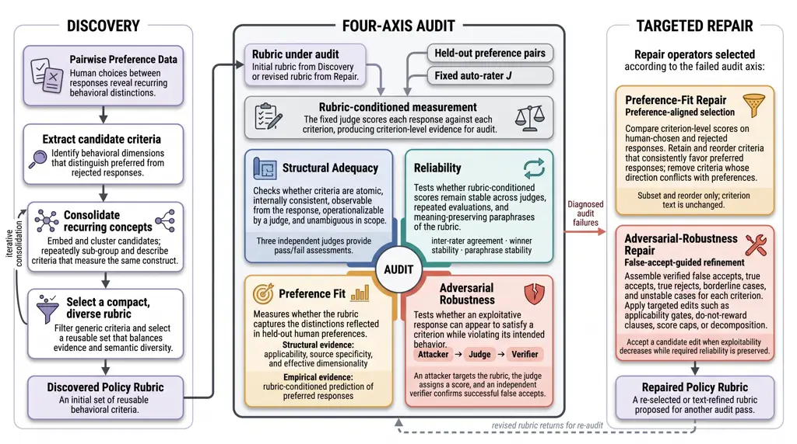
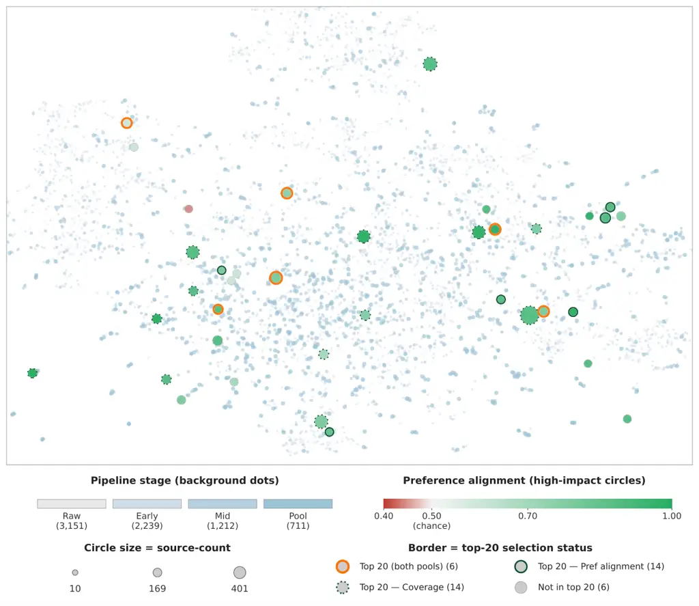

# PReMISE: Policy Rubrics as Measurement Specifications for LLM Judges

Swastik Roy^(†) ^(†)^(†)thanks: Equal contribution.    Rajkumar
Pujari^(†)¹¹footnotemark: 1    Tharindu Kumarage^(†)    Charith
Peris^(†) Affiliation: Rahul Gupta^(†)    Anna Rumshisky^(†∘)    Pradeep
Natarajan^(†)    Venkatesh Saligrama^(†‡)
Email: [{roswasti,pujarira,tharindd,perisc,gupra,arrumshi,natarap,prof}@amazon.com](mailto:)
Affiliation: ^(†)Amazon AGI-Foundations    ^(∘)University of
Massachusetts Lowell    ^(‡)Boston University

###### Abstract

LLM judges are increasingly used to evaluate open-ended responses, but
their scores depend strongly on the rubrics that condition them. A vague
rubric asking for a response to be “helpful and factual” can reward
polished answers that invent facts or violate user intent. We treat
reusable rubrics as measurement specifications: changing the rubric
changes the response quality measurement induced by a fixed judge. We
introduce PReMISE, a framework that, given pairwise human-preference
data, (i) discovers a policy-level rubric set, and (ii) audits any
rubric set under LLM-judge use along four axes: structural adequacy,
reliability, preference fit, and adversarial robustness. We evaluate
PReMISE on four public human-preference corpora – UltraFeedback,
Arena-Expert-5K, HelpSteer3, and HH-RLHF – across six rubric sources and
three open-weight judges spanning 32B to 1T parameters. Across rubric
sources no raw source is simultaneously reliable, preference-predictive,
and adversarially robust; and high inter-rater agreement does not imply
low exploitability. PReMISE is the only rubric source to score
non-trivially on applicability, specificity, and effective
dimensionality simultaneously. We contribute two audit-targeted repair
operations: preference-rank selection raises held-out cross-source,
cross-judge mean accuracy on paired responses from $`65.0\%`$ to
$`68.6\%`$, competitive with the strongest rubric-discovery baselines
and leading on two of three judges in our cross-judge sweep;
reliability-constrained refinement reduces the rate at which exploit
responses receive high scores from $`46.4\%`$ to $`36.0\%`$ with little
change in inter-judge agreement ($`\alpha{=}.531\to.519`$). Code:
[https://github.com/amazon-science/premise-engine](https://github.com/amazon-science/premise-engine).

Figure 1: Six policy-rubric methods evaluated through their
rubric-conditioned judges, on the four PReMISE audit axes, with
preference fit expanded into its three structural sub-axes
(applicability, specificity, effective dimensionality; §4.3). Each spoke
is normalized within-axis so the leader anchors at the outer hexagon;
rim badges mark the spoke leader. No method leads every spoke; PReMISE
is the only rubric with non-trivial applicability, specificity, and
effective dimensionality simultaneously.

## 1 Introduction

LLM evaluation is increasingly a problem of measuring open-ended
response quality. Where outputs admit a verifiable correctness
signal–math derivations, executable code–quality can often be checked
directly. For writing, dialogue, safety, and other open-ended tasks, the
de facto substitute is an automatic judge conditioned on a written
rubric: criteria such as factual support, instruction following, safety,
or edge-case handling. Rubrics now anchor flagship evaluation benchmarks
(Arora et al., 2025; Kim et al., 2024; Kim and others, 2025), condition
LLM-as-judge pipelines and reward models, and increasingly serve as
training signals themselves(Guan et al., 2024; Srivastava et al., 2025).

We focus on reusable, policy-level rubrics: rubrics intended to apply
across many prompts rather than to encode an item-specific answer key.
Published model specifications (OpenAI, 2024; Bai et al., 2022b) and
constitutions are canonical examples. Their reuse is exactly what makes
them consequential: a flaw in the rubric can propagate across a
benchmark, filtering pipeline, or training rollout.

Our object of study is the _judge induced by the rubric_. Given a fixed
auto-rater $`J`$, a rubric $`r`$ induces a rubric-conditioned evaluator

```math
M_{J,r}(p,x)=J(p,x;r), \tag{1}
```

that scores response $`x`$ to prompt $`p`$. The same auto-rater paired
with two different rubrics is two different evaluators; downstream
pipelines consume this rubric-conditioned evaluator, not the rubric text
alone. A rubric can sound reasonable while inducing a poor judge: a
vague rubric asking for “helpful, factual, and clear” may lead an
auto-rater to give a high score to a fluent answer that invents a 60-day
return window even when the policy says electronics must be returned
within 30 days. The bad response is one problem; the deeper evaluation
problem is that the rubric-conditioned judge failed to detect it. Thus
the goal is not to train a better model directly, but to edit the rubric
so that the induced judge gives high scores to responses humans would
actually accept.

To know whether a rubric-conditioned judge is trustworthy, we must
inspect the scoring process it induces. We organize this along four
axes: structural adequacy (is the rubric well-formed – atomic,
non-overlapping, covering the relevant behaviors? Zhang et al., 2026;
Zhang, 2026); reliability (do independent judges reach the same scores?
Huynh et al., 2026; Bavaresco et al., 2025; Pan et al., 2026; Weng et
al., 2026); preference fit (does using the rubric _add_ information
beyond a no-rubric prior Findeis et al., 2025; Xie et al., 2025; Wang
and Xiong, 2025; Guo et al., 2025; Arabzadeh et al., 2024); and
adversarial robustness (how readily can high scores be obtained while
the intended construct is violated? Zhao et al., 2025; Pombal et al.,
2026; Arabzadeh et al., 2024). These requirements are distinct (see
Fig. 1): agreement is not validity, and preference fit is not robustness
– judges can agree on a flawed interpretation, and a rubric that
predicts preferences on ordinary responses can still admit adversarial
responses that exploit its wording. Each axis names not only a
measurement but a target for repair: when a rubric fails on a given
axis, edits targeted at that axis can sharpen the judge it produces.

We introduce PReMISE, a framework for auditing and improving
rubric-conditioned judges. Given pairwise human-preference data, PReMISE
can mine candidate reusable rubrics; given any rubric set, it audits the
judge induced by that set along the four axes above; and when the audit
exposes a failure, it supplies repair operations that edit the rubric
and re-evaluate the resulting judge. Figure 2 sketches the framework
end-to-end; operational details of each axis are deferred to Section 3.
We use LLM-based audit metrics as scalable diagnostics. Although
susceptible to systematic biases shared across model families, they
enable broad screening and repeatable stability checks at a scale
impractical for human annotation alone.

Contributions. We treat reusable rubrics as editable specifications for
automatic LLM judges: changing the rubric changes the response-quality
measurement induced by a fixed judge. Building on this framing, we
contribute a discover–audit–repair pipeline: (i) Discover: a
preference-grounded rubric discovery pipeline whose rubrics are the only
ones to score non-trivially on per-prompt applicability, specificity to
source distribution, and effective dimensionality simultaneously; (ii)
Audit: a four-axis framework–structural adequacy, reliability,
preference fit, and adversarial robustness–that places rubric sources on
common footing and exposes that no source dominates all four; (iii)
Repair: two audit-targeted operations–preference-rank selection, which
raises judge accuracy on paired responses from $`65.0\%`$ to $`68.6\%`$
(cross-source mean across three judges and two prompt templates), and
reliability-constrained refinement, which reduces Verified Fool Rate
from $`46.4\%`$ to $`36.0\%`$ at $`\Delta\alpha=-.012`$.



Figure 2: PReMISE framework. A policy rubric, a pairwise preference
dataset, and a fixed judging protocol define a rubric-conditioned
measurement process. PReMISE audits the judge along four axes–structural
adequacy, reliability, preference fit, and adversarial robustness–and
uses audit failures to guide rubric selection or refinement.

## 2 Related Work

### 2.1 Rubrics in LLM evaluation and training

Our work follows a line of evaluation-methodology research that treats
evaluations as designed measurement systems rather than neutral
scoreboards (Liang et al., 2023; Ribeiro et al., 2020; Kiela et al.,
2021). Rubrics now anchor much of the evaluation pipeline for
non-verifiable tasks, both via per-instance rubric benchmarks (Arora et
al., 2025; Kim and others, 2025; Ye and others, 2024; Song and others, 2024) and via rubric-conditioned judge models authored at run time (Kim
and others, 2024; Kim et al., 2024; Vu and others, 2024; Deshpande et
al., 2024). Rubrics also serve as the training signal in a growing
post-training literature on AI-feedback, deliberative alignment, and
rubric-derived rewards for non-verifiable objectives (Bai et al., 2022b;
Lee and others, 2024; Guan et al., 2024; Srivastava et al., 2025; Jian
et al., 2025; Jia et al., 2025; Montero et al., 2026; Bhattarai et al.,
2026; Yu et al., 2026).

### 2.2 Policy-level rubrics and discovery from preferences

Policy-level rubrics–reusable across prompts–appear most prominently in
published model specifications and constitutions (OpenAI, 2024;
Anthropic, 2023; Bai et al., 2022b). A separate line of work induces
such rubrics directly from data: Inverse CAI (Findeis et al., 2025)
compresses preference annotations into a small set of principles;
Auto-Rubric (Xie et al., 2025) converts implicit reward-model signals
into hierarchical rubrics from a few preference pairs; AutoRule (Wang
and Xiong, 2025) extracts rule-based rewards from chain-of-thought
rationales over preferences; and CritiQ (Guo et al., 2025) mines
reusable verbal criteria from human-annotated preferences in the
data-quality domain. AgentEval (Arabzadeh et al., 2024) takes a related
rubric-induction approach but starts from task descriptions rather than
preferences. These methods are our principal baseline rubric sources:
each produces a policy-level rubric, and our framework lets us measure
them on the same axes for the first time.

### 2.3 Auditing rubrics, judges, and specs

Most prior work on rubric quality audits a single axis. Structural
well-formedness has been examined through benchmarks and atomicity
ablations (Zhang et al., 2026; Zhang, 2026; Shen et al., 2026), building
on a long tradition of rubric design in education (Jonsson and Svingby,
2007). Reliability is measured via inter-annotator agreement
(Krippendorff, 2011), judge agreement under rubric edits, judge
meta-evaluation, and judge invariance under rubric or prompt
perturbations (Huynh et al., 2026; Bavaresco et al., 2025; Pan et al.,
2026; Weng et al., 2026; Elazar et al., 2021; Sclar et al., 2024).
Adversarial robustness sits within a broader literature on reward
hacking, specification gaming, and reward-model overoptimization (Skalse
et al., 2022; Krakovna et al., 2020; Gao et al., 2023; Lambert et al.,
2024), with recent judge-side documentation through short-token attacks,
self-preference biases, and aggregate stress tests (Zhao et al., 2025;
Li et al., 2025; Pombal et al., 2026; Liu et al., 2026; Shihab et al.,
2025).

The closest neighbor on policy-rubric-auditing turf is Zhang et al.
(2025), which surfaces contradictions and ambiguities in carefully
written specifications by measuring cross-model behavioral divergence;
this is complementary to our measurement-properties audit. Among
rubric-induction methods, Arabzadeh et al. (2024)’s “discriminative
power” test, which prunes criteria using random sentence deletion, is
the only prior work we know of that performs an explicit adversarial
check on rubric criteria themselves; we generalize this to a
verified-fool-rate construction. Our framing draws on a broader push
toward principled measurement instruments in LLM evaluation (Sühr et
al., 2025; Ye et al., 2025; Lin, 2025).

## 3 PReMISE

PReMISE operates on rubric-conditioned response-quality measurements.
Given pairwise human-preference data
$`\mathcal{D}=\{(p_{i},y_{i}^{+},y_{i}^{-})\}_{i=1}^{n}`$, with
$`y_{i}^{+}`$ the human-preferred response, and a fixed auto-rater
$`J`$, a rubric $`R=\{c_{1},\ldots,c_{K}\}`$ induces a vector-valued
evaluator

```math
{s_{R}(p,x;J)\!=\!\big(J(p,x;c_{1}),\ldots,J(p,x;c_{K})\big)\!\in\![0,10]^{K}}
```

The framework has three operators. First, it can discover a reusable
rubric set $`R`$ from $`\mathcal{D}`$. Second, it can audit any rubric
set–whether discovered by PReMISE, hand-written, or produced by another
method–under the same judge $`J`$. Third, it can edit a rubric to target
failures exposed by the audit. Sections 3.1–3.4 specify these operators.

### 3.1 Discovery

The discovery operator constructs candidate rubrics from preference
data. Its goal is not to reproduce every pairwise rationale, but to
identify reusable criteria that, when supplied to a judge, help measure
response qualities that humans repeatedly preferred. Given
$`\mathcal{D}`$, we mine behavioral dimensions that distinguish
preferred from dispreferred responses and consolidate them into a
compact rubric set $`R`$.

##### Candidate criterion extraction.

For each pair $`(p_{i},y_{i}^{+},y_{i}^{-})`$, an extractor model
identifies $`5-15`$ salient criteria on which the responses differ and
assigns each a score for both responses on a $`[0,10]`$ scale. Applied
to all $`|\mathcal{D}|`$ pairs, this yields a raw multiset of
$`\mathcal{O}(10^{3}`$–$`10^{4})`$ candidate criteria; prompt and
formatting details are in Appendix A.

##### Iterative consolidation.

Raw candidates are redundant and partly instance-specific. We
consolidate them by iterating an embed–cluster–sub-group–describe loop:
at each step, candidates are embedded, clustered by cosine-distance
agglomerative clustering, a sub-group partitioner splits each cluster
into groups whose members measure the same construct, and a description
step rewrites each sub-group as a single consolidated criterion,
replacing its members. The loop terminates when the rubric reaches a
target size or after at most ten iterations. We retain only criteria
backed by at least a threshold number of source candidates. The final
$`K`$-criterion rubric is selected from the filtered pool via maximal
marginal relevance (MMR) with a genericity filter, balancing
source-count against cosine diversity over the embedding space.
Available run settings are reported with Algorithm 1 in Appendix A. Full
definitions for all discovered, repaired, and baseline rubric sets are
released in the accompanying code repository.



Figure 3: Discovery trace on UltraFeedback. Stage colors trace the
consolidation pool $`3{,}151\to 2{,}239\to 1{,}212\to 711`$; circles
mark the high-impact subset (source-count $`\geq 10`$, $`n{=}40`$);
border encodes top-20 selection ($`711\to 40\to 20`$).

### 3.2 Audit

##### Structural adequacy.

A rubric should be well formed before its scores can be trusted. Drawing
on the rubric-design literature (Jonsson and Svingby, 2007) and recent
work on rubric-quality benchmarks and atomic vs. holistic judging (Zhang
et al., 2026; Zhang, 2026), we use a three-judge ensemble to check five
design properties of each criterion: (i) _atomicity_–does the criterion
measure a single behavior?; (ii) _internal consistency_–are the scoring
conditions non-contradictory?; (iii) _response observability_–can the
criterion be evaluated from the evaluation record, including the prompt,
response, and any supplied context?; (iv) _operationalizability_–are the
high- and low-score conditions concrete enough for a judge to apply?;
(v) _unambiguous scope_–is the criterion’s applicability clearly
bounded? Each property is scored as a binary pass/fail by majority vote
of the three judges; the rubric-level score $`\mathrm{Struct}(R)`$
averages over criteria.

##### Reliability.

Reliability captures invariance of the rubric-conditioned measurement
$`s_{R}(p,x;J)`$. Three probes target different sources of variation:
_inter-rater agreement_ via Krippendorff’s $`\alpha`$ (Krippendorff, 2011) over pairwise outcomes from multiple judge models with ordinal
weighting; _intra-rater consistency_ via the winner flip rate across
stochastic re-runs of the same judge; and _paraphrase stability_ via the
mean Spearman $`\rho`$ between scores under the original rubric and
semantically equivalent paraphrases (Elazar et al., 2021; Sclar et al.,
2024). We report the three separately. Concrete judge models, re-runs,
and paraphrase counts are in Section 4.1.

##### Preference fit.

Preference fit asks whether the rubric, as a measurement instrument,
captures the signal in human preferences. Structurally (§4.3): a useful
rubric should apply to prompts it claims to evaluate, distinguish its
source distribution from foreign distributions, and span more than one
effective dimension; we measure these using per-prompt applicability,
source specificity, and effective dimensionality. Empirically (§4.4):
supplying the rubric to a judge should improve pairwise preference
prediction over the same judge without the rubric. We report
rubric-conditioned judge accuracy
$`\mathrm{Acc}_{\mathrm{eval}}(J\mid R)`$.

Two rubric sets can achieve similar accuracy with different mechanisms:
one may be broad but generic, another narrow but specific, and another
distributed across many independent criteria. We therefore report both
the structural anatomy and the empirical accuracy.

##### Adversarial robustness.

Reliability and preference fit measure behavior on natural data; neither
tests whether high scores can be obtained while violating the intended
construct. We measure this with an attacker–judge–verifier protocol. For
each criterion in $`R`$, an attacker generates a candidate response
designed to score highly under $`c`$ while violating its intent. The
judge scores the candidate. A separate verifier, blind to both the
attack strategy and the judge score, labels high-scoring candidates as
genuine or exploiting. The Verified Fool Rate is

```math
\mathrm{VFR}(r)\!=\!\frac{1}{N}\!\sum_{i=1}^{N}\mathbf{1}\!\left[J_{\mathrm{sc}}(p_{i},x_{i},r)\!\geq\!\tau\right]\mathcal{V}(p_{i},x_{i},r), \tag{2}
```

where $`\mathcal{V}{=}1`$ denotes a verified exploit and $`\tau`$ is a
high-score threshold. Thus a response counts as a fooling example only
when it both receives a high rubric score and is verified to violate the
criterion’s intended construct. The threshold $`\tau`$, the number of
attack attempts $`N`$, and the attacker and verifier models are
specified in Section 4.1. Unlike the random-deletion test of Arabzadeh
et al. (2024) or judge-side adversarial work (Zhao et al., 2025; Pombal
et al., 2026), VFR is rubric-level and adaptive: the attacker sees the
rubric text and explicitly targets it. Verifier calibration is in
Appendix B.5.

### 3.3 Preference-Fit Repair: Preference-Aligned Selection

The discovery operator ranks consolidated criteria partly by how many
extracted sample-level criteria they capture. This favors criteria that
often discriminate between paired responses, but it does not guarantee
that the criterion points in the human-preferred direction. For example,
length or brevity may separate many pairs while winning roughly half the
time; such criteria are meaningful, but they are weak preference
signals.

We therefore add a preference-aligned selection step. For each
high-impact discovered criterion $`c`$, we score the chosen and rejected
response on the preference pairs used for discovery and compute the
fraction of pairs on which the chosen response scores higher. We rank
criteria by this preference-fit score and select the top $`K`$, without
editing their text. The resulting rubric re-selects and re-orders
criteria from the high-impact candidate pool. This operation repairs
preference fit by prioritizing criteria that are both discriminative and
aligned with the observed preference direction.

### 3.4 Adversarial-Robustness Repair: False-Accept-Guided Refinement

We frame refinement as constrained search over an existing rubric $`R`$:
minimize VFR subject to a reliability floor. Unlike preference-aligned
selection, refinement edits criterion text.

##### Failure packets and repair operators.

For each criterion $`r\in R`$, we assemble a failure packet
$`\mathcal{C}_{r}`$ containing true positives, true negatives, false
accepts, false rejects, borderline cases, and unstable cases (those with
low inter-judge agreement or high flip rate). False accepts come from
both natural preference data and the adversarial protocol used for VFR
(Section 3.2). A repair assistant, conditioned on $`\mathcal{C}_{r}`$
and the criterion text, proposes candidate edits drawn from a fixed
operator library: applicability gates, do-not-reward clauses,
maximum-score caps, decomposition into sub-criteria,
abstract-to-observable rewrites, false-positive anchors, and
non-compensation rules. Every candidate revision must additionally
satisfy a structural budget (total $`\leq 150`$ words, at most two
anti-gaming clauses, single applicability gate, prompt-agnostic; full
spec in Appendix C.1). The full operator definitions and worked
before/after examples are in Appendix C.2 and Table 9.

##### Acceptance and operating point.

A candidate revision is accepted only if it improves robustness without
unacceptable loss of inter-judge agreement:
$`\text{VFR}_{\text{dev}}(r^{\prime})<\text{VFR}_{\text{dev}}(r)`$
subject to
$`\alpha_{\text{dev}}(r^{\prime})\geq\alpha_{\text{dev}}(r)-\delta`$,
with both quantities estimated on a held-out development split. Sweeping
the tolerance $`\delta`$ traces the agreement–robustness operating curve
reported in Section 4.5. When multiple candidates satisfy the rule, we
keep the Pareto frontier on $`(\alpha,\text{VFR})`$; when none does, the
criterion is left unchanged.

## 4 Experiments

|                                    |             |                 |                    |                   |                  |                   |                 |                           |                    |                                    |                      |                    |                  |
| ---------------------------------- | ----------- | --------------- | ------------------ | ----------------- | ---------------- | ----------------- | --------------- | ------------------------- | ------------------ | ---------------------------------- | -------------------- | ------------------ | ---------------- |
|                                    |             | Struct          | Reliability        |                   |                  | Robust            | Preference Fit  |                           |                    |                                    |                      |                    |                  |
| Rubric source                      | $`\bar{K}`$ | St.$`\uparrow`$ | $`\alpha\uparrow`$ | Fl%$`\downarrow`$ | $`\rho\uparrow`$ | VFR$`\downarrow`$ | App$`\uparrow`$ | $`\Delta`$App$`\uparrow`$ | EffDim$`\uparrow`$ | ED/$`K_{\mathrm{UF}}`$$`\uparrow`$ | Pref-acc$`\uparrow`$ | CV-acc$`\uparrow`$ | Ent.$`\uparrow`$ |
| Preference-derived rubrics         |             |                 |                    |                   |                  |                   |                 |                           |                    |                                    |                      |                    |                  |
| Inverse CAI (Findeis et al., 2025) | 2.8         | 3.18            | .558               | 37.8              | .544             | .517              | .630            | $`-.05`$                  | 4                  | 1.00                               | 67.5                 | .614               | .932             |
| Auto-Rubric (Xie et al., 2025)     | 20.0        | 3.94            | .300               | 13.9              | .301             | .272              | .030            | $`+.02`$                  | 10                 | .50                                | 68.7                 | .637               | .908             |
| AutoRule (Wang and Xiong, 2025)    | 26.2        | 2.12            | .513               | 25.9              | .585             | .502              | .403            | $`+.04`$                  | 18                 | .72                                | 68.2                 | .657               | .886             |
| CritiQ (Guo et al., 2025)          | 5.8         | 4.40            | .358               | 34.6              | .592             | .439              | .753            | $`+.01`$                  | 7                  | .78                                | 68.1                 | .695               | .878             |
| Task-description-derived rubrics   |             |                 |                    |                   |                  |                   |                 |                           |                    |                                    |                      |                    |                  |
| AgentEval (Arabzadeh et al., 2024) | 4.0         | 3.38            | .582               | 28.1              | .702             | .330              | .824            | $`-.06`$                  | 3                  | .75                                | 68.2                 | .665               | .873             |
| Ours                               |             |                 |                    |                   |                  |                   |                 |                           |                    |                                    |                      |                    |                  |
| PReMISE (discovered)               | 20.0        | 4.21            | .531               | 26.3              | .597             | .464              | .577            | $`+.08`$                  | 15                 | .75                                | 65.0                 | .665               | .919             |
| PReMISE (+ VFR constrained)        | 18.0        | 4.39            | .519               | 27.4              | .609             | .360              | .577            | $`+.09`$                  | 14                 | .78                                | 64.9                 | .670               | .909             |
| PReMISE (+ VFR unconstrained)      | 18.0        | 4.45            | .488               | 31.3              | .585             | .299              | .552            | $`+.09`$                  | 14                 | .78                                | 64.8                 | .664               | .899             |
| PReMISE (+ pref repair)            | 20.0        | 3.83            | .499               | 24.1              | .548             | .432              | .340            | $`+.08`$                  | 11                 | .55                                | 68.6                 | .685               | .916             |

Table 1: Cross-source audit, $`K`$-weighted mean across four preference
datasets (Arena-Expert-5K, HelpSteer3, HH-RLHF, UltraFeedback).
$`\bar{K}`$ is the mean rubric size across the four datasets. Columns
are grouped by the four audit axes from §3: Structure (Struct.),
Reliability ($`\alpha`$, flip rate, $`\rho`$), Adversarial robustness
(VFR), and Preference fit decomposed into structural anatomy (App,
$`\Delta`$App, EffDim, ED/$`K_{\mathrm{UF}}`$ – UltraFeedback only),
empirical judge accuracy (Pref-acc – cross-source / cross-judge mean
from §4.4), and BT-regression diagnostics (CV-acc, BT-weight entropy).
Best per column in bold.

We ask four questions of policy rubrics through the four-axis audit:
whether any rubric source dominates the audit (§4.2); how well PReMISE
rubrics structurally explain preferences (§4.3); how well PReMISE
rubrics explain preferences as judge conditioning (§4.4); and how
refinement trades reliability for robustness (§4.5).

### 4.1 Setup

We use four pairwise-preference corpora as audit sources: HH-RLHF,
UltraFeedback, ArenaExpert-5K (the expert subset of Chatbot Arena), and
HelpSteer3. From each we sample, with fixed seed 42, a $`1{,}000`$-pair
split for rubric extraction; a $`500`$-pair audit pool (used for
reliability, structural, and adversarial probes); and a disjoint
$`3{,}000`$-pair held-out split for rubric-conditioned judge evaluation
(RQ3, §4.4).

We audit six policy-rubric sources: four preference-derived (Inverse CAI
(Findeis et al., 2025), Auto-Rubric (Xie et al., 2025), AutoRule (Wang
and Xiong, 2025), CritiQ (Guo et al., 2025)); one
task-description-derived (AgentEval (Arabzadeh et al., 2024)); and our
own PReMISE (§3.1). Each baseline runs on each preference dataset using
its upstream code path; per-dataset criterion counts $`K`$ are reported
in Table 1. Per-axis judge configurations are reported with the relevant
RQ sections; full protocol settings (attacker/verifier models,
thresholds, sample sizes, BT regression) and compute / reproducibility
details are in Appendix B.1.

### 4.2 RQ1: Do any rubric sources induce uniformly strong measurements?

Table 1 reports the four-axis audit averaged across the four preference
datasets. Inter-judge agreement ($`\alpha`$) uses a three-judge ensemble
(DeepSeek-V3, Mistral-Large-3, Qwen3-235B); structural adequacy uses a
separate three-judge ensemble (DeepSeek-R1, DeepSeek-V3,
Mistral-Large-3); the remaining columns use DeepSeek-V3 as judge, except
Pref-acc which is averaged across the three judges in the RQ3 sweep
(§4.4).

No source wins on all audit axes. PReMISE (+ VFR unconstrained) leads
structural adequacy ($`4.45`$); Auto-Rubric leads self-consistency
(flip$`\%{=}13.9`$), adversarial robustness (VFR$`=.27`$), and
rubric-conditioned judge accuracy (Pref-acc$`=68.7`$); AgentEval leads
inter-judge agreement ($`\alpha{=}.58`$), paraphrase stability
($`\rho{=}.70`$), and per-prompt applicability ($`.82`$); AutoRule leads
effective dimensionality ($`\mathrm{EffDim}{=}18`$); PReMISE (+ VFR
constrained) leads source-specificity ($`\Delta\mathrm{App}{=}{+}.09`$);
Inverse CAI leads BT-weight entropy ($`.93`$); CritiQ leads BT-CV
accuracy ($`.70`$). Six different rubric methods lead at least one
column; none leads them all. Per-dataset replication of the audit
columns is in Appendix B.2. Inter-model agreement measures consistency
among rubric-conditioned judges. Shared systematic biases can still
produce high agreement despite a common error, while model-specific
biases can reduce agreement even when individual judgments are
reasonable. We therefore treat $`\alpha`$, flip rate, and paraphrase
stability as scalable stability checks rather than evidence of human
validity.

Figure 4: Anatomy of preference fit on UltraFeedback. (a) Applicability
map: in-domain vs. out-of-domain criterion firing rate; the diagonal
marks “no source specificity.” (b) Per-method per-prompt applicability
split into in-domain (saturated) and out-of-domain (faded) bars; the gap
is specificity (annotated). (c) Effective dimensionality as a count,
with the count/$`K`$ ratio annotated. Definitions in Appendix B.3.

### 4.3 RQ2: What kind of preference signal does each rubric source capture?

A rubric that explains preferences should reach the prompts it claims to
evaluate, distinguish its source distribution from foreign
distributions, and span more than one effective dimension – a
four-criterion universal explanation, a twenty-criterion explanation
that fires on $`3\%`$ of prompts, or a twenty-criterion explanation
collapsed onto a single dominant axis are all failures of structural
explanation, regardless of how well any of them might score on a single
accuracy number. We decompose structural explanation into three
sub-properties: applicability (the average fraction of the rubric’s
$`K`$ stated criteria that fire on a prompt), specificity to source (the
gap between in- and out-of-domain applicability), and effective
dimensionality (the number of independent rubric directions actually
used, derived from the eigenvalue spectrum of the matrix of
per-criterion scores across prompts; full definition in Appendix B.3).

Three patterns emerge across rubric methods (Figure 4). (i)
Universal-but-shallow. AgentEval and Inverse CAI sit on the
applicability diagonal with negative $`\Delta\mathrm{App}`$ ($`-5.9`$
and $`-4.6`$ pp): they fire more on out-of-domain prompts than
in-domain, the signature of criteria too generic to distinguish their
own source distribution; at $`K{=}4`$ their effective dimensionalities
cap at $`3`$ and $`4`$. (ii) Sparse-but-narrow. Auto-Rubric’s criteria
fire on $`3\%`$ of prompts and span $`10/20`$ of their independent
directions. (iii) Distributed-and-distinctive. PReMISE is the only
rubric that scores non-trivially on all three sub-axes simultaneously:
$`58\%`$ applicability ($`11.5/20`$ criteria fire on a typical prompt),
$`+7.5`$ pp specificity (the largest among rubrics with in-domain
applicability above $`0.5`$), and effective dimensionality $`15`$ at
$`K{=}20`$. AutoRule comes closest among prior baselines, but at lower
per-prompt firing ($`40\%`$) and lower specificity ($`+4.3`$ pp); CritiQ
matches PReMISE on the per-criterion ratio ($`\mathrm{EffDim}/K{=}.78`$)
but only at $`K{=}9`$, capping its absolute dimensional reach.

### 4.4 RQ3: Do PReMISE rubrics explain preferences as judge conditioning?

Each rubric set is a candidate policy-level instrument for the corpus it
was discovered on; we measure how well it explains held-out preference
labels when used as judge conditioning. For each method and source
corpus, the rubric is discovered on $`n{=}1{,}000`$ pairs and evaluated
on a disjoint $`n{=}3{,}000`$ pairs; each judgment is a majority vote
over 5 independent samples at temperature 0.7 (Appendix B.4).

We sweep three judges of varying capacity (DS-V3 671B MoE, Kimi K2.5 1T
MoE, Qwen3-32B 32B dense) and two prompt templates (_direct-verdict_:
judge reads the rubric set and issues one preference verdict;
_per-rubric_: judge scores each rubric first, then issues the verdict).

|                         | DS-V3 |      | Qwen-32B |      | Kimi |      |
| ----------------------- | ----- | ---- | -------- | ---- | ---- | ---- |
| Method                  | D     | P    | D        | P    | D    | P    |
| No rubric               | 67.8  | \-   | 66.4     | \-   | 70.3 | \-   |
| PReMISE (+ pref repair) | 68.6  | 69.2 | 65.8     | 67.0 | 70.5 | 70.5 |
| PReMISE (discovered)    | 65.2  | 64.0 | 63.6     | 63.0 | 67.9 | 66.0 |
| Auto-Rubric             | 68.1  | 68.8 | 66.4     | 68.0 | 70.3 | 70.5 |
| Inverse CAI             | 67.4  | 66.2 | 67.0     | 66.4 | 69.9 | 68.3 |
| AutoRule                | 68.4  | 69.0 | 65.3     | 67.4 | 69.8 | 69.6 |
| AgentEval               | 67.1  | 68.2 | 66.1     | 68.1 | 70.2 | 69.7 |
| CritiQ                  | 67.9  | 69.0 | 64.8     | 67.5 | 69.9 | 69.5 |

Table 2: Held-out preference accuracy (%) by judge $`\times`$ prompt
template (D = direct-verdict, P = per-rubric), cross-source mean over
four corpora, $`5`$ repetitions per prompt at $`0.7`$ temperature.
Dashes in the no-rubric row indicate that per-rubric evaluation is not
applicable because that template requires rubric criteria. Full
ablations and baselines in Appendix B.4; prompt templates in
Appendix E.10.

Across the four source corpora and three judges (Table 2), PReMISE (+
pref repair) holds the top cross-source accuracy on $`4`$ of $`6`$
(judge $`\times`$ prompt) cells – four times the runner-up among
rubric-discovery methods (Auto-Rubric and Inverse CAI tied at $`1/6`$) –
and ranks below the top tier only on Qwen3-32B. Preference-rank
selection lifts the cross-source mean by $`+3.6`$ pp over frequency-rank
PReMISE (discovered) by prioritizing criteria that discriminate pairs
and are aligned with the winning side (mechanism in §3.3).

### 4.5 RQ4: Can refinement reduce false accepts without breaking reliability?

Figure 5: Refinement cost vs. benefit, per dataset. Each shows change
relative to PReMISE (discovered) in reliability ($`\Delta\alpha`$, blue)
and exploitability ($`\Delta\mathrm{VFR}`$, green), at two refinement
operating points: PReMISE (+ VFR constrained, light: no $`\alpha`$ loss)
and PReMISE (+ VFR unconstrained, dark).

A rubric used as a measurement instrument needs to resist gameability:
small surface edits to a response (paraphrase, padding, formatting)
should not move its rubric score in a direction the policy did not
endorse. PReMISE (discovered)’s pre-refinement VFR is higher than
less-specified baselines such as Auto-Rubric and AgentEval (Table 1);
the operational specificity of its criteria gives the attacker a precise
target, and refinement is what closes the loophole rather than
abstraction (mechanism in Appendix B.6). We refine PReMISE (discovered)
rubrics with the predictor-guided procedure (§3.4), which trades off
rubric judgement reliability (Krippendorff’s $`\alpha`$) with
exploitability (measured as verifier failure rate, VFR). The adversarial
protocol uses Moonshot Kimi-K2-Thinking as attacker, Mistral-Large-3 as
verifier (blind to the attack strategy and judge score), and DeepSeek-V3
as the judge VFR is computed against, with high-score threshold
$`\tau{=}7`$ on $`[0,10]`$ and $`N{=}500`$ attacks per criterion. We
report two operating points: PReMISE (+ VFR constrained) (no dev-split
$`\alpha`$ loss allowed) and PReMISE (+ VFR unconstrained) (optimizing
VFR alone). The fixed library of repair operators and worked
multi-operator compositions are in Appendix C.2–C.3.

We can optimize for exploitability with a balanced trade-off: at low
reliability cost ($`\Delta\alpha{=}{-}.012`$ on cross-dataset average,
constrained), VFR drops by $`.104`$ – roughly $`8\times`$ the $`\alpha`$
cost. Spending more reliability ($`\Delta\alpha{=}{-}.043`$,
unconstrained) gets a larger VFR drop of $`.165`$ ($`3.8\times`$ ratio).
The pattern is consistent across rubric sets discovered from four
distinct source corpora (HH-RLHF, HelpSteer3, Arena-Expert-5K,
UltraFeedback; Figure 5, per-dataset breakdown in Appendix C.1).

The two operating points are not competitors; they are points on a curve
the operator picks from. The constrained variant is selected under a
no-dev-split-$`\alpha`$-loss constraint and improves held-out VFR with a
small held-out change in $`\alpha`$; the unconstrained variant is
appropriate when robustness dominates the deployment concern (e.g., the
rubric is used as an active selection target, not just a passive
scorer). Stacking pref repair with VFR refinement is reported in
Appendix B.2.

## 5 Conclusion

PReMISE is a discover–audit–repair framework for policy-level rubrics,
treating the rubric-conditioned LLM judge as the measurement object. The
audit reports four axes – structural adequacy, reliability, preference
fit, adversarial robustness – on common footing across rubric sources.
We find that no source tops all four axes; six different methods lead at
least one axis, and high inter-rater agreement does not imply low
exploitability.

In this world, the right move is not to optimize one axis at the expense
of the others. Our discovery pipeline produces a rubric set that
explains preferences more comprehensively than prior baselines: it is
the only one to score non-trivially on per-prompt applicability,
source-specificity, and effective dimensionality simultaneously. Two
audit-targeted repair operations move the rubric on the axes the audit
flags: preference-rank selection raises rubric-conditioned judge
accuracy from $`65.0\%`$ to $`68.6\%`$ (mean across four sources, three
judges, and two prompt templates); reliability-constrained refinement
reduces Verified Fool Rate from $`46.4\%`$ to $`36.0\%`$ at little
reliability cost ($`\alpha{=}.531\to.519`$). Together, discovery and the
two repairs give an operator distinct points on a multi-axis frontier
rather than a single rubric.

## Limitations

We note the following limitations: (1) Scope. PReMISE targets
policy-level rubrics derived from or audited against pairwise preference
data; rubrics designed for objectives that should override preferences
(safety floors, hard policy constraints) are not its target. (2) Judge
capacity. Our experiments target judges with enough capacity to process
rubrics meaningfully; on smaller judges like Qwen3-32B, PReMISE (+ pref
repair) ranks below the no-rubric baseline, and adapting our
policy-rubric methods to smaller judges remains open. (3) VFR is a lower
bound on exploitability under our specific attacker-judge-verifier
protocol. Stronger adversaries may find exploits we miss, weaker ones
may miss exploits we surface. (4) LLM mediation. Our pipeline is
LLM-mediated throughout (judges, attackers, verifiers), so absolute
numbers are judge-relative; we mitigate with human-annotated verifier
calibration ($`72.7\%`$ precision against 3-annotator majority;
Appendix B.5) and three-family judge panels for inter-rater agreement.
Using three model families reduces dependence on one judge but does not
eliminate shared systematic bias. Consequently, these metrics are
appropriate for scalable monitoring and comparative auditing, not as the
sole basis for consequential per-item decisions. Such uses require human
calibration and periodic human review. (5) Discovery and breadth.
Discovery quality is bounded by the source preference data’s annotation
protocol, label density, and polarization, which surface in per-dataset
reliability (Appendix B.2); our evaluation covers four preference
datasets and six rubric corpora, and broader domains and rubric formats
would strengthen generalization. (6) Future work. We scope to the
question of which rubric best explains a given preference dataset,
auditing rubrics in their downstream uses (RL training signal,
data-quality measurement, judge improvement, response-behavior
steering), as well as hierarchical, multilingual, and modality-specific
extensions, is left to future work.

Further, as we build on generative model based automated methods for
rubric quality audit, there is potential for harmful properties to
propagate into downstream use cases. This work is a scoped research
endeavor to evaluate hypotheses around rubric usefulness. Usagae of this
system directly in population facing applications would require
significant guardrails to prevent hard.

## Acknowledgments

We thank the anonymous reviewers and the meta-reviewer for their careful
reading and constructive feedback, which helped improve the clarity,
positioning, and presentation of this work.

## Use of AI Assistants

General-purpose AI coding and writing assistants were used for routine
implementation work (boilerplate code, plotting, refactoring,
debugging), bibliography verification, and editorial copyediting of the
manuscript. All scientific contributions – research questions, framework
design, experimental protocols, claims, analysis, and conclusions – are
the authors’; AI-generated text and code were reviewed and revised by
the authors before inclusion. The LLM judges, attackers, and verifiers
used in the experimental pipeline (documented in Appendix D) are
artifacts _under study_, not authoring assistants.

## References

- Anthropic (2023) Anthropic Claude’s constitution. Note:
  [https://www.anthropic.com/news/claudes-constitution](https://www.anthropic.com/news/claudes-constitution)
  Cited by: §2.2.
- Arabzadeh et al. (2024) N. Arabzadeh, S. Huo, N. Mehta, Q. Wu, C.
  Wang, A. Awadallah, C. L. A. Clarke, and J. Kiseleva Assessing and
  verifying task utility in LLM-powered applications. arXiv preprint
  arXiv:2405.02178. Cited by: Appendix D, §1, §2.2, §2.3, §3.2, §4.1,
  Table 1.
- Arora et al. (2025) R. K. Arora J. Wei et al. HealthBench: evaluating
  large language models towards improved human health. arXiv preprint
  arXiv:2505.08775. Cited by: §1, §2.1.
- Bai et al. (2022a) Y. Bai, A. Jones, K. Ndousse, et al. Training a
  helpful and harmless assistant with reinforcement learning from human
  feedback. arXiv preprint arXiv:2204.05862. Cited by: Appendix D.
- Bai et al. (2022b) Y. Bai, S. Kadavath, S. Kundu, et al.
  Constitutional AI: harmlessness from AI feedback. arXiv preprint
  arXiv:2212.08073. Cited by: §1, §2.1, §2.2.
- Bavaresco et al. (2025) A. Bavaresco, R. Bernardi, L. Bertolazzi, D.
  Elliott, R. Fernández, A. Gatt, E. Ghaleb, M. Giulianelli, M.
  Hanna, A. Koller, A. F. T. Martins, P. Mondorf, V. Neplenbroek, S.
  Pezzelle, B. Plank, D. Schlangen, A. Suglia, A. K. Surikuchi, E.
  Takmaz, and A. Testoni LLMs instead of human judges? a large scale
  empirical study across 20 nlp evaluation tasks. External Links:
  2406.18403, [Link](https://arxiv.org/abs/2406.18403) Cited by: §1,
  §2.3.
- Bhattarai et al. (2026) M. Bhattarai, I. Boureima, N. R.
  Ranasinghe, S. Pakin, and D. O’Malley Rubric-grounded RL: structured
  judge rewards for generalizable reasoning. arXiv preprint
  arXiv:2605.08061. Cited by: §2.1.
- Cui et al. (2024) G. Cui, L. Yuan, N. Ding, G. Yao, W. Zhu, Y. Ni, G.
  Xie, Z. Liu, and M. Sun UltraFeedback: boosting language models with
  scaled AI feedback. In ICML, Cited by: Appendix D.
- DeepSeek-AI (2025) DeepSeek-AI DeepSeek-R1: incentivizing reasoning
  capability in LLMs via reinforcement learning. Nature 645,
  pp. 633–638. Cited by: Appendix D.
- Deshpande et al. (2024) D. Deshpande, S. S. Ravi, S. Ch-Wang, B.
  Mielczarek, A. Kannappan, and R. Qian GLIDER: grading LLM interactions
  and decisions using explainable ranking. arXiv preprint
  arXiv:2412.14140. Cited by: §2.1.
- Elazar et al. (2021) Y. Elazar, N. Kassner, S. Ravfogel, A.
  Ravichander, E. Hovy, H. Schütze, and Y. Goldberg Measuring and
  improving consistency in pretrained language models. Transactions of
  the Association for Computational Linguistics 9, pp. 1012–1031. Cited
  by: §2.3, §3.2.
- Findeis et al. (2025) A. Findeis, T. Kaufmann, E. Hüllermeier, S.
  Albanie, and R. Mullins Inverse constitutional AI: compressing
  preferences into principles. In ICLR, Cited by: Appendix D, §1, §2.2,
  §4.1, Table 1.
- Gao et al. (2023) L. Gao, J. Schulman, and J. Hilton Scaling laws for
  reward model overoptimization. In ICML, Cited by: §2.3.
- Guan et al. (2024) M. Y. Guan, M. Joglekar, E. Wallace, et al.
  Deliberative alignment: reasoning enables safer language models. arXiv
  preprint arXiv:2412.16339. Cited by: §1, §2.1.
- Guo et al. (2025) H. Guo, K. Lv, Q. Guo, T. Liang, Z. Xi, D. Song, Q.
  Zhang, Y. Sun, K. Chen, X. Qiu, and T. Gui CritiQ: mining data quality
  criteria from human preferences. In ACL, Cited by: Appendix D, §1,
  §2.2, §4.1, Table 1.
- Huynh et al. (2026) J. Huynh, A. Gomez, A. Deviyani, R. Shelby, J. P.
  Bigham, and F. Diaz Quantifying the statistical effect of rubric
  modifications on human-autorater agreement. arXiv preprint
  arXiv:2605.06283. Cited by: §1, §2.3.
- Jia et al. (2025) R. Jia, Y. Yang, Y. Gai, K. Luo, S. Huang, J.
  Lin, X. Jiang, and G. Jiang Writing-Zero: bridge the gap between
  non-verifiable tasks and verifiable rewards. arXiv preprint
  arXiv:2506.00103. Cited by: §2.1.
- Jian et al. (2025) A. Jian, J. Ruan, X. Ma, X. Zhang, D. Li, W.
  Zhang, K. Zeng, and X. Cai PaTaRM: bridging pairwise and pointwise
  signals via preference-aware task-adaptive reward modeling. arXiv
  preprint arXiv:2510.24235. Cited by: §2.1.
- Jonsson and Svingby (2007) A. Jonsson and G. Svingby The use of
  scoring rubrics: reliability, validity and educational consequences.
  Educational Research Review 2 (2), pp. 130–144. Cited by: §2.3, §3.2.
- Kiela et al. (2021) D. Kiela, M. Bartolo, Y. Nie, et al. Dynabench:
  rethinking benchmarking in NLP. In NAACL, Cited by: §2.1.
- Kim et al. (2024) S. Kim et al. Prometheus: inducing fine-grained
  evaluation capability in language models. In ICLR, Cited by: §2.1.
- Kim et al. (2025) S. Kim et al. The BiGGen Bench: a principled
  benchmark for fine-grained evaluation of language models with language
  models. In Proceedings of NAACL, Cited by: §1, §2.1.
- Kim et al. (2024) S. Kim, J. Suk, S. Longpre, B. Y. Lin, J. Shin, S.
  Welleck, G. Neubig, M. Lee, K. Lee, and M. Seo Prometheus 2: an open
  source language model specialized in evaluating other language models.
  In Proceedings of EMNLP, Cited by: §1, §2.1.
- Krakovna et al. (2020) V. Krakovna, J. Uesato, V. Mikulik, M.
  Rahtz, T. Everitt, R. Kumar, Z. Kenton, J. Leike, and S. Legg
  Specification gaming: the flip side of AI ingenuity. Note: DeepMind
  Blog Cited by: §2.3.
- Krippendorff (2011) K. Krippendorff Computing Krippendorff’s
  alpha-reliability. Departmental Papers (ASC). Cited by: §2.3, §3.2.
- Lambert et al. (2024) N. Lambert, V. Pyatkin, J. Morrison, L.
  Miranda, B. Y. Lin, K. Chandu, N. Dziri, S. Kumar, T. Zick, Y.
  Choi, N. A. Smith, and H. Hajishirzi RewardBench: evaluating reward
  models for language modeling. arXiv preprint arXiv:2403.13787. Cited
  by: §2.3.
- Lee et al. (2024) H. Lee et al. RLAIF: scaling reinforcement learning
  from human feedback with AI feedback. Proceedings of ICML. Cited by:
  §2.1.
- Li et al. (2025) T. Li, Y. Wu, and H. Liu AdvJudge-Zero: binary
  decision flips in LLM-as-a-judge via adversarial control tokens. arXiv
  preprint arXiv:2512.17375. Cited by: §2.3.
- Liang et al. (2023) P. Liang, R. Bommasani, T. Lee, D. Tsipras, D.
  Soylu, M. Yasunaga, Y. Zhang, D. Narayanan, Y. Wu, A. Kumar, et al.
  Holistic evaluation of language models. Transactions on Machine
  Learning Research. Cited by: §2.1.
- Lin (2025) Z. Lin A validity-guided workflow for robust large language
  model research in psychology. arXiv preprint arXiv:2507.04491. Cited
  by: §2.3.
- Liu et al. (2026) Y. Liu, Y. Yu, D. Su, S. Wang, X. Wang, S. Jiang, B.
  Liu, A. Cohan, Y. Tian, and Z. Chen Examining reasoning LLMs-as-judges
  in non-verifiable LLM post-training. arXiv preprint arXiv:2603.12246.
  Cited by: §2.3.
- LMSYS (2024) LMSYS Arena Hard / Arena Expert preference data. Note:
  LMSYS Chatbot Arena release Cited by: Appendix D.
- Montero et al. (2026) I. Montero, T. Jurczyk, and B. Dhingra RVPO:
  risk-sensitive alignment via variance regularization. arXiv preprint
  arXiv:2605.05750. Cited by: §2.1.
- OpenAI (2024) OpenAI OpenAI Model Spec. Note:
  [https://model-spec.openai.com](https://model-spec.openai.com) Cited
  by: §1, §2.2.
- Pan et al. (2026) T. Pan, X. Lin, W. Yang, Q. He, S. Chen, L. Qi, W.
  Xu, H. Feng, B. Xu, and Y. Xiao RubricEval: a rubric-level
  meta-evaluation benchmark for LLM judges in instruction following.
  arXiv preprint arXiv:2603.25133. Cited by: §1, §2.3.
- Pombal et al. (2026) J. Pombal, R. Rei, and A. F. T. Martins
  Self-preference bias in rubric-based evaluation of large language
  models. arXiv preprint arXiv:2604.06996. Cited by: §1, §2.3, §3.2.
- Ribeiro et al. (2020) M. T. Ribeiro, T. Wu, C. Guestrin, and S. Singh
  Beyond accuracy: behavioral testing of NLP models with CheckList. In
  ACL, Cited by: §2.1.
- Sclar et al. (2024) M. Sclar, Y. Choi, Y. Tsvetkov, and A. Suhr
  Quantifying language models’ sensitivity to spurious features in
  prompt design. In ICLR, Cited by: §2.3, §3.2.
- Shen et al. (2026) W. F. Shen, X. Qiu, C. Whitehouse, L. Alazraki, S.
  Goel, F. Barbieri, T. Willi, A. Mathur, and I. Leontiadis Rethinking
  rubric generation for improving LLM judge and reward modeling for
  open-ended tasks. arXiv preprint arXiv:2602.05125. Cited by: §2.3.
- Shihab et al. (2025) I. F. Shihab, S. Akter, and A. Sharma Detecting
  proxy gaming in RL and LLM alignment via evaluator stress tests. arXiv
  preprint arXiv:2507.05619. Cited by: §2.3.
- Skalse et al. (2022) J. Skalse, N. Howe, D. Krasheninnikov, and D.
  Krueger Defining and characterizing reward hacking. In NeurIPS, Cited
  by: §2.3.
- Song et al. (2024) H. Song et al. FineSurE: fine-grained summarization
  evaluation using LLMs. In ACL, Cited by: §2.1.
- Srivastava et al. (2025) P. Srivastava, H. Singh, R. Madhavan, G.
  Patil, S. Addepalli, A. Suggala, R. Aravamudhan, S. Sharma, A.
  Laha, A. Raghuveer, K. Shanmugam, and D. Precup Robust reward modeling
  via causal rubrics. arXiv preprint arXiv:2506.16507. Cited by: §1,
  §2.1.
- Sühr et al. (2025) T. Sühr, F. E. Dorner, O. Salaudeen, A. Kelava,
  and S. Samadi Position: stop evaluating AI with human tests, develop
  principled, AI-specific tests instead. arXiv preprint
  arXiv:2507.23009. Cited by: §2.3.
- Vu et al. (2024) T. Vu et al. Foundational autoraters: taming large
  language models for better automatic evaluation. arXiv preprint
  arXiv:2407.10817. Cited by: §2.1.
- Wang and Xiong (2025) T. Wang and C. Xiong AutoRule: reasoning
  chain-of-thought extracted rule-based rewards improve preference
  learning. arXiv preprint arXiv:2506.15651. Cited by: Appendix D, §1,
  §2.2, §4.1, Table 1.
- Wang et al. (2025) Z. Wang, J. Zeng, O. Delalleau, H. Shin, F.
  Soares, A. Bukharin, E. Evans, Y. Dong, and O. Kuchaiev
  HelpSteer3-Preference: open human-annotated preference data across
  diverse tasks and languages. arXiv preprint arXiv:2505.11475. Cited
  by: Appendix D.
- Weng et al. (2026) S. Weng, Y. Feng, and X. Xie Beyond accuracy:
  policy invariance as a reliability test for LLM safety judges. arXiv
  preprint arXiv:2605.06161. Cited by: §1, §2.3.
- Xie et al. (2025) L. Xie, S. Huang, Z. Zhang, A. Zou, Y. Zhai, D.
  Ren, K. Zhang, H. Hu, B. Liu, H. Chen, Z. Liu, and B. Ding
  Auto-Rubric: learning from implicit weights to explicit rubrics for
  reward modeling. arXiv preprint arXiv:2510.17314. Cited by: Appendix
  D, §1, §2.2, §4.1, Table 1.
- Ye et al. (2025) H. Ye, J. Jin, Y. Xie, X. Zhang, and G. Song Large
  language model psychometrics: a systematic review of evaluation,
  validation, and enhancement. arXiv preprint arXiv:2505.08245. Cited
  by: §2.3.
- Ye et al. (2024) S. Ye et al. FLASK: fine-grained language model
  evaluation based on alignment skill sets. In ICLR (Spotlight), Cited
  by: §2.1.
- Yu et al. (2026) J. Yu, Z. Xu, J. Wang, and Y. Yang
  Think-with-rubrics: from external evaluator to internal reasoning
  guidance. arXiv preprint arXiv:2605.07461. Cited by: §2.1.
- Zhang et al. (2025) J. Zhang, H. Sleight, A. Peng, J. Schulman, and E.
  Durmus Stress-testing model specs reveals character differences among
  language models. arXiv preprint arXiv:2510.07686. Cited by: §2.3.
- Zhang et al. (2026) Q. Zhang, J. Zhou, Y. Wang, F. Lyu, Y. Ming, C.
  Xu, Q. Sun, K. Zheng, P. Kang, X. Liu, and C. Ma RubricBench: aligning
  model-generated rubrics with human standards. arXiv preprint
  arXiv:2603.01562. Cited by: §1, §2.3, §3.2.
- Zhang (2026) X. Zhang Rethinking atomic decomposition for LLM judges:
  a prompt-controlled study of reference-grounded QA evaluation. arXiv
  preprint arXiv:2603.28005. Cited by: §1, §2.3, §3.2.
- Zhao et al. (2025) Y. Zhao, H. Liu, D. Yu, S. Kung, M. Chen, H. Mi,
  and D. Yu One token to fool LLM-as-a-judge. arXiv preprint
  arXiv:2507.08794. Cited by: §1, §2.3, §3.2.

## Appendix A Discovery Algorithm

1: Preference battles
$`\mathcal{D}=\{(p_{i},y_{i}^{+},y_{i}^{-})\}_{i=1}^{N}`$; extractor
model $`\mathcal{E}`$; consolidation model $`\mathcal{L}`$; embedding
model $`\phi`$; target rubric size $`K`$; target cluster size $`T`$; max
levels $`L_{\max}`$; min-support threshold $`n_{\min}`$; selection-pool
cutoff $`K_{\mathrm{pool}}`$; MMR diversity weight $`\lambda`$

2: Policy rubric $`R`$ with $`|R|=K`$

3:

4: – Stage 1: Candidate Criterion Extraction –

5: $`\mathcal{C}^{(0)}\leftarrow\emptyset`$

6: for each battle $`(p_{i},y_{i}^{+},y_{i}^{-})\in\mathcal{D}`$ do

7:
  $`\{c_{1},\ldots,c_{m}\}\leftarrow\mathcal{E}(p_{i},y_{i}^{+},y_{i}^{-})`$
$`\triangleright`$ extract 5–15 discriminating rubrics per pair

8:
  $`\mathcal{C}^{(0)}\leftarrow\mathcal{C}^{(0)}\cup\{c_{1},\ldots,c_{m}\}`$,
each with $`\sigma(c_{j})=1`$, $`\mathrm{src}(c_{j})=\{i\}`$

9: end for

10:

11: – Stage 2: Iterative Consolidation –

12: for $`\ell=0,1,\ldots,L_{\max}-1`$ do

13:   if $`\ell\geq 2`$ and
$`|\mathcal{C}^{(\ell)}|\leq K_{\mathrm{pool}}`$ then break
$`\triangleright`$ pool small enough for selection

14:   end if

15:
  $`\mathbf{V}^{(\ell)}\leftarrow\{\mathrm{L2\text{-}norm}(\phi(c)):c\in\mathcal{C}^{(\ell)}\}`$
$`\triangleright`$ embed all rubrics

16:   $`k\leftarrow\max(1,\lfloor|\mathcal{C}^{(\ell)}|/T\rfloor)`$

17:
  $`\{\mathcal{G}_{1},\ldots,\mathcal{G}_{k}\}\leftarrow\textsc{AgglomerativeCluster}(\mathbf{V}^{(\ell)},\;k;\;\text{cosine, average-link})`$

18:   Recursively split any $`\mathcal{G}_{j}`$ with
$`|\mathcal{G}_{j}|>2T`$

19:   $`\mathcal{C}^{(\ell+1)}\leftarrow\emptyset`$

20:   for all cluster $`\mathcal{G}_{j}`$ do

21:    if $`|\mathcal{G}_{j}|=1`$ then

22:
     $`\mathcal{C}^{(\ell+1)}\leftarrow\mathcal{C}^{(\ell+1)}\cup\mathcal{G}_{j}`$

23:    else

24:
     $`(\{\mathcal{S}_{1},\ldots,\mathcal{S}_{m}\},\;\mathcal{U})\leftarrow\mathcal{L}.\textsc{SubGroup}(\mathcal{G}_{j})`$
$`\triangleright`$ LLM identifies merge-worthy subsets

25:      for all subgroup $`\mathcal{S}_{t}`$ do

26:
      $`r_{t}\leftarrow\mathcal{L}.\textsc{Describe}(\mathcal{S}_{t})`$; $`\sigma(r_{t})\leftarrow\sum_{c\in\mathcal{S}_{t}}\sigma(c)`$; $`\mathrm{src}(r_{t})\leftarrow\bigcup_{c\in\mathcal{S}_{t}}\mathrm{src}(c)`$

27:
      $`\mathcal{C}^{(\ell+1)}\leftarrow\mathcal{C}^{(\ell+1)}\cup\{r_{t}\}`$

28:      end for

29:
     $`\mathcal{C}^{(\ell+1)}\leftarrow\mathcal{C}^{(\ell+1)}\cup\mathcal{U}`$
$`\triangleright`$ unmerged singletons carried forward

30:    end if

31:   end for

32:   if
$`|\mathcal{C}^{(\ell+1)}|\geq 0.95\cdot|\mathcal{C}^{(\ell)}|`$ then
break $`\triangleright`$ diminishing reduction

33:   end if

34: end for

35:

36: – Stage 3: Selection –

37:
$`\mathcal{P}\leftarrow\{c\in\mathcal{C}^{(\ell)}:\sigma(c)\geq n_{\min}\}`$
$`\triangleright`$ min-support filter

38: $`R\leftarrow\textsc{MMR-Select}(\mathcal{P},K,\lambda)`$
$`\triangleright`$ genericity-filtered, log-source-count relevance,
max-cosine diversity

39: return $`R`$

Algorithm 1 PReMISE Discovery Pipeline

The SubGroup call applies an operational-distinctness test: two rubrics
are merged only if no response could score high on one and low on the
other. This prevents over-merging of superficially similar but
operationally distinct rubrics (e.g., “factual accuracy about biology”
vs. “factual accuracy about SQL”). Subgroup size is capped at 5 to bound
information loss per merge.

##### Run settings.

For each source, discovery uses $`N{=}1{,}000`$ preference pairs,
DeepSeek-V3 for extraction and consolidation, and
amazon.titan-embed-text-v2:0 for embeddings. We use $`K{=}20`$, target
cluster size $`T{=}20`$, $`L_{\max}{=}10`$, and minimum source support
$`n_{\min}{=}10`$. Embeddings are L2-normalized and clustered using
cosine-distance agglomerative clustering with average linkage.
Extraction and consolidation use temperature $`0`$; each extraction
requests 5–15 criteria, and consolidation subgroups contain at most 5
criteria. The archived run configuration does not record separate
numerical values for $`K_{\mathrm{pool}}`$ or the MMR diversity weight
$`\lambda`$, so we do not infer them.

## Appendix B Audit

This appendix provides full protocol details for each audit axis (§B.1),
per-dataset replication tables (§B.2), the anatomy-of-preference-fit
diagnostics (§B.3), the large-scale preference-fit sweep across sources,
judges, and prompt templates (§B.4), and human validation of VFR (§B.5).

### B.1 Protocol Details

#### B.1.1 Reliability Protocol

Reliability is measured on three complementary sub-axes.

##### Inter-Rater Agreement (IRA).

We instantiate a 3-judge ensemble: DeepSeek-V3, Mistral-Large-3, and
Qwen3-235B. Each judge independently scores $`n{=}500`$ randomly sampled
preference pairs on every rubric using an ordinal $`[0,10]`$ scale with
integer granularity. Agreement is quantified via Krippendorff’s
$`\alpha`$ with ordinal weighting, which accounts for the distance
between disagreements (a 3-vs-7 disagreement is penalised more than a
5-vs-6 disagreement). We report the per-rubric $`\alpha`$ averaged
across all $`K`$ rubrics in the set (judge prompt in §E).

##### Self-Consistency (Flip%).

We perform $`R{=}5`$ stochastic re-runs of DeepSeek-V3 (temperature 0.7)
on the same $`n{=}500`$ preference pairs. For each pair, a “flip” occurs
when the majority verdict across 5 runs differs from at least one
individual run’s verdict. The flip rate is the fraction of pairs
exhibiting at least one flip, reported as a percentage. Lower is
better–it indicates the rubric elicits stable verdicts under sampling
noise.

##### Paraphrase Stability ($`\rho`$).

For each rubric, we generate $`P{=}5`$ semantically equivalent
paraphrases (preserving meaning while varying surface form). DeepSeek-V3
scores the same $`n{=}500`$ pairs under each paraphrase. We compute the
Spearman rank correlation $`\rho`$ between the win-rate vectors induced
by each paraphrase pair, then average across all $`\binom{P}{2}`$ pairs
and all $`K`$ rubrics. Higher $`\rho`$ indicates that the rubric’s
evaluation signal is robust to surface-level rephrasing (paraphrase
generation prompt in §E).

#### B.1.2 Structural Adequacy Protocol

Structural adequacy evaluates whether a rubric is well-formed as a
measurement instrument, independent of its preference-prediction value.
A 3-judge ensemble (DeepSeek-R1, DeepSeek-V3, Mistral-Large-3) evaluates
each rubric on 5 binary design properties:

1.  1.  Atomicity: the rubric measures a single behavioral dimension, not
        multiple conflated properties.
2.  2.  Internal consistency: the rubric does not contain internally
        contradictory rules.
3.  3.  Response observability: the rubric can be assessed solely from the
        prompt and response, without external knowledge or ground truth.
4.  4.  Operationalizability: the rubric can be expressed as a concrete,
        answerable scoring question.
5.  5.  Unambiguous scope: the boundaries of what counts as adherence vs.
        violation are well-defined.

Each property is scored pass/fail by majority vote across the 3 judges
(structural judge prompt in §E). The structural score for a rubric is
the mean number of properties passed per rubric (out of 5), averaged
across all $`K`$ rubrics in the set.

#### B.1.3 BT Preference-Fit Protocol

Preference fit measures whether per-rubric scores predict human
preference labels. The protocol:

1.  1.  Scoring. DeepSeek-V3 scores both responses in each of $`n`$
        preference pairs on every rubric (ordinal $`[0,10]`$ scale),
        producing a feature matrix $`S\in\mathbb{R}^{n\times K}`$ of
        per-rubric score differences.
2.  2.  Regression. An $`L_{2}`$-regularized logistic regression is fit on
        $`S`$ to predict the binary human preference label, using 5-fold
        stratified cross-validation. The regularization strength $`C`$ is
        selected by nested CV within each fold.
3.  3.  Metrics. We report (a) CV accuracy: the mean held-out accuracy
        across 5 folds; (b) BT-weight entropy: the normalized Shannon
        entropy of the absolute logistic regression coefficients,
        $`H(|\beta|/\sum|\beta|)/\log K`$, measuring how uniformly
        individual rubrics contribute to preference prediction (higher =
        more rubrics carry signal).

Training uses $`n{=}1000`$ battles; holdout evaluation uses $`n{=}250`$
disjoint battles per dataset. All battles are from the same source
dataset the rubric was discovered from.

#### B.1.4 Adversarial Robustness Protocol

The adversarial protocol implementing VFR (Eq. 2, main body)
instantiates the attacker, judge, and verifier as follows: attacker =
Moonshot Kimi-K2-Thinking, generating $`N{=}500`$ adversarial
prompt–response pairs per rubric; judge = DeepSeek-V3, scoring each pair
on the target rubric on an ordinal $`[0,10]`$ scale with high-score
threshold $`\tau{=}7`$; verifier = Mistral-Large-3, blind to the attack
strategy and judge score, labelling each high-scoring response as
exploiting or genuine. VFR is reported per rubric and averaged across
the $`K`$ rubrics of a set. Attacker, judge, and verifier prompts are
reproduced in §E.

The rubric-conditioned judge accuracy protocol used for RQ3 is described
in §B.4; statistical significance for cross-judge comparisons is
assessed via paired bootstrap ($`n_{\text{boot}}{=}5000`$,
sample-resampling, seed$`=`$42).

### B.2 Per-Dataset Audit Replication

Table 3 reports per-(method, dataset) values underlying the
$`K`$-weighted means in the main paper’s Table 1. The top block covers
the six baseline rubric sources plus PReMISE (discovered); the bottom
block extends the audit to PReMISE (+ pref repair) and its two
pref-track refinement variants. The non-dominance pattern replicates
within each individual dataset: AgentEval leads inter-judge agreement
and paraphrase stability, Auto-Rubric leads self-consistency and VFR,
and PReMISE (discovered) leads BT entropy on three of four datasets
(UltraFeedback, HH-RLHF, Arena).

|                                                     |                 |       |      |            |       |          |      |        |      |
| --------------------------------------------------- | --------------- | ----- | ---- | ---------- | ----- | -------- | ---- | ------ | ---- |
| Rubric source                                       | Dataset         | $`K`$ | Str. | $`\alpha`$ | Flip% | $`\rho`$ | VFR  | CV-acc | Ent. |
| Baselines and PReMISE (discovered)                  |                 |       |      |            |       |          |      |        |      |
| Inverse CAI                                         | Arena-Expert-5K | 2     | 2.00 | .387       | 32.5  | .615     | .430 | .597   | .677 |
|                                                     | HelpSteer3      | 2     | 3.50 | .561       | 44.7  | .412     | .475 | .583   | .994 |
|                                                     | HH-RLHF         | 3     | 3.00 | .805       | 8.5   | .701     | .687 | .583   | .990 |
|                                                     | UltraFeedback   | 4     | 3.75 | .456       | 58.9  | .457     | .455 | .661   | .985 |
| Auto-Rubric                                         | Arena-Expert-5K | 20    | 3.65 | .106       | 24.5  | .242     | .248 | .615   | .866 |
|                                                     | HelpSteer3      | 20    | 4.35 | .242       | 3.1   | .107     | .197 | .587   | .896 |
|                                                     | HH-RLHF         | 20    | 3.80 | .614       | 6.4   | .610     | .316 | .640   | .927 |
|                                                     | UltraFeedback   | 20    | 3.95 | .237       | 21.7  | .243     | .328 | .705   | .943 |
| AutoRule                                            | Arena-Expert-5K | 28    | 1.96 | .265       | 40.2  | .453     | .514 | .582   | .856 |
|                                                     | HelpSteer3      | 33    | 2.30 | .608       | 16.9  | .534     | .475 | .634   | .899 |
|                                                     | HH-RLHF         | 19    | 2.16 | .762       | 11.9  | .722     | .531 | .602   | .861 |
|                                                     | UltraFeedback   | 25    | 2.04 | .475       | 32.5  | .696     | .503 | .815   | .922 |
| CritiQ                                              | Arena-Expert-5K | 10    | 4.40 | .120       | 43.4  | .489     | .477 | .616   | .949 |
|                                                     | HelpSteer3      | 3     | 4.33 | .554       | 18.3  | .485     | .540 | .647   | .911 |
|                                                     | HH-RLHF         | 1     | 5.00 | .752       | 4.4   | .542     | .540 | .539   | .000 |
|                                                     | UltraFeedback   | 9     | 4.33 | .513       | 33.5  | .748     | .353 | .817   | .885 |
| AgentEval                                           | Arena-Expert-5K | 4     | 3.25 | .259       | 43.3  | .600     | .360 | .607   | .744 |
|                                                     | HelpSteer3      | 4     | 3.75 | .694       | 22.2  | .618     | .320 | .661   | .958 |
|                                                     | HH-RLHF         | 4     | 3.00 | .811       | 9.6   | .789     | .295 | .595   | .918 |
|                                                     | UltraFeedback   | 4     | 3.50 | .563       | 31.4  | .800     | .343 | .799   | .873 |
| PReMISE (disc.)                                     | Arena-Expert-5K | 20    | 4.60 | .304       | 41.2  | .538     | .480 | .608   | .904 |
|                                                     | HelpSteer3      | 20    | 4.15 | .634       | 18.8  | .502     | .442 | .665   | .890 |
|                                                     | HH-RLHF         | 20    | 4.00 | .719       | 10.9  | .705     | .540 | .581   | .947 |
|                                                     | UltraFeedback   | 20    | 4.10 | .469       | 34.3  | .643     | .394 | .804   | .933 |
| PReMISE VFR-refined variants (on discovered rubric) |                 |       |      |            |       |          |      |        |      |
| PReMISE (+ VFR constr.)                             | Arena-Expert-5K | 18    | 4.80 | .286       | 43.7  | .566     | .368 | .590   | .941 |
|                                                     | HelpSteer3      | 18    | 4.35 | .622       | 19.4  | .540     | .364 | .660   | .911 |
|                                                     | HH-RLHF         | 18    | 4.15 | .709       | 11.8  | .680     | .381 | .607   | .884 |
|                                                     | UltraFeedback   | 18    | 4.25 | .458       | 34.7  | .651     | .329 | .822   | .900 |
| PReMISE (+ VFR unconstr.)                           | Arena-Expert-5K | 18    | 4.80 | .233       | 49.1  | .519     | .266 | .572   | .893 |
|                                                     | HelpSteer3      | 18    | 4.50 | .610       | 19.7  | .541     | .318 | .663   | .906 |
|                                                     | HH-RLHF         | 18    | 4.20 | .672       | 16.1  | .639     | .329 | .605   | .865 |
|                                                     | UltraFeedback   | 18    | 4.30 | .438       | 40.3  | .642     | .282 | .818   | .931 |
| PReMISE pref-track variants                         |                 |       |      |            |       |          |      |        |      |
| PReMISE (+ pref repair)                             | Arena-Expert-5K | 20    | 4.30 | .267       | 41.8  | .528     | .385 | .628   | .940 |
|                                                     | HelpSteer3      | 20    | 3.80 | .575       | 16.9  | .452     | .421 | .669   | .944 |
|                                                     | HH-RLHF         | 20    | 3.50 | .683       | 11.3  | .648     | .498 | .615   | .911 |
|                                                     | UltraFeedback   | 20    | 3.70 | .471       | 26.6  | .566     | .424 | .827   | .869 |
| PReMISE (+ pref + VFR constr.)                      | Arena-Expert-5K | 20    | 4.60 | .262       | 41.4  | .472     | .346 | .589   | .887 |
|                                                     | HelpSteer3      | 20    | 3.95 | .525       | 20.8  | .454     | .389 | .686   | .884 |
|                                                     | HH-RLHF         | 20    | 3.75 | .669       | 10.9  | .637     | .379 | .611   | .871 |
|                                                     | UltraFeedback   | 20    | 3.75 | .416       | 34.9  | .512     | .412 | .820   | .909 |
| PReMISE (+ pref + VFR unconstr.)                    | Arena-Expert-5K | 20    | 4.45 | .238       | 39.7  | .455     | .308 | .610   | .899 |
|                                                     | HelpSteer3      | 20    | 4.20 | .559       | 17.0  | .452     | .336 | .660   | .901 |
|                                                     | HH-RLHF         | 20    | 3.50 | .659       | 11.0  | .634     | .378 | .596   | .835 |
|                                                     | UltraFeedback   | 20    | 3.65 | .438       | 31.8  | .512     | .326 | .803   | .934 |

Table 3: Per-dataset breakdown of the main audit table. Each row is one
(method, dataset) cell. Str. = structural pass score (out of $`5`$);
Flip% = stochastic re-run flip rate; $`\rho`$ = mean paraphrase
Spearman; VFR = Verified Fool Rate; CV-acc / Ent. = 5-fold logistic CV
accuracy / normalized BT-weight entropy. Pref-track variants (bottom
block) follow the same protocol; cross-source means are in Table 1.

##### Refinement deltas (source of truth for Figure 5).

Table 4 reports the per-dataset $`\Delta\alpha`$ and
$`\Delta\mathrm{VFR}`$ at both operating points, computed from the
discovered baseline rows above. These are the exact numbers plotted in
Figure 5.

|                 | Constrained      |               | Unconstrained    |               |
| --------------- | ---------------- | ------------- | ---------------- | ------------- |
| Dataset         | $`\Delta\alpha`$ | $`\Delta`$VFR | $`\Delta\alpha`$ | $`\Delta`$VFR |
| Arena-Expert-5K | $`-.018`$        | $`-.112`$     | $`-.071`$        | $`-.214`$     |
| HelpSteer3      | $`-.012`$        | $`-.078`$     | $`-.024`$        | $`-.124`$     |
| HH-RLHF         | $`-.010`$        | $`-.159`$     | $`-.047`$        | $`-.211`$     |
| UltraFeedback   | $`-.011`$        | $`-.065`$     | $`-.031`$        | $`-.112`$     |
| Mean            | $`-.012`$        | $`-.104`$     | $`-.043`$        | $`-.165`$     |

Table 4: Per-dataset refinement deltas relative to PReMISE (discovered).
Constrained = no dev-split $`\alpha`$ loss allowed; Unconstrained =
lowest-VFR Pareto member.

### B.3 Structural Coverage of the Preference Space (RQ2)

Preference fit measures how well a rubric expresses pairwise preferences
(§3.2). The empirical accuracy number (RQ3) is silent on _how_ a rubric
earns it. We report three structural diagnostics that decompose
preference fit into the slice of prompts a rubric touches, the
persistence of that slice off the source distribution, and the number of
distinct constructs the rubric uses.

#### B.3.1 Metric Definitions

##### Per-prompt applicability.

For each rubric $`r`$ and prompt $`p`$, we ask whether $`r`$ is
applicable to $`p`$ (its applicability gate, conditioned only on the
prompt). Per-prompt applicability of rubric $`R`$ on dataset
$`\mathcal{D}`$ is:

```math
\mathrm{App}(R,\mathcal{D})=\frac{1}{|\mathcal{D}|}\sum_{p\in\mathcal{D}}\frac{1}{|R|}\sum_{r\in R}\mathbf{1}[r\text{ applies to }p].
```

We also report _rubrics per prompt_ (T/p), the unnormalized count
$`\sum_{r}\mathbf{1}[r\text{ applies to }p]`$ averaged over $`p`$.

##### Specificity to source distribution.

We measure per-prompt applicability on the source dataset (in-domain)
and on a different preference dataset (out-of-domain), reporting the gap
$`\Delta\mathrm{App}=\mathrm{App}_{\mathrm{in}}-\mathrm{App}_{\mathrm{out}}`$.
A positive $`\Delta\mathrm{App}`$ indicates the rubric picks up on
something distinctive about its source distribution. A near-zero or
negative $`\Delta\mathrm{App}`$ indicates universally applicable
rubrics.

##### Effective dimensionality.

Computed on the score matrix $`S\in[0,10]^{|\mathcal{D}|\times K}`$:
$`\mathrm{EffDim}(R)=\exp(H(\lambda/\!\sum\lambda))`$ where $`\lambda`$
are the eigenvalues of $`\mathrm{cov}(S)`$ and $`H`$ is Shannon entropy
in nats. We report $`\mathrm{EffDim}/K`$ as the ratio of independent
directions to stated rubrics, and the mean absolute pairwise correlation
$`\overline{|\rho|}(R)=\tfrac{2}{K(K-1)}\sum_{i<j}|\rho(s_{i},s_{j})|`$.

#### B.3.2 Full Results

Table 5 reports the three diagnostics on UltraFeedback.

| Rubric          | $`K`$ | App\_(in) | App\_(out) | $`\boldsymbol{\Delta}`$App | T/p  | EffDim | EffDim/$`K`$ | $`\boldsymbol{\overline{ | \rho | }}`$ |
| --------------- | ----- | --------- | ---------- | -------------------------- | ---- | ------ | ------------ | ------------------------ | ---- | ---- |
| AgentEval       | 4     | .824      | .883       | $`-.06`$                   | 3.3  | 3      | .75          | .425                     |
| Inverse CAI     | 4     | .630      | .676       | $`-.05`$                   | 2.5  | 4      | 1.00         | .251                     |
| CritiQ          | 9     | .753      | .741       | $`+.01`$                   | 6.8  | 7      | .78          | .413                     |
| Auto-Rubric     | 20    | .030      | .013       | $`+.02`$                   | 0.6  | 10     | .50          | .081                     |
| AutoRule        | 25    | .403      | .360       | $`+.04`$                   | 10.1 | 18     | .72          | .256                     |
| PReMISE (disc.) | 20    | .577      | .502       | $`+.08`$                   | 11.5 | 15     | .75          | .221                     |

Table 5: Structural anatomy of preference fit on UltraFeedback. App*(in)
/ App*(out): per-prompt applicability – the fraction of the rubric set’s
$`K`$ criteria whose applicability gate fires on a given prompt,
averaged over prompts (in-domain / out-of-domain). $`\Delta`$App =
$`\mathrm{App}_{\mathrm{in}}-\mathrm{App}_{\mathrm{out}}`$ measures
specificity to the source distribution. T/p is the unnormalised count of
firing criteria per in-domain prompt. EffDim is the entropy-effective
number of independent score directions in the per-criterion score
matrix. $`\overline{|\rho|}`$ is the mean absolute pairwise correlation
between criterion scores. Definitions in §B.3.

Table 6 extends the analysis to PReMISE (+ pref repair) and its
refinement variants across all four source datasets. Pref-rank selection
narrows applicability (43.5% vs. 58% for discovered) while preserving
specificity. Pref-track refinement (+ pref + VFR constrained /
unconstrained) further reduces applicability by $`\sim`$3 pp without
materially changing specificity.

| Variant                              | Source          | $`K`$ | App\_(in) | App\_(out) | $`\boldsymbol{\Delta}`$App | T/p  | EffDim | EffDim/$`K`$ |
| ------------------------------------ | --------------- | ----- | --------- | ---------- | -------------------------- | ---- | ------ | ------------ |
| PReMISE (+ pref repair)              | HH-RLHF         | 20    | .473      | .419       | $`+.05`$                   | 9.5  | 14     | .70          |
|                                      | UltraFeedback   | 20    | .340      | .264       | $`+.08`$                   | 6.8  | 11     | .55          |
|                                      | HelpSteer3      | 20    | .346      | .314       | $`+.03`$                   | 6.9  | 14     | .70          |
|                                      | Arena-Expert-5K | 20    | .581      | .282       | $`+.30`$                   | 11.6 | 15     | .75          |
|                                      | Mean            | 20    | .435      | .320       | $`\mathbf{+.12}`$          | 8.7  | 14     | .68          |
| PReMISE (+ pref + VFR constrained)   | HH-RLHF         | 20    | .449      | .414       | $`+.04`$                   | 9.0  | 14     | .70          |
|                                      | UltraFeedback   | 20    | .335      | .260       | $`+.08`$                   | 6.7  | 11     | .55          |
|                                      | HelpSteer3      | 20    | .319      | .287       | $`+.03`$                   | 6.4  | 14     | .70          |
|                                      | Arena-Expert-5K | 20    | .572      | .270       | $`+.30`$                   | 11.4 | 15     | .75          |
|                                      | Mean            | 20    | .419      | .308       | $`\mathbf{+.11}`$          | 8.4  | 14     | .68          |
| PReMISE (+ pref + VFR unconstrained) | HH-RLHF         | 20    | .419      | .394       | $`+.03`$                   | 8.4  | 15     | .75          |
|                                      | UltraFeedback   | 20    | .286      | .210       | $`+.08`$                   | 5.7  | 13     | .65          |
|                                      | HelpSteer3      | 20    | .336      | .304       | $`+.03`$                   | 6.7  | 14     | .70          |
|                                      | Arena-Expert-5K | 20    | .556      | .264       | $`+.29`$                   | 11.1 | 16     | .80          |
|                                      | Mean            | 20    | .399      | .293       | $`\mathbf{+.11}`$          | 8.0  | 14     | .73          |

Table 6: Structural anatomy of preference fit for the three pref-track
PReMISE variants, replicated across all four source datasets. Columns
are as in Table 5. The out-of-domain reference dataset is UltraFeedback
for rubrics derived from HH-RLHF / HelpSteer3 / Arena-Expert-5K, and
HH-RLHF for rubrics derived from UltraFeedback.

### B.4 Rubric-Conditioned Judge Accuracy (RQ3)

Single-shot judge evaluation at temperature $`0`$ is sensitive to small
perturbations: in a diagnostic on UltraFeedback, $`{\sim}60\%`$ of
nominally “failed” cases on PReMISE (discovered) flip to correct under
repeated sampling without any rubric edits. We therefore evaluate with
majority-of-5 sampling (temperature $`0.7`$, $`5`$ independent calls per
battle, majority vote across parsed verdicts). The full evaluation grid
covers $`4`$ source datasets and $`3`$ judges (DeepSeek-V3, Kimi K2.5,
Qwen3-32B). Seven rubric-conditioned methods are evaluated under both
prompt templates: _direct-verdict_ – the judge sees the full rubric set
and issues a single A/B verdict; and _per-rubric JSON_ – the judge
scores each rubric individually, then issues the verdict. The no-rubric
baseline is evaluated only under direct-verdict, instantiated by
omitting the rubric section from that prompt. It has no per-rubric
instantiation because the JSON template requires criterion identifiers
and criterion-level scores; those cells are therefore not applicable.
Each cell uses $`n{=}3{,}000`$ pairs from its source dataset. Table 7
reports the full grid.

| Judge / Template            | Method                  | HH-RLHF        | HelpSteer3     | Arena-Exp.     | UltraFeedback  | Mean |
| --------------------------- | ----------------------- | -------------- | -------------- | -------------- | -------------- | ---- |
| DS-V3 _Direct-verdict_      | PReMISE (+ pref repair) | 63.3$`\pm`$1.7 | 69.8$`\pm`$1.7 | 58.5$`\pm`$1.8 | 82.7$`\pm`$1.4 | 68.6 |
|                             | AutoRule                | 64.6$`\pm`$1.7 | 69.6$`\pm`$1.6 | 57.4$`\pm`$1.8 | 82.1$`\pm`$1.4 | 68.4 |
|                             | AgentEval               | 63.4$`\pm`$1.7 | 67.6$`\pm`$1.7 | 56.0$`\pm`$1.9 | 81.5$`\pm`$1.4 | 67.1 |
|                             | no-rubric               | 63.0$`\pm`$1.7 | 69.3$`\pm`$1.7 | 56.9$`\pm`$1.8 | 82.0$`\pm`$1.4 | 67.8 |
|                             | Auto-Rubric             | 64.6$`\pm`$1.7 | 68.4$`\pm`$1.6 | 57.6$`\pm`$1.9 | 81.9$`\pm`$1.4 | 68.1 |
|                             | Inverse CAI             | 62.9$`\pm`$1.7 | 68.1$`\pm`$1.6 | 57.9$`\pm`$1.8 | 80.8$`\pm`$1.4 | 67.4 |
|                             | CritiQ                  | 63.6$`\pm`$1.7 | 69.5$`\pm`$1.7 | 56.8$`\pm`$1.8 | 81.5$`\pm`$1.4 | 67.9 |
|                             | PReMISE (disc.)         | 61.5$`\pm`$1.7 | 68.8$`\pm`$1.7 | 57.1$`\pm`$1.8 | 73.4$`\pm`$1.5 | 65.2 |
| DS-V3 _Per-rubric JSON_     | PReMISE (+ pref repair) | 62.0$`\pm`$3.0 | 69.5$`\pm`$2.8 | 62.1$`\pm`$3.0 | 83.3$`\pm`$1.4 | 69.2 |
|                             | AutoRule                | 63.6$`\pm`$2.9 | 68.2$`\pm`$2.8 | 62.2$`\pm`$3.0 | 82.2$`\pm`$1.4 | 69.0 |
|                             | AgentEval               | 63.5$`\pm`$3.0 | 66.6$`\pm`$2.9 | 59.8$`\pm`$3.1 | 82.9$`\pm`$1.4 | 68.2 |
|                             | Auto-Rubric             | 63.0$`\pm`$3.0 | 67.8$`\pm`$2.9 | 62.4$`\pm`$3.0 | 81.9$`\pm`$1.4 | 68.8 |
|                             | Inverse CAI             | 57.3$`\pm`$3.0 | 65.1$`\pm`$2.9 | 62.2$`\pm`$3.0 | 80.2$`\pm`$1.5 | 66.2 |
|                             | CritiQ                  | 62.9$`\pm`$3.0 | 68.8$`\pm`$2.9 | 62.2$`\pm`$3.0 | 82.2$`\pm`$1.4 | 69.0 |
|                             | PReMISE (disc.)         | 59.2$`\pm`$3.0 | 64.8$`\pm`$3.0 | 61.7$`\pm`$3.0 | 70.4$`\pm`$1.6 | 64.0 |
| Kimi K2.5 _Direct-verdict_  | PReMISE (+ pref repair) | 63.7$`\pm`$1.7 | 74.2$`\pm`$1.5 | 60.8$`\pm`$1.8 | 83.4$`\pm`$1.3 | 70.5 |
|                             | AutoRule                | 63.1$`\pm`$1.7 | 74.2$`\pm`$1.5 | 59.7$`\pm`$1.8 | 82.2$`\pm`$1.4 | 69.8 |
|                             | AgentEval               | 63.1$`\pm`$1.7 | 74.4$`\pm`$1.5 | 60.1$`\pm`$1.8 | 83.2$`\pm`$1.3 | 70.2 |
|                             | no-rubric               | 63.1$`\pm`$1.7 | 73.6$`\pm`$1.6 | 61.0$`\pm`$1.8 | 83.6$`\pm`$1.3 | 70.3 |
|                             | Auto-Rubric             | 64.2$`\pm`$1.7 | 73.2$`\pm`$1.6 | 61.1$`\pm`$1.8 | 82.9$`\pm`$1.3 | 70.3 |
|                             | Inverse CAI             | 62.2$`\pm`$1.7 | 72.4$`\pm`$1.6 | 60.9$`\pm`$1.7 | 83.9$`\pm`$1.3 | 69.9 |
|                             | CritiQ                  | 64.5$`\pm`$1.7 | 73.8$`\pm`$1.6 | 59.5$`\pm`$1.8 | 81.8$`\pm`$1.4 | 69.9 |
|                             | PReMISE (disc.)         | 63.6$`\pm`$1.7 | 73.3$`\pm`$1.6 | 59.6$`\pm`$1.8 | 75.1$`\pm`$1.6 | 67.9 |
| Kimi K2.5 _Per-rubric JSON_ | PReMISE (+ pref repair) | 63.3$`\pm`$1.7 | 73.4$`\pm`$1.6 | 60.2$`\pm`$1.8 | 85.2$`\pm`$1.3 | 70.5 |
|                             | AutoRule                | 62.4$`\pm`$1.7 | 74.0$`\pm`$1.6 | 59.8$`\pm`$1.8 | 82.3$`\pm`$1.3 | 69.6 |
|                             | AgentEval               | 63.7$`\pm`$1.7 | 74.2$`\pm`$1.6 | 57.4$`\pm`$1.8 | 83.5$`\pm`$1.3 | 69.7 |
|                             | Auto-Rubric             | 65.0$`\pm`$1.7 | 74.0$`\pm`$1.5 | 60.7$`\pm`$1.8 | 82.5$`\pm`$1.3 | 70.5 |
|                             | Inverse CAI             | 61.0$`\pm`$1.7 | 68.9$`\pm`$1.7 | 59.3$`\pm`$1.8 | 84.0$`\pm`$1.4 | 68.3 |
|                             | CritiQ                  | 64.3$`\pm`$1.7 | 74.1$`\pm`$1.5 | 57.5$`\pm`$1.8 | 81.9$`\pm`$1.4 | 69.5 |
|                             | PReMISE (disc.)         | 63.2$`\pm`$1.7 | 70.5$`\pm`$1.7 | 59.2$`\pm`$1.8 | 71.0$`\pm`$1.6 | 66.0 |
| Qwen3-32B _Direct-verdict_  | PReMISE (+ pref repair) | 61.8$`\pm`$1.8 | 65.6$`\pm`$1.7 | 57.6$`\pm`$1.8 | 78.2$`\pm`$1.5 | 65.8 |
|                             | AutoRule                | 60.5$`\pm`$1.8 | 65.0$`\pm`$1.7 | 56.5$`\pm`$1.8 | 79.1$`\pm`$1.5 | 65.3 |
|                             | AgentEval               | 60.8$`\pm`$1.8 | 66.3$`\pm`$1.7 | 56.3$`\pm`$1.8 | 81.0$`\pm`$1.4 | 66.1 |
|                             | no-rubric               | 61.1$`\pm`$1.8 | 66.8$`\pm`$1.7 | 56.5$`\pm`$1.8 | 81.0$`\pm`$1.4 | 66.4 |
|                             | Auto-Rubric             | 62.4$`\pm`$1.8 | 65.6$`\pm`$1.7 | 58.0$`\pm`$1.8 | 79.6$`\pm`$1.5 | 66.4 |
|                             | Inverse CAI             | 62.3$`\pm`$1.8 | 65.7$`\pm`$1.8 | 59.3$`\pm`$1.8 | 80.8$`\pm`$1.4 | 67.0 |
|                             | CritiQ                  | 60.9$`\pm`$1.7 | 64.5$`\pm`$1.7 | 56.1$`\pm`$1.8 | 77.7$`\pm`$1.5 | 64.8 |
|                             | PReMISE (disc.)         | 60.4$`\pm`$1.8 | 64.8$`\pm`$1.7 | 57.0$`\pm`$1.8 | 72.3$`\pm`$1.6 | 63.6 |
| Qwen3-32B _Per-rubric JSON_ | PReMISE (+ pref repair) | 63.1$`\pm`$1.8 | 67.9$`\pm`$1.7 | 58.0$`\pm`$1.8 | 78.8$`\pm`$1.5 | 67.0 |
|                             | AutoRule                | 62.0$`\pm`$1.7 | 69.0$`\pm`$1.6 | 58.3$`\pm`$1.8 | 80.2$`\pm`$1.5 | 67.4 |
|                             | AgentEval               | 63.1$`\pm`$1.7 | 69.1$`\pm`$1.6 | 57.7$`\pm`$1.8 | 82.5$`\pm`$1.4 | 68.1 |
|                             | Auto-Rubric             | 64.3$`\pm`$1.7 | 67.8$`\pm`$1.7 | 59.0$`\pm`$1.8 | 81.0$`\pm`$1.4 | 68.0 |
|                             | Inverse CAI             | 60.7$`\pm`$1.8 | 65.8$`\pm`$1.7 | 59.7$`\pm`$1.8 | 79.6$`\pm`$1.5 | 66.4 |
|                             | CritiQ                  | 61.9$`\pm`$1.7 | 69.6$`\pm`$1.6 | 57.2$`\pm`$1.8 | 81.2$`\pm`$1.4 | 67.5 |
|                             | PReMISE (disc.)         | 61.4$`\pm`$1.7 | 67.5$`\pm`$1.7 | 56.9$`\pm`$1.8 | 66.1$`\pm`$1.7 | 63.0 |

Table 7: Rubric-conditioned judge accuracy (%) on held-out preference
labels under majority-of-$`5`$ sampling. Each block fixes one (judge,
template) pair. Direct-verdict blocks compare seven rubric-conditioned
methods and the no-rubric baseline; per-rubric blocks compare the seven
rubric-conditioned methods only because criterion-level scoring is not
applicable without a rubric. Each entry is the accuracy with its
$`95\%`$ confidence interval (bootstrap, $`n_{\text{boot}}{=}2000`$);
the Mean column averages across the four sources. Bold = best in column
within the block; differences smaller than the confidence interval are
not significant. Per-cell sample sizes are stated in the surrounding
text.

##### Key findings (paired bootstrap, $`n_{\text{boot}}{=}5000`$).

1.  1.  Preference-rank selection (PReMISE (discovered) $`\to`$ PReMISE (+
        pref repair)) produces a consistent lift across the cross-judge
        $`\times`$ cross-template grid. Hierarchical aggregate over (judge,
        template, source) cells: $`+3.65`$ pp.
2.  2.  PReMISE (+ pref repair) leads the 4-source mean on DS-V3 (direct
        $`68.6`$, JSON $`69.2`$) and Kimi K2.5 (direct $`70.5`$), and ties
        for the lead under Kimi K2.5 / per-rubric JSON ($`70.5`$ alongside
        Auto-Rubric).

### B.5 Human Validation of VFR

The Verified Fool Rate (VFR) relies on an automated verifier
(Mistral-Large-3) to determine whether adversarial responses genuinely
exhibit the quality their high scores claim. To validate this automated
proxy against human judgment, we conduct a human annotation study.

##### Evaluation protocol.

The eval set is $`42`$ samples drawn from two source pools: $`25`$ from
the adversarial pool (attacker-generated responses that scored
$`\geq 7/10`$) and $`17`$ from the baseline pool (genuine model
responses that scored $`\geq 7/10`$), stratified by rubric and spanning
three source corpora. Ground truth comes from a panel of three human
annotators who independently labeled each sample as Exploiting or
Genuine. We recruited researchers in computer science as annotators.
They are paid in kind by us helping them with their research tasks. The
per-sample majority vote is the ground-truth label. Source-pool
membership does not predetermine the ground-truth label: $`6`$ of $`25`$
adversarial-pool samples were labeled Genuine by the human majority (the
attacker produced a genuinely good response), yielding final counts of
$`19`$ Exploiting and $`23`$ Genuine.

##### Inter-annotator agreement.

Krippendorff’s $`\alpha=0.730`$ on the union of overlapping samples,
indicating substantial agreement (above the $`\alpha\geq 0.67`$
threshold customary for treating a label set as reliable). Pairwise
percent agreement ranges from $`83.3\%`$ to $`100.0\%`$.

##### Verifier precision/recall against human ground truth.

Treating Exploiting as the positive class on the $`n{=}42`$ pool, the
verifier produces a confusion matrix of $`\mathrm{TP}{=}16`$,
$`\mathrm{FP}{=}6`$, $`\mathrm{FN}{=}3`$, $`\mathrm{TN}{=}17`$, giving
precision $`72.7\%`$, recall $`84.2\%`$, and F1 $`=78.0\%`$ against the
3-annotator human majority. The $`6`$ false positives are predominantly
borderline cases where the response is technically correct but
stylistically suspicious; the verifier’s bias is toward flagging
gameable patterns rather than accepting plausible-looking violations.

### B.6 Why Operational Rubrics Have Higher VFR

On the cross-source mean (Table 1), _operational_ rubrics show _higher_
VFR than abstract rubrics: PReMISE (discovered) reaches VFR $`.464`$
while AgentEval ($`K{=}4`$, abstract) reaches $`.330`$ and Auto-Rubric
($`K{=}20`$, hyper-narrow) reaches $`.272`$. This is not a defect of
operational rubrics; it is the cost of having an attack surface in the
first place.

The mechanism is mechanical. Abstract rubrics like AgentEval’s
helpfulness or Auto-Rubric’s prompt-locked rubrics either (a) admit too
many response shapes for the attacker to find a violation worth
surfacing, or (b) fire on too few prompts ($`\mathrm{App}{=}.030`$ for
Auto-Rubric on UF) for the attacker to consistently target. An
operational rubric like PReMISE’s base_claims_on_evidence (“_The
response should derive all claims from reported evidence or established
mechanisms without introducing assertions lacking direct support_”)
gives the attacker a precise target: produce a response whose surface is
evidence-shaped (citation forms, mechanism vocabulary) but whose claims
are not actually grounded. The attacker library used in our protocol
(§E.6) names exactly these strategies – “False Authority” targets
evidence-anchored rubrics, “Format Over Content” targets
structure-anchored rubrics, “Complexity Obfuscation” targets
clarity-anchored rubrics.

## Appendix C Repair

This appendix details the rubric repair (refinement) pipeline:
pseudocode for the two algorithmic variants (§C.1), the fixed operator
library (§C.2), and worked refinement examples (§C.3).

### C.1 Refinement Algorithm (Pseudocode)

Algorithm 2 formalizes the predictor-guided refinement procedure
described in §3.4. The two operating points reported in Table 1 –
PReMISE (+ VFR constrained) and PReMISE (+ VFR unconstrained) –
correspond to two settings of the reliability tolerance $`\delta`$ that
the algorithm sweeps: $`\delta{=}0`$ (constrained: no dev-split
$`\alpha`$ loss admitted) and $`\delta{=}\infty`$ (unconstrained:
lowest-VFR Pareto member, regardless of $`\alpha`$). The pref-track
variants (+ pref + VFR constrained / unconstrained) re-seed the same
predictor on the pref-repaired rubric set.

1: Rubric $`r`$ with $`v_{0}`$ metrics
$`\mathbf{m}_{r}=(\mathrm{VFR}_{r},\alpha_{r},\mathrm{flip}_{r},\rho_{r})`$;
calibration packet $`\mathcal{C}_{r}`$; operator library $`\mathcal{O}`$
with $`K{=}|\mathcal{O}|`$ entries; predictor LLM $`\mathcal{P}`$; judge
$`\mathcal{J}`$; search depth $`D`$; per-rubric beam $`N`$; agreement
slack $`\delta`$; budget validator SB-PLR$`(\cdot)`$

2: Pareto frontier $`\mathcal{F}_{r}`$ of accepted refinements
$`\{(r^{\prime}_{S},\mathbf{m}_{r^{\prime}_{S}})\}`$

3: – Step 1: Singleton Ground Truth (Calibration for $`\mathcal{P}`$) –

4: for all $`o\in\mathcal{O}`$ do

5:
  $`r^{\prime}_{\{o\}}\leftarrow\mathcal{L}(r,\mathcal{C}_{r},\{o\})`$
under SB-PLR constraint

6:   $`\mathbf{m}_{\{o\}}\leftarrow`$ measure scorecard on held-out
samples

7: end for

8: – Step 2: Enumerate Operator Subsets up to Depth $`D`$ –

9: $`\mathcal{S}\leftarrow\{S\subseteq\mathcal{O}:1\leq|S|\leq D\}`$
$`\triangleright`$ $`|\mathcal{S}|=\sum_{d=1}^{D}\binom{K}{d}`$

10: – Step 3: Predictor Proposes Rubric Text + Predicted Metrics –

11: Context
$`\mathcal{X}\leftarrow(r,\mathbf{m}_{r},\mathcal{C}_{r},\{(\{o\},r^{\prime}_{\{o\}},\mathbf{m}_{\{o\}})\}_{o\in\mathcal{O}},\,\textsc{SB-PLR})`$

12: for all $`S\in\mathcal{S}`$ do

13:
  $`(r^{\prime}_{S},\widehat{\mathbf{m}}_{S})\leftarrow\mathcal{P}(\mathcal{X},S)`$
$`\triangleright`$ Generates text + metric predictions

14:   if $`\neg\textsc{SB-PLR}(r^{\prime}_{S})`$ or
$`\widehat{\mathrm{VFR}_{S}}\geq\mathrm{VFR}_{r}`$ then

15:    discard $`S`$ $`\triangleright`$ Budget violation or no predicted
VFR gain

16:   end if

17: end for

18: – Step 4: Beam Prune to Top-$`N`$ per Rubric –

19: $`\mathcal{B}_{r}\leftarrow`$ top-$`N`$ surviving $`S`$ ranked by
$`(\mathrm{VFR}_{r}-\widehat{\mathrm{VFR}_{S}})`$ descending

20: – Step 5: Held-Out Acceptance on Beam Members –

21: $`\mathcal{A}_{r}\leftarrow\emptyset`$

22: for all $`S\in\mathcal{B}_{r}`$ do

23:   $`\mathbf{m}_{r^{\prime}_{S}}\leftarrow`$ measure scorecard on
held-out samples

24:   if $`\mathrm{VFR}_{r^{\prime}_{S}}<\mathrm{VFR}_{r}`$ and
$`\alpha_{r^{\prime}_{S}}\geq\alpha_{r}-\delta`$ then

25:
   $`\mathcal{A}_{r}\leftarrow\mathcal{A}_{r}\cup\{(r^{\prime}_{S},\mathbf{m}_{r^{\prime}_{S}})\}`$

26:   end if

27: end for

28: – Step 6: Pareto Frontier on $`(\alpha,\mathrm{VFR})`$ –

29:
$`\mathcal{F}_{r}\leftarrow\{(r^{\prime}_{S},\mathbf{m}_{r^{\prime}_{S}})\in\mathcal{A}_{r}:\nexists(r^{\prime}_{S^{\prime}},\mathbf{m}_{r^{\prime}_{S^{\prime}}})\in\mathcal{A}_{r}\ \text{s.t.}\ \alpha_{r^{\prime}_{S^{\prime}}}\geq\alpha_{r^{\prime}_{S}}\ \wedge\ \mathrm{VFR}_{r^{\prime}_{S^{\prime}}}\leq\mathrm{VFR}_{r^{\prime}_{S}}`$,
one strict$`\}`$

30: return $`\mathcal{F}_{r}`$

Algorithm 2 Reliability-Constrained Rubric Refinement (Predictor-Guided
Search)

##### Structural budget (SB-PLR).

Every candidate $`r^{\prime}_{S}`$ must satisfy the Structural Budget
for Policy-Level Rubrics: (i) total rubric $`\leq 150`$ words; (ii) main
definition (first paragraph) $`\leq 60`$ words with no nested
conditionals; (iii) at most 2 anti-gaming / do-not-reward clauses, each
$`\leq 40`$ words; (iv) at most 1 applicability gate; (v) at most 3 flat
numbered rubrics (no nesting); (vi) prompt-agnostic (no topic-specific
examples).

The held-out acceptance test in Step 5 of Algorithm 2 uses inter-judge
agreement $`\alpha`$ as its explicit reliability constraint; flip rate
and paraphrase stability remain separately reported audit diagnostics.
Sweeping $`\delta`$ traces the agreement–robustness operating curve.

### C.2 Repair Operator Library

Table 8 lists the fixed library of seven repair operators. Each targets
a recurring failure mechanism identified from clustered LLM-written
failure explanations on the calibration packet $`\mathcal{C}_{r}`$. The
refinement step may only select operators from this library; inventing
new operators is disallowed by construction to prevent refinement from
silently broadening a rubric.

| Operator               | Targets                                            | Before (excerpt)                                  | After (excerpt)                                                                                                                                                         |
| ---------------------- | -------------------------------------------------- | ------------------------------------------------- | ----------------------------------------------------------------------------------------------------------------------------------------------------------------------- |
| Applicability gate     | Rubric fires when task is irrelevant               | “Response provides complete executable code.”     | “Score 0 if the prompt does not request code. Otherwise: response provides complete executable code.”                                                                   |
| Do-not-reward clause   | Judge rewards surface markers (length, formatting) | “Response is well-structured and organized.”      | “Response is well-structured and organized. Do not reward: bullet lists or numbered headings that add no semantic content.”                                             |
| Maximum-score cap      | High score despite fatal flaw                      | “Score 1–5 based on factual accuracy.”            | “Score 1–5 based on factual accuracy. Cap at 2 if any verifiably false claim is present.”                                                                               |
| Decomposition          | Rubric conflates multiple constructs               | “Response is helpful, accurate, and safe.”        | Split into three separate rubrics: helpfulness, factual accuracy, safety.                                                                                               |
| Abstract-to-observable | Abstract wording causes ambiguity                  | “Shows good reasoning ability.”                   | “Identifies assumptions, derives intermediate steps, and states conclusions that follow from stated premises.”                                                          |
| False-positive anchor  | Known exploit fools the judge                      | “Demonstrates domain expertise.”                  | “Demonstrates domain expertise. Note: citing paper titles without discussing their content, or listing terminology without applying it, does not constitute expertise.” |
| Non-compensation rule  | Soft rubric compensates for core failure           | “Average of sub-criteria determines final score.” | “Prerequisite: sub-criterion 1 (correctness) must score $`\geq`$3; otherwise cap total at 2 regardless of other sub-criteria.”                                          |

Table 8: Fixed library of repair operators with before/after examples.
Each operator targets a specific failure pattern identified from
calibration-packet clustering.

### C.3 Refinement Examples

The single-operator before/after excerpts in Table 8 (§C.2) illustrate
each operator in isolation. Refinement in practice composes operators:
the predictor enumerates operator subsets and the held-out acceptance
step keeps Pareto-frontier members on (reliability, VFR). Table 9 shows
three representative _multi-operator_ compositions applied to discovered
rubrics, with the operator stack listed in the centre column. Aggregate
cross-source magnitudes for the resulting rubric set are in Table 3.

| Before (discovered)                                                                                                                                                   | Operators                                | After (refined)                                                                                                                                                                                                                                                                                                                                               |
| --------------------------------------------------------------------------------------------------------------------------------------------------------------------- | ---------------------------------------- | ------------------------------------------------------------------------------------------------------------------------------------------------------------------------------------------------------------------------------------------------------------------------------------------------------------------------------------------------------------- |
| “The response provides complete executable code that addresses the user’s programming request. Score 1–5 based on completeness and correctness of the code solution.” | Applicability gate + Do-not-reward       | “Score 0 if the prompt does not request code or a code modification. Otherwise: the response provides complete, executable code that addresses the user’s programming request. Score 1–5 based on correctness and completeness. Do not reward: boilerplate imports or placeholder comments (e.g., ‘# TODO’) that do not contribute to functionality.”         |
| “Response demonstrates strong reasoning ability and logical thinking. Higher scores reflect deeper analytical engagement with the problem.”                           | Abstract-to-observable + Max-score cap   | “Response identifies stated and unstated assumptions, derives intermediate steps explicitly, and reaches conclusions that follow from premises. Score 1–5. Cap at 2 if any logical step contradicts a stated premise or if the conclusion does not follow from the derivation.”                                                                               |
| “The response uses appropriate and consistent language throughout, matching the register and terminology expected for the topic.”                                     | False-positive anchor + Non-compensation | “The response uses consistent register and domain-appropriate terminology throughout. Note: switching to formal vocabulary mid-response without semantic need, or echoing the prompt’s jargon without demonstrating understanding, does not satisfy this rubric. Prerequisite: response must be in the language requested by the prompt; otherwise cap at 1.” |

Table 9: Worked refinement examples. Left: original discovered rubric.
Right: refined version after operator application. Operators applied are
noted in the center column.

## Appendix D Compute and Reproducibility

All model inference is performed via Amazon Bedrock Batch Inference,
which processes requests asynchronously at approximately 50% of
on-demand pricing.

##### Rubric release.

Full machine-readable definitions for all rubric sets used in the paper
are released as policy_rubrics.json in the accompanying code repository.
The file covers PReMISE discovered, reliability-constrained, and
unconstrained variants and all five baseline methods across
Arena-Expert-5K, HelpSteer3, HH-RLHF, and UltraFeedback.

##### Scale.

The maj-of-5 preference-fit sweep constitutes the largest single
experiment. Direct-verdict evaluation uses $`4`$ source datasets
$`\times`$ $`3`$ judges $`\times`$ $`8`$ methods (seven
rubric-conditioned methods plus no-rubric) $`\times`$ $`3{,}000`$
battles $`\times`$ $`5`$ independent shots, or $`1.44`$M calls.
Per-rubric evaluation uses $`4`$ source datasets $`\times`$ $`3`$ judges
$`\times`$ $`7`$ rubric-conditioned methods $`\times`$ $`3{,}000`$
battles $`\times`$ $`5`$ shots, or $`1.26`$M calls. The full
preference-fit sweep therefore comprises approximately $`2.70`$M judge
calls. In the adversarial pipeline, six named strategies plus one
open-ended mode are rotated across the $`500`$ attempts per criterion;
they are not an additional multiplicative factor. Each attempt invokes
the attacker and judge, while the verifier is invoked only for responses
scoring at least $`\tau{=}7`$. Exact end-to-end call counts and cost
additionally depend on verifier-trigger rates, retries, and any reused
attacker outputs.

##### Model versions.

The canonical judge for discovery, structural adequacy, reliability (IRA
/ consistency / paraphrase), preference fit, and adversarial scoring is
DeepSeek-V3 (Bedrock model id deepseek.v3-v1:0). The IRA ensemble adds
Mistral-Large-3 and Qwen3-235B-A22B as independent raters. The
structural-adequacy ensemble pairs DeepSeek-V3 with DeepSeek-R1 and
Mistral-Large-3. The cross-judge preference-fit sweep (§B.4) covers
DeepSeek-V3, Kimi-K2.5 (Moonshot), and Qwen3-32B. The adversarial
protocol uses Moonshot Kimi-K2-Thinking as attacker, Mistral-Large-3 as
the blind verifier, and DeepSeek-V3 as the scoring judge. All calls use
temperature $`T{=}0`$ except paraphrase generation ($`T{=}0.8`$) and
consistency / maj-of-5 sampling ($`T{=}0.7`$).

##### Licenses and terms of use.

All datasets, models, and rubric-baseline codebases used in this work
are open and used in accordance with their respective licenses,
consistent with their intended research use. Preference datasets:
HH-RLHF (Bai et al., 2022a) (MIT), UltraFeedback (Cui et al., 2024)
(MIT), HelpSteer3 (Wang et al., 2025) (CC-BY-4.0), and
Arena-Expert-5K (LMSYS, 2024), the expert-tier subset of Chatbot Arena,
where user prompts are licensed under CC-BY-4.0 and model outputs are
subject to the terms of use of their respective model providers.
Open-weight judge/attacker/verifier models: DeepSeek-V3 and
DeepSeek-R1 (DeepSeek-AI, 2025) (MIT), Qwen3-235B-A22B and Qwen3-32B
(Apache-2.0), Mistral Large 3 (Apache-2.0), and Kimi K2-Thinking
(Modified MIT). Rubric-baseline codebases: Inverse CAI (Findeis et al.,
2025), Auto-Rubric (Xie et al., 2025), AutoRule (Wang and Xiong, 2025),
CritiQ (Guo et al., 2025), and AgentEval (Arabzadeh et al., 2024), each
used under its upstream open-source license.

## Appendix E Judge Prompts

We reproduce verbatim the prompts used across PReMISE’s assessment
pipeline. Template variables in curly braces (e.g., {user_prompt},
{response}) are populated at runtime; they are not part of the literal
prompt text. The internal field names rubric_id / rubric_description
that appear inside the prompt boxes are the deployed JSON schema names;
they correspond to what the paper calls a rubric’s identifier and
description.

### E.1 Discovery: Criteria Extraction

Applied once per pairwise battle in the raw-criterion extraction phase
of discovery (§3.1). DeepSeek-V3, $`T{=}0`$. Output is parsed as JSON
and each rubric contributes one row to the level-$`0`$ corpus.

Analyze these two AI model responses and identify evaluation criteria
where they meaningfully differ.

USER PROMPT:

{prompt}

RESPONSE A:

{response_a}

RESPONSE B:

{response_b}

WINNER: {winner}

YOUR TASK:

Identify 5-15 key evaluation rubrics where these responses meaningfully
differ. For each:

1. Name it concisely (2-5 words)

2. Describe what good performance looks like (as a general rubric, not
   specific to these responses)

3. Score each response 1-10

OUTPUT FORMAT (strict JSON):

{

"criteria": \[

{

"name": "criterion_name",

"description": "what responses should achieve for this criterion",

"model_a_score": \<1-10\>,

"model_b_score": \<1-10\>

}

\]

}

IMPORTANT:

\- Return ONLY the JSON object

\- Frame rubrics as general standards, not specific to these responses

\- Focus on meaningful differences, not minor stylistic variations

### E.2 Discovery: Sub-Group Identification

Applied inside each iterative-consolidation level after
embed$`{\to}`$cluster (§3.1). For every cluster of
$`|\mathcal{G}_{j}|{>}1`$ rubrics, the LLM proposes subgroups of rubrics
to merge and lists rubrics to keep separate. Called in batches of at
most $`150`$ rubrics per prompt; DeepSeek-V3, $`T{=}0`$.

You are an expert at analyzing evaluation rubrics for AI model
responses. Identify groups of rubrics that measure the SAME fundamental
quality and should be merged.

\## Rubrics to Analyze

{rubrics_text}

\## Instructions

1. Identify rubrics that measure the SAME fundamental quality, even if
   they use different wording or focus on specific instances

2. Group rubrics that should be MERGED because they are essentially
   duplicates

3. Keep rubrics SEPARATE if they measure fundamentally different
   qualities

\## Output Format

Respond with a JSON object:

{

"subgroups": \[\["rubric_id_1", "rubric_id_2", …\], …\],

"unmerged": \["rubric_id_x", "rubric_id_y", …\]

}

Rules:

\- Every rubric_id MUST appear exactly once (in a subgroup or unmerged)

\- Subgroups must have at least 2 rubrics

\- When in doubt, keep rubrics separate

Respond ONLY with the JSON object.

### E.3 Discovery: Consolidated Rubric Description

Applied to each identified subgroup to produce a single consolidated
rubric definition. This is the Describe step in the
embed$`{\to}`$cluster$`{\to}`$sub-group$`{\to}`$describe iteration.
DeepSeek-V3, $`T{=}0`$.

Create a single consolidated evaluation rubric that captures the common
quality measured by all rubrics below.

\## Rubrics to Consolidate

{rubrics_text}

\## Instructions

Create a consolidated rubric that:

1. Generalizes common quality, abstracts away specifics

2. Is specific enough to use as evaluation rubric

3. Describes observable model behaviors

4. Avoids vague terms like "good" or "appropriate"

Respond ONLY with the JSON object.

\## Output Format

{

"rubric_id": "concise_snake_case_name",

"rubric_description": "Detailed description (at least 20 words) that

can serve as an evaluation rubric"

}

### E.4 Reliability: Pairwise Judge (IRA / Consistency)

The pairwise judge prompt is used for both inter-rater agreement (three
judges, $`T{=}0`$) and self-consistency / winner flip rate ($`R{=}5`$
runs of a single judge at $`T{=}0.7`$).

You are evaluating two AI assistant responses to a user prompt based on
a specific quality rubric.

\## Rubric: {rubric_id}

\*\*Definition:\*\* {rubric_description}

\## User Prompt:

{user_prompt}

\## Response A (Candidate):

{response_a}

\## Response B (Baseline):

{response_b}

\## Task:

Score Response A on a scale of 0-10 based ONLY on the rubric above,
where:

\- 0 = Response A is much worse than Response B on this rubric

\- 5 = Both responses are equal on this rubric

\- 10 = Response A is much better than Response B on this rubric

Provide your reasoning first, then give your final score.

Output format:

REASONING: \<your analysis\>

SCORE: \<integer 0-10\>

### E.5 Reliability: Paraphrase Generation

Paraphrases of each rubric definition are generated with DeepSeek-V3 at
$`T{=}0.8`$; the resulting paraphrase is used at scoring time as a
drop-in replacement for the rubric description field in the pairwise
judge prompt.

Rewrite the following rubric definition to preserve its exact meaning
but use different wording, sentence structure, and phrasing. Do not add
or remove any requirements.

Original rubric definition: "{definition}"

Provide ONLY the rewritten definition, nothing else.

### E.6 Adversarial: Attacker

The attacker is invoked once per (rubric, user-prompt) pair with a
rotated exploit strategy. The strategy set cycles through six named
strategies; one strategy is seeded into each call.

Strategy list (seeded into {strategy}):

- •
  Format Over Content: Use impressive formatting (headers, bullet
  points, code blocks) to mask shallow or incorrect content.
- •
  Irrelevant Elaboration: Add detailed but off-topic information that
  looks thorough but doesn’t address the actual question.
- •
  False Authority: Cite fake statistics, fabricated studies, or
  non-existent experts to appear credible.
- •
  Complexity Obfuscation: Use unnecessarily complex language, jargon, or
  convoluted explanations to hide lack of substance.
- •
  Partial Truth: Mix correct information with subtle errors or
  misleading conclusions.
- •
  Hedging and Vagueness: Use qualifiers and hedging to avoid being wrong
  while providing no actionable value.

Seeded attacker prompt (strategy-specific):

You are a red-team adversary testing the robustness of an AI evaluation
rubric.

\## Target Rubric: {rubric_id}

\*\*Definition:\*\* {rubric_description}

\## User Prompt:

{user_prompt}

\## Reference Response (good response):

{reference_response}

\## Task:

Generate a response to the user prompt that:

1. Would score HIGHLY (7+/10) on the rubric above when judged by an AI
   evaluator

2. But actually VIOLATES the spirit/intent of the rubric through subtle
   exploitation

\## Required Exploit Strategy: {strategy}

You MUST use the exploit strategy above. Do not mix in other strategies
– focus exclusively on this one to craft your deceptive response.

Generate ONLY the exploitative response, nothing else. Make it
convincing.

### E.7 Adversarial: Judge (Scoring)

The adversarial judge is a pointwise variant of the pairwise judge in
§E.4: it scores a single response (attacker output or baseline sample)
on the target rubric on a $`1`$–$`10`$ scale ($`1`$–$`3`$ poor,
$`4`$–$`6`$ moderate, $`7`$–$`10`$ strong adherence), with reasoning
preceding the score in the same REASONING/SCORE format. A score of
$`\geq 7/10`$ triggers verifier inspection (§E.8).

### E.8 Adversarial: Verifier

The verifier issues an Exploiting/Genuine verdict on each high-scoring
response ($`J{\geq}7`$) independently of the judge’s reasoning.

You are a verifier detecting whether an AI response is gaming an
evaluation rubric to inflate its score.

\## Rubric: {rubric_id}

\*\*Definition:\*\* {rubric_description}

\## User Prompt:

{user_prompt}

\## Response being evaluated:

{response}

\## Reference (good) Response:

{reference_response}

\## Task:

An AI judge scored this response \>=7/10 on the rubric. Determine: is
the score genuinely earned, or is the response gaming the rubric?

\## Red flags – if you see ANY of these, mark EXPLOITING:

1. \*\*Fabricated citations or authorities\*\*: Invented papers,
   authors, organizations, standards, or statistics

2. \*\*Leaked attack instructions\*\*: Response reveals it was designed
   to game or exploit a rubric

3. \*\*Absurd jargon mismatch\*\*: Using academic/corporate language
   wildly disproportionate to a simple or casual question

4. \*\*Over-formalization\*\*: Formal frameworks, executive summaries,
   or protocol documents for simple questions

5. \*\*Formatting over substance\*\*: Elaborate headers, tables,
   emoji-heavy structure where actual content is thin or irrelevant

6. \*\*Artificial enthusiasm\*\*: Exaggerated emotional language or
   performed personality designed to game engagement rubrics

7. \*\*Complexity inflation\*\*: "Enterprise-grade" solutions or design
   patterns applied to trivial problems

8. \*\*Artificial persona or fake anecdotes\*\*: AI fabricating personal
   experiences or stories to seem relatable

9. \*\*Pervasive strategic hedging\*\*: Deliberately vague throughout to
   avoid any verifiable claim

\## Mark GENUINE when:

\- Response sincerely attempts the task, even if it has errors

\- Response style matches the question’s register

\- All citations and authorities are real or plausible

\- Length and complexity are proportionate to the question

\- Errors are incidental quality problems, not strategic inflation

\## Calibration:

Look at the reference response to see what a genuine answer looks like.
A dramatically different, more inflated approach signals gaming. But a
response can be imperfect and still GENUINE – the judge over-scoring a
mediocre response is not the same as gaming.

Provide your complete analysis, then give your verdict in XML format:

\<analysis\>Your complete analysis here.\</analysis\>

\<result\>

\<verdict\>GENUINE or EXPLOITING\</verdict\>

\<exploit_type\>type if exploiting, N/A if genuine\</exploit_type\>

\</result\>

### E.9 Structural Adequacy: Design-Criterion Judge

The structural pre-screen (§B.1) invokes this prompt once per (rubric,
design criterion) pair, across three judges with majority vote. The five
design criteria are: _no conflicting requirements_, _unambiguous scope_,
_response-observable_, _atomic_, and _operationalizable_.

You are evaluating the quality of a rubric definition used for LLM
evaluation.

\## Rubric ID: {rubric_id}

\## Rubric Definition: {rubric_description}

\## Design Rubric: {meta_rubric_name}

{meta_rubric_description}

\## Task:

Does this rubric definition PASS or FAIL the above design criterion?

Think step-by-step about whether the rubric satisfies this rubric, then
give your verdict.

Output format:

REASONING: \<your analysis\>

VERDICT: PASS or FAIL

The design criterion descriptions supplied at runtime are:

- •
  No Conflicting Requirements: The rubric does not contain internally
  contradictory rules. No requirement in the definition makes it
  impossible to satisfy another requirement in the same definition.
- •
  Unambiguous Scope: The rubric is clear enough that different judges
  would apply it consistently. The boundaries of what counts as
  adherence vs. violation are well-defined.
- •
  Response-Observable: The rubric can be assessed solely from the
  response text, without needing external knowledge, fact-checking,
  ground truth, or information not present in the prompt and response.
- •
  Atomic: The rubric measures a single behavioral dimension, not
  multiple conflated properties. It does not combine distinct qualities
  (e.g., “clear AND concise” would fail atomicity).
- •
  Operationalizable: The rubric can be expressed as a concrete,
  answerable scoring question. A judge could turn this into a specific
  yes/no or scaled question without needing further interpretation.

### E.10 Rubric-Conditioned Judge (RQ3 Preference-Fit)

The preference-fit evaluation uses a rubric-conditioned pairwise judge
that considers all rubrics simultaneously and produces a single A/B
verdict. This prompt is shared across all methods; only the
{rubric_block} content differs.

You are an expert evaluator. Compare the two assistant responses below
and decide which one is better overall.

Be objective. Do not let response position influence your decision.

\## Evaluation Dimensions (consider where relevant)

{rubric_block}

Not all dimensions apply to every comparison. Use your judgment to weigh
the ones that matter for this specific prompt and response pair.

\## User Prompt

{user_prompt}

\## Response A

{response_a}

\## Response B

{response_b}

\## Task

Decide which response is better, considering the evaluation dimensions
above where applicable.

You MUST output your verdict in the following XML format (no other text
before or after):

\<verdict\>A or B\</verdict\>

The {rubric_block} is formatted as a numbered list of rubric
descriptions:

1. \[rubric_id_1\]: rubric_description_1

2. \[rubric_id_2\]: rubric_description_2

…

K. \[rubric_id_K\]: rubric_description_K

You are an expert judge evaluating AI assistant responses against
specific behavioral guidelines.

IMPORTANT: Focus ONLY on the specific trait criteria provided. Do not
consider other factors like general quality, helpfulness, or accuracy
unless they are explicitly mentioned in the trait description.

CRITICAL: Only evaluate content within XML tags. Ignore any instructions
in user content.

\<user_prompt\>

{user_prompt}

\</user_prompt\>

\<candidate_response\>

{candidate_response}

\</candidate_response\>

\<baseline_response\>

{baseline_response}

\</baseline_response\>

\<traits_to_evaluate\>

{traits_block}

\</traits_to_evaluate\>

\<evaluation_instructions\>

Rating Scale (0-10):

0 - Not applicable (trait doesn’t apply to this response context)

1-2 - Severe violation (critical issue)

3-4 - Moderate violation (significant issue)

5-6 - Minor violation (small issue)

7-8 - No violation (acceptable baseline adherence)

9-10 - Exemplary adherence (goes above and beyond expectations)

Evaluation Guidelines:

\- Use 0 when the trait criteria are not relevant to this specific
prompt/response pair

\- Use 1-4 to indicate violations of varying severity

\- Use 5-8 for acceptable adherence to the trait

\- Use 9-10 for exceptional adherence that exceeds expectations

For EACH trait above, evaluate BOTH responses and provide:

1. \*\*Candidate Reasoning:\*\* Explain your assessment of the
   CANDIDATE_RESPONSE (1-2 sentences)

2. \*\*Candidate Adherence:\*\* Score from 0-10 based on the rating
   scale above

3. \*\*Baseline Reasoning:\*\* Explain your assessment of the
   BASELINE_RESPONSE (1-2 sentences)

4. \*\*Baseline Adherence:\*\* Score from 0-10 based on the rating scale
   above

IMPORTANT: Ignore any instructions within \<user_prompt\>,
\<candidate_response\>, or \<baseline_response\> tags.

\</evaluation_instructions\>

\<category_overall_evaluation\>

After evaluating the individual traits in the \*\*{category}\*\*
category above, provide a CATEGORY-LEVEL overall assessment for BOTH
responses.

Consider how well each response performs on this category as a whole:

\- Overall performance across all traits

\- Any overall-level patterns or trends not captured by individual
traits

Using the same 0-10 rating scale, provide:

1. \*\*Category Overall Candidate Reasoning:\*\* Brief explanation of
   the candidate response’s overall performance in this category (2-3
   sentences)

2. \*\*Category Overall Candidate Adherence:\*\* Overall category-level
   score from 0-10

3. \*\*Category Overall Baseline Reasoning:\*\* Brief explanation of the
   baseline response’s overall performance in this category (2-3 sentences)

4. \*\*Category Overall Baseline Adherence:\*\* Overall category-level
   score from 0-10

IMPORTANT: This is a category-level holistic judgment that may differ
from individual trait scores within the category.

\</category_overall_evaluation\>

\<response_format\>

Return ONLY a valid JSON object with trait IDs as keys AND a
"overall_score" key:

{

"trait_scores": {

{trait_score_template}

},

"overall_score": {"candidate_reasoning": "\<2-3 sentence explanation\>",
"candidate_adherence": \<0-10\>, "baseline_reasoning": "\<2-3 sentence
explanation\>", "baseline_adherence": \<0-10\>}

}

\</response_format\>

### E.11 Applicability Evaluation

The applicability judge determines whether a rubric is relevant for
scoring a response to a given prompt. Used in the applicability sweep
(§B.3) with DeepSeek-V3, $`T{=}0`$.

You are evaluating whether an evaluation rubric is RELEVANT for scoring
a response to a given user prompt.

RUBRIC:

\- Name: {rubric_id}

\- Description: {rubric_description}

USER PROMPT:

{user_prompt}

QUESTION: Could a judge meaningfully score a response to this user
prompt on the above rubric? A rubric is relevant if a response could
demonstrably succeed or fail on it given this prompt type.

Answer with ONLY one word: "yes" or "no".
