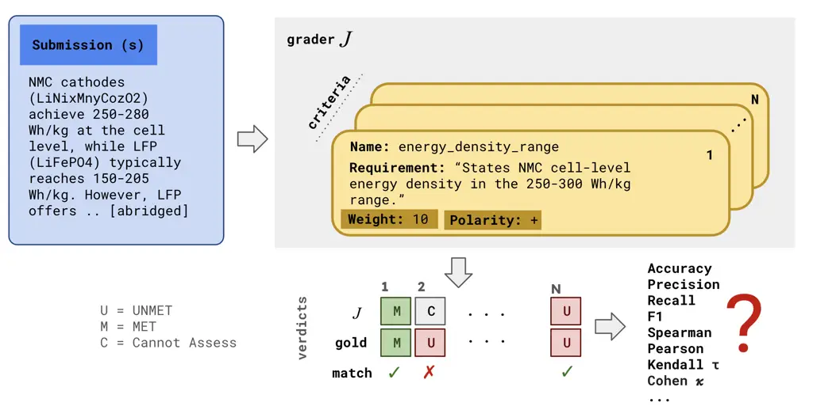
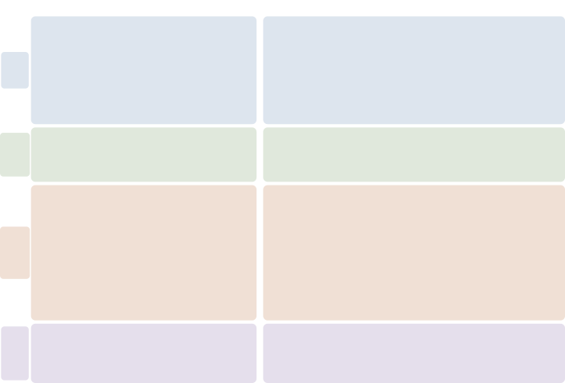

# Agreement Measurement for Rubric-based LLM Judges: What to Report and Why

Delip Rao ^(†)^(†)thanks: Corresponding author.    Chris Callison-Burch

###### Abstract

Whether a rubric-based LLM judge can replace human annotation is decided
by its measured agreement with human labels. Yet the same verdicts can
support wildly varying agreement numbers, depending on seemingly minor
choices: the judgment scale, the retained cases, the handling of
abstentions and invalid outputs, and the pooling of verdicts across
items and rubric criteria. The statistics that settle these choices are
established, but in psychometrics, econometrics, and corpus annotation
rather than in the evaluation practice that needs them. We treat the
choices as a measurement protocol that fixes what the reported number
estimates before any metric is computed, assemble the relevant results
into a single source-attributed analysis, and apply it to three
published LLM-judge evaluations. For non-degenerate binary verdicts,
Pearson’s $`r`$, Spearman’s $`\rho`$, Kendall’s $`\tau_{b}`$, the phi
coefficient, and the Matthews correlation coefficient are exactly the
same statistic, so reporting several repeats one number under different
names. Cohen’s $`\kappa`$ differs from them only through a
marginal-mismatch factor in $`(0,1]`$ and shares their asymptotic
variance when judge and human assign the positive verdict equally often.
Under exclusion, accuracy over all cases is pinned down only to a
worst-case interval as wide as the uncovered fraction. On a rubric
benchmark carrying per-criterion human labels, protocol choice alone
moves reported accuracy from $`0.551`$ to $`0.899`$ and carries
$`\kappa`$ across zero, without altering a single verdict. We distill
the analysis into a reporting checklist that makes agreement claims
reconstructible and comparable.

University of Pennsylvania

delip@seas.upenn.edu, ccb@seas.upenn.edu

## 1 Introduction



Figure 1: An agreement statistic becomes reconstructible only when it is
surrounded by its target, its evidence, its scope, and its unit of
inference. Evaluations leave these commitments implicit (Sec. 2); the
omissions move reported numbers (Secs. 4.4, 5.4, 5.5); Secs. 3–7 state
the repairs. Colors mark each card’s checklist category (Fig. 4).

Rubric-based LLM judges are validated by comparing their verdicts with
human labels, and the resulting agreement number often decides which
judge an evaluator adopts. In one public judge cascade, reconstructed
accuracy is $`0.874`$ if abstentions are excluded, about $`0.73`$ if
they are recoded, and $`0.534`$ once abstention counts as a third
verdict (Jung, Brahman, and Choi 2025). All three numbers describe the
same predictions under different handling rules, and pooling rubric
decisions instead of averaging per-criterion scores would move the
number again. Such choices look like evaluation minutiae and are often
left implicit, but they determine the question that the final number
answers. Two evaluations reporting $`0.87`$ and $`0.73`$ agreement can
therefore describe the same judge on the same predictions.

We ask what the reported number is actually measuring once abstentions,
invalid outputs, and multiple rubric criteria have been resolved, and
how far it speaks for the full evaluation set. The agreement statistics
themselves, whose lineage we review in Sec. 2, are well understood, so
we concentrate on the steps that turn raw judge verdicts into the
contingency table from which any such statistic is computed.

Our primary contribution is applying previously known but overlooked
statistical results from psychometrics, econometrics, and the
corpus-annotation literature to the emerging practice of LLM-judge
evaluation, especially with rubrics; we attribute each result where we
use it. These results settle choices that evaluators make routinely but
rarely state. We define human–LLM agreement at the protocol level,
making explicit which side may abstain and how decisions are pooled
across criteria and items (Sec. 3). We restate the binary-metric
identities and the $`\kappa`$–$`\phi`$ normalization in the form a
rubric evaluation needs, with their sampling behavior under matched
marginals (Sec. 4). We compare exclusion, negative recoding, and
three-class evaluation when either side cannot assess an item, and apply
the standard worst-case identification bound to full-set accuracy
(Sec. 5); we have not found that comparison, or the bound, in prior
LLM-judge evaluation. We then reanalyze a published self-preference
study, an abstaining judge cascade, and a rubric benchmark whose human
labels are per-criterion (Secs. 4.4, 5.4, and 5.5), and organize
aggregation and multi-judge results into a reporting checklist (Secs. 6
and 7). In the cascade, the handling rule alone moves accuracy by $`34`$
points, more than the judge-to-judge gaps such numbers usually
adjudicate; on the rubric benchmark, crossing the four protocol choices
moves it by $`34.8`$ points on one judge’s own verdicts. We provide the
cascade reconstruction in Appendix A and the full per-criterion rubric
benchmark table in Appendix B.

## 2 Related Work

Systems that use an LLM as a judge now anchor evaluation for chat
assistants, generated text, and retrieval-augmented generation (Zheng
et al. 2023; Liu et al. 2023; Gu et al. 2024), and their verdicts are
validated against human labels before the judge replaces human
annotation. Reporting practice varies widely. Our coding of 24 recent
LLM-as-judge papers by judged output scale (Tables 1–3) finds 11 graded
or continuous evaluations, most reporting correlations against human
ratings, 7 pairwise-preference evaluations with varying tie conventions,
3 binary-verdict evaluations, 2 judge ensembles, and 1 scale-matched
mix.¹¹ 1 The single scale-matched entry (Bavaresco et al. 2025) pairs
$`\kappa`$ with categorical datasets and Spearman with graded ones.
Several of the pairwise papers state a tie convention, but none frames
tie handling as part of the evaluation target.

#### Scope and procedure.

This literature scan is descriptive and non-exhaustive; it is not a
systematic review or an estimate of field-wide prevalence. The
corresponding author found the 24 papers in Tables 1–3 through Google
Scholar searches using terms related to “LLM Judge” and “LLM Judge
Rubrics.” No claim of a systematic screening protocol is made. Each
paper was coded for judged output scale, reported metrics and reporting
practice, and relevance to the analyses in this paper. The corresponding
author performed all coding. No second coder independently checked the
entries, no adjudication was conducted, and no inter-coder reliability
statistic is available. The tables should therefore be read as
illustrative literature examples and boundary cases. Each row
corresponds to one paper, identified by its principal system or paper
family. The “redundant correlation coefficients” noted in the relevance
column refer to the binary identity of Sec. 4: on non-degenerate binary
vectors, Pearson’s $`r`$, Spearman’s $`\rho`$, Kendall’s $`\tau_{b}`$,
$`\phi`$, and MCC coincide.

| \#  | Paper / system                                  | Judged output scale                                         | Metrics / reporting practice                                                        | Relevance to this paper                                                                                  |
| --- | ----------------------------------------------- | ----------------------------------------------------------- | ----------------------------------------------------------------------------------- | -------------------------------------------------------------------------------------------------------- |
| 1   | G-Eval (Liu et al. 2023)                        | Graded NLG scores                                           | Reports rank/correlation alignment with human judgments.                            | Graded  Multiple correlations are on graded scores, not raw binary verdicts.                             |
| 2   | LLM-Eval (Lin and Chen 2023)                    | Numeric multi-dimensional conversation scores               | Reports Pearson/Spearman-style score correlations.                                  | Graded  Not a binary setting.                                                                            |
| 3   | SEEval (Wu et al. 2025)                         | Real-valued NLG quality scores                              | Reports Pearson/Spearman or Spearman/Kendall depending on benchmark.                | Graded  Not a binary setting.                                                                            |
| 4   | CheckEval (Lee et al. 2025)                     | Decomposed binary checklist questions aggregated to ratings | Uses binary checklist questions, then reports aggregate score correlations.         | Binary  The binary equivalence applies to raw yes/no checklist vectors, not aggregated scores.           |
| 5   | MT-Bench / Chatbot Arena (Zheng et al. 2023)    | Pairwise A/B/tie and single-answer ratings                  | Reports judge–human agreement, with and without ties.                               | Pairwise  Relevant for tie handling; binary equivalence applies only after excluding or collapsing ties. |
| 6   | AlpacaEval / LC-AlpacaEval (Dubois et al. 2024) | Pairwise preference / win rate                              | Reports win-rate and length-controlled win-rate measures.                           | Pairwise  No redundant correlation coefficients.                                                         |
| 7   | Auto-J (Li et al. 2023)                         | Pairwise A/B/tie plus rating and critique                   | Pairwise preference can include ties.                                               | Pairwise  Tie handling is explicit, but not framed as selective prediction or CA.                        |
| 8   | PandaLM (Wang et al. 2023b)                     | Pairwise preference judging                                 | Reports $`F_{1}`$-style agreement relative to stronger judges or human preferences. | Pairwise  No redundant Pearson/Spearman/Kendall coefficients found.                                      |

Table 1: Descriptive scan of LLM-as-judge and LLM-evaluator papers,
coded by judged output scale, reported metrics, and relevance to this
paper’s analysis (papers 1–8).

| \#  | Paper / system                     | Judged output scale                                                      | Metrics / reporting practice                                                         | Relevance to this paper                                                                   |
| --- | ---------------------------------- | ------------------------------------------------------------------------ | ------------------------------------------------------------------------------------ | ----------------------------------------------------------------------------------------- |
| 9   | JudgeLM (Zhu, Wang, and Wang 2023) | Pairwise and classification-like judge settings                          | Reports agreement/accuracy-style measures.                                           | Pairwise  No redundant correlation coefficients found.                                    |
| 10  | LLMBar (Zeng et al. 2023)          | Pairwise instruction-following contrast                                  | Evaluator chooses the instruction-following output from a pair.                      | Pairwise  Motivates scale-aware metrics.                                                  |
| 11  | Prometheus (Kim et al. 2023)       | Rubric-based direct assessment and pairwise evaluation                   | Pearson on graded rubric scores; accuracy on pairwise benchmarks.                    | Graded  Mixed setting; direct assessment and binary/pairwise validation are distinct.     |
| 12  | Prometheus 2 (Kim et al. 2024)     | Direct assessment plus pairwise ranking                                  | Correlations for direct-assessment scores; agreement/accuracy for pairwise settings. | Graded  Boundary case: multiple correlations are mostly on graded scores.                 |
| 13  | FLASK (Ye et al. 2024)             | Fine-grained 1–5 skill scores                                            | Reports Pearson/Spearman/Kendall correlations.                                       | Graded  Multi-correlation example, but not binary.                                        |
| 14  | LLM-Rubric (Hashemi et al. 2024)   | Rubric-question response distributions and 1–4 satisfaction prediction   | Uses rubric dimensions and predicts overall human satisfaction.                      | Graded  Not a clean binary verdict setting in the reported overall evaluation.            |
| 15  | ARES (Saad-Falcon et al. 2023)     | RAG judge classifiers for context relevance, faithfulness, and relevance | Uses classifier-style evaluation and PPI confidence machinery.                       | Binary  Confusion-matrix and precision/recall reporting matter.                           |
| 16  | RAGAS (Es et al. 2024)             | RAG faithfulness/relevance metrics                                       | Reports agreement/validation-style quantities for RAG dimensions.                    | Binary  “Insufficient information” appears in prompts, but not as a reported CA estimand. |

Table 2: Descriptive scan of LLM-as-judge and LLM-evaluator papers,
coded by judged output scale, reported metrics, and relevance to this
paper’s analysis (papers 9–16, continued).

| \#  | Paper / system                      | Judged output scale                                       | Metrics / reporting practice                                                                                              | Relevance to this paper                                                                       |
| --- | ----------------------------------- | --------------------------------------------------------- | ------------------------------------------------------------------------------------------------------------------------- | --------------------------------------------------------------------------------------------- |
| 17  | PoLL (Verga et al. 2024)            | Panel/jury of LLM evaluators                              | Evaluates panels across multiple judge settings and datasets.                                                             | Ensemble  Multi-judge motivation; does not show panels as a production default.               |
| 18  | ChatEval (Chan et al. 2024)         | Multi-agent referee team                                  | Multi-agent discussion followed by scoring/judgment.                                                                      | Ensemble  Scale depends on task.                                                              |
| 19  | JUDGE-BENCH (Bavaresco et al. 2025) | Multiple datasets with categorical and graded annotations | Cohen’s $`\kappa`$ for categorical datasets, Spearman for graded datasets, Krippendorff’s $`\alpha`$ for human agreement. | Scale-matched  Positive example of scale-aware metric selection.                              |
| 20  | FineSurE (Song et al. 2024)         | Fine-grained summarization dimensions                     | Multi-dimensional summarization evaluation.                                                                               | Graded  More relevant to scale/criteria framing than to binary redundancy.                    |
| 21  | TIGERScore (Jiang et al. 2024)      | Trained explainable text-generation metric                | Correlation-style meta-evaluation with human ratings.                                                                     | Graded  Not binary.                                                                           |
| 22  | InstructScore (Xu et al. 2023)      | Score plus diagnostic feedback                            | Correlates generated scores with human ratings.                                                                           | Graded  Not binary.                                                                           |
| 23  | InstructEval (Chia et al. 2024)     | Holistic evaluation of instruction-tuned LLMs             | Includes Likert-style writing evaluation and task metrics.                                                                | Graded  Mostly not a binary judge-verdict setting.                                            |
| 24  | JuStRank (Gera et al. 2025)         | Pairwise/system-ranking judgments                         | Studies LLM judges as system rankers.                                                                                     | Pairwise  Relevant especially after aggregation; no redundant correlation coefficients found. |

Table 3: Descriptive scan of LLM-as-judge and LLM-evaluator papers,
coded by judged output scale, reported metrics, and relevance to this
paper’s analysis (papers 17–24, continued). The small-caps value in the
last column is a primary relevance tag, not an exhaustive or mutually
exclusive category.

Cohen’s $`\kappa`$ (Cohen 1960), the phi coefficient and its identity
with MCC (Matthews 1975), the association coefficients for $`2\times 2`$
tables and their marginal dependence (Warrens 2008; Warrens 2014), the
multi-rater statistics and their integration (Scott 1955; Fleiss 1971;
Krippendorff 2004; Conger 1980), large-sample variances (Fleiss, Cohen,
and Everitt 1969; Blackman and Koval 1993), and the prevalence problems
of $`\kappa`$ (Feinstein and Cicchetti 1990) all predate LLM evaluation
by decades. The results we apply are likewise established; only the
$`\alpha`$–$`\kappa_{F}`$ relation of Sec. 6.1 has already reached
computational linguistics, through the annotation-agreement survey of
Artstein and Poesio (2008). These results bear directly on which
agreement number to report, yet the LLM-as-judge papers in our scan
neither cite nor apply them.

Work questioning agreement reporting for LLM judges is recent. Elangovan
et al. (2025) show that one aggregate correlation obscures systematic
machine–human differences once human label uncertainty is accounted for,
and Chehbouni et al. (2025) apply measurement theory to argue that judge
validity is assumed rather than established. Binette and Reiter (2024)
adapt the clinical-trials estimands framework to AI evaluation and
exhibit rank reversals under a mis-specified target; we specialize that
framing to human–judge agreement in Sec. 3.2. Closest to our setting,
Guerdan et al. (2025) treat rating indeterminacy as a validation-design
choice and relate judge-performance measures across agreement metrics,
which is the move we make for abstention; we differ in scope, treating
the scale, selection, handling, and aggregation choices jointly. Jung,
Brahman, and Choi (2025) calibrate judge abstention and escalation to
trade coverage for lower error, and Lee et al. (2026) correct downstream
scores using judge sensitivity and specificity. These two design better
judges or correct their outputs; our analysis concerns the agreement
claim itself.

## 3 Agreement as a Measurement Protocol



Figure 2: Rubric-based LLM judging. An LLM judge $`J`$ (the grader in
the figure) grades a submission against the criteria of a rubric, each
stating a name, a requirement, a weight, and a polarity, and emits one
verdict per criterion: MET (M), UNMET (U), or CANNOT_ASSESS (C).
Comparing these verdicts with a human annotator’s gold verdicts yields
the agreement numbers whose choice, meaning, and reporting this paper
examines; the energy-density criterion shown is the running example of
Sec. 3.

We begin with rubrics with binary criteria and the verdict table of
which every metric in this paper is an explicit function. Consider
validating a rubric judge against human gold labels, one binary verdict
per criterion per submission (Fig. 2). Let $`y_{i}\in\{0,1\}`$ be the
human label and $`\hat{y}_{i}`$ the judge verdict for decision
$`i=1,\ldots,N`$, with $`1`$ denoting MET and $`0`$ UNMET; for a
criterion asking whether a submitted battery specification states a
per-cell energy density within a required range, $`\hat{y}_{i}=1`$
records that the judge found one. Their complete comparison is the
$`2\times 2`$ verdict table with cells $`TP=n_{11}`$, $`FN=n_{10}`$,
$`FP=n_{01}`$, and $`TN=n_{00}`$, where
$`n_{ab}=|\{i:y_{i}=a,\hat{y}_{i}=b\}|`$ counts decisions with human
label $`a`$ and judge verdict $`b`$, and $`N=TP+FN+FP+TN`$. We write
$`\pi=(TP+FN)/N`$ for the human MET rate, $`\hat{\pi}=(TP+FP)/N`$ for
the judge MET rate, and $`p_{o}=(TP+TN)/N`$ for accuracy, the
exact-match rate.

Each metric summarizes a different part of this table. Accuracy,
$`F_{1}`$, $`\kappa`$, and $`\phi`$/MCC are all unchanged when $`FP`$
and $`FN`$ are exchanged, while precision and recall swap values; only
the full confusion matrix distinguishes a judge that misses true
positives from one that over-predicts. Accuracy and $`\kappa`$ summarize
exact matches, $`\phi`$/MCC and the correlations summarize association,
and precision, recall, and $`F_{1}`$ describe one class. All compare the
judge with a single human reference, so they provide no evidence about
inter-judge reliability or broader construct validity. Throughout, the
table is non-degenerate: all four marginals $`TP{+}FN`$, $`FN{+}TN`$,
$`TP{+}FP`$, and $`FP{+}TN`$ are positive, so every denominator in the
identities below is nonzero. In explicit form, $`F_{1}`$ describes only
the positive class: with precision $`P=TP/(TP+FP)`$ and recall
$`R=TP/(TP+FN)`$,

```math
F_{1}=\frac{2\,P\,R}{P+R}=\frac{2\,TP}{2\,TP+FP+FN}, \tag{1}
```

which does not depend on $`TN`$ and changes when the positive and
negative labels are exchanged; the negative-class analog is
$`F_{1}^{(\texttt{UNMET})}=2\,TN/(2\,TN+FP+FN)`$, and specificity is
$`TN/(TN+FP)`$. \SOUL@setup\SOUL@Takeaway: Always show the per-criterion
$`2\times 2`$ tables alongside the metrics computed from them. Any
metric can be recomputed from a stored table, but the table cannot be
recovered from reported metrics alone.

### 3.1 Judgment Scales

Rubric-based LLM judges generalize beyond binary verdicts. Five judgment
scales recur in LLM-judge validation: binary MET/UNMET verdicts,
pairwise preference with ties, ordinal ratings, continuous quality
judgments, and nominal verdicts with abstention. Table 4 names the five
scales and the statistics each admits; the equivalence results of Sec. 4
concern the binary scale alone. An ordinal example shows how much the
choice of statistic alone can move a reported number. Consider a judge
that rates one point above the human on every item of a 1–5 ordinal
scale, $`y=(1,2,3,4)`$ and $`\hat{y}=(2,3,4,5)`$. It has perfect
Pearson, Spearman, and Kendall association but zero exact agreement;
unweighted, linear-weighted, and quadratic-weighted $`\kappa`$ are
$`-3/13`$, $`1/3`$, and $`5/7`$. Whether this judge appears worse than
chance or perfect depends on the choice of the statistic alone. A
practitioner must therefore fix the scale and its matched statistic
before computing anything.

| Judgment scale          | Examples                      | Applicable statistics                                                                                                                                              |
| ----------------------- | ----------------------------- | ------------------------------------------------------------------------------------------------------------------------------------------------------------------ |
| Binary verdict          | MET/UNMET criterion decisions | Confusion matrix and marginals; accuracy, class-conditional metrics, or $`\kappa`$ per target; at most one of $`\phi`$/MCC/Pearson/Spearman/Kendall’s $`\tau_{b}`$ |
| Pairwise preference     | A wins / B wins / tie         | An explicit tie-handling convention; after reduction to a binary outcome, the binary-identity results of Sec. 4                                                    |
| Ordinal value           | 1–5 rubric ratings            | Weighted $`\kappa`$ for category agreement under declared distance weights; Spearman and Kendall for rank association, which differs from exact agreement          |
| Continuous value        | Real-valued quality judgments | Pearson for linear association, Spearman for monotone association, Kendall for pair concordance; a scale-sensitive error measure when agreement in level matters   |
| Nominal with abstention | MET/UNMET/CA                  | A three-class agreement statistic with an explicit weight matrix, or a stated reduction mode for collapsing to two classes                                         |

Table 4: A judgment-scale taxonomy for LLM-as-judge evaluation.

\SOUL@setup\SOUL@

Takeaway: A rubric judge often emits binary criterion verdicts that a
weighted rule later combines into an item score. The verdicts and the
score sit on different judgment scales and call for different
statistics; a report should state whether its number describes the
criterion verdicts or the item score.

### 3.2 Protocols and Estimands

Beyond the choice of the judgment scale, the practitioner makes three
further choices before computing any statistic: which subset of the data
to select, how to resolve exceptions such as abstentions and invalid
generations, and how to pool or weight verdicts across criteria and
items. We collect the four choices into a _measurement protocol_
$`\mathcal{P}=(s,\mathcal{U},h,a)`$ (Fig. 1), where $`s`$ maps outputs
to a judgment scale, $`\mathcal{U}`$ is the selected population of
cases, $`h`$ specifies the handling rule for exceptions, and $`a`$
specifies the aggregation rule. When the judge, the human, or both may
abstain, for example, $`s`$ could be a binary or three-class
representation and $`h`$ could exclude, recode, or retain a
cannot-assess (CA) verdict. Under recoding or retention, $`\mathcal{U}`$
contains every case; under exclusion, it contains only the cases in
which both the human and the LLM judge returned a MET or UNMET verdict.
A judge abstains when the submission lacks the evidence a criterion asks
about; a human annotator may abstain for the same reason or because the
criterion does not apply to the submission. In our experience, current
LLM-judge evaluations rarely handle these outcomes systematically:
prompts often permit an “insufficient information” answer (Es et al. 2024) and pairwise protocols record ties (Zheng et al. 2023; Li et al.
2023), but the handling rule and its effect on the reported number are
seldom stated.

The protocol fixes the _estimand_, the quantity that the reported number
estimates. Applying $`\mathcal{P}`$ to the raw outputs yields either a
single joint distribution $`P_{\mathcal{P}}`$ over paired human–judge
values or, when criteria are scored separately and averaged with weights
$`w_{g}`$, one distribution $`P_{\mathcal{P},g}`$ per criterion $`g`$.
For statistic $`T`$, the estimand is

```math
\theta_{T,\mathcal{P}}=\begin{cases}T(P_{\mathcal{P}}),&\text{single distribution},\\
\sum_{g}w_{g}T(P_{\mathcal{P},g}),&\text{per-criterion average},\end{cases} \tag{2}
```

and replacing each population distribution with its empirical table
gives the estimate $`\hat{\theta}_{T,\mathcal{P}}`$. The two subscripts
separate the choice of statistic from the choice of protocol. Evaluation
reports name the statistic as a matter of course but often leave the
protocol implicit, and the same statistic computed under different
protocols estimates different quantities; a result is therefore
reconstructible only when both are reported. \SOUL@setup\SOUL@Takeaway:
Decide the four protocol components (the judgment scale, the selected
population, the handling rule for exceptions, and the aggregation rule)
before looking at any judge outputs, and evaluate every judge under
comparison with the same protocol. A handling rule chosen after the
results are in can be the one that gives the judge its highest agreement
number. When two judges are scored under different protocols, their
numbers estimate different quantities, and the difference between them
reflects the protocols as much as the judges.

## 4 Identities and Distinctions Among Binary Agreement Metrics

Of the estimand’s two coordinates, the statistic $`T`$ and the protocol
$`\mathcal{P}`$, we examine the statistic first. For rubrics with binary
criteria, the choice among the familiar metrics of Sec. 3 is smaller
than it appears: the five agreement metrics are one statistic, Cohen’s
$`\kappa`$ differs from them only through its normalization, and under
matched MET rates even the asymptotic sampling variances coincide.

### 4.1 Five Metrics, One Statistic

A validation report that includes several of the five metrics—Pearson’s
$`r`$, Spearman’s $`\rho`$, Kendall’s $`\tau_{b}`$, $`\phi`$, and the
Matthews correlation coefficient (MCC)—invites reading their agreement
as corroborating evidence.

###### Fact 1 (Matthews 1975; Kendall 1945; Warrens 2008)

For any pair of binary vectors $`(y,\hat{y})\in\{0,1\}^{N}`$ in which
each vector contains both labels,

```math
\rho_{\text{Pearson}}=\rho_{\text{Spearman}}=\tau_{b}=\phi=\text{MCC}. \tag{3}
```

A second coefficient from the list adds no information on binary
verdicts, and the identity is elementary to verify. For binary vectors
the Pearson correlation reduces to the phi coefficient (Matthews 1975),

```math
\phi=\frac{TP\cdot TN-FP\cdot FN}{\sqrt{(TP{+}FP)(TP{+}FN)(TN{+}FP)(TN{+}FN)}}, \tag{4}
```

which is identical to the binary Matthews correlation coefficient.

#### Spearman.

Spearman’s $`\rho`$ is Pearson’s $`r`$ computed on the rank-transformed
inputs. With only two distinct values present, all zeros receive the
common average rank $`a_{0}=(n_{0}+1)/2`$ and all ones receive
$`a_{1}=n_{0}+(n_{1}+1)/2`$, where $`n_{0},n_{1}`$ are the counts of
zeros and ones. The map $`x\mapsto a_{0}+(a_{1}-a_{0})\,x`$ is affine,
and Pearson’s $`r`$ is invariant under affine rescaling of either input,
so $`\rho_{\text{Spearman}}=\rho_{\text{Pearson}}`$.

#### Kendall’s $`\tau_{b}`$.

The tie-corrected form (Kendall 1945) is

```math
\tau_{b}=\frac{C-D}{\sqrt{(n_{\text{tot}}-n_{y})(n_{\text{tot}}-n_{\hat{y}})}}, \tag{5}
```

where $`n_{\text{tot}}=\binom{N}{2}`$ and $`n_{y},n_{\hat{y}}`$ count
pairs tied on each vector. In the $`2\times 2`$ table, concordant
cross-cell pairs number $`C=TP\cdot TN`$ and discordant pairs number
$`D=FN\cdot FP`$. The untied-pair counts are $`(TP+FN)(FP+TN)`$ for
$`y`$ and $`(TP+FP)(FN+TN)`$ for $`\hat{y}`$. Therefore,

```math
\displaystyle\tau_{b} \displaystyle=\frac{TP\cdot TN-FP\cdot FN}{\sqrt{(TP+FN)(FP+TN)}} \tag{6}
```

```math
\displaystyle\times\frac{1}{\sqrt{(TP+FP)(FN+TN)}}=\phi.
```

\SOUL@setup\SOUL@

Takeaway: Report only one of Pearson, Spearman, Kendall’s $`\tau_{b}`$,
$`\phi`$, and MCC on binary verdicts; they are interchangeable there,
and $`\phi`$/MCC is the most direct. If two of them differ in a
pipeline’s output, suspect a degenerate criterion or an implementation
error rather than judge behavior.

### 4.2 Marginal Normalization: Kappa Versus Phi

Cohen’s $`\kappa`$ falls outside the equivalence class. It discounts the
agreement expected from the marginal rates alone,
$`\kappa=(p_{o}-p_{e})/(1-p_{e})`$ with
$`p_{e}=\pi\hat{\pi}+(1-\pi)(1-\hat{\pi})`$ (Cohen 1960). Multiplying
$`\kappa`$ through by $`N^{2}`$ and canceling shared terms yields the
count form

```math
\kappa=\frac{2\,(TP\cdot TN-FP\cdot FN)}{(TP{+}FN)(FN{+}TN)+(TP{+}FP)(FP{+}TN)}, \tag{7}
```

which shares the numerator of $`\phi`$ in Eq. (4) up to a factor of two.
Writing $`A=(TP+FN)(FN+TN)`$ and $`B=(TP+FP)(FP+TN)`$, the two
denominators are $`A+B`$ and $`2\sqrt{AB}`$, and the AM–GM inequality
$`A+B\geq 2\sqrt{AB}`$, with equality iff $`A=B`$, yields the
multiplicative identity

```math
\kappa=q(\pi,\hat{\pi})\,\phi,\qquad q(\pi,\hat{\pi})=\frac{2\sqrt{AB}}{A+B}\in(0,1], \tag{8}
```

so $`|\kappa|\leq|\phi|`$. Here $`A=B`$, and with it $`q=1`$, exactly
when the judge and human MET rates coincide ($`\pi=\hat{\pi}`$), so
$`|\kappa|=|\phi|`$ when those rates match or both metrics are zero.
Otherwise $`q`$ quantifies how much marginal mismatch attenuates
$`\kappa`$ relative to $`\phi`$: a judge that orders the items exactly
as the human does but commits to a different MET rate receives a
strictly lower $`\kappa`$ than $`\phi`$. Equation (8) is due to Sahu and
Demirtas (2024) and extends a longer line on the marginal dependence of
the $`2\times 2`$ $`\kappa`$ (Warrens 2008; Warrens 2014); we restate it
because it turns a familiar complaint about $`\kappa`$ into a number an
evaluator can compute from the table already in hand.

The rescaled-accuracy form of $`\kappa`$ also explains a failure mode
familiar from rubrics with easy criteria. In the balanced case
$`\pi=\hat{\pi}=0.5`$, $`p_{e}=0.5`$ and $`\kappa=2\,p_{o}-1`$. For a
criterion that nearly every response meets, both marginals approach
$`1`$, $`p_{e}\to 1`$, and high raw agreement can then coexist with much
lower chance-corrected agreement, a form of the _kappa paradox_
discussed by Feinstein and Cicchetti (1990).²² 2 Alternative chance
corrections substitute different baselines (Brennan and Prediger 1981;
Gwet 2008; Byrt, Bishop, and Carlin 1993); none removes the need for the
marginals and the contingency table. \SOUL@setup\SOUL@Takeaway: Before
reading a low $`\kappa`$ as a bad judge, check the
MET
rates: on rubric criteria that nearly all submissions meet or fail,
$`\kappa`$ is attenuated by construction. Compare $`\kappa`$ across
criteria only when their
MET
rates are comparable, and report the human and judge rates with every
$`\kappa`$.

### 4.3 Sampling Variance under Matched Marginals

Sampling variance completes the comparison: for multinomial sampling of
a non-degenerate table with matched MET rates, $`\hat{\kappa}`$ and
$`\hat{\phi}`$/MCC also share the same asymptotic variance, a
consequence of $`q`$ being stationary at $`\pi=\hat{\pi}`$. To derive
it, let $`\mathbf{p}=(p_{11},p_{10},p_{01},p_{00})^{\top}`$ denote the
table’s population cell-probability vector. Both $`\kappa`$ and $`\phi`$
are ratios of polynomials in $`\mathbf{p}`$ whose denominators are
nonzero at any non-degenerate table, so both are continuously
differentiable in a neighborhood of $`\mathbf{p}`$ and the delta method
applies. On the matched-marginals slice $`p_{10}=p_{01}`$, both metrics
reduce to the same function,
$`\kappa=\phi=1-p_{10}/(p_{1\cdot}p_{0\cdot})`$. Their gradients
therefore agree along the two tangent directions of that slice. The
slice-orthogonal direction $`(0,+1,-1,0)`$ swaps $`p_{10}`$ and
$`p_{01}`$; both metrics are symmetric and stationary under this swap.
Thus, the two four-dimensional gradients can differ only along the
simplex normal $`\mathbf{1}`$. The multinomial covariance

```math
\Sigma=N^{-1}\!\left(\operatorname{diag}(\mathbf{p})-\mathbf{p}\mathbf{p}^{\top}\right) \tag{9}
```

satisfies $`\Sigma\mathbf{1}=0`$, so the delta-method quadratic forms
$`\nabla\kappa^{\top}\Sigma\nabla\kappa`$ and
$`\nabla\phi^{\top}\Sigma\nabla\phi`$ coincide. This gives the claimed
equality
$`N\operatorname{AVar}(\hat{\kappa})=N\operatorname{AVar}(\hat{\phi})`$.
Because both estimators are ratios of multinomial counts, the statement
is about their limiting distribution: at finite $`N`$ a marginal can be
degenerate with positive probability, leaving $`\hat{\phi}`$ undefined.

Matched marginals means that the judge and the human assign MET equally
often; it does not mean that they agree item by item. The equality is
also pointwise, offering no guarantee when the two MET rates differ. In
rubric evaluation the unit of analysis is rarely an isolated criterion
decision: criteria are clustered within items (multiple criteria per
submission), within prompts or rubrics (multiple items sharing a
rubric), and within judges (in an ensemble, multiple decisions by the
same model). A flat decision-level resample understates uncertainty when
within-cluster correlations are positive, as is the norm when a single
judge mistake propagates across the criteria of one item. In practice an
item-level or hierarchical cluster bootstrap (resample items, then
optionally criteria within items) supports judge comparisons, with
undefined replicates reported; standard implementations are available in
the survey-statistics literature (Field and Welsh 2007).

As a numerical check of the equality, cell probabilities
$`(0.4,0.1,0.1,0.4)`$ give $`\kappa=\phi=0.6`$ and
$`\operatorname{Var}(\hat{\kappa})=\operatorname{Var}(\hat{\phi})=0.640/N`$
under the multinomial delta method (Fleiss, Cohen, and Everitt 1969);
treating these binary values as continuous produces the incorrect
$`0.41/N`$.

A further numerical check locates the equality’s boundary. Off matched
marginals the variances diverge by a second-order term: at
$`(0.4,0.1,0.2,0.3)`$, where $`\pi=0.5`$, $`\hat{\pi}=0.6`$,
$`\kappa=0.400`$, and $`\phi=1/\sqrt{6}\approx 0.408`$, the delta method
gives $`\operatorname{Var}(\hat{\kappa})=504/(625N)\approx 0.806/N`$ and
$`\operatorname{Var}(\hat{\phi})=13/(16N)\approx 0.813/N`$; the variance
gap is second-order in the marginal mismatch, mirroring the pointwise
gap. re \SOUL@setup\SOUL@Takeaway: Rank judges only with an uncertainty
estimate attached; at $`N=300`$ binary decisions the delta-method
standard error of $`\hat{\kappa}`$ falls between $`0.04`$ and $`0.06`$
for most tables, so gaps of a few points are within sampling noise.
Resample whole items rather than individual verdicts, and avoid variance
formulas built for continuous values.

p

### 4.4 Identities and Distinctions in a Published Evaluation

A metric can be structurally unable to detect the failure an evaluator
is looking for. As a case study, consider the paper of Wataoka,
Takahashi, and Ri (2024) on self-preference bias, the tendency of a
judge to favor its own generations (Panickssery, Bowman, and Feng
2024).³³ 3 We are not singling out this work; it is a well-cited example
chosen for illustration. The source excludes format-noncompliant outputs
but does not report how Chatbot Arena ties were handled in this binary
table. The paper reports a human–GPT-4 win/lose table (their Fig. 2),
derived from position-swap-averaged judge probabilities, for GPT-4
judging comparisons that involve its own outputs, and bases its
conclusions on the two class recalls; the statistics we present are our
reanalysis. Taking “GPT-4’s own output wins” as positive gives the
verdict table $`TP=1{,}852`$, $`FN=108`$, $`FP=160`$, $`TN=118`$ over
$`N=2{,}238`$ comparisons: accuracy $`0.880`$ and $`F_{1}=0.933`$,
against $`0.876`$ and $`0.934`$ for a baseline that always declares
GPT-4 the winner. By accuracy and by $`F_{1}`$, which ignores $`TN`$,
the judge is indistinguishable from that baseline. The agreement metrics
separate them: Pearson’s $`r`$, Spearman’s $`\rho`$, Kendall’s
$`\tau_{b}`$, $`\phi`$, and MCC are each $`0.404`$, as Fact 1 requires,
and $`\kappa=0.402`$; the small gap follows from the nearly matched
marginals of Eq. (8). The baseline has $`\kappa=0`$ and undefined
$`\phi`$, while the judge’s specificity on human-labeled losses is
$`0.424`$; the failure is concentrated on a class that is $`12.4\%`$ of
the data and invisible to $`F_{1}`$. The source’s own bias measure is
the gap between the two class recalls, $`0.945`$ against $`0.424`$,
about $`0.52`$, which it frames as an equal-opportunity difference; that
contrast is class-conditional and answers a different question from the
agreement metrics above. Each reading summarizes the same $`2{,}238`$
verdicts; the disagreement comes entirely from which cells of the table
each metric uses.

#### Significance analysis.

The judge and the always-positive baseline are compared on the same
$`2{,}238`$ paired decisions, so paired accuracy is tested with
McNemar’s exact test (McNemar 1947) on the discordant counts
$`(118,108)`$: $`p=0.549`$, and accuracy does not distinguish the judge
from the baseline. The agreement metrics separate them with uncertainty
attached: resampling the $`2{,}238`$ decisions with replacement
($`10^{4}`$ replicates, none undefined) gives percentile intervals of
$`[0.346,0.463]`$ for the judge’s $`\phi=0.404`$ and $`[0.343,0.460]`$
for $`\kappa=0.402`$; both intervals exclude the baseline’s structural
$`\kappa=0`$.

## 5 Handling Abstention

The binary analysis assumed that humans and LLM judges always choose MET
or UNMET when evaluating an input against a criterion. However, it is
good practice—for both humans and LLMs—to abstain from a judgment by
producing a CANNOT_ASSESS (CA) response to avoid making a forced
choice.⁴⁴ 4 Equivalent labels in the literature include IDK, REFUSE, and
ABSTAIN. A judge cannot assess that energy-density criterion, for
example, when the specification states no per-cell density at all. A CA
output carries information that UNMET does not, and the practitioner
must decide what it represents before computing agreement.

### 5.1 Abstention Handling Modes

Let $`\mathcal{D}=\{(y_{i},\hat{y}_{i})\}_{i=1}^{N}`$ with
$`y_{i},\hat{y}_{i}\in\{\texttt{MET},\texttt{UNMET},\texttt{CA}\}`$.
Three handling rules recur, and each targets a different estimand.

Exclusion: Introduce latent forced-choice verdicts
$`y_{i}^{*},\hat{y}_{i}^{*}\in\{0,1\}`$ and abstention indicators
$`m_{i},\hat{m}_{i}\in\{0,1\}`$. The observed value is
$`y_{i}=y_{i}^{*}`$ when $`m_{i}=0`$ and $`y_{i}=\texttt{CA}`$
otherwise, symmetrically for the judge. Exclusion discards a pair when
either side abstains. For statistic $`T`$, exclusion targets
$`T\bigl(\mathbb{P}_{(y^{*},\hat{y}^{*})\,\mid\,m=0\,\wedge\,\hat{m}=0}\bigr)`$,
agreement conditional on neither side abstaining; it describes all cases
only under additional assumptions taken up in Sec. 5.2. If CA means that
the criterion is genuinely inapplicable, with no latent binary verdict
behind it, a three-class representation or an explicitly restricted
population is the better match.

Negative recoding: Map CANNOT_ASSESS to UNMET in both vectors, then
compute the binary metric. This is a valid one-versus-rest reduction
when the target is MET versus non-MET; it no longer distinguishes CA
from UNMET, so the negative label changes meaning. Recoding also makes
an abstaining judge and a committing judge indistinguishable: one that
abstains on uncertain negatives and one that answers UNMET on the same
cases receive identical scores, and under a training objective that
rewards calibrated abstention, as in selective prediction, the recoding
erases the very signal the objective conditions on.

Three-class retention: Retain CANNOT_ASSESS as a distinct category and
report a $`3\times 3`$ agreement metric such as multi-class accuracy,
multi-class Cohen’s $`\kappa`$ (Conger 1980), or a weighted variant
whose weights state how costly each type of disagreement is.

| \(a\) Verdict counts                            |                      |       |            |                            |
| ----------------------------------------------- | -------------------- | ----- | ---------- | -------------------------- |
| $`y\backslash\hat{y}`$                          | MET                  | UNMET | Total      |                            |
| MET                                             | 1,003                | 181   | 1,184      |                            |
| UNMET                                           | 420                  | 97    | 517        |                            |
| CA                                              | 242                  | 64    | 306        |                            |
| Total                                           | 1,665                | 342   | 2,007      |                            |
| \(b\) Statistics under the three handling rules |                      |       |            |                            |
| Rule                                            | $`N_{\mathrm{eff}}`$ | Acc   | $`\kappa`$ | $`F_{1}^{(\texttt{MET})}`$ |
| Exclusion                                       | 1,701                | 0.647 | 0.040      | 0.769                      |
| Recoding                                        | 2,007                | 0.580 | 0.047      | 0.704                      |
| Three-class                                     | 2,007                | 0.548 | 0.032      | n/a                        |

Table 5: The $`2{,}007`$ rubric decisions of Hashemi et al. (2024) (most
probable option as the verdict, MET $`=`$ rating $`\geq 3`$) evaluated
under three abstention-handling rules; recoding maps CA to UNMET. Only
the human abstains, so the judge has no CA column.

We apply all three rules to one set of real rubric decisions (Table 5):
nine criteria scored on $`223`$ human–AI dialogues by a human annotator
and by an LLM judge (Hashemi et al. 2024), in which the human may record
that a criterion does not apply and the judge is forced to choose. We
analyze this benchmark in Sec. 5.5; here it supplies the counts. The
rules produce different numbers because they change the scored
population or the category space. Exclusion conditions on the
$`1{,}701`$ decisions the human scored, whereas recoding scores all
$`2{,}007`$ after merging CA with UNMET; three-class accuracy and
$`\kappa`$ retain the full category space. Binary
$`F_{1}^{(\texttt{MET})}`$ applies only after a binary reduction.
Accuracy moves $`10`$ points across the three rules while $`\kappa`$
moves by $`0.015`$: which rule is chosen matters more for one summary
than for the other, and neither ordering is a property of the judge.

Recoding carries one exact invariance, specific to MET-class $`F_{1}`$.

###### Proposition 1

Let $`n_{ij}`$, $`i,j\in\{1,0,C\}`$, be a $`3\times 3`$ verdict table
with human rows and judge columns, where $`1`$ denotes MET, $`0`$
denotes UNMET, and $`C`$ denotes CA, and form the $`2\times 2`$ table
that merges $`C`$ into $`0`$ in both vectors. The MET-class $`F_{1}`$ of
the merged table equals the one-versus-rest MET-class $`F_{1}`$ of the
original table.

_Proof._ Both quantities equal $`2n_{11}/(2n_{11}+f_{p}+f_{n})`$ with
$`f_{p}=n_{01}+n_{C1}`$ and $`f_{n}=n_{10}+n_{1C}`$, because merging
$`C`$ into $`0`$ changes neither the $`n_{11}`$ cell nor which pairs
count as false positives or false negatives with respect to MET.
Accuracy and $`\kappa`$ depend in addition on the merged
negative–negative cell, so they have no such invariance. $`\square`$

With three labels the binary identity also breaks: Fact 1 relies on each
vector having exactly two values. The statistic and the disagreement
costs are therefore modeling choices. Fact 1 also fails on binary data
when a marginal is constant, but the two failures differ: a degenerate
marginal can be repaired by dropping or flagging the criterion, while
the three-class break persists under every encoding.

###### Proposition 2

On three-valued vectors the product-moment and rank statistics need not
coincide: there exist $`y,\hat{y}\in\{0,1,2\}^{6}`$ on which Pearson’s
$`r`$, Spearman’s $`\rho`$, and Kendall’s $`\tau_{b}`$ are pairwise
distinct.

_Proof._ For $`y=(0,1,2,2,0,2)`$ and $`\hat{y}=(0,2,1,2,2,0)`$, direct
computation gives $`r=-0.0345`$, $`\rho=-0.0833`$, and
$`\tau_{b}=-0.0909`$; the ancillary code recomputes all three.
$`\square`$

Under an ordinal encoding $`\{0,\tfrac{1}{2},1\}`$ for
$`\{\texttt{UNMET},\texttt{CA},\texttt{MET}\}`$, the average-rank map is
affine only when the UNMET and MET counts are equal, so Spearman and
Pearson generally differ. The phi coefficient has no canonical
$`3\times 3`$ analog, and multi-class MCC (Gorodkin 2004) is neither
Pearson on an encoding nor Kendall’s $`\tau_{b}`$. For judge panels
(Sec. 6.1), average pairwise Spearman and $`\tau_{b}`$ on three-valued
data separate as well; their values depend on the full pairwise
three-category contingency tables, including judge-specific marginals
and tie structure. \SOUL@setup\SOUL@Takeaway: Choose the handling rule
from what
CA
means in the rubric, not from convenience: exclusion when a hidden
MET/UNMET
answer exists, a restricted population or three classes when the
criterion can be genuinely inapplicable, recoding only when the target
is
MET
versus everything else. Numbers computed under different handling rules
are not comparable, even on the same verdicts (Table 5).

### 5.2 Coverage and Bounds on Full-Set Accuracy

An accuracy of $`0.90`$ is less informative if the judge abstains on
half the cases, which is why selective-prediction papers report
performance together with coverage (Chow 1970; El-Yaniv and Wiener 2010;
Kamath, Jia, and Liang 2020; Xin et al. 2021; Kadavath et al. 2022).
Judge coverage is $`\Pr[\hat{m}=0]`$; when the human labels may also
abstain, the relevant quantity for exclusion is joint coverage,
$`\gamma=\Pr[m=0\wedge\hat{m}=0]`$, the probability that neither side
abstains.

Coverage and covered accuracy together still leave the full evaluation
set underdetermined. For $`0<\gamma<1`$, let
$`A_{\mathrm{cov}}=\Pr(y^{*}=\hat{y}^{*}\mid m=0\wedge\hat{m}=0)`$ be
accuracy on covered cases, and write $`A_{\mathrm{uncov}}`$ for the
unobserved accuracy on the remaining cases. Then

```math
\begin{split}A_{\mathrm{full}}&=\gamma A_{\mathrm{cov}}+(1-\gamma)A_{\mathrm{uncov}},\\
A_{\mathrm{full}}&\in[\gamma A_{\mathrm{cov}},\;\gamma A_{\mathrm{cov}}+1-\gamma].\end{split} \tag{10}
```

The range is sharp: the lower endpoint treats every uncovered pair as a
disagreement, the upper endpoint treats every uncovered pair as an
agreement, and the width is exactly the uncovered fraction $`1-\gamma`$.
Equation (10) is the worst-case identification bound for a bounded
outcome with missing data, specialized to a $`0/1`$ agreement indicator
with abstention as the missingness mechanism (Manski 1989; Manski 2003).
The selective-prediction papers cited above pair risk with coverage but,
as far as we have found, none states the induced bound on full-set
performance, and LLM-judge evaluations report covered accuracy without
either.

The interval captures identification uncertainty, what the observed
table cannot pin down about how CA cases would have resolved. Sampling
uncertainty is separate; a cluster bootstrap is still needed for it.
\SOUL@setup\SOUL@Takeaway: Never report covered accuracy without joint
coverage: at coverage $`\gamma`$, full-set accuracy is known only to an
interval of width $`1-\gamma`$, whatever the covered accuracy is. A
judge that answers $`60\%`$ of cases at $`0.90`$ covered accuracy
guarantees a full-set accuracy of only $`0.54`$.

### 5.3 Exact Finite-Allocation Bounds

The closed form of Eq. (10) is specific to accuracy; an exact empirical
bound for any binary-table metric follows by enumeration. Let $`n_{ij}`$
be an observed $`3\times 3`$ table with human rows and judge columns
indexed by $`i,j\in\{0,1,C\}`$, where $`C`$ denotes CA, and consider the
compatible latent binary allocations of the five cells containing $`C`$.
Initialize the latent $`2\times 2`$ table as

```math
M=\begin{pmatrix}a&b\\
c&d\end{pmatrix}=\begin{pmatrix}n_{00}&n_{01}\\
n_{10}&n_{11}\end{pmatrix}, \tag{11}
```

with human labels as rows and judge labels as columns. Then enumerate

```math
\displaystyle x_{0C} \displaystyle=0,\ldots,n_{0C}, \displaystyle x_{1C} \displaystyle=0,\ldots,n_{1C}, \tag{12}
```

```math
\displaystyle x_{C0} \displaystyle=0,\ldots,n_{C0}, \displaystyle x_{C1} \displaystyle=0,\ldots,n_{C1}, \tag{13}
```

and every nonnegative quadruple $`(z_{00},z_{01},z_{10},z_{11})`$
satisfying $`\sum_{h,j}z_{hj}=n_{CC}`$. Here $`x_{0C}`$ and $`x_{1C}`$
count allocations to latent judge label 1, while $`x_{C0}`$ and
$`x_{C1}`$ count allocations to latent human label 1. For each
allocation, form

```math
\displaystyle a^{\prime} \displaystyle=a+(n_{0C}-x_{0C})+(n_{C0}-x_{C0})+z_{00}, \tag{14}
```

```math
\displaystyle b^{\prime} \displaystyle=b+x_{0C}+(n_{C1}-x_{C1})+z_{01}, \tag{15}
```

```math
\displaystyle c^{\prime} \displaystyle=c+(n_{1C}-x_{1C})+x_{C0}+z_{10}, \tag{16}
```

```math
\displaystyle d^{\prime} \displaystyle=d+x_{1C}+x_{C1}+z_{11}. \tag{17}
```

This enumeration has

```math
(n_{0C}+1)(n_{1C}+1)(n_{C0}+1)(n_{C1}+1)\binom{n_{CC}+3}{3} \tag{18}
```

candidate allocations before duplicate $`2\times 2`$ tables are
collapsed.

For each resulting table, evaluate the desired metric when its
denominator is nonzero: with
$`(a^{\prime},b^{\prime},c^{\prime},d^{\prime})`$ in the roles of
$`(TN,FP,FN,TP)`$, the positive-class $`F_{1}`$, $`\kappa`$, and
$`\phi`$ follow from Eq. (1), the count form of Sec. 4.2, and Eq. (4).
The minimum and maximum over all defined candidate values are the sharp
empirical bounds. If no compatible allocation defines a metric, its
bound is undefined. The same procedure applies to accuracy or any
statistic computed from a binary confusion table.

Like Eq. (10), these ranges are identification bounds, now conditional
on the observed $`3\times 3`$ counts and applied cell by cell rather
than to a single bounded outcome. Sampling intervals require an
additional procedure, such as resampling items and recomputing both
allocation extrema on every bootstrap sample. Reporting a bootstrap
interval without the conditional identification range, or reporting the
identification range as a confidence interval, conflates the two sources
of uncertainty.

For the $`2{,}007`$-decision rubric counts of Table 5, in which only the
human abstains ($`n_{0C}=n_{1C}=n_{CC}=0`$), joint coverage
$`\gamma=0.848`$ and covered accuracy $`0.647`$ give the sharp accuracy
range $`[0.548,0.701]`$; the recoded accuracy $`0.580`$ lies inside this
range while estimating a different quantity.

If the abstention indicators are conditionally independent of the latent
verdicts given observed features $`X`$, written
$`(m,\hat{m})\mathrel{\perp\!\!\!\perp}(y^{*},\hat{y}^{*})\mid X`$, and
every case is covered with positive probability,
$`\Pr[m=0\wedge\hat{m}=0\mid X]>0`$ almost surely, then reweighting
covered cases by $`1/\Pr[m=0\wedge\hat{m}=0\mid X]`$ (standardization or
inverse-probability weighting) recovers the full latent table (Little
and Rubin 2019).

### 5.4 Example: Handling Rules and Bounds

As a case study in how the handling rule alone moves the reported
number, we now complete the reconstruction behind the three accuracies
that opened this paper. Jung, Brahman, and Choi (2025) build a judge
cascade that answers with a cheap model when it is confident and
escalates or abstains otherwise, trading coverage for accuracy. Their
public release includes human preferences and judge probabilities for
$`4{,}718`$ test pairs, from which we rebuild the full verdict table
(Appendix A); the cascade returns a verdict on $`2{,}886`$ of them, for
joint coverage $`\gamma=0.612`$. The $`0.874`$ is covered accuracy,
agreement restricted to those pairs; the $`0.73`$ is the recoded
accuracy, $`0.730`$ or $`0.727`$ depending on which pairwise option
absorbs the abstentions; the $`0.534`$ is three-class accuracy.⁵⁵ 5 The
other metrics move in step (Appendix A); covered $`\kappa=\phi`$ because
the two marginal rates are nearly equal (Eq. (8)). The quantity still
missing is the bound: with $`\gamma=0.612`$ and
$`A_{\mathrm{cov}}=0.874`$, Eq. (10) confines full-set forced-choice
accuracy to $`[0.534,0.923]`$; the lower endpoint equals the three-class
accuracy because, with only the cascade abstaining, every abstention
counts as a disagreement in both.

These four numbers describe one calibration/test partition, the one the
release ships. Redrawing that partition at the released sizes
$`1{,}000`$ times and rerunning the released calibration and decision
rule on each (Appendix A) leaves coverage anywhere between $`0.412`$ and
$`0.818`$ (median $`0.628`$) and covered accuracy between $`0.829`$ and
$`0.936`$ (median $`0.883`$). The pairing of $`0.874`$ with
$`\gamma=0.612`$ is therefore a property of one draw, not of the
cascade: a different split would yield a different pair, and neither the
split nor its effect is recoverable from the published number alone.

### 5.5 A Rubric Benchmark with Human Abstention

Figure 3: Per-criterion agreement between a GPT-3.5-turbo-16k judge and
a human annotator on the nine rubric criteria of Hashemi et al. (2024),
under the reference protocol (most probable option as the verdict, MET
$`=`$ rating $`\geq 3`$, human abstentions excluded). Coverage is the
fraction of the $`223`$ dialogues the human scored for that criterion.
Blue dumbbell segments mark a higher judge MET rate, orange a lower one;
cell shading scales with magnitude, zero-centered for $`\kappa`$ and
$`\phi`$. Hatched cells mark the undefined $`\phi`$ on Q4 and Q5, where
the judge never returns UNMET, reported as NA rather than $`0`$.
Appendix B tabulates the exact values.

The cascade is pairwise, and the side that abstains is the judge. We
turn now to per-criterion rubric judgments in which the side that
abstains is the human. Hashemi et al. (2024) release, for $`223`$
human–AI dialogues, nine rubric criteria rated $`1`$–$`4`$ by a human
annotator and independently by a GPT-3.5-turbo-16k judge that emits a
probability over the same four options: $`2{,}007`$ paired per-criterion
decisions. A human rating of $`0`$ records that the criterion does not
apply, so the human abstains on $`306`$ decisions ($`15.2\%`$), while
the judge is forced-choice and never abstains. Reading a rating of $`3`$
or $`4`$ as MET and the judge’s most probable option as its verdict, we
obtain the per-criterion tables of Fig. 3.

The per-criterion tables show what a pooled number hides. The judge’s
MET rate exceeds the human’s on eight of the nine criteria and reaches
$`1.000`$ on Q4 and Q5, where it never returns UNMET; $`\phi`$ is
undefined on those two, and entering $`0`$ for it rather than NA would
quietly bias any average over criteria. Q6 runs the other way, a human
MET rate of $`0.915`$ against the judge’s $`0.309`$, and it is there
that the marginal-mismatch factor of Eq. (8) does its work. Coverage is
itself a per-criterion quantity, ranging from $`0.655`$ to $`1.000`$ as
the human declines to score some criteria far more often than others.
Across the nine criteria $`\kappa`$ runs from $`-0.051`$ to $`0.064`$:
this judge and this annotator agree at about chance everywhere, which is
the finding.

The protocol is a choice at four points: verdict extraction (the judge’s
most probable option, or the sampled option shipped with the release)
and the MET threshold ($`\geq 2`$, $`\geq 3`$, $`\geq 4`$), both within
$`s`$; the abstention rule $`h`$ (exclusion or recoding); and the
aggregation level $`a`$ (micro or macro). Crossing them gives $`24`$
protocols on the same $`2{,}007`$ verdicts. Reported accuracy across
them runs from $`0.551`$ to $`0.899`$, a spread of $`34.8`$ points.
Extraction alone changes $`703`$ of the $`2{,}007`$ verdicts ($`35\%`$),
and the release documents no choice between the two options.
Chance-corrected agreement moves less in absolute terms but changes
sign, $`-0.067`$ to $`0.068`$; because this judge’s agreement is near
zero under every protocol, that interval is better read as a near-null
effect reported with either sign than as a disagreement about the
judge’s quality. The accuracy spread is the substantive quantity, and it
is of the same order as the $`34`$ points separating the handling rules
on the cascade’s released split (Sec. 5.4), on entirely different data.
\SOUL@setup\SOUL@Takeaway: On real rubric data, the four protocol
choices move reported accuracy by $`34.8`$ points and move $`\kappa`$
across zero, without touching a single verdict. Report the protocol
before the number, and report per-criterion tables: pooled agreement
here conceals two criteria on which the judge never returns
UNMET
and $`\phi`$ does not exist.

## 6 Aggregating Criteria, Items, and Judges



Figure 4: Reporting checklist for reconstructible LLM-judge agreement
claims; Sec. 7 discusses each item.

Because a rubric benchmark produces several criterion verdicts per item,
validating a judge requires deciding what one observation is.
_Micro-averaging_ pools every item–criterion verdict before computing
the metric. _Macro-averaging_ computes a separate score for each
criterion and averages those scores with declared weights. _Item-level
aggregation_ first combines an item’s criterion verdicts into one score,
using the rubric’s weights and decision rule, and then measures
agreement on items.

The rubric benchmark of Sec. 5.5 shows the effect. Pooling its
$`1{,}701`$ covered decisions gives micro-$`\kappa=0.040`$; averaging
the nine per-criterion values of Fig. 3 gives macro-$`\kappa=0.009`$,
smaller by a factor of more than four. The two summaries weight
different things: pooling weights decisions, so criteria the human
scored most often dominate, while the macro average weights criteria
equally and therefore carries the five criteria whose $`\kappa`$ is zero
or negative. Neither summary reveals the range those nine values span,
$`-0.051`$ to $`0.064`$, and neither records that $`\phi`$ does not
exist on two of them. Both summaries happen to support the same
conclusion about this judge, because both are near zero; the choice
bites when two judges are ranked, where the level rather than the sign
decides. Item-level $`\kappa`$ additionally requires each item’s full
set of criterion verdicts and a reduction rule; the handling of
degenerate single-label criteria, the included/total denominator, and
the resampling unit all belong in the report (Fig. 4).
\SOUL@setup\SOUL@Takeaway: Report the aggregation level with the number,
and never compare judges across levels. A gap between micro and macro
estimates signals that agreement varies across criteria; inspect the
per-criterion tables before trusting either average.

### 6.1 Agreement Within Judge Ensembles

Evaluation harnesses often ensemble several judges to reduce prompt
sensitivity and model-specific effects (Wang et al. 2023a; Verga et al.
2024; Bavaresco et al. 2025; Rao and Callison-Burch 2026). Here we
measure agreement _among the member judges_; validating an ensemble’s
final vote against a human reference is the problem of the preceding
sections. Inter-judge disagreement may reflect rubric ambiguity,
judge-specific bias, or sampling instability, and a single number alone
cannot separate these causes. For $`R\geq 2`$ judges rating each case,
common choices include Fleiss’ $`\kappa`$ (Fleiss 1971) and
Krippendorff’s $`\alpha`$ (Krippendorff 2004).

Assume a complete $`N\times R`$ matrix of binary verdicts with nominal
disagreement. Let $`\hat{y}_{ij}\in\{0,1\}`$ denote judge $`j`$’s
verdict on item $`i`$, and let $`r_{i}=\sum_{j=1}^{R}\hat{y}_{ij}`$.
With global rates $`p_{1}=(NR)^{-1}\sum_{i}r_{i}`$ and
$`p_{0}=1-p_{1}`$, Fleiss’ $`\kappa`$ has observed pairwise agreement

```math
P_{o}=\frac{1}{NR(R-1)}\sum_{i=1}^{N}\bigl[r_{i}(r_{i}-1)+(R-r_{i})(R-r_{i}-1)\bigr] \tag{19}
```

and expected agreement $`P_{e}=p_{0}^{2}+p_{1}^{2}`$, giving
$`\kappa_{F}=(P_{o}-P_{e})/(1-P_{e})`$ (Fleiss 1971); $`\kappa_{F}`$ is
the multi-rater generalization of Scott’s $`\pi`$ (Scott 1955).
Krippendorff’s $`\alpha`$ on the same data uses observed disagreement
$`D_{o}=1-P_{o}`$ and expected disagreement
$`D_{e}=(1-P_{e})\cdot NR/(NR-1)`$, where the factor $`NR/(NR-1)`$ is a
finite-sample correction (Krippendorff 2004). The two statistics
determine each other.

###### Fact 2 (Artstein and Poesio 2008)

On complete data with $`R`$ judges and $`N`$ items under nominal
disagreement,

```math
\alpha=\kappa_{F}+\frac{1-\kappa_{F}}{NR}, \tag{20}
```

so $`\alpha\geq\kappa_{F}`$, with equality iff $`\kappa_{F}=1`$, and
$`\alpha\to\kappa_{F}`$ as $`N\to\infty`$.

That $`D_{o}`$ is the complement of Fleiss’ observed agreement, and that
the expected disagreements differ only by this factor, are established
by Artstein and Poesio (2008). Substituting these definitions into
$`\alpha=1-D_{o}/D_{e}`$ and using $`1-P_{o}=(1-\kappa_{F})(1-P_{e})`$,
which restates the definition of $`\kappa_{F}`$,

```math
\displaystyle\alpha \displaystyle=1-\frac{NR-1}{NR}\cdot\frac{1-P_{o}}{1-P_{e}}=1-\frac{NR-1}{NR}\,(1-\kappa_{F})
```

```math
\displaystyle=\kappa_{F}+\frac{1-\kappa_{F}}{NR},
```

which is the identity of Eq. (20). Simulation studies report the same
convergence without the closed form (Zapf et al. 2016).

Fact 2 only restates the documented $`\alpha`$–$`\kappa_{F}`$
relationship in closed form; it isolates the finite-sample difference
between $`\alpha`$ and $`\kappa_{F}`$: for typical values
($`\kappa_{F}=0.6`$, $`N=100`$, $`R=3`$) the difference is about
$`1.3\times 10^{-3}`$, below the two decimal places at which agreement
coefficients are typically reported, but a report should still name
which convention it uses. On binary panels Fact 1 applies to each judge
pair, and the average pairwise $`\phi`$ coincides with $`\kappa_{F}`$
exactly when all judges share the same marginal MET rate (Conger 1980);
without matched marginals the statistics measure different association
structure and should be accompanied by judge-specific marginals or
confusion matrices. With three or more categories the identity of
Eq. (20) extends but the binary equivalences do not.

Average pairwise Pearson requires a numeric encoding of $`\{`$MET,
UNMET, CA$`\}`$; the result depends on the encoding (e.g.,
$`\{1,0,1/2\}`$ versus deleting CA pairs), and no encoding is canonical.
Fleiss’ $`\kappa`$ on three nominal categories weights MET–UNMET and
MET–CA confusions equally, while Krippendorff’s $`\alpha`$ with a
quadratic-ordinal $`\delta`$-function gives MET–UNMET greater weight
than MET–CA, which encodes the assumption that CA is intermediate; two
defensible cost choices can therefore reverse a ranking of judge
ensembles purely through their disagreement functions.

The three-class setup determines no application-independent statistic
until disagreement costs are chosen: for values $`s=(0,1/2,1)`$ assigned
to $`(\texttt{UNMET},\texttt{CA},\texttt{MET})`$, nominal, linear, and
quadratic costs are $`D_{ab}=\mathbf{1}[a\neq b]`$, $`|s_{a}-s_{b}|`$,
and $`(s_{a}-s_{b})^{2}`$. A complete report states the cost matrix
$`D`$ before any three-class agreement statistic, justifies it from
application losses, and includes sensitivity to plausible alternatives
and the per-judge $`3\times 3`$ tables (checklist item 9, Fig. 4).
\SOUL@setup\SOUL@Takeaway: Agreement among ensemble members can be high
while every member shares the same bias, so it never substitutes for
validation against a human reference. When reporting it, name the
convention: on the same panel, Krippendorff’s $`\alpha`$ exceeds Fleiss’
$`\kappa`$ by a finite-sample term that vanishes only as the panel
grows.

## 7 A Reporting Checklist

Figure 4 collects the practices that let a reader reconstruct an
agreement claim: its target, its evidence, its scope, and its unit of
inference. Because judges compared under different protocols can differ
in the reported number while agreeing in behavior, protocol equality
precedes any claim that one judge is better. The remainder of this
section states each checklist item’s full rationale.

#### Items 1–3: scale and metric.

Item 1 places the judgment scale before the metric because the scale
determines which statistics are defined at all (Sec. 3.1): the identity
among the five binary agreement metrics is exact only for binary
verdicts, and ordinal or graded outputs call for different statistics.
Item 2 follows from that identity: on non-degenerate binary vectors,
Pearson’s $`r`$, Spearman’s $`\rho`$, Kendall’s $`\tau_{b}`$, $`\phi`$,
and MCC are one statistic, so a report should give at most one of them,
and $`\phi`$/MCC states binary association most directly. Item 3 matches
the remaining metric to the evaluation target and requires both MET
rates because the marginal-mismatch factor of Eq. (8) fixes $`\kappa`$’s
normalization relative to $`\phi`$/MCC; class-conditional metrics,
calibration (when the judge emits probabilities), and the confusion
matrix answer different questions and are distinct evidence rather than
substitutes.

#### Items 4–5: tables and marginals.

Item 4 asks for the $`2\times 2`$ confusion matrix and $`N`$ because the
summary metrics cannot separate a judge that misses true positives from
one that over-predicts (Sec. 3); only the table can, and $`N`$ fixes the
effective sample size behind any interval. For LLM-judge validation,
judge strictness or leniency is often the most actionable diagnosis, and
the table is what reveals it. Item 5 covers degenerate criteria, on
which the judge or the human uses a single label: undefined metrics
should be marked NA and never entered as zero (Sec. 5.5 shows the
induced bias on real rubric data); the report should give the
constant-label counts and state the macro denominator as included
criteria over total criteria, so that comparisons stay on a common
eligible set.

#### Items 6–9: abstention and coverage.

Item 6 states the handling rule for CA, ties, and invalid outputs
because excluding, recoding, or retaining CA changes the estimand, and
because ties and invalid outputs, unlike CA, lack a canonical
recode-as-negative mapping: a tie is not a loss for either side, and an
invalid generation is not an UNMET verdict, so any mapping is a modeling
choice that belongs in the report. Item 7 separates the rates: human and
judge abstention rates individually, tie and invalid rates, and, when
both sides may abstain, the joint coverage, because equal covered
agreement at different coverage describes different operating points.
Tracked over time, the abstention rate is also a leading indicator:
abstention drift is often the first observable symptom of prompt
instability or distribution shift. Item 8 pairs covered performance with
joint coverage under exclusion because full-set accuracy is identified
only to an interval whose width is the uncovered fraction; that interval
is identification uncertainty, distinct from sampling error, and
reweighting recovers the full table only when observed features explain
abstention (Sec. 5.3). Where possible, examine whether abstention
correlates with item difficulty, criterion type, prompt, or judge model
before treating the covered cases as representative. Item 9 requires
disagreement costs for any three-class report because no CA weight is
universal (Sec. 6.1): nominal costs apply when no ordering among the
three categories is justified, and otherwise the weights follow from
application losses.

#### Items 10–11: aggregation and ensembles.

Item 10 names the aggregation level and the resampling unit because
micro, macro, and item-level scores target different quantities; the
effective $`N`$ differs across levels, and a cluster bootstrap must
resample the unit that carries the dependence, typically whole items.
The correspondence runs level by level: a criterion-level cluster
bootstrap matches macro-averaging, an item-level cluster bootstrap
matches item-level aggregation, and a flat decision-level bootstrap
matches only micro-averaging, and then only under the usually false
assumption that decisions are independent. Item 11 limits an ensemble
report to one primary statistic with supporting tables: with human
labels, per-judge confusion matrices; without them, judge-specific
marginals and pairwise tables, together with the rules for missing
verdicts and judge weighting, because the supporting tables carry the
marginal and pairwise structure that a single pooled statistic conceals.

#### The human reference.

The checklist validates a judge against a human reference and treats
that reference as given; the reference itself can be strengthened
through multiple-rater validation and construct-validity analysis (Plank
2022; Casabianca et al. 2025).

## 8 Conclusion

An LLM-judge agreement number estimates whatever quantity the
measurement protocol defines, so examining the protocol is part of
evaluating the judge. Treating the scale, subset, handling, and
aggregation choices as part of the evaluation target brings four
established results to bear: five binary agreement metrics collapse to
one statistic, $`\kappa`$ differs from $`\phi`$ only through a
marginal-mismatch factor (Sahu and Demirtas 2024) with matching
asymptotic variance at equal MET rates, exclusion identifies full-set
accuracy only up to an interval as wide as the uncovered fraction
(Manski 1989), and on complete binary judge panels Krippendorff’s
$`\alpha`$ and Fleiss’ $`\kappa`$ determine each other exactly (Artstein
and Poesio 2008). In the cascade of Sec. 5.4, that interval spans
$`0.534`$ to $`0.923`$, and each of the three headline accuracies
estimates a different quantity; on the rubric benchmark of Sec. 5.5, the
four protocol choices alone move reported accuracy by $`34.8`$ points on
one judge’s verdicts. The operational sequence follows the analysis:
scale, then data subset, then handling rule, then aggregation rule, and
only then the statistic. Reporting the contingency tables, marginals,
coverage, and effective sample size makes the resulting claim
reconstructible.

Limitations and Future Work. The exact identities require binary
verdicts with both labels present (for the other scales, see the
taxonomy of Table 4), the equal-variance result is asymptotic and
specific to matched MET rates, and hierarchical models could further
separate variation due to items, criteria, and judges. Both abstention
case studies are unilateral: the cascade abstains on the judge side and
the rubric annotator on the human side, and we did not find a released
evaluation in which both sides may abstain, which is the case the
analysis of Sec. 5 covers in full. The rubric judge is one model on one
domain, and its agreement with the annotator is near zero under every
protocol, so its protocol spread shows what the choices do to a reported
number rather than how a strong judge would fare. The analysis also
treats the observed verdict counts as fixed: the identities hold exactly
on any dataset on which they are computed, while the inferential
statements (the variance equality of Sec. 4.3 and any bootstrap
interval) additionally require a sampling model, which is natural when
generalizing to a wider item population or accounting for judge
stochasticity at nonzero temperature, and vacuous for a deterministic
judge scored once on a fixed evaluation set. Finally, we do not
characterize the finite-sample behavior of weighted-$`\kappa`$ ensembles
under arbitrary disagreement-cost matrices, nor the behavior of judge
ensembles whose members are not exchangeable, for example one anchored
on a frontier model and the rest on small open-weight models.

Ethical Statement. This work analyzes the relationships among agreement
metrics and reports literature coding for 24 papers; it introduces no
new benchmark, model, participant data, or human-subjects experiment. We
see no major ethical considerations arising from the work itself. The
reporting practices in this paper are intended to make comparisons
between automated and human judgments transparent and reconstructible.

Code Availability. Python scripts that reproduce every computed number
in this paper, together with the literature-scan coding, accompany the
arXiv submission as ancillary files.

Acknowledgments. This research was developed with funding from the
Defense Advanced Research Projects Agency’s (DARPA) SciFy program
(Agreement No. HR00112520300). The views expressed are those of the
authors and do not reflect the official policy or position of the
Department of Defense or the U.S. Government.

Generative AI Use Disclosure. Gemini-Pro 3.1 and Claude Sonnet 4.6
assisted with proofreading, figure creation, and rewriting for an
L2-English author; the corresponding author reviewed all outputs.

## References

- Artstein and Poesio (2008) Artstein, R.; and Poesio, M. 2008.
  Inter-coder agreement for computational linguistics. _Computational
  Linguistics_, 34(4): 555–596.
- Bavaresco et al. (2025) Bavaresco, A.; Bernardi, R.; Bertolazzi, L.;
  Elliott, D.; Fernández, R.; Gatt, A.; Ghaleb, E.; Giulianelli, M.;
  Hanna, M.; Koller, A.; Martins, A.; Mondorf, P.; Neplenbroek, V.;
  Pezzelle, S.; Plank, B.; Schlangen, D.; Suglia, A.; Surikuchi, A. K.;
  Takmaz, E.; and Testoni, A. 2025. LLMs instead of Human Judges? A
  Large Scale Empirical Study across 20 NLP Evaluation Tasks. In
  _Proceedings of ACL 2025 (Volume 2: Short Papers)_, 238–255. Vienna,
  Austria: Association for Computational Linguistics.
- Binette and Reiter (2024) Binette, O.; and Reiter, J. P. 2024.
  Improving the validity and practical usefulness of AI/ML evaluations
  using an estimands framework. ArXiv:2406.10366.
- Blackman and Koval (1993) Blackman, N. J.-M.; and Koval, J. J. 1993.
  Estimating Rater Agreement in 2 x 2 Tables: Correction for Chance and
  Intraclass Correlation. _Applied Psychological Measurement_, 17(3):
  211–223.
- Brennan and Prediger (1981) Brennan, R. L.; and Prediger, D. J. 1981.
  Coefficient Kappa: Some Uses, Misuses, and Alternatives. _Educational
  and Psychological Measurement_, 41(3): 687–699.
- Byrt, Bishop, and Carlin (1993) Byrt, T.; Bishop, J.; and Carlin,
  J. B. 1993. Bias, prevalence and kappa. _Journal of Clinical
  Epidemiology_, 46(5): 423–429.
- Casabianca et al. (2025) Casabianca, J. M.; McCaffrey, D. F.; Johnson,
  M. S.; Alper, N.; and Zubenko, V. 2025. Validity Arguments For
  Constructed Response Scoring Using Generative Artificial Intelligence
  Applications. arXiv:2501.02334.
- Chan et al. (2024) Chan, C.-M.; Chen, W.; Su, Y.; Yu, J.; Xue, W.;
  Zhang, S.; Fu, J.; and Liu, Z. 2024. ChatEval: Towards Better
  LLM-based Evaluators through Multi-Agent Debate. In _Proceedings of
  the Twelfth International Conference on Learning Representations_,
  9079–9093.
- Chehbouni et al. (2025) Chehbouni, K.; Haddou, M.; Cheung, J. C. K.;
  and Farnadi, G. 2025. Neither valid nor reliable? Investigating the
  use of LLMs as judges. ArXiv:2508.18076.
- Chia et al. (2024) Chia, Y. K.; Hong, P.; Bing, L.; and
  Poria, S. 2024. INSTRUCTEVAL: Towards Holistic Evaluation of
  Instruction-Tuned Large Language Models. In _Proceedings of the First
  Edition of the Workshop on the Scaling Behavior of Large Language
  Models (SCALE-LLM 2024)_, 35–64. St. Julian’s, Malta: Association for
  Computational Linguistics.
- Chow (1970) Chow, C. K. 1970. On optimum recognition error and reject
  tradeoff. _IEEE Transactions on Information Theory_, 16(1): 41–46.
- Cohen (1960) Cohen, J. 1960. A Coefficient of Agreement for Nominal
  Scales. _Educational and Psychological Measurement_, 20(1): 37–46.
- Conger (1980) Conger, A. J. 1980. Integration and generalization of
  kappas for multiple raters. _Psychological Bulletin_, 88(2): 322–328.
- Dubois et al. (2024) Dubois, Y.; Galambosi, B.; Liang, P.; and
  Hashimoto, T. B. 2024. Length-Controlled AlpacaEval: A Simple Way to
  Debias Automatic Evaluators. In _Proceedings of the First Conference
  on Language Modeling_.
- El-Yaniv and Wiener (2010) El-Yaniv, R.; and Wiener, Y. 2010. On the
  Foundations of Noise-free Selective Classification. _Journal of
  Machine Learning Research_, 11(53): 1605–1641.
- Elangovan et al. (2025) Elangovan, A.; Xu, L.; Ko, J.; Elyasi, M.;
  Liu, L.; Bodapati, S.; and Roth, D. 2025. Beyond correlation: The
  impact of human uncertainty in measuring the effectiveness of
  automatic evaluation and LLM-as-a-judge. ArXiv:2410.03775.
- Es et al. (2024) Es, S.; James, J.; Espinosa Anke, L.; and
  Schockaert, S. 2024. RAGAs: Automated Evaluation of Retrieval
  Augmented Generation. In _Proceedings of the 18th Conference of the
  European Chapter of the Association for Computational Linguistics:
  System Demonstrations_, 150–158. St. Julians, Malta: Association for
  Computational Linguistics.
- Feinstein and Cicchetti (1990) Feinstein, A. R.; and Cicchetti,
  D. V. 1990. High agreement but low kappa: I. The problems of two
  paradoxes. _Journal of Clinical Epidemiology_, 43(6): 543–549.
- Field and Welsh (2007) Field, C. A.; and Welsh, A. H. 2007.
  Bootstrapping clustered data. _Journal of the Royal Statistical
  Society Series B: Statistical Methodology_, 69(3): 369–390.
- Fleiss (1971) Fleiss, J. L. 1971. Measuring nominal scale agreement
  among many raters. _Psychological Bulletin_, 76(5): 378–382.
- Fleiss, Cohen, and Everitt (1969) Fleiss, J. L.; Cohen, J.; and
  Everitt, B. S. 1969. Large sample standard errors of kappa and
  weighted kappa. _Psychological Bulletin_, 72(5): 323–327.
- Gera et al. (2025) Gera, A.; Boni, O.; Perlitz, Y.; Bar-Haim, R.;
  Eden, L.; and Yehudai, A. 2025. JuStRank: Benchmarking LLM Judges for
  System Ranking. In _Proceedings of the 63rd Annual Meeting of the
  Association for Computational Linguistics (Volume 1: Long Papers)_,
  682–712. Vienna, Austria: Association for Computational Linguistics.
- Gorodkin (2004) Gorodkin, J. 2004. Comparing two K-category
  assignments by a K-category correlation coefficient. _Computational
  Biology and Chemistry_, 28(5-6): 367–374.
- Gu et al. (2024) Gu, J.; Jiang, X.; Shi, Z.; Tan, H.; Zhai, X.; Xu,
  C.; Li, W.; Shen, Y.; Ma, S.; Liu, H.; Wang, S.; Zhang, K.; Wang, Y.;
  Gao, W.; Ni, L.; and Guo, J. 2024. A Survey on LLM-as-a-Judge. _arXiv
  preprint_.
- Guerdan et al. (2025) Guerdan, L.; Barocas, S.; Holstein, K.; Wallach,
  H.; Wu, Z. S.; and Chouldechova, A. 2025. Validating LLM-as-a-Judge
  Systems under Rating Indeterminacy. In _Advances in Neural Information
  Processing Systems_, volume 38, 112282–112350. Curran Associates, Inc.
- Gwet (2008) Gwet, K. L. 2008. Computing inter-rater reliability and
  its variance in the presence of high agreement. _British Journal of
  Mathematical and Statistical Psychology_, 61(1): 29–48.
- Hashemi et al. (2024) Hashemi, H.; Eisner, J.; Rosset, C.; Van Durme,
  B.; and Kedzie, C. 2024. LLM-Rubric: A Multidimensional, Calibrated
  Approach to Automated Evaluation of Natural Language Texts. In
  _Proceedings of the 62nd Annual Meeting of the Association for
  Computational Linguistics (Volume 1: Long Papers)_, 13806–13834.
  Association for Computational Linguistics.
- Jiang et al. (2024) Jiang, D.; Li, Y.; Zhang, G.; Huang, W.; Lin,
  B. Y.; and Chen, W. 2024. TIGERScore: Towards Building Explainable
  Metric for All Text Generation Tasks. _Transactions on Machine
  Learning Research_.
- Jung, Brahman, and Choi (2025) Jung, J.; Brahman, F.; and
  Choi, Y. 2025. Trust or Escalate: LLM Judges with Provable Guarantees
  for Human Agreement. In _International Conference on Learning
  Representations_, volume 2025, 3101–3125.
- Kadavath et al. (2022) Kadavath, S.; Conerly, T.; Askell, A.;
  Henighan, T.; Drain, D.; Perez, E.; Schiefer, N.; Hatfield-Dodds, Z.;
  DasSarma, N.; Tran-Johnson, E.; Johnston, S.; El-Showk, S.; Jones, A.;
  Elhage, N.; Hume, T.; Chen, A.; Bai, Y.; Bowman, S.; Fort, S.;
  Ganguli, D.; Hernandez, D.; Jacobson, J.; Kernion, J.; Kravec, S.;
  Lovitt, L.; Ndousse, K.; Olsson, C.; Ringer, S.; Amodei, D.; Brown,
  T.; Clark, J.; Joseph, N.; Mann, B.; McCandlish, S.; Olah, C.; and
  Kaplan, J. 2022. Language Models (Mostly) Know What They Know.
  ArXiv:2207.05221.
- Kamath, Jia, and Liang (2020) Kamath, A.; Jia, R.; and Liang, P. 2020.
  Selective Question Answering under Domain Shift. In _Proceedings of
  the 58th Annual Meeting of the Association for Computational
  Linguistics_, 5684–5696. Online: Association for Computational
  Linguistics.
- Kendall (1945) Kendall, M. G. 1945. The treatment of ties in ranking
  problems. _Biometrika_, 33(3): 239–251.
- Kim et al. (2023) Kim, S.; Shin, J.; Cho, Y.; Jang, J.; Longpre, S.;
  Lee, H.; Yun, S.; Shin, S.; Kim, S.; Thorne, J.; and Seo, M. 2023.
  Prometheus: Inducing Fine-grained Evaluation Capability in Language
  Models. ArXiv:2310.08491.
- Kim et al. (2024) Kim, S.; Suk, J.; Longpre, S.; Lin, B. Y.; Shin, J.;
  Welleck, S.; Neubig, G.; Lee, M.; Lee, K.; and Seo, M. 2024.
  Prometheus 2: An Open Source Language Model Specialized in Evaluating
  Other Language Models. In _Proceedings of the 2024 Conference on
  Empirical Methods in Natural Language Processing_, 4334–4353.
- Krippendorff (2004) Krippendorff, K. 2004. _Content Analysis: An
  Introduction to Its Methodology_. Thousand Oaks, CA: SAGE
  Publications, 2nd edition. ISBN 9780761915447.
- Lee et al. (2026) Lee, C.; Zeng, T.; Jeong, J.; yong Sohn, J.; and
  Lee, K. 2026. How to Correctly Report LLM-as-a-Judge Evaluations.
  arXiv:2511.21140.
- Lee et al. (2025) Lee, Y.; Kim, J.; Kim, J.; Cho, H.; Kang, J.; Kang,
  P.; and Kim, N. 2025. CheckEval: A Reliable LLM-as-a-Judge Framework
  for Evaluating Text Generation Using Checklists. In _Proceedings of
  the 2025 Conference on Empirical Methods in Natural Language
  Processing_, 15782–15809.
- Li et al. (2023) Li, J.; Sun, S.; Yuan, W.; Fan, R.-Z.; Zhao, H.; and
  Liu, P. 2023. Generative Judge for Evaluating Alignment.
  ArXiv:2310.05470.
- Lin and Chen (2023) Lin, Y.-T.; and Chen, Y.-N. 2023. LLM-Eval:
  Unified Multi-Dimensional Automatic Evaluation for Open-Domain
  Conversations with Large Language Models. ArXiv:2305.13711.
- Little and Rubin (2019) Little, R. J. A.; and Rubin, D. B. 2019.
  _Statistical Analysis with Missing Data_. Hoboken, NJ: John Wiley &
  Sons, 3rd edition. ISBN 9780470526798.
- Liu et al. (2023) Liu, Y.; Iter, D.; Xu, Y.; Wang, S.; Xu, R.; and
  Zhu, C. 2023. G-Eval: NLG Evaluation using GPT-4 with Better Human
  Alignment. _arXiv preprint_.
- Manski (1989) Manski, C. F. 1989. Anatomy of the selection problem.
  _The Journal of Human Resources_, 24(3): 343–360.
- Manski (2003) Manski, C. F. 2003. _Partial Identification of
  Probability Distributions_. Springer Series in Statistics. New York,
  NY: Springer. ISBN 9780387004549.
- Matthews (1975) Matthews, B. W. 1975. Comparison of the predicted and
  observed secondary structure of T4 phage lysozyme. _Biochimica et
  Biophysica Acta (BBA) - Protein Structure_, 405(2): 442–451.
- McNemar (1947) McNemar, Q. 1947. Note on the Sampling Error of the
  Difference Between Correlated Proportions or Percentages.
  _Psychometrika_, 12(2): 153–157.
- Panickssery, Bowman, and Feng (2024) Panickssery, A.; Bowman, S. R.;
  and Feng, S. 2024. LLM Evaluators Recognize and Favor Their Own
  Generations. In _Advances in Neural Information Processing Systems
  (NeurIPS)_, 68772–68802.
- Plank (2022) Plank, B. 2022. The "Problem" of Human Label Variation:
  On Ground Truth in Data, Modeling and Evaluation. In _Proceedings of
  the 2022 Conference on Empirical Methods in Natural Language
  Processing_, 10671–10682. Abu Dhabi, United Arab Emirates: Association
  for Computational Linguistics.
- Rao and Callison-Burch (2026) Rao, D.; and Callison-Burch, C. 2026.
  Autorubric: Unifying Rubric-based LLM Evaluation. arXiv:2603.00077.
- Saad-Falcon et al. (2023) Saad-Falcon, J.; Khattab, O.; Potts, C.; and
  Zaharia, M. 2023. ARES: An Automated Evaluation Framework for
  Retrieval-Augmented Generation Systems. ArXiv:2311.09476.
- Sahu and Demirtas (2024) Sahu, S.; and Demirtas, H. 2024. A linear
  relationship between correlation and Cohen’s kappa for binary data and
  simulating multivariate nominal and ordinal data with specified kappa
  matrix. ArXiv:2404.14149.
- Scott (1955) Scott, W. A. 1955. Reliability of content analysis: The
  case of nominal scale coding. _Public Opinion Quarterly_, 19(3):
  321–325.
- Song et al. (2024) Song, H.; Su, H.; Shalyminov, I.; Cai, J.; and
  Mansour, S. 2024. FineSurE: Fine-grained Summarization Evaluation
  using LLMs. In _Proceedings of the 62nd Annual Meeting of the
  Association for Computational Linguistics (Volume 1: Long Papers)_,
  906–922. Bangkok, Thailand: Association for Computational Linguistics.
- Verga et al. (2024) Verga, P.; Hofstatter, S.; Althammer, S.; Su, Y.;
  Piktus, A.; Arkhangorodsky, A.; Xu, M.; White, N.; and Lewis, P. 2024.
  Replacing Judges with Juries: Evaluating LLM Generations with a Panel
  of Diverse Models. _arXiv preprint_.
- Wang et al. (2023a) Wang, P.; Li, L.; Chen, L.; Cai, Z.; Zhu, D.; Lin,
  B.; Cao, Y.; Liu, Q.; Liu, T.; and Sui, Z. 2023a. Large Language
  Models are not Fair Evaluators. _arXiv preprint_.
- Wang et al. (2023b) Wang, Y.; Yu, Z.; Zeng, Z.; Yang, L.; Wang, C.;
  Chen, H.; Jiang, C.; Xie, R.; Wang, J.; Xie, X.; Ye, W.; Zhang, S.;
  and Zhang, Y. 2023b. PandaLM: An Automatic Evaluation Benchmark for
  LLM Instruction Tuning Optimization. ArXiv:2306.05087.
- Warrens (2008) Warrens, M. J. 2008. On association coefficients for
  2x2 tables and properties that do not depend on the marginal
  distributions. _Psychometrika_, 73(4): 777–789.
- Warrens (2014) Warrens, M. J. 2014. On marginal dependencies of the 2
  x 2 kappa. _Advances in Statistics_, 2014: 759527.
- Wataoka, Takahashi, and Ri (2024) Wataoka, K.; Takahashi, T.; and
  Ri, R. 2024. Self-Preference Bias in LLM-as-a-Judge. In _NeurIPS Safe
  Generative AI Workshop_.
- Wu et al. (2025) Wu, M.-C.; Hossain, M. M.; Wood, T.; Akbar, S. A.;
  Chin, S.-C.; and Cornejo, E. 2025. SEEval: Advancing LLM Text
  Evaluation Efficiency and Accuracy through Self-Explanation Prompting.
  In _Findings of the Association for Computational Linguistics: NAACL
  2025_, 7357–7368. Albuquerque, New Mexico: Association for
  Computational Linguistics.
- Xin et al. (2021) Xin, J.; Tang, R.; Yu, Y.; and Lin, J. 2021. The Art
  of Abstention: Selective Prediction and Error Regularization for
  Natural Language Processing. In _Proceedings of ACL-IJCNLP 2021
  (Volume 1: Long Papers)_, 1040–1051. Online: Association for
  Computational Linguistics.
- Xu et al. (2023) Xu, W.; Wang, D.; Pan, L.; Song, Z.; Freitag, M.;
  Wang, W. Y.; and Li, L. 2023. INSTRUCTSCORE: Towards Explainable Text
  Generation Evaluation with Automatic Feedback. In _Proceedings of the
  2023 Conference on Empirical Methods in Natural Language Processing_,
  5967–5994. Singapore: Association for Computational Linguistics.
- Ye et al. (2024) Ye, S.; Kim, D.; Kim, S.; Hwang, H.; Kim, S.; Jo, Y.;
  Thorne, J.; Kim, J.; and Seo, M. 2024. FLASK: Fine-grained Language
  Model Evaluation based on Alignment Skill Sets. In _Proceedings of the
  Twelfth International Conference on Learning Representations_,
  55361–55414.
- Zapf et al. (2016) Zapf, A.; Castell, S.; Morawietz, L.; and
  Karch, A. 2016. Measuring inter-rater reliability for nominal data:
  Which coefficients and confidence intervals are appropriate? _BMC
  Medical Research Methodology_, 16(1): 93.
- Zeng et al. (2023) Zeng, Z.; Yu, J.; Gao, T.; Meng, Y.; Goyal, T.; and
  Chen, D. 2023. Evaluating Large Language Models at Evaluating
  Instruction Following. ArXiv:2310.07641.
- Zheng et al. (2023) Zheng, L.; Chiang, W.-L.; Sheng, Y.; Zhuang, S.;
  Wu, Z.; Zhuang, Y.; Lin, Z.; Li, Z.; Li, D.; Xing, E. P.; Zhang, H.;
  Gonzalez, J. E.; and Stoica, I. 2023. Judging LLM-as-a-Judge with
  MT-Bench and Chatbot Arena. In _Advances in Neural Information
  Processing Systems (Datasets and Benchmarks Track)_, volume 36,
  46595–46623.
- Zhu, Wang, and Wang (2023) Zhu, L.; Wang, X.; and Wang, X. 2023.
  JudgeLM: Fine-tuned Large Language Models are Scalable Judges.
  ArXiv:2310.17631.

## Appendix A Public Abstention Reconstruction

We reconstruct a unilateral abstention example from the public release
accompanying Jung, Brahman, and Choi (2025). The release contains human
pairwise preferences and pre-generated probabilities from three LLM
judges for 500 calibration pairs and 4,718 test pairs. We used
repository commit 1b969f2, the released cascade order
(Mistral-7B-Instruct, GPT-3.5-Turbo, then GPT-4-Turbo), and the authors’
example settings $`\alpha=0.15`$ and $`\delta=0.1`$. Applying the
released calibration and decision rule to the test split gives Table A1.

|              | Cascade verdict |       |         |
| ------------ | --------------- | ----- | ------- |
| Human option | 0               | 1     | Abstain |
| 0            | 1,251           | 184   | 921     |
| 1            | 181             | 1,270 | 911     |

Table A1: Public cascade reconstruction ($`N=4{,}718`$). The human
reference is binary; only the cascade abstains.

The cascade covers 2,886 pairs (coverage $`=0.6117`$). On that covered
subset, accuracy is $`0.8735`$, Cohen’s $`\kappa=0.7470`$, and
$`\phi=0.7470`$. Table A2 shows how the same counts support different
reported values under different handling rules.

| Handling rule          | Accuracy | $`\boldsymbol{\kappa}`$ | $`\boldsymbol{\phi}`$ |
| ---------------------- | -------- | ----------------------- | --------------------- |
| Exclude abstentions    | 0.8735   | 0.7470                  | 0.7470                |
| Recode abstention as 0 | 0.7295   | 0.4594                  | 0.4977                |
| Recode abstention as 1 | 0.7274   | 0.4546                  | 0.4941                |
| Retain three classes   | 0.5343   | 0.3292                  | –                     |

Table A2: Agreement from the same public counts under the four handling
rules. Exclusion uses $`N=2{,}886`$; the other rows use $`N=4{,}718`$.

In the exclusion model of Sec. 5.1, every abstained pair carries a
latent forced-choice verdict pair $`(y^{*},\hat{y}^{*})`$ that
abstention masks; under that model, full-population forced-choice
accuracy is sharply bounded by $`[0.5343,0.9226]`$: the lower endpoint
treats all 1,832 abstentions as incorrect, and the upper endpoint treats
all as correct. This is a public-data special case, not a bilateral CA
example. It is also pairwise: options 0 and 1 denote response positions
rather than semantic negative and positive classes. Neither recode
direction is therefore canonical, which is why both appear in Table A2.

#### Dependence on the calibration/test split.

The counts above come from the single partition the release ships.
Because the authors report figures averaged over $`1{,}000`$ random
splits, we pooled the released calibration and test items
($`500+4{,}718=5{,}218`$ pairs), redrew $`1{,}000`$ partitions at the
same sizes, and reran the released calibration and decision rule on
each. Applied to the release’s own partition, this procedure returns the
values of Table A2 exactly, which anchors the sweep. Table A3 reports
the resulting distributions.

| Quantity                      | Median | IQR    | Min–Max       |
| ----------------------------- | ------ | ------ | ------------- |
| Coverage                      | 0.6283 | 0.1026 | 0.4118–0.8179 |
| Covered accuracy              | 0.8827 | 0.0258 | 0.8287–0.9357 |
| Covered $`\kappa`$            | 0.7655 | 0.0516 | 0.6574–0.8713 |
| Recode as 0, accuracy         | 0.7344 | 0.0309 | 0.6776–0.7891 |
| Recode as 1, accuracy         | 0.7378 | 0.0300 | 0.6789–0.7808 |
| Three-class accuracy          | 0.5521 | 0.0800 | 0.3853–0.6823 |
| Within-split range over rules | 0.3269 | 0.0967 | 0.1519–0.5503 |

Table A3: Distribution over $`1{,}000`$ redrawn calibration/test splits
of the released data. The last row is the range the four handling rules
span within a single split.

Coverage is the least stable quantity: with only $`500`$ calibration
pairs, the calibrated thresholds move enough to place coverage anywhere
between $`0.41`$ and $`0.82`$. Three-class accuracy inherits that
instability, since it is coverage multiplied by covered accuracy. The
pairing of a covered accuracy with a coverage, which is how selective
judges are usually reported, is therefore a property of the split as
much as of the cascade, and neither is recoverable from a published pair
alone.

All reconstructions and reanalyses in this paper are deterministic,
CPU-only computations in Python with numpy and scipy; the split sweep
completes in about a minute on a laptop and every other analysis in
seconds. The code provided as ancillary material lists the exact library
versions and reproduces every reported value.

## Appendix B Per-Criterion Rubric Benchmark Numbers

Table A4 tabulates the exact values summarized in Fig. 3: per-criterion
coverage, human and judge MET rates, verdict counts, and agreement under
the reference protocol.

|           |          |          |       |        |        |        |        |            |          |
| --------- | -------- | -------- | ----- | ------ | ------ | ------ | ------ | ---------- | -------- |
|           |          | MET rate |       | Counts |        |        |        |            |          |
| Criterion | Coverage | Human    | Judge | $`TP`$ | $`FN`$ | $`FP`$ | $`TN`$ | $`\kappa`$ | $`\phi`$ |
| Q0        | 1.000    | 0.673    | 0.978 | 148    | 2      | 70     | 3      | -0.036     | -0.088   |
| Q1        | 0.655    | 0.774    | 0.973 | 109    | 4      | 33     | 0      | -0.051     | -0.091   |
| Q2        | 1.000    | 0.830    | 0.996 | 184    | 1      | 38     | 0      | -0.009     | -0.030   |
| Q3        | 0.664    | 0.655    | 0.892 | 87     | 10     | 45     | 6      | -0.017     | -0.022   |
| Q4        | 0.655    | 0.705    | 1.000 | 103    | 0      | 43     | 0      | -0.000     | NA       |
| Q5        | 0.655    | 0.651    | 1.000 | 95     | 0      | 51     | 0      | -0.000     | NA       |
| Q6        | 1.000    | 0.915    | 0.309 | 63     | 141    | 6      | 13     | -0.002     | -0.004   |
| Q7        | 1.000    | 0.892    | 0.933 | 186    | 13     | 22     | 2      | -0.022     | -0.022   |
| Q8        | 1.000    | 0.170    | 0.628 | 28     | 10     | 112    | 73     | -0.064     | -0.102   |
| Pooled    | 0.848    | 0.696    | 0.837 | 1,003  | 181    | 420    | 97     | -0.040     | -0.043   |

Table A4: Numeric form of Fig. 3: per-criterion coverage, MET rates,
verdict counts, $`\kappa`$, and $`\phi`$ for the nine rubric criteria of
Hashemi et al. (2024) under the reference protocol (most probable option
as the verdict, MET $`=`$ rating $`\geq 3`$, human abstentions
excluded). $`\phi`$ is undefined on Q4 and Q5, where the judge never
returns UNMET, and is reported as NA rather than $`0`$.
