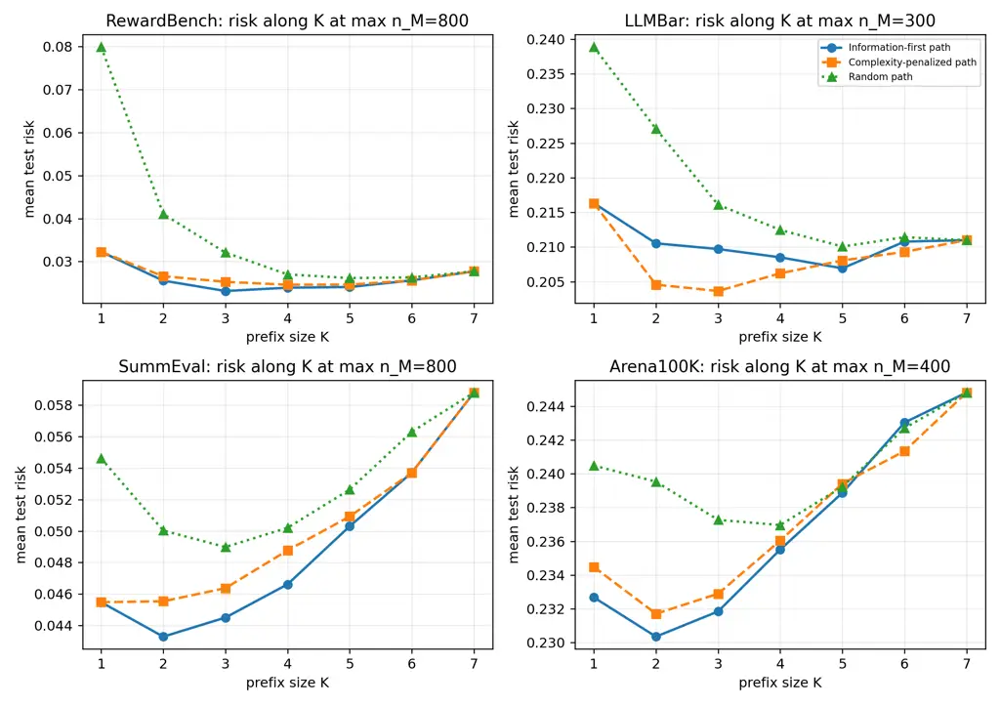
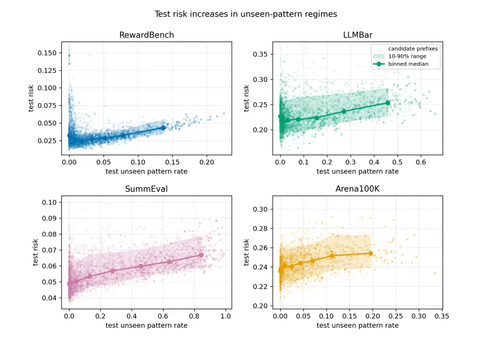
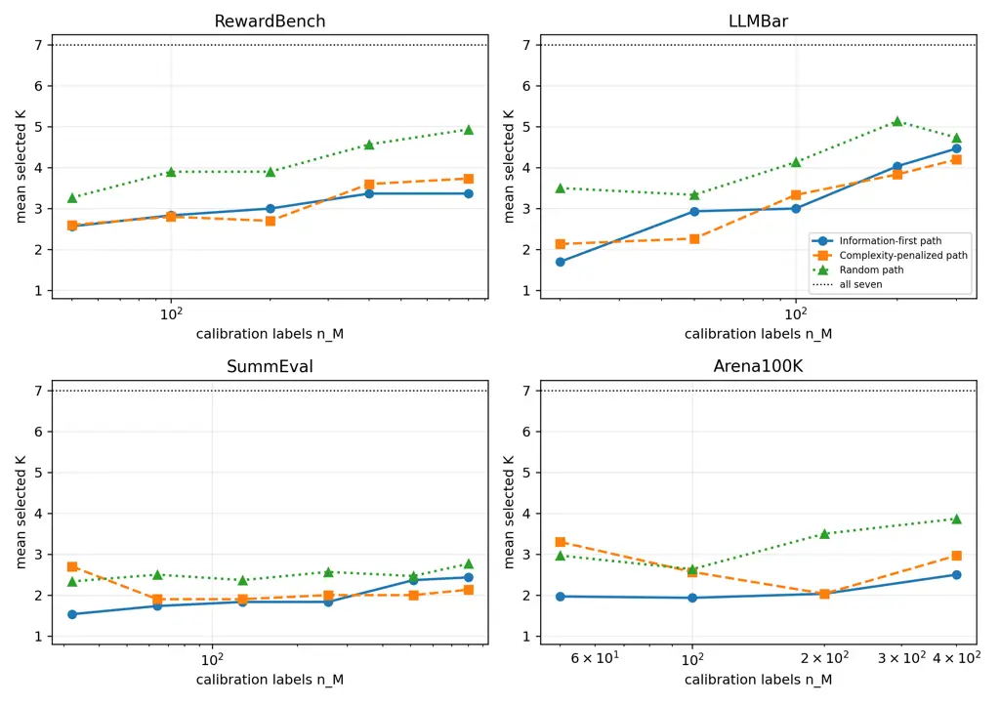
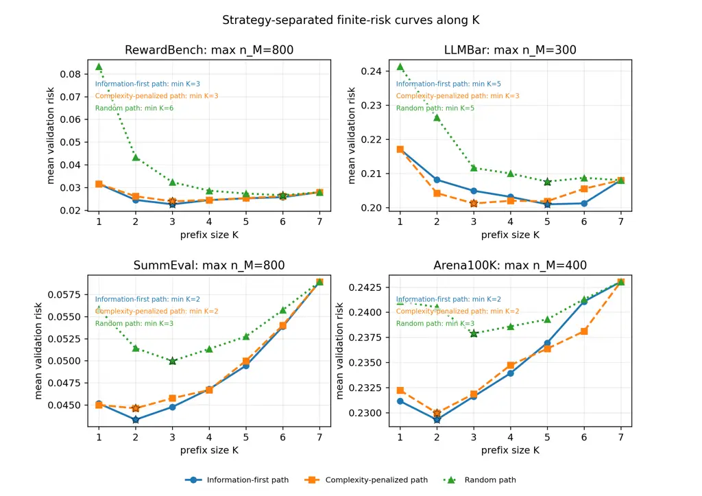
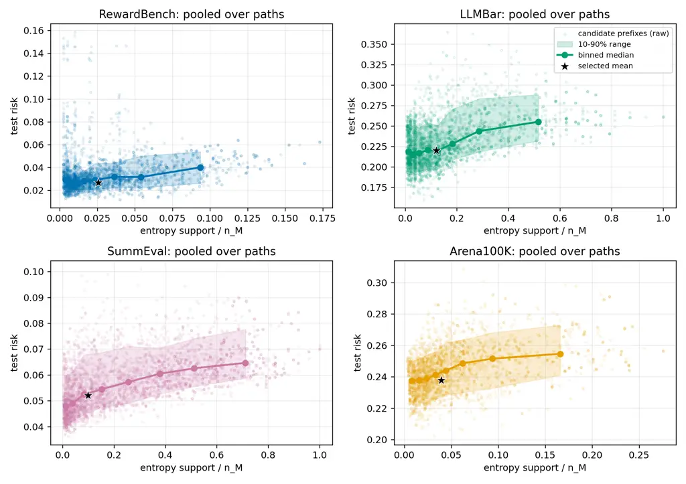
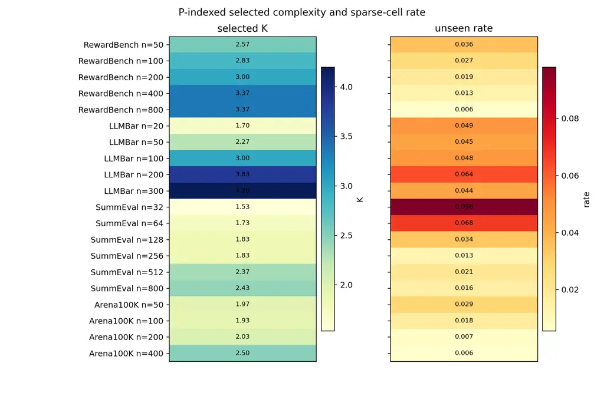
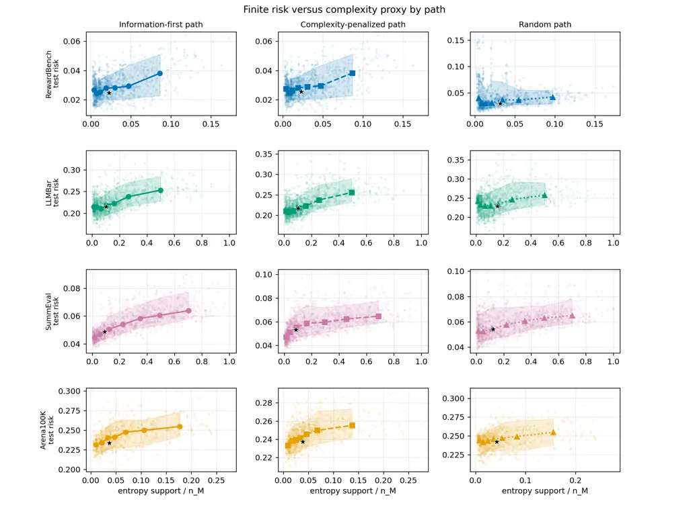
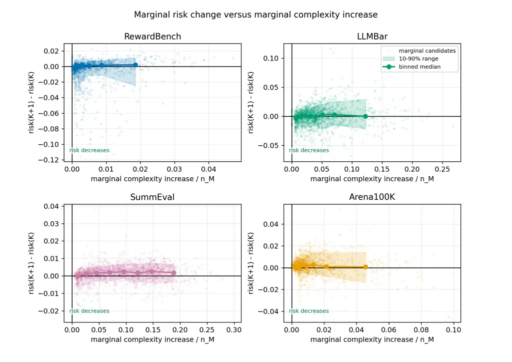
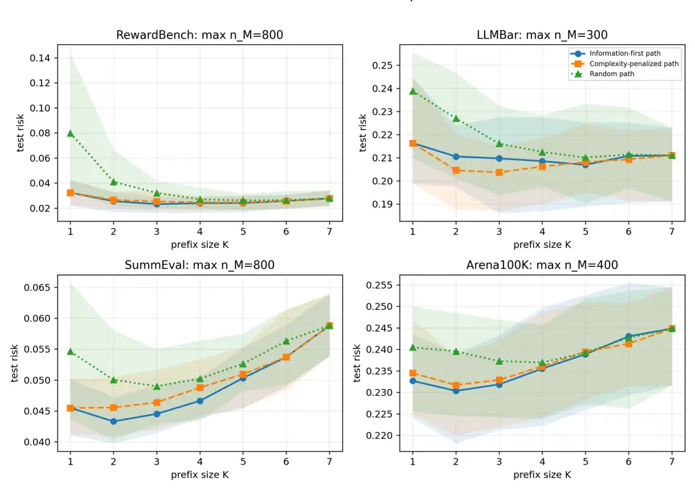
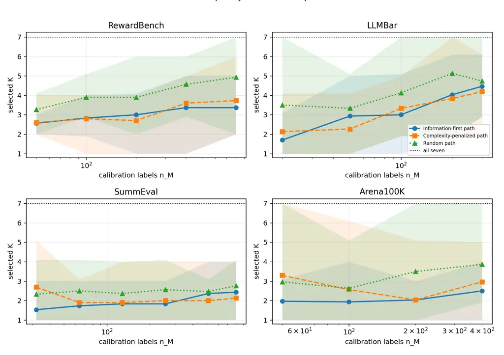

# A Finite-Calibration Regime Map for LLM Judge Panels

Bin Zhu    Yi Xie    Yanghui Rao ^(†)^(†)thanks: Corresponding author.
Affiliation: School of Computer Science and Engineering Affiliation: Sun
Yat-sen University, Guangzhou, China
Affiliation: zhub35@mail2.sysu.edu.cn  xiey299@mail2.sysu.edu.cn
Email: [raoyangh@mail.sysu.edu.cn](mailto:)

###### Abstract

Deploying an LLM judge panel spends human labels on fitting a
calibrator, constructing candidate judge paths, and validating which
candidate to deploy. We study when finite labels should support a
low-dimensional stacker or reliability model, and when an unrestricted
joint output table is worth its cell-count and unseen-pattern cost. We
cast this as a finite-calibration regime map and instantiate it as
_Finite-Calibration Panel Selection_ (FCPS), a validation selector over
judge path, deployed panel size, and aggregator family with support
diagnostics. Across RewardBench, LLMBar, SummEval, and Arena100K with a
seven-judge pool, scalar/reliability aggregation has lower MSE than
unrestricted joint-table calibration in 16 of 20 real dataset–budget
cells by point estimate, while paired 95% intervals exclude zero in 11
cells; richer backoff/shrinkage tables narrow some gaps while preserving
the finite-support bottleneck. Controlled calibration-growth data show
the opposite regime: when labels contain a six-way interaction, the
selected table grows to the interaction-bearing prefix and its MSE falls
from $`0.224`$ to $`0.061`$ once unseen mass vanishes. The practical
deployment question is whether the next judge’s information is estimable
under the available human labels.

|     |
| --- |
|     |

## 1 Introduction

Automatic judges are widely used to evaluate language model outputs
(Zheng et al., 2023; Liu et al., 2023; Zhu et al., 2023), and judge
panels are often proposed to reduce single-judge bias (Verga et al.,
2024). The finite-label catch is that more judges are information plus a
label-allocation bill. A deployer must spend labels to construct
candidate paths or prefixes, fit the calibration map, and validate which
candidate is safe to deploy. Adding one judge may reveal a useful
interaction, or it may split the calibration table into sparse cells
while also enlarging the validation menu.

We ask when a deployer should spend the calibrator-fitting part of a
finite label budget on a flexible joint table, and when the same labels
are better spent on a lower-dimensional reliability or stacking model
(Wolpert, 1992; Qian et al., 2026). The resulting object is an empirical
finite-calibration regime map over task structure, panel size,
aggregator family, and calibrator-fitting budget. The main experiments
isolate the calibration-growth effect by holding the selection and
validation blocks fixed within each dataset and sweeping the
calibrator-fitting budget; a fixed-total-budget diagnostic then shows
how the same regime map behaves when labels are reallocated among path
construction, calibrator fitting, and validation.

For a target distribution $`P`$, ordered judge path $`\pi`$, prefix size
$`K`$, output schema $`s`$, aggregator family $`\mathcal{A}`$, selection
size $`n_{S}`$, calibrator-fitting size $`n_{M}`$, and validation size
$`n_{V}`$, let $`\widehat{f}_{\pi,K,\mathcal{A}}`$ be the predictor
fitted from the calibration block. Its finite-sample risk is organized
by the bookkeeping decomposition

```math
\mathcal{R}(\widehat{f}_{\pi,K,\mathcal{A}})-\mathcal{R}^{\star}\approx\mathrm{Approx}(\pi,K,\mathcal{A})+\mathrm{Path}(\Pi,n_{S})+\mathrm{Est}(\pi,K,\mathcal{A},n_{M})+\mathrm{Sel}(\mathcal{C},n_{V}). \tag{1}
```

Here $`\mathcal{R}^{\star}=\inf_{f}\mathcal{R}(f)`$ is the Bayes risk,
the smallest population risk attainable by any predictor $`f`$;
$`\mathrm{Approx}`$ is the population approximation gap of the chosen
prefix and aggregator family relative to the Bayes rule,
$`\mathrm{Path}`$ is the cost of constructing or ranking judge paths
from only $`n_{S}`$ selection labels, $`\mathrm{Est}`$ is the
calibrator-fitting error after a candidate is fixed, and
$`\mathrm{Sel}`$ is the validation-selection error from choosing among
the finite candidate menu $`\mathcal{C}`$ using $`n_{V}`$ labels. The
path-generation menu is $`\Pi`$, and $`\mathcal{C}`$ is the finite set
of fitted deployment candidates. The selection term follows the usual
finite-menu validation behavior from Hoeffding concentration and a union
bound (Stone, 1974; Hoeffding, 1963); Appendix B makes it explicit.
Equation (1) serves as bookkeeping for label pressure across the
pipeline. The experiments therefore report observable proxies for these
pressures, such as candidate-menu validation scale, cell pressure,
unseen mass, selected prefix, and held-out regret.

|                       | Low table pressure                                                                                                | High table pressure                                                                                                         |
| --------------------- | ----------------------------------------------------------------------------------------------------------------- | --------------------------------------------------------------------------------------------------------------------------- |
| High interaction gain | Joint-table regime: deploy the interaction-bearing prefix when validation gain and cell support improve together. | Use shrinkage/backoff or collect more calibration labels; deploy table structure only after validation gain clears a guard. |
| Low interaction gain  | Keep the low-dimensional stacker or reliability model unless validation shows a clear table gain.                 | Prefer scalar/reliability aggregation or a shorter prefix; table flexibility is unlikely to clear finite-cell cost.         |

Figure 1: Operational finite-calibration regime map. Table pressure is
measured by effective support per calibrator-fitting label and
unseen-pattern mass; interaction gain is measured by validation
improvement over scalar aggregation.

The relevant decision object is

```math
(\pi^{\star},K^{\star},\mathcal{A}^{\star})\in\arg\min_{(\pi,K,\mathcal{A})\in\mathcal{C}}\mathcal{R}(\widehat{f}_{\pi,K,\mathcal{A}}),
```

which selects a deployable panel/aggregator pair for the available label
budget. For the joint-table family, the first two terms reduce to the
familiar squared-loss identity
$`\mathcal{R}_{\mathrm{finite}}=\mathcal{R}_{\mathrm{oracle}}+\mathcal{R}_{\mathrm{cal}}`$:
the Bayes table $`g^{\star}(z)=\mathbb{E}[Y\mid Z_{K}=z]`$, where
$`Z_{K}`$ is the joint output pattern of the first $`K`$ judges, has no
table-approximation error, and the finite calibration term includes
smoothing bias, cell imbalance, and fallback error on unseen cells.
Lower-dimensional stackers have smaller estimation cost but nonzero
approximation error when judge interactions matter. Thus additive
targets favor scalar stackers, while large non-additive interactions
favor the joint table after labels cover the induced cell structure.

The experiments expose this tradeoff across real and controlled regimes.
On four real benchmarks with a seven-judge pool including DeepSeek V4
Flash, validation-selected scalar aggregation beats validation-selected
joint-table prefix calibration in 16 of 20 dataset–budget cells. The
deployment implication is that FCPS selects low-dimensional aggregators
when unrestricted joint tables lack interaction gain relative to their
finite-support diagnostics. Controlled calibration-growth regimes show
the complementary case. In an additive regime, scalar models remain
better as labels grow. In a six-way interaction regime, the selected
table uses the interaction-bearing prefix and improves sharply as unseen
cells disappear. The same finite-calibration theory explains both
outcomes.

The practical output is _Finite-Calibration Panel Selection_ (FCPS):
reserve labels for path construction, calibration, and validation;
generate judge paths; train candidate aggregators for each prefix;
select $`(\widehat{\pi},\widehat{K},\widehat{\mathcal{A}})`$ by
validation risk; and report effective support, exact cell pressure, and
unseen rate. The contribution is the finite-calibration regime map,
deployable selector, and diagnostics that connect the selected panel to
finite-support pressure. In this view, panel complexity must be earned
by calibration and validation evidence.

#### Contribution.

Our central contribution is a finite-calibration regime map for
deploying LLM judge panels: jointly select the judge prefix and
aggregation family after accounting for the labels spent on path
construction, calibrator fitting, and validation. This has four
components.

1.  1.  Finite-calibration bottleneck. We identify the support bottleneck
        created when added judges expand a joint output table faster than
        human calibration labels can estimate its cells.
2.  2.  Deployable label accounting. We instantiate this view as FCPS, a
        selector over paths, prefixes, and aggregator families that
        separates labels for path construction, calibrator fitting, and
        validation.
3.  3.  Real-data regime evidence. On four real benchmarks, scalar and
        reliability-style aggregators often win because observed interaction
        gains are small relative to table-like estimation pressure.
4.  4.  Interaction boundary. Controlled and semi-real calibration-growth
        regimes show the opposite side of the map, where joint tables become
        useful once non-additive structure is present and cell support is
        sufficient.

Although this paper and the companion _Stopping and Routing LLM Judge
Panels_ share part of the benchmark judge-output matrices and judge
pool, they address distinct deployment decisions: the companion selects
conditional calls and stopping, whereas FCPS selects a panel prefix and
aggregation family after candidate outputs are available.

## 2 Related Work

#### LLM-as-a-judge evaluation.

Large language models are now widely used as automatic evaluators for
open-ended generation. MT-Bench, Chatbot Arena, G-Eval, and JudgeLM
established prompted or fine-tuned judges for pairwise, multi-turn, and
NLG evaluation, while also documenting judge biases and reliability
concerns (Zheng et al., 2023; Liu et al., 2023; Zhu et al., 2023; Jain
et al., 2025). Benchmarks such as LLMBar, RewardBench, and SummEval
stress instruction-following meta-evaluation, reward/preference
modeling, and summarization quality assessment (Zeng et al., 2024;
Lambert et al., 2024; Fabbri et al., 2021); deterministic learned
metrics offer another evaluator family (Alam et al., 2026). We use these
outputs and benchmarks as a calibration substrate: the decision problem
is how a finite label budget should determine the deployed judge prefix
and aggregator family.

#### Judge panels and finite-budget judge reliability.

Recent work has argued that panels or “juries” of diverse LLM judges can
outperform a single large judge and reduce single-model bias (Verga
et al., 2024). Our results refine this intuition: panels are useful, but
the deployed panel size should still be selected under the available
calibrator-fitting and validation budget. Evidence on correlated errors,
perturbation sensitivity, and heterogeneous judge reliability shows why
panel size alone is a poor proxy for deployable information (Kohli,
2026; Dev et al., 2026; Qian et al., 2026; Yu et al., 2026). Concurrent
label-efficient estimation work argues that a calibrated full panel can
outperform accuracy-based curation when the full joint signal is
learnable (Li, 2026); our finite-table diagnostics ask when that joint
signal becomes too sparse for a limited calibration set. Other
multi-judge methods aggregate repeated samples or provide abstaining
finite-sample control (Dadkhahi et al., 2025; Badshah et al., 2026). Our
focus is the deployable choice of judge prefix and aggregator when the
system must output calibrated predictions for all examples.

#### Calibration and finite-sample reliability.

Calibration has a long statistical history (Dawid, 1982) and is central
to turning model scores into reliable probabilities. Practical post-hoc
calibration methods such as Platt scaling and temperature scaling
estimate a calibration map from held-out labels (Platt, 1999; Guo
et al., 2017); LLM-judge work also studies prompting, ensembling,
uncertainty, conformal intervals, surrogate calibration, and rubric
calibration (Lail and Markham, 2026; Radharapu et al., 2025; Sheng
et al., 2025; Khomiakov and Frellsen, 2026; Landesberg and Narayan,
2025; Feng et al., 2026; Hashemi et al., 2024). Here the calibrated
object is a joint judge-output pattern table whose support grows with
the deployed panel size, rather than a fixed scalar score or rubric
representation. The finite-table bound in Appendix B makes this
dependence explicit and motivates the entropy-effective support and
unseen-pattern diagnostics. Factuality-evaluation studies show that
strong LLMs can vary in judge reliability across domains (Fu et al.,
2023), reinforcing the need for explicit calibration and validation
before deployment.

#### Model selection and ensembles.

Validation-based model selection is standard under finite data (Stone,
1974), and stacking combines predictors to improve accuracy (Wolpert,
1992). Judge-panel selection adds a calibration constraint: adding a
judge changes the joint-pattern alphabet estimated from human labels.
The decision is therefore whether the next judge’s information gain is
worth the extra calibration complexity. Structured
Dawid–Skene/Bradley–Terry and hierarchical jury models (Dawid and Skene, 1979) are richer candidate families for the same selector: they can
reduce table pressure through modeling assumptions, while still
requiring validation evidence under the available label budget.

## 3 Finite-Calibration Panel Selection

### 3.1 Human-Label Accounting

A deployment budget covers the full selection pipeline, not just the
final calibrator. If $`n_{H}`$ human-labeled examples are available
before deployment, they are allocated among candidate generation,
calibrator fitting, and candidate selection:

```math
n_{H}=n_{S}+n_{M}+n_{V}.
```

The selection block of size $`n_{S}`$ constructs or ranks candidate
judge paths. The calibration block of size $`n_{M}`$ fits the
aggregation map for each candidate. The validation block of size
$`n_{V}`$ chooses among the resulting $`(\pi,K,\mathcal{A})`$
candidates. The experiments additionally reserve a research test block
to audit the already selected decision.

This distinction matters because different terms in Eq. (1) consume
different labels. A larger candidate menu needs enough validation data
to avoid selecting a noisy winner; the formal finite-menu validation
scale is given in the next subsection. A joint table needs enough
calibration data to cover its induced cells, with pressure measured by
$`\sum_{z}p_{z}/N_{z}`$ and unseen mass. Thus, under a fixed $`n_{H}`$,
a deployer can either reserve more labels for validation, shrink the
candidate menu, or bias the selector toward simpler aggregators through
a one-standard-error or guarded rule.

The main experiments fix $`n_{S}`$, $`n_{V}`$, and the held-out test
size for each dataset, then sweep $`n_{M}`$. This calibration-growth
design isolates how additional calibrator-fitting labels change cell
pressure and the scalar-versus-table regime. The separate
fixed-$`n_{H}`$ allocation diagnostic complements this view by moving
labels among $`n_{S}`$, $`n_{M}`$, and $`n_{V}`$ while keeping the same
deployment accounting.

### 3.2 Decision Object

A deployment decision consists of a judge path $`\pi`$, a prefix size
$`K`$, and an aggregator family $`\mathcal{A}`$. The family
$`\mathcal{A}`$ specifies how labeled calibration examples are used to
map the first $`K`$ judge outputs to a calibrated prediction. In this
paper, the main nonparametric family is the joint table in Eq. (5); the
main low-dimensional alternatives are mean aggregation with isotonic
calibration, ridge stacking with isotonic calibration, and logistic
stacking, following standard post-hoc calibration and stacking ideas
(Platt, 1999; Guo et al., 2017; Wolpert, 1992).

The finite-calibration decision is

```math
(\widehat{\pi},\widehat{K},\widehat{\mathcal{A}})\in\arg\min_{\pi\in\Pi,\,K\in\{1,\ldots,m\},\,\mathcal{A}\in\mathfrak{A}}\widehat{\mathcal{R}}_{\mathrm{val}}(\widehat{f}_{\pi,K,\mathcal{A}}). \tag{2}
```

The original path/prefix selector is the special case where
$`\mathfrak{A}=\{\text{joint table}\}`$. The scalar aggregation
baselines and the controlled regime experiment use the same validation
principle while varying $`\mathcal{A}`$. This FCPS procedure is a
finite-candidate validation selector (Stone, 1974). Its contribution is
the finite-calibration candidate space over paths, prefix sizes, and
aggregation families together with the diagnostics used to interpret the
selected regime.

The formal validation bound in Appendix B is the standard finite-menu
concentration result: for bounded losses, selecting over
$`|\mathcal{C}|`$ fitted candidates satisfies

```math
\mathcal{R}(\widehat{f}_{\widehat{c}})\leq\min_{c\in\mathcal{C}}\mathcal{R}(\widehat{f}_{c})+O\!\left(\sqrt{\frac{\log|\mathcal{C}|}{n_{V}}}\right).
```

Thus larger candidate menus are statistically affordable only when the
validation block has enough resolution, or when the menu is guarded
toward simpler choices. In the main real-data comparisons, the
joint-table menu has $`3\times 7=21`$ candidates and the scalar-family
menu has $`6\times 7=42`$; Appendix Table 7 reports the corresponding
$`\sqrt{\log|\mathcal{C}|/n_{V}}`$ scales.

### 3.3 Judge Paths and Prefixes

Let $`\mathcal{J}=\{j_{1},\ldots,j_{m}\}`$ be a pool of judges. A path
rule produces an ordering $`\pi`$ of this pool. For each prefix size
$`K`$, the deployed panel is the first $`K`$ judges along the path. The
path rule therefore determines which joint pattern table is exposed as
$`K`$ grows.

We consider three path rules. The _information-first path_ orders judges
by single-judge oracle performance on the selection block and is the
strong path baseline. The _random path_ is a null baseline. The
_complexity-penalized path_ greedily trades selection-block oracle gain
against the increase in entropy-effective support, normalized by the
planned calibrator-fitting budget $`n_{M}`$. Path rules only propose
candidates from the selection block; calibration and validation fit and
select the deployed predictor. The appendix gives the full path
heuristic and an additional calibration-frontier diagnostic.

### 3.4 Calibration Pressure and Aggregator Complexity

The calibration-complexity term in Eq. (1) is most visible for joint
output tables. For a fixed $`(P,K,\pi,s)`$, let $`Z_{K}`$ be the joint
output pattern of the first $`K`$ judges. A table calibrator estimates
$`g^{\star}(z)=\mathbb{E}[Y\mid Z_{K}=z]`$ from $`n_{M}`$ calibration
labels. If $`N_{z}`$ is the calibration count in cell $`z`$, the formal
bound in Appendix B shows that the table pays a weighted small-cell term
plus unseen mass. For the calibration block $`D_{M}`$, the operational
pressure is

```math
V_{K}(D_{M})=\sum_{z:N_{z}>0}p_{z}N_{z}^{-1}+P(Z_{K}\notin\widehat{\mathcal{Z}}_{K}), \tag{3}
```

up to logarithmic, smoothing, and bounded-loss constants. In the
experiments we report a retrospective held-out plug-in audit
$`\widehat{V}^{\mathrm{cell}}_{K}=\sum_{z:N_{z}>0}\widehat{p}_{\mathrm{test}}(z)/N_{z}+\widehat{u}_{K}`$,
where $`\widehat{u}_{K}`$ is the held-out unseen-pattern rate; the audit
uses calibration cell counts and held-out pattern frequencies. We also
report $`\widetilde{V}_{K}=H_{K}/n_{M}+\widehat{u}_{K}`$, where
$`H_{K}=\exp(-\sum_{z}\widehat{p}_{z}\log\widehat{p}_{z})`$ is the
entropy-effective occupied support. In deployment, the same
inverse-count term can be estimated from unlabeled target traffic after
the candidate panel has been run, by replacing $`p_{z}`$ with target
pattern frequencies $`\widehat{q}(z)`$; this requires judge outputs but
no additional human labels. When such target traffic is unavailable,
$`\widetilde{V}_{K}`$ is the cold-start proxy rather than an exact
deployment criterion.

This pressure creates an approximation–estimation boundary.
Low-dimensional aggregators have much smaller estimation cost but can
miss interactions; joint tables represent arbitrary categorical
interactions but need enough calibration labels to cover the induced
support. The formal table and stacking statements in Appendix B make the
scale explicit. In the approximately balanced case with $`M_{K}`$
reachable output patterns, the joint table has estimation pressure of
order $`E_{\mathrm{tab}}(K,n_{M})\asymp M_{K}\log M_{K}/n_{M}`$, up to
constants, smoothing, and logarithmic confidence factors, and
unrestricted tables have a matching $`M_{K}/n_{M}`$-type lower bound. A
bounded linear stacker over $`K`$ scalar judge features instead has
generic bounded-loss scale

```math
E_{\mathrm{scal}}(K,n_{M})=O\!\left(\sqrt{K/n_{M}}\right),\qquad E_{\mathrm{tab}}(K,n_{M})\asymp M_{K}\log M_{K}/n_{M}.
```

Thus, if $`\Delta_{K}(\mathcal{A})`$ is the approximation gap of a
scalar family relative to the unrestricted table Bayes rule, a table is
justified only when
$`\Delta_{K}(\mathcal{A})\gtrsim E_{\mathrm{tab}}(K,n_{M})-E_{\mathrm{scal}}(K,\mathcal{A},n_{M})`$.
We use this diagnostic inequality to organize the regime map behind the
validation menu and diagnostics, summarized operationally in Figure 1.
It has three direct deployment consequences. First, when validation
labels are scarce, the candidate menu should be small: adding many
paths, prefixes, and aggregator families only helps if $`n_{V}`$ can
resolve their validation risks. Second, when calibration labels are
scarce relative to the selected table support, the finite-label response
is to prefer a lower-dimensional family, a shorter prefix, or a
shrinkage/backoff table until unseen mass and small-cell pressure are
low. Third, a joint table is appropriate when it clears both tests at
once: it shows validation improvement over scalar competitors and its
selected cells are sufficiently observed. The same prefix can therefore
be reasonable under a scalar stacker and unreasonable under a joint
table, because the two families spend calibration labels differently.

These consequences give the practical complexity ladder used below:
mean/vote plus calibration, one-coin reliability, ridge/logistic
stacking, pairwise-feature stacking, and finally the joint table. The
formal result covers the table endpoint and bounded linear/additive
stackers; one-coin reliability and isotonic post-calibration are
practical comparators, and pairwise features follow the same
$`O(K^{2})`$ parametric intuition. The theory therefore organizes the
candidate families and diagnostics around their calibration-label
demand. Additive or redundant judge signals should favor stacking under
finite labels, whereas important output-pattern interactions justify a
joint table only after the calibrator-fitting budget can estimate the
relevant cells.

### 3.5 FCPS Protocol

Given a deployable labeled budget split into $`(n_{S},n_{M},n_{V})`$,
FCPS uses the selection block to generate paths, the calibration block
to fit aggregators, and the validation block to choose the deployed
candidate. For each candidate path rule and prefix size $`K`$, we fit a
calibration map on the calibration block and evaluate finite risk on the
validation block. For the joint-table experiments, the selected prefix
is

```math
(\widehat{\pi},\widehat{K})\in\arg\min_{\pi\in\Pi,\,K\in\{1,\ldots,m\}}\widehat{\mathcal{R}}_{\mathrm{val}}(\widehat{f}_{\pi,K,\mathrm{tab}}). \tag{4}
```

This is Eq. (2) restricted to $`\mathfrak{A}=\{\text{joint table}\}`$.
In deployment, after validation selection, the chosen predictor is
frozen or refit on the permitted labeled data according to the
deployment policy. In the experiments, a separate research test block
evaluates the already selected decision and records diagnostic
quantities such as unseen pattern rate.

This framing separates FCPS from any single path generator or
aggregator. In the real-data experiments, joint-table path/prefix
selection and scalar-family selection use the same
calibration/validation/test separation, so Tables 10–16 compare families
under a common validation-selection protocol. Adding a judge also
changes the calibration problem itself: it expands the joint pattern
support that must be estimated before a table or table-like residual can
be safely deployed.

In the present implementation, the calibration map is a finite
pattern-table estimator. Each observed joint judge-output pattern is
mapped to its empirical calibration target on the calibration block,
smoothed toward the calibration marginal with $`\alpha=0.5`$:

```math
\widehat{g}(z)=\frac{\sum_{i:Z_{i}=z}y_{i}+\alpha\bar{y}_{\mathrm{cal}}}{N_{z}+\alpha}. \tag{5}
```

Patterns not observed during calibration are assigned the fallback
prediction $`\bar{y}_{\mathrm{cal}}`$. We report the unseen pattern rate
because this fallback is exactly where finite calibration pressure
becomes visible. Risk is the mean squared calibration error,
$`\frac{1}{|D|}\sum_{i\in D}(y_{i}-\widehat{g}(Z_{i}))^{2}`$, on the
validation or test block. All path construction and prefix selection use
only the selection/calibration/validation blocks; the test block is held
out for final evaluation and diagnostics. With its global fallback, this
joint table is a nonparametric endpoint; hierarchical backoff, Bayesian
smoothing, and residual shrinkage are middle families between scalar
stackers and a fully unrestricted table (Dawid, 1982; Wolpert, 1992).

#### Algorithmic protocol.

Operationally, FCPS partitions labels into selection, calibration, and
validation blocks; generates paths on the selection block; fits each
$`(\pi,K,\mathcal{A})`$ candidate on calibration data; selects by
validation risk using Eq. (2); and deploys the selected candidate when
its validation evidence and complexity diagnostics support the added
complexity. In evaluation mode, a separate test block audits the already
selected decision.

#### Practical allocation rule.

For moderate label budgets, a simple default is to allocate roughly
$`n_{S}:n_{M}:n_{V}=1:2:1`$, so the calibrator receives the largest
block while the validation selector still has enough resolution to
compare candidates. If the candidate menu is large, either increase
$`n_{V}`$ or shrink the menu before validation. If joint-table
interactions are strongly suspected, increase $`n_{M}`$ and require low
unseen mass before deployment. In cold-start regimes with only a few
dozen labels, the guarded variant in Appendix C starts from a task-type
prior and adapts when validation evidence clears a
one-standard-error-style guard.

#### Hybrid shrinkage extension.

The same pressure also motivates count-shrunk residual tables: add a
validation-tuned residual correction to a scalar predictor only in
well-observed cells, and fall back to the scalar model in sparse cells.
Appendix C reports this diagnostic alongside the pre-specified
table/scalar menu, where the strongest scalar selector remains the most
stable real-data comparator.

### 3.6 Complexity Diagnostics

The calibration-complexity term is operationalized through effective
support and unseen pattern diagnostics. For a prefix of size $`K`$,
$`H_{K}`$ denotes the entropy-effective occupied support from the
natural-log definition above, and $`Q_{K}`$ denotes the nominal pattern
alphabet size. We use $`H_{K}/n_{M}`$ as a practical proxy for
finite-budget pattern pressure and report
$`\widetilde{V}_{K}=H_{K}/n_{M}+\widehat{u}_{K}`$ when we want a single
observable diagnostic for the table pressure in Eq. (3). We also measure
unseen pattern rate relative to the calibration support. In research
evaluation, Table 2 computes the closest audit using the held-out test
block after selection is fixed. In deployment, the analogous audit
should be computed from unlabeled target traffic pattern frequencies; if
no such traffic is available, $`H_{K}/n_{M}+\widehat{u}_{K}`$ should be
treated as a rough proxy for sparse-cell pressure. These quantities
serve as observable audits of regimes in which the literal table-bound
quantities, especially small cell counts and unseen mass, are likely to
matter.

## 4 Experiments

We evaluate FCPS on RewardBench, LLMBar, SummEval, and Arena100K
(Lambert et al., 2024; Zeng et al., 2024; Fabbri et al., 2021; Tang
et al., 2025; Chiang et al., 2024) with a fixed seven-judge pool:
Qwen2.5-7B, Llama-3.1-8B, Mistral-7B, Prometheus-7B, Gemma-3-12B,
Selene-8B, and DeepSeek V4 Flash (Qwen Team, 2024; Grattafiori et al.,
2024; Jiang et al., 2023; Kim et al., 2024; Gemma Team, 2025; Alexandru
et al., 2025; DeepSeek-AI, 2026). Pairwise datasets use categorical
direct-preference judge outputs; SummEval uses discrete scalar rubric
bins. Arena100K is a filtered English non-tie LMArena-100K subset for
calibrated preference prediction. All results use 30 grouped splits by
source identifier. Each split contains a path-selection block, a
calibration-fitting block of size $`n_{M}`$, a validation block, and a
held-out test block; candidate paths are built on selection data,
aggregators are fit on calibration data, $`(K,\mathcal{A})`$ is selected
on validation data, and test labels are reserved for final evaluation
and diagnostics. The budget $`n_{M}`$ in Table 1 is the
calibrator-fitting block within the full label allocation. The main
real-data tables are calibration-growth curves under fixed selection and
validation capacity. The block sizes in Table 1 are chosen to isolate
calibration growth rather than optimize a benchmark-specific split:
selection and validation are fixed while $`n_{M}`$ varies, and the
held-out test block is used only as a lower-noise audit of the selected
candidate. Absolute sizes are scaled to each dataset so grouped splits
fit without separating source-linked examples. Table 23 separately
checks that the qualitative conclusion is not tied to this single
allocation. Table 23 adds a fixed-$`n_{H}`$ allocation check that
reassigns labels among selection, calibration, and validation while
keeping the research test block outside the deployable budget.
Appendix C.3 uses the same seven-judge protocol as an out-of-domain
check on three binary targets: safety, math correctness, and code
correctness (Chao et al., 2024; Cobbe et al., 2021; Austin et al.,
2021).

| Dataset     | calibrator-fitting budgets $`n_{M}`$ | select/validation/test | schema   |
| ----------- | ------------------------------------ | ---------------------- | -------- |
| RewardBench | 50, 100, 200, 400, 800               | 300 / 300 / 600        | pairwise |
| LLMBar      | 20, 50, 100, 200, 300                | 100 / 100 / 200        | pairwise |
| SummEval    | 32, 64, 128, 256, 512, 800           | 192 / 192 / 384        | scalar   |
| Arena100K   | 50, 100, 200, 400                    | 200 / 200 / 400        | pairwise |

Table 1: Experimental protocol. Each row uses 30 grouped splits,
smoothing $`\alpha=0.5`$, and prefix sizes $`K\in\{1,\ldots,7\}`$. The
block $`n_{M}`$ is the calibrator-fitting budget swept in the main
experiments; the selection, validation, and test block sizes are fixed
per dataset.

The joint-table calibrator maps each observed judge-output pattern to a
smoothed cell mean,
$`(N_{z}\bar{Y}_{z}+\alpha\bar{y}_{\mathrm{cal}})/(N_{z}+\alpha)`$, and
backs off to the calibration marginal on unseen patterns. Scalar
comparators include mean/vote aggregation with isotonic calibration,
one-coin reliability aggregation, ridge stacking with isotonic
calibration, logistic stacking for pairwise targets, and
pairwise-feature variants (Platt, 1999; Guo et al., 2017; Wolpert,
1992). The one-coin comparator is supervised rather than a full
Dawid–Skene EM fit. After binarizing labels and scalarized verdicts at
$`1/2`$, each judge receives a single symmetric log-odds weight from its
Laplace-smoothed calibration accuracy (clipped to $`[0.05,0.95]`$); the
weighted vote is combined with a Laplace-smoothed class prior and then
isotonic-calibrated. For scalar aggregators on pairwise tasks, verdicts
are encoded as $`A/a=1`$, $`B/b=0`$, and tie or parse-error outcomes as
$`1/2`$; the joint table keeps the categorical outputs as pattern
values. This encoding makes simple mean/vote aggregation well behaved on
RewardBench and Arena100K, while LLMBar still requires learned
reliability or stacking weights. Appendix C adds candidate-menu
accounting, a representative unsupervised heterogeneous-jury baseline,
negative log-likelihood (NLL) selection, tie/error encoding ablations,
fixed-$`n_{H}`$ allocation checks, judge-pool perturbation,
fallback/smoothing sensitivity, deterministic prompt perturbation, and
hierarchical-backoff tables. Each reported deployable comparison is an
FCPS restriction to a candidate menu: joint-table only, scalar-family
only, or the union of path and aggregator choices. Mean squared error
(MSE) is the validation objective tied to the theory; on pairwise tasks
it is the Brier score for probabilistic binary prediction, a bounded
strictly proper score. NLL, accuracy, Pearson, and Spearman are
robustness checks reported in the appendix.

#### Reading the diagnostics.

Table 2 audits the estimation bill paid by the selected joint table:
when $`\sum_{z}\widehat{p}_{\mathrm{test}}(z)/N_{z}`$ or $`\widehat{u}`$
is large, the selected table requires more calibration support before
its flexibility is useful. Appendix Table 10 gives the matching
path/envelope comparison: selected prefixes usually improve over the
all-seven table, while the non-deployable test oracle remains lower,
identifying validation as a statistical bottleneck. At the largest
budgets, path/prefix validation improves over the all-seven table
($`0.025/0.028`$, $`0.203/0.211`$, $`0.045/0.059`$, $`0.233/0.245`$),
while the test-oracle envelope remains lower
($`0.022,0.194,0.043,0.227`$).

## 5 Results

The empirical results make the finite-calibration map concrete under
fixed selection and validation capacity. First, within the joint-table
restriction of FCPS, risk over $`K`$ often flattens or turns upward, and
selected prefixes are usually smaller than the full seven-judge pool
(Appendix Figures 3–5). Table 2 tracks cell pressure: it falls as the
calibrator-fitting block grows, while the entropy proxy can understate
literal small-cell pressure. Controlled residualized checks support the
proxy: standardized $`H_{K}/n_{M}`$ and unseen-rate coefficients for
test risk are $`0.178`$ and $`0.199`$, both with standard error
$`0.009`$ (Appendix Table 38).

| Dataset     | $`n_{M}`$ | $`\widehat{K}`$ | $`\sum\hat{p}_{z}/N_{z}`$ | $`\hat{u}`$ | $`\widehat{V}^{cell}`$ | proxy $`\widetilde{V}`$ | table  | scalar |
| ----------- | --------- | --------------- | ------------------------- | ----------- | ---------------------- | ----------------------- | ------ | ------ |
| RewardBench | 50        | 2.57            | 0.07510                   | 0.0334      | 0.10855                | 0.0885                  | 0.0259 | 0.0238 |
| RewardBench | 800       | 3.63            | 0.02282                   | 0.0077      | 0.03049                | 0.0127                  | 0.0251 | 0.0225 |
| LLMBar      | 20        | 2.37            | 0.21937                   | 0.1020      | 0.32137                | 0.3266                  | 0.2257 | 0.2285 |
| LLMBar      | 300       | 4.13            | 0.09100                   | 0.0292      | 0.12017                | 0.0749                  | 0.2031 | 0.1857 |
| SummEval    | 32        | 1.47            | 0.24489                   | 0.0746      | 0.31946                | 0.2565                  | 0.0559 | 0.0511 |
| SummEval    | 800       | 2.47            | 0.06106                   | 0.0169      | 0.07799                | 0.0474                  | 0.0454 | 0.0435 |
| Arena100K   | 50        | 2.43            | 0.10241                   | 0.0405      | 0.14291                | 0.1129                  | 0.2395 | 0.2383 |
| Arena100K   | 400       | 2.73            | 0.03033                   | 0.0067      | 0.03700                | 0.0195                  | 0.2331 | 0.2324 |

Table 2: Post-selection held-out audit of cell pressure for the
validation-selected joint-table candidate. The column
$`\widehat{V}^{cell}=\sum_{z:N_{z}>0}\widehat{p}_{\mathrm{test}}(z)/N_{z}+\widehat{u}`$
directly instantiates the two terms in Eq. (3) using calibration cell
counts and held-out test pattern frequencies. The selector itself uses
validation risk; the proxy
$`\widetilde{V}=H_{\widehat{K}}/n_{M}+\widehat{u}`$ is shown for
comparison, followed by the validation-selected joint-table and
scalar-family test risks.



(a) Risk over prefix size.



(b) Risk versus unseen-pattern rate.

Figure 2: Main finite-calibration regime diagnostics. Left: joint-table
risk often flattens or worsens as more judges increase pattern support.
Right: held-out risk rises with unseen-pattern pressure, so table-like
expansion must clear both validation and support diagnostics.

Second, current real benchmarks usually lie on the low-interaction,
finite-support side of the map. Scalar aggregation has lower mean test
MSE in 16 of 20 dataset–budget comparisons against joint-table prefix
calibration, with paired 95% intervals excluding zero in 11 cells
(Appendix Table 16); margins are largest on RewardBench and LLMBar and
small on SummEval and Arena100K. Table 3 gives the mechanism audit at
the largest budgets: pairwise-feature stackers add little over additive
stackers, pairwise features are selected in only $`0.10`$–$`0.33`$ of
scalar splits, and the non-deployable joint-table oracle is not lower
than the scalar oracle. Thus the table usually pays support and
validation cost before there is enough interaction gain to learn. Richer
table-like menus–hierarchical backoff and residual shrinkage–narrow some
gaps and are nominally better in small-margin cells, but RewardBench and
LLMBar remain scalar-favored under the same split protocol (Appendix
Tables 18, 17, and 24).

| Dataset     | $`\widetilde{V}`$ | pairwise gain | pairwise sel. | oracle $`\Delta`$ | finite $`\Delta`$ | residual $`\Delta`$ |
| ----------- | ----------------- | ------------- | ------------- | ----------------- | ----------------- | ------------------- |
| RewardBench | 0.0127            | -0.0000       | 0.30          | +0.0021           | +0.0025           | -0.0004             |
| LLMBar      | 0.0749            | -0.0024       | 0.30          | +0.0145           | +0.0205           | +0.0007             |
| SummEval    | 0.0474            | -0.0004       | 0.33          | -0.0000           | +0.0019           | +0.0002             |
| Arena100K   | 0.0195            | -0.0013       | 0.10          | +0.0014           | +0.0010           | +0.0003             |

Table 3: Mechanism audit for why scalar aggregation usually wins on the
real-data regime at each dataset’s largest calibrator-fitting budget.
$`\widetilde{V}=H_{\widehat{K}}/n_{M}+\widehat{u}`$ is table pressure
for the validation-selected table; pairwise gain is additive-stack test
risk minus pairwise-feature test risk for the all-seven scalar stacker,
so positive values favor interaction features; pairwise sel. is the
share of validation-selected scalar aggregators that use pairwise
features. Oracle and finite $`\Delta`$ are joint-table risk minus scalar
risk, so positive values favor scalar aggregation. Residual $`\Delta`$
is residual-shrinkage minus scalar risk. Full oracle gaps for all
dataset–budget cells are in Appendix Table 17.

Sensitivity checks support the same regime reading without making it a
single downstream convention. Pool perturbation from the six-judge
Selene pool to the seven-judge DeepSeek pool changes risk levels,
especially on LLMBar and Arena100K, but selected prefixes remain below
the full pool (Appendix Table 5). A deterministic prompt perturbation on
four general local LLMBar judges changes about one third of individual
verdicts while retaining sub-full selected prefixes (Appendix Table 6).
Fallback/smoothing, tie/error encoding, NLL/metric checks, and
fixed-$`n_{H}`$ reallocations give the same qualitative scalar/table
reading (Appendix Tables 27, 22, 21, 19, and 23). Together, these
diagnostics place the real-data benchmarks in a regime where table
complexity should be spent only when validation gain and cell support
improve together.

Third, controlled and semi-real interaction stress tests show the
opposite regime. At $`n_{M}=1024`$, the scalar-minus-table gaps in the
synthetic/semi-real calibration-growth checks are $`-0.002/-0.002`$ for
additive targets, $`+0.018/+0.006`$ for mixed targets, and
$`+0.053/+0.015`$ for parity targets (Appendix Tables 34 and 35). Thus
additive structure remains scalar- favored, while mixed and high-order
parity structure becomes table-favored once the interaction is both
present and estimable. In the six-way synthetic parity dataset, the
selected table uses $`K=6`$, unseen mass falls from $`0.768`$ at
$`n_{M}=16`$ to zero by $`n_{M}=512`$, and test MSE drops from $`0.224`$
to $`0.061`$. Appendix C also reports robustness checks and cold-start
deployment, where guarded selection starts from a task-type prior and
adapts when few-label validation supports the change. On external binary
safety, math, and code tasks, the same seven-judge prefix protocol
selects intermediate average prefixes $`K=4.50,2.17,2.63`$, while
$`K=1\to 7`$ unseen rate grows to $`0.210,0.033,0.053`$ (Appendix
Table 32).

#### Practical deployment reading.

These results suggest a conservative workflow for the reported menus and
split ratios: start with a strong single judge, mean/reliability
aggregation, and one or two regularized stackers; add pairwise features
or a joint table only when validation beats the scalar menu and cell
pressure is low. If a table wins but pressure is high, the next labels
should usually go to calibration or shrinkage/backoff; if many
candidates overlap, the bottleneck is $`n_{V}`$.

## 6 Conclusion

Judge-panel design is a finite-label accounting problem: a stronger
judge or larger pool can add information, but also consumes
candidate-generation, calibration, and validation capacity. The
deployment question is whether the next judge exposes structure that the
available calibrator-fitting labels can learn and the validation labels
can select. On current real benchmarks, scalar and reliability
aggregators often capture most useful signal under the reported
protocol, although many margins are small; in controlled and semi-real
interaction regimes, joint tables become valuable once unseen mass and
small-cell pressure fall. FCPS validates over a compact menu and audits
whether the selected complexity is supported by finite labels, so panel
expansion enters deployment as a validated complexity choice.

## Acknowledgements

This work was supported by the National Natural Science Foundation of
China (62372483).

## References

- Alam et al. (2026) Firoj Alam, Gagan Bhatia, Sahinur Rahman Laskar,
  and Shammur Absar Chowdhury. Beyond LLM-as-a-judge: Deterministic
  metrics for multilingual generative text evaluation.
  arXiv:2604.05083, 2026.
- Alexandru et al. (2025) Andrei Alexandru, Antonia Calvi, Henry
  Broomfield, Jackson Golden, Kyle Dai, Mathias Leys, Maurice Burger,
  Max Bartolo, Roman Engeler, Sashank Pisupati, Toby Drane, and Young
  Sun Park. Atla Selene Mini: A general purpose evaluation model.
  arXiv:2501.17195, 2025.
- Austin et al. (2021) Jacob Austin, Augustus Odena, Maxwell Nye,
  Maarten Bosma, Henryk Michalewski, David Dohan, Ellen Jiang, Carrie
  Cai, Michael Terry, Quoc Le, and Charles Sutton. Program synthesis
  with large language models. arXiv:2108.07732, 2021.
- Bartlett and Mendelson (2002) Peter L. Bartlett and Shahar Mendelson.
  Rademacher and Gaussian complexities: Risk bounds and structural
  results. _Journal of Machine Learning Research_, 3:463–482, 2002.
- Khomiakov and Frellsen (2026) Maxim Khomiakov and Jes Frellsen.
  Noise-response calibration: A causal intervention protocol for
  LLM-judges. arXiv:2603.17172, 2026.
- Badshah et al. (2026) Sher Badshah, Ali Emami, and Hassan Sajjad.
  SCOPE: Selective conformal optimized pairwise LLM judging.
  arXiv:2602.13110, 2026.
- Chiang et al. (2024) Wei-Lin Chiang, Lianmin Zheng, Ying Sheng,
  Anastasios N. Angelopoulos, Tianle Li, Dacheng Li, Hao Zhang, Banghua
  Zhu, Michael I. Jordan, Joseph E. Gonzalez, and Ion Stoica. Chatbot
  Arena: An open platform for evaluating LLMs by human preference.
  arXiv:2403.04132, 2024.
- Chao et al. (2024) Patrick Chao, Edoardo Debenedetti, Alexander Robey,
  Maksym Andriushchenko, Francesco Croce, Vikash Sehwag, Edgar Dobriban,
  Nicolas Flammarion, George J. Pappas, Florian Tramèr, Hamed Hassani,
  and Eric Wong. JailbreakBench: An open robustness benchmark for
  jailbreaking large language models. In _NeurIPS Datasets and
  Benchmarks Track_, 2024.
- Cobbe et al. (2021) Karl Cobbe, Vineet Kosaraju, Mohammad Bavarian,
  Mark Chen, Heewoo Jun, Lukasz Kaiser, Matthias Plappert, Jerry Tworek,
  Jacob Hilton, Reiichiro Nakano, Christopher Hesse, and John Schulman.
  Training verifiers to solve math word problems.
  arXiv:2110.14168, 2021.
- Dawid (1982) A. Philip Dawid. The well-calibrated Bayesian. _Journal
  of the American Statistical Association_, 77(379):605–610, 1982.
- Dawid and Skene (1979) A. Philip Dawid and Allan M. Skene. Maximum
  likelihood estimation of observer error-rates using the EM algorithm.
  _Applied Statistics_, 28(1):20–28, 1979.
- Dadkhahi et al. (2025) Hamid Dadkhahi, Firas Trabelsi, Parker Riley,
  Juraj Juraska, and Mehdi Mirzazadeh. Distribution-calibrated inference
  time compute for thinking LLM-as-a-judge. arXiv:2512.03019, 2025.
- DeepSeek-AI (2026) DeepSeek-AI. DeepSeek-V4: Towards highly efficient
  million-token context intelligence. Model card and technical
  report, 2026.
  [https://huggingface.co/deepseek-ai/DeepSeek-V4-Flash](https://huggingface.co/deepseek-ai/DeepSeek-V4-Flash).
- Dev et al. (2026) Sunishchal Dev, Andrew Sloan, Joshua Kavner,
  Nicholas Kong, and Morgan Sandler. Judge Reliability Harness: Stress
  testing the reliability of LLM judges. arXiv:2603.05399, 2026.
- Fabbri et al. (2021) Alexander R. Fabbri, Wojciech Kryscinski, Bryan
  McCann, Caiming Xiong, Richard Socher, and Dragomir Radev. SummEval:
  Re-evaluating summarization evaluation. _Transactions of the
  Association for Computational Linguistics_, 9:391–409, 2021.
- Feng et al. (2026) Chen Feng, Minghe Shen, Ananth Balashankar, Carsten
  Gerner-Beuerle, and Miguel R. D. Rodrigues. Noisy but valid: Robust
  statistical evaluation of LLMs with imperfect judges. In _Proceedings
  of ICLR_, 2026.
- Fu et al. (2023) Xue-Yong Fu, Md Tahmid Rahman Laskar, Cheng Chen, and
  Shashi Bhushan Tn. Are large language models reliable judges? A study
  on the factuality evaluation capabilities of LLMs. In _Proceedings of
  the Third Workshop on Natural Language Generation, Evaluation, and
  Metrics (GEM)_, pages 310–316, 2023.
- Gemma Team (2025) Gemma Team. Gemma 3 technical report.
  arXiv:2503.19786, 2025.
- Grattafiori et al. (2024) Aaron Grattafiori et al. The Llama 3 herd of
  models. arXiv:2407.21783, 2024.
- Guo et al. (2017) Chuan Guo, Geoff Pleiss, Yu Sun, and Kilian Q.
  Weinberger. On calibration of modern neural networks. In _Proceedings
  of the 34th International Conference on Machine Learning_, 2017.
- Györfi et al. (2002) László Györfi, Michael Kohler, Adam Krzyżak, and
  Harro Walk. _A Distribution-Free Theory of Nonparametric Regression_.
  Springer, 2002.
- Hashemi et al. (2024) Helia Hashemi, Jason Eisner, Corby Rosset,
  Benjamin Van Durme, and Chris Kedzie. LLM-Rubric: A multidimensional,
  calibrated approach to automated evaluation of natural language texts.
  In _Proceedings of ACL_, 2024.
- Hoeffding (1963) Wassily Hoeffding. Probability inequalities for sums
  of bounded random variables. _Journal of the American Statistical
  Association_, 58(301):13–30, 1963.
- Jain et al. (2025) Suryaansh Jain, Umair Z. Ahmed, Shubham Sahai, and
  Ben Leong. Beyond consensus: Mitigating the agreeableness bias in LLM
  judge evaluations. arXiv:2510.11822, 2025.
- Jiang et al. (2023) Albert Q. Jiang, Alexandre Sablayrolles, Arthur
  Mensch, Chris Bamford, Devendra S. Chaplot, Diego de las Casas,
  Florian Bressand, Gianna Lengyel, Guillaume Lample, Lucile Saulnier,
  Lélio Renard Lavaud, Marie-Anne Lachaux, Pierre Stock, Teven Le Scao,
  Thibaut Lavril, Thomas Wang, Timothée Lacroix, and William El Sayed.
  Mistral 7B. arXiv:2310.06825, 2023.
- Kim et al. (2024) Seungone Kim, Juyoung Suk, Shayne Longpre, Bill
  Yuchen Lin, Jamin Shin, Sean Welleck, Graham Neubig, Moontae Lee,
  Kyungjae Lee, and Minjoon Seo. Prometheus 2: An open source language
  model specialized in evaluating other language models. In _Proceedings
  of EMNLP_, 2024.
- Kohli (2026) Guneet Kohli. Nine judges, two effective votes:
  Correlated errors undermine LLM evaluation panels.
  arXiv:2605.29800, 2026.
- Lambert et al. (2024) Nathan Lambert, Valentina Pyatkin, Jacob
  Morrison, LJ Miranda, Bill Yuchen Lin, Khyathi Chandu, Nouha Dziri,
  Sachin Kumar, Tom Zick, Yejin Choi, Noah A. Smith, and Hannaneh
  Hajishirzi. RewardBench: Evaluating reward models for language
  modeling. arXiv:2403.13787, 2024.
- Landesberg and Narayan (2025) Eddie Landesberg and Manjari Narayan.
  Causal judge evaluation: Calibrated surrogate metrics for LLM systems.
  arXiv:2512.11150, 2025.
- Lail and Markham (2026) Ryan Lail and Luke Markham. On cost-effective
  LLM-as-a-judge improvement techniques. arXiv:2604.13717, 2026.
- Li (2026) Yanran Li. Calibrate, don’t curate: Label-efficient
  estimation from noisy LLM judges. arXiv:2605.09702, 2026.
- Liu et al. (2023) Yang Liu, Dan Iter, Yichong Xu, Shuohang Wang,
  Ruochen Xu, and Chenguang Zhu. G-Eval: NLG evaluation using GPT-4 with
  better human alignment. In _Proceedings of EMNLP_, 2023.
- Platt (1999) John C. Platt. Probabilistic outputs for support vector
  machines and comparisons to regularized likelihood methods. In
  _Advances in Large Margin Classifiers_, 1999.
- Qwen Team (2024) Qwen Team. Qwen2.5 technical report.
  arXiv:2412.15115, 2024.
- Qian et al. (2026) Mengjie Qian, Guangzhi Sun, Mark J. F. Gales, and
  Kate M. Knill. Who can we trust? LLM-as-a-jury for comparative
  assessment. arXiv:2602.16610, 2026.
- Radharapu et al. (2025) Bhaktipriya Radharapu, Eshika Saxena, Kenneth
  Li, Chenxi Whitehouse, Adina Williams, and Nicola Cancedda.
  Calibrating LLM judges: Linear probes for fast and reliable
  uncertainty estimation. arXiv:2512.22245, 2025.
- Sheng et al. (2025) Huanxin Sheng, Xinyi Liu, Hangfeng He, Jieyu Zhao,
  and Jian Kang. Analyzing uncertainty of LLM-as-a-judge: Interval
  evaluations with conformal prediction. In _Proceedings of
  EMNLP_, 2025.
- Stone (1974) Mervyn Stone. Cross-validatory choice and assessment of
  statistical predictions. _Journal of the Royal Statistical Society:
  Series B_, 36(2):111–133, 1974.
- Tang et al. (2025) Kelly Tang, Wei-Lin Chiang, and Anastasios N.
  Angelopoulos. Arena Explorer: A topic modeling pipeline for LLM evals
  and analytics. Dataset citation for
  lmarena-ai/arena-human-preference-100k, 2025.
- Wolpert (1992) David H. Wolpert. Stacked generalization. _Neural
  Networks_, 5(2):241–259, 1992.
- Yu et al. (2026) Shibo Yu, Yingzhou Wang, Yan Chen, Guodong Li, and
  Jin-Hong Du. Heterogeneous judge-aware ranking with sensitivity,
  disagreement, and confidence. arXiv:2605.05073, 2026.
- Zeng et al. (2024) Zhiyuan Zeng, Jiatong Yu, Tianyu Gao, Yu Meng,
  Tanya Goyal, and Danqi Chen. Evaluating large language models at
  evaluating instruction following. In _Proceedings of ICLR_, 2024.
- Verga et al. (2024) Pat Verga, Sebastian Hofstätter, Sophia Althammer,
  Yixuan Su, Aleksandra Piktus, Arkady Arkhangorodsky, Minjie Xu, Naomi
  White, and Patrick Lewis. Replacing judges with juries: Evaluating LLM
  generations with a panel of diverse models. arXiv:2404.18796, 2024.
- Zhu et al. (2023) Lianghui Zhu, Xinggang Wang, and Xinlong Wang.
  JudgeLM: Fine-tuned large language models are scalable judges.
  arXiv:2310.17631, 2023.
- Zheng et al. (2023) Lianmin Zheng, Wei-Lin Chiang, Ying Sheng, Siyuan
  Zhuang, Zhanghao Wu, Yonghao Zhuang, Zi Lin, Zhuohan Li, Dacheng Li,
  Eric P. Xing, Hao Zhang, Joseph E. Gonzalez, and Ion Stoica. Judging
  LLM-as-a-judge with MT-Bench and Chatbot Arena. In _Advances in Neural
  Information Processing Systems_, 2023.

## Appendix A Limitations

The real-data study targets calibration-scale deployment decisions for a
fixed seven-judge pool. The main experiments sweep the
calibrator-fitting block $`n_{M}`$ while holding the selection and
validation blocks fixed per dataset; the fixed-$`n_{H}`$ diagnostic then
varies a compact set of allocation ratios. A fuller deployment study
would jointly vary $`(n_{S},n_{M},n_{V})`$, candidate-menu size, and
total label budget. The present runs also use deterministic judge
outputs, while larger deployments can add domain-specific or frontier
judges, increase pool diversity, and sample each judge stochastically.
Many benchmarks in the current suite appear additive or redundant, and
some margins are small. The theory-proxy diagnostic matches 16 of 20
dataset–budget cells, while split-level discrimination remains modest.
The appendix adds a representative Dawid–Skene/BT-style jury baseline,
hierarchical backoff, and residual-shrinkage diagnostics; full BTD
variants, conformal abstention, dynamic jury selection, and more
expressive higher-order stackers can be added as richer FCPS candidate
families. Heterogeneous-jury methods that infer latent item quality or
unsupervised judge reliability from comparison graphs complement the
fixed judge-output calibration studied here. Larger, more heterogeneous
judge pools are needed to test how the regime tradeoff scales.

## Appendix B Proofs

###### Theorem 1 (Finite validation selection).

Let $`\mathcal{C}`$ be a finite set of candidate deployment choices
$`(\pi,K,\mathcal{A})`$. For each $`c\in\mathcal{C}`$, let
$`\widehat{f}_{c}`$ be the predictor produced from the selection and
calibration blocks, and let
$`\widehat{c}=\arg\min_{c\in\mathcal{C}}\widehat{\mathcal{R}}_{\mathrm{val}}(\widehat{f}_{c})`$
be the validation selector. If the loss is bounded in $`[0,1]`$, then
conditional on the fitted candidate predictors, with probability at
least $`1-\delta`$ over the validation block,

```math
\mathcal{R}(\widehat{f}_{\widehat{c}})\leq\min_{c\in\mathcal{C}}\mathcal{R}(\widehat{f}_{c})+2\sqrt{\frac{\log(2|\mathcal{C}|/\delta)}{2n_{V}}}. \tag{6}
```

###### Proposition 1 (Joint-table estimation with unseen mass).

Fix a prefix $`K`$, path $`\pi`$, and schema $`s`$. Let
$`\widehat{\mathcal{Z}}_{K}=\{z:N_{z}>0\}`$ be the occupied calibration
support, $`S_{K}=|\widehat{\mathcal{Z}}_{K}|`$, $`p_{z}=P(Z_{K}=z)`$,
and $`u_{K}=P(Z_{K}\notin\widehat{\mathcal{Z}}_{K})`$ be the test-time
unseen mass. Suppose $`Y\in[0,1]`$, predictions are clipped to
$`[0,1]`$, and the table uses the smoothed estimate

```math
\widetilde{g}(z)=\frac{N_{z}\bar{Y}_{z}+\alpha\bar{y}_{\mathrm{cal}}}{N_{z}+\alpha}
```

on occupied cells and the fallback $`\bar{y}_{\mathrm{cal}}`$ on unseen
cells. With probability at least $`1-\delta`$ conditional on the
calibration inputs and the resulting occupied support, uniformly over
occupied cells,

```math
\bigl|\bar{Y}_{z}-g^{\star}(z)\bigr|\leq\sqrt{\frac{\log(2S_{K}/\delta)}{2N_{z}}}.
```

Consequently, the squared-loss excess risk of the deployed table
relative to the Bayes table satisfies

```math
\mathcal{R}(\widetilde{g})-\mathcal{R}(g^{\star})\leq 2\sum_{z\in\widehat{\mathcal{Z}}_{K}}p_{z}\frac{\log(2S_{K}/\delta)}{2N_{z}}+2\sum_{z\in\widehat{\mathcal{Z}}_{K}}p_{z}\left(\frac{\alpha}{N_{z}+\alpha}\right)^{2}+u_{K}. \tag{7}
```

###### Proposition 2 (Balanced-support table scale).

Fix $`K,\pi,s`$, and suppose the population support of $`Z_{K}`$ has
size $`M_{K}`$. Assume approximate balance: for a constant $`c\geq 1`$,

```math
\frac{1}{cM_{K}}\leq p_{z}\leq\frac{c}{M_{K}}\qquad\text{for every support cell }z.
```

If $`n_{M}\geq CcM_{K}\log(M_{K}/\delta)`$, then with probability at
least $`1-\delta`$, all population cells are observed and the
joint-table excess risk in Proposition 1 is at most

```math
\mathcal{R}(\widetilde{g})-\mathcal{R}(g^{\star})\leq C^{\prime}c^{2}\,\frac{M_{K}\log(M_{K}/\delta)}{n_{M}}+O\!\left(\frac{\alpha^{2}M_{K}}{n_{M}^{2}}\right). \tag{8}
```

Conversely, for Bernoulli targets with conditional variance bounded
below by $`\sigma^{2}>0`$ on each cell, estimating an unrestricted table
over $`M_{K}`$ cells has minimax expected squared excess risk at least

```math
\Omega\!\left(\frac{\sigma^{2}M_{K}}{n_{M}}\right)
```

in this balanced-support regime.

###### Corollary 1 (Approximation–estimation boundary).

For a scalar aggregator family $`\mathcal{A}`$, define its approximation
gap relative to the unrestricted table Bayes rule as

```math
\Delta_{K}(\mathcal{A})=\inf_{f\in\mathcal{A}}\mathcal{R}(f)-\mathcal{R}(g^{\star}_{K}),
```

where $`g^{\star}_{K}(z)=\mathbb{E}[Y\mid Z_{K}=z]`$. Let
$`E_{\mathrm{tab}}(K,n_{M})`$ denote the table estimation pressure, e.g.
the right-hand side of Eq. (8), and let
$`E_{\mathrm{scal}}(K,\mathcal{A},n_{M})`$ denote the scalar-family
estimation pressure, e.g. Eq. (10). Up to constants and
validation-selection penalties, the joint table is preferable when

```math
\Delta_{K}(\mathcal{A})\gtrsim E_{\mathrm{tab}}(K,n_{M})-E_{\mathrm{scal}}(K,\mathcal{A},n_{M}), \tag{9}
```

whereas the scalar family is preferable when the inequality is reversed.

###### Proposition 3 (Parametric stacking estimation scale).

Let $`x\in[0,1]^{K}`$ be the vector of scalarized judge outputs for a
$`K`$-judge prefix, and let
$`\mathcal{F}_{K,B}=\{x\mapsto\phi(w^{\top}x+b):\|w\|_{2}\leq B,\,|b|\leq B\}`$,
where $`\phi`$ is a 1-Lipschitz clipping or sigmoid map. For any
$`L`$-Lipschitz loss bounded in $`[0,1]`$, empirical risk minimization
over $`\mathcal{F}_{K,B}`$ satisfies, with probability at least
$`1-\delta`$,

```math
\mathcal{R}(\widehat{f})\leq\inf_{f\in\mathcal{F}_{K,B}}\mathcal{R}(f)+O\!\left(LB\sqrt{\frac{K}{n_{M}}}+\sqrt{\frac{\log(1/\delta)}{n_{M}}}\right). \tag{10}
```

#### Proof of Theorem 1.

Hoeffding’s inequality and a union bound give
$`\sup_{c\in\mathcal{C}}|\widehat{\mathcal{R}}_{\mathrm{val}}(\widehat{f}_{c})-\mathcal{R}(\widehat{f}_{c})|\leq\epsilon`$
with $`\epsilon=\sqrt{\log(2|\mathcal{C}|/\delta)/(2n_{V})}`$. The
validation argmin then satisfies
$`\mathcal{R}(\widehat{f}_{\widehat{c}})\leq\widehat{\mathcal{R}}_{\mathrm{val}}(\widehat{f}_{\widehat{c}})+\epsilon\leq\widehat{\mathcal{R}}_{\mathrm{val}}(\widehat{f}_{c})+\epsilon\leq\mathcal{R}(\widehat{f}_{c})+2\epsilon`$
for every $`c\in\mathcal{C}`$.

#### Proof of Proposition 1.

Condition on the calibration judge-output patterns, and hence on the
occupied random support $`\widehat{\mathcal{Z}}_{K}`$, the counts
$`N_{z}`$, and the random size $`S_{K}`$. Given this conditioning, the
calibration labels within each occupied cell are independent bounded
observations with mean $`g^{\star}(z)`$, and the occupied index set is
fixed. Hoeffding’s inequality and a union bound over these fixed
occupied cells give the first display with conditional probability at
least $`1-\delta`$. Since the bound holds for every realized support
after conditioning, the same probability statement also holds
unconditionally by integrating over the calibration patterns. For
squared loss,
$`\mathcal{R}(\widetilde{g})-\mathcal{R}(g^{\star})=\mathbb{E}[(\widetilde{g}(Z_{K})-g^{\star}(Z_{K}))^{2}]`$
on any fixed deployed predictor. On occupied cells,
$`|\widetilde{g}(z)-g^{\star}(z)|\leq|\bar{Y}_{z}-g^{\star}(z)|+\alpha/(N_{z}+\alpha)`$,
and $`(a+b)^{2}\leq 2a^{2}+2b^{2}`$. On unseen cells, both predictions
lie in $`[0,1]`$, so the squared contribution is at most the unseen
probability $`u_{K}`$. Integrating these cellwise bounds with respect to
the test-time probabilities $`p_{z}`$ gives the weighted terms in
Eq. (7).

#### Proof sketch of Proposition 2.

The lower balance condition and a Chernoff bound imply
$`N_{z}\geq n_{M}/(2cM_{K})`$ for all cells with probability at least
$`1-\delta`$ once $`n_{M}`$ is a sufficiently large multiple of
$`cM_{K}\log(M_{K}/\delta)`$. Substituting this count lower bound and
$`p_{z}\leq c/M_{K}`$ into Eq. (7) gives Eq. (8); the same event sets
the unseen-mass term to zero. The lower bound is the standard
finite-dimensional mean-estimation lower bound: under balanced sampling,
estimating $`M_{K}`$ unrelated conditional means from $`n_{M}`$ labels
incurs total weighted variance of order $`M_{K}/n_{M}`$.

#### Proof sketch of Proposition 3.

The empirical Rademacher complexity of bounded linear functions on
$`[0,1]^{K}`$ with $`\|w\|_{2}\leq B`$ is $`O(B\sqrt{K/n_{M}})`$. The
contraction inequality transfers this rate through the Lipschitz link
and an $`L`$-Lipschitz loss, and the standard uniform convergence bound
gives Eq. (10). Ridge and logistic stacking are regularized
implementations of this low-dimensional family.

## Appendix C Extended Empirical Results

#### Dataset construction.

RewardBench uses the first 1000 source preference rows from
allenai/reward-bench; each chosen–rejected pair is expanded into
original and swapped orders, giving 2000 position-balanced pairwise
rows. LLMBar uses all five official subsets (Natural, Neighbor, GPTInst,
GPTOut, and Manual), likewise expanded to original and swapped orders,
giving 838 rows. SummEval uses the test split of mteb/summeval; each
machine summary is labeled by the human coherence score normalized from
the original $`1`$–$`5`$ rubric to $`[0,1]`$, giving 1600 scalar rows.
Arena100K uses lmarena-ai/arena-human-preference-100k: we keep English
non-tie rows, skip examples whose user plus two assistant conversations
exceed an estimated 5000 tokens, retain 800 source conversations, and
create original and swapped pairwise rows for 1600 total rows. For all
position-balanced pairwise datasets, grouped splits use the original
source id (id, question_id, or constructed LLMBar id) so swapped copies
of the same comparison cannot cross selection, calibration, validation,
and test blocks.

#### SummEval discretization.

SummEval labels are the human coherence scores normalized from the
original $`1`$–$`5`$ rubric to $`[0,1]`$. Judge outputs for SummEval use
the direct scalar schema: each judge is prompted for a score in
$`\{1,2,3,4,5\}`$, and any parsed numeric response is rounded and
clipped to that range before entering the joint pattern table. Thus
table sparsity on SummEval is driven by products of five-level judge
bins rather than pairwise verdict alphabets. Table 27 checks that the
largest-budget joint-table conclusion is stable across smoothing and
fallback choices; sensitivity to alternative rubric binnings remains a
natural extension.

#### Judge configuration and deterministic outputs.

The fixed judge pool uses Qwen2.5-7B-Instruct (Qwen Team, 2024),
Llama-3.1-8B-Instruct (Grattafiori et al., 2024),
Mistral-7B-Instruct-v0.3 (Jiang et al., 2023), Prometheus-7B-v2.0 (Kim
et al., 2024), Gemma-3-12B-IT (Gemma Team, 2025),
Selene-1-Mini-Llama-3.1-8B (Alexandru et al., 2025), and DeepSeek V4
Flash (DeepSeek-AI, 2026). All seven judge outputs use a direct schema:
pairwise tasks request a JSON verdict in $`\{A,B,\mathrm{tie}\}`$, and
SummEval requests a JSON score in $`\{1,\ldots,5\}`$. Local vLLM and
transformers runs use deterministic decoding with temperature $`0`$ or
do_sample=False; the DeepSeek API anchor uses temperature $`0`$, JSON
response formatting, and non-thinking mode. We treat each judge as a
deterministic annotator for this paper. Repeated stochastic samples per
judge would create a different candidate family and are left to
jury/repeated-sample methods; the sensitivity checks below instead vary
pool membership and downstream calibration choices around this fixed
measurement protocol.

#### Prompt and parsing details.

For generic pairwise judges, the system message is “You are a strict
preference judge. Return only valid JSON,” and the user prompt asks
which response is better for the original user prompt, preferring
helpful, correct, harmless, and instruction-following answers, then
requires exactly
$`\{\texttt{``verdict''}:\texttt{``A''}\mid\texttt{``B''}\mid\texttt{``tie''}\}`$.
For SummEval-style scalar judges, the system message is “You are a
strict summary-evaluation judge. Return only valid JSON,” and the user
prompt asks for an integer $`1`$–$`5`$ score on the requested dimension,
with 1 meaning very poor and 5 excellent. Prometheus uses its
recommended feedback-style prompt with a final \[RESULT\] marker, but
the parsed output is collapsed to the same verdict or score alphabet.
Local runs use $`\texttt{max\_tokens}=80`$ for generic prompts and
128–512 for Prometheus-style feedback prompts; DeepSeek uses
$`\texttt{max\_tokens}=80`$, JSON response formatting, and up to three
retries under the same schema. Parsed scalar scores are rounded and
clipped to $`\{1,\ldots,5\}`$; invalid categorical verdicts fall back to
tie, while unparseable outputs are recorded as parse_error. When these
categorical pairwise outputs are used by scalar aggregators, $`A/a`$ is
mapped to 1, $`B/b`$ to 0, and both tie and parse_error to $`1/2`$; the
joint-table family instead treats each recorded output category as a
distinct cell value. For a clean prompt-template perturbation, Table 6
uses the four general local pairwise judges on LLMBar. DeepSeek is
API-only and therefore belongs to the pool-perturbation check,
Prometheus is evaluated in its feedback-style format rather than forced
into a letter-only template, and SummEval uses a scalar score schema
rather than pairwise $`\texttt{A}/\texttt{B}/\texttt{tie}`$ verdicts.

| Block             | Used for                                                    | Not used for                                                     |
| ----------------- | ----------------------------------------------------------- | ---------------------------------------------------------------- |
| Selection block   | Construct judge paths and path-specific oracle diagnostics  | Fitting calibration maps or reporting final risk                 |
| Calibration block | Fit table, stacking, one-coin, and calibration maps         | Choosing the final candidate by test performance                 |
| Validation block  | Select $`K`$, path, and/or aggregator family within a split | Estimating final held-out performance                            |
| Test block        | Report final risk and diagnostics after selection is fixed  | Choosing budget, $`K`$, path, aggregator, smoothing, or fallback |

Table 4: Protocol guardrails. All deployed choices are made before the
test block is evaluated. Tables that compare budgets or families report
either fixed largest-budget results or validation-selected choices,
avoiding test-informed model selection.

| Dataset     | $`n_{M}`$ | six-pool $`K/m`$ | six-pool MSE | seven-pool $`K/m`$ | seven-pool MSE |
| ----------- | --------- | ---------------- | ------------ | ------------------ | -------------- |
| RewardBench | 800       | 3.40/6           | 0.026        | 3.37/7             | 0.024          |
| LLMBar      | 300       | 4.17/6           | 0.226        | 4.47/7             | 0.204          |
| SummEval    | 800       | 1.77/6           | 0.045        | 2.43/7             | 0.044          |
| Arena100K   | 400       | 2.80/6           | 0.242        | 2.50/7             | 0.231          |

Table 5: Judge-pool perturbation check at the largest calibrator-fitting
budget on a fixed information-first path. The six-judge pool contains
Qwen, Llama, Mistral, Prometheus, Gemma, and Selene; the seven-judge
pool adds DeepSeek V4 Flash. Values are split means. Adding a strong API
judge changes risk levels, especially on LLMBar and Arena100K, but
selected prefixes remain below the full pool in all four datasets.

| $`n_{M}`$ | JSON $`K/4`$ | JSON  | $`u`$ | Letter $`K/4`$ | Letter | $`u`$ | $`\Delta`$ |
| --------- | ------------ | ----- | ----- | -------------- | ------ | ----- | ---------- |
| 20        | 1.93/4       | 0.250 | 0.056 | 2.13/4         | 0.256  | 0.150 | +0.006     |
| 50        | 2.20/4       | 0.244 | 0.033 | 1.60/4         | 0.248  | 0.020 | +0.004     |
| 100       | 2.60/4       | 0.235 | 0.027 | 2.03/4         | 0.243  | 0.020 | +0.008     |
| 200       | 3.13/4       | 0.231 | 0.020 | 2.03/4         | 0.234  | 0.009 | +0.003     |
| 300       | 3.13/4       | 0.225 | 0.017 | 2.60/4         | 0.229  | 0.010 | +0.004     |

Table 6: Prompt-perturbation check on LLMBar with four general local
judges (Qwen, Llama, Mistral, and Selene). JSON is the main direct
schema; Letter asks only for A, B, or tie. The prompt change alters
32.9% of individual judge verdicts on average, with parse-error rates
0.03%/ 0.06% for JSON/Letter; selected prefixes remain below the full
pool under both prompt schemes.

| Dataset     | $`n_{V}`$ | table menu       | table scale | scalar menu      | scalar scale |
| ----------- | --------- | ---------------- | ----------- | ---------------- | ------------ |
| RewardBench | 300       | $`3\times 7=21`$ | 0.101       | $`6\times 7=42`$ | 0.112        |
| LLMBar      | 100       | $`3\times 7=21`$ | 0.174       | $`6\times 7=42`$ | 0.193        |
| SummEval    | 192       | $`3\times 7=21`$ | 0.126       | $`6\times 7=42`$ | 0.139        |
| Arena100K   | 200       | $`3\times 7=21`$ | 0.123       | $`6\times 7=42`$ | 0.137        |

Table 7: Candidate-menu sizes and validation-burden scales in the main
real-data comparisons. The joint-table menu validates over three path
rules and seven prefix sizes. The scalar menu validates over six
scalar/reliability/stacking families and seven prefix sizes. The scale
columns report $`\sqrt{\log|\mathcal{C}|/n_{V}}`$, the menu-dependent
part of the finite-validation term. The fixed-$`n_{H}`$ allocation
diagnostic uses a compact one-path menu of $`7\times(6+1)=49`$
scalar-or-table candidates.

| Theory component                                                | Empirical evidence        | Interpretation                                                                                                                                                                                          |
| --------------------------------------------------------------- | ------------------------- | ------------------------------------------------------------------------------------------------------------------------------------------------------------------------------------------------------- |
| Validation selector over $`(K,\mathcal{A})`$                    | Tables 10–16              | Selection is evaluated with fixed-budget validation and held-out test evaluation.                                                                                                                       |
| Joint-table support term $`H_{K}/n_{M}`$ and unseen mass        | Figures 3, 6, 7; Table 38 | Prefix figures visualize finite-sample behavior inside the joint-table family.                                                                                                                          |
| Operational table-pressure instantiation                        | Table 2                   | Calibration cell counts and held-out pattern frequencies instantiate the plug-in cell-pressure term $`\sum_{z}\widehat{p}_{z}/N_{z}+\widehat{u}`$, with $`H_{K}/n_{M}+\widehat{u}`$ as a compact proxy. |
| Low-dimensional/reliability aggregators plus approximation bias | Tables 12–19; Table 16    | Scalar aggregation and one-coin reliability models often win on real benchmarks because they avoid the joint pattern table, and this is checked across MSE, NLL, accuracy, and correlation metrics.     |
| Theory proxies for family choice                                | Table 26                  | $`H_{K}/n_{M}`$, unseen rate, and pairwise gain provide exploratory regime signals for the validation selector.                                                                                         |
| Smoothing and fallback terms in the table bound                 | Table 27                  | Joint-table conclusions are checked against alternative smoothing constants and lower-prefix fallback.                                                                                                  |
| Approximation–estimation regime distinction                     | Table 36                  | Additive regimes favor stacking; interaction regimes can favor the joint table when labels are sufficient.                                                                                              |

Table 8: How the $`(K,\mathcal{A})`$ theory is supported empirically.
Prefix diagnostics describe the joint-table family; aggregator-level
evidence comes from scalar baselines, regime comparisons, and controlled
additive/interaction experiments.

| Interpretation question                                    | Evidence check                                                        | Takeaway                                                                                                                             |
| ---------------------------------------------------------- | --------------------------------------------------------------------- | ------------------------------------------------------------------------------------------------------------------------------------ |
| What does validation select?                               | Theorem 1; Tables 8 and 14                                            | Validation is the selection primitive; the contribution is the finite-calibration candidate space, diagnostics, and regime evidence. |
| Does $`K`$-selection matter beyond family choice?          | Table 14; Figure 10                                                   | Family choice is the larger real-data effect; prefix selection mainly protects joint tables from all-seven support pressure.         |
| Are conclusions MSE-specific?                              | Tables 19 and 21                                                      | The scalar/reliability pattern also appears under non-MSE metrics, with MSE as the theory-aligned objective.                         |
| Are there middle families between scalars and full tables? | Tables 24 and 28                                                      | Backoff and residual-shrinkage variants are diagnostic middle points with limited gains over the strongest scalar selector.          |
| Is the path heuristic essential?                           | Table 29; Figure 9                                                    | Path choice affects some cells, while the prefix/family decision remains the main finite-calibration object.                         |
| How should table diagnostics be read?                      | Table 2; Table 26; Figures 6–7                                        | $`H_{K}/n_{M}`$ is an exploratory pressure proxy; exact cell pressure and unseen mass provide the closer audit quantities.           |
| Does SummEval binning drive the result?                    | Appendix “SummEval discretization”; Table 27                          | The fixed five-bin schema is documented, smoothing/fallback sensitivity is checked, and alternative binnings remain future work.     |
| How far does the fixed judge pool generalize?              | Appendix “Judge configuration and deterministic outputs”; Limitations | The study covers a fixed deployed pool; larger heterogeneous and stochastic pools are future work.                                   |

Table 9: Navigation map from interpretation questions to the
corresponding evidence checks in the draft. Several checks are regime
diagnostics that connect the theory terms to observed finite-label
behavior.

| Method                            | RewardBench         | LLMBar              | SummEval            | Arena100K           |
| --------------------------------- | ------------------- | ------------------- | ------------------- | ------------------- |
| Best single judge (val.)          | 0.032 $`\pm`$ 0.001 | 0.219 $`\pm`$ 0.004 | 0.045 $`\pm`$ 0.001 | 0.234 $`\pm`$ 0.002 |
| All seven judges                  | 0.028 $`\pm`$ 0.001 | 0.211 $`\pm`$ 0.002 | 0.059 $`\pm`$ 0.001 | 0.245 $`\pm`$ 0.002 |
| Information-first + val. $`K`$    | 0.024 $`\pm`$ 0.001 | 0.204 $`\pm`$ 0.002 | 0.044 $`\pm`$ 0.001 | 0.231 $`\pm`$ 0.002 |
| Complexity-penalized + val. $`K`$ | 0.025 $`\pm`$ 0.001 | 0.204 $`\pm`$ 0.002 | 0.046 $`\pm`$ 0.001 | 0.232 $`\pm`$ 0.002 |
| Random path + val. $`K`$          | 0.027 $`\pm`$ 0.001 | 0.207 $`\pm`$ 0.003 | 0.048 $`\pm`$ 0.001 | 0.240 $`\pm`$ 0.002 |
| Path-family envelope              | 0.025 $`\pm`$ 0.001 | 0.203 $`\pm`$ 0.002 | 0.045 $`\pm`$ 0.001 | 0.233 $`\pm`$ 0.002 |
| Test oracle envelope              | 0.022 $`\pm`$ 0.001 | 0.194 $`\pm`$ 0.002 | 0.043 $`\pm`$ 0.001 | 0.227 $`\pm`$ 0.002 |

Table 10: Baseline and envelope test risk at each dataset’s largest
available calibrator-fitting budget. Values are mean $`\pm`$ standard
error over splits. The path-family envelope selects the path rule and
prefix size by validation risk within each split and fixed budget; the
test oracle envelope is a non-deployable diagnostic upper bound. No
calibrator-fitting budget is selected using test risk.

| Dataset     | reporting budget $`n_{M}`$ | envelope risk       | envelope mean $`K`$ |
| ----------- | -------------------------- | ------------------- | ------------------- |
| RewardBench | 800                        | 0.025 $`\pm`$ 0.001 | 3.63                |
| LLMBar      | 300                        | 0.203 $`\pm`$ 0.002 | 4.13                |
| SummEval    | 800                        | 0.045 $`\pm`$ 0.001 | 2.47                |
| Arena100K   | 400                        | 0.233 $`\pm`$ 0.002 | 2.73                |

Table 11: Fixed reporting budget and selected complexity for the
validation-selected path-family envelope used in Table 10. The reporting
budget is the largest available calibrator-fitting budget for each
dataset.

| Method                             | RewardBench         | LLMBar              | SummEval            | Arena100K           |
| ---------------------------------- | ------------------- | ------------------- | ------------------- | ------------------- |
| All-judge mean + isotonic          | 0.022 $`\pm`$ 0.001 | 0.245 $`\pm`$ 0.002 | 0.047 $`\pm`$ 0.001 | 0.231 $`\pm`$ 0.001 |
| One-coin reliability + isotonic    | 0.021 $`\pm`$ 0.001 | 0.195 $`\pm`$ 0.003 | 0.050 $`\pm`$ 0.001 | 0.229 $`\pm`$ 0.002 |
| Ridge stacking + isotonic          | 0.023 $`\pm`$ 0.001 | 0.184 $`\pm`$ 0.002 | 0.043 $`\pm`$ 0.001 | 0.231 $`\pm`$ 0.002 |
| Logistic stacking                  | 0.021 $`\pm`$ 0.001 | 0.181 $`\pm`$ 0.002 | 0.059 $`\pm`$ 0.001 | 0.228 $`\pm`$ 0.002 |
| Ridge pairwise stacking + isotonic | 0.025 $`\pm`$ 0.001 | 0.192 $`\pm`$ 0.002 | 0.044 $`\pm`$ 0.001 | 0.237 $`\pm`$ 0.002 |
| Logistic pairwise stacking         | 0.021 $`\pm`$ 0.001 | 0.183 $`\pm`$ 0.002 | 0.060 $`\pm`$ 0.001 | 0.229 $`\pm`$ 0.002 |

Table 12: Scalar aggregation baselines at each dataset’s largest
calibrator-fitting budget. All methods use all seven judge outputs and
avoid the full joint pattern table. Pairwise verdicts are encoded as
$`A/a=1`$, $`B/b=0`$, and tie or parse-error outcomes as $`1/2`$ before
fitting scalar models. The reported metric is mean squared calibration
error, matching Table 10.

| Dataset     | $`n_{M}`$ | selected aggregation family            | selected $`K`$ | test MSE            |
| ----------- | --------- | -------------------------------------- | -------------- | ------------------- |
| RewardBench | 800       | Logistic pairwise (0.23)               | 6.17           | 0.023 $`\pm`$ 0.001 |
| LLMBar      | 300       | Logistic (0.43)                        | 7.00           | 0.183 $`\pm`$ 0.002 |
| SummEval    | 800       | Ridge + isotonic (0.63)                | 6.70           | 0.044 $`\pm`$ 0.001 |
| Arena100K   | 400       | One-coin reliability + isotonic (0.43) | 6.53           | 0.232 $`\pm`$ 0.002 |

Table 13: Validation-selected scalar aggregation at each dataset’s
largest calibrator-fitting budget. The selector chooses both aggregation
family and prefix size using validation risk within each split; the
parenthesized value is the split share of the most frequently selected
family.

| Dataset     | $`n_{M}`$ | table $`K{=}7`$ | table sel. $`K`$ | scalar $`K{=}7`$ | scalar sel. $`K`$ | full $`K{=}7`$ | full sel. $`K`$ |
| ----------- | --------- | --------------- | ---------------- | ---------------- | ----------------- | -------------- | --------------- |
| RewardBench | 800       | 0.0277          | 0.0251           | 0.0218           | 0.0225            | 0.0218         | 0.0234          |
| LLMBar      | 300       | 0.2110          | 0.2031           | 0.1857           | 0.1857            | 0.1863         | 0.1886          |
| SummEval    | 800       | 0.0588          | 0.0454           | 0.0433           | 0.0435            | 0.0433         | 0.0436          |
| Arena100K   | 400       | 0.2448          | 0.2331           | 0.2316           | 0.2324            | 0.2318         | 0.2318          |

Table 14: $`K`$-versus-family ablation at each dataset’s largest
calibrator-fitting budget. All entries are split-wise validation
selectors over existing candidates, reported as mean test MSE. “table
$`K{=}7`$” fixes the all-seven joint table; “table sel. $`K`$” selects
the table prefix by validation risk; “scalar $`K{=}7`$” selects the
scalar family at the all-seven prefix; “scalar sel. $`K`$” selects both
scalar family and prefix; “full” pools joint-table and scalar
candidates. The main real-data gain comes from choosing an estimable
aggregation family rather than from scalar-family prefix selection
alone, while prefix selection protects the joint table from all-seven
support pressure.

| Dataset     | $`n_{M}`$ | selected $`K`$ mean $`\pm`$ sd | modal $`K`$ share | test MSE            | regret vs. $`K\leq 3`$ | oracle gap          |
| ----------- | --------- | ------------------------------ | ----------------- | ------------------- | ---------------------- | ------------------- |
| RewardBench | 50        | 2.57 $`\pm`$ 0.68              | 2 (0.53)          | 0.026 $`\pm`$ 0.001 | +0.000 $`\pm`$ 0.000   | 0.002 $`\pm`$ 0.001 |
|             | 100       | 2.83 $`\pm`$ 1.02              | 3 (0.37)          | 0.025 $`\pm`$ 0.001 | +0.000 $`\pm`$ 0.000   | 0.002 $`\pm`$ 0.000 |
|             | 200       | 2.87 $`\pm`$ 0.90              | 3 (0.40)          | 0.025 $`\pm`$ 0.001 | +0.000 $`\pm`$ 0.000   | 0.002 $`\pm`$ 0.000 |
|             | 400       | 3.20 $`\pm`$ 1.30              | 4 (0.30)          | 0.025 $`\pm`$ 0.001 | -0.000 $`\pm`$ 0.001   | 0.004 $`\pm`$ 0.001 |
|             | 800       | 3.63 $`\pm`$ 1.25              | 3 (0.37)          | 0.025 $`\pm`$ 0.001 | -0.001 $`\pm`$ 0.001   | 0.003 $`\pm`$ 0.001 |
| LLMBar      | 20        | 2.37 $`\pm`$ 1.47              | 1 (0.40)          | 0.226 $`\pm`$ 0.003 | -0.001 $`\pm`$ 0.001   | 0.007 $`\pm`$ 0.002 |
|             | 50        | 3.03 $`\pm`$ 1.40              | 2 (0.27)          | 0.222 $`\pm`$ 0.003 | -0.001 $`\pm`$ 0.002   | 0.014 $`\pm`$ 0.003 |
|             | 100       | 3.30 $`\pm`$ 1.26              | 4 (0.30)          | 0.214 $`\pm`$ 0.003 | +0.000 $`\pm`$ 0.002   | 0.011 $`\pm`$ 0.002 |
|             | 200       | 4.00 $`\pm`$ 1.68              | 3 (0.23)          | 0.214 $`\pm`$ 0.004 | +0.006 $`\pm`$ 0.003   | 0.016 $`\pm`$ 0.003 |
|             | 300       | 4.13 $`\pm`$ 1.33              | 3 (0.27)          | 0.203 $`\pm`$ 0.002 | -0.003 $`\pm`$ 0.002   | 0.009 $`\pm`$ 0.001 |
| SummEval    | 32        | 1.47 $`\pm`$ 0.68              | 1 (0.63)          | 0.056 $`\pm`$ 0.001 | +0.000 $`\pm`$ 0.000   | 0.002 $`\pm`$ 0.000 |
|             | 64        | 1.80 $`\pm`$ 0.85              | 1 (0.47)          | 0.053 $`\pm`$ 0.001 | +0.000 $`\pm`$ 0.000   | 0.002 $`\pm`$ 0.001 |
|             | 128       | 2.10 $`\pm`$ 1.03              | 2 (0.43)          | 0.050 $`\pm`$ 0.001 | +0.001 $`\pm`$ 0.001   | 0.003 $`\pm`$ 0.001 |
|             | 256       | 1.87 $`\pm`$ 0.68              | 2 (0.53)          | 0.046 $`\pm`$ 0.001 | +0.000 $`\pm`$ 0.000   | 0.002 $`\pm`$ 0.001 |
|             | 512       | 2.33 $`\pm`$ 0.96              | 2 (0.57)          | 0.045 $`\pm`$ 0.001 | +0.000 $`\pm`$ 0.000   | 0.002 $`\pm`$ 0.000 |
|             | 800       | 2.47 $`\pm`$ 1.11              | 2 (0.37)          | 0.045 $`\pm`$ 0.001 | +0.001 $`\pm`$ 0.001   | 0.003 $`\pm`$ 0.001 |
| Arena100K   | 50        | 2.43 $`\pm`$ 1.57              | 1 (0.33)          | 0.239 $`\pm`$ 0.002 | +0.002 $`\pm`$ 0.001   | 0.005 $`\pm`$ 0.001 |
|             | 100       | 2.30 $`\pm`$ 1.56              | 1 (0.40)          | 0.236 $`\pm`$ 0.003 | +0.002 $`\pm`$ 0.001   | 0.006 $`\pm`$ 0.001 |
|             | 200       | 2.33 $`\pm`$ 1.32              | 2 (0.33)          | 0.234 $`\pm`$ 0.002 | +0.002 $`\pm`$ 0.001   | 0.006 $`\pm`$ 0.001 |
|             | 400       | 2.73 $`\pm`$ 1.31              | 3 (0.27)          | 0.233 $`\pm`$ 0.002 | +0.000 $`\pm`$ 0.001   | 0.006 $`\pm`$ 0.002 |

Table 15: Selected-prefix instability and regret for the joint-table
selector across calibrator-fitting budgets. Selection is split-wise
validation over the deployable non-oracle table candidates. The regret
column compares the selected table to a deployable short-prefix rule
that uses the same validation criterion but restricts to $`K\leq 3`$;
positive values mean the unrestricted selected-$`K`$ table is worse. The
oracle gap is the non-deployable difference from the best table
candidate on the held-out test split.

| Dataset     | $`n_{M}`$ | table  | scalar | $`\Delta`$ | paired 95% CI      |
| ----------- | --------- | ------ | ------ | ---------- | ------------------ |
| RewardBench | 50        | 0.0252 | 0.0219 | 0.0033     | \[0.0013,0.0053\]  |
| RewardBench | 100       | 0.0249 | 0.0225 | 0.0025     | \[0.0012,0.0038\]  |
| RewardBench | 200       | 0.0251 | 0.0220 | 0.0032     | \[0.0017,0.0046\]  |
| RewardBench | 400       | 0.0243 | 0.0217 | 0.0026     | \[0.0015,0.0037\]  |
| RewardBench | 800       | 0.0240 | 0.0227 | 0.0014     | \[-0.0001,0.0028\] |
| LLMBar      | 20        | 0.2254 | 0.2212 | 0.0042     | \[-0.0036,0.0120\] |
| LLMBar      | 50        | 0.2213 | 0.2111 | 0.0102     | \[0.0033,0.0171\]  |
| LLMBar      | 100       | 0.2147 | 0.1972 | 0.0176     | \[0.0126,0.0226\]  |
| LLMBar      | 200       | 0.2104 | 0.1914 | 0.0189     | \[0.0123,0.0256\]  |
| LLMBar      | 300       | 0.2039 | 0.1826 | 0.0214     | \[0.0186,0.0241\]  |
| SummEval    | 32        | 0.0569 | 0.0511 | 0.0058     | \[0.0032,0.0084\]  |
| SummEval    | 64        | 0.0528 | 0.0501 | 0.0026     | \[0.0004,0.0048\]  |
| SummEval    | 128       | 0.0485 | 0.0474 | 0.0011     | \[-0.0006,0.0028\] |
| SummEval    | 256       | 0.0451 | 0.0460 | -0.0009    | \[-0.0022,0.0005\] |
| SummEval    | 512       | 0.0448 | 0.0436 | 0.0011     | \[0.0002,0.0021\]  |
| SummEval    | 800       | 0.0444 | 0.0435 | 0.0009     | \[-0.0001,0.0019\] |
| Arena100K   | 50        | 0.2383 | 0.2372 | 0.0011     | \[-0.0033,0.0056\] |
| Arena100K   | 100       | 0.2326 | 0.2349 | -0.0023    | \[-0.0056,0.0010\] |
| Arena100K   | 200       | 0.2328 | 0.2331 | -0.0003    | \[-0.0035,0.0029\] |
| Arena100K   | 400       | 0.2311 | 0.2321 | -0.0010    | \[-0.0045,0.0026\] |

Table 16: Cross-budget regime comparison. The table column uses the
lowest-risk validation-selected path rule within the joint-table family;
the scalar column uses validation to select scalar aggregation family
and prefix size at the same budget. Here $`\Delta`$ is table risk minus
scalar risk, so positive values favor scalar aggregation. Paired
intervals are normal 95% intervals over the 30 split-wise differences
for the same fixed table rule and scalar selector.

| Dataset     | $`n_{M}`$ | scalar oracle       | table oracle        | scalar finite       | table finite        | finite/oracle reading |
| ----------- | --------- | ------------------- | ------------------- | ------------------- | ------------------- | --------------------- |
| Arena100K   | 50        | 0.232 $`\pm`$ 0.002 | 0.234 $`\pm`$ 0.002 | 0.237 $`\pm`$ 0.002 | 0.239 $`\pm`$ 0.002 | no table oracle gain  |
| Arena100K   | 100       | 0.229 $`\pm`$ 0.002 | 0.229 $`\pm`$ 0.002 | 0.235 $`\pm`$ 0.002 | 0.236 $`\pm`$ 0.003 | no table oracle gain  |
| Arena100K   | 200       | 0.228 $`\pm`$ 0.002 | 0.228 $`\pm`$ 0.002 | 0.233 $`\pm`$ 0.002 | 0.234 $`\pm`$ 0.002 | no table oracle gain  |
| Arena100K   | 400       | 0.226 $`\pm`$ 0.001 | 0.227 $`\pm`$ 0.002 | 0.232 $`\pm`$ 0.002 | 0.233 $`\pm`$ 0.002 | no table oracle gain  |
| LLMBar      | 20        | 0.215 $`\pm`$ 0.003 | 0.219 $`\pm`$ 0.003 | 0.221 $`\pm`$ 0.004 | 0.226 $`\pm`$ 0.003 | no table oracle gain  |
| LLMBar      | 50        | 0.200 $`\pm`$ 0.004 | 0.208 $`\pm`$ 0.003 | 0.211 $`\pm`$ 0.004 | 0.222 $`\pm`$ 0.003 | no table oracle gain  |
| LLMBar      | 100       | 0.193 $`\pm`$ 0.003 | 0.203 $`\pm`$ 0.002 | 0.197 $`\pm`$ 0.003 | 0.214 $`\pm`$ 0.003 | no table oracle gain  |
| LLMBar      | 200       | 0.181 $`\pm`$ 0.002 | 0.197 $`\pm`$ 0.003 | 0.191 $`\pm`$ 0.004 | 0.214 $`\pm`$ 0.004 | no table oracle gain  |
| LLMBar      | 300       | 0.179 $`\pm`$ 0.002 | 0.194 $`\pm`$ 0.002 | 0.183 $`\pm`$ 0.002 | 0.203 $`\pm`$ 0.002 | no table oracle gain  |
| RewardBench | 50        | 0.019 $`\pm`$ 0.001 | 0.024 $`\pm`$ 0.001 | 0.022 $`\pm`$ 0.001 | 0.026 $`\pm`$ 0.001 | no table oracle gain  |
| RewardBench | 100       | 0.020 $`\pm`$ 0.001 | 0.023 $`\pm`$ 0.001 | 0.022 $`\pm`$ 0.001 | 0.025 $`\pm`$ 0.001 | no table oracle gain  |
| RewardBench | 200       | 0.020 $`\pm`$ 0.001 | 0.023 $`\pm`$ 0.001 | 0.022 $`\pm`$ 0.001 | 0.025 $`\pm`$ 0.001 | no table oracle gain  |
| RewardBench | 400       | 0.019 $`\pm`$ 0.001 | 0.021 $`\pm`$ 0.001 | 0.022 $`\pm`$ 0.001 | 0.025 $`\pm`$ 0.001 | no table oracle gain  |
| RewardBench | 800       | 0.020 $`\pm`$ 0.001 | 0.022 $`\pm`$ 0.001 | 0.023 $`\pm`$ 0.001 | 0.025 $`\pm`$ 0.001 | no table oracle gain  |
| SummEval    | 32        | 0.050 $`\pm`$ 0.001 | 0.054 $`\pm`$ 0.001 | 0.051 $`\pm`$ 0.001 | 0.056 $`\pm`$ 0.001 | no table oracle gain  |
| SummEval    | 64        | 0.048 $`\pm`$ 0.001 | 0.051 $`\pm`$ 0.001 | 0.050 $`\pm`$ 0.001 | 0.053 $`\pm`$ 0.001 | no table oracle gain  |
| SummEval    | 128       | 0.046 $`\pm`$ 0.000 | 0.047 $`\pm`$ 0.001 | 0.047 $`\pm`$ 0.001 | 0.050 $`\pm`$ 0.001 | no table oracle gain  |
| SummEval    | 256       | 0.043 $`\pm`$ 0.001 | 0.044 $`\pm`$ 0.001 | 0.046 $`\pm`$ 0.001 | 0.046 $`\pm`$ 0.001 | no table oracle gain  |
| SummEval    | 512       | 0.043 $`\pm`$ 0.001 | 0.043 $`\pm`$ 0.001 | 0.044 $`\pm`$ 0.001 | 0.045 $`\pm`$ 0.001 | no table oracle gain  |
| SummEval    | 800       | 0.043 $`\pm`$ 0.001 | 0.043 $`\pm`$ 0.001 | 0.044 $`\pm`$ 0.001 | 0.045 $`\pm`$ 0.001 | no table oracle gain  |

Table 17: Oracle interaction-gap audit for all real-data dataset–budget
cells. The oracle columns select the lowest held-out test risk within
the scalar or joint-table candidate family and are non-deployable
diagnostics; finite columns select by validation risk. A cell marked no
table oracle gain means the joint table does not materially beat scalar
even with test-oracle selection; finite estimation means the joint-table
oracle is better but validation-selected finite tables lose under sparse
support or selection noise.

| Dataset     | $`n_{M}`$ | best table-like     | scalar              | table-like $`-`$ scalar  | selected table-like family |
| ----------- | --------- | ------------------- | ------------------- | ------------------------ | -------------------------- |
| RewardBench | 50        | 0.026 $`\pm`$ 0.001 | 0.022 $`\pm`$ 0.001 | +0.004 \[+0.002,+0.006\] | joint table (0.83)         |
|             | 100       | 0.024 $`\pm`$ 0.001 | 0.022 $`\pm`$ 0.001 | +0.002 \[+0.000,+0.004\] | joint table (0.57)         |
|             | 200       | 0.025 $`\pm`$ 0.001 | 0.022 $`\pm`$ 0.001 | +0.003 \[+0.002,+0.004\] | joint table (0.53)         |
|             | 400       | 0.024 $`\pm`$ 0.001 | 0.022 $`\pm`$ 0.001 | +0.003 \[+0.001,+0.004\] | joint table (0.53)         |
|             | 800       | 0.023 $`\pm`$ 0.001 | 0.023 $`\pm`$ 0.001 | -0.000 \[-0.001,+0.001\] | residual (0.73)            |
| LLMBar      | 20        | 0.222 $`\pm`$ 0.003 | 0.221 $`\pm`$ 0.004 | +0.001 \[-0.006,+0.008\] | hier. backoff (0.70)       |
|             | 50        | 0.219 $`\pm`$ 0.003 | 0.211 $`\pm`$ 0.004 | +0.008 \[+0.002,+0.014\] | hier. backoff (0.60)       |
|             | 100       | 0.214 $`\pm`$ 0.003 | 0.197 $`\pm`$ 0.003 | +0.017 \[+0.012,+0.022\] | joint table (0.60)         |
|             | 200       | 0.210 $`\pm`$ 0.004 | 0.191 $`\pm`$ 0.004 | +0.019 \[+0.010,+0.027\] | joint table (0.53)         |
|             | 300       | 0.186 $`\pm`$ 0.002 | 0.183 $`\pm`$ 0.002 | +0.003 \[+0.000,+0.006\] | residual (0.90)            |
| SummEval    | 32        | 0.054 $`\pm`$ 0.001 | 0.051 $`\pm`$ 0.001 | +0.003 \[+0.001,+0.005\] | hier. backoff (0.87)       |
|             | 64        | 0.053 $`\pm`$ 0.001 | 0.050 $`\pm`$ 0.001 | +0.002 \[+0.000,+0.005\] | hier. backoff (0.90)       |
|             | 128       | 0.049 $`\pm`$ 0.001 | 0.047 $`\pm`$ 0.001 | +0.002 \[+0.000,+0.004\] | hier. backoff (0.67)       |
|             | 256       | 0.045 $`\pm`$ 0.001 | 0.046 $`\pm`$ 0.001 | -0.001 \[-0.002,+0.001\] | hier. backoff (0.73)       |
|             | 512       | 0.044 $`\pm`$ 0.001 | 0.044 $`\pm`$ 0.001 | +0.001 \[-0.000,+0.002\] | hier. backoff (0.63)       |
|             | 800       | 0.044 $`\pm`$ 0.001 | 0.044 $`\pm`$ 0.001 | +0.000 \[-0.000,+0.001\] | residual (0.53)            |
| Arena100K   | 50        | 0.235 $`\pm`$ 0.002 | 0.237 $`\pm`$ 0.002 | -0.002 \[-0.006,+0.001\] | hier. backoff (0.63)       |
|             | 100       | 0.232 $`\pm`$ 0.002 | 0.235 $`\pm`$ 0.002 | -0.002 \[-0.006,+0.001\] | hier. backoff (0.80)       |
|             | 200       | 0.232 $`\pm`$ 0.002 | 0.233 $`\pm`$ 0.002 | -0.001 \[-0.004,+0.003\] | hier. backoff (0.77)       |
|             | 400       | 0.232 $`\pm`$ 0.002 | 0.232 $`\pm`$ 0.002 | -0.000 \[-0.003,+0.002\] | residual (0.40)            |

Table 18: Cross-budget comparison against a validation-selected
table-like menu. For each split and budget, the table-like side
validates over the unrestricted joint table and hierarchical backoff
table; at the largest budgets it also includes the count-shrunk residual
table from Table 28. It is then compared on the same held-out split to
the scalar-family selector. Positive gaps favor scalar aggregation. This
diagnostic places unrestricted and shrunk table-like estimators on the
same validation-selection scale as the scalar-family selector.

| Dataset     | MSE                 | NLL                 | Accuracy            | Pearson             | Spearman            |
| ----------- | ------------------- | ------------------- | ------------------- | ------------------- | ------------------- |
| RewardBench | 0.023 $`\pm`$ 0.001 | 0.101 $`\pm`$ 0.005 | 0.971 $`\pm`$ 0.001 | 0.954 $`\pm`$ 0.002 | 0.914 $`\pm`$ 0.003 |
| LLMBar      | 0.183 $`\pm`$ 0.002 | 0.557 $`\pm`$ 0.010 | 0.719 $`\pm`$ 0.006 | 0.522 $`\pm`$ 0.008 | 0.522 $`\pm`$ 0.008 |
| SummEval    | 0.044 $`\pm`$ 0.001 | 0.621 $`\pm`$ 0.002 | 0.763 $`\pm`$ 0.004 | 0.601 $`\pm`$ 0.007 | 0.592 $`\pm`$ 0.007 |
| Arena100K   | 0.232 $`\pm`$ 0.002 | 0.665 $`\pm`$ 0.006 | 0.626 $`\pm`$ 0.006 | 0.273 $`\pm`$ 0.012 | 0.273 $`\pm`$ 0.013 |

Table 19: Metric robustness for validation-selected scalar aggregation
at the largest calibrator-fitting budget. MSE is the main paper metric;
NLL, accuracy, Pearson correlation, and Spearman correlation show the
same scalar-aggregation regime across complementary evaluation criteria.

| Dataset     | joint table | scalar selector | DS/BT-style jury    | selected $`K`$ |
| ----------- | ----------- | --------------- | ------------------- | -------------- |
| Arena100K   | 0.233       | 0.232           | 0.235 $`\pm`$ 0.002 | 6.07           |
| LLMBar      | 0.203       | 0.183           | 0.238 $`\pm`$ 0.002 | 2.33           |
| RewardBench | 0.025       | 0.023           | 0.024 $`\pm`$ 0.001 | 6.10           |

Table 20: Representative heterogeneous unsupervised-jury baseline on
pairwise tasks at the largest calibrator-fitting budget. The DS/BT-style
jury fits a Dawid–Skene one-coin model Dawid and Skene (1979) with
judge-specific sensitivities and specificities from judge agreement,
then orients and isotonic-calibrates the resulting score on the
calibration labels; prefix size is selected by validation MSE. The row
positions this reliability/jury family relative to the joint-table and
scalar selectors used in the regime map.

| Dataset     | $`n_{M}`$ | MSE sel. MSE | NLL sel. MSE | MSE sel. NLL | NLL sel. NLL |
| ----------- | --------- | ------------ | ------------ | ------------ | ------------ |
| Arena100K   | 50        | 0.237        | 0.237        | 0.697        | 0.676        |
| Arena100K   | 100       | 0.235        | 0.235        | 0.697        | 0.670        |
| Arena100K   | 200       | 0.233        | 0.232        | 0.702        | 0.670        |
| Arena100K   | 400       | 0.232        | 0.232        | 0.665        | 0.664        |
| LLMBar      | 20        | 0.221        | 0.221        | 0.704        | 0.632        |
| LLMBar      | 50        | 0.211        | 0.210        | 0.647        | 0.621        |
| LLMBar      | 100       | 0.197        | 0.198        | 0.635        | 0.647        |
| LLMBar      | 200       | 0.191        | 0.191        | 0.607        | 0.578        |
| LLMBar      | 300       | 0.183        | 0.184        | 0.557        | 0.559        |
| RewardBench | 50        | 0.022        | 0.020        | 0.123        | 0.094        |
| RewardBench | 100       | 0.022        | 0.022        | 0.139        | 0.109        |
| RewardBench | 200       | 0.022        | 0.022        | 0.115        | 0.108        |
| RewardBench | 400       | 0.022        | 0.021        | 0.106        | 0.095        |
| RewardBench | 800       | 0.023        | 0.022        | 0.101        | 0.096        |

Table 21: Pairwise scalar-selector sensitivity to the validation
objective across calibrator-fitting budgets. The candidate menu is
unchanged; only the validation criterion changes from MSE to Bernoulli
NLL.

| Dataset     | $`n_{M}`$ | scalar selector     | joint table         | tie/error-collapsed table | collapsed $`-`$ scalar |
| ----------- | --------- | ------------------- | ------------------- | ------------------------- | ---------------------- |
| RewardBench | 50        | 0.022 $`\pm`$ 0.001 | 0.026 $`\pm`$ 0.001 | 0.026 $`\pm`$ 0.001       | +0.004                 |
|             | 100       | 0.022 $`\pm`$ 0.001 | 0.025 $`\pm`$ 0.001 | 0.025 $`\pm`$ 0.001       | +0.003                 |
|             | 200       | 0.022 $`\pm`$ 0.001 | 0.025 $`\pm`$ 0.001 | 0.025 $`\pm`$ 0.001       | +0.003                 |
|             | 400       | 0.022 $`\pm`$ 0.001 | 0.025 $`\pm`$ 0.001 | 0.025 $`\pm`$ 0.001       | +0.003                 |
|             | 800       | 0.023 $`\pm`$ 0.001 | 0.025 $`\pm`$ 0.001 | 0.025 $`\pm`$ 0.001       | +0.002                 |
| LLMBar      | 20        | 0.221 $`\pm`$ 0.004 | 0.226 $`\pm`$ 0.003 | 0.226 $`\pm`$ 0.003       | +0.005                 |
|             | 50        | 0.211 $`\pm`$ 0.004 | 0.222 $`\pm`$ 0.003 | 0.222 $`\pm`$ 0.003       | +0.011                 |
|             | 100       | 0.197 $`\pm`$ 0.003 | 0.214 $`\pm`$ 0.003 | 0.214 $`\pm`$ 0.003       | +0.017                 |
|             | 200       | 0.191 $`\pm`$ 0.004 | 0.214 $`\pm`$ 0.004 | 0.214 $`\pm`$ 0.004       | +0.022                 |
|             | 300       | 0.183 $`\pm`$ 0.002 | 0.203 $`\pm`$ 0.002 | 0.203 $`\pm`$ 0.002       | +0.021                 |
| Arena100K   | 50        | 0.237 $`\pm`$ 0.002 | 0.239 $`\pm`$ 0.002 | 0.239 $`\pm`$ 0.002       | +0.002                 |
|             | 100       | 0.235 $`\pm`$ 0.002 | 0.236 $`\pm`$ 0.003 | 0.236 $`\pm`$ 0.003       | +0.001                 |
|             | 200       | 0.233 $`\pm`$ 0.002 | 0.234 $`\pm`$ 0.002 | 0.234 $`\pm`$ 0.002       | +0.001                 |
|             | 400       | 0.232 $`\pm`$ 0.002 | 0.233 $`\pm`$ 0.002 | 0.233 $`\pm`$ 0.002       | +0.001                 |

Table 22: Tie/parse-error encoding check on pairwise tasks across
calibrator-fitting budgets. The scalar selector uses the midpoint
encoding from the main experiments. The last table column reruns the
joint-table validation envelope after merging tie and parse_error into a
shared neutral value, so those categories no longer create separate
cells. The positive collapsed–scalar gaps show that the scalar advantage
is not explained by giving scalar methods a uniquely favorable neutral
encoding.

| Dataset     | $`n_{H}`$ | 1:1:1     | 1:2:1     | 1:3:1     | 1:1:2     |
| ----------- | --------- | --------- | --------- | --------- | --------- |
| RewardBench | 1400      | 0.022 (S) | 0.022 (S) | 0.022 (S) | 0.022 (S) |
| LLMBar      | 500       | 0.187 (S) | 0.186 (S) | 0.186 (S) | 0.188 (S) |
| SummEval    | 1184      | 0.044 (S) | 0.043 (S) | 0.043 (S) | 0.044 (S) |
| Arena100K   | 800       | 0.229 (S) | 0.229 (S) | 0.228 (S) | 0.229 (S) |

Table 23: Fixed deployable-budget allocation sensitivity. For each
dataset, the test block is held out and the deployable label budget
$`n_{H}=n_{S}+n_{M}+n_{V}`$ is fixed to the largest-budget
main-experiment value; columns reallocate that budget across path
selection, calibrator fitting, and validation. Each cell reports
validation-selected test MSE over a compact menu containing
scalar/reliability/stacking candidates and the smoothed joint table on
the selection-block information-first path. Parentheses show the modal
selected family: S for scalar, T for table.

| Dataset     | scalar | hier. backoff | sel.-heavy | default | val.-heavy |
| ----------- | ------ | ------------- | ---------- | ------- | ---------- |
| RewardBench | 0.023  | 0.024         | 0.023      | 0.023   | 0.022      |
| LLMBar      | 0.183  | 0.202         | 0.196      | 0.187   | 0.184      |
| SummEval    | 0.044  | 0.043         | 0.045      | 0.044   | 0.044      |
| Arena100K   | 0.232  | 0.230         | 0.233      | 0.233   | 0.231      |

Table 24: Two additional robustness checks at the largest
calibrator-fitting budget. The hierarchical-backoff column validates a
prefix-smoothed table on the information-first path, selecting $`K`$ and
shrinkage by validation MSE. The last three columns rerun the
scalar-family selector while shifting labels between the selection and
validation blocks and keeping the calibration and test sizes fixed.

| Dataset     | additive risk | pairwise risk | pairwise-additive | pairwise selected |
| ----------- | ------------- | ------------- | ----------------- | ----------------- |
| Arena100K   | 0.2278        | 0.2291        | 0.0013            | 0.10              |
| LLMBar      | 0.1809        | 0.1832        | 0.0024            | 0.30              |
| RewardBench | 0.0214        | 0.0214        | 0.0000            | 0.30              |
| SummEval    | 0.0431        | 0.0435        | 0.0004            | 0.33              |

Table 25: Real-data interaction diagnostic for scalar aggregation at the
largest calibration budget. The additive column is the best all-seven
ridge/logistic stacker; the pairwise column is the best all-seven
stacker with second-order products. The last column reports the share of
validation-selected scalar aggregators that use pairwise interaction
features.

| Diagnostic                                    | Estimate | Uncertainty / test                        |
| --------------------------------------------- | -------- | ----------------------------------------- |
| Hard rule agreement over dataset-budget cells | 16/20    | one-sided binomial $`p=0.006`$            |
| Split-level proxy AUC for scalar winner       | 0.573    | cluster bootstrap 95% CI \[0.522, 0.624\] |
| Within-cluster permutation test for AUC       | –        | $`p=0.002`$                               |
| Scalar-minus-table proxy-score gap            | 0.476    | cluster bootstrap 95% CI \[0.221, 0.754\] |

Table 26: Statistical check for the theory-proxy winner diagnostic. The
hard rule gives a coarse aggregate check. The split-level tests use the
continuous proxy score
$`z(H_{K}/n_{M})+z(\mathrm{unseen})+z(\mathrm{pairwise\;gain})`$ to
predict whether validation-selected scalar aggregation beats
validation-selected table calibration on held-out test risk. Bootstrap
resamples dataset-budget clusters; the permutation test shuffles winners
within each dataset-budget cluster.

| Dataset     | global fallback     | lower-prefix fallback | best $`\alpha`$/fallback            |
| ----------- | ------------------- | --------------------- | ----------------------------------- |
| RewardBench | 0.024 $`\pm`$ 0.001 | 0.024 $`\pm`$ 0.001   | $`\alpha=2.0`$, lower-prefix: 0.023 |
| LLMBar      | 0.204 $`\pm`$ 0.002 | 0.205 $`\pm`$ 0.002   | $`\alpha=2.0`$, lower-prefix: 0.203 |
| SummEval    | 0.044 $`\pm`$ 0.001 | 0.044 $`\pm`$ 0.001   | $`\alpha=2.0`$, global: 0.044       |
| Arena100K   | 0.231 $`\pm`$ 0.002 | 0.231 $`\pm`$ 0.002   | $`\alpha=2.0`$, lower-prefix: 0.230 |

Table 27: Joint-table sensitivity at the largest calibrator-fitting
budget, using an information-first path and validation-selected prefix
size. The table compares the default global-mean fallback against a
lower-prefix fallback and reports the best alpha/fallback setting from
the sweep. For SummEval, this sensitivity is after the fixed five-bin
scalar judge discretization described in the appendix.

| Dataset     | table  | scalar | residual-shrinkage | selected base |
| ----------- | ------ | ------ | ------------------ | ------------- |
| RewardBench | 0.0251 | 0.0227 | 0.0223             | one_coin_iso  |
| LLMBar      | 0.2031 | 0.1826 | 0.1833             | logistic      |
| SummEval    | 0.0454 | 0.0435 | 0.0437             | ridge_iso     |
| Arena100K   | 0.2331 | 0.2321 | 0.2324             | one_coin_iso  |

Table 28: Prototype residual-shrinkage hybrid at each dataset’s largest
calibrator-fitting budget. The method first fits a scalar baseline, then
adds a count-shrunk residual table on joint output patterns and selects
base family, prefix size, and shrinkage strength by validation risk.
This diagnostic reports an intermediate family between scalar stackers
and full joint tables.

### C.1 Calibration-Frontier Path Diagnostic

We evaluated a calibration-frontier path search (CFPS) generator that
ranks judge subsets by selection-block oracle gain and exact binomial
estimates of the cell-pressure term in Eq. (3), keeps a capped Pareto
frontier ($`\texttt{cfps\_max\_paths}=32`$), and then applies the same
validation selector. Table 29 compares this generator against the
original split-wise validation envelope over accuracy, gain-complexity,
and random paths. The result is a calibration-frontier view of path
generation: CFPS wins some low-budget cells, while the information-first
path remains competitive across datasets. The essential decision is
validation over prefix size and aggregation family under finite
calibration labels.

| Dataset     | $`n_{M}`$ | baseline | CFPS   | +CFPS  | $`\Delta_{+}`$ | CFPS sel. |
| ----------- | --------- | -------- | ------ | ------ | -------------- | --------- |
| Arena100K   | 400       | 0.2331   | 0.2343 | 0.2341 | +0.0010        | 0.77      |
| LLMBar      | 300       | 0.2031   | 0.2043 | 0.2049 | +0.0019        | 0.73      |
| RewardBench | 800       | 0.0251   | 0.0253 | 0.0260 | +0.0009        | 0.67      |
| SummEval    | 800       | 0.0454   | 0.0461 | 0.0461 | +0.0007        | 0.73      |

Table 29: Calibration-frontier path search (CFPS) at each dataset’s
largest calibrator-fitting budget. The baseline is the split-wise
validation envelope over accuracy, gain-complexity, and random paths;
+CFPS adds the calibration-frontier candidates to the same validation
envelope. Negative $`\Delta_{+}`$ means the augmented menu has lower
test risk.

### C.2 Cold-Start Few-Label Diagnostic

We also simulate a deployment setting in which the dataset itself is a
new target task and task type provides the prior information. For each
real benchmark we expose $`n_{h}\in\{8,16,32,64\}`$ grouped target
labels for selection and calibration, then evaluate on a held-out
grouped test block. The task-type prior uses one-coin reliability for
pairwise tasks and ridge calibration for scalar tasks. Unguarded FCPS
always deploys the cross-validated selector over path, prefix size, and
aggregator; guarded FCPS deviates from the prior when the selected
candidate’s cross-validated upper one-SE risk is below the prior’s lower
one-SE risk. Table 30 shows that this extreme low-label setting is
prior-dominated: the guard stabilizes selection and adapts when the
validation interval gives a clear improvement over the task-type prior.
We therefore treat cold-start selection as a separate deployment problem
with its own prior and uncertainty requirements.

| Dataset     | $`n_{h}`$ | prior  | unguarded FCPS | guarded FCPS | $`\Delta_{g}`$ | guarded family                         |
| ----------- | --------- | ------ | -------------- | ------------ | -------------- | -------------------------------------- |
| Arena100K   | 16        | 0.2670 | 0.2671         | 0.2686       | +0.0016        | One-coin reliability + isotonic (0.42) |
| Arena100K   | 64        | 0.2399 | 0.2467         | 0.2427       | +0.0028        | One-coin reliability + isotonic (0.25) |
| LLMBar      | 16        | 0.2600 | 0.2541         | 0.2560       | -0.0040        | One-coin reliability + isotonic (0.58) |
| LLMBar      | 64        | 0.2053 | 0.2135         | 0.2051       | -0.0001        | One-coin reliability + isotonic (0.08) |
| RewardBench | 16        | 0.0340 | 0.0406         | 0.0340       | +0.0000        | One-coin reliability + isotonic (0.00) |
| RewardBench | 64        | 0.0251 | 0.0323         | 0.0275       | +0.0024        | One-coin reliability + isotonic (0.17) |
| SummEval    | 16        | 0.0664 | 0.0781         | 0.0664       | +0.0000        | Ridge + isotonic (0.00)                |
| SummEval    | 64        | 0.0513 | 0.0530         | 0.0518       | +0.0005        | Ridge + isotonic (0.17)                |

Table 30: Cold-start deployment with few human calibration labels over
12 random grouped splits. Each target dataset is treated as a new task;
only $`n_{h}`$ target labels are used for selection and calibration,
then the selected predictor is refit on all $`n_{h}`$ labels and
evaluated on a held-out grouped test block. The prior baseline uses only
task type: one-coin reliability for pairwise tasks and ridge calibration
for scalar tasks. Unguarded FCPS always deploys the cross-validated
selector. Guarded FCPS deviates from the task-type prior only when the
selected candidate’s cross-validated upper one-SE risk is below the
prior’s cross-validated lower one-SE risk. Negative $`\Delta_{g}`$
favors guarded FCPS; the parenthetical entry is the adaptation rate.

### C.3 External Safety, Math, and Code Binary Validation

We also instantiate the theory as an out-of-domain prediction exercise
on three binary targets: JailbreakBench safety, GSM8K math correctness,
and MBPP code correctness. Table 31 shows the common format. The
prediction is made before treating the held-out results as evidence:
increasing $`K`$ should improve the oracle information term when the
additional judge outputs expose useful structure, while the
joint-pattern table should also show larger support and unseen-pattern
pressure. Therefore finite validation should often stop at an
intermediate prefix.

| Task   | Source dataset                  | Positive label         | Judge alphabet                |
| ------ | ------------------------------- | ---------------------- | ----------------------------- |
| Safety | JailbreakBench judge comparison | safe/refusal response  | safe, unsafe, uncertain       |
| Math   | GSM8K correctness               | correct final answer   | correct, incorrect, uncertain |
| Code   | MBPP correctness                | code passes task tests | correct, incorrect, uncertain |

Table 31: External binary validation tasks instantiated in the same
seven-judge finite-calibration format. Each task produces a labeled
JSONL panel with grouped source identifiers, seven deterministic judge
outputs, and the same selection/calibration/validation/test protocol.

The completed runs match the main qualitative prediction: individual
judges can be strong, but the validation-selected configurations stop at
intermediate average prefix sizes and the full seven-judge table has
higher support and unseen-pattern pressure. Table 32 summarizes the
three external runs. Math is near-ceiling in this first objective
construction, so its main value is as a complexity-growth sanity check;
safety and code give more informative finite-selection stress tests.
Table 33 gives the prediction-to-observation map across all three
external tasks.

| Task   | Best single acc. | Best strategy   | $`n_{M}`$ | selected $`K`$ | test risk | unseen, $`K{=}1\to 7`$ |
| ------ | ---------------- | --------------- | --------- | -------------- | --------- | ---------------------- |
| Safety | 0.850            | gain-complexity | 96        | 4.50           | 0.115     | 0.000 $`\to`$ 0.210    |
| Math   | 1.000            | gain-complexity | 64        | 2.17           | 0.004     | 0.000 $`\to`$ 0.033    |
| Code   | 0.980            | gain-complexity | 96        | 2.63           | 0.011     | 0.003 $`\to`$ 0.053    |

Table 32: Completed external binary validation runs. Each task uses 300
labeled rows, the same seven-judge pool, grouped splits by source item,
and the joint-table prefix selector. The unseen column reports the mean
held-out unseen pattern rate from $`K=1`$ to $`K=7`$ on the
gain-complexity path at $`n_{M}=96`$, except math’s best row occurs at
$`n_{M}=64`$; its unseen trend is shown at $`n_{M}=96`$ for
comparability. Math is near-ceiling in this objective construction, so
this task primarily contributes a clean complexity-growth check.

| Theory prediction                                               | Safety                                                           | Math                                                                                               | Code                                                             |
| --------------------------------------------------------------- | ---------------------------------------------------------------- | -------------------------------------------------------------------------------------------------- | ---------------------------------------------------------------- |
| Strong judges do not automatically determine the deployed panel | Best single accuracy is 0.850; validation selects $`K=4.50`$.    | Best single accuracy is 1.000; validation still selects $`K=2.17`$, but this task is near-ceiling. | Best single accuracy is 0.980; validation selects $`K=2.63`$.    |
| Pattern complexity grows with panel size                        | $`Q_{K}:2.3\to 384`$; entropy support $`2.11\to 14.02`$.         | $`Q_{K}:2.0\to 128`$; entropy support $`2.00\to 3.94`$.                                            | $`Q_{K}:2.4\to 192`$; entropy support $`2.01\to 5.04`$.          |
| Sparse calibration creates unseen-pattern pressure              | Unseen rate $`0.000\to 0.210`$.                                  | Unseen rate $`0.000\to 0.033`$.                                                                    | Unseen rate $`0.003\to 0.053`$.                                  |
| Finite risk favors intermediate prefixes                        | Best row: gain-complexity, $`n_{M}=96`$, $`K=4.50`$, risk 0.115. | Best row: gain-complexity, $`n_{M}=64`$, $`K=2.17`$, risk 0.004.                                   | Best row: gain-complexity, $`n_{M}=96`$, $`K=2.63`$, risk 0.011. |

Table 33: Prediction-to-observation map for the external binary
validation tasks. All three use the same seven-judge pool and grouped
finite-calibration protocol. The reported complexity and unseen trends
compare $`K=1`$ to $`K=7`$ on the gain-complexity path at $`n_{M}=96`$.
The math task is near-ceiling in this first construction, so it is
interpreted mainly as a complexity-growth check.

### C.4 New Calibration-Growth Dataset

To isolate the effect of increasing calibration labels, we generated a
fresh JSONL panel dataset with seven binary judges and three regimes:
additive, mixed, and six-way parity. We then increased the
calibrator-fitting budget from 16 to 2048 labels and compared
validation-selected prefix sizes within a joint-table family, an
additive ridge family, and a pairwise-ridge family. Table 34 reports the
best scalar risk minus the joint-table risk. The additive regime remains
scalar-favored at moderate and large budgets. In contrast, the mixed and
parity regimes favor the table: for the parity regime, the selected
table uses $`K=6`$, its held-out unseen-pattern rate falls from
$`0.768`$ at $`n_{M}=16`$ to $`0`$ by $`n_{M}=512`$, and its test MSE
falls from $`0.224`$ to $`0.061`$ at that budget. The $`+0.053`$ table
entry at $`n_{M}=1024`$ is the scalar-minus-table gap, not the table
risk. This is the clean positive counterpart to the real-benchmark
results: once the target truly contains a high-order interaction,
additional calibration labels can make the nonparametric aggregator
worthwhile.

| Regime   | 16     | 64     | 256    | 1024   | 2048   |
| -------- | ------ | ------ | ------ | ------ | ------ |
| Additive | -0.007 | -0.003 | -0.004 | -0.002 | -0.001 |
| Mixed    | +0.014 | +0.014 | +0.043 | +0.018 | +0.010 |
| Parity   | +0.046 | +0.101 | +0.123 | +0.053 | +0.010 |

Table 34: New calibration-growth dataset. Entries are mean test-MSE gaps
after validation-selecting prefix size within each family: best scalar
aggregator minus joint table. Positive values favor the joint table;
bold marks gaps larger than 0.001. Thus the parity $`0.053`$ entry at
$`n_{M}=1024`$ is a gap, not the table risk. The additive regime remains
scalar-favored, while the high-order parity regime tests when enough
calibration labels are available for a nonparametric table to exploit
interactions.

### C.5 Semi-Real Pattern Calibration-Growth Dataset

To make the interaction stress test less stylized, we also construct a
semi-real dataset by resampling seven-judge output patterns from the
real RewardBench, LLMBar, and Arena100K panels, then assigning
controlled additive, mixed, and parity targets to those real patterns.
This preserves the empirical judge correlations and pattern sparsity
while letting us know whether the target contains an interaction.
Table 35 shows the expected boundary: additive targets become
scalar-favored after the smallest budgets, while mixed and parity
targets favor the joint table. In the parity regime, the selected table
keeps $`K\approx 6`$, unseen rate falls from $`0.273`$ at $`n_{M}=16`$
to $`0.007`$ at $`n_{M}=2048`$, and the table advantage remains
positive.

| Regime   | 16     | 64     | 256    | 1024   | 2048   |
| -------- | ------ | ------ | ------ | ------ | ------ |
| Additive | +0.003 | +0.000 | -0.001 | -0.002 | -0.001 |
| Mixed    | +0.010 | +0.005 | +0.011 | +0.006 | +0.004 |
| Parity   | +0.065 | +0.055 | +0.030 | +0.015 | +0.009 |

Table 35: Semi-real pattern calibration-growth dataset. Entries are mean
test-MSE gaps after validation-selecting prefix size within each family:
best scalar aggregator minus joint table. Positive values favor the
joint table; bold marks gaps larger than 0.001. The judge-output
patterns are resampled from real RewardBench, LLMBar, and Arena100K
seven-judge outputs, while the target rule is controlled. Additive
targets become scalar-favored after the smallest budgets; mixed and
parity targets favor the joint table.

| Regime          | Budget | Joint table | Ridge + isotonic | Logistic |
| --------------- | ------ | ----------- | ---------------- | -------- |
| Additive        | 50     | 0.187       | 0.178            | 0.171    |
| Additive        | 3000   | 0.159       | 0.158            | 0.157    |
| XOR interaction | 50     | 0.140       | 0.219            | 0.251    |
| XOR interaction | 3000   | 0.117       | 0.203            | 0.236    |
| AND interaction | 50     | 0.139       | 0.137            | 0.156    |
| AND interaction | 3000   | 0.107       | 0.115            | 0.129    |

Table 36: Controlled aggregator-regime experiment. Each entry is test
MSE after selecting prefix size by validation within an aggregator
family; bold marks the best family for that regime and budget. Additive
signals favor low-dimensional stacking, while interaction signals favor
the joint table once the calibrator-fitting budget is large enough.

| Interaction strength $`\gamma`$ | $`n_{M}=50`$ | $`n_{M}=200`$ | $`n_{M}=1000`$ | $`n_{M}=3000`$ |
| ------------------------------- | ------------ | ------------- | -------------- | -------------- |
| 0.0                             | -0.024       | -0.013        | -0.003         | +0.000         |
| 0.3                             | -0.020       | +0.008        | +0.014         | +0.012         |
| 0.5                             | +0.046       | +0.053        | +0.056         | +0.056         |
| 0.7                             | +0.110       | +0.117        | +0.117         | +0.135         |
| 1.0                             | +0.171       | +0.186        | +0.182         | +0.188         |

Table 37: Interaction-strength sweep. Entries are mean test-MSE gaps
after validation selection within each family: best scalar aggregator
minus joint table. Positive values mean the joint table has lower risk;
values above 0.001 are bolded. As interaction strength and
calibrator-fitting budget grow, the winner shifts from low-dimensional
scalar aggregation toward the joint table.

| Diagnostic                            | Estimate | SE    | controlled units            |
| ------------------------------------- | -------- | ----- | --------------------------- |
| $`H_{K}/n_{M}\rightarrow`$ test risk  | 0.178    | 0.009 | 12600 residualized prefixes |
| unseen rate $`\rightarrow`$ test risk | 0.199    | 0.009 | 12600 residualized prefixes |

Table 38: Controlled complexity diagnostics. Predictors and test risk
are demeaned within dataset–budget–path groups before fitting a
standardized one-variable regression. Positive estimates indicate that,
even within the same dataset, calibrator-fitting budget, and path rule,
larger complexity pressure or unseen pattern rate is associated with
higher test risk. This is diagnostic evidence, not a causal estimate.

| Dataset     | groups | mean within-group corr. | positive fraction |
| ----------- | ------ | ----------------------- | ----------------- |
| RewardBench | 15     | 0.037                   | 0.53              |
| LLMBar      | 15     | 0.127                   | 0.67              |
| SummEval    | 18     | 0.484                   | 1.00              |
| Arena100K   | 12     | 0.331                   | 1.00              |

Table 39: Within-dataset, within-budget, within-path correlations
between $`H_{K}/n_{M}`$ and test risk. Each group varies over splits and
prefix sizes while holding the major confounders fixed.


Figure 3: Joint-table finite-risk curves over prefix size $`K`$ at the
largest available calibrator-fitting budget for each dataset.



Figure 4: Selected joint-table prefix size as a function of
calibrator-fitting budget.



Figure 5: Strategy-separated joint-table validation-risk curves over
prefix size $`K`$. Stars mark each path’s mean validation-risk minimum.



Figure 6: Joint-table finite risk versus the complexity proxy
$`H_{K}/n_{M}`$, pooled over the three path rules.


Figure 7: Joint-table test risk as a function of test-time unseen
pattern rate.



Figure 8: Distribution-indexed selected complexity and sparse-cell rate.

## Appendix D Additional Diagnostics

### D.1 Path-Separated Complexity Diagnostic



Figure 9: Path-separated version of Figure 6. Each row is a dataset and
each column is a path rule. The plot separates information-first,
complexity-penalized, and random paths so the complexity-pressure
pattern can be read within each path family.

Figure 9 repeats the complexity-pressure diagnostic separately for each
path rule. Most cells show that higher effective support per calibration
label corresponds to higher median risk or wider risk tails.
Path-specific risk-complexity behavior differs by dataset, and the
information-first path remains a strong practical baseline.

### D.2 Marginal Stopping Diagnostic



Figure 10: Marginal risk change versus marginal complexity increase when
moving from $`K`$ to $`K+1`$. Values below zero indicate that adding the
next judge reduces risk. The binned median and 10–90% band show that
larger marginal complexity increases have weaker and more variable risk
reductions.

Equation (1) suggests a marginal stopping principle. A new judge should
be added when its marginal oracle-information gain exceeds its
calibration-complexity cost. Figure 10 visualizes this principle by
plotting the change in test risk from $`K`$ to $`K+1`$ against the
corresponding increase in complexity pressure. Points below zero are
beneficial additions. The median trend is close to zero and the tails
widen as marginal complexity increases, indicating that extra judges
have increasingly variable finite-risk value.

### D.3 Uncertainty Diagnostics



(a) Risk envelope.



(b) Selected prefix.

Figure 11: Uncertainty versions of Figures 3 and 4. Lines show split
means and shaded bands show the 10–90% split range, making finite-risk
non-monotonicity and split-variable selected complexity visible.
