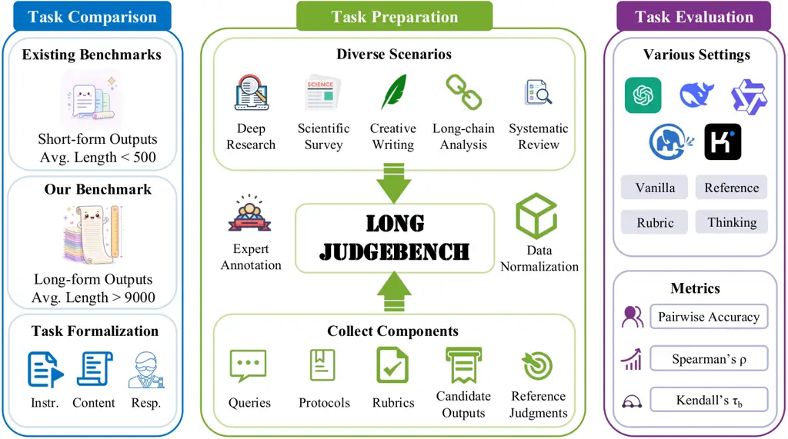

# Benchmarking LLM-as-a-Judge for Long-Form Output Evaluation

Junjie Chen ^(†)^(†)thanks: chenjj826@gmail.com Affiliation: Department
of Computer Science and Technology, Tsinghua University
Affiliation: Quancheng Laboratory    Yuxi Dong Affiliation: University
of Science and Technology Beijing    Haitao Li Affiliation: Department
of Computer Science and Technology, Tsinghua University    Weihang Su
Affiliation: Department of Computer Science and Technology, Tsinghua
University    Yujia Zhou Affiliation: Department of Computer Science and
Technology, Tsinghua University     
Min Zhang Affiliation: Department of Computer Science and Technology,
Tsinghua University    Yiqun Liu Affiliation: Department of Computer
Science and Technology, Tsinghua University    Qingyao Ai
^(†)^(†)thanks: Corresponding Author: aiqy@tsinghua.edu.cn
Affiliation: Department of Computer Science and Technology, Tsinghua
University Affiliation: Quancheng Laboratory

###### Abstract

As large language models (LLMs) are increasingly used for long-form
generation, reliably evaluating long-form outputs has become a critical
challenge. LLM-as-a-judge offers a scalable alternative to human
evaluation, yet its reliability in long-form output evaluation remains
underexamined: existing meta-evaluation benchmarks focus mainly on
short-form outputs. Compared with short-form evaluation, long-form
evaluation is not merely a matter of output length; it often requires
judges to handle more complex document-level demands. In this work, we
introduce LongJudgeBench, a comprehensive benchmark for evaluating LLM
judges on long-form outputs across diverse real-world scenarios and
judging protocols. We systematically evaluate a broad range of LLM
judges, covering multiple base models and judging settings. Our results
reveal a substantial reliability gap: current LLM judges remain unstable
across scenarios, and rubrics or references are helpful but not always
sufficient. We hope LongJudgeBench will support future research on more
robust, context-aware, and human-aligned LLM-as-a-judge methods. Our
code is available at
[https://github.com/cjj826/LongJudgeBench](https://github.com/cjj826/LongJudgeBench).

## 1 Introduction

As large language models (LLMs) Chang et al. (2024); Guo et al. (2025)
continue to advance in open-ended generation tasks such as deep research
and creative writing, reliable and efficient evaluation of their outputs
has become an increasingly critical challenge. Existing evaluation
methods generally fall into manual and automatic approaches. Manual
evaluation Zheng et al. (2023) is often considered reliable, but also
costly, time-consuming, and difficult to scale with the rapid pace of
model development. Automatic evaluation Chang et al. (2024) offers
better scalability, yet conventional metrics remain limited in assessing
open-ended responses, whose quality is inherently multidimensional.
These limitations have motivated the growing adoption of
LLM-as-a-judge Li et al. (2024), a flexible and cost-effective paradigm
in which LLMs assess the quality of candidate outputs.

| Benchmark                         | \# Inst. | Mean  | Med. |
| --------------------------------- | -------- | ----- | ---- |
| MT-Bench Zheng et al. (2023)      | 4,796    | 194.0 | 142  |
| LLMBar Zeng et al. (2024)         | 419      | 106.0 | 49   |
| RewardBench Lambert et al. (2025) | 8,108    | 194.8 | 115  |
| PreferenceBench Kim et al. (2024) | 1,998    | 177.2 | 168  |
| RPR Pitis et al. (2024)           | 11,167   | 94.0  | 89   |
| JudgeBench Tan et al. (2025)      | 620      | 446.0 | 387  |
| RewardBench 2 Malik et al. (2026) | 1,865    | 312.3 | 265  |

Table 1: Statistics of candidate output lengths in existing
LLM-as-a-judge benchmarks. \# Inst., Mean, and Med. denote instance
count, mean length, and median length, respectively. Length is measured
in tokens using the cl100k_base tokenizer from tiktoken.

As LLM-as-a-judge becomes increasingly central to model evaluation,
assessing the reliability of the judges themselves has emerged as an
important research problem. To this end, prior work has introduced a
range of meta-evaluation benchmarks that compare model judgments against
human preferences or other high-quality annotations Lambert et al.
(2025); Zheng et al. (2023); Kim et al. (2024); Malik et al. (2026); Tan
et al. (2025); Zeng et al. (2024); Pitis et al. (2024). These benchmarks
have provided valuable evidence on the promise and limitations of LLM
judges, exposing recurring issues such as position bias, length bias,
and unstable judgments on complex tasks.

However, the growing use of LLMs for long-form tasks, such as deep
research, report generation, and content creation, reveals an important
gap in existing meta-evaluation settings. As shown in Table 1, most
prior benchmarks are built around candidate outputs of only a few
hundred tokens, leaving limited evidence about judge reliability in
long-form evaluation. This gap is not merely a matter of output length:
long-form evaluation involves qualitatively different document-level
evaluation demands, such as assessing overall organization,
cross-section consistency, and coverage and depth across multiple
subtopics. This raises a central question: Can LLM-as-a-judge reliably
evaluate long-form outputs in real-world tasks?

To answer this question, we introduce LongJudgeBench, a comprehensive
meta-evaluation benchmark for assessing LLM-as-a-judge in long-form
output evaluation. Unlike existing judge benchmarks that mainly focus on
short-form responses, LongJudgeBench targets long-form outputs across
five representative real-world scenarios and six datasets. It provides
candidate outputs averaging 9,249.7 tokens, together with task-specific
evaluation protocols and expert reference judgments. LongJudgeBench is
highlighted in the following two aspects:

(1) Real-world scenarios for long-form output evaluation. LongJudgeBench
covers five practical scenarios, including deep research, scientific
survey, creative writing, long-chain analysis, and systematic review.
These scenarios involve diverse document-level evaluation demands, such
as research coverage, survey structure and content quality, writing
preferences, and domain-specific insight assessment, making the
benchmark closer to real-world long-form evaluation needs.

(2) Diverse tasks with reliable expert judgments. LongJudgeBench
integrates six datasets with diverse output lengths, difficulty levels,
and judgment protocols. For reliable meta-evaluation, all reference
judgments come from carefully collected expert annotations, including
direct scoring, preference labeling, ranking, and reference
verification, with necessary quality control.

Using LongJudgeBench, we evaluate a variety of LLM judges across
different model families and judging settings. Our experiments reveal a
clear reliability gap in current LLM-as-a-judge methods under long-form
evaluation, highlighting the need for more robust, context-aware, and
human-aligned LLM-as-a-judge methods.



Figure 1: Overview of LongJudgeBench. Unlike existing LLM-as-a-judge
benchmarks focused on short-form outputs, LongJudgeBench targets
long-form output evaluation. It formalizes each instance with
instruction, content, and response, constructs tasks from diverse
scenarios with queries, protocols, rubrics, candidate outputs, and
reference judgments, and evaluates different judging settings using
various agreement metrics.

## 2 Related Work

LLM-as-a-judge. Evaluation methods for LLMs can be broadly categorized
into manual and automatic approaches. Manual evaluation, such as Chatbot
Arena Zheng et al. (2023), is often reliable but costly and difficult to
scale. Automatic evaluation includes reference-based metrics such as
BLEU Papineni et al. (2002), ROUGE Lin (2004), and BERTScore Zhang et
al. (2019), which rely on reference answers and capture only limited
aspects of response quality, as well as multiple-choice evaluation,
which is easy to score but poorly suited to open-ended tasks. LLM-based
evaluation offers a more flexible alternative by using LLMs as judges to
score, compare, or critique candidate outputs, and its promising
agreement with human preferences in some open-ended settings has led to
broad adoption in model evaluation Chu et al. (2024); Chen et al.
(2026).

Benchmarks for LLM-as-a-judge. As LLM-as-a-judge has become widely used
for evaluation, recent work has begun to evaluate the judges themselves.
MT-Bench Zheng et al. (2023) examines judge–human agreement in
multi-turn question answering, while LLMBar Zeng et al. (2024) tests
robustness to adversarial instruction-following errors.
RewardBench Lambert et al. (2025) and RewardBench 2 Malik et al. (2026)
evaluate reward models and LLM judges using prompt–chosen–rejected
triples, Preference Bench Kim et al. (2024) studies criteria-aware
pairwise judgments with references and rubrics, RPR Pitis et al. (2024)
focuses on context-dependent preference shifts, and JudgeBench Tan et
al. (2025) evaluates objective correctness in knowledge, reasoning,
mathematics, and code. Together, these benchmarks cover preference
alignment, instruction following, reward modeling, context sensitivity,
bias robustness, and objective correctness. However, they mainly
evaluate short candidate outputs (Table 1), leaving the reliability of
LLM-as-a-judge for long-form output evaluation largely underexplored.
Our work addresses this gap. A concurrent work, Long-form
RewardBench Huang et al. (2026), evaluates reward models for long-form
generation using chosen–rejected preference data. However, it is less
suitable for benchmarking LLM-as-a-judge methods themselves, since most
of its gold labels are produced by an LLM-as-a-judge pipeline rather
than expert annotation, potentially causing circularity and
judge-specific biases. Moreover, its responses average around 3K tokens,
far shorter than the 9K+ average outputs in our LongJudgeBench.

## 3 LongJudgeBench

### 3.1 Overview

The central question of this work is whether LLM-as-a-judge can reliably
evaluate long-form outputs. To answer this question, we introduce
LongJudgeBench (as shown in Figure 1), a meta-evaluation benchmark for
studying LLM-as-a-judge across diverse long-form evaluation tasks.

We organize each evaluation instance into three components: instruction,
content, and response. The instruction specifies the judging context,
the content consists of the long-form candidate outputs to be evaluated,
and the response contains the judge’s judgment. The following sections
present the task formalization, describe task preparation, and summarize
the resulting task statistics.

### 3.2 Task Formalization

We formalize LLM-as-a-judge as a function that takes an evaluation
instruction and one or more candidate outputs as input, and produces a
judgment as output. Each instance is represented as

```math
x_{i}=(\mathcal{I}_{i},\mathcal{C}_{i},z_{i}^{*}), \tag{1}
```

where $`\mathcal{I}_{i}`$ denotes the instruction, $`\mathcal{C}_{i}`$
denotes the content to be evaluated, and $`z_{i}^{*}`$ denotes the
reference judgment.

Instruction. The instruction $`\mathcal{I}`$ denotes the judge-side
context that guides the evaluation. We treat $`\mathcal{I}`$ as an
extensible structured object instead of a fixed tuple, since different
tasks may provide different forms of guidance. In LongJudgeBench, an
instruction typically contains the source query $`q`$, a judging
protocol $`m`$, and a set of task-specific auxiliary fields
$`\mathcal{A}`$:

```math
\mathcal{I}\doteq\{q,m\}\cup\mathcal{A}. \tag{2}
```

Here, $`q`$ specifies the original generation task, and $`m`$ defines
the expected form of judgment, such as pointwise scoring, pairwise
comparison, or listwise ranking. The auxiliary fields $`\mathcal{A}`$
are optional and may include evaluation rubrics, criteria weights,
reference materials, domain constraints, formatting requirements, or
other task-specific metadata.

Content. The content $`\mathcal{C}`$ is the candidate output or set of
candidate outputs to be evaluated. Depending on the judging protocol,
$`\mathcal{C}`$ can take different forms:

```math
\mathcal{C}=\begin{cases}\{y_{1}\},&\text{pointwise scoring},\\
\{y_{1},y_{2}\},&\text{pairwise comparison},\\
\{y_{1},\ldots,y_{K}\},&\text{listwise ranking}.\end{cases} \tag{3}
```

Here, each $`y_{k}`$ is a long-form candidate output.

Response. Given an instruction and content, an LLM judge $`J_{\theta}`$
produces a response:

```math
\hat{R}_{i}=J_{\theta}(\mathcal{I}_{i},\mathcal{C}_{i}). \tag{4}
```

The response may include both a natural-language rationale and a
structured final judgment:

```math
\hat{R}_{i}=(\hat{e}_{i},\hat{z}_{i}), \tag{5}
```

where $`\hat{e}_{i}`$ is an optional explanation and $`\hat{z}_{i}`$ is
the extracted judgment. The judgment format depends on the protocol. In
pointwise evaluation, $`\hat{z}_{i}`$ is usually a scalar score or an
ordinal label; in pairwise evaluation, $`\hat{z}_{i}`$ is a preference
over two candidate outputs; and in listwise evaluation, $`\hat{z}_{i}`$
is a ranking or a set of scores over multiple outputs.

[TABLE]

Table 2: Statistics of our LongJudgeBench. In the following sections, we
use DR-Bench, RealDR, WP-Bench, and Verify to denote DeepResearch Bench,
RealDeepResearch, WritingPreferenceBench, and VerifyBench, respectively.
Output length is measured in tokens using the cl100k_base tokenizer from
tiktoken.

### 3.3 Task Preparation

LongJudgeBench is designed to assess LLM judges across representative
long-form output evaluation tasks. While LLM-as-a-judge has been adopted
in many real-world long-form tasks, existing studies remain fragmented,
often limited in scale and heterogeneous in data formats, judgment
protocols, and evaluation targets. LongJudgeBench consolidates these
scattered settings into a unified benchmark, enabling systematic
evaluation of judge reliability across diverse long-form scenarios.
Specifically, we construct or collect six evaluation datasets from five
real-world scenarios: (i) deep research, (ii) scientific survey, (iii)
creative writing, (iv) long-chain analysis, and (v) systematic review.
These datasets span multiple domains, two languages (Chinese and
English), and three judgment protocols: pointwise, pairwise, and
listwise evaluation.

Deep research. We first incorporate DeepResearch Bench Du et al. (2026),
which provides expert-designed research questions and long research
reports. However, its publicly released human-annotated subset is
limited to 200 Chinese reports stored as plain strings, lacking
multilingual coverage and omitting presentation-level information such
as tables, figures, structured layouts, and other document elements
commonly found in real reports. To address these limitations, we further
construct and annotate RealDeepResearch, which contains 40 research
tasks, 4 prompt styles, and 4 generation models, resulting in 640 long
documents. RealDeepResearch covers both Chinese and English documents
and preserves the original DOCX format, making it closer to real-world
deep research evaluation. The annotations were carried out by expert
annotators, who were compensated at a fair rate. The total cost was
approximately USD 2,260. Further details are provided in Appendix C.

Scientific survey. We include SurGE Su et al. (2026), which provides 41
topics and 164 survey documents with human rankings over structural and
content quality.

Creative writing. We use a uniformly sampled subset of
WritingPreferenceBench Ying et al. (2025), which focuses on pairwise
preferences between long-form creative responses driven by subjective
qualities such as style, creativity, and emotional resonance.

Long-chain analysis. We include VerifyBench Yan et al. (2026), where
judges are given long-form model reasoning analyses and are asked to
determine whether the final answer is correct.

Systematic review. We include MA Xie et al. (2026) for evaluating the
insight dimension in clinical systematic reviews and meta-analyses.

Following the formalization in Section 3.2, we normalize all datasets
into a unified instance format while preserving their original
evaluation protocols whenever possible. More details about task
preparation can be found in Appendix C.

### 3.4 Task Statistics

After task preparation, LongJudgeBench contains a diverse collection of
long-form output evaluation instances across multiple scenarios and
judging protocols. We report the statistics of the benchmark in Table 2.
Compared with existing LLM-as-a-judge benchmarks, where candidate
outputs are typically shorter than 500 tokens on average, LongJudgeBench
targets substantially longer outputs, with an average length exceeding
9,000 tokens. Beyond increasing output length, these instances expose
LLM judges to real-world document-level evaluation demands, such as
assessing overall organization, cross-section consistency, and coverage
and depth across multiple subtopics.

| Model                    | Setting     | DR-Bench | RealDR | SurGE     |         | WP-Bench | Verify | MA     | Avg. w/o WP | Avg. w/ WP |
| ------------------------ | ----------- | -------- | ------ | --------- | ------- | -------- | ------ | ------ | ----------- | ---------- |
|                          |             |          |        | Structure | Content |          |        |        |             |            |
| Qwen3-32B (w/o thinking) | Vanilla     | 0.5600   | 0.3929 | 0.5732    | 0.6179  | 0.6160   | 0.4968 | 0.5667 | 0.5346      | 0.5462     |
|                          | Rubric      | 0.7033   | 0.3881 | 0.6016    | 0.6138  | 0.6065   | 0.4747 | 0.5278 | 0.5516      | 0.5594     |
|                          | Reference   | 0.5867   | 0.3271 | 0.6260    | 0.7073  | –        | 0.7880 | 0.5111 | 0.5910      | 0.5910     |
|                          | Ref.+Rubric | 0.6833   | 0.4121 | 0.5935    | 0.6667  | –        | 0.7816 | 0.5111 | 0.6081      | 0.6081     |
| Qwen3-32B (w/ thinking)  | Vanilla     | 0.5833   | 0.4144 | 0.3902    | 0.4553  | 0.6388   | 0.4589 | 0.5444 | 0.4744      | 0.4979     |
|                          | Rubric      | 0.6967   | 0.5017 | 0.4472    | 0.3862  | 0.6369   | 0.4842 | 0.4222 | 0.4897      | 0.5107     |
|                          | Reference   | 0.5367   | 0.4373 | 0.5203    | 0.5854  | –        | 0.7342 | 0.4722 | 0.5477      | 0.5477     |
|                          | Ref.+Rubric | 0.6800   | 0.5031 | 0.4309    | 0.4797  | –        | 0.6804 | 0.4944 | 0.5448      | 0.5448     |
| Qwen3-Max                | Vanilla     | 0.5500   | 0.4275 | 0.7073    | 0.7236  | 0.5875   | 0.5316 | 0.5389 | 0.5798      | 0.5809     |
|                          | Rubric      | 0.7133   | 0.5019 | 0.8008    | 0.6382  | 0.5856   | 0.5443 | 0.5278 | 0.6211      | 0.6160     |
|                          | Reference   | 0.6667   | 0.4808 | 0.8211    | 0.7317  | –        | 0.8291 | 0.5167 | 0.6744      | 0.6744     |
|                          | Ref.+Rubric | 0.7133   | 0.4683 | 0.4959    | 0.7561  | –        | 0.8133 | 0.5056 | 0.6254      | 0.6254     |
| GPT-4o-mini              | Vanilla     | 0.3833   | 0.3544 | 0.2276    | 0.2805  | 0.5114   | 0.4019 | 0.5611 | 0.3681      | 0.3886     |
|                          | Rubric      | 0.6900   | 0.3458 | 0.2764    | 0.2317  | 0.5076   | 0.4051 | 0.5556 | 0.4174      | 0.4303     |
|                          | Reference   | 0.6233   | 0.2435 | 0.4228    | 0.1707  | –        | 0.7975 | 0.5833 | 0.4735      | 0.4735     |
|                          | Ref.+Rubric | 0.7467   | 0.3208 | 0.5122    | 0.3577  | –        | 0.7943 | 0.6000 | 0.5553      | 0.5553     |
| GPT-5.2                  | Vanilla     | 0.4733   | 0.3554 | 0.4187    | 0.3293  | 0.5266   | 0.7089 | 0.4111 | 0.4495      | 0.4605     |
|                          | Rubric      | 0.7100   | 0.4429 | 0.7154    | 0.2033  | 0.5722   | 0.6899 | 0.3889 | 0.5251      | 0.5318     |
|                          | Reference   | 0.5633   | 0.5085 | 0.3089    | 0.2276  | –        | 0.8228 | 0.4444 | 0.4793      | 0.4793     |
|                          | Ref.+Rubric | 0.7033   | 0.4319 | 0.1545    | 0.2033  | –        | 0.8133 | 0.4222 | 0.4548      | 0.4548     |
| DeepSeek-V4-Flash        | Vanilla     | 0.5933   | 0.4427 | 0.7073    | 0.7846  | 0.5837   | 0.5981 | 0.4611 | 0.5979      | 0.5958     |
|                          | Rubric      | 0.7200   | 0.5710 | 0.6341    | 0.6057  | 0.5837   | 0.5570 | 0.3944 | 0.5804      | 0.5808     |
|                          | Reference   | 0.6767   | 0.4067 | 0.7967    | 0.7398  | –        | 0.8924 | 0.4778 | 0.6650      | 0.6650     |
|                          | Ref.+Rubric | 0.7100   | 0.5552 | 0.7073    | 0.6341  | –        | 0.8133 | 0.4389 | 0.6431      | 0.6431     |
| GLM-5.1                  | Vanilla     | 0.5967   | 0.5067 | 0.6911    | 0.7520  | 0.5913   | 0.6171 | 0.5056 | 0.6115      | 0.6086     |
|                          | Rubric      | 0.7067   | 0.5606 | 0.7276    | 0.6545  | 0.5779   | 0.5981 | 0.4778 | 0.6209      | 0.6147     |
|                          | Reference   | 0.6900   | 0.5092 | 0.8130    | 0.6179  | –        | 0.8228 | 0.4444 | 0.6496      | 0.6496     |
|                          | Ref.+Rubric | 0.6967   | 0.5315 | 0.5610    | 0.6016  | –        | 0.7563 | 0.4722 | 0.6032      | 0.6032     |
| Kimi-K2.6                | Vanilla     | 0.6433   | 0.4492 | 0.6463    | 0.7073  | 0.5589   | 0.5791 | 0.5389 | 0.5940      | 0.5890     |
|                          | Rubric      | 0.7200   | 0.5175 | 0.7439    | 0.6179  | 0.5570   | 0.6203 | 0.5167 | 0.6227      | 0.6133     |
|                          | Reference   | 0.6733   | 0.4577 | 0.5610    | 0.5610  | –        | 0.8481 | 0.5722 | 0.6122      | 0.6122     |
|                          | Ref.+Rubric | 0.6900   | 0.5056 | 0.4390    | 0.5691  | –        | 0.8196 | 0.5389 | 0.5937      | 0.5937     |

Table 3: Accuracy of different LLM-as-a-judge baselines. SurGE reports
structure and content quality. Ref.+Rubric denotes reference-based
judging with rubric guidance. WP-Bench is unavailable for
reference-based settings due to the absence of appropriate reference
answers. Avg. w/o WP averages DR-Bench, RealDR, SurGE (Structure and
Content), Verify, and MA. Avg. w/ WP further includes WP-Bench when
available and ignores missing values.

## 4 Experimental Setup

### 4.1 Baselines

We evaluate a broad set of LLM-as-a-judge baselines along two axes: the
base model and the judging setting. This design allows us to analyze how
judge reliability varies with model capability, the available evaluation
information, and their interaction under long-form evaluation demands.

Base models. We instantiate LLM judges using models from representative
model families, including Qwen3-32B (w/o thinking), Qwen3-32B (w/
thinking), Qwen3-Max Yang et al. (2025), GPT-4o-mini, GPT-5.2 Singh et
al. (2025), DeepSeek-V4-Flash Xu et al. (2026), GLM-5.1 Zeng et al.
(2026), and Kimi-K2.6 Team et al. (2025). These models cover both
proprietary and open-weight systems, and represent different strengths
in instruction following, long-context understanding, and reasoning. All
judges are evaluated using the same task inputs and output-extraction
procedure. We set the temperature to 0 for all runs to ensure a fair
comparison across base models.

Judging settings. For each base model, we evaluate several judging
settings that differ in whether they provide external evaluation
anchors, such as rubrics or references.

Vanilla prompting asks the model to directly evaluate the candidate
output and produce a final judgment. This represents the simplest and
most commonly used LLM-as-a-judge setting.

Rubric-based judging provides the judge with task-specific rubrics or
criteria. The judge is asked to assess the candidate output according to
these criteria before producing the final judgment.

Reference-based judging provides the judge with additional reference
information, such as reference answers, expert-written reports, or
task-specific evidence. The judge is expected to use this information as
an evaluation anchor when assessing the candidate output.

Reference+Rubric judging combines both types of auxiliary information.
The judge is given reference information as comparison anchors and
rubrics as evaluation criteria. This setting examines whether explicit
references and structured criteria can jointly improve judgment
reliability.

### 4.2 Metrics

We evaluate judge reliability by measuring the agreement between
model-produced judgments and reference judgments using accuracy,
Spearman’s rank correlation, and Kendall’s $`\tau_{b}`$. Unless
otherwise specified, each metric is computed within a query group and
then averaged across groups. Accuracy is used as the main metric in our
experiments.

Accuracy. We compute accuracy as the agreement between predicted
judgments and reference judgments. Depending on the dataset, the
judgment unit is either a preference decision or a correctness decision.
For preference-based datasets, we convert both model judgments and
reference judgments into pairwise preferences. For a query $`q`$ with
candidate outputs $`\{y_{q,1},\ldots,y_{q,K}\}`$, let
$`\mathcal{P}_{q}`$ denote the set of all valid candidate pairs. For
each pair $`(a,b)\in\mathcal{P}_{q}`$, let $`z^{*}_{q,a,b}`$ and
$`\hat{z}_{q,a,b}`$ denote the reference and predicted preferences,
respectively. The predicted preference is obtained directly in pairwise
evaluation, by comparing candidate scores in pointwise evaluation, and
by comparing candidate ranks in listwise evaluation. We compute
preference accuracy as

```math
\mathrm{Acc}_{q}=\frac{1}{|\mathcal{P}_{q}|}\sum_{(a,b)\in\mathcal{P}_{q}}\mathbb{I}[\hat{z}_{q,a,b}=z^{*}_{q,a,b}], \tag{6}
```

where a prediction is considered correct only when it exactly matches
the reference preference, including cases where both the reference and
prediction indicate a tie. To reduce position bias in pairwise
evaluation, we evaluate each pair in both answer orders and average the
two results.

For correctness-based datasets such as VerifyBench, the reference label
indicates whether the final answer is correct. We therefore compute
accuracy directly as label agreement over all instances.

Spearman’s rank correlation. Given reference scores
$`\mathbf{s}^{*}_{q}=(s^{*}_{q,1},\ldots,s^{*}_{q,K})`$ and judge scores
$`\hat{\mathbf{s}}_{q}=(\hat{s}_{q,1},\ldots,\hat{s}_{q,K})`$ for query
$`q`$, we first convert them into ranks:

```math
r^{*}_{q,k}=\operatorname{rank}(s^{*}_{q,k}),\qquad\hat{r}_{q,k}=\operatorname{rank}(\hat{s}_{q,k}). \tag{7}
```

Spearman’s rank correlation is computed as

```math
\rho_{q}=\frac{\sum_{k=1}^{K}(\hat{r}_{q,k}-\bar{\hat{r}}_{q})(r^{*}_{q,k}-\bar{r}^{*}_{q})}{\sqrt{\sum_{k=1}^{K}(\hat{r}_{q,k}-\bar{\hat{r}}_{q})^{2}}\sqrt{\sum_{k=1}^{K}(r^{*}_{q,k}-\bar{r}^{*}_{q})^{2}}}, \tag{8}
```

where $`\bar{\hat{r}}_{q}`$ and $`\bar{r}^{*}_{q}`$ denote the mean
ranks of the judge scores and reference scores, respectively.

Kendall’s rank correlation. We report Kendall’s $`\tau_{b}`$ to account
for tied rankings. For each query $`q`$, we compare the pairwise
ordering induced by the judge scores $`\hat{s}`$ with that induced by
the reference scores $`s^{*}`$. Let $`C_{q}`$ and $`D_{q}`$ be the
numbers of concordant and discordant candidate pairs, respectively, and
let $`T_{\hat{s},q}`$ and $`T_{s^{*},q}`$ be the numbers of tied pairs
that occur only in the judge scores and only in the reference scores. We
compute

```math
\tau_{b,q}=\frac{C_{q}-D_{q}}{\sqrt{(C_{q}+D_{q}+T_{\hat{s},q})(C_{q}+D_{q}+T_{s^{*},q})}}. \tag{9}
```

## 5 Experimental Results

### 5.1 Main Results

Table 3 reports the accuracy of different judging settings. Due to space
limitations, we focus on accuracy in the main results and provide
additional metrics in Appendix E. We use Avg. w/ WP as the default
aggregate score unless otherwise specified. The main observations are
summarized below.

Overall, LongJudgeBench remains highly challenging. Existing
LLM-as-a-judge methods achieve only moderate performance on
LongJudgeBench. The best configuration, Qwen3-Max with reference,
reaches an average accuracy of 0.6744, followed by DeepSeek-V4-Flash +
Reference at 0.6650 and GLM-5.1 + Reference at 0.6496. Across all 32
model–setting combinations, only 12 exceed 0.60, and the overall mean is
0.5639, only slightly above the random pairwise baseline of 0.5. These
results indicate that reliable long-form judging remains far from
solved.

Judge performance varies substantially across models and scenarios.
Qwen3-Max, DeepSeek-V4-Flash, and GLM-5.1 achieve the highest aggregate
scores among the evaluated judges, while GPT-4o-mini and GPT-5.2 obtain
lower scores. This suggests that stronger general-purpose capabilities
may not always translate into stronger long-form judging performance.
Scenario-level results also vary widely across tasks. Judges tend to
perform better on tasks with clearer evaluation anchors: Verify achieves
the highest average score of 0.6742, likely because it mainly requires
checking whether the final answer matches the reference; DR-Bench also
obtains a relatively high score of 0.6464, where judges evaluate
plain-text research reports with more explicit quality criteria. In
contrast, performance is lower on scenarios that may require broader
document understanding or more subjective judgment: RealDR reaches
0.4460, possibly reflecting the added difficulty of realistic document
structure and multilingual content; MA obtains 0.4983, as medical
insight evaluation requires domain-specific evidence understanding; and
WP-Bench remains challenging at 0.5776, as creative-writing evaluation
often depends on subjective preferences. This contrast suggests that the
difficulty of long-form judging depends not only on output length, but
also on how explicit, structured, and objective the evaluation target
is.

References and rubrics help, but their benefits are not universal. Among
the four judging settings, Reference achieves the best average
performance, improving the overall score from 0.5334 under Vanilla to
0.5866. The gain is particularly clear on tasks with explicit evaluation
anchors, such as Verify, where the average score increases from 0.5491
to 0.8169. Rubric also improves over Vanilla, especially for
multidimensional research-report evaluation: DR-Bench increases from
0.5479 to 0.7075, and RealDR increases from 0.4179 to 0.4787. However,
these improvements are not uniform across scenarios. Rubric
underperforms Vanilla on SurGE-Content and MA, while Reference brings
only limited gains on RealDR. Moreover, the benefit of combining
reference and rubric guidance is not simply additive: Ref.+Rubric
reaches 0.5786, slightly below Reference alone at 0.5866. These results
suggest that the Reference and Rubric may offer useful evaluation
signals, but effectively integrating them remains an important challenge
for reliable long-form judging.

Thinking mode shows mixed effects on Qwen3-32B as a judge. For
Qwen3-32B, enabling thinking mode does not lead to consistent gains
across scenarios. It improves RealDR from 0.3801 to 0.4641 and brings a
modest gain on WP-Bench from 0.6113 to 0.6379. However, these
improvements are not reflected in the overall average, which decreases
from 0.5762 without thinking to 0.5253 with thinking. Overall, thinking
mode may be helpful in certain scenarios, but its effect is highly
task-dependent rather than always beneficial.

### 5.2 Output Length Sensitivity Analysis

In this section, we analyze how output length affects the LLM judges’
reliability. To reduce confounding from additional judging inputs, we
conduct this analysis under the Vanilla setting, without references or
rubrics. The analysis covers four strong judge models, Qwen3-Max,
DeepSeek-V4-Flash, GLM-5.1, and Kimi-K2.6, on all six datasets. For
preference-based datasets, we measure output length by the average token
length of the two candidate outputs; for correctness-based datasets such
as Verify, we use the token length of the evaluated output. For each
dataset, we sort instances by output length and split them into four
equal-sized quantile bins, Q1–Q4, from shortest to longest. We then
compute accuracy within each bin. We use adaptive bins because length
distributions differ substantially across datasets, making fixed
intervals prone to empty or highly imbalanced bins.

As shown in Figure 2, we analyze the effect of output length on judge
performance from two perspectives: the direction of performance changes
and their consistency across models. Overall, the relationship between
output length and judge accuracy is dataset-specific and cannot be
simply summarized as longer is worse. RealDR, SurGE, and Verify
generally show decreasing trends from Q1 to Q4, and these trends are
relatively consistent across judge models. In contrast, DR-Bench
exhibits a non-monotonic pattern, with all four models achieving higher
accuracy around Q2 than on Q1 and Q4. WP-Bench does not show a
decreasing trend with longer outputs; some models instead achieve higher
accuracy on longer bins. MA also lacks a clear monotonic pattern, with
inconsistent directions across models. These results support our
observation that long-form evaluation is not merely a matter of output
length, but also involves task-specific document-level demands, such as
subjective preference assessment in WP-Bench and domain-specific medical
insight evaluation in MA.

Figure 2: Output length sensitivity of LLM judges across six datasets.
For SurGE, we plot only Structure since Content shows a similar trend.

### 5.3 Case Study and Failure Analysis

In this section, we further summarize the challenges of long-form
evaluation revealed by LongJudgeBench and discuss potential
improvements.

Misled by superficial coverage. Long-form outputs are often lengthy,
well-structured, and rich in background knowledge, which can create an
impression of sufficient coverage without truly addressing the user’s
core question. In a computational chemistry case, the user asks how to
simulate an external electric field in Gaussian for a single-atom
catalyst system with uncertain molecular orientation. The key issue is
not general external-field simulation, but how to handle the field
direction under orientation uncertainty. Although the candidate response
contains about 12K tokens and extensively discusses Gaussian Field
syntax, VASP, and other general topics, it devotes only a few sentences
to the core issue. Still, Qwen3-Max assigns an overall score of 9.26,
while the human score is only 5.87. This case shows that LLM judges can
mistake surface richness for substantive answers. A more reliable
long-form judge should look beyond coverage and structure to assess
whether the output truly addresses the user’s central need.

Scenario-specific concept misgrounding. Long-form generation tasks often
involve complex domain-specific concepts, but the LLM judge may lack the
conceptual discrimination needed for reliable evaluation. In a technical
survey case, the user asks about the concrete implementation of
Anthropic’s recently released Streamable HTTP. Although the candidate
response is about 14K tokens long, it mainly discusses general SSE-based
streaming in the Anthropic Messages API. The Qwen3-Max judge incorrectly
treats Messages API streaming and Streamable HTTP as the same concept,
assigning an overall score of 8.85, while the human score is only 5.37.
Similarly, Table 3 further shows that LLM judges perform poorly on the
MA medical-domain dataset, suggesting that it may struggle to apply
domain-specific evaluation criteria in specialized scenarios. Future
long-form judges need stronger domain concept disambiguation and better
adaptation to different evaluation demands.

Other failures. LLM judges also exhibit some systematic biases and
practical failures. As detailed in Appendix B, their decisions can be
affected by irrelevant factors such as candidate output order,
indicating position bias. In addition, some judgments fail because of
context-window overflow or safety-policy rejection, especially when long
outputs are combined with references and rubrics or when inputs contain
sensitive legal-domain content. These findings show that long-form
evaluation is constrained not only by judgment accuracy, but also by
robustness to bias, prompt complexity, and model safety behavior.

## 6 Conclusion

In this paper, we introduce LongJudgeBench, a comprehensive benchmark
for evaluating LLM-as-a-judge reliability in long-form output
evaluation. Covering diverse real-world scenarios and evaluation
protocols, LongJudgeBench enables systematic analysis of LLM judges
across different settings. Our experiments show that long-form judging
remains highly challenging, and we hope this work will help pave the way
for future research on reliable LLM-as-a-judge methods.

## 7 Limitations

We acknowledge several limitations in this study and aim to address them
in future work. First, although LongJudgeBench covers multiple
representative long-form evaluation scenarios, it still cannot fully
capture the diversity of real-world long-form generation tasks. We plan
to further expand the benchmark with more domains, task types, and
application settings. Second, our experiments consider several
representative LLM judges and judging settings, but more advanced judge
designs, such as retrieval-augmented judging, multi-agent judging, and
calibration-based methods, remain to be explored. We hope future work
can build upon LongJudgeBench to develop more reliable and robust
long-form output evaluation methods.

## 8 Ethical Considerations

Throughout this research, ethical considerations have been integral to
ensuring the responsible development and application of AI technologies.
We are committed to the principles of open research and the scientific
value of reproducibility. Therefore, we have made all the code from our
study publicly accessible on GitHub. This transparency allows the
community to validate our results and promotes the use of our methods in
various settings. Moreover, we used AI assistants only for language
polishing and editing to improve clarity, grammar, and readability.

## Acknowledgments

This work is supported by the Research Project of Quancheng Laboratory,
China (Grant No. QCL20250105).

## References

- Chang et al. (2024) Y. Chang, X. Wang, J. Wang, Y. Wu, L. Yang, K.
  Zhu, H. Chen, X. Yi, C. Wang, Y. Wang, et al. A survey on evaluation
  of large language models. ACM transactions on intelligent systems and
  technology 15 (3), pp. 1–45. Cited by: §1.
- Chen et al. (2026) J. Chen, W. Su, Z. Chu, H. Li, Y. Zhou, D. Yuan, X.
  Wang, J. Zhou, Y. Liu, M. Zhang, et al. Auto-pre: an automatic and
  cost-efficient peer-review framework for language generation
  evaluation. In Proceedings of the AAAI Conference on Artificial
  Intelligence, Vol. 40, pp. 30235–30242. Cited by: §2.
- Chu et al. (2024) Z. Chu, Q. Ai, Y. Tu, H. Li, and Y. Liu Automatic
  large language model evaluation via peer review. In Proceedings of the
  33rd ACM International Conference on Information and Knowledge
  Management, pp. 384–393. Cited by: §2.
- Du et al. (2026) M. Du, B. Xu, C. Zhu, L. Zhang, X. Wang, and Z. Mao
  Deepresearch bench: a comprehensive benchmark for deep research
  agents. In International Conference on Learning Representations, Vol.
  2026, pp. 42414–42448. Cited by: §C.1, §3.3.
- Guo et al. (2025) D. Guo, D. Yang, H. Zhang, J. Song, P. Wang, Q.
  Zhu, R. Xu, R. Zhang, S. Ma, X. Bi, et al. DeepSeek-r1 incentivizes
  reasoning in llms through reinforcement learning. Nature 645 (8081),
  pp. 633–638. Cited by: §1.
- Huang et al. (2026) H. Huang, Y. He, W. Liu, M. Yang, J. Liu, K.
  Chen, B. Xu, C. Zhu, H. Cao, and T. Zhao Long-form rewardbench:
  evaluating reward models for long-form generation. In Proceedings of
  the AAAI Conference on Artificial Intelligence, Vol. 40,
  pp. 31149–31157. Cited by: §2.
- Kim et al. (2024) S. Kim, J. Suk, S. Longpre, B. Y. Lin, J. Shin, S.
  Welleck, G. Neubig, M. Lee, K. Lee, and M. Seo Prometheus 2: an open
  source language model specialized in evaluating other language models.
  In Proceedings of the 2024 Conference on Empirical Methods in Natural
  Language Processing, pp. 4334–4353. Cited by: Table 1, §1, §2.
- Lambert et al. (2025) N. Lambert, V. Pyatkin, J. Morrison, L.
  Miranda, B. Y. Lin, K. Chandu, N. Dziri, S. Kumar, T. Zick, Y. Choi,
  et al. Rewardbench: evaluating reward models for language modeling. In
  Findings of the Association for Computational Linguistics: NAACL 2025,
  pp. 1755–1797. Cited by: Table 1, §1, §2.
- Li et al. (2024) H. Li, Q. Dong, J. Chen, H. Su, Y. Zhou, Q. Ai, Z.
  Ye, and Y. Liu Llms-as-judges: a comprehensive survey on llm-based
  evaluation methods. arXiv preprint arXiv:2412.05579. Cited by: §1.
- Lin (2004) C. Lin Rouge: a package for automatic evaluation of
  summaries. In Text summarization branches out, pp. 74–81. Cited by:
  §2.
- Malik et al. (2026) S. Malik, V. Pyatkin, S. Land, J. Morrison, N.
  Smith, H. Hajishirzi, and N. Lambert Rewardbench 2: advancing reward
  model evaluation. In International Conference on Learning
  Representations, Vol. 2026, pp. 144839–144866. Cited by: Table 1, §1,
  §2.
- Papineni et al. (2002) K. Papineni, S. Roukos, T. Ward, and W. Zhu
  Bleu: a method for automatic evaluation of machine translation. In
  Proceedings of the 40th annual meeting of the Association for
  Computational Linguistics, pp. 311–318. Cited by: §2.
- Pitis et al. (2024) S. Pitis, Z. Xiao, N. Le Roux, and A. Sordoni
  Improving context-aware preference modeling for language models.
  Advances in Neural Information Processing Systems 37, pp. 70793–70827.
  Cited by: Table 1, §1, §2.
- Singh et al. (2025) A. Singh, A. Fry, A. Perelman, A. Tart, A.
  Ganesh, A. El-Kishky, A. McLaughlin, A. Low, A. Ostrow, A. Ananthram,
  et al. Openai gpt-5 system card. arXiv preprint arXiv:2601.03267.
  Cited by: §4.1.
- Su et al. (2026) W. Su, A. Xie, Q. Ai, J. Long, X. Chen, J. Mao, Z.
  Ye, and Y. Liu Surge: a benchmark and evaluation framework for
  scientific survey generation. In Proceedings of the 49th International
  ACM SIGIR Conference on Research and Development in Information
  Retrieval, pp. 3404–3412. Cited by: §C.2, §3.3.
- Tan et al. (2025) S. Tan, S. Zhuang, K. Montgomery, W. Tang, A.
  Cuadron, C. Wang, R. Popa, and I. Stoica Judgebench: a benchmark for
  evaluating llm-based judges. In International Conference on Learning
  Representations, Vol. 2025, pp. 63277–63303. Cited by: Table 1, §1,
  §2.
- Team et al. (2025) K. Team, Y. Bai, Y. Bao, Y. Charles, C. Chen, G.
  Chen, H. Chen, H. Chen, J. Chen, N. Chen, et al. Kimi k2: open agentic
  intelligence. arXiv preprint arXiv:2507.20534. Cited by: §4.1.
- Xie et al. (2026) A. Xie, W. Su, Y. Zhou, Y. Liu, and Q. Ai
  Benchmarking llm agents on meta-analysis articles from nature
  portfolio. arXiv preprint arXiv:2606.17041. Cited by: §C.5, §3.3.
- Xu et al. (2026) A. Xu, B. Lin, B. Xue, B. Wang, B. Xu, B. Wu, B.
  Zhang, C. Lin, C. Dong, C. Ling, et al. Deepseek-v4: towards highly
  efficient million-token context intelligence. arXiv preprint
  arXiv:2606.19348. Cited by: §4.1.
- Yan et al. (2026) Y. Yan, J. Jiang, Z. Ren, Y. Li, X. Cai, Y. Liu, X.
  Xu, M. Zhang, J. Shao, Y. Shen, et al. Verifybench: benchmarking
  reference-based reward systems for large language models. In
  International Conference on Learning Representations, Vol. 2026,
  pp. 143482–143522. Cited by: §C.4, §3.3.
- Yang et al. (2025) A. Yang, A. Li, B. Yang, B. Zhang, B. Hui, B.
  Zheng, B. Yu, C. Gao, C. Huang, C. Lv, et al. Qwen3 technical report.
  arXiv preprint arXiv:2505.09388. Cited by: §4.1.
- Ying et al. (2025) S. Ying, Y. Li, X. Qu, X. Li, S. Jin, M. Liu, Z.
  Wen, X. Du, T. Zheng, Y. Zhang, et al. Beyond correctness: evaluating
  subjective writing preferences across cultures. arXiv preprint
  arXiv:2510.14616. Cited by: §C.3, §3.3.
- Zeng et al. (2026) A. Zeng, X. Lv, Z. Hou, Z. Du, Q. Zheng, B.
  Chen, D. Yin, C. Ge, C. Huang, C. Xie, et al. Glm-5: from vibe coding
  to agentic engineering. arXiv preprint arXiv:2602.15763. Cited by:
  §4.1.
- Zeng et al. (2024) Z. Zeng, J. Yu, T. Gao, Y. Meng, T. Goyal, and D.
  Chen Evaluating large language models at evaluating instruction
  following. In International Conference on Learning Representations,
  Vol. 2024, pp. 40193–40219. Cited by: Table 1, §1, §2.
- Zhang et al. (2019) T. Zhang, V. Kishore, F. Wu, K. Q. Weinberger,
  and Y. Artzi Bertscore: evaluating text generation with bert. arXiv
  preprint arXiv:1904.09675. Cited by: §2.
- Zheng et al. (2023) L. Zheng, W. Chiang, Y. Sheng, S. Zhuang, Z.
  Wu, Y. Zhuang, Z. Lin, Z. Li, D. Li, E. Xing, et al. Judging
  llm-as-a-judge with mt-bench and chatbot arena. Advances in neural
  information processing systems 36, pp. 46595–46623. Cited by: Table 1,
  §1, §1, §2, §2.

## Appendix A License

In this section, we clarify the copyright and licensing status of
LongJudgeBench to ensure that users can utilize the benchmark in a legal
and compliant manner.

LongJudgeBench is constructed from open-source datasets and data
collected and annotated by us. All external datasets used in
LongJudgeBench are publicly available, and we have carefully reviewed
their licenses and usage terms to ensure that their inclusion in the
benchmark is permitted. For our self-collected data, annotations,
metadata, model outputs, and evaluation protocols, we hold the rights to
release them as part of the benchmark. While the processed benchmark is
released for public use, the copyright of the original third-party
resources remains with their respective authors or organizations. Users
are expected to respect the original licenses, citation requirements,
and terms of use associated with these resources when using
LongJudgeBench.

We release our code, self-collected data, annotations, metadata, model
outputs, and evaluation protocols under the MIT License where permitted.
Third-party datasets included in LongJudgeBench remain subject to their
original licenses and terms of use. Users should follow the
corresponding licenses, citation requirements, and usage restrictions of
the original resources. If you believe that LongJudgeBench contains any
content that infringes upon your rights or violates the license terms of
an original resource, please contact us at any time, and we will
promptly review and address the issue.

## Appendix B Analysis Details

In this section, we further analyze some systematic biases and practical
failures in LongJudgeBench.

Position bias. For pairwise preference-based datasets, a reliable judge
should give consistent decisions regardless of the order in which
candidate outputs are presented. To measure position bias, we swap the
order of the two candidate outputs and compare the resulting preference
with the original judgment. We define an inconsistent pair as a pair
where the judge gives contradictory content-level preferences after the
order swap, which corresponds to selecting the same displayed position
in both orders. A higher inconsistency rate therefore indicates stronger
sensitivity to candidate order.

Table 4 reports the inconsistency rates under the Vanilla setting on
WP-Bench and MA. The results show that position bias varies
substantially across models and datasets. GPT-4o-mini shows an
especially high inconsistency rate of 78.7% on WP-Bench, suggesting
strong dependence on candidate order. GPT-5.2 also shows high
inconsistency on MA, reaching 55.6%. In contrast, Kimi-K2.6 and
Qwen3-32B without thinking exhibit lower inconsistency rates on both
datasets. These results suggest that some LLM judges may rely on
positional cues rather than stable quality criteria, especially when
comparing long-form candidate outputs.

Practical failures. LLM judges also encounter practical failures that
prevent valid scoring. As shown in Figure 3, these failures are
concentrated in a few model–setting–dataset groups. Context-window
overflow occurs when long prompts exceed the model’s input limit,
especially when outputs, references, and rubrics are combined.
Safety-policy rejection occurs when judges refuse to score certain
inputs, mainly in RealDR queries involving criminal-law-related content.
Since these failures prevent valid judgments, we treat them as incorrect
when computing accuracy. These results show that long-form evaluation is
also constrained by context length, prompt complexity, and model safety
behavior.

| Model                  | WP-Bench | MA    |
| ---------------------- | -------- | ----- |
| GLM-5.1                | 17.9%    | 33.3% |
| GPT-4o-mini            | 78.7%    | 48.9% |
| GPT-5.2                | 46.0%    | 55.6% |
| DeepSeek-V4-Flash      | 62.0%    | 45.6% |
| Qwen3-Max              | 43.0%    | 38.9% |
| Qwen3-32B              | 21.3%    | 37.8% |
| Qwen3-32B w/o thinking | 16.0%    | 21.1% |
| Kimi-K2.6              | 10.6%    | 23.3% |

Table 4: Position bias analysis under the Vanilla setting on WP-Bench
and MA. We report the inconsistency rate after swapping the order of the
two candidate outputs. Higher values indicate stronger position bias.

Figure 3: Special failure rates of LLM judges in long-form evaluation.
The rate denotes the percentage of evaluation instances where the judge
fails to produce a valid judgment due to context-window overflow or
safety-policy rejection. DS denotes DeepSeek-V4-Flash. When multiple
model names are joined by “+”, they share the same failure rate under
the corresponding setting and dataset.

## Appendix C Task Preparation Details

This section provides additional details about the datasets used in
LongJudgeBench, including their sources, task formats, annotation
protocols, and adaptation procedures. Following Section 3.2, we
normalize all datasets into a unified schema while preserving their
original evaluation protocols whenever possible.

### C.1 Deep Research

#### DeepResearch Bench.

DeepResearch Bench Du et al. (2026) is a benchmark for evaluating deep
research agents (DRAs). LongJudgeBench uses its open-source Chinese
subset and the corresponding human annotations to evaluate the
reliability of LLM-as-a-judge on long research reports. Each task
contains a PhD-level research question designed by domain experts. The
full benchmark covers 22 domains, such as science and technology,
finance and business, software and Internet, art and design, history,
transportation, and travel. In our setting, we use 50 Chinese research
tasks. Four deep research agents, including openai-deepresearch,
gemini-2.5-pro-deepresearch, grok-deeper-search, and
perplexity-Research, generate one report for each task, resulting in 200
reports. The report lengths range from about 2,000 to 158,000 tokens,
with a median length of about 9,605 tokens.

For reference judgments, three experts with relevant research
backgrounds independently score each report on a 0–100 scale along four
dimensions: comprehensiveness, insight, instruction following, and
readability. Comprehensiveness measures whether the report covers the
key aspects and information required by the task. Insight evaluates
analytical depth and the novelty of viewpoints. Instruction following
measures how precisely the report follows the explicit task
requirements. Readability evaluates fluency, clarity, and ease of
understanding. The final human score is computed as the weighted sum of
the four dimension-level scores. The original paper reports an
inter-annotator agreement of 68.44%, and we use the average score across
all human annotations as the reference judgment.

#### RealDeepResearch.

RealDeepResearch is our self-constructed multilingual long-form report
evaluation dataset. It is designed to complement DeepResearch Bench by
adding multilingual coverage and preserving realistic document-level
information, such as tables, figures, and layouts. Unlike datasets that
evaluate only plain-text reports, RealDeepResearch focuses on realistic
document-level qualities, including logical organization, presentation,
and bias-related issues.

RealDeepResearch contains 40 tasks, including 29 Chinese and 11 English
tasks. These tasks cover 12 disciplines, including education, arts,
economics, computer science, medicine, sociology, electronic
engineering, environmental engineering, law, history, philosophy, and
mechanical engineering. Its key design is to combine multiple prompt
styles with multiple generation models, thereby creating diverse
long-document quality evaluation scenarios. For each task, we design
four prompt styles: high-quality prompts with clear evaluation
expectations, weakened prompts that partially weaken but do not remove
key requirements, bias-inducing prompts that introduce superficial
authority signals and hidden logical flaws, and underspecified prompts
without clear scoring criteria. Each prompt is answered by four
generation models, namely Gemini, Grok, Mita, and Perplexity. This
produces 16 documents per task and 640 documents in total. The median
document length is about 9,610 tokens.

For reference judgments, we recruit two annotators with relevant
backgrounds for each task–document pair. They independently score each
document on a 0–10 scale along three dimensions: logical structure,
presentation form, and bias checking. These annotations focus on
document-level quality rather than exhaustive domain-specific factual
verification. Logical structure evaluates the overall organization,
section division, heading-content alignment, and reasoning coherence.
Presentation form evaluates language fluency, conciseness, readability,
and coordination between text and visual elements. Bias checking
evaluates fairness, logical fallacies, one-sidedness, over-reliance on
authority, and misleading statements. The three dimensions have
document-specific weights specified in the task annotation guideline,
and the final score is computed as their weighted sum. If the two
annotators have a large disagreement according to the predefined
adjudication rule, a third annotator is introduced for adjudication. The
annotation agreement is measured by the average-measure ICC, with
$`ICC_{avg}=0.76`$, indicating high agreement. We use the average score
across all human annotations as the reference judgment.

### C.2 Scientific Survey

#### SurGE.

SurGE Su et al. (2026) is a benchmark and evaluation framework for
automatic scientific survey generation. LongJudgeBench uses 41 manually
annotated survey topics from SurGE to evaluate whether LLM judges can
recover human rankings over long survey documents.

Each topic corresponds to a computer science survey topic and contains
four survey documents: GT, a high-quality human-written survey with an
average length of 23,419 tokens; AutoSurvey, an automated survey
generation pipeline with an average length of 47,028 tokens; ID, an
iterative refinement-based survey generation system with an average
length of 42,429 tokens; and Naive, a simple RAG baseline with an
average length of 2,156 tokens. The large length gap across systems,
especially between Naive and AutoSurvey, provides a useful setting for
examining whether judges are overly sensitive to output length.

For reference judgments, the annotation team consists of doctoral
researchers in computer science with prior experience in academic peer
review. For each test query, two experts independently rank the four
anonymous surveys on a 1–4 scale, where 1 indicates the best, and 4
indicates the worst. The rankings are produced along two dimensions:
structural quality and content quality. Structural quality evaluates the
organization, hierarchy, and logical structure of the survey, while
content quality assesses factual accuracy, coverage, and depth.

### C.3 Creative Writing

#### WritingPreferenceBench.

WritingPreferenceBench Ying et al. (2025) is a benchmark for evaluating
cross-cultural subjective writing preferences. LongJudgeBench uses a
subset of 263 human-validated preference pairs, covering 8 creative
writing domains: fictional narrative, non-fiction writing, functional
documents, promotional communication, poetry, scriptwriting,
role-playing, and humor. These pairs span 51 fine-grained genres. The
dataset controls for objective confounders such as grammatical errors,
factual mistakes, and length differences, so that the evaluation focuses
on subjective writing quality.

Each instance contains a writing instruction and two anonymized
responses, denoted as Response A and Response B. Both responses are
verified to be grammatically correct, factually accurate, and
length-matched. The responses are generated by more than 20 models,
including Claude, GPT, Gemini, Doubao, and DeepSeek, with five samples
per query at temperature 0.8. The median document length in our subset
is about 2,179 tokens.

The reference preferences are constructed through a multi-stage human
annotation pipeline. First, responses with objective defects are
automatically filtered out, accounting for about 15% of the data. Then,
11 professional writing evaluators undergo an 8-hour rubric calibration
process and score each response on a 0–3 scale along three dimensions:
creativity, style, and emotional resonance. Creativity measures
originality and imagination. Style captures linguistic expression,
narrative techniques, and rhetorical quality. Emotional resonance
measures whether the response can evoke convincing emotional engagement.
For quality control, each pair must have at least two out of three
annotators agreeing on the preference, and the minimum score gap must
satisfy $`\Delta\geq 1`$. The higher-scoring response is labeled as
chosen, and the lower-scoring response is labeled as rejected. Pairs
with tied ground-truth scores are excluded from evaluation.

### C.4 Long-Chain Analysis

#### VerifyBench.

VerifyBench Yan et al. (2026) is a benchmark for evaluating
reference-based reward systems. LongJudgeBench samples 316 instances
from its VerifyBench-Hard subset, where judges need to determine whether
a model output is consistent with a reference answer.

VerifyBench collects diverse instruction-answer pairs from multiple open
datasets and covers a broad range of knowledge domains. It uses 22
open-source and closed-source LLMs to generate responses. Each instance
contains an instruction, a model response, a reference answer, and
metadata including answer type, answer subtype, and source. These
metadata support fine-grained breakdown analysis across different
verification settings.

The reference judgment is a binary correctness label, denoted by
gold_correct, indicating whether the model response matches the
reference answer. Each instance is independently annotated by at least
two human annotators. The annotations are checked through a strict
quality-control process. VerifyBench-Hard is further constructed from
cases where strong models show substantial disagreement, followed by
comprehensive human annotation to ensure label quality.

### C.5 Systematic Review

#### MA.

MA Xie et al. (2026) is a benchmark for evaluating generated systematic
review and meta-analysis reports. It is based on 88 clinical systematic
review and meta-analysis papers, covering medical areas such as
oncology, cardiovascular disease, and endocrinology. Each task requires
an LLM to generate a complete systematic review report according to the
clinical research question under the PICO framework.

Each paper contains the title, PICO elements, inclusion and exclusion
criteria, effect direction, and a summary of key insights. The PICO
elements include topic, population, intervention, comparison condition,
and outcome. The effect direction is labeled as Positive, Negative, or
Mixed.

Six generation systems produce candidate reports by combining different
base models and retrieval methods: gpt5_bm25, gpt5_dense, glm5_bm25,
dsr1_bm25, auto_bm25, and auto_dense. Specifically, gpt5_bm25 uses
GPT-Researcher with GPT-5 and BM25; gpt5_dense uses GPT-Researcher with
GPT-5 and Dense-FT; glm5_bm25 uses GPT-Researcher with GLM-5 and BM25;
dsr1_bm25 uses GPT-Researcher with DeepSeek-R1 and BM25; auto_bm25 uses
AutoMeta with GPT-5 and BM25; and auto_dense uses AutoMeta with GPT-5
and Dense-FT.

For reference judgments, the authors selected 30 papers from the 88
papers for complete annotation. The annotations were completed by eight
graduate students with strong English proficiency and backgrounds in
medicine or biology. They were recruited through an open call, screened
by the laboratory, and compensated at approximately RMB 100 per hour,
with a total annotation cost of about RMB 58,000. Each comparison was
independently evaluated by all eight annotators in a pairwise manner
along the insight dimension, which evaluates analytical depth and key
findings. Annotators use a five-level preference scale: A2, A1, tie, B1,
and B2. A2 and B2 indicate strong preferences, A1 and B1 indicate mild
preferences, and tie indicates no clear preference. The insight
dimension covers three fixed system pairs: gpt5_bm25 vs. auto_bm25,
gpt5_bm25 vs. gpt5_dense, and auto_bm25 vs. auto_dense, with 30 papers
for each pair and 90 comparisons in total. Since we evaluate each pair
in both answer orders to reduce position bias, MA contributes 180
pairwise evaluation instances to LongJudgeBench. To aggregate the
annotations, we map the five-level preference labels A2, A1, tie, B1,
and B2 to ordinal scores 0, 1, 2, 3, and 4, respectively. For each
pairwise instance, we average the scores from the eight annotators to
obtain a reference preference score. The final reference judgment is
assigned to A if the averaged score is below 2, to B if it is above 2,
and to a tie otherwise.

### C.6 Normalization Across Datasets

We normalize all datasets into the unified LongJudgeBench format.
Pointwise datasets, including DeepResearch Bench, RealDeepResearch, and
VerifyBench, contain one candidate output with a human score or
correctness label. Pairwise datasets, including WritingPreferenceBench
and MA, contain two candidate outputs with a human preference label. The
listwise dataset, SurGE, contains multiple candidate outputs with human
rankings.

For pairwise evaluation, we present each candidate pair in both answer
orders to reduce position bias. Across all datasets, we preserve the
original instructions, outputs, references, rubrics, and metadata
whenever available. This normalization enables LongJudgeBench to
evaluate LLM-as-a-judge across diverse long-form scenarios while
maintaining comparability across different judgment protocols.

## Appendix D Prompt Details

In this section, we present the key prompts used in LongJudgeBench.
Table 7 shows one representative vanilla pointwise prompt for
DeepResearch Bench. Full prompts, output schemas, and extraction rules
are provided in the released code.

## Appendix E More Evaluation Results

Tables 5 and 6 report the Spearman and Kendall rank correlations of
different LLM judges. Compared with accuracy, these two metrics provide
a complementary view by measuring whether model judgments preserve the
relative ranking of candidate responses. We observe several differences
from the accuracy-based results. First, the highest average rank
correlations are achieved by Qwen3-32B (w/o thinking) with rubric
guidance, reaching 0.5647 Spearman and 0.4667 Kendall, narrowly
outperforming DeepSeek-V4-Flash under the vanilla setting (0.5570 and
0.4663, respectively). In contrast, the best accuracy is obtained by
reference-based settings such as Qwen3-Max with Reference. This suggests
that a judge can be good at preserving relative response rankings even
when it is not the strongest in pairwise decisions. Second, the effects
of additional evaluation information are highly model-dependent. Rubric
guidance often improves rank correlation, whereas references provide
less consistent gains, and combining references with rubrics frequently
reduces correlation, particularly on SurGE. Third, the thinking variant
of Qwen3-32B does not show clear advantages over the non-thinking
variant, and often obtains lower rank correlations, suggesting that
longer reasoning does not necessarily lead to more stable ranking
behavior.

Overall, Spearman and Kendall reveal useful aspects of ranking
consistency that are not fully captured by accuracy. However, since
these rank-based metrics are not suitable for all evaluation paradigms
in LongJudgeBench, we recommend using accuracy as the primary metric,
with Spearman and Kendall serving as auxiliary analyses.

| Model                    | Setting     | DR-Bench | RealDR | SurGE     |         | WP-Bench | Verify | MA  | Avg.    |
| ------------------------ | ----------- | -------- | ------ | --------- | ------- | -------- | ------ | --- | ------- |
|                          |             |          |        | Structure | Content |          |        |     |         |
| Qwen3-32B (w/o thinking) | Vanilla     | 0.3278   | 0.3394 | 0.6582    | 0.7562  | –        | –      | –   | 0.5204  |
|                          | Rubric      | 0.4697   | 0.2376 | 0.7567    | 0.7946  | –        | –      | –   | 0.5647  |
|                          | Reference   | 0.4001   | 0.2582 | 0.6719    | 0.8179  | –        | –      | –   | 0.5370  |
|                          | Ref.+Rubric | 0.4385   | 0.2739 | 0.6004    | 0.7491  | –        | –      | –   | 0.5155  |
| Qwen3-32B (w/ thinking)  | Vanilla     | 0.4251   | 0.2345 | 0.3119    | 0.4878  | –        | –      | –   | 0.3648  |
|                          | Rubric      | 0.4973   | 0.2654 | 0.6505    | 0.3914  | –        | –      | –   | 0.4512  |
|                          | Reference   | 0.3780   | 0.2591 | 0.5890    | 0.7117  | –        | –      | –   | 0.4845  |
|                          | Ref.+Rubric | 0.4316   | 0.2331 | 0.4789    | 0.5811  | –        | –      | –   | 0.4312  |
| Qwen3-Max                | Vanilla     | 0.4140   | 0.3497 | 0.5224    | 0.5939  | –        | –      | –   | 0.4700  |
|                          | Rubric      | 0.5468   | 0.3327 | 0.6691    | 0.4171  | –        | –      | –   | 0.4914  |
|                          | Reference   | 0.4756   | 0.3813 | 0.7073    | 0.6310  | –        | –      | –   | 0.5488  |
|                          | Ref.+Rubric | 0.4879   | 0.3270 | 0.1985    | 0.6315  | –        | –      | –   | 0.4112  |
| GPT-4o-mini              | Vanilla     | 0.2785   | 0.3537 | -0.2032   | 0.0187  | –        | –      | –   | 0.1119  |
|                          | Rubric      | 0.4115   | 0.3780 | -0.0037   | -0.1183 | –        | –      | –   | 0.1669  |
|                          | Reference   | 0.4525   | 0.2394 | -0.0640   | -0.5657 | –        | –      | –   | 0.0156  |
|                          | Ref.+Rubric | 0.4942   | 0.3084 | 0.1444    | -0.0527 | –        | –      | –   | 0.2236  |
| GPT-5.2                  | Vanilla     | 0.2565   | 0.1825 | 0.1355    | -0.0683 | –        | –      | –   | 0.1266  |
|                          | Rubric      | 0.4590   | 0.2670 | 0.5632    | -0.3443 | –        | –      | –   | 0.2362  |
|                          | Reference   | 0.2972   | 0.2182 | -0.2887   | -0.3288 | –        | –      | –   | -0.0255 |
|                          | Ref.+Rubric | 0.4790   | 0.2732 | -0.0383   | -0.4047 | –        | –      | –   | 0.0773  |
| DeepSeek-V4-Flash        | Vanilla     | 0.4007   | 0.2441 | 0.7522    | 0.8308  | –        | –      | –   | 0.5570  |
|                          | Rubric      | 0.5110   | 0.3408 | 0.6157    | 0.5908  | –        | –      | –   | 0.5146  |
|                          | Reference   | 0.4767   | 0.1957 | 0.7362    | 0.6730  | –        | –      | –   | 0.5204  |
|                          | Ref.+Rubric | 0.5097   | 0.2582 | 0.6426    | 0.4417  | –        | –      | –   | 0.4631  |
| GLM-5.1                  | Vanilla     | 0.4148   | 0.2878 | 0.6635    | 0.7202  | –        | –      | –   | 0.5216  |
|                          | Rubric      | 0.5392   | 0.3341 | 0.7733    | 0.5266  | –        | –      | –   | 0.5433  |
|                          | Reference   | 0.4639   | 0.2552 | 0.7575    | 0.5124  | –        | –      | –   | 0.4973  |
|                          | Ref.+Rubric | 0.5307   | 0.2772 | 0.5151    | 0.4818  | –        | –      | –   | 0.4512  |
| Kimi-K2.6                | Vanilla     | 0.4529   | 0.3233 | 0.5163    | 0.7610  | –        | –      | –   | 0.5134  |
|                          | Rubric      | 0.5018   | 0.3656 | 0.6176    | 0.6084  | –        | –      | –   | 0.5234  |
|                          | Reference   | 0.4731   | 0.3222 | 0.2185    | 0.3988  | –        | –      | –   | 0.3532  |
|                          | Ref.+Rubric | 0.4938   | 0.3475 | -0.0502   | 0.3969  | –        | –      | –   | 0.2970  |

Table 5: Spearman’s rank correlation coefficient of different
LLM-as-a-judge baselines. SurGE reports structure and content quality.
Ref.+Rubric denotes reference-based judging with rubric guidance.
WP-Bench, Verify, and MA are not included in this correlation analysis,
and Avg. averages the available metrics.

| Model                    | Setting     | DR-Bench | RealDR | SurGE     |         | WP-Bench | Verify | MA  | Avg.    |
| ------------------------ | ----------- | -------- | ------ | --------- | ------- | -------- | ------ | --- | ------- |
|                          |             |          |        | Structure | Content |          |        |     |         |
| Qwen3-32B (w/o thinking) | Vanilla     | 0.2366   | 0.2722 | 0.5730    | 0.6588  | –        | –      | –   | 0.4352  |
|                          | Rubric      | 0.3103   | 0.1707 | 0.6689    | 0.7169  | –        | –      | –   | 0.4667  |
|                          | Reference   | 0.3001   | 0.2094 | 0.5798    | 0.7604  | –        | –      | –   | 0.4624  |
|                          | Ref.+Rubric | 0.2968   | 0.1970 | 0.5281    | 0.6848  | –        | –      | –   | 0.4267  |
| Qwen3-32B (w/ thinking)  | Vanilla     | 0.3206   | 0.1843 | 0.2507    | 0.4001  | –        | –      | –   | 0.2889  |
|                          | Rubric      | 0.3269   | 0.1865 | 0.5542    | 0.3299  | –        | –      | –   | 0.3494  |
|                          | Reference   | 0.2861   | 0.1986 | 0.5059    | 0.6065  | –        | –      | –   | 0.3993  |
|                          | Ref.+Rubric | 0.2854   | 0.1616 | 0.4088    | 0.5054  | –        | –      | –   | 0.3403  |
| Qwen3-Max                | Vanilla     | 0.3064   | 0.2696 | 0.4305    | 0.5064  | –        | –      | –   | 0.3782  |
|                          | Rubric      | 0.3627   | 0.2327 | 0.6015    | 0.3700  | –        | –      | –   | 0.3917  |
|                          | Reference   | 0.3373   | 0.2872 | 0.6413    | 0.5200  | –        | –      | –   | 0.4465  |
|                          | Ref.+Rubric | 0.3262   | 0.2313 | 0.1696    | 0.5554  | –        | –      | –   | 0.3206  |
| GPT-4o-mini              | Vanilla     | 0.2276   | 0.2916 | -0.1595   | 0.0143  | –        | –      | –   | 0.0935  |
|                          | Rubric      | 0.2758   | 0.2839 | -0.0001   | -0.1060 | –        | –      | –   | 0.1134  |
|                          | Reference   | 0.3377   | 0.1963 | -0.0515   | -0.5059 | –        | –      | –   | -0.0058 |
|                          | Ref.+Rubric | 0.3431   | 0.2279 | 0.1325    | -0.0493 | –        | –      | –   | 0.1636  |
| GPT-5.2                  | Vanilla     | 0.1940   | 0.1427 | 0.0885    | -0.0538 | –        | –      | –   | 0.0929  |
|                          | Rubric      | 0.3008   | 0.1891 | 0.4762    | -0.2927 | –        | –      | –   | 0.1684  |
|                          | Reference   | 0.2089   | 0.1552 | -0.2361   | -0.2743 | –        | –      | –   | -0.0366 |
|                          | Ref.+Rubric | 0.3121   | 0.1937 | -0.0333   | -0.3513 | –        | –      | –   | 0.0303  |
| DeepSeek-V4-Flash        | Vanilla     | 0.2914   | 0.1866 | 0.6542    | 0.7331  | –        | –      | –   | 0.4663  |
|                          | Rubric      | 0.3424   | 0.2356 | 0.5355    | 0.4965  | –        | –      | –   | 0.4025  |
|                          | Reference   | 0.3427   | 0.1532 | 0.6435    | 0.5904  | –        | –      | –   | 0.4325  |
|                          | Ref.+Rubric | 0.3410   | 0.1766 | 0.5134    | 0.3800  | –        | –      | –   | 0.3528  |
| GLM-5.1                  | Vanilla     | 0.3039   | 0.2114 | 0.5738    | 0.6215  | –        | –      | –   | 0.4277  |
|                          | Rubric      | 0.3634   | 0.2297 | 0.6881    | 0.4502  | –        | –      | –   | 0.4329  |
|                          | Reference   | 0.3228   | 0.1857 | 0.6668    | 0.4233  | –        | –      | –   | 0.3997  |
|                          | Ref.+Rubric | 0.3470   | 0.1916 | 0.4346    | 0.4166  | –        | –      | –   | 0.3475  |
| Kimi-K2.6                | Vanilla     | 0.3227   | 0.2485 | 0.4266    | 0.6466  | –        | –      | –   | 0.4111  |
|                          | Rubric      | 0.3283   | 0.2612 | 0.5178    | 0.5050  | –        | –      | –   | 0.4031  |
|                          | Reference   | 0.3398   | 0.2475 | 0.1880    | 0.3199  | –        | –      | –   | 0.2738  |
|                          | Ref.+Rubric | 0.3249   | 0.2473 | -0.0461   | 0.3160  | –        | –      | –   | 0.2105  |

Table 6: Kendall’s rank correlation coefficient of different
LLM-as-a-judge baselines. SurGE reports structure and content quality.
Ref.+Rubric denotes reference-based judging with rubric guidance.
WP-Bench, Verify, and MA are not included in this correlation analysis,
and Avg. averages the available metrics.

## Appendix F Guidelines for Expert Annotation

To ensure the reliability of LongJudgeBench, we establish
dataset-specific annotation and quality-control procedures during
benchmark construction. Since LongJudgeBench is constructed from both
open-source datasets and our self-collected data, our guidelines cover
two settings: preserving existing human judgments from prior datasets
and constructing new expert judgments for our self-annotated data.

Preservation of Existing Human Judgments: For open-source datasets with
existing human annotations, including DeepResearch Bench, SurGE,
WritingPreferenceBench, VerifyBench, and MA, we retain their original
reference judgments and evaluation protocols whenever possible. We check
the consistency of task fields, candidate outputs, reference
information, judgment labels, scoring scales, and metadata during
normalization. Invalid or ambiguous instances, such as tied preference
pairs from which a clear reference judgment cannot be derived, are
excluded from evaluation.

Construction of New Expert Judgments: For self-collected data, we design
dataset-specific annotation guidelines. In RealDeepResearch, two
annotators with task-relevant backgrounds independently score each
document on a 0–10 scale along three dimensions: logical structure,
presentation form, and bias checking. Logical structure evaluates the
overall organization, section division, heading-content alignment, and
reasoning coherence. Presentation form evaluates language fluency,
conciseness, readability, and coordination between text and visual
elements. Bias checking evaluates fairness, logical fallacies,
one-sidedness, over-reliance on authority, and potentially misleading
statements. The final score is computed as a weighted sum of the three
dimensions. When the two annotators have a large disagreement, a third
annotator is introduced for adjudication.

Review and Quality Control: Before formal annotation, annotators are
provided with task-specific rubrics and examples to ensure a shared
understanding of the evaluation criteria. During annotation, candidate
outputs are first evaluated independently by multiple annotators
whenever new human judgments are collected. Disagreements are resolved
through adjudication or discussion according to the dataset protocol.
After annotation and normalization, we further conduct format and
consistency checks to ensure that instructions, candidate outputs,
rubrics, references, metadata, and labels are correctly aligned.

Feedback Mechanism: We maintain an iterative feedback mechanism during
annotation. Annotators are encouraged to report unclear criteria,
ambiguous cases, or examples that are difficult to judge. These cases
are reviewed and, when necessary, used to refine the annotation
guidelines or clarify the decision rules. This mechanism helps reduce
inconsistency and improves the usability of the guidelines across
different long-form scenarios.

Annotator Compensation: All annotators are fairly compensated for their
work. For RealDeepResearch, the total annotation compensation amounted
to approximately USD 2,260.

Ethical Considerations: We require annotators to follow the provided
rubrics and make judgments based on the quality of the candidate outputs
rather than model identity or other irrelevant factors. We also take
measures to reduce potential biases in the evaluation process, such as
anonymizing candidate outputs when applicable and using independent
annotation before adjudication. These procedures aim to ensure reliable
reference judgments for evaluating LLM-as-a-judge methods across diverse
long-form scenarios. All annotators are informed that their annotations
would be used for research and benchmark construction, and they provide
consent before participating.

[TABLE]

Table 7: The prompt used in the vanilla pointwise setting for
DeepResearch Bench. This setting evaluates a single target article
without a rubric or reference information.
