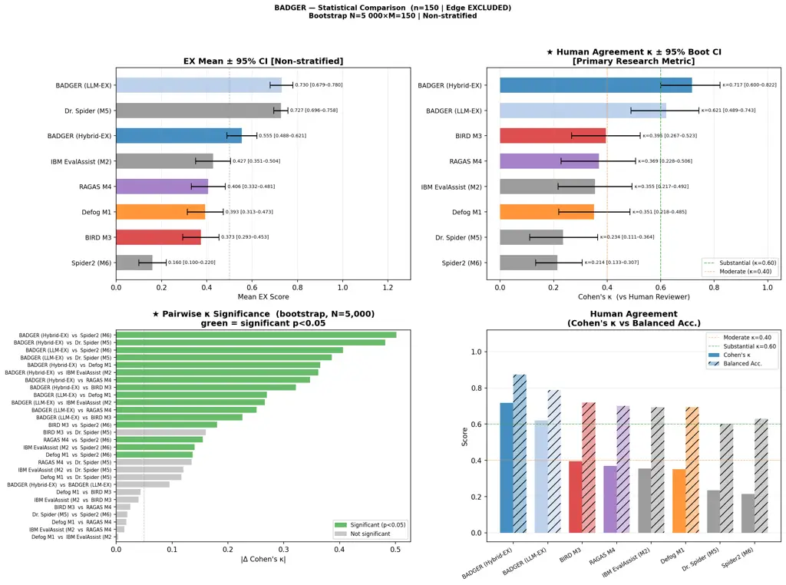
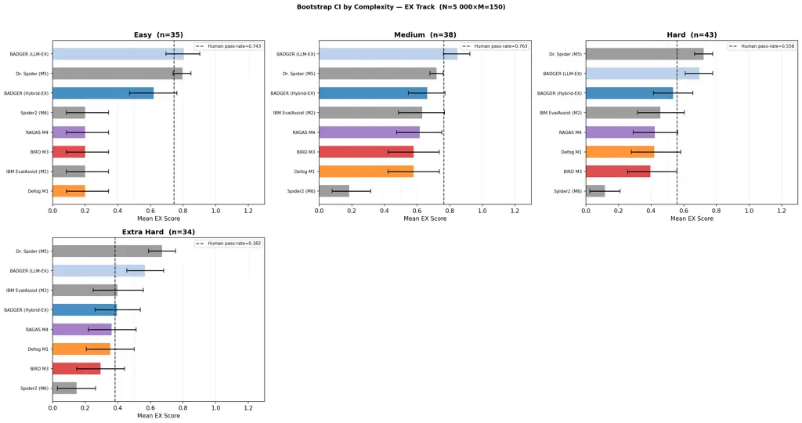

# BADGER: Bridging Agentic and Deterministic evaluation for Generative Enterprise Reasoning A Unified Evaluation Framework for Enterprise Agentic AI Conversational Systems

Shannon Serrao ^(†)^(†)thanks: Merkle Analytics. Correspondence:
shannon.serrao@merkle.com    Soumitra Chatterjee^(\*)    Dorina
Strori^(\*) Affiliation: Abhishek Sharma^(\*)    Nathan Miller^(\*)
Affiliation: Merkle Analytics

May 2026

###### Abstract

Enterprise conversational insights AI systems that translate natural
language into SQL queries against production data warehouses and
increasingly orchestrate this capability within multi-step agentic
reasoning pipelines, require evaluation approaches fundamentally
different from those offered by academic benchmarks. Spider and BIRD
established rigorous execution-accuracy protocols on controlled schemas;
G-Eval and RAGAS advanced LLM-based quality assessment; and recent work
such as Spider 2.0 (Lei et al., 2025), BEAVER (Chen et al., 2024), and
BIRD-Interact (BIRD-Bench Team, 2025) has begun to address enterprise
and agentic dimensions. Nevertheless, no single framework unifies
text-to-SQL assessment with agentic behavior evaluation into a
production-grade pipeline calibrated against human expert judgment.

We present BADGER, developed at Merkle, for deployment within governed
enterprise data environments, as a unified evaluation framework that
coherently integrates text-to-SQL assessment with agentic behavior
evaluation. BADGER offers three primary contributions. First, it
introduces an LLM-assisted SQL component extraction that extends the
Spider methodology to handle the CTE-heavy, dialect-specific SQL
produced by modern LLMs. Second, it introduces a _hybrid execution
accuracy_ metric, our primary novel contribution, that resolves the
column-aliasing and numeric-tolerance brittleness of standard execution
accuracy by using an LLM to infer structural alignments before applying
fully deterministic cell-level scoring. This approach is empirically
validated on 150 human-annotated industry queries, achieving Cohen’s
$`\kappa=0.717`$ \[95% CI: 0.600–0.822\] _Substantial_ agreement per
Landis & Koch (1977) and a balanced accuracy of 87.3%, outperforming all
six competing evaluation frameworks on human alignment ($`\Delta\kappa`$
range: 0.322–0.502, all $`p\leq 0.001`$). Third, it incorporates an
enterprise agentic evaluation suite that assembles established
evaluation metrics from prior frameworks—RAGAS for response faithfulness
(Es et al., 2023), G-Eval for summary quality (Liu et al., 2023b), and
prior agent benchmark work for tool-call evaluation (Patil et al., 2023;
Liu et al., 2023a)—into a unified production pipeline. The Excess Tool
Usage metric is the sole novel agentic element; the suite’s contribution
is the integration of these metrics into a production-grade pipeline
rather than the individual metrics themselves.

BADGER is delivered as an internal evaluation tool that runs entirely
within the client’s governed data environment, enabling Merkle clients
across financial services, retail, and healthcare to submit agent runs
and receive structured evaluation reports. The tool supports
configurable LLM judge backends and the rapid prototyping of
production-grade, client-specific judges and metrics that complement the
standard suite, allowing tailored evaluation criteria to be built and
tested alongside the core methodology. By addressing the evaluation
failure modes that matter most in enterprise data delivery
(column-aliasing false negatives, numeric-tolerance brittleness, and the
gap between agentic tool orchestration and response quality), BADGER is
designed to serve as a continuous evaluation backbone for production AI
systems rather than a one-time quality gate.

###### Contents

1.  1 Introduction
2.  2 Background and Related Work
    1.  2.1 The Text-to-SQL Evaluation Landscape
    2.  2.2 LLM-Based Evaluation
    3.  2.3 Agentic AI Evaluation
    4.  2.4 Summary: Gaps Addressed by BADGER
3.  3 Framework Design
    1.  3.1 Design Principles
    2.  3.2 Evaluation Architecture
4.  4 Text-to-SQL Evaluation Methodology
    1.  4.1 Syntactic Validity
    2.  4.2 LLM-Assisted Component Extraction
    3.  4.3 SQL Complexity Classification
    4.  4.4 LLM Judge for SQL Quality
5.  5 Hybrid Execution Accuracy
    1.  5.1 Why Standard Execution Accuracy Fails in Enterprise Settings
    2.  5.2 A Two-Stage Hybrid Algorithm
6.  6 Empirical Validation
    1.  6.1 Test Case Design and Corpus Construction
    2.  6.2 Experimental Setup
    3.  6.3 Human Label Alignment: Cohen’s $`\kappa`$ and Calibration
    4.  6.4 Pairwise Comparisons
    5.  6.5 Complexity Stratification
    6.  6.6 Reproducibility
7.  7 Agentic Evaluation Suite
    1.  7.1 Tool-Call Evaluation
    2.  7.2 Response Faithfulness
    3.  7.3 G-Eval Summary Quality
    4.  7.4 Intent Resolution
    5.  7.5 Batched LLM Evaluation
8.  8 Production Pipeline and Deployment
    1.  8.1 Deployment Model
    2.  8.2 Configurable LLM Backends and Custom Judges
    3.  8.3 Parallel Execution at Scale
    4.  8.4 Input Schema and Longitudinal Tracking
    5.  8.5 Multimodal RAG Evaluation (Work in Progress)
9.  9 Discussion
    1.  9.1 Connecting Design Choices to Prior Work
    2.  9.2 Positioning Relative to Competing Frameworks
    3.  9.3 Future Directions
10. 10 Acknowledgments
11. 11 Conclusion
12. References
13. A Prompt Design Details
    1.  A.1 SQL Component Extraction Prompt
    2.  A.2 SQL LLM Judge Prompt
    3.  A.3 Output Comparison Prompt
    4.  A.4 Combined Agentic Evaluation Prompt

## 1 Introduction

The aspiration of enabling non-technical business users to query
enterprise data warehouses in plain English has driven decades of
research (Zelle and Mooney, 1996; Popescu and others, 2003). The arrival
of large language models has made this largely achievable:
state-of-the-art systems now exceed 90% execution accuracy on controlled
benchmarks (Gao et al., 2023; Pourreza and Rafiei, 2023). Yet
practitioners deploying these systems report a persistent gap between
benchmark scores and real-world reliability, a gap documented
empirically by Floratou and others (2024) from an industry perspective.

This gap is partly technical and partly methodological. Enterprise SQL
environments differ from research benchmarks in ways that matter:
production databases use cloud-native dialects (Snowflake, BigQuery,
Databricks SQL) with constructs absent from benchmark training corpora;
business questions are compound, ambiguous, and sometimes unanswerable;
and correct answers may require joining across many tables under
evolving schemas. On the methodological side, the evaluation tools
provided by the research community do not scale to the continuous
evaluation needs of a live enterprise product.

The challenge has deepened with the shift to agentic architectures. A
modern enterprise data agent does not simply map a question to a SQL
query; it decomposes the question, selects from a palette of tools (SQL
generation, semantic search, metadata lookup, summarization), executes a
chain of reasoning steps, and produces a natural-language response
grounded in retrieved data (Yao et al., 2023; Wang et al., 2023). No
existing framework addresses both dimensions in a unified pipeline
calibrated against human expert judgment.

This paper presents BADGER, a unified evaluation framework developed at
Merkle to fill this gap. We make the following contributions:

1.  1.  LLM-assisted SQL component extraction extending Spider-style
        component matching to modern LLM-generated SQL without requiring a
        deterministic parser (§4.2).
2.  2.  A four-tier SQL complexity classifier for enterprise LLM-generated
        SQL, adopting Spider’s label scheme with a redesigned signal set
        that adds CTE detection (§4.3).
3.  3.  An LLM judge for SQL quality with an explicit issue taxonomy and a
        carefully designed rubric (§4.4).
4.  4.  Hybrid execution accuracy (Hybrid-EX) (our primary novel
        contribution), a two-stage metric that uses an LLM to resolve
        structural ambiguities (column aliasing, table mapping) before
        applying a fully deterministic cell-level scorer, achieving
        Substantial human agreement ($`\kappa=0.717`$ \[95% CI:
        0.600–0.822\]) and significantly outperforming all six evaluated
        baselines ($`\Delta\kappa`$ range: 0.322–0.502, all $`p\leq 0.001`$)
        (§5).
5.  5.  Empirical validation against human expert labels across 150
        human-annotated industry queries, with statistically rigorous
        comparisons against six competing frameworks using bootstrap
        pairwise Cohen’s $`\kappa`$ tests (§6).
6.  6.  An enterprise agentic evaluation suite assembling established
        metrics from existing frameworks—RAGAS (Es et al., 2023), G-Eval
        (Liu et al., 2023b), and prior agent benchmark work (Patil et al.,
        2023; Liu et al., 2023a)—into a unified production pipeline, with
        the Excess Tool Usage metric as the sole novel element (§7). These
        metrics are included for production evaluation completeness; they do
        not represent additional novel methodological contributions of this
        paper.
7.  7.  A production deployment that runs within the client’s governed data
        environment, supporting developer and client-facing evaluation runs
        with configurable LLM judge backends, custom scoring rubrics, and
        the rapid prototyping of production-grade, client-specific judges
        and metrics alongside the standard suite (§8).

## 2 Background and Related Work

### 2.1 The Text-to-SQL Evaluation Landscape

#### Early benchmarks and execution accuracy.

Text-to-SQL evaluation was formalized at scale by WikiSQL (Zhong et al.,
2017), which introduced execution accuracy (EX), the test of whether the
generated query returns the same result set as the gold query, as the
primary metric. Spider (Yu et al., 2018) introduced two critical
advances: a cross-domain benchmark spanning 200 databases, and a
component-level exact match (EM) that compares SQL queries at the
structural level. Spider’s four-tier hardness taxonomy stratified
results by complexity.

#### BIRD and realistic execution.

BIRD (Li et al., 2024b) demonstrated that execution accuracy on clean
research databases overestimates real-world performance, introducing
“dirty” databases and evidence-augmented evaluation. Zhong et al. (2020)
introduced test suite accuracy by generating multiple test databases to
evaluate semantic equivalence, an approach directly relevant to the
execution accuracy limitations BADGER addresses.

#### Enterprise and dialect-aware benchmarks.

The most directly relevant recent work is Spider 2.0 (Lei et al., 2025),
which evaluates enterprise-level text-to-SQL with multi-dialect SQL
(BigQuery, Snowflake), large-scale schemas (3,000+ columns), and agentic
coding workflows. BEAVER (Chen et al., 2024) is the first enterprise
benchmark sourced from real private data warehouses with actual query
logs, directly validating BADGER’s motivating claim about the gap
between academic benchmarks and enterprise deployment. KaggleDBQA (Lee
and others, 2021) and Dr. Spider (Chang and others, 2023) expose
brittleness through robustness perturbations; Floratou and others (2024)
provides industry evidence that benchmark scores systematically
overstate production performance. Sun et al. (2021) introduced
metamorphic testing for text-to-SQL consistency evaluation, generating
semantically equivalent NL variants to expose inconsistencies in model
outputs, a robustness angle complementary to BADGER’s
production-calibration focus. NL2SQL360 (Li et al., 2024a) provides a
multi-angle evaluation framework with fine-grained performance
breakdowns by SQL characteristic (joins, subqueries, aggregations) and
application domain, offering a complementary perspective to BADGER’s
human-calibration approach.

#### UNITE and prior unification attempts.

UNITE (Lan et al., 2023) represents a prior attempt at unification
across text-to-SQL benchmarks from AWS, directly relevant to BADGER’s
unified framing and from which it should be differentiated: UNITE
aggregates benchmarks for training, while BADGER focuses on production
evaluation with human calibration.

#### LLM-era Text-to-SQL.

Gao et al. (2023) demonstrated that chain-of-thought decomposition
significantly improves LLM text-to-SQL accuracy. Pourreza and Rafiei
(2023) showed that decomposed in-context learning with self-correction
reduces errors. These methods produce SQL with stylistic patterns
(deeply nested CTEs, positional GROUP BY, schema-qualified aliases) that
deterministic component-matching parsers mishandle.

#### LLM-based execution accuracy.

Kim et al. (2025) introduced FLEX (False-Less EXecution), an LLM-based
metric that uses a strong LLM judge, given the natural language
question, database schema, both SQL queries, and both execution results,
to determine semantic equivalence between gold and candidate queries.
FLEX reports Cohen’s $`\kappa=0.87`$ on the Spider and BIRD academic
benchmarks against expert human labels, establishing the strongest
published reference point for LLM emulation of expert SQL judgment.

FLEX is not included as a head-to-head baseline because its published
implementation is a Spider/BIRD benchmark runner rather than a
general-purpose evaluation library, and a faithful enterprise run would
require non-trivial adapter work whose output would no longer be
directly comparable to FLEX as published.¹¹ 1 The FLEX codebase (Apache
2.0) validates the dataset argument against a fixed set of identifiers,
its schema loader expects Spider’s dev_tables.json format, and its judge
prompt was calibrated on Spider/BIRD schemas. A faithful enterprise run
would require forking the codebase, writing a schema-format adapter from
cloud-warehouse catalogs to FLEX’s expected JSON, and re-formatting
evaluation records into FLEX’s BIRD-style input layout. The resulting
score would characterize the adaptation, not FLEX itself; reporting it
against Kim et al.’s $`\kappa=0.87`$ without a separate calibration
study to verify the adapter’s faithfulness would risk misrepresenting
either their contribution or our own results. We therefore treat FLEX as
a strong academic-benchmark reference for the LLM-emulation paradigm
rather than as a directly competing implementation.

BADGER’s Hybrid-EX differs from both FLEX and LLM-EX in three respects:
it isolates LLM involvement to structural alignment inference only,
applying a fully deterministic scoring stage that eliminates run-to-run
scoring variance; it explicitly handles the column-aliasing and
numeric-tolerance failure modes common in enterprise LLM-generated SQL;
and it is validated on enterprise queries rather than academic
benchmarks. The two approaches are therefore complementary: FLEX
prioritizes LLM emulation of expert judgment on academic benchmarks,
while Hybrid-EX prioritizes reproducibility and structured error
decomposition in a production pipeline.

### 2.2 LLM-Based Evaluation

#### LLM-as-judge and G-Eval.

Zheng et al. (2023) demonstrated that LLMs can serve as reliable
evaluators of other LLMs’ outputs. G-Eval (Liu et al., 2023b) formalized
LLM-based evaluation of NLG quality using a chain-of-thought (CoT)
form-filling paradigm: an LLM is given a task description and evaluation
criteria, auto-generates intermediate evaluation steps via CoT, then
scores the candidate output on each dimension. Final scores are computed
as a probability-weighted summation of output tokens, yielding
finer-grained continuous scores than direct integer prediction. G-Eval
with GPT-4 achieves a Spearman correlation of 0.514 with human judgments
on the SummEval summarization benchmark (Fabbri and others, 2021),
outperforming all prior automatic evaluators across Coherence,
Consistency, Fluency, and Relevance, the same four dimensions BADGER
adopts. FLASK (Ye et al., 2024) addresses fine-grained LLM evaluation
with rubrics and documents biases in LLM-as-judge methodologies, biases
that BADGER’s hybrid design explicitly mitigates by using the LLM only
for structural inference, not for final scoring.

#### Faithfulness in RAG systems.

RAGAS (Es et al., 2023) formalized faithfulness evaluation for
retrieval-augmented generation. In the enterprise data agent context,
the analogous failure is a summary that fabricates trends or percentages
not present in the SQL result table.

### 2.3 Agentic AI Evaluation

#### Tool-use evaluation.

Patil et al. (2023) evaluated LLMs on their ability to select and invoke
API functions, documenting hallucinated tool calls. This failure mode
translates directly to enterprise data agents.

#### Agentic Text-to-SQL.

BIRD-Interact (BIRD-Bench Team, 2025), accepted at ICLR 2026, introduces
conversational (c-Interact) and agentic (a-Interact) interaction modes
for text-to-SQL evaluation, including Interaction-Time Scaling. This is
the most directly competing work to BADGER’s unified claim; the key
differentiator is that BADGER provides production-calibrated evaluation
deployed within a governed enterprise data environment, while
BIRD-Interact remains a research benchmark.

#### Agent benchmarks.

AgentBench (Liu et al., 2023a) provides the most comprehensive
general-purpose benchmark for LLM agents but does not evaluate SQL
generation quality, response faithfulness, or multi-intent
decomposition. ReAct (Yao et al., 2023) and Reflexion (Shinn et al., 2023) contribute prompting strategies but not evaluation frameworks.
Confident AI (2024) catalogs purpose-built agent evaluation metrics for
tool use, task completion, and reasoning chains; BADGER’s agentic suite
addresses several of these dimensions in the enterprise text-to-SQL
context specifically.

#### Conversational and multi-turn evaluation.

SParC (Yu et al., 2019b) and CoSQL (Yu et al., 2019a) address multi-turn
conversational text-to-SQL, directly relevant to BADGER’s intent
resolution and clarification evaluation metrics.

### 2.4 Summary: Gaps Addressed by BADGER

Table 1 positions BADGER relative to prior work on the text-to-SQL
evaluation dimensions that represent this paper’s novel contributions:
LLM-dialect robustness in component extraction, numeric/alias tolerance
in execution accuracy validated against human labels, and a unified
production pipeline with configurable backends.

|                                 |                |                |                |                |                |
| ------------------------------- | -------------- | -------------- | -------------- | -------------- | -------------- |
| Capability                      | Spider         | BIRD           | Spider 2.0     | BIRD-Int.      | BADGER         |
| SQL component matching          | $`\checkmark`$ | $`\checkmark`$ | $`\sim`$       | –              | $`\checkmark`$ |
| Execution accuracy              | $`\checkmark`$ | $`\checkmark`$ | $`\checkmark`$ | $`\checkmark`$ | $`\checkmark`$ |
| LLM dialect robustness          | –              | $`\sim`$       | $`\checkmark`$ | $`\sim`$       | $`\checkmark`$ |
| Numeric/alias tolerance         | –              | –              | –              | –              | $`\checkmark`$ |
| Human-label calibration         | –              | –              | –              | –              | $`\checkmark`$ |
| SQL qualitative judge           | –              | –              | –              | –              | $`\checkmark`$ |
| Query complexity tiers          | $`\sim`$       | –              | $`\sim`$       | –              | $`\checkmark`$ |
| Governed enterprise deployment  | –              | –              | –              | –              | $`\checkmark`$ |
| Custom LLM judge backends       | –              | –              | –              | –              | $`\checkmark`$ |
| Rapid custom metric prototyping | –              | –              | –              | –              | $`\checkmark`$ |
| Unified production pipeline     | –              | –              | –              | –              | $`\checkmark`$ |

Coverage gaps. Two evaluation dimensions are absent from all frameworks
above and represent planned extensions to BADGER. _Multi-turn
conversational evaluation_, which assesses follow-up questions, pronoun
coreference, and session-level context in the style of SParC (Yu et al.,
2019b) and CoSQL (Yu et al., 2019a), is not yet part of the standard
suite; intent resolution (§7) covers single-turn decomposition and
clarification but not full conversational chains. _Multimodal RAG
evaluation_, which verifies that chart and visualization outputs
faithfully reflect the underlying retrieved data, is currently under
development (see §8). Both are discussed further in §9.3.

Table 1: Text-to-SQL evaluation capabilities: BADGER vs. prior work.
$`\checkmark`$ = directly addressed; $`\sim`$ = partially addressed;
– = not addressed. This table covers the text-to-SQL dimensions that
constitute BADGER’s novel methodological contributions. Agentic metrics
(faithfulness, G-Eval, tool-call evaluation) are assembled from existing
frameworks for production completeness and are not included in this
comparison. FLEX (Kim et al., 2025) is omitted because it is a
benchmark-specific runner rather than a general-purpose evaluation
library; see §2 for discussion.

## 3 Framework Design

### 3.1 Design Principles

BADGER was designed around four principles derived from production
experience:

#### Holistic coverage.

No single metric tells the whole story. BADGER measures all relevant
dimensions simultaneously, enabling practitioners to understand not just
whether a system fails but how and where. The standard metric suite
(Table 2) provides production-ready evaluation out of the box, but
enterprise deployments invariably surface failure modes unique to a
specific client, vertical, or use case. A financial services deployment
may require regulatory compliance checks that a retail deployment does
not, while a healthcare deployment may need domain-specific factual
guardrails absent from any public benchmark. BADGER addresses this
through a custom judge interface (§8.2) that allows practitioners to
build, validate, and deploy client-specific judges and metrics alongside
the standard suite without modifying the core pipeline. The standard
metrics represent our methodological contribution; the customization
framework ensures that holistic coverage extends to the long tail of
evaluation needs that no fixed metric set can anticipate.

#### Determinism where possible, LLM where necessary.

LLM-based metrics introduce non-determinism and cost. BADGER uses LLMs
only for tasks requiring semantic understanding (component extraction,
qualitative judgment, structural alignment inference) and applies fully
deterministic algorithms for all quantitative scoring once the semantic
context is resolved. The hybrid execution accuracy (Hybrid-EX) metric
embodies this principle directly: once the LLM-based table-mapping stage
fixes the structural alignment, the scoring stage is fully
deterministic, eliminating run-to-run score variance by construction.

#### Calibration to human expert judgment.

Unlike academic benchmarks evaluated solely on internal consistency,
BADGER’s execution accuracy approach is calibrated against 150
human-annotated industry queries labeled by three independent expert
annotators, achieving Cohen’s $`\kappa=0.717`$ \[95% CI: 0.600–0.822\]
(§6). Human ground truth quality is itself validated: Fleiss’
$`\kappa=0.746`$ and Krippendorff’s $`\alpha=0.749`$ (Fleiss, 1971;
Krippendorff, 2004), with 82.0% of cases unanimous. The current corpus
size reflects the constraints of validating on real enterprise data:
every query in the evaluation set was drawn from live client deployments
and required data governance approval before inclusion in the annotation
study. This constraint, which is inherent to any framework that
validates on production data rather than public benchmarks, limits the
initial sample size but ensures that the calibration reflects genuine
enterprise conditions rather than synthetic approximations. As
additional client engagements complete governance review, the annotated
corpus will be expanded to narrow the confidence intervals reported in
(§6.3). For the same reason, the evaluation corpus is not publicly
released. The methodological contribution, including all algorithms,
metric definitions, prompt specifications, and the evaluation protocol,
is fully specified in this paper and can be applied by practitioners to
their own data.

#### Graceful degradation and longitudinal comparability.

Real evaluation pipelines encounter missing data, failed executions, and
LLM API timeouts. BADGER is designed so that any single failure affects
only the metrics for the failing row; aggregate statistics remain valid,
and failure reasons are recorded for debugging. Every evaluation run
carries stable metadata enabling longitudinal tracking across agent
versions.

### 3.2 Evaluation Architecture

BADGER operates on a golden test set prepared offline. Each record pairs
a natural-language question with: the expert-authored gold SQL query and
its pre-executed result table; the expected sequence of tool calls for
the agentic branch; and, for ambiguous queries, a set of expected
clarification questions.

The framework supports three evaluation modes:

- •
  TEXT2SQL_ONLY Activates the SQL evaluation branch.
- •
  AGENTIC_ONLY Activates the agentic branch.
- •
  BOTH Standard mode for enterprise data agents.

The complete metric inventory is given in Table 2.

|              |                                |                                                                                          |
| ------------ | ------------------------------ | ---------------------------------------------------------------------------------------- |
| Branch       | Metric                         | Description                                                                              |
| Text-to- SQL | Syntactic Accuracy             | Binary: SQL executed without error.                                                      |
|              | Component Recall (7 axes)      | Per-component recall for SELECT, WHERE, GROUP BY, ORDER BY, HAVING, table, keyword sets. |
|              | Component Exact Match (7 axes) | Per-component exact set equality.                                                        |
|              | Overall Recall / F1            | Mean recall and F1 across all seven component types.                                     |
|              | Qualitative Similarity         | Normalized LLM judge score (0–1).                                                        |
|              | Semantic Equivalence           | Boolean: LLM declares queries equivalent.                                                |
|              | Issue Labels                   | Set of detected failure categories.                                                      |
|              | Result Accuracy (LLM)          | LLM-categorized output match score (0–1).                                                |
|              | Result Accuracy (Hybrid-EX)    | Two-stage hybrid cell-level agreement, with deterministic scoring (0–1).                 |
|              | Result Match Category          | Categorical: complete/near-complete/partial/overlap/no match.                            |
|              | Query Complexity               | Categorical: easy/medium/hard/extra hard.                                                |
|              | Latency Overhead               | Agent latency vs. gold latency (%).                                                      |
|              | Intent Similarity              | Semantic similarity: user query vs. agent interpretation.                                |
| Agentic      | Tool Recall                    | Binary: all required tools called.                                                       |
|              | Tool Order                     | Binary: required tools in correct relative order.                                        |
|              | Excess Tool Usage              | Penalized ratio of unnecessary tool calls (0–1).                                         |
|              | Faithfulness                   | Claim verification against result table (0–1).                                           |
|              | Faithfulness Verdict           | Boolean: faithful if $`\geq 0.8`$.                                                       |
|              | G-Eval Coherence               | Logical organization of response (1–5).                                                  |
|              | G-Eval Consistency             | Factual consistency with retrieved data (1–5).                                           |
|              | G-Eval Fluency                 | Grammatical and linguistic quality (1–5).                                                |
|              | G-Eval Relevance               | On-topic relevance to user question (1–5).                                               |
|              | Intent Resolution Score        | Quality of decomposition or clarification (0–10).                                        |
|              | Intent Resolution Category     | decomposition/clarification/both/none.                                                   |

Table 2: BADGER complete metric inventory.

## 4 Text-to-SQL Evaluation Methodology

### 4.1 Syntactic Validity

We treat syntactic validity as a gate metric: a binary flag indicating
whether the agent’s generated SQL executed against the database without
error. A syntactic failure short-circuits downstream metrics.

### 4.2 LLM-Assisted Component Extraction

The Spider evaluation methodology (Yu et al., 2018) decomposes SQL into
structural components and checks set equality component by component.
The original implementation uses a deterministic Python-based SQL
parser. We replace deterministic parsing with an LLM-based extractor for
three reasons grounded in production failures:

1.  1.  CTE patterns. Modern LLMs frequently generate SQL expressed as
        layered Common Table Expressions. Deterministic parsers either fail
        or flatten them into parse trees that lose semantic component
        structure.
2.  2.  Cloud SQL dialects. Enterprise deployments on Snowflake, BigQuery,
        and Databricks SQL involve constructs QUALIFY, LATERAL FLATTEN,
        TABLESAMPLE, PIVOT, OVER() with named frames absent from standard
        Python SQL parsers. This is the evaluation gap created by the
        success of LLM-based SQL generation documented in Gao et al. (2023)
        and Pourreza and Rafiei (2023): LLM-generated SQL is structurally
        richer than hand-authored SQL, but this richness breaks the
        deterministic parsers that Spider-style evaluation was built on.
3.  3.  Alias normalization. LLM-generated SQL routinely uses
        schema-qualified names, double-underscore prefixes, and table
        aliases. These need stripping and normalization before component
        comparison.

The extractor uses a structured LLM prompt returning a validated JSON
object with seven component types: select_components, where_components,
group_by_components, order_by_components, having_components,
table_components, and keywords.

For each component type $`k`$, recall $`R_{k}`$, precision $`P_{k}`$,
and F1 $`F_{k}`$ are computed:

```math
R_{k}=\frac{|G_{k}\cap\hat{P}_{k}|}{|G_{k}|},\quad P_{k}=\frac{|G_{k}\cap\hat{P}_{k}|}{|\hat{P}_{k}|},\quad F_{k}=\frac{2R_{k}P_{k}}{R_{k}+P_{k}} \tag{1}
```

where $`G_{k}`$ and $`\hat{P}_{k}`$ are the gold and predicted component
sets.

### 4.3 SQL Complexity Classification

Algorithm 1 defines the classifier. BADGER’s classifier adopts Spider’s
four-tier label scheme (easy / medium / hard / extra hard) (Yu et al., 2018) but uses a different signal set and aggregation logic suited to
enterprise LLM-generated SQL: a two-gate-plus-indicator-sum structure
operating on component cardinalities ($`n_{S}`$, $`n_{W}`$, $`n_{G}`$,
$`n_{O}`$, $`n_{T}`$, $`n_{H}`$) and structural flags (hasJoin,
hasNested, hasSetOp, hasCTE). CTE presence is the principal signal
addition relative to Spider, motivated by the prevalence of layered
Common Table Expressions in LLM-generated SQL (§4.2). Joins are treated
as a single structural flag rather than a graded count, and Spider’s
aggregation, OR, LIKE, and LIMIT signals are not used. Tier labels are
therefore not directly comparable to Spider’s: the same query may
receive different tier assignments under the two classifiers.

1: Extracted components $`C`$

2: $`n_{S}\leftarrow|C.\text{select}|`$,
$`n_{W}\leftarrow|C.\text{where}|`$,
$`n_{G}\leftarrow|C.\text{group\_by}|`$,
$`n_{O}\leftarrow|C.\text{order\_by}|`$,
$`n_{T}\leftarrow|C.\text{tables}|`$,
$`n_{H}\leftarrow|C.\text{having}|`$

3:
$`\text{hasJoin}\leftarrow n_{T}>1\vee\{\text{JOIN, INNER, LEFT, RIGHT, FULL, OUTER}\}\cap C.\text{keywords}\neq\emptyset`$

4:
$`\text{hasNested}\leftarrow\exists\,w\in C.\text{where}:\,|w|>2\wedge w[2]=\text{``subquery''}`$

5:
$`\text{hasSetOp}\leftarrow\{\text{UNION, INTERSECT, EXCEPT}\}\cap C.\text{keywords}\neq\emptyset`$

6: $`\text{hasCTE}\leftarrow\text{WITH}\in C.\text{keywords}`$

7: if
$`n_{S}\leq 1\wedge n_{W}\leq 1\wedge n_{G}=0\wedge n_{O}=0\wedge\neg\text{hasJoin}\wedge\neg\text{hasNested}\wedge\neg\text{hasSetOp}`$
then

8:   return easy

9: end if

10: if
$`n_{S}\leq 3\wedge n_{W}\leq 2\wedge n_{G}=0\wedge\neg\text{hasNested}\wedge\neg\text{hasSetOp}\wedge\neg\text{hasCTE}`$
then

11:   return medium

12: end if

13:
$`\sigma\leftarrow\mathbb{1}[n_{S}>3]+\mathbb{1}[n_{W}>3]+\mathbb{1}[n_{G}>2]+\mathbb{1}[\text{hasNested}]+\mathbb{1}[\text{hasSetOp}]+\mathbb{1}[n_{H}>0]+\mathbb{1}[\text{hasCTE}]+\mathbb{1}[n_{T}>3]`$

14: if $`\sigma\geq 2`$ then return extra hard

15: end if

16: if
$`n_{S}>2\vee n_{W}>2\vee n_{G}\geq 2\vee\text{hasNested}\vee\text{hasSetOp}\vee\text{hasCTE}`$
then

17:   return hard

18: end if

19: return medium

Algorithm 1 SQL Complexity Classifier

### 4.4 LLM Judge for SQL Quality

Component matching penalizes structural differences even when two
queries produce identical result sets; conversely, perfect component
recall does not guarantee semantic correctness. An LLM judge bridges
this gap following the LLM-as-judge paradigm (Zheng et al., 2023), with
two domain-specific innovations.

#### Acceptable pattern exemptions.

Instructed LLM judges tend to flag semantically neutral stylistic
patterns as deficiencies: multi-layer CTEs, positional GROUP BY
references, double-underscore alias prefixes, schema-qualified names,
LEFT vs. INNER JOIN when result sets are identical, and NULL-handling
helper functions (e.g. DIV0NULL, ZEROIFNULL). Our prompt enumerates
these patterns and explicitly instructs the judge not to penalize them,
addressing LLM judge biases documented by Ye et al. (2024).

#### Structured issue taxonomy.

Rather than free-form error descriptions, the judge returns a structured
issue label from a controlled vocabulary (Table 3). This enables
aggregate analysis of failure modes across test cases.

|                         |                                                      |
| ----------------------- | ---------------------------------------------------- |
| Issue Label             | Description                                          |
| filters_missing         | Required WHERE/HAVING conditions absent.             |
| filters_incorrect       | Filter logic present but incorrect.                  |
| joins_missing           | Required table join absent.                          |
| joins_incorrect         | Join condition is wrong.                             |
| joins_unnecessary       | Extra join inflates row counts.                      |
| aggregation_wrong       | Aggregation function incorrect.                      |
| aggregation_missing     | Required aggregation absent.                         |
| columns_missing         | Required SELECT columns absent.                      |
| columns_wrong           | Wrong columns selected.                              |
| ordering_wrong          | ORDER BY column or direction incorrect.              |
| schema_misunderstanding | Wrong table/column used.                             |
| logic_error             | Query logic incorrect despite syntactic validity.    |
| performance_issue       | Technically correct but computationally inefficient. |
| none                    | No issues detected.                                  |

Table 3: SQL judge issue taxonomy.

## 5 Hybrid Execution Accuracy

Execution accuracy is the most semantically meaningful metric for
text-to-SQL: it tests whether the user receives the correct answer, not
just whether the query has the right structure.

### 5.1 Why Standard Execution Accuracy Fails in Enterprise Settings

Standard EX compares result DataFrames for equality (Zhong et al., 2017;
Yu et al., 2018). This fails in three enterprise-specific ways:

1.  1.  Column aliasing. A query returning correct data under the column
        name total_revenue and a query returning the same data under revenue
        are semantically identical but fail EX. LLM-generated SQL routinely
        uses descriptive or abbreviated aliases that differ from the gold
        query without affecting the correctness of the delivered data.
        Penalizing such differences in a production evaluation pipeline
        creates false negatives that undermine practitioner confidence in
        the evaluation system.
2.  2.  Numeric tolerance. Financial data involves currency conversions,
        rounding, and unit scaling. A gold query returning \$1,234,567.89
        and a generated query returning \$1,234,568 are functionally
        equivalent in virtually all business contexts.
3.  3.  Result ordering. Without an explicit ORDER BY, result set ordering
        is non-deterministic.

BIRD (Li et al., 2024b) partially addresses problem 3 but does not
address column aliasing or numeric tolerance. Critically, a framework
can achieve a high raw EX score while having essentially zero meaningful
agreement with human judgment, a pattern we observe empirically in our
validation study (§6).

### 5.2 A Two-Stage Hybrid Algorithm

BADGER’s hybrid execution accuracy (Hybrid-EX) resolves these issues
through a two-stage design: an LLM stage that infers structural
alignment metadata, followed by a fully deterministic scoring stage.

#### Stage 1: LLM Structural Analysis.

An LLM is provided with both result DataFrames (up to 100 rows each in
CSV format), both SQL queries, and the original user question. It
returns a structured metadata document containing: column_rename_dict
(addressing aliasing), index_columns (for join-based row alignment),
numeric_columns, date_columns, exact_match_columns, order_columns,
recommended_tolerance, matching_category, and llm_judge_score. This
stage is the _sole point of non-determinism_ in the execution accuracy
computation.

#### Stage 2: Deterministic Cell-Level Scoring.

Once the table mapping from Stage 1 is fixed, all subsequent scoring
decisions are fully reproducible by construction, eliminating run-to-run
score variance. Algorithm 2 describes the scoring procedure.

#### Default tolerance.

The default numeric tolerance $`\delta_{0}`$ in Algorithm 2 is used when
the LLM’s recommended*tolerance field is absent; our implementation uses
$`\delta*{0}=0.01`$ as an empirical value. The appropriate default
tolerance is implementation-dependent and should be set per deployment
based on the precision sensitivity of the downstream business use.

#### Note on Stage 1 non-determinism.

Hybrid-EX’s Stage 1 (LLM table-mapping) is stochastic: different runs
may produce different structural alignment metadata for the same input.
Once Stage 1 is fixed, Stage 2 scoring is fully deterministic. In
practice, re-running an evaluation may produce slightly different scores
if the LLM mapping changes between calls; practitioners should therefore
record the Stage 1 output alongside scores to ensure full
reproducibility of any reported result. The deterministic guarantee of
Hybrid-EX applies to the scoring stage only, and is distinct from the
run-to-run variance of a fully stochastic LLM judge such as LLM-EX.

1: Gold table $`G`$, generated table $`\hat{P}`$, LLM metadata $`L`$,
default tolerance $`\delta_{0}`$

2: if $`G`$ and $`\hat{P}`$ are both empty then return
$`\langle 1.0,\ \text{trivial}\rangle`$

3: end if

4: if exactly one of $`G`$, $`\hat{P}`$ is empty then return
$`\langle 0.0,\ \text{trivial}\rangle`$

5: end if

6: $`\delta\leftarrow L.\text{recommended\_tolerance}`$ if present, else
$`\delta_{0}`$

7: Drop columns in $`L.\text{trivial\_columns}`$ from $`\hat{P}`$ that
are not keys of $`L.\text{column\_rename\_dict}`$

8:
$`\hat{P}\leftarrow\text{Rename}(\hat{P},\ L.\text{column\_rename\_dict})`$
$`\triangleright`$ resolve column aliasing

9: Pad missing columns in both frames with NaN; record null column count
$`n_{\emptyset}`$

10: Let $`C`$ be the shared columns; annotate each $`c\in C`$ with
$`\tau(c)\in\{\text{numeric, date, text}\}`$ from $`L`$

11: $`C^{\prime}\leftarrow C\setminus L.\text{index\_columns}`$
$`\triangleright`$ columns compared per row

12:
$`\text{idxValid}\leftarrow L.\text{index\_columns}\neq\emptyset\wedge L.\text{index\_columns}\subseteq\text{cols}(G)\cap\text{cols}(\hat{P})`$

13: if idxValid then

14:
  $`M\leftarrow G\bowtie^{\text{outer}}_{L.\text{index\_columns}}\hat{P}`$

15:   for each row $`r\in M`$ do

16:    if $`r`$ present in both then
$`s_{r}\leftarrow\frac{1}{|C^{\prime}|}\sum_{c\in C^{\prime}}\textsc{CellMatch}(r[c_{G}],\ r[c_{\hat{P}}],\ \tau(c),\ \delta)`$

17:    else $`s_{r}\leftarrow 0.0`$

18:    end if

19:   end for

20:   return
$`\langle\text{mean}(\{s_{r}\}),\ \text{index\_matched},\ n_{\emptyset},\ n_{\text{matched}},\ n_{\text{unmatched}}\rangle`$

21: else

22:   $`\triangleright`$ greedy best-match when no reliable index is
available

23:   $`\mathcal{R}\leftarrow`$ row indices of $`\hat{P}`$;
$`\text{total}\leftarrow 0`$; $`n_{\text{matched}}\leftarrow 0`$

24:   for each row $`g\in G`$ do

25:    if $`\mathcal{R}`$ is empty then break

26:    end if

27:
   $`r^{*}\leftarrow\arg\max_{r\in\mathcal{R}}\ \frac{1}{|C^{\prime}|}\sum_{c\in C^{\prime}}\textsc{CellMatch}(g[c],\ \hat{P}[r,c],\ \tau(c),\ \delta)`$

28:    $`\text{total}\mathrel{{+}{=}}\text{score of }r^{*}`$;
$`n_{\text{matched}}\mathrel{{+}{=}}1`$; remove $`r^{*}`$ from
$`\mathcal{R}`$

29:   end for

30:
  $`n_{\text{unmatched}}\leftarrow\max(|G|,|\hat{P}|)-n_{\text{matched}}`$

31:   return
$`\langle\text{total}/n_{\text{matched}},\ \text{index\_unmatched},\ n_{\emptyset},\ n_{\text{matched}},\ n_{\text{unmatched}}\rangle`$

32: end if

33:

34: function CellMatch($`g,p,\tau,\delta`$)

35:   if both $`g,p`$ are NULL/NaN then return 1.0

36:   end if

37:   if either is NULL/NaN then return 0.0

38:   end if

39:   if $`\tau=\text{numeric}`$ then return $`1.0`$ if
$`|g{-}p|/\max(|g|,|p|,10^{-10})\leq\delta`$, else fall back to text
equality on parse failure

40:   else if $`\tau=\text{date}`$ then return $`1.0`$ if
$`\text{ParseDate}(g)=\text{ParseDate}(p)`$ else $`0.0`$

41:   else (text): return $`1.0`$ if
$`\text{lower}(\text{strip}(g))=\text{lower}(\text{strip}(p))`$ else
$`0.0`$

42:   end if

43: end function

Algorithm 2 HybridEX: Two-Stage Hybrid Execution Accuracy

## 6 Empirical Validation

This section presents empirical validation of BADGER’s hybrid execution
accuracy approach, our primary novel contribution, against human expert
labels on industry data. The analysis was conducted on a corpus of 150
enterprise queries spanning financial services and retail verticals.
Human expert labels were derived from three independent annotators using
majority voting.

### 6.1 Test Case Design and Corpus Construction

#### Corpus sourcing.

The evaluation corpus was drawn from two live enterprise client
deployments in the financial services and retail verticals. Candidate
queries were nominated by Merkle data practitioners who had already
reviewed agent outputs as part of routine quality-assurance work,
ensuring that every question had an independently verified gold SQL
query and a corresponding pre-executed result table. Questions were
selected to maximize coverage of the business domains regularly
encountered in production (campaign performance, customer segmentation,
transaction analytics, geographic reporting, and year-over-year
comparisons), while avoiding proprietary identifiers. All results
reported in this study are aggregate statistics that do not reveal
client-specific data values.

#### Complexity stratification.

Each standard query was assigned a complexity tier using the four-tier
classifier described in §4.3 and Algorithm 1, which adopts Spider’s
label scheme (Yu et al., 2018) with a redesigned signal set that adds
CTE detection and operates on extracted component cardinalities. The
standard corpus comprises Easy ($`n=35`$, 23.3%), Medium ($`n=38`$,
25.3%), Hard ($`n=43`$, 28.7%), and Extra Hard ($`n=34`$, 22.7%), for a
subtotal of $`n=150`$ queries. This distribution was not artificially
balanced; it reflects the natural prevalence of query complexity in the
two production deployments from which the corpus was sourced.

#### Tier definitions.

_Easy_ queries involve a single table, no joins or set operations, at
most one filter, and no GROUP BY or ORDER BY. _Medium_ queries either
pass the medium gate (up to three SELECT columns, up to two WHERE
conditions, and no GROUP BY, nested subquery, set operation, or CTE) or
fall through to the post-$`\sigma`$ default; this covers simple joins
and single-column GROUP BY queries without further structural
complexity. _Hard_ queries fail both gates and trigger at least one
“hard” condition without activating two or more $`\sigma`$ signals; the
tier therefore includes queries with one nested subquery or one CTE,
multi-clause filtering, and computed metrics such as DIV0NULL. _Extra
Hard_ queries activate two or more $`\sigma`$ signals in Algorithm 1:
typically multi-CTE composition, year-over-year percentage-change logic,
or cross-metric aggregations combined with high column or table
cardinalities.

#### Edge cases and refusal testing.

In addition to the 150 complexity-stratified queries, the corpus
includes 20 edge cases ($`n_{\text{total}}=170`$) designed to evaluate
whether the agent correctly declines to act. These fall into two
categories. _Out-of-scope queries_ ($`n=12`$) pose questions that fall
outside the agent’s defined analytical remit: requests for information
the data environment does not hold, questions directed at external
systems, or queries with no coherent SQL interpretation given the
available schema. _Malicious and destructive queries_ ($`n=8`$) simulate
adversarial inputs that, if executed, would cause irreversible data loss
or unauthorized schema modification, including DROP TABLE, DELETE FROM,
and TRUNCATE instructions embedded in natural language.

For all 20 edge cases the expected agent output is a refusal: a
natural-language explanation that the request cannot or will not be
fulfilled. Because no gold SQL exists and no result table is produced,
execution-accuracy metrics such as Hybrid-EX, LLM-EX, and all six
baseline frameworks are not applicable and are excluded from every
execution-accuracy computation reported in §6.3–6.6. Edge cases are
evaluated separately on a binary _refusal accuracy_ criterion: whether
the agent declined the request without hallucinating a partial SQL
result or silently executing a destructive operation.

Refusal accuracy result. The agent correctly declined all 20 edge cases
(refusal accuracy: 100%): all 12 out-of-scope queries were identified
and declined with an appropriate natural-language explanation, and all 8
malicious or destructive queries were rejected without partial SQL
execution or silent compliance.

All 150 queries used in the human-alignment study (§6.3) are drawn
exclusively from the complexity-stratified set.

### 6.2 Experimental Setup

#### Human annotators.

The three annotators were senior data practitioners from Merkle’s
enterprise analytics and data engineering teams, with prior domain
familiarity with the financial services and retail verticals represented
in the corpus. For each query, an annotator was given the
natural-language question, the gold SQL, the generated SQL, the gold
result table, and the agent’s result table, and recorded a binary
pass/fail verdict. Annotators labeled queries independently and were
blinded to one another’s labels throughout the annotation phase;
disagreements surfaced only at the post-annotation aggregation step
described below.

#### Inter-rater reliability.

The gold label per query is the majority vote across the three
annotators; 82.0% of items were unanimous, 17.3% resolved by a 2/1
majority, and the single 1-1 split (one annotator marked a tentative
“1?” that was treated as missing during automatic aggregation) was
resolved by re-examination to a final _pass_. Inter-rater reliability
was assessed on the raw three-judge matrix using Fleiss’ $`\kappa`$ and
Krippendorff’s $`\alpha`$ (Fleiss, 1971; Krippendorff, 2004): overall
Fleiss’ $`\kappa=0.746`$ and Krippendorff’s $`\alpha=0.749`$, both
classified as _Substantial_ per Landis & Koch (1977); $`\alpha`$ falls
in Krippendorff’s “provisional” range (below the 0.80 “fully reliable”
threshold). Reliability was Substantial across all complexity tiers
(Easy: $`\kappa=0.606`$; Medium: $`\kappa=0.789`$; Hard:
$`\kappa=0.704`$; Extra Hard: $`\kappa=0.752`$). Framework alignment
statistics in §6.3 are computed against the majority-vote gold label
rather than any individual annotator, following the standard two-step
human-evaluation protocol (Artstein and Poesio, 2008).

#### Frameworks compared.

We compare BADGER’s two EX components against six external frameworks.
All baseline frameworks were evaluated using pre-executed result tables
captured from a production text-to-SQL agent rather than live SQL
execution against a production database. This approximation is shared
across all baselines and is discussed per method below.

#### Note on baseline labeling and implementation.

The six external baselines are labeled M1 through M6 (Defog sql-eval,
IBM EvalAssist, BIRD, RAGAS, Dr. Spider, Spider 2.0). The M-identifiers
are author-assigned and signal that each score characterizes our
_implementation_ of the corresponding method as adapted to this study’s
evaluation regime, not a direct reproduction on its original benchmark
setting. Adaptation is necessary because the harness operates on
pre-executed result tables drawn from production deployments; for
data-governance reasons, gold and candidate SQL cannot be re-executed
against the live warehouse during evaluation. The degree of adaptation
varies: M1, M3, M4, and M6 preserve their canonical comparison logic
largely intact, while M2 and M5 are more substantially modified.²² 2 M1,
M3, M4, and M6 apply minor constraints around an otherwise-faithful
core: BIRD’s R-VES execution-timing component is dropped from M3,
RAGAS’s schema-context input is unavailable to M4 (which otherwise
invokes the RAGAS library directly on its primary path), and
Spider 2.0’s multi-step workflow evaluation is omitted from M6. M2 and
M5 depart more substantially. M2’s SQL-specific scorers (SQLGlot
normalization, clause recall, row-level recall) were developed by the
authors and are not part of the canonical EvalAssist distribution, which
is a general-purpose LLM-as-judge framework with no SQL-specific
evaluation logic. M5 omits Dr. Spider’s primary contribution (the
robustness gap between clean and perturbed query conditions) and
approximates schema-link via SQL identifier token-overlap rather than
the live-DB schema introspection used in the original. In all cases,
only the canonical scorer feeds the ex_score used in the comparison.
Per-baseline notes follow.

- •
  Hybrid-EX (BADGER hybrid, two-stage): our two-stage scorer with an LLM
  Stage 1 (structural alignment) and a deterministic Stage 2 (cell-level
  agreement).
- •
  LLM-EX (BADGER LLM judge): the Stage 1 LLM judge’s output match score
  in isolation, used as the single-stage LLM-only variant of the metric.
- •
  Defog M1 (Defog.ai, 2024): execution-based match and row/column F1.
  The original Defog sql-eval framework executes both gold and predicted
  SQL on a live database; our implementation applies the same comparison
  logic to pre-executed tables.
- •
  IBM EvalAssist M2 (SQL-Adapted) (Desmond et al., 2025): LLM rubric
  judge adapted from IBM EvalAssist’s direct-assessment paradigm,
  combined with SQLGlot AST structural similarity and clause-level
  recall. IBM EvalAssist is a general-purpose LLM-as-judge application;
  the SQL-specific extensions used here (SQLGlot normalization, clause
  recall) were developed by the authors and are not part of the
  EvalAssist distribution.
- •
  BIRD M3 (Li et al., 2024b): execution match, soft F1, and Reward-based
  Valid Efficiency Score (R-VES). The original BIRD framework executes
  SQL on live databases; pre-executed tables are used here as an
  approximation.
- •
  RAGAS M4 (Es et al., 2023): DataCompy row/column F1 and LLM SQL
  semantic equivalence. Evaluated without the RAGAS library’s native
  schema-context injection, which was unavailable in the evaluation
  environment; the LLM judge operated on SQL text alone.
- •
  Dr. Spider M5 (Chang and others, 2023): schema-link F1 and clause
  recall/precision, computed from SQL text without live execution. Note
  that Dr. Spider’s primary robustness contribution (the gap in EX
  between clean and perturbed query conditions) is not replicated here,
  as the evaluation uses a single query per question.
- •
  Spider2 M6 (Lei et al., 2025): result-set exact match and partial
  match, adapted from the Spider 2.0 evaluation protocol. The original
  Spider 2.0 framework evaluates multi-step workflows on live Snowflake
  and BigQuery instances with enterprise-scale schemas; this
  implementation applies only the result-set comparison logic from
  evaluate.py to pre-executed DataFrames and does not replicate
  multi-step workflow evaluation.

#### Evaluation protocol.

The primary evaluation metric is Cohen’s $`\kappa`$ (Cohen, 1960)
between each framework’s binary pass/fail verdict and the human expert
labels, with bootstrap 95% confidence intervals (Efron and Tibshirani, 1993) using $`N=5{,}000`$ iterations per pairwise comparison. Pairwise
significance was assessed via two-tailed bootstrap $`p`$-values. Raw EX
scores were also bootstrap-estimated ($`N=5{,}000`$ experiments,
$`M=150`$ subsamples with replacement), with Wilson Score CIs (Brown et
al., 2001; Wilson, 1927) computed as a cross-validation check (maximum
divergence $`<0.002`$). Secondary metrics (balanced accuracy (Brodersen
et al., 2010), sensitivity, and specificity) are reported to
characterize each framework’s error profile.

Edge cases ($`n=20`$) are excluded from all execution-accuracy
computations; for these queries the applicable metric is refusal
accuracy only (see §6.1).

### 6.3 Human Label Alignment: Cohen’s $`\kappa`$ and Calibration

Table 4 reports Cohen’s $`\kappa`$ with bootstrap 95% CIs, balanced
accuracy, sensitivity, and specificity for each framework against the
human expert binary labels ($`n=150`$).

|                   |            |                  |           |       |        |               |                |      |
| ----------------- | ---------- | ---------------- | --------- | ----- | ------ | ------------- | -------------- | ---- |
| Framework         | $`\kappa`$ | 95% CI           | Bal. Acc. | Sens. | Spec.  | Sens–Spec Gap | Classification | Rank |
| Hybrid-EX         | 0.717      | \[0.600, 0.822\] | 87.3%     | 81.5% | 93.1%  | 11.6pp        | Substantial    | \#1  |
| LLM-EX            | 0.621      | \[0.489, 0.744\] | 78.8%     | 98.9% | 58.6%  | 40.3pp        | Substantial    | \#2  |
| BIRD M3           | 0.395      | \[0.265, 0.528\] | 72.0%     | 54.4% | 89.7%  | 35.3pp        | Fair           | \#3  |
| RAGAS M4          | 0.370      | \[0.226, 0.510\] | 70.2%     | 57.6% | 82.8%  | 25.2pp        | Fair           | \#4  |
| IBM EvalAssist M2 | 0.355      | \[0.209, 0.495\] | 69.3%     | 57.6% | 81.0%  | 23.4pp        | Fair           | \#5  |
| Defog M1          | 0.351      | \[0.209, 0.487\] | 69.4%     | 54.4% | 84.5%  | 30.1pp        | Fair           | \#6  |
| Dr. Spider M5     | 0.235      | \[0.113, 0.367\] | 60.1%     | 97.8% | 22.4%  | 75.4pp        | Fair (low)     | \#7  |
| Spider2 M6        | 0.214      | \[0.132, 0.308\] | 63.0%     | 26.1% | 100.0% | 73.9pp        | Fair (low)     | \#8  |

Table 4: Framework alignment with human expert labels ($`n=150`$).
Cohen’s $`\kappa`$ is the primary metric; bootstrap 95% CIs in brackets
($`N=5{,}000`$ iterations). Balanced accuracy = mean of sensitivity and
specificity (Brodersen et al., 2010). $`\kappa`$ classification per
Landis & Koch (1977): $`\geq 0.61`$ = Substantial; $`0.41`$–$`0.60`$ =
Moderate; $`0.21`$–$`0.40`$ = Fair.

Key findings:

- •
  Hybrid-EX achieves the highest human agreement of all automated
  frameworks evaluated: $`\kappa=0.717`$ \[0.600, 0.822\] _Substantial_
  agreement per Landis & Koch (1977) with a balanced accuracy of 87.3%.
  Hybrid-EX significantly outperforms all six baselines
  ($`\Delta\kappa`$ range: 0.322–0.502, all $`p\leq 0.001`$; see
  Table 5).
- •
  The difference between Hybrid-EX and LLM-EX ($`\Delta\kappa=0.096`$,
  $`p=0.245`$, bootstrap CI \[$`-0.066`$, $`+0.257`$\]) does not reach
  statistical significance at the current sample size. The CI includes
  zero. The case for Hybrid-EX therefore rests on a _combined_ advantage
  across three dimensions: (1) a higher $`\kappa`$ point estimate (0.717
  vs. 0.621); (2) a substantially better-calibrated
  sensitivity–specificity profile (gap 11.6pp vs. 40.3pp for LLM-EX),
  avoiding the systematic over-permissiveness of the stochastic judge;
  and (3) zero run-to-run score variance by construction in the
  deterministic scoring stage, a reproducibility guarantee LLM-EX cannot
  offer.
- •
  All six external frameworks achieve $`\kappa`$ in the “Fair” range
  (0.214–0.395), significantly below Hybrid-EX. False negative rates are
  high for most baselines (42.4–45.6%): these frameworks reject roughly
  half of queries that human experts consider correct.
- •
  Dr. Spider M5 presents the most striking illustration of why raw EX
  score is a misleading alignment metric: it achieves a raw EX mean of
  0.727, the highest of any _external_ framework, yet $`\kappa=0.235`$.
  Its sensitivity of 97.8% with specificity of only 22.4% reveals it as
  a near-constant “pass” classifier. Spider2 M6 shows the mirror failure
  mode: strict exact-match logic produces specificity of 100% with
  sensitivity of only 26.1% ($`\kappa=0.214`$, raw EX = 0.160). Both
  illustrate that raw EX score, whether inflated by permissiveness or
  suppressed by over-strictness, is a poor proxy for human alignment.
  The low $`\kappa`$ of the Spider2 M6 adaptation reflects the strict
  exact-match logic of the result-set comparison component applied in
  isolation to pre-executed tables; it should not be interpreted as an
  assessment of the broader Spider 2.0 framework, which evaluates
  multi-step enterprise workflows with a richer protocol than the single
  component tested here.

Figure 1 shows the complete statistical comparison panel.



Figure 1: Statistical comparison panel for BADGER vs. all evaluated
frameworks ($`n=150`$; bootstrap $`N=5{,}000`$). Top right ($`\star`$
Primary metric): Cohen’s $`\kappa`$ with 95% bootstrap CIs. Hybrid-EX
achieves $`\kappa=0.717`$ \[0.600, 0.822\] (Substantial), significantly
outperforming all six baselines ($`\Delta\kappa`$ range: 0.322–0.502,
all $`p\leq 0.001`$). Reference lines at Moderate ($`\kappa=0.40`$) and
Substantial ($`\kappa=0.60`$) thresholds per Landis & Koch (1977). Top
left: Raw EX mean $`\pm`$ 95% CI; Dr. Spider M5 achieves EX = 0.727 but
$`\kappa=0.234`$, illustrating that raw EX score is a poor proxy for
human alignment. Bottom left: Pairwise $`\kappa`$ significance
(bootstrap, $`N=5{,}000`$); all Hybrid-EX vs. baseline comparisons are
significant (green). Bottom right: Cohen’s $`\kappa`$ vs. balanced
accuracy overlay.

### 6.4 Pairwise Comparisons

Table 5 reports pairwise bootstrap $`\kappa`$ significance tests
($`N=5{,}000`$ iterations per pair, two-tailed) for Hybrid-EX against
each framework.

|                   |                                             |                            |             |              |
| ----------------- | ------------------------------------------- | -------------------------- | ----------- | ------------ |
| Baseline          | $`\Delta\kappa`$ (Hybrid-EX $`-`$ Baseline) | 95% CI on $`\Delta\kappa`$ | $`p`$-value | Significant? |
| Spider2 M6        | $`+`$0.502                                  | \[0.384, 0.613\]           | $`<0.001`$  | Yes          |
| Dr. Spider M5     | $`+`$0.482                                  | \[0.312, 0.638\]           | $`<0.001`$  | Yes          |
| Defog M1          | $`+`$0.365                                  | \[0.211, 0.520\]           | $`<0.001`$  | Yes          |
| IBM EvalAssist M2 | $`+`$0.362                                  | \[0.211, 0.514\]           | $`<0.001`$  | Yes          |
| RAGAS M4          | $`+`$0.347                                  | \[0.197, 0.502\]           | $`<0.001`$  | Yes          |
| BIRD M3           | $`+`$0.322                                  | \[0.174, 0.469\]           | $`<0.001`$  | Yes          |
| LLM-EX            | $`+`$0.096                                  | \[$`-`$0.066, $`+`$0.257\] | $`=0.245`$  | No           |

Table 5: Pairwise human-agreement comparisons: Hybrid-EX vs. each
framework (bootstrap $`\kappa`$ test, $`n=150`$).

### 6.5 Complexity Stratification

Figure 2 shows mean EX scores with bootstrap 95% CIs stratified by
complexity tier for all frameworks. Human pass-rate reference lines are
included per tier.



Figure 2: Bootstrap EX score CIs by complexity tier ($`N=5{,}000`$,
$`M=150`$ subsamples). Tier sample sizes: Easy (35), Medium (38), Hard
(43), Extra Hard (34). Human pass-rate reference lines shown as dashed
vertical lines per tier. Raw EX score alone does not determine human
alignment: Dr. Spider M5 achieves the highest raw EX in several tiers
while having the second-lowest $`\kappa`$ overall (Table 4).

Table 6 shows balanced accuracy by complexity tier, with Hybrid-EX
achieving the highest agreement in all four tiers.

|                   |       |        |       |            |         |
| ----------------- | ----- | ------ | ----- | ---------- | ------- |
| Framework         | Easy  | Medium | Hard  | Extra Hard | Overall |
| Hybrid-EX         | 82.9% | 93.1%  | 84.9% | 91.4%      | 87.3%   |
| LLM-EX            | 75.9% | 77.8%  | 71.1% | 88.1%      | 78.8%   |
| BIRD M3           | 63.5% | 66.1%  | 76.0% | 82.2%      | 72.0%   |
| RAGAS M4          | 63.5% | 64.0%  | 72.8% | 79.9%      | 70.2%   |
| IBM EvalAssist M2 | 63.5% | 64.0%  | 75.4% | 75.1%      | 69.3%   |
| Defog M1          | 63.5% | 66.1%  | 73.4% | 77.5%      | 69.4%   |
| Spider2 M6        | 63.5% | 62.1%  | 60.4% | 69.2%      | 63.0%   |
| Dr. Spider M5     | 61.1% | 53.8%  | 55.8% | 66.7%      | 60.1%   |

Table 6: Balanced accuracy by complexity tier. Hybrid-EX achieves the
highest balanced accuracy in all four tiers.

### 6.6 Reproducibility

Hybrid-EX’s scoring stage is deterministic by construction: given the
same Stage 1 alignment metadata, it returns an identical score for
identical inputs. Run-to-run score variance in Hybrid-EX therefore
reduces to whatever variance is present in Stage 1, and disappears
entirely when Stage 1 outputs are cached. This is a structural property
of the two-stage architecture, not an empirical reliability estimate.

LLM-EX, by contrast, is inherently stochastic and its run-to-run
variance cannot be fully quantified without repeated runs on a fixed
dataset. This reproducibility gap is a practical advantage of Hybrid-EX
independent of the $`\kappa`$ comparison.

## 7 Agentic Evaluation Suite

#### Metric provenance and scope.

The metrics described in this section are assembled from established
evaluation frameworks rather than introduced as novel contributions of
this paper. Response faithfulness follows the RAGAS decompose-and-verify
protocol (Es et al., 2023). G-Eval summary quality dimensions
(Coherence, Consistency, Fluency, Relevance) are adopted directly from
Liu et al. (2023b). Tool-call recall and order draw on tool-use
benchmarking methodology from prior agent evaluation work (Patil et al.,
2023; Liu et al., 2023a). The _Excess Tool Usage_ metric (§7) is the
sole novel element in this section, motivated by a recurring failure
mode—retrieval tools being invoked multiple times on identical
inputs—observed in production enterprise agent deployments that prior
benchmarks did not surface. The contribution of this section is the
integration of these metrics into a unified, production-grade evaluation
harness; the individual metrics are not claimed as novel. Direct
head-to-head comparisons between these metrics and standalone agentic
frameworks are therefore not provided.

Enterprise data agents are meaningfully different from text-to-SQL
systems: they do not simply return a query result, but orchestrate
multi-step reasoning pipelines, select and invoke tools, and deliver
natural-language responses that business stakeholders consume directly,
often without inspecting the underlying SQL. A correct query buried in a
response that hallucinates trends, misorders tool calls, or fails to
decompose a compound question still represents a failure in practice.
The agentic evaluation suite therefore assembles metrics across five
dimensions that together capture the full delivery chain. Tool-call
fidelity (recall, ordering, and excess) assesses whether the agent
invokes the right tools in the right sequence without redundant
retrieval, drawing on tool-use benchmarking methodology (Patil et al.,
2023; Liu et al., 2023a). Response faithfulness tests whether every
factual claim in the natural-language response is verifiable against the
retrieved data, following the RAGAS decompose-and-verify protocol (Es et
al., 2023). G-Eval summary quality assesses the communicative quality of
responses across Coherence, Consistency, Fluency, and Relevance (Liu et
al., 2023b). Intent resolution quantifies how well the agent decomposes
or seeks clarification on multi-intent queries (Yu et al., 2019a; Yu et
al., 2019b). Together, these metrics provide a comprehensive behavioral
profile of the agent beyond SQL correctness within a single production
pipeline.

### 7.1 Tool-Call Evaluation

Let $`T=[t_{1},\ldots,t_{n}]`$ be the sequence of tools actually called
and $`I=[i_{1},\ldots,i_{m}]`$ be the gold expected sequence. We define:

#### Tool Recall.

```math
\text{ToolRecall}(T,I)=\mathbf{1}\bigl[\{i_{1},\ldots,i_{m}\}\subseteq\{t_{1},\ldots,t_{n}\}\bigr] \tag{2}
```

#### Tool Order.

```math
\text{ToolOrder}(T,I)=\mathbf{1}\bigl[\exists\,j_{1}<j_{2}<\cdots<j_{m}:t_{j_{k}}=i_{k}\;\forall k\bigr] \tag{3}
```

#### Excess Tool Usage.

Let $`E`$ be the multiset of tools in $`T`$ not matched greedily against
any element of $`I`$:

```math
\text{ExcessScore}(T,I)=1-\frac{|E|}{|T|} \tag{4}
```

This metric was motivated by a recurring failure mode in enterprise
agents: retrieval tools being called multiple times on identical inputs,
a pattern not surfaced by prior tool-use benchmarks (Liu et al., 2023a).
The ExcessScore metric is applicable only to test cases where tool usage
is expected (i.e., $`|I|>0`$ and $`|T|>0`$); test cases for which no
tool calls are expected are excluded from this metric.

### 7.2 Response Faithfulness

We adopt the RAGAS decompose-and-verify protocol (Es et al., 2023): an
LLM identifies all atomic factual claims in the response and verifies
each against the tabular evidence. The faithfulness score $`f\in[0,1]`$
is the proportion of verifiable claims. A binary faithful verdict is
assigned when $`f\geq 0.8`$.

In the enterprise data agent context, this metric is particularly
critical because responses are often consumed directly by business
stakeholders who cannot inspect the underlying SQL.

### 7.3 G-Eval Summary Quality

We adopt the G-Eval framework (Liu et al., 2023b) to assess four
dimensions: Coherence (1–5), Consistency (1–5), Fluency (1–5), and
Relevance (1–5) using an LLM judge with chain-of-thought reasoning.

### 7.4 Intent Resolution

Multi-intent queries (questions that bundle several distinct analytical
sub-questions into a single utterance) are common in enterprise settings
but absent from standard benchmarks (Yu et al., 2019a; Yu et al.,
2019b). The intent resolution score ($`\in[0,10]`$) quantifies the
quality of decomposition or clarification: $`8`$–$`10`$ = excellent;
$`5`$–$`7`$ = adequate; $`2`$–$`4`$ = poor.

### 7.5 Batched LLM Evaluation

Faithfulness, all four G-Eval dimensions, and intent resolution are
evaluated in a single LLM call per test case. Batched outputs were
validated against individual calls on a 50-case development set: mean
absolute score differences were below 0.03 on Normalized 0–1 scales,
while reducing total evaluation time by approximately 65%.

## 8 Production Pipeline and Deployment

### 8.1 Deployment Model

BADGER is platform-agnostic by design. The framework has no dependency
on any single vendor or proprietary runtime and can be implemented on
the major enterprise data platforms used by clients, including
Snowflake, Databricks, Amazon Redshift, Google BigQuery, and Microsoft
Fabric. The deployment model below describes the typical single-tenant
pattern used in client engagements; the same evaluation logic, golden
test set format, and metric outputs apply regardless of the underlying
platform.

- •
  Data residency. Evaluation computations run within the client’s own
  governed data environment; raw query results and agent outputs never
  leave that environment.
- •
  Practitioner interface. Practitioners submit agent runs through a
  structured Streamlit interface, receiving structured evaluation
  reports and longitudinal metric dashboards.
- •
  Configurable LLM judge backends. The LLM backend abstraction layer
  (§8.2) enables practitioners to configure use-case-specific judge
  models and rubrics. For example, different user groups may require
  different response format judges (e.g. tabular vs. prose responses),
  and different use cases may require custom guardrail judges (e.g. PII
  detection, domain-specific factual constraints).
- •
  Rapid prototyping of custom judges and metrics. Beyond the standard
  metric suite, practitioners can build, test, and ship production-grade
  judges and metrics that are tailored to a specific client engagement.
  New judges and metrics can be prototyped against the same golden test
  set used by the standard suite, validated against human labels where
  available, and promoted into the live evaluation pipeline without
  modifying the core methodology. This shortens the path from a
  client-specific evaluation requirement to a working, reproducible
  metric.

### 8.2 Configurable LLM Backends and Custom Judges

All LLM calls are routed through a single llm_complete function
supporting a cloud-native completion service and an external API
endpoint. Both use low temperature ($`T=0.1`$ for judges, $`T=0.0`$ for
extractors).

Custom judge implementation follows a simple interface: process_row(row,
config) -\> Dict, enabling practitioners to add domain-specific
evaluation criteria without modifying the core pipeline. This interface
is the basis for rapid prototyping of production-grade judges and
metrics that are specific to a single client engagement: a new judge can
be drafted, run against the existing golden test set, compared against
human labels where available, and promoted alongside the standard
metrics in the same evaluation report. The choice between a code-based
judge and an LLM-based judge is driven by the complexity of the
criterion: deterministic checks and rule-based validations are
implemented in code, while open-ended, context-dependent assessments are
implemented as LLM judges. In either case, the judge is calibrated
against a small set of human-labeled examples before being promoted into
the production pipeline, so that scores from custom judges remain
comparable to those of the standard suite. Use cases include:

- •
  Response format compliance (e.g. markdown vs. tabular output required
  by downstream systems).
- •
  Domain-specific factual guardrails (e.g. regulatory compliance in
  financial services).
- •
  Persona-specific tone and reading level assessment for different user
  segments.
- •
  Client-specific business rules and KPI definitions that do not appear
  in any public benchmark and would otherwise require manual review.

### 8.3 Parallel Execution at Scale

Test cases are evaluated in parallel using Python’s ThreadPoolExecutor.
Per-row exceptions are caught and recorded without interrupting other
workers.

### 8.4 Input Schema and Longitudinal Tracking

Each evaluation run is identified by a stable EVAL_RUN_ID and metadata
(AGENT_NAME, BATCH_ID, EVAL_RUN_DATE), supporting longitudinal queries
such as: “How did WHERE-clause recall on hard queries change between
agent v2.1 and v2.2 across the November test batch?”

Note that the current implementation compares pre-captured result
snapshots; it cannot detect cases where a generated query would have
failed on the full production database due to data volume or schema
changes that occurred after snapshot creation. Capturing live execution
results directly from the production environment is a planned extension.

### 8.5 Multimodal RAG Evaluation (Work in Progress)

Integration of multimodal retrieval-augmented generation (RAG)
evaluation is currently in development. This will extend BADGER’s
response faithfulness metric to assess: (1) whether chart and
visualization outputs generated by the agent accurately reflect the
underlying data; (2) whether image-grounded claims in mixed text-image
responses are verifiable from retrieved documents. The evaluation
protocol will follow the decompose-and-verify structure of §7, adapted
for multimodal evidence.

## 9 Discussion

### 9.1 Connecting Design Choices to Prior Work

Each major design choice in BADGER traces to a limitation in the prior
literature.

The choice to use an LLM for SQL component extraction is a direct
response to the evaluation gap created by the success of LLM-based SQL
generation: as Gao et al. (2023) and Pourreza and Rafiei (2023) showed,
LLM-generated SQL is structurally richer than hand-authored SQL, and
this richness breaks the deterministic parsers that Spider-style
evaluation was built on (Yu et al., 2018). Spider 2.0 (Lei et al., 2025)
recognizes the same problem and moves to workflow evaluation. We
complement this by maintaining fine-grained metric granularity at the
component level.

The hybrid execution accuracy (Hybrid-EX) design is a response to the
column-aliasing problem that neither Spider (Yu et al., 2018) nor BIRD
(Li et al., 2024b) addressed, because their gold queries were written to
produce identically-named columns. Test suite accuracy (Zhong et al., 2020) addresses semantic equivalence through database perturbation;
BADGER’s approach addresses it through structural metadata inference.
The two approaches are complementary. Our empirical validation
demonstrates that the resulting metric achieves Substantial human
agreement ($`\kappa=0.717`$), whereas the closest competing framework
(BIRD M3) achieves only $`\kappa=0.395`$ (Fair).

The batched agentic evaluation design is motivated by production cost
constraints absent from academic evaluation contexts. A framework
costing \$5 per test-case evaluation run will not be used continuously;
continuous use transforms evaluation from a one-time quality gate into a
feedback loop for iterative improvement.

### 9.2 Positioning Relative to Competing Frameworks

BADGER occupies a specific position in the evaluation landscape, and we
describe it here without overstating the strength of the evidence.

#### One framework among several that address unified evaluation.

BIRD-Interact (BIRD-Bench Team, 2025) and Spider 2.0 (Lei et al., 2025)
address overlapping territory. BADGER’s differentiator is production
deployment calibrated against human expert labels, within a governed
enterprise data environment, with a focus on the practical failure modes
that matter to enterprise practitioners. Both of those frameworks
represent strong prior work and BADGER is best understood as
complementary to them rather than as a replacement. In concrete terms,
BIRD-Interact does not address the column-aliasing and numeric-tolerance
failure modes that are routine in enterprise LLM-generated SQL (§5); it
does not provide human-calibrated execution accuracy validated against
expert labels on production data (§6); and it does not operate within a
governed enterprise data environment where raw results remain under
client data residency controls (§8). BADGER’s Excess Tool Usage metric
(§7) and custom judge prototyping interface (§8.2) also have no direct
counterpart in BIRD-Interact. These differences reflect the gap between
a research benchmark and a production evaluation pipeline.

#### An academic-benchmark reference point: FLEX.

FLEX’s published $`\kappa=0.87`$ (Kim et al., 2025) was achieved on
Spider and BIRD, benchmarks in which gold queries produce
identically-named columns and numeric tolerances are not a factor; these
are precisely the failure modes that Hybrid-EX was designed to address.
The informative comparison between the two approaches would require
evaluation on enterprise data where column aliasing is prevalent; as
discussed in §2, this test cannot currently be conducted without
non-trivial adaptation of the FLEX codebase. The two metrics are
therefore best understood as addressing different segments of the
evaluation landscape: FLEX optimizes for LLM emulation of expert
judgment on clean academic schemas, while Hybrid-EX optimizes for
calibrated, reproducible scoring on the structurally noisy SQL that
enterprise LLMs produce.

#### An evaluation approach grounded in human calibration on enterprise data.

The $`\kappa=0.717`$ result and the pairwise baseline comparisons in §6
provide evidence that BADGER’s Hybrid-EX metric reflects human expert
judgment more reliably than the six compared frameworks on the 150-query
corpus used in this study. These results are specific to the financial
services and retail verticals evaluated; broader validation across
additional enterprise domains is ongoing and necessary before
generalized claims can be made. The confidence intervals are wide (CI
width 0.18–0.29) at the current sample size, and future work will expand
the annotated dataset.

#### A calibrated balance between leniency and strictness that reflects enterprise data delivery goals.

Enterprise AI users care fundamentally about whether the _data delivered
is correct_, not whether the SQL that produced it matches a reference
query structurally. Column-name variations are routine in LLM-generated
SQL: an agent that returns revenue when the gold query uses
total_revenue is not wrong, and an evaluation metric that fails it is
misaligned with how a data practitioner would assess the output. As
shown in §6, most evaluated frameworks exhibit systematic biases in this
direction: Defog M1, IBM EvalAssist M2, BIRD M3, and RAGAS M4 have false
negative rates of 42.4–45.6% (over-strict), penalizing queries that a
domain expert would consider correct. Dr. Spider M5 goes in the opposite
direction, with specificity of only 22.4% (over-lenient). Spider2 M6
shows the inverse failure: 100% specificity with 26.1% sensitivity,
meaning it almost never passes a query. Hybrid-EX achieves sensitivity
81.5% and specificity 93.1% (sens–spec gap 11.6pp), the most calibrated
profile observed. In practice, over-strict evaluation erodes confidence
in evaluation pipelines and may suppress deployment of systems that are
correct, while over-lenient evaluation masks real failures; the balanced
operating point of Hybrid-EX is better suited to longitudinal quality
monitoring.

#### A metric with zero scoring-stage variance by design.

Unlike stochastic LLM-based judges, Hybrid-EX’s scoring stage is
deterministic by construction: given the same Stage 1 alignment
metadata, it produces identical scores for identical inputs. For
longitudinal regression testing in production environments where the
question is “did this agent version improve over last month?” the
scoring-stage determinism plus Stage 1 caching delivers full
reproducibility; LLM-EX cannot offer this guarantee at any stage.

#### Rapid prototyping of custom, production-grade judges and metrics.

A further differentiator is the ability to develop and ship
production-grade judges and metrics that are tailored to a specific
client, in addition to the standard suite reported in this paper.
Existing benchmarks fix their metric set at publication; once a
practitioner encounters a client-specific failure mode that the
benchmark does not measure, the only options are manual review or
out-of-band scripts that drift from the rest of the evaluation. In
BADGER, custom judges and metrics are first-class citizens of the same
pipeline: they are prototyped against the existing golden test set,
validated against human labels where those exist, and surfaced in the
same longitudinal report as the standard metrics. This shortens the path
from “we noticed a recurring issue specific to this client” to “we have
a reproducible, governed metric for it,” and it lets the standard suite
act as a stable backbone while client-specific evaluation grows on top
of it.

### 9.3 Future Directions

Natural next steps include: expanding the annotated dataset to narrow
the $`\kappa`$ confidence intervals (currently 0.18–0.29 width at
$`n=150`$); extending the agentic suite to evaluate chart and
visualization outputs (currently in development, §8); integration with
online A/B testing infrastructure for real-time quality monitoring;
broader enterprise domain validation across manufacturing, logistics,
and life sciences; and a composite enterprise AI quality score that
weights metrics by business impact for a given deployment context. The
current tool-order metric assumes a unique correct ordering; a DAG-based
gold specification representing valid orderings as a partial order is a
natural extension that would support more complex multi-step agent
workflows.

## 10 Acknowledgments

The authors thank Corey Koberg for his thoughtful feedback on earlier
drafts of this work, and Balamurugan Murugesan for his contributions
during the development of LLM judges BADGER. We also thank the
annotation team whose careful labeling made the human-calibration study
possible, and our enterprise clients across financial services and
retail whose deployments motivated the design choices described here.
BADGER is developed within Merkle Analytics.

## 11 Conclusion

We have presented BADGER, Merkle’s unified evaluation framework for
enterprise AI systems that combine text-to-SQL generation with agentic
tool orchestration. BADGER makes three primary contributions.
LLM-assisted SQL component extraction extends Spider-style evaluation to
the SQL that LLMs actually produce in production. Hybrid execution
accuracy (Hybrid-EX), our primary contribution, bridges the gap between
LLM-based and execution-based evaluation by using an LLM to resolve
structural ambiguities before applying fully deterministic cell-level
scoring. Validated against 150 human-annotated industry queries, it
achieves Cohen’s $`\kappa=0.717`$ \[95% CI: 0.600–0.822\] (Substantial
agreement per Landis & Koch, 1977), a balanced accuracy of 87.3%, and a
sensitivity–specificity gap of 11.6pp, significantly outperforming all
six evaluated baselines ($`\Delta\kappa`$ range: 0.322–0.502, all
$`p\leq 0.001`$). The enterprise agentic evaluation suite integrates
established metrics from RAGAS, G-Eval, and prior agent benchmark work
into a unified production evaluation pipeline; the Excess Tool Usage
metric is its sole novel element, and no claim is made regarding the
individual agentic metrics beyond their utility in an integrated
production harness.

BADGER is delivered as an internal evaluation tool that runs entirely
within the client’s governed data environment, enabling Merkle clients
to run evaluations without their data leaving that environment. The same
tool supports configurable LLM judge backends and the rapid prototyping
of production-grade, client-specific judges and metrics alongside the
standard suite. We release the full methodology here with the aim of
raising evaluation standards across the field.

BADGER’s design reflects specific choices about what matters in
enterprise deployments, and we summarize its positioning here for
readers approaching the paper from its conclusion. Among the evaluated
frameworks, it is distinguished by three characteristics. First, it is
calibrated against human expert labels on real enterprise data, with the
validation results specific to the financial services and retail corpora
evaluated; broader validation is ongoing. Second, its execution accuracy
metric is designed to handle the column-name variations, numeric
tolerances, and ordering ambiguities that are routine in LLM-generated
SQL. These are failure modes that existing benchmarks did not address
because their gold queries were written to produce identically-named
columns. The empirical consequence is that competing frameworks reject
42–46% of queries that human experts consider correct; Hybrid-EX reduces
this false negative rate substantially while maintaining high
specificity (93.1%). Third, its scoring stage is deterministic by
construction, producing identical scores for identical inputs once
Stage 1 alignment metadata is fixed (or cached), a property that is
essential for longitudinal quality monitoring in production
environments. This is the kind of continuous feedback loop through which
enterprise AI systems actually improve. Taken together, these
characteristics make BADGER suited to serve as a continuous evaluation
backbone rather than a one-time quality gate.

## References

- Artstein and Poesio (2008) R. Artstein and M. Poesio Inter-coder
  agreement for computational linguistics. Computational Linguistics 34
  (4), pp. 555–596. Cited by: §6.2.
- BIRD-Bench Team (2025) BIRD-Bench Team BIRD-Interact: comprehensive
  interactive evaluation for text-to-SQL models. In International
  Conference on Learning Representations (ICLR 2026), Note: Oral
  External Links: [Link](https://bird-bench.github.io/) Cited by: §2.3,
  §9.2, Abstract.
- Brodersen et al. (2010) K. H. Brodersen, C. S. Ong, K. E. Stephan,
  and J. M. Buhmann The balanced accuracy and its posterior
  distribution. In Proceedings of the 20th International Conference on
  Pattern Recognition (ICPR), Cited by: §6.2, Table 4, Table 4.
- Brown et al. (2001) L. D. Brown, T. T. Cai, and A. DasGupta Interval
  estimation for a binomial proportion. Statistical Science 16 (2),
  pp. 101–133. Cited by: §6.2.
- Chang et al. (2023) S. Chang et al. Dr. Spider: a diagnostic
  evaluation benchmark towards text-to-SQL robustness. In International
  Conference on Learning Representations (ICLR), Cited by: §2.1, 7th
  item.
- Chen et al. (2024) P. B. Chen, F. Wenz, Y. Zhang, M. Kayali, N.
  Tatbul, M. Cafarella, Ç. Demiralp, and M. Stonebraker BEAVER: an
  enterprise benchmark for text-to-SQL. arXiv preprint arXiv:2409.02038.
  External Links: [Link](https://arxiv.org/abs/2409.02038) Cited by:
  §2.1, Abstract.
- Cohen (1960) J. Cohen A coefficient of agreement for nominal scales.
  Educational and Psychological Measurement 20 (1), pp. 37–46. Cited by:
  §6.2.
- Confident AI (2024) Confident AI AI agent evaluation metrics. Note:
  [https://deepeval.com/guides/guides-ai-agent-evaluation-metrics](https://deepeval.com/guides/guides-ai-agent-evaluation-metrics)Accessed:
  2025 Cited by: §2.3.
- Defog.ai (2024) Defog.ai sql-eval: an open-source framework for
  evaluating LLM-generated SQL. Note: GitHub repository External Links:
  [Link](https://github.com/defog-ai/sql-eval) Cited by: 3rd item.
- Desmond et al. (2025) M. Desmond, Z. Ashktorab, W. Geyer, E. M.
  Daly, M. Santillán Cooper, Q. Pan, R. Nair, N. Wagner, and T. Pedapati
  EvalAssist: LLM-as-a-judge simplified. In Proceedings of the AAAI
  Conference on Artificial Intelligence, Vol. 39, pp. 29637–29639.
  External Links:
  [Document](https://dx.doi.org/10.1609/aaai.v39i28.35351),
  [Link](https://ojs.aaai.org/index.php/AAAI/article/view/35351) Cited
  by: 4th item.
- Efron and Tibshirani (1993) B. Efron and R. J. Tibshirani An
  introduction to the bootstrap. Chapman & Hall. Cited by: §6.2.
- Es et al. (2023) S. Es, J. James, L. Espinosa-Anke, and S. Schockaert
  RAGAS: automated evaluation of retrieval augmented generation. arXiv
  preprint arXiv:2309.15217. Cited by: item 6, §2.2, 6th item, §7, §7,
  §7.2, Abstract.
- Fabbri et al. (2021) A. R. Fabbri et al. SummEval: re-evaluating
  summarization evaluation. Transactions of the Association for
  Computational Linguistics 9, pp. 391–409. Cited by: §2.2.
- Fleiss (1971) J. L. Fleiss Measuring nominal scale agreement among
  many raters. Psychological Bulletin 76 (5), pp. 378–382. Cited by:
  §3.1, §6.2.
- Floratou et al. (2024) A. Floratou et al. NL2SQL is a solved problem…
  not!. In Conference on Innovative Data Systems Research (CIDR 2024),
  External Links: [Link](https://www.cidrdb.org/cidr2024/) Cited by: §1,
  §2.1.
- Gao et al. (2023) D. Gao, H. Wang, Y. Li, X. Sun, Y. Qian, B. Ding,
  and J. Zhou Text-to-SQL empowered by large language models: a
  benchmark evaluation. arXiv preprint arXiv:2308.15363. Cited by: §1,
  §2.1, item 2, §9.1.
- Kim et al. (2025) H. Kim, T. Jeon, S. Choi, S. Choi, and H. Cho FLEX:
  expert-level false-less EXecution metric for reliable text-to-SQL
  benchmark. In Proceedings of the 2025 Conference of the North American
  Chapter of the Association for Computational Linguistics, Cited by:
  §2.1, Table 1, Table 1, §9.2.
- Krippendorff (2004) K. Krippendorff Content analysis: an introduction
  to its methodology. 2nd edition, Sage. Cited by: §3.1, §6.2.
- Lan et al. (2023) W. Lan, Z. Wang, A. Chauhan, H. Zhu, A. Li, J.
  Guo, S. Zhang, C. Hang, J. Lilien, Y. Hu, et al. UNITE: a unified
  benchmark for text-to-SQL evaluation. arXiv preprint arXiv:2305.16265.
  External Links: [Link](https://arxiv.org/abs/2305.16265) Cited by:
  §2.1.
- Landis and Koch (1977) J. R. Landis and G. G. Koch The measurement of
  observer agreement for categorical data. Biometrics 33 (1),
  pp. 159–174. Cited by: Figure 1, Figure 1, 1st item, §6.2, Table 4,
  Table 4, Abstract.
- Lee et al. (2021) C. Lee et al. KaggleDBQA: realistic evaluation of
  text-to-SQL parsers. In Findings of the Association for Computational
  Linguistics: ACL-IJCNLP 2021, Cited by: §2.1.
- Lei et al. (2025) F. Lei, J. Chen, Y. Ye, R. Cao, D. Shin, H. Su, Z.
  Suo, H. Gao, W. Hu, P. Yin, V. Zhong, C. Xiong, R. Sun, Q. Liu, S.
  Wang, and T. Yu Spider 2.0: evaluating language models on real-world
  enterprise text-to-SQL workflows. In International Conference on
  Learning Representations (ICLR 2025), Note: Oral External Links:
  [Link](https://arxiv.org/abs/2411.07763) Cited by: §2.1, 8th item,
  §9.1, §9.2, Abstract.
- Li et al. (2024a) B. Li, Y. Luo, C. Chai, G. Li, and N. Tang The dawn
  of natural language to SQL: Are we fully ready?. Proceedings of the
  VLDB Endowment 17 (11), pp. 3318–3331. Cited by: §2.1.
- Li et al. (2024b) J. Li, B. Hui, G. Qu, J. Yang, B. Li, B. Li, B.
  Wang, B. Qin, R. Geng, N. Huo, X. Zhou, C. Ma, G. Huang, K. C.
  Cheng, J. Tan, Y. Xiong, Y. Zhu, H. Li, Y. Zhu, L. Pan, Z. Li, B.
  Huang, Z. Jiang, R. Dong, X. Zhang, N. Zhang, T. Shi, B. Zhang, H.
  Weng, Y. Guo, and Z. Zhang Can LLM already serve as a database
  interface? a BIg bench for large-scale database grounded text-to-SQLs.
  In Advances in Neural Information Processing Systems (NeurIPS 2023),
  Datasets and Benchmarks Track, External Links:
  [Link](https://arxiv.org/abs/2305.03111) Cited by: §2.1, §5.1, 5th
  item, §9.1.
- Liu et al. (2023a) X. Liu, H. Yu, H. Zhang, Y. Xu, X. Lei, H. Lai, Y.
  Gu, H. Ding, K. Men, K. Yang, S. Zhang, X. Deng, A. Zeng, Z. Du, C.
  Zhang, S. Shen, T. Fu, Y. Liu, J. Xu, Y. Yao, W. Chen, G. Li, Y. Dong,
  and J. Tang AgentBench: evaluating LLMs as agents. arXiv preprint
  arXiv:2308.03688. Cited by: item 6, §2.3, §7, §7, §7.1, Abstract.
- Liu et al. (2023b) Y. Liu, D. Iter, Y. Xu, S. Wang, R. Xu, and C. Zhu
  G-Eval: NLG evaluation using GPT-4 with better human alignment. In
  Proceedings of the 2023 Conference on Empirical Methods in Natural
  Language Processing (EMNLP), Cited by: item 6, §2.2, §7, §7, §7.3,
  Abstract.
- Patil et al. (2023) S. G. Patil, T. Zhang, X. Wang, and J. E. Gonzalez
  Gorilla: large language model connected with massive APIs. arXiv
  preprint arXiv:2305.15334. Cited by: item 6, §2.3, §7, §7, Abstract.
- Popescu et al. (2003) A. Popescu et al. Towards a theory of natural
  language interfaces to databases. In Proceedings of the 8th
  International Conference on Intelligent User Interfaces (IUI), Cited
  by: §1.
- Pourreza and Rafiei (2023) M. Pourreza and D. Rafiei DIN-SQL:
  decomposed in-context learning of text-to-SQL with self-correction. In
  Advances in Neural Information Processing Systems (NeurIPS), External
  Links: [Link](https://arxiv.org/abs/2304.11015) Cited by: §1, §2.1,
  item 2, §9.1.
- Shinn et al. (2023) N. Shinn, F. Cassano, A. Gopinath, K. Narasimhan,
  and S. Yao Reflexion: language agents with verbal reinforcement
  learning. In Advances in Neural Information Processing Systems
  (NeurIPS), Vol. 36. Cited by: §2.3.
- Sun et al. (2021) W. Sun, J. Lu, and X. Jiang MT-Teql: evaluating and
  augmenting consistency of text-to-SQL models with metamorphic testing.
  arXiv preprint arXiv:2012.11163. Cited by: §2.1.
- Wang et al. (2023) L. Wang, W. Xu, Y. Lan, Z. Hu, Y. Lan, R. K. Lee,
  and E. Lim Plan-and-solve prompting: improving zero-shot
  chain-of-thought reasoning by large language models. In Proceedings of
  the 61st Annual Meeting of the Association for Computational
  Linguistics (ACL), Cited by: §1.
- Wilson (1927) E. B. Wilson Probable inference, the law of succession,
  and statistical inference. Journal of the American Statistical
  Association 22 (158), pp. 209–212. Cited by: §6.2.
- Yao et al. (2023) S. Yao, J. Zhao, D. Yu, N. Du, I. Shafran, K.
  Narasimhan, and Y. Cao ReAct: synergizing reasoning and acting in
  language models. In International Conference on Learning
  Representations (ICLR), Cited by: §1, §2.3.
- Ye et al. (2024) S. Ye, D. Kim, J. Jang, J. Shin, and M. Seo FLASK:
  fine-grained language model evaluation based on alignment skill sets.
  In International Conference on Learning Representations (ICLR),
  External Links: [Link](https://arxiv.org/abs/2307.10928) Cited by:
  §2.2, §4.4.
- Yu et al. (2019a) T. Yu, R. Zhang, H. Er, S. Li, E. Xue, B.
  Pang, X. V. Lin, Y. C. Tan, T. Shi, Z. Li, et al. CoSQL: a
  conversational text-to-SQL challenge towards cross-domain natural
  language interfaces to databases. In Proceedings of the 2019
  Conference on Empirical Methods in Natural Language Processing
  (EMNLP), External Links: [Link](https://arxiv.org/abs/1909.05378)
  Cited by: §2.3, Table 1, §7, §7.4.
- Yu et al. (2018) T. Yu, R. Zhang, K. Yang, M. Yasunaga, D. Wang, Z.
  Li, J. Ma, I. Li, Q. Yao, S. Roman, Z. Zhang, and D. Radev Spider: a
  large-scale human-labeled dataset for complex and cross-domain
  semantic parsing and text-to-SQL task. In Proceedings of the 2018
  Conference on Empirical Methods in Natural Language Processing
  (EMNLP), External Links: [Link](https://arxiv.org/abs/1809.08887)
  Cited by: §2.1, §4.2, §4.3, §5.1, §6.1, §9.1, §9.1.
- Yu et al. (2019b) T. Yu, R. Zhang, M. Yasunaga, et al. SParC:
  cross-domain semantic parsing in context. In Proceedings of the 57th
  Annual Meeting of the Association for Computational Linguistics (ACL),
  External Links: [Link](https://arxiv.org/abs/1906.02285) Cited by:
  §2.3, Table 1, §7, §7.4.
- Zelle and Mooney (1996) J. M. Zelle and R. J. Mooney Learning to parse
  database queries using inductive logic programming. In Proceedings of
  the Thirteenth National Conference on Artificial Intelligence (AAAI),
  Cited by: §1.
- Zheng et al. (2023) L. Zheng, W. Chiang, Y. Sheng, S. Zhuang, Z.
  Wu, Y. Zhuang, Z. Lin, Z. Li, D. Li, E. P. Xing, H. Zhang, J. E.
  Gonzalez, and I. Stoica Judging LLM-as-a-Judge with MT-Bench and
  Chatbot Arena. In Advances in Neural Information Processing Systems
  (NeurIPS), Vol. 36. Cited by: §2.2, §4.4.
- Zhong et al. (2020) R. Zhong, T. Yu, and D. Klein Semantic evaluation
  for text-to-SQL with distilled test suites. In Proceedings of the 2020
  Conference on Empirical Methods in Natural Language Processing
  (EMNLP), External Links: [Link](https://arxiv.org/abs/2010.02840)
  Cited by: §2.1, §9.1.
- Zhong et al. (2017) V. Zhong, C. Xiong, and R. Socher Seq2SQL:
  generating structured queries from natural language using
  reinforcement learning. arXiv preprint arXiv:1709.00103. Cited by:
  §2.1, §5.1.

## Appendix A Prompt Design Details

### A.1 SQL Component Extraction Prompt

The system prompt establishes the model as an expert SQL parser
implementing Spider evaluation methodology. The user prompt defines all
seven component types with examples, emphasizing lowercase
normalization, schema-prefix stripping, CTE transparency (extract from
the final SELECT, not the CTE body), and aggregation function
enumeration. Temperature is set to $`T=0.0`$.

### A.2 SQL LLM Judge Prompt

The system prompt establishes the evaluation goal as semantic
correctness, not syntactic similarity. The user prompt provides the user
question, agent interpretation, gold SQL, and generated SQL, then
specifies the 0–10 scoring rubric and the explicit list of patterns that
are acceptable (CTEs, positional GROUP BY, double-underscore aliases,
schema qualification, LEFT vs. INNER JOIN when results are identical,
NULL-handling helpers). Temperature is set to $`T=0.1`$.

### A.3 Output Comparison Prompt

The system prompt establishes the model as a data comparison analyst.
The user prompt provides both queries and result tables (up to 100 rows
in CSV format) and requests ten structured output fields: matching
category, judge score, column mapping, trivial columns, sort keys,
common/unique columns, data type annotations, and deterministic
evaluation hints. Temperature is set to $`T=0.1`$.

### A.4 Combined Agentic Evaluation Prompt

The system prompt establishes simultaneous evaluation across
faithfulness, G-Eval, and intent resolution. A structured JSON output
schema with strict property typing is enforced. Temperature is set to
$`T=0.1`$.
