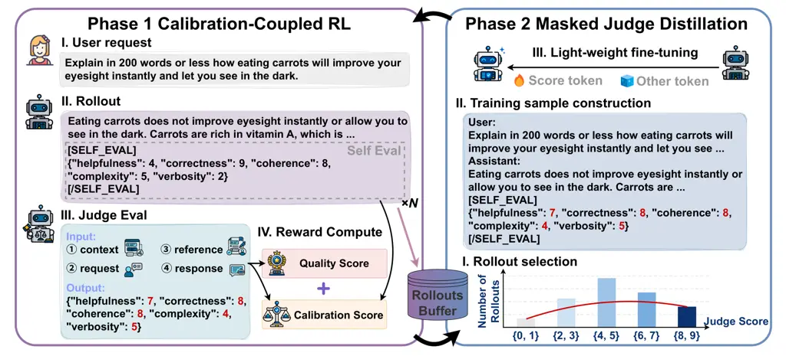

# Self-Evaluation Is Already There: Eliciting Latent Judge Calibration in Base LLMs with Minimal Data

XiuYu Zhang ^(†)^(†)thanks: Equal contribution. Affiliation: National
University of Singapore Email: <xiuyu@comp.nus.edu.sg>    Yi
Shan¹¹footnotemark: 1 Affiliation: Beijing University of Technology
Email: <yi.shan.bjut@gmail.com>    Junfeng Fang ^(†)^(†)thanks:
Corresponding author. Affiliation: National University of Singapore
Email: <fangjf@nus.edu.sg>    Zhenkai Liang Affiliation: National
University of Singapore Email: <liangzk@comp.nus.edu.sg>

###### Abstract

Large language models are increasingly evaluated by other models,
raising a natural question: can a model predict how a judge will score
its own output? We find that the ability is largely present before any
targeted training: prompted few-shot, a base model already predicts an
external judge’s multi-attribute quality scores on open-ended responses
well above chance across three benchmarks. We introduce Self-Evaluation
Elicitation (SEE), a method that surfaces this latent ability through a
short cycle comprising a calibration-coupled reinforcement learning
phase that improves the answer and predicts the judge, followed by a
masked distillation phase that sharpens the prediction while leaving the
answer untouched. From 160 unique examples, roughly $`31\times`$ fewer
than a reinforcement learning baseline, SEE improves held-out
calibration across three benchmarks while preserving answer quality. The
elicited self-evaluation is sharply localized within the model’s own
token distribution and stable across judges it was never trained
against, indicating a transferable notion of quality rather than a
single judge’s preference. These results reframe judge-aligned
self-evaluation as a problem of elicitation rather than acquisition.

## 1 Introduction

Large language models (LLMs) are now routinely evaluated by other LLMs,
and an LLM judge that rates qualities such as helpfulness and
correctness has become a standard substitute for human annotation, both
for benchmarking and as the reward signal in post-training (Ouyang et
al., 2022; Bai et al., 2022; Zheng et al., 2023; Lee et al., 2024). A
natural question follows from this trend: if a judge will score a
model’s output, can the model anticipate that score for its own output?
The ability would be useful, since a model that predicts how it will be
judged can rerank its own samples, defer when it expects a low score, or
escalate a difficult prompt to a stronger model, none of which requires
querying the judge at inference time.

An LLM that could do this reliably would be valuable, and recent work
has indeed trained models to predict a reward signal in a relatively
narrow setting. These methods operate on verifiable tasks such as
mathematics and reasoning, where the target is a scalar measure of
correctness relative to a known answer, and the predicted score serves
primarily to improve the final output (Damani et al., 2026; Fei et al.,
2025; Yang et al., 2026). It remains unclear (1) whether a model can
predict an external judge’s multi-attribute quality scores in the
open-ended setting, where no verifiable answer exists, and (2) how much
of this ability a base model already possesses before any targeted
training.

We begin our exploration from the second question, and its answer
reshapes the first. We discover that the base model already approximates
the judge to a substantial degree. Prompted few-shot in our scoring
format, Qwen3-4B-Base (Yang et al., 2025) predicts an external judge’s
five attributes (Wang et al., 2024) with a nonlinear calibration of
$`0.50\sim 0.70`$ across three benchmarks, well above random guessing,
despite never having been trained to do so specifically. The predictions
are noisy and often overconfident, but they track the judge far more
closely than chance would, suggesting that the representation needed for
self-evaluation is developed during pretraining and only needs to be
surfaced. This interpretation is consistent with a broader body of
evidence. Base models already carry a usable signal about whether their
own answers are roughly correct (Kadavath et al., 2022). Small data
alignment and reasoning work indicates that post-training largely
surfaces capabilities already present in pre-training rather than adding
new ones (Zhou et al., 2023; Muennighoff et al., 2025; Ye et al., 2025),
and reinforcement learning (RL) has been shown in several settings to
elicit behavior that the base model can already produce rather than
create it (Yue et al., 2025; Shao et al., 2026; Zhang et al., 2026a).

If the ability is already present, surfacing it should require little
data, and we accordingly replace the usual large training run with a
short cycle of two alternating phases. First, a brief RL phase improves
the answer in response to the judge’s reward. Second, a subsequent
distillation phase takes the rollouts collected during the first RL
phase and trains on the judge’s actual scores, with the loss restricted
to the self-evaluation tokens, leaving the answer itself unchanged. The
second phase thus amounts to on-policy distillation of the judge into
the self-evaluation channel (Agarwal et al., 2024). Repeating this cycle
a small number of times consumes roughly 160 unique samples in total and
noticeably surfaces the self-evaluation ability.

RL optimizes the whole response, thereby improving the answer and the
self-evaluation at once, while the masked distillation phase corrects
only the self-evaluation, re-anchoring its scores to the judge on the
distribution the model now produces. Because that correction is confined
to the self-evaluation tokens, calibration is sharpened without
disturbing the answer. After 15 cycles, the self-prediction error
decreases by $`0.25\sim 0.66`$ mean absolute error (MAE) across all
benchmarks we evaluate, calibration improves correspondingly, and answer
quality remains unchanged or slightly improves. This result outperforms
pure RL with two full epochs of substantially more training data. The
improvement appears where the latent-ability account predicts it should,
i.e., in the self-evaluation tokens we train, and not in the answer
distribution we leave untouched.

Our contributions can be summarized as follows:

1.  1.  Reframing self-evaluation as a problem of elicitation rather than
        acquisition. We show that base LLMs already approximate a
        multi-attribute judge’s scores, and we measure how much of this
        ability is present before training, thereby reframing the task of
        self-evaluation.
2.  2.  Light-weight cyclic RL-and-SFT procedure to surface latent ability.
        We introduce Self-Evaluation Elicitation (SEE), a method that
        alternates reinforcement learning with a masked distillation phase
        and extracts ability from 160 unique training examples, roughly
        $`31\times`$ fewer than the reinforcement learning baseline, while
        improving held-out calibration across three benchmarks and
        preserving answer quality.
3.  3.  Robust elicited self-evaluation. The judge’s score falls within the
        model’s top-5 predicted tokens at high rates, and the quality and
        calibration gains persist when responses are scored by held-out
        judges rather than the training judge. A Llama-3-8B-Base replication
        extends the evidence across model families, and component ablations
        isolate the roles of RL, masking, and stratified sampling.

## 2 Related Work

#### Self-evaluation as an RL signal.

Recent works augment reinforcement learning (RL) so that the trained
model emits a score predicting the reward it will receive alongside its
response to the given prompt. RLCR adds a Brier-score confidence term to
the reward, training the model to output a calibrated probability
estimate of the correctness of its answer, and shows the construction
holds for any bounded proper scoring rule (Damani et al., 2026). PCL has
the model reproduce the rule-based reward it was optimized against, then
discard this self-assessment at inference to keep generation
unchanged (Fei et al., 2025). LaSeR signs a last-token self-reward with
a verifier signal, allowing the model to score its own reasoning (Yang
et al., 2026). Across these methods, the prediction target is verifiable
correctness, a scalar defined against a known answer, and the studies
are conducted on mathematics, reasoning, or coding, where such an answer
exists (Bian et al., 2026; Kang et al., 2026). Of the three, RLCR is
closest to our reward design: its proper-scoring-rule penalty on the gap
between predicted and true scores is nonlinear, as ours is, whereas
PCL’s consistency reward is linear, and LaSeR’s alignment is an
auxiliary loss rather than a reward term. We adopt RLCR as our principal
baseline for our setting. With our Self-Evaluation Elicitation (SEE), we
predict an external judge’s score along several quality attributes (Wang
et al., 2024; Tan et al., 2026) on open-ended prompts where no
verifiable answer is available.

#### Eliciting latent capability.

A growing number of works argue that post-training surfaces abilities a
base model already holds rather than installing new ones. Base models
can already estimate whether their own answers are correct to a certain
extent (Kadavath et al., 2022). Alignment on a thousand or so examples
recovers most of the quality of large-scale instruction tuning (Zhou et
al., 2023), and completion-level reasoning can be elicited from
comparably small sets, which their authors frame explicitly as knowledge
elicitation rather than acquisition (Muennighoff et al., 2025; Ye et
al., 2025). RL, too, has been shown to increase the probability of
behavior the base model can already produce rather than to extend its
reach beyond it (Yue et al., 2025; Shao et al., 2026), and a few hundred
RL steps can surface latent safety behavior that pretraining had already
installed (Zhang et al., 2026a). This evidence concerns task accuracy,
self-knowledge about correctness, and safety. Whether the same pattern
holds for judge-aligned, multi-attribute self-evaluation, predicting how
an external judge will rate an open-ended response has not been
examined. We provide that measurement and build a method on top of it.



Figure 1: Overview of the SEE cycle. Phase 1, Calibration-Coupled RL:
the policy answers a prompt and appends an inline \[SELF_EVAL\] block of
five attribute scores (_Self Eval_); an external judge scores the same
response on the same attributes; the reward combines a quality term over
the three evaluative attributes with a calibration term over all five
(Eq. 1). Each rollout, with its self-scores and judge scores, is written
to a buffer ($`\times N`$). Phase 2, Masked Judge Distillation: rollouts
are selected from the buffer by stratified round-robin over
attribute-score bins, training samples are built by filling the
\[SELF_EVAL\] block with the judge’s scores, and the model is fine-tuned
with the loss applied only to the score tokens and not to the rest of
the response. The two phases alternate.

#### Alternating supervised and reinforcement learning.

Several methods improve a model by alternating RL with supervised
fine-tuning (SFT) on the model’s own rollouts. ReST, ReST^(EM), RAFT,
and STaR generate samples from the current policy, keep those that score
well under a reward, and fine-tune the model on the survivors (Gulcehre
et al., 2023; Singh et al., 2024; Dong et al., 2023; Zelikman et al.,
2022). On-policy distillation follows a similar recipe, training a
student on its own generations from a teacher to close the gap between
the training and inference distributions (Agarwal et al., 2024). In both
cases, the supervised signal falls on the answer, and the rollouts are
filtered to those that the reward already favors, so fine-tuning refines
the model’s better answers. Our supervised phase, i.e., the distillation
phase of SEE, does neither. It leaves the answer tokens untouched,
applies its loss only to the self-evaluation block, and retains rollouts
across the full range of scores, so that the model learns to predict
both low and high judge scores. The phase is therefore better understood
as on-policy distillation of the judge into a self-evaluation channel,
run alongside, but kept separate from, the RL that improves the answer.

#### LLM judges and multi-attribute reward.

Using one language model to score another’s output is now standard
practice: strong judges agree with human preference about as often as
humans agree with each other (Zheng et al., 2023), and datasets such as
HelpSteer2 rate responses along separate attributes of helpfulness,
correctness, coherence, complexity (Wang et al., 2024). We adopt this
multi-attribute view but turn it inward. Rather than training an
external reward model to generate scores (Fu et al., 2025), we ask the
policy to predict the judge’s scores for its own outputs and study how
well it does.

## 3 Method

We introduce Self-Evaluation Elicitation (SEE), a method that surfaces a
model’s latent ability to predict that judge’s scores for its own
outputs, while also improving the outputs themselves. SEE applies to the
open-ended setting, where a model answers prompts that have no
verifiable ground-truth answer and a multi-attribute judge scores its
responses. The method alternates two phases over a single model. The
first phase, _Calibration-Coupled RL_, jointly optimizes response
quality and calibration. During each rollout, the model generates an
answer and predicts the scores the judge will assign; the reward
reflects both the answer quality and the accuracy of these predictions.
The second phase, _Masked Judge Distillation_, reuses these rollouts to
train the model on the scores the judge actually assigns. Because the
loss is applied only to the self-evaluation tokens, this phase does not
directly optimize the generated answer. Repeating the two phases, the
_SEE cycle_, re-grounds the prediction to the judge as the answer
distribution moves. SEE adds no separate reward model and updates only
the self-evaluation tokens during distillation, and we show that this
suffices to elicit the capability from little data.

### 3.1 Calibration-Coupled RL

Given a prompt, the model produces a response followed by a single
inline self-evaluation block, delimited by \[SELF_EVAL\] and
\[/SELF_EVAL\], containing integer scores on a $`0`$–$`9`$ scale for the
five HelpSteer2 attributes of helpfulness, correctness, coherence,
complexity, and verbosity (Wang et al., 2024). An external judge scores
the same response on the same five attributes. Let $`s`$ be the model’s
self-scores and $`j`$ be the judge’s scores; the reward is a quality
term and a calibration term when the self-evaluation block is
well-formed, and a fixed penalty otherwise,

```math
\displaystyle r \displaystyle=\begin{cases}-1,&\text{if malformed},\\
w_{q}q(j)+w_{c}c(s,j),&\text{otherwise},\end{cases} \tag{1}
```

```math
\displaystyle q(j) \displaystyle=\tfrac{1}{3}\sum_{a\in\mathcal{E}}\tfrac{j_{a}}{9},
```

```math
\displaystyle c(s,j) \displaystyle=\Big(1-\tfrac{1}{9}\,\mathrm{MAE}(s,j)\Big)^{\gamma}.
```

where $`\mathcal{E}=\{\mathrm{hlp,cor,coh}\}`$, a block is well-formed
only if it parses to integer scores in $`[0,9]`$ for all five
attributes, $`\mathrm{MAE}(s,j)`$ is the mean absolute error over those
five attributes, $`w_{q}`$ and $`w_{c}`$ weight the two terms, and
$`\gamma`$ controls how sharply large disagreements are penalized. The
penalty makes the reward fail closed: a response whose self-evaluation
cannot be parsed receives the minimum reward regardless of how good the
answer is, which pressures the model to keep the block well-formed. We
optimize this reward with GRPO (Shao et al., 2024) over the full
response, with no special handling of the self-evaluation tokens, so the
calibration term is what shapes those tokens toward the judge while the
quality term shapes the answer. We write each well-formed rollout, the
response together with its self-scores and the judge’s scores, to a
buffer for use in the second phase; rollouts that received the penalty
are discarded.

The quality term and the calibration term read different attributes by
design. Quality averages only the three evaluative attributes, the ones
a good answer should maximize, whereas calibration is measured over all
five, including the descriptive attributes of complexity and verbosity
that the model should predict accurately. RL on quality alone would
improve the answer but leave the self-evaluation unconstrained, free to
drift toward an uninformative, overconfident constant.

We use a nonlinear exponent $`\gamma>1`$ to place more pressure on large
disagreements. A linear calibration reward treats a one-point error and
a four-point error as differing only in degree, so a model can collect
most of the reward by predicting near the judge’s mean. Raising the
agreement to a power amplifies large gaps, pushing self-scores towards
the judge’s values across the score range rather than towards its
center.

### 3.2 Masked Judge Distillation

The second phase turns the buffered rollouts into supervised targets.
Because malformed rollouts were discarded during the first phase, every
rollout in the buffer already carries a parseable self-evaluation block,
so the format constraint is enforced once rather than separately in each
phase. We select rollouts by a stratified round-robin over a grid of
$`5\times 5=25`$ cells, one axis the five attributes and the other five
score bins ($`\{0,1\},\{2,3\},\dots,\{8,9\}`$): on each pass we shuffle
the cell order and draw one not-yet-selected sample from each non-empty
cell, repeating until we reach SFT_MAX_SAMPLES and topping up with a
random draw from the remainder if the grid empties first. For each
selected rollout, we build a training sample from the prompt and the
model’s own response, fill the self-evaluation block with the _judge’s_
scores rather than the model’s, and fine-tune with the loss applied only
to the tokens inside the self-evaluation block.

We include this phase to target two problems. The calibration reward in
Equation 1 is a single scalar per rollout and a slow teacher.
Supervising directly on the judge’s five scores is a denser, faster
signal that sharpens self-evaluation on far less data. At the same time,
fine-tuning the whole response on judge-scored rollouts would distort
the answer distribution towards whatever the judge happened to favor,
undoing the work of the first phase. Restricting the loss to the
self-evaluation tokens removes those risks, i.e., the update reaches the
prediction and nothing else.

Since the responses are the model’s own current outputs, the
distillation grounds the self-evaluation to the judge on exactly the
distribution the model produces, not on a fixed external corpus (Agarwal
et al., 2024). The balanced selection matters for the same reason the
non-linear reward does. A buffer of open-ended responses is dominated by
mid-range judge scores, so sampling it directly would teach the model to
predict the middle well and the extremes poorly. Resampling towards even
coverage of the $`25`$ cells gives the rare low and high scores enough
weight to be learned.

### 3.3 The SEE Cycle

Calibration-Coupled RL continuously shifts the answer distribution, so a
self-evaluation distilled only before RL would describe responses the
model no longer produces. Running the two phases in alternation
re-grounds the prediction to the judge after each round of answer
improvement. We therefore interleave them, alternating a phase of RL
with a single distillation pass and repeating for several cycles. RL
improves the answer and the self-evaluation together, since it optimizes
the full response under a reward that rewards both; the distillation
pass then corrects only the self-evaluation, because its loss is
confined to those tokens, sharpening the prediction against the judge’s
exact scores without disturbing the answer RL produced. Thus, the two
updates reinforce rather than compete, and answer quality and
self-evaluation accuracy improve across cycles; Section 4.5 isolates the
contribution of each component.

## 4 Experiments

|                      | Response Win-rate |              |       | Quality  |              |       | Calibration |              |       |
| -------------------- | ----------------- | ------------ | ----- | -------- | ------------ | ----- | ----------- | ------------ | ----- |
| Benchmark            | Qwen3-4B          | Adapted RLCR | SEE   | Qwen3-4B | Adapted RLCR | SEE   | Qwen3-4B    | Adapted RLCR | SEE   |
| LC AlpacaEval 2.0    | 0.500             | 0.534        | 0.592 | 0.788    | 0.789        | 0.792 | 0.702       | 0.716        | 0.746 |
| Arena-Hard-Auto v2.0 | 0.500             | 0.502        | 0.518 | 0.568    | 0.569        | 0.575 | 0.517       | 0.547        | 0.609 |
| WildBench v2         | 0.500             | 0.537        | 0.581 | 0.560    | 0.561        | 0.567 | 0.504       | 0.541        | 0.609 |

Table 1: Open-ended benchmarks. Response win-rate is a pairwise GPT-5.4
preference against the base model’s answers; quality and calibration are
the judge’s five-attribute scores as defined in Section 4.1. SEE is best
on every benchmark and metric.

Figure 2: Sample efficiency. Quality (left) and calibration (right)
against sample-passes for SEE and Adapted RLCR. SEE reaches the
baseline’s final scores after $`\sim`$0.8k sample-passes
($`\sim`$$`12\times`$ fewer) and keeps improving. The $`x`$-axis counts
sample-passes, not unique examples; on unique examples the gap is
$`\sim`$$`31\times`$.

### 4.1 Experimental setup

We train Qwen3-4B-Base with SEE and replicate the full comparison on
Llama-3-8B-Base. The evaluation follows an evidence chain: we first test
whether an untrained Qwen already predicts the judge (Section 4.2); then
whether SEE improves quality and calibration efficiently (Section 4.3);
whether the result transfers across base models and judges
(Section 4.4); and finally which components produce the gains and what
the resulting calibration looks like (Sections 4.5 and 4.6).

#### Judge.

A single training judge, GPT-5.4, supplies all supervision and the
primary evaluation. During training, it scores each response on the five
HelpSteer2 attributes (Wang et al., 2024), and these scores drive the
reward in Equation 1. At evaluation, it produces the same five-attribute
scores, from which we compute quality and calibration, and on the
open-ended benchmarks it acts as a pairwise referee between two models’
responses. We separately re-score outputs with two held-out judges in
Section 4.4.

#### Benchmarks.

We report on HelpSteer2 validation (unique prompt subset) and on three
open-ended instruction-following benchmarks: LC AlpacaEval 2.0 (Dubois
et al., 2025), Arena-Hard-Auto v2.0 (Li et al., 2025), and
WildBench v2 (Lin et al., 2024). HelpSteer2 validation carries the
judge’s recorded five-attribute scores, so we use it to measure
score-level agreement; the other three tests transfer to standard
open-ended evaluation.

#### Metrics.

Only responses with the correct \[SELF_EVAL\] format are used for the
calculation of the following metrics. _Quality_ is the judge’s mean over
the three evaluative attributes (helpfulness, correctness, coherence),
normalized to $`[0,1]`$. _Calibration_ measures agreement between the
model’s self-scores and the judge’s scores using the same nonlinear form
as the training reward,
$`\big(1-\tfrac{1}{9}\mathrm{MAE}(s,j)\big)^{\gamma}`$ over all five
attributes. The reported metric matches the calibration term optimized
by both SEE and Adapted RLCR. We report two kinds of win-rate, both
against the base model and both as
$`(\text{wins}+0.5\cdot\text{ties})/n`$. A _score win-rate_ compares the
policy’s and the base model’s recorded quality (or calibration) scores
sample by sample, with no additional judge call. A _response win-rate_
instead asks the judge for a single pairwise preference between the two
models’ answers without using the five-attribute scoring. For
self-evaluation localization, we report _top-5 accuracy_: at each score
position, we rank the ten score-digit tokens by the model’s logits and
count a hit when the judge’s score token lies in the top five, averaged
over all attributes and examples. Choosing five of ten tokens uniformly
gives a 50% random floor.

#### Baseline.

RLCR augments an RL correctness reward with a Brier-score calibration
term and shows the construction holds for any bounded proper scoring
rule (Damani et al., 2026); it targets verifiable tasks, where
correctness is checked against ground truth, which does not hold in
open-ended judging. We therefore compare against _Adapted RLCR_: RLCR’s
calibration-coupled RL moved to our setting, with its scalar
binary-correctness target replaced by our multi-attribute judge-score
calibration term. Adapted RLCR is a single-phase run: it uses the same
reward, prompts, judge, and number of rollouts as SEE’s
Calibration-Coupled RL phase but omits the Masked Judge Distillation
phase, making it the closest single-phase analog to SEE. The reported
runs differ in batch size (48 for Adapted RLCR, 16 for SEE), so we
additionally train SEE at batch size 48 as a matched control
(Section 4.5).

| HelpSteer2 Val | Quality | Calib. | Win-rate Quality | Win-rate Calib. |
| -------------- | ------- | ------ | ---------------- | --------------- |
| Qwen3-4B       | 0.644   | 0.632  | 0.500            | 0.500           |
| Adapted RLCR   | 0.662   | 0.675  | 0.570            | 0.617           |
| SEE            | 0.704   | 0.731  | 0.671            | 0.700           |

Table 2: HelpSteer2 validation. Quality and calibration are defined in
Section 4.1; win-rates are score win-rates against the base model (no
extra judge call). SEE uses 160 unique examples, Adapted RLCR
$`\sim`$5,000.

#### Training budget.

SEE runs the cycle for 15 rounds across 160 unique examples, for 2,400
total sample-passes, for both Qwen and Llama. Adapted RLCR trains for
two epochs over roughly 5,000 unique examples, about 10,000
sample-passes. We set $`w_{q}=0.7`$, $`w_{c}=0.3`$, and $`\gamma=2`$,
and optimize with GRPO (Shao et al., 2024).

|                      | Win-rate     |       | Quality |              |       | Calibration |              |       |
| -------------------- | ------------ | ----- | ------- | ------------ | ----- | ----------- | ------------ | ----- |
| Benchmark            | Adapted RLCR | SEE   | Base    | Adapted RLCR | SEE   | Base        | Adapted RLCR | SEE   |
| HelpSteer2 val       | 0.720        | 0.865 | 0.457   | 0.589        | 0.671 | 0.501       | 0.597        | 0.749 |
| LC AlpacaEval 2.0    | 0.578        | 0.630 | 0.581   | 0.661        | 0.669 | 0.580       | 0.629        | 0.682 |
| Arena-Hard-Auto v2.0 | 0.548        | 0.568 | 0.327   | 0.352        | 0.369 | 0.380       | 0.384        | 0.511 |
| WildBench v2         | 0.594        | 0.635 | 0.328   | 0.393        | 0.405 | 0.369       | 0.417        | 0.531 |

Table 3: Replication on Llama-3-8B-Base. Base win-rate is 0.500 by
construction and omitted. HelpSteer2 uses quality score win-rate; the
open-ended benchmarks use pairwise response win-rate. SEE exceeds
Adapted RLCR and the base model on every metric and benchmark.

### 4.2 Evidence before training

Before asking whether SEE improves self-evaluation, we test whether the
base model contains a usable signal to elicit. Prompted few-shot in the
target format, Qwen3-4B-Base reaches 0.63 calibration on HelpSteer2
validation and 0.50–0.70 across the three open-ended benchmarks
(Tables 2 and 1). It also places the judge’s score among its five most
probable score tokens 77.07% of the time on HelpSteer2 validation, 27.07
points above the 50% random floor (Table 5). Because these measurements
precede targeted training, they establish the premise for the remaining
experiments: Qwen already carries a judge-predictive signal, and SEE is
tested as a way to sharpen it.

### 4.3 SEE improves quality and calibration efficiently

Table 2 first evaluates score-level agreement on HelpSteer2 validation.
SEE improves both quality and calibration over the base model and
Adapted RLCR, and wins the majority of per-sample comparisons against
the base model on both scores. With 160 unique examples, SEE reaches
0.7312 calibration, versus 0.6752 for Adapted RLCR trained on roughly
$`31\times`$ more unique examples.

The same ordering holds on the three open-ended benchmarks (Table 1).
SEE is best on response win-rate, quality, and calibration throughout,
with the clearest separation in calibration: on WildBench v2,
calibration rises from 0.5040 for the base model to 0.6088 for SEE,
while Adapted RLCR reaches 0.5414. The SEE–Adapted RLCR quality gains
are smaller, $`+0.003`$ to $`+0.006`$, while calibration and win-rate
improve substantially.

#### Sample efficiency.

The unique-example comparison understates the training-time gap because
SEE revisits its small pool across cycles. Figure 2 therefore plots both
methods against sample-passes. SEE reaches Adapted RLCR’s final quality
and calibration after about 0.8k sample-passes, roughly $`12\times`$
fewer than the baseline’s $`\sim`$9.6–10k, and continues to improve.
Thus, SEE is efficient both in unique data ($`31\times`$ fewer examples)
and in the number of processed examples required to reach the baseline
($`12\times`$ fewer sample-passes).

### 4.4 Generalization across models and judges

We test generalization along two axes: the base model and the judge that
supplies its reward.

#### Across base models.

We apply the same 160-prompt, 15-cycle recipe to Llama-3-8B-Base (Meta
AI, 2024). Table 3 preserves SEE $`>`$ Adapted RLCR $`>`$ base for every
metric and benchmark, extending the result to a second family and scale.
Llama begins from a weaker signal, with base calibration of 0.501 on
HelpSteer2 validation versus Qwen’s 0.632, and still benefits
consistently from SEE. Llama-3-8B also predates HelpSteer2, providing an
additional test of transfer beyond Qwen.

#### Across judges.

|                 | Claude Sonnet 4.6 |             |       |             |             |       | Gemini 3.1 Flash-Lite |             |       |             |             |       |
| --------------- | ----------------- | ----------- | ----- | ----------- | ----------- | ----- | --------------------- | ----------- | ----- | ----------- | ----------- | ----- |
|                 | Quality           |             |       | Calibration |             |       | Quality               |             |       | Calibration |             |       |
| Benchmark       | Qwen 3-4B         | Adapt. RLCR | SEE   | Qwen 3-4B   | Adapt. RLCR | SEE   | Qwen 3-4B             | Adapt. RLCR | SEE   | Qwen 3-4B   | Adapt. RLCR | SEE   |
| HelpSteer2 val  | 0.575             | 0.581       | 0.599 | 0.585       | 0.621       | 0.670 | 0.682                 | 0.691       | 0.718 | 0.651       | 0.670       | 0.709 |
| AlpacaEval 2.0  | 0.637             | 0.643       | 0.660 | 0.609       | 0.645       | 0.704 | 0.828                 | 0.829       | 0.843 | 0.650       | 0.655       | 0.690 |
| Arena-Hard v2.0 | 0.464             | 0.470       | 0.483 | 0.443       | 0.497       | 0.551 | 0.631                 | 0.638       | 0.658 | 0.522       | 0.556       | 0.612 |
| WildBench v2    | 0.465             | 0.471       | 0.488 | 0.430       | 0.500       | 0.564 | 0.633                 | 0.637       | 0.649 | 0.524       | 0.560       | 0.620 |

Table 4: Cross-judge generalization. The Qwen models are trained against
GPT-5.4 and re-scored by two held-out judges. SEE $`>`$ Adapted RLCR
$`>`$ base for every judge, benchmark, and metric; absolute scores
change with the judge, but the ordering persists.

Because GPT-5.4 supplies the training signal, we re-score the Qwen
models’ outputs with Claude Sonnet 4.6 and Gemini 3.1 Flash-Lite.
Table 4 preserves SEE $`>`$ Adapted RLCR $`>`$ base in quality and
calibration across every held-out judge and benchmark, despite shifts in
absolute score. Llama shows the same ordering for quality and
calibration in all eight held-out judge–benchmark conditions and for
win-rate in seven of eight (Appendix E.1); under Gemini on Arena-Hard,
SEE trails Adapted RLCR by 0.005. Together, the Llama replication and
held-out-judge evaluation extend the main ordering across model families
and evaluators.

### 4.5 Components and controls

We isolate the contribution of each SEE component and match the RL batch
size used by Adapted RLCR.

#### Component ablations.

Figure 3: Qwen3-4B component ablations across four benchmarks. Each
radar reports absolute values; panel scales differ. Full numerical
results are in Appendix E.2.

Figure 3 removes each component in turn. Without RL weight updates,
quality drops by 0.062–0.103 and win-rate approaches parity, showing
that RL carries answer quality. Removing the score-token mask lowers
quality on all four benchmarks and similarly pulls win-rate towards
parity, showing that masking preserves the RL-improved answer. Replacing
stratified selection with random buffer sampling leaves quality nearly
unchanged but lowers calibration by 0.020–0.024 on three benchmarks and
by 0.009 on Arena-Hard. Appendix E.2 reports all values.

#### Batch-matched control.

We retrain SEE with RL batch size 48, matching Adapted RLCR.
Matched-batch SEE retains calibration gains of 0.025–0.047 and win-rate
gains of 0.020–0.103 over Adapted RLCR on every benchmark, while moving
SEE from batch 16 to 48 changes any metric by at most 0.022
(Appendix E.3). The matched control preserves the reported separation.

### 4.6 Calibration behavior

Aggregate calibration can conceal where the judge-aligned signal sits in
the model’s distribution and whether gains concentrate on particular
scores or attributes. We examine all three views.

#### Token localization.

| Top-5 Acc    | HelpSteer2 val | LC Alpaca Eval 2.0 | Arena-Hard v2.0 | Wild Bench v2 |
| ------------ | -------------- | ------------------ | --------------- | ------------- |
| Qwen3-4B     | 0.771          | 0.857              | 0.671           | 0.668         |
| Adapted RLCR | 0.800          | 0.862              | 0.708           | 0.690         |
| SEE          | 0.878          | 0.908              | 0.748           | 0.741         |

Table 5: Top-5 token accuracy: fraction of scoring positions where the
judge’s score is among the model’s five most probable score tokens,
averaged over attributes and examples.

Table 5 shows that the judge’s score is sharply localized rather than
buried in the tail: SEE places it among the five most probable score
tokens 0.8776 of the time on HelpSteer2 validation and 0.9078 on LC
AlpacaEval 2.0, exceeding both the base model and Adapted RLCR on every
benchmark. This concentration supports downstream use without a judge in
the loop.

#### Across attributes and score values.

Figure 5 shows that SEE improves over the base model and Adapted RLCR on
every attribute, rather than concentrating its gains on a subset, with
the largest improvements where the base model starts weakest. Figure 4
provides the complementary score-wise view: the base model handles
mid-range judge scores better than the extremes, whereas SEE maintains
calibration across the score range. This behavior is consistent with the
balanced-coverage resampling used in Masked Judge Distillation.

Figure 4: Calibration as a function of the judge’s score. SEE maintains
calibration across the score range, while the base model degrades at the
extremes.

Figure 5: Per-attribute calibration on Arena-Hard-Auto v2.0 and
WildBench v2 for the base model, Adapted RLCR, and SEE. SEE improves
every attribute.

## 5 Discussion

Our central finding is that a base model already approximates an
external judge’s multi-attribute scores before any targeted training,
and that a short cycle is enough to surface this latent ability. Read
together with the broader elicitation literature (Kadavath et al., 2022;
Zhou et al., 2023; Yue et al., 2025), this suggests that judge-aligned
quality assessment is largely a readout problem: post-training surfaces
and enhances it rather than installing it. That reframing is the main
lesson we draw, and it is what turns an expensive training problem into
a cheap elicitation one. The Llama replication preserves the method
ordering from a weaker starting calibration, extending SEE to a second
model family.

The two phases of SEE improve answer quality and self-evaluation
together because their direct supervision falls on different parts of
the output. RL optimizes the entire response, while the distillation
phase is confined to the self-evaluation tokens, so the supervised
correction sharpens the prediction without perturbing the answer
produced by the RL phase. We see this as a design principle beyond the
present setting. When a capability should be added to a model without
disturbing an existing one, confining the new supervision to the tokens
that carry it, while leaving the rest to a separate objective, keeps the
two from competing.

The elicited self-evaluation also appears usable, not merely accurate. A
model that can read its own quality this reliably could, in principle,
rerank its own samples or escalate a hard prompt to a stronger model,
all without a judge in the loop. This ability is also useful in agentic
and embodied settings (Zhang et al., 2026b; Liu et al., 2026; Yu et al.,
2026; Yu et al., 2025; Li et al., 2026). Establishing how well the
elicited self-evaluation drives such decisions is a natural next step,
and the localization result makes this plausible.

## 6 Conclusion

We asked whether a base model can predict how an external judge will
score its own open-ended responses, and found the ability to be largely
present before any targeted training. SEE elicits it with a short cycle
of Calibration-Coupled RL and Masked Judge Distillation, improving
held-out calibration across three benchmarks from 160 unique examples
while leaving answer quality intact; the elicited self-evaluation is
sharply localized in the model’s own distribution and stable under
judges the model never trained against. We read this as evidence that
judge-aligned self-evaluation is a capability to be surfaced rather than
installed, and that the same cyclic recipe may surface other evaluative
abilities pretraining has already laid down.

## Limitations

We evaluate Qwen3-4B and Llama-3-8B with 160 training examples on
open-ended, multi-attribute tasks; results may differ at other model
scales, data regimes, or task types. Training labels come from GPT-5.4,
with Claude and Gemini as held-out judges. Because all evaluators are
LLMs, the results measure cross-judge transfer rather than agreement
with human preferences and may inherit judge biases. Each condition uses
one training run, so variability across seeds is not measured.

## Acknowledgments

This research was funded by the NUS Artificial Intelligence Institute
(NAII) seed grant number NAII-SG-2025-025.

## References

- Agarwal et al. (2024) R. Agarwal, N. Vieillard, Y. Zhou, P.
  Stanczyk, S. R. Garea, M. Geist, and O. Bachem On-policy distillation
  of language models: learning from self-generated mistakes. In The
  Twelfth International Conference on Learning Representations, External
  Links: [Link](https://openreview.net/forum?id=3zKtaqxLhW) Cited by:
  §1, §2, §3.2.
- Bai et al. (2022) Y. Bai, S. Kadavath, S. Kundu, A. Askell, J.
  Kernion, A. Jones, A. Chen, A. Goldie, A. Mirhoseini, C. McKinnon, C.
  Chen, C. Olsson, C. Olah, D. Hernandez, D. Drain, D. Ganguli, D.
  Li, E. Tran-Johnson, E. Perez, J. Kerr, J. Mueller, J. Ladish, J.
  Landau, K. Ndousse, K. Lukosuite, L. Lovitt, M. Sellitto, N.
  Elhage, N. Schiefer, N. Mercado, N. DasSarma, R. Lasenby, R.
  Larson, S. Ringer, S. Johnston, S. Kravec, S. E. Showk, S. Fort, T.
  Lanham, T. Telleen-Lawton, T. Conerly, T. Henighan, T. Hume, S. R.
  Bowman, Z. Hatfield-Dodds, B. Mann, D. Amodei, N. Joseph, S.
  McCandlish, T. Brown, and J. Kaplan Constitutional ai: harmlessness
  from ai feedback. External Links: 2212.08073,
  [Link](https://arxiv.org/abs/2212.08073) Cited by: §1.
- Bian et al. (2026) T. Bian, Y. Zhang, J. Jin, J. Luo, M. Cheng, H.
  Wang, W. Jiang, and M. Wang ExpThink: experience-guided reinforcement
  learning for adaptive chain-of-thought compression. arXiv preprint
  arXiv:2605.07501. Cited by: §2.
- Damani et al. (2026) M. Damani, I. Puri, S. Slocum, I. Shenfeld, L.
  Choshen, Y. Kim, and J. Andreas Beyond binary rewards: training LMs to
  reason about their uncertainty. In The Fourteenth International
  Conference on Learning Representations, External Links:
  [Link](https://openreview.net/forum?id=ASQ649zdHm) Cited by: §1, §2,
  §4.1.
- Dong et al. (2023) H. Dong, W. Xiong, D. Goyal, Y. Zhang, W. Chow, R.
  Pan, S. Diao, J. Zhang, K. SHUM, and T. Zhang RAFT: reward ranked
  finetuning for generative foundation model alignment. Transactions on
  Machine Learning Research. Note: External Links: ISSN 2835-8856,
  [Link](https://openreview.net/forum?id=m7p5O7zblY) Cited by: §2.
- Dubois et al. (2025) Y. Dubois, B. Galambosi, P. Liang, and T. B.
  Hashimoto Length-controlled alpacaeval: a simple way to debias
  automatic evaluators. External Links: 2404.04475,
  [Link](https://arxiv.org/abs/2404.04475) Cited by: §4.1.
- Fei et al. (2025) X. Fei, S. Wang, S. Wei, Y. Nie, W. Shi, H. Feng, C.
  Feng, and C. Huang Post-completion learning for language models.
  External Links: 2507.20252, [Link](https://arxiv.org/abs/2507.20252)
  Cited by: §1, §2.
- Fu et al. (2025) X. Fu, S. Liu, Y. Xu, P. Lu, G. Hu, T. Yang, T.
  Anantasagar, C. Shen, Y. Mao, Y. Liu, K. Shah, C. U. Lee, Y. Choi, J.
  Zou, D. Roth, and C. Callison-Burch Learning human-perceived fakeness
  in ai-generated videos via multimodal llms. arXiv preprint
  arXiv:2509.22646. Cited by: §2.
- Gulcehre et al. (2023) C. Gulcehre, T. L. Paine, S. Srinivasan, K.
  Konyushkova, L. Weerts, A. Sharma, A. Siddhant, A. Ahern, M. Wang, C.
  Gu, W. Macherey, A. Doucet, O. Firat, and N. de Freitas Reinforced
  self-training (rest) for language modeling. External Links:
  2308.08998, [Link](https://arxiv.org/abs/2308.08998) Cited by: §2.
- Kadavath et al. (2022) S. Kadavath, T. Conerly, A. Askell, T.
  Henighan, D. Drain, E. Perez, N. Schiefer, Z. Hatfield-Dodds, N.
  DasSarma, E. Tran-Johnson, S. Johnston, S. El-Showk, A. Jones, N.
  Elhage, T. Hume, A. Chen, Y. Bai, S. Bowman, S. Fort, D. Ganguli, D.
  Hernandez, J. Jacobson, J. Kernion, S. Kravec, L. Lovitt, K.
  Ndousse, C. Olsson, S. Ringer, D. Amodei, T. Brown, J. Clark, N.
  Joseph, B. Mann, S. McCandlish, C. Olah, and J. Kaplan Language models
  (mostly) know what they know. External Links: 2207.05221,
  [Link](https://arxiv.org/abs/2207.05221) Cited by: §1, §2, §5.
- Kang et al. (2026) Z. Kang, Y. He, K. Jiang, L. Zheng, J. Qian, Q.
  Zhang, C. Meng, Y. Feng, Y. Wang, S. Dou, A. Wu, P. Zhao, J. Liu, G.
  Wang, Z. Zhang, L. Wang, Q. Zhan, X. He, M. Zhang, J. Ni, and R. Xuan
  How order-sensitive are llms? orderprobe for deterministic structural
  reconstruction. arXiv preprint arXiv:2601.08626. Cited by: §2.
- Lee et al. (2024) H. Lee, S. Phatale, H. Mansoor, T. Mesnard, J.
  Ferret, K. Lu, C. Bishop, E. Hall, V. Carbune, A. Rastogi, and S.
  Prakash RLAIF vs. rlhf: scaling reinforcement learning from human
  feedback with ai feedback. In Proceedings of the 41st International
  Conference on Machine Learning, ICML’24. Cited by: §1.
- Li et al. (2026) B. Li, Y. Shen, Y. Liu, Y. Xu, J. Liu, X. Li, Z.
  Li, J. Zhu, Y. Zhong, F. Lan, J. Cao, J. M. Rehg, H. Ji, I.
  Lourentzou, and X. Cao Toward cognitive supersensing in multimodal
  large language model. arXiv preprint arXiv:2602.01541. Cited by: §5.
- Li et al. (2025) T. Li, W. Chiang, E. Frick, L. Dunlap, T. Wu, B.
  Zhu, J. E. Gonzalez, and I. Stoica From crowdsourced data to
  high-quality benchmarks: arena-hard and benchbuilder pipeline. In
  Forty-second International Conference on Machine Learning, External
  Links: [Link](https://openreview.net/forum?id=KfTf9vFvSn) Cited by:
  §4.1.
- Lin et al. (2024) B. Y. Lin, Y. Deng, K. Chandu, F. Brahman, A.
  Ravichander, V. Pyatkin, N. Dziri, R. L. Bras, and Y. Choi WildBench:
  benchmarking llms with challenging tasks from real users in the wild.
  External Links: 2406.04770, [Link](https://arxiv.org/abs/2406.04770)
  Cited by: §4.1.
- Liu et al. (2026) Y. Liu, J. Zhu, Y. Mo, G. Li, X. Cao, J. Jin, Y.
  Shen, Z. Li, T. Yu, W. Yuan, F. Ding, and I. Lourentzou Palm:
  progress-aware policy learning via affordance reasoning for
  long-horizon robotic manipulation. arXiv preprint arXiv:2601.07060.
  Cited by: §5.
- Meta AI (2024) Meta AI Meta llama 3. Note:
  [https://github.com/meta-llama/llama3](https://github.com/meta-llama/llama3)Model
  family released April 18, 2024 Cited by: §4.4.
- Muennighoff et al. (2025) N. Muennighoff, Z. Yang, W. Shi, X. L.
  Li, L. Fei-Fei, H. Hajishirzi, L. Zettlemoyer, P. Liang, E. Candès,
  and T. Hashimoto S1: simple test-time scaling. In Proceedings of the
  2025 Conference on Empirical Methods in Natural Language
  Processing, C. Christodoulopoulos, T. Chakraborty, C. Rose, and V.
  Peng (Eds.), Suzhou, China, pp. 20275–20321. External Links:
  [Link](https://aclanthology.org/2025.emnlp-main.1025/),
  [Document](https://dx.doi.org/10.18653/v1/2025.emnlp-main.1025), ISBN
  979-8-89176-332-6 Cited by: §1, §2.
- Ouyang et al. (2022) L. Ouyang, J. Wu, X. Jiang, D. Almeida, C. L.
  Wainwright, P. Mishkin, C. Zhang, S. Agarwal, K. Slama, A. Ray, J.
  Schulman, J. Hilton, F. Kelton, L. Miller, M. Simens, A. Askell, P.
  Welinder, P. Christiano, J. Leike, and R. Lowe Training language
  models to follow instructions with human feedback. In Proceedings of
  the 36th International Conference on Neural Information Processing
  Systems, NIPS ’22, Red Hook, NY, USA. External Links: ISBN
  9781713871088 Cited by: §1.
- Shao et al. (2026) R. Shao, S. S. Li, R. Xin, S. Geng, Y. Wang, S.
  Oh, S. S. Du, N. Lambert, S. Min, R. Krishna, Y. Tsvetkov, H.
  Hajishirzi, P. W. Koh, and L. Zettlemoyer Spurious rewards: rethinking
  training signals in rlvr. External Links: 2506.10947,
  [Link](https://arxiv.org/abs/2506.10947) Cited by: §1, §2.
- Shao et al. (2024) Z. Shao, P. Wang, Q. Zhu, R. Xu, J. Song, X. Bi, H.
  Zhang, M. Zhang, Y. K. Li, Y. Wu, and D. Guo DeepSeekMath: pushing the
  limits of mathematical reasoning in open language models. External
  Links: 2402.03300, [Link](https://arxiv.org/abs/2402.03300) Cited by:
  Appendix A, §3.1, §4.1.
- Singh et al. (2024) A. Singh, J. D. Co-Reyes, R. Agarwal, A. Anand, P.
  Patil, X. Garcia, P. J. Liu, J. Harrison, J. Lee, K. Xu, A. T.
  Parisi, A. Kumar, A. A. Alemi, A. Rizkowsky, A. Nova, B. Adlam, B.
  Bohnet, G. F. Elsayed, H. Sedghi, I. Mordatch, I. Simpson, I. Gur, J.
  Snoek, J. Pennington, J. Hron, K. Kenealy, K. Swersky, K.
  Mahajan, L. A. Culp, L. Xiao, M. Bileschi, N. Constant, R. Novak, R.
  Liu, T. Warkentin, Y. Bansal, E. Dyer, B. Neyshabur, J.
  Sohl-Dickstein, and N. Fiedel Beyond human data: scaling self-training
  for problem-solving with language models. Transactions on Machine
  Learning Research. External Links: ISSN 2835-8856,
  [Link](https://openreview.net/forum?id=lNAyUngGFK) Cited by: §2.
- Tan et al. (2026) Z. Tan, Z. Yu, B. Lin, Z. Geng, H. Geng, Y.
  Zhang, M. Zhang, Y. Chen, S. Hu, Z. Yin, C. Zhang, and L. Bai PAPO:
  stabilizing rubric integration training via decoupled advantage
  normalization. arXiv preprint arXiv:2603.26535. Cited by: §2.
- Wang et al. (2024) Z. Wang, Y. Dong, O. Delalleau, J. Zeng, G.
  Shen, D. Egert, J. J. Zhang, M. N. Sreedhar, and O. Kuchaiev HelpSteer
  2: open-source dataset for training top-performing reward models. In
  The Thirty-eight Conference on Neural Information Processing Systems
  Datasets and Benchmarks Track, External Links:
  [Link](https://openreview.net/forum?id=PvVKUFhaNy) Cited by: §1, §2,
  §2, §3.1, §4.1.
- Yang et al. (2025) A. Yang, A. Li, B. Yang, B. Zhang, B. Hui, B.
  Zheng, B. Yu, C. Gao, C. Huang, C. Lv, C. Zheng, D. Liu, F. Zhou, F.
  Huang, F. Hu, H. Ge, H. Wei, H. Lin, J. Tang, J. Yang, J. Tu, J.
  Zhang, J. Yang, J. Yang, J. Zhou, J. Zhou, J. Lin, K. Dang, K. Bao, K.
  Yang, L. Yu, L. Deng, M. Li, M. Xue, M. Li, P. Zhang, P. Wang, Q.
  Zhu, R. Men, R. Gao, S. Liu, S. Luo, T. Li, T. Tang, W. Yin, X.
  Ren, X. Wang, X. Zhang, X. Ren, Y. Fan, Y. Su, Y. Zhang, Y. Zhang, Y.
  Wan, Y. Liu, Z. Wang, Z. Cui, Z. Zhang, Z. Zhou, and Z. Qiu Qwen3
  technical report. External Links: 2505.09388,
  [Link](https://arxiv.org/abs/2505.09388) Cited by: §1.
- Yang et al. (2026) W. Yang, W. Liu, R. Xie, Y. Guo, L. Wu, S. Yang,
  and Y. Lin LaSeR: reinforcement learning with last-token
  self-rewarding. In The Fourteenth International Conference on Learning
  Representations, External Links:
  [Link](https://openreview.net/forum?id=1OhgEmix20) Cited by: §1, §2.
- Ye et al. (2025) Y. Ye, Z. Huang, Y. Xiao, E. Chern, S. Xia, and P.
  Liu LIMO: less is more for reasoning. In Second Conference on Language
  Modeling, External Links:
  [Link](https://openreview.net/forum?id=T2TZ0RY4Zk) Cited by: §1, §2.
- Yu et al. (2025) T. Yu, X. Li, Y. Shen, Y. Liu, and I. Lourentzou
  Core3d: collaborative reasoning as a foundation for 3d intelligence.
  arXiv preprint arXiv:2512.12768. Cited by: §5.
- Yu et al. (2026) T. Yu, X. Li, Y. Shen, O. Susladkar, Y. Liu, X. Zhou,
  and I. Lourentzou ELSA3D: elastic semantic anchoring for unified 3d
  understanding and generation. arXiv preprint arXiv:2607.06565. Cited
  by: §5.
- Yue et al. (2025) Y. Yue, Z. Chen, R. Lu, A. Zhao, Z. Wang, Y. Yue, S.
  Song, and G. Huang Does reinforcement learning really incentivize
  reasoning capacity in LLMs beyond the base model?. In The Thirty-ninth
  Annual Conference on Neural Information Processing Systems, External
  Links: [Link](https://openreview.net/forum?id=4OsgYD7em5) Cited by:
  §1, §2, §5.
- Zelikman et al. (2022) E. Zelikman, Y. Wu, J. Mu, and N. Goodman STaR:
  bootstrapping reasoning with reasoning. In Advances in Neural
  Information Processing Systems, A. H. Oh, A. Agarwal, D. Belgrave,
  and K. Cho (Eds.), External Links:
  [Link](https://openreview.net/forum?id=_3ELRdg2sgI) Cited by: §2.
- Zhang et al. (2026a) Y. Zhang, A. Zhang, X. Zhang, L. Sheng, Y.
  Chen, Z. Liang, and X. Wang AlphaAlign: incentivizing safety alignment
  with extremely simplified reinforcement learning. In The Fourteenth
  International Conference on Learning Representations, External Links:
  [Link](https://openreview.net/forum?id=2XNb1JUKW3) Cited by: §1, §2.
- Zhang et al. (2026b) Y. Zhang, X. Xue, X. Wu, M. Chen, C. Liu, X.
  He, R. Shao, F. Liu, H. Xu, Q. Pan, and H. Wang Don’t act blindly:
  robust gui automation via action-effect verification and
  self-correction. In Proceedings of the 64th Annual Meeting of the
  Association for Computational Linguistics (Volume 1: Long Papers),
  pp. 28924–28941. Cited by: §5.
- Zheng et al. (2023) L. Zheng, W. Chiang, Y. Sheng, S. Zhuang, Z.
  Wu, Y. Zhuang, Z. Lin, Z. Li, D. Li, E. P. Xing, H. Zhang, J. E.
  Gonzalez, and I. Stoica Judging llm-as-a-judge with mt-bench and
  chatbot arena. In Proceedings of the 37th International Conference on
  Neural Information Processing Systems, NIPS ’23, Red Hook, NY, USA.
  Cited by: §1, §2.
- Zhou et al. (2023) C. Zhou, P. Liu, P. Xu, S. Iyer, J. Sun, Y. Mao, X.
  Ma, A. Efrat, P. Yu, L. YU, S. Zhang, G. Ghosh, M. Lewis, L.
  Zettlemoyer, and O. Levy LIMA: less is more for alignment. In
  Thirty-seventh Conference on Neural Information Processing Systems,
  External Links: [Link](https://openreview.net/forum?id=KBMOKmX2he)
  Cited by: §1, §2, §5.

## Appendix A Training Configuration

We report the full training configuration for reproducibility. Table 6
lists the hyperparameters of the two phases of SEE. The reinforcement
learning phase uses GRPO (Shao et al., 2024); the distillation phase
consists of a single supervised epoch over rollouts selected from the
buffer.

| _Calibration-Coupled RL (GRPO)_   |                                |
| --------------------------------- | ------------------------------ |
| Rollouts per prompt ($`N`$)       | 8                              |
| Cycles                            | 15                             |
| RL steps per cycle                | 10                             |
| Batch size                        | 16                             |
| Learning rate                     | $`1\times 10^{-6}`$            |
| Optimizer                         | AdamW                          |
| Weight decay                      | 0.01                           |
| KL loss coefficient               | 0.01                           |
| Entropy coefficient               | 0.001                          |
| Reward weights $`(w_{q},w_{c})`$  | $`(0.7,0.3)`$                  |
| Calibration exponent $`\gamma`$   | 2                              |
| _Masked Judge Distillation (SFT)_ |                                |
| SFT_MAX_SAMPLES                   | 400                            |
| Epochs                            | 1                              |
| Learning rate                     | $`2\times 10^{-6}`$            |
| Batch size                        | 32                             |
| _Shared_                          |                                |
| Base models                       | Qwen3-4B-Base; Llama-3-8B-Base |
| Judge model                       | GPT-5.4                        |
| Precision                         | bf16                           |
| Max response length               | 8192                           |
| Sampling temperature              | 0.8                            |
| Sampling top-$`p`$                | 0.9                            |
| Sampling top-$`k`$                | 25                             |

Table 6: SEE training hyperparameters.

#### SEE versus Adapted RLCR.

Adapted RLCR is the reinforcement learning phase of SEE run alone,
without the distillation phase. Table 7 lists the principal settings of
the reported runs. They share the reward, prompts, judge, rollout count,
and GRPO optimizer settings; they differ in the distillation phase,
batch size, and data budget. To isolate batch size, we additionally
train SEE with batch size 48. The complete matched-batch results are in
Appendix E.3.

|                             |           |                |
| --------------------------- | --------- | -------------- |
|                             | SEE       | Adapted RLCR   |
| Reward (Eq. 1)              | same      | same           |
| Rollouts per prompt ($`N`$) | 8         | 8              |
| RL optimizer / LR / KL      | same      | same           |
| Distillation phase          | yes       | no             |
| Batch size                  | 16        | 48             |
| Unique examples             | 160       | $`\sim`$5,000  |
| Training epochs / cycles    | 15 cycles | 2 epochs       |
| Sample-passes               | 2,400     | $`\sim`$10,000 |

Table 7: Principal settings for SEE and Adapted RLCR. A separate SEE run
matches the baseline’s batch size of 48 (Appendix E.3).

#### Hardware and infrastructure.

All runs use four RTX PRO 6000 GPUs (96 GB each). We build on VeRL for
training and vLLM for rollout generation.

## Appendix B Prompt Templates

SEE relies on three prompts: the template that instructs the policy to
produce an answer followed by a self-evaluation block, and the system
and user prompts given to the judge. We reproduce each below.
Placeholders in braces (e.g. {REAL_CONVERSATION_TRANSCRIPT}) are filled
at runtime.

### B.1 Self-Evaluation Generation Template

This template is given to the policy during both phases of training. It
elicits a helpful answer followed by exactly one \[SELF_EVAL\] block,
and encodes the format constraints whose violation triggers the penalty
in Equation 1.

Write the final assistant output for a conversation.

Output requirements:

- Write only the final assistant output. Do not continue the
  conversation transcript.

- Do not write "User:", "Assistant:", "Conversation:", or "Final
  assistant output:".

- First answer the latest user request helpfully and safely.

- Then append exactly one self-evaluation block at the very end.

- The self-evaluation block must use exactly these tags and JSON keys:

\[SELF_EVAL\]

{"helpfulness": \<integer 0-9\>, "correctness": \<integer 0-9\>,
"coherence": \<integer 0-9\>, "complexity": \<integer 0-9\>,
"verbosity": \<integer 0-9\>}

\[/SELF_EVAL\]

Scoring guide:

- helpfulness: overall helpfulness of the response to the prompt.

- correctness: inclusion of all pertinent facts without errors.

- coherence: consistency and clarity of expression.

- complexity: intellectual depth required to write the response.

- verbosity: amount of detail relative to what is asked for in the
  prompt.

Important:

- Use integers only: 0-9.

- Always write the self-evaluation block; an otherwise good answer is
  invalid if it omits the block.

- The answer before \[SELF_EVAL\] must be non-empty.

- If you use a fenced code block, close it before \[SELF_EVAL\]; never
  put the block inside a code fence.

- Do not add text after \[/SELF_EVAL\]; the final characters of your
  response must be \[/SELF_EVAL\].

Examples of the required output pattern:

{FEW_SHOT_EXAMPLES}

Real conversation:

{REAL_CONVERSATION_TRANSCRIPT}

Final assistant output:

### B.2 Judge System Prompt

The judge scores each response on the five HelpSteer2 attributes. The
system prompt fixes the scale and the rating guidance, including the
instruction that complexity and verbosity are descriptive rather than
quantities to maximize.

You are an expert evaluator of AI assistant responses. Rate the response
on five dimensions using integer scores from 0 to 9.

Dimensions:

- helpfulness (0-9): overall helpfulness of the response to the prompt.

- correctness (0-9): inclusion of all pertinent facts without errors.

- coherence (0-9): consistency and clarity of expression.

- complexity (0-9): intellectual depth required to write the response.

- verbosity (0-9): amount of detail in the response, relative to what is
  asked for.

Important rating guidance:

- Higher is not always better for every attribute. Complexity and
  verbosity are descriptive properties, not targets to maximize.

- For correctness, missing important facts should lower the score even
  without an obvious false statement.

- For verbosity, judge the amount of detail relative to the user’s
  request.

- For multi-turn conversations, judge the final answer w.r.t. the latest
  user turn, using the history as context.

- Reference labels use a resized 0-9 scale obtained by doubling the
  original 0-4 human annotations.

When reference responses with human-annotated scores are provided, use
them as calibration anchors.

Output ONLY a JSON object with five integer scores, nothing else.

### B.3 Judge User Prompt

The user prompt presents the conversation and, when available, reference
responses with human-annotated HelpSteer2 scores as calibration anchors.
The target response is passed without its self-evaluation block so the
judge scores the answer alone.

\[{Role_1}\]

{message_1_content}

...

Below are reference responses to the same prompt, each with
human-annotated scores. Use them as calibration anchors.

--- Reference Response 1 ---

{reference_response_1}

Human-Annotated Scores (resized 0-9): {"helpfulness": \<int\>,
"correctness": \<int\>, "coherence": \<int\>, "complexity": \<int\>,
"verbosity": \<int\>}

...

\[AI Assistant’s Response to Evaluate\]

{target_response_without_self_eval_block}

Rate the response on the resized 0-9 scale. Output ONLY JSON:

{"helpfulness": \<int\>, "correctness": \<int\>, "coherence": \<int\>,
"complexity": \<int\>, "verbosity": \<int\>}

## Appendix C Case Studies

We present two cases from LC AlpacaEval 2.0 that show the full base and
SEE responses together with their scores. Each table reports the model’s
own self-evaluation and the judge’s scores; SEE rows are shaded. The
first case shows SEE correcting a confident error; the second, more
informative case shows SEE lowering its self-assessment on a merely
adequate answer.

### C.1 Correcting a Confident Error


| Model | Source    | Hlp | Cor | Coh | Com | Ver |
| ----- | --------- | --- | --- | --- | --- | --- |
| Base  | Self-eval | 8   | 8   | 8   | 2   | 2   |
| Base  | Judge     | 2   | 1   | 8   | 4   | 4   |
| SEE   | Self-eval | 8   | 8   | 8   | 3   | 2   |
| SEE   | Judge     | 8   | 9   | 9   | 3   | 4   |

Table 8: Case 1 scores. The base model is factually wrong yet rates its
own helpfulness and correctness at 8, while the judge assigns 2 and 1: a
confident error. SEE answers correctly and its self-evaluation closely
tracks the judge.

The base model describes the AK-47 as a bullpup rifle, which is
incorrect, yet assigns itself high helpfulness and correctness scores;
it is not only wrong but unaware of being wrong. SEE gives a correct,
concise answer, and its self-evaluation aligns closely with the judge on
the quality attributes. The case illustrates SEE reducing confident
hallucination and aligning self-assessment with answer quality.

### C.2 Lowering Confidence on an Adequate Answer


| Model | Source    | Hlp | Cor | Coh | Com | Ver |
| ----- | --------- | --- | --- | --- | --- | --- |
| Base  | Self-eval | 8   | 8   | 8   | 2   | 2   |
| Base  | Judge     | 2   | 2   | 8   | 2   | 4   |
| SEE   | Self-eval | 5   | 5   | 7   | 4   | 6   |
| SEE   | Judge     | 5   | 4   | 8   | 3   | 7   |

Table 9: Case 2 scores. The judge rates both answers as only moderate.
The base model nonetheless self-rates helpfulness and correctness at 8;
SEE lowers its self-assessment to match the judge, the key improvement
here.

This case is informative precisely because SEE does not earn a high
judge score: the judge rates it as moderate. The base model produces a
generic answer with questionable advice, such as clearing browser
cookies and disabling browser extensions, which is poorly matched to
Anki as a desktop application, yet it self-rates helpfulness and
correctness at 8. SEE’s answer is also imperfect, but its
self-evaluation is close to the judge’s, with helpfulness and
correctness near 5 rather than 8. SEE has learned not to assign high
confidence to mediocre answers, the reliability improvement the
calibration results quantify in aggregate.

## Appendix D Training Algorithm

Algorithm 1 gives the full SEE training procedure. The two phases
alternate for $`C`$ cycles: Calibration-Coupled RL optimizes the whole
response under the reward of Equation 1, and Masked Judge Distillation
fine-tunes the model on the judge’s scores with the loss restricted to
the five self-evaluation score tokens. Only format-valid rollouts enter
the buffer, and the distillation targets are selected by the stratified
round-robin of Section 3.2.

1: Base policy $`\pi_{0}`$, training set $`\mathcal{D}`$, cycles $`C`$,
RL steps per cycle $`K`$, RL batch size $`B_{\text{RL}}`$, SFT max
samples $`M`$, SFT batch size $`B_{\text{SFT}}`$, judge $`J`$

2: Final policy $`\pi_{C}`$

3: $`\pi\leftarrow\pi_{0}`$ $`\triangleright`$ initialize from the base
model

4: for $`c=1`$ to $`C`$ do

5: // Phase 1: Calibration-Coupled RL

6:   run GRPO on $`\pi`$ over $`\mathcal{D}`$ for $`K`$ steps, batch
size $`B_{\text{RL}}`$:

7:   for each rollout $`y`$ do

8:    parse answer $`a`$ and self-eval scores $`s`$

9:    if format invalid then

10:      $`r\leftarrow-1`$ $`\triangleright`$ penalize malformed output

11:    else

12:      $`j\leftarrow J(a)`$ $`\triangleright`$ judge scores the answer

13:
     $`q\leftarrow\tfrac{1}{3}\,(j_{\text{hlp}}+j_{\text{cor}}+j_{\text{coh}})/9`$

14:      $`\mathrm{MAE}\leftarrow\tfrac{1}{5}\sum_{i}|s_{i}-j_{i}|`$

15:      $`\mathrm{cal}\leftarrow(1-\mathrm{MAE}/9)^{\gamma}`$

16:      $`r\leftarrow w_{q}\,q+w_{c}\,\mathrm{cal}`$

17:    end if

18:   end for

19:   $`\pi_{\text{RL}}\leftarrow`$ updated policy

20:   $`\mathcal{B}\leftarrow`$ format-valid rollouts from this phase
$`\triangleright`$ malformed discarded

21: // Phase 2: Masked Judge Distillation

22:   build targets: replace each rollout’s self-eval scores with the
judge’s scores $`j`$

23:   select $`M`$ samples from $`\mathcal{B}`$ by stratified
round-robin over the $`25`$ attribute–score cells (Sec. 3.2)

24:   fine-tune $`\pi_{\text{RL}}`$ on the selected data, batch size
$`B_{\text{SFT}}`$, with loss on the five self-eval score tokens only

25:   $`\pi\leftarrow\pi_{\text{SFT}}`$

26: end for

27: return $`\pi`$

Algorithm 1 Training process of SEE

## Appendix E Detailed Experimental Results

This appendix provides complete numerical results for the Llama
cross-judge evaluation, component ablations, and batch-matched control.
Quality (Q), calibration (C), and win-rate (WR) follow Section 4.1; RLCR
abbreviates Adapted RLCR.

### E.1 Llama Cross-Judge Evaluation

Table 12 re-scores the Llama-3-8B models using two judges that supplied
no training signal. Quality and calibration preserve SEE $`>`$ Adapted
RLCR $`>`$ base in all eight judge–benchmark conditions. Win-rate
preserves the ordering in seven; the exception is Arena-Hard under
Gemini, where SEE trails Adapted RLCR by 0.005.

### E.2 Component Ablations

_SEE w/o RL_ collects and judges rollouts but performs no RL weight
update, so the model changes only through masked judge-score
distillation. _SEE w/o strat._ replaces the $`5\times 5`$ stratified
round-robin with random buffer selection. _SEE w/o mask_ applies
distillation loss to all response tokens rather than only the five score
tokens. Table 12 reports every value plotted in Figure 3.

### E.3 Batch-Matched Control

Table 12 compares the reported SEE run at RL batch size 16, a retrained
SEE run at batch size 48, and Adapted RLCR at batch size 48. The matched
run retains SEE’s calibration and win-rate advantages, while quality
changes by at most 0.006 relative to SEE at batch size 16.

|        |                      | Win-rate |       |       | Quality |       |       | Calibration |       |       |
| ------ | -------------------- | -------- | ----- | ----- | ------- | ----- | ----- | ----------- | ----- | ----- |
| Judge  | Benchmark            | Base     | RLCR  | SEE   | Base    | RLCR  | SEE   | Base        | RLCR  | SEE   |
| Claude | HelpSteer2 val       | 0.500    | 0.646 | 0.748 | 0.412   | 0.492 | 0.562 | 0.460       | 0.574 | 0.659 |
|        | LC AlpacaEval 2.0    | 0.500    | 0.622 | 0.673 | 0.510   | 0.594 | 0.616 | 0.521       | 0.589 | 0.665 |
|        | Arena-Hard-Auto v2.0 | 0.500    | 0.656 | 0.669 | 0.258   | 0.322 | 0.352 | 0.345       | 0.384 | 0.502 |
|        | WildBench v2         | 0.500    | 0.681 | 0.695 | 0.293   | 0.389 | 0.406 | 0.355       | 0.418 | 0.534 |
| Gemini | HelpSteer2 val       | 0.500    | 0.670 | 0.749 | 0.529   | 0.652 | 0.752 | 0.527       | 0.637 | 0.684 |
|        | LC AlpacaEval 2.0    | 0.500    | 0.631 | 0.664 | 0.685   | 0.764 | 0.773 | 0.575       | 0.619 | 0.697 |
|        | Arena-Hard-Auto v2.0 | 0.500    | 0.557 | 0.552 | 0.365   | 0.402 | 0.411 | 0.362       | 0.411 | 0.559 |
|        | WildBench v2         | 0.500    | 0.608 | 0.626 | 0.393   | 0.491 | 0.509 | 0.390       | 0.457 | 0.604 |

|                      | SEE   |       |       | w/o RL |       |       | w/o strat. |       |       | w/o mask |       |       |
| -------------------- | ----- | ----- | ----- | ------ | ----- | ----- | ---------- | ----- | ----- | -------- | ----- | ----- |
| Benchmark            | Q     | C     | WR    | Q      | C     | WR    | Q          | C     | WR    | Q        | C     | WR    |
| HelpSteer2 val       | 0.704 | 0.731 | 0.671 | 0.642  | 0.696 | 0.504 | 0.688      | 0.707 | 0.624 | 0.652    | 0.674 | 0.527 |
| LC AlpacaEval 2.0    | 0.792 | 0.746 | 0.592 | 0.711  | 0.713 | 0.495 | 0.793      | 0.722 | 0.579 | 0.767    | 0.705 | 0.502 |
| Arena-Hard-Auto v2.0 | 0.575 | 0.609 | 0.518 | 0.472  | 0.606 | 0.470 | 0.571      | 0.600 | 0.511 | 0.507    | 0.583 | 0.482 |
| WildBench v2         | 0.567 | 0.609 | 0.581 | 0.464  | 0.601 | 0.473 | 0.562      | 0.589 | 0.546 | 0.499    | 0.579 | 0.488 |

|                      | SEE-16 |       |       | SEE-48 (batch matched) |       |       | Adapted RLCR-48 |       |       |
| -------------------- | ------ | ----- | ----- | ---------------------- | ----- | ----- | --------------- | ----- | ----- |
| Benchmark            | Q      | C     | WR    | Q                      | C     | WR    | Q               | C     | WR    |
| HelpSteer2 val       | 0.704  | 0.731 | 0.671 | 0.701                  | 0.722 | 0.673 | 0.662           | 0.675 | 0.570 |
| LC AlpacaEval 2.0    | 0.792  | 0.746 | 0.592 | 0.786                  | 0.741 | 0.588 | 0.789           | 0.716 | 0.534 |
| Arena-Hard-Auto v2.0 | 0.575  | 0.609 | 0.518 | 0.577                  | 0.591 | 0.522 | 0.569           | 0.547 | 0.502 |
| WildBench v2         | 0.567  | 0.609 | 0.581 | 0.561                  | 0.587 | 0.569 | 0.561           | 0.541 | 0.531 |

Table 10: Llama-3-8B cross-judge results. Both judges are held out from
training. Bold marks the best value within each metric and row.

Table 11: Full Qwen3-4B component ablations. HelpSteer2 WR is quality
score win-rate; the open-ended benchmarks use response win-rate.

Table 12: Batch-matched Qwen3-4B control. The matched SEE-48 columns are
shaded. Q, C, and WR denote quality, calibration, and win-rate.

## Appendix F Responsible Research Details

#### Artifacts, licenses, and intended use.

The main artifacts used in the study are Qwen3-4B-Base, Llama-3-8B-Base,
HelpSteer2, LC AlpacaEval 2.0, Arena-Hard-Auto v2.0, WildBench v2, GRPO,
VeRL, vLLM, and proprietary LLM judges. We cite the creators of the
model, datasets, benchmarks, methods, and software in Sections 4.1
and 3, and in Appendix A. The Qwen3-4B-Base model card lists Apache-2.0
terms; the Llama checkpoint is used under the Llama 3 community license;
HelpSteer2 is released under CC-BY-4.0; and the AlpacaEval,
Arena-Hard-Auto, and WildBench code repositories list Apache-2.0
licenses. The proprietary judges are accessed only through their
provider APIs and are subject to the corresponding provider terms. We
use these artifacts for research on model evaluation and post-training,
which is consistent with their role as open model, dataset, benchmark,
and evaluation artifacts. We do not redistribute model weights, raw
benchmark data, proprietary judge models, or API response logs in the
paper package. The accompanying software archive is intended to document
and reproduce the training procedure; users must obtain external models,
datasets, and API access under their own applicable licenses and terms.

#### Data content and privacy.

We do not collect new user data or recruit new annotators. The training
data are derived from HelpSteer2, and the evaluation prompts come from
existing public instruction-following benchmarks. Because some
benchmarks contain open-ended real or crowdsourced user prompts, they
may contain sensitive, offensive, or identifying content inherited from
the source artifacts. We do not attempt to identify users, infer
protected attributes, or release raw prompts and responses beyond the
short qualitative examples in Appendix C; those displayed examples were
manually inspected for obvious identifying information. The released
code package excludes raw datasets, generated outputs, rollout logs,
API-key files, and experiment logs.

#### Potential risks of misuse.

SEE is a general post-training method for teaching a model to anticipate
an evaluator’s scores. Although we study benign response-quality
assessment, the same mechanism could be paired with an evaluator that
rewards harmful behavior or used to help a model anticipate automated
oversight, potentially supporting evaluator gaming or more capable
harmful outputs. Our release contains the training procedure but
excludes harmful datasets, generated outputs, proprietary judge access,
and experiment logs; deployments in sensitive domains should retain
independent oversight and appropriate safeguards.

#### Data and split statistics.

SEE trains on the first 160 unique prompts in the HelpSteer2 training
split’s dataset order: we scan from the beginning, discard repeated
prompts, and retain the first 160 that remain, with no filtering by
attribute, score, topic, or length. These prompts are reused across 15
cycles for 2,400 total sample-passes for both base-model families. The
Adapted RLCR baseline trains for two epochs over roughly 5,000 unique
examples, or about 10,000 sample-passes. We evaluate on HelpSteer2
validation and on LC AlpacaEval 2.0, Arena-Hard-Auto v2.0, and
WildBench v2, as described in Section 4.1.

#### Compute and implementation details.

The base models have 4B and 8B parameters. All reported training runs
use four RTX PRO 6000 GPUs with 96 GB memory each, bf16 precision, VeRL
for GRPO training, and vLLM for rollout generation. Appendix A lists the
optimizer, batch sizes, learning rates, reward weights, sampling
parameters, and other hyperparameters. The full experimental study,
including the Llama replication, component ablations, and matched-batch
control, used more than 300 GPU-hours in total. The software archive
includes the package versions used by the released training scripts.

#### Result aggregation.

Reported quality, calibration, win-rate, and top-5 token accuracy values
are aggregate means over the relevant evaluation examples from one
training run per condition.

#### AI assistance.

AI assistants were used for writing, editing, and code/documentation
support. All scientific claims, experiments, analyses, and final text
were verified and edited by the authors.

#### Code availability.

We provide a GitHub repository for the training pipeline at
[github.com/YiShan05/SEE_official](https://github.com/YiShan05/SEE_official).
The repository contains the core SEE implementation, including data
preparation, Calibration-Coupled RL, rollout collection, score-token SFT
construction, and Masked Judge Distillation scripts.
