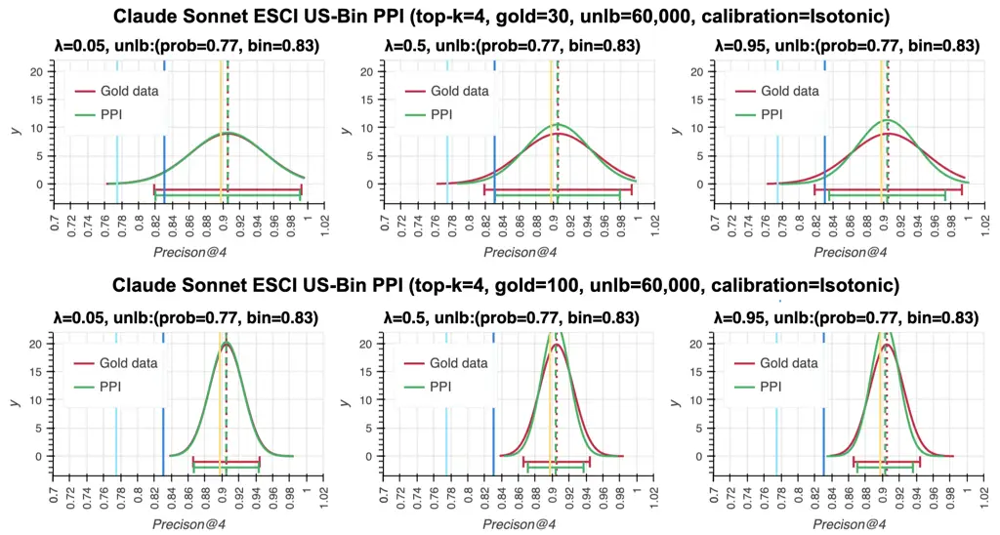

# Statistically Reliable LLM-Based Ranking Evaluation via Prediction-Powered Inference

Abhishek Divekar Affiliation: Amazon Email: <adivekar@amazon.com>

###### Abstract

With PRECISE¹¹ 1 Extended abstract; see the full PRECISE paper at:
[https://doi.org/10.1609/aaai.v40i47.41427](https://doi.org/10.1609/aaai.v40i47.41427),
we extended Prediction-Powered Inference to produce bias-corrected
estimates of ranking evaluation metrics by combining a small
human-labeled set with a large LLM-judged set. PPI is provably unbiased
regardless of the LLM judge’s error profile. We make it applicable to
hierarchical metrics like Precision@K, where annotations are
per-document but the metric is per-query, by reducing the output-space
computation from $`O(2^{|C|})`$ to $`O(2^{K})`$. On the ESCI benchmark,
augmenting 30 human annotations with Claude 3 Sonnet judgments reduces
the standard error of Precision@4 estimates from 4.45 to 3.50 (a 21%
relative reduction). In a production system, our framework correctly
identified the best of three system variants from 100 human labels and 2
hours of domain-expert annotation; A/B testing confirmed this ranking
with +407 bps in daily sales.

## 1 Introduction

Human evaluation is expensive, yet smaller labeled sets produce wide
confidence intervals that cannot distinguish genuine system improvements
from noise. LLM-as-a-Judge approaches attempt to address this, but carry
systematic biases that distort evaluation metrics when used as
substitutes for human annotation (Chen et al., 2024).

Most prior work addresses this tension by building better judges through
prompt engineering, fine-tuning, or multi-agent debate. We take an
orthogonal approach: accept that LLM judges are biased and _correct for
the bias statistically_. Our framework extends Prediction-Powered
Inference (Angelopoulos et al., 2023, PPI;), a semi-supervised
estimation method that combines a small gold set (human labels) with a
large LLM-annotated set. The gold set measures the judge’s systematic
error and corrects for it. The resulting estimate is provably unbiased,
and each additional LLM-judged example reduces the variance of the
metric estimate without introducing new bias.

A challenge arises for metrics that aggregate granular judgments into a
higher-level score: for Precision@K, human annotations are collected
per-document but the metric is computed per-query. Standard PPI cannot
handle this granularity mismatch. We resolve this through a sparse
reformulation of the output space (§2), and validate on a public
benchmark and a production A/B test (§3).

## 2 Method

Let $`\mathcal{D}_{g}=\{(x^{(i)}_{g},y^{(i)}_{g})\}_{i=1}^{n}`$ be a
small gold set with human labels and
$`\mathcal{D}_{u}=\{x^{(i)}_{u}\}_{i=1}^{N}`$ a large set ($`N\gg n`$)
annotated by an LLM $`M`$. The PPI++ estimator (Angelopoulos et al., 2024) evaluates:

```math
\displaystyle\hat{\mu}_{\text{PPI}} \displaystyle=\underbrace{\frac{\lambda}{N}\!\sum_{i=1}^{N}\tilde{\mu}_{u}^{(i)}}_{\text{LLM-based estimate}}+\underbrace{\frac{1}{n}\!\sum_{i=1}^{n}\!\Big[\phi_{i}-\lambda\,\tilde{\mu}_{g}^{(i)}\Big]}_{\text{bias correction}} \tag{1}
```

where $`\phi_{i}`$ is the human-grounded metric on the $`i`$-th gold
query, and $`\tilde{\mu}_{u}^{(i)},\tilde{\mu}_{g}^{(i)}`$ are the
LLM-based metric estimates obtained by marginalizing over the judge’s
output distribution. The parameter $`\lambda\in[0,1]`$ is tuned to
minimize the variance of $`\hat{\mu}_{\text{PPI}}`$; the estimator
remains unbiased for any $`\lambda>0`$.

The bias-correction term (second summand) measures how the LLM judge
deviates from human ground truth on the gold set, then subtracts this
deviation from the LLM-only estimate. When the LLM is well-calibrated,
setting $`\lambda\simeq 1`$ allows the full unlabeled set to drive
variance reduction. When the LLM is heavily biased, we can shrink
$`\lambda\simeq 0`$ and the estimator relies on gold estimates.

### Hierarchical metrics.

For Precision@K, annotations are at the query-document level but metrics
are calculated per-query. The naive PPI output space is
$`\{0,1\}^{|C|}`$ (one binary relevance variable per corpus document),
which is computationally intractable when $`|C|`$ is in the millions.

We observe that Precision@K depends only on the top-$`K`$ retrieved
documents; thus, it reduces to a scaled dot product over sparse vectors:
$`\phi(\hat{y},y)=\hat{y}^{\top}y/K`$. Because only $`K`$ positions
contribute, the probability mass of all non-retrieved documents
collapses into a single weight on the all-zero $`K`$-vector. This
reduces the output space to $`\{0,1\}^{K}`$.

For each query, the LLM judge provides per-document relevance
probabilities $`\tilde{p}^{\prime}(d_{k})`$ for the $`k`$-th ranked
result. We form a joint distribution over $`K`$-length binary vectors
assuming conditional independence across documents:

```math
\displaystyle\tilde{p}(y)=\prod_{k=1}^{K}\tilde{p}^{\prime}(d_{k})^{y_{k}}(1{-}\tilde{p}^{\prime}(d_{k}))^{(1{-}y_{k})} \tag{2}
```

where $`y_{k}`$ is the $`k`$-th element of $`y\in\{0,1\}^{K}`$. The
LLM-based estimates $`\tilde{\mu}^{(i)}`$ in Eq. 1 are then computed by
summing $`\phi(\hat{y},y)\cdot\tilde{p}(y)`$ over all $`2^{K}`$ vectors.
For typical $`K\leq 10`$ this sum is tractable.

## 3 Results

We validate on the ESCI retrieval benchmark (Reddy et al., 2022) using
Claude 3 Sonnet and Haiku as LLM judges, with $`n{=}30`$ gold
annotations and $`N{=}60{,}000`$ unlabeled queries.



Figure 1: Sampling distributions for Precision@4 on ESCI ($`N{=}60`$K,
Claude 3 Sonnet). Top: $`n{=}30`$; bottom: $`n{=}100`$. PPI (green) is
tighter than gold-only (red) and centered on the true value (yellow
dashed). LLM-only estimates (cyan, blue) are biased.

| Estimator              | Bias $`(\downarrow)`$ | Std. Err. $`(\downarrow)`$ | Cost  |
| ---------------------- | --------------------- | -------------------------- | ----- |
| Gold only ($`n{=}30`$) | 1.04                  | 4.45                       | —     |
| \+ Claude 3 Sonnet     | 0.70                  | 3.50                       | \$946 |
| \+ Claude 3 Haiku      | 0.29                  | 3.86                       | \$79  |

Table 1: Precision@4 estimation on ESCI ($`n{=}30`$ gold, $`N{=}60`$K
LLM-judged). Sonnet reduces standard error from 4.45 to 3.50 (21%
relative reduction); Haiku achieves the lowest bias at 12$`\times`$
lower cost.

### Variance reduction and cost.

Table 1 shows that PPI with Sonnet reduces standard error from 4.45 to
3.50 (-21% relative) while maintaining low bias (0.70 vs. 1.04 for
gold-only). Haiku achieves comparable quality (SE: 3.86, bias: 0.29) at
12$`\times`$ lower inference cost. Figure 1 illustrates why: the PPI
sampling distribution (green) is narrower than gold-only (red) because
the LLM signal reduces variance, and it stays centered on the true value
(yellow dashed) because the bias-correction term removes the judge’s
systematic error. Separately, we found the framework plateaus at a
100$`\times`$ unlabeled-to-gold ratio: $`N=3,000`$ LLM queries provide
nearly identical standard error to $`N=60,000`$ with $`n=30`$ labelled
examples.

### Production A/B test.

In a production search system, our Precision@K formulation ranked three
system variants (C, T1, T2) using $`n{=}100`$ human labels and
$`N{=}8{,}400`$ LLM judgments, produced in 2 hours of expert annotation.
The predicted ranking (T1 $`>`$ T2 $`>`$ Control) was confirmed by A/B
testing: T1 yielded +407 bps in daily sales and +571 bps in
click-through rate. Without PPI correction, LLM-only estimates could not
distinguish between variants, because systematic upward bias inflated
all estimates similarly; introducing semi-supervised estimation restored
discriminative power by correcting for this bias.

Though we validate it on Precision@K, the hierarchical formulation
applies in principle to any metric that aggregates fine-grained
judgments (e.g., per-claim factuality, per-turn dialogue quality).

## 4 Future Work

Several promising directions remain for future work. We describe a few
of them.

Synthetic covariates. An over-reliance on human labels is a major
drawback of our estimation method. LLM-generated synthetic datasets can
begin from fixed but gold labels and provide good textual covariates,
which may nevertheless be usable for estimation Yu et al. (2023);
Kowshik et al. (2024).

Doubly robust estimation Oosterhuis (2023) shares a theoretical
grounding with LLM bias and could offer a pathway toward real-time,
bias-corrected metric inference. Adopting this paradigm would enable
online evaluation for our method.

Multiple Judges. A complementary line of work aggregates verdicts across
several LLM judges, which may match human ratings more closely than a
single model Zheng et al. (2023). However, the alternative of folding
several rubrics into one judge prompt and tuning it jointly turns out to
be brittle in practice Darshan and Divekar (2026). A natural extension
of our method, then, is to adopt multi-objective optimization
procedures, rather than depending on a single all-purpose evaluator.

Agentic critics. Agentic systems increasingly rely on LLM-based critics
to score and refine their own outputs Yuksekgonul et al. (2025); Rudman
et al. (2026), yet these critics inherit the same biases PRECISE
corrects. Extending our approach to produce calibrated critic signals
from minimal human labels is a promising direction for more reliable
agent optimization.

## Acknowledgments

Anirban Majumder contributed to the original version of this work
(Divekar and Majumder, 2026).

## Ethics Statement

All user queries in the production A/B test were anonymized to remove
personally identifiable information before being processed by LLM judges
or human annotators. Human annotation was performed by domain experts
during normal working hours as part of their regular responsibilities;
no crowdworker labor was used. The framework reduces (but does not
eliminate) the need for human annotation; it is not intended to replace
human evaluation entirely, but to make small human annotation budgets go
further.

## Limitations

Our framework has three limitations. First, we have validated the
hierarchical PPI extension only on Precision@K for retrieval;
generalization to other hierarchical metrics (e.g., per-claim
factuality, per-turn dialogue quality) remains untested. Second, the
conditional independence assumption across documents in Eq. 2 may not
hold when relevance of one document depends on the presence of another
(e.g., diversity-sensitive ranking); relaxing this assumption is left to
future work. Third, the framework requires a small gold set from the
same distribution as the unlabeled set; distribution shift between the
gold and unlabeled queries (e.g., from temporal drift) could degrade the
bias correction.

## References

- Angelopoulos et al. (2023) A. N. Angelopoulos, S. Bates, C.
  Fannjiang, M. I. Jordan, and T. Zrnic Prediction-powered inference.
  Science 382 (6671), pp. 669–674. External Links:
  [Link](https://doi.org/10.1126/science.adi6000) Cited by: §1.
- Angelopoulos et al. (2024) A. N. Angelopoulos, J. C. Duchi, and T.
  Zrnic PPI++: efficient prediction-powered inference. External Links:
  2311.01453, [Link](https://arxiv.org/abs/2311.01453) Cited by: §2.
- Chen et al. (2024) G. H. Chen, S. Chen, Z. Liu, F. Jiang, and B. Wang
  Humans or LLMs as the judge? a study on judgement biases. In Proc. of
  EMNLP 2024, External Links:
  [Link](https://aclanthology.org/2024.emnlp-main.474/) Cited by: §1.
- Darshan and Divekar (2026) P. Darshan and A. Divekar When gradients
  collide: failure modes of multi-objective prompt optimization for llm
  judges. External Links: 2605.26046,
  [Link](https://arxiv.org/abs/2605.26046) Cited by: §4.
- Divekar and Majumder (2026) A. Divekar and A. Majumder PRECISE:
  reducing the bias of llm evaluations using prediction-powered ranking
  estimation. Proc. of AAAI 2026. External Links:
  [Link](https://ojs.aaai.org/index.php/AAAI/article/view/41427),
  [Document](https://dx.doi.org/10.1609/aaai.v40i47.41427) Cited by:
  Acknowledgments.
- Kowshik et al. (2024) S. S. Kowshik, A. Divekar, and V. Malik
  CorrSynth - a correlated sampling method for diverse dataset
  generation from LLMs. In Proc. of EMNLP 2024, Y. Al-Onaizan, M.
  Bansal, and Y. Chen (Eds.), Miami, Florida, USA, pp. 16076–16095.
  External Links: [Link](https://aclanthology.org/2024.emnlp-main.899/),
  [Document](https://dx.doi.org/10.18653/v1/2024.emnlp-main.899) Cited
  by: §4.
- Oosterhuis (2023) H. Oosterhuis Doubly robust estimation for
  correcting position bias in click feedback for unbiased learning to
  rank. ACM Trans. Inf. Syst. 41 (3). External Links: ISSN 1046-8188,
  [Link](https://doi.org/10.1145/3569453),
  [Document](https://dx.doi.org/10.1145/3569453) Cited by: §4.
- Reddy et al. (2022) C. K. Reddy, L. Màrquez, F. Valero, N. Rao, H.
  Zaragoza, S. Bandyopadhyay, A. Biswas, A. Xing, and K. Subbian
  Shopping queries dataset: a large-scale ESCI benchmark for improving
  product search. External Links: 2206.06588,
  [Link](https://arxiv.org/abs/2206.06588) Cited by: §3.
- Rudman et al. (2026) W. Rudman, A. Divekar, K. Jain, S.
  Joseph, S. S. R. Offner, M. Lease, K. Mahowald, G. Durrett, and J. J.
  Li VESTA: visual exploration with statistical tool agents. External
  Links: 2606.00384, [Link](https://arxiv.org/abs/2606.00384) Cited by:
  §4.
- Yu et al. (2023) Y. Yu, Y. Zhuang, J. Zhang, Y. Meng, A. Ratner, R.
  Krishna, J. Shen, and C. Zhang Large language model as attributed
  training data generator: a tale of diversity and bias. In Proc. of
  NeurIPS 2023, External Links:
  [Link](https://dl.acm.org/doi/10.5555/3666122.3668555) Cited by: §4.
- Yuksekgonul et al. (2025) M. Yuksekgonul, F. Bianchi, J. Boen, S.
  Liu, P. Lu, Z. Huang, C. Guestrin, and J. Zou Optimizing generative AI
  by backpropagating language model feedback. Nature 639, pp. 609–616.
  External Links:
  [Link](https://www.nature.com/articles/s41586-025-08661-4) Cited by:
  §4.
- Zheng et al. (2023) L. Zheng, W. Chiang, Y. Sheng, S. Zhuang, Z.
  Wu, Y. Zhuang, Z. Lin, Z. Li, D. Li, E. P. Xing, H. Zhang, J. E.
  Gonzalez, and I. Stoica Judging LLM-as-a-judge with MT-bench and
  chatbot arena. In Proc. of NeurIPS 2023, External Links:
  [Link](https://dl.acm.org/doi/10.5555/3666122.3668142) Cited by: §4.
