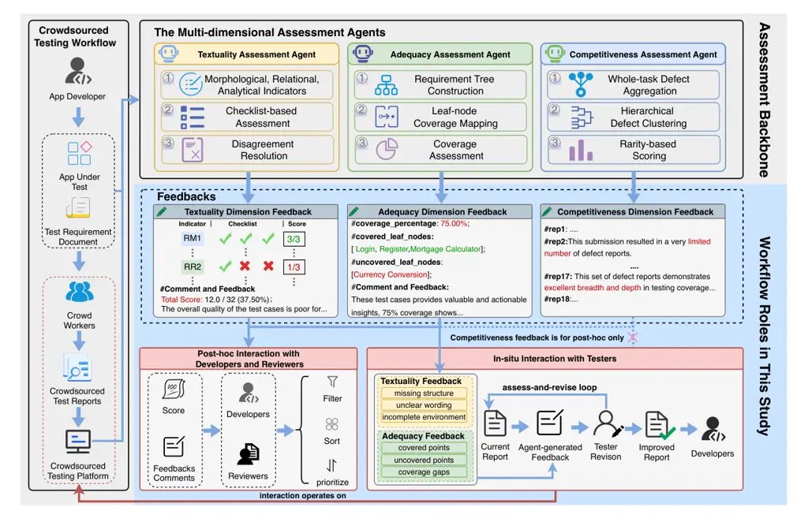

# More than a Judge: An Empirical Study of Agent-Human Interaction in Crowdsourced Testing Assessment

DOI: [XXXXXXX.XXXXXXX](https://doi.org/XXXXXXX.XXXXXXX)Journal: JACMVolume: 3741118CCS: Software
and its engineering Software testing and debugging

Yue Wang Affiliation: State Key Laboratory for Novel Software
Technology, Nanjing University, Nanjing, China email:
<yue_wang@smail.nju.edu.cn> , Yuan Zhao Note: Corresponding author.
Affiliation: Laboratory of Data Intelligence and Interdisciplinary
Innovation, Nanjing University, Nanjing, China email:
<zhaoyuan@nju.edu.cn> , Shengcheng Yu Affiliation: Technical University
of Munich, Munich, Germany email: <shengcheng.yu@tum.de> , Zhenyu Chen
Affiliation: State Key Laboratory for Novel Software Technology, Nanjing
University, Nanjing, China email: <zychen@nju.edu.cn> and Qing Gu
Affiliation: State Key Laboratory for Novel Software Technology, Nanjing
University, Nanjing, China email: <guq@nju.edu.cn>

Received  June 2026

###### Abstract.

Agentic AI is increasingly being integrated into software engineering
workflows. In crowdsourced testing, however, the large volume and uneven
quality of submitted reports still create a substantial review burden
for developers. In prior work, we developed and validated a multi-agent
assessment backbone based on the LLM-as-a-Judge paradigm. That backbone
assesses reports along three dimensions—textuality, adequacy, and
competitiveness—and was shown to align well with human consensus while
substantially reducing assessment effort. Yet reliable automated judging
does not by itself show whether agent outputs can improve human work
when embedded into workflow. This paper studies that missing question in
the context of crowdsourced testing. We investigate whether
assessment-derived, actionable feedback can improve how testers revise
reports, perform on later tasks, and transfer reporting practices across
applications. To do so, we conducted a controlled four-stage
human-subject study with 20 testers across three real-world
applications. The results show that agent-generated feedback supports
immediate improvements in revised reports, better first submissions on a
new task after prior feedback exposure, and evidence of partial but
meaningful transfer to a later application. A post-task questionnaire
completed by 17 participants complements these artifact-based findings
by suggesting that the feedback was generally understandable, acted upon
in revision, and carried into later tasks, while also revealing
remaining friction in specificity and execution. Overall, the study
provides empirical evidence that, in the studied crowdsourced testing
setting, assessment agents can serve not only as post-hoc judges but
also as workflow-integrated feedback providers that support upstream
report-quality improvement.

###### Keywords: 

Crowdsourced Testing, Agent-Human Interaction, LLM-as-a-Judge, Large
Language Models

## 1. Introduction

Agentic AI is profoundly reshaping the landscape of software engineering
(SE). The autonomous deployment of tools with Large Language Model (LLM)
backends gives agents tremendous potential to bring greater automation
to core SE tasks, including testing and analysis(Hosseini and Seilani,
2025). Crowdsourced testing, in particular, is a critical SE task that
stands to benefit from this transformation. Crowdsourced testing
leverages a diverse, large-scale workforce to enhance test coverage and
the discovery rate of defects compared to traditional methods (Mao et
al., 2017; Gao et al., 2019). However, this benefit is coupled with a
significant challenge: crowdsourced testing platforms receive a massive
volume of test reports from crowdworkers of varying backgrounds (Feng et
al., 2016; Hao et al., 2019; Li et al., 2022). This influx of reports,
often of inconsistent quality, creates a severe bottleneck for
developers, making manual review time-consuming, labor-intensive, and
prone to subjectivity (Feng et al., 2015; Yu et al., 2021; Aversano and
Tedeschi, 2016; Zimmermann et al., 2010; Bhattacharya et al., 2013). At
the same time, as agents become more capable of participating in SE
workflows, an additional question emerges. Beyond automating judgment,
it becomes important to understand whether agent outputs can be trusted,
interpreted, and integrated into iterative human work. In crowdsourced
testing, where quality improvement often depends on feedback, revision,
and coordination across contributors, this means that the role of
agent-generated feedback should be studied not only as an assessment
mechanism, but also as a workflow and agent-human interaction mechanism.

To alleviate the report assessment bottleneck itself, automated quality
assessment methods have emerged (Chen et al., 2018; Chen et al., 2020;
Zhang et al., 2022). In our prior work, we proposed a multi-dimensional
assessment method for crowdsourced testing reports based on LLMs (Wang
et al., 2025c). This method is operationalized as a multi-agent
framework where specialized agents, acting as LLM-as-a-Judge (Zheng et
al., 2023), assess reports from three complementary dimensions:
Textuality, which examines the fine-grained textual quality of an
individual report; Adequacy, which measures functional coverage against
test requirement documents; and Competitiveness, which assesses the
novelty and value of discovered defects. That prior study focused on
validating the agents as reliable and efficient judges. It established a
necessary foundation for practice by showing that the agents can produce
assessments aligned with human consensus while substantially reducing
assessment effort, thereby addressing a trust-related prerequisite for
deploying such agents in real workflows.

However, validating automated judging capability does not by itself show
that agentic AI improves human performance. In software work, feedback
is valuable only when people can understand it, decide to act on it, and
carry what they learn into subsequent tasks. This gap is especially
important for agentic AI in software: once agents move from isolated
benchmarking settings into existing workflows, the central question
shifts from what the agents can score to how humans respond to agent
assessments. For crowdsourced testing, the missing scientific question
is therefore not whether the assessment agents can score reports again,
but whether agent-generated feedback changes testers’ revision behavior,
performance on later tasks, and the transfer of reporting skills.

Compared with our prior work, this paper does not aim to further
validate the assessment agents themselves. Prior work established that
the agents can assess crowdsourced testing reports with high agreement
with human consensus and with substantial efficiency gains, providing
the basis for trusting their assessments in practice. In contrast, this
paper investigates a different research question: whether these
already-validated agents can improve human testers when their
assessments are delivered as actionable feedback in a realistic
workflow. Accordingly, the main extension of this paper lies not in
re-evaluating the same scoring framework, but in a new human-subject
study with a different unit of analysis, different outcomes, and
different claims. More broadly, this paper shifts the focus from
autonomous assessment capability to agent-human interaction, workflow
integration, and the role of feedback in shaping individual performance
and team-facing work practices.

We therefore study agent-generated feedback as a workflow intervention.
We designed and executed a controlled human-subject study involving 20
testers, divided into two groups (A and B), who performed testing tasks
across four stages using three real-world applications. Both groups
first completed the same baseline task on APP1. The intervention was
then staggered across the two groups: Group A received agent-generated
feedback on its APP1 reports and revised those reports before moving to
APP2, whereas Group B first completed APP2 without feedback and only
afterward received agent-generated feedback on its APP2 reports for
revision. After each group had experienced one feedback cycle, both
groups completed a final task on APP3. This design lets us examine
immediate revision effects, new-task performance after prior feedback
exposure, and longer-term skill transfer in a realistic SE process. We
address the following three research questions (RQs):

- •
  Effect of Agent-Generated Feedback on Report Revision. In RQ1, we
  evaluate whether agent-generated feedback helps testers improve the
  quality of their existing reports within the same task. Results:
  Testers who received feedback substantially improved the Textuality
  and Adequacy scores of their revised reports, indicating immediate
  benefits from the feedback loop.
- •
  Impact on Performance in a New Task. In RQ2, we investigate whether
  prior interaction with agent feedback influences a tester’s initial
  performance on a new application. Results: The group with prior
  feedback exposure produced higher-quality initial reports on the new
  task, suggesting that part of what they learned from the feedback
  carried over beyond the original revision setting.
- •
  Transfer of Skills Across Tasks. In RQ3, we examine whether repeated
  exposure to agent-generated feedback is associated with longer-term
  skill transfer on a later, distinct application. Results: We observe
  evidence of positive transfer, with later-task performance improving
  relative to the initial baseline, suggesting that the feedback can
  support more durable capability development in the studied setting.

This paper provides empirical evidence, in the studied setting, on how
agent-generated feedback affects human performance in crowdsourced
testing workflows. The main contributions of this paper are:

- •
  A workflow-oriented reframing of assessment agents. We study how
  previously validated assessment agents operate as feedback providers
  in a human-centered crowdsourced testing workflow, rather than
  re-validating them as judges. This reframing positions the work around
  agent-human interaction, workflow integration, and the practical
  conditions under which trusted agent assessments can improve human
  work.
- •
  A new controlled human-subject methodology. We conduct a staggered
  four-stage study with 20 testers, two groups, and three real-world
  applications, enabling a structured analysis of immediate report
  revision, performance on an unseen task, and subsequent skill transfer
  after exposure to agent-generated feedback.
- •
  New evidence on human impact in feedback-oriented crowdsourced
  testing. We provide evidence that integrating assessment agents into
  the feedback loop can improve revised report quality and support
  better performance on later tasks, suggesting a practical path by
  which agent-generated feedback can contribute to workflow-level
  improvement and capability development in crowdsourced testing.

## 2. Background and Related Work

### 2.1. Crowdsourced Test Reports

With the increasing scale and complexity of software, crowdsourced
testing has emerged as an effective approach to enhance test coverage
and defect discovery (Gao et al., 2019). It leverages the collective
intelligence of distributed testers from diverse backgrounds. The
critical deliverable in the crowdsourced testing process is the
crowdsourced testing report (Yu et al., 2021). These reports are the
detailed records of test activities and are essential for developers to
understand and fix defects (Feng et al., 2015). Each report typically
consists of two main components: test cases designed by the tester and
defects discovered during test execution. While formats may vary across
different crowdsourcing platforms, core fields remain consistent, such
as testing environment specifications, step-by-step test procedures, and
actual results (Feng et al., 2016). However, the quality of these
reports varies dramatically. As illustrated in Figure 1, a "Good Test
Case" (TC1) contains a descriptive name, well-defined preconditions,
logically structured steps, and clear expected results. In contrast, a
"Bad Test Case" (TC2) is characterized by ambiguous descriptions and
insufficient specifications, which hampers reproducibility. Similarly, a
"Good Defect Report" (DE1) is clear, logical, and reproducible, while a
"Bad Defect Report" (DE2) has ambiguous descriptions that impede a
developer’s ability to resolve the issue. The large volume and
inconsistent quality of these reports necessitate automated assessment
methods to help developers filter and review them efficiently.

Figure 1. Example of Crowdsourced Test Reports: The Good and The Bad.

### 2.2. Processing and Assessing Crowdsourced Test Reports

The challenges posed by the volume and variable quality of crowdsourced
testing reports have led to a significant body of research focused on
automated processing. These efforts aim to assist developers in managing
the influx of reports and improving review efficiency. Key research
directions include Test Report Prioritization, which aims to rank
reports so that developers can focus on the most valuable ones first,
often using features from screenshots and text (Feng et al., 2015; Feng
et al., 2016; Yu et al., 2021); Report Clustering and Summarization,
which groups similar reports to manage redundancy, such as using
features from screenshots and text for semi-supervised clustering (Yu et
al., 2024); Report Deduplication, which focuses on identifying duplicate
reports using information retrieval models to measure
similarity (Alipour et al., 2013; Hindle et al., 2016; Nguyen et al.,
2012; Sun et al., 2011; Sun et al., 2010); and Quality Assessment, where
studies have modeled test reports based on predefined quality metrics to
help developers focus on high-quality submissions (Chen et al., 2018;
Chen et al., 2020). While these automated methods improve efficiency,
they often lack comprehensive assessment dimensions and, crucially, do
not provide actionable feedback mechanisms for the testers themselves,
which restricts these methods to passively filtering information,
ultimately failing to address the problem of low-quality test reports at
its source.

### 2.3. Agents as Assessors (LLM-as-a-Judge)

The emergence of the LLM-as-a-Judge (LLM-J) paradigm (Zheng et al.,
2023; Chan et al., 2024; Liu et al., 2023) offers a powerful new
approach for automated assessment. This paradigm leverages the
sophisticated natural language understanding capabilities of LLMs to
serve as automated evaluators for both objective and subjective tasks.
Unlike traditional reward models that only output a scalar score, LLM-J
evaluators are considered more robust and interpretable because they can
generate detailed rationales and justifications for their assessments.
Recent studies demonstrate the effectiveness of LLM-J across diverse
applications. In software engineering, this includes code generation
evaluation (Ahmed et al., 2025; Wang et al., 2025b), code summarization
assessment (Wu et al., 2025), and automated grading of short
answers (Chang and Ginter, 2024; Henkel et al., 2024; Senanayake and
Asanka, 2024; Fagbohun et al., 2024; Jury et al., 2024). These studies
consistently show that LLM-J assessments can achieve high consistency
with human evaluators while significantly reducing time and cost. Our
prior work (the basis of this extension) applied this paradigm to the
assessment of crowdsourced testing reports, demonstrating its high
consistency with human expert consensus.

### 2.4. Agent-Human Interaction in Software Engineering

The previous subsections describe the problem domain (2.1), traditional
report-processing solutions (2.2), and the assessment foundation used in
this paper (2.3). However, greater automation does not automatically
imply greater human productivity. A growing line of work therefore
studies how agents are integrated into software-engineering workflows
and how humans respond to agent outputs in practice (Feng et al., 2024).
Examples include agent-assisted development(Manish, 2024), where systems
such as GitHub Copilot(GitHub, 2025) provide code-generation and
completion support during implementation; agent-assisted code review,
where automated tools and bots provide review-time feedback in CI/CD
workflows (Tang et al., 2024; Rasheed et al., 2024); and agent-assisted
education and training, where automated feedback helps users identify
and correct errors during learning activities(Wang et al., 2025a; Guo et
al., 2024). Together, these studies suggest that the practical value of
agents depends not only on autonomous capability, but also on how agent
outputs are interpreted, trusted, and acted upon in workflow.

In the context of LLM-as-a-Judge, however, most research has
concentrated on validating the quality of the judgments themselves. Much
less is known about what happens when assessment outputs are delivered
back to humans as workflow-integrated feedback. In crowdsourced testing,
this gap is especially important: a detailed, multi-dimensional
assessment may be valuable not only for downstream review support, but
also for helping testers revise reports and carry improved practices
into later tasks. The present study addresses this feedback-oriented
question. Rather than asking again whether the agents can judge reports
well, we examine whether assessment-derived feedback can function as a
practical intervention in the crowdsourced testing workflow and thereby
influence revision behavior, later-task performance, and partial skill
transfer.

Viewed together, these strands of prior work motivate a methodological
shift in the present paper. Once assessment outputs are embedded into
workflow, the central question is no longer only whether agents can
judge reports well, but also whether their feedback can produce
observable improvements in human work. The next section therefore
summarizes the multi-dimensional assessment backbone and explains how it
is instantiated here as a feedback-oriented workflow intervention.

## 3. The Multi-dimensional Assessment Agents in a Feedback-Oriented Workflow



Figure 2. The Multi-dimensional Assessment Agents and their workflow
roles in this study.

### 3.1. Overview

Our human-subject study (described in Section 4) builds on the
multi-agent assessment framework that we previously developed and
validated (Wang et al., 2025c). The assessment agents themselves are not
newly proposed in this article. Instead, they are reused as the
assessment backbone for report scoring and feedback generation in the
present study. Accordingly, this section does not attempt to
re-establish the validity of the agents as judges. Rather, it summarizes
the essential mechanisms needed to understand how trusted assessment
outputs are translated into human-facing feedback and embedded into an
agent-human interaction loop.

In prior work, we benchmarked this backbone against six experienced
software-testing experts across three crowdsourced testing tasks.
Although individual human ratings showed only moderate consistency, the
backbone aligned strongly with averaged expert consensus while also
delivering substantial efficiency gains. In particular, prior work
reported QWK values of 0.70–0.82 for textuality and 0.89–0.97 for
adequacy against averaged human ratings, together with 5–90$`\times`$
assessment-efficiency improvements over manual review (Wang et al.,
2025c). These results established a sufficiently trustworthy measurement
foundation for the present paper, whose focus is not further score
validation but workflow-level human impact.

As illustrated in Figure 2, Section 3 is organized into two
methodological layers. The first layer is the multi-dimensional
assessment backbone, which comprises the Textuality, Adequacy, and
Competitiveness agents. The second layer is the feedback-oriented
workflow studied in this paper, where agent outputs are operationalized
as actionable intervention for human testers. In this setting,
Textuality and Adequacy support the in-situ intervention because both
can be computed from an individual tester’s current report and converted
into revision guidance. Competitiveness is retained as part of the
overall framework and remains useful for post-hoc workflow support, but
it is not used as the intervention because it depends on cross-tester
comparison after all reports have been collected. This distinction
between assessment as measurement and assessment as intervention is
central to our workflow-oriented methodology for agentic AI in software
engineering.

### 3.2. The Multi-dimensional Assessment Agents

The reused assessment backbone comprises three specialized agents that
assess crowdsourced testing reports from the complementary dimensions of
Textuality, Adequacy, and Competitiveness. Together, they provide a
structured basis for assessing report quality from the perspectives of
writing quality, requirement coverage, and comparative defect value. In
this subsection, we summarize only the key mechanisms needed for
understanding the present study; the feedback-oriented workflow role of
these outputs is described in Section 3.3.

#### 3.2.1. Textuality Agent

The Textuality Agent assesses the fine-grained quality of each test case
and defect report. It operationalizes five desirable properties of a
good report (atomicity, completeness, conciseness, understandability,
and reproducibility) (Chen et al., 2018) through the quantitative
indicators listed in Table 1. These indicators are grouped into
Morphological, Relational, and Analytical categories. In the present
study, this dimension provides a stable measurement of report quality
while also serving as a source of revision-oriented feedback.

|               |                        |                    |                   |                 |             |            |
| ------------- | ---------------------- | ------------------ | ----------------- | --------------- | ----------- | ---------- |
| Category      | Indicator              | Desirable Property |                   |                 |             |            |
| Atomicity     | Conciseness            | Completeness       | Understandability | Reproducibility |             |            |
| Morphological | Text Length            | $`\bullet`$        | $`\times`$        |                 | $`\bullet`$ |            |
|               | Readability            |                    |                   |                 | $`\times`$  |            |
|               | Punctuation            |                    | $`\times`$        |                 | $`\bullet`$ |            |
| Relational    | Itemization            |                    | $`\bullet`$       | $`\bullet`$     | $`\times`$  | $`\times`$ |
|               | Environment            |                    |                   | $`\times`$      |             | $`\times`$ |
|               | Preconditions          |                    |                   | $`\times`$      |             | $`\times`$ |
|               | Expected Results       |                    |                   | $`\times`$      |             | $`\times`$ |
|               | Additional Information |                    |                   | $`\times`$      |             |            |
|               | Screenshot             |                    |                   | $`\times`$      | $`\times`$  | $`\times`$ |
| Analytical    | Interface Elements     |                    | $`\bullet`$       |                 | $`\times`$  | $`\times`$ |
|               | User Behavior          |                    |                   | $`\bullet`$     | $`\times`$  | $`\times`$ |
|               | Defect Response        |                    |                   | $`\bullet`$     |             | $`\times`$ |

- •
  ’$`\times`$’ represents a direct influence and ’$`\bullet`$’ denotes
  an indirect influence between the indicator and the desirable property

Table 1. The Relationship Between Desirable Properties and Measurable
Indicators

To keep this dimension sufficiently stable for human-facing use, the
agent preserves two mechanisms from the previously validated framework.
First, to overcome the limitation of LLMs in providing accurate
continuous scores (Liu et al., 2023), the agent’s judgment is guided by
a Checklist, following the design principles of RocketEval (Wei et al.,
2025). This checklist decomposes the assessment task into a series of
binary checkpoints corresponding to each indicator, where the number of
checkpoints matches the indicator’s score value. Following the practice
of Zhang et al.’s work (Zhang et al., 2022), we defined score upper
limits for each indicator based on the relationship between desirable
properties and quantitative indicators, as shown in Table 2. This design
turns a continuous judgment problem into a set of interpretable
pass/fail decisions and preserves the local evidence needed for later
feedback generation.

| Category      | Indicators             | Rule    | Rule Content                                                     | Score |
| ------------- | ---------------------- | ------- | ---------------------------------------------------------------- | ----- |
| Morphological | Text Length            | RM1     | Text length is within the preset range.                          | 3     |
|               | Readability            | RM2     | The description is concise, fluent, and easy to understand.      | 2     |
|               | Punctuation            | RM3     | Punctuation is used correctly.                                   | 3     |
| Relational    | Itemization            | RR1     | Operational steps are listed with numbered annotations.          | 5     |
|               | Environment            | RR2     | Environmental information is present and detailed.               | 3     |
|               | Preconditions          | RR3     | Preconditions are described and complete.                        | 2     |
|               | Expected Results       | RR4     | Expected results are filled in standardly.                       | 2     |
|               | Additional Information | RR5     | All other fields except for the above information are filled in. | 2     |
|               | Screenshot             | RR6(\*) | For defects, there should be screenshots for explanation.        | 3     |
| Analytical    | User Interface         | RA1     | There is a clear enough description of the interface elements.   | 5     |
|               | User Behavior          | RA2     | There is a description of interactive behavior.                  | 5     |
|               | Defect Feedback        | RA3(\*) | For defects, defect feedback should be included.                 | 3     |

- •
  Rules with an asterisk (\*) are for defects, due to differences in
  scoring criteria from test cases.

Table 2. Quantitative Indicators Definitions

Second, the agent implements a Dual LLM Assessment and Disagreement
Resolution mechanism. Two independent LLMs (DeepSeek and Kimi)
simultaneously assess the same report against the checklist. When
disagreements arise, the agent itself (using gpt-4o as a base) performs
a "thinking and judgment" process to analyze the conflict and produce a
unified, final checklist result. The final textuality score is then
calculated by summing all checkpoints marked as ’True’, as shown in the
following formula:

```math
TextualityScore=\sum_{i=1}^{N}\sum_{j=1}^{|C_{i}|}\mathbb{I}(c_{i,j}=\text{True}) \tag{1}
```

where $`N`$ represents the total number of indicators, $`C_{i}`$ denotes
the set of checkpoints for indicator $`i`$, and
$`\mathbb{I}(c_{i,j}=\text{True})`$ is an indicator function that equals
1 when checkpoint $`j`$ of indicator $`i`$ passes and 0 otherwise. This
approach provides a cumulative score reflecting the total number of
quality criteria satisfied by the report. In the present study, the
score is used for measurement, while the underlying checklist findings
later support report-level revision guidance.

#### 3.2.2. Adequacy Agent

The Adequacy Agent assesses how comprehensively a report covers the
specified functional requirements. Requirement documents are the
grounding artifact for this dimension in crowdsourced testing (Feng et
al., 2015), and coverage remains a basic indicator of how thoroughly
test cases examine software functionality (Tran et al., 2025). In the
present study, this dimension is especially important because it makes
requirement coverage traceable and exposes the functional gaps that can
later be returned to testers as actionable feedback.

The agent’s process involves three sequential steps. Requirement Tree
Construction systematically transforms unstructured requirement
documents into hierarchical trees where leaf nodes represent atomic
functional points. This phase performs structural analysis to identify
major functional modules and their relationships, decomposes compound
requirements into atomic units, and then constructs a hierarchy whose
leaf nodes can be directly mapped to test cases.

Test Case Mapping establishes connections between individual test cases
and the atomic functional points in the requirement tree. For each
submitted test case, the agent uses LLM-based semantic analysis to
compare the test case content (e.g., name, description, steps) against
the list of all functional leaf nodes from the requirement tree, thereby
identifying coverage relationships that might be missed by keyword-based
or rule-based approaches.

Coverage Assessment synthesizes the mapping results for all test cases
within a single crowdsourced testing report. It calculates the total
functional coverage percentage using the following formula:

```math
\text{Coverage}(R)=\frac{|\bigcup_{T_{i}\in R}\text{CoveredLeafNodes}(T_{i})|}{|\text{LeafNodes}|}\times 100\% \tag{2}
```

where $`R`$ represents a crowdsourced testing report, $`T_{i}`$ denotes
an individual test case, and $`|\text{LeafNodes}|`$ is the total number
of leaf nodes in the requirement tree. Here,
$`\text{CoveredLeafNodes}(T_{i})`$ denotes the set of leaf nodes covered
by test case $`T_{i}`$. This formulation provides a coverage-based score
for analysis while preserving the mapping evidence that later supports
feedback on which functional points have been covered and which leaf
nodes remain unaddressed.

#### 3.2.3. Competitiveness Agent

The Competitiveness Agent addresses the comparative nature of
crowdsourced testing, where valuable outcomes include novel and rare
defects (Mao et al., 2017). It performs a task-level analysis across all
submitted reports to assess the rarity and uniqueness of the defects
discovered by each tester.

The process begins with Defect Aggregation, where the agent collects all
individual defect reports submitted for the same testing task. Next, it
performs LLM-based Hierarchical Clustering. The agent instructs an LLM
to analyze all defects based on their root causes, observable symptoms,
and functional impact, and to automatically organize similar defects
into a fine-grained, multi-level clustering tree. This semantic
clustering can group defects that have different surface-level
descriptions but share the same underlying cause.

Following clustering, the agent performs Defect Scoring using a
rarity-based mechanism, as shown in the following formula:

```math
Score(d)=\frac{S_{max}}{|N_{d}|} \tag{3}
```

where $`S_{max}`$ is the maximum possible score, and $`|N_{d}|`$ is the
number of defect reports in the leaf node containing defect $`d`$.
Defects that are clustered into leaf nodes containing fewer reports
(i.e., those discovered by fewer testers) are considered rarer and are
assigned significantly higher scores.

Finally, the agent computes the Report Score Aggregation by summing the
scores of all unique defect categories (leaf nodes) that a tester
contributed to, ensuring that a tester receives the score for a specific
defect category only once, even if they reported multiple instances of
the same bug. We retain this dimension because it remains part of the
full assessment backbone and still supports post-hoc review and
prioritization. However, unlike Textuality and Adequacy, Competitiveness
depends on the complete defect landscape across all testers and
therefore is not used as the tester-facing intervention in this study.

### 3.3. Feedback Generation and Agent-Human Interaction

This paper focuses on the feedback-oriented instantiation of the
assessment backbone. As illustrated in Figure 2, the framework supports
two complementary interaction paradigms, targeting different
stakeholders at different stages of the testing workflow.

The first mode of interaction is post-hoc, for developers and reviewers.
In this paradigm, the agents’ assessments are utilized after the test
reports have been submitted. The multi-dimensional outputs support
review, filtering, sorting, and prioritization, thereby helping
developers manage the large volume of incoming reports. This interaction
type uses assessment results to streamline downstream workflow
management.

The second mode of interaction is in-situ, for crowdsourced testers, and
it is the focus of our human-subject study. In this paradigm, the
intervention is not the raw score alone but the actionable feedback
derived from Textuality and Adequacy assessments and returned to testers
during revision. For Textuality, the system converts checklist findings
into report-level guidance about missing structure, ambiguous wording,
incomplete preconditions, expected results, or other weak elements. For
Adequacy, it converts requirement-tree mapping results into coverage
guidance by showing which functional points have been exercised and
which leaf nodes remain uncovered. What testers receive is therefore a
human-facing feedback package that tells them what to rewrite, complete,
or extend in the current report, rather than merely how they scored.

This distinction is important because the intervention is the feedback
content, not the score alone. Textuality findings become
revision-oriented guidance on report quality, while uncovered
requirement leaf nodes become adequacy-oriented guidance on coverage
gaps. Competitiveness is intentionally excluded from this in-situ
package because it requires the complete cross-tester defect set and is
therefore more appropriate for post-hoc comparison than local revision
support.

This assess-and-revise loop is the methodological focus of the present
article. Because the assessment backbone was already validated (Wang et
al., 2025c), the current study can concentrate on a different question:
whether agent-generated feedback can be meaningfully integrated into a
realistic software workflow and thereby influence human performance,
revision behavior, and later skill transfer. Section 4 therefore
evaluates this in-situ interaction as a human-subject, workflow-oriented
intervention rather than as a further benchmark of agent scoring
accuracy.

## 4. Study Design

This section presents the human-subject methodology used to evaluate the
workflow-level impact of integrating the feedback-oriented assessment
backbone into crowdsourced testing. In prior work, the emphasis was on
the reliability and efficiency of the assessment backbone as an
evaluation instrument (Wang et al., 2025c). Here, the focus is
different: we study whether actionable feedback derived from that
backbone can improve tester performance during report production and
revision, both within the same task and across later tasks.

### 4.1. Study Overview and Research Questions

To operationalize the in-situ tester-facing interaction mode described
in Section 3, we designed a controlled four-stage study with two tester
groups and three applications. The design supports three complementary
comparisons: immediate within-round revision after feedback,
first-submission performance on a new task after prior feedback
exposure, and longer-term transfer after both groups have experienced at
least one feedback cycle. The study addresses the following research
questions:

- •
  RQ1 (Effect of Agent-Generated Feedback on Report Revision): How
  effective is agent-generated feedback in helping testers improve the
  quality of their existing reports within the same task?
- •
  RQ2 (Impact of Prior Feedback Exposure on New-Task Performance): How
  does prior exposure to agent-generated feedback affect a tester’s
  initial performance on a new testing task?
- •
  RQ3 (Transfer of Reporting Practices Across Tasks): To what extent do
  practices reinforced by agent-generated feedback transfer to
  subsequent, different testing tasks?

### 4.2. Participants and Grouping

We recruited 20 testers for this study from a major crowdsourced testing
platform called MoocTest(, 2025) in China. To better characterize the
participant pool, 17 of the 20 participants completed a post-task
questionnaire. The respondent subset is best characterized as a trained
cohort of crowd testers with heterogeneous backgrounds, rather than as
either complete novices or professional software testers. All
respondents reported formal software-testing coursework, and most also
reported systematic training in testcase design and defect reporting. At
the same time, meaningful variation was observed in prior
crowdsourced-testing duration, familiarity with the three application
domains used in the study, programming and software-project experience,
and routine AI-tool usage. Table 3 summarizes these background
characteristics for the respondent subset.

Based on historical platform performance and scores, we divided the full
20-person study sample into two groups of 10 testers each: Group A and
Group B. This grouping strategy was intended to keep baseline skill
levels as comparable as possible before the intervention.

| Aspect                       | Summary                                                                                                                                                                             |
| ---------------------------- | ----------------------------------------------------------------------------------------------------------------------------------------------------------------------------------- |
| Questionnaire coverage       | 17/20 participants responded (85.0%); 8/10 from Group A and 9/10 from Group B.                                                                                                      |
| Formal testing preparation   | All 17 reported formal software-testing coursework; testcase-design training: 17/17; defect-report training: 16/17 (one with limited classroom exposure only).                      |
| CT experience duration       | $`<`$3 months: 5/17 (29.4%); 3–6 months: 10/17 (58.8%); 6–12 months: 1/17 (5.9%); $`>`$1 year: 1/17 (5.9%).                                                                         |
| Req.-oriented testing habits | Familiarity mean = 4.00/5; 15/17 (88.2%) rated 4–5; 13/17 (76.5%) mainly designed from requirement documents; 15/17 (88.2%) regularly decomposed requirements into function points. |
| Domain familiarity           | Management/system: 4–5 by 14/17 (82.4%); e-commerce: 8/17 (47.1%); utility/to-do: 9/17 (52.9%).                                                                                     |
| Technical background         | Programming experience: 16/17 (94.1%); prior project participation: 5/17 (29.4%); web/Android experience mixed between usage-only and usage-plus-development profiles.              |
| Routine AI-tool usage        | Occasional use: 11/17 (64.7%); frequent use: 6/17 (35.3%).                                                                                                                          |

Table 3. Background characteristics of the questionnaire respondent
subset ($`n=17`$)

In this subsection, we use the questionnaire only to clarify the
background characteristics of the respondent subset and thereby better
contextualize the participant pool. More specific questionnaire findings
related to feedback understanding, trust, adoption, transfer, and
possible external-AI confounds are reported later in Section 5.4 as
complementary evidence for interpreting the main artifact-based results.

### 4.3. Study Materials and Feedback Intervention

The study used three real-world applications representing distinct
crowdsourced-testing contexts: APP1, a management system; APP2, an
online shopping platform; and APP3, a utility app. Each application was
accompanied by a task-specific PDF requirement document distributed as
part of the testing task. These documents described the relevant
functional scope, user flows, and test targets for the application under
test. In the present study, they grounded the Adequacy dimension by
enabling requirement-tree construction and leaf-node coverage mapping,
and they also provided the reference material used in the feedback
intervention.

The intervention in this study was a human-facing feedback package
derived from the assessment backbone rather than the raw scores alone.
For Textuality, the package translated checklist findings into revision
guidance on issues such as missing structure, ambiguous wording,
incomplete preconditions, expected results, or other weak report
elements. For Adequacy, it translated requirement-tree mapping results
into coverage guidance by showing which functional points had already
been exercised and which leaf nodes remained uncovered. Testers
therefore received actionable instructions about what to rewrite,
complete, or extend in the current report. Following the in-situ
interaction logic described in Section 3, Competitiveness was
intentionally excluded from the intervention because it depends on the
complete cross-tester defect set and is therefore inherently post-hoc.

### 4.4. Four-Stage Experimental Procedure

We organized the study as a staged intervention design across four
phases, as illustrated in Figure 3. This arrangement supports three
complementary contrasts: (1) within-round revision after feedback (RQ1),
(2) first-submission quality on a new task after prior feedback exposure
(RQ2), and (3) longer-term transfer after both groups had experienced
feedback at least once (RQ3).

Figure 3. Four-stage human-subject workflow for evaluating in-situ
agent-generated feedback in crowdsourced testing. The design supports
three complementary comparisons: within-round revision after feedback
(RQ1), first-submission quality on a new task after prior feedback
exposure (RQ2), and longer-term transfer after both groups had
experienced at least one feedback cycle (RQ3).

- •
  Stage 1: Baseline (APP1). Both Group A and Group B tested APP1 and
  submitted initial reports. These submissions established the baseline
  performance of the two groups on the same task.
- •
  Stage 2: Intervention vs. Control (APP1 vs. APP2). Group A received
  agent-generated feedback on its APP1 reports and revised/resubmitted
  those reports. Group B received no feedback at this point and instead
  moved to APP2, where it submitted initial reports. This stage both
  supports the within-round revision analysis for Group A and
  establishes a no-feedback APP2 baseline for Group B.
- •
  Stage 3: New Task / Delayed Intervention (APP2). After prior feedback
  exposure on APP1, Group A moved to APP2 and submitted initial reports.
  Group B then received agent-generated feedback on the APP2 reports it
  had submitted in Stage 2 and revised/resubmitted them. Comparing Group
  A’s initial APP2 reports with Group B’s initial APP2 reports from
  Stage 2 isolates the effect of prior feedback on first-submission
  quality in a new task.
- •
  Stage 4: Skill Transfer (APP3). Finally, both groups tested APP3 and
  submitted initial reports. Because both groups had now experienced at
  least one feedback cycle, this stage supports the evaluation of
  longer-term transfer on a distinct application.

### 4.5. Post-task Questionnaire Design and Administration

To complement the artifact-based evidence collected in the four-stage
study, we administered a post-task questionnaire after all stages had
been completed. The questionnaire served two goals. First, it provided a
clearer characterization of the participant pool beyond platform records
alone, including prior crowdsourced-testing experience, training
background, technical experience, and familiarity with the three
application types. Second, it collected complementary evidence about how
participants perceived and used the agent-generated feedback, as well as
whether external AI tools might have influenced the observed outcomes.

Table 4 summarizes the structure of the questionnaire. Rather than
functioning as a second primary evaluation instrument, the questionnaire
was designed to contextualize the participant pool, identify possible
confounds, and provide additional evidence about feedback understanding,
trust, adoption, and transfer.

| Component                            | Content                                                                                                                              | Response format                         | Role in this paper                             |
| ------------------------------------ | ------------------------------------------------------------------------------------------------------------------------------------ | --------------------------------------- | ---------------------------------------------- |
| Participant background               | Prior crowdsourced-testing experience, training background, technical/project experience, and familiarity with the application types | Multiple-choice & Likert-style          | Participant characterization (§4)              |
| AI-tool usage                        | General AI-tool habits and possible use of external AI tools during the tasks, including purposes and perceived influence            | Multiple-choice, multi-select & ordinal | Confound checking (§5.4)                       |
| Prior exposure to automated feedback | Prior experience with automated scoring/feedback and habits of revising based on feedback                                            | Multiple-choice & Likert-style          | Context for interpreting feedback uptake       |
| Task engagement & requirement habits | Self-reported engagement, attention to requirement documents, and function-point decomposition habits                                | Likert-style                            | Context for interpreting adequacy and transfer |
| Perceived feedback effects           | Perceived clarity, trustworthiness, actionability, adoption, and transfer of the agent-generated feedback                            | Likert-style                            | Complementary evidence (§5.4)                  |
| Semi-open responses                  | Most helpful parts, confusing parts, transferred practices, and desired improvements                                                 | Semi-open                               | Thematic analysis (§5.4)                       |

Table 4. Overview of the post-task questionnaire

A total of 17 of the 20 participants completed the questionnaire,
yielding a response rate of 85.0%. The respondent subset included 8 of
the 10 testers in Group A and 9 of the 10 testers in Group B, so both
study groups remained represented in the questionnaire evidence. We use
the questionnaire in two different ways in this paper. In Section 4, it
is used only for participant characterization, so that the respondent
subset can be described more precisely. In Section 5.4, it is used as
complementary evidence to help interpret the main artifact-based
results, especially with respect to feedback understanding, trust,
adoption, transfer, and possible external-AI confounds.

For the structured items, we report descriptive statistics such as
distributions, means, medians, and agreement rates when appropriate. For
the semi-open items, we use lightweight thematic grouping to summarize
recurring patterns in participant responses. These questionnaire
findings are not treated as replacements for the primary outcome
measures derived from report artifacts; rather, they serve as
supplementary evidence for interpreting the mechanisms, boundaries, and
practical implications of the observed improvements.

### 4.6. Measures and Analysis

To answer the three RQs, we collected all artifacts submitted by the 20
testers across the four stages, including initial testcase documents,
defect reports, revised submissions, and the feedback logs generated
during the intervention stages. The primary objective measures in this
study were the Textuality and Adequacy outputs produced by the
assessment backbone described in Section 3. These outputs served as the
main artifact-based indicators of report quality. Competitiveness was
not analyzed as an intervention measure for the reason noted above: it
is inherently post-hoc and depends on the complete report set.

The analyses were organized according to the staged comparisons
underlying each RQ. For RQ1, we compared reports before and after
feedback within the intervention stages (Stage 1 to Stage 2 for Group A
on APP1; Stage 2 to Stage 3 for Group B on APP2) to evaluate immediate
revision gains. For RQ2, we compared the initial APP2 submissions from
Group A, which had prior feedback exposure on APP1, with the initial
APP2 submissions from Group B collected before Group B received any APP2
feedback. This isolates the effect of prior feedback on first-submission
quality in a new task. For RQ3, we compared the initial baseline reports
on APP1 with the later initial reports on APP3 after both groups had
experienced at least one feedback cycle, thereby evaluating longer-term
transfer to a different application.

Questionnaire data were analyzed descriptively because of the small
respondent subset. Structured items were summarized with response
distributions and aggregate statistics, while semi-open responses were
grouped into lightweight themes. Throughout the paper, questionnaire
findings are used as complementary evidence for participant
characterization, confounding-factor assessment, and interpretation of
feedback perception and transfer, rather than as substitutes for the
primary artifact-based outcome measures.

## 5. Results

### 5.1. RQ1: Effectiveness of Agent-Human Interaction on Report Revision

Motivation. Prior work on _LLM-as-a-Judge_ has primarily established
assessor consistency and efficiency. In a real crowdsourced testing
workflow, the practical question is whether agent-generated, actionable
feedback can immediately improve report quality _within the same round_
without changing task goals or time budgets. RQ1 therefore evaluates the
_immediate_ value of Agent–Human interaction: can feedback alone yield
measurable gains in textual quality and adequacy, thereby reducing
developer review cost and preparing testers for subsequent tasks?

| Group A  |       |       |       |        | Group B  |       |       |       |        |
| -------- | ----- | ----- | ----- | ------ | -------- | ----- | ----- | ----- | ------ |
| TID      | TC    | DE    | TXT   | ADQ    | TID      | TC    | DE    | TXT   | ADQ    |
| 1        | 90.62 | 85.26 | 87.94 | 88.57  | 11       | 76.88 | 86.32 | 81.60 | 68.57  |
| 2        | 89.37 | 82.63 | 86.00 | 91.43  | 12       | 86.25 | 86.31 | 86.28 | 85.71  |
| 3        | 88.12 | 85.79 | 86.96 | 34.29  | 13       | 71.88 | 83.16 | 77.52 | 82.86  |
| 4        | 89.38 | 85.79 | 87.58 | 100.00 | 14       | 91.25 | 88.42 | 89.83 | 100.00 |
| 5        | 74.38 | 84.74 | 79.56 | 91.43  | 15       | 89.38 | 87.37 | 88.37 | 85.71  |
| 6        | 88.12 | 77.89 | 83.01 | 91.43  | 16       | 94.38 | 89.47 | 91.92 | 91.43  |
| 7        | 89.37 | 87.37 | 88.37 | 80.00  | 17       | 70.63 | 73.16 | 71.89 | 91.43  |
| 8        | 96.25 | 71.05 | 83.65 | 74.29  | 18       | 64.37 | 64.47 | 64.42 | 62.86  |
| 9        | 48.12 | 71.58 | 59.85 | 91.43  | 19       | 92.50 | 91.58 | 92.04 | 91.43  |
| 10       | 81.87 | 88.60 | 85.23 | 11.43  | 20       | 85.62 | 86.84 | 86.23 | 88.57  |
| Ave\_(A) | 83.56 | 82.07 | 82.82 | 75.43  | Ave\_(B) | 82.31 | 83.71 | 83.01 | 84.86  |

- •
  Abbreviations: TC = testcase textuality score; DE = defect textuality
  score; TXT = textuality score; ADQ = adequacy coverage percent.

Table 5. RQ1 baseline per-tester scores (Stage 1, split by group, on
APP1)

Baseline (group comparability). Although Groups A and B were stratified
and paired by historical performance, we explicitly validate that their
starting levels on the same application (APP1) are comparable before
running the intervention/control contrast. Table 5 reports APP1
baselines. Group means on the three textual metrics are close (A:
TC=83.56, DE=82.07, TXT=82.82; B: TC=82.31, DE=83.71, TXT=83.01), with
absolute differences roughly 1–2 points, providing no evidence of a
large systematic gap. For adequacy (ADQ), A’s mean is 75.43 and B’s is
84.86, slightly lower for A.

Inspecting the range of scores clarifies individual strengths and
simultaneously confirms the significant quality variance typical of
crowdsourced testing environments. These results show that some testers,
likely those with more experience, consistently produce high-quality
reports (e.g., TID 16 and 19 in Group B), while others submit work of a
much lower quality. These results also highlights specific strengths,
such as TID 7 (A) excelling in textual clarity/structure (TXT) and TID 8
(A) in test-case design (TC). Furthermore, Group A’s TID 10 presents a
pronounced ADQ outlier (11.43); a plausible cause, corroborated by
qualitative inspection, is a misunderstanding of the requirement
hierarchy and an overly narrow coverage strategy—over-focusing on a
single path and UI-flow reuse instead of decomposing and mapping test
cases to leaf-level functional points—leading to an underestimated
coverage score.To reduce distortion from this outlier, we recompute a
robust ADQ mean for Group A after excluding TID 10, which raises A’s ADQ
mean from 75.43 to 82.54. The difference from Group B (84.86) shrinks to
about 2.32 points. Together with the already-close textual means, this
supports that Groups A and B are comparable at baseline and appropriate
for the subsequent intervention (A) vs. non-intervention (B) contrast.

| APP  | TID      | Before enhancement |       |       |        | After enhancement |       |       |        |
| ---- | -------- | ------------------ | ----- | ----- | ------ | ----------------- | ----- | ----- | ------ |
|      |          | TC                 | DE    | TXT   | ADQ    | TC                | DE    | TXT   | ADQ    |
| app1 | 1        | 90.62              | 85.26 | 87.94 | 88.57  | 81.25             | 89.48 | 85.36 | 100.00 |
|      | 2        | 89.37              | 82.63 | 86.00 | 91.43  | 92.50             | 86.31 | 89.41 | 100.00 |
|      | 3        | 88.12              | 85.79 | 86.96 | 34.29  | 93.75             | 87.89 | 90.82 | 94.29  |
|      | 4        | 89.38              | 85.79 | 87.58 | 100.00 | 95.63             | 91.58 | 93.60 | 100.00 |
|      | 5        | 74.38              | 84.74 | 79.56 | 91.43  | 96.25             | 92.11 | 94.18 | 100.00 |
|      | 6        | 88.12              | 77.89 | 83.01 | 91.43  | 95.63             | 89.48 | 92.55 | 100.00 |
|      | 7        | 89.37              | 87.37 | 88.37 | 80.00  | 91.25             | 91.58 | 91.42 | 100.00 |
|      | 8        | 96.25              | 71.05 | 83.65 | 74.29  | 96.88             | 90.00 | 93.44 | 100.00 |
|      | 9        | 48.12              | 71.58 | 59.85 | 91.43  | 96.88             | 87.89 | 92.39 | 94.29  |
|      | 10       | 81.87              | 88.60 | 85.23 | 11.43  | 93.75             | 89.47 | 91.61 | 74.29  |
|      | Ave\_(A) | 83.56              | 82.07 | 82.82 | 75.43  | 93.38             | 89.58 | 91.48 | 96.29  |
| app2 | 11       | 76.88              | 87.37 | 82.12 | 93.75  | 96.88             | 87.90 | 92.39 | 100.00 |
|      | 12       | 83.75              | 84.74 | 84.24 | 96.88  | 95.00             | 91.06 | 93.03 | 96.88  |
|      | 13       | 68.12              | 82.63 | 75.38 | 87.50  | 95.00             | 91.58 | 93.29 | 100.00 |
|      | 14       | 85.62              | 88.94 | 87.28 | 93.75  | 96.88             | 92.11 | 94.50 | 100.00 |
|      | 15       | 91.25              | 88.95 | 90.10 | 96.88  | 93.12             | 91.05 | 92.09 | 100.00 |
|      | 16       | 94.38              | 89.47 | 91.92 | 96.88  | 96.25             | 89.47 | 92.86 | 100.00 |
|      | 17       | 62.50              | 68.42 | 65.46 | 84.38  | 95.00             | 91.58 | 93.29 | 96.88  |
|      | 18       | 44.38              | 37.89 | 41.13 | 87.50  | 72.50             | 41.05 | 56.78 | 100.00 |
|      | 19       | 86.87              | 91.05 | 88.96 | 96.88  | 94.38             | 91.58 | 92.98 | 100.00 |
|      | 20       | 86.87              | 80.53 | 83.70 | 100.00 | 96.25             | 89.48 | 92.87 | 100.00 |
|      | Ave\_(B) | 78.06              | 80.00 | 79.03 | 93.44  | 93.13             | 85.69 | 89.41 | 99.38  |

- •
  Cell shading: green = post improvement; red = post decrease; equal =
  gray.

Table 6. RQ1 pre- vs. post-feedback scores per tester (A: APP1 →
APP1*(e); B: APP2 → APP2*(e))

Results. Reading the pre/post feedback scores in Table 6, we observe
consistent, within-round gains after agent feedback. For Group A on APP1
(app1 → app1*(e)), 9/10 testers increased TC and TXT (TID 1 shows a
small TC/TXT trade-off), and 8/10 increased ADQ while one remained at
ceiling (TID 4: 100%). Notably, 7/10 testers reached ADQ=100% after
revision (TIDs 1,2,4,5,6,7,8), and two additional testers approached
near-ceiling (TIDs 3 and 9 at 94.29%). For Group B on APP2 (app2 →
app2*(e)), gains are similarly broad: 10/10 increased TC and TXT, 9/10
increased DE (TID 16 unchanged), and 9/10 increased ADQ (TID 12
unchanged). Moreover, 8/10 testers reached ADQ=100% after revision (TIDs
11,13,14,15,16,18,19,20), with the remainder maintaining high coverage
(TIDs 12 and 17 at 96.88%). These patterns indicate that feedback is
translated into concrete edits that improve textual clarity/structure
and, crucially, close coverage gaps.

| GR. | TID      | TC (%)   | DE (%)  | TXT (%) | ADQ (%)  |
| --- | -------- | -------- | ------- | ------- | -------- |
| A   | 1        | -10.34%  | +4.95%  | -2.93%  | +12.91%  |
|     | 2        | +3.50%   | +4.45%  | +3.97%  | +9.37%   |
|     | 3        | +6.39%   | +2.45%  | +4.44%  | +174.98% |
|     | 4        | +6.99%   | +6.75%  | +6.87%  | 0.00%    |
|     | 5        | +29.40%  | +8.70%  | +18.38% | +9.37%   |
|     | 6        | +8.52%   | +14.88% | +11.49% | +9.37%   |
|     | 7        | +2.10%   | +4.82%  | +3.45%  | +25.00%  |
|     | 8        | +0.65%   | +26.67% | +11.70% | +34.61%  |
|     | 9        | +101.33% | +22.79% | +54.37% | +3.13%   |
|     | 10       | +14.51%  | +0.98%  | +7.49%  | +549.96% |
|     | Ave\_(A) | +11.75%  | +9.15%  | +10.46% | +27.65%  |
| B   | 11       | +26.01%  | +0.61%  | +12.51% | +6.67%   |
|     | 12       | +13.43%  | +7.46%  | +10.43% | 0.00%    |
|     | 13       | +39.46%  | +10.83% | +23.76% | +14.29%  |
|     | 14       | +13.15%  | +3.56%  | +8.27%  | +6.67%   |
|     | 15       | +2.05%   | +2.36%  | +2.21%  | +3.22%   |
|     | 16       | +1.98%   | 0.00%   | +1.02%  | +3.22%   |
|     | 17       | +52.00%  | +33.85% | +42.51% | +14.81%  |
|     | 18       | +63.36%  | +8.34%  | +38.05% | +14.29%  |
|     | 19       | +8.65%   | +0.58%  | +4.52%  | +3.22%   |
|     | 20       | +10.80%  | +11.11% | +10.96% | 0.00%    |
|     | Ave\_(B) | +19.30%  | +7.11%  | +13.13% | +6.35%   |

- •
  Improvement rate formula: (post $`-`$ pre) $`\div`$ pre. Positive =
  improvement (green), negative = decrease (red), zero = equal (gray).
  For _Ave_ rows, group averages are computed as (mean(post) $`-`$
  mean(pre)) $`\div`$ mean(pre) across testers.

Table 7. RQ1 improvement rates per tester and group average

As shown in Table 7, group averages corroborate these observations at
the improvement-rate level. On average, Group A achieves +11.75% (TC),
+9.15% (DE), +10.46% (TXT), and a large +27.65% (ADQ), reflecting strong
coverage consolidation enabled by adequacy-oriented feedback
(requirement-tree mapping and uncovered-point prompts). Group B shows
+19.30% (TC), +7.11% (DE), +13.13% (TXT), and +6.35% (ADQ). Per-tester
rates further show that (i) nearly all testers have strictly positive
gains across textual metrics, with a few ties/plateaus (e.g., DE for TID
16, ADQ for TID 12); (ii) testers with lower baselines (e.g., TID 9 in
A, TID 18 in B) tend to exhibit larger relative jumps, consistent with a
headroom effect; and (iii) adequacy improves most where the baseline
headroom is largest (A’s ADQ mean was lower at baseline), while B’s
adequacy gains are modest but still positive/near-ceiling for most
testers. Altogether, the per-metric distributions and group means
present a coherent picture: agent feedback yields immediate, measurable
improvements in both textual quality and functional coverage, with
especially pronounced effects on coverage when headroom exists.


### 5.2. RQ2: Impact of Agent Integration on New Task Performance

Motivation. RQ2 evaluates whether agent feedback _transfers_ to a new
application (APP2) without any additional guidance, i.e., whether
testers who previously received feedback (Group A) produce
higher-quality _first submissions_ on a new task than testers without
prior feedback (Group B). We therefore compare Group A (post-feedback,
app2\_(f)) against Group B (no prior feedback, app2) on their initial
APP2 reports.

| Group A (app2\_(f)) |       |       |       |        | Group B (app2) |       |       |       |        |
| ------------------- | ----- | ----- | ----- | ------ | -------------- | ----- | ----- | ----- | ------ |
| TID                 | TC    | DE    | TXT   | ADQ    | TID            | TC    | DE    | TXT   | ADQ    |
| 1                   | 86.25 | 87.90 | 87.07 | 87.50  | 11             | 76.88 | 87.37 | 82.12 | 93.75  |
| 2                   | 88.75 | 81.05 | 84.90 | 96.88  | 12             | 83.75 | 84.74 | 84.24 | 96.88  |
| 3                   | 88.12 | 83.68 | 85.90 | 93.75  | 13             | 68.12 | 82.63 | 75.38 | 87.50  |
| 4                   | 95.00 | 91.05 | 93.03 | 90.62  | 14             | 85.62 | 88.94 | 87.28 | 93.75  |
| 5                   | 93.75 | 91.58 | 92.67 | 90.62  | 15             | 91.25 | 88.95 | 90.10 | 96.88  |
| 6                   | 94.38 | 92.11 | 93.24 | 96.88  | 16             | 94.38 | 89.47 | 91.92 | 96.88  |
| 7                   | 91.88 | 80.53 | 86.20 | 100.00 | 17             | 62.50 | 68.42 | 65.46 | 84.38  |
| 8                   | 77.50 | 86.32 | 81.91 | 100.00 | 18             | 44.38 | 37.89 | 41.13 | 87.50  |
| 9                   | 92.50 | 89.47 | 90.98 | 90.62  | 19             | 86.87 | 91.05 | 88.96 | 96.88  |
| 10                  | 86.87 | 72.10 | 79.49 | 53.12  | 20             | 86.87 | 80.53 | 83.70 | 100.00 |
| Ave\_(A)            | 89.50 | 85.58 | 87.54 | 90.00  | Ave\_(B)       | 78.06 | 80.00 | 79.03 | 93.44  |

Table 8. Initial scores on APP2: Group A (post-feedback, app2\_(f)) vs
Group B (no prior feedback, app2)

Results. Two complementary views lead to the same conclusion. First, the
per-tester split in Table 8 shows that Group A’s first submissions on
APP2 are consistently stronger in textual quality. Second, the
group-level summary in Table 9 quantifies this advantage: Group A
outperforms Group B on TC (+11.44), DE (+5.58), and TXT (+8.51),
indicating that prior feedback generalizes to structure, clarity, and
defect write-ups on a new app. For adequacy (ADQ), the headline mean is
slightly lower for Group A (90.00) than for Group B (93.44). A closer
look reveals one very low-coverage case in Group A (TID 10, ADQ=53.12)
that depresses the mean; removing this single outlier yields a robust
ADQ mean of $`94.10\ (=(900.00-53.12)/9)`$, which surpasses Group B’s
93.44. Notably, multiple A testers already reach ADQ=100.00 (e.g., TIDs
7 and 8), while most others are near ceiling.

Zooming in on the recurring outlier (A: TID 10) across stages helps
triangulate the root cause. In the APP1 baseline (Table 5), this
tester’s ADQ was extremely low (11.43), which we attributed to
misunderstanding the requirement hierarchy and adopting a narrow
coverage strategy. After receiving adequacy-focused feedback on APP1,
the tester’s ADQ rose to 74.29 in the revision (Table 6, app1\_(e)),
showing that the feedback was actionable. On the new APP2 task, however,
the tester again under-estimated coverage (ADQ=53.12; Table 8) despite
reasonable textual scores (e.g., TC=86.87, TXT=79.49). Consistent with
this diagnosis, their APP2 cases conflate composite parent requirements
with single functional points, omit sibling branches under common
parents, and reuse step templates across distinct flows—choices that
boost textual coherence but bypass leaf-level enumeration and mapping,
thereby systematically undercounting coverage. For some testers, this
pattern suggests that while feedback is actionable, a single
intervention is insufficient to override ingrained testing habits. This
highlights the importance of integrating assessment agents into the
crowdsourcing workflow, where multiple rounds of feedback may be
necessary to reinforce new practices and achieve lasting skill
improvement.

| Code  | Metric                    | Group A (app2\_(f)) | Group B (app2) | $`\Delta`$ (A$`-`$B) |
| ----- | ------------------------- | ------------------- | -------------- | -------------------- |
| TC    | Testcase Textuality Score | 89.50               | 78.06          | +11.44               |
| DE    | Defect Textuality Score   | 85.58               | 80.00          | +5.58                |
| TXT   | Textuality Score          | 87.54               | 79.03          | +8.51                |
| ADQ   | Adequacy Coverage Percent | 90.00               | 93.44          | -3.44                |
| ADQ\* | Adequacy (w/o outlier)    | 94.10               | 93.44          | +0.66                |

Table 9. RQ2 group-level comparison on APP2 (means and differences)

The results in Table 9 highlight a key pattern in skill transfer. Group
A, having received prior feedback, demonstrates substantially higher
scores across all textual metrics (TC: +11.44, DE: +5.58, TXT: +8.51)
compared to Group B. This indicates that the principles of writing
clear, structured, and complete reports are generalizable and were
successfully transferred to the new task. In contrast, the headline
Adequacy (ADQ) score for Group A is slightly lower, showing a negative
delta of -3.44. However, as noted previously, this is attributable to a
single outlier. The ‘ADQ\*‘ row shows that after removing this case,
Group A’s robust mean (94.10) slightly surpasses Group B’s (93.44),
reversing the delta to +0.66.

The minimal difference in ADQ scores, with both groups achieving high
coverage, is likely due to the nature of the test application itself.
APP2 is an online shopping platform, a type of application with which
most testers have significant prior experience from everyday use. This
familiarity likely allowed them to more intuitively and accurately
deconstruct the functional requirements, regardless of whether they had
received prior agent feedback. In contrast to a more specialized or
complex management system, where a systematic approach is critical, the
common user workflows of an e-commerce site are well-understood. This
’familiarity effect’ appears to have leveled the playing field for the
adequacy dimension on this specific task, leading to high baseline
performance from both groups and masking some of the transferable impact
of the agent’s feedback on coverage strategy.In contrast, the textuality
dimension exhibits a clear and significant improvement for the
feedback-exposed group.Qualitative inspection indicates that these gains
stem from behaviors directly reinforced by the agent feedback: more
explicit preconditions and oracles, tighter step–expected result
alignment, more consistent terminology aligned with requirement
phrasing, and pruning of extraneous narrative, rather than from app
familiarity alone. In short, while adequacy tends to saturate on a
familiar e-commerce app, writing quality continues to benefit from the
learned scaffolding, yielding significantly higher textuality socre on
the new task.


### 5.3. RQ3: Skill Transferability to a New Application

Motivation. RQ3 examines whether capabilities learned through agent
feedback _extend over time and across tasks_. Specifically, after both
groups have experienced at least one feedback cycle in the prior stages,
we assess whether testers demonstrate higher-quality first submissions
on a distinct application (APP3) compared to their initial baseline on
APP1, indicating durable, transferable skill gains.

| APP1 (baseline) |       |       |       |        | APP3 (transfer) |       |       |       |        |
| --------------- | ----- | ----- | ----- | ------ | --------------- | ----- | ----- | ----- | ------ |
| TID             | TC    | DE    | TXT   | ADQ    | TID             | TC    | DE    | TXT   | ADQ    |
| 1               | 90.62 | 85.26 | 87.94 | 88.57  | 1               | 85.63 | 76.32 | 80.97 | 68.42  |
| 2               | 89.37 | 82.63 | 86.00 | 91.43  | 2               | 88.75 | 71.58 | 80.16 | 91.23  |
| 3               | 88.12 | 85.79 | 86.96 | 34.29  | 3               | 85.63 | 78.42 | 82.02 | 89.47  |
| 4               | 89.38 | 85.79 | 87.58 | 100.00 | 4               | 89.37 | 91.05 | 90.21 | 84.21  |
| 5               | 74.38 | 84.74 | 79.56 | 91.43  | 5               | 93.13 | 91.58 | 92.35 | 96.49  |
| 6               | 88.12 | 77.89 | 83.01 | 91.43  | 6               | 84.37 | 83.68 | 84.03 | 91.23  |
| 7               | 89.37 | 87.37 | 88.37 | 80.00  | 7               | 96.88 | 83.16 | 90.02 | 91.23  |
| 8               | 96.25 | 71.05 | 83.65 | 74.29  | 8               | 90.62 | 88.95 | 89.78 | 89.47  |
| 9               | 48.12 | 71.58 | 59.85 | 91.43  | 9               | 83.75 | 87.89 | 85.82 | 78.95  |
| 10              | 81.87 | 88.60 | 85.23 | 11.43  | 10              | 86.87 | 86.84 | 86.86 | 47.37  |
| 11              | 76.88 | 86.32 | 81.60 | 68.57  | 11              | 94.38 | 91.58 | 92.98 | 96.49  |
| 12              | 86.25 | 86.31 | 86.28 | 85.71  | 12              | 93.13 | 85.79 | 89.46 | 94.74  |
| 13              | 71.88 | 83.16 | 77.52 | 82.86  | 13              | 88.75 | 89.47 | 89.11 | 98.25  |
| 14              | 91.25 | 88.42 | 89.83 | 100.00 | 14              | 91.87 | 91.06 | 91.47 | 92.98  |
| 15              | 89.38 | 87.37 | 88.37 | 85.71  | 15              | 90.62 | 86.32 | 88.47 | 94.74  |
| 16              | 94.38 | 89.47 | 91.92 | 91.43  | 16              | 94.38 | 92.11 | 93.24 | 100.00 |
| 17              | 70.63 | 73.16 | 71.89 | 91.43  | 17              | 91.25 | 81.05 | 86.15 | 92.98  |
| 18              | 64.37 | 64.47 | 64.42 | 62.86  | 18              | 86.25 | 73.16 | 79.71 | 66.67  |
| 19              | 92.50 | 91.58 | 92.04 | 91.43  | 19              | 93.75 | 90.00 | 91.88 | 92.98  |
| 20              | 85.62 | 86.84 | 86.23 | 88.57  | 20              | 95.63 | 90.53 | 93.08 | 92.98  |
| Ave             | 82.94 | 82.89 | 82.91 | 80.14  | Ave             | 90.25 | 85.53 | 87.89 | 87.54  |

Table 10. Per-tester scores on APP1 (baseline) vs APP3 (transfer)

Results. At the individual level (Table 10), most testers improve from
APP1 to APP3 across textuality (TC/DE/TXT), and many close coverage
gaps. Counting row-wise changes, about two-thirds of testers improve on
TC (1̃3/20), over half improve on DE (1̃2/20), and a large majority
improve on TXT (1̃7/20). Adequacy (ADQ) rises for most testers (1̃5/20),
with a handful of decreases typically from near-ceiling baselines. The
strongest movers include TID 5 (TC: 74.38 $`\to`$ 93.13; TXT:
79.56 $`\to`$ 92.35; ADQ: 91.43 $`\to`$ 96.49), TID 9 (TC:
48.12 $`\to`$ 83.75; DE: 71.58 $`\to`$ 87.89; TXT: 59.85 $`\to`$ 85.82),
TID 11 (all four metrics up, ADQ: 68.57 $`\to`$ 96.49), TID 13 (all four
metrics up, ADQ: 82.86 $`\to`$ 98.25), and TID 16 (TXT:
91.92 $`\to`$ 93.24; ADQ: 91.43 $`\to`$ 100.00). A small subset shows
mixed movements and trade-offs: TID 4 improves DE/TXT but ADQ drops from
100.00 $`\to`$ 84.21 (ceiling regression to a high but sub-max level),
TID 14 improves textuality with a modest ADQ dip (100.00 $`\to`$ 92.98),
and TID 7 raises TC/TXT/ADQ while DE softens slightly. A few cases
(e.g., TID 1/2) present broader regressions on textual metrics when
moving to APP3, consistent with individual adaptation variability;
however, these remain exceptions in the aggregate pattern.

| Code | Metric                    | APP1 (baseline) | APP3 (transfer) | $`\Delta`$ (APP3$`-`$APP1) |
| ---- | ------------------------- | --------------- | --------------- | -------------------------- |
| TC   | testcase textuality score | 82.94           | 90.25           | +7.31                      |
| DE   | defect textuality score   | 82.89           | 85.53           | +2.64                      |
| TXT  | textuality score          | 82.91           | 87.89           | +4.98                      |
| ADQ  | adequacy coverage percent | 80.14           | 87.54           | +7.40                      |

Table 11. Group-level comparison: APP3 (transfer) vs APP1 (baseline)

At the group level (Table 11), averages rise substantially: +7.31 (TC),
+2.64 (DE), +4.98 (TXT), and +7.40 (ADQ). The concurrent gains in
textuality and adequacy indicate that skills trained via agent feedback
persist beyond the intervention window and transfer to a new domain. Put
differently, testers not only write clearer, better structured test
cases and defect reports on APP3, but also map them more completely to
requirement leaf points, with many individuals either attaining or
approaching ceiling ADQ. Overall, the group-level pattern remains
clearly positive despite a small number of individual regressions.

Still, the mixed per-tester movements in Table 10 warrant a more nuanced
interpretation. Unlike RQ1, which examines revision within the same
task, RQ3 compares first submissions across different applications.
Monotonic improvement is therefore not expected for every tester or
every metric. A plausible explanation is that transfer is both partial
and application-sensitive. Some practices reinforced by the feedback,
such as clearer steps, more explicit expected results, and better
overall report structure, appear to transfer relatively smoothly. In
contrast, deeper habits related to requirement decomposition, coverage
planning, and defect-specific reporting may depend more strongly on the
functional structure and workflow characteristics of the new
application, and thus may transfer less uniformly. Some of the observed
dips, especially when APP1 scores were already high, are also consistent
with ceiling regression rather than with a substantive loss of
capability. Taken together, the mixed movements in Table 10 are better
understood as reflecting cross-application adaptation costs, ceiling
regression, and uneven internalization of different sub-skills, rather
than as evidence against longer-term transfer.


### 5.4. Complementary Questionnaire Findings

To complement the artifact-based results reported in Sections 5.1–5.3,
we analyzed the post-task questionnaire completed by 17 of the 20
participants. Overall, the questionnaire results reinforce the main
empirical pattern observed in the report artifacts: the agent-generated
feedback was generally understandable, acted upon in revision, and
carried forward to later tasks. The questionnaire is therefore useful
not only for identifying possible external-AI confounds, but also for
explaining how the observed quality improvements were achieved in
practice.

Figure 4. Questionnaire evidence on external AI use during the
four-stage tasks. Panel A summarizes the extent of external-AI use,
while Panel B shows the most common purposes among the respondents who
reported using other AI tools.

We first examined possible external-AI confounds. As shown in Figure 4,
the use of other AI tools was not absent: 16 of the 17 respondents
reported at least some use of external AI assistance during the
four-stage tasks. However, the pattern is more consistent with partial
support than with wholesale outsourcing. Most respondents reported only
occasional use for a few parts of the tasks (13/17, 76.5%), whereas only
a small minority reported frequent use across the four stages (3/17,
17.6%). Among the user-classified respondents, the most common uses were
organizing testing ideas, understanding system functionality or page
flows, understanding requirements, and polishing testcase/report
wording. Only one respondent reported a large influence on the final
submission. Thus, external AI use should be treated as a real confound,
but the self-reports suggest that it more often played a supportive role
in comprehension, planning, and wording than a dominant role in
replacing report production.

Figure 5. Selected questionnaire items on feedback perception and use.
The items are split into two panels for readability. The stacked bars
show the full 1–5 response distributions, and the labels above the bars
indicate the share of respondents selecting 4–5 on each item.

We then examined how the respondent subset perceived and used the
agent-generated feedback. Figure 5 shows a broadly positive pattern.
Most respondents reported that the feedback was understandable and
actionable: 64.7% agreed that they could understand the feedback, 70.6%
agreed that the suggestions were specific and actionable, and 76.5%
agreed that the feedback helped them notice previously overlooked
problems. More importantly, the feedback was not merely read; it was
translated into concrete report changes. A large majority agreed that
they revised the wording, structure, or details of their reports based
on the feedback (82.4%) and that they added missing test points or
requirement coverage (76.5%). Reported carryover to later tasks was
similarly strong: 82.4% agreed that they would proactively apply the
learned methods in later tasks, and the same proportion agreed that the
feedback remained useful beyond the immediate task. Taken together,
these responses provide complementary evidence that the feedback
mechanism was behaviorally consequential for the respondent subset.

Figure 6. Semi-open questionnaire themes. The four panels summarize what
respondents considered most helpful, most confusing, most transferable
to later tasks, and most in need of improvement.

The semi-open responses in Figure 6 help explain what participants
appear to have internalized and why the artifact-based results show
gains beyond immediate revision. In the “most helpful” panel, the
dominant selections center on omitted requirement or functional points,
better defect reproduction descriptions, and more complete steps or
expected results, indicating that participants valued concrete guidance
on both coverage and report completeness rather than abstract scoring
alone. The “most transferable” panel aligns well with the patterns
observed in RQ2 and RQ3: respondents most often reported carrying
forward clearer test steps, more deliberate requirement-coverage
checking, clearer expected results, and more complete defect
reproduction information. These themes suggest that the feedback
reinforced both micro-level writing practices and broader
coverage-planning habits.

At the same time, the questionnaire does not suggest a frictionless
mechanism. The “most confusing” and “most needed improvements” panels
show that some respondents felt that parts of the feedback conflicted
with their own understanding, that some coverage reminders were hard to
operationalize into concrete test points, and that some suggestions were
too generic. This pattern is consistent with the structured items, where
trust was positive but more moderate than adoption, and where
non-trivial minorities still reported score-oriented pressure or
uncertainty about how to revise. These concerns meaningfully bound the
claims, but they do not overturn the overall pattern that participants
generally understood, used, and partly carried forward the feedback.

Overall, the questionnaire findings strengthen the interpretation of the
artifact-based RQ1–RQ3 results. They suggest that the observed
improvements were not merely score-level artifacts: participants
generally reported understanding the feedback, translating it into
concrete revisions, and reusing some of the learned practices in later
tasks. The remaining concerns are therefore best interpreted as
design-improvement opportunities for the feedback mechanism, rather than
as evidence against its practical value.

## 6. Discussion

In this section, we synthesize the artifact-based and
questionnaire-based evidence, discuss what the results imply for
feedback integration in crowdsourced testing workflows, clarify how this
study extends prior work, and outline the main limitations of the
current design.

### 6.1. Overall Interpretation of the Findings

Taken together, the results support a consistent workflow-level
interpretation. The clearest signal is not only that agent-generated
feedback improves revised reports within the same round, but also that
some of the reinforced practices carry over to later tasks. In other
words, the assessment backbone did not merely assess completed reports
after the fact; when its outputs were converted into actionable
tester-facing feedback, it influenced how reports were subsequently
produced.

This interpretation is supported by both the artifact-based and
questionnaire-based evidence. The artifact-based analyses showed
immediate revision gains (RQ1), improved first submissions on a new task
after prior feedback exposure (RQ2), and positive longer-term transfer
on a later application (RQ3). The questionnaire findings in Section 5.4
are consistent with this pattern: respondents generally reported
understanding the feedback, translating it into concrete report
revisions, and carrying some of the learned practices into later tasks.
The overall picture is therefore one of _feedback-enabled quality
improvement_ rather than score reporting alone.

At the same time, the mechanism should not be interpreted as uniformly
or automatically effective. The results are better described as showing
_partial but meaningful transfer_ in the studied setting. Improvement
was broad, but not identical across metrics, tasks, and individuals.
This heterogeneity is important, because it suggests that
workflow-integrated agent feedback can be practically valuable even when
it does not function as a frictionless or universally optimal
intervention.

### 6.2. Why the Feedback Helped, and Where It Fricted

A plausible explanation for the positive results is that the feedback
operated at two complementary levels. At the micro level, it reinforced
report-writing practices such as clearer steps, more explicit expected
results, and more complete defect reproduction information. At the macro
level, it encouraged more deliberate checking of requirement coverage
and more systematic attention to uncovered functional points. This
two-level structure helps explain why gains were observed in both
Textuality and Adequacy rather than in wording quality alone.

The questionnaire evidence further clarifies the mechanism. Participants
did not simply report that the feedback was readable; many reported that
they acted on it. In particular, the reported rates of revising
wording/structure/details and adding missing test points or requirement
coverage were both high, and the semi-open responses indicate that
omitted requirement points, clearer steps, expected results, and more
systematic coverage checking were among the most salient and reusable
elements. This is consistent with the view that the intervention worked
by making otherwise overlooked report-quality and coverage gaps visible
in a form that testers could often translate into concrete actions.

However, the same evidence also helps explain why transfer was not
perfectly uniform. First, some metrics exhibited ceiling effects: when
baseline performance was already high, especially on adequacy, there was
less room for visible improvement. Second, task characteristics
mattered. In particular, the relatively familiar workflows of APP2
appear to have compressed between-group differences in adequacy, making
transfer easier to observe in textuality than in coverage. Third,
several respondents reported a translation problem rather than a
rejection problem: they accepted the need for revision, but sometimes
found it difficult to operationalize high-level coverage reminders into
concrete test points. This is consistent with the concern items in the
questionnaire, where adoption was stronger than trust and where some
respondents still reported uncertainty about how to revise.

Accordingly, the feedback mechanism is best understood as useful but not
frictionless. Its value does not depend on participants uniformly
trusting every suggestion. Rather, its practical effectiveness appears
to come from the fact that many participants could still convert the
feedback into concrete report-level and coverage-level actions, even
though some suggestions remained too generic, insufficiently grounded,
or harder than desired to execute.

### 6.3. Implications for Crowdsourced Testing Workflows

The most immediate implication of these findings concerns crowdsourced
testing platforms. Prior work on automated assessment for crowdsourced
reports is naturally aligned with downstream review support: once
reports are submitted, assessment can help developers or platform
operators review, filter, rank, and prioritize them. The present study
suggests that there is also value in moving the intervention upstream.
Instead of using the assessment backbone only to sort reports after
submission, platforms may also use it to improve report quality before
those reports reach developers.

This distinction matters in practice. Downstream filtering can reduce
review burden, but it does not necessarily improve the quality of what
the crowd produces next. In contrast, tester-facing in-situ feedback may
create a more constructive loop in which assessment serves not only as a
selection mechanism but also as a means of improving future submissions.
In the studied setting, this loop appears particularly promising for
improving report completeness, testcase clarity, expected-result
articulation, and requirement-coverage checking.

At the same time, the implications should be bounded to the workflow
actually studied here. Our evidence most directly supports _crowdsourced
functional testing_ on interactive applications with requirement
documents and report artifacts of the kind used in this study. It does
not yet justify broad claims about all software-engineering workflows,
all artifact types, or all team settings. A more defensible implication
is therefore that the current results motivate further study of
feedback-oriented agent integration in other settings, rather than
directly establishing general applicability beyond crowdsourced testing.

### 6.4. Relation to Prior Work: More Than a Judge

This study should be understood as extending the role established in
prior work rather than re-validating the same assessment function. Prior
work demonstrated that the assessment backbone can serve as a reliable
and efficient assessment instrument for crowdsourced testing
reports (Wang et al., 2025c). That result was a necessary prerequisite:
without sufficiently trustworthy assessment outputs, using those outputs
as feedback in a human workflow would have little practical value.

The contribution of the present article is different. Here, the focus is
not on whether the agents can score reports consistently, but on what
happens when the same assessment foundation is embedded into the
tester’s workflow as actionable feedback. In this sense, the backbone
becomes _more than a judge_: it retains its evaluative role, but also
becomes a feedback provider that can shape report production. The
empirical contribution of this journal article therefore lies in showing
that a previously validated assessment mechanism can also have
meaningful workflow impact on human testers, including immediate
revision gains, improved first submissions on later tasks, and evidence
of partial skill transfer.

This shift from post-hoc assessment to in-situ feedback is also
important conceptually. It changes the role of the agent from a
downstream screening aid into a participant in upstream quality
improvement. That does not mean the system should be romanticized as a
full teammate or tutor in the broadest sense. Rather, the present
evidence supports a more specific and defensible claim: in the studied
setting, agent-generated feedback can function as a practical,
workflow-integrated intervention that helps testers improve how they
write and structure reports and how they check requirement coverage.

### 6.5. Threats to Validity

While the study provides encouraging evidence for workflow-integrated
agent feedback, several limitations should be acknowledged.

Internal validity. A primary threat is the possibility of general
learning effects across stages. Participants may improve partly because
they gain experience by performing multiple related tasks, not only
because of the feedback intervention itself. We mitigated this threat
through the staged A/B design, which separates immediate revision
effects, new-task first-submission contrasts, and later transfer
comparisons. Even so, later-stage improvements should be interpreted as
reflecting a combination of feedback-driven learning and broader task
exposure rather than a perfectly isolated causal effect.

A second internal-validity issue is the use of external AI tools during
the four-stage tasks. Questionnaire responses indicate that other AI use
was common, although typically partial rather than pervasive. This means
that external AI assistance cannot be treated as absent. At the same
time, the self-reports suggest that it more often supported
comprehension, planning, or wording than fully replacing report
production. We therefore treat external AI use as a real but bounded
confound rather than as a negligible factor.

Construct validity. Our primary outcome measures are derived from the
assessment backbone itself, especially the Textuality and Adequacy
dimensions. Prior work established the reliability of this backbone with
respect to expert judgment (Wang et al., 2025c), which is why it can
serve as the measurement foundation of the present study. Nonetheless,
the current design still evaluates improvement according to this
particular operationalization of report quality. In other words, the
study most directly shows improvement in report quality as defined by
this framework, not across every possible dimension of real-world report
usefulness.

A related construct-validity concern is that the same assessment
foundation underlies both feedback generation and outcome measurement.
This raises the possibility that some of the observed gains reflect
increasing alignment with the framework’s own quality criteria. The
questionnaire findings partly mitigate this concern, because they
suggest that participants experienced the feedback as useful in concrete
writing and coverage-planning terms rather than purely as score
optimization. Even so, this concern cannot be eliminated entirely and
should remain part of the interpretation.

External validity. The generalizability of the findings is limited in
several ways. First, the study involved 20 testers from one crowdsourced
testing platform, and only 17 of those 20 completed the questionnaire.
Although the respondent subset covered both study groups and was used
only as complementary evidence, non-response bias remains possible, and
the sample should not be treated as fully representative of broader
crowdsourcing populations. Second, the participant pool is best
characterized as a trained yet heterogeneous crowd-testing cohort rather
than as professional software testers. The findings therefore transfer
most naturally to similar crowd-testing settings, not automatically to
industrial test teams or other developer populations.

Third, the study used only three applications, all of which are
interactive applications with requirement artifacts suited to
report-oriented functional testing. This is an appropriate scope for the
present study, but it leaves open how the mechanism would behave for
other artifact types or software domains, such as API-heavy systems,
embedded software, safety-critical systems, games, or large-scale
enterprise backends. Fourth, the questionnaire evidence is self-reported
and therefore subject to recall error and social-desirability effects.
The semi-open items also yielded limited free-text elaboration, so the
qualitative analysis is necessarily lightweight and option-driven rather
than interview-depth evidence.

Despite these limitations, the combination of staged artifact-based
comparisons and complementary questionnaire evidence provides a
reasonably strong basis for the central claim of this paper: in the
studied crowdsourced testing setting, agent-generated in-situ feedback
can improve report production and can leave at least partial effects
that carry into later tasks.

## 7. Conclusion

This paper extends prior work on a multi-dimensional assessment backbone
for crowdsourced testing reports into a different question and a
different workflow role. Prior work established that the backbone can
assess reports reliably and efficiently. Building on that foundation,
the present study investigated whether those assessment outputs can also
improve human work when they are delivered as actionable, tester-facing
feedback in a realistic crowdsourced testing workflow.

Through a controlled four-stage human-subject study, we found consistent
evidence of workflow-level value. Agent-generated feedback helped
testers improve the quality of existing reports within the same round,
was associated with better first submissions on later tasks, and showed
evidence of partial but meaningful transfer to a third application.
Questionnaire findings from the respondent subset reinforced this
interpretation by suggesting that participants generally understood the
feedback, acted on it in revision, and carried some of the reinforced
practices into later tasks, while also revealing remaining friction in
specificity, grounding, and execution support.

Taken together, these results suggest that assessment agents in
crowdsourced testing can play a role that is more than post-hoc judging.
In the studied setting, the same assessment foundation can also function
as a workflow-integrated feedback mechanism that supports upstream
report-quality improvement. More broadly, this study points toward a
practical direction for agentic AI in software work: not only automating
assessment after artifacts are produced, but also helping shape how
those artifacts are produced in the first place.

Future work should test this design in larger and more diverse
participant pools, extend it to other software domains and artifact
types, and explore how feedback specificity, grounding, and adaptivity
affect longer-term human learning in workflow-integrated agent settings.

## 8. DATA AVAILABILITY

Our experimental materials are available at
https://github.com/LLMJudge/MoreThanAJudge.

###### Acknowledgements.

The authors would like to thank all anonymous reviewers for their
insightful comments. This work was partially supported by the National
Key R&D Program of China under Grant 2024YFF0908000.

## References

- Ahmed et al. (2025) T. Ahmed, P. Devanbu, C. Treude, and M. Pradel Can
  llms replace manual annotation of software engineering artifacts?. In
  2025 IEEE/ACM 22nd International Conference on Mining Software
  Repositories, pp. 526–538. Cited by: §2.3.
- Alipour et al. (2013) A. Alipour, A. Hindle, and E. Stroulia A
  contextual approach towards more accurate duplicate bug report
  detection. In 10th Working Conference on Mining Software Repositories,
  pp. 183–192. Cited by: §2.2.
- Aversano and Tedeschi (2016) L. Aversano and E. Tedeschi Bug report
  quality evaluation considering the effect of submitter reputation. In
  International Conference on Software Engineering and Applications,
  Vol. 2, pp. 194–201. Cited by: §1.
- Bhattacharya et al. (2013) P. Bhattacharya, L. Ulanova, I. Neamtiu,
  and S. C. Koduru An empirical analysis of bug reports and bug fixing
  in open source android apps. In 17th European Conference on Software
  Maintenance and Reengineering, pp. 133–143. Cited by: §1.
- Chan et al. (2024) C. Chan, W. Chen, Y. Su, J. Yu, W. Xue, S.
  Zhang, J. Fu, and Z. Liu ChatEval: towards better llm-based evaluators
  through multi-agent debate. In The Twelfth International Conference on
  Learning Representations, Cited by: §2.3.
- Chang and Ginter (2024) L. Chang and F. Ginter Automatic short answer
  grading for finnish with chatgpt. In Proceedings of the AAAI
  Conference on Artificial Intelligence, Vol. 38, pp. 23173–23181. Cited
  by: §2.3.
- Chen et al. (2018) X. Chen, H. Jiang, X. Li, T. He, and Z. Chen
  Automated quality assessment for crowdsourced test reports of mobile
  applications. In IEEE 25th International Conference on Software
  Analysis, Evolution and Reengineering, pp. 368–379. Cited by: §1,
  §2.2, §3.2.1.
- Chen et al. (2020) X. Chen, H. Jiang, X. Li, L. Nie, D. Yu, T. He,
  and Z. Chen A systemic framework for crowdsourced test report quality
  assessment. Empirical Software Engineering 25, pp. 1382–1418. Cited
  by: §1, §2.2.
- Fagbohun et al. (2024) O. Fagbohun, N. Iduwe, M. Abdullahi, A.
  Ifaturoti, and O. Nwanna Beyond traditional assessment: exploring the
  impact of large language models on grading practices. Journal of
  Artificial Intelligence, Machine Learning and Data Science 2 (1),
  pp. 1–8. Cited by: §2.3.
- Feng et al. (2024) X. Feng, Z. Chen, Y. Qin, Y. Lin, X. Chen, Z. Liu,
  and J. Wen Large language model-based human-agent collaboration for
  complex task solving. In Findings of the Association for Computational
  Linguistics: EMNLP 2024, pp. 1336–1357. Cited by: §2.4.
- Feng et al. (2015) Y. Feng, Z. Chen, J. A. Jones, C. Fang, and B. Xu
  Test report prioritization to assist crowdsourced testing. In
  Proceedings of the 2015 10th Joint Meeting on Foundations of Software
  Engineering, pp. 225–236. Cited by: §1, §2.1, §2.2, §3.2.2.
- Feng et al. (2016) Y. Feng, J. A. Jones, Z. Chen, and C. Fang
  Multi-objective test report prioritization using image understanding.
  In Proceedings of the 31st IEEE/ACM International Conference on
  Automated Software Engineering, pp. 202–213. Cited by: §1, §2.1, §2.2.
- Gao et al. (2019) R. Gao, Y. Wang, Y. Feng, Z. Chen, and W. Eric Wong
  Successes, challenges, and rethinking–an industrial investigation on
  crowdsourced mobile application testing. Empirical Software
  Engineering 24, pp. 537–561. Cited by: §1, §2.1.
- GitHub (2025) GitHub GitHub copilot. Note:
  [https://github.com/features/copilot](https://github.com/features/copilot)
  Cited by: §2.4.
- Guo et al. (2024) S. Guo, E. Latif, Y. Zhou, X. Huang, and X. Zhai
  Using generative ai and multi-agents to provide automatic feedback.
  arXiv preprint arXiv:2411.07407. Cited by: §2.4.
- Hao et al. (2019) R. Hao, Y. Feng, J. A. Jones, Y. Li, and Z. Chen
  CTRAS: crowdsourced test report aggregation and summarization. In
  Proceedings of the 41st International Conference on Software
  Engineering, pp. 900–911. Cited by: §1.
- Henkel et al. (2024) O. Henkel, L. Hills, A. Boxer, B. Roberts, and Z.
  Levonian Can large language models make the grade? an empirical study
  evaluating llms ability to mark short answer questions in k-12
  education. In Proceedings of the Eleventh ACM Conference on Learning @
  Scale, pp. 300–304. Cited by: §2.3.
- Hindle et al. (2016) A. Hindle, A. Alipour, and E. Stroulia A
  contextual approach towards more accurate duplicate bug report
  detection and ranking. Empirical Software Engineering 21, pp. 368–410.
  Cited by: §2.2.
- Hosseini and Seilani (2025) S. Hosseini and H. Seilani The role of
  agentic ai in shaping a smart future: a systematic review. Array 26,
  pp. 100399. Cited by: §1.
- Jury et al. (2024) B. Jury, A. Lorusso, J. Leinonen, P. Denny, and A.
  Luxton-Reilly Evaluating llm-generated worked examples in an
  introductory programming course. In Proceedings of the 26th
  Australasian Computing Education Conference, pp. 77–86. Cited by:
  §2.3.
- Li et al. (2022) Y. Li, Y. Feng, R. Hao, D. Liu, C. Fang, Z. Chen,
  and B. Xu Classifying crowdsourced mobile test reports with image
  features: an empirical study. Journal of Systems and Software 184,
  pp. 111121. Cited by: §1.
- Liu et al. (2023) Y. Liu, D. Iter, Y. Xu, S. Wang, R. Xu, and C. Zhu
  G-eval: nlg evaluation using gpt-4 with better human alignment. In
  Proceedings of the 2023 Conference on Empirical Methods in Natural
  Language Processing, pp. 2511–2522. Cited by: §2.3, §3.2.1.
- Manish (2024) S. Manish An autonomous multi-agent llm framework for
  agile software development. International Journal of Trend in
  Scientific Research and Development 8 (5), pp. 892–898. Cited by:
  §2.4.
- Mao et al. (2017) K. Mao, L. Capra, M. Harman, and Y. Jia A survey of
  the use of crowdsourcing in software engineering. Journal of Systems
  and Software 126, pp. 57–84. Cited by: §1, §3.2.3.
- \[25\] (2025) MoocTest. Note:
  [http://www.mooctest.net](http://www.mooctest.net) Cited by: §4.2.
- Nguyen et al. (2012) A. T. Nguyen, T. T. Nguyen, T. N. Nguyen, D. Lo,
  and C. Sun Duplicate bug report detection with a combination of
  information retrieval and topic modeling. In Proceedings of the 27th
  IEEE/ACM International Conference on Automated Software Engineering,
  pp. 70–79. Cited by: §2.2.
- Rasheed et al. (2024) Z. Rasheed, M. A. Sami, M. Waseem, K. Kemell, X.
  Wang, A. Nguyen, K. Systä, and P. Abrahamsson AI-powered code review
  with LLMs: early results. arXiv preprint arXiv:2404.18496. Cited by:
  §2.4.
- Senanayake and Asanka (2024) C. Senanayake and D. Asanka Rubric based
  automated short answer scoring using large language models (llms). In
  2024 International Research Conference on Smart Computing and Systems
  Engineering, Vol. 7, pp. 1–6. Cited by: §2.3.
- Sun et al. (2011) C. Sun, D. Lo, S. Khoo, and J. Jiang Towards more
  accurate retrieval of duplicate bug reports. In 26th IEEE/ACM
  International Conference on Automated Software Engineering,
  pp. 253–262. Cited by: §2.2.
- Sun et al. (2010) C. Sun, D. Lo, X. Wang, J. Jiang, and S. Khoo A
  discriminative model approach for accurate duplicate bug report
  retrieval. In Proceedings of the 32nd International Conference on
  Software Engineering, Vol. 1, pp. 45–54. Cited by: §2.2.
- Tang et al. (2024) X. Tang, K. Kim, Y. Song, C. Lothritz, B. Li, S.
  Ezzini, H. Tian, J. Klein, and T. Bissyandé CodeAgent: autonomous
  communicative agents for code review. In Proceedings of the 2024
  Conference on Empirical Methods in Natural Language Processing,
  pp. 11279–11313. Cited by: §2.4.
- Tran et al. (2025) H. K. V. Tran, N. b. Ali, M. Unterkalmsteiner, J.
  Börstler, and P. Chatzipetrou Quality attributes of test cases and
  test suites–importance & challenges from practitioners’ perspectives.
  Software Quality Journal 33 (1), pp. 9. Cited by: §3.2.2.
- Wang et al. (2025a) H. Wang, C. Wang, Z. Chen, F. Liu, C. Bao, and X.
  Xu Impact of ai-agent-supported collaborative learning on the learning
  outcomes of university programming courses. Education and Information
  Technologies, pp. 1–33. Cited by: §2.4.
- Wang et al. (2025b) R. Wang, J. Guo, C. Gao, G. Fan, C. Y. Chong,
  and X. Xia Can llms replace human evaluators? an empirical study of
  llm-as-a-judge in software engineering. Proceedings of the ACM on
  Software Engineering 2 (ISSTA), pp. 1955–1977. Cited by: §2.3.
- Wang et al. (2025c) Y. Wang, Y. Zhao, S. Yu, and Z. Chen
  Multi-dimensional assessment of crowdsourced testing reports via llms.
  In 2025 40th IEEE/ACM International Conference on Automated Software
  Engineering, pp. 1794–1806. Cited by: §1, §3.1, §3.1, §3.3, §4, §6.4,
  §6.5.
- Wei et al. (2025) T. Wei, W. Wen, R. Qiao, X. Sun, and J. Ma
  RocketEval: efficient automated LLM evaluation via grading checklist.
  In The Thirteenth International Conference on Learning
  Representations, Cited by: §3.2.1.
- Wu et al. (2025) Y. Wu, Y. Wan, Z. Chu, W. Zhao, Y. Liu, H. Zhang, X.
  Shi, H. Jin, and P. S. Yu Can large language models serve as
  evaluators for code summarization?. IEEE Transactions on Software
  Engineering 51 (12), pp. 3205–3217. Cited by: §2.3.
- Yu et al. (2021) S. Yu, C. Fang, Z. Cao, X. Wang, T. Li, and Z. Chen
  Prioritize crowdsourced test reports via deep screenshot
  understanding. In IEEE/ACM 43rd International Conference on Software
  Engineering, pp. 946–956. Cited by: §1, §2.1, §2.2.
- Yu et al. (2024) S. Yu, C. Fang, Q. Zhang, M. Du, J. Liu, and Z. Chen
  Semi-supervised crowdsourced test report clustering via
  screenshot-text binding rules. Proceedings of the ACM on Software
  Engineering 1 (FSE), pp. 1540–1563. Cited by: §2.2.
- Zhang et al. (2022) H. Zhang, Y. Zhao, S. Yu, and Z. Chen Automated
  quality assessment for crowdsourced test reports based on dependency
  parsing. In 9th International Conference on Dependable Systems and
  Their Applications, pp. 34–41. Cited by: §1, §3.2.1.
- Zheng et al. (2023) L. Zheng, W. Chiang, Y. Sheng, S. Zhuang, Z.
  Wu, Y. Zhuang, Z. Lin, Z. Li, D. Li, E. P. Xing, H. Zhang, J. E.
  Gonzalez, and I. Stoica Judging LLM-as-a-Judge with MT-Bench and
  chatbot arena. In Advances in Neural Information Processing Systems,
  Vol. 36, pp. 46595–46623. Cited by: §1, §2.3.
- Zimmermann et al. (2010) T. Zimmermann, R. Premraj, N. Bettenburg, S.
  Just, A. Schroter, and C. Weiss What makes a good bug report?. IEEE
  Transactions on Software Engineering 36 (5), pp. 618–643. Cited by:
  §1.
