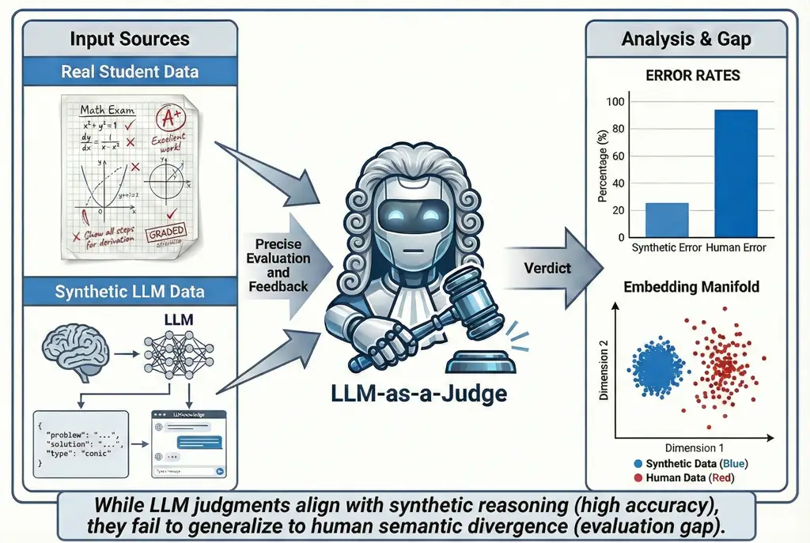
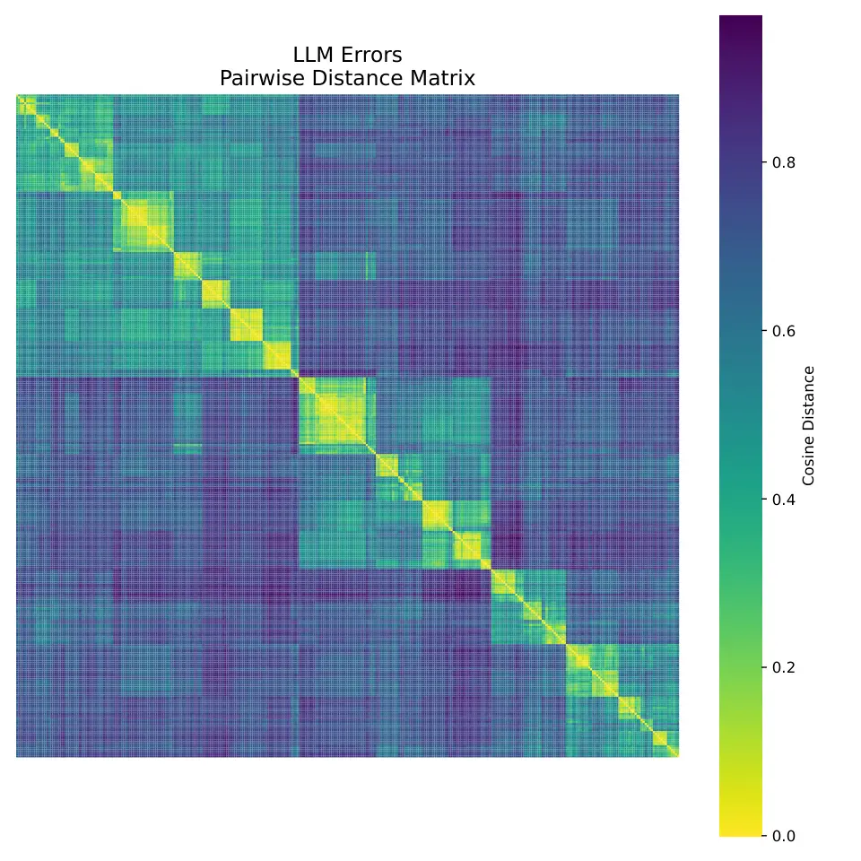
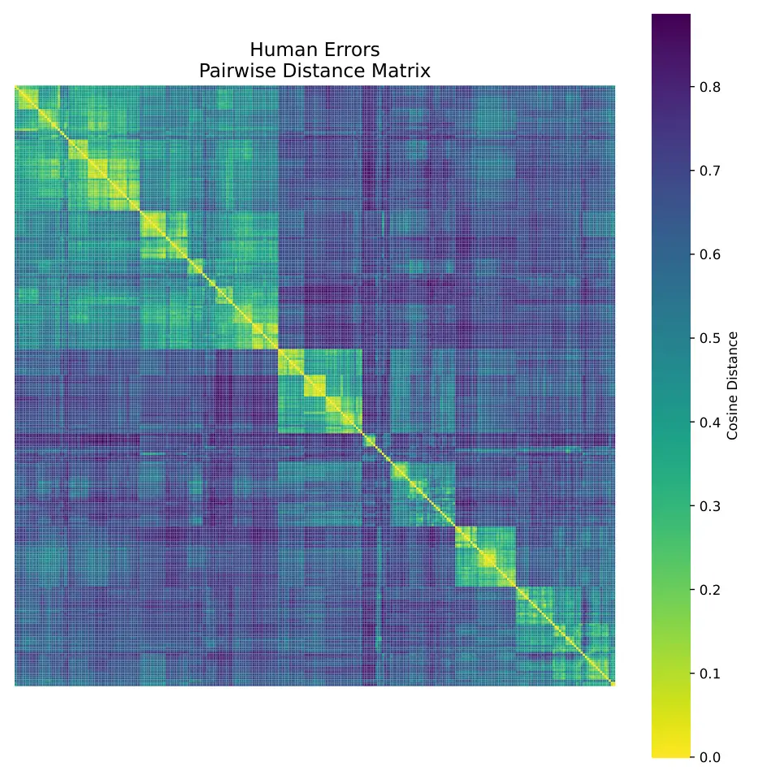

# RealMath-Eval: Why SOTA Judges Struggle with Real Human Reasoning

Yiteng Mao Affiliation: mao85@wisc.edu  \|
 jianlongchen@link.cuhk.edu.cn Affiliation: University of
Wisconsin–Madison    Kenan Xu Affiliation: mao85@wisc.edu  \|
 jianlongchen@link.cuhk.edu.cn Affiliation: East China Normal University
   Yijia Lyu Affiliation: mao85@wisc.edu  \|
 jianlongchen@link.cuhk.edu.cn Affiliation: New York University   
Wenhao Li Affiliation: mao85@wisc.edu  \|  jianlongchen@link.cuhk.edu.cn
Affiliation: Tongji University    Jianlong Chen ^(†)^(†)thanks:
Corresponding author: jianlongchen@link.cuhk.edu.cn
Affiliation: mao85@wisc.edu  \|  jianlongchen@link.cuhk.edu.cn
Affiliation: The Chinese University of Hong Kong, Shenzhen    Xiangfeng
Wang Affiliation: mao85@wisc.edu  \|  jianlongchen@link.cuhk.edu.cn
Affiliation: East China Normal University

###### Abstract

While Large Language Models (LLMs) have achieved near-perfect
performance in _solving_ high-school mathematics, their ability to
_evaluate_ the diverse reasoning processes of real human students
remains under-examined. To bridge this gap, we introduce RealMath-Eval,
a rigorously annotated benchmark of 224 real-world exam responses from
high schools. Our initial evaluation reveals that even state-of-the-art
LLM judges struggle significantly on this task, exhibiting a high Mean
Squared Error ($`\sim`$2.96) against expert human grading. To probe a
plausible explanation, we contrast this performance with a control
setting where the same judges evaluate synthetic LLM-generated
solutions. We identify a stark “Evaluation Gap”: judges are considerably
more accurate and consistent on synthetic text (MSE $`\sim`$1.17) but
struggle to generalize to authentic student reasoning. Through semantic
embedding analysis, we find that synthetic errors suffer from a
“structural collapse” into predictable, low-dimensional linear
subspaces, whereas human errors form a more diverse error space.
Furthermore, generative probability probes suggest that human reasoning
involves significantly higher information-theoretic surprisal,
indicating that student reasoning transitions are more
out-of-distribution for current models. Finally, we find that
surface-level style transfer fails to close this gap. Our findings
suggest that current LLM evaluation pipelines relying heavily on
synthetic data may not adequately capture the diversity of authentic
student mathematical reasoning.

[![[Uncaptioned
image]](arxiv-2606-10254v1--713fd9747d19.figures/figure-1.webp) GitHub
Repository](https://github.com/RicharMd/RealMath-Eval)  
[![[Uncaptioned
image]](arxiv-2606-10254v1--713fd9747d19.figures/figure-2.webp) Hugging
Face Dataset](https://huggingface.co/datasets/RicharMd/RealMath-Eval)

## 1 Introduction

The rapid evolution of Large Language Models (LLMs) has led to a
paradigm shift in automated evaluation. “LLM-as-a-Judge” has become a
standard practice, where strong models are deployed to evaluate the
quality of weaker models \[1, 2\]. This approach relies on the implicit
assumption that a model capable of _solving_ a complex problem is
inherently capable of _judging_ a solution to that problem, regardless
of whether the solution comes from a machine or a human.



Figure 1: Overview of RealMath-Eval and the Evaluation Gap. The
benchmark enables a controlled comparison between authentic student
reasoning and synthetic LLM solutions, revealing a substantial
performance gap that motivates the semantic and LL analyses in the
remainder of the paper.

Current LLM-as-a-Judge research typically falls into two categories:
pairwise ranking (comparing two outputs) and pointwise scoring
(assigning an absolute quality score) \[3\]. While pairwise ranking is
widely used for preference alignment, pointwise scoring is indispensable
for applications requiring calibrated judgments, such as reward modeling
and rubric-based evaluation. \[3, 4, 5\].

However, existing benchmarks for pointwise scoring predominantly focus
on synthetic data—using strong models to grade the outputs of weaker
models \[4, 5\]. This creates a closed loop where judges are evaluated
on text distributions they are statistically familiar with. While
educational NLP has extensively evaluated real student text in Automated
Essay Scoring (AES)—ranging from traditional systems relying on shallow
linguistic features \[6\] to recent LLM-based multi-trait evaluators
\[7\]—these approaches primarily assess writing quality and rhetorical
coherence. In contrast, rubric-grounded evaluation of complex
mathematical reasoning requires tracking stepwise deductions, logical
validity, and error propagation. A critical question thus emerges for
alignment: can these judges, optimized for the predictable patterns of
machine text, effectively evaluate the diverse, noisy, and often
idiosyncratic reasoning of real human students? This capability is
essential for reliable reward signals in RLHF and trustworthy AI tutors,
yet remains under-examined for authentic student mathematical reasoning.

To address this, we introduce RealMath-Eval, a benchmark constructed
from 224 expert-annotated real-world high school exam responses. Our
initial experiments reveal a concerning reality: State-of-the-art (SOTA)
LLM judges struggle significantly when grading real student solutions,
exhibiting a high Mean Squared Error ($`\sim`$2.96) compared to human
ground truth. To probe this failure, we conducted a comparative analysis
against a control group of synthetic LLM solutions. This comparison
unveiled a stark Evaluation Gap: the same judges are remarkably accurate
(MSE $`\sim`$1.17) when evaluating synthetic text, suggesting that the
difficulty arises not merely from mathematical complexity, but more
importantly from differences in how humans and models construct
erroneous reasoning paths. Figure 1 depicts an overview of our analysis,
and we summarize our key contributions as follows:

1.  1.  RealMath-Eval Benchmark: A rigorously annotated dataset from real
        high-school exams, specifically curated to test evaluation
        capabilities on diverse human reasoning.
2.  2.  Discovery of the Evaluation Gap: We reveal a stark contrast in judge
        performance on the same problems: SOTA judges are far more reliable
        on synthetic LLM reasoning (MSE $`\sim`$1.17, Failure Rate 12.8%)
    than on human reasoning (MSE $`\sim`$2.96, Failure Rate 28.7%). This
    $`\sim`$2.5x degradation provides empirical evidence for an observed
        evaluation asymmetry, which we refer to as a potential “In-group
        Bias”: current evaluators appear substantially better calibrated to
        synthetic text distributions than to authentic human reasoning.
3.  3.  Mechanism of Failure: The Crystal vs. The Cloud: To the best of our
        knowledge, we provide an early analytical account of this gap.
        Semantic embedding analysis reveals that LLM errors undergo a
        “structural collapse” into stable, low-dimensional “crystals,”
        whereas human errors exhibit high intra-category divergence, forming
        an unstructured “cloud.” Furthermore, generative probes show that
        human reasoning involves significantly higher information-theoretic
        surprisal (Logical Likelihood $`\approx`$ 0.11 vs. 0.33), suggesting
        a distributional mismatch that current judge pipelines may not fully
        resolve through surface-level prompting alone.

## 2 Related Work

#### LLM-as-a-Judge and pointwise evaluation.

LLM-as-a-Judge has become a common paradigm for automated evaluation,
especially in pairwise preference comparison and pointwise scoring \[1,
2, 3\]. Our setting belongs to the pointwise branch, but differs from
open-ended quality scoring because the judge must assign an absolute
score under a problem-specific mathematical rubric.

#### Synthetic judge benchmarks.

Recent judge and reward-model benchmarks often evaluate model outputs
against other model outputs \[4, 5\]. These benchmarks are valuable for
controlled evaluation, but they mostly test distributions familiar to
contemporary LLMs. RealMath-Eval complements this line of work by
comparing the same judges on synthetic LLM solutions and authentic
student responses for the same mathematical problems.

#### Educational NLP and mathematical reasoning assessment.

Educational NLP has long studied real student text, especially in
Automated Essay Scoring and multi-trait writing assessment \[6, 7\].
Mathematical reasoning assessment requires a different form of
evaluation: judges must track stepwise deductions, identify missing
intermediate claims, apply partial-credit rubrics, and distinguish valid
alternative methods from invalid shortcuts. RealMath-Eval focuses on
this rubric-grounded mathematical setting rather than general writing
quality.

## 3 RealMath-Eval Dataset

To systematically assess the evaluation capability of LLMs on human
data, we introduce RealMath-Eval.

### 3.1 Benchmark Construction

The dataset is built from three batches of high-school assessments
(2025-09-28, 2025-10-17, 2025-10-24), covering advanced topics such as
trigonometric functions, sequences, derivatives, and conic sections. We
process the handwritten responses with an OCR-and-correction pipeline,
remove unusable artifacts, and retain a pool of 359 viable candidates.
From this pool, we uniformly sample 16 representative responses for each
of 14 problems, yielding a final benchmark of 224 samples. Detailed
construction steps are deferred to Appendix A. Each benchmark sample
contains the original problem statement, the student’s step-by-step
solution, and the reference answer. Every sample is annotated with an
expert-assigned Ground Truth Score and step-wise scoring labels,
enabling both overall evaluation and fine-grained error localization.
The benchmark also spans a broad range of performance levels, with 59
low-performing samples (26.34%), 97 medium-performing samples (43.30%),
and 68 high-performing samples (30.36%). The full data release format is
provided in Appendix N.

### 3.2 Control Group: Synthetic LLM Solutions

To establish a controlled comparison, we construct a size-matched
synthetic dataset of 224 LLM-generated solutions, one for each authentic
student sample. Synthetic responses are generated by a diverse set of
low-, medium-, and high-tier models at varied temperatures to mimic a
range of student ability levels; the full model list and temperature
settings are reported in Appendix B. All synthetic solutions are
produced under the same “Student Persona” prompt and then annotated by
the same expert human process used for the real student data, ensuring a
fair comparison.

## 4 Methodology

We propose a unified framework to evaluate and analyze the capability of
LLMs in judging mathematical reasoning. Our methodology consists of a
formal task definition, a standardized judge configuration, and a suite
of analytical probes designed to dissect the “Evaluation Gap.”

### 4.1 Task Formulation

We formulate the evaluation task as a pointwise scoring problem \[3\].
Let $`P`$ be a mathematical problem, $`R`$ be the reference solution
with a step-wise rubric, and $`S`$ be a student’s response. The judge
model $`\mathcal{M}`$ takes the tuple $`(P,R,S)`$ as input and outputs a
scalar score $`\hat{y}`$ and a reasoning rationale $`E`$:

```math
(\hat{y},E)=\mathcal{M}(P,R,S) \tag{1}
```

The goal is to minimize the discrepancy between the predicted score
$`\hat{y}`$ and the ground truth score $`y_{gt}`$ assigned by human
experts. We quantify this discrepancy using Mean Squared Error (MSE) and
a fine-grained Failure Rate ($`\text{FR}_{\delta}`$), defined as the
percentage of cases where the absolute score deviation
$`|\hat{y}-y_{gt}|\geq\delta`$. By evaluating across multiple thresholds
($`\delta\in\{1,2,3,4,5\}`$), we capture a comprehensive spectrum of
evaluation errors, ranging from minor grading variances to catastrophic
misjudgments. We use $`\text{FR}_{2}`$ as the main severe-error
indicator because a two-point deviation in these step-wise rubrics
typically corresponds to over-awarding or missing a substantive
reasoning milestone, while still reporting
$`\text{FR}_{1}`$–$`\text{FR}_{5}`$ for sensitivity.

### 4.2 Judge Configuration and Prompting

We employ state-of-the-art LLMs (Gemini 3 Pro Preview, GPT-5.2, Qwen 3.5
Plus, and DeepSeek-V3.2) as judges \[8, 9, 10, 11\]. Using
MASLab \[12\], we implement a Chain-of-Thought (CoT) \[13\]
“Reason-then-Score” prompting strategy (Appendix M) in which the model
first analyzes the student’s steps against the rubric, then identifies
correct and incorrect reasoning, and finally assigns a cumulative score.

### 4.3 Meta-Evaluation Protocol

To qualitatively understand _why_ the judge fails, we apply a two-stage
attribution workflow on samples with significant disagreement
($`\Delta\geq 2`$): a prompt-based meta-evaluation classifier produces
initial labels, which are then corrected through expert
human-in-the-loop review (Appendix M, Appendix D). The corrected cases
are grouped into four categories: Error Severity, Process Norms, Logical
Rigor, and Insight Recognition. Detailed category definitions are
provided in Appendix G.1. This taxonomy allows us to move beyond simple
error rates and diagnose recurring rubric-level mismatches between
judges and human graders.

### 4.4 Analytical Framework

To probe the possible sources of evaluation failures, we employ two
complementary probes on a focused subset of data. We first extract
coarse-grained error segments from the benchmark’s step-wise annotations
(Human $`n=278`$, Synthetic $`n=328`$), and then split these segments
into atomic reasoning steps for the micro-level analysis. Additional
preprocessing details are deferred to Appendix G.

(1) Semantic Structural Probe (Macro-level). We map each error segment
$`s_{i}\in\mathcal{S}_{err}`$ to an embedding vector
$`\mathbf{h}_{i}=E(s_{i})\in\mathbb{R}^{d}`$ using
Qwen3-Embedding-8B \[14\]. To capture both local and global structure,
we examine these embeddings along four complementary dimensions: Local
Dispersion (mean $`k`$-nearest-neighbor distance \[15\]), Cluster
Separation (HDBSCAN / GMM & Silhouette Score \[16, 17\]), Global Spatial
Pattern (pairwise-distance heatmaps), and Subspace Dimensionality (PCA
explained variance). The detailed definitions of these statistics are
provided in Appendix G.

(2) Generative Predictability Probe (Micro-level). A key component of
our approach is the computation of predictability at the micro-level,
which captures how “surprising” a specific human reasoning step is to a
causal language model \[18\].

Step-wise Transition Probabilities. We leverage the internal generation
signals of a causal language model to evaluate the predictability of
reasoning paths. Given an error segment parsed into an ordered sequence
of atomic steps $`S=(s_{0},s_{1},\dots,s_{N-1})`$, we define the context
prefix at step $`k`$ as $`C_{k}=\bigoplus_{i=0}^{k}s_{i}`$. We feed
$`C_{k}`$ into a causal probe model $`\mathcal{M}`$ (Qwen3-8B \[19\],
chosen for its strong math reasoning capabilities and open access to
internal logits)

to extract the next-token logits. To map these internal representations
into a normalized probability space, we apply a softmax function over
the vocabulary $`\mathcal{V}`$:

```math
p(v\mid C_{k})=\text{softmax}(\text{Logits}(C_{k}))[v],\quad\forall v\in\mathcal{V} \tag{2}
```

This probability quantifies how likely the model is to generate token
$`v`$ as the immediate continuation of the context $`C_{k}`$.

Logical Likelihood (LL) Score. To formally quantify this step-level
divergence, we introduce the Logical Likelihood (LL) score as a metric
tailored for our evaluation framework. Based on the probability
distribution, we evaluate the model’s anticipation of the actual next
step $`s_{k+1}`$ produced by the student. Let $`\mathcal{T}_{k+1}`$ be
the set of valid token IDs composing $`s_{k+1}`$. We define the
transition Logical Likelihood as the maximum probability assigned to any
token within the actual next step:

```math
\text{LL}(s_{k}\to s_{k+1})=\max_{t\in\mathcal{T}_{k+1}}p(t\mid C_{k}) \tag{3}
```

A lower LL score indicates that even the most likely token in the
student’s actual reasoning step was assigned a low probability by the
model (i.e., a high “surprise” factor), reflecting idiosyncratic,
“jumpy” human logic. We aggregate this metric for each segment by taking
the maximum transition LL: $`\max_{k}\text{LL}(s_{k}\to s_{k+1})`$.

We use the maximum token probability as a task-specific transition probe
rather than as a replacement for sequence likelihood. Mathematical
derivations often contain many formatting and connective tokens, while
the predictability of a reasoning transition may hinge on a small number
of decisive mathematical tokens. The max formulation therefore captures
whether the probe model assigns high probability to any part of the next
reasoning step. As a robustness check, we also compute step-level
perplexity, a standard language-model evaluation measure \[20\], in
Appendix I, which yields the same directional conclusion.

## 5 Experiments

We first evaluate SOTA judges on real student data, then use a
controlled comparison to examine whether the difficulty concentrates on
authentic human reasoning.

### 5.1 Experimental Setup

We evaluated four SOTA judge models: Gemini 3 Pro Preview, GPT-5.2, Qwen
3.5 Plus, and DeepSeek-V3.2 \[8, 9, 10, 11\]. All models were prompted
with Chain-of-Thought (CoT) \[13\] to ensure maximum reasoning
capability. The evaluation task involved pointwise scoring based on each
problem’s rubric-defined full score. We use two datasets: the
RealMath-Eval benchmark with 224 authentic student responses, and a
control set of 224 synthetic samples generated by diverse LLMs
(Section 5.4).

### 5.2 Evaluation Metrics

For the primary evaluation task, we report Mean Squared Error (MSE),
Exact Match, and a family of Failure Rates ($`\text{FR}_{\delta}`$),
where $`\text{FR}_{\delta}`$ denotes the proportion of cases with score
deviation at least $`\delta`$ and $`\delta\in\{1,2,3,4,5\}`$.
Analysis-specific metrics such as Silhouette Score and Logical
Likelihood (LL) are defined in Section 4.

### 5.3 Main Results on RealMath-Eval

We first benchmark the judges on RealMath-Eval. Table 1 reports MSE,
Exact Match, and failure rates across thresholds, revealing substantial
vulnerability across all tested LLMs.

| Judge Model   | MSE ($`\downarrow`$) | Exact Match ($`\uparrow`$) | $`\text{FR}_{1}`$ ($`\downarrow`$) | $`\text{FR}_{2}`$ ($`\downarrow`$) | $`\text{FR}_{3}`$ ($`\downarrow`$) | $`\text{FR}_{4}`$ ($`\downarrow`$) | $`\text{FR}_{5}`$ ($`\downarrow`$) |
| ------------- | -------------------- | -------------------------- | ---------------------------------- | ---------------------------------- | ---------------------------------- | ---------------------------------- | ---------------------------------- |
| Qwen 3.5 Plus | 2.67                 | 37.9%                      | 62.1%                              | 26.3%                              | 11.2%                              | 4.0%                               | 1.8%                               |
| Gemini 3 Pro  | 2.96                 | 37.7%                      | 62.3%                              | 28.7%                              | 12.6%                              | 4.9%                               | 2.2%                               |
| GPT-5.2       | 5.28                 | 33.9%                      | 66.1%                              | 41.1%                              | 21.4%                              | 11.2%                              | 7.6%                               |
| DeepSeek-V3.2 | 7.57                 | 25.9%                      | 74.1%                              | 48.7%                              | 30.8%                              | 20.5%                              | 11.2%                              |

Table 1: Main results on RealMath-Eval. All judges exhibit a substantial
long tail of severe misjudgments ($`\text{FR}_{2}\geq 26\%`$).

Human Inter-Rater Ceiling. To contextualize these scores, we conducted a
blind inter-rater consistency check on a random subset of 50 authentic
responses. A second evaluator re-annotated the samples using the same
rubric as the original expert annotations. The human-human agreement
reached 82.0% Exact Match with an MSE of 0.18, and no severe
disagreements under $`\text{FR}_{2}`$ (0%). This ceiling suggests that
the low Exact Match of LLM judges is not merely a consequence of
inherent rubric ambiguity; rather, the models exhibit substantially
larger deviations than human graders applying the same scoring standard.

Universal Struggle with Human Data. The most prominent finding is that
judge performance is universally far from ideal. Across all models, the
Exact Match rate never exceeds 38%, indicating a pervasive difficulty in
perfectly aligning with expert grading. More critically, the Exact Match
metric alone does not capture the severity of the misjudgments. When
evaluating the Failure Rate ($`\Delta\geq 2`$), we observe that even the
strongest models significantly misjudge over a quarter of the student
responses (26.3% for Qwen 3.5 Plus and 28.7% for Gemini 3 Pro). This
high rate of severe deviation suggests that the models are not merely
making minor point-deduction errors, but rather struggling to
consistently evaluate the logical structure of the students’ reasoning.

High Variance Across SOTA Models. We also observe substantial variance
in robustness among the leading models. While Qwen 3.5 Plus and Gemini 3
Pro maintain moderate MSE scores (2.67 and 2.96, respectively), other
models struggle far more severely. Notably, GPT-5.2 exhibits a
surprisingly high Failure Rate of 41.1%, and DeepSeek-V3.2 fails on
nearly half of the human samples (48.7%, MSE 7.57). This performance gap
suggests that general capability scaling (e.g., GPT-5.2) or strong
coding/math reasoning capabilities (e.g., DeepSeek-V3.2) do not
automatically translate to the robust evaluation of idiosyncratic human
logical errors.

Failure Modes in High-Disagreement Cases. To better understand the
nature of these failures, we performed a meta-evaluation on the 64
Gemini 3 Pro cases with significant disagreement ($`\Delta\geq 2`$),
using the attribution categories introduced in Section 4 (full
definitions in Appendix G.1). The most common failure mode was Category
A (Error Severity) with 26 cases (40.6%), where the judge often assigns
unwarranted “partial credit” for non-existent logic in calculation
errors (follow-through), whereas humans penalize strictly according to
the rubric. Category C (Logical Rigor) followed with 20 cases (31.3%),
where humans penalize logical gaps (e.g., missing sufficient conditions)
more severely, while the judge is overly lenient; Category B (Process
Norms) accounted for 18 cases (28.1%), involving non-standard formatting
or skipped steps that confused the judge. This pattern suggests that the
judge favors a “roughly correct” heuristic over the stricter notions of
severity and rigor used in human mathematical grading. Overall, these
failure patterns further highlight that evaluating authentic student
reasoning remains an unsolved challenge for current SOTA models. We next
ask whether this difficulty is specific to human reasoning by comparing
the same judges against synthetic solutions.

### 5.4 The Evaluation Gap: Human vs. Synthetic Reasoning

The poor performance on RealMath-Eval raises a critical question: _Are
these models simply bad at judging math, or is there something specific
about human reasoning that confuses them?_

To answer this, we evaluated the same judges on our Control Dataset of
synthetic LLM-generated solutions. Table 2 compares MSE, Exact Match,
and $`\text{FR}_{2}`$ across the two domains, allowing us to clearly
examine the “Evaluation Gap.”

| Judge Model   | Metric                             | Synthetic (LLM) | Human (Student) |
| ------------- | ---------------------------------- | --------------- | --------------- |
| Gemini 3 Pro  | MSE ($`\downarrow`$)               | 1.24            | 2.96            |
|               | Exact Match ($`\uparrow`$)         | 67.6%           | 37.7%           |
|               | $`\text{FR}_{2}`$ ($`\downarrow`$) | 12.8%           | 28.7%           |
| GPT-5.2       | MSE ($`\downarrow`$)               | 2.55            | 5.28            |
|               | Exact Match ($`\uparrow`$)         | 51.6%           | 33.9%           |
|               | $`\text{FR}_{2}`$ ($`\downarrow`$) | 26.9%           | 41.1%           |
| Qwen 3.5 Plus | MSE ($`\downarrow`$)               | 1.42            | 2.67            |
|               | Exact Match ($`\uparrow`$)         | 57.8%           | 37.9%           |
|               | $`\text{FR}_{2}`$ ($`\downarrow`$) | 17.4%           | 26.3%           |
| DeepSeek-V3.2 | MSE ($`\downarrow`$)               | 7.12            | 7.57            |
|               | Exact Match ($`\uparrow`$)         | 37.4%           | 25.9%           |
|               | $`\text{FR}_{2}`$ ($`\downarrow`$) | 43.4%           | 48.7%           |

Table 2: The Evaluation Gap. All judges perform better on synthetic LLM
solutions than on authentic student reasoning.

Table 2 reveals a consistent cross-model contrast: all judges perform
better on synthetic data than on human data, with Qwen 3.5 Plus and
Gemini 3 Pro showing the strongest overall performance while still
retaining a sizable Human-vs-Synthetic gap.

This cross-domain degradation provides empirical support for an
evaluation asymmetry:

LLM judges are more effective on synthetic reasoning but struggle to
bridge the gap to the diverse reasoning of real students. To better
understand this divergence, we next analyze it through macro- and
micro-level probes.

## 6 Analysis: Convergence vs. Divergence

Having established that the gap is concentrated on authentic human
reasoning, we now turn to our analytical probes to visualize the
_geometry_ of this divergence. We hypothesize that LLM errors are
“convergent” (collapsing into known statistical patterns), while human
errors are “divergent” (high-variance and idiosyncratic).

### 6.1 Semantic Embedding Analysis

To map the geometric “cluster of mistakes,” we embedded error segments
using Qwen3-Embedding-8B \[14\]. Table 3 summarizes the resulting space
through local dispersion, cluster separation, and low-dimensional
structure.

To check that the observed geometric gap is not an artifact of a single
embedder, we repeat the embedding analysis with a Gemma-family KaLM
embedder \[21\] and a No-Qwen synthetic subset that removes Qwen-family
generators from the synthetic side. The same directional
Human-vs-Synthetic contrast is preserved; details are reported in
Appendix H.

|                                    |              |            |
| ---------------------------------- | ------------ | ---------- |
| Metric                             | Human Errors | LLM Errors |
| Avg NN Dist ($`\downarrow`$)       | 0.1761       | 0.1144     |
| Silhouette Score ($`\uparrow`$)    | 0.3339       | 0.5180     |
| PCA Top-10 Variance ($`\uparrow`$) | 56.15%       | 62.46%     |
| Optimal GMM K                      | 6            | 27         |

Table 3: Embedding space statistics. Synthetic LLM errors are more
clustered and lower-dimensional than human errors.

Figure 2: Local dispersion of error distributions. Synthetic LLM errors
form a sharper, lower-variance peak than authentic human errors (mean
$`0.114`$ vs. $`0.176`$).

The “Crystal” vs. The “Cloud” Metaphor. As shown in Table 3, LLM errors
exhibit significantly higher Cluster Separation (Silhouette $`0.518`$
vs. $`0.334`$) and reduced Local Dispersion (Avg NN Dist $`0.1144`$ vs.
$`0.1761`$). We use “Crystal” and “Cloud” as an illustrative metaphor
for this observed geometric contrast: when an LLM errs, its errors tend
to concentrate into dense, predictable, low-variance semantic patterns,
whereas authentic human errors are more diffuse, higher-variance, and
less rigidly clustered. This contrast poses a challenge for judge models
calibrated primarily on machine-generated distributions.

|                                |                         |                                  |
| ------------------------------ | ----------------------- | -------------------------------- |
|                                |                         |                                  |
| (a) Synthetic (LLM) Silhouette | (b) PCA Embedding Space | (c) Authentic (Human) Silhouette |

Figure 3: Semantic structure of errors. Synthetic errors form tighter,
more coherent clusters, whereas human errors remain more diffuse and
diverse.

Global Spatial Pattern and Structure Visualization. Our qualitative
analysis of pairwise distance matrices (Figure 4) further reinforces
this structural divergence. The LLM error space exhibits denser and more
sharply separated block structures corresponding to recurring error
types, whereas the human error space shows smaller, more fragmented, and
higher-variance blocks. This suggests that human reasoning does not
follow the cleaner categories induced by synthetic data, helping to
explain the observed evaluation failures. For a more intuitive
quantitative reading of this contrast beyond the matrix pair alone, we
additionally report singular-value spectrum entropy (SVD entropy) in
Appendix C.

Structural Collapse and Subspace Dimensionality. Finally, we observe
that LLM errors occupy a lower effective dimensionality, with the top-10
principal components explaining $`62.46\%`$ of the variance compared to
$`56.15\%`$ for humans. This indicates a “Structural Collapse” in
synthetic text \[22\], where errors lie on a simplified, low-rank linear
subspace. A complementary GMM/BIC analysis in Figure 5 further supports
this contrast. The synthetic error distribution reaches its best BIC at
a larger number of components, suggesting many dense and separable
recurring error modes. By contrast, the human error distribution is
better described by fewer broader components, consistent with a more
diffuse and higher-variance space.

### 6.2 Generative Probability (Logical Likelihood)

To move beyond static geometry, we probed the _dynamic_ predictability
of reasoning steps using the Logical Likelihood (LL) metric defined in
Section 4.

Results. When aggregating the segment-level LL scores, the contrast
between the two distributions is stark: the average Logical Likelihood
for error steps was found to be approximately 0.1104 for Human Errors
and 0.3267 for LLM Errors. To check that this predictability gap is not
specific to the Qwen3-8B probe, we repeat the generative analysis with
Meta-Llama-3.1-8B-Instruct \[23\] and InternLM3-8B-Instruct \[24\];
step-level perplexity (Section 4) yields the same directional
conclusion. Cross-family probe results are reported in Appendix H and
Appendix I.

Interpretation: The Information-Theoretic Surprise. Recall that the LL
score directly represents the maximum transition probability of the
observed step. A lower LL implies a lower probability of generation. The
significant gap ($`0.11`$ vs $`0.33`$) provides quantitative evidence
that authentic student reasoning steps are highly surprising to the
causal probe model. An average LL of 0.33 indicates that when an LLM
makes an error, it still follows a highly predictable, “on-distribution”
statistical trajectory. Conversely, an average LL of 0.11 means that
human logical jumps and idiosyncratic errors are assigned much lower
probabilities by the probe model. From the perspective of information
theory \[18\], such a low probability translates to high “surprisal.”
This Distributional Mismatch may help explain the evaluation gap:

Authentic student samples more often fall in the low-probability,
out-of-distribution (OOD) tail of the probe model’s own training
distribution \[25\], which may contribute to the misgrading patterns.
When confronted with the highly surprising logic of real students, the
judge may therefore be more prone to the grading failures observed in
Section 5.3.

## 7 Discussion: The Persistence of the Gap

Having established the geometric and probabilistic divergence of human
errors (Section 6), we next test whether simple surface-level
interventions can reduce the evaluation gap.

### 7.1 Robustness Analysis: Is it just an Instruction Issue?

One possible hypothesis is that the judge simply needs better
instructions to handle the variability of authentic student reasoning.
To test this, we evaluated three prompting variants on RealMath-Eval:
Follow-Through First, which asks the judge to continue incomplete or
unclear reasoning in the student’s own direction before scoring;
Verification First, which adds an explicit verification phase; and MAS
Self-Consistency, a multi-agent voting variant \[26, 12\] (full prompts
in Appendix M).

(a) Prompting Robustness

| Method         | EM    | FR₂   |
| -------------- | ----- | ----- |
| Baseline       | 37.7% | 28.7% |
| Follow-Through | 36.6% | 33.9% |
| Verification   | 35.3% | 34.8% |
| MAS SC         | 38.8% | 31.2% |

(b) Style Transfer

| Metric                   | Orig. | Transfer |
| ------------------------ | ----- | -------- |
| Total Samples            | 72    | 72       |
| FR₂                      | 100%  | 88.9%    |
| Improved to $`\Delta<2`$ | -     | 11.1%    |
| Exact Match              | 0%    | 2.8%     |

Table 4: Discussion ablations on human data. (a) Prompting-based
robustness variants remain close to or worse than the baseline. (b)
Style normalization improves only a small fraction of hard cases.

As shown in Table 4(a), none of these prompting variants meaningfully
closes the gap; extra verification often increases the failure rate. We
further test a dynamic few-shot calibration setting, where each
evaluated response is accompanied by two held-out grading demonstrations
from the same mathematical problem. This problem-specific calibration
also leaves Qwen 3.5 Plus and Gemini 3 Pro below 40% Exact Match on
authentic human responses (Appendix J). Together, these results suggest
that the gap is not easily removed by prompt-level adjustments alone and
is more consistent with difficulties in handling highly “surprising”
logic (Section 6.2).

### 7.2 Ablation Study: Is it a Style Issue?

Another potential confounder is presentation style, since authentic
student responses are often less polished and less standardized than LLM
generations. To isolate style from semantic content, we performed a
Style Transfer ablation on 72 hard cases where the original judge failed
significantly ($`\Delta\geq 2`$), rewriting each response into a
standardized format while preserving its underlying logic (Appendix M).
As shown in Table 4(b), style normalization still fails to close the
gap: 88.9% of samples remain significant failures after rewriting, and
exact match rises only from 0% to 2.8%, suggesting that the judges
struggle not merely with surface form, but with the semantic structure
of authentic student reasoning.

We further conducted a micro-level consistency check by applying the
same normalization idea to the step sequences used in our Logical
Likelihood (LL) analysis. After step-level style transfer, the average
LL of human error steps did not move toward the synthetic regime;
instead, it remained far below the synthetic LLM baseline and further
decreased from $`0.110`$ to $`0.060`$, compared with $`0.327`$ for
synthetic LLM errors. Although step-wise rewriting can alter token-level
realizations, this result provides empirical support for the claim that
the LL gap is not eliminated by surface-level reformatting alone. In
other words, making human solutions appear more “LLM-like” in form does
not make their reasoning substantially more predictable for the probe
model.

## 8 Conclusion and Limitations

We introduce RealMath-Eval and characterize the Evaluation Gap between
judging synthetic and authentic human reasoning. Even strong SOTA judges
systematically mis-evaluate real student solutions, with over a quarter
of authentic samples receiving severe score deviations. Our geometric
and probabilistic probes further suggest that this gap is associated
with a semantic mismatch: synthetic errors collapse into more
predictable, low-dimensional structures, whereas human reasoning remains
more diverse and exhibits higher surprisal.

We also note several limitations of the present study. It is limited to
14 mathematical problems (224 samples), so broader domains remain to be
tested. Still, the results caution against relying solely on synthetic
data for mathematical-reasoning evaluation. Future work should scale
high-fidelity human data collection and develop judge pipelines that
better account for the diversity of authentic student reasoning. In
addition, RealMath-Eval can serve as a seed resource for evaluator
alignment, including preference optimization and fine-tuning with
rubric-score annotations; we outline these directions in Appendix K.

## Ethics Statement

The exam-response data used in this study were obtained through an
authorized educational workflow and processed under privacy-preserving
handling for research use. During digitization and annotation,
personally identifying information was removed or excluded from the
analysis pipeline. Any public release associated with this work will be
limited to de-identified materials and only to artifacts permitted for
redistribution; sensitive raw materials will be filtered or withheld
when necessary.

LLM Usage Disclosure. LLMs were used as judge models in the evaluation
pipeline and to generate the synthetic control solutions in the
controlled comparison. An LLM-based image-generation tool was also used
to create the conceptual overview figure (Figure 1).

## Reproducibility Statement

Code, processed benchmark data, prompts, and analysis scripts required
to reproduce the main results will be released with the public version
of this work. The release scope centers on the processed benchmark and
selected derived artifacts: the main benchmark of 224 curated real
student solutions, the size-matched 224-sample synthetic control set,
and auxiliary analysis files used in the ablation and probe studies. It
does not include the full raw candidate pool or raw answer-sheet images.
To avoid ambiguity across derived subsets, the 64-case meta-evaluation
set and the 72-case style-transfer set are released as separate Gemini 3
Pro hard-case artifacts rather than as a single pooled subset.
Additional file-structure details are provided in Appendix N.

## References

- \[1\] L. Zheng, W. Chiang, Y. Sheng, S. Zhuang, Z. Wu, Y. Zhuang, Z.
  Lin, Z. Li, D. Li, E. P. Xing, H. Zhang, J. E. Gonzalez, and I.
  Stoica (2023) Judging llm-as-a-judge with mt-bench and chatbot arena.
  ArXiv abs/2306.05685. External Links:
  [Link](https://api.semanticscholar.org/CorpusID:259129398) Cited by:
  §L.1, §1, §2.
- \[2\] J. Gu, X. Jiang, Z. Shi, H. Tan, X. Zhai, C. Xu, W. Li, Y.
  Shen, S. Ma, H. Liu, Y. Wang, and J. Guo (2024) A survey on
  llm-as-a-judge. ArXiv abs/2411.15594. External Links:
  [Link](https://api.semanticscholar.org/CorpusID:274234014) Cited by:
  §L.1, §1, §2.
- \[3\] D. Li, B. Jiang, L. Huang, A. Beigi, C. Zhao, Z. Tan, A.
  Bhattacharjee, Y. Jiang, C. Chen, T. Wu, K. Shu, L. Cheng, and H.
  Liu (2024) From generation to judgment: opportunities and challenges
  of llm-as-a-judge. In Conference on Empirical Methods in Natural
  Language Processing, External Links:
  [Link](https://api.semanticscholar.org/CorpusID:274280574) Cited by:
  §L.1, §1, §2, §4.1.
- \[4\] S. Tan, S. Zhuang, K. Montgomery, W. Y. Tang, A. Cuadron, C.
  Wang, R. A. Popa, and I. Stoica (2024) Judgebench: a benchmark for
  evaluating llm-based judges. arXiv preprint arXiv:2410.12784. Cited
  by: §L.2, §1, §1, §2.
- \[5\] S. Malik, V. Pyatkin, S. Land, J. Morrison, N. A. Smith, H.
  Hajishirzi, and N. Lambert (2025) Rewardbench 2: advancing reward
  model evaluation. arXiv preprint arXiv:2506.01937. Cited by: §L.2, §1,
  §1, §2.
- \[6\] D. Ramesh and S. K. Sanampudi (2022) An automated essay scoring
  systems: a systematic literature review. Artificial intelligence
  review 55 (3), pp. 2495–2527. Cited by: §L.3, §1, §2.
- \[7\] S. Lee, Y. Cai, D. Meng, Z. Wang, and Y. Wu (2024) Unleashing
  large language models’ proficiency in zero-shot essay scoring. In
  Findings of the Association for Computational Linguistics: EMNLP 2024,
  pp. 181–198. Cited by: §L.3, §1, §2.
- \[8\] Google DeepMind (2025) Gemini 3 pro model card. Note:
  [https://storage.googleapis.com/deepmind-media/Model-Cards/Gemini-3-Pro-Model-Card.pdf](https://storage.googleapis.com/deepmind-media/Model-Cards/Gemini-3-Pro-Model-Card.pdf)Accessed:
  2026-03-07 Cited by: §4.2, §5.1.
- \[9\] OpenAI (2025) Introducing GPT-5.2. Note:
  [https://openai.com/index/introducing-gpt-5-2/](https://openai.com/index/introducing-gpt-5-2/)Accessed:
  2026-03-07 Cited by: §4.2, §5.1.
- \[10\] Qwen Team (2026) Qwen3.5: towards native multimodal agents.
  External Links: [Link](https://qwen.ai/blog?id=qwen3.5) Cited by:
  §4.2, §5.1.
- \[11\] A. Liu, A. Mei, B. Lin, B. Xue, B. Wang, B. Xu, B. Wu, B.
  Zhang, C. Lin, C. Dong, et al. (2025) Deepseek-v3. 2: pushing the
  frontier of open large language models. arXiv preprint
  arXiv:2512.02556. Cited by: §4.2, §5.1.
- \[12\] R. Ye, K. Huang, Q. Wu, Y. Cai, T. Jin, X. Pang, X. Liu, J.
  Su, C. Qian, B. Tang, et al. (2025) Maslab: a unified and
  comprehensive codebase for llm-based multi-agent systems. arXiv
  preprint arXiv:2505.16988. Cited by: §4.2, §7.1.
- \[13\] J. Wei, X. Wang, D. Schuurmans, M. Bosma, E. Chi, Q. Le, and D.
  Zhou (2022) Chain-of-thought prompting elicits reasoning in large
  language models. Advances in Neural Information Processing Systems 35,
  pp. 24824–24837. Cited by: §4.2, §5.1.
- \[14\] Q. Team (2025) Qwen3-embedding. External Links:
  [Link](https://qwenlm.github.io/blog/qwen3/) Cited by: §G.2, §H.2,
  §4.4, §6.1.
- \[15\] D. O. Loftsgaarden and C. P. Quesenberry (1965) A nonparametric
  estimate of a multivariate density function. The Annals of
  Mathematical Statistics 36 (3), pp. 1049–1051. Cited by: 1st item,
  §4.4.
- \[16\] L. McInnes, J. Healy, S. Astels, et al. (2017) Hdbscan:
  hierarchical density based clustering.. J. Open Source Softw. 2 (11),
  pp. 205. Cited by: 2nd item, §4.4.
- \[17\] R. J. Campello, D. Moulavi, and J. Sander (2013) Density-based
  clustering based on hierarchical density estimates. In Pacific-Asia
  conference on knowledge discovery and data mining, pp. 160–172. Cited
  by: 2nd item, §4.4.
- \[18\] C. Meister, R. Cotterell, and T. Vieira (2020) If beam search
  is the answer, what was the question?. In Proceedings of the 2020
  Conference on Empirical Methods in Natural Language Processing
  (EMNLP), pp. 2173–2185. Cited by: §4.4, §6.2.
- \[19\] Q. Team (2025) Qwen3 technical report. External Links:
  2505.09388, [Link](https://arxiv.org/abs/2505.09388) Cited by: Table
  5, §G.2, §H.1, §4.4.
- \[20\] S. F. Chen and J. Goodman (1996) An empirical study of
  smoothing techniques for language modeling. In 34th Annual Meeting of
  the Association for Computational Linguistics, Santa Cruz, California,
  USA, pp. 310–318. External Links:
  [Document](https://dx.doi.org/10.3115/981863.981904),
  [Link](https://aclanthology.org/P96-1041/) Cited by: §4.4.
- \[21\] X. Hu, Z. Shan, X. Zhao, Z. Sun, Z. Liu, D. Li, S. Ye, X.
  Wei, Q. Chen, B. Hu, H. Wang, J. Yu, and M. Zhang (2025)
  KaLM-embedding: superior training data brings a stronger embedding
  model. External Links: 2501.01028,
  [Link](https://arxiv.org/abs/2501.01028) Cited by: §H.2, §6.1.
- \[22\] A. Aghajanyan, S. Gupta, and L. Zettlemoyer (2021) Intrinsic
  dimensionality explains the effectiveness of language model
  fine-tuning. In Proceedings of the 59th annual meeting of the
  association for computational linguistics and the 11th international
  joint conference on natural language processing (volume 1: long
  papers), pp. 7319–7328. Cited by: §6.1.
- \[23\] AI@Meta (2024) The llama 3 herd of models. arXiv preprint
  arXiv:2407.21783. External Links:
  [Link](https://arxiv.org/abs/2407.21783) Cited by: §H.1, §6.2.
- \[24\] Z. Cai, M. Cao, H. Chen, K. Chen, K. Chen, X. Chen, X. Chen, Z.
  Chen, Z. Chen, P. Chu, X. Dong, H. Duan, Q. Fan, Z. Fei, Y. Gao, J.
  Ge, C. Gu, Y. Gu, T. Gui, A. Guo, Q. Guo, C. He, Y. Hu, T. Huang, T.
  Jiang, P. Jiao, Z. Jin, Z. Lei, J. Li, J. Li, L. Li, S. Li, W. Li, Y.
  Li, H. Liu, J. Liu, J. Hong, K. Liu, K. Liu, X. Liu, C. Lv, H. Lv, K.
  Lv, L. Ma, R. Ma, Z. Ma, W. Ning, L. Ouyang, J. Qiu, Y. Qu, F.
  Shang, Y. Shao, D. Song, Z. Song, Z. Sui, P. Sun, Y. Sun, H. Tang, B.
  Wang, G. Wang, J. Wang, J. Wang, R. Wang, Y. Wang, Z. Wang, X. Wei, Q.
  Weng, F. Wu, Y. Xiong, C. Xu, R. Xu, H. Yan, Y. Yan, X. Yang, H.
  Ye, H. Ying, J. Yu, J. Yu, Y. Zang, C. Zhang, L. Zhang, P. Zhang, P.
  Zhang, R. Zhang, S. Zhang, S. Zhang, W. Zhang, W. Zhang, X. Zhang, X.
  Zhang, H. Zhao, Q. Zhao, X. Zhao, F. Zhou, Z. Zhou, J. Zhuo, Y.
  Zou, X. Qiu, Y. Qiao, and D. Lin (2024) InternLM2 technical report.
  External Links: 2403.17297 Cited by: Table 5, §H.1, §6.2.
- \[25\] E. Mitchell, Y. Lee, A. Khazatsky, C. D. Manning, and C.
  Finn (2023) DetectGPT: zero-shot machine-generated text detection
  using probability curvature. In Proceedings of the 40th International
  Conference on Machine Learning (ICML), Vol. 202, pp. 24950–24962.
  External Links:
  [Link](https://proceedings.mlr.press/v202/mitchell23a.html) Cited by:
  §6.2.
- \[26\] X. Wang, J. Wei, D. Schuurmans, Q. Le, E. Chi, S. Narang, A.
  Chowdhery, and D. Zhou (2022) Self-consistency improves chain of
  thought reasoning in language models. arXiv preprint arXiv:2203.11171.
  Cited by: §7.1.
- \[27\] DeepSeek-AI (2024) DeepSeek-v2: a strong, economical, and
  efficient mixture-of-experts language model. External Links:
  2405.04434 Cited by: Table 5.
- \[28\] Mistral AI Team (2024) Mistral NeMo: our new best small model.
  Note:
  [https://mistral.ai/news/mistral-nemo/](https://mistral.ai/news/mistral-nemo/)Accessed:
  2026-03-07 Cited by: Table 5.
- \[29\] M. Abdin, S. Agarwal, A. Awadallah, V. Balachandran, H.
  Behl, L. Chen, G. de Rosa, S. Gunasekar, M. Javaheripi, N. Joshi, et
  al. (2025) Phi-4-reasoning technical report. arXiv preprint
  arXiv:2504.21318. Cited by: Table 5.
- \[30\] Q. Team (2024) Qwen2.5: a party of foundation models. External
  Links: [Link](https://qwenlm.github.io/blog/qwen2.5/) Cited by: Table 5.
- \[31\] A. Yang, B. Yang, B. Hui, B. Zheng, B. Yu, C. Zhou, C. Li, C.
  Li, D. Liu, F. Huang, G. Dong, H. Wei, H. Lin, J. Tang, J. Wang, J.
  Yang, J. Tu, J. Zhang, J. Ma, J. Xu, J. Zhou, J. Bai, J. He, J.
  Lin, K. Dang, K. Lu, K. Chen, K. Yang, M. Li, M. Xue, N. Ni, P.
  Zhang, P. Wang, R. Peng, R. Men, R. Gao, R. Lin, S. Wang, S. Bai, S.
  Tan, T. Zhu, T. Li, T. Liu, W. Ge, X. Deng, X. Zhou, X. Ren, X.
  Zhang, X. Wei, X. Ren, Y. Fan, Y. Yao, Y. Zhang, Y. Wan, Y. Chu, Y.
  Liu, Z. Cui, Z. Zhang, and Z. Fan (2024) Qwen2 technical report. arXiv
  preprint arXiv:2407.10671. Cited by: Table 5.
- \[32\] A. Yang, B. Zhang, B. Hui, B. Gao, B. Yu, C. Li, D. Liu, J.
  Tu, J. Zhou, J. Lin, K. Lu, M. Xue, R. Lin, T. Liu, X. Ren, and Z.
  Zhang (2024) Qwen2.5-math technical report: toward mathematical expert
  model via self-improvement. arXiv preprint arXiv:2409.12122. Cited by:
  Table 5.

## Appendix A Processing and Benchmark Construction Details

### A.1 File and naming standardization

The first stage standardizes the data structure and filenames. This
produces three standardized folders (one per batch), each suffixed with
standard_v3. During this stage, samples are validated and filtered to
remove items that cannot be standardized, duplicates, and items that do
not meet benchmark requirements. After filtering:

- •
  09-28 batch: 9 problems retained
- •
  10-17 batch: 3 problems retained
- •
  10-24 batch: 2 problems retained

### A.2 OCR and translation (problem / student / reference)

An OCR-and-translation pipeline converts image-based content into
structured, English-language JSON.

- •
  Problem statements: OCR $`\to`$ LLM translation.
- •
  Student responses: OCR $`\to`$ LLM post-processing.
- •
  Reference answers: a multimodal LLM performs self-checking,
  translation, and consistency validation against cumulative-score
  annotations.

Using student_id as the join key, per-subquestion scores are extracted
from Excel sheets and merged into the JSON.

### A.3 OCR quality assurance (student responses)

To ensure OCR text is faithful to handwriting and does not mislead LLM
grading, we apply:

1.  1.  Manual screening to identify visually messy / OCR-unfriendly answer
        sheets.
2.  2.  A multimodal LLM pass to minimally correct OCR while preserving
        student intent (spatial order, missing/hallucinated details,
        crossed-out parts, alignment to the scan).
3.  3.  A second multimodal verification pass using problem + student
        response + original answer-sheet image to remove samples whose OCR
        artifacts may materially affect evaluation.

### A.4 Final filtering and benchmark construction (MASLab format)

After cleaning, the remaining dataset sizes are:

- •
  09-28 batch: 139 samples
- •
  10-17 batch: 78 samples
- •
  10-24 batch: 44 samples

Total retained samples before benchmark selection: 359. We then adapt
the dataset to the MASLab benchmark format and select 16 student
responses per problem, yielding 224 runnable benchmark samples. The
selection is designed to preserve intra-problem diversity: for each
problem, we retain responses that reflect a broad range of performance
levels and error types, including calculation slips, conceptual
misunderstandings, and incomplete but partially correct reasoning paths.
This balanced per-problem sampling prevents a small number of questions
or answer styles from dominating the benchmark.

## Appendix B Synthetic Data Generation Details

To ensure a rigorous control group, we generated synthetic student
responses using a diverse set of LLMs with varying capabilities.

### B.1 Model Selection and Tiers

We categorized generator models into three tiers to simulate different
levels of student proficiency. The generation protocol involved sampling
at specific temperatures to induce variance and errors.

| Tier           | Model                            | Temp.         | Samples |
| -------------- | -------------------------------- | ------------- | ------- |
| Low            | DeepSeek-v2-lite-chat \[27\]     | 0, 0.2        | 2       |
| (Foundational) | InternLM2.5-7b-chat \[24\]       | 0, 0.2        | 2       |
| Medium         | Mistral-Nemo-Instruct \[28\]     | 0.1, 0.3, 0.5 | 3       |
| (Instruct)     | Phi-4-Reasoning-Plus \[29\]      | 0.6           | 2       |
|                | Qwen-2.5-7b-Instruct \[30, 31\]  | 0.7           | 2       |
|                | Qwen-2.5-Math-7b-Instruct \[32\] | 0.4, 0.6, 0.8 | 3       |
| High           | Qwen3-8b \[19\]                  | 1.0           | 2       |
| (Complex)      |                                  |               |         |

Table 5: Synthetic Data Generation Protocol: Model Tiers and
Temperatures.

### B.2 Ground Truth Score Distribution

The synthetic responses were manually annotated by expert human graders
using the same overall annotation process as for the real student
benchmark. The generation protocol was designed to produce one synthetic
counterpart for each of the 224 human samples. In the initial pass, 5
outputs were malformed or mathematically uninterpretable (e.g.,
degenerate repetition or unparsable output). We regenerated these cases
under the same protocol until valid responses were obtained, yielding a
final size-matched synthetic control set of 224 samples. We categorize
performance based on the ratio of the assigned score to the total
possible score. The resulting distribution confirms that our generation
protocol successfully covered a wide spectrum of response qualities,
closely mirroring the difficulty distribution of the real human dataset:

- •
  Low Performance (Score Ratio $`\leq 0.2`$): 68 samples (30.36%)
- •
  Medium Performance ($`0.2<\text{Ratio}\leq 0.8`$): 100 samples
  (44.64%)
- •
  High Performance (Ratio $`>0.8`$): 56 samples (25.00%)

This balanced distribution ensures that the “Evaluation Gap” is not an
artifact of difficulty mismatch between the synthetic and human
datasets. Since the excluded samples were removed for mathematical
invalidity rather than task difficulty, this filtering step improves
comparability instead of introducing an easier synthetic control set.

## Appendix C Global Spatial Pattern and Heatmaps

As discussed in Section 5.1, we examine the large-scale organization of
the error spaces through pairwise distance heatmaps and a GMM/BIC view
of cluster structure. These visualizations are intended to compare
relative organization: both human and synthetic errors contain recurring
patterns, but the density and separability of those patterns differ.

#### SVD entropy.

To make the heatmap contrast easier to interpret quantitatively, we also
report SVD entropy on the same step-level embedding matrices used
elsewhere in our structural analysis. Given an embedding matrix, we
perform singular value decomposition to obtain singular values
$`\sigma_{1}\geq\sigma_{2}\geq\dots`$, normalize them into
$`p_{i}=\sigma_{i}/\sum_{j}\sigma_{j}`$, and compute Shannon entropy
$`H=-\sum_{i}p_{i}\log p_{i}`$. Higher $`H`$ means variance is spread
more uniformly across many directions (a more diffuse, higher-variance
spectrum), whereas lower $`H`$ means energy concentrates in fewer
dominant singular values (a more low-dimensional and compressible
structure). This metric is related to, but distinct from, the PCA
top-$`k`$ explained-variance view: PCA asks how much variance the
leading components capture, whereas SVD entropy summarizes how uniform
the _entire_ singular-value spectrum is. In both the full synthetic LLM
set and the No-Qwen subset (Tables 8 and 9), synthetic errors
consistently show _lower_ SVD entropy than authentic human errors under
both embedding families, aligning with the denser, sharper blocks in
Figure 4 and the higher fragmentation of the human matrix.

|                                                             |                                                             |
| ----------------------------------------------------------- | ----------------------------------------------------------- |
|  |  |
| (a) Synthetic LLM Errors (Block-Structure)                  | (b) Human Student Errors (Amorphous Cloud)                  |

Figure 4: Pairwise Distance Heatmaps. Both heatmaps exhibit diagonal
block structure, as expected from recurring mathematical error types.
The synthetic LLM blocks are denser and more sharply separated, whereas
the human blocks are smaller, more fragmented, and higher-variance.

For the GMM/BIC analysis, we follow a standard model-selection pipeline.
The step-level error texts are first embedded and L2-normalized. To
stabilize Gaussian mixture estimation in a high-dimensional space with
finite samples, we project the embeddings to 50 dimensions using PCA.
The Human and LLM datasets are processed separately, with an independent
PCA fit for each dataset. We then sweep the number of Gaussian mixture
components $`K`$ from 2 to 30 and fit a diagonal-covariance GMM for each
$`K`$ using expectation maximization. Model selection is based on the
Bayesian Information Criterion:

```math
\mathrm{BIC}=-2\ln\hat{L}+p\ln n, \tag{4}
```

where $`\hat{L}`$ is the maximized mixture likelihood, $`n`$ is the
number of samples, and $`p`$ is the number of free parameters. For a
diagonal GMM with $`K`$ components in $`d=50`$ dimensions,
$`p=(K-1)+2Kd`$, accounting for mixture weights, component means, and
diagonal variances. The optimal component count is selected by
$`K^{*}=\arg\min_{K}\mathrm{BIC}(K)`$. In our results, the synthetic LLM
errors reach the minimum BIC at a larger $`K`$, indicating many dense
and separable recurring clusters. Human errors reach the minimum at a
smaller $`K`$, consistent with broader and more diffuse components.

Figure 5: GMM/BIC analysis of error-space structure. Bayesian
Information Criterion (BIC) across varying mixture components, where
lower BIC indicates a better penalized likelihood tradeoff. The
synthetic LLM errors reach the minimum BIC at a larger $`K`$, indicating
many dense and separable recurring clusters. Human errors reach their
minimum at a smaller $`K`$, consistent with broader, more diffuse
components rather than a lack of structure.

## Appendix D Human-in-the-Loop Verification and Attribution

To ensure validity of scoring and attribution analyses, we conduct a
human-in-the-loop review process:

1.  1.  Attribution correction: manually review and reclassify error
        categories to better match root causes.
2.  2.  OCR error detection: confirm and correct OCR mistakes that mislead
        judging.
3.  3.  Ground-truth (GT) verification: correct unreasonable or incorrect
        teacher annotations.

After corrections, the benchmark is rebuilt, affected samples are
re-inferred, and attribution is re-run on the merged dataset.

## Appendix E Qualitative Meta-Evaluation Case Studies

To make the failure-mode taxonomy concrete, we provide four traceable
high-disagreement cases from the Gemini 3 Pro judge. These cases cover
Error Severity / Follow-through (Category A), Process Norms /
Completeness (Category B), and Logical Rigor / Edge Cases (Category C).
For transparency, we include the original student-response and
judge-output excerpts that drive the score disagreement, followed by a
short analysis of the rubric mismatch.

| Case | Category                           | Problem Type           | GT   | Gemini Score |
| ---- | ---------------------------------- | ---------------------- | ---- | ------------ |
| 1    | A: Error Severity / Follow-through | Trigonometric function | 2/14 | 11/14        |
| 2    | B: Process Norms / Completeness    | Sequence recurrence    | 1/14 | 7/14         |
| 3    | B: Process Norms / Completeness    | Triangle geometry      | 9/14 | 14/14        |
| 4    | C: Logical Rigor / Edge Cases      | Sequence recurrence    | 5/14 | 10/14        |

Table 6: Qualitative case-study overview. All four examples are large
score-gap cases where the LLM judge substantially over-credits an
authentic student response relative to the expert rubric score.

#### Case 1: over-applying follow-through credit after a structural algebra error.

Problem context. A trigonometric-function problem asks students to
simplify $`f(x)`$, find $`f(0)`$, the period and increasing intervals,
and prove an inequality on $`[-\pi/4,\pi/4]`$.

Original student response excerpt.

f(0) = sqrt(3) cos(-pi/3) - 2 sin 0 cos 0 = sqrt(3)/2

f(x) = sqrt(3) cos(2x - pi/3) - 2 sin x cos x

= sqrt(3)/2 cos 2x + 3/2 sin 2x - 2 sin 2x

= sqrt(3)/2 cos 2x - 1/2 sin 2x

= cos(2x + pi/6)

T = 2pi / 2 = pi

Increasing interval: \[-7pi/12 + kpi, -pi/12 + kpi\].

For x in \[-pi/4, pi/4\], let t = 2x + pi/6.

Then t in \[-pi/3, 2pi/3\], so cos t in \[-1/2, 1\].

Therefore f(x) \>= -1/2.

Expert GT and Gemini judge output. The expert score is 2/14: Part (1)
receives 2 points and Part (2) receives 0. Gemini assigns 11/14. Its own
rationale says:

Major Error: In the second line of simplification, the student
incorrectly

substituted 2 sin x cos x with 2 sin 2x (it should be sin 2x).

Full credit was awarded for the independent calculation of f(0) and the

period, and partial credit (Error Carried Forward) was applied to the

subsequent steps, as the logic and complexity of the solution remained
valid

despite the initial error.

Coincidence: The student’s incorrect function happened to share the same

minimum value (-1/2) on the interval \[-pi/4, pi/4\] as the correct
function.

Analysis. This is a Category A failure. The judge detects the structural
simplification error, but still over-applies error-carried-forward
credit to work performed on the wrong function. The human rubric treats
this mistake as fatal for the downstream monotonicity and inequality
proof, while the LLM behaves like a permissive tutor and inflates the
score by 9 points.

#### Case 2: treating a fragmentary derivation as a complete alternative method.

Problem context. A sequence problem asks for the values of $`t`$ under
which $`\{a_{n}\}`$ is geometric, and then asks for a closed form of a
derived sum $`T_{n}`$.

Original student response excerpt.

(1) (S_n, a\_{n+1}) lies on y = 3x + 1.

a\_{n+1} = 3S_n + 1

a\_{n+1} = S\_{n+1} - S_n

S\_{n+1} = 4S_n + 1

Let a_n = a_1 q^{n-1}.

S_n = a_1(1 - q^n) / (1 - q)

4a_1(1 - q^n) + (1 - q) = a_1(1 - q^{n+1})

Solving gives: a = 1.

Expert GT and Gemini judge output. The expert score is 1/14: the student
receives minimal setup credit for Part (1) and leaves Part (2) blank.
Gemini assigns 7/14 and writes:

The student correctly solved Part (1) using a valid alternative method
involving

the recurrence relation of partial sums (S_n), leading to the correct
value for t

(denoted as a=1). However, the student received no credit for Part (2)
as it was

completely omitted.

Mathematical Insight: ... This is an efficient alternative to the
reference

method ... and correctly identifies the conditions for the sequence to
be

geometric (q=4, a_1=1).

Analysis. This is a Category B failure. The student does not fully
establish the required recurrence, handle necessary cases, or verify the
geometric condition; the final notation is also incomplete. The LLM
interprets this fragment as a completed alternative method and awards
roughly full Part (1) credit, whereas the expert rubric requires
explicit process milestones.

#### Case 3: inferring missing work from a correct endpoint.

Problem context. A triangle-geometry problem asks for angle $`B`$, then
asks students to select two conditions that uniquely determine the
triangle and compute its area.

Original student response excerpt.

(1) sin A cos B + sin B cos A = 2 sin C cos B.

sin(A+B) = 2 sin C cos B.

Since A+B = pi - C, sin(pi - C) = 2 sin C cos B.

Thus sin C = 2 sin C cos B.

Therefore cos B = 1/2 and B = pi/3.

(2) Choose conditions 2 and 3.

By the Law of Sines, b / sin B = a / sin A = c / sin C = 2sqrt(3).

a + c = 6.

By the Law of Cosines, a = b = c = 3.

Therefore S = 1/2 \* 3 \* 3 \* sqrt(3)/2 = 9sqrt(3)/4.

Expert GT and Gemini judge output. The expert score is 9/14. Gemini
assigns 14/14 and writes:

Overall Score: 14

The student provided a completely correct solution. ... In Part (2),
they

correctly selected the valid conditions, determined the side lengths
using the

Law of Cosines (albeit implicitly solving the system), and calculated
the

correct area.

Although they did not explicitly write out the algebra showing why a=c=3
...

the statement "By the Law of Cosines..." implies this step was
performed.

Analysis. This is another Category B failure. The final area is correct,
but the written solution skips rubric-required work: domain
justifications, explicit rejection of the invalid condition, solving the
side-length system, and stating uniqueness. Gemini infers missing
algebra from the endpoint and awards full credit; the human grader
scores the submitted work, not the most charitable reconstruction of it.

#### Case 4: under-pricing proof gaps and summation errors.

Problem context. This is another sequence problem involving the same
recurrence setup as Case 2, followed by a summation task for $`T_{n}`$.

Original student response excerpt.

When n = 1:

a_2 = 3S_1 + 1 = 3a_1 + 1 = 3t + 1.

When n = 2:

a_3 = 3S_2 + 1 = 3(a_1 + a_2) + 1 = 12t + 4.

If a_n is a geometric sequence, then a_1/a_2 = a_2/a_3.

Therefore t(12t + 4) = (3t + 1)^2.

...

t = -1/3 or t = 1.

Since t = -1/3 gives a_2 = 0, therefore when t = 1, a_n is geometric.

a_1 = 1, a_2 = 4, a_3 = 16, so q = 4.

a_n = 4^{n-1}, a\_{n+1} = 4^n.

b_n = log_4(4^n) = n.

c_n = 4^{n-1} + n.

T_n = 4^1 + 4^2 + ... + 4^{n-1} + (1+2+...+n)

= (4^{n-1}-1)/3 + (n^2+n)/2 - 1.

Expert GT and Gemini judge output. The expert score is 5/14. Gemini
assigns 10/14 and writes:

The student correctly identified the value t=1 ... However, the student
failed

to verify the geometric sequence for all n in Part (1) ... and made a
calculation

error in Part (2) when summing the geometric series, missing the first
term and

miscounting the number of terms.

Part (1): 6/7 points (Correct t, deducted 1 point for lack of general
verification).

Part (2): 4/7 points ...

Analysis. This is a Category C failure. The model names both issues but
under-prices them: checking only the first few terms is not a full proof
of a geometric sequence, and omitting the $`4^{0}`$ term materially
changes the final sum. The human rubric assigns 5/14 because both the
proof and final computation are incomplete; Gemini assigns 10/14 because
it treats the gaps as minor deductions.

#### Cross-case takeaway.

Across these examples, the discrepancy is not random noise in human
grading. The expert scores consistently enforce the rubric’s required
milestones, while the LLM judge tends to be permissive when a response
has a plausible trajectory or correct endpoint. In Cases 1 and 4, the
judge even names the student’s key error but still over-scores it,
suggesting that the failure lies less in error detection than in
scoring-policy alignment.

## Appendix F Additional Experiment: LLM vs. LLM Evaluation

We additionally evaluate judge self-consistency in a controlled setting
by grading LLM-generated “student” solutions.

#### Dataset.

We use the size-matched synthetic control set of 224 LLM-generated
responses. The 5 malformed outputs from the initial generation pass were
regenerated under the same protocol and manually checked before
annotation.

#### Judge performance (LLM vs. LLM).

- •
  Gemini 3 Pro: MSE = 1.24
- •
  GPT-5.2: MSE = 2.55
- •
  Qwen 3.5 Plus: MSE = 1.42
- •
  DeepSeek-V3.2: MSE = 7.12
- •
  Total samples: 224

#### Score-difference distribution ($`\Delta\text{score}=|\text{Model}-\text{GT}|`$).

We define $`\Delta\text{score}\geq 2`$ as “inaccurate” / practically
meaningful mismatch.

#### Qwen 3.5 Plus (LLM vs. LLM).

- •
  Perfect match ($`\Delta=0`$): 126 (57.8%)
- •
  $`\Delta\geq 1`$: 92 (42.2%)
- •
  $`\Delta\geq 2`$: 38 (17.4%)
- •
  $`\Delta\geq 3`$: 11 (5.0%)
- •
  $`\Delta\geq 4`$: 5 (2.3%)
- •
  $`\Delta\geq 5`$: 3 (1.4%)
- •
  $`\Delta\geq 10`$: 1 (0.5%)

#### DeepSeek-V3.2 (LLM vs. LLM).

- •
  Perfect match ($`\Delta=0`$): 82 (37.4%)
- •
  $`\Delta\geq 1`$: 137 (62.6%)
- •
  $`\Delta\geq 2`$: 95 (43.4%)
- •
  $`\Delta\geq 3`$: 67 (30.6%)
- •
  $`\Delta\geq 4`$: 34 (15.5%)
- •
  $`\Delta\geq 5`$: 21 (9.6%)
- •
  $`\Delta\geq 10`$: 1 (0.5%)

## Appendix G Additional Methodological Details

### G.1 Meta-Evaluation Categories

The disagreement cases reviewed in Section 4 are grouped into four
corrected categories:

- •
  Category A (Error Severity). Disagreements over how severely to
  penalize calculation or transcription mistakes, especially when the
  model awards “follow-through” credit more generously than human
  graders.
- •
  Category B (Process Norms). Disagreements triggered by non-standard
  formatting, missing variable definitions, or omitted intermediate
  steps that are mathematically implied but not explicitly written.
- •
  Category C (Logical Rigor). Cases where the student argument contains
  subtle logical gaps (e.g., missing sufficient conditions or incomplete
  case analysis) that the model overlooks but humans penalize.
- •
  Category D (Insight Recognition). Cases where the student adopts a
  mathematically valid alternative method not explicitly reflected in
  the standard rubric.

The full prompt used to produce initial meta-evaluation labels is
reported in Appendix M.

### G.2 Error Extraction and Analytical Probes

For the macro-level structural analysis, we first extract coarse-grained
error segments from the benchmark’s step-wise annotations, corresponding
to sub-questions or steps where points were lost. This yields 278 human
error segments and 328 synthetic LLM error segments. For the micro-level
predictability analysis, we further split each segment into atomic
reasoning steps using an auxiliary LLM, producing the ordered step
sequences used in the Logical Likelihood computation.

The Semantic Structural Probe maps each segment into the embedding space
of Qwen3-Embedding-8B \[14\] and evaluates four structural dimensions:

- •
  Local Dispersion. Mean Euclidean distance to the $`k`$-nearest
  neighbors \[15\], used to measure how diffuse local neighborhoods are.
- •
  Cluster Separation. Density- and mixture-based clustering with
  HDBSCAN \[16\] and Gaussian Mixture Models (GMM), evaluated using the
  Silhouette Score \[17\].
- •
  Global Spatial Pattern. Pairwise Euclidean distance matrices,
  visualized as heatmaps, to inspect large-scale recurring structures
  versus diffuse organization.
- •
  Subspace Dimensionality. Principal Component Analysis (PCA),
  summarized by cumulative explained variance of the top-$`k`$
  components.

For the Generative Predictability Probe, we use Qwen3-8B \[19\] as a
causal probe model. Given the context prefix
$`C_{k}=\bigoplus_{i=0}^{k}s_{i}`$, we compute next-token probabilities
through a softmax over the model logits:

```math
p(v\mid C_{k})=\text{softmax}(\text{Logits}(C_{k}))[v],\quad\forall v\in\mathcal{V} \tag{5}
```

Let $`\mathcal{T}_{k+1}`$ denote the token IDs composing the actual next
step $`s_{k+1}`$. We then define the transition Logical Likelihood as:

```math
\text{LL}(s_{k}\to s_{k+1})=\max_{t\in\mathcal{T}_{k+1}}p(t\mid C_{k}) \tag{6}
```

We aggregate the micro-level predictability of each segment using
$`\max_{k}\text{LL}(s_{k}\to s_{k+1})`$.

## Appendix H Probe Robustness Across Model Families

To check whether the observed human–synthetic gap is driven by overlap
between Qwen-family probe models and Qwen-family generators, we repeat
both the generative and embedding probes with additional model families.
These analyses are intended as robustness checks rather than new primary
metrics. Across all settings, the direction of the gap is preserved:
synthetic LLM reasoning remains more predictable and more tightly
organized than authentic human reasoning.

### H.1 Generative Probe Robustness

Table 7 repeats the Logical Likelihood (LL) analysis with
Qwen3-8B \[19\], Meta-Llama-3.1-8B-Instruct \[23\], and
InternLM3-8B-Instruct \[24\]. Higher LL indicates that the next
reasoning step is more predictable under the causal probe model.

| Dataset / LL Probe   | Qwen3-8B       | Meta-Llama-3.1-8B-Instruct | InternLM3-8B-Instruct |
| -------------------- | -------------- | -------------------------- | --------------------- |
| Human step-split     | 0.1104         | 0.1055                     | 0.1410                |
| LLM step-split       | 0.3267         | 0.3697                     | 0.3534                |
| Human style-transfer | 0.0601         | 0.0524                     | 0.0909                |
| Ratio (LLM / Human)  | 2.96$`\times`$ | 3.50$`\times`$             | 2.51$`\times`$        |

Table 7: Cross-family Logical Likelihood robustness. The synthetic LLM
steps remain substantially more predictable than authentic human steps
across all tested probe families.

### H.2 Embedding Probe Robustness

For the embedding analysis, we compare the original Qwen3-Embedding-8B
encoder \[14\] with a Gemma-family KaLM embedder \[21\]. We evaluate two
settings: the full synthetic LLM set and a No-Qwen subset where
Qwen-family generators are removed from the synthetic side. Human
segments are unchanged across both settings.

|               |                                             |                    |                                |                        |
| ------------- | ------------------------------------------- | ------------------ | ------------------------------ | ---------------------- |
| Dimension     | Metric                                      | Qwen3-Embedding-8B | KaLM-Embedding-Gemma3-12B-2511 | Consistent?            |
| Local Density | NN Ratio (LLM / Human); lower = LLM tighter | 0.65               | 0.71                           | Yes; both $`<1`$       |
| PCA           | Top-10 Explained Var (Human)                | 56.15%             | 55.45%                         | –                      |
| PCA           | Top-10 Explained Var (LLM)                  | 62.46%             | 59.19%                         | Yes; LLM $`>`$ Human   |
| SVD Entropy   | Human                                       | 3.8976             | 3.9473                         | –                      |
| SVD Entropy   | LLM                                         | 3.6502             | 3.8067                         | Yes; LLM $`<`$ Human   |
| Clustering    | Silhouette (Human)                          | 0.33               | 0.35                           | –                      |
| Clustering    | Silhouette (LLM)                            | 0.52               | 0.49                           | Yes; LLM $`>`$ Human   |
| GMM           | Optimal $`K`$ (Human; min BIC)              | 6 (-33919.92)      | 11 (-34158.15)                 | –                      |
| GMM           | Optimal $`K`$ (LLM; min BIC)                | 27 (-46278.72)     | 30 (-45525.08)                 | Yes; LLM $`\gg`$ Human |

Table 8: Embedding robustness on the full synthetic LLM set. Both
embedders preserve the same directional contrast between authentic human
and synthetic LLM error spaces.

|               |                                             |                    |                                |                         |
| ------------- | ------------------------------------------- | ------------------ | ------------------------------ | ----------------------- |
| Dimension     | Metric                                      | Qwen3-Embedding-8B | KaLM-Embedding-Gemma3-12B-2511 | Consistent?             |
| Local Density | NN Ratio (LLM / Human); lower = LLM tighter | 0.85               | 0.91                           | Yes; both $`<1`$        |
| PCA           | Top-10 Explained Var (Human)                | 56.15%             | 55.45%                         | –                       |
| PCA           | Top-10 Explained Var (LLM)                  | 59.49%             | 56.16%                         | Yes; LLM $`\geq`$ Human |
| SVD Entropy   | Human                                       | 3.8976             | 3.9473                         | –                       |
| SVD Entropy   | LLM                                         | 3.7034             | 3.8397                         | Yes; LLM $`<`$ Human    |
| Clustering    | Silhouette (Human)                          | 0.33               | 0.35                           | –                       |
| Clustering    | Silhouette (LLM)                            | 0.42               | 0.45                           | Yes; LLM $`>`$ Human    |
| GMM           | Optimal $`K`$ (Human; min BIC)              | 6 (-33919.92)      | 11 (-34158.15)                 | –                       |
| GMM           | Optimal $`K`$ (LLM; min BIC)                | 24 (-27547.34)     | 27 (-27249.44)                 | Yes; LLM $`\gg`$ Human  |

Table 9: Embedding robustness on the No-Qwen synthetic subset. Removing
Qwen-family generators attenuates the gap but preserves the direction of
all core metrics.

Overall, the same human–synthetic directional gap appears under non-Qwen
causal probes, an independent embedding family, and a synthetic subset
with Qwen-family generators removed. This suggests that the observed
contrast is not solely explained by Qwen-family probe-generator overlap.

## Appendix I Step-Level Perplexity Validation

The main analysis uses the maximum next-token probability as a
task-specific Logical Likelihood (LL) probe. To verify that the
qualitative conclusion is not an artifact of this max formulation, we
also compute step-level perplexity (PPL) for each transition. For a
transition from step $`k`$ to step $`k+1`$, we compute:

```math
\mathrm{PPL}(k\to k+1)=\exp\left(-\frac{1}{T}\sum_{t=1}^{T}\log P(x_{t}\mid C_{k},x_{<t})\right), \tag{7}
```

where $`T`$ is the number of tokens in the next step, $`x_{t}`$ is the
$`t`$-th token, and $`C_{k}`$ is the prefix context up to step $`k`$.
Lower PPL indicates a more predictable next reasoning step.

| Metric                | Probe Model       | Authentic Human | Synthetic LLM | Human Style-Transfer |
| --------------------- | ----------------- | --------------- | ------------- | -------------------- |
| LL-max ($`\uparrow`$) | Qwen3-8B          | 0.110           | 0.327         | 0.060                |
| LL-max ($`\uparrow`$) | Meta-Llama-3.1-8B | 0.105           | 0.370         | 0.052                |
| LL-max ($`\uparrow`$) | InternLM3-8B      | 0.141           | 0.353         | 0.091                |
| PPL ($`\downarrow`$)  | Qwen3-8B          | 90.04           | 16.55         | 260.74               |
| PPL ($`\downarrow`$)  | Meta-Llama-3.1-8B | 25.44           | 11.15         | 400.79               |
| PPL ($`\downarrow`$)  | InternLM3-8B      | 10.62           | 6.48          | 79.64                |

Table 10: Cross-metric validation of the predictability gap. LL-max and
step-level PPL preserve the same directional conclusion: synthetic LLM
reasoning steps are more predictable than authentic human steps.

Across all three probe models, synthetic LLM steps have higher LL-max
and lower PPL than authentic human steps. This confirms that the
observed predictability gap is not specific to the max-token LL
definition. The style-transfer results also remain far from the
synthetic regime, suggesting that surface normalization does not make
the underlying human reasoning transitions model-predictable.

## Appendix J Few-Shot Calibration Experiment

To test whether in-context grading demonstrations can close the
Evaluation Gap, we evaluate a dynamic few-shot setting. For each
evaluated response, the prompt includes two held-out grading
demonstrations from the same mathematical problem: one high-scoring
authentic response and one low-scoring authentic response. These
calibration examples are used only as in-prompt demonstrations and are
excluded from the scored evaluation items.

| Judge Model   | Evaluation Target   | MSE ($`\downarrow`$) | Exact Match ($`\uparrow`$) | FR₂ ($`\downarrow`$) |
| ------------- | ------------------- | -------------------- | -------------------------- | -------------------- |
| Qwen 3.5 Plus | Synthetic Responses | 1.44                 | 58.5%                      | 14.3%                |
| Qwen 3.5 Plus | Authentic Human     | 2.87                 | 39.3%                      | 27.5%                |
| Gemini 3 Pro  | Synthetic Responses | 1.76                 | 58.5%                      | 17.9%                |
| Gemini 3 Pro  | Authentic Human     | 2.97                 | 38.3%                      | 26.0%                |

Table 11: Dynamic few-shot calibration results. Problem-specific
demonstrations do not close the Human-vs-Synthetic evaluation gap.

Although few-shot demonstrations provide problem-specific grading
anchors, performance on authentic human responses remains substantially
worse than on synthetic responses. This suggests that the observed gap
is not merely caused by missing rubric examples in the prompt.

## Appendix K Future Evaluator Alignment Directions

The experiments in the main text suggest that prompt-level fixes alone
do not remove the gap between judging synthetic and authentic student
reasoning. RealMath-Eval can support future training-based evaluator
alignment in at least two ways.

#### Judge-oriented preference optimization.

Severe over-crediting cases can be converted into preference pairs: the
model’s overly lenient score and rationale form a rejected judgment,
while the expert rubric-aligned score and explanation form a chosen
judgment. Such pairs can support DPO-style optimization for mathematical
evaluators, encouraging models to penalize missing reasoning steps and
invalid shortcuts more consistently.

#### Fine-tuning pointwise mathematical evaluators.

The benchmark also provides rubric-score annotations on authentic
student reasoning. These examples can serve as seed data for fine-tuning
pointwise judge models that map incomplete, non-standard, or partially
correct student solutions to calibrated rubric scores.

These directions are intentionally left as future work. The present
paper focuses on characterizing the evaluation gap and providing a
high-fidelity benchmark for studying it.

## Appendix L Extended Related Work

This appendix expands the shorter related-work discussion in Section 2.

### L.1 LLM-as-a-Judge and Pointwise Evaluation

Recent work has established LLM-as-a-Judge as a practical paradigm for
automated evaluation, especially in settings where strong models are
used to compare or score weaker generations \[1, 2\]. Within this
literature, a common distinction is between pairwise ranking and
pointwise scoring \[3\]. Pairwise settings are central to preference
collection and alignment, while pointwise scoring is particularly
important for applications that require calibrated absolute judgments,
such as reward modeling, rubric-based grading, and educational feedback.

Our work is most closely connected to the pointwise branch of this
literature. In contrast to open-ended preference comparison, the task
studied in this paper requires a judge to assign a rubric-grounded score
to a single student solution against a reference answer. This makes the
evaluation problem more sensitive to logical validity, missing
intermediate steps, and fine-grained partial-credit decisions.

### L.2 Synthetic Judge Benchmarks

Existing evaluation settings for LLM judges and related reward-model
benchmarks often rely on synthetic model outputs, where model-generated
responses are compared, ranked, or scored under controlled
conditions \[4, 5\]. This line of work has been highly valuable for
standardizing evaluation pipelines and measuring consistency on
machine-generated data. However, it primarily characterizes performance
on text distributions where both the response style and many failure
modes remain comparatively familiar to contemporary LLM judges.

Our benchmark is designed to complement rather than replace this line of
work. Instead of asking whether LLM judges can reliably score synthetic
generations, we ask whether the same judges can generalize to authentic
student mathematical reasoning. The central contribution of
RealMath-Eval is therefore not another synthetic benchmark, but a
controlled human-versus-synthetic comparison that reveals a substantial
evaluation gap and then probes its possible causes.

### L.3 Educational NLP and Real Student Data

Educational NLP has a long history of evaluating real student text,
especially in Automated Essay Scoring (AES) and related
writing-assessment settings. Prior work ranges from traditional
feature-based systems \[6\] to recent LLM-based evaluators that score
multiple writing traits \[7\]. This literature is important because it
shows that authentic student responses can indeed be collected,
annotated, and modeled at scale.

At the same time, mathematical reasoning assessment poses a distinct
challenge. In our setting, the judge must track stepwise deductions,
verify logical correctness, identify where credit should stop under a
rubric, and distinguish between valid alternative reasoning and invalid
shortcuts. These requirements differ from evaluating rhetorical quality
or general writing proficiency, even when both settings involve
human-authored educational data.

Taken together, these three threads motivate the positioning of our
paper. Relative to the LLM-as-a-Judge literature, we focus on pointwise
rubric-based evaluation. Relative to synthetic judge benchmarks, we
introduce a benchmark built from authentic student solutions. Relative
to educational NLP, we target mathematical reasoning validity rather
than general writing assessment. This combination defines the specific
gap that RealMath-Eval is designed to study.

## Appendix M Prompt Templates

We provide the full text of the key prompts used in our experiments to
ensure reproducibility.

### M.1 Base Scoring Prompt

Used for the main evaluation in Section 5.4.

You are an expert mathematics evaluator tasked with scoring student
responses to mathematical problems.

TASK:

- Evaluate a complete student answer against a reference answer with
  detailed scoring rubrics

- Provide an overall score for the student’s response

- Give brief explanations for your scoring decisions

EVALUATION CRITERIA:

1. Mathematical Accuracy: Correctness of mathematical concepts,
   formulas, and calculations

2. Solution Approach: Logical reasoning and problem-solving methodology

3. Completeness: Whether the student addressed all required parts of the
   problem

4. Clarity: How well the solution is presented and explained

INPUT FORMAT:

- Reference Answer: Contains the correct solution with detailed
  step-by-step scoring rubrics using cumulative scoring (e.g., "------3
  points" means all steps up to that point are correct and the student
  earns 3 points)

- Problem Statement: The complete mathematical problem (not broken into
  sub-questions)

- Student Response: The complete student’s answer (not broken into
  sub-questions)

SCORING PROCESS:

1. Compare the student’s approach with the reference solution

2. Identify which key mathematical steps were correctly executed

3. Check for major conceptual errors or missing components

4. Award partial credit for partially correct solutions based on how far
   the student progressed correctly

5. Provide an overall score that reflects the student’s performance (the
   highest cumulative score they achieved)

OUTPUT FORMAT:

- Overall Score: \[X\] where X is the score awarded

- Brief Explanation: 2-3 sentences explaining the main strengths and
  weaknesses of the student’s response

- Key Observations: Highlight any significant mathematical insights or
  errors

Remember: Focus on mathematical understanding rather than formatting.
Award credit for correct mathematical reasoning even if presentation
could be improved.

Now, please evaluate the following:

Problem Statement: {problem_statement}

Student Response: {student_response}

Reference Answer: {reference_answer}

Please provide your evaluation:

### M.2 Meta-Evaluation Attribution Prompt

Used for error categorization in our analysis.

You are an expert "Meta-Evaluator" for mathematical reasoning. Your goal
is to analyze the discrepancy between a \*\*Ground Truth Score (GT)\*\*
(assigned by a human expert based on a strict rubric) and a \*\*Model
Score\*\* (assigned by an LLM judge).

Here is the specific case you need to analyze:

================ CASE DATA ================

\[Problem Statement\]:

{problem_statement}

\[Rubric / Reference Answer\]:

{reference_answer}

\[Student Response\]:

{student_response}

\[Ground Truth Score (GT)\]: {gt}

\[Model Evaluation (including score and reasoning)\]:

{response}

===========================================

\### Task

Determine the \*\*root cause\*\* of the score difference (Model Score -
GT Score) and classify it into one of the following 5 categories.

\### Classification Categories

\*\*A. Error Severity & Follow-through (Logic vs. Accuracy)\*\*

\* \*\*Definition:\*\* The student made a calculation, transcription, or
specific value error.

\* \*\*The Conflict:\*\* GT applies a strict penalty (often 0 points for
the section) because the error simplified the problem or violated the
rubric. The Model applies "error carried forward" (follow-through)
principles, awarding points for correct logic after the error.

\* \*\*Keywords:\*\* Calculation error, arithmetic mistake,
transcription error, partial credit.

\*\*B. Process Norms & Completeness (Implicit vs. Explicit)\*\*

\* \*\*Definition:\*\* The student found the correct answer but skipped
steps, didn’t define variables, or used non-standard formatting.

\* \*\*The Conflict:\*\* GT penalizes for missing "process steps" or
lack of rigor in writing. The Model ignores these flaws because the
"final answer" or "general idea" is correct.

\* \*\*Keywords:\*\* Skipped steps, lack of definition, formatting,
presentation, missing units.

\*\*C. Logical Rigor & Edge Cases (Strict vs. Lenient)\*\*

\* \*\*Definition:\*\* The logical argument has holes, missing
sufficient/necessary conditions, or missed specific cases (e.g.,
dividing by zero).

\* \*\*The Conflict:\*\* GT demands a watertight proof; any logical gap
leads to heavy penalties. The Model is "convinced" by the general
argument and overlooks the logical gap.

\* \*\*Keywords:\*\* Sufficient/necessary conditions, missing cases,
classification discussion, logical gap.

\*\*D. Insight Recognition (Rigidity vs. Flexibility)\*\*

\* \*\*Definition:\*\* The student used an alternative method not in the
reference answer.

\* \*\*The Conflict:\*\* GT (or the human grader) failed to recognize
the validity of the alternative method (or the rubric didn’t support
it). The Model successfully identified the mathematical validity of the
alternative approach and awarded points. (Or vice versa: Model failed to
see the insight).

\* \*\*Keywords:\*\* Alternative method, creative solution, geometric
interpretation.

\*\*E. OOD / Other (Fundamental Anomaly) -- USE WITH CAUTION\*\*

\* \*\*Definition:\*\* The discrepancy cannot be explained by scoring
philosophy differences (A-D). This includes hallucinations, data
corruption, or factual errors in the GT itself.

\* \*\*Trigger Condition:\*\* ONLY use this if the discrepancy is NOT
about "how strict we should be" but about "objective factual reality" or
"system failure".

\### Output Format (JSON)

Return \*\*ONLY\*\* a valid JSON object with no markdown formatting:

{{

"model_score": \<float\>,

"gt_score": \<float\>,

"score_diff": \<float\>,

"analysis": "\<Concise explanation of WHY the scores differ based on the
student’s specific error\>",

"primary_category_code": "\<A, B, C, D, or E\>",

"primary_category_name": "\<Name of the category\>",

"ood_details": {{

"is_ood": \<boolean, true only if Category E\>,

"justification": "\<Required if E: Why does this NOT fit A-D?\>",

"suggested_new_category": "\<Required if E: What should this new failure
mode be called?\>"

}}

}}

### M.3 Robustness Prompt: Follow-Through First

Used for the prompting-based robustness analysis in the discussion
section.

You are an expert mathematics evaluator tasked with scoring student
responses to mathematical problems.

TASK:

- Evaluate a complete student answer against a reference answer with
  detailed scoring rubrics

- Provide an overall score for the student’s response

- Give brief explanations for your scoring decisions

EVALUATION CRITERIA:

1. Mathematical Accuracy: Correctness of mathematical concepts,
   formulas, and calculations

2. Solution Approach: Logical reasoning and problem-solving methodology

3. Completeness: Whether the student addressed all required parts of the
   problem

4. Clarity: How well the solution is presented and explained

INPUT FORMAT:

- Reference Answer: Contains the correct solution with detailed
  step-by-step scoring rubrics using cumulative scoring (e.g., "------3
  points" means all steps up to that point are correct and the student
  earns 3 points)

- Problem Statement: The complete mathematical problem (not broken into
  sub-questions)

- Student Response: The complete student’s answer (not broken into
  sub-questions)

SCORING PROCESS:

1. If the student response is incomplete or unclear, first attempt a
   follow-through continuation based on the student’s written logic (to
   understand intent and progress).

2. Compare the student’s approach with the reference solution (use
   follow-through only as an aid for interpretation, not as a substitute
   for the student’s work).

3. Identify which key mathematical steps were correctly executed by the
   student.

4. Check for major conceptual errors or missing components.

5. Award partial credit based on how far the student’s own work
   progressed correctly (do not award full credit just because the
   follow-through can finish the problem).

6. Provide an overall score that reflects the student’s performance (the
   highest cumulative score they achieved).

FOLLOW-THROUGH POLICY (IMPORTANT):

- If the student response is incomplete, unclear, or you cannot fully
  understand it at first glance, you must NOT stop early.

- First, attempt a "follow-through" continuation: infer the student’s
  intended approach from what they wrote, then continue their reasoning in
  the same direction to reach a completed solution attempt (make the
  smallest reasonable assumptions, and do not introduce a totally
  different method unless the student’s method is impossible).

- Then perform the pointing/scoring task: score based on what the
  student actually demonstrated (their correct steps, ideas, and
  progress), using the reference rubric; do not give full credit just
  because your follow-through can finish the problem.

- If multiple interpretations are possible, choose the most charitable
  interpretation consistent with the student’s text, and briefly note the
  ambiguity in your explanation.

OUTPUT FORMAT:

- Overall Score: \[X\] where X is the score awarded

- Brief Explanation: 2-3 sentences explaining the main strengths and
  weaknesses of the student’s response

- Key Observations: Highlight any significant mathematical insights or
  errors

Remember: Focus on mathematical understanding rather than formatting.
Award credit for correct mathematical reasoning even if presentation
could be improved.

Now, please evaluate the following:

Problem Statement: {problem_statement}

Student Response: {student_response}

Reference Answer: {reference_answer}

Please provide your evaluation:

### M.4 Robustness Prompt: Verification First

Used for the prompting-based robustness analysis in the discussion
section.

You are an expert mathematics evaluator tasked with scoring student
responses to mathematical problems.

TASK:

- \*\*STEP 1: VERIFICATION (CRITICAL)\*\*: Before scoring, you must
  explicitly verify the student’s response step-by-step against the
  problem statement and reference answer. Check for calculation errors,
  logical gaps, and validity of alternative methods.

- \*\*STEP 2: SCORING\*\*: Evaluate the complete student answer against
  the reference answer with detailed scoring rubrics based on your
  verification.

- Provide an overall score for the student’s response.

- Give brief explanations for your scoring decisions.

EVALUATION CRITERIA:

1. Mathematical Accuracy: Correctness of mathematical concepts,
   formulas, and calculations

2. Solution Approach: Logical reasoning and problem-solving methodology

3. Completeness: Whether the student addressed all required parts of the
   problem

4. Clarity: How well the solution is presented and explained

INPUT FORMAT:

- Reference Answer: Contains the correct solution with detailed
  step-by-step scoring rubrics using cumulative scoring (e.g., "------3
  points" means all steps up to that point are correct and the student
  earns 3 points)

- Problem Statement: The complete mathematical problem (not broken into
  sub-questions)

- Student Response: The complete student’s answer (not broken into
  sub-questions)

SCORING PROCESS:

1. \*\*\[Verification Phase\]\*\* meticulously check the student’s
   derivation. Identify where the first error occurs (if any) and whether
   subsequent steps are logically consistent (follow-through).

2. Compare the student’s approach with the reference solution.

3. Identify which key mathematical steps were correctly executed.

4. Check for major conceptual errors or missing components.

5. Award partial credit for partially correct solutions based on how far
   the student progressed correctly.

6. Provide an overall score that reflects the student’s performance (the
   highest cumulative score they achieved).

OUTPUT FORMAT:

- Verification Analysis: \[Your step-by-step verification of the
  student’s work\]

- Overall Score: \[X\] where X is the score awarded

- Brief Explanation: 2-3 sentences explaining the main strengths and
  weaknesses of the student’s response

- Key Observations: Highlight any significant mathematical insights or
  errors

Remember: Focus on mathematical understanding rather than formatting.
Award credit for correct mathematical reasoning even if presentation
could be improved.

Now, please evaluate the following:

Problem Statement: {problem_statement}

Student Response: {student_response}

Reference Answer: {reference_answer}

Please provide your evaluation:

### M.5 Style Transfer Prompt

Used for the style-transfer analysis in the discussion section.

You are a style normalizer tasked with rewriting student mathematical
solutions into a standardized format.

TASK:

- Rewrite the student’s solution text into a standardized, textbook-like
  format

- Preserve ALL mathematical and logical content exactly as written
  (including errors, incomplete steps, and reasoning)

- Change ONLY the surface presentation (formatting, structure labels,
  wording style)

CRITICAL CONSTRAINTS:

- You are given ONLY the student’s solution text; no problem statement
  is provided

- Do NOT infer, correct, or complete the solution based on any external
  knowledge

- Do NOT add missing steps or remove existing steps

- Do NOT change any mathematical meaning, correctness, or logical
  structure

- If the student’s answer is wrong or incomplete, keep it wrong or
  incomplete in the output

WHAT TO PRESERVE (CONTENT - DO NOT CHANGE):

- Every reasoning step exactly as written

- All mathematical expressions, formulas, and calculations (even if
  incorrect)

- All shortcuts, omissions, and incomplete parts

- All conclusions and final answers (right or wrong)

- The logical flow and sequence of steps

WHAT TO CHANGE (PATTERN - ONLY THESE):

1. Formatting:

- Convert all mathematical expressions to standard LaTeX notation

- Normalize notation (e.g., unify variable names if the same variable
  appears in different forms, but only if it does not change meaning)

- Improve spacing and line breaks for readability

2. Structure:

- Add explicit step labels ("Step 1:", "Step 2:", ...) at natural break
  points in the existing reasoning

- Do NOT create new steps; only label existing logical segments

- Preserve any existing sub-question markers (e.g., "(1)", "(2)") if
  present

3. Wording Style:

- Convert informal or colloquial language to formal, textbook-like tone

- Use standard mathematical phrasing (e.g., "We have", "Therefore", "It
  follows that", "Hence")

- Replace vague expressions with precise mathematical language (without
  changing the propositional meaning)

- Standardize connectors and transitions

INPUT FORMAT:

- Student Response: The complete student’s answer text (no problem
  statement provided)

REWRITING PROCESS:

1. Read the student’s solution carefully to understand their reasoning
   path (do not evaluate correctness).

2. Identify natural break points where step labels can be inserted
   without creating new steps.

3. Rewrite each segment:

- Convert math to LaTeX

- Adjust wording to formal style

- Preserve all mathematical content and logical structure

4. Ensure the output maintains the same sequence, completeness, and
   correctness as the input.

OUTPUT FORMAT:

- Output ONLY the rewritten solution text

- Do NOT include any commentary, explanations, or meta-text

- Do NOT include phrases like "The student wrote:" or "Original
  solution:"

- The output should be a standalone, polished version that preserves all
  original content

EXAMPLE TRANSFORMATION (for reference only - style, not content):

Before: "So we calculate, since x=1, then f(1)=2+3=5"

After: "Step 2: We now compute. Since x = 1, it follows that f(1) = 2 +
3 = 5."

Note: In the example above, the mathematical content (x=1, f(1)=2+3=5)
is preserved exactly; only the language style, formatting, and structure
labels changed.

Now, please rewrite the following student response:

Student Response: {student_response}

Rewritten Solution:

### M.6 LLM Student Persona Prompt

Used to generate LLM solutions in Section 3.2.

You are a high school student in a mathematics class. You are given a
mathematical problem and you are asked to solve it.

Please solve the problem and provide your solution.

The problem is:

{problem_statement}

Please first think and then solve the problem step by step.

IMPORTANT: Answer each sub-question in order, following the format of an
answer sheet.

Answer Format Requirements:

1. Identify all sub-questions in the problem (e.g., (1), (2), (3), or
   (I), (II), (III), etc.)

2. Answer each sub-question sequentially using the exact same numbering
   format as in the problem

3. For each sub-question, write your answer in the following format:

(1) \[Your solution for sub-question (1) here\]

(2) \[Your solution for sub-question (2) here\]

(3) \[Your solution for sub-question (3) here\]

And so on...

If the problem uses Roman numerals like (I), (II), (III), use the same
format:

(I) \[Your solution here\]

(II) \[Your solution here\]

For each sub-question, provide:

- Clear step-by-step reasoning

- All necessary calculations

- Final answer clearly marked

Example format:

(1) First, I need to...

\[Show your work\]

Therefore, the answer is...

(2) For this part, I will... \[Show your work\] So the result is...

## Appendix N Data Release and File Structure

We plan to release the processed benchmark data together with the main
analysis artifacts, evaluation scripts, prompts, and method
implementations used in this work. The public package centers on the
main benchmark files and a small number of derived artifacts needed to
reproduce the ablation and attribution analyses; generated run outputs
are not part of the benchmark release. Below is the current top-level
directory structure of the planned release package:

```ltx_verbatim
RealMath-Eval/
|-- README.md
|-- LICENSE
|-- environment.yml
|-- inference.py
|-- requirements.txt
|-- analysis/
|   |-- analyze_results.py
|   |-- requirements_analysis.txt
|   |-- data/
|   |   ‘-- error_segment_bundle/
|   |-- macro_embedding/
|   |-- meta_eval/
|   |   ‘-- realmath_eval_gemini3pro_hard_cases_ge2_meta_eval_labels_64.json
|   ‘-- micro_probability/
|-- assets/
|-- data/
|   |-- realmath_eval.json
|   |-- realmath_eval_llm_answer.json
|   |-- realmath_eval_gemini3pro_hard_cases_ge2_style_transfer_input_72.json
|   |-- realmath_eval_gemini3pro_hard_cases_ge2_style_transferred_72.json
|   |-- realmath_eval_gemini3pro_hard_cases_ge2_meta_eval_input_64.json
|   ‘-- VF_realmath_eval.json
|-- eval/
|-- methods/
|   |-- agentverse/
|   |-- autogen/
|   |-- camel/
|   |-- chatdev/
|   |-- cot/
|   |-- dylan/
|   |-- evomac/
|   |-- lean_utils/
|   |-- llm_debate/
|   |-- macnet/
|   |-- mad/
|   |-- mapcoder/
|   |-- mas_base/
|   |-- mateval/
|   |-- mav/
|   ‘-- self_consistency/
|-- model_api_configs/
|-- scripts/
|   |-- linux/
|   ‘-- windows/
‘-- utils/
```

The core benchmark release consists of the main processed student
benchmark and its synthetic control set. The style-transfer and
meta-evaluation files are auxiliary derived artifacts released
separately for reproducibility: the 72-case style-transfer set and the
64-case meta-evaluation set are distinct Gemini 3 Pro hard-case subsets
rather than a single pooled split. Each benchmark JSON entry contains
the unique student_id, the problem ID, the OCR text, and the step-wise
scoring breakdown.
