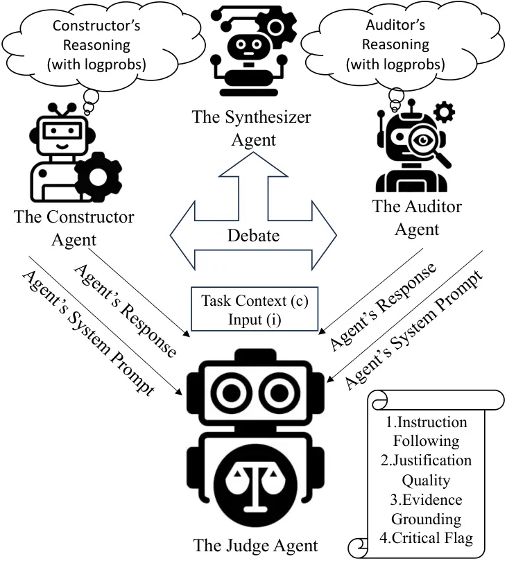
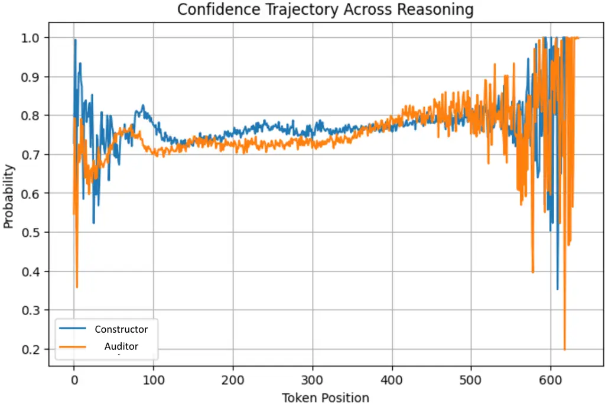

# The Confident Liar: Diagnosing Multi-Agent Debate with Log-Probabilities and LLM-as-Judge

Ali Keramati    Justin Cheok    Jacob Horne    Mark Warschauer
Affiliation: University of California, Irvine
Email: [{a.kera,jcheok,jhorne1,markw}@uci.edu](mailto:)

###### Abstract

Multi-agent debate systems are typically evaluated only on whether the
final answer is correct, overlooking the quality of the intermediate
reasoning that debate is designed to produce. This paper studies the
relationship between three signals in multi-agent debate: token-level
log-probability distributions over reasoning tokens, LLM-as-judge rubric
scores assigned to those tokens, and final task accuracy. We examine
whether internal confidence signals predict externally evaluated
reasoning quality, and whether either signal aligns with task
correctness, across three domains: rubric-based scoring, mathematical
reasoning, and factual question answering. Our framework pairs a
two-agent debate architecture —a Constructor and an Auditor—with an
LLM-as-judge that scores each agent’s reasoning along instruction
following, justification quality, and evidence grounding, together with
a critical-failure flag. Experiments in the rubric-scoring domain reveal
a consistent four-phase confidence trajectory and a substantial role
asymmetry: confidence aligns with judged reasoning quality roughly twice
as strongly for the Constructor as for the Auditor, and confidence-based
detection of critical reasoning failures is markedly more reliable for
the Constructor (AUROC 0.804) than for the Auditor (0.634). These
findings motivate the broader cross-domain investigation proposed in
this paper.

## 1 Introduction

The rapid advancement of large language models (LLMs) has led to the
emergence of multi-agent systems, where multiple specialized agents
collaborate to solve complex tasks Wu et al. (2023). Such systems have
been shown to improve performance, robustness, and consistency across a
wide range of applications, including reasoning, planning, and automated
decision-making Parmar et al. (2025). By decomposing tasks into
role-specific subtasks, multi-agent frameworks enable more structured
exploration of solution spaces compared to single-agent approaches
Fallah et al. (2024); Han et al. (2026). Among multi-agent interaction
protocols, _debate_ has emerged as a particularly compelling mechanism:
by eliciting both supporting and opposing arguments, debate encourages
exploration of multiple reasoning pathways and can surface failure modes
that remain hidden in a single trajectory Du et al. (2023).

Despite their promise, multi-agent debate systems raise a fundamental
evaluation challenge. In most settings, the only signal used to assess
agent behavior is whether the final answer matches a reference answer,
yet this binary signal fails to capture the quality, coherence, or
reliability of the intermediate reasoning produced during debate. An
agent may reach a correct answer through flawed reasoning, or produce a
thoughtful argument that leads to a marginally incorrect conclusion.
Evaluating only the endpoint discards the rich intermediate trace that
debate was specifically designed to elicit. This is not merely a
theoretical concern: as multi-agent pipelines grow in complexity,
emergent failure modes may be invisible to accuracy-based metrics yet
detectable in the structure of agents’ reasoning Wynn et al. (2025).

A growing body of work addresses this need through _LLM-as-judge_
evaluation, in which a strong language model is prompted to score other
model outputs along specified criteria Zheng et al. (2023). LLM-as-judge
methods have become a scalable alternative to human evaluation for
open-ended tasks and have been extended with rubric-based and
fine-grained scoring protocols to assess intermediate reasoning rather
than only final outputs Ye et al. (2024); Chan et al. (2023). Applied to
debate, rubric-driven judging can evaluate whether an agent’s argument
is logically grounded, considers counterevidence, and engages
substantively with the task, dimensions that final accuracy alone cannot
capture Chen et al. (2025). However, an important open question remains:
do these external evaluations of reasoning quality reflect anything
systematic about the model’s own internal generation process?

To answer this, we turn to _confidence estimation_ via token-level
log-probabilities. Intuitively, if an agent follows a more coherent and
evidentially grounded reasoning path, the model should assign higher
probability mass to the tokens it generates along that path, yielding
more concentrated logprob trajectories. Conversely, uncertain or
contradictory reasoning may manifest as high entropy or spiky
probability distributions over reasoning tokens Quevedo et al. (2024);
Kang et al. (2025). This framing opens a direct empirical question: to
what extent do token-level log-probabilities of an agent’s reasoning
correlate with the quality of that reasoning as assessed by an external
LLM judge, and does either signal align with downstream task accuracy?

This paper proposes a systematic investigation of the relationship
between these three signals—log-probability distributions over reasoning
tokens, LLM-as-judge rubric scores applied to those tokens, and final
task accuracy—across a diverse set of multi-agent debate tasks. Rather
than focusing on any single domain, we study this triad of signals in a
general multi-agent debate setting, using application domains such as
rubric-based scoring, mathematical reasoning, and factual question
answering as test beds. Our goal is to characterize how and when
internal confidence signals align with externally assessed reasoning
quality, which tasks and debate configurations drive the greatest
divergence, and whether this divergence can be used diagnostically to
improve multi-agent system design. This paper addresses the following
key research questions:

##### RQ 1: Logprob Dynamics in Debate

- •
  RQ 1.1 How do token-level log-probability distributions evolve across
  debate turns, and do agents expressing more confident reasoning
  (higher logprobs) produce higher-quality arguments as assessed by an
  LLM judge?
- •
  RQ 1.2 Can log-probability-based features predict final task accuracy
  independently of the intermediate reasoning content?

##### RQ 2: LLM-as-Judge Evaluation of Debate Reasoning

- •
  RQ 2.1 How should rubric criteria be designed to evaluate intermediate
  reasoning tokens in multi-agent debate, and how consistent are LLM
  judges across different models and protocols?
- •
  RQ 2.2 To what extent do LLM-as-judge scores on intermediate reasoning
  correlate with final answer correctness across diverse tasks?

##### RQ 3: Cross-signal Correlation and Diagnostics

- •
  RQ 3.1 Is there a systematic correlation between logprob
  distributions, LLM-as-judge reasoning scores, and task accuracy, and
  does this correlation vary across task types, model families, or
  debate configurations?
- •
  RQ 3.2 Can divergence between internal confidence signals and external
  reasoning quality assessments be exploited to diagnose failure modes
  in multi-agent debate systems?

## 2 Related Work

### 2.1 Multi-Agent Debate and Reasoning

Multi-agent debate has been proposed as a mechanism to improve
factuality, consistency, and robustness in LLM systems by having
multiple models argue for and against candidate answers Du et al.
(2023). Empirical studies show that structured disagreement can reduce
hallucination and improve reasoning on benchmarks spanning mathematics,
logic, and question-answering Chen et al. (2025); Wynn et al. (2025).
Beyond pairwise debate, multi-agent frameworks such as AutoGen support
richer interaction topologies, enabling role specialization and more
elaborate deliberation Wu et al. (2023). However, this added complexity
creates new evaluation challenges: while debate generates rich
intermediate reasoning traces, most prior work still evaluates these
systems purely on final answer accuracy, leaving the quality of the
intermediate argumentation unassessed Han et al. (2026). Our work
directly targets this gap by pairing intermediate reasoning traces with
both LLM-as-judge rubric scores and model-internal log-probability
signals.

### 2.2 LLM-as-Judge Evaluation

Recent work has established LLM-as-judge as a practical paradigm for
evaluating open-ended generation when reference answers are weak or
unavailable, showing that strong proprietary models can often correlate
well with human judgments on instruction-following and related tasks
Chiang and Lee (2023); Dubois et al. (2025); Zheng et al. (2023); Fu et
al. (2024); Liu et al. (2023). Beyond coarse pairwise or scalar
judgments, a second line of work argues that evaluation should be more
structured and interpretable: FLASK introduces fine-grained, skill-based
assessment and shows that rubric-driven evaluation can improve both
interpretability and reliability over skill-agnostic scoring Ye et al.
(2024). More recent protocols incorporate chain-of-thought, multi-aspect
scoring, and multi-agent evaluators such as PRD and ChatEval, all of
which aim to elicit more reliable judgments Li et al. (2024); Chan et
al. (2023); Jeong et al. (2024).

At the same time, a growing meta-evaluation literature has documented
serious limitations: LLM judges exhibit verbosity and positional bias,
limited self-consistency, and sensitivity to prompting and protocol
design Wang et al. (2024); Zeng et al. (2024). REIFE demonstrates that
protocol gains depend strongly on the base evaluator and dataset, and
that reliable meta-evaluation requires diverse models and
human-annotated testbeds Liu et al. (2025). Similarly, fine-tuned
open-source judges such as JudgeLM, PandaLM, Auto-J, and Prometheus
perform well in-domain yet fall short of frontier models in
generalization and aspect-specific evaluation, suggesting they behave
more like task-specific classifiers than general evaluators Huang et al.
(2025). Our work intersects with this literature by applying
LLM-as-judge rubric evaluation specifically to intermediate reasoning
tokens in debate, a setting where neither final accuracy nor coarse
pairwise judgments adequately capture reasoning quality, and by
investigating whether judge scores on reasoning correlate with the
model’s own internal confidence signals.

### 2.3 Confidence Estimation and Uncertainty Quantification

Confidence estimation in LLMs has emerged as an important complement to
output evaluation, with prior work examining whether internal generation
signals can indicate when model reasoning is trustworthy. Studies in
calibration and uncertainty quantification show that neural
probabilities are informative but not inherently well calibrated, so
high model confidence does not always imply correctness Desai and
Durrett (2020); Kadavath et al. (2022); Quevedo et al. (2024). Even so,
token-level probabilities remain one of the most direct intrinsic
signals available during decoding, and a growing body of work uses
log-probability- and entropy-based features to detect hallucination,
factual errors, and uncertain generations Liu et al. (2022); Manakul et
al. (2023); Mallen et al. (2023). In parallel, work on self-evaluation
suggests that LLMs can sometimes report useful confidence judgments, but
that verbalized confidence may differ from the model’s underlying
uncertainty, particularly for multi-step reasoning tasks Kadavath et al.
(2022); Mavi et al. (2025). Recent overviews argue for scalable
uncertainty estimation methods that leverage intrinsic decoding-time
signals alongside downstream evaluation criteria Kang et al. (2025).

While this body of work has focused primarily on single-model generation
and final-answer uncertainty, our work extends these ideas to the
multi-agent debate setting. We study how logprob distributions behave
not only at the level of final outputs but across the full sequence of
intermediate reasoning tokens produced during multi-turn debate, and we
ask whether these distributions correlate with external quality signals
provided by an LLM judge.

## 3 Methodology

Figure 1 provides an overview of our framework, which operates across
three stages: (1) a multi-agent debate system that generates structured
reasoning over a task input, (2) a confidence extraction module that
captures token-level log-probability trajectories from each agent’s
generation, and (3) an LLM-as-judge meta-evaluation module that scores
each agent’s intermediate reasoning against rubric-based criteria.
Together, these stages produce three parallel signals for each debate
instance (logprob features, judge scores, and downstream task accuracy)
enabling us to study their joint distribution and mutual correlations.
This design directly addresses RQ 1–RQ 3 as outlined in Section 1.



Figure 1: Overview of the proposed framework. A multi-agent debate
system generates structured reasoning over a task input; token-level
log-probabilities are extracted alongside each generation; a separate
LLM-as-judge module scores the reasoning; and all three signals are
correlated and analyzed.

### 3.1 Problem Setting

Let $`\mathcal{X}`$ denote the set of task inputs and $`\mathcal{C}`$
the set of task contexts (e.g., rubric definitions, question prompts,
grading criteria, or reference information), with
$`y^{*}\in\mathcal{Y}`$ denoting the ground-truth label for each input.
We study a general multi-agent debate setting in which two argumentative
agents produce opposing or complementary arguments regarding a given
input $`x\in\mathcal{X}`$ conditioned on task context
$`c\in\mathcal{C}`$. A third agent, the Synthesizer, reads the completed
debate transcript and produces the final task output $`\hat{y}`$.

Formally, for each task instance $`(x,c,y^{*})`$, the debate system
produces a transcript

```math
\tau(x,c)=(a,\,k),
```

where $`a`$ denotes the first agent’s argument and $`k`$ the second
agent’s rebuttal. Each argument is generated by a language model
$`\theta`$ conditioned on the task input, context, and conversation
history; the model simultaneously produces a sequence of token-level
log-probabilities $`L=(\ell_{1},\dots,\ell_{T})`$ as an intrinsic
confidence signal. Given a collection of debate instances
$`\{(a_{i},k_{i},L_{i},q_{i},y^{*}_{i},\hat{y}_{i})\}`$, our objective
is to analyze the pairwise and joint relationships among:

- •
  $`L_{i}`$: the log-probability trajectory of the generating agent,
- •
  $`q_{i}`$: the LLM-as-judge score assigned to the agent’s reasoning,
  and
- •
  $`\mathbf{1}[\hat{y}_{i}=y^{*}_{i}]`$: the final task accuracy of the
  Synthesizer.

### 3.2 Task Domains

To ensure that our findings generalize beyond any single application, we
instantiate the debate framework across three task domains that span
different output structures and reasoning demands.

##### Rubric-Based Scoring.

The task is to assign a score to a textual input (e.g., an essay or
short answer) according to an explicit rubric. The context $`c`$
consists of rubric trait definitions and scoring ranges. This domain is
representative of settings where structured, multi-dimensional criteria
govern evaluation, such as automated essay scoring Dikli (2006) or
educational assessment. We use the ASAP dataset as a primary
benchmark.¹¹ 1
[https://www.kaggle.com/c/asap-aes](https://www.kaggle.com/c/asap-aes)
For short-answer scoring, the ASAP-SAS dataset is also a relevant
benchmark.²² 2
[https://www.kaggle.com/competitions/asap-sas](https://www.kaggle.com/competitions/asap-sas)

##### Mathematical and Logical Reasoning.

The task involves solving a multi-step reasoning problem where the
ground truth is a discrete answer. The context $`c`$ consists of the
problem statement and any relevant constraints. This domain tests
whether confidence signals are predictive when reasoning involves
precise, verifiable intermediate steps, and whether the judge’s
assessment of argument quality aligns with mathematical correctness. We
use GSM8K as a primary benchmark for this setting.³³ 3
[https://github.com/openai/grade-school-math](https://github.com/openai/grade-school-math)

##### Factual Question Answering.

The task is to answer a factual question, where the ground truth is a
specific entity or short phrase. The context $`c`$ may include retrieved
passages or background knowledge. This domain tests the framework in a
setting where agent arguments must appeal to factual evidence rather
than structural criteria, providing a complementary signal to the rubric
and reasoning domains. We use Natural Questions as a primary benchmark
for this setting.⁴⁴ 4
[https://ai.google.com/research/NaturalQuestions/](https://ai.google.com/research/NaturalQuestions/)

### 3.3 Agent Roles and Task-Specific Instantiation

We define two abstract, domain-agnostic agent roles that capture the
functional purpose of structured disagreement without presupposing the
nature of the task:

- •
  The Constructor produces a primary response: a candidate answer,
  solution, score, or position, together with the reasoning that
  supports it. The Constructor is designed to commit to a direction and
  develop it as fully and coherently as possible, making its reasoning
  explicit and traceable.
- •
  The Auditor reads the Constructor’s output and produces a critical
  second response. Rather than simply agreeing or disagreeing, the
  Auditor is tasked with _independently examining_ the reasoning for
  errors, gaps, unsupported claims, or overlooked alternatives, and must
  provide its own evidence-based justification for any challenge it
  raises.

These two roles preserve the core property of debate that motivates our
study, that structured disagreement produces richer and more diverse
reasoning traces than single-agent generation, while being sufficiently
abstract to admit meaningful instantiation across all three task
domains. A third agent, the Synthesizer, reads the completed exchange
and produces the final task output $`\hat{y}`$. The Synthesizer is held
constant across all domains and is excluded from the reasoning quality
and confidence analyses, as its output is evaluated directly against the
ground truth $`y^{*}`$. Table 1 summarizes how the Constructor and
Auditor are concretely instantiated in each task domain.

| Domain                     | Task Input $`x`$                                | Constructor                                                                                                                                                      | Auditor                                                                                                                                                                     |
| -------------------------- | ----------------------------------------------- | ---------------------------------------------------------------------------------------------------------------------------------------------------------------- | --------------------------------------------------------------------------------------------------------------------------------------------------------------------------- |
| Rubric-Based Scoring       | Essay or short answer + rubric trait definition | Advocate: argues for a specific score range by citing supporting evidence from the text; does not assign a final score                                           | Critic: challenges the Advocate’s reading by identifying weaknesses, omissions, or rubric misalignments in the text                                                         |
| Mathematical Reasoning     | Multi-step problem statement + constraints      | Solver: proposes a complete solution path with explicit intermediate steps; commits to a final answer                                                            | Verifier: independently checks each reasoning step for correctness, identifies the first error if present, and proposes an alternative derivation if the solution is flawed |
| Factual Question Answering | Question + optional retrieved passages          | Proponent: argues for a specific candidate answer by citing evidence from the context or background knowledge; explains why competing answers are less supported | Challenger: questions the Proponent’s evidence, raises alternative candidate answers, and argues for the most strongly supported alternative                                |

Table 1: Task-specific instantiation of the Constructor and Auditor
roles across the three task domains. The Synthesizer agent is held
constant across all domains and is not shown.

#### 3.3.1 Role Design Principles

Several design choices are shared across all instantiations and are
motivated by the goals of the study.

##### No final answer from Constructor or Auditor.

In the rubric scoring and QA domains, neither the Constructor nor the
Auditor is permitted to produce a final task output directly. This
constraint ensures that their generations consist _entirely_ of
reasoning tokens, making the log-probability trajectories we extract
(Section 3.4) reflective of argumentative reasoning rather than label
decoding. In the math domain, the Constructor is an exception: it must
produce a final numerical answer as part of its solution path, since the
answer is inseparable from the derivation. However, the _Verifier_ is
still prohibited from directly confirming or denying the answer without
showing its own working.

##### Independence of the Auditor.

The Auditor is explicitly instructed not to simply restate the
Constructor’s reasoning with superficial modifications. In the math
domain, the Verifier must rederive relevant steps independently before
issuing a judgment. In the scoring and QA domains, the Auditor must cite
specific textual or factual evidence distinct from that used by the
Constructor. This independence constraint is essential for ensuring that
the two agents’ log-probability distributions reflect genuinely
different reasoning paths, enabling meaningful comparison.

##### Structured output format.

All agents are prompted to organize their responses with explicit
labeled sections (e.g., Claim, Evidence, Reasoning, Conclusion), adapted
to each domain. This structure serves two purposes: it makes
dimension-level LLM-as-judge evaluation (Section 3.5) more reliable by
providing clear anchors for scoring, and it allows us to align
log-probability windows (Section 3.4) with specific functional phases of
the response in future work.

##### Adversarial vs. collaborative framing.

In the rubric and QA domains, the Constructor and Auditor are framed as
_adversarial_: the Auditor is incentivized to find flaws. In the math
domain, the Verifier is framed as _cooperative but skeptical_: its goal
is to verify correctness rather than to find a flaw at all costs, since
an incorrect verification is itself a failure mode we wish to detect.
This distinction means that the expected relationship between
Constructor and Auditor log-probability trajectories may differ across
domains, which we treat as an empirical question addressed in
Section 3.6.

#### 3.3.2 Prompt Design

Full system prompts for all agent instantiations across the three
domains are provided in Appendix A. All prompts share a common template
structure consisting of: (i) a role preamble that defines the agent’s
persona and objective, (ii) behavioral constraints specifying what the
agent must and must not do, (iii) the task input and context, (iv) the
prior turn(s) of the debate when applicable, and (v) an output format
specification. Role preambles are the only component that varies across
agents; all other components are held as consistent as possible to
isolate the effect of role assignment on generation behavior and
log-probability distributions.

### 3.4 Confidence Signals from Token Log-Probabilities

We operationalize internal model confidence using token-level
log-probabilities obtained during generation, addressing RQ 1.1 and RQ
1.2. For a generated response of $`T`$ tokens, the model produces a
log-probability at each decoding step:

```math
\ell_{t}=\log p(t_{t}\mid t_{<t},\,x,c),
```

where $`x`$ is the task input, $`c`$ is the task context, and $`t_{<t}`$
denotes preceding tokens. The resulting sequence
$`L=(\ell_{1},\dots,\ell_{T})`$ forms a log-probability trajectory over
the full response.

#### 3.4.1 Window-Based Segmentation

Rather than summarizing $`L`$ with a single global statistic, we extract
contiguous sub-sequences to examine how confidence evolves across
different phases of an agent’s generation. This temporal decomposition
allows us to test, for instance, whether opening claims or concluding
statements are generated with systematically different confidence than
the middle of the response. We use two complementary windowing
strategies:

##### Fixed-length windows.

For window size $`k`$:

```math
W_{\text{first}}(k)=(\ell_{1},\dots,\ell_{k}),
```

```math
W_{\text{last}}(k)=(\ell_{T-k+1},\dots,\ell_{T}).
```

##### Percentage-based windows.

To normalize across responses of varying length, we define windows as a
fraction $`\alpha\in(0,1]`$ of the total response:

```math
W_{\text{first}}(\alpha)=(\ell_{1},\dots,\ell_{\lfloor\alpha T\rfloor}),
```

```math
W_{\text{last}}(\alpha)=(\ell_{T-\lfloor\alpha T\rfloor+1},\dots,\ell_{T}).
```

#### 3.4.2 Statistical Aggregation

For each window $`W`$, we compute the following summary statistics:

##### Mean and median.

The mean reflects overall token likelihood, while the median provides a
robust central-tendency estimate that is less sensitive to outlier
tokens:

```math
\mu_{W}=\frac{1}{|W|}\sum_{\ell\in W}\ell,\qquad\tilde{\mu}_{W}=\mathrm{median}(W).
```

##### Minimum, maximum, and range.

$`\min(W)`$, $`\max(W)`$, and $`\mathrm{range}_{W}=\max(W)-\min(W)`$
bound the extent of confidence variation within the segment.

##### Variance and standard deviation.

These quantify the volatility of the generation process within a window,
which we hypothesize may indicate argumentative uncertainty:

```math
\sigma_{W}^{2}=\frac{1}{|W|}\sum_{\ell\in W}(\ell-\mu_{W})^{2},\qquad\sigma_{W}=\sqrt{\sigma_{W}^{2}}.
```

##### Trajectory slope.

We fit a linear regression to the log-probability sequence over the
window:

```math
\ell_{t}\approx\beta_{W}\,t+b_{W}.
```

The slope $`\beta_{W}`$ captures directional trends: $`\beta_{W}>0`$
indicates growing model confidence across the segment (e.g., the model
becomes more certain as the argument develops), while $`\beta_{W}<0`$
indicates declining confidence.

##### Entropy-based aggregation.

Beyond summary statistics of scalar log-probabilities, we also compute
the token-level entropy of the model’s full output distribution at each
decoding step:

```math
H_{t}=-\sum_{v\in V}p(v\mid t_{<t},x,c)\,\log p(v\mid t_{<t},x,c),
```

and aggregate the sequence $`\{H_{t}\}_{t=1}^{T}`$ over each window
$`W`$ using the same statistics defined above (mean, median, variance,
standard deviation, range, and slope), yielding entropy analogues such
as $`\mu^{H}_{W}`$ and $`\sigma^{H}_{W}`$. This provides a complementary
view of uncertainty that captures the spread of the model’s full
predictive distribution rather than only the probability assigned to the
chosen token Quevedo et al. (2024).

### 3.5 LLM-as-Judge Meta-Evaluation of Reasoning

Because the debating agents sometimes generate open-ended argumentative
reasoning, their outputs cannot be evaluated with reference-based
metrics. We therefore introduce a secondary evaluation stage in which a
separate language model judges the quality of each agent’s reasoning
along rubric-based dimensions, addressing RQ 2.1 and RQ 2.2.

#### 3.5.1 Prompt Reconstruction

For each agent response, we reconstruct the complete prompt context the
agent originally received, consisting of: (i) the agent’s system
instructions describing its role and behavioral constraints, (ii) the
task context $`c`$, (iii) the task input $`x`$, and (iv) the agent’s
generated response. Supplying this full context enables the evaluator to
assess both role adherence and the appropriateness of evidence use
within the specific task.

#### 3.5.2 Evaluation Dimensions

The meta-evaluator scores each response along three dimensions that are
designed to be applicable across all three task domains (Section 3.2):

##### Instruction Following.

Whether the agent maintained its assigned role throughout, avoided
prohibited behaviors (e.g., declaring a final answer directly), and
respected the task constraints specified in its system prompt.

##### Justification Quality.

Whether claims are supported by explicit reasoning steps that coherently
link evidence to conclusions, and whether the agent engages
substantively with the task rather than generating vague or generic
statements.

##### Evidence Grounding.

Whether the argument references concrete, specific information from the
task input, textual passages, numerical values, logical premises, or
retrieved facts, rather than appealing to unsupported generalizations.

#### 3.5.3 Scoring Protocol

Each dimension is scored on a three-point ordinal scale
($`1=\text{Low},\ 2=\text{Medium},\ 3=\text{High}`$), assigned
independently. The evaluator also raises a critical issue flag when the
response contains a severe failure that invalidates the reasoning,
including hallucinated evidence, major internal contradictions,
role-constraint violations, or incoherent output.

We compute an aggregate reasoning quality score:

```math
Q_{1}=s_{\text{instruction}}+s_{\text{justification}}+s_{\text{evidence}}.
```

If a critical failure is detected, the aggregate score is overridden:

```math
Q=\begin{cases}0&\text{if critical issue is present},\\
Q_{1}&\text{otherwise},\end{cases}
```

yielding a composite score $`Q\in[0,9]`$.

#### 3.5.4 Judge Consistency Analysis

To assess the reliability of the LLM judge itself we run each evaluation
prompt through multiple state-of-the-art models (e.g., GPT-5.5, Claude
Opus 4.7, Gemini 3 Pro) and compute inter-judge agreement using
Krippendorff’s $`\alpha`$ and rank correlation. We also run the same
judge model multiple times under non-zero temperature to estimate
intra-judge consistency. Dimension-level agreement is reported
separately to identify which aspects of reasoning quality are most
reliably assessable by automated judges, directly addressing RQ 2.1.

### 3.6 Cross-Signal Correlation Analysis

The central empirical goal of this work is to characterize the joint
distribution of logprob features, judge scores, and task accuracy. This
section describes how we operationalize this analysis to address RQ 3.1
and RQ 3.2.

#### 3.6.1 Pairwise Correlation

For each pair of signals, we compute Pearson and Spearman correlation
coefficients across all debate instances in a given domain. We use
$`\mu_{W}`$ and $`\sigma_{W}`$ to denote the mean and standard deviation
of an agent’s log-probability trajectory aggregated over a window $`W`$,
as defined in Section 3.4; unless otherwise stated, $`W`$ is taken to be
the full response (i.e., $`W=L`$). Specifically, we examine:

- •
  $`\rho(Q,\,\mu_{W})`$: correlation between judge score and the mean
  log-probability of the agent’s response.
- •
  $`\rho(Q,\,\sigma_{W})`$: correlation between judge score and the
  log-probability standard deviation (does more certain generation
  correspond to higher-quality reasoning?).
- •
  $`\rho(\mathbb{1}[\hat{y}=y^{*}],\,Q)`$: correlation between judge
  score and task accuracy (does high-quality intermediate reasoning
  predict correct final answers?).
- •
  $`\rho(\mathbb{1}[\hat{y}=y^{*}],\,\mu_{W})`$: direct logprob–accuracy
  correlation, bypassing the judge entirely.

#### 3.6.2 Divergence Detection

Beyond global correlations, we identify instances where the three
signals _diverge_, as these cases are diagnostically most informative
(RQ 3.2). We define three divergence conditions:

- •
  High-confidence, low-quality reasoning: $`\mu_{W}`$ is high but $`Q`$
  is low. These cases suggest the model generates with high internal
  certainty while producing reasoning the judge deems weak—a potential
  hallucination or overconfidence signature.
- •
  High-quality reasoning, incorrect answer: $`Q`$ is high but
  $`\hat{y}\neq y^{*}`$. These cases suggest that good intermediate
  argumentation does not always suffice for task success, pointing to
  failures in the Synthesizer’s integration of the debate.
- •
  Low-confidence, correct answer: $`\mu_{W}`$ is low but
  $`\hat{y}=y^{*}`$. These cases suggest the model can succeed despite
  internally uncertain reasoning, motivating caution in using logprobs
  alone as a quality proxy.

We analyze the prevalence of each divergence type across task domains
and debate roles, and we qualitatively inspect high-divergence instances
to characterize their failure modes.

#### 3.6.3 Stratification and Ablations

To assess whether correlations are stable or task-specific, we stratify
all analyses by: (i) task domain (Section 3.2), (ii) debate role, (iii)
model family and scale, and (iv) window position (first vs. last window
of the response). We also ablate the aggregation statistic (mean,
variance, slope) to determine which logprob features are most predictive
of judge scores and accuracy, and we test whether trajectory slope adds
predictive information beyond mean log-probability alone.

## 4 Experiments and Results

This section examines how token-level confidence behaves over the course
of multi-agent debate and how that behavior relates to externally judged
reasoning quality. We instantiate the framework in the rubric-based
scoring domain using the ASAP dataset: Constructor and Auditor responses
are generated by GPT-4o-mini with token-level log-probabilities recorded
during decoding, and each response is independently scored by a
GPT-5-mini judge along instruction following, justification quality, and
evidence grounding, together with a binary critical-failure flag. The
analysis proceeds in two stages.

### 4.1 Confidence Trajectories Across Reasoning

Figure 2 plots the mean token-level confidence trajectory of the
Constructor and Auditor agents across reasoning. Responses open at high
confidence, undergo a sharp decline within the first 50 tokens as
substantive reasoning begins, settle into a stable plateau through the
middle of the response, and become increasingly volatile near the end of
generation. The replication of this four-phase pattern under a
multi-agent debate setting suggests that the structural shape of
confidence dynamics is not an artifact of any single task or role
framing, but a more general property of how debating agents allocate
certainty over a generation.

Two features of the trajectory are particularly informative. First, the
role asymmetry between Constructor and Auditor is visible directly in
the trajectory rather than only in aggregate statistics: across the
plateau region (roughly tokens 100–400), the Constructor maintains
consistently higher token probability than the Auditor, with a stable
gap of approximately 0.05. This is consistent with the interpretation
that supportive reasoning unfolds along a more committed and predictable
path, while adversarial reasoning navigates a wider space of candidate
critiques. Second, the late-response region (tokens 550+) exhibits
substantially greater volatility than the rest of the trajectory, with
both agents oscillating sharply between near-certain and low-confidence
tokens. This tail behavior, which is partially obscured when
trajectories are summarized by length-normalized averages, raises the
possibility that the closing portion of a debate response carries
diagnostic information that has so far been underutilized.



Figure 2: Mean token-level confidence trajectories for Constructor and
Auditor responses. Both agents follow a four-phase
pattern—high-confidence opening, sharp early decline, stable
mid-response plateau, and volatile late-response region.

### 4.2 Cross-Signal Correlations Across Reasoning Dimensions

Beyond the macro-trajectory structure, we summarize the strength of the
relationship between intrinsic confidence signals and externally judged
reasoning quality, addressing RQ 1.1 and RQ 3.2. Table 2 aggregates
results across both ASAP essay sets, with each cell reporting the
strongest correlation observed for the corresponding role–dimension pair
after a sweep over the window-based confidence features defined in
Section 3.

Three patterns emerge from the aggregated results. First, every
role–dimension pair exhibits a positive and nontrivial alignment between
confidence and judged quality, supporting the central premise of RQ 1.1:
token-level log-probability statistics carry information about reasoning
quality that is detectable by an external evaluator. Second, the role
asymmetry first observed in the trajectory analysis is now quantified at
the correlation level. The Constructor’s mean correlation across
reasoning dimensions ($`\bar{\rho}=0.335`$) is roughly twice that of the
Auditor ($`\bar{\rho}=0.177`$), and the gap is preserved across every
individual dimension. Third, the critical-failure AUROC is substantially
higher for the Constructor ($`0.804`$) than for the Auditor ($`0.634`$),
suggesting that confidence-based diagnostics are most powerful for
hallucination-style failures and least useful for procedural violations
whose token-level signature is more subtle.

|                                      |                |         |
| ------------------------------------ | -------------- | ------- |
| Reasoning quality dimension          | Constructor    | Auditor |
| Instruction Following ($`\rho`$)     | 0.384          | 0.170   |
| Justification Quality ($`\rho`$)     | 0.319          | 0.231   |
| Evidence Grounding ($`\rho`$)        | 0.289          | 0.103   |
| Aggregate Score ($`\rho`$)           | 0.350          | 0.202   |
| Critical Failure (AUROC)             | 0.804          | 0.634   |
| Mean role correlation $`\bar{\rho}`$ | 0.335          | 0.177   |
| Asymmetry ratio (C/A)                | $`1.89\times`$ |         |

Table 2: Preliminary cross-signal results aggregated across
rubric-scoring experiments. Each cell reports the mean of the strongest
per-set values, where ordinal-target rows are Spearman $`\rho`$ between
the top token-level confidence proxy and the LLM-as-judge score for that
dimension, and the critical-failure row is AUROC. Constructor and
Auditor refer to the rubric-domain instantiations of the abstract debate
roles defined in Section 3.

Taken together, the trajectory and correlation analyses point in the
same direction: confidence signals reflect reasoning quality more
reliably for supportive than for adversarial argumentation, the most
informative regions of the response lie at its boundaries rather than
its middle, and critical failures leave detectable token-level
signatures whose strength depends on the failure mode. At the same time,
these results reflect a single domain (rubric-based scoring), a single
model family (GPT-4o-mini for generation, GPT-5-mini for judging), and a
single judge instance, and therefore cannot speak to whether
confidence–quality alignment generalizes across reasoning types, whether
the observed correlations transfer to settings where the ground truth is
verifiable rather than rubric-defined, or whether the LLM judge itself
is consistent across model families and protocols .

## 5 Conclusion

This paper proposes a framework for evaluating intermediate reasoning in
multi-agent debate by jointly analyzing token-level log-probabilities,
LLM-as-judge rubric scores, and task accuracy across rubric scoring,
mathematical reasoning, and factual question answering. Experiments in
the rubric domain reveal a consistent four-phase confidence trajectory
and a substantial role asymmetry: confidence aligns with judged quality
roughly twice as strongly for supportive (Constructor) as for
adversarial (Auditor) reasoning, with a parallel gap in critical-failure
detection. Extending this analysis to mathematical reasoning and factual
question answering, alongside multi-judge consistency checks and
divergence-based diagnostics, will inform the design of more
interpretable and trustworthy debate architectures.

## Acknowledgments

This paper is based upon work supported by the National Science
Foundation under Grant No. 2315294.

## Limitations

Several limitations constrain the interpretation and generalizability of
the findings presented in this work. Although the proposed framework is
designed to operate across multiple domains, the current empirical
results remain narrow in scope, covering only a small set of benchmark
tasks, datasets, and debate configurations. While rubric-based scoring,
mathematical reasoning, and factual question answering capture distinct
forms of reasoning behavior, they do not represent the full range of
environments in which multi-agent systems are deployed, such as
long-context reasoning, multimodal tasks, retrieval-heavy workflows,
code generation, planning, or interactive decision-making. All reported
experiments also use a single model family for both generation and
judging, leaving open whether the observed dynamics reflect properties
of debate itself or of a specific decoder.

The debate architecture is also intentionally simplified, relying on two
agents and a single Synthesizer with fixed interaction order and limited
debate depth. Real-world multi-agent systems often involve iterative
refinement, retrieval augmentation, memory mechanisms, and more complex
communication structures that may produce substantially different
confidence dynamics.

Finally, intermediate reasoning traces and token-level confidence
signals may not faithfully reflect the internal computation responsible
for a model’s final answer, meaning that both log-probability
trajectories and LLM-as-judge evaluations could capture post hoc
rationalizations rather than genuine reasoning processes. The observed
relationships between confidence, judged reasoning quality, and
downstream accuracy should therefore be interpreted cautiously, and
future work should expand the framework across broader datasets, models,
prompting paradigms, and interaction structures.

## References

- Chan et al. (2023) C. Chan, W. Chen, Y. Su, J. Yu, W. Xue, S.
  Zhang, J. Fu, and Z. Liu ChatEval: towards better llm-based evaluators
  through multi-agent debate. External Links: 2308.07201,
  [Link](https://arxiv.org/abs/2308.07201) Cited by: §1, §2.2.
- Chen et al. (2025) J. Chen, Y. Lu, X. Wang, H. Zeng, J. Huang, J.
  Gesi, Y. Xu, B. Yao, and D. Wang Multi-agent-as-judge: aligning
  llm-agent-based automated evaluation with multi-dimensional human
  evaluation. External Links: 2507.21028,
  [Link](https://arxiv.org/abs/2507.21028) Cited by: §1, §2.1.
- Chiang and Lee (2023) C. Chiang and H. Lee Can large language models
  be an alternative to human evaluations?. In Proceedings of the 61st
  Annual Meeting of the Association for Computational Linguistics
  (Volume 1: Long Papers), A. Rogers, J. Boyd-Graber, and N. Okazaki
  (Eds.), Toronto, Canada, pp. 15607–15631. External Links:
  [Link](https://aclanthology.org/2023.acl-long.870/),
  [Document](https://dx.doi.org/10.18653/v1/2023.acl-long.870) Cited by:
  §2.2.
- Desai and Durrett (2020) S. Desai and G. Durrett Calibration of
  pre-trained transformers. In Proceedings of the 2020 Conference on
  Empirical Methods in Natural Language Processing (EMNLP), B.
  Webber, T. Cohn, Y. He, and Y. Liu (Eds.), Online, pp. 295–302.
  External Links: [Link](https://aclanthology.org/2020.emnlp-main.21/),
  [Document](https://dx.doi.org/10.18653/v1/2020.emnlp-main.21) Cited
  by: §2.3.
- Dikli (2006) S. Dikli An overview of automated scoring of essays. The
  Journal of Technology, Learning and Assessment 5 (1). External Links:
  [Link](https://ejournals.bc.edu/index.php/jtla/article/view/1640)
  Cited by: §3.2.
- Du et al. (2023) Y. Du, S. Li, A. Torralba, J. B. Tenenbaum, and I.
  Mordatch Improving factuality and reasoning in language models through
  multiagent debate. External Links: 2305.14325,
  [Link](https://arxiv.org/abs/2305.14325) Cited by: §1, §2.1.
- Dubois et al. (2025) Y. Dubois, B. Galambosi, P. Liang, and T. B.
  Hashimoto Length-controlled alpacaeval: a simple way to debias
  automatic evaluators. External Links: 2404.04475,
  [Link](https://arxiv.org/abs/2404.04475) Cited by: §2.2.
- Fallah et al. (2024) A. Fallah, A. Keramati, M. A. Nazari, and F. S.
  Mirfazeli Automating theory of mind assessment with a llama-3-powered
  chatbot: enhancing faux pas detection in autism. In 2024 14th
  International Conference on Computer and Knowledge Engineering
  (ICCKE), Vol. , pp. 365–372. External Links:
  [Document](https://dx.doi.org/10.1109/ICCKE65377.2024.10874775) Cited
  by: §1.
- Fu et al. (2024) J. Fu, S. Ng, Z. Jiang, and P. Liu GPTScore: evaluate
  as you desire. In Proceedings of the 2024 Conference of the North
  American Chapter of the Association for Computational Linguistics:
  Human Language Technologies (Volume 1: Long Papers), K. Duh, H. Gomez,
  and S. Bethard (Eds.), Mexico City, Mexico, pp. 6556–6576. External
  Links: [Link](https://aclanthology.org/2024.naacl-long.365/),
  [Document](https://dx.doi.org/10.18653/v1/2024.naacl-long.365) Cited
  by: §2.2.
- Han et al. (2026) S. Han, Q. Zhang, W. Jin, and Z. Xu LLM multi-agent
  systems: challenges and open problems. External Links: 2402.03578,
  [Link](https://arxiv.org/abs/2402.03578) Cited by: §1, §2.1.
- Huang et al. (2025) H. Huang, X. Bu, H. Zhou, Y. Qu, J. Liu, M.
  Yang, B. Xu, and T. Zhao An empirical study of LLM-as-a-judge for LLM
  evaluation: fine-tuned judge model is not a general substitute for
  GPT-4. In Findings of the Association for Computational Linguistics:
  ACL 2025, W. Che, J. Nabende, E. Shutova, and M. T. Pilehvar (Eds.),
  Vienna, Austria, pp. 5880–5895. External Links:
  [Link](https://aclanthology.org/2025.findings-acl.306/),
  [Document](https://dx.doi.org/10.18653/v1/2025.findings-acl.306), ISBN
  979-8-89176-256-5 Cited by: §2.2.
- Jeong et al. (2024) H. Jeong, C. Park, J. Hong, and J. Choo PRePair:
  pointwise reasoning enhance pairwise evaluating for robust
  instruction-following assessments. External Links:
  [Document](https://dx.doi.org/10.48550/arXiv.2406.12319) Cited by:
  §2.2.
- Kadavath et al. (2022) S. Kadavath, T. Conerly, A. Askell, T.
  Henighan, D. Drain, E. Perez, N. Schiefer, Z. Hatfield-Dodds, N.
  DasSarma, E. Tran-Johnson, S. Johnston, S. El-Showk, A. Jones, N.
  Elhage, T. Hume, A. Chen, Y. Bai, S. Bowman, S. Fort, D. Ganguli, D.
  Hernandez, J. Jacobson, J. Kernion, S. Kravec, L. Lovitt, K.
  Ndousse, C. Olsson, S. Ringer, D. Amodei, T. Brown, J. Clark, N.
  Joseph, B. Mann, S. McCandlish, C. Olah, and J. Kaplan Language models
  (mostly) know what they know. External Links: 2207.05221,
  [Link](https://arxiv.org/abs/2207.05221) Cited by: §2.3.
- Kang et al. (2025) Z. Kang, X. Zhao, and D. Song Scalable best-of-n
  selection for large language models via self-certainty. In 2nd AI for
  Math Workshop @ ICML 2025, External Links:
  [Link](https://openreview.net/forum?id=nddwJseiiy) Cited by: §1, §2.3.
- Li et al. (2024) R. Li, T. Patel, and X. Du PRD: peer rank and
  discussion improve large language model based evaluations. External
  Links: 2307.02762, [Link](https://arxiv.org/abs/2307.02762) Cited by:
  §2.2.
- Liu et al. (2022) T. Liu, Y. Zhang, C. Brockett, Y. Mao, Z. Sui, W.
  Chen, and B. Dolan A token-level reference-free hallucination
  detection benchmark for free-form text generation. In Proceedings of
  the 60th Annual Meeting of the Association for Computational
  Linguistics (Volume 1: Long Papers), S. Muresan, P. Nakov, and A.
  Villavicencio (Eds.), Dublin, Ireland, pp. 6723–6737. External Links:
  [Link](https://aclanthology.org/2022.acl-long.464/),
  [Document](https://dx.doi.org/10.18653/v1/2022.acl-long.464) Cited by:
  §2.3.
- Liu et al. (2023) Y. Liu, D. Iter, Y. Xu, S. Wang, R. Xu, and C. Zhu
  G-eval: NLG evaluation using gpt-4 with better human alignment. In
  Proceedings of the 2023 Conference on Empirical Methods in Natural
  Language Processing, H. Bouamor, J. Pino, and K. Bali (Eds.),
  Singapore, pp. 2511–2522. External Links:
  [Link](https://aclanthology.org/2023.emnlp-main.153/),
  [Document](https://dx.doi.org/10.18653/v1/2023.emnlp-main.153) Cited
  by: §2.2.
- Liu et al. (2025) Y. Liu, K. Shi, A. Fabbri, Y. Zhao, P. Wang, C.
  Wu, S. Joty, and A. Cohan ReIFE: re-evaluating instruction-following
  evaluation. In Proceedings of the 2025 Conference of the Nations of
  the Americas Chapter of the Association for Computational Linguistics:
  Human Language Technologies (Volume 1: Long Papers), L. Chiruzzo, A.
  Ritter, and L. Wang (Eds.), Albuquerque, New Mexico, pp. 12247–12287.
  External Links: [Link](https://aclanthology.org/2025.naacl-long.610/),
  [Document](https://dx.doi.org/10.18653/v1/2025.naacl-long.610), ISBN
  979-8-89176-189-6 Cited by: §2.2.
- Mallen et al. (2023) A. Mallen, A. Asai, V. Zhong, R. Das, D.
  Khashabi, and H. Hajishirzi When not to trust language models:
  investigating effectiveness of parametric and non-parametric memories.
  In Proceedings of the 61st Annual Meeting of the Association for
  Computational Linguistics (Volume 1: Long Papers), A. Rogers, J.
  Boyd-Graber, and N. Okazaki (Eds.), Toronto, Canada, pp. 9802–9822.
  External Links: [Link](https://aclanthology.org/2023.acl-long.546/),
  [Document](https://dx.doi.org/10.18653/v1/2023.acl-long.546) Cited by:
  §2.3.
- Manakul et al. (2023) P. Manakul, A. Liusie, and M. Gales
  SelfCheckGPT: zero-resource black-box hallucination detection for
  generative large language models. In Proceedings of the 2023
  Conference on Empirical Methods in Natural Language Processing, H.
  Bouamor, J. Pino, and K. Bali (Eds.), Singapore, pp. 9004–9017.
  External Links: [Link](https://aclanthology.org/2023.emnlp-main.557/),
  [Document](https://dx.doi.org/10.18653/v1/2023.emnlp-main.557) Cited
  by: §2.3.
- Mavi et al. (2025) V. Mavi, S. Jaroria, and W. Sun Self-evaluating
  llms for multi-step tasks: stepwise confidence estimation for failure
  detection. External Links: 2511.07364,
  [Link](https://arxiv.org/abs/2511.07364) Cited by: §2.3.
- Parmar et al. (2025) M. Parmar, X. Liu, P. Goyal, Y. Chen, L. Le, S.
  Mishra, H. Mobahi, J. Gu, Z. Wang, H. Nakhost, C. Baral, C. Lee, T.
  Pfister, and H. Palangi PlanGEN: a multi-agent framework for
  generating planning and reasoning trajectories for complex problem
  solving. External Links: 2502.16111,
  [Link](https://arxiv.org/abs/2502.16111) Cited by: §1.
- Quevedo et al. (2024) E. Quevedo, J. Yero, R. Koerner, P. Rivas,
  and T. Cerny Detecting hallucinations in large language model
  generation: a token probability approach. External Links: 2405.19648,
  [Link](https://arxiv.org/abs/2405.19648) Cited by: §1, §2.3, §3.4.2.
- Wang et al. (2024) P. Wang, L. Li, L. Chen, Z. Cai, D. Zhu, B. Lin, Y.
  Cao, L. Kong, Q. Liu, T. Liu, and Z. Sui Large language models are not
  fair evaluators. In Proceedings of the 62nd Annual Meeting of the
  Association for Computational Linguistics (Volume 1: Long Papers), L.
  Ku, A. Martins, and V. Srikumar (Eds.), Bangkok, Thailand,
  pp. 9440–9450. External Links:
  [Link](https://aclanthology.org/2024.acl-long.511/),
  [Document](https://dx.doi.org/10.18653/v1/2024.acl-long.511) Cited by:
  §2.2.
- Wu et al. (2023) Q. Wu, G. Bansal, J. Zhang, Y. Wu, B. Li, E. Zhu, L.
  Jiang, X. Zhang, S. Zhang, J. Liu, A. H. Awadallah, R. W. White, D.
  Burger, and C. Wang AutoGen: enabling next-gen llm applications via
  multi-agent conversation. External Links: 2308.08155,
  [Link](https://arxiv.org/abs/2308.08155) Cited by: §1, §2.1.
- Wynn et al. (2025) A. Wynn, H. Satija, and G. Hadfield Talk isn’t
  always cheap: understanding failure modes in multi-agent debate.
  External Links: 2509.05396, [Link](https://arxiv.org/abs/2509.05396)
  Cited by: §1, §2.1.
- Ye et al. (2024) S. Ye, D. Kim, S. Kim, H. Hwang, S. Kim, Y. Jo, J.
  Thorne, J. Kim, and M. Seo FLASK: fine-grained language model
  evaluation based on alignment skill sets. External Links: 2307.10928,
  [Link](https://arxiv.org/abs/2307.10928) Cited by: §1, §2.2.
- Zeng et al. (2024) Z. Zeng, J. Yu, T. Gao, Y. Meng, T. Goyal, and D.
  Chen Evaluating large language models at evaluating instruction
  following. External Links: 2310.07641,
  [Link](https://arxiv.org/abs/2310.07641) Cited by: §2.2.
- Zheng et al. (2023) L. Zheng, W. Chiang, Y. Sheng, S. Zhuang, Z.
  Wu, Y. Zhuang, Z. Lin, Z. Li, D. Li, E. P. Xing, H. Zhang, J. E.
  Gonzalez, and I. Stoica Judging llm-as-a-judge with mt-bench and
  chatbot arena. In Proceedings of the 37th International Conference on
  Neural Information Processing Systems, NIPS ’23, Red Hook, NY, USA.
  Cited by: §1, §2.2.

## Appendix A Agent Prompt Templates

This appendix provides the system instructions for all agents in the
multi-agent debate framework. All prompts are implemented as templates
rendered at runtime using a shared context dictionary containing the
task input $`x`$, task context $`c`$, and valid output range where
applicable. The Constructor and Auditor receive only their own turn; the
Synthesizer receives the full debate transcript. The LLM-as-judge
meta-evaluator receives the original agent system prompt, the task
context, and the agent response being evaluated.

Prompts were developed through iterative piloting to enforce role
adherence, prevent premature answer generation, and maintain output
consistency across domains. The Constructor and Auditor share a common
template structure—role preamble, behavioral constraints, task context,
prior debate turn (Auditor only), and output format—with only the role
preamble varying across agents and domains.

### A.1 Constructor Agent

The Constructor produces the primary argument or solution for a given
task instance, committing to a direction and developing it with explicit
reasoning and evidence. It is prohibited from producing a final task
output in the rubric scoring and QA domains; in the math domain it must
show a complete derivation. The domain-specific persona is injected via
\$ROLE_PREAMBLE.


Figure 3: System instructions for the Constructor agent. The
\$ROLE_PREAMBLE slot is replaced with the domain-specific block at
runtime.

### A.2 Auditor Agent

The Auditor reads the Constructor’s output and produces an independent
critical response. It must not simply restate or paraphrase the
Constructor’s reasoning; in the math domain it must rederive relevant
steps before issuing a judgment.


Figure 4: System instructions for the Auditor agent.

### A.3 Synthesizer Agent

The Synthesizer reads the completed debate transcript and produces the
final task output. It is held constant across all domains and its output
is evaluated directly against $`y^{*}`$.


Figure 5: System instructions for the Synthesizer agent.

### A.4 LLM-as-Judge Meta-Evaluator

The meta-evaluator scores the Constructor’s and Auditor’s responses
along three dimensions: instruction following, justification quality,
and evidence grounding, each on a three-point ordinal scale (1 = Weak,
2 = Adequate, 3 = Strong). It also raises a critical issue flag for
severe failures. Crucially, the meta-evaluator is instructed to evaluate
only the _quality of the agent’s reasoning_, not the correctness of the
task output or the content of the essay, problem, or passage. The
evaluation dimensions are intentionally kept consistent across domains
so that judge scores are comparable across rubric scoring, math, and QA.


Figure 6: System instructions for the meta-evaluator agent.


Figure 7: Task prompt provided to the meta-evaluator at runtime.
