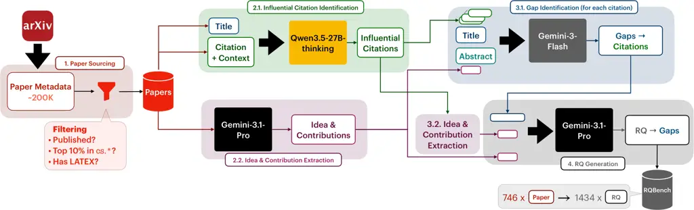

\runningstatus

Under review 1\]DeCLaRe Lab, Nanyang Technological University
\hfdatasetrq-bench \correspondenceSoujanya Poria ()

# On the Limits of LLM-as-Judge for Scientific Novelty Assessment

Soumitra Sinhahajari    Navonil Majumder    Soujanya Poria Affiliation:
\[ Email: <soujanya.poria@ntu.edu.sg>

August 24, 2026

###### Abstract

LLMs are increasingly used to generate and judge scientific ideas. This
makes novelty evaluation a central problem. Full idea evaluation is
difficult because it often requires judging a method, its feasibility,
and its empirical promise. We therefore study a cleaner upstream object:
the research question (RQ). RQ generation is a prerequisite for
scientific ideation, and RQs can be compared against questions pursued
in real papers. We introduce RQ-Bench, a benchmark built from recent
arXiv papers. For each paper, we reconstruct author-anchored RQs from
its cited background, gaps, and contributions. These RQs are not the
only valid questions for the same background. They are author-anchored
reference points for testing novelty judgments. We evaluate
model-generated RQs with standalone LLM judging, comparative LLM
judging, and human expert evaluation. LLM judges consistently rate
model-generated RQs as highly novel, producing a _novelty mirage_; in
comparative evaluations, this preference becomes even stronger. Domain
experts, however, reach the opposite conclusion and prefer the
author-anchored reference questions. We further find that many generated
RQs are narrow or source-bound, a dimension that LLM judges often miss
unless explicitly tested. Overall, the contradictory novelty evaluations
between LLM judges and human experts raise a serious concern about the
reliability of using LLMs to assess the scientific novelty of research
questions.

## 1 Introduction

LLMs are now used not only to generate scientific ideas, but also to
judge them. This led us to ask: what are the limits of LLM-as-judge for
evaluating scientific novelty? If LLMs generate a scientific artifact
and other LLMs judge its novelty, the whole pipeline depends on whether
LLM-as-judge is reliable. This is especially important for “AI
scientist” systems, where LLM agents retrieve papers, propose ideas,
design experiments, and draft manuscripts Lu et al. (2024); Yamada et
al. (2025); Baek et al. (2024).

Most existing work evaluates the final research idea. This is hard. A
full idea may sound novel, but judging it often requires checking the
method, feasibility, experiments, baselines, and likely impact. This is
a long-tailed evaluation problem. We therefore study a simpler but still
central object: the research question (RQ). A good RQ comes before a
good idea. It asks what should be studied before a method is proposed.

Classical accounts of research also place question formulation before
the final argument. Booth et al. (2008) describe research as a movement
from _topic_ to _question_ to _problem_ to _argument_. In practice,
however, gaps, questions, and ideas are often mixed together. Figure 1
shows the difference:

- •
  A _gap_ is a missing piece in the literature, such as an unanswered
  question, an unresolved disagreement, or an untested assumption.
- •
  A _research question_ is the question that opens a space for
  investigation. It does not yet commit to a method or an answer.
- •
  An _idea_ is a proposed method, framework, or approach for answering
  one or more RQs.

Existing benchmarks for LLM-driven scientific ideation usually start
from a human-provided topic, scope, or question. IdeaBench Guo et al.
(2024) uses curated background papers. ResearchBench Liu et al. (2025)
and Si et al. (2024) evaluate later research stages, but they still
depend on a predefined question or topic. These settings are useful, but
they bypass an earlier step: can a model infer a meaningful RQ from
prior literature, and can LLM judges reliably assess its novelty?

We introduce RQ-Bench to study this question. For each target paper, we
collect influential cited works and local citation contexts. We then
extract the gaps used by the authors and reconstruct the RQs addressed
by the paper. We call these _author-anchored RQs_. They are used as
reference RQs. They are not the only valid RQs that could be asked from
the same background. A background can support many good questions. The
author-anchored RQ is useful because it gives a human reference point:
it was pursued by real authors and led to a real paper.

Using this setup, we test the reliability of LLM novelty judgments. We
compare model-generated RQs against author-anchored RQs under three
views: standalone LLM scoring, comparative LLM scoring, and human expert
evaluation. We also study the scope of generated RQs. This matters
because an RQ can be polished and gap-shaped, but still be too narrow,
source-bound, or diagnostic to open a strong research direction.

Our study asks the following questions:

- •
  Novelty judging: Do LLM judges give stable novelty judgments for
  scientific RQs?
- •
  Reference comparison: Do model-generated RQs appear more novel than
  author-anchored RQs under standalone and comparative evaluation?
- •
  Human alignment: Do LLM judges agree with human experts when they
  compare the same RQs?
- •
  Scope: Are LLM-generated RQs broad enough, or are they narrow and
  source-bound?
- •
  Author-anchor overlap: Do models reproduce the author-pursued
  direction, or do they mainly generate alternatives?

Our findings are as follows. First, LLM judges assigned high novelty
scores to model-generated RQs in the standalone setting and preferred
them over author-anchored RQs. Second, comparative judging amplified
this, as shown by the sharp increase in win rates. Third, human experts
preferred author-anchored RQs far more often than LLM judges did.
Fourth, experts found that model generated RQs are narrow or
source-bound. When we evaluated narrowness explicitly, the results
aligned with experts’ non-obviousness judgments. This suggests that
narrowness is an important dimension missing from current novelty
evaluations by LLMs. Finally, low author-anchor overlap should not be
read as failure by itself. It mainly shows that models often generate
alternatives rather than the direction pursued by the paper. The larger
problem is whether those alternatives are judged reliably.


Figure 1: Example of gap-grounded RQ formulation. Prior-work gaps
motivate a research question, which is then addressed by the paper’s
concrete idea and contributions.

## 2 Related Work

#### Autonomous Scientific Discovery.

Automated scientific discovery has evolved from early rule-based systems
Langley et al. (1987); Buchanan and Shortliffe (1984); Lenat (1983) and
domain-specific machine learning King et al. (2009); Schmidt and Lipson
(2009); Jumper et al. (2021); Merchant and others (2023) to modern
foundation models. Recent systems frame LLMs as _AI scientists_ that can
propose ideas, write code, run experiments, and draft papers Lu et al.
(2024); Yamada et al. (2025); Beel et al. (2025). Other systems add
multiple agents, web search, or critique loops Baek et al. (2024);
Authors (2025); Google Research (2025). These systems usually begin at
ideation. They often assume that the research question or topic is
already given.

#### LLM Ideation and Research Benchmarks.

Existing benchmarks mainly evaluate downstream scientific artifacts.
IdeaBench Guo et al. (2024), AI Idea Bench Qiu and others (2025), and
LiveIdeaBench Ruan et al. (2024) evaluate generated ideas from curated
papers or topics. ResearchBench Liu et al. (2025) and DiscoveryBench
Majumder and others (2024) evaluate hypothesis composition and
data-driven reasoning. These tasks are important, but full idea
evaluation is hard because it can require judging feasibility, method
quality, experiments, and impact. RQ generation is a cleaner upstream
testbed. It still requires novelty judgment, but it does not require
judging a full method.

#### LLM-as-Judge for Scientific Novelty.

LLM-as-judge is widely used because open-ended generations are hard to
score automatically. But scientific novelty is different from many
standard evaluation tasks. It is high-level, partly subjective, and
sensitive to framing. Even human peer review can show disagreement, so a
single novelty score should not be treated as absolute. Still, a useful
judge should show stable trends across evaluation formats and should not
sharply disagree with expert humans. Our work studies this reliability
question in the RQ setting.

#### Research Question Formulation.

Question formulation is a central part of research. A research question
is not the same as a topic or a method. It turns a gap in prior work
into an object of inquiry. We use this distinction to build RQ-Bench and
to test whether LLMs and LLM-judges can handle the pre-ideation stage of
scientific work.

## 3 Formulation

Let $`P=\{p_{1},\ldots,p_{m}\}`$ be the background papers given to the
model. Let $`q`$ be a research question. We view RQ generation as a
two-step process. First, the model infers grounded gaps from the papers.
Then it writes an RQ from those gaps.

```math
P\rightarrow\mathcal{G}\rightarrow q,
```

where $`\mathcal{G}=\{g_{1},\ldots,g_{k}\}`$ is the set of inferred
gaps. This simple view is useful because an RQ should not be a free-form
idea. It should be grounded in prior work. At the same time, the model
may use its broader scientific knowledge when it connects the papers and
turns gaps into questions.

## 4 Benchmark Dataset Creation

Let $`M`$ denote a target paper. We first extract a set of influential
cited papers $`\mathcal{C}=\{c_{1},\ldots,c_{n}\}`$ and the target
paper’s main idea and contributions $`I`$. For each influential citation
$`c_{i}`$, we collect its local citation context $`x_{i}`$, consisting
of the citation sentence in $`M`$ and its surrounding sentences. Let
$`\mathcal{X}=\{x_{1},\ldots,x_{n}\}`$. We then infer grounded gaps
$`\mathcal{G}`$ that are both linked to the cited works and addressed by
the target paper’s idea and contributions. Finally, we derive the
research question $`q`$ from these grounded gaps:

```math
\mathcal{C}\sim p_{\phi}(\mathcal{C}\mid M),\qquad I\sim p_{\phi}(I\mid M),
```

```math
\mathcal{X}=f_{\mathrm{ctx}}(M,\mathcal{C}),
```

```math
\mathcal{G}\sim p_{\phi}(\mathcal{G}\mid\mathcal{C},\mathcal{X},I,M),\qquad q\sim p_{\phi}(q\mid\mathcal{G},I,M).
```

Here, $`\phi`$ denotes the LLM-assisted extraction and construction
pipeline as shown in Figure 2. The variable $`\mathcal{G}`$ ensures that
the resulting research question is not an unconstrained idea, but is
grounded in the way the target paper uses influential prior work to
motivate its own contributions.

The following sections detail our LLM-assisted pipeline that curates
recent arXiv computer science papers to extract influential citations,
core contributions, and grounded research gaps. These elements are
ultimately synthesized into a comprehensive benchmark dataset comprising
1,434 research questions derived from 746 source papers.



Figure 2: A high-level overview of the benchmark dataset-creation
pipeline.

#### Paper Sourcing.

The dataset is built from recent computer science papers (cs.AI, cs.CL,
$`\dots`$) on [https://arxiv.org](https://arxiv.org). In our current
version, we consider about $`\sim`$200K papers published between
01-01-2025 and 10-4-2026. Restricting the benchmark to papers that are
certainly unseen by all LLMs would reduce scale and coverage. We
therefore use recent papers and report author-anchor overlap as a
diagnostic. If a model memorizes a paper or its RQ, this score should be
high. If the score is low, the model may be generating a different valid
question, or it may simply not recover the author-pursued direction.

#### Filtering.

The metadata of the above papers are retrieved with arxiv API, and we
keep only the top 10% papers with available LaTEX source from each
subfield of computer science (cs.\*) based on their citation counts as a
proxy for paper quality. Among these papers, we subsequently keep only
those published in a conference or a journal, as indexed by Semantic
Scholar¹¹ 1
[https://www.semanticscholar.org](https://www.semanticscholar.org);
papers not indexed by Semantic Scholar are excluded.

#### Influential Citation Identification.

Good research papers are typically well grounded in existing literature,
which shapes the research questions posed, the ideas proposed, and the
contributions presented. To identify the most influential cited works
within a paper, we prompt qwen3.5-27b-thinking Qwen Team (2026) with the
following context: 1) the cited paper’s _title_, 2) citation frequency
of the cited work in the paper, 3) each _section name_ in which the
citation appears—helping to discount loosely related references (e.g.,
in the introduction or related work), 3) each citation of the work with
its _local context_, consisting of the parent sentence and three
preceding and following sentences, to capture how central the cited work
is to the paper.

The model then classifies each citation as an _inspiration_, a
_competitor/baseline_, or as irrelevant, minimally influential, or a
canonical reference (e.g., the original Transformer paper Vaswani et al.
(2017)). Citations categorized as _inspiration_ or _competitor_ are
subsequently treated as influential.

#### Idea and Contribution Extraction.

On the other hand, the key ideas and contributions of a paper are
intended to address its underlying research questions, whether stated
explicitly or implicitly. Accordingly, we extract these ideas and
contributions from the paper content using gemini-3.1-pro²² 2
[https://ai.google.dev/gemini-api/docs/models/gemini-3.1-pro-preview](https://ai.google.dev/gemini-api/docs/models/gemini-3.1-pro-preview)
to inform and guide the subsequent extraction of research questions. We
employ a frontier LLM for this step because accurately capturing these
attributes is central, and its outputs are consistently higher quality
than those of open-source alternatives such as qwen3.5.

#### Gap Identification.

New research ideas are typically proposed to address some gaps within a
field. These gaps may not necessarily originate from the prior works in
the domain. We are particularly interested in contributions that are
explicitly motivated by previous research, as such the contributions
yield gaps that are grounded in the literature and directly raise the
research questions addressed by the paper. Thus to inform and guide the
subsequent research question extraction, we retrieve the gaps that are
both identified and addressed by the authors, by prompting
gemini-3-flash³³ 3
[https://ai.google.dev/gemini-api/docs/models/gemini-3-flash-preview](https://ai.google.dev/gemini-api/docs/models/gemini-3-flash-preview)
with the pre-extracted ideas and main contributions of the paper along
with the influential citations with their in-paper _local contexts_.
Notably in this step, the use of a lighter LLM is motivated by the
smaller context size and the relatively simpler and extractive nature of
the task, as the gaps are identified for each influential citation
through independent prompts. This is aimed to isolate the individual
role of the cited works in the ideas and contributions of the paper.

#### Research Question Generation.

Finally, research question generation is conceived as a bridge between
the gaps in the literature, which are informed by the influential works
cited in the paper, and the ideas and contributions of the paper that
often address the research questions and, in turn, the gaps.
Accordingly, gemini-3.1-pro is prompted with the gaps and the ideas and
contributions of the influential citations to obtain the author-anchored
research questions.

|                                        |                      |
| -------------------------------------- | -------------------- |
| Statistic                              | Value                |
| Scale                                  |                      |
| Research questions (RQs)               | 1,434                |
| Source papers                          | 746                  |
| Unique cited papers                    | 1,375                |
| RQ–citation links                      | 2,464                |
| Source–predecessor links               | 2,098                |
| Grounded gap statements                | 3,151                |
| arXiv CS sub-fields                    | 13                   |
| Per source paper                       |                      |
| RQs: Mean / Median / Max               | 1.92 / 2 / 4         |
| Papers with 1 / 2 / 3 / 4 RQs          | 229 / 361 / 141 / 15 |
| Influential citations:                 |                      |
| Mean / Median / Max                    | 2.81 / 3 / 9         |
| Cited refs per RQ                      |                      |
| Mean / Median / Max                    | 1.72 / 1 / 7         |
| % grounded in 1 / 2 / $`\geq`$3 ref(s) | 52.4 / 30.6 / 16.9   |
| Gaps                                   |                      |
| Per RQ: Mean / Median / Max            | 2.20 / 2 / 11        |
| Per Influential citation:              |                      |
| Mean / Median / Max                    | 1.50 / 1 / 8         |
| Cited-paper reuse                      |                      |
| RQs per cited paper (mean / max)       | 1.79 / 87            |
| % used by exactly one RQ               | 67.3                 |
| Question text                          |                      |
| Length in words (mean / max)           | 24.7 / 50            |
| Source-paper metadata                  |                      |
| Contributions (mean / max)             | 3.66 / 6             |
| Methodological / Appl. / Comb.         | 731 / 13 / 2         |

Table 1: Summary statistics of RQ-Bench.

#### Final Dataset Details.

The final dataset RQ-Bench comprises 1,434 research questions grounded
in 746 arXiv Computer Science papers spanning 13 sub-fields, with 2,464
RQ-citation links to 1,375 unique cited papers and 3,151 distinct gap
statements in total. Each record contains the RQ text, the source
paper’s arXiv ID, sub-field, novelty type, problem statement, and
main-idea headline with its stated contributions; for every cited paper
referenced by an RQ, we additionally release the section-wise extracted
body text. RQs whose cited papers lacked retrievable section text were
filtered out (27 RQs dropped). Per-statistic summaries are given in
Table 1; the sub-field breakdown is in Table 13.

#### Author-Anchored RQs as Reference Points.

We use the reconstructed RQs as author-anchored reference points. They
are not the only valid questions for the same background. A set of
papers can support many plausible RQs. The value of the author-anchored
RQ is that it gives a concrete human reference: it was pursued by real
authors and led to a published paper. This lets us test whether LLM
judges evaluate model-generated alternatives consistently against the
same reference.

#### Verification.

With two checks, we verified the plausibility of the author-anchored
LLM-extracted RQs being addressed by the source papers. Firstly, we
asked gemini-3.1-pro to judge each RQ against the full text of its
source paper. Secondly, human judges performed the same check on 50
randomly sampled RQs. gemini-3.1-pro approved 98% of the RQs, while
human judges approved 100% of the sampled RQs. These results suggest
that the extracted RQs are faithful to the source papers and support the
quality of RQ-Bench.

## 5 Evaluation Setup

### 5.1 Novelty Scores

Let $`Q_{i}^{m}=\{q_{i,1}^{m},\ldots,q_{i,5}^{m}\}`$ be the five RQs
generated by model $`m`$ for instance $`i`$. Let $`q_{i}^{\text{GT}}`$
be the author-anchored reference RQ.

We score each RQ on three metrics:

```math
\mathcal{K}=\{\text{Orig},\text{Gap},\text{NonObs}\}.
```

These denote originality, gap addressing, and non-obviousness. Each
metric receives a score from 0 to 3. The rubric is given in Section A.1.
We report results for each metric separately. We do not define novelty
as the sum of the three scores.

#### Scoring settings.

We use two scoring settings:

In standalone scoring, each RQ is scored independently, without being
shown alongside the author-anchored reference RQ or other generated RQs.
This setting measures the absolute score assigned to each RQ under the
rubric.

In comparative scoring, the author-anchored reference RQ and the five
model-generated RQs are scored in the same context. This setting
measures whether the judge prefers at least one model-generated RQ over
the reference RQ for a given metric.

#### Metric-level Pass@5 comparison.

For both scoring settings, we compare the best model-generated RQ among
the five candidates against the author-anchored reference RQ. For a
scoring setting $`c\in\{\mathrm{stand},\mathrm{comp}\}`$, instance
$`i`$, model $`m`$, metric $`k`$, and judge $`j`$, let

```math
s_{i,k}^{(c,j)}(q)
```

denote the score assigned to RQ $`q`$. We define the model-reference
score difference as

```math
d_{i,k}^{(c,j)}=\max_{q\in Q_{i}^{m}}s_{i,k}^{(c,j)}(q)-s_{i,k}^{(c,j)}(q_{i}^{\text{GT}}).
```

Thus, $`d_{i,k}^{(c,j)}>0`$ means that judge $`j`$ assigned at least one
generated RQ a higher score than the reference RQ for metric $`k`$. This
is a metric-level Pass@5 comparison.

#### Per-judge win, tie, and lose rates.

For each judge separately, we assign the outcome

```math
r_{i,k}^{(c,j)}=\begin{cases}\text{win},&d_{i,k}^{(c,j)}>0,\\
\text{tie},&d_{i,k}^{(c,j)}=0,\\
\text{lose},&d_{i,k}^{(c,j)}<0.\end{cases}
```

The corresponding per-judge rates are

```math
\mathrm{WinRate}_{m,k}^{(c,j)}=\frac{1}{N}\sum_{i=1}^{N}\mathbbm{1}[r_{i,k}^{(c,j)}=\text{win}],
```

```math
\mathrm{TieRate}_{m,k}^{(c,j)}=\frac{1}{N}\sum_{i=1}^{N}\mathbbm{1}[r_{i,k}^{(c,j)}=\text{tie}],
```

```math
\mathrm{LoseRate}_{m,k}^{(c,j)}=1-\mathrm{WinRate}_{m,k}^{(c,j)}-\mathrm{TieRate}_{m,k}^{(c,j)}.
```

#### Combined-judge win, tie, and lose rates.

For analyses that require agreement across judges, we also define a
combined-judge outcome. With two judges $`j\in\{1,2\}`$, the combined
outcome is

```math
r_{i,k}^{(c)}=\begin{cases}\text{win},&d_{i,k}^{(c,1)}>0\ \text{and}\ d_{i,k}^{(c,2)}>0,\\
\text{tie},&d_{i,k}^{(c,1)}\geq 0,\ d_{i,k}^{(c,2)}\geq 0,\\
&\quad\text{and not both are positive},\\
\text{lose},&\text{otherwise}.\end{cases}
```

Thus, a combined win requires both judges to score the best
model-generated RQ above the reference RQ. A combined tie means that
neither judge scores the model below the reference, but the condition
for a win is not met. All remaining cases are counted as losses.

The combined-judge rates are

```math
\mathrm{WinRate}_{m,k}^{(c)}=\frac{1}{N}\sum_{i=1}^{N}\mathbbm{1}[r_{i,k}^{(c)}=\text{win}],
```

```math
\mathrm{TieRate}_{m,k}^{(c)}=\frac{1}{N}\sum_{i=1}^{N}\mathbbm{1}[r_{i,k}^{(c)}=\text{tie}],
```

```math
\mathrm{LoseRate}_{m,k}^{(c)}=1-\mathrm{WinRate}_{m,k}^{(c)}-\mathrm{TieRate}_{m,k}^{(c)}.
```

For comparative scoring, we report only the win, tie, and lose rates
defined above. We do not report average comparative scores, because
comparative scoring is intended to measure relative preference between
generated and reference RQs within the same judging context.

#### Standalone score summaries.

For standalone scoring, we additionally report absolute score summaries.
For judge $`j`$, the mean standalone score of the author-anchored
reference RQs is

```math
\mathrm{GT}_{k}^{(\mathrm{stand},j)}=\frac{1}{N}\sum_{i=1}^{N}s_{i,k}^{(\mathrm{stand},j)}(q_{i}^{\text{GT}}).
```

For model $`m`$, the standalone Best@5 score is

```math
\mathrm{Best@5}_{m,k}^{(\mathrm{stand},j)}=\frac{1}{N}\sum_{i=1}^{N}\max_{q\in Q_{i}^{m}}s_{i,k}^{(\mathrm{stand},j)}(q).
```

These score summaries are reported only for standalone scoring,
alongside the standalone win, tie, and lose rates.

### 5.2 Scope and Narrowness

Novelty is not only about whether a question mentions a gap. A question
can be gap-shaped but still be narrow. We therefore study scope as a
separate dimension. We focus on two signals. _Source-boundedness_ asks
whether the RQ stays too close to one background paper, dataset, metric,
or ablation. _Diagnostic framing_ asks whether the RQ mainly asks for an
analysis or failure diagnosis instead of opening a broader research
direction. Diagnostic RQs are not always bad. They become a problem when
they are mistaken for strong novelty.

We score each RQ on two metrics:

```math
\mathcal{N}=\{\text{SrcBound},\text{DiagFrame}\}.
```

These denote source-boundedness, and diagnostic framing. Each metric
receives a score from 0 to 3; the lower the score is the broader the RQ.
The rubric is given in Section A.2. We report results for each metric
separately. The standalone and comparative scoring setups remain
identical to the novelty scoring setups.

### 5.3 Author-Anchor Overlap

Finally, we report author-anchor overlap. It measures whether the
generated RQ follows the direction pursued by the source paper:

```math
\mathrm{Overlap@5}_{m}=\frac{1}{N}\sum_{i}\max_{q\in Q_{i}^{m}}\mathrm{Match}(q,q_{i}^{\text{GT}}).
```

Here, $`\mathrm{Match}\in\{0,1,2,3,4\}`$. A score of 1 means “same broad
topic, different question.” A score of 2 means “substantial overlap, but
different scope.” This metric is not an absolute quality score. Low
overlap can mean that the model generated a different question from the
same background.

## 6 Experiments


Table 2: Author-anchor overlap. $`\mathrm{Overlap@5}_{m}`$ measures how
close the best generated RQ is to the author-pursued direction, scored
against the 0–4 rubric (right). It is a diagnostic score, not an
absolute quality score.


(a) Judge: gemini-3.1-pro – mean $`\pm`$ std of each model’s best
per-dimension RQ score.


(b) Judge: gemini-3.1-pro – win (tie) rate vs. the author-anchored
reference.


(c) Judge: deepseek-v4-pro – mean $`\pm`$ std of each model’s best
per-dimension RQ score.


(d) Judge: deepseek-v4-pro – win (tie) rate vs. the author-anchored
reference.


(e) Two-Judge Combined – mean $`\pm`$ std of each model’s best
per-dimension RQ score.


(f) Two-Judge Combined – win (tie) rate vs. the author-anchored
reference.

Table 3: Standalone novelty assessment of generated research questions.
Rows report scores from the gemini-3.1-pro judge, the deepseek-v4-pro
judge, and the combined-judge evaluation. Scores are reported separately
for non-obviousness, originality, and gap addressing. For each instance
and metric, we compare the author-anchored reference RQ with the
best-of-five model generated RQs for that metric, i.e., a metric-level
Pass@5 comparison. _Left_: mean $`\pm`$ std of the Best@5 standalone
score. _Right_: win (tie) rate against the reference. Green/red denotes
scores above/below the reference on the left, and win rates above/below
50% on the right; bold marks the best model in each column.


(a) Judge: gemini-3.1-pro – standalone win (tie) rate.


(b) Judge: gemini-3.1-pro – comparative win (tie) rate.


(c) Judge: deepseek-v4-pro – standalone win (tie) rate.


(d) Judge: deepseek-v4-pro – comparative win (tie) rate.


(e) Two-Judge Combined – standalone win (tie) rate.


(f) Two-Judge Combined – comparative win (tie) rate.

Table 4: Win (tie) rates of generated research questions against the
author-anchored reference RQ under _standalone_ scoring (_left_) and
_comparative_ scoring (_right_). Rows report results for the
gemini-3.1-pro judge, the deepseek-v4-pro judge, and the combined-judge
evaluation. For each metric, we compare the reference RQ with the
best-of-five model generated RQs, i.e., a metric-level Pass@5
comparison. Results are reported as win% (tie%). Models are sorted by
non-obviousness, then originality, then gap addressing within open- and
closed-weight groups. Green/red indicates win rates above/below 50%;
bold marks the best model in each column.

### 6.1 Experimental Setup

We evaluate the research question generation capabilities of frontier
language models through a controlled, LLM-as-a-judge empirical
framework. The following details the baseline models, the judge
configurations, and the step-by-step task formulation used to extract
and score novel research questions.

#### Models Under Evaluation.

We evaluate a mix of open and proprietary high-thinking models:
qwen3-30b-a3b-thinking-2507, deepseek-v4-pro, gemma-4-31b-it,
gpt-oss-20b, gpt-5.5, and gemini-3.1-pro. For models with explicit
reasoning controls, we use their high-thinking or native reasoning mode.
All models are systematically deployed with their respective thinking
modes activated and configured with manufacturer-recommended default
sampling hyperparameters.

#### Judge Configurations.

To ensure systematic semantic verification, we employ two advanced
reasoning models as judges: gemini-3.1-pro and deepseek-v4-pro. Both
judges are configured with maximum reasoning budgets (thinking_level:
high) and greedy decoding (temperature = 0.0) to enforce rigorous,
reproducible evaluations.

#### Task Formulation.

Each author-anchored research question is rooted in one or more
influential papers. To assess the models’ capacity for research
ideation, we provide them with these source texts and prompt them to
extract critical gaps, such as methodological limitations or open
challenges. Based directly on these identified gaps, the models must
formulate exactly five specific, answerable research questions. For
multi-paper scenarios, the models are instructed to cross-reference the
literature and synthesize convergent limitations into cohesive, novel
questions. The generated outputs are then scored using the evaluation
framework detailed in Section 5.

### 6.2 Results and Discussions

#### Author-Anchor Overlap.

We report $`\mathrm{Overlap@5}_{m}`$ to show whether models reproduce
the author-pursued direction. As shown in Table 2, most models score
close to 1.0. This means they often find the broad area, but ask a
different question. The strongest model, gpt-5.5, reaches 1.33. Low
overlap may indicate a different underlying phenomenon. A background can
support many valid RQs. The result mainly shows that models often
generate alternatives rather than the question pursued by the paper.

#### Standalone Scoring.

Under standalone LLM judging, almost all model RQs receive higher
best-of-five novelty scores than the author-anchored reference across
all three metrics. The strongest model is consistently gpt-5.5,
achieving the highest mean scores in non-obviousness, originality, and
gap addressing. However, these elevated absolute scores do not translate
into decisive wins. As shown in Table 3, while models frequently tie
with the GT, their strict win rates remain notably low. Under the
two-judge combined evaluation, even gpt-5.5 secures clear win rates of
only 27.2% for non-obviousness and 38.4% for originality. Among the
three evaluated dimensions, gap addressing yields the highest win rates,
whereas non-obviousness remains the most challenging dimension for
models to demonstrably surpass the reference. This suggests that
standalone judging assigns high novelty scores to both author-anchored
and model-generated RQs. Since each RQ is evaluated independently, high
scores do not necessarily translate into clear wins. As a result,
standalone evaluation produces high tie rates despite the elevated
absolute scores.

#### Comparative Scoring.

The evaluation dynamics shift considerably when the judge assesses the
reference RQ and model RQs side by side. As shown in Table 4,
comparative scoring reduces the frequency of ties and significantly
increases the strict win rates for model-generated RQs. Under the
two-judge combined setting, the strict win rate for gpt-5.5 on
non-obviousness jumps from 27.2% in standalone scoring to 49.1% in
comparative scoring, accompanied by a sharp drop in its tie rate from
59.1% to 36.8%. When evaluating multiple RQs in the same shared context,
LLM judges exhibit a clear tendency to break ties in favor of the
generated outputs, amplifying the perceived performance of the models
across all three novelty metrics.

Comparative evaluation forces judges to break ties, leading to a sharp
increase in win rates for model-generated RQs and a corresponding drop
in tie rates. This raises the question of whether the generated RQs are
genuinely more novel than the author-anchored RQs, especially with
respect to non-obviousness. To verify this, we proceed to human expert
evaluation.


(a) Agreement (%) on comparative non-obviousness win rates between human
experts and LLM judges.


(b) Win rate distribution for comparative non-obviousness scoring
between GT and best-of-five RQs generated by gpt-5.5.

Table 5: Comparison of human expert and LLM judge evaluations on
comparative non-obviousness scoring, over 50 randomly selected samples.

#### Reliability of LLM-as-a-Judge.

Since LLM judges consistently assigned high novelty scores to
model-generated RQs, we conducted a human expert evaluation to assess
their reliability. We sampled 50 instances from cs.CL and cs.LG. For
each instance, we compared the author-anchored reference RQ (GT) with
the best-of-five RQ generated by gpt-5.5. Domain experts from the same
fields performed blinded comparative evaluations. To rigorously test the
models’ ability to assess deeper scientific value, domain experts
specifically evaluated the RQs based on the critical non-obviousness
dimension, using the same rubric as the LLM judges.

Table 5(a) shows a strong disagreement between human and LLM evaluations
regarding non-obviousness. Agreement within the same evaluator type was
relatively high (60% for the Expert-Expert pair and 52% for the LLM-LLM
pair), but agreement between humans and LLMs dropped to as low as 22%.
This mismatch also appears in the win rates shown in Table 5(b). Human
evaluators strongly preferred the author-anchored GT for
non-obviousness, assigning it win rates of 78% and 56%. In contrast, LLM
judges heavily favored the gpt-5.5 outputs, awarding them
non-obviousness win rates of 82% (gemini-3.1-pro) and 52%
(deepseek-v4-pro).

Experts noted that many generated questions imitate the structure of
research gaps, but remain less original and less non-obvious. They also
reported that many questions are narrow and too tied to the background
papers. This suggests that LLM judges may reward surface gap language
while missing deeper aspects of novelty. Overall, the contradictory
novelty evaluations between LLM judges and human experts question the
reliability and trustworthiness of using LLMs to assess the scientific
novelty of research questions.


## 7 Scope and Narrowness: What LLM Judges Miss in Novelty Scoring


Table 6: Cosine similarity between generated research questions and
background paper contributions across two embedding spaces. Note: bg
indicates background papers.

#### Semantic Similarity with Background Papers.

During expert evaluation, the experts often described LLM-generated RQs
as narrow—many questions looked like a small tweak to the ideas present
in the background paper rather than a broader research direction. A
natural proxy to evaluate this tendency is semantic similarity: are
narrow RQs simply closer to the background papers? To test this, we
compared each RQ with its background papers using qwen3-embedding-4b and
all-mpnet-base-v2. For model RQs, we selected, per instance, the RQ with
the highest mean standalone novelty score across the three metrics
(non-obviousness, originality, and gap-addressing). For contexts with
multiple background papers, we report the maximum similarity to any
background paper.

However, the results in Table 6 are counter-intuitive: across both
embedding models and evaluation settings, GT research questions
consistently show higher semantic similarity to the background papers
than the LLM-generated questions. This suggests that semantic similarity
does not capture the notion of _narrowness_ identified by human experts.


(a) Judge: gemini-3.1-pro – mean $`\pm`$ std of each model’s best
per-dimension RQ score (lower is better).


(b) Judge: gemini-3.1-pro – win (lose) rate vs. the author-anchored
reference.


(c) Judge: deepseek-v4-pro – mean $`\pm`$ std of each model’s best
per-dimension RQ score (lower is better).


(d) Judge: deepseek-v4-pro – win (lose) rate vs. the author-anchored
reference.


(e) Two-Judge Combined – mean $`\pm`$ std of each model’s best
per-dimension RQ score (lower is better).


(f) Two-Judge Combined – win (lose) rate vs. the author-anchored
reference.

Table 7: Standalone narrowness assessment of generated research
questions. Rows report scores from the gemini-3.1-pro judge, the
deepseek-v4-pro judge, and the combined-judge evaluation. Scores are
reported separately for source-boundedness and diagnostic framing; for
both dimensions _lower is better_. For each instance and metric, we
compare the author-anchored reference RQ with the _lowest_-scoring RQ
among the generated RQs for that metric, i.e., a metric-level Pass@5
comparison. _Left_: mean $`\pm`$ std of the Best@5 standalone score.
_Right_: win (lose) rate against the reference. Green/red denotes, on
the left, scores below/above the reference (better/worse), and on the
right, a win rate above/below the lose rate; bold marks the best model
in each column (lowest score on the left, largest win$`-`$lose margin on
the right).


(a) Judge: gemini-3.1-pro – standalone win (lose) rate.


(b) Judge: gemini-3.1-pro – comparative win (lose) rate.


(c) Judge: deepseek-v4-pro – standalone win (lose) rate.


(d) Judge: deepseek-v4-pro – comparative win (lose) rate.


(e) Two-Judge Combined – standalone win (lose) rate.


(f) Two-Judge Combined – comparative win (lose) rate.

Table 8: Win (lose) rates of generated research questions against the
author-anchored reference RQ on narrowness, under _standalone_ scoring
(_left_) and _comparative_ scoring (_right_). Rows report results for
the gemini-3.1-pro judge, the deepseek-v4-pro judge, and the
combined-judge evaluation. Both dimensions are scored such that _lower
is better_. For each metric, we compare the reference RQ with the
_lowest_-scoring RQ among the generated RQs (a metric-level Pass@5
comparison). Results are reported as win% (lose%). Models are sorted by
source-boundedness, then diagnostic framing, within open- and
closed-weight groups. Green/red indicates a win rate above/below the
lose rate; bold marks the best model in each column (largest
win$`-`$lose margin).


(a) Raw win rates for source-boundedness per LLM judge over the 50
samples; the winner is the _less_ source-bound RQ (lower score). GT is
consistently less source-bound than gpt-5.5.


(b) Agreement (%) on the per-item winner: human experts decide on
non-obviousness, LLM judges decide on source-boundedness (leaner RQ
wins). Each cell is the share of the 50 items on which the two
evaluators pick the same RQ (GT or gpt-5.5).

Table 9: Source-boundedness win rates and their agreement with human
non-obviousness judgments over 50 samples.

### 7.1 Assessment of Narrowness

As semantic similarity does not capture the expert concern, we turn to
the _narrowness_ test defined in Section 5.2, scoring each RQ on
source-boundedness and diagnostic framing (lower is broader). Unlike the
novelty tables, which report win/tie rates, the narrowness tables report
win/_lose_ rates.

#### Narrowness Results and Discussions

As detailed in Table 7 and Table 8, standalone evaluations reveal that
model-generated RQs are significantly narrower in scope than
author-anchored references, and this limitation is mostly driven by
source-boundedness. Under the two-judge combined evaluation, the
author-anchored references achieve a mean source-boundedness score of
0.47, substantially outperforming even the best-performing models (e.g.,
gemini-3.1-pro at 0.90 and gpt-5.5 at 1.17). Consequently, models suffer
massive lose rates against the reference in this dimension; for
instance, gpt-5.5’s best RQs lose to the reference 71.7% of the time and
win only 4.3%. Diagnostic framing, by contrast, is a negligible factor
in the _narrowness_ gap. In the standalone setting, the models’
diagnostic framing scores closely match the reference (0.01–0.06 vs.
0.08), resulting in predominantly tied comparisons (e.g., gpt-5.5 sees
only a 2.5% win rate and 2.9% lose rate, meaning over 94% of cases tie).

When shifting from standalone to comparative assessment, the models’
disadvantage in _narrowness_ becomes even more pronounced. As seen in
Table 8, placing the RQs side-by-side amplifies the judges’ baseline
preferences. Because the judges already favor the author-anchored RQs
for their broader scope in standalone evaluation, the comparative format
increases the models’ lose rates. For example, gpt-5.5’s
source-boundedness lose rate jumps from 71.7% in standalone to 85.4% in
comparative, and its diagnostic framing lose rate spikes from 2.9% to
53.4%.

Direct assessments of _narrowness_ validate the experts’ qualitative
observations that model-generated RQs are restricted in scope and lack
non-obviousness. When explicitly evaluated for source-boundedness over
the same 50 samples, LLM judges identified author-anchored references as
less source-bound than gpt-5.5 (82–90% win rate; Table 9(a)).
Furthermore, human evaluations of non-obviousness show strong agreement
(up to 72–76%) with LLM evaluations of source-boundedness (Table 9(b)).
This alignment confirms that human assessments of an RQ’s novelty
(especially non-obviousness) have a strong correlation with
_narrowness_.

One of the main findings of this paper is that, although human expert
novelty evaluations strongly correlate with _narrowness_, LLM judges
fail to capture this. _Narrowness_ does not solve novelty evaluation by
itself. Two broad questions can still differ in value. But it gives a
more concrete axis for detecting polished but shallow RQs.


(a) Novelty – standalone score (Best@5).


(b) Narrowness – standalone score (Best@5, lower better).


(c) Novelty – standalone win (tie).


(d) Narrowness – standalone win (lose).


(e) Novelty – comparative win (tie).


(f) Narrowness – comparative win (lose).

Table 10: Effect of the updated generation prompt on gemini-3.1-pro.
Original-prompt vs. updated-prompt gemini-3.1-pro research questions,
scored by the gemini-3.1-pro judge. Existing rows and the
author-anchored reference are verbatim from the main tables. _Left
column_: novelty (higher better; win = Pass@5 RQ above the reference;
green/red = score$`>`$GT / win$`>`$50%). *Right column*: narrowness
(lower better; win = Pass@5 RQ below the reference, lose = none at or
below; green/red = score$`<`$GT / win$`>`$lose). Bold marks the better
prompt per column.


(a) Agreement (%) on comparative non-obviousness win rates between human
experts and LLM judges.


(b) Win rate distribution for comparative non-obviousness scoring
between GT and RQs generated by gemini-3.1-pro (new prompt).

Table 11: Comparison of human expert and LLM judge evaluations on
comparative non-obviousness scoring, over 50 randomly selected samples
(new prompt). Both experts prefer the GT RQ, while the LLM judges
(especially gemini-3.1-pro) favor the generated RQ; expert–judge
agreement (30–40%) is far below expert–expert (54%) and judge–judge
(62%) agreement.


(a) Raw win rates for source-boundedness per LLM judge over the 50
samples; the winner is the _less_ source-bound RQ (lower score). GT is
consistently less source-bound than gemini-3.1-pro.


(b) Agreement (%) on the per-item winner: human experts decide on
non-obviousness, LLM judges decide on source-boundedness (leaner RQ
wins). Each cell is the share of the 50 items on which the two
evaluators pick the same RQ (GT or gemini-3.1-pro).

Table 12: Source-boundedness win rates and their agreement with human
non-obviousness judgments over 50 samples (new prompt). GT is the _less_
source-bound RQ in 62–70% of items; expert–judge agreement (44–50%)
modestly exceeds expert–judge non-obviousness agreement, weakly
supporting the hypothesis that human non-obviousness is shaped by
source-boundedness.

### 7.2 Revised RQ Generation Prompt

To address the narrowness observed in model-generated research
questions, we modified the system prompt by removing constraining
instructions (Section A.8). We then tested gemini-3.1-pro using this
updated prompt and evaluated the generated RQs. As demonstrated in Table
10, while this prompt adjustment successfully mitigates narrowness
(e.g., significantly lowering source-boundedness from 1.00 to 0.47), it
introduces a clear trade-off by simultaneously degrading novelty scores
across both originality ($`2.39\to 1.90`$) and non-obviousness
($`1.81\to 1.46`$).

To investigate this further, we conducted an expert evaluation on 50
random samples generated using the updated prompt. Human experts noted
that the newly generated RQs are indeed broader. As shown in Table 11,
human experts still predominantly prefer the author-anchored (GT) RQs in
terms of non-obviousness, awarding them the win 62% and 56% of the time
across the two experts. In contrast, the LLM judges continued to favor
the model-generated RQs, choosing them 50% and 40% of the time. This is
reflected in the agreement metrics (Table 11): intra-expert (54%) and
intra-judge (62%) alignments are notably higher than the poor
inter-group expert–judge agreement (30–40%).

Crucially, Table 12(b) shows a strong alignment (42–50%) is maintained
between human experts’ non-obviousness judgments and the LLM judge’s
source-boundedness evaluations. This reaffirms the strong correlation
between human experts’ non-obviousness judgments and the
source-boundedness assessments of LLM judges.

These results highlight a fundamental misalignment between human experts
and LLM judges regarding novelty assessment. Human experts correlate
less source-bound questions with greater non-obviousness. However, LLM
judges exhibit the opposite tendency. Under the original prompt, the LLM
awarded high novelty scores to model-generated RQs that were highly
narrow and source-bound. Yet, when the updated prompt successfully
mitigated this source-boundedness, the novelty scores assigned by the
LLM (particularly for non-obviousness and originality) concurrently
declined. This implies that LLM-judged novelty is conflated with
narrowness, diverging from human assessments of what constitutes genuine
non-obviousness. These findings motivate the development of more robust
novelty evaluation frameworks, including better metrics and more
reliable LLM-as-a-judge protocols.

## 8 Conclusion

We studied the reliability of LLM-as-judge for scientific novelty
assessment. We used research-question generation as the testbed because
it is an upstream step before full idea generation. It is also easier to
inspect than a complete method or research plan.

RQ-Bench provides author-anchored RQs from real papers. These RQs are
reference points, not the only valid questions. This setup lets us
compare model-generated RQs against human-anchored RQs and test whether
novelty judgments are stable.

Our results show a novelty mirage. Under standalone scoring, LLM judges
rate model-generated RQs as highly novel in every novelty dimension
(i.e., non-obviousness, originality, and gap-addressing). In comparative
settings, the judges amplify it, heavily favoring model outputs over
author-authored baselines. However, domain experts sharply disagree with
these judgments, preferring the author-anchored RQs for their broader
scope and non-obviousness. Crucially, when we explicitly instructed LLMs
to evaluate this _narrowness_, their assessments of source-boundedness
strongly aligned with human judgments of non-obviousness.

These results do not mean that novelty evaluation is impossible. Novelty
is partly subjective, and even human reviewers can disagree. But useful
evaluation should be stable across settings and should not strongly
conflict with expert judgment. Our findings show that current
LLM-as-judge pipelines do not yet meet this standard for scientific RQ
novelty. Future evaluations should use multiple judges, check agreement,
and include scope or narrowness as a first-class dimension.

## Limitations

Our benchmark is currently limited to recent computer science papers
from arXiv and may not fully capture research practices in other
scientific domains. In addition, novelty evaluation remains challenging
due to the central dependence on LLM-as-judge for open-ended research
question generation. While we include expert evaluations to study this
issue, broader and more diverse human studies are still needed.

## References

- Authors (2025) V. Authors DeepResearchBench: evaluating ai research
  agents. Note: Benchmark and evaluation framework for deep research
  agents Cited by: §2.
- Baek et al. (2024) J. Baek, S. K. Jauhar, S. Cucerzan, and S. J. Hwang
  ResearchAgent: iterative research idea generation over scientific
  literature with large language models. External Links:
  [Document](https://dx.doi.org/10.48550/arxiv.2404.07738) Cited by: §1,
  §2.
- Beel et al. (2025) J. Beel, M. Kan, and M. Baumgart Evaluating
  sakana’s ai scientist for autonomous research: wishful thinking or an
  emerging reality towards artificial research intelligence. arXiv
  preprint arXiv:2502.14297. Cited by: §2.
- Booth et al. (2008) W. C. Booth, G. G. Colomb, and J. M. Williams The
  craft of research. 3rd edition, University of Chicago Press, Chicago.
  Cited by: §1.
- Buchanan and Shortliffe (1984) B. G. Buchanan and E. H. Shortliffe
  Rule-based expert systems: the mycin experiments of the stanford
  heuristic programming project. Cited by: §2.
- Google Research (2025) Google Research Accelerating scientific
  discovery with ai-powered empirical research assistance. Cited by: §2.
- Guo et al. (2024) S. Guo, A. H. Shariatmadari, G. Xiong, A. Huang, E.
  Xie, S. Bekiranov, and A. Zhang IdeaBench: benchmarking large language
  models for research idea generation. pp. 5888–5899. External Links:
  [Document](https://dx.doi.org/10.48550/arxiv.2411.02429) Cited by: §1,
  §2.
- Jumper et al. (2021) J. Jumper, R. Evans, A. Pritzel, et al. Highly
  accurate protein structure prediction with alphafold. Nature 596
  (7873), pp. 583–589. Cited by: §2.
- King et al. (2009) R. D. King, J. Rowland, S. G. Oliver, et al. The
  automation of science. Science 324 (5923), pp. 85–89. Cited by: §2.
- Langley et al. (1987) P. Langley, H. A. Simon, G. L. Bradshaw,
  and J. M. Zytkow Scientific discovery: computational explorations of
  the creative processes. Cited by: §2.
- Lenat (1983) D. B. Lenat EURISKO: a program that learns new heuristics
  and domain concepts. Artificial Intelligence 21 (1-2), pp. 61–98.
  Cited by: §2.
- Liu et al. (2025) Y. Liu, Z. Yang, T. Xie, J. Ni, B. Gao, Y. Li, S.
  Tang, W. Ouyang, E. Cambria, and D. Zhou ResearchBench: benchmarking
  LLMs in scientific discovery via inspiration-based task decomposition.
  arXiv preprint arXiv:2503.21248. External Links:
  [Document](https://dx.doi.org/10.48550/arxiv.2503.21248) Cited by: §1,
  §2.
- Lu et al. (2024) C. Lu, C. Lu, R. T. Lange, J. Foerster, J. Clune,
  and D. Ha The AI Scientist: towards fully automated open-ended
  scientific discovery. arXiv preprint arXiv:2408.06292. Cited by: §1,
  §2.
- Majumder et al. (2024) B. P. Majumder et al. Towards data-driven
  discovery with large language models. OpenReview. Cited by: §2.
- Merchant et al. (2023) A. Merchant et al. Scaling deep learning for
  materials discovery. Nature 624 (7990), pp. 80–85. Cited by: §2.
- Qiu et al. (2025) Y. Qiu et al. AI idea bench 2025: ai research idea
  generation benchmark. arXiv preprint arXiv:2504.14191. Cited by: §2.
- Qwen Team (2026) Qwen Team Qwen3.5: towards native multimodal agents.
  External Links: [Link](https://qwen.ai/blog?id=qwen3.5) Cited by: §4.
- Ruan et al. (2024) K. Ruan, X. Wang, J. Hong, et al. LiveIdeaBench:
  evaluating llms’ scientific creativity and idea generation with
  minimal context. arXiv preprint arXiv:2412.17596. Cited by: §2.
- Schmidt and Lipson (2009) M. Schmidt and H. Lipson Distilling
  free-form natural laws from experimental data. Science 324 (5923),
  pp. 81–85. Cited by: §2.
- Si et al. (2024) C. Si, D. Yang, and T. Hashimoto Can LLMs generate
  novel research ideas? A large-scale human study with 100+ NLP
  researchers. External Links:
  [Document](https://dx.doi.org/10.48550/arxiv.2409.04109) Cited by: §1.
- Vaswani et al. (2017) A. Vaswani, N. Shazeer, N. Parmar, J.
  Uszkoreit, L. Jones, A. N. Gomez, Ł. Kaiser, and I. Polosukhin
  Attention is all you need. In Advances in neural information
  processing systems, pp. 5998–6008. Cited by: §4.
- Yamada et al. (2025) Y. Yamada, R. T. Lange, C. Lu, S. Hu, C. Lu, J.
  Foerster, J. Clune, and D. Ha The AI Scientist-v2: workshop-level
  automated scientific discovery via agentic tree search. arXiv preprint
  arXiv:2504.08066. Cited by: §1, §2.

## Appendix A Appendix

|           |        |       |       |       |
| --------- | ------ | ----- | ----- | ----- |
| Sub-field | Papers | %     | RQs   | %     |
| cs.RO     | 118    | 15.8  | 245   | 17.1  |
| cs.CV     | 106    | 14.2  | 222   | 15.5  |
| cs.CL     | 87     | 11.7  | 173   | 12.1  |
| cs.LG     | 85     | 11.4  | 162   | 11.3  |
| cs.AI     | 78     | 10.5  | 146   | 10.2  |
| cs.SD     | 59     | 7.9   | 115   | 8.0   |
| cs.IR     | 50     | 6.7   | 92    | 6.4   |
| cs.CR     | 45     | 6.0   | 75    | 5.2   |
| cs.IT     | 44     | 5.9   | 69    | 4.8   |
| cs.SE     | 35     | 4.7   | 67    | 4.7   |
| cs.DC     | 21     | 2.8   | 36    | 2.5   |
| cs.NI     | 11     | 1.5   | 19    | 1.3   |
| cs.HC     | 7      | 0.9   | 13    | 0.9   |
| Total     | 746    | 100.0 | 1,434 | 100.0 |

Table 13: Distribution of source papers and research questions across
arXiv CS sub-fields.

### A.1 Novelty Metric

#### Originality $`(0\text{--}3)`$.

Does the candidate’s specific framing or object of inquiry go beyond
what is directly stated or asked in the background?

- •
  $`0`$: paraphrase of something already in the background.
- •
  $`1`$: very close to something stated, with only a minor reframing.
- •
  $`2`$: noticeably different framing or angle from what the background
  covers.
- •
  $`3`$: framing not present in the background at all.

#### Gap addressing $`(0\text{--}3)`$.

Does the candidate engage a gap in the background, either explicitly
acknowledged or implicitly present?

- •
  $`0`$: does not target any gap; reiterates established content.
- •
  $`1`$: targets a peripheral or weak gap.
- •
  $`2`$: targets a clearly identifiable gap.
- •
  $`3`$: targets a substantive, central gap.

#### Non-obviousness $`(0\text{--}3)`$.

Is the candidate a non-trivial step from what is in the background?

- •
  $`0`$: trivial follow-up; the standard next experiment any reader
  would propose.
- •
  $`1`$: somewhat obvious extension.
- •
  $`2`$: requires thought to formulate; non-obvious framing or
  mechanism.
- •
  $`3`$: striking or unexpected angle that the background does not hint
  at.

#### Relevance $`(0/1)`$.

- •
  $`0`$: off-topic; the candidate’s subject matter does not intersect
  with what the background studies.
- •
  $`1`$: on-topic; a study of this question could plausibly cite the
  background papers as motivation.

### A.2 Narrowness Metric

#### Source-boundedness $`(0\text{--}3)`$.

Does the candidate depend on the specific background paper’s method,
dataset, benchmark, component, result, behavior, or setting?

- •
  $`0`$: not about the source paper’s own contribution; asks about a
  broader problem, new mechanism, setting, or direction.
- •
  $`1`$: motivated by the source paper and reuses some of its concepts,
  but the main question goes beyond it.
- •
  $`2`$: mostly asks about the source paper’s method, result, behavior,
  or setting, or a close variant.
- •
  $`3`$: directly studies, diagnoses, tunes, evaluates, or modifies the
  source paper’s own contribution.

#### Diagnostic / test-list framing $`(0\text{--}3)`$.

Is the candidate framed as an analysis, ablation, correlation, causal
test, predictor study, or list of measurable factors, judged only by the
form and intent of the question?

- •
  $`0`$: asks for a method, mechanism, framework, or broader direction.
- •
  $`1`$: includes some evaluation or analysis, but is still mainly about
  a method or direction.
- •
  $`2`$: mainly asks which factors, behaviors, cases, interventions,
  correlations, or predictors explain a result.
- •
  $`3`$: mostly a measurement checklist, ablation plan,
  causal/correlation test, failure analysis, or predictor study.

### A.3 Author-Anchor Overlap Metric

The author-anchor overlap metric scores each generated RQ independently
against the author-anchored reference RQ along four dimensions: _topic
overlap_ (shared subject matter or domain), _object of inquiry_ (same
variable, mechanism, relationship, or phenomenon), _expected answer
type_ (same kind of answer—mechanism, measurement, comparison, yes/no,
or method), and _scope_ (broader, narrower, or equal to the reference).

#### Pairwise overlap score $`(0\text{--}4)`$.

- •
  $`0`$: unrelated. No topic overlap; answering one says nothing about
  the other.
- •
  $`1`$: same topic, different question. Shared subject area, but object
  of inquiry, answer type, or scope differ so the answers do not
  overlap.
- •
  $`2`$: substantial overlap, distinct scope or angle. Same object of
  inquiry, but a correct answer to one only partially covers the other.
- •
  $`3`$: semantic equivalent. A paraphrase—a correct answer to one is a
  correct answer to the other.
- •
  $`4`$: subsumes the reference. Strictly more general with scope fully
  containing the reference, so any complete answer must also answer it;
  vague wording alone does not qualify.

### A.4 Prompts


### A.5 Evaluation Outputs


BEST STANDALONE RQ PER MODEL (ranked by non_obviousness $`>`$
originality $`>`$ gap_addressing) • \[gemma-4-31b-it\] (Score: 8)  
{’originality’: 3, ’gap_addressing’: 3, ’non_obviousness’: 2,
’relevance’: 1}  
To what extent can an iterative co-training loop between the policy
model and the reward model—where the reward model is updated using
rejected samples from the latest policy—mitigate reward hacking in
non-verifiable tasks like creative writing? • \[gpt-5.5\] (Score: 8)  
{’originality’: 3, ’gap_addressing’: 3, ’non_obviousness’: 2,
’relevance’: 1}  
Can an uncertainty-aware ensemble reward model reduce reward hacking in
helpfulness and writing RL compared with a single model-based reward
while preserving AlpacaEval and ArenaHard performance? •
\[gemini-3.1-pro\] (Score: 7)  
{’originality’: 2, ’gap_addressing’: 3, ’non_obviousness’: 2,
’relevance’: 1}  
What underlying shifts in attention mechanisms cause few-shot prompting
to degrade the performance of outcome-based RL models, and can
instruction-tuning modifications mitigate this vulnerability? •
\[deepseek-v4-pro\] (Score: 6)  
{’originality’: 2, ’gap_addressing’: 3, ’non_obviousness’: 1,
’relevance’: 1}  
Why does few-shot prompting harm DeepSeek-R1’s reasoning accuracy, and
can a meta-learning or prompt-robustness fine-tuning stage make such
reasoning models invariant to demonstration style without hurting
zero-shot generalization? • \[gpt-oss-20b\] (Score: 6)  
{’originality’: 2, ’gap_addressing’: 3, ’non_obviousness’: 1,
’relevance’: 1}  
What is the impact of adding a token-efficiency penalty to the GRPO
objective on the average token usage for simple versus complex reasoning
tasks, and how does this affect final accuracy? •
\[qwen3-30b-a3b-thinking-2507\] (Score: 5)  
{’originality’: 1, ’gap_addressing’: 3, ’non_obviousness’: 1,
’relevance’: 1}  
How can we design a language consistency mechanism that maintains high
reasoning performance across multiple languages while minimizing
language mixing in LLMs trained with pure reinforcement learning?


GPT-5.5 generated 5 RQs (ranked by non_obviousness $`>`$ originality
$`>`$ gap_addressing) • \[Rank 1\] (Score: 7)  
{’originality’: 3, ’gap_addressing’: 2, ’non_obviousness’: 2,
’relevance’: 1}  
Can prompt-level estimates of draft–target agreement be used before
generation to route requests among speculative sampling configurations
with different draft models and K values? • \[Rank 2\] (Score: 6)  
{’originality’: 2, ’gap_addressing’: 2, ’non_obviousness’: 2,
’relevance’: 1}  
Can a per-step adaptive choice of lookahead K based on draft-target
agreement or target entropy reduce mean and P90/P99 latency compared
with a fixed K while preserving the target model distribution? • \[Rank
3\] (Score: 6)  
{’originality’: 2, ’gap_addressing’: 2, ’non_obviousness’: 2,
’relevance’: 1}  
What numerical divergence from the target sampling distribution is
introduced by speculative sampling when logits, draft models, target
models, or KV caches are evaluated in bfloat16, int8, or int4 precision?
• \[Rank 4\] (Score: 6)  
{’originality’: 2, ’gap_addressing’: 2, ’non_obviousness’: 2,
’relevance’: 1}  
Can a learned policy select the draft model, hardware topology, and
lookahead K that minimize end-to-end latency for a given target model,
task distribution, and service-level latency objective? • \[Rank 5\]
(Score: 6)  
{’originality’: 2, ’gap_addressing’: 3, ’non_obviousness’: 1,
’relevance’: 1}  
How does speculative sampling perform under batch sizes greater than 1
and continuous batching in terms of throughput, mean latency, P99
latency, accelerator utilization, and KV-cache bandwidth compared with
standard autoregressive sampling?


LEAST-NARROW STANDALONE RQ PER MODEL (ranked by source_boundedness $`>`$
diagnostic_framing, ascending) • \[gemma-4-31b-it\] (Narrowness: 2)  
{’source_boundedness’: 1, ’diagnostic_framing’: 1}  
To what extent can an iterative co-training loop between the policy
model and the reward model—where the reward model is updated using
rejected samples from the latest policy—mitigate reward hacking in
non-verifiable tasks like creative writing? • \[gpt-5.5\] (Narrowness: 2)  
{’source_boundedness’: 1, ’diagnostic_framing’: 1}  
Can an uncertainty-aware ensemble reward model reduce reward hacking in
helpfulness and writing RL compared with a single model-based reward
while preserving AlpacaEval and ArenaHard performance? •
\[qwen3-30b-a3b-thinking-2507\] (Narrowness: 3)  
{’source_boundedness’: 2, ’diagnostic_framing’: 1}  
How can we design a language consistency mechanism that maintains high
reasoning performance across multiple languages while minimizing
language mixing in LLMs trained with pure reinforcement learning? •
\[gpt-oss-20b\] (Narrowness: 4)  
{’source_boundedness’: 2, ’diagnostic_framing’: 2}  
What is the impact of adding a token-efficiency penalty to the GRPO
objective on the average token usage for simple versus complex reasoning
tasks, and how does this affect final accuracy? • \[gemini-3.1-pro\]
(Narrowness: 5)  
{’source_boundedness’: 2, ’diagnostic_framing’: 3}  
What underlying shifts in attention mechanisms cause few-shot prompting
to degrade the performance of outcome-based RL models, and can
instruction-tuning modifications mitigate this vulnerability? •
\[deepseek-v4-pro\] (Narrowness: 4)  
{’source_boundedness’: 3, ’diagnostic_framing’: 1}  
Why does few-shot prompting harm DeepSeek-R1’s reasoning accuracy, and
can a meta-learning or prompt-robustness fine-tuning stage make such
reasoning models invariant to demonstration style without hurting
zero-shot generalization?


GPT-5.5 generated 5 RQs (ranked by source_boundedness $`>`$
diagnostic_framing, ascending) • \[Rank 1\] (Narrowness: 3)  
{’source_boundedness’: 2, ’diagnostic_framing’: 1}  
Can prompt-level estimates of draft–target agreement be used before
generation to route requests among speculative sampling configurations
with different draft models and K values? • \[Rank 2\] (Narrowness: 3)

{’source_boundedness’: 2, ’diagnostic_framing’: 1}  
Can a learned policy select the draft model, hardware topology, and
lookahead K that minimize end-to-end latency for a given target model,
task distribution, and service-level latency objective? • \[Rank 3\]
(Narrowness: 5)  
{’source_boundedness’: 3, ’diagnostic_framing’: 2}  
Can a per-step adaptive choice of lookahead K based on draft-target
agreement or target entropy reduce mean and P90/P99 latency compared
with a fixed K while preserving the target model distribution? • \[Rank
4\] (Narrowness: 5)  
{’source_boundedness’: 3, ’diagnostic_framing’: 2}  
What numerical divergence from the target sampling distribution is
introduced by speculative sampling when logits, draft models, target
models, or KV caches are evaluated in bfloat16, int8, or int4 precision?
• \[Rank 5\] (Narrowness: 6)  
{’source_boundedness’: 3, ’diagnostic_framing’: 3}  
How does speculative sampling perform under batch sizes greater than 1
and continuous batching in terms of throughput, mean latency, P99
latency, accelerator utilization, and KV-cache bandwidth compared with
standard autoregressive sampling?


### A.6 Expert Evaluation Outputs


JUDGES’ VERDICTS  
\[Expert 1\] Winner: gpt-5.5 \[Gemini-3.1-pro\] Winner: gpt-5.5 \[Expert
2\] Winner: gpt-5.5 \[DeepSeek-v4-pro\] Winner: gpt-5.5


JUDGES’ VERDICTS  
\[Expert 1\] Winner: GT \[Gemini-3.1-pro\] Winner: gpt-5.5 \[Expert 2\]
Winner: GT \[DeepSeek-v4-pro\] Winner: gpt-5.5


JUDGES’ VERDICTS  
\[Expert 1\] Winner: GT \[Gemini-3.1-pro\] Winner: gpt-5.5 \[Expert 2\]
Winner: GT \[DeepSeek-v4-pro\] Winner: gpt-5.5


JUDGES’ VERDICTS  
\[Expert 1\] Winner: GT \[Gemini-3.1-pro\] Winner: gpt-5.5 \[Expert 2\]
Winner: gpt-5.5 \[DeepSeek-v4-pro\] Winner: gpt-5.5


JUDGES’ VERDICTS  
\[Expert 1\] Winner: GT \[Gemini-3.1-pro\] Winner: gpt-5.5 \[Expert 2\]
Winner: GT \[DeepSeek-v4-pro\] Winner: gpt-5.5


JUDGES’ VERDICTS  
\[Expert 1\] Winner: GT \[Gemini-3.1-pro\] Winner: GT \[Expert 2\]
Winner: GT \[DeepSeek-v4-pro\] Winner: tie


JUDGES’ VERDICTS  
\[Expert 1\] Winner: GT \[Gemini-3.1-pro\] Winner: GT \[Expert 2\]
Winner: gpt-5.5 \[DeepSeek-v4-pro\] Winner: gpt-5.5


JUDGES’ VERDICTS  
\[Expert 1\] Winner: GT \[Gemini-3.1-pro\] Winner: gpt-5.5 \[Expert 2\]
Winner: GT \[DeepSeek-v4-pro\] Winner: gpt-5.5


JUDGES’ VERDICTS  
\[Expert 1\] Winner: gpt-5.5 \[Gemini-3.1-pro\] Winner: gpt-5.5 \[Expert
2\] Winner: gpt-5.5 \[DeepSeek-v4-pro\] Winner: tie


JUDGES’ VERDICTS  
\[Expert 1\] Winner: GT \[Gemini-3.1-pro\] Winner: gpt-5.5 \[Expert 2\]
Winner: gpt-5.5 \[DeepSeek-v4-pro\] Winner: gpt-5.5

### A.7 Dataset Quality Verification


### A.8 Alternate RQ Generation Prompt


