# Metric Match: A Subset Selection Approach to Evaluating LLM Judge Reliability

Alyssa Unell ^(†)^(†)thanks: Equal contribution, authors listed
alphabetically. Affiliation: Department of Computer Science
Affiliation: Stanford University Email: [aunell@stanford.edu](mailto:)
   Natalie Dullerud^(†)^(†)footnotemark: Affiliation: Department of
Computer Science Affiliation: Stanford University
Email: [ndulleru@stanford.edu](mailto:)    Naomi Boneh
Affiliation: Department of Computer Science Affiliation: Stanford
University Email: [naomicyb@stanford.edu](mailto:)    Meena Jagadeesan
Affiliation: Department of Computer Science Affiliation: Stanford
University Email: [meenaj@seas.upenn.edu](mailto:)    Tatsu Hashimoto
Affiliation: Department of Computer Science Affiliation: Stanford
University Email: [thashim@stanford.edu](mailto:)    Nigam Shah
Affiliation: Department of Medicine Affiliation: Stanford University
Email: [nigam@stanford.edu](mailto:)    Sanmi Koyejo
Affiliation: Department of Computer Science Affiliation: Stanford
University Email: [sanmi@stanford.edu](mailto:)

###### Abstract

LLM judges are used to reduce the need for costly human labor in
evaluating open-ended text generation. However, the reliability of these
judges depends critically on their alignment with human raters — a
property that itself depends on costly human annotations. In this work,
we develop a method (Metric Match) for estimating correlation-based
reliability metrics of LLM judges from limited annotations. Metric Match
selects a subset of samples for human annotation such that the subset
matches the population reliability metric with respect to acquired
synthetic labels. We empirically show that Metric Match achieves a
win-rate of 0.838 against random subset selection across four different
correlation metrics and 15 datasets, with an 18.7% decrease in average
estimation error and reduces annotation needs by 32.5%. We provide a
cost model and highlight a medical case study where our method saves
\$1,041.67 compared to random selection for expert annotation. Further,
we shift our task from reliability estimation to reliability
classification of whether a given judge is above a deployment threshold,
outperforming random selection with Metric Match. All project code is
publicly available¹¹ 1
[https://github.com/som-shahlab/MetricMatch](https://github.com/som-shahlab/MetricMatch),
and we additionally provide an installable package for ease of use.

## 1 Introduction

Large language models (LLMs) are increasingly used for text generation
tasks, but their rapid adoption has outpaced our ability to evaluate
them at scale \[47, 36, 51, 10\]. Accordingly, the LLM judge
framework \[22\], in which one LLM evaluates the outputs of another
model, has emerged as a scalable alternative to human annotation.
Scalability gains are particularly relevant in expert-oriented contexts
such as healthcare \[5\], where human labeling is slow and expensive.
Recent work has explored this direction through human-labeled
benchmarks \[18\] and reference-free evaluation methods \[45\].

To responsibly deploy LLM judges in high-stakes domains such as
healthcare \[30\], it is necessary to evaluate the reliability of
LLM-generated annotations with respect to human labels. Specifically,
this evaluation serves as a signal to practitioners on whether the LLM
judge can reliably replace a costly human annotator. LLM judge
reliability \[7, 31, 17\] is often measured using statistical measures
in the inter-rater reliability literature \[43, 29\] and standard
correlation coefficients \[44, 26\]. However, a key challenge is that
these metrics require human annotations in order to calculate the
associated reliability score for the target LLM-judge system, creating a
bottleneck for evaluation. In fact, LLM judge evaluation encounters the
same scalability problem that the LLM-as-a-judge framework aims to solve
in the first place: human annotations on the full datasets are required
to exactly compute reliability.

In order to mitigate this scalability issue, standard approaches aim to
estimate judge reliability using a limited budget for human annotations,
focusing on producing an unbiased estimator. One approach is to collect
annotations on a randomly chosen subset for estimation of the
reliability metric, which produces an unbiased estimate \[15\]. Random
selection or classical statistical sampling permits straightforward
finite-sample analysis of the metric estimates. Another approach is to
generate synthetic labels using another LLM judge and then to correct
the systemic bias incurred by these labels. The bias is typically
estimated on a randomly chosen subset, and modern approaches such as
Prediction-Powered Inference (PPI) \[2\] combine bias correction with
the construction of a confidence set.

In this paper, we take a different perspective: rather than aiming to
obtain an unbiased estimator for judge reliability, our goal is to
predict judge reliability in order to minimize estimation error. In
low-annotation regimes, high variance can render an unbiased estimate
practically uninformative, making minimization of total estimation error
the more relevant objective. We find that for this estimation task, it
is useful to move outside of the set of unbiased estimators.
Specifically, while standard approaches collect human annotations on a
randomly chosen subset, we leverage the structure of the reliability
metric on the synthetic labels across items. This structure in turn
determines which subset of items to annotate.

Our main contribution is a new estimation approach (Metric Match) for
evaluating LLM judge reliability, which combines limited human
annotations with access to synthetic labels from other LLMs. Metric
Match leverages a novel subset selection approach: we collect human
annotations from a carefully constructed subset which most closely
matches the full population in terms of inter-model reliability between
the LLM judge scores and the synthetic labels. This approach uses the
inter-model metric to guide subset selection for the estimate of the
human-model metric of interest.

We empirically evaluate Metric Match across a diverse set of models
(Claude-3.5-Sonnet \[3\], GPT-4.1 \[38\], GPT-5 \[39\], Deepseek-R1
\[23\], and Gemini-2.5-pro \[16\]), and datasets (HANNA \[12\], MedVAL
\[1\], SummEval \[19\], and MSLR \[49\]). In each context, we consider
different sizes of sampling budgets, and different correlation metrics
(ICC \[43\], Krippendorff’s $`\alpha`$ \[29\], Spearman’s $`\rho`$ rank
correlation \[44\], and Kendall’s $`\tau`$ rank correlation \[26\]). Our
results are as follows:

1.  1.  Estimation error: We empirically show that Metric Match outperforms
        baselines such as annotating on randomly collected subsets, bias
        correction, and stratified sampling (Figure 2). We decrease
        estimation error by an average of 18.7% when compared to random
        selection. This results in a reduced annotation requirement of 32.5%
        (Figure 3). We provide a cost model to calculate the impact of
        improved estimation ability, showing cost savings of up to
        \$1,041.67 for a given dataset, MedVAL \[1\].
2.  2.  Win-rate evaluation: We then perform a systematic comparison of
        Metric Match against random selection, the de facto approach in
        practice. We observe an average win rate of 0.838 against random
        selection, when estimation error is averaged across contexts and
        budgets. We also find the average consistently exceeds $`0.65`$ for
        each distinct budget and metric (Table 1(a)). We perform a similar
        analysis for a more fine-grained win-rate at a per-trial level
        (Table 1(b)).
3.  3.  Reliability classification: Finally, we turn to the downstream task
        of reliability classification. Specifically, a practitioner may use
        an LLM judge only if the estimated reliability coefficient is above
        a pre-specified deployment threshold. When we shift our task from
        reliability estimation to reliability classification, Metric Match
        has a win rate of 0.652 compared to random selection (Table 2).

Accordingly, our work constitutes a substantial step towards scalable
LLM judge evaluation, allowing for practitioners to accelerate judge
development and improve early failure detection, while aligning with
human preferences and maintaining reliability estimation accuracy with
fewer annotations.

## 2 Related Works

### 2.1 LLM Evaluation and Human Annotation

Evaluating the outputs of large language models is a longstanding
challenge, particularly as these systems are deployed in open-ended and
domain-specific settings \[47, 36\]. As model success moves away from
traditional multiple-choice evaluation style and into messier, real
world environments, evaluation of model success becomes more nuanced
than current lexical approaches can capture \[41, 33, 37\]. Human
evaluation has historically served as the gold standard in these
instances due to its sensitivity to nuanced qualities such as coherence,
factuality, and appropriateness while also capturing a notion of target
quality that we aim to leverage in model alignment \[51, 40\]. However,
human annotation is costly and difficult to scale, especially in domains
such as medicine and law, where annotators require expert knowledge
\[7\]. Expert oncologist labeling can be up to \$500 per hour, and with
some tasks taking multiple hours with multiple modes of disagreement, it
quickly highlights the limitations of human reliance for LLM output
evaluation \[48\]. Prior work has examined various dimensions of
annotation quality, including inter-annotator agreement, annotator bias,
and the reliability of crowd-sourced labels, highlighting the problems
that arise even if we had unlimited access to human annotations
regarding internal human disagreement \[31, 14\]. Recent work has
explored how practitioners can extend these metrics to allow weaker
annotators to enhance the scale of stronger annotators \[8, 9, 27\].

### 2.2 LLM-as-a-Judge for Scalable Evaluation

The _LLM-as-a-judge_ paradigm, popularized by Gu et al. \[22\], employs
LLMs as automated evaluators to score or rank the outputs of other
models. While this approach offers high throughput, subsequent research
has identified critical failure modes, including position bias,
verbosity bias, and self-preference bias \[22, 31\]. To mitigate these
issues, recent benchmarks such as AlpacaEval \[18\] introduce
length-controlled metrics via regression-based debiasing, while
JudgeBench \[45\] focuses on objective correctness in knowledge-heavy
domains where human stylistic preferences may mislead automated judges.
Further, comparison of judge responses to a subset of human responses
with associated reliability metrics, such as ICC, Krippendorf’s
$`\alpha`$, Kendall’s $`\tau`$, and Spearman’s $`\rho`$, serves as
signals regarding aforementioned judge biases and shortcomings \[28, 4,
26, 44\]. LLM-as-a-judge are frequently compared to human outputs in
order to decide whether a system is acceptable to serve as a human proxy
or whether further iteration is needed \[13\]. This approach leaves open
the question of how to use judge outputs effectively when human
annotations are scarce.

### 2.3 Efficient Sampling and Annotation

A body of work on bias correction uses a small set of human labels to
“rectify” the bias of automated predictions. Modern approaches such as
Prediction-Powered Inference (PPI) use a small set of human labels to
“rectify” the bias of automated predictions, providing valid statistical
guarantees on population parameters \[2, 20\]. Bias correction is
typically performed on a random subset of data on which human labels are
collected. The choice of which points to label is itself a
variance-reduction problem, and a related line of work frames it through
importance sampling: rather than sampling uniformly, points are drawn
(or reweighted) according to their expected contribution to the
estimator’s variance, so that the corrected estimate is more accurate
for a fixed labeling budget \[11, 52\].

A handful of works (e.g., \[53, 50\]) have explored how to move beyond
random selection, and instead construct this subset in an active manner.
Such works build a latent factor model on synthetic labels to determine
model uncertainty, which then guides active annotation selection. Our
approach is similar in motivation, as we use synthetic labels to
construct a subset of data points on which to collect human annotations.
However, these approaches use model uncertainty estimates to sample from
uncertain regions of the distribution as well as learns parameters of
latent factor models. These bias correction methods, in addition to PPI
and importance sampling, aim to improve the confidence intervals around
the estimation, as opposed to optimizing for the point estimation
itself.

Our work contributes to a broader body of work on sampling and
annotation. To maximize the information of limited annotation budgets,
researchers have looked to methodological antecedents in active learning
(AL) and optimal experimental design \[15, 35, 24\]. Active learning
focuses on iteratively selecting samples with the highest uncertainty or
diversity for labeling \[42\], while experimental design approaches
optimize the one-step selection of samples to maximize information gain
\[53, 50\].

## 3 Preliminaries

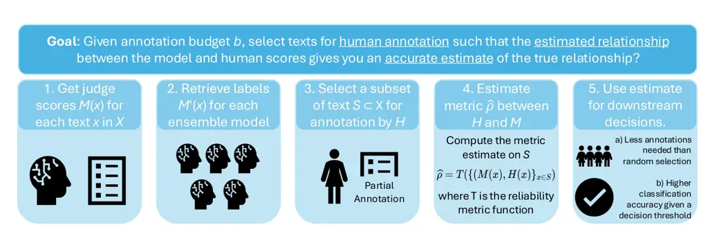

Figure 1: Overview of the LLM judge evaluation framework and our
approach. Given text samples $`\mathcal{X}`$, and judge model $`M`$ to
evaluate, we obtain scores $`\{M(x),M^{\prime}(x)\}_{x\in\mathcal{X}}`$
for $`M^{\prime}\in\mathcal{M}`$. We select $`b`$ texts for human
annotation. Equipped with a measure of reliability, function $`T`$, we
estimate a target parameter $`\hat{\rho}`$. We show that our improved
estimation of $`\hat{\rho}`$ leads to downstream impacts.

In this section, we outline the problem setup, describe our proposed
method (Metric Match) and provide intuition for it, and discuss the
experimental setup.

### 3.1 Problem Statement

We study the problem of LLM judge evaluation under limited annotation
budgets. Assume we have a large set of text items $`\mathcal{X}`$, and
let $`H:\mathcal{X}\rightarrow\mathcal{Y}:=[1,K]`$, denote the
ground-truth human scoring function from items to scores, where $`K`$ is
the greatest possible score. The human scoring function may correspond
to a single human rater or an average of multiple raters. Let
$`M:\mathcal{X}\rightarrow\mathcal{Y}`$ denote the scoring function
produced by the LLM judge. To generate synthetic labels, we have access
to a family of models $`M^{\prime}\in\mathcal{M}`$, each of which yields
a synthetic scoring function
$`M^{\prime}:\mathcal{X}\rightarrow\mathcal{Y}`$. Note that the average
human rater may produce non-integers, whereas the LLM judge will always
produce integer scores.

We wish to measure the reliability of judge $`M`$ with respect to human
annotator $`H`$ on textual data. We consider a reliability metric
$`T:(\mathcal{Y}\times\mathcal{Y})^{|\mathcal{X}|}\rightarrow\mathbb{R}`$,
which operates on pairs of scores on a set of text samples and outputs a
number quantifying the reliability between scorers. Given the chosen
metric, we want an estimate of the true (population-level) relationship
between $`M`$ and $`H`$ on $`\mathcal{X}`$, as captured by
$`\rho=T(\left\{(M(x),H(x))\right\}_{x\in\mathcal{X}})`$. With a budget
of size $`b\geq 1`$, we can construct any $`S\subseteq\mathcal{X}`$ of
size $`|S|=b`$ and obtain human annotations on the subset,
$`\left\{H(x)\right\}_{x\in S}`$. Using the selected human annotations
on $`S`$ and unlimited query access to annotations from
$`M^{\prime}\in\mathcal{M}`$, we provide an estimate
$`\widehat{\rho}_{S}`$ of $`\rho`$.

To exploit the availability of synthetic scoring functions
$`M^{\prime}:\mathcal{X}\rightarrow\mathcal{Y}`$,
$`M^{\prime}\in\mathcal{M}`$, we introduce inter-model (IM) reliability
quantities as measured by $`T`$, which inform Metric Match. Denote the
inter-model population reliability between $`M`$ and $`M^{\prime}`$ as
$`\rho^{\text{IM}}`$:

```math
\rho^{\text{IM}}=T\big(\{M(x),M^{\prime}(x)\}_{x\in\mathcal{X}}\big)
```

Unlike the human-model population metric, the inter-model population
metric is directly calculable, as we can cheaply obtain scores $`M(x)`$,
$`M^{\prime}(x)`$ for every $`x\in\mathcal{X}`$. Similarly, given any
subset $`S\subseteq\mathcal{X}`$, let $`\widehat{\rho}^{\text{IM}}_{S}`$
signify the finite sample estimate of $`\rho^{\text{IM}}`$ on $`S`$,
i.e.

```math
\widehat{\rho}^{\text{IM}}_{S}=T\big(\{M(x),M^{\prime}(x)\}_{x\in S}\big)
```

### 3.2 Method: Metric Matching

We introduce our method, which we term Metric Match, for subset
selection in order to reduce estimation error in reliability evaluation
of LLM judges with respect to human raters. We focus on careful subset
selection in order to minimize finite sample error given a budget $`b`$,
relying on synthetic scorers $`M^{\prime}\in\mathcal{M}`$ to inform our
subset construction. The key insight in the Metric Match algorithm
(Algorithm 1) is to construct sets of text examples
$`S\subseteq\mathcal{X}`$ whose inter-model empirical estimate
$`\widehat{\rho}_{S}^{\text{IM}}`$ closely resembles the inter-model
population metric $`\rho^{\text{IM}}`$. We characterize the intuition
for and present details of our algorithm in the rest of this section.

Data: Metric function $`T`$; budget $`b`$; population text data
$`\mathcal{X}`$; score functions $`M`$, $`M^{\prime}`$, from LLM judges
$`M`$ and $`M^{\prime}\in\mathcal{M}`$, respectively; $`C`$, number of
candidate subsets over which to search

Result: Subset $`S^{*}\subseteq X`$, $`\lvert S^{*}\rvert=b`$; Estimator
$`\widehat{\rho}_{S^{*}}`$

1 Initialize $`\delta_{\min}\leftarrow\infty`$

2 Initialize $`S^{*}\leftarrow\emptyset`$

3
$`\rho^{\text{IM}}\leftarrow\frac{1}{|\mathcal{M}|}\sum_{M^{\prime}\in\mathcal{M}}T\big(\{M(x),M^{\prime}(x)\}_{x\in\mathcal{X}}\big)`$

4 for _$`j=1,\dots,C`$_ do

    5 Sample $`S_{j}`$ s.t. $`|S_{j}|=b`$ from $`{X}`$ without
replacement

    6
$`\widehat{\rho}_{S_{j}}^{\text{IM}}\leftarrow\frac{1}{|\mathcal{M}|}\sum_{M^{\prime}\in\mathcal{M}}T\big(\{M(x),M^{\prime}(x)\}_{x\in S_{j}}\big)`$

    7
$`\delta_{j}=\lvert\widehat{\rho}_{S_{j}}^{\text{IM}}-\rho^{\text{IM}}\rvert`$

    8 if _$`\delta_{j}<\delta_{\min}`$_ then

       9 $`S^{*}\leftarrow S_{j}`$

       10 $`\delta_{\min}\leftarrow\delta_{j}`$

11 Calculate human-model metric estimate
$`\widehat{\rho}_{S^{*}}=T\big(Y_{S^{*}}^{(M)},Y_{S^{*}}^{(H)}\big)`$

12 return _$`S^{_}`$, $`\widehat{\rho}\_{S^{_}}`$_

Algorithm 1 Metric Match

The intuition is as follows. In an oracle setting, where $`H(x)`$ is
available for all $`x\in\mathcal{X}`$, the ideal subset
$`S\subseteq\mathcal{X}`$ of size $`b`$ to construct for estimation is
simply the subset that minimizes the estimation error
$`|\widehat{\rho}_{S}-\rho|`$. While we do not operate in an oracle
setting, we have access to judges $`M^{\prime}\in\mathcal{M}`$, and we
can compute $`M(x),M^{\prime}(x)`$ for every $`x\in\mathcal{X}`$. This
motivates constructing a subset that minimizes the proxy (inter-model)
estimation error
$`S^{*}:=\arg\min_{S\subseteq\mathcal{X},|S|=b}\lvert\widehat{\rho}^{\text{IM}}_{S}-\rho^{\text{IM}}\rvert`$.
The success of this method implicitly assumes that the relative
inter-model estimation errors are good enough proxies for the relative
human-model estimation errors: we formalize this in Section 4.2.1. Given
this subset, we compute the estimator on the human-model metric
$`\widehat{\rho}_{S^{*}}:=T\big(\{M(x),H(x)\}_{x\in S^{*}}\big)`$.

There remain two important details that represent parametric choices
about our algorithm:

- •
  Aggregation across synthetic labels: Our selection procedure thus far
  has assumed there is a single synthetic scorer. However, we have
  access to a full ensemble of scorers $`\mathcal{M}`$. We compute an
  inter-model metric for each pair $`(M,M^{\prime})`$ over
  $`M^{\prime}\in\mathcal{M}`$, and average the pairwise computations,
  resulting in:

  ```math
  \rho^{\text{IM}}=\frac{1}{|\mathcal{M}|}\sum_{M^{\prime}\in\mathcal{M}}T\big(\{M(x),M^{\prime}(x)\}_{x\in\mathcal{X}}\big)\qquad\rho_{S}^{\text{IM}}=\frac{1}{|\mathcal{M}|}\sum_{M^{\prime}\in\mathcal{M}}T\big(\{M(x),M^{\prime}(x)\}_{x\in S}\big)
  ```

  We ablate with an alternate aggregation approach in Appendix E.1.

- •
  Candidate Subset Selection: To solve
  $`S^{*}:=\arg\min_{S\subseteq\mathcal{X},|S|=b}\lvert\widehat{\rho}^{\text{IM}}_{S}-\rho^{\text{IM}}\rvert`$,
  we would need to search over $`{|\mathcal{X}|\choose b}`$ subsets,
  which is computationally expensive. To reduce the computational
  overhead, we sample $`C`$ i.i.d. candidate subsets,
  $`S_{1},\dots,S_{C}\sim\mathcal{X}^{b}`$, from which $`S^{*}`$ is
  selected as follows
  $`S^{*}:=\arg\min_{S_{1},\dots,S_{C}}\lvert\widehat{\rho}^{\text{IM}}_{S_{j}}-\rho^{\text{IM}}\rvert`$.
  The number of candidate subsets to consider constitutes a
  hyperparameter of Metric Match. In our experiments, we set $`C=20`$.
  We vary $`C`$ and report performance results in Appendix E.2. We find
  that even at relatively small $`C`$ ($`C=10`$), we see gains in
  performance as measured by win-rate and estimation error. See further
  analysis of $`C`$ in Section 4.2.1.

### 3.3 Experimental Setup

##### Baselines.

We compare to the following simple baselines: random selection,
stratified sampling, and random selection with a bias correction
component.²² 2 Due to the structure of the reliability metrics that we
consider, we note that even random sampling and bias correction may not
be unbiased (Appendix A). However, we take these estimators to be
baselines in the context of our goal of minimizing estimation error.

- •
  Random selection A classic approach to estimation of $`\rho`$ is to
  select $`b`$ samples i.i.d. from $`\mathcal{X}`$ to construct $`S`$,
  and estimate $`\widehat{\rho}_{S}=T\big(\{M(x),H(x)\}_{x\in S}\big)`$.
  Random selection remains the de facto method in practice. However,
  random selection incurs high variance when $`b`$ is small through
  finite sample error.
- •
  Stratified sampling Stratified sampling induces a uniform distribution
  over the judge score space in order to construct $`S`$. In other
  words, given $`b`$, sample $`b/K`$ text examples from each of
  $`\{x\in\mathcal{X}\mid M(x)=k\}`$ for $`k=1,\dots,K`$ to ensure full
  coverage of the score set $`\mathcal{Y}`$ in the sampled judge
  scores.³³ 3 In practice, we partition $`\mathcal{Y}`$ into quantiles,
  and sample uniformly from the quantiles. As LLM judge scores are from
  a discrete set of integers, the procedure is effectively equivalent.
  See further implementation details in Appendix D.
- •
  Bias correction (BC) In bias correction, we leverage the human
  annotations for the purpose of debiasing the synthetic labels. We use
  finite sample error calculated on the inter-model reliability metric
  as a stand-in for finite sample error in the human-model metric.
  Formally, we sample $`S\sim\mathcal{X}^{b}`$, and calculate estimate
  $`\widehat{\rho}:=\underbrace{\rho^{\text{IM}}}_{\text{Inter-model metric}}+\underbrace{\widehat{\rho}_{S}-\widehat{\rho}^{\text{IM}}_{S}}_{\text{Bias correction term}}`$.

We use $`\widehat{\rho}`$ to denote a generic estimator for $`\rho`$
under any method (implicitly with access to $`b`$ samples). Note that in
stratified sampling, the important component of the estimator is the
construction of subset $`S`$, and given $`S`$,
$`\widehat{\rho}=\widehat{\rho}_{S}`$. The bias correction estimator has
a different structure, due to incorporation of synthetic labels and an
additive correction term.

##### Evaluation procedure.

To evaluate Metric Match (Section 3.2), we measure the estimation error
compared to the baselines and also measure the win-rate of Metric Match
compared to the random selection baseline.

- •
  Estimation error. Given a method $`A`$, we directly compute estimation
  error as $`\epsilon^{A}=|\widehat{\rho}-\rho|`$, where
  $`\widehat{\rho}`$ indicates the estimator given by the method to be
  evaluated. We compute the average estimation error over $`N=40`$
  trials. Let $`\epsilon^{\text{rand}}`$ be the estimation error
  incurred by random selection.
- •
  Win-rate. A “win” for any method corresponds to an estimation error
  smaller than random estimation error. Due to the ubiquitous use of
  random selection in practice, we focus on the win-rate against random
  selection. We consider two variants of the win-rate.
  - –
    Micro-average win-rate: Over $`N`$ trials (with estimation errors
    $`\epsilon_{i}`$, $`i=1,\dots,N`$), the micro-average win-rate is
    equal to
    $`\frac{1}{N}\sum_{i=1}^{N}\mathbbm{1}[\epsilon^{\text{method}}_{i}<\epsilon^{\text{rand}}_{i}]`$.
    We compute this statistic for each of the 75 dataset/evaluation
    axis/judge model contexts. We also report the average of the
    micro-average win-rate over the 75 contexts as a summary metric.
  - –
    Macro-average win-rate: This variant captures the win signal over
    averaged errors, calculated as
    $`\mathbbm{1}\Big[\frac{1}{N}\sum_{i=1}^{N}\epsilon^{\text{method}}_{i}<\frac{1}{N}\sum_{i=1}^{N}\epsilon^{\text{rand}}_{i}\Big]\in\{0,1\}`$.
    We compute a win signal for each of the 75 contexts, and average the
    win signal to produce the macro-average win-rate as a summary
    metric.

##### Reliability metrics.

To capture notions of reliability for evaluation of an LLM judge, we
consider the following reliability metrics: intraclass correlation
coefficient (ICC) \[43\], Krippendorff’s $`\alpha`$ \[29\], Spearman’s
$`\rho`$ rank correlation \[44\], and Kendall’s $`\tau`$ rank
correlation \[26\]. Based on previous literature \[7, 13, 34\], these
metrics encompass a simple suite of correlative measures between LLM
judge scores and human scores. We provide formulae for each metric
computation and comparative exposition on these metrics in Appendix A.

##### Datasets and axes.

We provide empirical evaluations on 4 diverse real-world datasets: MSLR
\[49\], HANNA \[12\], MedVAL \[1\], and SummEval \[19\]. Each dataset is
annotated along multiple axes (e.g., coherence, relevance, surprise)
with a total of 15 sets of human annotations by which to evaluate
sampling performance, as shown in Table 3. All datasets contain samples
that are annotated by more than one human; we take the average score of
a subject between total raters as the true score and compare it to the
LLM judge score. All datasets use Likert scaling with a range of 1–5 for
SummEval and HANNA, 0–2 for MSLR, and 1–4 for MedVAL \[25\]. The full
range of datasets, axes, and raters per dataset is presented in
Appendix B. The evaluation axes span from more objective to more
subjective scores, capturing a broad spectrum of evaluation types. We
truncate each dataset to contain $`300`$ human-labeled samples and
perform evaluations on subsets of this annotation set. We perform the
evaluations over $`40`$ trials. Therefore, we evaluate in a total of
$`5\times 15=75`$ contexts over all datasets, axes and target judge
models.

##### Judges and synthetic labels.

Our model suite consists of Claude-3.5-Sonnet \[3\], GPT-4.1 \[38\],
GPT-5 \[39\], Deepseek-R1 \[23\], and Gemini-2.5-pro \[16\], with
additional model ablations in Appendix I. We run experiments where each
model serves as the reference judge model $`M`$ and the remaining models
comprise the synthetic label collection $`\mathcal{M}`$.

## 4 Estimation Evaluation

In this section, we discuss empirical results for metric matching.
First, we compare the estimation error of Metric Match against baselines
and compute annotation savings of using Metric Match instead of random
selection (Section 4.1). Then, we compute a win-rate of Metric Match
against random selection and discuss a connection between win-rate and
subset estimation error rank (Section 4.2). Finally, we evaluate Metric
Match on an alternate task of reliability classification given a
deployment threshold, highlighting the practical benefit of improved
reliability estimation (Section 4.3).

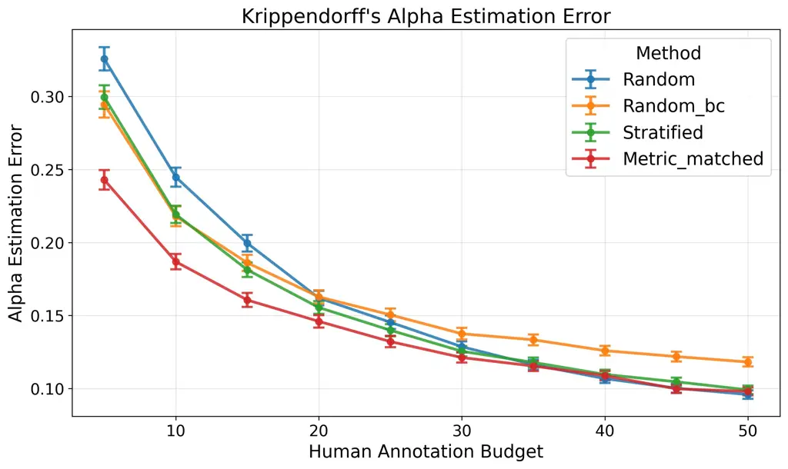

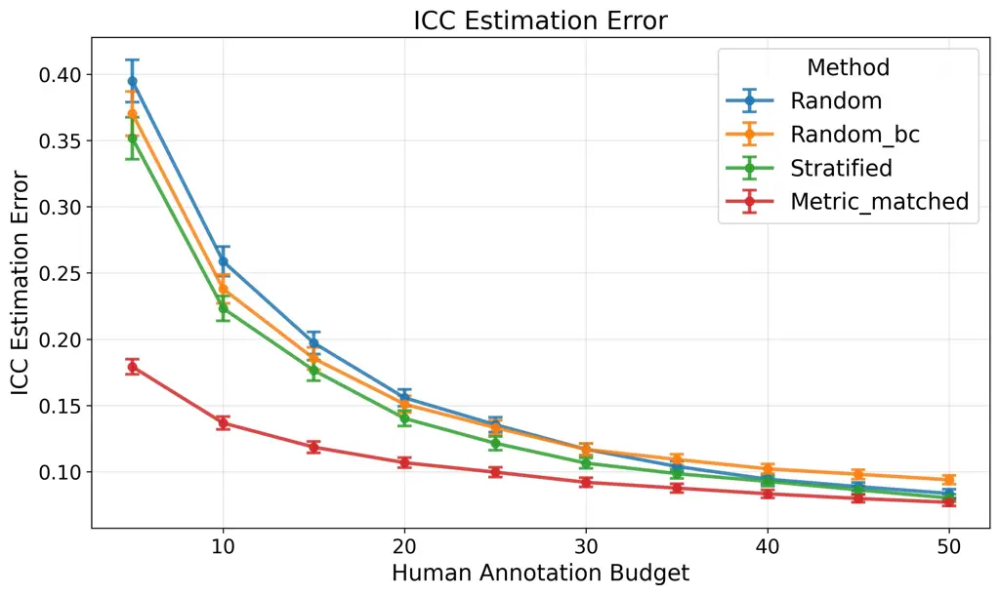

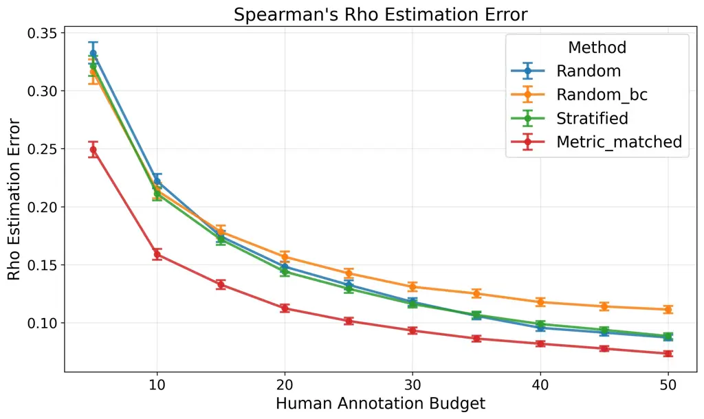

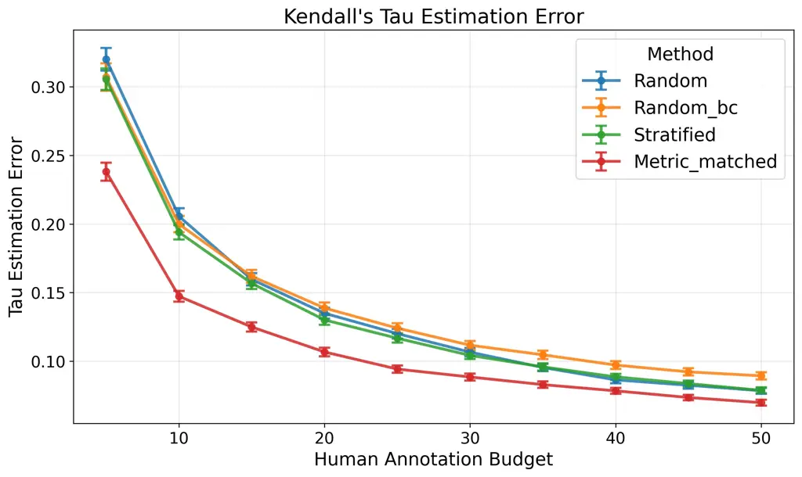

Figure 2: Metric matched selection outperforms baselines. We report the
estimation error by annotation budget across our suite of target
metrics, averaged over all datasets. The relative improved estimation
error across all metrics is 18.7%.

### 4.1 Estimation Error

We quantify the impact of Metric Match on reliability estimation against
random selection, showcasing raw improvement in estimation across
metrics, datasets, and budgets in Section 4.1.1. From this improvement,
we calculate relative annotation savings in Section 4.1.2 and the
associated cost savings in Section 4.1.3.

#### 4.1.1 Raw Estimation Improvement

We highlight in Figure 2, the average estimation error of metric
matching and the suite of comparable baselines. Across metrics, we see
improvement in estimation error with metric matching, most significantly
at low budgets, demonstrating the utility of metric matching in
labor-constrained domains, where human annotation is extremely costly.
Notably, we do not observe a degradation in our performance at higher
budgets, which we see in the bias-correction baseline (Random_bc). We
calculate the relative improved estimation error across all metrics as
18.7%, with disagreggated metrics as follows: 26.7% for ICC, 9.1% for
Krippendorff’s $`\alpha`$, 21.0% for Spearman’s $`\rho`$, and 17.9% for
Kendall’s $`\tau`$.

Our results illustrate that for each of the chosen reliability metrics,
Metric Match achieves a lower estimation error than baselines which
naively collect human annotations. We display disaggregated results for
dataset/axis contexts in Appendix H. In dataset/axis contexts in which
metric matching decays performance relative to random selection, we
hypothesize that the key assumption on rank correlation between
inter-model estimation error and human-model estimation error is
violated. We validate this hypothesis empirically in Appendix C, and
provide intuitive analysis in Section 4.2.1.

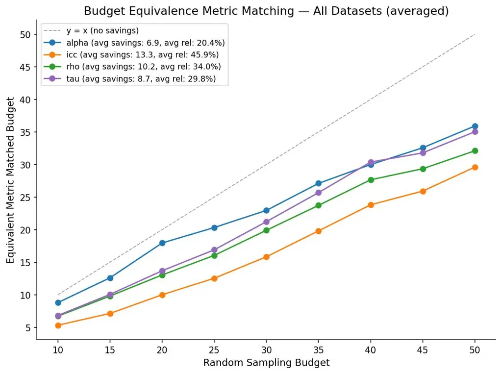

Figure 3: Metric matched selection achieves the same estimation error as
random with less annotations required. We highlight the average relative
savings over each reliability metric between metric matched selection
and random selection, with an average relative improvement of 32.5%.

#### 4.1.2 Relative Annotation Savings

We highlight in Figure 3 the average annotations saved from using metric
matching for sample selection. For each budget given to random
selection, we compute the required budget needed for Metric Match to
match the estimation error of random selection according to Figure 2. We
plot the relationship between the random selection budget and our
required budget. As such, a line with a slope of 1 would indicate that
Metric Match performs as well as random, while points below that line
indicate Metric Match outperforming random selection. We see gains
across all metrics observed, with an average relative improvement of
32.5%. Disaggregated results are reported in Appendix H.

#### 4.1.3 Annotation Cost Savings

Let $`R`$ be the random sampling budget, $`t`$ be the estimated time per
annotation (in hours), and $`c`$ be the cost per unit time of annotation
(in dollars per hour). Given $`R`$, we determine the required annotation
budget $`M`$ by identifying the point at which the estimation error of
Metric Match selection equals the annotation error at $`R`$. We quantify
cost savings as:

```math
C(R)=(R-E_{m}(R))\cdot t\cdot c \tag{1}
```

where $`E_{m}(R)`$ denotes the Metric Matched annotation budget that
achieves equivalent estimation accuracy to random sampling at budget
$`R`$. For MedVAL, assuming 5 minutes per annotation at a cost of \$500
per annotator hour (as described in \[48\]), this becomes for ICC:

```math
\$1{,}041.67=(50-25)\cdot\frac{1}{12}\cdot 500 \tag{2}
```

### 4.2 Win-rate against random selection baseline

We show in Table 1 the win-rate over trials between Metric Match’s
estimation error with the target parameter and random’s estimation
error. In terms of macro win-rate, we beat random with an average win
rate across metrics of 0.838, indicating robustness of metric matching
for estimation error across metrics. In micro win-rate, we beat random
in 53.8% of empirical trials. We include disaggregated win rate tables
for individual axis performance in Appendix H, as well as win rates
against the other two baselines in Appendix D.

|        |            |       |          |          |
| ------ | ---------- | ----- | -------- | -------- |
| Budget | $`\alpha`$ | ICC   | $`\rho`$ | $`\tau`$ |
| 5      | 0.853      | 1.000 | 0.947    | 0.987    |
| 10     | 0.827      | 0.987 | 0.947    | 0.973    |
| 15     | 0.747      | 0.947 | 0.907    | 0.907    |
| 20     | 0.733      | 0.920 | 0.960    | 0.920    |
| 25     | 0.720      | 0.907 | 0.880    | 0.907    |
| 30     | 0.733      | 0.893 | 0.867    | 0.893    |
| 35     | 0.653      | 0.853 | 0.893    | 0.773    |
| 40     | 0.653      | 0.840 | 0.800    | 0.760    |
| 45     | 0.667      | 0.800 | 0.800    | 0.747    |
| 50     | 0.653      | 0.773 | 0.787    | 0.693    |
| Avg    | 0.724      | 0.892 | 0.879    | 0.856    |

(a) Macro Win Rate

|        |            |       |          |          |
| ------ | ---------- | ----- | -------- | -------- |
| Budget | $`\alpha`$ | ICC   | $`\rho`$ | $`\tau`$ |
| 5      | 0.574      | 0.641 | 0.580    | 0.575    |
| 10     | 0.569      | 0.616 | 0.595    | 0.584    |
| 15     | 0.537      | 0.591 | 0.562    | 0.552    |
| 20     | 0.507      | 0.559 | 0.556    | 0.546    |
| 25     | 0.511      | 0.554 | 0.560    | 0.555    |
| 30     | 0.501      | 0.548 | 0.551    | 0.535    |
| 35     | 0.476      | 0.522 | 0.540    | 0.521    |
| 40     | 0.467      | 0.511 | 0.529    | 0.505    |
| 45     | 0.476      | 0.505 | 0.527    | 0.509    |
| 50     | 0.465      | 0.484 | 0.528    | 0.509    |
| Avg    | 0.508      | 0.553 | 0.553    | 0.539    |

(b) Micro Win Rate

Table 1: Metric matched selection beats random selection for minimizing
estimation error. Comparison of Macro (left) and Micro (right) win rates
across different budgets. Macro win rates achieve an average of 0.838,
while micro win rates achieve an average of 0.538.

Importantly, while macro win-rate effectively constitutes a measure of
the frequency (across contexts) with which our expected estimation error
beats expected random error, micro win-rate is an empirical estimate of
the probability of dominating random selection in a single trial. We see
that in both cases, across budgets, and metrics, our win rate is greater
than $`0.5`$.

Improved performance with Metric Match generalizes across model scales
(see Appendix I for small model results) and outperforms random sampling
on alternative metrics including mean squared error (Appendix G). We
additionally show results when matching on complementary metrics in
Appendix F, highlighting that alternative signals of inter-model
reliability may be helpful for optimal subset selection, as well.

#### 4.2.1 Analysis of win-rate and expected subset rank

As noted in Section 3.2, the performance of metric matching relies on
the joint distribution over the ranks of the inter-model and human-model
estimation errors in subsets $`S\subseteq\mathcal{X}`$. Here, we clarify
the precise relationship between micro-average win-rate and the expected
rank of subset $`S^{*}`$ over possible subsets with respect to the
human-model estimation error. Consider the candidate subsets
$`S_{1},\dots,S_{C}\sim\mathcal{X}`$: let
$`\epsilon_{j}:=|\widehat{\rho}_{S_{j}}-\rho|`$ and
$`\epsilon_{j}^{\text{IM}}:=|\widehat{\rho}^{\text{IM}}_{S_{j}}-\rho^{\text{IM}}|`$,
and $`j^{*}`$ be the index of $`S^{*}`$ in $`\{1,\dots,C\}`$. The
expected micro-average win-rate of metric matching is exactly
$`\mathbb{E}\Big[\mathbbm{1}\big[\epsilon_{j^{*}}<\epsilon^{\text{rand}}\big]\Big]=\Pr(\epsilon_{j^{*}}<\epsilon^{\text{rand}})`$.
Let $`R`$ denote the rank operator with respect to human-model
estimation error. Recall that the rank of $`S^{*}`$ with respect to
inter-model estimation error is $`1`$ by definition. The expected
micro-average win-rate of metric matching depends linearly on the
expected rank of the $`j^{*}`$th subset in the human-model,
$`\mathbb{E}[R[\epsilon_{j^{*}}]]`$. We provide an explicit formula,
derivation and empirical validation of this relationship in Appendix C.

### 4.3 Reliability Classification

In practice, a key motivation for estimating judge reliability is to
determine whether the judge is sufficient to be used for the downstream
task. This corresponds to a classification task of determining whether
judge reliability is above a certain threshold $`t`$ \[20\]. We evaluate
the performance of Metric Match relative to random selection for the
purposes of this classification task in Table 2. Given an estimate
$`\rho`$, we derive a prediction based on $`1[\rho>t]`$. We compute a
macro-averaged win-rate and micro-averaged win-rate for Metric Match
relative to random selection at thresholds of $`t\in\{0.6,0.7,0.8\}`$.
Here, a win is when Metric Match produces a correct classification while
random selection produces an incorrect classification. We average win
rates across thresholds.

|        |            |       |          |          |
| ------ | ---------- | ----- | -------- | -------- |
| Budget | $`\alpha`$ | ICC   | $`\rho`$ | $`\tau`$ |
| 5      | 0.658      | 0.519 | 0.825    | 0.832    |
| 10     | 0.763      | 0.566 | 0.794    | 0.907    |
| 15     | 0.767      | 0.558 | 0.731    | 0.788    |
| 20     | 0.535      | 0.534 | 0.644    | 0.451    |
| 25     | 0.612      | 0.595 | 0.805    | 0.742    |
| 30     | 0.659      | 0.547 | 0.733    | 0.678    |
| 35     | 0.606      | 0.556 | 0.789    | 0.684    |
| 40     | 0.527      | 0.542 | 0.702    | 0.647    |
| 45     | 0.458      | 0.535 | 0.690    | 0.786    |
| 50     | 0.545      | 0.563 | 0.468    | 0.739    |
| Avg    | 0.613      | 0.551 | 0.718    | 0.725    |

(a) Macro Win Rate

|        |            |       |          |          |
| ------ | ---------- | ----- | -------- | -------- |
| Budget | $`\alpha`$ | ICC   | $`\rho`$ | $`\tau`$ |
| 5      | 0.585      | 0.507 | 0.648    | 0.700    |
| 10     | 0.603      | 0.526 | 0.654    | 0.724    |
| 15     | 0.598      | 0.521 | 0.599    | 0.618    |
| 20     | 0.496      | 0.512 | 0.579    | 0.504    |
| 25     | 0.542      | 0.547 | 0.646    | 0.582    |
| 30     | 0.581      | 0.517 | 0.574    | 0.608    |
| 35     | 0.579      | 0.502 | 0.586    | 0.586    |
| 40     | 0.473      | 0.473 | 0.602    | 0.617    |
| 45     | 0.468      | 0.483 | 0.528    | 0.744    |
| 50     | 0.484      | 0.487 | 0.503    | 0.682    |
| Avg    | 0.541      | 0.508 | 0.592    | 0.637    |

(b) Micro Win Rate

Table 2: Metric matched selection beats random selection for reliability
classification task. Comparison of Macro (left) and Micro (right) win
rates across different budgets. Macro win rates achieve an average of
0.652, while micro win rates achieve an average of 0.570.

## 5 Discussion

We develop a new method, Metric Match, for estimating the reliability of
LLM judges using synthetic labels to best select a representative subset
for human annotation. Empirically, Metric Match reduces estimation error
by an average of 18.7% relative to random selection, outperforming
baselines including bias correction and stratified sampling. This
improved estimation ability reduces the number of annotations required
to reach a target error by an average of 32.5%. In a case study on the
MedVAL dataset, our cost model translates this reduction into savings of
up to \$1,041.67. To characterize the consistency of these gains, we
conduct a systematic win-rate comparison against random selection, the
de facto approach in practice, observing an average win rate of 0.838 on
estimation error when averaged across contexts and budgets. We provide
theoretical justification for this estimation approach, proving that
under rank alignment assumptions between human-model and inter-model
metrics on subsets, metric matching provably outperforms random
selection. Finally, we consider an alternative task to reliability
estimation as reliability classification, which is defined as a
practitioner using the estimated parameter against a deployment
threshold to decide whether a judge is fit for use. For this task,
Metric Match attains a win rate of 0.652 on the binary
accept-versus-reject decision. Together, these results demonstrate that
improved estimation of the population-level target parameter enables
practitioners to make more accurate decisions using fewer human
annotations.

While this work highlights the performance of metric matching for
reliability estimation of correlation-based metrics, future work may
engage with a wider set of metrics. We include preliminary analysis for
Mean Squared Error as a target parameter in Appendix G, showing that
metric-matching outperforms random selection on non-correlation based
metrics, although with smaller annotation gains and absolute estimation
error savings. Quantifying improvement a priori remains an open
question. Reliability is use-case dependent, and this estimation
approach should not be conflated with accuracy. Additionally, we do not
address how to improve the judge score nor how to select the optimal
judge from the ensemble. These features are assumed static in our
set-up, but are more fluid in real world implementation. Finally, this
work doesn’t address how to incorporate human feedback online to improve
estimation actively. Integrating active learning approaches is likely to
improve performance beyond our current batch setting, though this
constitutes a different problem formulation.

More broadly, Metric Match offers a promising approach for practitioners
to validate LLM judges more efficiently, reducing both the cost and time
required for expert annotation. We hope that our work serves as a
starting point for organizations to iterate faster on judge development,
identify failure modes earlier, and to detect misalignment with human
preferences while achieving equivalent estimation accuracy with fewer
labeled examples.

## 6 Acknowledgments

AU acknowledges support from the Stanford Graduate Fellowship and NSF
GRFP. MJ acknowledges partial support from a Stanford AI Lab
Postdoctoral fellowship. SK acknowledges support by NSF 2046795 and
2205329, IES R305C240046, ARPA-H, the MacArthur Foundation, Schmidt
Sciences, and HAI. TH was supported by a grant by HAI, DSO labs, gifts
from Open Philanthropy, Amazon, Schmidt Sciences, the Tianqiao and
Chrissy Chen Foundation and a grant under the NSF CAREER IIS-2338866,
ONR N00014-24-1-2609, and DARPA Cooperative Agreement HR00112520013.
This work does not necessarily reflect the position or policy of the
government and no official endorsement should be inferred.

## References

- \[1\] A. Aali, V. Bikia, M. Varma, N. Chiou, S. Ostmeier, A.
  Singhvi, M. Paschali, A. Kumar, A. Johnston, K.
  Amador-Martinez, E. J. P. Guerrero, P. N. C. Rivera, S. Gatidis, C.
  Bluethgen, E. P. Reis, E. D. Z. van Rilland, P. L. Hosamani, K. R.
  Keet, M. Go, E. Ling, D. B. Larson, C. Langlotz, R. Daneshjou, J.
  Hom, S. Koyejo, E. Alsentzer, and A. S. Chaudhari (2025) MedVAL:
  toward expert-level medical text validation with language models.
  External Links: 2507.03152 Cited by: item 1, §1, §3.3.
- \[2\] A. N. Angelopoulos, S. Bates, C. Fannjiang, M. I. Jordan, and T.
  Zrnic (2023) Prediction-powered inference. Science 382 (6671),
  pp. 669–674. External Links:
  [Document](https://dx.doi.org/10.1126/science.adi6000),
  [Link](https://www.science.org/doi/abs/10.1126/science.adi6000),
  https://www.science.org/doi/pdf/10.1126/science.adi6000 Cited by: §1,
  §2.3.
- \[3\] Anthropic (2024) Claude 3.5 sonnet model card addendum.
  Technical report Anthropic. Note: Accessed: 2026-05-05 External Links:
  [Link](https://www-cdn.anthropic.com/fed9cc193a14b84131812372d8d5857f8f304c52/Model_Card_Claude_3_Addendum.pdf)
  Cited by: §1, §3.3.
- \[4\] R. Artstein and M. Poesio (2008) Inter-coder agreement for
  computational linguistics. Comput. Linguist. 34 (4), pp. 555–596.
  External Links: ISSN 0891-2017,
  [Link](https://doi.org/10.1162/coli.07-034-R2),
  [Document](https://dx.doi.org/10.1162/coli.07-034-R2) Cited by: §2.2.
- \[5\] E. Asgari, N. Montaña-Brown, M. Dubois, et al. (2025) A
  framework to assess clinical safety and hallucination rates of LLMs
  for medical text summarisation. npj Digital Medicine 8, pp. 274.
  External Links:
  [Document](https://dx.doi.org/10.1038/s41746-025-01670-7) Cited by:
  §1.
- \[6\] J. Bai, S. Bai, Y. Chu, Z. Cui, K. Dang, X. Deng, Y. Fan, W.
  Ge, Y. Han, F. Huang, B. Hui, L. Ji, M. Li, J. Lin, R. Lin, D. Liu, G.
  Liu, C. Lu, K. Lu, J. Ma, R. Men, X. Ren, X. Ren, C. Tan, S. Tan, J.
  Tu, P. Wang, S. Wang, W. Wang, S. Wu, B. Xu, J. Xu, A. Yang, H.
  Yang, J. Yang, S. Yang, Y. Yao, B. Yu, H. Yuan, Z. Yuan, J. Zhang, X.
  Zhang, Y. Zhang, Z. Zhang, C. Zhou, J. Zhou, X. Zhou, and T.
  Zhu (2023) Qwen technical report. External Links: 2309.16609,
  [Link](https://arxiv.org/abs/2309.16609) Cited by: §I.1.
- \[7\] S. Bedi, H. Cui, M. Fuentes, A. Unell, M. Wornow, J. M.
  Banda, N. Kotecha, T. Keyes, Y. Mai, M. Oez, H. Qiu, S. Jain, L.
  Schettini, M. Kashyap, J. A. Fries, A. Swaminathan, P. Chung, F.
  Nateghi, A. Aali, A. Nayak, S. Vedak, S. S. Jain, B. Patel, O.
  Fayanju, S. Shah, E. Goh, D. Yao, B. Soetikno, E. Reis, S. Gatidis, V.
  Divi, R. Capasso, R. Saralkar, C. Chiang, J. Jindal, T. Pham, F.
  Ghoddusi, S. Lin, A. S. Chiou, C. Hong, M. Roy, M. F. Gensheimer, H.
  Patel, K. Schulman, D. Dash, D. Char, L. Downing, F. Grolleau, K.
  Black, B. Mieso, A. Zahedivash, W. Yim, H. Sharma, T. Lee, H.
  Kirsch, J. Lee, N. Ambers, C. Lugtu, A. Sharma, B. Mawji, A.
  Alekseyev, V. Zhou, V. Kakkar, J. Helzer, A. Revri, Y. Bannett, R.
  Daneshjou, J. Chen, E. Alsentzer, K. Morse, N. Ravi, N. Aghaeepour, V.
  Kennedy, A. Chaudhari, T. Wang, S. Koyejo, M. P. Lungren, E.
  Horvitz, P. Liang, M. Pfeffer, and N. H. Shah (2025) MedHELM: holistic
  evaluation of large language models for medical tasks. External Links:
  2505.23802, [Link](https://arxiv.org/abs/2505.23802) Cited by:
  Appendix A, §1, §2.1, §3.3.
- \[8\] S. R. Bowman, J. Hyun, E. Perez, E. Chen, C. Pettit, S.
  Heiner, K. Lukošiūtė, A. Askell, A. Jones, A. Chen, A. Goldie, A.
  Mirhoseini, C. McKinnon, C. Olah, D. Amodei, D. Amodei, D. Drain, D.
  Li, E. Tran-Johnson, J. Kernion, J. Kerr, J. Mueller, J. Ladish, J.
  Landau, K. Ndousse, L. Lovitt, N. Elhage, N. Schiefer, N. Joseph, N.
  Mercado, N. DasSarma, R. Larson, S. McCandlish, S. Kundu, S.
  Johnston, S. Kravec, S. E. Showk, S. Fort, T. Telleen-Lawton, T.
  Brown, T. Henighan, T. Hume, Y. Bai, Z. Hatfield-Dodds, B. Mann,
  and J. Kaplan (2022) Measuring progress on scalable oversight for
  large language models. External Links: 2211.03540,
  [Link](https://arxiv.org/abs/2211.03540) Cited by: §2.1.
- \[9\] C. Burns, P. Izmailov, J. H. Kirchner, B. Baker, L. Gao, L.
  Aschenbrenner, Y. Chen, A. Ecoffet, M. Joglekar, J. Leike, I.
  Sutskever, and J. Wu (2024) Weak-to-strong generalization: eliciting
  strong capabilities with weak supervision. In Proceedings of the 41st
  International Conference on Machine Learning, ICML’24. Cited by: §2.1.
- \[10\] A. Celikyilmaz, E. Clark, and J. Gao (2021) Evaluation of text
  generation: a survey. External Links: 2006.14799,
  [Link](https://arxiv.org/abs/2006.14799) Cited by: §1.
- \[11\] A. T. Chaganty, A. Paranjape, P. Liang, and C. D.
  Manning (2017) Importance sampling for unbiased on-demand evaluation
  of knowledge base population. In Proceedings of the 2017 Conference on
  Empirical Methods in Natural Language Processing (EMNLP), Cited by:
  §2.3.
- \[12\] C. Chhun, F. M. Suchanek, and C. Clavel (2024) Do language
  models enjoy their own stories? Prompting large language models for
  automatic story evaluation. Transactions of the Association for
  Computational Linguistics 12, pp. 1122–1142. External Links:
  [Document](https://dx.doi.org/10.1162/tacl%5Fa%5F00689),
  https://direct.mit.edu/tacl/article-pdf/doi/10.1162/tacl_a_00689/2470807/tacl_a_00689.pdf,
  ISSN 2307-387X, [Link](https://doi.org/10.1162/tacl%5C_a%5C_00689)
  Cited by: §1, §3.3.
- \[13\] C. Chiang and H. Lee (2023) Can large language models be an
  alternative to human evaluations?. External Links: 2305.01937,
  [Link](https://arxiv.org/abs/2305.01937) Cited by: §2.2, §3.3.
- \[14\] E. Clark, T. August, S. Serrano, N. Haduong, S. Gururangan,
  and N. A. Smith (2021) All that’s ‘human’ is not gold: evaluating
  human evaluation of generated text. In Proceedings of the 59th Annual
  Meeting of the Association for Computational Linguistics and the 11th
  International Joint Conference on Natural Language Processing (Volume
  1: Long Papers), C. Zong, F. Xia, W. Li, and R. Navigli (Eds.),
  Online, pp. 7282–7296. External Links:
  [Link](https://aclanthology.org/2021.acl-long.565/),
  [Document](https://dx.doi.org/10.18653/v1/2021.acl-long.565) Cited by:
  §2.1.
- \[15\] W. G. Cochran (1977) Sampling techniques. 3 edition, John Wiley
  & Sons. Cited by: §1, §2.3.
- \[16\] G. Comanici, E. Bieber, M. Schaekermann, I. Pasupat, N.
  Sachdeva, I. Dhillon, M. Blistein, O. Ram, D. Zhang, E. Rosen, L.
  Marris, S. Petulla, C. Gaffney, A. Aharoni, N. Lintz, T. C. Pais, H.
  Jacobsson, I. Szpektor, N. Jiang, K. Haridasan, A. Omran, N.
  Saunshi, D. Bahri, G. Mishra, E. Chu, T. Boyd, B. Hekman, A.
  Parisi, C. Zhang, K. Kawintiranon, T. Bedrax-Weiss, O. Wang, Y. Xu, O.
  Purkiss, U. Mendlovic, I. Deutel, N. Nguyen, A. Langley, F. Korn, L.
  Rossazza, A. Ramé, S. Waghmare, H. Miller, N. Byrd, A. Sheshan, R.
  Hadsell, S. Bhardwaj, P. Janus, T. Rissa, D. Horgan, A. Abdagic, L.
  Belenki, J. Allingham, A. Singh, T. Guidroz, S. Srinivasan, H.
  Schmit, K. Chiafullo, A. Elisseeff, N. Jha, P. Kolhar, L. Berrada, F.
  Ding, X. Si, S. B. Mallick, F. Och, S. Erell, E. Ni, T. Latkar, S.
  Yang, P. Sirkovic, Z. Feng, R. Leland, R. Hornung, G. Wu, C.
  Blundell, H. Alvari, P. Huang, C. Yip, S. Deur, L. Liu, G. Surita, P.
  Duque, D. Damen, J. Jia, A. Guez, M. Mircea, A. Sinha, A. Magni, P.
  Stradomski, T. Marian, V. Galić, W. Chen, H. Husain, A. Singhal, D.
  Grewe, F. Aubet, S. Song, L. Blanco, L. Rechis, L. Ho, R. Munoz, K.
  Zheng, J. Hamrick, K. Mather, H. Taitelbaum, E. Rutherford, Y. Lei, K.
  Chen, A. Shukla, E. Moreira, E. Doi, B. Isik, N. Shabat, D.
  Rogozińska, K. Kolipaka, J. Chang, E. Vušak, S. Venkatachary, S.
  Noghabi, T. Bharti, Y. Jun, A. Zaks, S. Green, J. Challagundla, W.
  Wong, M. Mohammad, D. Hirsch, Y. Cheng, I. Naim, L. Proleev, D.
  Vincent, A. Singh, M. Krikun, D. Krishnan, Z. Ghahramani, A. Atias, R.
  Aggarwal, C. Kirov, D. Vytiniotis, C. Koh, A. Chronopoulou, P.
  Dogra, V. Ion, G. Tyen, J. Lee, F. Weissenberger, T. Strohman, A.
  Balakrishna, J. Rae, M. Velic, R. de Liedekerke, O. Elyada, W.
  Yuan, C. Liu, L. Shani, S. Kishchenko, B. Alessio, Y. Li, R. Song, S.
  Kwei, O. Jankowski, A. Pappu, Y. Namiki, Y. Ma, N. Tripuraneni, C.
  Cherry, M. Ikonomidis, Y. Ling, C. Ji, B. Westberg, A. Wright, D.
  Yu, D. Parkinson, S. Ramaswamy, J. Connor, S. H. Yeganeh, S.
  Grover, G. Kenwright, L. Litchev, C. Apps, A. Tomala, F. Halim, A.
  Castro-Ros, Z. Li, A. Boral, P. Sho, M. Yarom, E. Malmi, D.
  Klinghoffer, R. Lin, A. Ansell, P. K. S, S. Zhao, S. Zuo, A.
  Santoro, H. Cheng, S. Demmessie, Y. Liu, N. Brichtova, A. Culp, N.
  Braun, D. Graur, W. Ng, N. Mehta, A. Phillips, P. Sundberg, V.
  Godbole, F. Liu, Y. Katariya, D. Rim, M. Seyedhosseini, S.
  Ammirati, J. Valfridsson, M. Malihi, T. Knight, A. Toor, T. Lampe, A.
  Ittycheriah, L. Chiang, C. Yeung, A. Fréchette, J. Rao, H. Wang, H.
  Srivastava, R. Zhang, R. Rhodes, A. Brand, D. Weesner, I. Figotin, F.
  Gimeno, R. Fellinger, P. Marcenac, J. Leal, E. Marcus, V. Cotruta, R.
  Cabrera, S. Luo, D. Garrette, V. Axelrod, S. Baltateanu, D. Barker, D.
  Chen, H. Toma, B. Ingram, J. Riesa, C. Kulkarni, Y. Zhang, H. Liu, C.
  Wang, M. Polacek, W. Wu, K. Hui, A. N. Reyes, Y. Su, M. Barnes, I.
  Malhi, A. Siddiqui, Q. Feng, M. Damaschin, D. Pighin, A. Steiner, S.
  Yang, R. S. Boppana, S. Ivanov, A. Kandoor, A. Shah, A. Mujika, D.
  Huang, C. A. Choquette-Choo, M. Patel, T. Yu, T. Creswell, Jerry,
  Liu, C. Barros, Y. Razeghi, A. Roy, P. Culliton, B. Xiong, J. Pan, T.
  Strohmann, T. Powell, B. Seal, D. DeCarlo, P. Shyam, K.
  Katircioglu, X. Wang, C. Hardin, I. Odisho, J. Broder, O. Chang, A.
  Nair, A. Shtefan, M. O’Brien, M. Agarwal, S. Potluri, S. Goyal, A.
  Jhindal, S. Thakur, Y. Stuken, J. Lyon, K. Toutanova, F. Feng, A.
  Wu, B. Horn, A. Wang, A. Cullum, G. Taubman, D. Shrivastava, C.
  Shi, H. Tomlinson, R. Patel, T. Tu, A. M. Oflazer, F. Pongetti, M.
  Yang, A. A. Taïga, V. Perot, N. W. Pierse, F. Han, Y. Drori, I.
  Iturrate, A. Chakrabarti, L. Yeung, D. Dopson, Y. Chen, A.
  Kulshreshtha, T. Guo, P. Pham, T. Schuster, J. Chen, A. Polozov, J.
  Xing, H. Zhou, P. Kacham, D. Kukliansky, A. Miech, S. Yaroshenko, E.
  Chi, S. Douglas, H. Fei, M. Blondel, P. Myla, L. Madmoni, X. Wu, D.
  Keysers, K. Kjems, I. Albuquerque, L. Yu, J. D’sa, M. Plantan, V.
  Ionescu, J. S. Elias, A. Gupta, M. R. Vuyyuru, F. Alcober, T. Zhou, K.
  Ji, F. Hartmann, S. Puttagunta, H. Song, E. Amid, A. Stefanoiu, A.
  Lee, P. Pucciarelli, E. Wang, A. Raul, S. Petrov, I. Tian, V.
  Anklin, N. Nti, V. Gomes, M. Schumacher, G. Vesom, A. Panagopoulos, K.
  Bousmalis, D. Andor, J. Jacob, Y. Zhang, B. Rosgen, M. Kecman, M.
  Tung, A. Belias, N. Goodman, P. Covington, B. Wieder, N. Saxena, E.
  Davoodi, M. Huang, S. Maddineni, V. Roulet, F. Campbell-Ajala, P. G.
  Sessa, Xintian, Wu, G. Lai, P. Collins, A. Haig, V. Sakenas, X. Xu, M.
  Giustina, L. E. Shafey, P. Charoenpanit, S. Garg, J. Ainslie, B.
  Severson, M. G. Arenas, S. Pathak, S. Rajayogam, J. Feng, M.
  Bakker, S. Li, N. Wichers, J. Rogers, X. Geng, Y. Li, R. Jagerman, C.
  Jia, N. Olmert, D. Sharon, M. Mauger, S. Mariserla, H. Ma, M.
  Mohabey, K. Kim, A. Andreev, S. Pollom, J. Love, V. Jain, P.
  Agrawal, Y. Schroecker, A. Fortin, M. Warmuth, J. Liu, A. Leach, I.
  Blok, G. P. Girirajan, R. Aharoni, B. Uria, A. Sozanschi, D.
  Goldberg, L. Ionita, M. T. Ribeiro, M. Zlocha, V. Birodkar, S.
  Lachgar, L. Yuan, H. Choudhury, M. Ginsberg, F. Zheng, G. Dibb, E.
  Graves, S. Lokhande, G. Rasskin, G. Muraru, C. Quick, S. Tata, P.
  Sermanet, A. Chawla, I. Karo, Y. Wang, S. Zhang, O. Keller, A.
  Dragan, G. Su, I. Chou, X. Liu, Y. Tao, S. Prabhakara, M. Wilson, R.
  Liu, S. Wang, G. Evans, D. Du, A. Castaño, G. Prasad, M. E. Mahdy, S.
  Gerlach, M. Reid, J. Kahn, A. Zait, T. S. Pillai, T. Ulrich, G.
  Wang, J. Wassenberg, E. Farkash, K. Yalasangi, C. Wang, M. Bauza, S.
  Bucher, T. Liu, J. Yan, G. Leung, V. Sindhwani, P. Barnes, A.
  Singh, I. Jurin, J. Chang, N. K. Bhumihar, S. Eiger, G. Citovsky, B.
  Withbroe, Z. Li, S. Xue, N. D. Santo, G. Stoyanov, Y. Raimond, S.
  Zheng, Y. Gao, V. Listík, S. Kwasiborski, R. Saputro, A. Ozturel, G.
  Mallya, K. Majmundar, R. West, P. Caron, J. Wei, L. Castrejon, S.
  Vikram, D. Ramachandran, N. Dhawan, J. Park, S. Smoot, G. van den
  Driessche, Y. Blau, C. Malik, W. Liang, R. Hirsch, C. N. dos
  Santos, E. Weinstein, A. van den Oord, S. Lall, N. FitzGerald, Z.
  Jiang, X. Yang, D. Webster, A. Elqursh, A. Pope, G. Rotival, D.
  Raposo, W. Zhu, J. Dean, S. Alabed, D. Tran, A. Gupta, Z. Gleicher, J.
  Austin, E. Rosseel, M. Umekar, D. Das, Y. Sun, K. Chen, K.
  Misiunas, X. Zhou, Y. Di, A. Loo, J. Newlan, B. Li, V. Ramasesh, Y.
  Xu, A. Chen, S. Gandhe, R. Soricut, N. Gupta, S. Hu, S. El-Sayed, X.
  Garcia, I. Brusilovsky, P. Chen, A. Bolt, L. Huang, A. Gurney, Z.
  Zhang, A. Pritzel, J. Wilkiewicz, B. Seybold, B. K. Shamanna, F.
  Fischer, J. Dean, K. Gill, R. Mcilroy, A. Bhowmick, J. Selier, A.
  Yang, D. Cheng, V. Magay, J. Tan, D. Varma, C. Walder, T. Kocisky, R.
  Nakashima, P. Natsev, M. Kwong, I. Gog, C. Zhang, S. Dieleman, T.
  Jimma, A. Ryabtsev, S. Brahma, D. Steiner, D. Du, A. Žužul, M.
  Žanić, M. Raghavachari, W. Gierke, Z. Zheng, D. Petrova, Y.
  Dauphin, Y. Liu, I. Kessler, S. Hand, C. Duvarney, S. Kim, H. Lee, L.
  Hussenot, J. Hui, J. Smith, D. Jain, J. Xia, G. S. Tomar, K. Amiri, D.
  Phan, F. Fuchs, T. Weyand, N. Tomasev, A. Cordell, X. Liu, J.
  Mallinson, P. Joshi, A. Crawford, A. Suggala, S. Chien, N.
  Fernando, M. Sanchez-Vargas, D. Williams, P. Crone, X. Luo, I.
  Karpov, J. Shan, T. Thurk, R. Strudel, P. Voigtlaender, P. Patil, T.
  Dozat, A. Khodaei, S. Singla, P. Ambroszczyk, Q. Wu, Y. Chang, B.
  Roark, C. Hegde, T. Ding, A. Filos, Z. Wu, A. S. Pinto, S. Liu, S.
  Khanna, A. Pandey, S. Mcloughlin, Q. Li, S. Haves, A. Zhou, E.
  Buchatskaya, I. Leal, P. de Boursac, N. Akazawa, N. Anderson, T.
  Chen, K. Somandepalli, C. Liang, S. Goenka, S. Winkler, A.
  Grushetsky, Y. Ding, J. Smith, F. Ye, J. Pont-Tuset, E. Li, R. Li, T.
  Golany, D. Wegner, T. Jiang, O. Barak, Y. Shangguan, E. Vértes, R.
  Wong, J. Bornschein, A. Tudor, M. Bevilacqua, T. Schaul, A. S.
  Rawat, Y. Zhao, K. Axiotis, L. Meng, C. McLean, J. Lai, J. Beattie, N.
  Kushman, Y. Liu, B. Kutzman, F. Lang, J. Ye, P. Netrapalli, P.
  Mishra, M. Khan, M. Goel, R. Willoughby, D. Tian, H. Zhuang, J.
  Chen, Z. Tsai, T. Kementsietsidis, A. Khare, J. Keeling, K. Xu, N.
  Waters, F. Altché, A. Popat, B. Mittal, D. Saxton, D. E. Badawy, M.
  Mathieu, Z. Zheng, H. Zhou, N. Ranka, R. Shin, Q. Duan, T.
  Salimans, I. Mihailescu, U. Shaham, M. Chang, Y. Assael, N.
  Dikkala, M. Izzard, V. Cohen-Addad, C. Graves, V. Feinberg, G.
  Chung, D. Strouse, D. Karmon, S. Sharifzadeh, Z. Ashwood, K. Pham, J.
  Blanton, A. Vasiloff, J. Barber, M. Geller, A. Zhou, F. Zubach, T.
  Huang, L. Zhang, H. Gupta, M. Young, J. Proskurnia, R. Votel, V.
  Gabeur, G. Barcik, A. Tripathi, H. Yu, G. Yan, B. Changpinyo, F.
  Pavetić, A. Coyle, Y. Fujii, J. G. Mendez, T. Zhou, H. Rajamani, B.
  Hechtman, E. Cao, D. Juan, Y. Tan, V. Dalibard, Y. Du, N. Clay, K.
  Yao, W. Jia, D. Vijaykumar, Y. Zhou, X. Bai, W. Hung, S. Pecht, G.
  Todorov, N. Khadke, P. Gupta, P. Lahoti, A. Autef, K. Duddu, J.
  Lee-Thorp, A. Bykovsky, T. Misiunas, S. Flennerhag, S. Thangaraj, J.
  McGiffin, Z. Nado, M. Kunesch, A. Noever, A. Hertz, M. Liang, V.
  Stone, E. Palmer, S. Daruki, A. Pramanik, S. Põder, A. Kyker, M.
  Khan, E. Sluzhaev, M. Ritter, A. Ruderman, W. Zhou, C. Nagpal, K.
  Vodrahalli, G. Necula, P. Barham, E. Pavlick, J. Hartford, I.
  Shafran, L. Zhao, M. Mikuła, T. Eccles, H. Shimokawa, K. Garg, L.
  Vilnis, H. Chen, I. Shumailov, K. Lee, A. Abdelhamed, M. Xie, V.
  Cohen, E. Hlavnova, D. Malkin, C. Sitawarin, J. Lottes, P.
  Coquinot, T. Yu, S. Kumar, J. Zhang, A. Mahendru, Z. Ahmed, J.
  Martens, T. Chen, A. Boag, D. Peng, C. Devin, A. Klimovskiy, M.
  Phuong, D. Vainstein, J. Xie, B. Ramabhadran, N. Howard, X. Yu, G.
  Goswami, J. Cui, S. Shleifer, M. Pinto, C. Yeh, M. Yang, S.
  Javanmardi, D. Ethier, C. Lee, J. Orbay, S. Kotecha, C. Bromberg, P.
  Shaw, J. Thornton, A. G. Rosenthal, S. Gu, M. Thomas, I. Gemp, A.
  Ayyar, A. Ushio, A. Selvan, J. Wee, C. Liu, M. Majzoubi, W. Yu, J.
  Abernethy, T. Liechty, R. Pan, H. Nguyen, Qiong, Hu, S. Perrin, A.
  Arora, E. Pitler, W. Wang, K. Shivakumar, F. Prost, B. Limonchik, J.
  Wang, Y. Gao, T. Cour, S. Buch, H. Gui, M. Ivanova, P. Neubeck, K.
  Chan, L. Kim, H. Chen, N. Goyal, D. Chung, L. Liu, Y. Su, A.
  Petrushkina, J. Shen, A. Joulin, Y. Xu, S. X. Lin, Y. Kulizhskaya, C.
  Chelba, S. Vasudevan, E. Collins, V. Bashlovkina, T. Lu, D. Fritz, J.
  Park, Y. Zhou, C. Su, R. Tanburn, M. Sushkov, M. Rasquinha, J. Li, J.
  Prendki, Y. Li, P. LV, S. Sharma, H. Fitoussi, H. Huang, A. Dai, P.
  Dao, M. Burrows, H. Prior, D. Qin, G. Pundak, L. L. Sjoesund, A.
  Khurshudov, Z. Zhu, A. Webson, E. Kemp, T. Tan, S. Agrawal, S.
  Sargsyan, L. Cheng, J. Stephan, T. Kwiatkowski, D. Reid, A.
  Byravan, A. H. Michaely, N. Heess, L. Zhou, S. Goenka, V.
  Carpenter, A. Levskaya, B. Wang, R. Roberts, R. Leblond, S.
  Chikkerur, S. Ginzburg, M. Chang, R. Riachi, Chuqiao, Xu, Z.
  Borsos, M. Pliskin, J. Pawar, M. Lustman, H. Kirkwood, A. Anand, A.
  Chaudhary, N. Kalb, K. Milan, S. Augenstein, A. Goldie, L. Prince, K.
  Raman, Y. Sun, V. Xia, A. Cohen, Z. Huo, J. Camp, S. Ellis, L.
  Zilka, D. V. Torres, L. Patel, S. Arora, B. Chan, J. Adler, K.
  Ayoub, J. Liang, F. Jamil, J. Jiang, S. Baumgartner, H. Sun, Y.
  Karov, Y. Akulov, H. Zheng, I. Cai, C. Fantacci, J. Rubin, A. R.
  Acha, M. Wang, N. D’Souza, R. Sathyanarayana, S. Dai, S. Rowe, A.
  Simanovsky, O. Goldman, Y. Kuang, X. Pan, A. Rosenberg, T.
  Rojas-Esponda, P. Dutta, A. Zeng, I. Jurenka, G. Farquhar, Y.
  Bansal, S. Iqbal, B. Roelofs, G. Joung, P. Beak, C. Ryu, R. Poplin, Y.
  Wu, J. Alayrac, S. Buthpitiya, O. Ronneberger, C. Habtegebriel, W.
  Li, P. Cavallaro, A. Wei, G. Bensky, T. Denk, H. Ganapathy, J.
  Stanway, P. Joshi, F. Bertolini, J. Lo, O. Ma, Z. Charles, G.
  Sampemane, H. Sahni, X. Chen, H. Askham, D. Gaddy, P. Young, J.
  Tan, M. Eyal, A. Bražinskas, L. Zhong, Z. Wu, M. Epstein, K.
  Bailey, A. Hard, K. Lee, S. Goldshtein, A. Ruiz, M. Badawi, M.
  Lochbrunner, J. Kearns, A. Brown, F. Pardo, T. Weber, H. Yang, P.
  Jiang, B. Akin, Z. Fu, M. Wainwright, C. Zou, M. Gaba, P. Manzagol, W.
  Kan, Y. Song, K. Zainullina, R. Lin, J. Ko, S. Deshmukh, A. Jindal, J.
  Svensson, D. Tyam, H. Zhao, C. Kaeser-Chen, S. Baird, P. Moradi, J.
  Hall, Q. Guo, V. Tsang, B. Liang, F. Pereira, S. Ganesh, I.
  Korotkov, J. Adamek, S. Thiagarajan, V. Tran, C. Chen, C. Tar, S.
  Jain, I. Dasgupta, T. Bilal, D. Reitter, K. Zhao, G. Vezzani, Y.
  Gehman, P. Mehta, L. Beltrone, X. Dotiwalla, S. Guadarrama, Z.
  Abbas, S. Karp, P. Georgiev, C. Ferng, M. Brockschmidt, L. Peng, C.
  Hirnschall, V. Verma, Y. Bi, Y. Xiao, A. Dabush, K. Xu, P. Wallis, R.
  Parker, Q. Wang, Y. Xu, I. Safarli, D. Tewari, Y. Zhang, S. Kim, A.
  Gesmundo, M. Thomas, S. Levi, A. Chowdhury, K. Rao, P. Garst, S.
  Conway-Rahman, H. Ran, K. McKinney, Z. Xiao, W. Yu, R. Agrawal, A.
  Stjerngren, C. Ionescu, J. Chen, V. Sharma, J. Chiu, F. Liu, K.
  Franko, C. Sanford, X. Cai, P. Michel, S. Ganapathy, J. Labanowski, Z.
  Garrett, B. Vargas, S. Sun, B. Gale, T. Buschmann, G. Desjardins, N.
  Ghelani, P. Jain, M. Verma, C. Asawaroengchai, J. Eisenschlos, J.
  Harlalka, H. Kazawa, D. Metzler, J. Howland, Y. Jian, J. Ades, V.
  Shah, T. Gangwani, S. Lee, R. Ring, S. M. Hernandez, D. Reich, A.
  Sinha, A. Sathe, J. Kovac, A. Gill, A. Kannan, A. D’olimpio, M.
  Sevenich, J. Whang, B. Kim, K. C. Sim, J. Chen, J. Zhang, S. Lall, Y.
  Matias, B. Jia, A. Friesen, S. Nasso, A. Thapliyal, B. Perozzi, T.
  Yu, A. Shekhawat, S. Huda, P. Grabowski, E. Wang, A. Sreevatsa, H.
  Dib, M. Hassen, P. Schuh, V. Milutinovic, C. Welty, M. Quinn, A.
  Shah, B. Wang, G. Barth-Maron, J. Frye, N. Axelsson, T. Zhu, Y. Ma, I.
  Giannoumis, H. Sedghi, C. Ye, Y. Luan, K. Aydin, B. Chandra, V.
  Sampathkumar, R. Huang, V. Lavrenko, A. Eleryan, Z. Hong, S.
  Hansen, S. M. Carthy, B. Samanta, D. Ćevid, X. Wang, F. Li, M.
  Voznesensky, M. Hoffman, A. Terzis, V. Sehwag, G. Fidel, L. He, M.
  Cai, Y. He, A. Feng, M. Nikoltchev, S. Phatale, J. Chase, R.
  Lawton, M. Zhang, T. Ouyang, M. Tragut, M. H. Manshadi, A.
  Narayanan, J. Shen, X. Gao, T. Bolukbasi, N. Roy, X. Li, D.
  Golovin, L. Panait, Z. Qin, G. Han, T. Anthony, S. Kudugunta, V.
  Patraucean, A. Ray, X. Chen, X. Yang, T. Bhatia, P. Talluri, A.
  Morris, A. Ražnatović, B. Brownfield, J. An, S. Peng, P. Kane, C.
  Zheng, N. Duduta, J. Kessinger, J. Noraky, S. Liu, K. Rong, P.
  Veličković, K. Rush, A. Goldin, F. Wei, S. M. R. Garlapati, C.
  Pantofaru, O. Kwon, J. Ni, E. Noland, J. D. Trapani, F.
  Beaufays, A. G. Roy, Y. Chow, A. Turker, G. Cideron, L. Mei, J.
  Clark, Q. Dou, M. Bošnjak, R. Leith, Y. Du, A. Yazdanbakhsh, M.
  Nasr, C. Kwak, S. S. Sheth, A. Kaskasoli, A. Anand, B.
  Lakshminarayanan, S. Jerome, D. Bieber, C. Chu, A. Senges, T. Shen, M.
  Sridhar, N. Ndebele, B. Beyret, S. Mohamed, M. Chen, M. Freitag, J.
  Guo, L. Liu, P. Roit, H. Chen, S. Yan, T. Stone, J. Co-Reyes, J.
  Cole, S. Scellato, S. Azizi, H. Hashemi, A. Jin, A. Iyer, M.
  Valentine, A. György, A. Ahuja, D. H. Diaz, C. Lee, N. Clement, W.
  Kong, D. Garmon, I. Watts, K. Bhatia, K. Gupta, M. Miecnikowski, H.
  Vallet, A. Taly, E. Loper, S. Joshi, J. Atwood, J. Chick, M.
  Collier, F. Iliopoulos, R. Trostle, B. Gunel, R. Leal-Cavazos, A. M.
  Hrafnkelsson, M. Guzman, X. Ju, A. Forbes, J. Emond, K. Chauhan, B.
  Caine, L. Xiao, W. Zeng, A. Moufarek, D. Murphy, M. Meng, N. Gupta, F.
  Riedel, A. Das, E. Lawal, S. Narayan, T. Sosea, J. Swirhun, L.
  Friso, B. Neyshabur, J. Lu, S. Girgin, M. Wunder, E. Yvinec, A.
  Pyne, V. Carbune, S. Rijhwani, Y. Guo, T. Doshi, A. Briukhov, M.
  Bain, A. Hitron, X. Wang, A. Gupta, K. Chen, C. Du, W. Zhang, D.
  Shah, A. Akula, M. Dylla, A. Kachra, W. Kuo, T. Zou, L. Wang, L.
  Xu, J. Zhu, J. Snyder, S. Menon, O. Firat, I. Mordatch, Y. Yuan, N.
  Ponomareva, R. Blevins, L. Moore, W. Wang, P. Chen, M. Scholz, A.
  Dwornik, J. Lin, S. Li, D. Antognini, T. I, X. Song, M. Miller, U.
  Kalra, A. Raveret, O. Akerlund, F. Wu, A. Nystrom, N. Godbole, T.
  Liu, H. DeBalsi, J. Zhao, B. Liu, A. Caciularu, L. Lax, U.
  Khandelwal, V. Langston, E. Bailey, S. Lattanzi, Y. Wang, N.
  Kovelamudi, S. Mondal, G. Guruganesh, N. Hua, O. Roval, P.
  Wesołowski, R. Ingale, J. Halcrow, T. Sohn, C. Angermueller, B.
  Raad, E. Stickgold, E. Lu, A. Kosik, J. Xie, T. Lillicrap, A.
  Huang, L. L. Zhang, D. Paulus, C. Farabet, A. Wertheim, B. Wang, R.
  Joshi, C. Ko, Y. Wu, S. Agrawal, L. Lin, X. Sheng, P. Sung, T.
  Breland-King, C. Butterfield, S. Gawde, S. Singh, Q. Zhang, R.
  Apte, S. Shetty, A. Hutter, T. Li, E. Salesky, F. Lebron, J.
  Kanerva, M. Paganini, A. Nguyen, R. Vallu, J. Peter, S. Velury, D.
  Kao, J. Hoover, A. Bortsova, C. Bishop, S. Jakobovits, A. Agostini, A.
  Agarwal, C. Liu, C. Kwong, S. Tavakkol, I. Bica, A. Greve, A. GP, J.
  Marcus, L. Hou, T. Duerig, R. Moroshko, D. Lacey, A. Davis, J.
  Amelot, G. Wang, F. Kim, T. Strinopoulos, H. Wan, C. L. Lan, S.
  Krishnan, H. Tang, P. Humphreys, J. Bai, I. H. Shtacher, D.
  Machado, C. Pang, K. Burke, D. Liu, R. Aravamudhan, Y. Song, E.
  Hirst, A. Singh, B. Jou, L. Bai, F. Piccinno, C. K. Fu, R. Alazard, B.
  Meiri, D. Winter, C. Chen, M. Zhang, J. Heitkaemper, J. Lambert, J.
  Lee, A. Frömmgen, S. Rogulenko, P. Nair, P. Niemczyk, A. Bulyenov, B.
  Xu, H. Shemtov, M. Zadimoghaddam, S. Toropov, M. Wirth, H. Dai, S.
  Gollapudi, D. Zheng, A. Kurakin, C. Lee, K. Bullard, N. Serrano, I.
  Balazevic, Y. Li, J. Schalkwyk, M. Murphy, M. Zhang, K. Sequeira, R.
  Datta, N. Agrawal, C. Sutton, N. Attaluri, M. Chiang, W. Farhan, G.
  Thornton, K. Lin, T. Choma, H. Nguyen, K. Dasgupta, D. Robinson, I.
  Comşa, M. Riley, A. Pillai, B. Mustafa, B. Golan, A. Zandieh, J.
  Lespiau, B. Porter, D. Ross, S. Rajayogam, M. Agarwal, S.
  Venugopalan, B. Shahriari, Q. Yan, H. Xu, T. Tobin, P. Dubov, H.
  Shi, A. Recasens, A. Kovsharov, S. Borgeaud, L. Dery, S. Vasanth, E.
  Gribovskaya, L. Qiu, M. Mahdieh, W. Skut, E. Nielsen, C. Zheng, A.
  Yu, C. G. Bostock, S. Gupta, A. Archer, C. Rawles, E. Davies, A.
  Svyatkovskiy, T. Tsai, Y. Halpern, C. Reisswig, B. Wydrowski, B.
  Chang, J. Puigcerver, M. H. Taege, J. Li, E. Schnider, X. Li, D.
  Dena, Y. Xu, U. Telang, T. Shi, H. Zen, K. Kastner, Y. Ko, N.
  Subramaniam, A. Kumar, P. Blois, Z. Dai, J. Wieting, Y. Lu, Y.
  Zeldes, T. Xie, A. Hauth, A. Ţifrea, Y. Li, S. El-Husseini, D.
  Abolafia, H. Zhou, W. Ding, S. Ghalebikesabi, C. Guía, A. Maksai, Á.
  Weisz, S. Arik, N. Sukhanov, A. Świetlik, X. Jia, L. Yu, W. Wang, M.
  Brand, D. Bloxwich, S. Kirmani, Z. Chen, A. Go, P. Sprechmann, N.
  Kannen, A. Carin, P. Sandhu, I. Edkins, L. Nooteboom, J. Gupta, L.
  Maggiore, J. Azizi, Y. Pritch, P. Yin, M. Gupta, D. Tarlow, D.
  Smith, D. Ivanov, M. Babaeizadeh, A. Goel, S. Kambala, G. Chu, M.
  Kastelic, M. Liu, H. Soltau, A. Stone, S. Agrawal, M. Kim, K.
  Soparkar, S. Tadepalli, O. Bunyan, R. Soh, A. Kannan, D. Kim, B. J.
  Chen, A. Halumi, S. Roy, Y. Wang, O. Sercinoglu, G. Gibson, S.
  Bhatnagar, M. Sano, D. von Dincklage, Q. Ren, B. Mitrevski, M.
  Olšák, J. She, C. Doersch, Jilei, Wang, B. Liu, Q. Tan, T. Yakar, T.
  Warkentin, A. Ramirez, C. Lebsack, J. Dillon, R. Mathews, T.
  Cobley, Z. Wu, Z. Chen, J. Simon, S. Nath, T. Sainath, A.
  Bendebury, R. Julian, B. Mankalale, D. Ćurko, P. Zacchello, A. R.
  Brown, K. Sodhia, H. Howard, S. Caelles, A. Gupta, G. Evans, A.
  Bulanova, L. Katzen, R. Goldenberg, A. Tsitsulin, J. Stanton, B.
  Schillings, V. Kovalev, C. Fry, R. Shah, K. Lin, S. Upadhyay, C.
  Li, S. Radpour, M. Maggioni, J. Xiong, L. Haas, J. Brennan, A.
  Kamath, N. Savinov, A. Nagrani, T. Yacovone, R. Kappedal, K.
  Andriopoulos, L. Lao, Y. Li, G. Rozhdestvenskiy, K. Hashimoto, A.
  Audibert, S. Austin, D. Rodriguez, A. Ruoss, G. Honke, D.
  Karkhanis, X. Xiong, Q. Wei, J. Huang, Z. Leng, V. Premachandran, S.
  Bileschi, G. Evangelopoulos, T. Mensink, J. Pavagadhi, D.
  Teplyashin, P. Chang, L. Xue, G. Tanzer, S. Goldman, K. Patel, S.
  Li, J. Wiesner, I. Zheng, I. Stewart-Binks, J. Han, Z. Li, L. Luo, K.
  Lenc, M. Lučić, F. Xue, R. Mullins, A. Guseynov, C. Chang, I.
  Galatzer-Levy, A. Zhang, G. Bingham, G. Hu, A. Hartman, Y. Ma, J.
  Griffith, A. Irpan, C. Radebaugh, S. Yue, L. Fan, V. Ungureanu, C.
  Sorokin, H. Teufel, P. Li, R. Anil, D. Paparas, T. Wang, C. Lin, H.
  Peng, M. Shum, G. Petrovic, D. Brady, R. Nguyen, K. Macherey, Z.
  Li, H. Singh, M. Yenugula, M. Iinuma, X. Chen, K. Kopparapu, A.
  Stern, S. Dave, C. Thekkath, F. Perot, A. Kumar, F. Li, Y. Xiao, M.
  Bilotti, M. H. Bateni, I. Noble, L. Lee, A. Vázquez-Reina, J.
  Salazar, X. Yang, B. Wang, E. Gruzewska, A. Rao, S. Raghuram, Z.
  Xu, E. Ben-David, J. Mei, S. Dalmia, Z. Zhang, Y. Liu, G. Bansal, H.
  Pankov, S. Schwarcz, A. Burns, C. Chan, S. Sanghai, R. Liang, E.
  Liang, A. He, A. Stuart, A. Narayanan, Y. Zhu, C. Frank, B. Fatemi, A.
  Sabne, O. Lang, I. Bhattacharya, S. Settle, M. Wang, B. McMahan, A.
  Tacchetti, L. B. Soares, M. Hadian, S. Cabi, T. Chung, N. Putikhin, G.
  Li, J. Chen, A. Tarango, H. Michalewski, M. Kazemi, H. Masoom, H.
  Sheftel, R. Shivanna, A. Vadali, R. Comanescu, D. Reid, J. Moore, A.
  Neelakantan, M. Sander, J. Herzig, A. Rosenberg, M. Dehghani, J.
  Choi, M. Fink, R. Hayes, E. Ge, S. Weng, C. Ho, J. Karro, K.
  Krishna, L. N. Thiet, A. Skerry-Ryan, D. Eppens, M. Andreetto, N.
  Sarma, S. Bonacina, B. K. Ayan, M. Nawhal, Z. Shan, M. Dusenberry, S.
  Thakoor, S. Gubbi, D. D. Nguyen, R. Tsarfaty, S. Albanie, J.
  Mitrović, M. Gandhi, B. Chen, A. Epasto, G. Stephanov, Y. Jin, S.
  Gehman, A. Amini, J. Weber, F. Behbahani, S. Xu, M. Allamanis, X.
  Chen, M. Ott, C. Sha, M. Jastrzebski, H. Qi, D. Greene, X. Wu, A.
  Toki, D. Vlasic, J. Shapiro, R. Kotikalapudi, Z. Shen, T. Saeki, S.
  Xie, A. Cassirer, S. Bharadwaj, T. Kiyono, S. Bhojanapalli, E.
  Rosenfeld, S. Ritter, J. Mao, J. G. Oliveira, Z. Egyed, B.
  Bandemer, E. Parisotto, K. Kinoshita, J. Pluto, P. Maniatis, S. Li, Y.
  Guo, G. Ghiasi, J. Tarbouriech, S. Chatterjee, J. Jin, Katrina, Xu, J.
  Palomaki, S. Arnold, M. Sewak, F. Piccinini, M. Sharma, B.
  Albrecht, S. Purser-haskell, A. Vaswani, C. Chen, M. Wisniewski, Q.
  Cao, J. Aslanides, N. M. Phu, M. Sieb, L. Agubuzu, A. Zheng, D.
  Sohn, M. Selvi, A. Andreassen, K. Subudhi, P. Eruvbetine, O.
  Woodman, T. Mery, S. Krause, X. Ren, X. Ma, J. Luo, D. Chen, W.
  Fan, H. Griffiths, C. Schuler, A. Li, S. Zhang, J. Sarr, S. Luo, R.
  Patana, M. Watson, D. Naboulsi, M. Collins, S. Sidhwani, E.
  Hoogeboom, S. Silver, E. Caveness, X. Zhao, M. Rodriguez, M.
  Deines, L. Bai, P. Griffin, M. Tagliasacchi, E. Xue, S. R. Babbula, B.
  Pang, N. Ding, G. Shen, E. Peake, R. Crocker, S. S. Raghvendra, D.
  Swisher, W. Han, R. Singh, L. Wu, V. Pchelin, T. Munkhdalai, D.
  Alon, G. Bacon, E. Robles, J. Bulian, M. Johnson, G. Powell, F. T.
  Ferreira, Y. Li, F. Benzing, M. Velimirović, H. Soyer, W. Kong, Tony,
  Nguyên, Z. Yang, J. Liu, J. van Amersfoort, D. Gillick, B. Sun, N.
  Rauschmayr, K. Zhang, S. Zhan, T. Zhou, A. Frolov, C. Yang, D.
  Vnukov, L. Rouillard, H. Li, A. Mandhane, N. Fallen, R.
  Venkataraman, C. H. Hu, J. Brennan, J. Lee, J. Chang, M.
  Sundermeyer, Z. Pan, R. Ke, S. Tong, A. Fabrikant, W. Bono, J. Gu, R.
  Foley, Y. Mao, M. Delakis, D. Bhaswar, R. Frostig, N. Li, A.
  Zipori, C. Hope, O. Kozlova, S. Mishra, J. Djolonga, C. Schiff, M. A.
  Merey, E. Briakou, P. Morgan, A. Wan, A. Hassidim, R. Skerry-Ryan, K.
  Sengupta, M. Jasarevic, P. Kallakuri, P. Kunkle, H. Brennan, T.
  Lieber, H. Mansoor, J. Walker, B. Zhang, A. Xie, G. Žužić, A.
  Chukwuka, A. Druinsky, D. Cho, R. Yao, F. Naeem, S. Butt, E. Kim, Z.
  Jia, M. Jordan, A. Lelkes, M. Kurzeja, S. Wang, J. Zhao, A. Over, A.
  Chakladar, M. Prasetya, N. Jha, S. Ganapathy, Y. Cong, P. Shroff, C.
  Saroufim, S. Miryoosefi, M. Hammad, T. Nasir, W. Xi, Y. Gao, Y.
  Maeng, B. Hora, C. Cheng, P. Haghani, Y. Lewenberg, C. Lu, M.
  Matysiak, N. Raisinghani, H. Wang, L. Baugher, R. Sukthankar, M.
  Giang, J. Schultz, N. Fiedel, M. Chen, C. Lee, T. Dey, H. Zheng, S.
  Paul, C. Smith, A. Ly, Y. Wang, R. Bansal, B. Perz, S. Ricco, S.
  Blank, V. Keshava, D. Sharma, M. Chow, K. Lad, K. Jalan, S.
  Osindero, C. Swanson, J. Scott, A. Ilić, X. Li, S. R.
  Jonnalagadda, A. S. Soudagar, Y. Xiong, B. Batsaikhan, D. Jarrett, N.
  Kumar, M. Shah, M. Lawlor, A. Waters, M. Graham, R. May, S. Ramos, S.
  Lefdal, Z. Cankara, N. Cano, B. O’Donoghue, J. Borovik, F. Liu, J.
  Grimstad, M. Alnahlawi, K. Tsihlas, T. Hudson, N. Grigorev, Y. Jia, T.
  Huang, T. P. Igwe, S. Lebedev, X. Tang, I. Krivokon, F. Garcia, M.
  Tan, E. Jia, P. Stys, S. Vashishth, Y. Liang, B. Venkatraman, C.
  Gu, A. Kementsietsidis, C. Zhu, J. Jung, Y. Bai, M. J. Hosseini, F.
  Ahmed, A. Gupta, X. Yuan, S. Ashraf, S. Nigam, G. Vasudevan, P.
  Awasthi, A. M. Gilady, Z. Mariet, R. Eskander, H. Li, H. Hu, G.
  Garrido, P. Schlattner, G. Zhang, R. Saxena, P. Dević, K.
  Muralidharan, A. Murthy, Y. Zhou, M. Choi, A. Wongpanich, Z. Wang, P.
  Shah, Y. Xu, Y. Huang, S. Spencer, A. Chen, J. Cohan, J. Wang, J.
  Tompson, J. Wu, R. Haroun, H. Li, B. Huergo, F. Yang, T. Yin, J.
  Wendt, M. Bendersky, R. Chaabouni, J. Snaider, J. Ferret, A.
  Jindal, T. Thompson, A. Xue, W. Bishop, S. M. Phal, A. Sharma, Y.
  Sung, P. Radhakrishnan, M. Shomrat, R. Ingle, R. Vij, J. Gilmer, M. D.
  Istin, S. Sobell, Y. Lu, E. Nottage, D. Sadigh, J. Willcock, T.
  Zhang, S. Xu, S. Brown, K. Lee, G. Wang, Y. Zhu, Y. Tay, C. Kim, A.
  Gutierrez, A. Sharma, Y. Xian, S. Seo, C. Cui, E. Pochernina, C.
  Baetu, K. Jastrzębski, M. Ly, M. Elhawaty, D. Suh, E. Sezener, P.
  Wang, N. Yuen, G. Tucker, J. Cai, Z. Yang, C. Wang, A. Muzio, H.
  Qian, J. Yoo, D. Lockhart, K. R. McKee, M. Guo, M. Mehrotra, A.
  Mendonça, S. V. Mehta, S. Ben, C. Tekur, J. Mu, M. Zhu, V.
  Krakovna, H. Lee, A. Maschinot, S. Cevey, H. Choe, A. Bai, H.
  Srinivasan, D. Gasaway, N. Young, P. Siegler, D. Holtmann-Rice, V.
  Piratla, K. Baumli, R. Yogev, A. Hofer, H. van Hasselt, S. Grant, Y.
  Chervonyi, D. Silver, A. Hogue, A. Agarwal, K. Wang, P. Singh, F.
  Flynn, J. Lipschultz, R. David, L. Bellot, Y. Yang, L. Le, F.
  Graziano, K. Olszewska, K. Hui, A. Maurya, N. Parotsidis, W. Chen, T.
  Oguntebi, J. Kelley, A. Baddepudi, J. Mauerer, G. Shaw, A. Siegman, L.
  Yang, S. Shetty, S. Roy, Y. Song, W. Stokowiec, R. Burnell, O.
  Savant, R. Busa-Fekete, J. Miao, S. Ghosh, L. MacDermed, P. Lippe, M.
  Dektiarev, Z. Behrman, F. Mentzer, K. Nguyen, M. Wei, S. Verma, C.
  Knutsen, S. Dasari, Z. Yan, P. Mitrichev, X. Wang, V. Shejwalkar, J.
  Austin, S. Sunkara, N. Potti, Y. Virin, C. Wright, G. Liu, O. Riva, E.
  Pot, G. Kochanski, Q. Le, G. Balasubramaniam, A. Dhar, Y. Liao, A.
  Bloniarz, D. Shukla, E. Cole, J. Lee, S. Zhang, S. Kafle, S.
  Vashishtha, P. Mahmoudieh, G. Chen, R. Hoffmann, P. Srinivasan, A. D.
  Lago, Y. B. Shalom, Z. Wang, M. Elabd, A. Sharma, J. Oh, S.
  Kothawade, M. Le, M. Monteiro, S. Yang, K. Alarakyia, R. Geirhos, D.
  Mincu, H. Garnes, H. Kobayashi, S. Mariooryad, K. Krasowiak, Zhixin,
  Lai, S. Mourad, M. Wang, F. Bu, O. Aharoni, G. Chen, A. Goyal, V.
  Zubov, A. Bapna, E. Dabir, N. Kothari, K. Lamerigts, N. D. Cao, J.
  Shar, C. Yew, N. Kulkarni, D. Mahaarachchi, M. Joshi, Z. Zhu, J.
  Lichtarge, Y. Zhou, H. Muckenhirn, V. Selo, O. Vinyals, P. Chen, A.
  Brohan, V. Mehta, S. Cogan, R. Wang, T. Geri, W. Ko, W. Chen, F.
  Viola, K. Shivam, L. Wang, M. C. Elish, R. A. Popa, S. Pereira, J.
  Liu, R. Koster, D. Kim, G. Zhang, S. Ebrahimi, P. Talukdar, Y.
  Zheng, P. Poklukar, A. Mikhalap, D. Johnson, A. Vijayakumar, M.
  Omernick, M. Dibb, A. Dubey, Q. Hu, A. Suman, V. Aggarwal, I.
  Kornakov, F. Xia, W. Lowe, A. Kolganov, T. Xiao, V. Nikolaev, S.
  Hemingray, B. Li, J. Iljazi, M. Rybiński, B. Sandhu, P. Lu, T.
  Luong, R. Jenatton, V. Govindaraj, Hui, Li, G. Dulac-Arnold, W.
  Park, H. Wang, A. Modi, J. Pouget-Abadie, K. Greller, R. Gupta, R.
  Berry, P. Ramachandran, J. Xie, L. McCafferty, J. Wang, K. Gupta, H.
  Lim, B. Bratanič, A. Brock, I. Akolzin, J. Sproch, D. Karliner, D.
  Kim, A. Goedeckemeyer, N. Shazeer, C. Schmid, D. Calandriello, P.
  Bhatia, K. Choromanski, C. Montgomery, D. Dua, A. Ramalho, H. King, Y.
  Gao, L. Nguyen, D. Lindner, D. Pitta, O. Johnson, K. Salama, D.
  Ardila, M. Han, E. Farnese, S. Odoom, Z. Wang, X. Ding, N. Rink, R.
  Smith, H. T. Lehri, E. Cohen, N. Vats, T. He, P. Gopavarapu, A.
  Paszke, M. Patel, W. V. Gansbeke, L. Loher, L. Castro, M.
  Voitovich, T. von Glehn, N. George, S. Niklaus, Z. Eaton-Rosen, N.
  Rakićević, E. Jue, S. Perel, C. Zhang, Y. Bahat, A. Pouget, Z.
  Xing, F. Huot, A. Shenoy, T. Bos, V. Coriou, B. Richter, N. Noy, Y.
  Wang, S. Ontanon, S. Qin, G. Makarchuk, D. Hassabis, Z. Li, M.
  Sharma, K. Venkatesan, I. Kemaev, R. Daniel, S. Huang, S. Shah, O.
  Ponce, Warren, Chen, M. Faruqui, J. Wu, S. Andačić, S. Payrits, D.
  McDuff, T. Hume, Y. Cao, M. Tessler, Q. Wang, Y. Wang, I. Rendulic, E.
  Agustsson, M. Johnson, T. Lando, A. Howard, S. G. S. Padmanabhan, M.
  Daswani, A. Banino, M. Kilgore, J. Heek, Z. Ji, A. Caceres, C. Li, N.
  Kassner, A. Vlaskin, Z. Liu, A. Grills, Y. Hou, R. Sukkerd, G.
  Cheon, N. Shetty, L. Markeeva, P. Stanczyk, T. Iyer, Y. Gong, S.
  Gao, K. Gopalakrishnan, T. Blyth, M. Reynolds, A. Bhoopchand, M.
  Bilenko, D. Gharibian, V. Zayats, A. Faust, A. Singh, M. Ma, H.
  Jiao, S. Vijayanarasimhan, L. Aroyo, V. Yadav, S. Chakera, A.
  Kakarla, V. Meshram, K. Gregor, G. Botea, E. Senter, D. Jia, G.
  Kovacs, N. Sharma, S. Baur, K. Kang, Y. He, L. Zhuo, M. Kostelac, I.
  Laish, S. Peng, L. O’Bryan, D. Kasenberg, G. R. Rao, E. Leurent, B.
  Zhang, S. Stevens, A. Salazar, Y. Zhang, I. Lobov, J. Walker, A.
  Porter, M. Redshaw, H. Ke, A. Rao, A. Lee, H. Lam, M. Moffitt, J.
  Kim, S. Qiao, T. Koo, R. Dadashi, X. Song, M. Sundararajan, P. Xu, C.
  Kawamoto, Y. Zhong, C. Barbu, A. Reddy, M. Verzetti, L. Li, G.
  Papamakarios, H. Klimczak-Plucińska, M. Cassin, K. Kavukcuoglu, R.
  Swavely, A. Vaucher, J. Zhao, R. Hemsley, M. Tschannen, H. Ge, G.
  Menghani, Y. Yu, N. Ha, W. He, X. Wu, M. Song, R. Sterneck, S.
  Zinke, D. A. Calian, A. Marsden, A. C. Ruiz, M. Hessel, A. Gueta, B.
  Lee, B. Farris, M. Gupta, Y. Li, M. Saleh, V. Misra, K. Xiao, P.
  Mendolicchio, G. Buttimore, V. Krayvanova, N. Nayakanti, M.
  Wiethoff, Y. Pande, A. Mirhoseini, N. Lao, J. Liu, Y. Hua, A. Chen, Y.
  Malkov, D. Kalashnikov, S. Gupta, K. Audhkhasi, Y. Zhai, S.
  Kopalle, P. Jain, E. Ofek, C. Meyer, K. Baatarsukh, H. Strejček, J.
  Qian, J. Freedman, R. Figueira, M. Sokolik, O. Bachem, R. Lin, D.
  Kharrat, C. Hidey, P. Xu, D. Duan, Y. Li, M. Ersoy, R. Everett, K.
  Cen, R. Santamaria-Fernandez, A. Taubenfeld, I. Mackinnon, L. Deng, P.
  Zablotskaia, S. Viswanadha, S. Goel, D. Yates, Y. Deng, P. Choy, M.
  Chen, A. Sinha, A. Mossin, Y. Wang, A. Szlam, S. Hao, P. K.
  Rubenstein, M. Toksoz-Exley, M. Aperghis, Y. Zhong, J. Ahn, M.
  Isard, O. Lacombe, F. Luisier, C. Anastasiou, Y. Kalley, U. Prabhu, E.
  Dunleavy, S. Bijwadia, J. Mao-Jones, K. Chen, R. Pasumarthi, E.
  Wood, A. Dostmohamed, N. Hurley, J. Simsa, A. Parrish, M.
  Pajarskas, M. Harvey, O. Skopek, Y. Kochinski, J. Rey, V. Rieser, D.
  Zhou, S. J. Lee, T. Acharya, G. Li, J. Jiang, X. Zhang, B. Gipson, E.
  Mahintorabi, M. Gelmi, N. Khajehnouri, A. Yeh, K. Lee, L. Matthey, L.
  Baker, T. Pham, H. Fu, A. Pak, P. Gupta, C. Vasconcelos, A.
  Sadovsky, B. Walker, S. Hsiao, P. Zochbauer, A. Marzoca, N. Velan, J.
  Zeng, G. Baechler, D. Driess, D. Jain, Y. Huang, L. Tao, J. Maggs, N.
  Levine, J. Schneider, E. Gemzer, S. Petit, S. Han, Z. Fisher, D.
  Zelle, C. Biles, E. Ie, A. Fadeeva, C. Liu, J. V. Franco, A.
  Collister, H. Zhang, R. Wang, R. Zhao, L. Kieliger, K. Shuster, R.
  Zhu, B. Gong, L. Chan, R. Sun, S. Basu, R. Zimmermann, J. Hayes, A.
  Bapna, J. Snoek, W. Yang, P. Datta, J. A. Abdallah, K. Kilgour, L.
  Li, S. Mah, Y. Jun, M. Rivière, A. Karmarkar, T. Spalink, T. Huang, L.
  Gonzalez, D. Tran, A. Nowak, J. Palowitch, M. Chadwick, E. Talius, H.
  Mehta, T. Sellam, P. Fränken, M. Nicosia, K. He, A. Kini, D. Amos, S.
  Basu, H. Jobe, E. Shaw, Q. Xu, C. Evans, D. Ikeda, C. Yan, L. Jin, L.
  Wang, S. Yadav, I. Labzovsky, R. Sampath, A. Ma, C. Schumann, A.
  Siddhant, R. Shah, J. Youssef, R. Agarwal, N. Dabney, A. Tonioni, M.
  Ambar, J. Li, I. Guyon, B. Li, D. Soergel, B. Fang, G. Karadzhov, C.
  Udrescu, T. Trinh, V. Raunak, S. Noury, D. Guo, S. Gupta, M.
  Finkelstein, D. Petek, L. Liang, G. Billock, P. Sun, D. Wood, Y.
  Song, X. Yu, T. Matejovicova, R. Cohen, K. Andra, D. D’Ambrosio, Z.
  Deng, V. Nallatamby, E. Songhori, R. Dangovski, A. Lampinen, P.
  Botadra, A. Hillier, J. Cao, N. Baddi, A. Kuncoro, T. Yoshino, A.
  Bhagatwala, M. Ranzato, R. Schaeffer, T. Liu, S. Ye, O. Sarvana, J.
  Nham, C. Kuang, I. Gao, J. Baek, S. Mittal, A. Wahid, A. Gergely, B.
  Ni, J. Feldman, C. Muir, P. Lamblin, W. Macherey, E. Dyer, L.
  Kilpatrick, V. Campos, M. Bhutani, S. Fort, Y. Ahmad, A. Severyn, K.
  Chatziprimou, O. Ferludin, M. Dimarco, A. Kusupati, J. Heyward, D.
  Bahir, K. Villela, K. Millican, D. Marcus, S. Bahargam, C. Unlu, N.
  Roth, Z. Wei, S. Gopal, D. Ghoshal, E. Lee, S. Lin, J. Lees, D.
  Lee, A. Hosseini, C. Fan, S. Neel, M. Wu, Y. Altun, H. Cai, E.
  Piqueras, J. Woodward, A. Bissacco, S. Haykal, M. Bordbar, P.
  Sundaram, S. Hodkinson, D. Toyama, G. Polovets, A. Myers, A. Sinha, T.
  Levinboim, K. Krishnakumar, R. Chhaparia, T. Sholokhova, N. B.
  Gundavarapu, G. Jawahar, H. Qureshi, J. Hu, N. Momchev, M. Rahtz, R.
  Wu, A. P. S, K. Dhamdhere, M. Guo, U. Gupta, A. Eslami, M. Schain, M.
  Blokzijl, D. Welling, D. Orr, L. Bolelli, N. Perez-Nieves, M.
  Sirotenko, A. Prasad, A. Kar, B. D. B. Pigem, T. Terzi, G. Weisz, D.
  Ghosh, A. Mavalankar, D. Madeka, K. Daugaard, H. Adam, V. Shah, D.
  Berman, M. Tran, S. Baker, E. Andrejczuk, G. Chole, G. Raboshchuk, M.
  Mirzazadeh, T. Kagohara, S. Wu, C. Schallhart, B. Orlando, C. Wang, A.
  Rrustemi, H. Xiong, H. Liu, A. Vezer, N. Ramsden, S. Chang, S.
  Mudgal, Y. Li, N. Vieillard, Y. Hoshen, F. Ahmad, A. Slone, A. Hua, N.
  Potikha, M. Rossini, J. Stritar, S. Prakash, Z. Wang, X. Dong, A.
  Nazari, E. Nehoran, K. Tekelioglu, Y. Li, K. Badola, T. Funkhouser, Y.
  Li, V. Yerram, R. Ganeshan, D. Formoso, K. Langner, T. Shi, H. Li, Y.
  Yamamori, A. Panda, A. Saade, A. S. Scarpati, C. Breaux, C. Carey, Z.
  Zhou, C. Hsieh, S. Bridgers, A. Butryna, N. Gupta, V. Tulsyan, S.
  Woo, E. Eltyshev, W. Grathwohl, C. Parks, S. Benjamin, R.
  Panigrahy, S. Dodhia, D. D. Freitas, C. Sauer, W. Song, F. Alet, J.
  Tolins, C. Paduraru, X. Zhou, B. Albert, Z. Zhang, L. Shu, M.
  Bansal, S. Nguyen, A. Globerson, O. Xiao, J. Manyika, T. Hennigan, R.
  Rong, J. Matak, A. Bakalov, A. Sharma, D. Sinopalnikov, A. Pierson, S.
  Roller, G. Brown, M. Gao, T. Fukuzawa, A. Ghafouri, K. Vassigh, I.
  Barr, Z. Wang, A. Korsun, R. Jayaram, L. Ren, T. Zaman, S. Khan, Y.
  Lunts, D. Deutsch, D. Uthus, N. Katz, M. Samsikova, A. Khalifa, N.
  Sethi, J. Sun, L. Tang, U. Alon, X. Luo, D. Yu, A. Nayyar, B.
  Petrini, W. Truong, V. Hellendoorn, N. Chinaev, C. Alberti, W.
  Wang, J. Hu, V. Mirrokni, A. Balashankar, A. Aharon, A. Mehta, A.
  Iscen, J. Kready, L. Manning, A. Mohananey, Y. Chen, A. Tripathi, A.
  Wu, I. Petrovski, D. Hwang, M. Baeuml, S. Chandrakaladharan, Y.
  Liu, R. Coaguila, M. Chen, S. Ma, P. Tafti, S. Tatineni, T. Spitz, J.
  Ye, P. Vicol, M. Rosca, A. Puigdomènech, Z. Yahav, S. Ghemawat, H.
  Lin, P. Kirk, Z. Nabulsi, S. Brin, B. Bohnet, K. Caluwaerts, A. S.
  Veerubhotla, D. Zheng, Z. Dai, P. Petrov, Y. Xu, R. Mehran, Z. Xu, L.
  Zintgraf, J. Choi, S. A. Hombaiah, R. Thoppilan, S. Reddi, L. Lew, L.
  Li, K. Webster, K. Sawhney, L. Lamprou, S. Shakeri, M. Lunayach, J.
  Chen, S. Bagri, A. Salcianu, Y. Chen, Y. Donchev, C. Magister, S.
  Nørly, V. Rodrigues, T. Izo, H. Noga, J. Zou, T. Köppe, W. Zhou, K.
  Lee, X. Long, D. Eisenbud, A. Chen, C. Schenck, C. M. To, P. Zhong, E.
  Taropa, M. Truong, O. Levy, D. Martins, Z. Zhang, C. Semturs, K.
  Zhang, A. Yakubovich, P. Moreno, L. McConnaughey, D. Lu, S.
  Redmond, L. Weerts, Y. Bitton, T. Refice, N. Lacasse, A. Conmy, C.
  Tallec, J. Odell, H. Forbes-Pollard, A. Socala, J. Hoech, P. Kohli, A.
  Walton, R. Wang, M. Sazanovich, K. Zhu, A. Kapishnikov, R. Galt, M.
  Denton, B. Murdoch, C. Sikora, K. Mohamed, W. Wei, U. First, T.
  McConnell, L. C. Cobo, J. Qin, T. Avrahami, D. Balle, Y. Watanabe, A.
  Louis, A. Kraft, S. Ariafar, Y. Gu, E. Rives, C. Yoon, A. Rusu, J.
  Cobon-Kerr, C. Hahn, J. Luo, Yuvein, Zhu, N. Ahuja, R. Benenson, R. L.
  Kaufman, H. Yu, L. Hightower, J. Zhang, D. Ni, L. A. Hendricks, G.
  Wang, G. Yona, L. Jain, P. Barrio, S. Bhupatiraju, S. Velusamy, A.
  Dafoe, S. Riedel, T. Thomas, Z. Yuan, M. Bellaiche, S.
  Panthaplackel, K. Kloboves, S. Jauhari, C. Akbulut, T. Davchev, E.
  Gladchenko, D. Madras, A. Chuklin, T. Hill, Q. Yuan, M. Madhavan, L.
  Leonhard, D. Scandinaro, Q. Chen, N. Niu, A. Douillard, B. Damoc, Y.
  Onoe, F. Pedregosa, F. Bertsch, C. Leichner, J. Pagadora, J.
  Malmaud, S. Ponda, A. Twigg, O. Duzhyi, J. Shen, M. Wang, R. Garg, J.
  Chen, U. Evci, J. Lee, L. Liu, K. Kojima, M. Yamaguchi, A.
  Rajendran, A. Piergiovanni, V. K. Rajendran, M. Fornoni, G. Ibagon, H.
  Ragan, S. M. Khan, J. Blitzer, A. Bunner, G. Sun, T. Kosakai, S.
  Lundberg, N. Elue, K. Guu, S. Park, J. Park, A. Narayanaswamy, C.
  Wu, J. Mudigonda, T. Cohn, H. Mu, R. Kumar, L. Graesser, Y. Zhang, R.
  Killam, V. Zhuang, M. Giménez, W. A. Jishi, R. Ley-Wild, A. Zhai, K.
  Osawa, D. Cedillo, J. Liu, M. Upadhyay, M. Sieniek, R. Sharma, T.
  Paine, A. Angelova, S. Addepalli, C. Parada, K. Majumder, A. Lamp, S.
  Kumar, X. Deng, A. Myaskovsky, T. Sabolić, J. Dudek, S. York, F. de
  Chaumont Quitry, J. Nie, D. Cattle, A. Gunjan, B. Piot, W. Khawaja, S.
  Bang, S. Wang, S. Khodadadeh, R. R, P. Rawlani, R. Powell, K. Lee, J.
  Griesser, G. Oh, C. Magalhaes, Y. Li, S. Tokumine, H. N. Vogel, D.
  Hsu, A. BC, D. Jindal, M. Cohen, Z. Yang, J. Yuan, D. de Cesare, T.
  Bruguier, J. Xu, M. Roy, A. Jacovi, D. Belov, R. Arya, P.
  Meadowlark, S. Cohen-Ganor, W. Ye, P. Morris-Suzuki, P. Banzal, G.
  Song, P. Ponnuramu, F. Zhang, G. Scrivener, S. Zaiem, A. R.
  Rochman, K. Han, B. Ghazi, K. Lee, S. Drath, D. Suo, A. Girgis, P.
  Shenoy, D. Nguyen, D. Eck, S. Gupta, L. Yan, J. Carreira, A.
  Gulati, R. Sang, D. Mirylenka, E. Cooney, E. Chou, M. Ling, C. Fan, B.
  Coleman, G. Tubone, R. Kumar, J. Baldridge, F. Hernandez-Campos, A.
  Lazaridou, J. Besley, I. Yona, N. Bulut, Q. Wellens, A.
  Pierigiovanni, J. George, R. Green, P. Han, C. Tao, G. Clark, C.
  You, A. Abdolmaleki, J. Fu, T. Chen, A. Chaugule, A. Chandorkar, A.
  Rahman, W. Thompson, P. Koanantakool, M. Bernico, J. Ren, A.
  Vlasov, S. Vassilvitskii, M. Kula, Y. Liang, D. Kim, Y. Huang, C.
  Ye, D. Lepikhin, and W. Helmholz (2025) Gemini 2.5: pushing the
  frontier with advanced reasoning, multimodality, long context, and
  next generation agentic capabilities. External Links: 2507.06261,
  [Link](https://arxiv.org/abs/2507.06261) Cited by: §1, §3.3.
- \[17\] E. Croxford, Y. Gao, N. Pellegrino, K. Wong, G. Wills, E.
  First, M. Schnier, K. Burton, C. Ebby, J. Gorski, M. Kalscheur, S.
  Khalil, M. Pisani, T. Rubeor, P. Stetson, F. Liao, C. Goswami, B.
  Patterson, and M. Afshar (2025) Development and validation of the
  provider documentation summarization quality instrument for large
  language models. Journal of the American Medical Informatics
  Association 32 (6), pp. 1050–1060. External Links:
  [Document](https://dx.doi.org/10.1093/jamia/ocaf068) Cited by:
  Appendix A, §1.
- \[18\] Y. Dubois et al. (2024) AlpacaEval 2.0: automatic evaluation of
  instruction-following models. arXiv preprint arXiv:2401.04088. Cited
  by: §1, §2.2.
- \[19\] A. R. Fabbri, W. Kryściński, B. McCann, C. Xiong, R. Socher,
  and D. Radev (2021) SummEval: re-evaluating summarization evaluation.
  External Links: 2007.12626, [Link](https://arxiv.org/abs/2007.12626)
  Cited by: §1, §3.3.
- \[20\] C. Feng, M. Shen, A. Balashankar, C. Gerner-Beuerle,
  and M. R. D. Rodrigues (2026) Noisy but valid: robust statistical
  evaluation of LLMs with imperfect judges. In The Fourteenth
  International Conference on Learning Representations, External Links:
  [Link](https://openreview.net/forum?id=hEhxreaLdU) Cited by: §2.3,
  §4.3.
- \[21\] A. Grattafiori, A. Dubey, A. J. a…, Z. Yang, Z. Zhao, and Z.
  Ma (2024) The llama 3 herd of models. External Links: 2407.21783,
  [Link](https://arxiv.org/abs/2407.21783) Cited by: §I.1.
- \[22\] J. Gu, X. Jiang, Z. Shi, H. Tan, X. Zhai, C. Xu, W. Li, Y.
  Shen, S. Ma, H. Liu, S. Wang, K. Zhang, Y. Wang, W. Gao, L. Ni, and J.
  Guo (2025) A survey on llm-as-a-judge. External Links: 2411.15594,
  [Link](https://arxiv.org/abs/2411.15594) Cited by: §1, §2.2.
- \[23\] D. Guo, D. Yang, H. Zhang, J. Song, P. Wang, Q. Zhu, R. Xu, R.
  Zhang, S. Ma, X. Bi, X. Zhang, X. Yu, Y. Wu, Z. F. Wu, Z. Gou, Z.
  Shao, Z. Li, Z. Gao, A. Liu, B. Xue, B. Wang, B. Wu, B. Feng, C.
  Lu, C. Zhao, C. Deng, C. Ruan, D. Dai, D. Chen, D. Ji, E. Li, F.
  Lin, F. Dai, F. Luo, G. Hao, G. Chen, G. Li, H. Zhang, H. Xu, H.
  Ding, H. Gao, H. Qu, H. Li, J. Guo, J. Li, J. Chen, J. Yuan, J. Tu, J.
  Qiu, J. Li, J. L. Cai, J. Ni, J. Liang, J. Chen, K. Dong, K. Hu, K.
  You, K. Gao, K. Guan, K. Huang, K. Yu, L. Wang, L. Zhang, L. Zhao, L.
  Wang, L. Zhang, L. Xu, L. Xia, M. Zhang, M. Zhang, M. Tang, M.
  Zhou, M. Li, M. Wang, M. Li, N. Tian, P. Huang, P. Zhang, Q. Wang, Q.
  Chen, Q. Du, R. Ge, R. Zhang, R. Pan, R. Wang, R. J. Chen, R. L.
  Jin, R. Chen, S. Lu, S. Zhou, S. Chen, S. Ye, S. Wang, S. Yu, S.
  Zhou, S. Pan, S. S. Li, S. Zhou, S. Wu, T. Yun, T. Pei, T. Sun, T.
  Wang, W. Zeng, W. Liu, W. Liang, W. Gao, W. Yu, W. Zhang, W. L.
  Xiao, W. An, X. Liu, X. Wang, X. Chen, X. Nie, X. Cheng, X. Liu, X.
  Xie, X. Liu, X. Yang, X. Li, X. Su, X. Lin, X. Q. Li, X. Jin, X.
  Shen, X. Chen, X. Sun, X. Wang, X. Song, X. Zhou, X. Wang, X.
  Shan, Y. K. Li, Y. Q. Wang, Y. X. Wei, Y. Zhang, Y. Xu, Y. Li, Y.
  Zhao, Y. Sun, Y. Wang, Y. Yu, Y. Zhang, Y. Shi, Y. Xiong, Y. He, Y.
  Piao, Y. Wang, Y. Tan, Y. Ma, Y. Liu, Y. Guo, Y. Ou, Y. Wang, Y.
  Gong, Y. Zou, Y. He, Y. Xiong, Y. Luo, Y. You, Y. Liu, Y. Zhou, Y. X.
  Zhu, Y. Huang, Y. Li, Y. Zheng, Y. Zhu, Y. Ma, Y. Tang, Y. Zha, Y.
  Yan, Z. Z. Ren, Z. Ren, Z. Sha, Z. Fu, Z. Xu, Z. Xie, Z. Zhang, Z.
  Hao, Z. Ma, Z. Yan, Z. Wu, Z. Gu, Z. Zhu, Z. Liu, Z. Li, Z. Xie, Z.
  Song, Z. Pan, Z. Huang, Z. Xu, Z. Zhang, and Z. Zhang (2025)
  DeepSeek-r1 incentivizes reasoning in llms through reinforcement
  learning. Nature 645 (8081), pp. 633–638. External Links: ISSN
  1476-4687, [Link](http://dx.doi.org/10.1038/s41586-025-09422-z),
  [Document](https://dx.doi.org/10.1038/s41586-025-09422-z) Cited by:
  §1, §3.3.
- \[24\] X. Huan, J. Jagalur, and Y. Marzouk (2024) Optimal experimental
  design: formulations and computations. Acta Numerica 33, pp. 715–840.
  External Links: ISSN 1474-0508,
  [Link](http://dx.doi.org/10.1017/S0962492924000023),
  [Document](https://dx.doi.org/10.1017/s0962492924000023) Cited by:
  §2.3.
- \[25\] A. Joshi, S. Kale, S. Chandel, and D. K. Pal (2015) Likert
  scale: explored and explained. British journal of applied science &
  technology 7 (4), pp. 396. Cited by: §3.3.
- \[26\] M. G. Kendall (1948) Rank correlation methods. Griffin, London.
  Cited by: §1, §1, §2.2, §3.3.
- \[27\] Z. Kenton, N. Y. Siegel, J. Kramar, J. Brown-Cohen, S.
  Albanie, J. Bulian, R. Agarwal, D. Lindner, Y. Tang, N. Goodman,
  and R. Shah (2024) On scalable oversight with weak LLMs judging strong
  LLMs. In The Thirty-eighth Annual Conference on Neural Information
  Processing Systems, External Links:
  [Link](https://openreview.net/forum?id=O1fp9nVraj) Cited by: §2.1.
- \[28\] T. K. Koo and M. Y. Li (2016) A guideline of selecting and
  reporting intraclass correlation coefficients for reliability
  research. Journal of Chiropractic Medicine 15 (2), pp. 155–163.
  External Links: ISSN 1556-3707,
  [Document](https://dx.doi.org/https%3A//doi.org/10.1016/j.jcm.2016.02.012),
  [Link](https://www.sciencedirect.com/science/article/pii/S1556370716000158)
  Cited by: §2.2.
- \[29\] K. Krippendorff (1970) Estimating the reliability, systematic
  error, and random error of interval data. Educational and
  Psychological Measurement 30 (1), pp. 61–70. Cited by: Appendix A, §1,
  §1, §3.3.
- \[30\] C. Li, Z. Akhtar, M. Kwak, Y. Ji, H. Zhang, T. Obi, Y. Ren, X.
  Wu, S. Sivarajkumar, H. P. Lehmann, S. Visweswaran, M. J.
  Becich, D. L. Mowery, R. Liu, H. Sun, and Y. Wang (2026) A scoping
  review of llm-as-a-judge in healthcare and the medjudge framework.
  External Links: 2604.25933, [Link](https://arxiv.org/abs/2604.25933)
  Cited by: §1.
- \[31\] H. Li, Q. Dong, J. Chen, H. Su, Y. Zhou, Q. Ai, Z. Ye, and Y.
  Liu (2024) LLMs-as-judges: a comprehensive survey on llm-based
  evaluation methods. Cited by: Appendix A, §1, §2.1, §2.2.
- \[32\] D. Liljequist, B. Elfving, and K. Skavberg Roaldsen (2019)
  Intraclass correlation – a discussion and demonstration of basic
  features. PLOS ONE 14, pp. 1–35. External Links:
  [Document](https://dx.doi.org/10.1371/journal.pone.0219854),
  [Link](https://doi.org/10.1371/journal.pone.0219854) Cited by:
  Appendix A, Appendix A.
- \[33\] C. Lin (2004) ROUGE: a package for automatic evaluation of
  summaries. In Text Summarization Branches Out, Barcelona, Spain,
  pp. 74–81. External Links: [Link](https://aclanthology.org/W04-1013/)
  Cited by: §2.1.
- \[34\] Y. Liu, D. Iter, Y. Xu, S. Wang, R. Xu, and C. Zhu (2023)
  G-eval: nlg evaluation using gpt-4 with better human alignment. arXiv
  preprint arXiv:2303.16634. Cited by: §3.3.
- \[35\] D. J. C. MacKay (1992) Information-based objective functions
  for active data selection. Neural Computation 4 (4), pp. 590–604.
  External Links: ISSN 0899-7667,
  [Link](https://doi.org/10.1162/neco.1992.4.4.590),
  [Document](https://dx.doi.org/10.1162/neco.1992.4.4.590) Cited by:
  §2.3.
- \[36\] J. G. Meyer, R. J. Urbanowicz, P. C. N. Martin, et al. (2023)
  ChatGPT and large language models in academia: opportunities and
  challenges. BioData Mining 16 (1), pp. 20. External Links:
  [Document](https://dx.doi.org/10.1186/s13040-023-00339-9) Cited by:
  §1, §2.1.
- \[37\] J. Novikova, O. Dušek, A. Cercas Curry, and V. Rieser (2017)
  Why we need new evaluation metrics for NLG. In Proceedings of the 2017
  Conference on Empirical Methods in Natural Language Processing, M.
  Palmer, R. Hwa, and S. Riedel (Eds.), Copenhagen, Denmark,
  pp. 2241–2252. External Links:
  [Link](https://aclanthology.org/D17-1238/),
  [Document](https://dx.doi.org/10.18653/v1/D17-1238) Cited by: §2.1.
- \[38\] OpenAI, J. Achiam, S. A. …. C. Zhang, M. Zhang, S. Zhao, T.
  Zheng, J. Zhuang, W. Zhuk, and B. Zoph (2024) GPT-4 technical report.
  External Links: 2303.08774, [Link](https://arxiv.org/abs/2303.08774)
  Cited by: §I.1, §1, §3.3.
- \[39\] OpenAI (2026) GPT-5.5 System Card. Note:
  [https://openai.com/index/gpt-5-5-system-card/](https://openai.com/index/gpt-5-5-system-card/)
  Cited by: §1, §3.3.
- \[40\] L. Ouyang, J. Wu, X. Jiang, D. Almeida, C. Wainwright, P.
  Mishkin, C. Zhang, S. Agarwal, K. Slama, A. Gray, J. Schulman, J.
  Hilton, F. Kelton, L. Miller, M. Simens, A. Askell, P. Welinder, P.
  Christiano, J. Leike, and R. Lowe (2022) Training language models to
  follow instructions with human feedback. In Advances in Neural
  Information Processing Systems, A. H. Oh, A. Agarwal, D. Belgrave,
  and K. Cho (Eds.), External Links:
  [Link](https://arxiv.org/abs/2203.02155N) Cited by: §2.1.
- \[41\] K. Papineni, S. Roukos, T. Ward, and W. Zhu (2002) Bleu: a
  method for automatic evaluation of machine translation. In Proceedings
  of the 40th Annual Meeting of the Association for Computational
  Linguistics, P. Isabelle, E. Charniak, and D. Lin (Eds.),
  Philadelphia, Pennsylvania, USA, pp. 311–318. External Links:
  [Link](https://aclanthology.org/P02-1040/),
  [Document](https://dx.doi.org/10.3115/1073083.1073135) Cited by: §2.1.
- \[42\] O. Sener and S. Savarese (2018) Active learning for
  convolutional neural networks: a core-set approach. In International
  Conference on Learning Representations, External Links:
  [Link](https://openreview.net/forum?id=H1aIuk-RW) Cited by: §2.3.
- \[43\] P. E. Shrout and J. L. Fleiss (1979) Intraclass correlations:
  uses in assessing rater reliability. Psychological Bulletin 86 (2),
  pp. 420–428. External Links:
  [Document](https://dx.doi.org/10.1037/0033-2909.86.2.420) Cited by:
  Appendix A, §1, §1, §3.3.
- \[44\] C. Spearman (1904) The proof and measurement of association
  between two things. The American Journal of Psychology 15 (1),
  pp. 72–101. Cited by: §1, §1, §2.2, §3.3.
- \[45\] S. Tan, S. Zhuang, K. Montgomery, W. Y. Tang, A. Cuadron, C.
  Wang, R. A. Popa, and I. Stoica (2025) JudgeBench: a benchmark for
  evaluating llm-based judges. External Links: 2410.12784,
  [Link](https://arxiv.org/abs/2410.12784) Cited by: §1, §2.2.
- \[46\] G. Team, A. Kamath, J. Ferret, S. Pathak, N. Vieillard, R.
  Merhej, S. Perrin, T. Matejovicova, A. Ramé, M. Rivière, L.
  Rouillard, T. Mesnard, G. Cideron, J. Grill, S. Ramos, E. Yvinec, M.
  Casbon, E. Pot, I. Penchev, G. Liu, F. Visin, K. Kenealy, L. Beyer, X.
  Zhai, A. Tsitsulin, R. Busa-Fekete, A. Feng, N. Sachdeva, B.
  Coleman, Y. Gao, B. Mustafa, I. Barr, E. Parisotto, D. Tian, M.
  Eyal, C. Cherry, J. Peter, D. Sinopalnikov, S. Bhupatiraju, R.
  Agarwal, M. Kazemi, D. Malkin, R. Kumar, D. Vilar, I. Brusilovsky, J.
  Luo, A. Steiner, A. Friesen, A. Sharma, A. Sharma, A. M. Gilady, A.
  Goedeckemeyer, A. Saade, A. Feng, A. Kolesnikov, A. Bendebury, A.
  Abdagic, A. Vadi, A. György, A. S. Pinto, A. Das, A. Bapna, A.
  Miech, A. Yang, A. Paterson, A. Shenoy, A. Chakrabarti, B. Piot, B.
  Wu, B. Shahriari, B. Petrini, C. Chen, C. L. Lan, C. A.
  Choquette-Choo, C. Carey, C. Brick, D. Deutsch, D. Eisenbud, D.
  Cattle, D. Cheng, D. Paparas, D. S. Sreepathihalli, D. Reid, D.
  Tran, D. Zelle, E. Noland, E. Huizenga, E. Kharitonov, F. Liu, G.
  Amirkhanyan, G. Cameron, H. Hashemi, H. Klimczak-Plucińska, H.
  Singh, H. Mehta, H. T. Lehri, H. Hazimeh, I. Ballantyne, I.
  Szpektor, I. Nardini, J. Pouget-Abadie, J. Chan, J. Stanton, J.
  Wieting, J. Lai, J. Orbay, J. Fernandez, J. Newlan, J. Ji, J.
  Singh, K. Black, K. Yu, K. Hui, K. Vodrahalli, K. Greff, L. Qiu, M.
  Valentine, M. Coelho, M. Ritter, M. Hoffman, M. Watson, M.
  Chaturvedi, M. Moynihan, M. Ma, N. Babar, N. Noy, N. Byrd, N. Roy, N.
  Momchev, N. Chauhan, N. Sachdeva, O. Bunyan, P. Botarda, P.
  Caron, P. K. Rubenstein, P. Culliton, P. Schmid, P. G. Sessa, P.
  Xu, P. Stanczyk, P. Tafti, R. Shivanna, R. Wu, R. Pan, R. Rokni, R.
  Willoughby, R. Vallu, R. Mullins, S. Jerome, S. Smoot, S. Girgin, S.
  Iqbal, S. Reddy, S. Sheth, S. Põder, S. Bhatnagar, S. R. Panyam, S.
  Eiger, S. Zhang, T. Liu, T. Yacovone, T. Liechty, U. Kalra, U.
  Evci, V. Misra, V. Roseberry, V. Feinberg, V. Kolesnikov, W. Han, W.
  Kwon, X. Chen, Y. Chow, Y. Zhu, Z. Wei, Z. Egyed, V. Cotruta, M.
  Giang, P. Kirk, A. Rao, K. Black, N. Babar, J. Lo, E. Moreira, L. G.
  Martins, O. Sanseviero, L. Gonzalez, Z. Gleicher, T. Warkentin, V.
  Mirrokni, E. Senter, E. Collins, J. Barral, Z. Ghahramani, R.
  Hadsell, Y. Matias, D. Sculley, S. Petrov, N. Fiedel, N. Shazeer, O.
  Vinyals, J. Dean, D. Hassabis, K. Kavukcuoglu, C. Farabet, E.
  Buchatskaya, J. Alayrac, R. Anil, Dmitry, Lepikhin, S. Borgeaud, O.
  Bachem, A. Joulin, A. Andreev, C. Hardin, R. Dadashi, and L.
  Hussenot (2025) Gemma 3 technical report. External Links: 2503.19786,
  [Link](https://arxiv.org/abs/2503.19786) Cited by: §I.1.
- \[47\] A. J. Thirunavukarasu, D. S. W. Ting, K. Elangovan, et
  al. (2023) Large language models in medicine. Nature Medicine 29 (9),
  pp. 1930–1940. External Links:
  [Document](https://dx.doi.org/10.1038/s41591-023-02448-8) Cited by:
  §1, §2.1.
- \[48\] A. Unell, N. Codella, S. Preston, P. Argaw, W. Yim, Z. Gero, C.
  Wong, R. Jena, E. Horvitz, A. K. Hall, R. R. Zhong, J. Li, S. Jain, M.
  Wei, M. P. Lungren, and H. Poon (2025) CancerGUIDE: cancer guideline
  understanding via internal disagreement estimation. Note: arXiv
  External Links:
  [Link](https://www.microsoft.com/en-us/research/publication/cancerguide-cancer-guideline-understanding-via-internal-disagreement-estimation/)
  Cited by: §2.1, §4.1.3.
- \[49\] L. L. Wang, Y. Otmakhova, J. DeYoung, T. H. Truong, B. E.
  Kuehl, E. Bransom, and B. C. Wallace (2023) Automated metrics for
  medical multi-document summarization disagree with human evaluations.
  In Proceedings of the 61th Annual Meeting of the Association for
  Computational Linguistics (Long Papers), Toronto, Canada. Cited by:
  §1, §3.3.
- \[50\] S. Wu, Y. Nair, and E. J. Candès (2026) Efficient evaluation of
  llm performance with statistical guarantees. External Links:
  2601.20251, [Link](https://arxiv.org/abs/2601.20251) Cited by: §2.3,
  §2.3.
- \[51\] W. Yuan, G. Neubig, and P. Liu (2021) BARTScore: evaluating
  generated text as text generation. In Advances in Neural Information
  Processing Systems, M. Ranzato, A. Beygelzimer, Y. Dauphin, P.S.
  Liang, and J. W. Vaughan (Eds.), Vol. 34, pp. 27263–27277. External
  Links:
  [Link](https://proceedings.neurips.cc/paper_files/paper/2021/file/e4d2b6e6fdeca3e60e0f1a62fee3d9dd-Paper.pdf)
  Cited by: §1, §2.1.
- \[52\] L. Zhao, G. Sukthankar, and R. Sukthankar (2012)
  Importance-weighted label prediction for active learning with noisy
  annotations. In Proceedings of the 21st International Conference on
  Pattern Recognition (ICPR), Cited by: §2.3.
- \[53\] T. Zrnic and E. J. Candès (2024) Active statistical inference.
  In Proceedings of the 41st International Conference on Machine
  Learning, ICML’24. Cited by: §2.3, §2.3.

## Appendix A Metric Functions

Here, we show equations and population information about our chosen
metrics.

##### Intraclass Correlation Coefficient

Intraclass Correlation Coefficient (ICC) was originally proposed as an
extension to _interclass_ correlation coefficient (Pearson’s correlation
coefficient (PCC)), and measures the extent to which the total variance
in observed data is due to differences between groups, rather than
within groups. In this perspective, the ICC is understood within the
analysis of variance (ANOVA) framework. As opposed to PCC, the data are
pooled in the mean calculation.

In the generic version, ICC is considered a measure that quantifies
inter-rater reliability between $`k`$ raters on $`n`$ subjects, first
introduced as an application of the metric in Shrout and Fleiss \[43\].
ICC measures reliability by decomposing the total variance in human
evaluations into between-subjects variance and within-subjects error
variance. The ICC determines the reliability of ratings by comparing the
variability of different ratings of the same individuals to the total
variation across all ratings and all individuals. As we only consider
two raters, the human and the LLM, we consider the case $`k=2`$.

Analogously, modern ICC estimators derive ICC through the random effects
model framework. In the random effects model, $`X_{ij}`$, rating $`j`$
on subject $`i`$, $`i\in[n],j\in[k]`$, is modeled as

```math
X_{ij}=\mu+\alpha_{i}+c_{j}+\varepsilon_{ij}
```

such that $`\mu`$ is an unobserved overall mean, $`\alpha_{i}`$ is an
unobserved random effect shared by all ratings on subject $`i`$,
$`c_{j}`$ is an unobserved random effect shared by all subject ratings
by rater $`j`$, and $`\varepsilon_{ij}`$ is an unobserved noise term.
Each class of terms is assumed to be respectively identically
distributed with expected value $`0`$, and the terms are assumed to be
uncorrelated. For certain random effects models, either $`\alpha_{i}`$
or $`c_{j}`$ is neglected or considered fixed. We refer to Liljequist et
al. \[32\] for a comprehensive overview of ICC definitions and
derivations relating classical estimators to the random effects model.

In our specific use case, we use a two-way consistency average, i.e.
$`\mathrm{ICC}(3,k)`$ as this formulation treats _raters_ as fixed
effects, (i.e. $`c_{j}`$ is fixed), meaning the same evaluation panel
assesses all LLM outputs, and estimates reliability for the average
rating across $`k`$ evaluators rather than individual rater consistency.
The numerator ($`MS_{R}-MS_{E}`$) captures the true variance between
different LLM responses after removing measurement error, while the
denominator represents the total variance in averaged ratings, making
$`\mathrm{ICC}(3,k)`$ particularly sensitive to systematic differences
in how evaluators rate different model outputs while accounting for
random measurement error within the evaluation process. With random
effects model for $`\mathrm{ICC}(3,k)`$, the population ICC

```math
\rho=\frac{\sigma^{2}_{\alpha}}{\sigma^{2}_{\alpha}+\sigma^{2}_{\varepsilon}/k}
```

We utilize the associated formula as the ICC metric for our experiments
due to the appropriateness of the setting, random effects model, and use
in previous empirical work \[7, 17, 31\]. See table below for reproduced
formulas from \[32\] for intraclass correlation coefficient. We use
ICC$`(3,k)`$ in all over our analyses.

|                             |          |             |                                      |                                                                                                                                                                          |
| --------------------------- | -------- | ----------- | ------------------------------------ | ------------------------------------------------------------------------------------------------------------------------------------------------------------------------ |
| Name                        | Notation | Rater Model | Use Case                             | Formula                                                                                                                                                                  |
| One-way single              | ICC(1,1) | Random      | Agreement of 1 random rater          | $`\displaystyle\frac{\text{MS}_{\text{R}}-\text{MS}_{\text{E}}}{\text{MS}_{\text{R}}+(k-1)\text{MS}_{\text{E}}}`$                                                        |
| One-way average             | ICC(1,k) | Random      | Agreement of average random raters   | $`\displaystyle\frac{\text{MS}_{\text{R}}-\text{MS}_{\text{E}}}{\text{MS}_{\text{R}}}`$                                                                                  |
| Two-way absolute single     | ICC(2,1) | Random      | Absolute agreement of 1 random rater | $`\displaystyle\frac{\text{MS}_{\text{R}}-\text{MS}_{\text{E}}}{\text{MS}_{\text{R}}+(k-1)\text{MS}_{\text{E}}+\frac{k}{n}(\text{MS}_{\text{C}}-\text{MS}_{\text{E}})}`$ |
| Two-way absolute average    | ICC(2,k) | Random      | Absolute agreement of average raters | $`\displaystyle\frac{\text{MS}_{\text{R}}-\text{MS}_{\text{E}}}{\text{MS}_{\text{R}}+\frac{1}{n}(\text{MS}_{\text{C}}-\text{MS}_{\text{E}})}`$                           |
| Two-way consistency single  | ICC(3,1) | Fixed       | Consistency of 1 fixed rater         | $`\displaystyle\frac{\text{MS}_{\text{R}}-\text{MS}_{\text{E}}}{\text{MS}_{\text{R}}+(k-1)\text{MS}_{\text{E}}}`$                                                        |
| Two-way consistency average | ICC(3,k) | Fixed       | Consistency of average fixed raters  | $`\displaystyle\frac{\text{MS}_{\text{R}}-\text{MS}_{\text{E}}}{\text{MS}_{\text{R}}}`$                                                                                  |
| Pearson correlation         | $`r`$    | N/A         | Correlation only (not agreement)     | $`\displaystyle r=\frac{\sum(x_{i}-\bar{x})(y_{i}-\bar{y})}{\sqrt{\sum(x_{i}-\bar{x})^{2}\sum(y_{i}-\bar{y})^{2}}}`$                                                     |

Notation:

- •
  $`\text{MS}_{\text{R}}`$: Mean square between targets (rows)
- •
  $`\text{MS}_{\text{C}}`$: Mean square between raters (columns)
- •
  $`\text{MS}_{\text{E}}`$: Residual mean square (error)
- •
  $`n`$: Number of targets
- •
  $`k`$: Number of raters

Formulas:

```math
\displaystyle\mathrm{MS_{R}} \displaystyle=\frac{k}{n-1}\sum_{i=1}^{n}(S_{i}-\overline{X}_{\mathrm{tot}})^{2}
```

```math
\displaystyle\mathrm{MS_{C}} \displaystyle=\frac{n}{k-1}\sum_{j=1}^{k}(M_{j}-\overline{X}_{\mathrm{tot}})^{2}
```

```math
\displaystyle\mathrm{MS_{E}} \displaystyle=\frac{\sum_{i=1}^{n}\sum_{j=1}^{k}(x_{ij}-M_{j})^{2}-k\sum_{i=1}^{n}(S_{i}-\overline{X}_{\mathrm{tot}})^{2}}{(n-1)(k-1)}
```

```math
\displaystyle S_{i} \displaystyle=\frac{1}{k}\sum_{j=1}^{k}x_{ij}
```

```math
\displaystyle M_{j} \displaystyle=\frac{1}{n}\sum_{i=1}^{n}x_{ij}
```

```math
\displaystyle\overline{X}_{\mathrm{tot}} \displaystyle=\frac{1}{k\cdot n}\sum_{i=1}^{n}\sum_{j=1}^{k}x_{ij}
```

##### Krippendorff’s $`\alpha`$

Krippendorff’s alpha, introduced in Krippendorff \[29\] is a statistical
measure for reliability common in inter-rater reliability literature.
The metric operates on the same reliability matrix as intraclass
correlation coefficient, $`X\in\mathbb{R}^{n\times k}`$, such that
$`X_{i}j`$ denotes the rating from rater $`j`$ on subject $`i`$. Unlike
ICC, Krippendorff’s alpha is not generally positioned in the context of
the random effects model, nor the analysis of variance (ANOVA)
framework. The measure is highly versatile, designed to handle a variety
of data types (nominal, ordinal, interval, and ratio) and common
research obstacles including missing values.

The general form of the coefficient is based on the ratio of observed
disagreement amongst raters to the disagreement expected by chance,

```math
\alpha=1-\frac{D_{o}}{D_{e}}
```

where $`D_{o}`$ is the observed disagreement and $`D_{e}`$ is the
disagreement expected by chance. To define $`D_{o}`$ and $`D_{e}`$,
define a unit $`u`$ as the ratings of all raters for item $`i`$:

- •
  $`n`$ be the total number of values assigned to all units.
- •
  $`m_{i}`$ be the number of coders who responded to subject $`i`$.
- •
  $`v,k`$ represent specific values (categories) in the data.

Then, the observed disagreement, $`D_{o}`$ is the average of the
distances between all pairs of values assigned to the same units. It is
defined as:

```math
D_{o}=\frac{1}{n}\sum_{i}\frac{1}{m_{i}-1}\sum_{v}\sum_{k}n_{iv}n_{ik}\delta^{2}_{vk}
```

where

- •
  $`n_{iv}`$ and $`n_{ik}`$ are the number of times values $`v`$ and
  $`k`$ were assigned to unit $`i`$.
- •
  $`\delta^{2}_{vk}`$ is a distance function (metric) that depends on
  the level of measurement (Nominal, Ordinal, Interval, or Ratio).

The expected disagreement, $`D_{e}`$, is the disagreement that would
occur if the values were assigned to units completely at random,
constrained only by the overall frequency of each value in the dataset:

```math
D_{e}=\frac{1}{n(n-1)}\sum_{v}\sum_{k}n_{v}n_{k}\delta^{2}_{vk}
```

where

- •
  $`n_{v}`$ and $`n_{k}`$ are the total number of times values $`v`$ and
  $`k`$ were used across all units.

Finally, we turn to the distance functions ($`\delta^{2}_{vk}`$). The
power of $`\alpha`$ lies in the metric $`\delta^{2}_{vk}`$, which
accounts for the magnitude of disagreement:

- •
  Nominal: $`\delta^{2}_{vk}=\begin{cases}0&\text{if }v=k\\
  1&\text{if }v\neq k\end{cases}`$
- •
  Ordinal:
  $`\delta^{2}_{vk}=\left(\sum_{g=v}^{k}n_{g}-\frac{n_{v}+n_{k}}{2}\right)^{2}`$
- •
  Interval: $`\delta^{2}_{vk}=(v-k)^{2}`$
- •
  Ratio: $`\delta^{2}_{vk}=\left(\frac{v-k}{v+k}\right)^{2}`$

Substituting $`D_{o}`$ and $`D_{e}`$ back into the original formula:

```math
\alpha=1-(n-1)\frac{\sum_{i}\frac{1}{m_{i}-1}\sum_{v}\sum_{k}n_{iv}n_{ik}\delta^{2}_{vk}}{\sum_{v}\sum_{k}n_{v}n_{k}\delta^{2}_{vk}}
```

This formula ensures that when agreement is perfect, $`D_{o}=0`$ and
$`\alpha=1`$. When disagreement matches chance, $`D_{o}=D_{e}`$ and
$`\alpha=0`$.

##### Spearman $`r`$

Spearman’s correlation coefficient, which we denote as $`r`$, evaluates
the monotonic relationship between two rank variables. In particular,
let $`X`$ and $`Y`$ be random variables with paired samples
$`(X_{i},Y_{i})`$ and rank variables $`R[X_{i}],R[Y_{i}]`$,
$`i=1,\dots,n`$. Spearman’s correlation coefficient is the Pearson
correlation coefficient on the rank variables. Unlike Pearson
correlation, which measures linear relationships, Spearman correlation
measures the strength and direction of the association between two
ranked variables. The equation representing Spearman’s rank correlation
is shown below:

```math
r=\frac{\text{Cov}[R[X],R[Y]]}{\sigma_{R[X]}\sigma_{R[Y]}}
```

If there are no ties in ranks, the coefficient can be calculated as

```math
\rho=1-\frac{6\sum d_{i}^{2}}{n(n^{2}-1)}
```

where $`d_{i}=R[X_{i}]-R[Y_{i}]`$, $`i=1,\dots,n`$.

##### Kendall’s $`\tau`$

Kendall’s tau rank correlation measures the ordinal association between
two variables based on the similarity of the orderings of the data. The
measure is a rank correlation measures as in Spearman’s $`r`$, and
operates on ranks of pairs of random variables, $`(X_{i},Y_{i})`$,
$`i=1,\dots,n`$. Differing from Spearman’s $`r`$, Kendall’s $`\tau`$
considers number of concordant and discordant pairs (of pairs) for
calculation of rank correlation. A pair of pairs $`(X_{i},Y_{i})`$,
$`(X_{j},Y_{j})`$, such that $`i<j`$ is concordant if the sort order
matches, on $`X_{i},X_{j}`$ and $`Y_{i},Y_{j}`$, i.e. if
$`\text{sign}\big(R[X_{i}]-R[X_{j}]\big)=\text{sign}\big(R[Y_{i}]-R[Y_{j}]\big)`$.
Otherwise, the pair is discordant. Then $`\tau`$ is calculated as

```math
\tau=\frac{n_{C}-n_{D}}{\frac{1}{2}n(n-1)} \tag{3}
```

where $`n_{C}`$ is the number of concordant pairs, and $`n_{D}`$ is the
number of discordant pairs. The value ranges from $`-1`$ (perfect
inversion) to $`+1`$ (perfect agreement).

## Appendix B Dataset Details

The axes of evaluation for each dataset and number of raters per data
point are detailed in Table 3.

|          |                                                                 |                      |
| -------- | --------------------------------------------------------------- | -------------------- |
| Dataset  | Axes of Evaluation                                              | Raters per datapoint |
| SummEval | Coherence, Consistency, Fluency, Relevance                      | 8                    |
| HANNA    | Relevance, Coherence, Empathy, Surprise, Engagement, Complexity | 3                    |
| MedVAL   | Safety                                                          | 1–3                  |
| MSLR     | Fluency, Population, Intervention, Outcome                      | 1–2                  |

Table 3: Datasets, evaluation axes, and number of raters per datapoint.

## Appendix C Rank Estimation Error Derivation

The performance of metric matching relies on the human-model estimation
error rank of $`S^{*}`$, which is, by definition the subset with rank
$`1`$ in the inter-model estimation error. We develop the intuition more
formally in this section.

As in the main paper, consider candidate subsets
$`S_{1},\dots,S_{C}\sim\mathcal{X}`$. Let
$`\epsilon_{j}=|\widehat{\rho}_{S_{j}}-\rho|`$ be the human-model
estimation error for subset $`S_{j}`$, $`j=1,\dots,C`$. Similarly, let
$`\epsilon_{j}^{\text{IM}}=|\widehat{\rho}^{\text{IM}}_{S_{j}}-\rho^{\text{IM}}|`$.
For initial understanding, consider the best-case scenario, when the
rank with respect to human-model estimation error of each subset exactly
matches the rank with respect to inter-model estimation error of each
subset. For now, we are eliding the probabilistic component and simply
assuming that this holds for all subsets $`S\subseteq\mathcal{X}`$ of
size $`b`$. Formally, $`R[\epsilon_{j}]=R[\epsilon^{\text{IM}}_{j}]`$.
This ensures that when we choose the subset $`S^{*}`$ with the smallest
difference $`|\widehat{\rho}_{S^{*}}^{\text{IM}}-\rho^{\text{IM}}|`$, we
choose the optimal subset w.r.t. human-model metric as well, i.e.

```math
\displaystyle S^{*} \displaystyle=\arg\min_{S\subseteq X,|S|=b}|\widehat{\rho}_{S}^{\text{IM}}-\rho^{\text{IM}}|
```

```math
\displaystyle\equiv\arg\min_{S\subseteq X,|S|=b}|\widehat{\rho}_{S}-\rho|
```

This is an extremely strong condition and likely never satisfied in
practice. Furthermore, we don’t even need this to hold in order for
metric matching to select the optimal subset with respect to the
human-model metric. We solely require that the top rank matches, i.e.
that $`R[\epsilon_{j}]=R[\epsilon^{\text{IM}}_{j}]`$ for any
$`j=1,\dots,C`$ such that the rank equals $`1`$. In this case, metric
matching will always choose the optimal subset (over possible candidate
subsets $`S_{1},\dots,S_{C}`$, not over all subsets).

Again, in practice, this is unlikely to occur but it gives some
intuition for how to understand when metric matching should work (and in
particular, when metric matching should beat random selection). On a
high-level, when the rank relationship between human-model estimation
error and inter-model estimation error with respect to subsets of size
$`b`$ is as close as possible to that condition, we can expect to
perform well. We formalize this more below by comparison to random.

In particular, consider the expected micro win-rate of our method. This
depends both on the expectation of estimation errors of $`C`$ random
subsets, and the estimation error of a $`C+1`$th subset, selected by
random selection. We provide a brief derivation that shows: when the
expected rank $`R[\epsilon_{j^{*}}]`$ of the human-model estimation
error of the best subset (rank $`1`$) w.r.t. the inter-model estimation
is less than $`\frac{C+1}{2}`$, we beat random the majority of the time.
Furthermore, our expected micro win-rate is linear in the expected rank
$`R[\epsilon_{j^{*}}]`$.

###### Lemma 1.

Given the notation introduced in this section, the expected micro win
rate:

```math
\displaystyle\mathbb{E}\big[\mathbbm{1}[\epsilon_{j^{*}}<\epsilon^{\text{rand}}]\big] \displaystyle=\Pr[\epsilon_{j^{*}}<\epsilon^{\text{rand}}]
```

```math
\displaystyle=1-\frac{\mathbb{E}[R[\epsilon_{j^{*}}]]}{C+1}
```

This admits a straightforward derivation. Given budget $`b`$, randomly
sampled candidate subsets $`S_{1},\dots,S_{C}`$ from which
$`S^{*}=S_{j^{*}}`$ is selected by the condition that
$`R[\epsilon^{\text{IM}}_{j^{*}}]=1`$, consider the rank of subset
$`j^{*}`$ w.r.t. the human-model estimation error over subsets
$`S_{1},\dots,S_{C}`$ and the subset selected by random selection
$`S_{r}`$. Since all subsets are selected i.i.d. from the same
distribution over $`\mathcal{X}^{b}`$, we can concretely analyze the
chance that $`S_{r}`$ has a better rank than $`S_{j^{*}}`$ in the
human-model estimation error.

```math
\displaystyle\Pr[\epsilon_{j^{*}}<\epsilon^{\text{rand}}] \displaystyle=\sum_{j=1}^{C}\Pr[R[\epsilon^{\text{rand}}]>j,R[\epsilon_{j^{*}}]=j]
```

```math
\displaystyle=\sum_{j=1}^{C}\Pr[R[\epsilon^{\text{rand}}]>j\mid R[\epsilon_{j^{*}}]=j]\cdot\Pr[R[\epsilon_{j^{*}}]=j]
```

```math
\displaystyle=\sum_{j=1}^{C}\Pr[R[\epsilon^{\text{rand}}]>j]\cdot\Pr[R[\epsilon_{j^{*}}]=j]
```

```math
\displaystyle=\sum_{j=1}^{C}\Big(1-\frac{j}{C+1}\Big)\Pr[R[\epsilon_{j^{*}}]=j]
```

```math
\displaystyle=1-\frac{\mathbb{E}[R[\epsilon_{j^{*}}]]}{C+1}
```

The third to fourth line in the above derivation follows from the
formula for the random variable $`\epsilon^{\text{rand}}`$ having
greater than rank $`j`$ out of $`C+1`$ variables (estimation errors
$`\epsilon_{j}`$ on each of $`S_{1},\dots,S_{C}`$ and $`S_{r}`$).

###### Condition 1 (Expected rank condition).

$`\mathbb{E}\big[R[\epsilon_{j^{*}}]\big]<\frac{C+1}{2}`$

###### Theorem 2.

If the expected rank condition (Condition 1) is satisfied, then the
expected micro win-rate over random selection is greater than $`0.5`$,
i.e. metric matching beats random the majority of the time.

This follows directly from the lemma. We include empirical results
validating the theory in Figures 4 and 5.

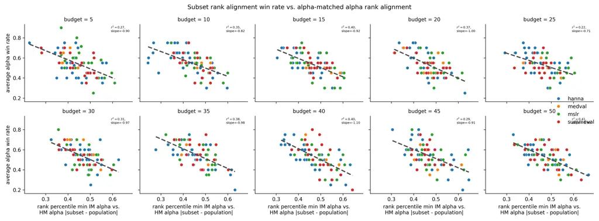

Figure 4: Empirical micro win-rate versus empirical average human-model
estimation error rank percentile,
$`\displaystyle\frac{\sum_{t=1}^{N}R[\epsilon_{j^{*(t)}}]}{C+1}`$, over
$`N=40`$ trials in metric-matched $`\alpha`$ estimation. As expected,
the relationship is linear across budgets.

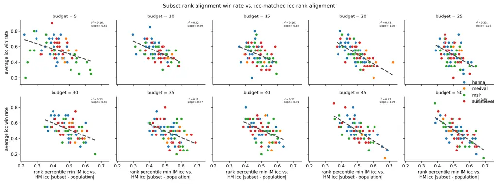

Figure 5: Observed micro win-rate versus observed average human-model
estimation error rank percentile,
$`\displaystyle\frac{\sum_{t=1}^{N}R[\epsilon_{j^{*(t)}}]}{C+1}`$, in
metric-matched ICC estimation. As expected, the relationship is linear
across budgets.

## Appendix D Additional Baseline Information and Comparison

We present win rates for stratified sampling as well as random sampling
with bias correction. For stratified sampling, the average macro win
rate across metrics for estimation error is 0.794 and across threshold
classification is 0.637.

|        |                          |       |          |          |                          |       |          |          |
| ------ | ------------------------ | ----- | -------- | -------- | ------------------------ | ----- | -------- | -------- |
|        | Estimation Error (Macro) |       |          |          | Estimation Error (Micro) |       |          |          |
| Budget | $`\alpha`$               | ICC   | $`\rho`$ | $`\tau`$ | $`\alpha`$               | ICC   | $`\rho`$ | $`\tau`$ |
| 5      | 0.827                    | 0.933 | 0.947    | 0.867    | 0.563                    | 0.624 | 0.597    | 0.595    |
| 10     | 0.760                    | 0.960 | 0.947    | 0.933    | 0.546                    | 0.609 | 0.602    | 0.588    |
| 15     | 0.733                    | 0.907 | 0.853    | 0.880    | 0.542                    | 0.595 | 0.585    | 0.569    |
| 20     | 0.720                    | 0.880 | 0.867    | 0.813    | 0.515                    | 0.560 | 0.582    | 0.565    |
| 25     | 0.693                    | 0.907 | 0.813    | 0.840    | 0.514                    | 0.553 | 0.582    | 0.575    |
| 30     | 0.733                    | 0.813 | 0.800    | 0.787    | 0.515                    | 0.561 | 0.579    | 0.563    |
| 35     | 0.707                    | 0.787 | 0.827    | 0.787    | 0.517                    | 0.543 | 0.576    | 0.544    |
| 40     | 0.680                    | 0.747 | 0.720    | 0.707    | 0.506                    | 0.529 | 0.565    | 0.534    |
| 45     | 0.640                    | 0.667 | 0.747    | 0.707    | 0.528                    | 0.519 | 0.565    | 0.539    |
| 50     | 0.667                    | 0.653 | 0.773    | 0.733    | 0.513                    | 0.520 | 0.575    | 0.547    |
| Avg    | 0.716                    | 0.825 | 0.829    | 0.805    | 0.526                    | 0.561 | 0.581    | 0.562    |

Table 4: Stratified Metric Matching Performance: Estimation Error and
Threshold Classification

|        |                        |       |          |          |                        |       |          |          |
| ------ | ---------------------- | ----- | -------- | -------- | ---------------------- | ----- | -------- | -------- |
|        | Classification (Macro) |       |          |          | Classification (Micro) |       |          |          |
| Budget | $`\alpha`$             | ICC   | $`\rho`$ | $`\tau`$ | $`\alpha`$             | ICC   | $`\rho`$ | $`\tau`$ |
| 5      | 0.688                  | 0.585 | 0.784    | 0.824    | 0.575                  | 0.554 | 0.629    | 0.644    |
| 10     | 0.655                  | 0.611 | 0.719    | 0.717    | 0.545                  | 0.575 | 0.611    | 0.628    |
| 15     | 0.665                  | 0.623 | 0.701    | 0.676    | 0.557                  | 0.585 | 0.597    | 0.591    |
| 20     | 0.571                  | 0.625 | 0.703    | 0.619    | 0.534                  | 0.564 | 0.603    | 0.554    |
| 25     | 0.676                  | 0.611 | 0.685    | 0.738    | 0.562                  | 0.571 | 0.598    | 0.595    |
| 30     | 0.598                  | 0.620 | 0.713    | 0.697    | 0.547                  | 0.573 | 0.613    | 0.575    |
| 35     | 0.623                  | 0.625 | 0.679    | 0.603    | 0.530                  | 0.571 | 0.595    | 0.554    |
| 40     | 0.527                  | 0.655 | 0.672    | 0.423    | 0.493                  | 0.574 | 0.573    | 0.469    |
| 45     | 0.532                  | 0.630 | 0.604    | 0.653    | 0.510                  | 0.574 | 0.556    | 0.591    |
| 50     | 0.484                  | 0.616 | 0.577    | 0.479    | 0.483                  | 0.564 | 0.559    | 0.486    |
| Avg    | 0.602                  | 0.620 | 0.684    | 0.643    | 0.534                  | 0.570 | 0.593    | 0.569    |

Table 5: Stratified Metric Matching Performance: Classification Win Rate
(Macro and Micro)

For random selection with bias correction, the average macro win rate
across metrics for estimation error is 0.863 and across threshold
classification is 0.392.

|        |                          |       |          |          |                          |       |          |          |
| ------ | ------------------------ | ----- | -------- | -------- | ------------------------ | ----- | -------- | -------- |
|        | Estimation Error (Macro) |       |          |          | Estimation Error (Micro) |       |          |          |
| Budget | $`\alpha`$               | ICC   | $`\rho`$ | $`\tau`$ | $`\alpha`$               | ICC   | $`\rho`$ | $`\tau`$ |
| 5      | 0.880                    | 0.960 | 0.853    | 0.867    | 0.540                    | 0.595 | 0.547    | 0.562    |
| 10     | 0.787                    | 1.000 | 0.947    | 0.987    | 0.537                    | 0.569 | 0.572    | 0.591    |
| 15     | 0.773                    | 0.973 | 0.947    | 0.933    | 0.540                    | 0.579 | 0.572    | 0.575    |
| 20     | 0.707                    | 0.907 | 0.973    | 0.947    | 0.532                    | 0.554 | 0.583    | 0.588    |
| 25     | 0.720                    | 0.880 | 0.933    | 0.960    | 0.545                    | 0.558 | 0.590    | 0.589    |
| 30     | 0.733                    | 0.840 | 0.920    | 0.867    | 0.532                    | 0.546 | 0.598    | 0.569    |
| 35     | 0.733                    | 0.813 | 0.920    | 0.827    | 0.543                    | 0.536 | 0.613    | 0.581    |
| 40     | 0.747                    | 0.827 | 0.947    | 0.867    | 0.548                    | 0.539 | 0.602    | 0.559    |
| 45     | 0.760                    | 0.800 | 0.947    | 0.813    | 0.563                    | 0.551 | 0.622    | 0.569    |
| 50     | 0.733                    | 0.733 | 0.947    | 0.827    | 0.569                    | 0.540 | 0.631    | 0.579    |
| Avg    | 0.757                    | 0.873 | 0.933    | 0.889    | 0.545                    | 0.557 | 0.593    | 0.576    |

Table 6: Random with Bias Correction Metric Matching Performance:
Estimation Error (Macro and Micro)

|        |                      |       |          |          |                      |       |          |          |
| ------ | -------------------- | ----- | -------- | -------- | -------------------- | ----- | -------- | -------- |
|        | Thresholding (Macro) |       |          |          | Thresholding (Micro) |       |          |          |
| Budget | $`\alpha`$           | ICC   | $`\rho`$ | $`\tau`$ | $`\alpha`$           | ICC   | $`\rho`$ | $`\tau`$ |
| 5      | 0.398                | 0.537 | 0.363    | 0.431    | 0.443                | 0.531 | 0.429    | 0.463    |
| 10     | 0.289                | 0.484 | 0.387    | 0.611    | 0.372                | 0.526 | 0.443    | 0.542    |
| 15     | 0.270                | 0.505 | 0.309    | 0.548    | 0.361                | 0.533 | 0.385    | 0.511    |
| 20     | 0.246                | 0.506 | 0.285    | 0.455    | 0.310                | 0.522 | 0.374    | 0.482    |
| 25     | 0.204                | 0.496 | 0.306    | 0.614    | 0.318                | 0.533 | 0.343    | 0.533    |
| 30     | 0.165                | 0.505 | 0.336    | 0.521    | 0.275                | 0.527 | 0.382    | 0.522    |
| 35     | 0.165                | 0.518 | 0.290    | 0.569    | 0.275                | 0.534 | 0.354    | 0.551    |
| 40     | 0.141                | 0.520 | 0.342    | 0.419    | 0.235                | 0.538 | 0.369    | 0.517    |
| 45     | 0.158                | 0.539 | 0.271    | 0.504    | 0.213                | 0.557 | 0.327    | 0.565    |
| 50     | 0.167                | 0.507 | 0.259    | 0.540    | 0.227                | 0.542 | 0.367    | 0.526    |
| Avg    | 0.220                | 0.512 | 0.315    | 0.521    | 0.303                | 0.534 | 0.377    | 0.521    |

Table 7: Random with Bias Correction Metric Matching Performance:
Thresholding (Macro and Micro)

## Appendix E Ablation Studies

### E.1 Average Aggregation

We show that the way we aggregate model information impacts the
performance of our algorithm. Given a model suite
$`\mathcal{M}=\{M_{1},M_{2},\ldots,M_{n}\}`$ and a target model
$`T\in\mathcal{M}`$, we present an alternative aggregation approach in
Figure 6b. We calculate the target metric by
$`\hat{\rho}=f\left(T,\frac{1}{|\mathcal{M}|}\sum_{M_{i}\in\mathcal{M}}M_{i}\right)`$.
This essentially constructs an average score function from the scorers
in $`\mathcal{M}`$, $`M^{\text{avg}}:\mathcal{X}\rightarrow\mathcal{Y}`$
s.t.
$`M^{\text{avg}}(x)=\frac{1}{|\mathcal{M}|}\sum_{M^{\prime}\in\mathcal{M}}M^{\prime}(x)`$.
We posit that this fails to capture all necessary signal from individual
judges, thus causing the alternative aggregation method that we employ
in the main body to perform better.

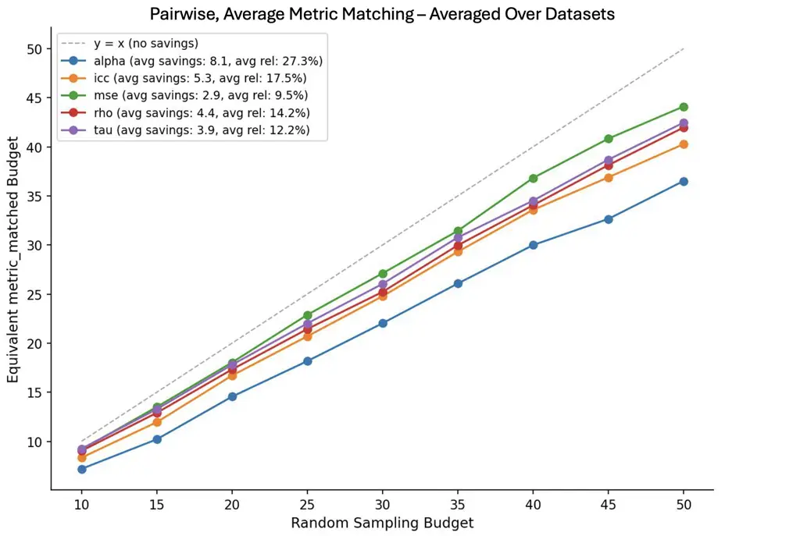

(a)

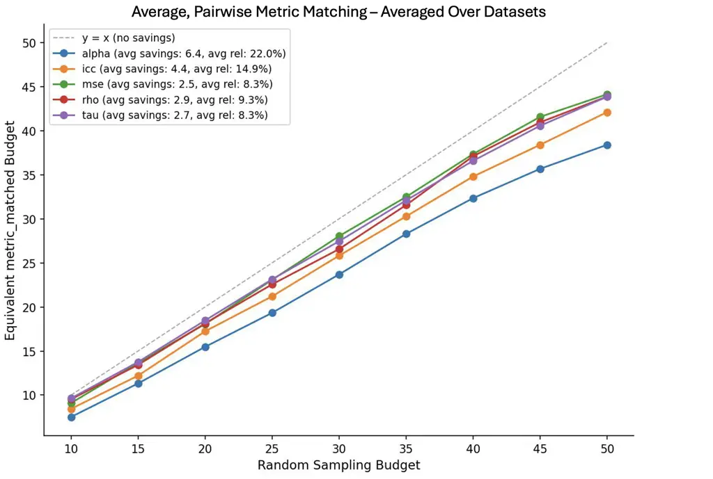

(b)

Figure 6: Aggregation approaches impact effectiveness of Metric Match,
with the optimal approach being to calculate the reliability of our
target model with each ensemble member individually and average these
results (a) as opposed to averaging the ensemble labels and calculating
the reliability coefficient with a single "averaged" ensemble point (b).

Estimation error win rates as shown in Table 8 are higher for this
aggregation method, indicating that although the gains are less
significant, they are equally if not more reliable.

|        |                             |       |          |          |                                     |       |          |          |
| ------ | --------------------------- | ----- | -------- | -------- | ----------------------------------- | ----- | -------- | -------- |
|        | Estimation Error (Win Rate) |       |          |          | Threshold Classification (Win Rate) |       |          |          |
| Budget | $`\alpha`$                  | ICC   | $`\tau`$ | $`\rho`$ | $`\alpha`$                          | ICC   | $`\tau`$ | $`\rho`$ |
| 5      | 0.867                       | 0.760 | 0.587    | 0.507    | 0.631                               | 0.625 | 0.797    | 0.671    |
| 10     | 0.920                       | 0.840 | 0.760    | 0.667    | 0.623                               | 0.667 | 0.739    | 0.611    |
| 15     | 0.893                       | 0.787 | 0.773    | 0.733    | 0.750                               | 0.653 | 0.661    | 0.791    |
| 20     | 0.867                       | 0.733 | 0.693    | 0.680    | 0.644                               | 0.612 | 0.571    | 0.714    |
| 25     | 0.853                       | 0.733 | 0.680    | 0.707    | 0.667                               | 0.585 | 0.630    | 0.774    |
| 30     | 0.773                       | 0.720 | 0.733    | 0.773    | 0.795                               | 0.516 | 0.730    | 0.655    |
| 35     | 0.840                       | 0.680 | 0.627    | 0.733    | 0.675                               | 0.477 | 0.649    | 0.623    |
| 40     | 0.760                       | 0.720 | 0.640    | 0.587    | 0.694                               | 0.550 | 0.630    | 0.700    |
| 45     | 0.853                       | 0.747 | 0.640    | 0.653    | 0.611                               | 0.567 | 0.600    | 0.660    |
| 50     | 0.880                       | 0.800 | 0.720    | 0.720    | 0.581                               | 0.613 | 0.556    | 0.651    |
| Avg    | 0.851                       | 0.752 | 0.685    | 0.676    | 0.667                               | 0.587 | 0.656    | 0.685    |

Table 8: Average-Pairwise Metric Matching Performance: Estimation Error
and Threshold Classification Macro Win Rate

### E.2 Number of Candidate Subsets $`C`$

Here, we vary the number of candidate subsets considered for variance
matching between $`C=10`$ to $`C=200`$, and report the estimation errors
with comparison to random baseline in the red horizontal line in
Figure 8 for ICC and Figure 7 for alpha estimation. We note that these
values would correspond to macro-average win-rate and thus do not
represent the results we would expect to see with micro-average
win-rate. We do not observe an interpretable trend across datasets or
budgets between macro-average and number of candidate subsets.
Additionally, due to computational constraints, we only study up to
$`200`$ candidate subsets, which may be well below the number required
to observe any relationship (recall total possible subsets is
$`\displaystyle{|\mathcal{X}|\choose b}`$).

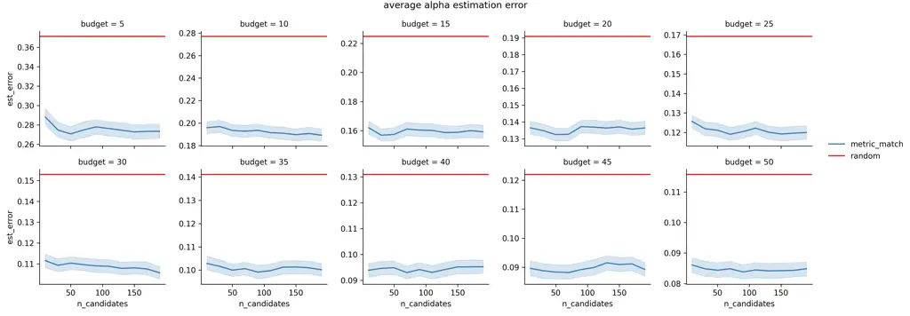

(a) HANNA

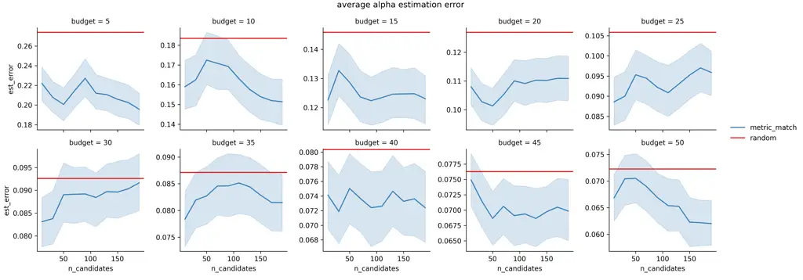

(b) MedVAL

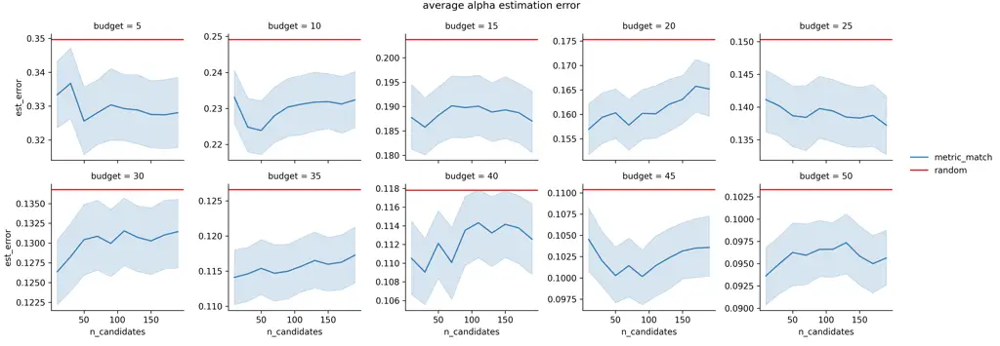

(c) MSLR

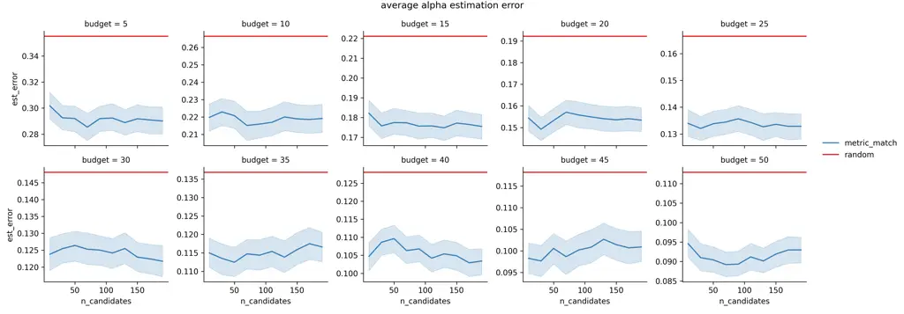

(d) SummEval

Figure 7: Ablation study over number of candidate subsets considered:
average estimation error in $`\alpha`$ metric matching at each budget
for each dataset for runs of metric matching with $`C=10`$ up to
$`C=200`$ candidate subsets with $`N=40`$ trials each.

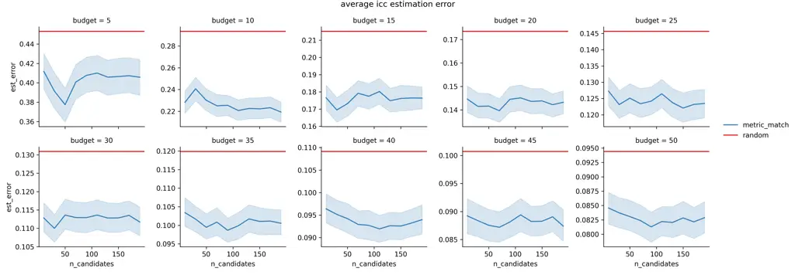

(a) HANNA

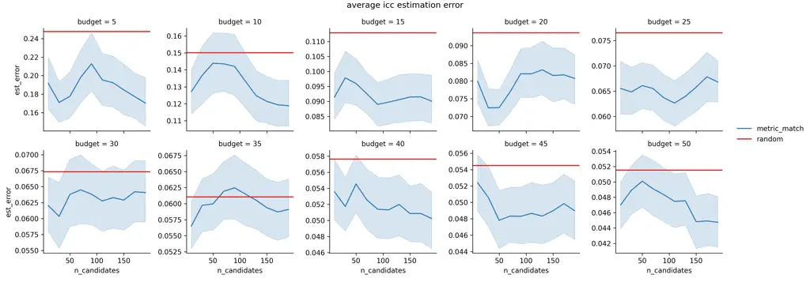

(b) MedVAL

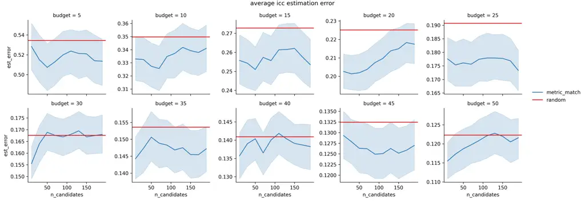

(c) MSLR

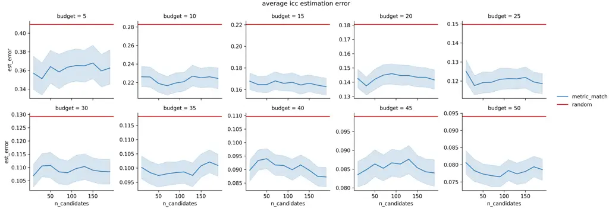

(d) SummEval

Figure 8: Ablation study over number of candidate subsets considered:
average estimation error in ICC metric matching at each budget for each
dataset for runs of metric matching with $`C=10`$ up to $`C=200`$
candidate subsets with $`N=40`$ trials each.

## Appendix F Variance Matching

We present an alternative algorithm as an extension to metric matching
called Variance Matching. We find that Variance Matching performs worse
than metric matching on average, but in cases where metric matching
performs very poorly, variance matching is more robust to these outlying
cases.

Data: Metric function $`T`$; MSB function MSB, MSE function MSE; weights
$`\alpha,\beta`$; budget $`b`$; generated text data
$`X=\{x_{i}\}_{i=1}^{n}\in\mathcal{X}^{n}`$; scores
$`\{y_{i}^{(M)}\}_{i=1}^{n}`$, {$`y_{i}^{(M^{\prime})}\}_{i=1}^{n}`$
from LLM judges $`M`$ and $`M^{\prime}`$, respectively; $`C`$, number of
candidate subsets over which to search

Result: Subset $`S^{*}\subseteq X`$, $`\lvert S^{*}\rvert=b`$

1 Initialize $`\delta_{\min}\leftarrow\infty`$

2 Initialize $`S^{*}\leftarrow\emptyset`$

3
$`\rho^{\text{IM}}\leftarrow\alpha\cdot\texttt{MSB}\big(\{y^{(M)}_{i}\}_{i=1}^{n},\{y^{(M^{\prime})}_{i}\}_{i=1}^{n}\big)+\beta\cdot\texttt{MSE}\big(\{y^{(M)}_{i}\}_{i=1}^{n},\{y^{(M^{\prime})}_{i}\}_{i=1}^{n}\big)`$

4 for _$`j=1,\dots,C`$_ do

    5 Sample $`S_{j}=\{x_{i_{1}},\dots,x_{i_{b}}\}`$ uniformly from
$`X`$ without replacement

    6
$`\widehat{\rho}_{S_{j}}^{\text{IM}}\leftarrow\alpha\cdot\texttt{MSB}\big(\{y^{(M)}_{i_{k}}\}_{k=1}^{b},\{y^{(M^{\prime})}_{i_{k}}\}_{k=1}^{b}\big)+\beta\cdot\texttt{MSE}\big(\{y^{(M)}_{i_{k}}\}_{k=1}^{b},\{y^{(M^{\prime})}_{i_{k}}\}_{k=1}^{b}\big)`$

    7
$`\delta_{j}=\lvert\widehat{\rho}_{S_{j}}^{\text{IM}}-\rho^{\text{IM}}\rvert`$

    8 if _$`\delta_{j}<\delta_{\min}`$_ then

       9 $`S^{*}\leftarrow S_{j}`$

       10 $`\delta_{\min}\leftarrow\delta_{j}`$

11 return _$`S^{_}`$\*

Algorithm 2 Weighted Variance Matching

We find that the optimal hyperparameters for this mixture are
$`\alpha=0.9`$ and $`\beta=0.1`$. We highlight results of this algorithm
in Table 9.

|        |                             |       |          |          |                                     |       |          |          |
| ------ | --------------------------- | ----- | -------- | -------- | ----------------------------------- | ----- | -------- | -------- |
|        | Estimation Error (Win Rate) |       |          |          | Threshold Classification (Win Rate) |       |          |          |
| Budget | $`\alpha`$                  | ICC   | $`\tau`$ | $`\rho`$ | $`\alpha`$                          | ICC   | $`\tau`$ | $`\rho`$ |
| 5      | 0.867                       | 0.840 | 0.760    | 0.800    | 0.655                               | 0.505 | 0.585    | 0.572    |
| 10     | 0.920                       | 0.947 | 0.880    | 0.880    | 0.728                               | 0.539 | 0.710    | 0.653    |
| 15     | 0.973                       | 0.947 | 0.773    | 0.827    | 0.667                               | 0.548 | 0.587    | 0.627    |
| 20     | 0.933                       | 0.907 | 0.827    | 0.840    | 0.506                               | 0.496 | 0.333    | 0.511    |
| 25     | 0.867                       | 0.867 | 0.773    | 0.787    | 0.574                               | 0.609 | 0.500    | 0.640    |
| 30     | 0.880                       | 0.947 | 0.800    | 0.840    | 0.620                               | 0.583 | 0.720    | 0.640    |
| 35     | 0.933                       | 0.907 | 0.787    | 0.800    | 0.563                               | 0.642 | 0.464    | 0.488    |
| 40     | 0.760                       | 0.827 | 0.707    | 0.733    | 0.466                               | 0.539 | 0.452    | 0.449    |
| 45     | 0.907                       | 0.893 | 0.773    | 0.800    | 0.433                               | 0.586 | 0.461    | 0.504    |
| 50     | 0.853                       | 0.867 | 0.733    | 0.760    | 0.679                               | 0.522 | 0.558    | 0.442    |
| Avg    | 0.889                       | 0.895 | 0.781    | 0.807    | 0.589                               | 0.557 | 0.537    | 0.552    |

Table 9: Variance Matching Performance: Estimation Error and Threshold
Classification

## Appendix G Mean Squared Error

We introduce results with non-correlation-based metrics, such as Mean
Squared Error (MSE). We show that variance matching as opposed to Metric
Match on the MSE metric provides larger gains, although Metric Match
still outperforms random for estimation error and threshold
classification at the macro level for small budgets.

|        |                  |       |                   |       |                          |       |                   |       |
| ------ | ---------------- | ----- | ----------------- | ----- | ------------------------ | ----- | ----------------- | ----- |
|        | Estimation Error |       |                   |       | Threshold Classification |       |                   |       |
|        | Metric Matching  |       | Variance Matching |       | Metric Matching          |       | Variance Matching |       |
| Budget | Macro            | Micro | Macro             | Micro | Macro                    | Micro | Macro             | Micro |
| 5      | 0.827            | 0.475 | 0.733             | 0.481 | 0.568                    | 0.481 | 0.512             | 0.511 |
| 10     | 0.720            | 0.492 | 0.813             | 0.517 | 0.524                    | 0.469 | 0.550             | 0.531 |
| 15     | 0.693            | 0.486 | 0.800             | 0.517 | 0.565                    | 0.448 | 0.676             | 0.520 |
| 20     | 0.587            | 0.469 | 0.733             | 0.503 | 0.462                    | 0.445 | 0.567             | 0.508 |
| 25     | 0.613            | 0.459 | 0.800             | 0.512 | 0.415                    | 0.439 | 0.550             | 0.505 |
| 30     | 0.587            | 0.450 | 0.760             | 0.500 | 0.398                    | 0.434 | 0.547             | 0.495 |
| 35     | 0.613            | 0.447 | 0.827             | 0.522 | 0.387                    | 0.442 | 0.498             | 0.508 |
| 40     | 0.573            | 0.449 | 0.640             | 0.502 | 0.392                    | 0.435 | 0.512             | 0.481 |
| 45     | 0.520            | 0.442 | 0.680             | 0.499 | 0.378                    | 0.504 | 0.454             | 0.497 |
| 50     | 0.587            | 0.446 | 0.627             | 0.492 | 0.419                    | 0.450 | 0.467             | 0.485 |
| Avg    | 0.632            | 0.462 | 0.741             | 0.504 | 0.451                    | 0.455 | 0.533             | 0.505 |

Table 10: MSE Win Rates by Method: Macro and Micro Win Rates

## Appendix H Results by Dataset Axis

Here we present disagreggated results at the dataset level in order to
highlight the robustness of this method across datasets, metrics, and
budgets. We highlight that poor performance for certain (metric,
dataset) pairs are empirically driven by low true reliability
parameters, indicating that Metric Match may be more susceptible than
variance matching when the judge is misaligned from human constructs.


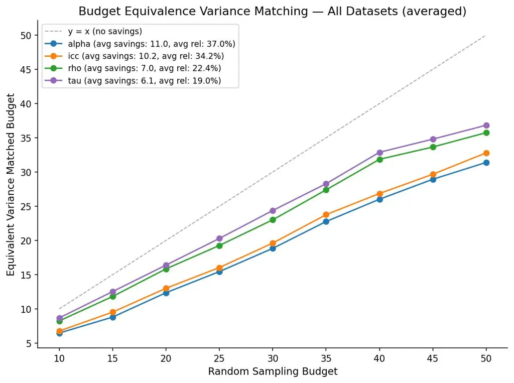

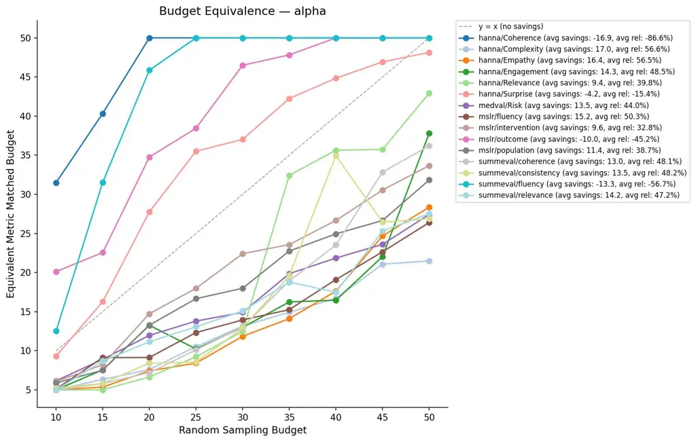

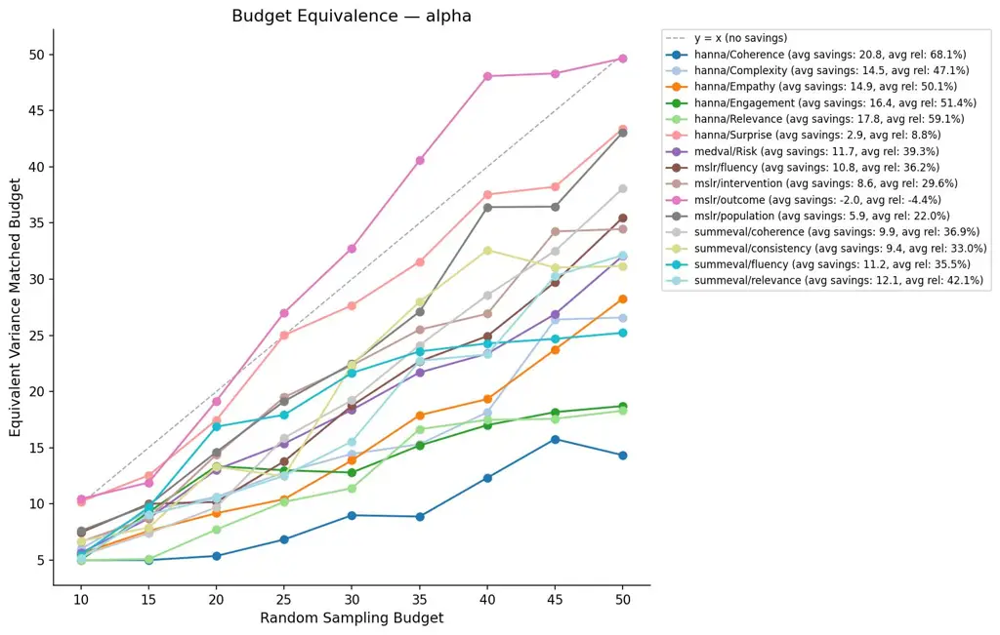

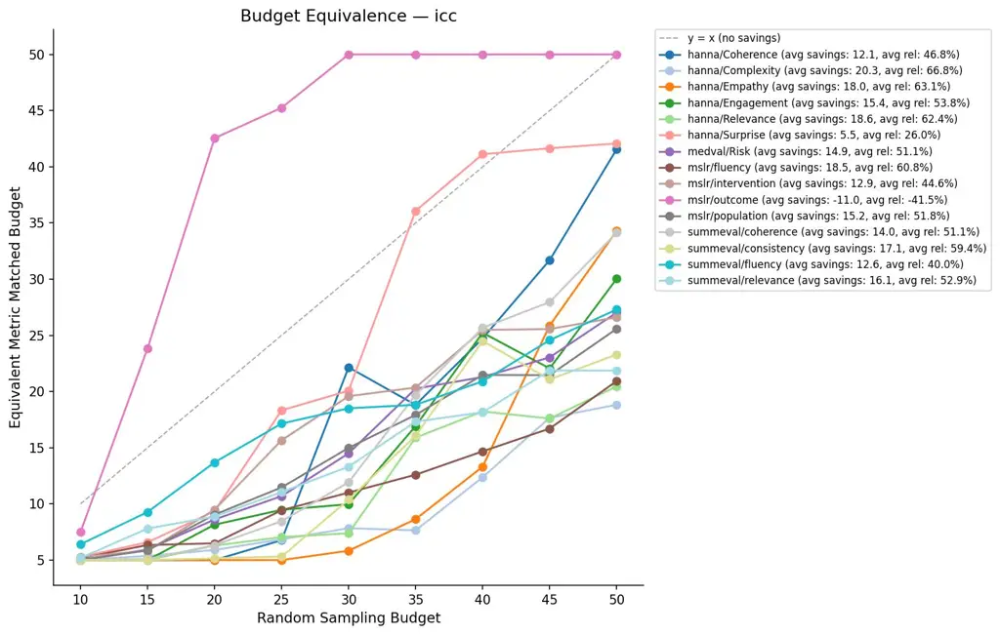

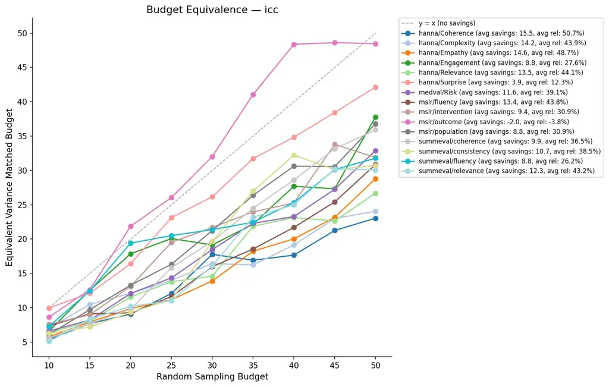

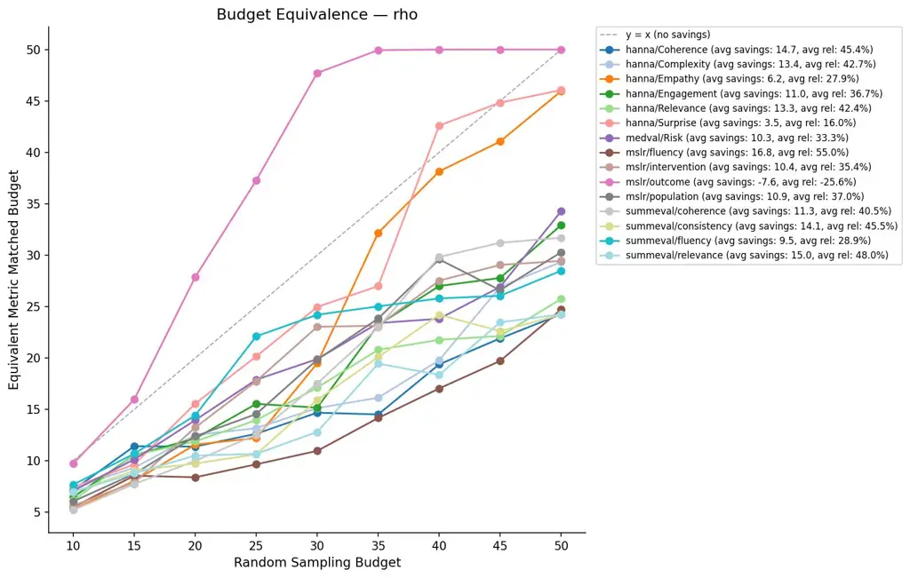

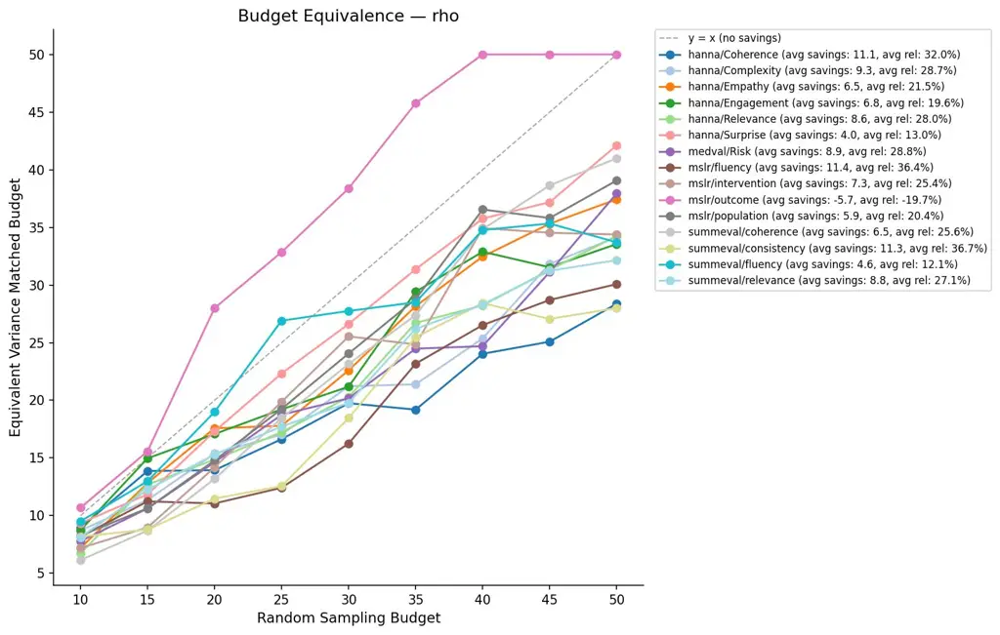

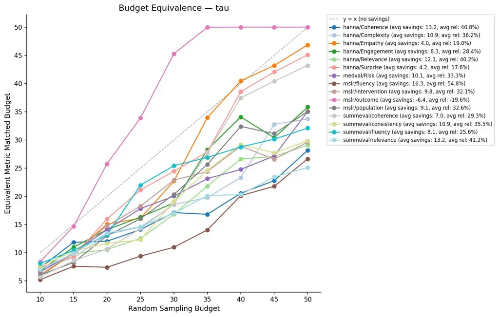

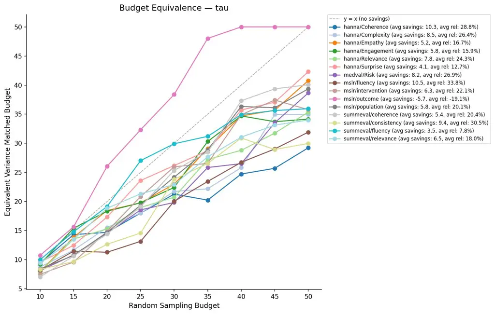

Figure 9: Annotation savings for both Metric Match as wel as associated
Variance Match selection methods.

We also highlight the true reliability coefficient value per
(dataset,axis) pair in Table 11, along with the estimation error
(Table 12) and reliability classification (Table 13) win rate between
Metric Match and random selection at the individual dataset level.

|          |              |        |        |       |        |       |
| -------- | ------------ | ------ | ------ | ----- | ------ | ----- |
| Dataset  | Axis         | Alpha  | ICC    | Rho   | Tau    | MSE   |
| hanna    | Coherence    | -0.230 | 0.679  | 0.456 | 0.391  | 4.275 |
| hanna    | Complexity   | 0.181  | 0.605  | 0.332 | 0.277  | 1.923 |
| hanna    | Empathy      | 0.194  | 0.526  | 0.302 | 0.256  | 1.688 |
| hanna    | Engagement   | 0.025  | 0.671  | 0.404 | 0.344  | 2.592 |
| hanna    | Relevance    | 0.404  | 0.755  | 0.603 | 0.516  | 1.700 |
| hanna    | Surprise     | 0.128  | 0.246  | 0.197 | 0.160  | 3.103 |
| medval   | Risk         | 0.655  | 0.812  | 0.706 | 0.629  | 1.196 |
| mslr     | fluency      | 0.625  | 0.779  | 0.655 | 0.643  | 0.169 |
| mslr     | intervention | 0.541  | 0.700  | 0.538 | 0.487  | 0.556 |
| mslr     | outcome      | -0.113 | -0.005 | 0.000 | -0.000 | 1.430 |
| mslr     | population   | 0.377  | 0.545  | 0.372 | 0.341  | 0.642 |
| summeval | coherence    | 0.644  | 0.787  | 0.668 | 0.548  | 1.143 |
| summeval | consistency  | 0.654  | 0.812  | 0.762 | 0.718  | 0.987 |
| summeval | fluency      | -0.263 | 0.522  | 0.420 | 0.365  | 4.222 |
| summeval | relevance    | 0.527  | 0.774  | 0.576 | 0.481  | 0.951 |

Table 11: True population values of disagreggated datasets across
metrics, averaged over our model suite.

|          |              |       |      |      |      |      |
| -------- | ------------ | ----- | ---- | ---- | ---- | ---- |
| Dataset  | Axis         | Alpha | ICC  | Rho  | Tau  | MSE  |
| hanna    | Coherence    | 0.00  | 0.76 | 0.94 | 0.94 | 0.00 |
| hanna    | Complexity   | 1.00  | 1.00 | 1.00 | 0.94 | 0.80 |
| hanna    | Empathy      | 1.00  | 0.90 | 0.72 | 0.66 | 0.78 |
| hanna    | Engagement   | 0.82  | 0.92 | 0.90 | 0.84 | 0.24 |
| hanna    | Relevance    | 0.70  | 0.98 | 0.96 | 0.94 | 0.48 |
| hanna    | Surprise     | 0.38  | 0.68 | 0.76 | 0.70 | 0.66 |
| medval   | Risk         | 0.98  | 1.00 | 1.00 | 0.94 | 0.84 |
| mslr     | fluency      | 1.00  | 1.00 | 0.98 | 1.00 | 0.96 |
| mslr     | intervention | 0.90  | 1.00 | 0.94 | 0.94 | 0.90 |
| mslr     | outcome      | 0.10  | 0.20 | 0.18 | 0.30 | 0.14 |
| mslr     | population   | 0.96  | 1.00 | 0.96 | 0.94 | 1.00 |
| summeval | coherence    | 1.00  | 0.96 | 0.94 | 0.84 | 0.92 |
| summeval | consistency  | 0.96  | 1.00 | 0.98 | 0.98 | 0.94 |
| summeval | fluency      | 0.08  | 0.98 | 0.94 | 0.94 | 0.00 |
| summeval | relevance    | 0.98  | 1.00 | 0.98 | 0.94 | 0.82 |

Table 12: Disagreggated results for estimation error win rate of Metric
Match compared to random selection.

|          |              |       |      |      |      |      |
| -------- | ------------ | ----- | ---- | ---- | ---- | ---- |
| Dataset  | Axis         | Alpha | ICC  | Rho  | Tau  | MSE  |
| hanna    | Coherence    | 0.00  | 0.29 | 0.83 | 0.93 | 0.00 |
| hanna    | Complexity   | 0.85  | 0.47 | 0.70 | 0.81 | 0.70 |
| hanna    | Empathy      | 0.49  | 0.19 | 0.50 | 0.51 | 0.56 |
| hanna    | Engagement   | 0.56  | 0.56 | 0.71 | 0.69 | 0.17 |
| hanna    | Relevance    | 0.59  | 0.63 | 0.89 | 0.88 | 0.10 |
| hanna    | Surprise     | 0.49  | 0.43 | 0.70 | 0.76 | 0.64 |
| medval   | Risk         | 0.67  | 0.91 | 0.65 | 0.76 | 0.40 |
| mslr     | fluency      | 0.77  | 0.67 | 0.87 | 0.84 | 1.00 |
| mslr     | intervention | 0.72  | 0.64 | 0.80 | 0.82 | 0.66 |
| mslr     | outcome      | 0.36  | 0.06 | 0.38 | 0.44 | 0.00 |
| mslr     | population   | 0.85  | 0.84 | 0.86 | 0.94 | 0.73 |
| summeval | coherence    | 0.82  | 0.74 | 0.73 | 0.75 | 0.42 |
| summeval | consistency  | 0.38  | 0.61 | 0.63 | 0.67 | 0.55 |
| summeval | fluency      | —     | 0.26 | 0.80 | 0.83 | 0.00 |
| summeval | relevance    | 0.73  | 0.60 | 0.64 | 0.71 | 0.68 |

Table 13: Disagreggated results for reliability classification win rate
of Metric Match compared to random selection.

## Appendix I Target and Ensemble Ablations

### I.1 Small models

Here we present the same analysis but with a smaller, less powerful
suite of models to show generalizability. Models include
GPT-4o-mini\[38\], Meta-Llama-3.1-8B-Instruct\[21\],
Google-gemma-3-1b-it\[46\], and Qwen2.5-7B-Instruct\[6\].

|         |                  |      |      |      |      |              |      |      |      |      |
| ------- | ---------------- | ---- | ---- | ---- | ---- | ------------ | ---- | ---- | ---- | ---- |
|         | Estimation Error |      |      |      |      | Thresholding |      |      |      |      |
| Budget  | Alpha            | ICC  | Rho  | Tau  | MSE  | Alpha        | ICC  | Rho  | Tau  | MSE  |
| 5       | 0.92             | 0.90 | 0.91 | 0.95 | 0.85 | 0.74         | 0.48 | 0.77 | 0.81 | 0.68 |
| 10      | 0.80             | 0.92 | 0.81 | 0.84 | 0.72 | 0.92         | 0.59 | 0.89 | 0.91 | 0.79 |
| 15      | 0.80             | 0.88 | 0.82 | 0.84 | 0.68 | 0.84         | 0.62 | 0.94 | 0.96 | 0.79 |
| 20      | 0.78             | 0.85 | 0.83 | 0.81 | 0.62 | 0.88         | 0.61 | 0.83 | 0.96 | 0.66 |
| 25      | 0.78             | 0.83 | 0.88 | 0.86 | 0.62 | 1.00         | 0.58 | 0.95 | 1.00 | 0.80 |
| 30      | 0.78             | 0.85 | 0.86 | 0.84 | 0.53 | 0.92         | 0.85 | 0.92 | 1.00 | 0.73 |
| 35      | 0.82             | 0.87 | 0.84 | 0.79 | 0.55 | 1.00         | 0.77 | 0.88 | 1.00 | 0.81 |
| 40      | 0.73             | 0.92 | 0.84 | 0.79 | 0.50 | 1.00         | 0.76 | 0.94 | 1.00 | 0.76 |
| 45      | 0.70             | 0.90 | 0.78 | 0.79 | 0.47 | 1.00         | 0.84 | 0.67 | 1.00 | 0.73 |
| 50      | 0.73             | 0.85 | 0.74 | 0.74 | 0.45 | 1.00         | 0.75 | 1.00 | —    | 0.81 |
| Average | 0.78             | 0.88 | 0.83 | 0.83 | 0.60 | 0.93         | 0.69 | 0.88 | 0.96 | 0.76 |

Table 14: Estimation Error and Thresholding by Budget w/ small ensemble

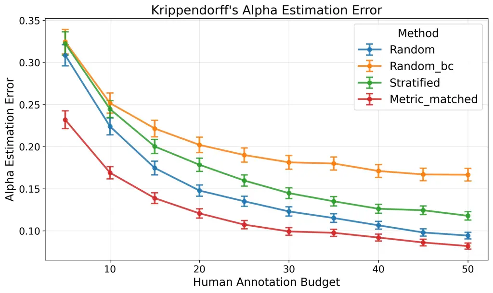

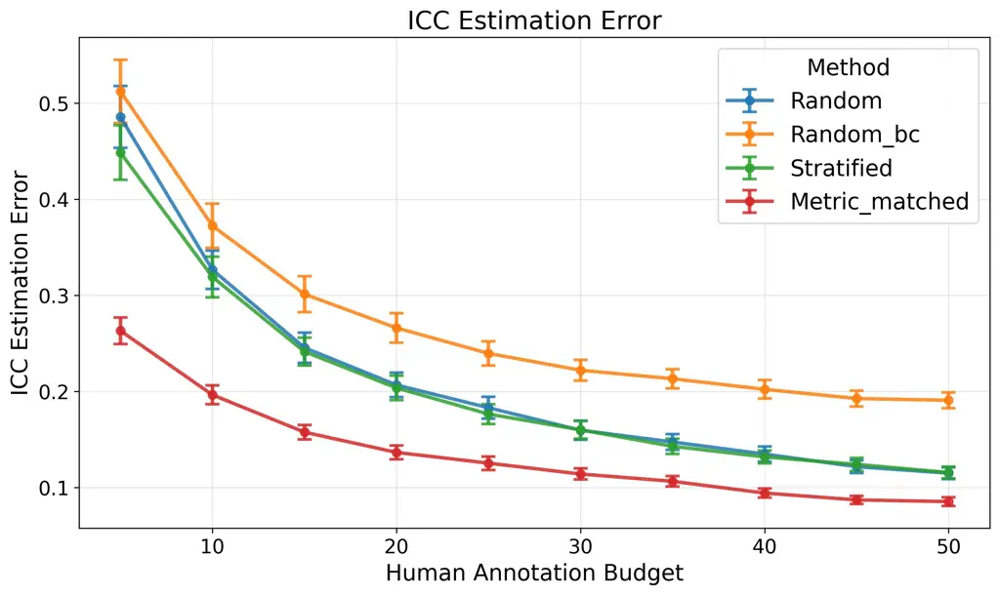

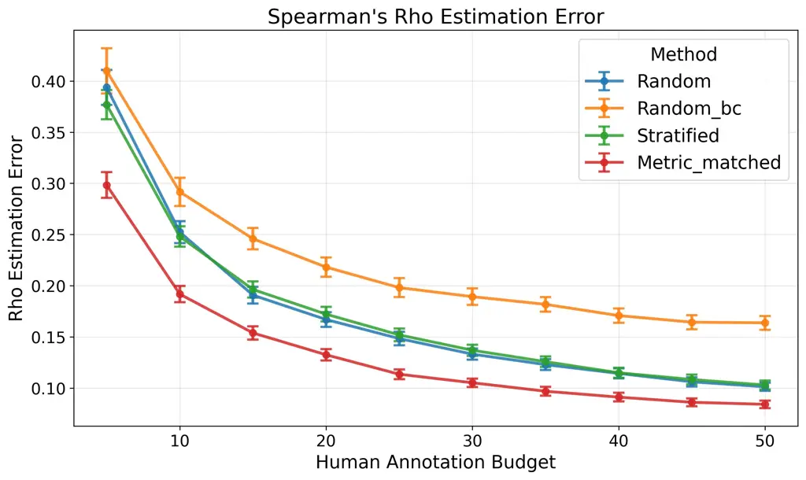

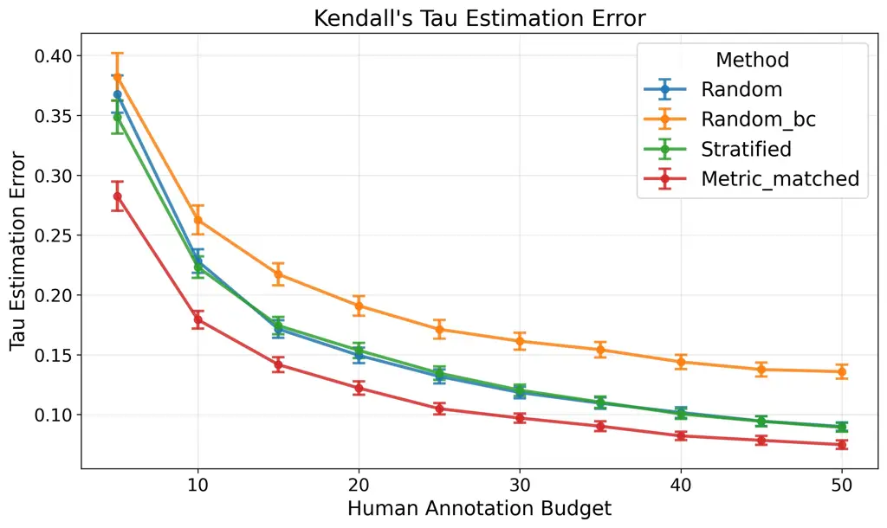

Figure 10: Small models show similar performance gains across metrics
and budgets. We report results from a suite of small models to highlight
that this approach generalizes across model scale.

### I.2 Single Model Ensemble Ablations

We provide additional ablations for changing the ensemble itself that
provides synthetic labels for selection of points to annotate. We see
that the largest gains over random are present when an ensemble of
models are used as opposed to individual models, which are more prone to
reliance on the correlation of any individual model with human feedback
for a given dataset. Ensembling in this setting helps improve
robustness. Further, we identify that the target models must be roughly
aligned capability-wise with their ensemble, and having an ensemble that
is miscalibrated to the target results in worse performance.

|        |                            |             |            |                          |                        |
| ------ | -------------------------- | ----------- | ---------- | ------------------------ | ---------------------- |
| Metric | Strong Ens.+ Strong Target | Claude-Only | GPT-5-Only | Weak Ens.+ Strong Target | Weak Ens.+ Weak Target |
| ICC    | 26.65%                     | 15.71%      | 23.56%     | $`-`$34.49%              | 33.09%                 |
| Alpha  | 9.05%                      | -2.88%      | 0.80%      | $`-`$46.87%              | 21.56%                 |
| Rho    | 20.95%                     | 9.61%       | 13.57%     | $`-`$19.26%              | 21.67%                 |
| Tau    | 17.93%                     | 5.74%       | 11.12%     | $`-`$18.36%              | 20.11%                 |

Table 15: Percent Relative Improvement over Random by Method and Metric.
These results highlight that single model ensembles don’t generalize as
well as multi-model ensembles.
