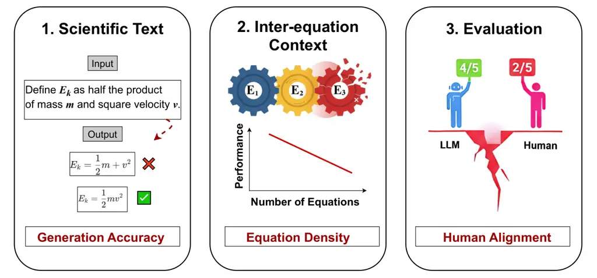
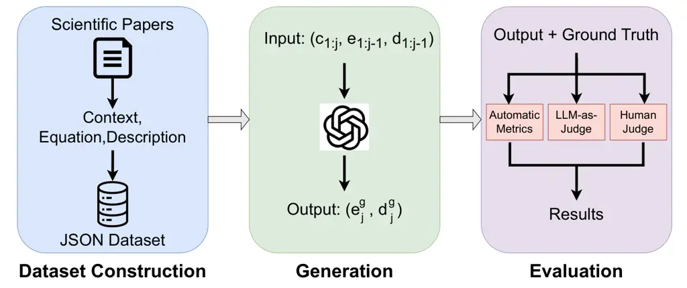
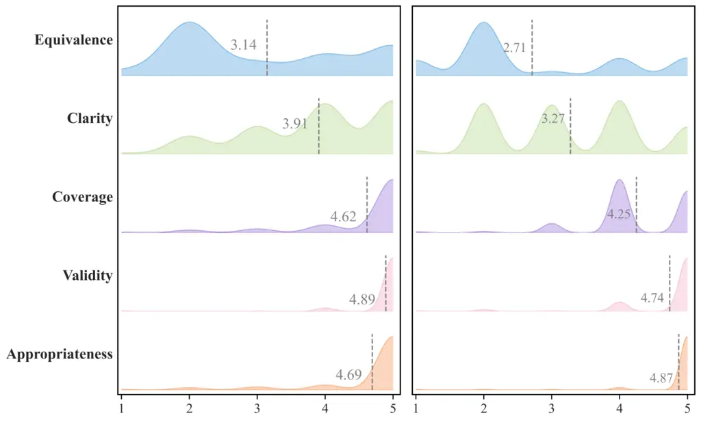

# SciText2Eq: Assessing LLMs for Explainable Equation Generation for Scientific Creativity

Yifan Mo Affiliation: Vrije Universiteit Amsterdam, Amsterdam,
Netherlands    Xiao Fu Affiliation: Vrije Universiteit Amsterdam,
Amsterdam, Netherlands    Yue Su Affiliation: Vrije Universiteit
Amsterdam, Amsterdam, Netherlands    Qingyu Meng Affiliation: Vrije
Universiteit Amsterdam, Amsterdam, Netherlands    Koen Hindriks
Affiliation: Vrije Universiteit Amsterdam, Amsterdam, Netherlands   
Qingzhi Liu Affiliation: Wageningen University & Research,
Netherlands{y.mo, y.su, q.meng, k.v.hindriks, j.pei2}@vu.nl,
ceciliafu2000@gmail.com, qingzhi.liu@wur.nl    Jiahuan Pei
^(†)^(†)thanks: Corresponding author. Affiliation: Vrije Universiteit
Amsterdam, Amsterdam, Netherlands

###### Abstract

This work investigates the ability of large language models (LLMs) to
generate mathematical equations from scientific texts. Prior work faces
challenges in unstructured grounding, multi-equation dependency, and
human-aligned evaluation. To this end, we construct a dataset of AI
research papers, pairing contextual passages with ground-truth equations
and variable descriptions. We develop an explainable equation generation
workflow and evaluate it across diverse open- and closed-source LLM
backbones. We introduce an evaluation protocol combining automatic
metrics, LLM-based rubrics, and human judgments to assess accuracy,
explainability, and human-LLM alignment. Results indicate that LLMs
perform moderately on lexical- and syntactic-based similarity, while
struggling with semantic accuracy. Comparisons between LLM-based
evaluations and human judgments reveal limited alignment, highlighting
challenges in using LLMs to assess equation quality. These findings
offer insights for improving equation generation models and developing
more reliable evaluation methods for scientific text. We provide code
and data for reproducibility. ¹¹ 1
[https://github.com/YifanMo727/SciText2Eq](https://github.com/YifanMo727/SciText2Eq)

## 1 Introduction

Mathematical equations underpin scientific knowledge representation and
reasoning Bais (2025). Recent research include equation recognition Zhou
et al. (2022), equation retrieval (Wang et al., 2021; Vemuganti et al.,
2025), mathematical language understanding (Peng et al., 2021; Scarlatos
and Lan, 2023), equation reasoning (Meadows et al., 2025; Yu et al.,
2025). As scientific literature grows denser, generating and explaining
equations in natural language has become central to scientific
creativity Yasunaga and Lafferty (2019).



Figure 1: Three key challenges in generating equations from unstructured
text.

A key line of related work is equation discovery, or SR (SR), which
recovers mathematical expressions describing relationships among
observed variables (Dong and Zhong, 2025). Recent approaches leverage
LLMs to propose and refine candidate equations using programming Shojaee
et al. (2025a), reasoning (Wang et al., 2025), and benchmarking (Shojaee
et al., 2025b). In contrast, equation generation focuses on producing
expressions conditioned on textual context. Prior work includes
extracting single equations from unstructured narrative text (Zhang et
al., 2023; Liang et al., 2023; Zong and Krishnamachari, 2023). TopicEq
jointly models topics and equations to align expressions with scientific
text (Yasunaga and Lafferty, 2019), yet its dataset is not publicly
available and contexts remain relatively simple.

In real scientific texts, equations appear in unstructured narratives,
requiring explanation, inter-equation reasoning, and semantic fidelity.
There are three major challenges: 1. accurately generating mathematical
expressions from scientific texts where equations are interleaved with
natural language descriptions; 2. handling multiple, non-independent
equations within the same document and understanding how equation
density and inter-equation context affect generation accuracy; 3.
evaluating generated equations in a comprehensive way and aligning LLM
(LLM)-based judgments with human assessments, while maintaining
explainability of the process. These challenges reveal a gap in
generating publication-quality scientific equations (Figure 1).

In this work, we propose SciText2Eq, a comprehensive workflow for
scientific discovery by LLM in real-world scientific text, designed to
systematically diagnose how well LLM can reconstruct and reason about
mathematical expressions for scientific creativity. We construct a
dedicated dataset of AI research papers, selecting sections rich in
equations to provide realistic multi-equation contexts. Equations and
their corresponding variable descriptions are sequentially generated by
LLM from the constructed dataset, based on all context and equations
preceding the target equation within each paper. Generated equations are
evaluated using a multi-level protocol that combines: 1. automatic
metrics measuring lexical and syntactic similarity; 2. rubric-based
LLM-as-judge evaluation assessing validity, coverage, clarity,
appropriateness, and equivalence of both equations and accompanying
descriptions; and 3. human evaluation to quantify alignment between LLM
and expert judgment.

The contributions of this work are threefold:

- •
  A workflow for scientific equation generation using LLM, providing
  both variable-level explanations and interpretable evaluation
  rationales.
- •
  A comprehensive multi-level evaluation framework, combining automatic
  metrics, LLM-based rubric metrics, and human judgment, along with an
  extensible benchmark dataset.
- •
  An empirical study of equation density, revealing its impact on
  equation generation performance.

## 2 Related work

### 2.1 Equation Discovery and Generation

Equation discovery, also know as SR, aims to recover mathematical
expressions from observational data or variables. Traditional SR methods
include evolutionary algorithms (Koza, 1994) and gradient-based
optimization (Petersen et al., 2021), while more recently, LLM have been
applied to these tasks. As shown in Appendix A, most approaches use
variable pairs as primary input, with general SR methods performing
equation discovery without additional guidance Merler et al. (2024), and
domain-specific methods incorporating structured information such as
scientific priors (Wang et al., 2025; Song et al., 2025), symbol
libraries Du et al. (2024), or brief natural language descriptions of
tasks to constrain the search space and guide equation
generation (Shojaee et al., 2025a; Shojaee et al., 2025b).

In contrast, equation generation produces mathematical expressions from
textual context rather than variable pairs. Early work uses natural
language MWP from public datasets (Zhang et al., 2023; Liang et al.,
2023; Zong and Krishnamachari, 2023), such as MathQA Amini et al. (2019)
and Math23K Wang et al. (2017), which mainly contain synthetic
arithmetic or algebra problems where text maps directly to equations,
requiring little domain knowledge or reasoning. Some approaches also
generate equations by modeling the semantic roles of numbers and
operators within the problem context Chiang and Chen (2019). Recent work
considers real scientific text by pairing each equation with surrounding
sentences (Yasunaga and Lafferty, 2019), but it focuses on local context
and does not fully capture dependencies across broader sections of a
paper.

In summary, while existing work has advanced equation discovery and
generation, most methods either focus on structured or synthetic
inputs (Merler et al., 2024; Shojaee et al., 2025a) or assume that
equations in real scientific texts depend primarily on local
context Yasunaga and Lafferty (2019). This leaves a gap in generating
equations from complex, long-form scientific narratives that require
integrating global context, which is the focus of our work.

### 2.2 Equation Density

Most benchmarks for equation discovery focus on SR tasks with short,
independent variable pairs, while domain-specific methods may use
priors, symbol libraries, or brief task descriptions (Wang et al., 2025;
Shojaee et al., 2025b; Du et al., 2024), yet equations remain isolated
without broader context. Similarly, prior work on equation generation
often considers independent problems or short text snippets, generating
each equation separately Zhang et al. (2023); Liang et al. (2023) or
using only limited local context Yasunaga and Lafferty (2019). Real
scientific papers, however, contain multiple interdependent equations
within long narratives.

Overlooking broader context and inter-equation dependencies can limit a
model’s ability to capture semantic structure. To better reflect
generation performance, our dataset preserves full narrative context,
providing all preceding text and equations for each target formula,
which enables analysis of how equation density affects generation
quality.

### 2.3 Evaluation and Human Alignment

Prior work on equation discovery and generation has largely relied on
automated metrics. In symbolic regression, common metrics such as
NMSE (Wang et al., 2025; Shojaee et al., 2025a), NRMSE Du et al. (2024),
R² Merler et al. (2024), quantify how closely generated equations match
observed data (Table 6). For equation generation from natural language,
evaluation often focuses on numerical or structural equivalence. Models
are assessed on whether generated equations yield the correct numeric
results (Zhang et al., 2023; Liang et al., 2023) or on
language-model-based metrics such as perplexity and syntax error rate
for LaTeX sequences (Yasunaga and Lafferty, 2019). Some approaches
incorporate LLM as evaluators (Shojaee et al., 2025b), but they
generally assess only one dimension at a time and seldom consider
semantic consistency, contextual appropriateness, or clarity of variable
roles.

Human evaluation has been relatively limited in prior work. In equation
discovery, few studies compare LLM-generated outputs with human
judgment (Shojaee et al., 2025b), and in equation generation, some works
evaluate numeric equivalence or label matching against human
annotations (Zong and Krishnamachari, 2023). Comprehensive rubric-based
human evaluation remains insufficient, leaving gaps in assessing
generation fidelity.

To address these gap, our evaluation framework combines multi-level
automatic metrics with LLM-based rubric scoring to capture lexical,
syntactic, and semantic accuracy together with human assessment to
analyze alignment, enabling a more complete understanding of generation
quality.

## 3 Evaluation Workflow



Figure 2: The proposed workflow for explainable equation generation in
scientific discovery.

As shown in Figure 2, our workflow has three stages: 1. Contextual
Equation Corpus Creation(§3.1), where equations are preserved within
original narrative contexts from research papers. 2. Context-to-Equation
Generation(§3.2), where LLM generate equations and descriptions based on
the corpus. 3. Multi-Level Equation Evaluation(§3.3), assessing outputs
via automatic metrics, LLM-based rubrics, and human evaluation.

### 3.1 Contextual Equation Corpus Creation

##### Data Source.

The dataset was constructed to comprehensively cover recent research in
AI domain, with a focus on papers containing significant mathematical or
formal content. Papers were sourced from leading AI conferences archived
in the ACL Anthology and OpenReview, including representative venues
such as ACL and ICLR. We collected papers published in the past two
years and applied selection criteria to ensure high-quality content,
including methodological significance and the presence of multiple
equations, ultimately including 170 papers in the dataset.

##### Dataset Construction.

We extracted the first four pages of short papers and the first seven
pages of other papers with equations.

We converted PDFs to Markdown using the META Nougat tool (Blecher et
al., 2024), which preserves LaTeX equations and tables, removed files
with failed conversions or with fewer than 2 or more than 15 equations.
We merged multiple expressions appearing in a single block into one
entry to preserve the grouping of related equations. The data schema is
provided (see Appendix C).

Formally, the dataset is $`\mathcal{D}=\{p_{1},\dots,p_{n}\}`$, where
$`n`$ denotes the total number of selected papers. Each paper $`p_{i}`$
is extracted as a list of $`n_{i}`$ context-equation-description
triples:
$`p_{i}=[(c_{1},e_{1},d_{1}),\dots,(c_{n_{i}},e_{n_{i}},d_{n_{i}})]`$,
where $`c_{j}`$ is the natural language context of the $`j`$-th
equation, $`e_{j}`$ is the corresponding LaTeX equation, and $`d_{j}`$
is a concise description of variables in $`e_{j}`$.

Venue \#Paper Avg \#Eq 2–5 Eqs 6–10 Eqs 11+ Eqs ACL 21 5.3 12 6 3 NAACL
28 5.1 17 9 2 NeurIPS 32 7.8 11 10 11 ICLR 46 7.8 11 25 10 ICML 43 8.1
14 18 11 Total 170 6.1 65 68 37

Table 1: Equation statistics by venues.

##### Dataset Statistics.

After preprocessing and filtering the collected papers, we analyzed the
distribution of equations to understand typical usage patterns. We
analyzed 170 papers that each contained two or more equations, totaling
1,043 equations. As shown in Table 1, most papers have 2 to 10
equations, while 37 papers have 11 or more. By venue, ICML, ICLR,
NeurIPS papers are more equation-heavy (avg. 7.8–8.1 eqs/paper) than ACL
and NAACL (avg. 5 eqs/paper), reflecting different writing styles.

### 3.2 Explainable Equation Generation

1: Paper set $`P=[p_{1},\dots,p_{n}]`$, $`n_{i}`$ is max number of
equations in $`i`$-th paper.

2: Initialize state:

3: $`S.\text{equations}\leftarrow[]`$ $`\triangleright`$ Store generated
equations and descriptions

4: $`S.\text{current\_paper}\leftarrow 0`$

5: $`S.\text{current\_step}\leftarrow 0`$

6: $`S.\text{finished}\leftarrow\text{False}`$

7: for $`p_{i}\in P`$ do

8:   $`M\leftarrow\textsc{Extract\_method}(p_{i})`$ $`\triangleright`$
Extract core methodology section

9:   $`\{c_{1},\dots,c_{n_{i}}\}\leftarrow\textsc{detect\_context}(M)`$
$`\triangleright`$ Original context

10:
  $`\{e_{1},\dots,e_{n_{i}}\}\leftarrow\textsc{detect\_equation}(M)`$
$`\triangleright`$ Original equations

11:
  $`\{d_{1},\dots,d_{n_{i}}\}\leftarrow\textsc{detect\_description}(M)`$
$`\triangleright`$ Original descriptions

12:   for $`j=1`$ to $`n_{i}`$ do

13:
   $`\mathcal{I}_{j}\leftarrow\textsc{construct\_input}(c_{1:j},e_{1:j-1},d_{1:j-1})`$

14:    $`(e^{g}_{j},d^{g}_{j})\leftarrow\text{LLM}(\mathcal{I}_{j})`$
$`\triangleright`$ Generate equation and description

15:    $`S.\text{equations.append}((e^{g}_{j},d^{g}_{j}))`$

16:    $`S.\text{current\_step}\leftarrow S.\text{current\_step}+1`$

17:   end for

18:   $`S.\text{current\_paper}\leftarrow S.\text{current\_paper}+1`$
$`\triangleright`$ Move to next paper

19: end for

20: $`S.\text{finished}\leftarrow\text{True}`$

21: return $`S.\text{equations}`$

Algorithm 1 Equation Generation Workflow

We formulate a context-to-equation generation task where an LLM
generates a mathematical equation-description pair conditioned on the
paper’s narrative context and previously generated outputs. Formally,
given a paper $`p_{i}\in\mathcal{D}`$, the model genrates the $`j`$-th
equation-description pair,

```math
\displaystyle(e_{j}^{g},d_{j}^{g})=\text{LLM}(c_{1:j},e_{1:j-1},d_{1:j-1}),\forall j\in[1,n_{i}],
```

where $`c_{1:j}`$ denotes all context segments up to step,
$`e_{1:j-1},d_{1:j-1}`$ are the previous equations and descriptions of
variables.

As shown in Algorithm 1, it is formulated as a document-level,
sequential generation problem: at each step $`j`$, an LLM conditions on
the current textual context together with all previously introduced
equations and variable descriptions, and generates the next
equation-description pair $`(e^{g}_{j},d^{g}_{j})`$. The input is
embedded into a standardized prompt template that enforces the required
output format, instructing the model to return only the LaTeX code for
the equation and a concise variable description. The full prompt and an
example generation process are provided in Appendix D.

### 3.3 Multi-Level Equation Evaluation

Our evaluation protocol focuses on three primary aspects: automatic
metrics, rubric metrics, and human judgment alignment.

##### Automatic Metrics.

We assess equation quality using five automatic metrics: 1. TexBLEUJung
et al. (2025)evaluates n-gram similarity with GPT-2 embeddings to
account for both token-level and structural overlap; 2. ROUGE-LLin
(2004)measures longest common subsequence alignment; 3. Levenshtein
distance (Levenshtein-D)  Levenshtein (1966); Li and Liu (2007) captures
character-level edit costs normalized by length; 4. Sequence similarity
(SeqSim), also called SMR  Rao et al. (2018) quantifies contiguous
matching subsequences; to capture structural accuracy; 5.
TED(TED)Schwarz et al. (2017)compares symbolic parse trees and averages
normalized distances across equations within an entry. The range of all
metrics are from 0 to 1, where higher values indicate greater
similarity, except TED where 0 indicates identical expressions and 1
indicates maximum difference.

Dimension Context GT_Eq\* GT_Des\* Gen_Eq Gen_Des Validity ✗ ✗ ✗ ✓ ✗
Coverage ✓ ✗ ✗ ✓ ✓ Clarity ✓ ✓ ✓ ✓ ✓ Appropriateness ✓ ✗ ✗ ✓ ✓
Equivalence ✓ ✓ ✓ ✓ ✓

Table 2: Information used in each LLM-as-Judge evaluation dimension. \*
indicates ground-truth; unmarked columns correspond to generated
outputs.

##### Rubric Metrics.

We define five-dimensional rubrics for LLM and human judges to evaluate
both surface-level correctness and semantic and contextual alignment:

1.  Validity, examining whether the equation is syntactically and
    mathematically well-formed; 2. Coverage, measuring whether all essential
    components are included; 3. Clarity, evaluating the clarity of the
    generated accompanying description; 4. Appropriateness, evaluating the
    degree to which the generated outputs appropriately match the scenario,
    intent, or constraints of the original problem statement; 5.
    Equivalence, assessing whether the generated equation conveys the same
    mathematical meaning as the ground-truth equation, allowing for
    algebraically equivalent transformations and variable renaming.

For each rubric metric, we provide detailed instructions in Appendix F
and specific information to guide its evaluation in Table 2.

Model TexBLEU (%) Levenshtein (%) SeqSim (%) ROUGE-L (%) Lexicality (%)
TED (%) Syntax (%) GPT-4.1 57.4 45.6 55.1 57.8 54.0 69.3 30.7
DeepSeek-R1 57.2 41.5 51.0 54.7 51.1 71.1 28.9 GPT-4o-mini 54.1 42.3
51.3 52.8 50.1 71.0 29.0 LLaMA3-70B 54.6 42.5 51.1 52.3 50.1 70.7 29.3
Qwen3-235B 59.8 44.1 53.1 55.1 53.0 69.9 30.1 Overall 56.6 $`\pm`$ 2.1
43.2 $`\pm`$ 1.5 52.3 $`\pm`$ 1.6 54.5 $`\pm`$ 2.0 51.7 $`\pm`$ 1.6 70.4
$`\pm`$ 0.7 29.6 $`\pm`$ 0.7

Table 3: Automatic evaluation results across lexical (TexBLEU,
Levenshtein-D, SeqSim, ROUGE-L) and syntactic (1 - TED) metrics.
Lexicality is the mean of the four lexical metrics, capturing token- and
sequence-level agreement, while Syntax measures hierarchical structure
recovery.

##### Human Judgment Alignment.

In addition to LLM-based evaluation, we conducted a human evaluation to
examine alignment between LLM and human judgments. A total of 100
examples from the evaluation dataset were independently assessed using
the same five rubrics as the LLM-as-Judge. The evaluation was
distributed across five human judges, and their assessments were
aggregated to create a combined reference for comparison. Human judges
were provided with the same rubrics available to LLM. We assess the
alignment by correlation coefficients: (1) Pearson’s $`r`$: Evaluates
linear correlation between continuous variables. (2) Spearman’s
$`\rho`$: Measures monotonic relationships between ranked variables. And
(3) Kendall’s $`\tau`$: Assesses ordinal associations between ranked
variables.

## 4 Experimental Setup

### 4.1 Research Questions

This work is guided by the following research questions: (RQ1) How
accurately can LLM generate correct mathematical equation from
unstructured real-world scientific literature? (RQ2) How does the number
of equations in the original text influence the accuracy of the
generation? (RQ3) how well do LLM evaluation align with human
assessments in generation tasks?

### 4.2 Backbone Models

We evaluate equation generation performance across a diverse set of LLM,
covering both general-purpose and math-oriented architectures to enable
comparative analysis. Specifically, we include the following models: 1.
OpenAI GPT-4.1, 2. OpenAI GPT-4o-mini, 3. DeepSeek-R1, 4. LLaMA3.3-70B, 5. Qwen3-235B. OpenAI ²² 2
[https://platform.openai.com/docs/models](https://platform.openai.com/docs/models)
and DeepSeek ³³ 3
[https://api.deepseek.com/models](https://api.deepseek.com/models)
models are accessed via their native APIs, while LLaMA and Qwen models
are queried through the Together AI platform ⁴⁴ 4
[https://www.together.ai/](https://www.together.ai/).

### 4.3 Implementation details

The proposed workflow is implemented by Python. During the equation
generation stage, we use five representative LLM with their respective
default decoding configurations. Specifically, Qwen3 is used with its
default temperature of 0.7; GPT-4.1 and GPT-4o are used with temperature
set to 1.0; and LLaMA-3 and DeepSeek-R1 are used with temperature set to
0.6. The input is formatted using a standardized prompt template (see
Appendix D) to enforce consistent LaTeX and variable description
outputs. All generated equations and descriptions are stored in
structured JSON files indexed by paper and equation identifiers. To
complement automatic metrics, we use GPT-4o-mini as an evaluator with a
fixed temperature of 0.2. Each evaluation prompt provides the same
contextual information used during generation, ensuring reliable and
easily parseable LLM scoring. Detailed evaluation prompt templates are
provided in Appendix E.

## 5 Main Results

### 5.1 Accuracy of Equation Generation (RQ1)

#### 5.1.1 Evaluation with Automatic Metrics

Table 3 reports all models’ equation generation performance using
automatic metrics. First, the models achieve moderate accuracy in
recovering mathematical expressions from unstructured scientific text.
The highest scores across four lexical similarity metrics remain below
60%, indicating persistent challenges in reliably generating
mathematical equation from real-world scientific writing. Second, Syntax
is substantially lower than Lexicality ($`\approx`$ 20% higher error),
reflecting the difficulty of correctly capturing the hierarchical
structure of mathematical expressions. Third, standard deviations across
models are small for all metrics, indicating little variation between
models. These results partially answer (RQ1) by establishing
quantitative upper bounds on current LLM accuracy. While models
demonstrate basic competence, their performance remains insufficient for
highly precise scientific use, primarily due to syntactic errors.

#### 5.1.2 Evaluation with Rubric Metrics.

Figure 3 show the LLM rubric evaluation results.

Figure 3: LLM-as-Judge average scores across metrics.

First, models generally produce well-formed equations that fit the input
context, as reflected in high Validity and contextual Appropriateness
scores around 4.7 to 4.9. However, Equivalence remains low across all
models, ranging from approximately 2.4 to 3.0, and description clarity
is moderate, around 3.0 to 3.5, indicating limitations in generating
logically sound outputs.

Second, components Coverage scores are relatively high, approximately
4.1 to 4.5, suggesting that most outputs contain sufficient components
to resemble plausible answers even when they are not fully correct.

Third, scores of Clarity scores of the generated descriptions are
relatively low, indicating that the descriptions do not clearly explain
the variables in the generated equations or exhibit some inconsistencies
with the original equations and descriptions.

Overall, these results show that while LLM can generate contextually
appropriate and syntactically correct formulas, their ability to
faithfully reproduce the intended mathematical meaning is limited,
highlighting challenges in capturing the semantics of equations and
directly addressing (RQ1).

### 5.2 Effect of Number of Equations (RQ2)

To analyze the effect of the number of equations on generation accuracy,
papers are grouped into three categories based on equation count: 2–5,
6–10, and 11 or more. We examine the average performance using both
automatic metrics and LLM-based rubric metrics (see Figure 4).

\(a\) Automatic metrics.

\(b\) LLM rubric metrics.

Figure 4: Effect of equation count on generation accuracy. Papers are
grouped by equation numbers: 2–5, 6–10, and 11+.

The results of automatic metrics show a slight increase for papers with
6–10 equations, followed by a decrease for papers with more than 10
equations. This result suggests that a moderate number of equations may
provide sufficient context for models to better match the form of
equations, while a larger number of equations may increase challenges
that reduce lexical and syntactic accuracy.

In contrast, LLM-based evaluations show a clear downward trend as the
number of equations increases, indicating that larger numbers of
equations make it more difficult for models to maintain semantic
accuracy and reasoning quality.

These results indicate that the increase in equation numbers negatively
impacts the performance of LLM, particularly in capturing the intended
meaning of mathematical expressions, and that automatic metrics may
underestimate the impact of equation density on accuracy.



\(a\) Human evaluation

\(b\) Model evaluation

Figure 5: Comparison of the distribution of human-evaluated scores and
model-evaluated scores.

### 5.3 Alignment with Human Judgments (RQ3)

Figure 5shows that human judges consistently assign higher scores than
LLM-as-Judge across all five evaluation metrics, including semantic
accuracy, description clarity, component coverage, syntax validity, and
context alignment.

Correlation analysis reveals that DeepSeek-R1 achieves the highest
alignment with human judgments, with moderate Spearman and Kendall’s tau
correlations for semantic accuracy (see Figure 6). Other models and
dimensions exhibit generally weak correlations, with many near zero or
negative, indicating inconsistent ranking behavior compared to humans.
Cohen’s kappa values are uniformly low across all models, mostly around
0.2, reflecting moderate agreement in exact score assignment.

\(a\) Metric-level

\(b\) Model-level

Figure 6: Alignment between LLM-based and human evaluations measured by
correlation coefficients.

Overall, these results suggest that LLM-as-Judge provides limited
alignment with human evaluation, showing partial consistency only in
certain models and dimensions, and highlights the challenges of relying
on automated judgments to fully replicate human assessment, directly
answering (RQ3).

## 6 Additional Analysis

### 6.1 Performance Over Different Venues

Figure 7: Scores for different venues.

Figure 7shows evaluation scores across five venues, using both automatic
metrics and LLM-as-Judge rubric-based scores.

First, the scores demonstrate minimal variation across venues: no
conference consistently yields higher or lower values on any of the ten
metrics. This result indicates that differences in writing style and
equation density among these venues do not substantially affect the
evaluation outcomes.

Second, Syntax and Equivalence consistently receive lower scores than
other metrics in all venues, highlighting the difficulty of capturing
mathematical structure and symbolic equivalence beyond surface-level
formula understanding and matching.

### 6.2 Evaluation with Explanations

Besides generating scores, our LLM-based evaluation framework produces
natural-language explanations for each rating. The explanations provide
insight into the specific reasons behind a low or high rating,
highlighting differences in variable usage, equation structure, or
semantic interpretation.

| Context     | Here, $`ops`$ is a sequence of edit operations transforming $`G_{1}`$ into $`G_{2}`$, with $`w(op_{i})`$ representing the cost of the $`i`$-th operation. Normalization: The tree edit distances are normalized to account for the complexity of the code by considering the maximum number of nodes between the two trees. A ramp function is added to avoid extreme values. |
| ----------- | ----------------------------------------------------------------------------------------------------------------------------------------------------------------------------------------------------------------------------------------------------------------------------------------------------------------------------------------------------------------------------- | ------ | --- | ------ | --------------- |
| Reference   | $`\text{TSED}=\max\{1-\frac{\delta}{MaxNodes(G_{1},G_{2})},0\}`$                                                                                                                                                                                                                                                                                                              |
| Generation  | $`\text{TSED}(G*{1},G*{2})=\min\left(\frac{\Delta(G*{1},G*{2})}{\max(                                                                                                                                                                                                                                                                                                         | G\_{1} | ,   | G\_{2} | ,1)},1\right)`$ |
| Score       | 1                                                                                                                                                                                                                                                                                                                                                                             |
| Explanation | The generated equation fundamentally alters the relationship expressed in the ground truth by using a minimum instead of a maximum, leading to a significant misunderstanding of the intended normalization process.                                                                                                                                                          |

Table 4: Example of evaluation outcome with explanation.

For instance, in Table 4, the low score 1 on equivalence is caused by an
incorrect normalization process: The generated equation uses “min”
instead of “max”, altering the semantics of the reference formulation.
By offering interpretable feedback alongside numerical scores, this
reasoning-enhanced evaluation not only increases transparency but also
facilitates qualitative analysis of LLM outputs, allowing researchers to
better understand where and why generated equations deviate from the
intended meaning. Overall, integrating reasoning explanations improves
the utility of LLM-as-Judge for evaluating equation generation, making
the assessment more informative and actionable.

### 6.3 Operator-level Equivalence Analysis

Table 5shows an operator-level equivalence analysis based on Jaccard
overlap (Jaccard, 1912) to provide an objective structural signal,
complementing our evaluation of semantic correctness.

Model Exact ($`J=1.0`$) High ($`J\geq 0.8`$) Low ($`J<0.8`$) DeepSeek-R1
20% 33% 67% Qwen3-235B 26% 39% 61% GPT-4.1 24% 37% 63% GPT-4o-mini 22%
39% 61% LLaMA3.3-70B 20% 33% 67%

Table 5: Equivalence analysis based on Jaccard overlap over operator
sets, evaluated on randomly sampling 100 generated equations per model.

Approximately 20–26% of generated equations achieve exact operator
equivalence, while 33–39% demonstrate high operator overlap. This
suggests that models partially recover the underlying mathematical
structure even when strict symbolic equivalence is not achieved. This
finding is consistent with our earlier observations (§ 5.1), where
models produce syntactically valid yet semantically insufficient
equations, indicating a persistent gap between structural correctness
and semantic equivalence.

## 7 Discussion and Implication

##### Complementary Evaluation Fidelity.

We combine automatic metrics, LLM-based rubrics, and human judgments to
evaluate equation accuracy, explainability, and alignment. Results show
that single-metric evaluation is biased, with mathematical unit
identification and symbolic semantics remaining key bottlenecks. Models
often misidentify core variables, causing semantic errors despite
well-formed expressions, indicating a tendency to favor surface
plausibility over semantic accuracy.

##### Model Capacity vs. Equation Density.

Our results provide nuanced insights into how LLM process structured
mathematical content embedded in unstructured text, revealing a clear
interaction between model capacity and equation density. We observe a
non-monotonic effect of equation density on generation performance.
Generation performance improves slightly for papers with a moderate
number of equations (6–10), indicating helpful contextual cues, but
declines as density increases, especially for semantic accuracy,
suggesting limitations in maintaining long-range symbolic dependencies.

##### Minimal Venue-Specific Writing Style Effects.

Although the number of equations varies by venue – ICML, ICLR, and
NeurIPS are more equation-heavy (around eight equations per paper) than
ACL and NAACL (around five) – model performance remains largely stable
across venues (§5.2). Evaluation scores are also consistent across
venues (§5.3). These results suggest that the observed limitations arise
from inherent model capabilities rather than writing style or
venue-specific conventions. We caution against treating venue
characteristics as proxies for scientific creativity or difficulty.

##### Operator-level Equivalence.

While formal symbolic equivalence checking is a desirable direction,
many equations in our setting involve context-defined operators (e.g.,
softmax, encoder, policy functions), whose semantics depend on the
surrounding scientific context rather than canonical algebraic
identities. This limits the applicability of traditional symbolic
normalization tools. We therefore approximate structural equivalence by
computing the Jaccard overlap between operator sets extracted from
generated and reference equations.

##### Implications.

These findings indicate the need for evaluation frameworks and modeling
approaches that explicitly account for symbolic structure,
inter-equation dependencies, and semantic equivalence, beyond
surface-level textual similarity. SciText2Eq provides a general and
extensible workflow for both modeling and evaluation in equation
generation. Built from recent AI papers, it is not domain-specific, and
its methods for contextual equation corpus construction,
context-to-equation generation, and multi-level evaluation can apply to
other formal scientific domains such as physics, biology, economics, and
engineering.

##### Future Work.

We plan to extend the workflow to enable cross-paper reasoning by
incorporating a retriever that surfaces related equations together with
their original contexts from other papers. Another promising direction
is to apply reinforcement learning to optimize equation generation with
respect to both syntactic structure and semantic correctness. Finally,
future work may improve evaluator alignment by combining rubric-based
LLM judgments with lightweight human-in-the-loop calibration, enabling
more reliable evaluation of scientific equation generation.

## 8 Conclusion

In this work, we investigated the ability of LLM to generate
mathematical equations from real scientific texts. We introduce an
explainable equation generation framework evaluated on diverse open- and
closed-source LLMs, along with a unified evaluation protocol combining
automatic metrics, LLM-based rubrics, and human judgments to measure
accuracy, explainability, and human–LLM alignment. Our analyses reveal
that LLM can produce syntactically valid and contextually appropriate
equations. Meanwhile, they often struggle with semantic accuracy in
scientific documents with high equation density. By framing equation
generation as a proxy for creative reasoning, we highlight how accurate
extraction and reconstruction of mathematical expressions is essential
for identifying, combining, and building upon conceptual relationships
across studies. Overall, our work highlights the need for improved
models and evaluation strategies to better capture the semantic and
structural differences of scientific equations, paving the way toward
AI-assisted scientific discovery.

## Limitations

Our work reveals several limitations of current LLM in generating
mathematical equations from scientific texts. Despite moderate
performance on lexical- and syntactic-based metrics, models struggle
with semantic accuracy, particularly when papers contain a higher
density of equations. This gap underscores the difficulty of accurately
interpreting and reconstructing mathematical content in realistic
scientific contexts, beyond the simplified settings of existing
benchmarks. These limitations have direct implications for scientific
creativity. Generating equations from unstructured text can be viewed as
a proxy for creative scientific reasoning, requiring the ability to
identify, interpret, and recombine conceptual relationships across
studies. When LLM fail to fully capture the intended meaning of
equations or miss subtle dependencies, their outputs may misrepresent
the underlying concepts, potentially constraining the ability of
researchers to synthesize knowledge efficiently and explore novel ideas.
Thus, improving semantic understanding and reasoning in equation
generation is essential not only for model performance but also for
supporting human scientific creativity and accelerating the research
process.

## Ethical Consideration

This work focuses on evaluating and improving automated scientific
equation generation and does not involve human subjects, personal data,
or sensitive information, and we see no potential risks. All data are
sourced from publicly available research papers and used solely for
research purposes. While LLM can generate mathematically plausible
equations, they may also produce incorrect or misleading formulations;
we therefore emphasize explainability and human-aligned evaluation to
mitigate risks of misuse. Our evaluation framework is intended to
support, not replace, expert judgment, and we encourage responsible use
of these tools in scientific workflows where final validation remains
with human researchers.

## References

- Amini et al. (2019) A. Amini, S. Gabriel, S. Lin, R.
  Koncel-Kedziorski, Y. Choi, and H. Hajishirzi Mathqa: towards
  interpretable math word problem solving with operation-based
  formalisms. In Proceedings of the 2019 conference of the North
  American chapter of the association for computational linguistics:
  Human language technologies (NAACL-HLT), pp. 2357–2367. External
  Links: [Document](https://dx.doi.org/10.18653/v1/N19-1245) Cited by:
  §2.1.
- Bais (2025) S. Bais The equations: icons of knowledge. Routledge.
  External Links: [Document](https://dx.doi.org/10.5117/9789053567449)
  Cited by: §1.
- Blecher et al. (2024) L. Blecher, G. Cucurull, T. Scialom, and R.
  Stojnic Nougat: neural optical understanding for academic documents.
  In The Twelfth International Conference on Learning Representations
  (ICLR), External Links:
  [Link](https://openreview.net/forum?id=fUtxNAKpdV) Cited by: §3.1.
- Chiang and Chen (2019) T. Chiang and Y. Chen Semantically-aligned
  equation generation for solving and reasoning math word problems. In
  Proceedings of the 2019 conference of the North American chapter of
  the association for computational linguistics: Human language
  technologies (NAACL-HLT), pp. 2656–2668. External Links:
  [Document](https://dx.doi.org/10.18653/v1/N19-1272) Cited by: §2.1.
- Dong and Zhong (2025) J. Dong and J. Zhong Recent advances in symbolic
  regression. ACM Computing Surveys 57 (11), pp. 1–37. External Links:
  [Document](https://dx.doi.org/10.1145/373563) Cited by: §1.
- Du et al. (2024) M. Du, Y. Chen, Z. Wang, L. Nie, and D. Zhang Large
  language models for automatic equation discovery of nonlinear
  dynamics. Physics of Fluids 36 (9). External Links:
  [Document](https://dx.doi.org/10.1063/5.0224297) Cited by: §2.1, §2.2,
  §2.3.
- Jaccard (1912) P. Jaccard The distribution of the flora in the alpine
  zone. 1. New phytologist 11 (2), pp. 37–50. Cited by: §6.3.
- Jung et al. (2025) K. Jung, N. Kim, H. G. Ryu, S. Hyeon, S. Lee,
  and H. Lee TeXBLEU: automatic metric for evaluating latex format. In
  IEEE International Conference on Acoustics, Speech and Signal
  Processing (ICASSP), pp. 1–5. External Links:
  [Document](https://dx.doi.org/10.1109/ICASSP49660.2025.10888244) Cited
  by: item 1.
- Koza (1994) J. R. Koza Genetic programming as a means for programming
  computers by natural selection. Statistics and computing 4 (2),
  pp. 87–112. External Links:
  [Document](https://dx.doi.org/10.1007/BF00175355) Cited by: §2.1.
- Levenshtein (1966) V. I. Levenshtein Binary codes capable of
  correcting deletions, insertions, and reversals. Soviet Physics
  Doklady 10 (8), pp. 707–710. External Links:
  [Link](https://nymity.ch/sybilhunting/pdf/Levenshtein1966a.pdf) Cited
  by: item 3.
- Li and Liu (2007) Y. Li and B. Liu A normalized levenshtein distance
  metric. IEEE transactions on pattern analysis and machine intelligence
  29 (6), pp. 1091–1095. External Links:
  [Document](https://dx.doi.org/10.1109/TPAMI.2007.1078) Cited by:
  item 3.
- Liang et al. (2023) Z. Liang, W. Yu, T. Rajpurohit, P. Clark, X.
  Zhang, and A. Kalyan Let gpt be a math tutor: teaching math word
  problem solvers with customized exercise generation. In Proceedings of
  the 2023 Conference on Empirical Methods in Natural Language
  Processing (EMNLP), pp. 14384–14396. External Links:
  [Document](https://dx.doi.org/10.18653/v1/2023.emnlp-main.889) Cited
  by: §1, §2.1, §2.2, §2.3.
- Lin (2004) C. Lin Rouge: a package for automatic evaluation of
  summaries. In Text summarization branches out, pp. 74–81. External
  Links: [Link](https://aclanthology.org/W04-1013/) Cited by: item 2.
- Meadows et al. (2025) J. Meadows, M. Valentino, and A. Freitas
  Controlling equational reasoning in large language models with prompt
  interventions. In Proceedings of the AAAI Conference on Artificial
  Intelligence (AAAI), Vol. 39, pp. 24858–24866. External Links:
  [Document](https://dx.doi.org/10.1609/aaai.v39i23.34668) Cited by: §1.
- Merler et al. (2024) M. Merler, K. Haitsiukevich, N. Dainese, and P.
  Marttinen In-context symbolic regression: leveraging large language
  models for function discovery. In Proceedings of the 62nd Annual
  Meeting of the Association for Computational Linguistics (ACL SRW),
  pp. 427–444. External Links:
  [Document](https://dx.doi.org/10.18653/v1/2024.acl-srw.49) Cited by:
  §2.1, §2.1, §2.3.
- Peng et al. (2021) S. Peng, K. Yuan, L. Gao, and Z. Tang Mathbert: a
  pre-trained model for mathematical formula understanding. arXiv
  preprint arXiv:2105.00377. External Links:
  [Document](https://dx.doi.org/10.48550/arXiv.2105.00377) Cited by: §1.
- Petersen et al. (2021) B. K. Petersen, M. Landajuela, T. N.
  Mundhenk, C. P. Santiago, S. K. Kim, and J. T. Kim Deep symbolic
  regression: recovering mathematical expressions from data via
  risk-seeking policy gradients. In International Conference on Learning
  Representations (ICLR), External Links:
  [Link](https://openreview.net/forum?id=m5Qsh0kBQG) Cited by: §2.1.
- Rao et al. (2018) G. A. Rao, G. Srinivas, K. V. Rao,
  and P. V. G. D. P. Reddy Characteristic mining of mathematical
  formulas from document: a comparative study on sequence matcher and
  levenshtein distance procedure. International Journal of Computer
  Sciences and Engineering 6 (4), pp. 400–404. External Links:
  [Link](<https://www.ijcseonline.org/pub_paper/72-IJCSE-03242(2).pdf>)
  Cited by: item 4.
- Scarlatos and Lan (2023) A. Scarlatos and A. Lan Tree-based
  representation and generation of natural and mathematical language. In
  Proceedings of the 61st Annual Meeting of the Association for
  Computational Linguistics (ACL), pp. 3714–3730. External Links:
  [Document](https://dx.doi.org/10.18653/v1/2023.acl-long.205) Cited by:
  §1.
- Schwarz et al. (2017) S. Schwarz, M. Pawlik, and N. Augsten A new
  perspective on the tree edit distance. In International Conference on
  Similarity Search and Applications, pp. 156–170. External Links:
  [Document](https://dx.doi.org/10.1007/978-3-319-68474-1%5F11) Cited
  by: item 5.
- Shojaee et al. (2025a) P. Shojaee, K. Meidani, S. Gupta, A. B.
  Farimani, and C. K. Reddy Llm-sr: scientific equation discovery via
  programming with large language models. In The Twelfth International
  Conference on Learning Representations (ICLR), External Links:
  [Link](https://openreview.net/forum?id=m2nmp8P5in) Cited by: §1, §2.1,
  §2.1, §2.3.
- Shojaee et al. (2025b) P. Shojaee, N. Nguyen, K. Meidani, A. B.
  Farimani, K. D. Doan, and C. K. Reddy Llm-srbench: a new benchmark for
  scientific equation discovery with large language models. In
  Proceedings of the Twelfth International Conference on Machine
  Learning (ICML), External Links:
  [Link](https://openreview.net/forum?id=SyQPiZJVWY) Cited by: §1, §2.1,
  §2.2, §2.3, §2.3.
- Song et al. (2025) Z. Song, Q. Zhou, C. Ren, C. Ling, M. Ju, and J.
  Wang LLM-feynman: leveraging large language models for universal
  scientific formula and theory discovery. arXiv preprint
  arXiv:2503.06512. External Links:
  [Document](https://dx.doi.org/10.48550/arXiv.2503.06512) Cited by:
  §2.1.
- Vemuganti et al. (2025) S. Vemuganti, A. Seiya, and N. Kani Advancing
  math formula search using diverse structural and symbolic
  representations. In Advances in Information Retrieval: 47th European
  Conference on Information Retrieval (ECIR), pp. 116–131. External
  Links: [Document](https://dx.doi.org/10.1007/978-3-031-88708-6%5F8)
  Cited by: §1.
- Wang et al. (2025) R. Wang, B. Wang, K. Li, Y. Zhang, and J. Cheng
  DrSR: llm based scientific equation discovery with dual reasoning from
  data and experience. arXiv preprint arXiv:2506.04282. External Links:
  [Document](https://dx.doi.org/10.48550/arXiv.2506.04282) Cited by: §1,
  §2.1, §2.2, §2.3.
- Wang et al. (2017) Y. Wang, X. Liu, and S. Shi Deep neural solver for
  math word problems. In Proceedings of the 2017 Conference on Empirical
  Methods in Natural Language Processing (EMNLP), pp. 845–854. External
  Links: [Document](https://dx.doi.org/10.18653/v1/D17-1088) Cited by:
  §2.1.
- Wang et al. (2021) Z. Wang, M. Zhang, R. G. Baraniuk, and A. S. Lan
  Scientific formula retrieval via tree embeddings. In 2021 IEEE
  International Conference on Big Data (Big Data), pp. 1493–1503.
  External Links:
  [Document](https://dx.doi.org/10.1109/BigData52589.2021.9671942) Cited
  by: §1.
- Yasunaga and Lafferty (2019) M. Yasunaga and J. D. Lafferty Topiceq: a
  joint topic and mathematical equation model for scientific texts. In
  Proceedings of the AAAI Conference on Artificial Intelligence (AAAI),
  Vol. 33, pp. 7394–7401. External Links:
  [Document](https://dx.doi.org/10.1609/aaai.v33i01.33017394) Cited by:
  §1, §1, §2.1, §2.1, §2.2, §2.3.
- Yu et al. (2025) Z. Yu, R. Peng, K. Ding, Y. Li, Z. Peng, M. Liu, Y.
  Zhang, Z. Yuan, H. Xin, W. Huang, Y. Wen, G. Zhang, and W. Liu
  FormalMATH: benchmarking formal mathematical reasoning of large
  language models. arXiv preprint arXiv:2505.02735. External Links:
  [Document](https://dx.doi.org/10.48550/arXiv.2505.02735) Cited by: §1.
- Zhang et al. (2023) W. Zhang, Y. Shen, Q. Nong, Z. Tan, Y. Ma, and W.
  Lu An expression tree decoding strategy for mathematical equation
  generation. In Proceedings of the 2023 Conference on Empirical Methods
  in Natural Language Processing (EMNLP), pp. 439–456. External Links:
  [Document](https://dx.doi.org/10.18653/v1/2023.emnlp-main.29) Cited
  by: §1, §2.1, §2.2, §2.3.
- Zhou et al. (2022) M. Zhou, M. Cai, G. Li, and M. Li An end-to-end
  formula recognition method integrated attention mechanism. Mathematics
  11 (1), pp. 177. External Links:
  [Document](https://dx.doi.org/10.3390/math11010177) Cited by: §1.
- Zong and Krishnamachari (2023) M. Zong and B. Krishnamachari Solving
  math word problems concerning systems of equations with gpt-3. In
  Proceedings of the AAAI Conference on Artificial Intelligence (AAAI),
  Vol. 37, pp. 15972–15979. External Links:
  [Document](https://dx.doi.org/doi.org/10.1609/aaai.v37i13.26896) Cited
  by: §1, §2.1, §2.3.

## Appendix A Most Related Works

[TABLE]

Table 6: Comparison of prior symbolic regression / scientific equation
generation works. Metrics marked with \* employ LLM as a judge for
evaluation.

Table 6summarizes the most relevant prior work in equation discovery and
equation generation. Our proposed workflow, SciText2Eq, is also listed
for comparison,, highlighting its focus on context-aware generation and
multi-level evaluation in the AI domain.

## Appendix B AI Usage Disclosure

AI tools were used only in a limited capacity to assist with language
editing. Specifically, we use GPT-5.2 to improve the clarity and
readability of the manuscript. All scientific contributions, including
research design, data collection, analysis, results, and conclusions,
have been independently conducted and verified by the authors.

## Appendix C Dataset Structure

We organized our dataset in a structured JSON format, capturing the
hierarchical relationships between papers, equations, and their
contextual information. Each entry represents a single paper, identified
by a unique ID derived from its filename.

Our extraction process is section-aware: we drew context from the
methods section to maintain semantic coherence across equations, and we
systematically cleaned equations to remove extraneous or
presentation-only LaTeX formatting. In addition, variable definitions
were explicitly captured to preserve explanatory detail and improve
interpretability.

To represent mathematical content in a structured manner, we grouped
related equations into equation groups. Each group is associated with a
unique equation ID and includes the preceding contextual text, variable
descriptions (typically sentences starting with "where"), and an array
of LaTeX-formatted equations. This design enables faithful
representation of cases where multiple equations share a common context,
such as systems of equations or step-by-step derivations. Finally, all
extracted equations and their associated metadata were serialized into a
structured JSON file, with an example entry shown below:

{

"id": "2024.acl-short.15",

"title": "Code-Switching Can be Better Aligners",

"equations": \[

{

"equation id": "1",

"context": "Describes the joint SLU model for intent ...",

"description": "where f(·) is the joint model ...",

"EQ_latex": \["(o^{I}, o^{S}) = f(x)"\]

},

{

"equation id": "2",

"context": "Introduces optimal transport (OT) for aligning ...",

"description": "where norm(·) denotes row normalization ...",

"EQ_latex": \["\\hat{Q}\_{\[i,j\]} = \\mathrm{norm}(Q\_{\[i,j\]})"\]

}

\]

}

## Appendix D Generation Prompt Templates

We used a standardized prompt template to guide equation generation from
scientific text. Table 7 presents the generation prompt used across all
experiments. All generation prompts share the same overall structure and
output format, and differ only in the inputs.

| System Prompt                                                                                                                                                                                                                                                                                                                                                                                                                                                                                                                                                                                                                                                              |
| -------------------------------------------------------------------------------------------------------------------------------------------------------------------------------------------------------------------------------------------------------------------------------------------------------------------------------------------------------------------------------------------------------------------------------------------------------------------------------------------------------------------------------------------------------------------------------------------------------------------------------------------------------------------------- | ---------------------- | ----------------------------------------------------------------------------------------------------------------------------------------------------------------------------------------------------------------------------------------------------------------------------------- |
| You are a scientific writing assistant trained to generate LaTeX equations for research papers. For each equation (Equation $`n`$), you will receive a combined context which includes: • The surrounding natural language context for each equation up to Equation $`n`$. • Any prior equations (Equation 1 to Equation $`n-1`$) along with their LaTeX representations, if $`n>1`$. • Descriptions for prior equations (Equation 1 to Equation $`n-1`$), if available. Your task: (1) Understand the context and flow of the document. (2) Generate the LaTeX code for the next equation (Equation $`n`$). Respond with the LaTeX code and the description only. Example |
| Input: Traditional works rely on text frequencies to define whether an instance is long-tail or not; thus, low-frequency texts tend to be classified into long-tail classes. For LLM, computing text frequencies of previously unknown user queries is non-trivial. Following prior work (Aimar et al., 2023; Zhong et al., 2021; Xu et al., 2021), _Expected Calibration Error (ECE)_ is used to quantify “long-tailness”. ECE measures how well predicted probabilities align with observed accuracies (Guo et al., 2017). Formally, ECE is defined as: Output: • \<latex\> $`\mathrm{ECE}=\sum*{i=1}^{B}\frac{n*{b\_{i}}}{N}                                            | acc(b*{i})-conf(b*{i}) | `$ \</latex\>  •  \<description\> where $`i`$ denotes the $`i`$-th bin, $`N`$ is the total number of instances, $`acc(b*{i})`$ and $`conf(b*{i})`$ are the accuracy and confidence of bin $`b*{i}`$, and $`n*{b*{i}}`$ is the number of instances in bin $`b*{i}`$ \</description\> |

Table 7: System and user prompt template for equation generation.

## Appendix E Evaluation Prompt Templates

We adopt an LLM-as-a-judge framework to evaluate generated equations and
their accompanying descriptions. Table 8 presents the evaluation prompt
used across all rubric metrics. All evaluation prompts share the same
overall structure and output format, and differ only in the evaluation
focus (see Appendix F) and required input information (see Table 2).

| System Prompt                                                                                                                                                                                                                                                                                                                                                                                                                                                                                                                                                      |
| ------------------------------------------------------------------------------------------------------------------------------------------------------------------------------------------------------------------------------------------------------------------------------------------------------------------------------------------------------------------------------------------------------------------------------------------------------------------------------------------------------------------------------------------------------------------ |
| You are a mathematical evaluation assistant trained to score generated equations and variable descriptions. For each evaluation dimension, you will receive: • The problem context. • The ground truth equations and their descriptions. • The generated equations and their descriptions. Your task: (1) Provide a score from 1 to 5 according to the specific evaluation dimension. (2) Provide a brief explanation. Respond only in the following format: • Score: \<1-5\> • Explanation: \<brief justification\> Evaluation Input Template                     |
| Evaluation Metric: Equivalence • Context: {context} • Ground Truth Equation(s): {eq_gt} • Generated Equation(s): {eq_gen} • Ground Truth Description(s): {description_gt} • Generated Description(s): {description_gen} Task: Evaluate whether the generated equation expresses the same mathematical relationships as the ground truth, allowing for equivalent rearrangements or variable renaming. Example Output: • Score: 5 • Explanation: The generated equation exactly matches the ground truth in mathematical meaning, with only trivial rearrangements. |

Table 8: Evaluation prompt with Equivalence metric as an example.

## Appendix F Rubric Metric details

As shown in Table 9, we evaluate the generated equations and
descriptions using five rubric metrics. Each metric is rated on a 1–5
scale, with 5 being the best.

| Metric, Description and Scores                                                                         |
| ------------------------------------------------------------------------------------------------------ |
| Validity                                                                                               |
| Measures if equations are well-formed LaTeX, independent of correctness.                               |
| •5: Fully valid; no syntax issues.                                                                     |
| •4: Minor syntax issues; easily correctable.                                                           |
| •3: Noticeable formatting issues; still parseable.                                                     |
| •2: Multiple syntax errors hindering understanding.                                                    |
| •1: Completely ill-formed; not parseable.                                                              |
| Coverage                                                                                               |
| Checks if equations and descriptions provide a full solution considering intermediate steps.           |
| •5: All necessary terms, variables, and constraints present.                                           |
| •4: Minor omissions; still practically usable.                                                         |
| •3: Noticeable omissions; partially interpretable.                                                     |
| •2: Several important components missing or ambiguous.                                                 |
| •1: Incomplete or disconnected from solution.                                                          |
| Clarity                                                                                                |
| Evaluates logical clarity and correctness of inferred relationships and generate description.          |
| •5: Clear and fully logical inferred reasoning and description.                                        |
| •4: Generally logical; minor ambiguities.                                                              |
| •3: Partially clear; noticeable gaps or ambiguity.                                                     |
| •2: Significant inconsistencies; barely understandable.                                                |
| •1: No coherent reasoning; confusing or nonsensical.                                                   |
| Appropriateness                                                                                        |
| Assesses whether equations and descriptions match the scenario, intent, and constraints.               |
| •5: Perfectly matches and clearly addresses context.                                                   |
| •4: Strong alignment; minor ambiguities.                                                               |
| •3: Partial relevance; some generic or inferred parts.                                                 |
| •2: Loosely related; insufficient follow-through.                                                      |
| •1: Completely irrelevant or hallucinated content.                                                     |
| Equivalence                                                                                            |
| Measures whether the generated equation expresses the same mathematical relationships as ground truth. |
| •5: Exact same meaning; only trivial variations (algebraic rearrangement, variable renaming).          |
| •4: Near-match; minor semantic deviations, intent clearly preserved.                                   |
| •3: Core meaning largely correct but includes secondary inaccuracies.                                  |
| •2: Partial overlap; significant misunderstanding or contradiction.                                    |
| •1: Completely unrelated; wrong understanding.                                                         |

Table 9: Rubric metrics for LLM and human evaluation. Each metric is
listed with its description and scoring criteria.
