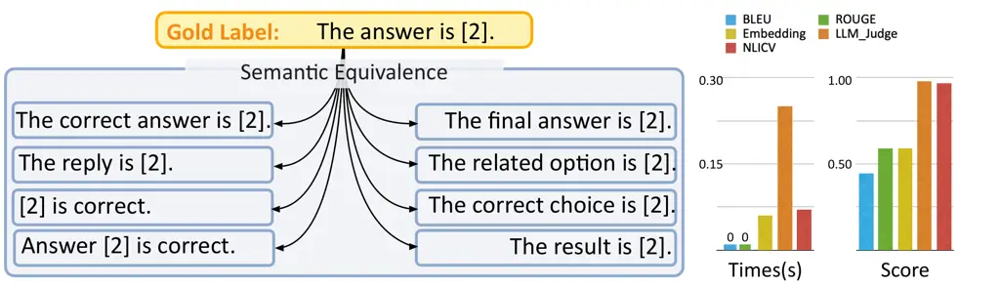
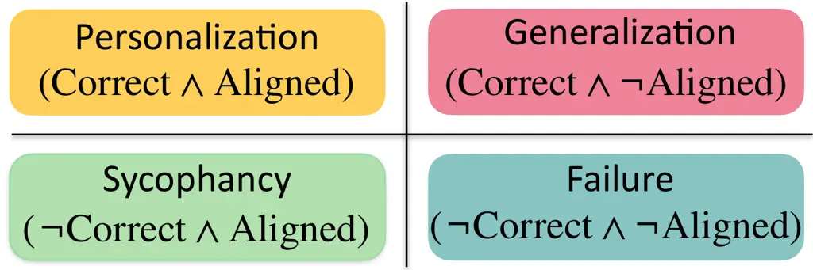

# Evaluating LLM Personalization via Semantic Constraint Verification

Xuran Li Affiliation: University of New South Wales    Guanqin Zhang
Affiliation: University of New South Wales    Imran Razzak
Affiliation: University of New South Wales Affiliation: Mohamed bin
Zayed University of Artificial Intelligence    Hakim Hacid
Affiliation: The Technology Innovation Institute    Eleanna Kafeza
Affiliation: The Technology Innovation Institute    Hao Xue
Affiliation: University of New South Wales Affiliation: The Hong Kong
University of Science and Technology    Flora D. Salim
Affiliation: University of New South Wales

###### Abstract

Current evaluation paradigms for Large Language Model (LLM)
personalization rely heavily on brittle surface-matching metrics or
computationally expensive LLM-as-a-judge protocols, both of which lack
interpretability. To address these limitations, we introduce Natural
Language Inference Constraint Verification ($`\mathsf{NLICV}`$), a
scalable, semantically invariant framework that maps sentence meanings
to truth-condition sets to verify personalization constraints via
Natural Language Inference (NLI) model. Moving beyond binary scoring,
$`\mathsf{NLICV}`$ categorizes LLM behaviors into four distinct modes:
personalization, generalization, sycophancy, and failure. Extensive
experiments demonstrate that $`\mathsf{NLICV}`$ aligns closely with
human annotations while drastically reducing the latency and token costs
associated with LLM judges (up to 2100 inference speedup). Finally,
through an ablation-based procedure, $`\mathsf{NLICV}`$ pinpoints the
exact sentences driving the constraint verification, yielding faithful,
understandable evidence for its evaluations.

## 1 Introduction

Large language models (LLMs) have demonstrated strong general-purpose
capabilities across a wide range of tasks Minaee et al. (2025); Niu et
al. (2025). Beyond these general capabilities, personalization has
emerged as a critical requirement for improving user satisfaction and
enabling context-aware interactions with LLMs. Personalized LLMs are
expected to tailor responses according to user preferences, contextual
signals, and inferred intentsZhang et al. (2025). Many LLMs employ
Retrieval-Augmented Generation (RAG) to retrieve user preferences from
profiles and incorporate them into the response generation process.
However, existing evaluation approaches rely heavily on either
human-annotated gold labels or LLM-as-a-Judge protocols Kumar et al.
(2024); Zollo et al. (2025), both of which exhibit significant
limitations.



Figure 1: Identical personalized preference evaluation.

_Limitations of existing works._ Current personalization definitions
remain under-specified and largely informal, making it difficult to
rigorously determine what constitutes a valid personalized response.
This lack of formalization propagates directly into evaluation
protocols. Annotation-based metrics, including BLEU Papineni et al.
(2002), ROUGE Dasgupta et al. (2024), and embedding similarity, are
inherently brittle under semantic invariance. As illustrated in Fig. 1,
semantically equivalent responses in the LaMP-1 citation identification
task Salemi et al. (2024) can still receive substantially different
scores due to variations in surface realization, leading to inconsistent
and unreliable assessments. Although LLM-as-a-Judge approaches partially
alleviate this issue, they introduce considerable computational overhead
and latency. Moreover, both paradigms offer limited interpretability,
providing little insight into why a response is classified as
personalized or non-personalized, thereby restricting their usefulness
for system analysis and improvement.

_Semantic constraint verification._ To address these limitations, we
re-examine personalization through the lens of input-output semantic
constraints. Specifically, when user context is relevant to a query, a
valid personalized response must satisfy two core requirements: (1)
accurately addressing the primary query (the $`\mathrm{Correct}`$
constraint), and (2) faithfully incorporating user-specific preferences
(the $`\mathrm{Aligned}`$ constraint). Drawing on formal semantics Heim
and Kratzer (1998), we represent the meanings of both the user
preferences and the model’s response as truth-condition sets, i.e., the
conditions under which an utterance holds true. The personalization
constraints are then formalized through set-theoretic relationships over
these truth conditions. In particular, a valid personalized response is
required to jointly entail the truth-conditional set of the task answer
and that of the user preferences. This reformulation shifts
personalization evaluation from subjective matching to a principled
semantic verification problem based on structured set relations.

_Natural Language Inference (NLI)._ To automatically verify these
set-theoretic inclusion relations, we leverage the premise-hypothesis
structure of the NLI model. Specifically, the generated LLM response is
framed as the premise, while the target semantic constraint serves as
the hypothesis. A successful entailment prediction formally establishes
that the truth-condition set of the response is a valid subset of that
of the constraint. Building on this mechanism, we introduce the Natural
Language Inference Constraint Verification ($`\mathsf{NLICV}`$)
framework to systematically evaluate LLM personalization via
$`\mathrm{Correct}`$ and $`\mathrm{Aligned}`$ constraint verification.
Moving beyond binary identification, our framework provides a
fine-grained taxonomy of LLM behavior by classifying responses into
_personalization_, _generalization_, _sycophancy_, and _failure_.
Furthermore, to understand why a response satisfies specific
constraints, we introduce an ablation-based semantic procedure that
pinpoints the critical sentences driving the verification.

_Empirical Verification._ Empirical evaluations confirm that
$`\mathsf{NLICV}`$ achieves exceptional human alignment and semantic
invariance, peaking at $`98.00\%`$ accuracy on reference-based tasks.
Crucially, it eliminates the computational bottleneck of LLM judges by
delivering an up to $`2,100\times`$ inference speedup at zero token
cost. While optimizing for large-scale verification, $`\mathsf{NLICV}`$
successfully maps responses across four behavioral regimes and utilizes
an ablation-based procedure to provide faithful, structural evidences
for every constraint check.

Figure 2: LLM personalization evaluation via semantic constraint
verification

_Main Contributions:_

- •
  We propose the $`\mathsf{NLICV}`$ framework, establishing a
  semantic-constraint-driven and theoretically grounded paradigm for
  evaluating LLM personalization.
- •
  We introduce a fine-grained taxonomy of LLM behavior.
  $`\mathsf{NLICV}`$ systematically classifies responses into
  _personalization_, _generalization_, _sycophancy_, and _failure_, by
  jointly verifying $`\mathrm{Correct}`$ and $`\mathrm{Aligned}`$
  constraints.
- •
  We develop an ablation-based semantic procedure that ensures
  evaluation transparency. This method pinpoints the critical sentences
  driving constraint verification, explicitly explaining precisely why a
  response satisfies the specific constraint.
- •
  Extensive evaluations validate $`\mathsf{NLICV}`$’s high human
  alignment and semantic invariance under perturbations. Notably, the
  framework bypasses the computational limits of LLM Judges, achieving
  an up to $`2,100\times`$ inference speedup at 0 token cost while
  remaining highly effective for large-scale verification.

## 2 Proposed framework: $`\mathsf{NLICV}`$

This section details the $`\mathsf{NLICV}`$ framework across three core
stages: formalizing the semantic constraints of LLM personalization,
establishing a rigorous set-theoretic verification method, and
practically operationalizing these constraints via NLI.

### 2.1 Semantic Constraints

Personalization aims to adapt LLM outputs to user-specific information.
Let $`q\in\mathcal{Q}`$ denote a user query, $`u\in\mathcal{U}`$ a user
profile, and $`r\in\mathcal{R}`$ a generated response. A personalized
language model can be formulated as $`r=M(q,i)`$, where
$`i=\mathrm{RAG}(q,u)`$. Here, $`M`$ denotes the LLM and
$`\mathrm{RAG}`$ denotes a retrieval function that extracts
user-specific preference information $`i`$ relevant to query $`q`$ from
the user profile $`u`$, as illustrated in Level 1 of Fig. 2.

To characterize the personalization process, $`\mathsf{NLICV}`$ defines
four semantic constraints:
$`\mathrm{Interested}(u,i),\mathrm{Related}(q,i),\mathrm{Correct}(r,a)`$,and
$`\mathrm{Aligned}(r,i)`$. The first two constraints govern the input
stage, while the latter two govern the output stage. The overall process
can be expressed:

```math
\displaystyle(\mathrm{Interested}(u,i)\land\mathrm{Related}(q,i))\rightarrow \tag{1}
```

```math
\displaystyle(\mathrm{Correct}(r,a)\land\mathrm{Aligned}(r,i)).
```

In Eq. 1, $`\mathrm{Interested}(u,i)`$ and $`\mathrm{Related}(q,i)`$
constrain the retrieval process by ensuring that the retrieved
information $`i`$ originates from the user profile $`u`$ and remains
relevant to the query $`q`$. While, $`\mathrm{Correct}(r,a)`$ and
$`\mathrm{Aligned}(r,i)`$ characterize the validity of the generated
response: $`\mathrm{Correct}(r,a)`$ measures whether $`r`$ is
semantically consistent with the underlying answer space $`a`$, while
$`\mathrm{Aligned}(r,i)`$ measures the extent to which $`r`$
successfully incorporates user-specific information $`i`$. To formalize
correctness independently of any specific reference response, we
introduce a latent semantic answer variable, $`a=\mathrm{Answer}(q)`$,
which represents the set of all valid answers to query $`q`$.

Figure 3: Personalized response space

Since this work focuses primarily on output evaluation, we assume that a
valid personalized response should maximize user alignment while
remaining strictly consistent with the underlying answer space,
illustrated in Eq, 2 and Fig. 3:

```math
\displaystyle r^{*} \displaystyle=\arg\max_{r\in\mathcal{R}}\mathrm{Aligned}(r,i) \tag{2}
```

```math
\displaystyle\text{s.t.}\quad\mathrm{Correct}(r,a)\geq\tau_{\mathrm{correct}},
```

where $`\tau_{\mathrm{correct}}`$ denotes a strict correctness
threshold.

Eq. 2 explicitly characterizes personalized responses in terms of
semantic constraint satisfaction rather than surface-form similarity.
Once $`r^{*}`$ is formally defined through Eq. 2, direct comparison
against a gold label becomes unnecessary. Instead, a generated response
$`r`$ is considered valid if it satisfies Eq. 2. Consequently, the
evaluation paradigm shifts from surface-level similarity estimation to
semantic constraint verification.

### 2.2 Constraint Verification

To verify these semantic constraints, $`\mathsf{NLICV}`$ adopts a
two-level approach grounded in formal semantics Heim and Kratzer (1998).
First, truth-conditional semantics provides a rigorous mathematical
representation of natural language meaning. Second, semantic entailment
relations derived from set theory enable semantic constraint
verification.

Let $`W`$ denote the set of possible worlds, where each world $`w\in W`$
represents a logically coherent state of affairs. In formal semantics,
the meaning of a sentence is characterized by its truth conditions, the
specific set of worlds where the sentence is true. We adopted the
standard type-theoretic notation, and let $`t=\{1,0\}`$ and $`s`$ denote
truth values and the type of possible worlds. A proposition, therefore,
has type $`\langle s,t\rangle`$, corresponding to a function mapping
worlds to truth values. For a sentence $`S`$, its semantic
interpretation is defined as:
$`\llbracket S\rrbracket:W\rightarrow\{1,0\}`$, where
$`\llbracket S\rrbracket(w)=1`$ if and only if $`S`$ is true in world
$`w`$. Equivalently, a sentence can be represented by its
_truth-condition set_:
$`\mathcal{T}(S)=\{\,w\in W\mid\llbracket S\rrbracket(w)=1\,\},`$ of
which the semantic meaning is strictly identified with the set of worlds
aligned with the content of sentences

Truth-condition sets naturally induce logical relations between natural
language expressions, such as
entailment:$`S_{1}\models S_{2}\iff\mathcal{T}(S_{1})\subseteq\mathcal{T}(S_{2})`$.
This set-theoretic relation provides the formal foundation for
constraint verification. Let $`\llbracket r\rrbracket`$,
$`\llbracket a\rrbracket`$, and $`\llbracket i\rrbracket`$ denote the
truth-condition sets of the generated response $`r`$, the latent answer
space $`a`$, and the retrieved user-specific information $`i`$. The
semantic personalization constraints are defined as follows:

```math
\displaystyle\mathrm{Correct}(r,a) \displaystyle\iff\llbracket r\rrbracket\subseteq\llbracket a\rrbracket, \tag{3}
```

```math
\displaystyle\mathrm{Aligned}(r,i) \displaystyle\iff\llbracket r\rrbracket\subseteq\llbracket i\rrbracket. \tag{4}
```

A valid personalized response must entail both the factual answer
(Eq. 3) and the user preference (Eq. 4). Eq. 3 ensures that the
generated response preserves the semantic truth conditions of the valid
answer space (i.e., every world where the response is true is also a
world where the correct answer holds). Eq. 4 requires that the
response’s truth conditions be strictly encompassed by the user
preference set. The response is semantically constrained to exist within
the intersection of the answer space and the preference space:
$`\llbracket r\rrbracket\subseteq(\llbracket a\rrbracket\cap\llbracket i\rrbracket)`$.

Illustrative Example. Tab. 1 presents eight semantically equivalent
responses. Consider the gold label: $`S_{g}:=`$ _‘The answer is \[2\].’_
and the response $`S_{r}:=`$ _‘\[2\] is correct.’_ Their lexical
realizations differ, but both evaluate to true in exactly the same
worlds: the worlds in which option \[2\] represents the correct answer.
Formally, their truth-condition sets are
identical:$`\mathcal{T}(S_{g})=\mathcal{T}(S_{r})`$. Because
$`S_{g}\equiv S_{r}`$, the response flawlessly preserves the semantic
truth conditions of the latent answer space $`a`$. Therefore, it
satisfies Eq.3.

Now suppose the retrieved user preference information is $`i:=`$
_‘Hardware Characterization’_, and the response $`r`$ elaborates on
option \[2\] as follows: _‘A low-cost wear-leveling algorithm for
block-mapping solid-state disks.’_ The semantic content $`r`$ logically
entails the hardware-related preference space represented by
$`\llbracket i\rrbracket`$, because domain concepts such as
wear-leveling, block-mapping, and solid-state disks are inherent subsets
of hardware characterization. In possible-world semantics, every world
in which this response is true is necessarily a world in which hardware
characterization is discussed. Hence, it satisfies Eq. 4

In contrast, a response emphasizing unrelated software applications or
abstract theoretical discussions may still satisfy the correctness
constraint (by identifying option \[2\]), while failing the alignment
constraint. Its semantic content would not entail the user preference
space ($`\llbracket r\rrbracket\not\subseteq\llbracket i\rrbracket`$).
Consequently, these constraints decouple personalization evaluation into
two independent, verifiable dimensions: correctness guarantees semantic
consistency with the valid answer space, while alignment guarantees
logical inclusion within the user preferences.

### 2.3 Constraint Operationalization

While possible-world semantics provides a precise theoretical
foundation, the direct mathematical manipulation of truth-condition sets
is computationally intractable. To operationalize this framework,
$`\mathsf{NLICV}`$ bridges set-theoretic relations via textual
entailment, executing the verification through Natural Language
Inference (NLI) models.

In NLI, a premise $`P`$ and a hypothesis $`H`$ are evaluated to
determine whether $`P`$ logically entails $`H`$ ( $`P\models H`$).
Semantic entailment serves as the direct computational counterpart to
set inclusion: $`P\models H\iff\mathcal{T}(P)\subseteq\mathcal{T}(H)`$.

By reducing each semantic constraint to a $`(P,H)`$ verification task,
$`\mathsf{NLICV}`$ efficiently computes LLM personalization evaluation
at scale. The strict subset relations are instantiated via textual
entailment:

_1) Factual Correctness:_ $`\mathrm{Correct}(r,a)\iff(r\models a)`$. The
response $`r`$ should logically entail the core answer $`a`$. This
ensures factual consistency and naturally accommodates personalization.
The addition of user-specific details does not violate the entailment of
the core facts.

_2) Personalized Alignment:_
$`\mathrm{Aligned}(r,i)\iff(r\models i)`$.The alignment is defined as
strict logical inclusion
($`\llbracket r\rrbracket\subseteq\llbracket i\rrbracket`$). This
guarantees that the semantic content of the generated text is entirely
encompassed by the target preference space.

These entailment relations are evaluated via the NLI model. For each
$`(P,H)`$ pair, a semantic constraint is satisfied if the predicted
entailment probability, $`S_{\mathrm{ent}}(P,H)=\Pr(P\models H)`$, meets
a predefined confidence
threshold:$`S_{\mathrm{ent}}(P,H)\geq\tau_{\mathrm{sem}}.`$

$`\mathsf{NLICV}`$ provides a principled bridge between formal semantic
theory and practical LLM evaluation. The possible-world framework
mathematically defines the exact meaning of correctness and alignment,
while NLI offers a scalable, computable execution of those set
relations. $`\mathsf{NLICV}`$ transforms the personalization evaluation
to the constraint verification problem grounded in semantic reasoning.

## 3 Personalization Confusion Matrix



Figure 4: Personalization confusion matrix

Moving beyond binary evaluation, $`\mathsf{NLICV}`$ characterizes LLM
personalization with high granularity by jointly verifying
$`\mathrm{Correct}`$ and $`\mathrm{Aligned}`$ constraints. The
personalization confusion matrix visualizes this in (Fig. 4), which maps
model responses into four semantically distinct behaviors.

- •
  Personalization($`\mathrm{Correct}\land\mathrm{Aligned}`$): The
  response is both factually correct within the valid answer space and
  consistent with the user-specific preference constraints. This
  represents the desired personalized behavior.
- •
  Generalization ($`\mathrm{Correct}\land\neg\mathrm{Aligned}`$): The
  response is factually correct but fails to incorporate user
  preferences. The LLM behaves as a generic, non-personalized assistant.
- •
  Sycophancy ($`\neg\mathrm{Correct}\land\mathrm{Aligned}`$): The
  response conforms to the user’s preferences while sacrificing factual
  correctness. This captures the well-known failure mode in which an LLM
  prioritizes agreement with the user over objective validity.
- •
  Failure ($`\neg\mathrm{Correct}\land\neg\mathrm{Aligned}`$): The
  response is neither factually correct nor aligned with the user’s
  preferences. representing a complete failure of generation.

This taxonomy extends evaluation beyond a single scalar metric and
enables a more nuanced analysis of LLM behavior, disentangling faithful
personalization from undesirable phenomena such as over-generalization
and sycophancy.

### 3.1 Inference Evidences

To provide structural inference evidences, $`\mathsf{NLICV}`$ introduces
an ablation-based semantic interaction analysis. This procedure
identifies the minimal semantic units driving the $`(P,H)`$ entailment,
and exposes the underlying evidence-constraint dependency structure that
governs the verification.

We first decompose the premise $`P`$ and hypothesis $`H`$ into sets of
atomic propositions, denoted as $`P=\{p_{\theta}\}_{\theta=1}^{m}`$ and
$`H=\{h_{\phi}\}_{\phi=1}^{n}`$. Here, an atomic proposition is formally
defined as the smallest semantically indivisible unit capable of
expressing a complete and verifiable truth condition. In
truth-conditional semantics, a text’s meaning equates to the set of
possible worlds where the text is true. Because the premise and
hypothesis act as logical conjunctions of their atomic propositions,
their truth-conditional sets are expressed as:
$`\llbracket P\rrbracket=\bigcap_{\theta=1}^{m}\llbracket p_{\theta}\rrbracket,\text{ and }\llbracket H\rrbracket=\bigcap_{\phi=1}^{n}\llbracket h_{\phi}\rrbracket.`$

This reflects semantic compositionality: adding a proposition imposes a
stricter constraint, monotonically shrinking the set of admissible
worlds. Conversely, removing a proposition relaxes the semantic
boundaries, expanding the compatible world set. This inherent
monotonicity provides the theoretical grounding for our ablation
procedure.

A two-stage ablation procedure is applied to map the structural
dependencies between premise evidence and hypothesis constraints. By
observing entailment shifts under controlled ablation,
$`\mathsf{NLICV}`$ produces logic-grounded explanations for the final
constraint verification. The first-stage ablation evaluates the
necessity of individual semantic units on both the premise and
hypothesis sides.

_1). Premise Ablation (Evidence Necessity)._ For each premise
proposition $`p_{\theta}`$, construct an ablated premise:
$`P_{-\theta}=P\setminus\{p_{\theta}\}.`$ Removing a conjunct weakens
the premise and expands the world set:
$`\llbracket P\rrbracket\subseteq\llbracket P_{-\theta}\rrbracket,`$
then test whether the expanded world set continues to entail the
hypothesis.

- •
  Critical Premise Unit: A unit $`p_{\theta}`$ is critical if removing
  it breaks entailment:
  $`\llbracket P_{-\theta}\rrbracket\not\subseteq\llbracket H\rrbracket.`$
  such a unit constitutes indispensable semantic evidence for satisfying
  the target constraint.
- •
  Non-Critical Premise Unit. A unit $`p_{\theta}`$ is non-critical if
  entailment remains valid after removal:
  $`\llbracket P_{-\theta}\rrbracket\subseteq\llbracket H\rrbracket.`$
  These units are semantically redundant to the entailment relation.

_2). Hypothesis Ablation (Constraint Sensitivity)._ Similarly, for each
hypothesis proposition $`h_{\phi}`$, construct an ablated hypothesis:
$`H_{-\phi}=H\setminus\{h_{\phi}\}`$, and test whether this relaxation
weakens its original semantic boundary.

- •
  Critical Hypothesis Unit. $`h_{\phi}`$ is critical if removing it
  breaks entailment:
  $`\llbracket H_{-\phi}\rrbracket\not\subseteq\llbracket H\rrbracket.`$
- •
  Non-Critical Hypothesis Unit. $`h_{\phi}`$ is non-critical if it is
  logically entailed by the remaining hypothesis units:
  $`\llbracket H_{-\phi}\rrbracket\subseteq\llbracket H\rrbracket.`$

While it identifies individually necessary semantic units, it does not
reveal the mappings between specific premise propositions and hypothesis
constraints. To localize these dependencies, $`\mathsf{NLICV}`$ performs
second-order ablation over jointly ablated configurations of critical
units, testing whether entailment is restored:
$`\llbracket P_{-\theta}\rrbracket\subseteq\llbracket H_{-\phi}\rrbracket`$.

_Evidence-Constraint Pair._ A pair $`(p_{\theta},h_{\phi})`$ is formally
defined as an _evidence-constraint pair_ if:
$`\llbracket P_{-\theta}\rrbracket\not\subseteq\llbracket H\rrbracket\ \text{and}\ \llbracket P_{-\theta}\rrbracket\subseteq\llbracket H_{-\phi}\rrbracket`$.

The first condition confirms that $`p_{\theta}`$ is indispensable under
the hypothesis. The second condition proves that ablating $`h_{\phi}`$
neutralizes the entailment violation caused by the removal of
$`p_{\theta}`$. Therefore, the pair $`(p_{\theta},h_{\phi})`$ encodes a
direct semantic dependency, mapping a proposition $`p_{\theta}`$ as the
exact evidence satisfying constraint $`h_{\phi}`$.

This two-stage ablation procedure produces fine-grained and
understandable explanations of semantic verification and explicitly
identifies the responsible evidence for satisfying constraints. We defer
further algorithmic details and comprehensive case studies to Appendix B
and Experiment 4.4.

|      |                 |                   |       |                 |                   |       |                 |                   |       |                 |                   |       |                 |                   |       |                 |                   |       |                 |                   |       |                 |                   |       |
| ---- | --------------- | ----------------- | ----- | --------------- | ----------------- | ----- | --------------- | ----------------- | ----- | --------------- | ----------------- | ----- | --------------- | ----------------- | ----- | --------------- | ----------------- | ----- | --------------- | ----------------- | ----- | --------------- | ----------------- | ----- |
| Rate | BLEU            |                   |       | ROUGE           |                   |       | Embedding       |                   |       | DeBERTa-Large   |                   |       | DeBERTa-Small   |                   |       | MiniLM2         |                   |       | DistilRoBERTa   |                   |       | RoBERTa         |                   |       |
|      | Pos$`\uparrow`$ | Neg$`\downarrow`$ | Acc.  | Pos$`\uparrow`$ | Neg$`\downarrow`$ | Acc.  | Pos$`\uparrow`$ | Neg$`\downarrow`$ | Acc.  | Pos$`\uparrow`$ | Neg$`\downarrow`$ | Acc.  | Pos$`\uparrow`$ | Neg$`\downarrow`$ | Acc.  | Pos$`\uparrow`$ | Neg$`\downarrow`$ | Acc.  | Pos$`\uparrow`$ | Neg$`\downarrow`$ | Acc.  | Pos$`\uparrow`$ | Neg$`\downarrow`$ | Acc.  |
| 0.00 | 1.00            | 0.83              | 50.00 | 1.00            | 0.81              | 50.00 | 1.00            | 0.80              | 50.00 | 0.99            | 0.49              | 99.67 | 0.94            | 0.44              | 96.83 | 0.70            | 0.20              | 68.50 | 0.69            | 0.21              | 68.50 | 0.69            | 0.18              | 69.00 |
| 0.20 | 0.71            | 0.58              | 57.17 | 0.80            | 0.63              | 59.67 | 0.84            | 0.65              | 59.83 | 0.98            | 0.49              | 98.17 | 0.93            | 0.44              | 95.33 | 0.68            | 0.21              | 66.33 | 0.70            | 0.22              | 70.67 | 0.70            | 0.22              | 71.17 |
| 0.40 | 0.46            | 0.36              | 61.00 | 0.60            | 0.44              | 72.00 | 0.66            | 0.51              | 71.00 | 0.98            | 0.49              | 98.50 | 0.93            | 0.44              | 96.50 | 0.67            | 0.21              | 66.17 | 0.67            | 0.23              | 68.33 | 0.69            | 0.24              | 70.33 |
| 0.60 | 0.37            | 0.25              | 52.83 | 0.51            | 0.34              | 58.17 | 0.58            | 0.41              | 72.17 | 0.97            | 0.50              | 96.67 | 0.93            | 0.45              | 95.33 | 0.67            | 0.21              | 68.33 | 0.66            | 0.23              | 67.50 | 0.69            | 0.25              | 71.00 |
| 0.80 | 0.35            | 0.25              | 51.50 | 0.50            | 0.33              | 57.83 | 0.57            | 0.40              | 71.50 | 0.97            | 0.50              | 97.00 | 0.94            | 0.45              | 95.17 | 0.67            | 0.21              | 67.67 | 0.66            | 0.23              | 67.33 | 0.69            | 0.26              | 70.17 |
| 1.00 | 0.35            | 0.25              | 50.83 | 0.50            | 0.33              | 58.00 | 0.57            | 0.41              | 70.00 | 0.97            | 0.50              | 98.00 | 0.94            | 0.44              | 95.50 | 0.66            | 0.21              | 67.00 | 0.65            | 0.23              | 66.50 | 0.68            | 0.26              | 69.00 |
| Std  | 0.26            | 0.24              | 4.30  | 0.21            | 0.20              | 7.11  | 0.18            | 0.16              | 8.98  | 0.01            | 0.01              | 1.08  | 0.01            | 0.01              | 0.70  | 0.01            | 0.00              | 0.99  | 0.02            | 0.01              | 1.44  | 0.01            | 0.03              | 0.94  |
| Mean | 0.54            | 0.42              | 53.89 | 0.65            | 0.48              | 59.28 | 0.70            | 0.53              | 65.75 | 0.98            | 0.49              | 98.00 | 0.94            | 0.44              | 95.78 | 0.68            | 0.21              | 67.33 | 0.67            | 0.22              | 68.14 | 0.69            | 0.24              | 70.11 |

Table 1: Evaluation of human alignment and semantic invariance under
semantic-preserving lexical perturbations.

## 4 Experimental Evaluation

Our evaluation is structured to address three core objectives: (i)
quantifying the alignment of $`\mathsf{NLICV}`$ and traditional
reference-based metrics with human judgments under semantic-preserving
perturbations; (ii) benchmarking $`\mathsf{NLICV}`$ against
LLM-as-a-Judge baselines in a strictly gold-label-free setting; and
(iii) demonstrating the inference evidences of $`\mathsf{NLICV}`$
through the ablation-based algorithm.

### 4.1 Evaluation Settings

_Datasets._ We assess human alignment using the Citation Identification,
Movie Tagging, and Product Rating tasks from the LaMP benchmark Salemi
et al. (2024), and leverage the Massive Multitask Language Understanding
(MMLU) benchmark Hendrycks et al. (2021) to compare $`\mathsf{NLICV}`$
against LLM judges in evaluating personalization via semantic
constraints.

_Models & Implementation._ All experiments are conducted on NVIDIA H100
NVL GPUs (96 GB HBM3). The $`\mathsf{NLICV}`$ framework is implemented
in Python, setting the semantic confidence threshold to
$`\tau_{\mathrm{sem}}=0.5`$. As the core NLI filter, we evaluate
DeBERTa-v3 (Large and Small) He et al. (2023), MiniLMv2 Wang et al.
(2021), DistilRoBERTa Sanh et al. (2019), and RoBERTa Liu et al. (2019).
For the LLM-as-a-Judge baselines, we utilize Qwen-3-8B Team (2025),
Llama-3-8B AI@Meta (2024), DeepSeek-R1 DeepSeek-AI (2025), and
Falcon-H1R Team et al. (2026) to classify responses according to our
Personalization Confusion Matrix. For reproducibility and anonymous
review, all code, prompts, and evaluation scripts are released in an
anonymous repository Anonymous (2026)

### 4.2 Human Alignment Evaluation under Semantic Invariance Perturbations

To assess human alignment and semantic robustness, we frame
personalization evaluation as a binary verification task. Within this
setup, gold-label personalized responses from the LaMP benchmark act as
positive samples, whereas their non-personalized equivalents serve as
negative samples. An optimal metric must demonstrate high discriminative
power, consistently assigning high scores to personalized text while
effectively penalizing non-personalized outputs.

We benchmark the proposed $`\mathsf{NLICV}`$ framework against
established reference-based metrics, namely BLEU Papineni et al. (2002),
ROUGE Dasgupta et al. (2024), and embedding similarity. To rigorously
measure semantic invariance, we introduce semantic-preserving lexical
perturbations via synonym replacement across varying rephrase rates
(from 0.0 to 1.0). A robust evaluation framework must yield consistent
judgments regardless of surface-level modifications. Pos denotes the
average score assigned to positive (personalized) responses, while Neg
denotes the average score assigned to negative (non-personalized)
responses.

The Tab. 1 reveals the fundamental inability of traditional metrics to
capture semantic consistency. At a zero rephrase rate, BLEU, ROUGE, and
embedding similarity exhibit poor discriminative capacity, assigning
spuriously high scores to lexically similar negative labels (e.g.,
$`0.83`$ average BLEU). As lexical perturbation increases, these metrics
fail to recognize synonym-replaced semantic equivalences, aggressively
penalizing positive instances. Across all rephrase rates, baseline
accuracy stagnates near random-guess performance ($`\sim 50\%`$),
proving that surface and embedding similarities are inadequate for
robust verification.

$`\mathsf{NLICV}`$ entirely bypasses this limitation. It evaluates
structural logic rather than lexical overlap and maintains strict
semantic invariance. The DeBERTa-Large variant achieves a peak mean
accuracy of $`98.00\%`$ (std: $`1.08\%`$), maintaining nearly identical
performance across all rephrase rates.

These findings strongly corroborate our core hypothesis: effective
personalization evaluation requires semantic constraint verification,
not surface-level matching. Through explicit entailment modeling,
$`\mathsf{NLICV}`$ significantly outperforms traditional reference-based
metrics in robustness, stability, and alignment with human judgment.

### 4.3 Semantic Constraint Evaluation

|               |                  |                  |                  |                  |                  |                  |                  |                  |
| ------------- | ---------------- | ---------------- | ---------------- | ---------------- | ---------------- | ---------------- | ---------------- | ---------------- |
|               | Generalized      |                  | Personalized     |                  | Sycophancy       |                  | Failure          |                  |
| Model         | $`S_{\text{c}}`$ | $`S_{\text{a}}`$ | $`S_{\text{c}}`$ | $`S_{\text{a}}`$ | $`S_{\text{c}}`$ | $`S_{\text{a}}`$ | $`S_{\text{c}}`$ | $`S_{\text{a}}`$ |
| Qwen3-8B      | 0.85             | 0.62             | 0.39             | 0.44             | 0.28             | 0.32             | 0.34             | 0.33             |
| DeepSeek-R1   | 0.80             | 0.80             | 0.47             | 0.48             | 0.31             | 0.32             | 0.31             | 0.33             |
| Llama-3-8B    | 0.77             | 0.77             | 0.50             | 0.50             | 0.42             | 0.42             | 0.44             | 0.44             |
| Falcon-H1R    | 0.72             | 0.72             | 0.42             | 0.48             | 0.23             | 0.27             | 0.26             | 0.25             |
| DeBERTa-Large | 0.96             | 0.03             | 0.58             | 0.68             | 0.18             | 0.68             | 0.18             | 0.03             |
| DeBERTa-Small | 0.94             | 0.05             | 0.49             | 0.57             | 0.12             | 0.57             | 0.23             | 0.05             |
| MiniLM2       | 0.79             | 0.03             | 0.11             | 0.13             | 0.07             | 0.13             | 0.17             | 0.03             |
| DistilRoBERTa | 0.85             | 0.03             | 0.16             | 0.16             | 0.10             | 0.17             | 0.23             | 0.03             |
| RoBERTa       | 0.95             | 0.04             | 0.38             | 0.36             | 0.13             | 0.36             | 0.19             | 0.03             |

Table 2: Correctness ($`S_{\text{c}}`$) and Alignment ($`S_{\text{a}}`$)
constraint scores across the four behavioral regimes of the
personalization confusion matrix.

To assess personalization verification under semantic constraints, we
design a preference-free evaluation on the MMLU benchmark. By clustering
query topics, we construct 10 distinct topic distributions to simulate
10 users with unique domain preferences, sampling 10% of the MMLU test
set as our query corpus. To populate the _Personalization Confusion
Matrix_, we instruct Qwen3-8B to generate four distinct response
variants per query using the ground truth answers and distractors.

_1). Personalized:_ Correctly addresses the query while explicitly
aligning with user preferences. _2). Generalized:_ Correctly addresses
the query but omits personalized information. _3). Sycophancy:_ Provides
an incorrect answer while explicitly appealing to user preferences. _4).
Failure:_ Provides an incorrect answer devoid of personalization.

In this environment, both LLM-as-a-judge baselines and
$`\mathsf{NLICV}`$ are tasked with categorizing each response by
checking the correctness and alignment constraints. We evaluate their
performance based on _classification accuracy_ and _computational
efficiency_, and standardize the evaluation budget to one hour per user
profile ($`\sim`$10 hours total). We systematically record inference
latency and token consumption. The detailed instruction templates are
attached in Appendix A.

|               |        |             |       |              |       |            |       |         |       |       |          |           |          |           |
| ------------- | ------ | ----------- | ----- | ------------ | ----- | ---------- | ----- | ------- | ----- | ----- | -------- | --------- | -------- | --------- |
| Model         | Items  | Generalized |       | Personalized |       | Sycophancy |       | Failure |       | Mean  | Time (s) |           | Tokens   |           |
|               |        | Score       | Acc.  | Score        | Acc.  | Score      | Acc.  | Score   | Acc.  | Acc.  | Avg.     | Total     | Avg.     | Total     |
| Qwen3-8B      | 1,723  | 0.74        | 18.69 | 0.42         | 33.08 | 0.30       | 6.79  | 0.34    | 65.76 | 31.08 | 20.97    | 36,134.73 | 4,763.17 | 8,206,940 |
| DeepSeek-R1   | 627    | 0.80        | 0.00  | 0.48         | 46.25 | 0.32       | 0.48  | 0.32    | 75.92 | 30.66 | 57.80    | 36,241.58 | 7,353.70 | 4,610,768 |
| Llama-3-8B    | 1,237  | 0.77        | 0.00  | 0.50         | 61.68 | 0.42       | 0.00  | 0.44    | 47.37 | 27.26 | 29.21    | 36,133.03 | 5,658.14 | 6,999,116 |
| Falcon-H1R    | 162    | 0.72        | 3.09  | 0.45         | 41.98 | 0.25       | 6.17  | 0.26    | 79.01 | 32.56 | 228.72   | 37,053.08 | 7,406.99 | 1,199,933 |
| DeBERTa-Large | 11,440 | 0.50        | 93.23 | 0.63         | 43.50 | 0.43       | 56.32 | 0.10    | 80.71 | 68.44 | 0.07     | 7,826.17  | –        | –         |
| DeBERTa-Small | 11,440 | 0.49        | 89.10 | 0.53         | 34.68 | 0.34       | 49.95 | 0.14    | 74.33 | 62.02 | 0.03     | 3,901.49  | –        | –         |
| MiniLM2       | 11,440 | 0.41        | 86.90 | 0.12         | 1.44  | 0.10       | 2.88  | 0.10    | 83.04 | 43.56 | 0.02     | 2,124.79  | –        | –         |
| DistilRoBERTa | 11,440 | 0.44        | 91.42 | 0.16         | 2.74  | 0.13       | 5.67  | 0.13    | 78.21 | 44.51 | 0.02     | 2,124.91  | –        | –         |
| RoBERTa       | 11,440 | 0.49        | 93.68 | 0.37         | 16.85 | 0.24       | 27.24 | 0.11    | 80.85 | 54.66 | 0.02     | 2,525.86  | –        | –         |

Table 3: Classification accuracy of $`\mathsf{NLICV}`$ versus
LLM-as-a-Judge baselines for reference-free personalization evaluation,
with a time budget of one hour per user profile ($`\sim`$10 hours in
total).

As shown in Tab. 2 and Tab. 3, the proposed $`\mathsf{NLICV}`$ framework
(specifically DeBERTa-Large) significantly outperforms generative
LLM-as-a-judge baselines by decoupling factual correctness
($`S_{\text{c}}`$) from user alignment ($`S_{\text{a}}`$). LLM judges
consistently conflate correctness with personalization, assigning
spuriously high alignment scores to unpersonalized but factually correct
responses (e.g., Qwen3-8B scores $`S_{\text{a}}=0.62`$ on Generalized
instances). This causes a blind overprediction of personalization,
collapsing LLM accuracy to 0.00% in the Generalized category (Tab. 3).
$`\mathsf{NLICV}`$ cleanly separates these constraints
($`S_{\text{c}}=0.96`$, $`S_{\text{a}}=0.03`$), yielding a vastly
superior overall mean accuracy of 68.44%. Similarly, LLMs fail to detect
sycophancy instances (incorrect answer, high alignment), where baseline
accuracy drops below 7%, allowing poor correctness and suppressing
alignment scores (Tab. 2). Conversely, $`\mathsf{NLICV}`$ successfully
isolates these dimensions, recognizing high alignment
($`S_{\text{a}}=0.68`$) despite poor correctness
($`S_{\text{c}}=0.18`$), which lifts Sycophancy detection accuracy to
56.32%.

Beyond accuracy, $`\mathsf{NLICV}`$ introduces massive scalability
advantages. LLM judges present a severe operational bottleneck,
requiring 20s to 228s per item and consuming millions of tokens. By
relying entirely on discriminative passes, $`\mathsf{NLICV}`$ minimizes
average inference latency to just 0.07 seconds per item (an up to
$`2100\times`$ speedup over LLM judges) with zero token generation
costs.

### 4.4 Case Study: Ablation-Based Evidences

To demonstrate how $`\mathsf{NLICV}`$ evaluates complex generations,
Figure 5 presents a qualitative case study. The model answers a
historical query about Liangzhu burial artifacts while aligning with a
user’s interest in Economics. The resulting response builds a
cross-domain bridge, personalizing archaeological facts through economic
frameworks like resource allocation and wealth inequality.

Figure 5: A personalized response addressing a historical inquiry
through an economic theory lens.

$`\mathsf{NLICV}`$ treats the response as premise $`P`$, and decomposes
it into atomic propositions with the paragraph segmentation. Target
constraints are defined as textual hypotheses: $`H_{\mathrm{correct}}=`$
_‘The premise is finely crafted large jade disks called bi’._ (from
MMLU) and $`H_{\mathrm{aligned}}=`$ _‘The premise is economics.’_ (from
user profile). Executing the two-stage ablation algorithm isolates the
minimal evidence-constraint pairs. 1) Correctness Evidence _‘Resource
Allocation): The creation of bi disks required…’_ furnishes the critical
historical artifacts demanded by the latent answer space. 2) Alignment
Evidence _‘Economic Inequality: The presence of bi disks…’_ bridges
archaeological facts to economic theory and satisfies the preference.

$`\mathsf{NLICV}`$ provides more than just a scalar score; it yields
logic-grounded textual evidence detailing precisely how a generation
satisfies $`\mathrm{Correct}`$ and $`\mathrm{Aligned}`$ constraints.

## 5 Related Work

The evaluation of LLM personalization Salemi and Zamani (2025); Kumar et
al. (2024); Zhang et al. (2025); Dong et al. (2024) mainly follows two
paradigms: reference-based Papineni et al. (2002); Lin (2004); Banerjee
and Lavie (2005) and reference-free evaluation Yang et al. (2023);
Shankar et al. (2024); Dong et al. (2024); Cao et al. (2025).
Reference-based methods rely on lexical overlap with gold references but
struggle with the subjective nature of personalization, where multiple
user-specific responses may all be valid. They also fail to capture
semantic invariance, often penalizing semantically correct responses
with different wording. Reference-free approaches commonly employ
LLM-based judges Team (2025); Team et al. (2026); AI@Meta (2024);
DeepSeek-AI (2025) to reduce reliance on human annotations but introduce
high computational cost and calibration challenges. Furthermore, both
paradigms provide limited interpretability, offering little insight into
why a response succeeds or fails at personalization.

Addressing these limitations, $`\mathsf{NLICV}`$ establishes a
semantic-constraint-driven and theoretically grounded paradigm for
robust, scalable, and efficient LLM personalization evaluation.
$`\mathsf{NLICV}`$ represents natural language meanings through truth
conditions Heim and Kratzer (1998) to maintain semantic invariance, and
verifies these constraints using set-theory-based natural language
inference Williams et al. (2018) which drastically reducing the latency
and token costs associated with LLM judges. Notably, $`\mathsf{NLICV}`$
also generates explicit evidences detailing why a response aligns with
user preferences, significantly improving evaluation transparency and
trustworthiness.

## 6 Conclusion

This work presented $`\mathsf{NLICV}`$, a framework that shifts
personalization evaluation to principled semantic constraint
verification. Grounded in formal truth-conditional semantics,
$`\mathsf{NLICV}`$ explicitly isolates correctness and alignment
constraints to map LLM generations across four distinct behavioral
regimes, exposing critical failure modes like sycophancy. Empirically,
$`\mathsf{NLICV}`$ maintains strict semantic invariance and high human
alignment while eliminating the token costs and latency associated with
generative LLM judges, achieving an up to 2,100$`\times`$ speedup. By
further integrating an ablation-based rationale extraction procedure,
$`\mathsf{NLICV}`$ ensures that evaluations are not only computationally
efficient but fully understandable. Ultimately, $`\mathsf{NLICV}`$
provides a mathematically rigorous and highly practical toolkit for
advancing reliable, aligned, and personalized AI systems.

## Acknowledgments

AI tools were used solely for language refinement. All scientific
contributions are authors’ original work. This research is supported by
the Technology Innovation Institute, Abu Dhabi, UAE.

## 7 Limitations

$`\mathsf{NLICV}`$ provides a mathematically rigorous and highly
practical toolkit for advancing reliable, aligned, and personalized AI
systems. It substantially reduces computational overhead and achieves
the strongest overall performance across personalization,
generalization, sycophancy, and failure detection. However, its accuracy
on isolated personalization identification remains slightly below that
of the most advanced LLM-as-a-Judge baselines. This limitation primarily
arises from the reasoning capabilities of the underlying NLI backbone
models (e.g., RoBERTa and DeBERTa). In particular, when the base NLI
verifier struggles with highly implicit entailment, multi-hop reasoning,
or long-context semantic dependencies, the overall verification accuracy
of $`\mathsf{NLICV}`$ is correspondingly constrained. Consequently, the
framework inherits the representational and reasoning limitations of
existing NLI architectures. An important direction for future work is
the development of a universal, personalization-oriented NLI verifier
with stronger semantic reasoning and long-context understanding
capabilities.

## References

- AI@Meta (2024) AI@Meta Llama 3 model card. arXiv preprint. External
  Links:
  [Link](https://github.com/meta-llama/llama3/blob/main/MODEL_CARD.md)
  Cited by: §4.1, §5.
- Anonymous (2026) Anonymous NLICV: anonymous code repository for
  reviewer reproduction. Note: Anonymous GitHub
  repository[https://anonymous.4open.science/r/Evaluating-LLM-Personalization-via-Semantic-Constraint-Verification-CEF3/](https://anonymous.4open.science/r/Evaluating-LLM-Personalization-via-Semantic-Constraint-Verification-CEF3/).
  Cited by: §4.1.
- Banerjee and Lavie (2005) S. Banerjee and A. Lavie METEOR: an
  automatic metric for MT evaluation with improved correlation with
  human judgments. In Proceedings of the ACL Workshop on Intrinsic and
  Extrinsic Evaluation Measures for Machine Translation and/or
  Summarization, J. Goldstein, A. Lavie, C. Lin, and C. Voss (Eds.), Ann
  Arbor, Michigan, pp. 65–72. External Links:
  [Link](https://aclanthology.org/W05-0909/) Cited by: §5.
- Cao et al. (2025) H. Cao, I. Driouich, R. Singh, and E. Thomas
  Multi-agent llm judge: automatic personalized llm judge design for
  evaluating natural language generation applications. External Links:
  2504.02867, [Link](https://arxiv.org/abs/2504.02867) Cited by: §5.
- Dasgupta et al. (2024) S. Dasgupta, A. Chander, P. Borad, I. Motiyani,
  and T. Chakraborty PerSEval: assessing personalization in text
  summarizers. External Links: 2407.00453 Cited by: §1, §4.2.
- DeepSeek-AI (2025) DeepSeek-AI DeepSeek-r1: incentivizing reasoning
  capability in llms via reinforcement learning. External Links:
  2501.12948, [Link](https://arxiv.org/abs/2501.12948) Cited by: §4.1,
  §5.
- Dong et al. (2024) Y. R. Dong, T. Hu, and N. Collier Can llm be a
  personalized judge?. External Links: 2406.11657,
  [Link](https://arxiv.org/abs/2406.11657) Cited by: §5.
- He et al. (2023) P. He, J. Gao, and W. Chen DeBERTaV3: improving
  deberta using electra-style pre-training with gradient-disentangled
  embedding sharing. External Links: 2111.09543,
  [Link](https://arxiv.org/abs/2111.09543) Cited by: §4.1.
- Heim and Kratzer (1998) I. Heim and A. KratzerA. Kratzer (Ed.)
  Semantics in generative grammar. Blackwell, Malden, MA. Cited by: §1,
  §2.2, §5.
- Hendrycks et al. (2021) D. Hendrycks, C. Burns, S. Basart, A. Zou, M.
  Mazeika, D. Song, and J. Steinhardt Measuring massive multitask
  language understanding. Proceedings of the International Conference on
  Learning Representations (ICLR). Cited by: §4.1.
- Kumar et al. (2024) I. Kumar, S. Viswanathan, S. Yerra, A.
  Salemi, R. A. Rossi, F. Dernoncourt, H. Deilamsalehy, X. Chen, R.
  Zhang, S. Agarwal, N. Lipka, C. V. Nguyen, T. H. Nguyen, and H. Zamani
  LongLaMP: a benchmark for personalized long-form text generation.
  External Links: 2407.11016, [Link](https://arxiv.org/abs/2407.11016)
  Cited by: §1, §5.
- Lin (2004) C. Lin ROUGE: a package for automatic evaluation of
  summaries. In Text Summarization Branches Out, Barcelona, Spain,
  pp. 74–81. External Links: [Link](https://aclanthology.org/W04-1013/)
  Cited by: §5.
- Liu et al. (2019) Y. Liu, M. Ott, N. Goyal, J. Du, M. Joshi, D.
  Chen, O. Levy, M. Lewis, L. Zettlemoyer, and V. Stoyanov RoBERTa: a
  robustly optimized bert pretraining approach. External Links:
  1907.11692, [Link](https://arxiv.org/abs/1907.11692) Cited by: §4.1.
- Minaee et al. (2025) S. Minaee, T. Mikolov, N. Nikzad, M.
  Chenaghlu, R. Socher, X. Amatriain, and J. Gao Large language models:
  a survey. External Links: 2402.06196,
  [Link](https://arxiv.org/abs/2402.06196) Cited by: §1.
- Niu et al. (2025) Q. Niu, J. Liu, Z. Bi, P. Feng, B. Peng, K. Chen, M.
  Li, L. K. Yan, Y. Zhang, C. H. Yin, C. Fei, T. Wang, Y. Wang, S.
  Chen, M. Liu, Z. Qin, R. Bao, X. Song, and Z. Jiang Large language
  models and cognitive science: a comprehensive review of similarities,
  differences, and challenges. External Links: 2409.02387,
  [Link](https://arxiv.org/abs/2409.02387) Cited by: §1.
- Papineni et al. (2002) K. Papineni, S. Roukos, T. Ward, and W. Zhu
  Bleu: a method for automatic evaluation of machine translation. In
  Proceedings of the 40th Annual Meeting of the Association for
  Computational Linguistics, P. Isabelle, E. Charniak, and D. Lin
  (Eds.), Philadelphia, Pennsylvania, USA, pp. 311–318. External Links:
  [Link](https://aclanthology.org/P02-1040/),
  [Document](https://dx.doi.org/10.3115/1073083.1073135) Cited by: §1,
  §4.2, §5.
- Salemi et al. (2024) A. Salemi, S. Mysore, M. Bendersky, and H. Zamani
  LaMP: when large language models meet personalization. External Links:
  2304.11406, [Link](https://arxiv.org/abs/2304.11406) Cited by: §1,
  §4.1.
- Salemi and Zamani (2025) A. Salemi and H. Zamani LaMP-qa: a benchmark
  for personalized long-form question answering. External Links:
  2506.00137, [Link](https://arxiv.org/abs/2506.00137) Cited by: §5.
- Sanh et al. (2019) V. Sanh, L. Debut, J. Chaumond, and T. Wolf
  DistilBERT, a distilled version of bert: smaller, faster, cheaper and
  lighter. ArXiv abs/1910.01108. Cited by: §4.1.
- Shankar et al. (2024) S. Shankar, J. D. Zamfirescu-Pereira, B.
  Hartmann, A. G. Parameswaran, and I. Arawjo Who validates the
  validators? aligning llm-assisted evaluation of llm outputs with human
  preferences. External Links: 2404.12272,
  [Link](https://arxiv.org/abs/2404.12272) Cited by: §5.
- Team et al. (2026) F. L. Team, I. Chaabane, P. Khanna, S. Mohmad, S.
  Frikha, S. Hu, A. Abubaker, R. Alami, M. Lubinets, M. E. A. Seddik,
  and H. Hacid Falcon-h1r: pushing the reasoning frontiers with a hybrid
  model for efficient test-time scaling. External Links: 2601.02346,
  [Link](https://arxiv.org/abs/2601.02346) Cited by: §4.1, §5.
- Team (2025) Q. Team Qwen3 technical report. External Links:
  2505.09388, [Link](https://arxiv.org/abs/2505.09388) Cited by: §4.1,
  §5.
- Wang et al. (2021) W. Wang, H. Bao, S. Huang, L. Dong, and F. Wei
  MiniLMv2: multi-head self-attention relation distillation for
  compressing pretrained transformers. External Links: 2012.15828,
  [Link](https://arxiv.org/abs/2012.15828) Cited by: §4.1.
- Williams et al. (2018) A. Williams, N. Nangia, and S. Bowman A
  broad-coverage challenge corpus for sentence understanding through
  inference. In Proceedings of the 2018 Conference of the North American
  Chapter of the Association for Computational Linguistics: Human
  Language Technologies, Volume 1 (Long Papers), M. Walker, H. Ji,
  and A. Stent (Eds.), New Orleans, Louisiana, pp. 1112–1122. External
  Links: [Link](https://aclanthology.org/N18-1101/),
  [Document](https://dx.doi.org/10.18653/v1/N18-1101) Cited by: §5.
- Yang et al. (2023) F. Yang, Z. Chen, Z. Jiang, E. Cho, X. Huang,
  and Y. Lu PALR: personalization aware llms for recommendation.
  External Links: 2305.07622, [Link](https://arxiv.org/abs/2305.07622)
  Cited by: §5.
- Zhang et al. (2025) Z. Zhang, R. A. Rossi, B. Kveton, Y. Shao, D.
  Yang, H. Zamani, F. Dernoncourt, J. Barrow, T. Yu, S. Kim, R.
  Zhang, J. Gu, T. Derr, H. Chen, J. Wu, X. Chen, Z. Wang, S. Mitra, N.
  Lipka, N. Ahmed, and Y. Wang Personalization of large language models:
  a survey. External Links: 2411.00027,
  [Link](https://arxiv.org/abs/2411.00027) Cited by: §1, §5.
- Zollo et al. (2025) T. P. Zollo, A. W. T. Siah, N. Ye, A. Li, and H.
  Namkoong PersonalLLM: tailoring llms to individual preferences.
  External Links: 2409.20296, [Link](https://arxiv.org/abs/2409.20296)
  Cited by: §1.

## Appendix A LLM Instruction Templates

This section provides the exact instruction templates utilized during
our dataset generation and baseline evaluation phases. Fig. 6 details
the generative prompt used to populate the Personalization Confusion
Matrix. By systematically manipulating the injected answer_phrase
(ground truth vs. distractor) and answer_direction (user preference vs.
null), we instruct the generator model to synthesize responses across
all four behavioral regimes.


Figure 6: Prompt template used to generate personalized, generalized,
sycophantic, and failure responses, integrating the core answer with the
user’s specific interest lens or not.

Fig. 7 presents the prompt design for the LLM-as-a-judge baselines. To
ensure a rigorous comparison, this prompt explicitly forces the
evaluator to decouple factual correctness from user-preference
alignment, requiring step-by-step reasoning before outputting structured
JSON scores.


Figure 7: Prompt template for the LLM-as-a-judge baseline, used to
independently evaluate responses on Correctness and User-Preference
Alignment.

## Appendix B Ablation Algorithm

This section introduces a two-stage ablation procedure designed to map
the set-theoretic relationships between the generated response and the
personalization constraints.

Input: Premise $`P=\{p_{\theta}\}_{\theta=1}^{m}`$, hypothesis
$`H=\{h_{\phi}\}_{\phi=1}^{n}`$, entailment function $`f(\cdot,\cdot)`$,
threshold $`\tau`$

Output: Critical premise set $`\mathcal{C}_{P}`$, critical hypothesis
set $`\mathcal{C}_{H}`$

Initialize: $`s_{0}\leftarrow f(P,H)`$,
$`\mathcal{C}_{P}\leftarrow\emptyset`$,
$`\mathcal{C}_{H}\leftarrow\emptyset`$

// Stage 1: Premise Criticality

for _$`\theta=1`$ to $`m`$_ do

   $`P_{-\theta}\leftarrow P\setminus\{p_{\theta}\}`$

   $`s_{j}\leftarrow f(P_{-\theta},H)`$

   if _$`s_{0}>\tau`$ and $`s_{\theta}\leq\tau`$_ then

      $`\mathcal{C}_{P}\leftarrow\mathcal{C}_{P}\cup\{p_{\theta}\}`$

// Stage 2: Hypothesis Criticality

for _$`\phi=1`$ to $`n`$_ do

   $`H_{-\phi}\leftarrow H\setminus\{h_{\phi}\}`$

   $`s_{i}\leftarrow f(H_{-\phi},H)`$

   if _$`s_{i}\leq\tau`$_ then

      $`\mathcal{C}_{H}\leftarrow\mathcal{C}_{H}\cup\{h_{\phi}\}`$

return _$`\mathcal{C}_{P},\mathcal{C}_{H}`$_

Algorithm 1 First-Order Ablation

Input: Premise $`P`$, hypothesis $`H`$, critical sets
$`\mathcal{C}_{P}`$ and $`\mathcal{C}_{H}`$, entailment function
$`f(\cdot,\cdot)`$, threshold $`\tau`$

Output: Evidence-Constraint pairs $`\mathcal{C}_{\mathrm{pair}}`$

Initialize: $`\mathcal{C}_{\mathrm{pair}}\leftarrow\emptyset`$

foreach _$`p_{\theta}\in\mathcal{C}_{P}`$_ do

   $`P_{-\theta}\leftarrow P\setminus\{p_{\theta}\}`$

   $`s_{\theta}\leftarrow f(P_{-\theta},H)`$

   if _$`s_{\theta}\leq\tau`$_ then

      foreach _$`h_{\phi}\in\mathcal{C}_{H}`$_ do

         $`H_{-\phi}\leftarrow H\setminus\{h_{\phi}\}`$

         $`s_{(\theta,\phi)}\leftarrow f(P_{-\theta},H_{-\phi})`$

         if _$`s_{(\theta,\phi)}>\tau`$_ then

            $`\mathcal{C}_{\mathrm{pair}}\leftarrow\mathcal{C}_{\mathrm{pair}}\cup\{(p_{\theta},h_{\phi})\}`$

return _$`\mathcal{C}_{\mathrm{pair}}`$_

Algorithm 2 Second-Order Ablation

Algorithm 1 isolates the critical semantic atoms (propositions) within
the premise and hypothesis. For the premise, a proposition
$`p_{\theta}`$ is flagged if the original text entails the hypothesis
($`s_{0}>\tau`$) but its removal drops the overall entailment score
below the verification threshold ($`s_{\theta}\leq\tau`$), indicating
$`p_{\theta}`$ is indispensable. For the hypothesis, $`h_{\phi}`$ is
flagged if the ablated hypothesis set $`H_{-\phi}`$ can no longer entail
the complete set $`H`$, proving $`h_{\phi}`$ imposes a strict,
non-redundant semantic boundary. These isolated sets
($`\mathcal{C}_{P},\mathcal{C}_{H}`$) establish the minimal required
evidence and constraints, streamlining the subsequent dependency
analysis.

Building upon the first-order sets, Algorithm 2 systematically maps the
structural dependencies between premise evidence and hypothesis
constraints to form critical evidence-constraint pairs. The logic is
straightforward: removing $`p_{\theta}`$ introduces semantic worlds that
violate the complete hypothesis $`H`$. If subsequently removing a
specific constraint $`h_{\phi}`$ re-admits these exact worlds and
restores entailment ($`s_{(\theta,\phi)}>\tau`$), then $`h_{\phi}`$ is
precisely the semantic boundary that $`p_{\theta}`$ serves to satisfy.
Ultimately, this second-order procedure yields a rigorous diagnostic
map, rendering the verification process fully understandable by
explicitly linking each textual constraint to its supporting evidence.
