\reportnumber

# RubricsTree: Scalable and Evolving Open- Ended Evaluation of Personal Health Agents across Health Memory and Medical Skills

Weizhi Zhang Affiliation: Google Research Affiliation: University of
Illinois Chicago Affiliation: Work done during an internship at Google
   Zechen Li Affiliation: Google Research    Hamid Palangi Affiliation:
Google Research    Ben Graef Affiliation: Google Research    A. Ali
Heydari Affiliation: Google Research    Simon A. Lee Affiliation: Google
Research    Salman Rahman Affiliation: Google Research    Ray Luo
Affiliation: Google Research    Zeinab Esmaeilpour Affiliation: Google
Research    Erik Schenck Affiliation: Google Research    Chloe Zhang
Affiliation: Google Research    Yamin Li Affiliation: Google Research   
Menglian Zhou Affiliation: Google Research    Philip S. Yu Affiliation:
University of Illinois Chicago    Daniel McDuff Affiliation: Google
Research    Lindsey Sunden Affiliation: Google Research    Mark Malhotra
Affiliation: Google Research    Shwetak Patel Affiliation: Google
Research    Ahmed A. Metwally Corresponding author: Correspondence to:
{zhangwiz, aametwally}@google.com. Affiliation: Google Research
Affiliation: Corresponding Author

###### Abstract

The LLM-empowered personal health agents with user health (sensor)
metrics have offered a promising pathway to alleviate global disparities
in healthcare access. However, large-scale clinical deployment remains
constrained by an open-ended evaluation bottleneck: physician annotation
is reliable but costly and unscalable, while LLM-as-a-judge evaluators
are scalable but subjective, inconsistent, and sometimes clinically
misaligned. We introduce RubricsTree, a scalable evaluation framework
with an _expert-aligned_ hierarchical taxonomy of over 100 atomic,
clinically-verifiable Boolean rubrics, evolving from the insights of
4,000 real user queries through an iterative human-in-the-loop curation
protocol with an expertise panel led by an experienced physician. A
context-aware adaptive router activates only relevant auto-weighted
rubric subset per query, providing the throughput needed for scalable
evaluation with experts-aligned quality. Through a systematic
meta-evaluation, we show that RubricsTree (i) substantially exceeds a
strong large-scale evaluation baseline in expert alignment on
challenging open-ended queries; (ii) reliably penalizes contextually
degraded responses; and (iii) when used as structured instructions, text
feedbacks, or training rewards for performance optimization, yields up
to $`\sim\!66\%`$ relative gains on HealthBench for Gemini, GPT, and
Qwen model families. RubricsTree thus provides a scalable, auditable,
and evolving evaluation infrastructure required for the continuous
optimization of product-level personal healthcare AI.

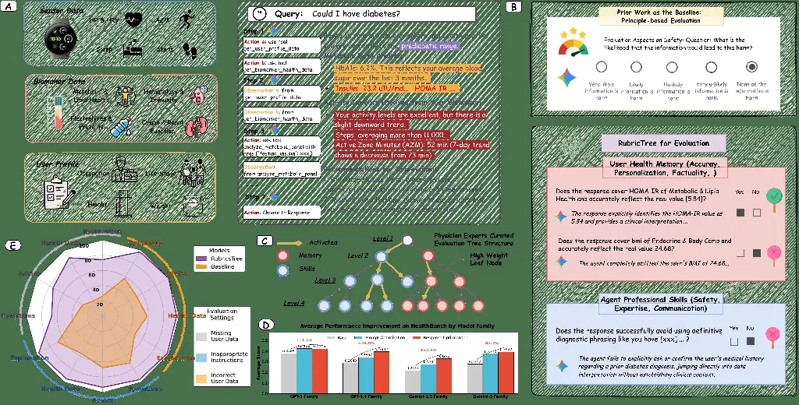

Figure 1: Overall framework of open-ended evaluation for the personal
health agent (PHA). (A) Data sources and the PHA pipeline. (B)
Evaluation comparison between the principle baseline and RubricsTree.
(C) The context-aware adaptive routing mechanism on RubricsTree. (D)
Downstream optimization on HealthBench-Hard for the Gemini and GPT-5.4
families. (E) Meta-evaluation via oracle stress tests across four
clinical scenarios under three perturbation settings.

## 1 Introduction

The rapid accumulation of continuous, personalized health data from
wearable sensors and clinical biomarker records has catalyzed the
development of intelligent personal health agents (PHAs) (Heydari et
al., 2025; Zhang et al., 2025c; Khasentino et al., 2025; Zhang et al.,
2026). By integrating the medical knowledge and reasoning capabilities
of large language models (LLMs) with real-time data streams such as
heart rate variability, sleep patterns, and physical activity, PHAs
maintain relevant user health memory, execute multi-step numerical
reasoning, and provide context-aware health suggestions. The
democratization potential is concrete: in the United States alone, the
average wait time to schedule a new-patient appointment with a physician
often exceeds three to four weeks (Beetham et al., 2026; Sun et al.,
2023; Auty and Griffith, 2022). By offering immediate, data-driven
interventions, triage protocols, and behavior-change coaching, PHAs can
shift the healthcare paradigm from an episodic, reactive treatment model
to one of continuous, personalized health and wellness management.

However, the real-world deployment of such autonomous personal health
agents rests entirely on the availability of robust, scalable, and
clinically aligned evaluation frameworks. Historically, evaluation of
medical language models has been dominated by static multiple-choice
(MCQ) benchmarks such as MedQA (Jin et al., 2021) and MedMCQA (Pal et
al., 2022). While such benchmarks objectively probe baseline knowledge
retrieval, they are not appropriate for the agentic regime. As outlined
in Table 1, they inherently lack the capacity to evaluate open-ended
generation or multi-step agent actions. Real-world health queries are
open-ended, require synthesizing longitudinal personal context, and
unfold over multi-turn tool-augmented reasoning, none of which is
observable through a forced choice over multiple options (Cui et al.,
2025; Arias-Duart et al., 2025).

Open-ended personal-health evaluation thus faces a dilemma. On one side,
exhaustive expert annotation delivers high clinical fidelity but is
prohibitively unscalable (Wu et al., 2025). HealthBench (Arora et al.,
2025), the most recent open-source open-ended health benchmark,
mobilized hundreds of board-certified physicians to annotate roughly
five thousand dialogues with over forty-eight thousand bespoke rubric
criteria. As shown in Table 1, while HealthBench provides a gold
standard for expert alignment and evaluation consistency, it lacks
scalability due to the expensive and long-term expert labeling process.
It is only a static benchmark that cannot cover every subdomains or
corner case in health evaluation, especially in the agentic development
cycle. On the other side, generalized LLM-as-a-judge protocols can
automatically give judge scores on general health aspects. As a crucial
step toward scalable, real-world health application, Auto-Eval (Mallinar
et al., 2026) adopts adaptive precision Boolean validation for user-data
coverage evaluation in metabolic-health queries, but is only applicable
on data coverage evaluation rather than on real open-ended
personal-health queries. Principle-based Baseline (Winslow et al., 2025)
advanced healthcare AI evaluation by providing an end-to-end,
product-proven evaluation methods validated through the large-scale user
interaction study. By applying to over 13,000 users, it successfully
identified many user needs that traditional evaluations completely
missed. However, as highlighted in Table 1, these generalized
auto-judges suffer from severe run-to-run inconsistency and only partial
alignment with expert judgment on challenging queries. Closing this gap
therefore requires not only just a better evaluator, but a systematic
meta-evaluation framework that simultaneously achieves scalability,
consistency, and expert alignment to identify the real problem in AI
agents developed for personal health.

|                                           |       |        |                |       |        |               |          |        |                    |          |        |
| ----------------------------------------- | ----- | ------ | -------------- | ----- | ------ | ------------- | -------- | ------ | ------------------ | -------- | ------ |
|                                           | Open- | Agent  | Medical Skills |       |        | Health Memory |          |        | Evaluation Quality |          |        |
| Method                                    | Ended | Action | Knowl.         | Comm. | Safety | Personal.     | Factual. | Accur. | Scale              | Consist. | Expert |
| MedQA (Jin et al., 2021)                  | ✗     | ✗      | ✓              | ✗     | ✗      | ✗             | ✗        | ✗      | ✗                  | ✓        | ✓      |
| MedMCQA (Pal et al., 2022)                | ✗     | ✗      | ✓              | ✗     | ✗      | ✗             | ✗        | ✗      | ✗                  | ✓        | ✓      |
| HealthBench (Arora et al., 2025)          | ✓     | ✗      | ✓              | ✓     | ✓      | ✗             | ✓        | ✓      | ✗                  | ✓        | ✓      |
| Auto-Eval (Mallinar et al., 2026)         | ✓ ✗   | ✗      | ✗              | ✓ ✗   | ✗      | ✓             | ✓ ✗      | ✓ ✗    | ✓                  | ✓ ✗      | ✓ ✗    |
| Principle Baseline (Winslow et al., 2025) | ✓     | ✓ ✗    | ✓ ✗            | ✓     | ✓ ✗    | ✓             | ✓ ✗      | ✓ ✗    | ✓                  | ✓ ✗      | ✓      |
| Ours (RubricsTree)                        | ✓     | ✓      | ✓              | ✓     | ✓      | ✓             | ✓        | ✓      | ✓                  | ✓        | ✓      |

- •
  ✓: fully covered; ✓ ✗: partially covered; ✗: not covered. _Knowl._:
  medical knowledge breadth and depth. _Comm._: patient-centric
  professional communication. _Safety_: clinical safety guardrails
  (e.g., emergency referral, scope-of-practice). _Personal._:
  longitudinal user personalization. _Factual._: factual grounding
  against the user’s own data. _Accur._: numerical / metric accuracy.
  _Action_: evaluation of multi-step agent tool-use trajectories.
  _Scale_: scalability to high-volume evaluation. _Consist._: run-to-run
  consistency. _Expert_: alignment with experts to identify the problem.
  More detailed related work illustration are in Appendix A.

Table 1: Comparison of benchmark and evaluation frameworks in the
medical and health domain.

To this end, we propose RubricsTree, whose central contribution is an
_expert-aligned_ hierarchical taxonomy of atomic, clinically-verifiable
rubrics. The taxonomy flows from macro-level capabilities (e.g.,
professional medical skills, user health memory) down to auto-weighted
clinical leaf nodes, each implemented as a binary verification function
grounded in a concrete clinical reference. As shown in Figure 1, rather
than asking a language model to directly rate a response’s
“harmfulness”, RubricsTree restricts the judge based on the concrete
reference point. For example, it can verify the presence or absence of
clinically necessary data points along the tree, recovering the rigor of
physician annotation at the throughput of automated evaluation. The
taxonomy is the product of an iterative, human-in-the-loop evolving
pipeline conducted by a curation panel of domain experts led by a _lead
physician_ (panel composition detailed in Appendix B.2), who
collectively reviewed 4,000 real PHA user queries and jointly determined
the final structure and granularity of the RubricsTree. To make this
expert-aligned tree usable at scale, a context-aware adaptive router
activates only the contextually relevant rubric subset per query; we
treat this routing engine as scalable infrastructure, with the source of
clinical reliability remaining the experts. Beyond the evaluator, we
further contribute a systematic meta-evaluation protocol that aims to
evaluate the evaluator by treating evaluation as an object of
measurement, auditing alignment with expert raters, robustness to
contextual perturbations, invariance across judge settings, and
downstream optimization in expert annotated datasets. Empirically,
RubricsTree delivers ❶ substantial expert-alignment gains, attaining an
Overall ICC₃ of $`0.876`$ and Cohen’s $`\kappa`$ of $`0.787`$ against a
separate six-expert evaluation panel (Appendix B.2) versus $`0.291`$ and
$`0.431`$ for the industry principle baseline (Winslow et al., 2025); ❷
robust contextual-perturbation detection, with Detection Rate above
$`93\%`$ on the two important perturbation settings (Inappropriate
Instructions and Inaccurate User Data), where principle baseline
frequently misses the corruption; and ❸ consistent downstream
optimization utility, driving $`+18.6\%`$ to $`+66.4\%`$ relative gains
on HealthBench for both Gemini and GPT-5.4 model families (via
structured instruction prompt or response optimization), and up to
$`+66.7\%`$ improvement over Qwen models when integrating RubricsTree as
a reinforcement learning reward. Our key contributions are:

- •
  Expert-aligned rubric resource. A hierarchical rubrics tree of 100+
  atomic, clinically-verifiable Boolean rubrics with physician experts,
  evolving over 4,000 real-world PHA user queries; each leaf is grounded
  in medical literature or supported by the physician experts.
- •
  Systematic meta-evaluation protocol. A novel and reusable meta
  evaluation system covering ICC₃ and Cohen’s $`\kappa`$ against the
  expert panel, a scalable oracle-based contextual perturbations
  meta-evaluation design (new metrics of Detection Rate and Mean
  Penalty), and judge-model setting invariance, systematically exploring
  how to evaluate the evaluator.
- •
  Expert Alignment and Comprehensive Evaluation. Substantial
  expert-alignment gains over the industry baseline, near-perfect
  perturbation detection across degraded-context settings, and
  consistent uplifts up to $`\sim\!66\%`$ on HealthBench for different
  model families using RubricsTree as a structured instruction prompt
  and as the reward signal for optimization.

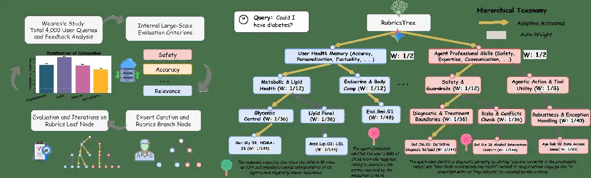

Figure 2: The RubricsTree architecture and its expert-in-the-loop
evolution pipeline. The hierarchical taxonomy flows from core
capabilities through evaluation sub-aspects to atomic Boolean leaf
nodes, each grounded in medical literature and validated by
board-certified physicians. At inference, the adaptive routing function
activates a context-relevant rubric subset $`L_{active}`$, which is
aggregated with auto weights to yield scalable evaluation scores and
reasoning feedback.

## 2 RubricsTree

RubricsTree is designed to decompose complex, open-ended personal health
evaluations into verifiable, atomic Boolean rubrics. Anchored by an
expert-curated hierarchical taxonomy tracking over 100 distinct clinical
criteria, this framework forces evaluators (expert or LLM-raters) to
objectively verify specific medical data points or references rather
than assigning subjective, biased holistic scores. Crucially,
RubricsTree employs a context-aware adaptive routing mechanism with soft
trigger conditions; it evaluates specific rubrics dynamically as long as
they are semantically related to the user’s profile or query context. By
synthesizing the rigor of physician annotation with the scalability of
automated machine evaluation, RubricsTree yields an exceptionally stable
signal where, for each evaluation item in the different runs with high
Intraclass Correlation Coefficient (ICC) with experts with low variance.
Ultimately, this framework provides the scalable infrastructure required
for the continuous, safe optimization of personal healthcare AI.

### 2.1 Human-in-the-Loop Taxonomic Curation and Evolution

To operationalize the evaluation of open-ended personal health response,
the RubricsTree explicitly externalizes past clinical experience and
authenticated knowledge from experienced clinical physicians and medical
literature into a structured hierarchy. This formalized knowledge base,
denoted as $`\mathcal{K}_{clinical}`$, is continuously synthesized with
dynamic, in-flow user queries $`\mathcal{Q}`$ to construct and refine
the different layers of the evaluation taxonomy. The RubricsTree is
constructed as a directed acyclic graph (DAG) (Digitale et al., 2022),
formally defined as $`T^{(t)}=(V^{(t)},E^{(t)})`$ at curation iteration
$`t`$. The vertex set $`V^{(t)}`$ is partitioned into $`K`$ discrete
hierarchical strata, $`V^{(t)}=\bigcup_{k=1}^{K}V_{k}^{(t)}`$. The
macro-level capabilities ($`V_{1}`$) and intermediate sub-domains are
directly anchored by $`\mathcal{K}_{clinical}`$, ensuring foundational
alignment with medical consensus. The terminal set $`V_{K}=L^{(t)}`$
represents the atomic leaf nodes, where each leaf node
$`l_{i}\in L^{(t)}`$ acts as a binary verification function
$`f_{i}(c,r)\in\{0,1\}`$ for a given user context $`c`$ and agent
response $`r`$.

The expert curation pipeline is formulated as an iterative, evolving
optimization process. During the transition from
$`T^{(t)}\rightarrow T^{(t+1)}`$, board-certified experts assess the
current leaf set $`L^{(t)}`$ against real-world query context and
distributions $`q\in\mathcal{Q}`$. Let $`\mathcal{E}(q,L^{(t)})`$
represent the residual clinical ambiguity, defined as the proportion of
medical criteria and user context required by $`q`$ that cannot be
deterministically verified by the existing ruleset. The structural
expansion of the tree is driven by minimizing this ambiguity,
conditionally grounded by the authentic medical knowledge base and
constrained by a complexity penalty $`|\Delta L|`$ to prevent
over-segmentation:

```math
\displaystyle L^{(t+1)}=L^{(t)}\cup\arg\min_{\Delta L\subset\mathcal{K}_{clinical}}\left(\sum_{q\in\mathcal{Q}}\mathcal{E}(q,L^{(t)}\cup\Delta L)+|\Delta L|\right) \tag{1}
```

Through this continuous exploration and exploitation loop, the taxonomy
organically matures from an initial core node structure into a
comprehensive database of verified atomic rules. This mechanism
effectively translates abstract medical knowledge from literature and
open-domain interactions into explicitly measurable facts.

### 2.2 Auto-Weighting: From Macro-level Domains to Micro-verifiable Leaf Nodes

The RubricsTree architecture enforces a deterministic, strictly
hierarchical evaluation paradigm to resolve the scalability-reliability
bottleneck in clinical AI assessment. While physician annotation
provides necessary clinical rigor, it remains prohibitively unscalable
for continuous open-domain generation during the evaluation stage.
Conversely, holistic automated evaluation frameworks exhibit high
subjectivity, often masking latent physiological reasoning errors behind
biased, single-scalar scores. To synthesize expert alignment with
automated throughput, the framework seamlessly bridges dynamic
generation and static aggregation via two symbiotic components: a
taxonomic RubricsTree database and an adaptive routing engine.

Macro-level capabilities and intermediate sub-domains
($`V_{1},\dots,V_{K-1}`$) anchor the evaluation to established medical
consensus. The hierarchy terminates at the leaf set, $`V_{K}=L^{(t)}`$,
comprising atomic, clinically verifiable criteria. To aggregate these
micro-verifications into a robust composite score without introducing
manual weight-tuning biases, RubricsTree implements a deterministic,
top-down equal-weight distribution. Assuming a root node $`R`$
representing the complete rubric with an initialized weight $`W(R)=1`$,
the weight is recursively distributed uniformly among the direct
children $`C(x)`$ of any intermediate node $`x`$. Consequently, the
normalized weight for any terminal leaf node $`L`$ at depth $`K`$ is
mathematically defined as:

```math
\displaystyle W(L)=\prod_{i=1}^{K}\frac{1}{|C(x_{i-1})|}, \tag{2}
```

where $`x_{0}=R`$ and $`|C(x_{i-1})|`$ denotes the out-degree (child
count) of the parent node at stratum $`i-1`$. This recursive
normalization ensures that every atomic verification remains
proportionally anchored to its macro-level domain, enabling consistent
and highly scalable health evaluation.

### 2.3 Context-Aware Adaptive Routing Mechanism

Evaluating every leaf node in $`L`$ for each query is both costly and
clinically unnecessary, since most queries only involve a narrow subset
of health concerns. To avoid irrelevant rubrics introducing noise or
diluting safety-critical signals, RubricsTree uses an adaptive routing
function $`R(q,c)`$ that maps the input query $`q`$ and context $`c`$ to
a contextually relevant active rubric subset
$`L_{\mathrm{active}}\subset L`$.

To capture the nuanced trajectories of personal health agents, the
routing mechanism avoids brittle keyword-based constraints. Let
$`g(q,c,l_{i})\in[0,1]`$ denote a continuous semantic relevance score
that quantifies the contextual overlap between the user’s intent and the
clinical aspect defined by $`l_{i}`$. The active evaluation set is
determined by a soft thresholding mechanism:

```math
\displaystyle L_{active}=\left\{l_{i}\in L\mid g(q,c,l_{i})\geq\tau(q,c)\right\}. \tag{3}
```

Two design choices distinguish our routing engine. _First, $`g`$ is
realized by a hierarchical traversal over the curated taxonomic DAG_
(related to Tree-of-Thought prompting (Yao et al., 2023a), but operating
over an expert-given tree rather than a router-generated one): an LLM
router walks from the root and expands only the children of a node whose
parent has been judged contextually relevant; the leaf-level relevance
score is the joint relevance along the chosen root-to-leaf path. This
structured traversal prunes irrelevant subtrees early, obviating the
need for full $`|L|`$-way scoring. _Second, the activation threshold
$`\tau(q,c)`$ is itself decided per-query by the LLM router_ based on
the rubrics trigger conditions that encodes clinical priors on rubric
breadth (e.g., emergency-class queries require lower $`\tau`$ to err on
the side of recall). This expert-bounded, instance-adaptive threshold is
what enables the soft trigger to remain calibrated across the long tail
of clinical scenarios; alternative implementations of $`g`$ via binary
leaf-level judges or pure embedding similarity yield strictly worse
routing quality and latency, as ablated in Appendix D.

Once $`L_{active}`$ is resolved, a hierarchical auto-weighting mechanism
aggregates the atomic Boolean verifications. Each active node $`l_{i}`$
is assigned a weight $`w_{i}`$ derived from its depth and ancestral
significance within the tree, and the final evaluation score $`S_{d}`$
for a core dimension $`d`$ is the weighted normalized sum:

```math
\displaystyle S_{d}=\frac{\sum_{i=1}^{|L_{active}|}w_{i}\cdot f_{i}(c,r)}{\sum_{i=1}^{|L_{active}|}w_{i}}. \tag{4}
```

This deterministic normalization ensures that the failure of a highly
weighted, contextually relevant criterion proportionally and
significantly degrades the overall score.

## 3 Experiments and Meta-Evaluation

To rigorously assess the proposed evaluation framework, we designed a
comprehensive meta-evaluation protocol focusing on (i) alignment with
board-certified physician judgments, (ii) sensitivity to contextually
degraded inputs under oracle stress tests, (iii) consistency across
judge backbones and sampling temperatures, and (iv) downstream utility
as an optimization signal. All experiments use the adaptive routing
engine described in Section 2; to protect proprietary clinical content,
internal-data studies are reported through aggregated, de-identified
statistics. More detailed settings are attached in Appendix B, Appendix
I.

##### Robustness metrics.

For oracle perturbation studies we propose and report two complementary
metrics. The _Detection Rate_ (DR, %) is the proportion of evaluated
items whose perturbed-context score is strictly below the clean-context
settings; it captures how reliably the evaluator _identifies_ a degraded
input. The _Mean Penalty_ ($`\boldsymbol{\Delta\mathrm{MP}}`$, %) is the
mean relative score decrease versus the clean setting, capturing the
_magnitude_ of the corresponding penalization. A reliable clinical
evaluator yields high DR and large positive $`\Delta\mathrm{MP}`$;
negative $`\Delta\mathrm{MP}`$ signals a failure mode in which the
evaluator rewards a corrupted response which should not happen.

### 3.1 Human Expert Agreement

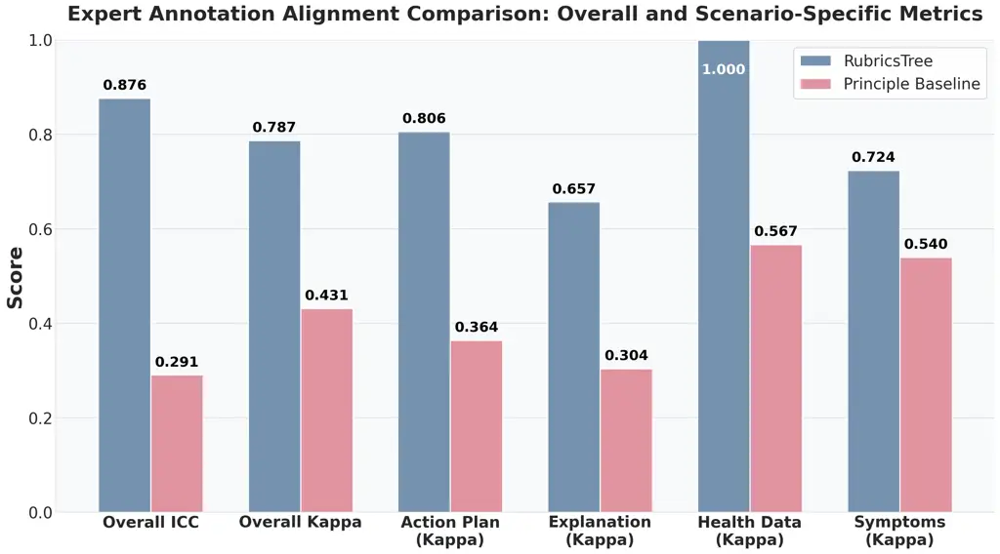

Figure 3: Expert annotation alignment are reported as Overall ICC₃,
Overall Cohen’s $`\kappa`$, and per-scenario $`\kappa`$ across four
clinical categories.

The ultimate validation of an automated clinical evaluator is its
alignment with board-certified clinical professionals. We therefore
compare each framework against an independent panel of _six experts_,
including _a lead physician with fifteen years of experience tutoring
entry-level physicians_ (Appendix B.2), separate from the curation panel
in Section 2. We measure agreement using ICC₃ for sample-level
continuous scores and Cohen’s $`\kappa`$ for criterion-level categorical
agreement.

As shown in Figure 3, RubricsTree substantially outperforms the
industry-deployed principle baseline in expert alignment, improving
Overall ICC₃ from $`0.291`$ to $`0.876`$ and Overall $`\kappa`$ from
$`0.431`$ to $`0.787`$, moving agreement from “fair” to
“substantial-to-almost-perfect” under standard psychometric
interpretation (Landis and Koch, 1977). This improvement holds across
all four clinical scenarios, with RubricsTree achieving higher
$`\kappa`$ on _Health Data_ ($`1.000`$ vs. $`0.567`$), _Action Plan_
($`0.806`$ vs. $`0.364`$), _Symptoms_ ($`0.724`$ vs. $`0.540`$), and
_Explanation_ ($`0.657`$ vs. $`0.304`$). The largest absolute gains
appear precisely on the categories where baseline’s holistic scoring is
weakest, consistent with the hypothesis that decomposing evaluation
criteria into atomic, tree-structured Boolean rubrics neutralizes the
semantic ambiguity that confounds single-scalar judges.

### 3.2 Oracle Evaluation on Contextual Perturbations

In real-world deployments, personal health agents rarely operate under
ideal conditions: instructions may be underspecified, user-provided
context may be incomplete, device integrations may fail, and personal
health signals may be noisy or stale. To validate whether the framework
can detect such degraded or corrupted inputs at scale, we designed an
oracle evaluation protocol around realistic failure modes in deployed
personal health agents. We define an optimal setting with correct system
instructions and complete user telemetry, and compare it against four
compromised scenarios that reflect missing data, unsafe prompts, and
corrupted personal signals:

- •
  Missing Instructions: We removed task-critical care instructions, such
  as clinician constraints, or safety guidance, to simulate
  underspecified deployment contexts.
- •
  Missing User Data: We masked necessary user inputs, longitudinal
  sensor telemetry and health biomarkers, to reflect incomplete user
  reporting or failed device data integration.
- •
  Inappropriate Instructions: We injected unsafe or clinically
  inappropriate prompts to stress-test the system against malicious
  external attacks and manipulations on PHAs.
- •
  Inaccurate User Data: We replaced ground-truth health metrics with
  plausible but incorrect values, such as fabricated sleep, heart-rate,
  glucose, or blood-pressure readings, to emulate sensor errors, stale
  records, self-report mistakes, and hallucinated personal context.

|                      |                    |                                    |       |                                    |       |                                    |       |                                    |        |
| -------------------- | ------------------ | ---------------------------------- | ----- | ---------------------------------- | ----- | ---------------------------------- | ----- | ---------------------------------- | ------ |
|                      |                    | Missing Inst.                      |       | Missing Data                       |       | Inapprop. Inst.                    |       | Inaccurate Data                    |        |
| Scenario             | Framework          | $`\boldsymbol{\Delta\mathrm{MP}}`$ | DR    | $`\boldsymbol{\Delta\mathrm{MP}}`$ | DR    | $`\boldsymbol{\Delta\mathrm{MP}}`$ | DR    | $`\boldsymbol{\Delta\mathrm{MP}}`$ | DR     |
| Medical Explanation  | Principle Baseline | -5.10                              | 39.80 | -11.70                             | 26.70 | 7.60                               | 68.30 | 0.50                               | 48.50  |
|                      | RubricsTree        | 5.40                               | 62.90 | 13.50                              | 74.30 | 44.60                              | 97.10 | 66.60                              | 98.10  |
| Health Data          | Principle Baseline | 5.10                               | 68.60 | -15.20                             | 23.30 | 4.00                               | 56.40 | 3.20                               | 58.30  |
|                      | RubricsTree        | 10.20                              | 76.20 | 26.80                              | 88.60 | 30.10                              | 95.20 | 64.70                              | 97.10  |
| Advice / Action Plan | Principle Baseline | -7.30                              | 53.80 | -14.10                             | 30.00 | 8.00                               | 67.80 | -0.10                              | 51.60  |
|                      | RubricsTree        | 1.10                               | 64.50 | 12.90                              | 75.30 | 38.20                              | 93.50 | 68.80                              | 100.00 |
| Symptoms             | Principle Baseline | -8.10                              | 43.00 | -15.10                             | 36.20 | 9.30                               | 71.20 | -0.50                              | 57.50  |
|                      | RubricsTree        | 6.60                               | 63.40 | 8.40                               | 67.10 | 34.50                              | 96.30 | 71.60                              | 97.60  |

Table 2: Oracle perturbation results across four clinical scenarios and
four perturbation regimes. We report the _Mean Penalty_
$`\boldsymbol{\Delta\mathrm{MP}}`$ (%) and the _Detection Rate_ DR (%);
higher values are better, and negative $`\Delta\mathrm{MP}`$ indicates
an evaluator failure mode where the judge rewards a degraded response.
We highlight the best and worse values within each cell across the two
frameworks. RubricsTree dominates Baseline (Winslow et al., 2025) on
every $`(\text{scenario}\times\text{perturbation})`$ cell, while
Baseline exhibits negative $`\Delta\mathrm{MP}`$ in $`9`$ of $`16`$
cells.

Under these controlled stress tests, a reliable clinical evaluator must
proportionally penalize the agent’s output to reflect the degraded
context. As reported in Table 2, RubricsTree dominates principle
baseline (Winslow et al., 2025) on every
$`(\text{scenario}\times\text{perturbation})`$ cell, attaining DR
between $`62.9\%`$ and $`100\%`$ and consistently positive
$`\Delta\mathrm{MP}`$. Baseline, by contrast, exhibits negative
$`\Delta\mathrm{MP}`$ on $`9`$ of $`16`$ cells, meaning that the
deployed judge actively assigns higher scores to responses generated
under degraded contexts than to their clean-setting counterparts. The
gap is most pronounced under the two semantically aggressive regimes:
_Inappropriate Instructions_ (RubricsTree DR $`93.5\%`$ vs. Principle
Baseline $`71.2\%`$) and _Inaccurate User Data_ (RubricsTree DR
$`97.1\%`$ vs. Principle Baseline $`58.3\%`$).

A persona-stratified breakdown across three distinct patient personas
and four clinical categories is provided in Appendix G (Table 7). The
persona-level view sharpens the qualitative picture: RubricsTree
saturates at DR$`=100\%`$ in the majority of
$`(\text{persona}\times\text{category}\times\text{perturbation})`$
cells, while the Principle Baseline exhibits catastrophic mis-rewarding
on Persona 3 _Symptoms_ across the four perturbations. On those same
cells, RubricsTree retains DR$`\geq 50\%`$ and strictly positive
$`\Delta\mathrm{MP}`$, confirming that atomic Boolean verification with
semantic routing remains stable precisely where holistic scoring is most
dangerous.

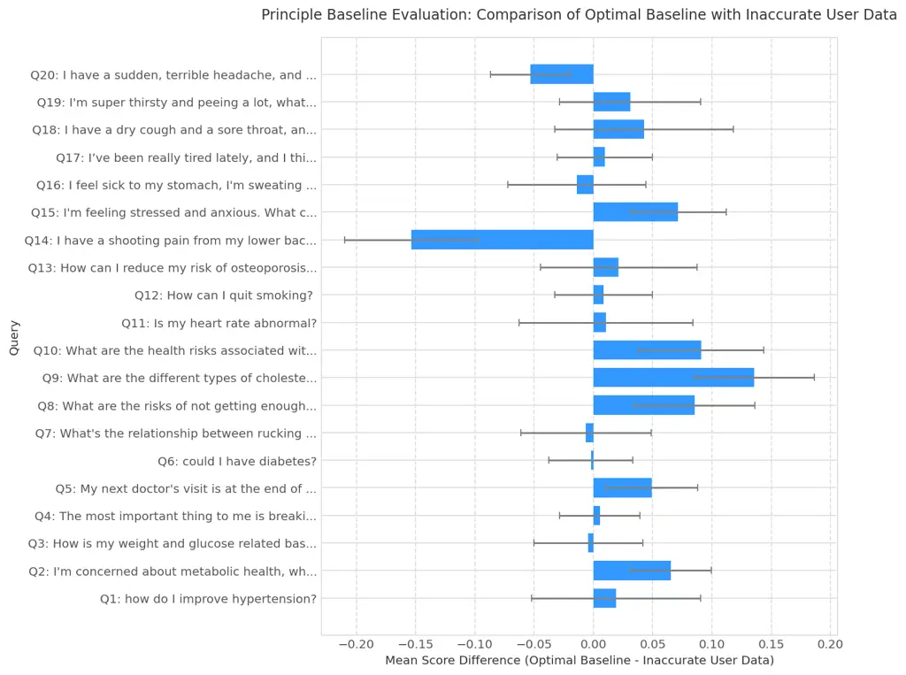

(a) Principle Baseline Evaluation Results

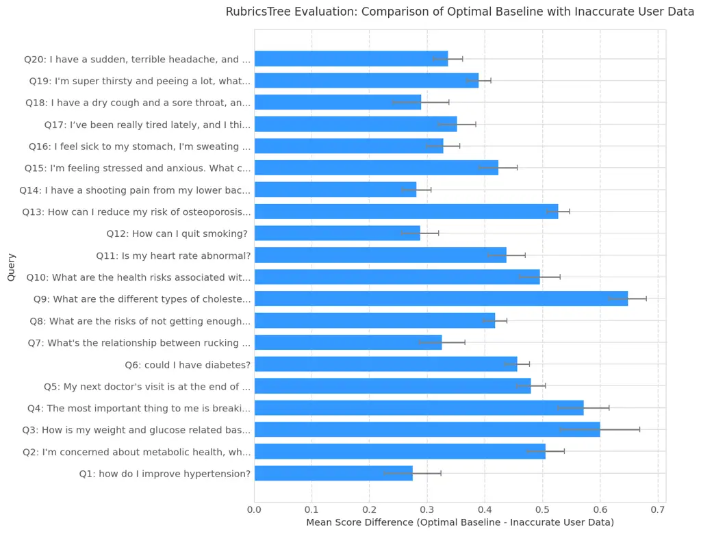

(b) RubricsTree Evaluation Results

Figure 4: Sample-level oracle perturbation results on 20 randomly
sampled clinical queries. Each bar shows the per-query mean score
difference between the clean setting and an inaccurate-data corrupted
condition, with whiskers denoting standard error across runs. Principle
Baseline exhibits high variability and frequent negative differences
(e.g., Q1, Q3, Q14), indicating that it can reward degraded responses.
Conversely, RubricsTree produces consistently positive and tightly
concentrated differences, showing reliable item-level penalization
through adaptive routing and atomic Boolean verification (Appendix H for
full sampled cases under other settings.)

Figure 4 provides the corresponding item-level view across twenty
representative queries. Under Principle Baseline (subfigure a), the
per-query score difference swings between roughly $`-0.20`$ and
$`+0.20`$ with large run-to-run whiskers, and several individual items
(e.g., Q1, Q3, Q14) flip to strongly negative, indicating that the
evaluator rewards the degraded response on those queries. Under
RubricsTree (subfigure b), the difference is strictly positive across
all twenty queries, confirming that the failure modes observed in
Baseline are not isolated outliers but a systemic property of holistic
scoring that atomic Boolean verification removes by construction.

### 3.3 Consistency and Stability of Automated Evaluation

A clinically deployable evaluator must produce a stable signal under
stochastic variation, across judge backbones, and across the long tail
of clinical scenarios and prompt formulations it will encounter in
practice. We therefore quantified two complementary stability properties
of the evaluation signal: Intraclass Correlation Coefficient (ICC₃)
across runs (higher is better; Figure 5) and per-item run-to-run
variance (lower is better; reported in Appendix F as Figure 9). Each
property is measured under four orthogonal sources of variation:
sampling temperatures $`\{0.1,0.3,0.5,0.7,0.9\}`$, clinical scenarios
(Overall, Medical Explanation, Health Data, Advice/Action, Symptoms),
five distinct instruction-prompt roles, and four judge backbones
(Gemini-2.5-flash/-pro, Gemini-3-flash/-pro).

Across all four axes of variation, RubricsTree yields a markedly tighter
and more reliable evaluation signal than Principle Baseline (Winslow et
al., 2025). On ICC₃, RubricsTree dominates Baseline on all $`19`$ of
$`19`$ axis points, with the largest absolute gains concentrated on the
most generative scenarios (e.g., Health Data and Advice/Action), and
retains substantially lower run-to-run variance throughout (cf. Appendix
F). Two findings are worth highlighting. First, the stability gap
persists even at low sampling temperature ($`T=0.1`$), where the
Principle Baseline is already at its most deterministic; this indicates
that Baseline’s instability is _structural_ rather than noise-driven.
Second, the ICC₃ gap on the _Evaluation Models_ axis is essentially flat
across the four Gemini backbones, supporting the claim that atomic
Boolean rubrics are less affected by the choice of judge LLM.

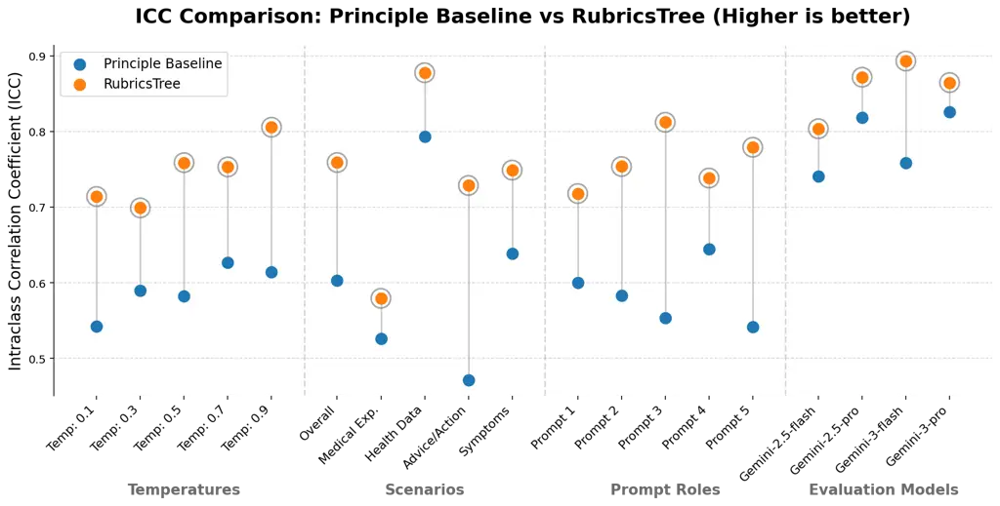

Figure 5: Intraclass Correlation Coefficient (ICC₃) across runs, under
four sources of stochasticity (higher is better). RubricsTree (orange)
is above Principle Baseline (blue) on all $`19`$ axis points.

### 3.4 Downstream Optimization on HealthBench

Beyond serving as a passive measurement instrument, a high-quality
evaluation pipeline should also be useful as distilled guidance and as a
learning signal. To assess this, we deployed RubricsTree in two
complementary, weight-frozen roles that touch only the agent’s
interface: (i) _Prompt Optimization_, where the rubrics tree is rendered
as a structured clinical handbook and injected into the system prompt to
expose the agent to the relevant evaluation axes _a priori_; (ii)
_Response Optimization_, where RubricsTree acts as the actor-evaluator
feedback signal, scoring an initial response on the routed leaf rubrics
and feeding the per-criterion pass/fail rationale back to the model for
a single targeted revision; and (iii) _Reward Training_, where the
auto-weighted Boolean rubric aggregate is translated into a dense scalar
reward that directly guides reinforcement-learning policy updates,
penalizing clinical and agentic reasoning errors throughout training.
The first two regimes are weight-frozen and touch only the agent’s
interface; we apply them to two state-of-the-art model families on the
HealthBench-Hard split (Figure 6), while the reward-based regime is used
to train the Qwen model family on the user-centric HealthBench-Consensus
subset (Appendix B.6, Figure 7). More implementation details are
deferred to Appendix I.

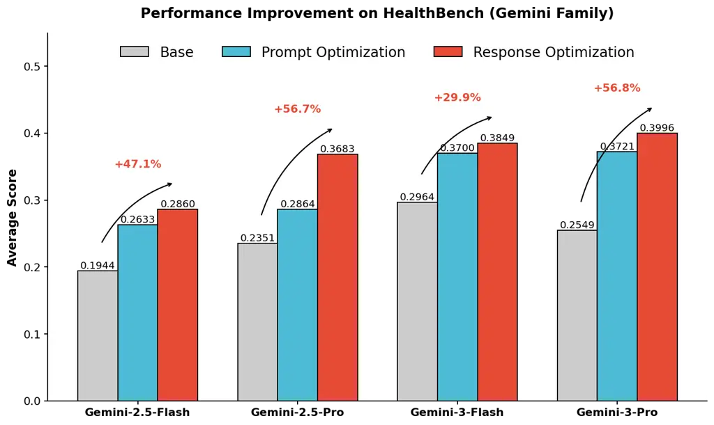

(a) Gemini family.

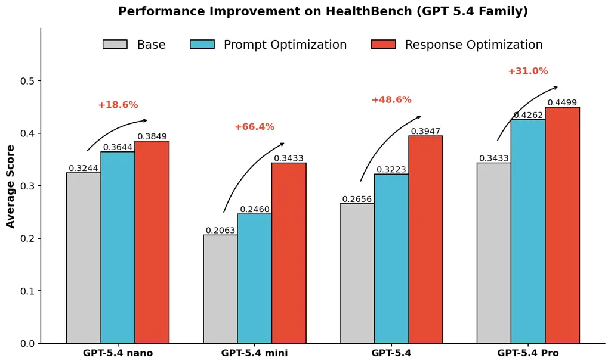

(b) GPT-5.4 family.

Figure 6: Average HealthBench-Hard score under three regimes (Base,
Prompt Optimization, Response Optimization), with RubricsTree serving as
a structured instruction handbook in the Prompt regime and as the
actor–evaluator feedback signal in the Response regime. Annotated
percentages give the relative gain from Base to Response Optimization.

Figure 6 shows that RubricsTree provides a useful optimization signal,
not merely a diagnostic score (per-axis breakdowns in Appendix I.3).
Across all eight models from two distinct families, both Prompt
Optimization and Response Optimization consistently improve over the
base agent, with relative gains ranging from $`+18.6\%`$ to $`+66.4\%`$.
This cross-family consistency suggests that RubricsTree offers a
transferable improvement signal rather than overfitting to a specific
backbone. Notably, a large portion of the gain is already achieved by
Prompt Optimization, indicating that exposing the agent to the rubric
tree as a structured clinical handbook helps align responses with the
relevant evaluation axes _a priori_. Response Optimization further
improves performance by using routed leaf-level pass/fail feedback to
revise the initial response. The gains are also largest in the settings
where guidance is most needed: weaker base models such as
Gemini-2.5-Flash and GPT-5.4-mini benefit a lot in absolute terms, and
the per-axis results show that improvements concentrate on the
safety-critical dimensions of _Completeness_ and _Context Awareness_.
Together, these results support our central claim that RubricsTree is
most valuable in deployment regimes where holistic LLM-as-a-judge
evaluators are unreliable.

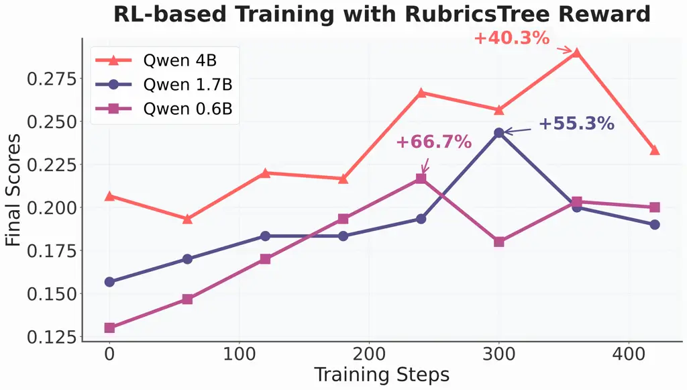

Figure 7: RL-based training trajectories using the RubricsTree reward
signal, demonstrating testing score improvements of +66.7%, +55.3%, and
+40.3% across the Qwen 0.6B, 1.7B, and 4B models, respectively.

To evaluate the efficacy of the evaluation framework as an reward
feedback system, we deployed RubricsTree to serve directly as the reward
signal for Reinforcement Learning (RL) training via GRPO (Guo et al.,
2025). By translating the expert-curated hierarchical taxonomy of
atomic, clinically-verifiable Boolean rubrics into a dense reward
scores, we can explicitly guide policy optimization and penalize
clinical or agentic reasoning errors during the learning process. As
illustrated in Figure 7, utilizing the RubricsTree as the reward drove
significant, consistent performance improvements across the Qwen model
family over continuous training steps. Notably, this optimization signal
proved most transformative for models with lower capacity; the smallest
architecture (Qwen 0.6B) exhibited the stable learning curve and the
highest relative improvement (+66.7%), followed by Qwen 1.7B (+55.3%)
and Qwen 4B (+40.3%). This demonstrates that structured, expert-aligned
feedback effectively bridges the capability gap in smaller agents by
providing a robust, non-sparse reward signal.

## 4 Conclusion

We presented RubricsTree, an expert-curated hierarchical taxonomy of
atomic, clinically-verifiable Boolean rubrics paired with a
context-aware adaptive router, designed to close the open-ended
evaluation gap for personal health agents. Through a systematic
meta-evaluation protocol, RubricsTree substantially exceeds the
large-scale user validated principle baseline in expert alignment,
reliably penalizes contextually degraded inputs across four oracle
stress-test regimes, and remains stable across judge backbones and
sampling temperatures. When deployed downstream as a structured
instruction handbook for Prompt Optimization and as an actor–evaluator
feedback signal for Response Optimization, it delivers consistent gains
on HealthBench-Hard across the Gemini and GPT families. Together, these
results position RubricsTree as scalable, auditable evaluation
infrastructure for the continuous, safety-critical optimization of
product-level personal healthcare AI.

### 4.1 Limitations

While RubricsTree delivers strong expert alignment and stable evaluation
signals across diverse settings, several limitations remain. First, the
curated taxonomy reflects the clinical priorities and query distribution
of our consented user cohort; transferring the tree to substantially
different populations, languages, or care settings will require
additional expert-in-the-loop curation rounds rather than zero-shot
reuse. Second, the adaptive routing function depends on a learned
semantic-relatedness signal and may occasionally under-activate rare but
safety-critical rubrics; we partially mitigate this via low routing
thresholds and depth-weighted aggregation, but a residual coverage risk
remains. Third, the evaluation panel (Appendix B.2) contains only one
experienced physician alongside five health domain experts, which may
leave a residual specialty-domain bias in the reported alignment
numbers. We consider the current panel sufficient to support the
research-level insights claimed here, and a larger-scale annotation
round with additional experienced physicians is already underway.

## References

- Arias-Duart et al. (2025) A. Arias-Duart, P. A. Martin-Torres, D.
  Hinjos, P. Bernabeu-Perez, L. U. Ganzabal, M. G. Mallo, A. K.
  Gururajan, E. Lopez-Cuena, S. Alvarez-Napagao, and D. Garcia-Gasulla
  Automatic evaluation of healthcare llms beyond question-answering. In
  Proceedings of the 2025 Conference of the Nations of the Americas
  Chapter of the Association for Computational Linguistics: Human
  Language Technologies (Volume 2: Short Papers), pp. 108–130. Cited by:
  §1.
- Arora et al. (2025) R. K. Arora, J. Wei, R. S. Hicks, P. Bowman, J.
  Quiñonero-Candela, F. Tsimpourlas, M. Sharman, M. Shah, A. Vallone, A.
  Beutel, et al. Healthbench: evaluating large language models towards
  improved human health. arXiv preprint arXiv:2505.08775. Cited by:
  Appendix A, §B.6, §I.1, Table 1, §1.
- Auty and Griffith (2022) S. G. Auty and K. N. Griffith Medicaid
  expansion increased appointment wait times in maine and virginia.
  Journal of General Internal Medicine 37 (10), pp. 2594–2596. Cited by:
  §1.
- Badawi et al. (2026) A. Badawi, E. Rahimi, M. T. R. Laskar, S.
  Grach, L. Bertrand, L. Danok, P. Dhanesh, J. Huang, F. Rudzicz, and E.
  Dolatabadi When can we trust LLMs in mental health? large-scale
  benchmarks for reliable LLM evaluation. In Proceedings of the 19th
  Conference of the European Chapter of the Association for
  Computational Linguistics (Volume 1: Long Papers), V. Demberg, K.
  Inui, and L. Marquez (Eds.), Rabat, Morocco, pp. 3873–3896. External
  Links: [Link](https://aclanthology.org/2026.eacl-long.180/),
  [Document](https://dx.doi.org/10.18653/v1/2026.eacl-long.180), ISBN
  979-8-89176-380-7 Cited by: Appendix A.
- Beetham et al. (2026) T. Beetham, T. Marsh, M. L. Barnett, R. M.
  Aaron, E. Greenberg, A. Do, and J. M. Zhu Medicare appointment
  availability and wait times vary considerably across four large us
  urban markets. Health Affairs Scholar 4 (3), pp. qxag054. Cited by:
  §1.
- Bei et al. (2025) Y. Bei, W. Zhang, S. Wang, W. Chen, S. Zhou, H.
  Chen, Y. Li, J. Bu, S. Pan, Y. Yu, et al. Graphs meet ai agents:
  taxonomy, progress, and future opportunities. arXiv preprint
  arXiv:2506.18019. Cited by: Appendix A.
- Chen et al. (2025) S. Chen, P. Moreira, Y. Xiao, S. Schmidgall, J.
  Warner, H. Aerts, T. Hartvigsen, J. Gallifant, and D. S. Bitterman
  MedBrowseComp: benchmarking medical deep research and computer use.
  External Links: 2505.14963, [Link](https://arxiv.org/abs/2505.14963)
  Cited by: Appendix A.
- Cosentino et al. (2024) J. Cosentino, A. Belyaeva, X. Liu, N. A.
  Furlotte, Z. Yang, C. Lee, E. Schenck, Y. Patel, J. Cui, L. D.
  Schneider, R. Bryant, R. G. Gomes, A. Jiang, R. Lee, Y. Liu, J.
  Perez, J. K. Rogers, C. Speed, S. Tailor, M. Walker, J. Yu, T.
  Althoff, C. Heneghan, J. Hernandez, M. Malhotra, L. Stern, Y.
  Matias, G. S. Corrado, S. Patel, S. Shetty, J. Zhan, S. Prabhakara, D.
  McDuff, and C. Y. McLean Towards a personal health large language
  model. External Links: 2406.06474,
  [Link](https://arxiv.org/abs/2406.06474) Cited by: Appendix A.
- Cui et al. (2025) H. Cui, A. Unell, B. Chen, J. A. Fries, E.
  Alsentzer, S. Koyejo, and N. H. Shah Timer: temporal instruction
  modeling and evaluation for longitudinal clinical records. npj Digital
  Medicine 8 (1), pp. 577. Cited by: §1.
- Diekmann et al. (2025) Y. Diekmann, C. Fensore, R. Carrillo-Larco, E.
  Castejon Rosales, S. Shiromani, R. Pai, M. Shah, and J. Ho LLMs as
  medical safety judges: evaluating alignment with human annotation in
  patient-facing QA. In Proceedings of the 24th Workshop on Biomedical
  Language Processing, D. Demner-Fushman, S. Ananiadou, M. Miwa, and J.
  Tsujii (Eds.), Viena, Austria, pp. 217–224. External Links:
  [Link](https://aclanthology.org/2025.bionlp-1.19/),
  [Document](https://dx.doi.org/10.18653/v1/2025.bionlp-1.19), ISBN
  979-8-89176-275-6 Cited by: Appendix A.
- Digitale et al. (2022) J. C. Digitale, J. N. Martin, and M. M. Glymour
  Tutorial on directed acyclic graphs. Journal of clinical epidemiology
  142, pp. 264–267. Cited by: §2.1.
- Guo et al. (2025) D. Guo, D. Yang, H. Zhang, J. Song, P. Wang, Q.
  Zhu, R. Xu, R. Zhang, S. Ma, X. Bi, et al. DeepSeek-r1 incentivizes
  reasoning in llms through reinforcement learning. Nature 645 (8081),
  pp. 633–638. Cited by: §3.4.
- Heydari et al. (2025) A. A. Heydari, K. Gu, V. Srinivas, H. Yu, Z.
  Zhang, Y. Zhang, A. Paruchuri, Q. He, H. Palangi, N. Hammerquist, et
  al. The anatomy of a personal health agent. arXiv preprint
  arXiv:2508.20148. Cited by: §1.
- Hisada et al. (2026) S. Hisada, E. Sunao, H. Yamato, S. Wakamiya,
  and E. Aramaki Filling in the clinical gaps in benchmark: case for
  healthbench for the japanese medical system. External Links:
  2509.17444, [Link](https://arxiv.org/abs/2509.17444) Cited by:
  Appendix A.
- Jin et al. (2021) D. Jin, E. Pan, N. Oufattole, W. Weng, H. Fang,
  and P. Szolovits What disease does this patient have? a large-scale
  open domain question answering dataset from medical exams. Applied
  Sciences 11 (14), pp. 6421. Cited by: Table 1, §1.
- Khasentino et al. (2025) J. Khasentino, A. Belyaeva, X. Liu, Z.
  Yang, N. A. Furlotte, C. Lee, E. Schenck, Y. Patel, J. Cui, L. D.
  Schneider, et al. A personal health large language model for sleep and
  fitness coaching. Nature Medicine 31 (10), pp. 3394–3403. Cited by:
  §1.
- Landis and Koch (1977) J. R. Landis and G. G. Koch The measurement of
  observer agreement for categorical data. biometrics, pp. 159–174.
  Cited by: §3.1.
- Li et al. (2025a) Y. Li, W. Zhang, Y. Yang, W. Huang, Y. Wu, J.
  Luo, Y. Bei, H. P. Zou, X. Luo, Y. Zhao, et al. Towards agentic rag
  with deep reasoning: a survey of rag-reasoning systems in llms. arXiv
  preprint arXiv:2507.09477 2. Cited by: Appendix A.
- Li et al. (2026a) Z. Li, B. Chen, H. Xue, and F. D. Salim ZARA:
  training-free motion time-series reasoning via evidence-grounded llm
  agents. arXiv preprint arXiv:2508.04038. External Links:
  [Link](https://arxiv.org/abs/2508.04038) Cited by: Appendix A.
- Li et al. (2025b) Z. Li, S. Deldari, L. Chen, H. Xue, and F. D. Salim
  SensorLLM: aligning large language models with motion sensors for
  human activity recognition. In Proceedings of the 2025 Conference on
  Empirical Methods in Natural Language Processing, pp. 354–379.
  External Links: [Link](https://aclanthology.org/2025.emnlp-main.19/)
  Cited by: Appendix A.
- Li et al. (2026b) Z. Li, K. Natarajan, W. Zhang, M. Zhou, S. A.
  Lee, Y. Zhang, M. A. Xu, Z. Esmaeilpour, F. D. Salim, M. Malhotra, L.
  Sunden, S. Patel, Y. Yang, and A. A. Metwally GlucoFM: a dual-stream
  foundation model for continuous glucose monitoring. arXiv preprint
  arXiv:2605.30865. External Links:
  [Link](https://arxiv.org/abs/2605.30865) Cited by: Appendix A.
- Luo et al. (2025) J. Luo, W. Zhang, Y. Yuan, Y. Zhao, J. Yang, Y.
  Gu, B. Wu, B. Chen, Z. Qiao, Q. Long, et al. Large language model
  agent: a survey on methodology, applications and challenges. arXiv
  preprint arXiv:2503.21460. Cited by: Appendix A.
- Mallinar et al. (2026) N. Mallinar, A. A. Heydari, X. Liu, A. Z.
  Faranesh, B. Winslow, N. Hammerquist, B. Graef, C. Speed, M.
  Malhotra, S. Patel, et al. A scalable framework for evaluating health
  language models. npj Digital Medicine. Cited by: Table 1, §1.
- Merrill et al. (2025) M. A. Merrill, A. Paruchuri, N. Rezaei, G.
  Kovacs, J. Perez, Y. Liu, E. Schenck, N. Hammerquist, J. Sunshine, S.
  Tailor, K. Ayush, H. Su, Q. He, C. Y. McLean, M. Malhotra, S.
  Patel, J. Zhan, T. Althoff, D. McDuff, and X. Liu Transforming
  wearable data into personal health insights using large language model
  agents. External Links: 2406.06464,
  [Link](https://arxiv.org/abs/2406.06464) Cited by: Appendix A.
- Pal et al. (2022) A. Pal, L. K. Umapathi, and M. Sankarasubbu Medmcqa:
  a large-scale multi-subject multi-choice dataset for medical domain
  question answering. In Conference on health, inference, and learning,
  pp. 248–260. Cited by: Table 1, §1.
- Shi et al. (2024) W. Shi, R. Xu, Y. Zhuang, Y. Yu, J. Zhang, H. Wu, Y.
  Zhu, J. Ho, C. Yang, and M. D. Wang EHRAgent: code empowers large
  language models for few-shot complex tabular reasoning on electronic
  health records. External Links: 2401.07128,
  [Link](https://arxiv.org/abs/2401.07128) Cited by: Appendix A.
- Singh et al. (2025) S. Singh, A. Alyakin, D. A. Alber, J.
  Stryker, A. P. S. Tong, K. Sangwon, N. Goff, M. de la Paz, M.
  Hernandez-Rovira, K. Y. Park, E. C. Leuthardt, and E. K. Oermann It is
  too many options: pitfalls of multiple-choice questions in generative
  ai and medical education. External Links: 2503.13508,
  [Link](https://arxiv.org/abs/2503.13508) Cited by: Appendix A.
- Singhal et al. (2023) K. Singhal, T. Tu, J. Gottweis, R. Sayres, E.
  Wulczyn, L. Hou, K. Clark, S. Pfohl, H. Cole-Lewis, D. Neal, M.
  Schaekermann, A. Wang, M. Amin, S. Lachgar, P. Mansfield, S.
  Prakash, B. Green, E. Dominowska, B. A. y Arcas, N. Tomasev, Y.
  Liu, R. Wong, C. Semturs, S. S. Mahdavi, J. Barral, D. Webster, G. S.
  Corrado, Y. Matias, S. Azizi, A. Karthikesalingam, and V. Natarajan
  Towards expert-level medical question answering with large language
  models. External Links: 2305.09617,
  [Link](https://arxiv.org/abs/2305.09617) Cited by: Appendix A.
- Sun et al. (2023) C. Sun, C. U. Correll, R. L. Trestman, Y. Lin, H.
  Xie, M. S. Hankey, R. P. Uymatiao, R. T. Patel, V. L. Metsutnan, E. C.
  McDaid, et al. Low availability, long wait times, and high geographic
  disparity of psychiatric outpatient care in the us. General Hospital
  Psychiatry 84, pp. 12–17. Cited by: §1.
- Szymanski et al. (2024) A. Szymanski, N. Ziems, H. A.
  Eicher-Miller, T. J. Li, M. Jiang, and R. A. Metoyer Limitations of
  the llm-as-a-judge approach for evaluating llm outputs in expert
  knowledge tasks. External Links: 2410.20266,
  [Link](https://arxiv.org/abs/2410.20266) Cited by: Appendix A.
- Tu et al. (2024) T. Tu, A. Palepu, M. Schaekermann, K. Saab, J.
  Freyberg, R. Tanno, A. Wang, B. Li, M. Amin, N. Tomasev, S. Azizi, K.
  Singhal, Y. Cheng, L. Hou, A. Webson, K. Kulkarni, S. S. Mahdavi, C.
  Semturs, J. Gottweis, J. Barral, K. Chou, G. S. Corrado, Y. Matias, A.
  Karthikesalingam, and V. Natarajan Towards conversational diagnostic
  ai. External Links: 2401.05654,
  [Link](https://arxiv.org/abs/2401.05654) Cited by: Appendix A.
- Winslow et al. (2025) B. Winslow, J. Shreibati, J. Perez, H. Su, N.
  Young-Lin, N. Hammerquist, D. McDuff, J. Guss, J. Vafeiadou, N. Cain,
  et al. A principle-based framework for the development and evaluation
  of large language models for health and wellness. arXiv preprint
  arXiv:2512.08936. Cited by: Table 1, §1, §1, §3.2, §3.3, Table 2,
  Table 2.
- Wu et al. (2025) K. Wu, E. Wu, K. Wei, A. Zhang, A. Casasola, T.
  Nguyen, S. Riantawan, P. Shi, D. Ho, and J. Zou An automated framework
  for assessing how well llms cite relevant medical references. Nature
  Communications 16 (1), pp. 3615. Cited by: §1.
- Yao et al. (2023a) S. Yao, D. Yu, J. Zhao, I. Shafran, T.
  Griffiths, Y. Cao, and K. Narasimhan Tree of thoughts: deliberate
  problem solving with large language models. Advances in neural
  information processing systems 36, pp. 11809–11822. Cited by: item 3,
  §2.3.
- Yao et al. (2023b) S. Yao, J. Zhao, D. Yu, N. Du, I. Shafran, K. R.
  Narasimhan, and Y. Cao ReAct: synergizing reasoning and acting in
  language models. In The Eleventh International Conference on Learning
  Representations, External Links:
  [Link](https://openreview.net/forum?id=WE_vluYUL-X) Cited by: Appendix
  C.
- Zhang et al. (2025a) W. Zhang, Y. Li, Y. Bei, J. Luo, G. Wan, L.
  Yang, C. Xie, Y. Yang, W. Huang, C. Miao, et al. From web search
  towards agentic deep research: incentivizing search with reasoning
  agents. arXiv preprint arXiv:2506.18959. Cited by: Appendix A.
- Zhang et al. (2026) W. Zhang, X. Wei, W. Huang, Z. Hui, C. Wang, M.
  Gong, and P. S. Yu Memorycd: benchmarking long-context user memory of
  llm agents for lifelong cross-domain personalization. arXiv preprint
  arXiv:2603.25973. Cited by: §1.
- Zhang et al. (2025b) W. Zhang, L. Yang, W. Yang, H. P. Zou, Y. Liu, K.
  Xu, S. Medya, and P. S. Yu Llminit: a free lunch from large language
  models for selective initialization of recommendation. In Proceedings
  of the 2025 Conference on Empirical Methods in Natural Language
  Processing: Industry Track, pp. 2016–2024. Cited by: Appendix A.
- Zhang et al. (2025c) W. Zhang, X. Zhang, C. Zhang, L. Yang, J.
  Shang, Z. Wei, H. P. Zou, Z. Huang, Z. Wang, Y. Gao, et al.
  Personaagent: when large language model agents meet personalization at
  test time. arXiv preprint arXiv:2506.06254. Cited by: §1.

## Appendix A Related Work

##### The Rise of Open-Ended Personal Health Agents.

With the emerging capabilities of LLM-based agents \[22, 6\] and
personal data \[38\], the landscape of clinical AI is rapidly
transitioning from static, monolithic medical question-answering to
open-ended personal health agents. Recent architectures demonstrate
agents capable of sophisticated tool-use \[36\], multi-step logic
\[18\], and reasoning over longitudinal multimodal data streams. For
instance, \[24\] developed the Personal Health Insights Agent (PHIA) to
autonomously analyze wearable telemetry, while the introduction of the
PH-LLM demonstrated specialized reasoning over long-term sleep and
physical activity metrics \[8\]. Further advancing clinical utility,
frameworks like EHRAgent equip models to execute code for complex
tabular reasoning on electronic health records \[26\], and efforts in
conversational diagnostic AI have shifted the paradigm toward dynamic,
multi-turn clinical interviews \[31\]. However, the evaluation of these
open-ended trajectories heavily relies on hundreds of hours of
subjective human grading or holistic black-box summaries. RubricsTree
addresses this severe scalability and opacity bottleneck by decomposing
complex, longitudinal clinical summaries into an explicitly verifiable,
hierarchical tree of atomic facts.

##### The Evolution and Bottlenecks of Medical and Health Benchmarks.

As agent architectures grow in complexity, traditional evaluation
paradigms are struggling to adapt. While models have achieved
expert-level performance on static Multiple-Choice Question (MCQ)
benchmarks like MultiMedQA \[28\], recent empirical studies reveal that
such discriminative testing creates an illusion of capability; frontier
models suffer massive degradation when forced to generate free-text
answers to identical clinical vignettes \[27\]. This gap is further
widened by the rapid emergence of multimodal health-sensor models \[20,
19, 21\], which process complex, longitudinal physiological streams
rather than static text. The shift toward these architectures renders
traditional benchmarks obsolete, as evaluating whether a model
accurately synthesizes high-frequency telemetry into meaningful clinical
insight requires more than discriminative choices or holistic,
subjective summaries. In response, the field has introduced open-ended
benchmarks designed for real-world clinical tasks, such as HealthBench
\[2\] and MR-Bench \[7\]. Yet, these benchmarks present an
insurmountable economic and logistical scaling bottleneck, relying
either on prohibitively expensive physician annotators or the deployment
of unstable, generalized automated judges. RubricsTree bridges this gap
by automating the evaluation of free-text generative logic without
sacrificing rigor, transforming open-ended text into deterministic,
atomic boolean rules.

##### The Crisis of "LLM-as-a-Judge" in Healthcare.

To bypass the costs of human annotation, the community widely adopted
"LLM-as-a-judge" methodologies. However, deploying general automated
evaluators in high-stakes healthcare environments has precipitated a
crisis of reliability. Comprehensive studies demonstrate that while
automated systems accurately judge grammar, they critically fail at
identifying missing clinical content, detecting patient harm, and
aligning with domain-specific expert consensus \[10, 30\]. Furthermore,
monolithic evaluators suffer from severe cultural context gaps \[14\]
and systematically fail to detect critical standard-of-care omissions in
specialized fields like mental health \[4\]. Subjective, prompt-based
automated judges are highly susceptible to fluent hallucinations and
sycophancy. RubricsTree mitigates this by restricting the evaluator’s
task to highly constrained, Boolean verifications, actively searching
for omissions through a predefined clinical taxonomy rather than relying
on a generalized model’s holistic intuition.

## Appendix B Experimental Setup

### B.1 Reproducibility and Code Availability

To support reproducibility, we will release the official code and
rubrics after official publication. All the details of the RubricsTree
are explained in the following Appendix sections.

### B.2 Expert Panel Composition

We engaged two distinct expert panels for two non-overlapping purposes:
the iterative curation of the rubrics tree, and the independent
evaluation of inter-rater agreement reported in Section 2.

##### Curation Panel (9 members).

The hierarchical RubricsTree was iteratively curated by a panel of
_eight experienced health researchers/engineers_ together with _one lead
physician_ who has over fifteen years of experience tutoring entry-level
physicians. Across multiple curation rounds, this panel reviewed
approximately 4,000 real PHA user queries and jointly determined the
structure, granularity, and atomic Boolean formulation of every node in
the taxonomy.

##### Evaluation Panel (6 members).

All expert-alignment metrics (ICC₃, Cohen’s $`\kappa`$, and per-scenario
$`\kappa`$ in Figure 3) were obtained from a separate panel of _six
human experts_: _five health experts_ together with _the experienced
physician_. This panel was held mostly disjoint from the curation panel
to avoid leakage between rubric design and rubric verification for fair
evaluation.

### B.3 Internal Evaluation Dataset

In addition to the curation query pool described above, we constructed
an internal evaluation set of 532 real-world PHA user queries for
meta-evaluating RubricsTree under realistic personal-health-agent
interactions. This dataset is not publicly released because it contains
proprietary clinical content and user-contextual health information;
therefore, we report only aggregated and de-identified statistics in the
paper.

The internal queries cover four major clinical scenarios considered
throughout our evaluation: _Medical Explanation_, _Health Data_, _Advice
/ Action Plan_, and _Symptoms_. These scenarios are designed to reflect
common open-ended PHA use cases, ranging from explaining health
conditions and interpreting longitudinal biomarkers or wearable signals
to generating personalized action plans and responding to
symptom-related questions.

For robustness evaluation, each query is further assessed under
controlled contextual perturbations that simulate realistic deployment
failures: _Missing Instructions_, _Missing User Data_, _Inappropriate
Instructions_, and _Inaccurate User Data_. These perturbations
correspond to underspecified care instructions, incomplete user
telemetry or biomarker records, unsafe or clinically inappropriate
prompts, and plausible but incorrect personal health values such as
fabricated sleep, heart-rate, glucose, or blood-pressure readings. In
addition, we perform a persona-stratified analysis across three
representative patient personas to examine whether evaluator reliability
remains stable under shifts in user context.

Together, the internal evaluation set provides a challenging,
privacy-preserving benchmark for testing whether an automated evaluator
can remain expert-aligned, stable, and sensitive to clinically
meaningful context degradation in open-ended personal health agent
settings.

### B.4 Judge Backbones, Sampling, and Prompt Roles

Unless otherwise specified, all reported numbers are averaged over
_three independent runs_ per item to control for sampling stochasticity.
The default judge backbone for the Human Expert Agreement (Section 2)
and Oracle Perturbation (Table 2) experiments is Gemini-3-flash with
temperature of 0.1 for fast and reliable judge. The Consistency study
(Figure 5) sweeps over four judge backbones (Gemini-2.5-flash,
Gemini-2.5-pro, Gemini-3-flash, Gemini-3-pro) and five sampling
temperatures $`\{0.1,0.3,0.5,0.7,0.9\}`$. The same study additionally
varies the evaluator instruction across five distinct prompt roles; the
full text of these five prompts is provided in Appendix I.4.

### B.5 HealthBench-Hard Subset and Downstream Model Suite

For the downstream optimization experiments (Section 3.4, Figure 6), we
use a user-facing subset of HealthBench-Hard with $`N=362`$ queries
(full description in Appendix I). Both Prompt Optimization and Response
Optimization are applied to two model families: the Gemini family
(Gemini-2.5-Flash, Gemini-2.5-Pro, Gemini-3-Flash, Gemini-3-Pro) and the
GPT family (GPT-5.4-mini/GPT-5-mini and larger variants). Prompt
Optimization injects the rubrics tree as a static handbook with no
iterative refinement; Response Optimization runs a single
actor–evaluator pass that scores the initial response on the routed leaf
rubrics and returns one targeted reasoning feedbacks.

### B.6 HealthBench-Consensus Subset for RL Training

For the reinforcement learning experiments (Figure 7), we train and
evaluate on HealthBench-Consensus, a high-agreement subset of the
broader HealthBench open-source benchmark \[2\]. The consensus subset
retains only the physician-validated _consensus criteria_, i.e.,
behaviors on which the annotating physician panel reached strong
agreement (e.g., emergency referral, responding appropriately under
uncertainty, and avoiding unsafe or out-of-scope advice). Because these
criteria are deterministic, unambiguous, and agreed upon across raters,
they yield a low-variance, high-reliability supervision target that is
particularly well-suited as a dense reward signal for policy
optimization. we further isolate the _user-centric_ samples, i.e.,
user-facing health queries directed at a personal health agent, while
excluding clinician-to-clinician and purely administrative
conversations. This selection mirrors the user-facing filtering applied
to the HealthBench-Hard split (Appendix B.5) and ensures that the RL
reward reflects the deployment regime of interest: delivering safe,
actionable guidance directly to the patient. Concretely, each rollout
response is scored against its routed RubricsTree leaf rubrics, and the
auto-weighted Boolean aggregate is used as the scalar reward driving the
Qwen policy updates.

## Appendix C Personal Health Agent Pipeline and Tools

Towards authentic clinical and health-related assistant, the Large
Language Model (LLM) agent operates beyond a static question-answering
paradigm. It is deployed within a dynamic, multi-step Reasoning and
Acting (ReAct) framework \[35\]. This architecture allows the agent to
autonomously navigate user user profile, consent biomaker data records
and continuous wearable database, selectively gathering user health
context before synthesizing medical recommendations and response.

### C.1 The Autonomous ReAct Pipeline

The agent executes a cyclic mechanism that interleaves internal
cognitive reasoning with external environmental observations. When
processing a user query, the agent strictly adheres to the following
pipeline:

1.  1.  Contextual Triage: The agent parses the user’s query against its
        available tool schema. It identifies knowledge gaps and determines
        the specific physiological data or baseline demographics required to
        safely address the query.
2.  2.  Execution (Action): Generation is temporarily halted to emit a
        structured function call. For example, the agent may invoke the
        wearable database to fetch specific metrics over a defined timeline.
3.  3.  Observation: The external tool executes the requested routine
        against the data backend, returning a serialized string of the
        requested telemetry (e.g., longitudinal laboratory results or 7-day
        rolling sensor trends).
4.  4.  Synthesis & Response: The agent ingests the observation into its
        context window. It then evaluates if the aggregated data is
        sufficient to formulate a clinically sound response. If missing
        variables remain (e.g., retrieving blood glucose but requiring
        fasting insulin to calculate resistance), the agent loops back to
        Step 1.

To balance the user information access and efficient clinical reasoning,
the agent is constrained to a maximum of two parallel tool calls per
reasoning step.

### C.2 The Clinical and Health-Analysis Tools

The agent is equipped with a specific suite of deterministic,
Python-based tools. By separating the retrieval of raw data from the
calculation of clinical indices, the architecture ensures the LLM
dedicates its parameter space to clinical reasoning and bedside manner,
offloading rigid medical mathematics to verifiable code. Table 3
outlines the complete suite of eight tools available to the agent.

[TABLE]

Table 3: Diverse Clinical Tools and Specifications

### C.3 Representative ReAct Trace: 11-Step Autonomous Workflow

To demonstrate the framework’s capability to navigate complex,
open-ended medical queries, the following workflow chart (Figure 8)
details the agent’s complete 11-step internal trace for a hypertension
query. The sequence of tool invocations is determined automatically and
dynamically by the agent as it evaluates knowledge gaps.


Figure 8: Workflow chart of an case of 11-step autonomous ReAct
execution trace for personal health agent responding the ’hypertension
query’. The agent dynamically routes each step based on the evolving
context of the synthesized observations. Note: All specific patient
telemetry metrics, biographical identifiers, and calculated indices have
been deliberately abstracted (represented as ’X’) within the observation
steps to preserve user privacy and blind context details from review.

## Appendix D Adaptive Routing Engine Ablation

The semantic-relevance function $`g(q,c,l_{i})`$ introduced in Section 2
serves as the structural pivot of RubricsTree: it determines which
clinical rubrics are activated for a given query, thereby directly
shaping both the evaluator’s clinical coverage and its computational
cost. Because our taxonomy is _given a priori_ by expert curation rather
than freely generated by the router at inference time, we considered
four implementation families and selected the hierarchical traversal
over the curated tree utilized in the main paper based on the empirical
comparisons summarized in Table 4.

##### Candidate Routers.

1.  1.  Embedding Similarity. Each leaf $`l_{i}`$ is represented by a dense
        embedding of its textual description. The relevance score
        $`g(q,c,l_{i})`$ is computed as the cosine similarity between the
        query embedding and the leaf embedding, with a threshold $`\tau`$
        tuned globally on a held-out development set.
2.  2.  Binary Per-Leaf Judge. For every leaf $`l_{i}`$, an LLM is prompted
        with the tuple $`(q,c,l_{i})`$ and asked to emit a binary “relevant
        / not relevant” decision. This is structurally the most direct way
        to instantiate $`g\in\{0,1\}`$ but requires $`|L|`$ independent LLM
        calls per query.
3.  3.  Hierarchical Tree Traversal (Ours). An LLM router traverses the
        curated taxonomic DAG from the root, expanding only the children of
        nodes whose parent has been judged contextually relevant; this is
        conceptually related to Tree-of-Thought prompting \[34\], but
        operates over a fixed, expert-given tree rather than a
        router-generated one. The per-query activation threshold
        $`\tau(q,c)`$ is dynamically decided by the router.

|                                    |              |                     |
| ---------------------------------- | ------------ | ------------------- |
| Routing Strategy                   | Accuracy (%) | Average Latency (s) |
| Embedding Similarity               | 61.25        | 3.2                 |
| Binary Per-Leaf Judge              | 76.14        | 64.2                |
| Hierarchical Tree Traversal (Ours) | 80.61        | 5.6                 |

Table 4: Empirical comparison of candidate routing strategies. Accuracy
measures the alignment of the router’s leaf activation against
expert-curated labels, while latency represents the average time elapsed
per sample. Direct single-pass prompting was excluded from quantitative
latency metrics due to severe degradation in structural adherence at
scale.

##### Findings.

Table 4 highlights the stark trade-offs between computational efficiency
and routing accuracy. Empirically, embedding similarity and binary
per-leaf judging both under-perform our hierarchical traversal against
expert-curated activation labels. Embedding similarity is fast (3.2s)
but highly brittle to clinical paraphrasing (e.g., “shortness of breath”
vs. “dyspnea”); it predictably over-activates at low $`\tau`$ or misses
safety-critical leaves at high $`\tau`$. Conversely, while binary
per-leaf judging recovers semantic precision (76.14%), it does so at the
cost of $`|L|`$ LLM calls, ballooning the average latency to 64.2
seconds, an untenable overhead for continuous-evaluation pipelines.

The hierarchical traversal over the expert-given tree resolves these
bottlenecks by pruning irrelevant subtrees early. As demonstrated in
Table 4, this mechanism simultaneously (i) lowers latency to a highly
efficient 5.6 seconds relative to per-leaf judging, (ii) improves
overall routing accuracy to a leading 80.61% by recovering safety leaves
missed by embeddings, and (iii) yields better-calibrated coverage than
direct prompting, as per-node decisions are conditioned on
already-validated ancestor relevance. Furthermore, the expert-bounded,
instance-adaptive threshold $`\tau(q,c)`$ allows the router to safely
widen activation for emergency-class queries (where recall is paramount)
while tightening it for narrow factual queries (where precision matters
more)—a dynamic behavior that single-$`\tau`$ embedding routers
inherently cannot express. We therefore adopt hierarchical tree
traversal as the primary routing engine throughout our framework.

## Appendix E Adaptive Process Annotation: Verification vs. From-Scratch

Furthermore, we analyzed the alignment in the adaptive process by
comparing the LLM selections versus the experts annotations generated
from scratch and verification approach. When physicians initiated the
rubric selection process entirely from scratch, they achieved a solid
alignment with average of all samples over 80% (Table 5).

|           |             |             |             |          |         |
| --------- | ----------- | ----------- | ----------- | -------- | ------- |
| Metric    | Action Plan | Explanation | Health Data | Symptoms | Average |
| Accuracy  | 82.14%      | 72.45%      | 86.73%      | 79.59%   | 80.61%  |
| Precision | 77.49%      | 82.86%      | 79.17%      | 50.00%   | 73.40%  |
| Recall    | 71.79%      | 58.00%      | 70.37%      | 75.00%   | 69.39%  |
| F1 Score  | 74.49%      | 68.24%      | 74.51%      | 60.00%   | 70.35%  |

Table 5: Annotation from Scratch

On the basis, utilizing a verification-based annotation approach, where
the annotator’s task was to review, verify, and correct the adaptively
generated output to ensure it aligned with expert standards, accuracy,
precision, recall, and F1 scores saw even higher agreement across the
board (Table 6). This confirms that the LLM adaptation framework
effectively scales the manual review process without sacrificing
clinical rigor.

|           |             |             |             |          |         |
| --------- | ----------- | ----------- | ----------- | -------- | ------- |
| Metric    | Action Plan | Explanation | Health Data | Symptoms | Average |
| Accuracy  | 93.37%      | 93.88%      | 91.84%      | 90.82%   | 92.66%  |
| Precision | 85.02%      | 94.29%      | 95.83%      | 76.67%   | 87.36%  |
| Recall    | 94.89%      | 89.19%      | 76.67%      | 92.00%   | 89.53%  |
| F1 Score  | 89.63%      | 91.67%      | 85.19%      | 83.64%   | 87.95%  |

Table 6: Annotation for Verification

## Appendix F Per-Item Run-to-Run Variance Analysis

The main paper reports per-item ICC₃ as the primary stability metric of
the evaluation signal (Figure 5). For completeness, we provide here the
complementary per-item run-to-run _variance_ analysis (Figure 9),
measured under the same four orthogonal sources of stochasticity:
sampling temperatures $`\{0.1,0.3,0.5,0.7,0.9\}`$, clinical scenarios,
five instruction-prompt roles, and four judge backbones. The two metrics
measure related but distinct aspects of stability: variance captures the
absolute spread of the score across repeated runs of the same item,
while ICC₃ captures the proportion of total variance attributable to
genuine between-item differences rather than within-item noise.
RubricsTree dominates Principle Baseline on both metrics across all four
axes; in particular, RubricsTree clusters in $`[0.002,0.005]`$
regardless of temperature or judge backbone, whereas Principle Baseline
fluctuates between $`0.005`$ and $`0.018`$ and is most unstable on the
_Symptoms_ scenario ($`0.018`$). The variance gap persists even at the
lowest sampling temperature ($`T=0.1`$), confirming that Principle
Baseline’s instability is structural rather than noise-driven.

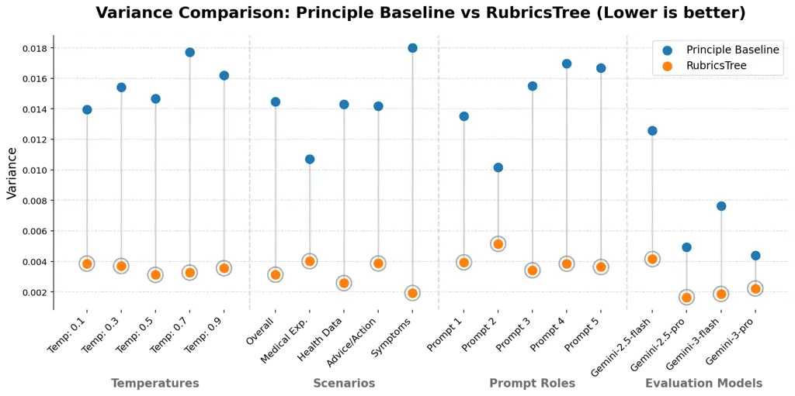

Figure 9: Per-item run-to-run variance of the evaluation signal under
four sources of stochasticity (sampling temperatures, clinical
scenarios, prompt roles, and judge backbones); lower is better.
RubricsTree (orange) consistently yields variance in the range
$`[0.002,0.005]`$, roughly $`3`$ to $`9\times`$ lower than Principle
Baseline (blue, $`[0.005,0.018]`$), independent of judge backbone or
temperature.

## Appendix G Per-Persona Oracle Perturbation Breakdown

To complement the large-scale results in Table 2, we provide the
per-persona breakdown of the oracle perturbation study. Three distinct
patient personas (Persona 1, 2, and 3) are paired with four clinical
categories (Medical Explanation, Health Data Metrics, Advice / Action
Plan, Symptoms) and the same four perturbation regimes used in the main
paper. The metrics are the Mean Penalty $`\Delta\mathrm{MP}`$ (%) and
the Detection Rate $`\mathrm{DR}`$ (%); we highlight the best and worst
value within each cell across the two frameworks.

The persona-level view exposes an evaluator-stability question that is
invisible at scenario aggregation: whether the evaluator’s reliability
degrades when the underlying user distribution shifts. RubricsTree
maintains DR$`=100\%`$ saturation across the majority of
$`(\text{persona}\times\text{category}\times\text{perturbation})`$
cells, with strictly positive $`\Delta\mathrm{MP}`$. Principle Baseline,
in contrast, exhibits catastrophic failure on the Persona 3 _Symptoms_
row, where its score actively _increases_ on degraded responses
($`\Delta\mathrm{MP}\!<\!-95\%`$ on every perturbation regime). This is
precisely the regime in which atomic Boolean verification with semantic
routing is most consequential, and it is invisible to evaluators that
operate on holistic scalar scoring.

|                      |                    |                                    |        |                                    |        |                                    |        |                                    |        |
| -------------------- | ------------------ | ---------------------------------- | ------ | ---------------------------------- | ------ | ---------------------------------- | ------ | ---------------------------------- | ------ |
|                      |                    | Missing Inst.                      |        | Missing Data                       |        | Inapprop. Inst.                    |        | Inaccurate Data                    |        |
| Category             | Framework          | $`\boldsymbol{\Delta\mathrm{MP}}`$ | DR     | $`\boldsymbol{\Delta\mathrm{MP}}`$ | DR     | $`\boldsymbol{\Delta\mathrm{MP}}`$ | DR     | $`\boldsymbol{\Delta\mathrm{MP}}`$ | DR     |
| Persona 1            |                    |                                    |        |                                    |        |                                    |        |                                    |        |
| Medical Explanation  | Principle Baseline | 1.90                               | 75.00  | -4.20                              | 25.00  | 10.40                              | 100.00 | 9.50                               | 75.00  |
|                      | RubricsTree        | 7.90                               | 100.00 | 40.20                              | 100.00 | 31.40                              | 100.00 | 85.60                              | 100.00 |
| Health Data Metrics  | Principle Baseline | 8.50                               | 66.70  | 6.50                               | 33.30  | -1.40                              | 66.70  | 2.80                               | 66.70  |
|                      | RubricsTree        | 15.60                              | 100.00 | 43.80                              | 100.00 | 20.30                              | 100.00 | 82.50                              | 100.00 |
| Advice / Action Plan | Principle Baseline | 8.60                               | 75.00  | -5.70                              | 25.00  | -2.60                              | 50.00  | -1.10                              | 75.00  |
|                      | RubricsTree        | 6.90                               | 75.00  | 18.10                              | 100.00 | 35.40                              | 100.00 | 81.70                              | 100.00 |
| Symptoms             | Principle Baseline | 1.70                               | 66.70  | -4.40                              | 33.30  | 6.80                               | 66.70  | 0.80                               | 50.00  |
|                      | RubricsTree        | 1.10                               | 66.70  | 15.10                              | 66.70  | 29.10                              | 100.00 | 83.40                              | 100.00 |
| Persona 2            |                    |                                    |        |                                    |        |                                    |        |                                    |        |
| Medical Explanation  | Principle Baseline | -6.20                              | 25.00  | 17.10                              | 75.00  | 21.80                              | 100.00 | -9.70                              | 25.00  |
|                      | RubricsTree        | 4.80                               | 75.00  | 40.20                              | 100.00 | 40.90                              | 100.00 | 84.30                              | 100.00 |
| Health Data Metrics  | Principle Baseline | 13.00                              | 100.00 | 22.50                              | 66.70  | 14.40                              | 100.00 | 3.30                               | 66.70  |
|                      | RubricsTree        | 3.90                               | 66.70  | 34.50                              | 66.70  | 31.40                              | 100.00 | 78.50                              | 100.00 |
| Advice / Action Plan | Principle Baseline | -15.90                             | 25.00  | 34.00                              | 100.00 | 30.00                              | 100.00 | 0.60                               | 75.00  |
|                      | RubricsTree        | 5.60                               | 50.00  | 36.30                              | 100.00 | 30.80                              | 100.00 | 82.30                              | 100.00 |
| Symptoms             | Principle Baseline | -1.30                              | 16.70  | 21.60                              | 50.00  | 10.30                              | 100.00 | -1.50                              | 33.30  |
|                      | RubricsTree        | 3.60                               | 83.30  | 23.20                              | 100.00 | 31.10                              | 100.00 | 81.10                              | 100.00 |
| Persona 3            |                    |                                    |        |                                    |        |                                    |        |                                    |        |
| Medical Explanation  | Principle Baseline | 6.30                               | 50.00  | 25.90                              | 100.00 | 18.60                              | 100.00 | 10.30                              | 100.00 |
|                      | RubricsTree        | 9.10                               | 100.00 | 34.70                              | 100.00 | 34.40                              | 100.00 | 83.50                              | 100.00 |
| Health Data Metrics  | Principle Baseline | 2.30                               | 66.70  | 35.00                              | 100.00 | 5.90                               | 100.00 | 2.20                               | 33.30  |
|                      | RubricsTree        | 4.70                               | 66.70  | 36.60                              | 100.00 | 25.50                              | 100.00 | 79.10                              | 100.00 |
| Advice / Action Plan | Principle Baseline | -14.00                             | 25.00  | 33.20                              | 100.00 | 2.10                               | 50.00  | 4.60                               | 75.00  |
|                      | RubricsTree        | 2.40                               | 50.00  | 23.30                              | 100.00 | 28.10                              | 100.00 | 81.20                              | 100.00 |
| Symptoms             | Principle Baseline | -152.90                            | 16.70  | -97.70                             | 33.30  | -134.90                            | 50.00  | -149.60                            | 33.30  |
|                      | RubricsTree        | 0.90                               | 50.00  | 20.80                              | 83.30  | 27.10                              | 100.00 | 77.50                              | 100.00 |

Table 7: Oracle perturbation results stratified by user persona and
clinical category. Metrics: Mean Penalty
$`\boldsymbol{\Delta\mathrm{MP}}`$ (M2, %) and Detection Rate DR (M1,
%); see Table 2 for definitions. We highlight the best and worst value
within each cell.

## Appendix H Sample-Level Oracle Perturbation Cases

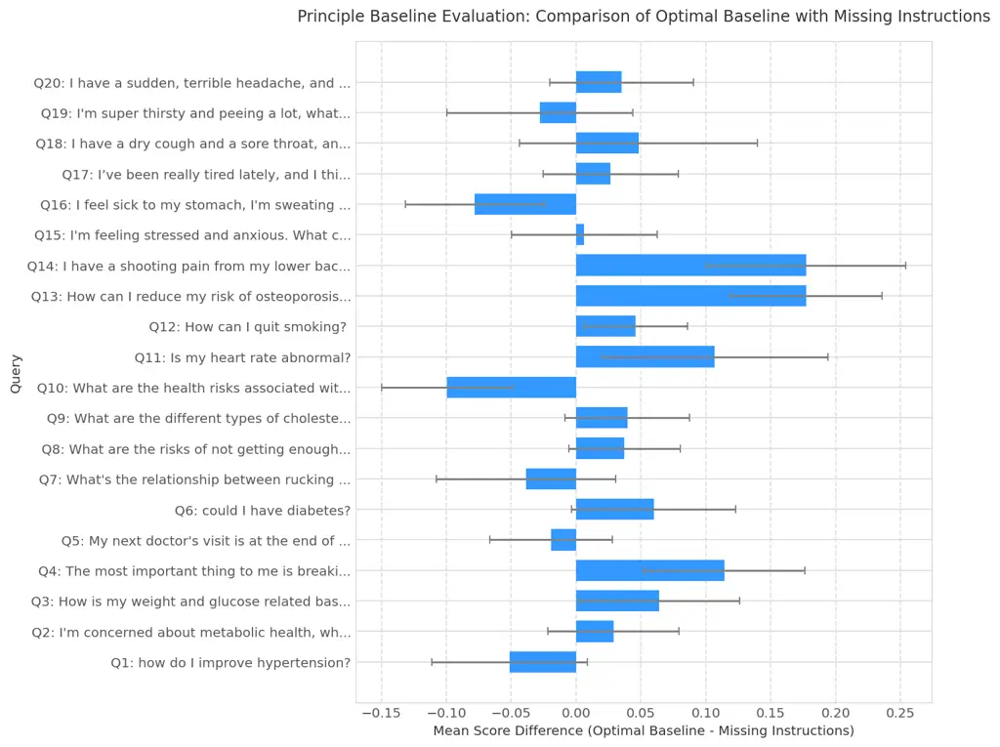

(a) Principle Baseline Evaluation Results

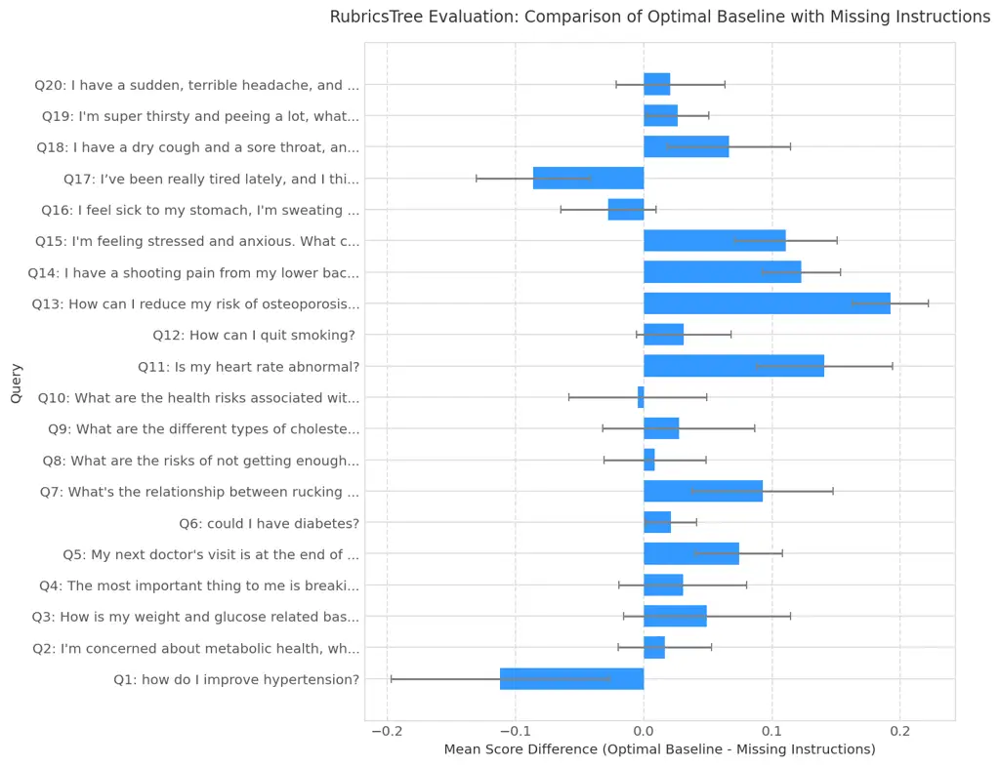

(b) RubricsTree Evaluation Results

Figure 10: Sample-level oracle perturbation results across twenty
randomly sampled clinical queries. Each bar reports the per-query mean
score difference between the optimal/clean baseline and a corrupted
condition with instructions, with whiskers showing the standard error
across runs and settings.

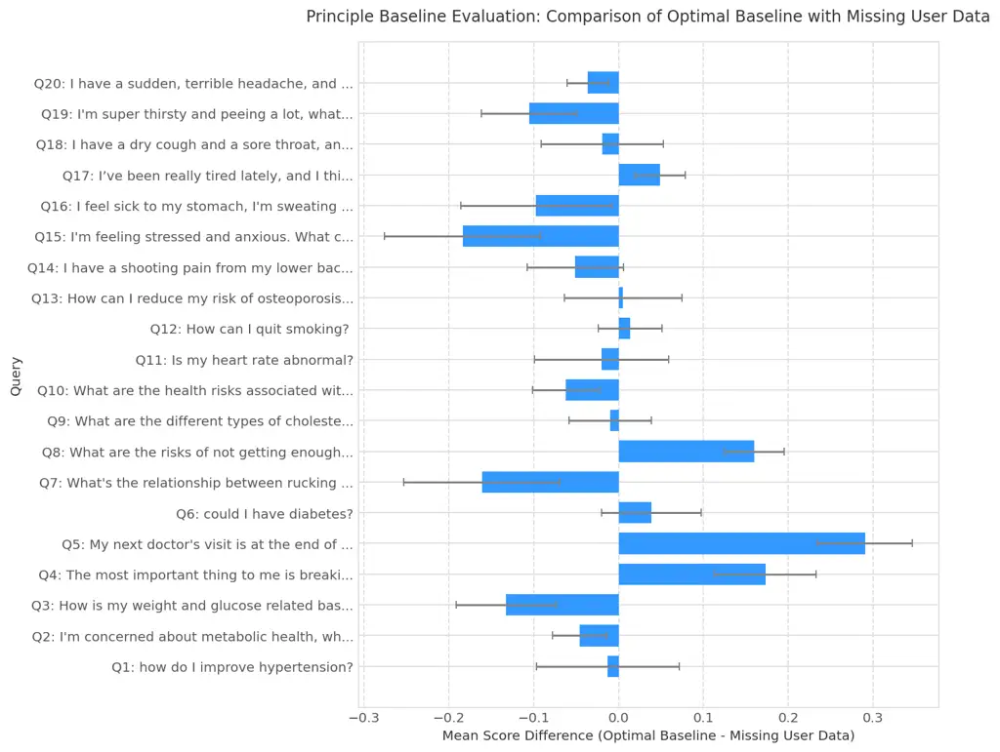

(a) Principle Baseline Evaluation Results

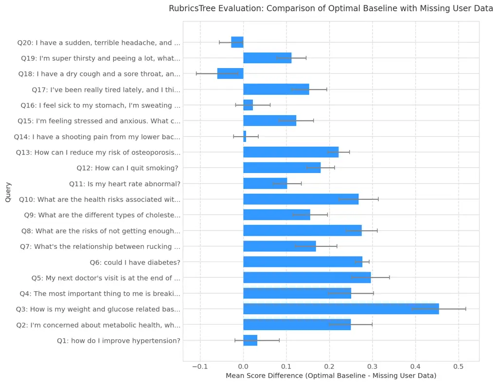

(b) RubricsTree Evaluation Results

Figure 11: Sample-level oracle perturbation results across twenty
randomly sampled clinical queries. Each bar reports the per-query mean
score difference between the optimal/clean baseline and a corrupted
condition with missing partial user data, with whiskers showing the
standard error across runs and settings.

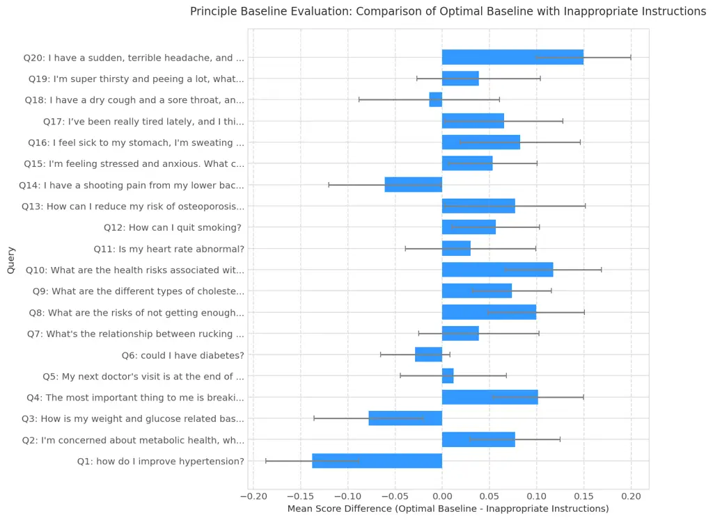

(a) Principle Baseline Evaluation Results

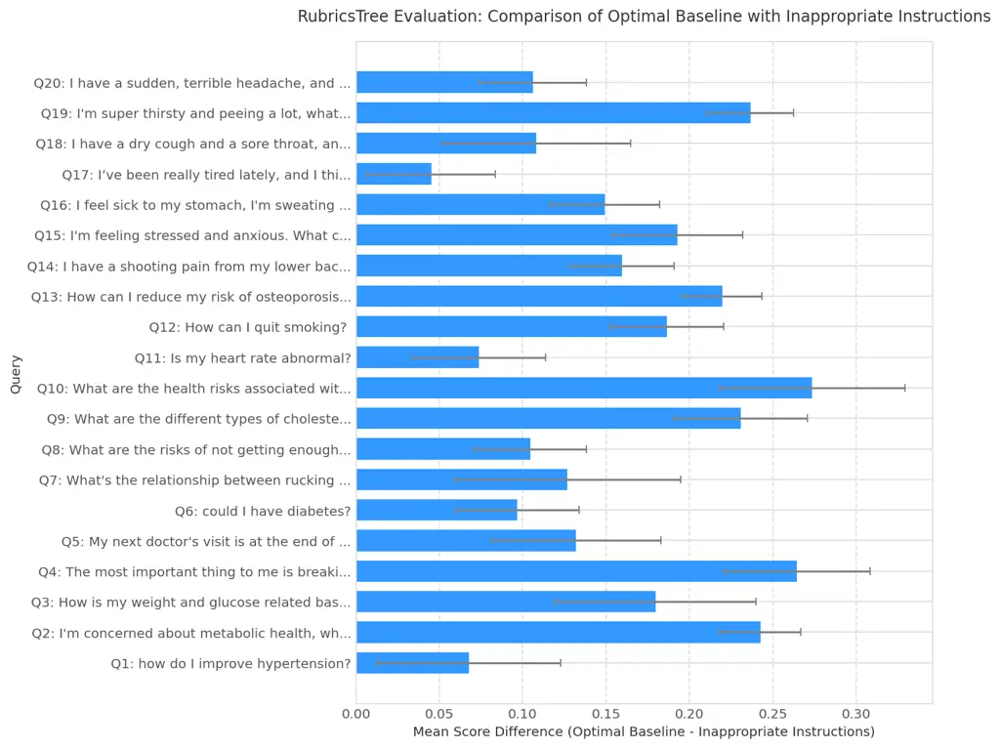

(b) RubricsTree Evaluation Results

Figure 12: Sample-level oracle perturbation results across twenty
randomly sampled clinical queries. Each bar reports the per-query mean
score difference between the optimal/clean baseline and a corrupted
condition with inappropriate Instruction, with whiskers showing the
standard error across runs and settings.

## Appendix I Downstream Optimization on HealthBench

### I.1 HealthBench-Hard Subset Description

To rigorously evaluate the reasoning, safety, and personalization
capabilities of our autonomous personal health agent, we utilize
HealthBench-Hard, a specialized, high-complexity subset of the broader
HealthBench open-source benchmark \[2\].

Moving beyond traditional multiple-choice evaluations, HealthBench-Hard
grades open-ended generated responses against a highly granular set of
conversation-specific rubric criteria. These rubrics, authored and
iteratively adjudicated by a global panel of 262 physicians, encompass a
vast clinical spectrum. They cover all 21 standard International
Classification of Diseases (ICD-10) chapters and span 26 primary
clinical specialties. The evaluation criteria within this hard subset
are systematically stratified across critical behavioral axes,
prioritizing clinical accuracy, patient safety, and communication
quality over generalized medical trivia.

While the original HealthBench-Hard corpus encompasses 1,000 multi-turn
clinical conversations including clinician-to-clinician and
administrative tasks, we isolates a subset of rigorous, user-facing
queries ($`N=362`$). We specifically adopt HealthBench-Hard to ensure
the evaluation framework directly stress-tests the agent’s capacity in
expert-annotated open-ended user-facing health context to deliver
actionable, safe health guidance directly to the patient.

### I.2 Response Optimization Pipeline

This section details the automated, feedback-driven optimization
pipeline employed to refine Large Language Model (LLM) responses on the
HealthBench-Hard dataset. The process utilizes a sophisticated
"actor-evaluator" framework where an initial response is generated,
subjected to a rigorous, multi-axis medical evaluation, and subsequently
refined using the targeted feedback from the evaluator.

The optimization pipeline consists of three core phases: (1) Adaptive
Rubric Selection, (2) Criteria-Specific Base Evaluation, and (3)
Feedback-Guided Response Refinement.

#### I.2.1 Phase 1: Adaptive Rubric Selection (Triage and Classification)

Medical queries in the HealthBench-Hard dataset are diverse and require
highly specific, context-dependent evaluation criteria. Evaluating every
response against the entire catalog of clinical rubrics is both
computationally inefficient and prone to introducing noise. To solve
this, we employ an Adaptive Selection Mechanism.

Before evaluating the response, the LLM acts as a medical triage expert.
It analyzes the user’s query against a comprehensive catalog of
hierarchical clinical rubrics. The model selects a subset of relevant
rubrics based on three criteria:

1.  1.  Keyword/Context Relevance: The rubric is strongly related to the
        query’s clinical intent.
2.  2.  Response Utility: The response would be significantly clinically
        improved by incorporating information from the rubric.
3.  3.  Trigger Condition Matching: The query fits the specific trigger
        condition of the rubric (e.g., specific biomarker inquiries).

#### I.2.2 Phase 2: Criteria-Specific Base Evaluation (The Clinical Auditor)

Once the relevant rubrics are selected, the framework evaluates the
baseline model response against each selected rubric independently. In
this phase, the LLM assumes the role of a Senior Medical Auditor.

For each selected rubric, the auditor is presented with the user query,
the baseline response, and the specific evaluation criterion. The
auditor is instructed to apply an "adversarial" logic: actively
searching for omissions, missing data, and hallucinated clinical trends.

The output of this phase is highly structured:

- •
  Reasoning: A short, concise sentence explaining the clinical
  rationale.
- •
  Binary Score: A \[1\] if the response satisfies the rubric, or a \[0\]
  if it fails (indicating clinical negligence, omission, or inaccuracy).

#### I.2.3 Phase 3: Feedback-Guided Response Refinement

The binary scores and reasoning from Phase 2 are parsed and aggregated
into a comprehensive feedback report for the "actor" model. We
specifically target the criteria where the baseline response failed
(Score = 0).

The feedback is structured as follows:

```ltx_verbatim
Evaluated Rubrics and Feedback:
- [Fail] Criterion: <Specific Rubric Prompt>
  Reasoning: <Auditor’s Clinical Rationale>
- [Pass] Criterion: <Specific Rubric Prompt>
  Reasoning: <Auditor’s Clinical Rationale>
```

This structured feedback is then injected back into the LLM along with
the original user query and the baseline response. The model is
instructed to act as an expert personal health agent and to perform a
targeted augmentation. Rather than rewriting the response entirely—which
risks losing correct clinical information—the model is instructed to:

1.  1.  Seamlessly insert necessary additions or follow-up questions to
        address missing context flagged by the auditor.
2.  2.  Only delete or modify original statements if the auditor explicitly
        flagged them as incorrect, unsafe, or definitively harmful.

The output of this phase is the final, optimized response.

### I.3 Per-Axis Optimization Results

To complement the family-level summary in Figure 6, we report the
per-axis decomposition of Response Optimization on Gemini-2.5-Flash
across three HealthBench-Hard evaluation axes (Figures 13–15). The
relevant evaluation axes are defined as follows:

- •
  Overall Score: aggregated performance across all specific evaluation
  axes, serving as a holistic measure of both clinical safety and
  conversational quality on the HealthBench-Hard dataset.
- •
  Completeness: whether the model comprehensively addressed all facets
  of the user’s complex query without omitting critical medical details,
  caveats, or necessary follow-up steps.
- •
  Context Awareness: how effectively the model integrated and adapted
  its advice to the user’s specific personal context, implicit needs, or
  provided demographic/health data.

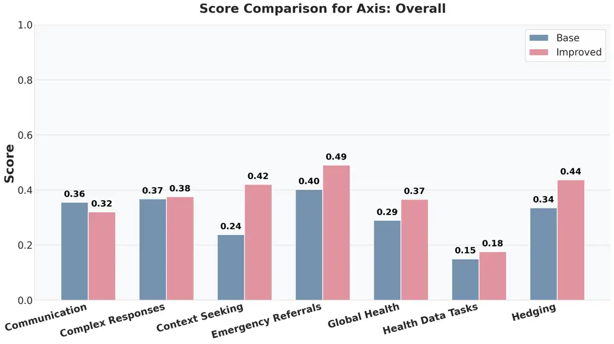

Figure 13: Per-axis Response Optimization on Gemini-2.5-Flash: _Overall
Score_.

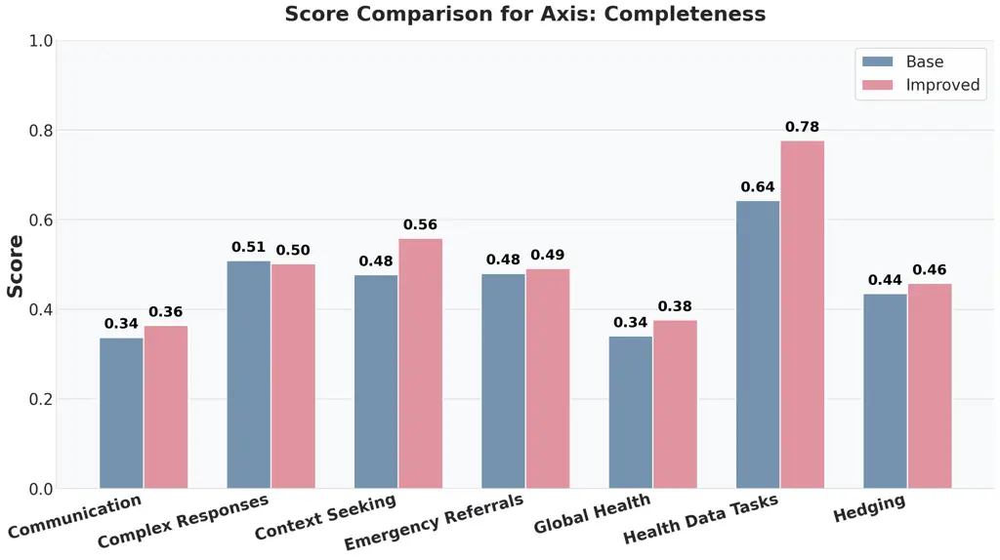

Figure 14: Per-axis Response Optimization on Gemini-2.5-Flash:
_Completeness_.

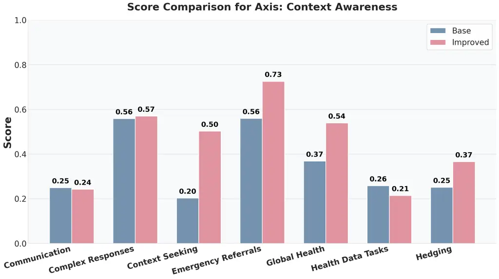

Figure 15: Per-axis Response Optimization on Gemini-2.5-Flash: _Context
Awareness_.

In addition to the eight-model main result, we further evaluated
RubricsTree-driven optimization on the GPT-5 series for completeness;
the corresponding overall scores are reported in Figure 16.

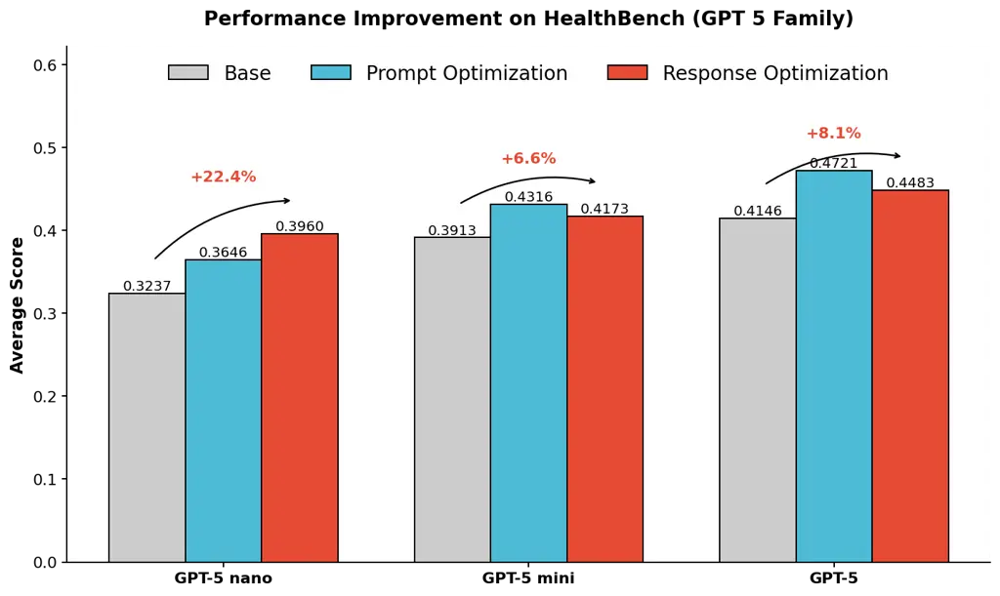

Figure 16: Supplementary results: optimization on HealthBench-Hard with
RubricsTree on the GPT-5 series models.

### I.4 Full Prompt Templates

Below are the exact prompt templates utilized at each stage of the
optimization loop.


