# AURA: Adaptive Uncertainty-aware Refinement for LLM-as-a-Judge Auditing

Zilong Zhang Affiliation: Department of Mathematics and Statistics
Affiliation: Georgia State University    Yi-Ting Hung
Affiliation: Department of Mathematics and Statistics
Affiliation: Georgia State University    Weiyi He
Affiliation: Department of Probability and Statistics
Affiliation: Department of Computer Science and Engineering
Affiliation: Michigan State University    Junxi Zhang
Affiliation: Department of Mathematics and Statistics
Affiliation: Concordia University    Lei Ding Affiliation: Department of
Statistics Affiliation: University of Manitoba
Email: [lei.ding@umanitoba.ca](mailto:)    Chi-Kuang Yeh
Affiliation: Department of Mathematics and Statistics
Affiliation: Georgia State University Email: [cyeh@gsu.edu](mailto:)

###### Abstract

Large language models (LLMs) are increasingly used as judges for
open-ended generation, as large-scale human evaluation is often
expensive and difficult to scale, yet their preferences remain imperfect
proxies for human judgment. Existing auditing pipelines often assume
that a reliable subset of examples or clean supervision signals are
available beforehand, for example from human annotation, heuristic
filtering, or the outputs of strong judges. In LLM evaluation, this
assumption is fragile: the initial split may inherit judge bias, while
human verification is typically too scarce to define stable groups at
scale. We propose AURA, an adaptive uncertainty–aware refinement
framework for auditing pairwise LLM–as–a–judge decisions under selected
human verification. AURA iteratively learns a human-consistency signal,
propagates reliable evidence, and prioritizes uncertain comparisons for
human review. The key idea is to treat trust in a judge as a latent
quantity that is progressively refined as evidence accumulates. We
provide a compact formulation, a stable refinement procedure, and a
comprehensive evaluation on both synthetic and real pairwise LLM-answer
data.

## 1 Introduction

Evaluating language-model answers is no longer only a question of
whether a benchmark has the right prompts. It is increasingly about
whether the evaluator can reliably distinguish between multiple
plausible answers that differ in factual accuracy, completeness,
reasoning quality, safety, or usefulness (Liu et al., 2023; Kim et al.,
2024). Human evaluation remains the most direct measure of these
differences, but it is expensive, slow, and difficult to scale as
models, prompts, and evaluation criteria evolve. As a result, this has
made _LLM-as-a-judge_ evaluation a practical component of modern model
development, where a strong model grades or compares outputs from other
models (Zheng et al., 2023; Dubois et al., 2023).

The practical value of LLM judges comes with a statistical problem. A
judge’s preference is not the same object as a human preference. LLM
judges can be sensitive to response order, verbosity, formatting,
self-preference, and other superficial cues (Zheng et al., 2023; Wang et
al., 2024a; Dubois et al., 2024; Zeng et al., 2024; Thakur et al.,
2025). These issues are especially consequential in pairwise evaluation,
where a single incorrect comparison can reverse the winner and loser of
an example. The central challenge is therefore not merely to imitate
judge output, but to audit when a judge’s decision is likely to agree
with human judgment and when it should be corrected or verified.

A natural starting point is to treat judge auditing as a weakly
supervised learning problem. In this view, a small set of human verified
comparisons provides trustworthy evidence, while the remaining examples
form a large uncertainty pool. Prior positive and unlabeled learning
methods offer useful tools for such settings (Elkan and Noto, 2008; du
Plessis et al., 2014; Kiryo et al., 2017; Bekker and Davis, 2020). In a
PU view, examples for which the LLM judge agrees with human preference
form a positive group, while the remaining unverified examples form an
unlabelled mixture. Standard PU methods, however, usually assume that
the positive examples are already known and that the unlabelled pool is
fixed. This assumption is often too strong for LLM evaluation. The
initial groups may be derived from the same noisy judge under audit,
from weak heuristics, or from a small and biased set of human labels. If
these groups are treated as fixed, the auditing procedure may simply
preserve and amplify the original bias.

This paper asks a different question: can the method learn which judge
decisions are human–consistent while simultaneously identifying where
uncertainty remains and which examples warrant additional verification?
To address this problem, we propose AURA, an adaptive uncertainty–aware
refinement framework for pairwise LLM–answer auditing under limited
human supervision. For a small subset, human labels indicate whether LLM
preferences are human-consistent, while the remaining examples form an
uncertain pool. AURA maintains a soft responsibility for each example,
representing the probability that the LLM preference is correct, and
iteratively refines these estimates by training a human-consistency
scorer, incorporating local and anchor-based evidence, and propagating
reliable signals through a sparse transport-based refinement. The key
idea is to treat reliable and uncertain groups as latent quantities that
are progressively updated rather than fixed in advance, distinguishing
our approach from standard PU methods and judge-only calibration. The
transport component propagates reliable evidence from anchor examples to
nearby uncertain comparisons in the learned geometry, while the
verification step focuses human effort on informative and uncertain
cases (Zhu and Ghahramani, 2002; Zhou et al., 2003; Chapel et al.,
2020). Together, these components form a unified refinement loop that
improves the estimation of judge–human agreement under limited
supervision.

Our contributions are as follows

- •
  We formulate LLM–as–a–judge auditing as adaptive human–consistency
  refinement under limited human verification, where trustworthy and
  uncertain groups are progressively updated, and informative
  comparisons are selected for human verification.
- •
  We organize the method around a compact set of interpretable state
  variables, including soft human–consistency responsibility, anchor
  confidence, and carried evidence inflow.
- •
  We provide a stability analysis for the alternating update procedure
  and an evaluation protocol covering synthetic recovery, real pairwise
  LLM evaluation, robustness to noisy initialization, and annotation
  efficiency.

## 2 Background and related work

LLM-as-a-judge evaluation has become a common approach for assessing
open-ended generations, especially when task-specific reference answers
are unavailable. MT-Bench and Chatbot Arena popularized pairwise LLM and
human preference evaluation as a scalable framework for comparing chat
assistants (Zheng et al., 2023; Chiang et al., 2024). Subsequent work
has proposed stronger evaluator models, prompting schemes, and benchmark
protocols (Liu et al., 2023; Wang et al., 2024b; Kim et al., 2024; Zhu
et al., 2025; Dubois et al., 2024). At the same time, LLM judges can
exhibit position bias, verbosity bias, prompt sensitivity, score
instability, and weaker alignment with humans on difficult examples
(Wang et al., 2024a; Zeng et al., 2024; Thakur et al., 2025; Tan et al.,
2025; Park et al., 2024). Rather than introducing another standalone
judge, AURA asks when the output of an existing judge should be trusted.

Our work is also related to preference modeling and reward-model
evaluation. Pairwise comparison has a long statistical history,
including the Bradley–Terry model (Bradley and Terry, 1952), and modern
alignment pipelines use preference data to train reward models or
optimize policies through RLHF and DPO (Christiano et al., 2017; Ouyang
et al., 2022; Bai et al., 2022; Rafailov et al., 2023). RewardBench
evaluates reward models using prompt–chosen–rejected triples across
chat, reasoning, and safety settings (Lambert et al., 2025). These works
primarily study how to train or benchmark models using preference data.
AURA instead studies a complementary auditing problem: given an LLM
judge’s pairwise preference, estimate whether it agrees with human
judgment and decide whether to trust, correct, or verify it.

Methodologically, AURA connects to PU learning, weak supervision,
graph-based semi-supervised learning, transport, and active
verification. Standard PU learning assumes labeled positives and an
unlabeled mixture (Elkan and Noto, 2008; Bekker and Davis, 2020),
whereas our target label is LLM–human agreement rather than answer
quality, and human verification can provide both positive and negative
anchors. We therefore treat the problem as adaptive PU learning, where
the positive and unlabeled groups are refined as evidence accumulates.
The propagation step is related to graph-based label smoothing and
transport methods (Zhu and Ghahramani, 2002; Zhou et al., 2003; Cuturi,
2013; Peyré and Cuturi, 2019; Chapel et al., 2020), but AURA uses a
conservative transport-based operator for sparse, budgeted evidence
propagation rather than full distribution alignment. The verification
policy is related to active learning, selective prediction, and
calibration (Settles, 2009; Geifman and El-Yaniv, 2017; Guo et al.,
2017), since it selects examples for human review when the current
refinement state is uncertain or influential.


Figure 1: Overview of AURA framework. At iteration $`t`$, the current
state $`(q^{(t)},a^{(t)},m^{(t)})`$ is used to train the encoder, which
produces the latent representations $`z^{(t)}`$ and preliminary scores
$`p^{(t)}`$. The trust-update module uses them to compute the
consistency estimate $`\tilde{q}^{(t)}`$ and the next anchor confidence
$`a^{(t+1)}`$. The transport step then refines $`\tilde{q}^{(t)}`$ into
the next-round consistency estimate $`q^{(t+1)}`$ and produces the next
inflow state $`m^{(t+1)}`$. Finally, the verification step selects
examples for human review; returned labels are added to
$`\mathcal{V}^{+}`$ or $`\mathcal{V}^{-}`$, while pending examples are
kept in $`\mathcal{W}^{(t+1)}`$.

## 3 Problem formulation and notation

Let
$`\mathcal{D}=\{(Q_{i},R_{i}^{1},R_{i}^{2},J_{i}^{\mathrm{H}},J_{i}^{\mathrm{L}})\}_{i=1}^{n}`$
be a collection of samples, where $`Q_{i}`$ is the question or prompt,
$`R_{i}^{1}`$ and $`R_{i}^{2}`$ are two candidate responses,
$`J_{i}^{\mathrm{L}}`$ is the initial LLM judge, and
$`J_{i}^{\mathrm{H}}`$ is the human judge. An example of the data
structure is shown in Figure 3 in Appendix A. The LLM judge assigns a
strict preference $`J_{i}^{\mathrm{L}}\in\{1,2\}`$, where
$`J_{i}^{\mathrm{L}}=k`$ indicates that $`R_{i}^{k}`$ is preferred.
Human labels, when available, are denoted by
$`J_{i}^{\mathrm{H}}\in\{1,2\}`$. We exclude tie cases. For each
comparison, the LLM judge induces an initial winner–loser assignment:

```math
R_{i}^{w}=R_{i}^{J_{i}^{\mathrm{L}}},\qquad R_{i}^{\ell}=R_{i}^{3-J_{i}^{\mathrm{L}}}.
```

Here, $`R_{i}^{w}`$ and $`R_{i}^{\ell}`$ are interpreted as the
LLM-induced preliminary winner and loser, rather than ground-truth human
preferences; they will be refined using the available human labels. For
each example, we define the human-consistency label
$`y_{i}=\mathbf{1}\{J_{i}^{\mathrm{L}}=J_{i}^{\mathrm{H}}\},`$ which
indicates whether the LLM preference agrees with the human preference.
This label is observed only for human-verified examples and remains
latent for unverified examples. Thus, $`y_{i}=1`$ indicates that the LLM
preference agrees with the human preference, while $`y_{i}=0`$ indicates
that the LLM preference should be corrected. The corresponding
agreement-positive and agreement-negative sets are

```math
\mathcal{P}^{\star}=\{i:y_{i}=1\},\qquad\mathcal{N}^{\star}=\{i:y_{i}=0\}.
```

Our goal is to estimate
$`\mathbb{P}(y_{i}=1\mid Q_{i},R_{i}^{1},R_{i}^{2},J_{i}^{\mathrm{L}})`$
for unverified examples, and use this estimate to refine the LLM-induced
preference signal under a limited human-review budget.

To describe this refinement process, we organize examples according to
their verification status. Let $`\mathcal{P}_{s}`$ denote a trusted
positive seed set available before refinement. In our experiments,
$`\mathcal{P}_{s}`$ is initialized from a small human-verified positive
seed set and used only as an initial anchor set, rather than as the
fixed clean positive group assumed by standard PU methods. Let
$`\mathcal{U}`$ denote the refinement pool, where the algorithm performs
progressive label refinement. $`\mathcal{V}^{+}`$ and
$`\mathcal{V}^{-}`$ denote verified examples that are human-consistent
and human-inconsistent, respectively. Unlike the fixed seed anchor set
$`\mathcal{P}_{s}`$, $`\mathcal{V}^{+}`$ and $`\mathcal{V}^{-}`$ record
verified labels incorporated during refinement and may grow over
iterations. These verified sets provide hard constraints during
refinement. We also maintain a waiting pool $`\mathcal{W}^{(t)}`$, which
contains examples that have been selected for human review but whose
human labels have not yet been incorporated. Throughout this paper,
$`\|\cdot\|`$ denotes the Euclidean norm unless otherwise specified.
Detailed implementation constants are listed in Appendix A.

## 4 Methodology

We now present AURA, a progressive refinement framework for converting
noisy LLM-judge preferences into preference signals that align with
human judgments. Starting from preliminary preferences produced by an
LLM judge and a small set of human-verified examples, AURA iteratively
learns a task-specific representation, updates human-consistency
estimates, propagates trust through a conservative transport step, and
selectively queries additional human labels. Figure 1 illustrates the
overall workflow, and Algorithm 1 in Appendix summarizes the full
procedure.

### 4.1 Progressive representation and trust refinement

For each pairwise comparison, we first construct a fixed comparison
feature

```math
x_{i}=E_{\mathrm{RM}}(Q_{i},R_{i}^{w})-E_{\mathrm{RM}}(Q_{i},R_{i}^{\ell})\in\mathbb{R}^{d_{x}},
```

where $`E_{\mathrm{RM}}`$ is a pretrained reward-model encoder used only
for feature extraction and kept frozen throughout refinement. At
iteration $`t`$, a trainable encoder maps $`x_{i}`$ into a task-specific
latent representation $`z_{i}^{(t)}\in\mathbb{R}^{d_{z}}`$, and a
prediction head produces a preliminary human-consistency estimate
$`p_{i}^{(t)}=\sigma(\ell_{i}^{(t)})`$. This score is not treated as the
final label; instead, it provides model evidence for the subsequent
trust and transport updates.

The encoder is trained from the current refinement state
$`(q^{(t)},a^{(t)},m^{(t)})`$. The goal is to fit the available
human-verified labels, use reliable unverified examples as additional
soft supervision, and keep the learned latent space stable across
refinement rounds. We use the objective

```math
\mathcal{L}_{\mathrm{enc}}^{(t)}=\mathcal{L}_{\mathrm{ver}}^{(t)}+\lambda_{\mathrm{soft}}\mathcal{L}_{\mathrm{soft}}^{(t)}+\lambda_{\mathrm{geo}}\mathcal{R}_{\mathrm{geo}}^{(t)}+\lambda_{\mathrm{anchor}}\mathcal{R}_{\mathrm{anchor}}^{(t)}.
```

Here $`\mathcal{L}_{\mathrm{ver}}^{(t)}`$ is the supervised loss on
human-verified examples, and $`\mathcal{L}_{\mathrm{soft}}^{(t)}`$
trains on high-confidence unverified examples using their current
estimation $`q_{i}^{(t)}`$ as soft labels. The two regularization terms
stabilize the representation: $`\mathcal{R}_{\mathrm{geo}}^{(t)}`$
enforces local smoothness, while $`\mathcal{R}_{\mathrm{anchor}}^{(t)}`$
discourages high-confidence examples from drifting across rounds. Full
network parameterization and loss definitions are provided in
Appendix B.1.

### 4.2 Trust update, conservative transport, and verification

After encoder training, AURA refines the preliminary score
$`p_{i}^{(t)}`$ using model, local, anchor, and transport evidence. We
combine these signals through a trust logit

```math
u_{i}^{(t)}=\lambda_{p}\log\frac{p_{i}^{(t)}}{1-p_{i}^{(t)}}+\lambda_{\mathrm{loc}}\left(2r_{i}^{\mathrm{loc},(t)}-1\right)+\lambda_{\mathrm{anc}}\left(2r_{i}^{\mathrm{anc},(t)}-1\right)+\lambda_{m}\left(2m_{i}^{(t)}-1\right)+\beta_{0},
```

where $`r_{i}^{\mathrm{loc},(t)}`$ measures neighborhood-level agreement
in the learned latent space, $`r_{i}^{\mathrm{anc},(t)}`$ measures
support from trusted anchors, and $`m_{i}^{(t)}`$ carries positive
inflow evidence from the previous round. The trust logit is transformed
into a trust-updated estimate $`\tilde{q}_{i}^{(t)}`$. The same evidence
is also used to update the next anchor confidence $`a_{i}^{(t+1)}`$.
Detailed trust-update rules are given in Appendix B.2.

We then apply a conservative transport update to uncertain examples. Let
$`\mathcal{M}^{(t)}=\{j\in\mathcal{U}:\tilde{q}_{j}^{(t)}\in I_{\mathrm{amb}}\}`$
be the uncertain set. For each $`j\in\mathcal{M}^{(t)}`$, the transport
module computes positive and negative inflow scores $`m_{j}^{+,(t)}`$
and $`m_{j}^{-,(t)}`$ in the learned latent space. Rather than solving a
full optimal transport problem, we use a sparse budgeted propagation
rule:

```math
q_{j}^{+,(t)}=\tilde{q}_{j}^{(t)}+\eta_{+}m_{j}^{+,(t)}\left(1-\tilde{q}_{j}^{(t)}\right),\qquad q_{j}^{(t+1)}=q_{j}^{+,(t)}-\eta_{-}m_{j}^{-,(t)}q_{j}^{+,(t)}.
```

Examples outside $`\mathcal{M}^{(t)}`$ keep their trust-updated
estimates, $`q_{j}^{(t+1)}=\tilde{q}_{j}^{(t)}`$. For the next round, we
store $`m_{j}^{(t+1)}=m_{j}^{+,(t)}`$, while the negative inflow is used
only in the current update. Details of the inflow computation are
provided in Appendix B.3.

Finally, AURA selects unresolved examples for human verification.
Returned labels are added to $`\mathcal{V}^{+}`$ or $`\mathcal{V}^{-}`$,
while pending examples are kept in $`\mathcal{W}^{(t)}`$ to avoid
repeated queries. The loop stops when the refined estimates, hard
assignments, transport inflow, and verified set size become stable.
Verification and stopping details are provided in Appendix B.4.

Overall, each refinement round follows

```math
(q^{(t)},a^{(t)},m^{(t)})\rightarrow(z^{(t)},p^{(t)})\rightarrow(\tilde{q}^{(t)},a^{(t+1)})\rightarrow(q^{(t+1)},a^{(t+1)},m^{(t+1)}),
```

with selective human verification updating $`\mathcal{V}^{+}`$,
$`\mathcal{V}^{-}`$, and the waiting set $`\mathcal{W}^{(t)}`$.

## 5 Theoretical results

In this section, we develop a theoretical analysis of AURA that proceeds
from algorithmic foundations to statistical guarantees. We begin by
establishing that the joint optimization converges, and then sharpen
this guarantee to a linear convergence rate via a contraction argument.

### 5.1 Convergence guarantee for outer loop iteration

The outer loop in Section 4 alternates three algorithmic blocks: encoder
training, trust update, and transport reassignment, with selective
verification acting as a bounded perturbation that modifies the verified
sets and anchor pool. We construct a surrogate Lyapunov function that
aggregates progress across these three blocks and show that it decreases
sufficiently along the iterates, up to summable error induced by
verification. We begin by stating the regularity assumptions, which are
standard in analyses of nonconvex optimization and alternating
minimization methods (Bertsekas, 1999).

###### Assumption 1 (Encoder loss regularity).

The encoder loss
$`\mathcal{L}^{(t)}_{\mathrm{enc}}(\Theta)=\mathcal{L}^{(t)}_{\mathrm{ver}}+\lambda_{\mathrm{soft}}\mathcal{L}^{(t)}_{\mathrm{soft}}+\lambda_{\mathrm{geo}}\mathcal{L}^{(t)}_{\mathrm{geo}}+\lambda_{\mathrm{anchor}}\mathcal{L}^{(t)}_{\mathrm{anchor}}`$
satisfies: (i) it is continuously differentiable in $`\Theta`$ with
$`L_{\Theta}`$-Lipschitz gradient; (ii) it is nonnegative, i.e.,
$`\mathcal{L}^{(t)}_{\mathrm{enc}}(\Theta)\geq 0`$; (iii) the encoder
update produces an approximate minimizer with bounded suboptimality,
$`\mathcal{L}^{(t)}_{\mathrm{enc}}(\Theta^{(t)})\leq\min_{\Theta}\mathcal{L}^{(t)}_{\mathrm{enc}}(\Theta)+\delta_{t}`$,
where $`\delta_{t}\geq 0`$ and $`\sum_{t}\delta_{t}<\infty`$; (iv) the
parameter space $`\Theta`$ is compact.

###### Assumption 2 (Bounded trust-logit components).

The trust-logit weights
$`\lambda_{p},\lambda_{\mathrm{loc}},\lambda_{\mathrm{anc}},\lambda_{m}\geq 0`$
and the offset $`\beta_{0}\in\mathbb{R}`$ are finite. The classifier
output satisfies $`p_{i}^{(t)}\in[\epsilon_{p},1-\epsilon_{p}]`$ for
some $`\epsilon_{p}\in(0,1/2)`$, enforced by the algorithm’s clipping
operations, and the local and anchor evidence scores satisfy
$`r_{i}^{\mathrm{loc},(t)},r_{i}^{\mathrm{anc},(t)}\in[0,1]`$.

###### Assumption 3 (Summable transport budget).

The transport budget $`B_{t}`$ used in the transport step in
Appendix B.3 satisfies $`\sum_{t=0}^{\infty}B_{t}^{2}<\infty`$.

###### Assumption 4.

Define
$`H^{(t)}:=\rho_{q}\|q^{(t)}-q^{(t-1)}\|+\rho_{m}\|m^{(t)}-m^{(t-1)}\|`$
for some constants $`\rho_{q},~\rho_{m}>0`$. Assume there exist
constants $`\eta>0`$, $`C_{B}\geq 0`$ and a summable sequence
$`\{\kappa_{t}\}_{t\geq 0}`$, such that for each iteration $`t`$,
$`(1+\eta)H^{(t+1)}\leq H^{(t)}+C_{B}B_{t}^{2}+\kappa_{t}`$.

The trust-update operator $`\mathcal{D}_{\mathrm{Trust}}`$ defined in
Appendix B.2 maps the encoder outputs $`(p^{(t)},z^{(t)}`$ and previous
inflow $`m^{(t)})`$ to the trust-updated responsibilities
$`\bar{q}^{(t)}`$. We now show that, on indices not subject to hard
constraints, the operator is Lipschitz continuous in its inputs, which
will be used to control the cross terms in the proof of Lemma 2.

###### Lemma 1 (Lipschitz continuity of trust logit).

Under restriction of $`p^{(t)}_{i}\in[\epsilon_{p},1-\epsilon_{p}]`$ for
some $`\epsilon_{p}\in(0,1/2)`$ to avoid divergence of $`\log(p/(1-p))`$
as $`p\to 0`$ or $`1`$, the true logit $`u_{i}^{(t)}`$ defined in
Appendix B.2 satisfies

```math
|u_{i}^{(t+1)}-u_{i}^{(t)}|\leq\frac{\lambda_{p}}{\epsilon_{p}(1-\epsilon_{p})}|\Delta p^{(t+1)}|+2\lambda_{\text{loc}}|\Delta r^{\text{loc},(t+1)}|+2\lambda_{\text{anc}}|\Delta r^{\text{anc},(t+1)}|+2\lambda_{m}|\Delta m^{(t+1)}|, \tag{1}
```

where
$`\Delta p^{(t+1)}=p_{i}^{(t+1)}-p_{i}^{(t)},~\Delta r^{\text{loc},(t+1)}=r_{i}^{\text{loc},(t+1)}-r_{i}^{\text{loc},(t)},~\Delta r^{\text{anc},(t+1)}=r_{i}^{\text{anc},(t+1)}-r_{i}^{\text{anc},(t)},`$
and $`\Delta m^{(t+1)}=m_{i}^{(t+1)}-m_{i}^{(t)}`$.

###### Theorem 1 (Lipschitz continuity of $`\mathcal{D}_{\mathrm{trust}}`$ on unconstrained indices).

Let
$`\mathcal{U}:=\{1,\ldots,n\}\setminus(\mathcal{P}_{s}\cup\mathcal{V}^{+}\cup\mathcal{V}^{-})`$
denotes indices not subject to hard constraints. Under Assumption 2, the
trust update operator $`\mathcal{D}_{\mathrm{Trust}}`$ restricted to
$`\mathcal{U}`$, is Lipschitz in its inputs
$`(p,r^{\text{loc}},b_{\text{anc}},m)`$ with constant

```math
L_{\mathcal{D}_{\mathrm{Trust}}}:=\frac{1}{4}\max\left\{\frac{\lambda_{p}}{\epsilon_{p}(1-\epsilon_{p})},\;2\lambda_{\text{loc}},\;2\lambda_{\text{anc}},\;2\lambda_{m}\right\}.
```

The Lipschitz constant in the inflow $`m`$ is
$`L_{\mathcal{D}_{\mathrm{Trust}},m}=\lambda_{m}/2`$ when
$`(p,r^{\text{loc}},r^{\text{anc}})`$ are held fixed.

###### Remark 1.

The Lipschitz constants given here directly enter the proof of Lemma 2:
they bound how much the trust–updated responsibilities $`\bar{q}`$ can
moves per outer-loop iteration. Theorem 1 also clarifies how the
hyperparameters
$`(\lambda_{p},\lambda_{\text{loc}},\lambda_{\text{anc}},\lambda_{m})`$
affect numerical stability: larger weights yield larger Lipschitz
constants and thus weaker contraction.

### 5.2 Global convergence and conservation properties

###### Lemma 2 (Minimization with sufficient decrease).

Under Assumption 1–3, the encoder update satisfies
$`\mathcal{L}^{(t)}_{\mathrm{enc}}(\Theta^{(t+1)})\leq\mathcal{L}^{(t)}_{\mathrm{enc}}(\Theta^{(t)})-c_{\Theta}\|\nabla_{\Theta}\mathcal{L}^{(t)}_{\mathrm{enc}}(\Theta^{(t)})\|^{2}`$
for some constant $`c_{\Theta}=\eta(1-L_{\Theta}\eta/2)>0`$. With
$`\eta=1/L_{\Theta}`$, the inequality holds with
$`c_{\Theta}=1/(2L_{\Theta})`$.

We now define the surrogate Lyapunov function used in the convergence
analysis.

###### Lemma 3 (Block–wise sufficient decrease).

Define the surrogate Lyapunov function
$`V^{(t)}:=\mathcal{L}^{(t)}_{\mathrm{enc}}(\Theta^{(t)})+\rho_{q}\|q^{(t)}-q^{(t-1)}\|+\rho_{m}\|m^{(t)}-m^{(t-1)}\|`$
for some constants $`\rho_{q},~\rho_{m}>0`$. Under Assumptions 1–4 and
Theorem 1, there exist constants $`c_{\Theta},c_{q},c_{m}>0`$ such that

```math
V^{(t+1)}\leq V^{(t)}-c_{\Theta}\|\nabla_{\Theta}\mathcal{L}^{(t)}_{\mathrm{enc}}(\Theta^{(t-1)})\|^{2}-c_{q}\|q^{(t+1)}-q^{(t)}\|-c_{m}\|m^{(t+1)}-m^{(t)}\|+\mathcal{E}^{(t)} \tag{2}
```

where the drift error $`\mathcal{E}^{(t)}\geq 0`$ satisfies
$`\sum_{t=0}^{\infty}\mathcal{E}^{(t)}<\infty`$.

The convergence theorem follows from the surrogate Lyapunov decreases.

###### Theorem 2 (Convergence of the Iteration).

Under Assumptions 1–4, the sequence
$`\{(\Theta^{(t)},q^{(t)},a^{(t)},m^{(t)})\}_{t\geq 0}`$ produced by the
outer loop satisfies: (a) $`V^{(t)}\to V^{\star}`$ for some
$`V^{\star}\geq 0`$; (b)
$`\|\nabla_{\Theta}\mathcal{L}^{(t)}_{\mathrm{enc}}(\Theta^{(t-1)})\|\to 0`$,
$`\|q^{(t+1)}-q^{(t)}\|\to 0`$, and $`\|m^{(t+1)}-m^{(t)}\|\to 0`$; (c)
every limit point $`(\Theta^{\star},q^{\star},a^{\star},m^{\star})`$
satisfies
$`\nabla_{\Theta}\mathcal{L}_{\mathrm{enc}}^{\star}(\Theta^{\star})=0,\quad q^{\star}=\mathcal{T}_{\mathrm{trans}}\big(\mathcal{D}_{\mathrm{trust}}(p^{\star},z^{\star},m^{\star})\big),\quad m^{\star}=m^{+,\star},`$
where $`p^{\star},z^{\star}`$ are encoder outputs at $`\Theta^{\star}`$,
and $`\mathcal{T}_{\mathrm{trans}}`$ denotes the transport update map in
Appendix B.3.

This theorem shows that the outer loop is numerically well-behaved: the
encoder approaches a local minimizer of its loss, while the trust
probabilities and transport inflows stabilize. Crucially, the limit
point is mutually self-consistent, meaning that no block can improve
unilaterally given the others, which formalizes AURA. In addition, the
numerical stability is further supported by the mass conservation
property of the transport operator: the total transported mass remains
equal to the budget $`B_{t}`$ across iterations, ensuring that evidence
propagation acts as a bounded and controlled perturbation to the
refinement state. Formal statements of mass conservation (Lemma 4) and
its role in bias reduction (Theorem 3) are provided in Appendix C.

## 6 Experiments

We evaluate AURA in three parts. First, we use simulations to test
whether the method can recover latent human-consistency structure under
noisy judge signals and selective verification. Second, we evaluate real
LLM-as-a-judge data across multiple judge models and question types.
Third, we provide ablation studies to examine the contribution of each
component. The evaluation metrics are provided in Appendix E.1.

|                                                              |              |            |                |                 |                |
| ------------------------------------------------------------ | ------------ | ---------- | -------------- | --------------- | -------------- |
| Simulation Results for CD/DD Noise and SCAR/SAR Verification |              |            |                |                 |                |
| Noise                                                        | Verification | Orig. Acc. | Adj. Acc.      | Diff.           | Flip Rate      |
| CD                                                           | SCAR         | 73.75%     | 85.41% (1.33%) | +11.66% (1.33%) | 39.53% (1.09%) |
| CD                                                           | SAR          | 73.75%     | 84.31% (1.22%) | +10.56% (1.22%) | 41.56% (1.51%) |
| DD                                                           | SCAR         | 73.75%     | 84.19% (1.23%) | +10.44% (1.23%) | 38.81% (0.95%) |
| DD                                                           | SAR          | 73.75%     | 84.88% (1.19%) | +11.13% (1.19%) | 38.19% (0.66%) |

Table 1: Simulation results averaged over five independent runs. Each
run contains 640 examples: 160 source positive examples and 480
target/unlabeled examples, among which 168 are hidden positives and 312
are negatives. Adjusted accuracy, accuracy difference, and flip rate are
reported as mean (max–min range) across runs. Bold values indicate
positive improvements.

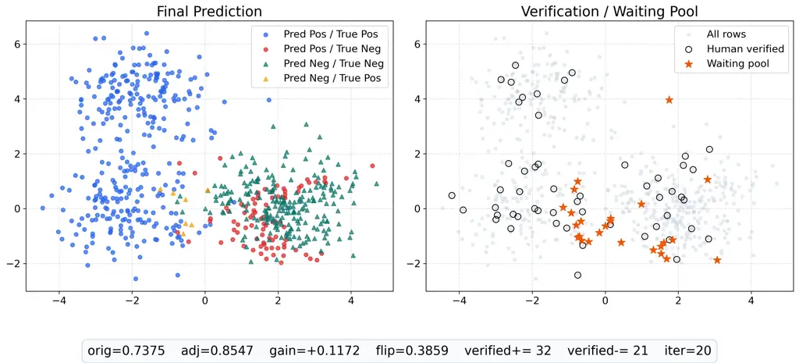

Figure 2: DD+SAR simulation visualization. Left: verified and
waiting-pool examples under selective verification. Right: final hard
prediction after applying AURA.

### 6.1 Simulation

We first evaluate AURA in a generative simulation where two latent
groups encode whether the initial judge signal is human-consistent. The
simulator draws oracle latent coordinates for these groups, maps them to
noisy observed comparison features, and corrupts the initial consistency
signals, so AURA must recover useful latent structure using only noisy
features and corrupted supervision. AURA observes only these noisy
features and corrupted signals. We consider four settings:
class-dependent (CD) or distribution-dependent (DD) corruption, crossed
with selected-completely-at-random (SCAR) or selected-at-random (SAR)
verification. CD corruption depends only on the latent consistency
group, while DD corruption also depends on the feature geometry. SCAR
verification samples verified examples conditionally at random, while
SAR verification introduces feature-dependent selection bias. Details of
the simulation design are provided in Appendix E.2.

Table 1 shows that AURA improves the initial signal across all four
noise and verification settings. The original accuracy is 73.75%, while
the adjusted accuracy reaches 84.19%–85.41%. The largest improvement
appears in the CD+SCAR setting, where both corruption and verification
are the most regular, and AURA raises accuracy from 73.75% to 85.41%.
The method also remains effective in the harder DD+SAR setting, where
both judge errors and human verification depend on the feature geometry.
This setting is the closest synthetic analogue to selective human
verification in real LLM-as-a-judge data, yet AURA still improves
accuracy to 84.88%. Figure 2 visualizes this DD+SAR case. Although the
verified set is incomplete and feature-biased, AURA recovers a clearer
separation between human-consistent and human-inconsistent examples. The
sensitivity analyses further support this interpretation: AURA benefits
from clearer latent group separation, while weak separation in
high-dimensional feature spaces makes local geometry and anchor evidence
less reliable and therefore reduces the gain. Detailed results are
provided in Appendix E.3.

### 6.2 Real-Data evaluation

We next evaluate AURA on real LLM-as-a-judge data constructed from
MT-Bench (Zheng et al., 2023) and Chatbot Arena (Chiang et al., 2024).
We use three question types, coding, math reasoning, and structured
factual questions, and include one mixed question type MT-Bench setting.
We evaluate five judge models: GPT-5.4, GPT-5.4-mini (OpenAI, 2026),
Gemini-2.5-Flash (DeepMind, 2024), Qwen2.5-7B-Instruct (Team, 2024), and
Mistral-7B-Instruct-v0.3 (Jiang et al., 2023). The full setup is
described in Appendix E.4.

|                                                |               |               |               |               |                |
| ---------------------------------------------- | ------------- | ------------- | ------------- | ------------- | -------------- |
| Coding Results with 20% Verified Baseline Data |               |               |               |               |                |
| Metric                                         | Logistic Reg. | MLP           | Random Forest | Label Prop.   | AURA           |
| Model: GPT-5.4 (n = 2949, Orig. Acc = 63.92%)  |               |               |               |               |                |
| Adj. Acc.                                      | 59.54% (3.56) | 60.83% (2.80) | 63.23% (1.87) | 60.50% (9.92) | 67.20% (2.00)  |
| Gain                                           | -4.38% (3.56) | -3.09% (2.80) | -0.69% (1.87) | -3.42% (9.92) | +3.28% (2.00)  |
| Human Verif. Req.                              | 590           | 590           | 590           | 590           | 100.6          |
| Model: Qwen (n = 8884, Orig. Acc = 53.73%)     |               |               |               |               |                |
| Adj. Acc.                                      | 58.47% (1.59) | 57.44% (1.83) | 59.20% (0.96) | 53.77% (2.11) | 77.74% (9.78)  |
| Gain                                           | +4.75% (1.59) | +3.72% (1.83) | +5.47% (0.96) | +0.04% (2.11) | +24.02% (9.78) |
| Human Verif. Req.                              | 1777          | 1777          | 1777          | 1777          | 278.8          |

Table 2: Coding results for GPT-5.4 and Qwen with 20% verified baseline
data. Accuracy and gain are reported as mean (max–min range). Human
Verif. Req. denotes the number of human-verified examples required by
each method. Baselines use 20% verified data, while AURA uses a
substantially smaller adaptive verification budget.

Tables 2 shows that AURA consistently improves the original LLM-judge
signal across datasets, judge models, and question types. The gains are
consistent across judge families and evaluation settings. The main
advantage of AURA is label efficiency. We compare against baselines
trained with 3%, 20%, and 80% verified data, while AURA uses a final
verification budget close to the 3% setting. Despite this much smaller
human-label budget, AURA is competitive with or better than the
baselines in most configurations. Table 2 gives a representative
example. On GPT-5.4 and Qwen Coding, AURA achieves better adjusted
accuracy while using only about 101 and 279 verified examples, compared
with 590 and 1,777 examples used by baselines. AURA also has modest
additional computational cost. Additional results are in Appendix E.6.
Its dominant overhead is the transport-based inflow update. If $`n_{u}`$
uncertain examples are compared with $`n_{a}`$ anchor examples in a
$`d_{z}`$-dimensional latent space, a direct similarity-matrix
implementation costs $`O(n_{u}n_{a}d_{z})`$ time and $`O(n_{u}n_{a})`$
memory. The runtime and memory results in Appendix E.7 further support
its practical scalability on real-data experiments.

### 6.3 Ablation study

| Full Trust | Transport | Human Query | Trained Encoder |         |       | Untrained Encoder |         |       |
| ---------- | --------- | ----------- | --------------- | ------- | ----- | ----------------- | ------- | ----- |
|            |           |             | Adj. Acc.       | Gain    | Flips | Adj. Acc.         | Gain    | Flips |
| ✓          | ✓         | ✓           | 66.88%          | +3.33%  | 164   | 64.72%            | +1.17%  | 183   |
| ✓          | ✓         | ✗           | 66.35%          | +2.80%  | 153   | 66.13%            | +2.59%  | 213   |
| ✗          | ✓         | ✓           | 66.81%          | +3.26%  | 168   | 64.50%            | +0.96%  | 179   |
| ✗          | ✓         | ✗           | 66.67%          | +3.12%  | 168   | 66.03%            | +2.48%  | 220   |
| ✓          | ✗         | ✓           | 53.40%          | -10.14% | 2250  | 40.78%            | -22.77% | 2576  |
| ✓          | ✗         | ✗           | 53.16%          | -10.39% | 2257  | 40.71%            | -22.84% | 2574  |
| ✗          | ✗         | ✓           | 39.72%          | -23.83% | 2720  | 41.67%            | -21.88% | 2547  |
| ✗          | ✗         | ✗           | 39.72%          | -23.83% | 2720  | 41.03%            | -22.52% | 2581  |

Table 3: Full factorial ablation on the Coding setting with
Gemini-2.5-Flash. The original judge accuracy is 63.55%. We vary four
components: encoder training, full trust-state update, transport update,
and human query selection.

We ablate the main components of AURA on the Coding setting with
Gemini-2.5-Flash. We vary four components: whether the encoder is
trained, whether the trust update uses the full confidence state or only
the model probability $`p_{i}`$, whether the transport update is
enabled, and whether human queries are selected by the proposed query
score or uniformly at random. Implementation details for these four
components are provided in Appendices B.1, B.2, B.3, and B.4,
respectively.

Table 3 reports a full factorial ablation of the four main components.
The complete model achieves the best adjusted accuracy, improving the
original judge accuracy from 63.55% to 66.88%. Replacing human querying
with random selection reduces the gain from 3.33 to 2.80 percentage
points, and using only $`p_{i}`$ in the trust update also lowers
performance, showing that both adaptive verification and the full trust
state are useful. The transport update has the largest effect: disabling
it causes all variants to flip more than two thousand assignments and
sharply reduces accuracy, indicating that the transport component plays
an important role in stabilizing the refinement state and propagating
anchor evidence. Trained encoders also generally outperform untrained
ones when transport is enabled. Overall, the ablation supports the
coupled design of AURA, combining representation learning, trust-state
refinement, transport-based stabilization, and adaptive verification.

## 7 Discussion and future work

Overall, these findings show that AURA is a useful method to improve
LLM-as-a-judge evaluation when human labels are limited. Rather than
assuming that reliable positive and unlabelled groups are available
before auditing, AURA learns these groups progressively from judge
signals, learned representations, transport-based evidence, and
selective verification. This design improves adjusted accuracy in both
simulations and real pairwise LLM-answer evaluation while using
substantially fewer human verified examples than standard supervised
baselines. More broadly, our results suggest that weakly supervised
judge auditing should treat trust in the judge as a dynamic quantity: it
should be refined and selectively verified as evidence accumulates. This
perspective provides a practical path toward more label-efficient and
reliable evaluation pipelines for LLM outputs.

One promising direction is to further improve the representation used
for refinement. In real LLM evaluation data, human preference labels can
vary substantially, because annotators may weigh reasoning, factuality,
completeness, style, and usefulness differently. This makes the boundary
between human-consistent and human-inconsistent judge decisions less
clear than in controlled synthetic settings, and the current
representation may not always capture these fine-grained distinctions
cleanly. This observation suggests an opportunity for stronger
task-adaptive encoders, richer comparison features, and
uncertainty-aware treatment of human labels. We expect these extensions
to further improve the robustness of adaptive PU auditing, especially in
settings where human judgments are nuanced rather than purely
deterministic.

## References

- Bai et al. (2022) Y. Bai, A. Jones, K. Ndousse, A. Askell, A. Chen, N.
  DasSarma, D. Drain, S. Fort, D. Ganguli, T. Henighan, N. Joseph, S.
  Kadavath, J. Kernion, T. Conerly, S. E. Showk, N. Elhage, Z.
  Hatfield-Dodds, D. Hernandez, T. Hume, S. Johnston, S. Kravec, L.
  Lovitt, N. Nanda, C. Olsson, D. Amodei, T. Brown, J. Clark, S.
  McCandlish, C. Olah, B. Mann, and J. Kaplan Training a helpful and
  harmless assistant with reinforcement learning from human feedback.
  arXiv preprint arXiv:2204.05862. External Links:
  [Link](https://arxiv.org/abs/2204.05862), 2204.05862 Cited by: §2.
- Bekker and Davis (2020) J. Bekker and J. Davis Learning from positive
  and unlabeled data: a survey. Machine Learning 109 (4), pp. 719–760.
  External Links:
  [Document](https://dx.doi.org/10.1007/s10994-020-05877-5),
  [Link](https://link.springer.com/article/10.1007/s10994-020-05877-5)
  Cited by: §1, §2.
- Bengio et al. (2013) Y. Bengio, A. Courville, and P. Vincent
  Representation learning: a review and new perspectives. IEEE
  transactions on pattern analysis and machine intelligence 35 (8),
  pp. 1798–1828. Cited by: Remark 2.
- Berthon et al. (2021) A. Berthon, B. Han, G. Niu, T. Liu, and M.
  Sugiyama Confidence scores make instance-dependent label-noise
  learning possible. In Proceedings of the 38th International Conference
  on Machine Learning, Proceedings of Machine Learning Research, Vol.
  139, pp. 825–836. Cited by: §E.2.
- Bertsekas (1999) D. P. Bertsekas Nonlinear programming. Athena
  Scientific. Cited by: §5.1.
- Bradley and Terry (1952) R. A. Bradley and M. E. Terry Rank analysis
  of incomplete block designs: i. the method of paired comparisons.
  Biometrika 39 (3/4), pp. 324–345. External Links:
  [Document](https://dx.doi.org/10.1093/biomet/39.3-4.324),
  [Link](https://doi.org/10.1093/biomet/39.3-4.324) Cited by: §2.
- Breiman (2001) L. Breiman Random forests. Machine Learning 45,
  pp. 5–32. Cited by: §E.4.
- Chapel et al. (2020) L. Chapel, M. Z. Alaya, and G. Gasso Partial
  optimal transport with applications on positive-unlabeled learning. In
  Advances in Neural Information Processing Systems, Vol. 33,
  pp. 2903–2913. External Links:
  [Link](https://proceedings.neurips.cc/paper/2020/hash/1e6e25d952a0d639b676ee20d0519ee2-Abstract.html)
  Cited by: §B.3, §1, §2.
- Cheng et al. (2022) D. Cheng, T. Liu, Y. Ning, N. Wang, B. Han, G.
  Niu, X. Gao, and M. Sugiyama Instance-dependent label-noise learning
  with manifold-regularized transition matrix estimation. In Proceedings
  of the IEEE/CVF Conference on Computer Vision and Pattern Recognition,
  pp. 16630–16639. Cited by: §E.2.
- Chiang et al. (2024) W. Chiang, L. Zheng, Y. Sheng, A. N.
  Angelopoulos, T. Li, D. Li, B. Zhu, H. Zhang, M. Jordan, J. E.
  Gonzalez, and I. Stoica Chatbot arena: an open platform for evaluating
  LLMs by human preference. In Proceedings of the 41st International
  Conference on Machine Learning, Proceedings of Machine Learning
  Research, Vol. 235, pp. 8359–8388. External Links:
  [Link](https://proceedings.mlr.press/v235/chiang24b.html), 2403.04132
  Cited by: §E.4, §2, §6.2.
- Christiano et al. (2017) P. F. Christiano, J. Leike, T. B. Brown, M.
  Martic, S. Legg, and D. Amodei Deep reinforcement learning from human
  preferences. In Advances in Neural Information Processing Systems,
  Vol. 30. External Links:
  [Link](https://papers.nips.cc/paper_files/paper/2017/hash/d5e2c0adad503c91f91df240d0cd4e49-Abstract.html)
  Cited by: §2.
- Cuturi (2013) M. Cuturi Sinkhorn distances: lightspeed computation of
  optimal transport. In Advances in Neural Information Processing
  Systems, Vol. 26, pp. 2292–2300. External Links:
  [Link](https://papers.nips.cc/paper_files/paper/2013/hash/af21d0c97db2e27e13572cbf59eb343d-Abstract.html),
  1306.0895 Cited by: §2.
- DeepMind (2024) G. DeepMind Gemini 2.5 flash. Note:
  [https://deepmind.google/technologies/gemini/](https://deepmind.google/technologies/gemini/)
  Cited by: §E.4, §6.2.
- du Plessis et al. (2014) M. C. du Plessis, G. Niu, and M. Sugiyama
  Analysis of learning from positive and unlabeled data. In Advances in
  Neural Information Processing Systems, Vol. 27, pp. 703–711. External
  Links:
  [Link](https://papers.nips.cc/paper/5509-analysis-of-learning-from-positive-and-unlabeled-data)
  Cited by: §1.
- Dubois et al. (2024) Y. Dubois, B. Galambosi, P. Liang, and T. B.
  Hashimoto Length-controlled AlpacaEval: a simple way to debias
  automatic evaluators. arXiv preprint arXiv:2404.04475. External Links:
  [Link](https://arxiv.org/abs/2404.04475), 2404.04475 Cited by: §1, §2.
- Dubois et al. (2023) Y. Dubois, X. Li, R. Taori, T. Zhang, I.
  Gulrajani, J. Ba, C. Guestrin, P. Liang, and T. B. Hashimoto
  AlpacaFarm: a simulation framework for methods that learn from human
  feedback. In Advances in Neural Information Processing Systems, Vol.
  36, pp. 30039–30069. External Links:
  [Link](https://proceedings.neurips.cc/paper_files/paper/2023/hash/5fc47800ee5b30b8777fdd30abcaaf3b-Abstract-Conference.html),
  2305.14387 Cited by: §1.
- Elkan and Noto (2008) C. Elkan and K. Noto Learning classifiers from
  only positive and unlabeled data. In Proceedings of the 14th ACM
  SIGKDD International Conference on Knowledge Discovery and Data
  Mining, pp. 213–220. External Links:
  [Document](https://dx.doi.org/10.1145/1401890.1401920),
  [Link](https://dl.acm.org/doi/10.1145/1401890.1401920) Cited by: §1,
  §2.
- Geifman and El-Yaniv (2017) Y. Geifman and R. El-Yaniv Selective
  classification for deep neural networks. In Advances in Neural
  Information Processing Systems, Vol. 30. External Links:
  [Link](https://proceedings.neurips.cc/paper/2017/hash/4a8423d5e91fda00bb7e46540e2b0cf1-Abstract.html),
  1705.08500 Cited by: §2.
- Guo et al. (2017) C. Guo, G. Pleiss, Y. Sun, and K. Q. Weinberger On
  calibration of modern neural networks. In Proceedings of the 34th
  International Conference on Machine Learning, Proceedings of Machine
  Learning Research, Vol. 70, pp. 1321–1330. External Links:
  [Link](https://proceedings.mlr.press/v70/guo17a.html), 1706.04599
  Cited by: §2.
- Jiang et al. (2023) A. Q. Jiang, A. Sablayrolles, and A. e. al. Roux
  Mistral 7b. arXiv preprint arXiv:2310.06825. Cited by: §E.4, §6.2.
- Kim et al. (2024) S. Kim, J. Shin, Y. Cho, J. Jang, S. Longpre, H.
  Lee, S. Yun, S. Shin, S. Kim, J. Thorne, and M. Seo Prometheus:
  inducing fine-grained evaluation capability in language models. In
  International Conference on Learning Representations, External Links:
  [Link](https://openreview.net/forum?id=8euJaTveKw), 2310.08491 Cited
  by: §1, §2.
- Kiryo et al. (2017) R. Kiryo, G. Niu, M. C. du Plessis, and M.
  Sugiyama Positive-unlabeled learning with non-negative risk estimator.
  In Advances in Neural Information Processing Systems, Vol. 30.
  External Links:
  [Link](https://proceedings.neurips.cc/paper/2017/hash/7cce53cf90577442771720a370c3c723-Abstract.html)
  Cited by: §1.
- Lambert et al. (2025) N. Lambert, V. Pyatkin, J. Morrison, L.
  Miranda, B. Y. Lin, K. Chandu, N. Dziri, S. Kumar, T. Zick, Y.
  Choi, N. A. Smith, and H. Hajishirzi RewardBench: evaluating reward
  models for language modeling. In Findings of the Association for
  Computational Linguistics: NAACL 2025, Albuquerque, New Mexico,
  pp. 1755–1797. External Links:
  [Document](https://dx.doi.org/10.18653/v1/2025.findings-naacl.96),
  [Link](https://aclanthology.org/2025.findings-naacl.96/), 2403.13787
  Cited by: §2.
- Liu et al. (2023) Y. Liu, D. Iter, Y. Xu, S. Wang, R. Xu, and C. Zhu
  G-Eval: NLG evaluation using GPT-4 with better human alignment. In
  Proceedings of the 2023 Conference on Empirical Methods in Natural
  Language Processing, pp. 2511–2522. Cited by: §1, §2.
- OpenAI (2026) OpenAI Introducing gpt-5.4. Note:
  [https://openai.com/index/introducing-gpt-5-4/](https://openai.com/index/introducing-gpt-5-4/)
  Cited by: §6.2.
- Ouyang et al. (2022) L. Ouyang, J. Wu, X. Jiang, D. Almeida, C.
  Wainwright, P. Mishkin, C. Zhang, S. Agarwal, K. Slama, A. Ray, J.
  Schulman, J. Hilton, F. Kelton, L. Miller, M. Simens, A. Askell, P.
  Welinder, P. F. Christiano, J. Leike, and R. Lowe Training language
  models to follow instructions with human feedback. In Advances in
  Neural Information Processing Systems, Vol. 35, pp. 27730–27744.
  External Links:
  [Link](https://proceedings.neurips.cc/paper/2022/hash/b1efde53be364a73914f58805a001731-Abstract-Conference.html)
  Cited by: §2.
- Park et al. (2024) J. Park, S. Jwa, M. Ren, D. Kim, and S. Choi
  OffsetBias: leveraging debiased data for tuning evaluators. In
  Findings of the Association for Computational Linguistics: EMNLP 2024,
  Miami, Florida, USA, pp. 1043–1067. External Links:
  [Document](https://dx.doi.org/10.18653/v1/2024.findings-emnlp.57),
  [Link](https://aclanthology.org/2024.findings-emnlp.57/), 2407.06551
  Cited by: §2.
- Peyré and Cuturi (2019) G. Peyré and M. Cuturi Computational optimal
  transport. Foundations and Trends in Machine Learning 11 (5–6),
  pp. 355–607. External Links:
  [Document](https://dx.doi.org/10.1561/2200000073),
  [Link](https://arxiv.org/abs/1803.00567), 1803.00567 Cited by: §B.3,
  §2.
- Rafailov et al. (2023) R. Rafailov, A. Sharma, E. Mitchell, C. D.
  Manning, S. Ermon, and C. Finn Direct preference optimization: your
  language model is secretly a reward model. In Advances in Neural
  Information Processing Systems, Vol. 36. External Links:
  [Link](https://papers.nips.cc/paper_files/paper/2023/hash/a85b405ed65c6477a4fe8302b5e06ce7-Abstract-Conference.html),
  2305.18290 Cited by: §2.
- Robbins and Siegmund (1971) H. Robbins and D. Siegmund A convergence
  theorem for non negative almost supermartingales and some
  applications. In Optimizing Methods in Statistics, pp. 233–257. Cited
  by: §D.2.
- Settles (2009) B. Settles Active learning literature survey. Computer
  Sciences Technical Report Technical Report 1648, University of
  Wisconsin–Madison. External Links:
  [Link](https://burrsettles.com/pub/settles.activelearning.pdf) Cited
  by: §2.
- Skywork AI (2024) Skywork AI Skywork-reward-llama-3.1-8b-v0.2. Note:
  [https://huggingface.co/Skywork/Skywork-Reward-Llama-3.1-8B-v0.2](https://huggingface.co/Skywork/Skywork-Reward-Llama-3.1-8B-v0.2)
  Cited by: §E.4.
- Tan et al. (2025) S. Tan, S. Zhuang, K. Montgomery, W. Y. Tang, A.
  Cuadron, C. Wang, R. A. Popa, and I. Stoica JudgeBench: a benchmark
  for evaluating LLM-based judges. In International Conference on
  Learning Representations, External Links:
  [Link](https://openreview.net/forum?id=G0dksFayVq), 2410.12784 Cited
  by: §2.
- Team (2024) Q. Team Qwen2.5 technical report. arXiv preprint
  arXiv:2412.15115. Cited by: §E.4, §6.2.
- Thakur et al. (2025) A. S. Thakur, K. Choudhary, V. S. Ramayapally, S.
  Vaidyanathan, and D. Hupkes Judging the judges: evaluating alignment
  and vulnerabilities in LLMs-as-judges. In Proceedings of the Fourth
  Workshop on Generation, Evaluation and Metrics (GEM2), Vienna, Austria
  and virtual meeting, pp. 404–430. External Links:
  [Link](https://aclanthology.org/2025.gem-1.33/), 2406.12624 Cited by:
  §1, §2.
- Wang et al. (2024a) P. Wang, L. Li, L. Chen, Z. Cai, D. Zhu, B.
  Lin, Y. Cao, L. Kong, Q. Liu, T. Liu, and Z. Sui Large language models
  are not fair evaluators. In Proceedings of the 62nd Annual Meeting of
  the Association for Computational Linguistics (Volume 1: Long Papers),
  Bangkok, Thailand, pp. 9440–9450. Cited by: §1, §2.
- Wang et al. (2024b) Y. Wang, Z. Yu, W. Yao, Z. Zeng, L. Yang, C.
  Wang, H. Chen, C. Jiang, R. Xie, J. Wang, X. Xie, W. Ye, S. Zhang,
  and Y. Zhang PandaLM: an automatic evaluation benchmark for LLM
  instruction tuning optimization. In International Conference on
  Learning Representations, External Links:
  [Link](https://openreview.net/forum?id=5Nn2BLV7SB), 2306.05087 Cited
  by: §2.
- Xia et al. (2020) X. Xia, T. Liu, B. Han, M. Gong, J. Yu, G. Niu,
  and M. Sugiyama Part-dependent label noise: towards instance-dependent
  label noise. In Advances in Neural Information Processing Systems,
  Vol. 33, pp. 7597–7610. Cited by: §E.2.
- Zeng et al. (2024) Z. Zeng, J. Yu, T. Gao, Y. Meng, T. Goyal, and D.
  Chen Evaluating large language models at evaluating instruction
  following. In International Conference on Learning Representations,
  External Links: [Link](https://openreview.net/forum?id=tr0KidwPLc),
  2310.07641 Cited by: §1, §2.
- Zheng et al. (2023) L. Zheng, W. Chiang, Y. Sheng, S. Zhuang, Z.
  Wu, Y. Zhuang, Z. Lin, Z. Li, D. Li, E. P. Xing, H. Zhang, J. E.
  Gonzalez, and I. Stoica Judging LLM-as-a-judge with MT-Bench and
  chatbot arena. In Advances in Neural Information Processing Systems,
  Vol. 36. External Links: [Link](https://arxiv.org/abs/2306.05685),
  2306.05685 Cited by: §E.4, §1, §1, §2, §6.2.
- Zhou et al. (2003) D. Zhou, O. Bousquet, T. N. Lal, J. Weston, and B.
  Schölkopf Learning with local and global consistency. In Advances in
  Neural Information Processing Systems, Vol. 16, pp. 321–328. External
  Links:
  [Link](https://proceedings.neurips.cc/paper_files/paper/2003/hash/87682805257e619d49b8e0dfdc14affa-Abstract.html)
  Cited by: §1, §2.
- Zhu et al. (2025) L. Zhu, X. Wang, and X. Wang JudgeLM: fine-tuned
  large language models are scalable judges. In International Conference
  on Learning Representations, External Links:
  [Link](https://openreview.net/forum?id=xsELpEPn4A), 2310.17631 Cited
  by: §2.
- Zhu and Ghahramani (2002) X. Zhu and Z. Ghahramani Learning from
  labeled and unlabeled data with label propagation. Technical report
  Technical Report CMU-CALD-02-107, Carnegie Mellon University. External
  Links:
  [Link](https://pages.cs.wisc.edu/~jerryzhu/pub/CMU-CALD-02-107.pdf)
  Cited by: §E.4, §1, §2.

## Appendix

## Appendix A Notation and figures

| Symbol                                          | Meaning                                                                                      |
| ----------------------------------------------- | -------------------------------------------------------------------------------------------- |
| $`\mathcal{D}`$                                 | pairwise comparison dataset                                                                  |
| $`Q_{i}`$                                       | prompt or question                                                                           |
| $`R_{i}^{1},R_{i}^{2}`$                         | two candidate responses                                                                      |
| $`J_{i}^{\mathrm{L}}`$                          | preference given by the LLM judge                                                            |
| $`J_{i}^{\mathrm{H}}`$                          | human preference, when observed                                                              |
| $`R_{i}^{w},R_{i}^{\ell}`$                      | winner and loser induced by $`J_{i}^{\mathrm{L}}`$                                           |
| $`y_{i}`$                                       | judge–human consistency label, $`y_{i}=\mathbf{1}\{J_{i}^{\mathrm{L}}=J_{i}^{\mathrm{H}}\}`$ |
| $`\mathcal{P}^{\star},\mathcal{N}^{\star}`$     | ideal human-consistent and human-inconsistent sets                                           |
| $`\mathcal{U}`$                                 | refinement pool                                                                              |
| $`\mathcal{P}_{s}`$                             | trusted positive seed/reference set available before refinement                              |
| $`\mathcal{V}^{+},\mathcal{V}^{-}`$             | verified human-consistent and human-inconsistent examples                                    |
| $`\mathcal{W}^{(t)}`$                           | waiting pool of examples selected for review but not yet incorporated                        |
| $`E_{\mathrm{RM}}`$                             | frozen reward-model or text encoder                                                          |
| $`x_{i}`$                                       | fixed directional comparison feature                                                         |
| $`z_{i}^{(t)}`$                                 | learned latent representation at iteration $`t`$                                             |
| $`\bar{z}_{i}^{(t)}`$                           | normalized latent representation                                                             |
| $`p_{i}^{(t)}`$                                 | preliminary human-consistency estimate from the encoder                                      |
| $`q_{i}^{(t)}`$                                 | refined human-consistency estimate at iteration $`t`$                                        |
| $`\tilde{q}_{i}^{(t)}`$                         | trust-updated consistency estimate before transport refinement                               |
| $`a_{i}^{(t)}`$                                 | anchor confidence at iteration $`t`$                                                         |
| $`m_{i}^{(t)}`$                                 | carried positive transport inflow from the previous round                                    |
| $`r_{i}^{\mathrm{loc},(t)}`$                    | local-consistency evidence score                                                             |
| $`r_{i}^{\mathrm{anc},(t)}`$                    | anchor-support evidence score                                                                |
| $`\mathcal{M}^{(t)}`$                           | uncertain examples receiving transport refinement                                            |
| $`\mathcal{B}_{+}^{(t)},\mathcal{B}_{-}^{(t)}`$ | positive and negative anchor pools for transport                                             |
| $`m_{j}^{+,(t)},m_{j}^{-,(t)}`$                 | positive and negative transport inflows                                                      |
| $`\mathcal{C}^{(t)}`$                           | candidate set for human verification                                                         |
| $`H_{i}^{(t)}`$                                 | final query score for human verification                                                     |

Table 4: Summary of main notation. Detailed quantities used only locally
are defined near their corresponding equations.

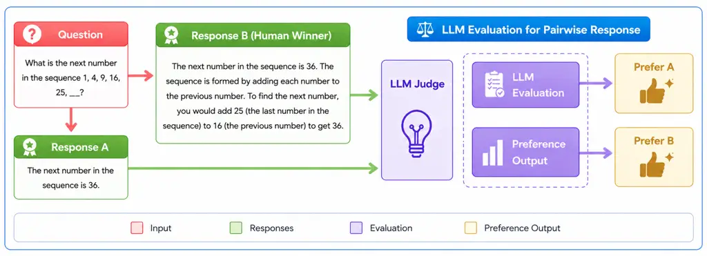

Figure 3: Illustration of the pairwise LLM-as-a-judge setting. Given a
question and two candidate responses, the LLM judge produces an initial
preference between the responses, which may differ from the human
preference.

1: Pairwise dataset $`\mathcal{D}`$, reward encoder $`E_{\mathrm{RM}}`$,
human-verification oracle

2:
$`X\leftarrow\mathrm{BuildDiffFeatures}(\mathcal{D},E_{\mathrm{RM}})`$

3:
$`(\mathcal{P}_{s},\mathcal{V}^{+},\mathcal{V}^{-},\mathcal{W},q,a,m)\leftarrow\mathrm{InitializeState}(\mathcal{D})`$

4: for $`t=0,\dots,T-1`$ do

5:
  $`(z^{(t)},p^{(t)})\leftarrow\mathrm{TrainEncoder}(X,q,a,m,\mathcal{V}^{+},\mathcal{V}^{-})`$

6:
  $`(\tilde{q}^{(t)},a)\leftarrow\mathrm{TrustUpdate}(z^{(t)},p^{(t)},q,a,m,\mathcal{P}_{s},\mathcal{V}^{+},\mathcal{V}^{-})`$

7:
  $`(q,m)\leftarrow\mathrm{TransportUpdate}(\tilde{q}^{(t)},a,z^{(t)},\mathcal{P}_{s},\mathcal{V}^{+},\mathcal{V}^{-})`$

8:
  $`(\mathcal{V}^{+},\mathcal{V}^{-},\mathcal{W})\leftarrow\mathrm{SelectForVerification}(q,m,z^{(t)},p^{(t)},\mathcal{W})`$

9:   if $`\mathrm{StopCriterion}(q,m,\mathcal{V}^{+},\mathcal{V}^{-})`$
then

10:    break

11:   end if

12: end for

13: return refined responsibilities $`q`$, refined positive set
$`\widehat{\mathcal{P}}=\{i:q_{i}\geq 1/2\}`$, and verified sets
$`(\mathcal{V}^{+},\mathcal{V}^{-})`$

Algorithm 1 Progressive PU Refinement Workflow

## Appendix B Details of methodology

### B.1 Trainable encoder and representation learning

The refinement algorithm takes $`\{x_{i}\}_{i=1}^{n}`$ as fixed inputs
and trains a task-specific encoder on top of these comparison features.
At outer iteration $`t`$, the encoder maps $`x_{i}`$ into a latent
representation

```math
z_{i}^{(t)}=W_{2}^{(t)}\operatorname{GELU}\left(W_{1}^{(t)}x_{i}+b_{1}^{(t)}\right)+b_{2}^{(t)}\in\mathbb{R}^{d_{z}}.
```

Here, $`\operatorname{GELU}`$ denotes the Gaussian Error Linear Unit
activation function, defined as

```math
\operatorname{GELU}(x)=x\Phi(x),
```

where $`\Phi(\cdot)`$ is the cumulative distribution function of the
standard normal distribution. A linear prediction head then produces a
logit

```math
\ell_{i}^{(t)}=(w^{(t)})^{\top}z_{i}^{(t)}+b^{(t)},\quad p_{i}^{(t)}=\sigma(\ell_{i}^{(t)})=\frac{1}{1+\exp(-\ell_{i}^{(t)})}.
```

We use $`p_{i}^{(t)}`$ as a preliminary estimate of whether the
LLM-induced preference is human-consistent. For similarity-based
operations, we use

```math
\bar{z}_{i}^{(t)}=\operatorname{Norm}_{\epsilon}(z_{i}^{(t)})=\frac{z_{i}^{(t)}}{\|z_{i}^{(t)}\|+\epsilon},
```

where $`\epsilon>0`$ is fixed for numerical stability.

The encoder and prediction head are trained with verified supervision,
confidence-aware soft supervision, local geometric regularization, and
anchor-preserving regularization:

```math
\mathcal{L}_{\mathrm{enc}}^{(t)}=\mathcal{L}_{\mathrm{ver}}^{(t)}+\lambda_{\mathrm{soft}}\mathcal{L}_{\mathrm{soft}}^{(t)}+\lambda_{\mathrm{geo}}\mathcal{R}_{\mathrm{geo}}^{(t)}+\lambda_{\mathrm{anchor}}\mathcal{R}_{\mathrm{anchor}}^{(t)}.
```

#### Verified supervision.

For verified examples $`i\in\mathcal{V}^{+}\cup\mathcal{V}^{-}`$, define
the target $`\widetilde{y}_{i}=\mathbf{1}\{i\in\mathcal{V}^{+}\}`$. We
use

```math
\mathcal{L}_{\mathrm{ver}}^{(t)}=\frac{\sum_{i\in\mathcal{V}^{+}\cup\mathcal{V}^{-}}\hat{\omega}_{\mathrm{ver}}\operatorname{BCE}(\widetilde{y}_{i},\ell_{i}^{(t)})}{\max(1,|\mathcal{V}^{+}\cup\mathcal{V}^{-}|)},
```

where $`\operatorname{BCE}`$ denotes binary cross-entropy between a
binary target $`y\in\{0,1\}`$ and a logit $`\ell`$:

```math
\operatorname{BCE}(y,\ell)=-y\log\sigma(\ell)-(1-y)\log\bigl(1-\sigma(\ell)\bigr),\qquad\hat{\omega}_{\mathrm{ver}}=1+\omega_{\mathrm{ver}}a_{v}.
```

Since verified examples have fixed anchor confidence $`a_{v}`$, this
verified-example weight is constant across verified examples and
iterations.

#### Confidence-aware soft supervision.

We also train on high-confidence unverified examples using their current
responsibilities as soft labels. Define the confidence of the current
responsibility as $`c_{i}^{(t)}=\max\{q_{i}^{(t)},1-q_{i}^{(t)}\}`$.
Among examples that are not verified and not source positives, denoted
by $`\mathcal{U}_{\mathrm{soft}}^{(t)}`$, we select the high-confidence
set

```math
\mathcal{H}_{\mathrm{soft}}^{(t)}=\{i\in\mathcal{U}_{\mathrm{soft}}^{(t)}:c_{i}^{(t)}\geq\delta_{\mathrm{soft}}^{(t)}\},\quad\delta_{\mathrm{soft}}^{(t)}=\operatorname{Quantile}_{\tau_{\mathrm{soft}}^{(t)}}(\{c_{j}^{(t)}:j\in\mathcal{U}_{\mathrm{soft}}^{(t)}\}).
```

The loss is

```math
\mathcal{L}_{\mathrm{soft}}^{(t)}=\frac{\sum_{i\in\mathcal{H}_{\mathrm{soft}^{(t)}}}\omega_{i}^{\mathrm{soft},(t)}\operatorname{BCE}(q_{i}^{(t)},\ell_{i}^{(t)})}{\sum_{i\in\mathcal{H}_{\mathrm{soft}^{(t)}}}\omega_{i}^{\mathrm{soft},(t)}+\epsilon},\quad\omega_{i}^{\mathrm{soft},(t)}=\frac{1}{2}+\frac{1}{2}a_{i}^{(t)}.
```

#### Local geometric regularization.

To encourage locally similar examples to have consistent predictions and
representations, we use a precomputed neighborhood system. Specifically,
we construct a $`k`$-nearest-neighbor graph in the fixed
comparison-feature space $`\{x_{i}\}_{i=1}^{n}`$ using cosine
similarity. Let $`\mathcal{N}(i)`$ denote the $`k`$ nearest neighbors of
example $`i`$, and define

```math
A_{ij}=\frac{\exp(\tau_{\mathrm{geo}}\langle\bar{x}_{i},\bar{x}_{j}\rangle)}{\sum_{r\in\mathcal{N}(i)}\exp(\tau_{\mathrm{geo}}\langle\bar{x}_{i},\bar{x}_{r}\rangle)+\epsilon},\qquad j\in\mathcal{N}(i),
```

where $`\bar{x}_{i}=x_{i}/(\|x_{i}\|+\epsilon)`$. We define

```math
\mathcal{R}_{\mathrm{geo}}^{(t)}=\frac{1}{n}\sum_{i=1}^{n}\sum_{j\in\mathcal{N}(i)}A_{ij}\left[(p_{i}^{(t)}-p_{j}^{(t)})^{2}+\eta_{z}\|z_{i}^{(t)}-z_{j}^{(t)}\|^{2}\right].
```

The first term encourages nearby examples to have similar
human-consistency scores, while the second term encourages smoothness of
the learned latent representation. The coefficient $`\eta_{z}\geq 0`$
controls the strength of the latent-space smoothness penalty.

#### Anchor-preserving regularization.

Since the encoder is re-trained across outer iterations, we penalize
large movement of high-confidence examples in latent space:

```math
\mathcal{R}_{\mathrm{anchor}}^{(t)}=\frac{1}{n}\sum_{i=1}^{n}a_{i}^{(t)}\|z_{i}^{(t)}-z_{i}^{(t-1)}\|^{2}.
```

This term is omitted for $`t=0`$. It stabilizes the learned
representation around reliable anchors. Hence, the encoder parameters
$`\Theta^{(t)}`$ are updated by minimizing
$`\mathcal{L}_{\mathrm{enc}}^{(t)}(\Theta;q^{(t)},a^{(t)},z^{(t-1)})`$.

### B.2 Trust update

After encoder training, we use the learned representation and model
score to update the refinement state. The trust update combines four
signals: the encoder score $`p_{i}^{(t)}`$, local consistency
$`r_{i}^{\mathrm{loc},(t)}`$, anchor support
$`r_{i}^{\mathrm{anc},(t)}`$, and the previous transport inflow
$`m_{i}^{(t)}`$.

#### Local consistency evidence.

Using the neighborhood weights $`A_{ij}`$, we define

```math
r_{i}^{\mathrm{loc},(t)}=\Pi_{[0,1]}\left(1-\sum_{j\in\mathcal{N}(i)}A_{ij}\left|p_{i}^{(t)}-p_{j}^{(t)}\right|\right),
```

where $`\Pi_{[0,1]}(x)=\min\{1,\max\{0,x\}\}`$ projects a scalar onto
the interval $`[0,1]`$. This score is large when example $`i`$’s encoder
score is consistent with those of its local neighbors.

#### Anchor-support evidence.

We compare each example with positive and negative anchors in the
learned latent space. Let

```math
\mathcal{A}_{+}^{(t)}=\mathcal{P}_{s}\cup\mathcal{V}^{+},\qquad\mathcal{A}_{-}^{(t)}=\mathcal{V}^{-}.
```

Define the normalized positive and negative prototypes as

```math
\mu_{+}^{(t)}=\operatorname{Norm}_{\epsilon}\left(\frac{1}{|\mathcal{A}_{+}^{(t)}|}\sum_{j\in\mathcal{A}_{+}^{(t)}}\bar{z}_{j}^{(t)}\right),\qquad\mu_{-}^{(t)}=\operatorname{Norm}_{\epsilon}\left(\frac{1}{|\mathcal{A}_{-}^{(t)}|}\sum_{j\in\mathcal{A}_{-}^{(t)}}\bar{z}_{j}^{(t)}\right),
```

The anchor-support evidence is

```math
r_{i}^{\mathrm{anc},(t)}=\operatorname{Scale}\left(\left\langle\bar{z}_{i}^{(t)},\mu_{+}^{(t)}\right\rangle-\left\langle\bar{z}_{i}^{(t)},\mu_{-}^{(t)}\right\rangle\right).
```

Here $`\operatorname{Scale}(\cdot)`$ denotes min–max scaling across all
examples in the current round, i.e.,
$`\operatorname{Scale}(s_{i})=(s_{i}-\min_{k}s_{k})/(\max_{k}s_{k}-\min_{k}s_{k}+\epsilon)`$
for scores $`\{s_{k}\}_{k=1}^{n}`$. A larger
$`r_{i}^{\mathrm{anc},(t)}`$ means that example $`i`$ is closer to the
positive-anchor direction than to the negative-anchor direction.

#### Trust-state update.

The trust module combines encoder evidence, local evidence, anchor
evidence, and transport evidence into a single trust logit:

```math
u_{i}^{(t)}=\lambda_{p}\log\frac{p_{i}^{(t)}}{1-p_{i}^{(t)}}+\lambda_{\mathrm{loc}}\left(2r_{i}^{\mathrm{loc},(t)}-1\right)+\lambda_{\mathrm{anc}}\left(2r_{i}^{\mathrm{anc},(t)}-1\right)+\lambda_{m}\left(2m_{i}^{(t)}-1\right)+\beta_{0},
```

where
$`\lambda_{p},\lambda_{\mathrm{loc}},\lambda_{\mathrm{anc}},\lambda_{m}`$
weight the four evidence sources, and $`\beta_{0}`$ is an intercept term
controlling the overall conservativeness of the update.

We then apply source and verified constraints:

```math
\displaystyle\tilde{q}_{i}^{(t)} \displaystyle=\begin{cases}1,&i\in\mathcal{P}_{s}\cup\mathcal{V}^{+},\\
0,&i\in\mathcal{V}^{-},\\
\sigma(u_{i}^{(t)}),&\text{otherwise},\end{cases} \displaystyle a_{i}^{(t+1)} \displaystyle=\begin{cases}a_{s},&i\in\mathcal{P}_{s},\\
a_{v},&i\in\mathcal{V}^{+}\cup\mathcal{V}^{-},\\
\tilde{a}_{i}^{(t+1)},&\text{otherwise}.\end{cases}
```

where
$`\tilde{a}_{i}^{(t+1)}=\Pi_{[0,1]}\left(\gamma_{q}\tilde{q}_{i}^{(t)}+\gamma_{\mathrm{loc}}r_{i}^{\mathrm{loc},(t)}\right).`$
Here $`\gamma_{q}`$ and $`\gamma_{\mathrm{loc}}`$ control the
contributions of each parts. The resulting pair
$`(\tilde{q}^{(t)},a^{(t+1)})`$ is passed to the transport reassignment
module, which produces the next responsibility $`q^{(t+1)}`$.

### B.3 Conservative transport-based inflow update

After the trust update, we compute transport-based inflow scores for
uncertain unlabeled examples. In this subsection, anchors are indexed by
$`i`$, while uncertain examples in $`\mathcal{M}^{(t)}`$ are indexed by
$`j`$. Here,
$`\mathcal{M}^{(t)}=\{j\in\mathcal{U}:\tilde{q}_{j}^{(t)}\in I_{\mathrm{amb}}\}`$
denotes the uncertain set, where $`I_{\mathrm{amb}}\subset(0,1)`$
selects examples with non-decisive responsibilities. Motivated by
partial optimal transport, which allows only a budgeted portion of mass
to be matched, we use a sparse, budgeted propagation rule rather than
solving a full optimal transport problem \[Chapel et al., 2020, Peyré
and Cuturi, 2019\]. This gives a positive inflow $`m_{j}^{+,(t)}`$ from
reliable positive anchors and a negative inflow $`m_{j}^{-,(t)}`$ from
verified negative anchors. Only $`m_{j}^{+,(t)}`$ is carried forward as
$`m_{j}^{(t+1)}`$; $`m_{j}^{-,(t)}`$ is used only in the current
reassignment step. At iteration $`t`$, the positive and negative anchor
pools are

```math
\mathcal{B}_{+}^{(t)}=\mathcal{P}_{s}\cup\mathcal{V}^{+}\cup\{i\in\mathcal{U}:\tilde{q}_{i}^{(t)}\geq 1/2,\ a_{i}^{(t+1)}\geq\kappa_{t}\},\quad\mathcal{B}_{-}^{(t)}=\mathcal{V}^{-}
```

where $`\kappa_{t}`$ is a confidence threshold.

For each uncertain example $`j\in\mathcal{M}^{(t)}`$, we first compute a
local relation-consistency score

```math
c_{j}^{(t)}=\Pi_{[0,1]}\left(1-\left|\tilde{q}_{j}^{(t)}-\frac{1}{|\mathcal{N}(j)|}\sum_{r\in\mathcal{N}(j)}\tilde{q}_{r}^{(t)}\right|\right).
```

This score is large when the trust-updated responsibility of $`j`$
agrees with its neighbourhood, and it is used to downweight transport
into locally inconsistent examples.

We compute the inflows by propagating a bounded amount of mass from
positive anchors to uncertain examples. For a positive anchor
$`i\in\mathcal{B}_{+}^{(t)}`$ and an uncertain example
$`j\in\mathcal{M}^{(t)}`$, we first compute their latent cosine
similarity
$`S_{ij}^{+,(t)}=\left\langle\bar{z}_{i}^{(t)},\bar{z}_{j}^{(t)}\right\rangle.`$
For each anchor $`i`$, we keep only the most similar uncertain examples
and assign them a transport affinity

```math
\Gamma_{ij}^{+,(t)}=\frac{\exp(\tau_{\mathrm{tr}}S_{ij}^{+,(t)})\left(1-\lambda_{\mathrm{rel}}+\lambda_{\mathrm{rel}}c_{j}^{(t)}\right)}{\sum_{j^{\prime}}\exp(\tau_{\mathrm{tr}}S_{ij^{\prime}}^{+,(t)})\left(1-\lambda_{\mathrm{rel}}+\lambda_{\mathrm{rel}}c_{j^{\prime}}^{(t)}\right)+\epsilon},
```

where the sum is over the retained uncertain examples for anchor $`i`$.
Thus, $`\Gamma_{ij}^{+,(t)}`$ is large when $`j`$ is close to $`i`$ in
latent space and is locally consistent with its neighbors. The parameter
$`\tau_{\mathrm{tr}}`$ controls how strongly transport favors the most
similar targets, while $`\lambda_{\mathrm{rel}}`$ controls the
contribution of local relation consistency. We assign source masses
separately for positive and negative anchors:

```math
\pi_{i}^{+,(t)}=\frac{a_{i}^{(t+1)}}{\sum_{r\in\mathcal{B}_{+}^{(t)}}a_{r}^{(t+1)}+\epsilon},\quad i\in\mathcal{B}_{+}^{(t)},\qquad\pi_{i}^{-,(t)}=\frac{1}{|\mathcal{B}_{-}^{(t)}|+\epsilon},\quad i\in\mathcal{B}_{-}^{(t)}.
```

Positive anchors are weighted by anchor confidence, while negative
anchors are weighted uniformly. The negative affinity
$`\Gamma_{ij}^{-,(t)}`$ is defined analogously by replacing
$`\mathcal{B}_{+}^{(t)}`$ with $`\mathcal{B}_{-}^{(t)}`$. Given budgets
$`B_{t}^{+}`$ and $`B_{t}^{-}`$, we aggregate anchor-to-target
transported mass:

```math
\displaystyle m_{j}^{+,(t)}=\sum_{i\in\mathcal{B}_{+}^{(t)}}B_{t}^{+}\,\pi_{i}^{+,(t)}\Gamma_{ij}^{+,(t)},\quad m_{j}^{-,(t)}=\sum_{i\in\mathcal{B}_{-}^{(t)}}B_{t}^{-}\,\pi_{i}^{-,(t)}\Gamma_{ij}^{-,(t)}.
```

The positive inflow $`m_{j}^{+,(t)}`$ supports increasing the
responsibility of $`j`$, whereas the negative inflow $`m_{j}^{-,(t)}`$
supports decreasing it. Thus, $`m_{j}^{+,(t)}`$ pushes $`j`$ toward the
positive group, while $`m_{j}^{-,(t)}`$ pushes it away from the positive
group.

Finally, the responsibility is updated by applying the two inflows in
opposite directions:

```math
q_{j}^{+,(t)}=\tilde{q}_{j}^{(t)}+\eta_{+}m_{j}^{+,(t)}\left(1-\tilde{q}_{j}^{(t)}\right),\qquad q_{j}^{(t+1)}=q_{j}^{+,(t)}-\eta_{-}m_{j}^{-,(t)}q_{j}^{+,(t)}.
```

The first update increases responsibility using positive inflow, while
the second decreases it using negative inflow. For examples not in
$`\mathcal{M}^{(t)}`$, we keep $`q_{j}^{(t+1)}=\tilde{q}_{j}^{(t)}`$.

Notably, only the positive inflow is carried forward to the next
iteration, i.e., $`m_{j}^{(t+1)}=m_{j}^{+,(t)}`$, while the negative
inflow $`m_{j}^{-,(t)}`$ is used only within the current transport
update.

### B.4 Selective verification and stopping details

After transport update, the candidate set is

```math
\mathcal{C}^{(t)}=\mathcal{U}\setminus\left(\mathcal{V}^{+}\cup\mathcal{V}^{-}\cup\mathcal{W}^{(t)}\right),
```

where $`\mathcal{W}^{(t)}`$ contains examples already selected for human
review but whose labels have not yet been incorporated.

For each candidate $`i\in\mathcal{C}^{(t)}`$, we compute

```math
U_{i}^{(t)}=1-\left|2q_{i}^{(t+1)}-1\right|,\quad I_{i}^{(t)}=p_{i}^{(t)}(1-p_{i}^{(t)})(\|z_{i}^{(t)}\|^{2}+1),\quad D_{i}^{(t)}=1-\max_{r\in\mathcal{V}^{(t)}}\langle\bar{z}_{i}^{(t)},\bar{z}_{r}^{(t)}\rangle.
```

Here $`\mathcal{V}^{(t)}=\mathcal{V}^{+}\cup\mathcal{V}^{-}`$ denotes
the currently verified set, and we set $`D_{i}^{(t)}=1`$ when
$`\mathcal{V}^{(t)}=\varnothing`$. The final query score is

```math
H_{i}^{(t)}=\omega_{U}\operatorname{Scale}\!\left(U_{i}^{(t)}\right)+\omega_{I}\operatorname{Scale}\!\left(I_{i}^{(t)}\right)+\omega_{D}\operatorname{Scale}\!\left(D_{i}^{(t)}\right)+\omega_{M}\operatorname{Scale}\!\left(m_{i}^{(t+1)}\right),
```

where $`\operatorname{Scale}(\cdot)`$ is computed over
$`\mathcal{C}^{(t)}`$. We select the top $`b`$ candidates with the
largest $`H_{i}^{(t)}`$ for human verification. If the returned human
label agrees with the LLM judge, the example is added to
$`\mathcal{V}^{+}`$; otherwise, it is added to $`\mathcal{V}^{-}`$. If
the label is not yet available, the example is kept in
$`\mathcal{W}^{(t+1)}`$.

For stopping, we monitor

```math
\Delta_{q}^{(t)}=\frac{1}{n}\sum_{i=1}^{n}|q_{i}^{(t+1)}-q_{i}^{(t)}|,
```

```math
\Delta_{\mathrm{flip}}^{(t)}=\frac{1}{n}\sum_{i=1}^{n}\mathbf{1}\left\{\mathbf{1}(q_{i}^{(t+1)}\geq 1/2)\neq\mathbf{1}(q_{i}^{(t)}\geq 1/2)\right\},
```

```math
\Delta_{m}^{(t)}=\frac{1}{n}\sum_{i=1}^{n}|m_{i}^{(t+1)}-m_{i}^{(t)}|,\qquad\Delta_{\mathrm{ver}}^{(t)}=|\mathcal{V}^{(t+1)}|-|\mathcal{V}^{(t)}|.
```

The rule-based stopping criterion checks

```math
\Delta_{q}^{(t)}\leq\epsilon_{q},\qquad\Delta_{\mathrm{flip}}^{(t)}\leq\epsilon_{\mathrm{flip}},\qquad\Delta_{m}^{(t)}\leq\epsilon_{m},\qquad\Delta_{\mathrm{ver}}^{(t)}\leq\epsilon_{\mathrm{ver}}.
```

The algorithm stops when at least three of the four conditions hold for
the required number of consecutive rounds, after a minimum number of
iterations. The loop also terminates when the maximum iteration count or
annotation budget is reached.

## Appendix C Additional theoretical results

Possible additions include:

- •
  sensitivity analysis with respect to noisy initial PU memberships,
- •
  convergence properties of the iterative membership refinement,
- •
  error decomposition for fixed-group versus learned-group auditing.

### C.1 Mass conservation and bias reduction of $`\mathcal{T}_{\mathrm{trans}}`$

Let $`m^{(t)}_{+}`$ denote the positive inflow vector after the
transport step at iteration $`t`$. Because of top–$`K_{\text{tr}}`$
truncation, each $`m^{t)}_{+}`$ is sparse and bounded in Euclidean norm.

###### Lemma 4 (Mass conservation under budget).

Define $`C_{B}>0`$ such that $`\|m^{+,(t)}\|\leq C_{B}`$ for all $`t`$.
Since the transported mass is controlled by the budget, this constant
can be chosen uniformly as $`C_{B}\leq\sup_{t}B_{t}^{+}`$. Moreover, the
total positive transport mass equals the budget:

```math
\sum_{i\in\mathcal{B}_{+}^{(t)}}\sum_{j\in\mathcal{M}^{(t)}}T_{ij}^{+,(t)}=B_{t}^{+}\sum_{i\in\mathcal{B}_{+}^{(t)}}\pi_{i}^{+,(t)}\sum_{j\in\mathcal{M}^{(t)}}\Gamma_{ij}^{+,(t)}=B_{t}^{+},
```

where $`\pi_{i}^{+,(t)}`$ is a probability distribution over the
positive anchor pool $`\mathcal{B}_{+}^{(t)}`$, $`\Gamma_{ij}^{+,(t)}`$
is the retained target affinity over $`\mathcal{M}^{(t)}`$, and
$`T^{+,(t)}_{ij}`$ denotes the positive transport mass from anchor $`i`$
to uncertain example $`j`$.

To relate transport to label geometry, we assume that nearby points in
the learned latent space share similar human–consistency labels.

###### Assumption 5.

Let $`y_{i}\in\{0,1\}`$ denotes the true human–consistency labels
defined in Section 3. There exists a constant $`L_{\text{loc}}>0`$ such
that for all $`i,j`$,

```math
|y_{i}-y_{j}|\leq L_{\text{loc}}\|\bar{z}_{i}^{(t)}-\bar{z}_{j}^{(t)}\|.
```

where $`\bar{z}_{i}^{(t)}`$ is the normalized latent representation at
iteration $`t`$.

###### Remark 2.

This is a latent–space analogue of the standard cluster assumption in
semi–supervised learning and manifold hypothesis \[Bengio et al.,
2013\]; samples that cluster together in the encoder’s representation
space should share same human–consistency label. It is reasonable when
the encoder is sufficiently expressive to capture the semantic structure
of the LLM–judge task.

Under this assumption, we can show that conservative positive transport
reduce a surrogate consistency error in expectation.

###### Theorem 3.

Let $`y\in\{0,1\}^{n}`$ is the real human–consistency label and suppose
Assumption 5 holds. Consider the update that applies only the positive
inflow to uncertain examples, with $`\eta_{-}=0`$, so that

```math
q^{(t+1)}_{j}=\tilde{q}_{j}^{(t)}+\eta_{+}m^{(t)}_{+,j}(1-\tilde{q}^{(t)}_{j}),
```

for $`j\in\mathcal{M}^{(t)}`$ and $`q^{(t+1)}_{j}=\tilde{q}^{(t)}_{j}`$
otherwise. Then the expected squared error satisfies

```math
\displaystyle\mathbb{E}\|q^{(t+1)}-y\|\leq\mathbb{E}\|\bar{q}^{(t)}-y\|-\eta_{+}\cdot\mathrm{Gap}^{(t)}_{+}+\eta^{2}\bar{B}^{2},
```

where

```math
\mathrm{Gap}^{(t)}_{+}=2\mathbb{E}\sum_{j\in\mathcal{M}^{(t)}}m_{j}^{+,(t)}(1-\bar{q}_{j}^{(t)})(y_{j}-\bar{q}_{j}^{(t)}
```

and $`\bar{B}`$ is a constant depending on the transport budget and
sparsity. When the affinity weights align positive anchors with
high–$`y`$ targets (guaranteed by Assumption 5),
$`\mathrm{Gap}_{+}^{(t)}>0`$ and the the positive transport step
strictly reduces the surrogate squared error, up to a second–order term
controlled by $`\eta^{2}_{+}\bar{B}^{2}`$.

## Appendix D Proof of the theoretical results

### D.1 Proof of lemma

###### Proof of Lemma 1.

The logit map $`\psi(p)=\log(p/(1-p))`$ has derivative
$`\psi^{\prime}(p)=1/(p(1-p))`$. On $`[\epsilon_{p},1-\epsilon_{p}]`$,
$`\psi^{\prime}(p)`$ attains its maximum at the endpoints, so
$`\sup\psi^{\prime}(p)=1/(\epsilon_{p}(1-\epsilon_{p}))`$. By the mean
value theorem (MVT),

```math
\Big|\log\frac{p_{i}^{(t+1)}}{1-p_{i}^{(t+1)}}-\log\frac{p_{i}^{(t)}}{1-p_{i}^{(t)}}\Big|=|\psi^{\prime}(p)|\cdot|p_{i}^{(t+1)}-p_{i}^{(t)}|\leq\frac{1}{\epsilon_{p}(1-\epsilon_{p})}|\Delta p|.
```

The full expression for the trust logit $`u_{i}^{(t)}`$ becomes

```math
u_{i}^{(t)}=\lambda_{p}\psi(p_{i}^{(t)})+2\lambda_{\text{loc}}\Delta r_{i}^{\lambda_{\text{loc}}}+2\lambda_{\text{anc}}\Delta r_{i}^{\lambda_{\text{anc}}}+2\lambda_{m}\Delta m_{i}
```

Applying the triangle inequality and substituting the MVT bound, we get

```math
\displaystyle|u_{i}^{(t+1)}-u^{(t)}_{i}| \displaystyle\leq\lambda_{p}|\psi(p_{i}^{(t+1)}-\psi(p_{i}^{(t)})|+2\lambda_{\text{loc}}|\Delta r_{i}^{\lambda_{\text{loc}}}|+2\lambda_{\text{anc}}|\Delta r_{i}^{\lambda_{\text{anc}}}|+2\lambda_{m}|\Delta m_{i}|
```

```math
\displaystyle\leq\frac{\lambda_{p}}{\epsilon_{p}(1-\epsilon_{p})}|\Delta p_{i}|+2\lambda_{\text{loc}}|\Delta r_{i}^{\lambda_{\text{loc}}}|+2\lambda_{\text{anc}}|\Delta r_{i}^{\lambda_{\text{anc}}}|+2\lambda_{m}|\Delta m_{i}|.
```

This completes the proof for component-wise Lipschitz continuity of the
trust logit. ∎

###### Proof of Lemma 2.

By Assumption 1 and the descent lemma,

```math
\mathcal{L}_{\mathrm{enc}}^{(t)}(\Theta^{(t+1)})\leq\mathcal{L}_{\mathrm{enc}}^{(t)}(\Theta^{(t)})+\langle\nabla_{\Theta}\mathcal{L}_{\mathrm{enc}}^{(t)}(\Theta^{(t)}),\Theta^{(t+1)}-\Theta^{(t)}\rangle+\tfrac{L_{\Theta}}{2}\|\Theta^{(t+1)}-\Theta^{(t)}\|^{2}.
```

With $`\Theta^{(t+1)}=\Theta^{(t)}-\eta g`$ and
$`g:=\nabla_{\Theta}\mathcal{L}_{\mathrm{enc}}^{(t)}(\Theta^{(t)})`$,

```math
\Theta^{(t+1)}-\Theta^{(t)}=-\eta g,\quad\|\Theta^{(t+1)}-\Theta^{(t)}\|^{2}=\eta^{2}\|g\|^{2}.
```

Substituting,

```math
\mathcal{L}_{\mathrm{enc}}^{(t)}(\Theta^{(t+1)})\leq\mathcal{L}_{\mathrm{enc}}^{(t)}(\Theta^{(t)})-\eta\|g\|^{2}+\tfrac{L_{\Theta}\eta^{2}}{2}\|g\|^{2}=\mathcal{L}_{\mathrm{enc}}^{(t)}(\Theta^{(t)})-\eta\big(1-\tfrac{L_{\Theta}\eta}{2}\big)\|g\|^{2}.
```

For $`)<\eta\leq 2/L_{\Theta}`$, the bracket is nonnegative, hence the
result follows with
$`c_{\Theta}=\eta\left(1-\frac{L_{\Theta}\eta}{2}\right)`$; for
$`\eta=1/L_{\Theta}`$, the bracket equals $`1/2`$, giving
$`c_{\Theta}=1/(2L_{\Theta})`$. ∎

###### Proof of Lemma 3.

For $`c_{\Theta}`$, in order to fulfill the requirement of $`L`$–smooth,
we define that for any
$`\theta^{(t)},\theta^{\prime}=\theta^{(t+1)}=\theta^{(t)}-\eta g`$
where $`g=\nabla f(\theta^{(t)})`$,

```math
\displaystyle f(\theta^{(t+1)}) \displaystyle\leq f(\theta^{(t)})+\langle g,\theta^{(t+1)}-\theta^{(t)}\rangle+\frac{L}{2}\|\theta^{(t+1)}-\theta^{(t)}\|^{2}
```

```math
\displaystyle\leq f(\theta^{(t)})-\eta\|g\|^{2}+\frac{L\eta^{2}}{2}\|g\|^{2}=f(\theta^{(t)})-\eta\left(1-\frac{L\eta}{2}\right)\|g\|^{2}
```

In order to let the gradient remain negative, stepsize $`\eta`$ should
satisfy $`1-L\eta/2\geq 0\Longleftrightarrow\eta<2/L`$. We set
$`\eta=1/L`$, the equation above can be derived as

```math
f(\theta^{(t+1)})\leq f(\theta^{(t)}-\frac{1}{2L}\|g\|^{2} \tag{3}
```

Thus, $`c_{\Theta}=1/(2L_{\Theta}).~\qed`$.

Given $`\tilde{q}_{i}^{(t)}=\sigma(u_{i}^{(t)})`$, we obtain
$`\bar{q}_{i}^{(t)}`$ after applying hard constraints. According to
Assumption 5,

```math
\|\bar{q}^{(t+1)}-\bar{q}^{(t)}\|\leq L_{\mathcal{D},m}\|m^{(t+1)}-m^{(t)}\|
```

Given the rule of transport
update,$`q^{(t,+)}_{j}=\bar{q}^{(t)}_{j}+\eta_{+}m_{j}^{+,(t)}(1-\bar{q}_{j}^{(t)})`$,
we get

```math
\displaystyle q^{(t,+)}_{j}-\bar{q}^{(t)}_{j} \displaystyle=\eta_{+}m_{j}^{+,(t)}(1-\bar{q}_{j}^{(t)})
```

```math
\displaystyle\Rightarrow~|q^{(t,+)}_{j}-\bar{q}^{(t)}_{j}| \displaystyle\leq\eta_{+}m_{j}^{+,(t)}.\qquad(\because\bar{q}_{j}^{(t)}\in[0,1]~\mathrm{and}~m_{j}^{+,(t)}\in[0,1])
```

```math
\displaystyle\Rightarrow~\|q^{(t,+)}_{j}-\bar{q}^{(t)}_{j}\| \displaystyle\leq\eta_{+}\|m^{+,(t)}\|.
```

Therefore,

```math
\displaystyle\|q^{(t,+)}-q^{(t)}\| \displaystyle\leq\|q^{(t+1)}-\bar{q}^{(t)}\|+\|\bar{q}^{(t)}-q^{(t)}\|
```

```math
\displaystyle\leq L_{\mathcal{D},m}\|m^{(t)}-m^{(t-1)}\|+L_{\mathcal{D},m}\|p^{(t)}-p^{(t-1)}\|.
```

where $`L_{\mathcal{D},m}`$ is a Lipschitz constant for
$`\mathcal{D}_{\text{trust}}`$ vs. $`p`$.

Among Lyapunov function $`V^{(t)}`$, the trust and transport part is

```math
\displaystyle V_{q}^{(t)}:=\lambda_{q}\|q^{(t)}-q^{(t-1)}\|\Rightarrow V_{q}^{(t+1)}-V_{q}^{(t)}=\lambda_{q}(\|q^{(t+1)}-q^{(t)}\|-\|q^{(t)}-q^{(t-1)}\|)
```

In order to ensure $`-c_{q}\|q^{(t+1)}-q^{(t)}\|`$ provides the negative
gradient, we use Young inequality to derive the upper bound for

```math
L_{q}\|q^{(t+1)}-q^{(t)}\|\leq\frac{L_{q}^{2}}{2\epsilon_{q}}+\frac{\epsilon_{q}}{2}L_{q}\|q^{(t+1)}-q^{(t)}\|
```

With proper
$`\epsilon_{q}=\{\epsilon_{q}\mid\epsilon_{q}/2<\lambda_{q}\}`$,

```math
\lambda_{q}\|q^{(t+1)}-q^{(t)}\|-\frac{\epsilon_{q}}{2}\|q^{(t+1)}-q^{(t)}\|=(\lambda_{q}-\frac{\epsilon_{q}}{2})\|q^{(t+1)}-q^{(t)}\|
```

Therefore,

```math
c_{q}:=\lambda_{q}-\frac{\epsilon_{q}}{2}>0.~\qed \tag{4}
```

Transport mass. Given the definition of transport mass and transport
inflow and the mass conservation statement in Lemma 4, we know the
magnitude of $`m^{+,(t)}_{j}`$ is controlled by the transport budget
$`B_{t}`$. The mass will be transported to next inflow state,
$`m^{(t+1)}_{j}=m^{+,(t)}_{j}`$, thus

```math
\displaystyle m^{(t+1)}-m^{(t)}=m^{+,(t)}-m^{+,(t-1)}
```

```math
\displaystyle\Rightarrow~ \displaystyle\|m^{(t+1)}-m^{(t)}\|\leq B_{t}-B_{t+1}.
```

Back to Lyapunov function that

```math
V^{(t+1)}_{m}-V^{(t)}_{m}=\lambda_{m}\|m^{(t+1)}-m^{(t)}\|-\lambda_{m}\|m^{(t)}-m^{(t-1)}\|, \tag{5}
```

similar to $`c_{q}`$ derivation, via Young inequality, we can get
$`c_{m}:=\lambda_{m}-\epsilon_{m}/2>0~\qed`$. ∎

###### Proof of Lemma 4.

The mass identity follows by direct computation using the definition in
Section B.3, the positive transport inflow to an uncertain target
$`j\in\mathcal{M}^{(t)}`$ is given by:

```math
m^{+,(t)}_{j}=B^{+}_{t}\sum_{i\in\mathcal{B}^{(t)}_{+}}\pi_{i}^{+,(t)}\Gamma_{ij}^{+,(t)}.
```

To verify mass conservation, we compute the $`L_{1}`$ norm of the inflow
vector $`m^{+,(t)}`$ that

```math
\|m^{+,(t)}\|_{1}=\sum_{j\in\mathcal{M}^{(t)}}m^{+,(t)}_{j}=B^{+}_{t}\sum_{i\in\mathcal{B}^{(t)}_{+}}\pi_{i}^{+,(t)}\left(\sum_{j\in\mathcal{M}^{(t)}}\Gamma_{ij}^{+,(t)}\right)
```

Since the total transported mass is bounded by $`B_{t}^{+}`$ and
$`m^{+,(t)}`$ is nonnegative, we can bound the sequence by choosing
$`C_{B}=\sup_{t}B^{+}_{t}`$

```math
\|m^{+,(t)}\|\leq\|m^{+,(t)}\|_{1}\leq C_{B},
```

completing the proof.

∎

### D.2 Proof of theorem

###### Proof of Theorem 1.

By Section B.1, $`\tilde{q}_{i}^{(t)}=\sigma(u_{i}^{(t)})`$. The sigmoid
satisfies $`\sigma^{\prime}(u)=\sigma(u)(1-\sigma(u))\leq 1/4`$, with
equality iff $`u=0`$. Combining with Lemma 1,

```math
|\tilde{q}_{i}^{(t+1)}-\tilde{q}_{i}^{(t)}|=|\sigma(u_{i}^{(t+1)})-\sigma(u_{i}^{(t)})|\leq\tfrac{1}{4}|u_{i}^{(t+1)}-u_{i}^{(t)}|.
```

Substituting the bound from Lemma 1 yields the result. The single-input
constants follow by isolating each term. ∎

###### Proof of Theorem 2.

Proof of (a). Define
$`\tilde{V}^{(t)}:=V^{(t)}-\sum_{s<t}\mathcal{E}^{(s)}`$. By Lemma 2,
$`\tilde{V}^{(t)}`$ is monotone non–increasing. Given Assumption 1 that
$`V^{(t)}\geq 0`$, non–negativity of squared norms, and
$`\sum_{s}\mathcal{E}^{(s)}<\infty`$, $`\tilde{V}^{(t)}`$ thus has a
lower bounded. By Monotone Convergence Theorem \[Robbins and Siegmund,
1971\], $`\tilde{V}^{(t)}\to\tilde{V}^{\star}`$, hence
$`V^{(t)}\to V^{\star}:=\tilde{V}^{\star}+\sum_{s}\mathcal{E}^{(s)}`$.

Proof of (b). Telescoping (2) from $`t=0`$ to $`T-1`$,

```math
\sum_{t=0}^{T-1}\big[c_{\Theta}\|\nabla_{\Theta}\mathcal{L}_{\mathrm{enc}}^{(t+1)}(\Theta^{(t)})\|+c_{q}\|q^{(t+1)}-q^{(t)}\|+c_{m}\|m^{(t+1)}-m^{(t)}\|\big]\leq V^{(0)}-V^{(T)}+\sum_{t=0}^{T-1}\mathcal{E}^{(t)}.
```

Letting $`T\to\infty`$, the right-hand side converges by (a). Hence each
of the three series on the left converges, which forces each summand to
vanish:

```math
\|\nabla_{\Theta}\mathcal{L}_{\mathrm{enc}}^{(t)}(\Theta^{(t-1)})\|\to 0,\quad\|q^{(t+1)}-q^{(t)}\|\to 0,\quad\|m^{(t+1)}-m^{(t)}\|\to 0.
```

Proof of (c.) Let
$`(\Theta^{(t_{k})},q^{(t_{k})},a^{(t_{k})},m^{(t_{k})})`$ be a
convergent subsequence with limit
$`(\Theta^{\star},q^{\star},a^{\star},m^{\star})`$.

By Theorem 2(b),
$`\left(\mathcal{L}_{\mathrm{enc}}^{(t)}(\Theta^{(t)})-\inf\mathcal{L}_{\mathrm{enc}}^{(t)}(\Theta^{(t)})\right)\to 0`$.
The loss $`\mathcal{L}_{\mathrm{enc}}^{(t)}(\Theta^{(t)})`$ depends
continuously on $`(q^{(t)},a^{(t)},V^{+},V^{-})`$. Passing to the
subsequential limit,
$`\mathcal{L}_{\mathrm{enc}}^{(t)}(\Theta^{\star})-\inf\mathcal{L}_{\mathrm{enc}}^{(t)}(\Theta^{\star})=0`$.
Hence, $`\Theta^{\star}\in\arg\min\mathcal{L}_{\mathrm{enc}}^{\star}`$.

The outer loop defines that
$`q^{(t+1)}=\mathcal{T}_{\mathrm{trans}}(\mathcal{D}_{\mathrm{Trust}}(p^{(t)},z^{(t)},m^{(t)}))`$.
By Theorem 2(b), $`\|q^{(t_{k}+1)}-q^{(t_{k})}\|\to 0`$, so
$`q^{(t_{k}+1)}\to q^{\star}`$. By continuity of
$`\mathcal{D}_{\mathrm{Trust}}`$ (Theorem 1) and
$`\mathcal{T}_{\mathrm{trans}}`$ (Lemma 4),
$`\mathcal{T}_{\mathrm{trans}}(\mathcal{D}_{\mathrm{Trust}}(p^{(t_{k})},z^{(t_{k})},m^{(t_{k})}))\to\mathcal{T}_{\mathrm{trans}}(\mathcal{D}_{\mathrm{Trust}}(p^{\star},z^{\star},m^{\star}))`$.
Equating both limits,

```math
q^{\star}=\mathcal{T}_{\mathrm{trans}}(\mathcal{D}_{\mathrm{Trust}}(p^{\star},z^{\star},m^{\star})).
```

∎

###### Proof of Theorem 3.

Under the update rule,
$`q^{(t,+)}_{j}=\tilde{q}_{j}^{(t)}+\eta_{+}m_{j}^{+,(t)}(1-\tilde{q}_{j}^{(t)})`$,
the MSE for only consider pure positive transport, $`\eta_{-}=0`$,

```math
\displaystyle(q_{j}^{(t+1)}-y_{j})^{2}-(\bar{q}_{j}^{(t)}-y_{j})^{2} \displaystyle=(q_{j}^{(t+1)}-\bar{q}_{j}^{(t)})(q_{j}^{(t+1)}-\bar{q}^{(t)}_{j}-2y_{j})
```

```math
\displaystyle=\eta_{+}m_{j}^{+,(t)}(1-\bar{q}_{j}^{(t)})(q_{j}^{(t+1)}+\bar{q}_{j}^{(t)}-2y_{j})
```

```math
\displaystyle=2\eta_{+}m_{j}^{+,(t)}(1-\bar{q}_{j}^{(t)})(q_{j}^{(t)}-y_{j})+\eta^{2}_{+}[m_{j}^{+,(t)}(1-\bar{q}^{(t)}_{j})]^{2}
```

Therefore,

```math
\displaystyle\mathbb{E}\|q^{(t+1)}-y\|-\mathbb{E}\|\bar{q}^{(t)}-y\|
```

```math
\displaystyle= \displaystyle-2\eta_{+}\mathbb{E}\sum_{j}\left[m_{j}^{+,(t)}(1-\bar{q}_{j}^{(t)})(y_{j}-q_{j}^{(t)})\right]+\eta^{2}_{+}\mathbb{E}\left[[m_{j}^{+,(t)}(1-\bar{q}^{(t)}_{j})^{2}\right]
```

```math
\displaystyle=-\eta_{+}\cdot\mathrm{Gap}^{(t)}_{+}+\eta^{2}_{+}\mathbb{E}\left[[m_{j}^{+,(t)}(1-\bar{q}^{(t)}_{j})^{2}\right],
```

The second term is bounded by $`\eta_{+}^{2}\bar{B}^{2}`$ via Lemma 4
and $`|m_{j}^{+,(t)}(1-\bar{q}_{j}^{(t)})|\leq m_{j}^{+,(t)}`$ where
$`\bar{B}`$ is a constant,

```math
\mathbb{E}\|q^{(t+1)}-y\|-\mathbb{E}\|\bar{q}^{(t)}-y\|\leq-\eta_{+}\cdot\mathrm{Gap}^{(t)}_{+}+\eta^{2}_{+}\bar{B}^{2}.
```

The result follows. ∎

## Appendix E Additional experimental details

### E.1 Evaluation metrics

We use the same set of metrics for simulation and real-data evaluation
whenever applicable. The _original accuracy_ measures the agreement
between the initial judge-induced consistency signal and the
ground-truth consistency label. In simulation, this label is generated
by the simulator; in real data, it is derived from human preference
annotations. The _adjusted accuracy_ measures the agreement after
applying AURA.

We define the accuracy difference as

```math
\Delta_{\mathrm{acc}}=\mathrm{Acc}_{\mathrm{adj}}-\mathrm{Acc}_{\mathrm{orig}}.
```

A positive value indicates that the refinement improves agreement with
the target human-consistency label. We also report the _flip rate_,
defined as the fraction of examples whose hard assignment changes after
refinement:

```math
\mathrm{Flip}=\frac{1}{n}\sum_{i=1}^{n}\mathbf{1}\{\widehat{y}_{i}^{\mathrm{adj}}\neq\widehat{y}_{i}^{\mathrm{orig}}\}.
```

This metric measures how actively the method changes the initial signal.
A useful refinement method should not only flip many labels, but should
flip them in a way that improves adjusted accuracy.

For real-data experiments, we additionally report the final waiting-pool
size, runtime, and peak memory usage. The waiting-pool size records the
number of examples selected for verification but not yet incorporated
into the refinement state at termination. Runtime and memory are used to
quantify the computational cost of applying AURA to real LLM-as-a-judge
data.

### E.2 Simulation details

We construct a generative simulation that mirrors the refinement problem
studied in Sections 3–4. Specifically, the simulator generates examples
from two latent consistency groups with a adjustable separation, and
then produces noisy comparison features and corrupted initial
consistency signals. AURA only observes these noisy features and
corrupted signals. This setup allows us to evaluate whether the proposed
trust and transport updates can recover the underlying consistency
structure from the information available to the refinement procedure.

For each simulated example, we first sample a binary consistency label
$`y_{i}\in\{0,1\}`$, following the definition in Section 3. We then
generate a simulator-side latent coordinate
$`\bm{h}_{i}\in\mathbb{R}^{d}`$, which is used only for data generation
and is not observed by AURA. Conditional on $`y_{i}=k`$, we sample

```math
\bm{h}_{i}\mid y_{i}=k\sim\mathcal{N}_{d}(\bm{\mu}_{k},\bm{\Sigma}),\qquad k\in\{0,1\},
```

where $`\bm{\mu}_{k}\in\mathbb{R}^{d}`$ is the group mean vector for
label $`k`$, and $`\bm{\Sigma}\in\mathbb{R}^{d\times d}`$ is the
covariance matrix. The distance between $`\bm{\mu}_{0}`$ and
$`\bm{\mu}_{1}`$ controls how separable the human-consistent and
human-inconsistent groups are.

The observed comparison feature is generated from this oracle coordinate
as

```math
x_{i}=Ah_{i}+\epsilon_{i},\qquad\epsilon_{i}\sim\mathcal{N}(0,\sigma_{x}^{2}I),
```

where $`A\in\mathbb{R}^{d_{x}\times d}`$ is a linear transformation
matrix, $`\epsilon_{i}\in\mathbb{R}^{d_{x}}`$ is Gaussian observation
noise, $`\sigma_{x}>0`$ controls the noise level, and $`I_{d_{x}}`$ is
the $`d_{x}`$-dimensional identity matrix. Thus, $`x_{i}`$ plays the
same role as the fixed comparison feature in the real pipeline: it
contains useful geometric information about consistency, but the
conditional distributions of $`x_{i}\mid y_{i}=1`$ and
$`x_{i}\mid y_{i}=0`$ remain noisy and overlapping rather than perfectly
separable.

We then corrupt $`y_{i}`$ to obtain an initial noisy consistency signal
$`\tilde{y}_{i}\in\{0,1\}`$, which plays the role of the raw LLM-induced
signal before refinement. We consider two corruption mechanisms,
following the common distinction between class-conditional and
instance-dependent label-noise models \[Xia et al., 2020, Berthon et
al., 2021, Cheng et al., 2022\]. In the _class-dependent_ (CD) setting,
the corruption probability depends only on the true consistency label:

```math
\mathbb{P}(\tilde{y}_{i}\neq y_{i}\mid y_{i},x_{i})=\mathbb{P}(\tilde{y}_{i}\neq y_{i}\mid y_{i}).
```

Thus, all examples with the same value of $`y_{i}`$ share the same
corruption rate, regardless of their location in the feature space. This
provides a controlled baseline for testing whether AURA can correct
label-level corruption.

In the _distribution-dependent_ (DD) setting, the corruption probability
is allowed to depend on the sample location:

```math
\mathbb{P}(\tilde{y}_{i}\neq y_{i}\mid y_{i},x_{i}).
```

This setting is more complex because the initial signal is more likely
to be wrong for examples in uncertain or overlapping regions of the
feature space. It better reflects LLM-as-a-judge behavior, where errors
are often concentrated on difficult, subjective, or geometrically
ambiguous comparisons rather than being uniformly distributed within
each class.

Finally, we construct the verified sets $`\mathcal{V}^{+}`$ and
$`\mathcal{V}^{-}`$ by revealing only a subset of labels to the
refinement procedure. We consider two verification mechanisms. The first
is _selected completely at random_ (SCAR), under which the probability
that an example is human-verified is constant within the relevant latent
label class and does not depend on its features. Thus, conditional on
the latent label status, the verified examples form an unbiased random
subset. The second is _selected at random_ (SAR), under which the
verification probability is allowed to depend on the feature vector
$`x_{i}`$. Under SAR, the verified set may therefore be systematically
biased toward particular regions of the feature space, such as examples
with higher uncertainty, greater difficulty, or more salient content.
This mechanism better reflects selective human review, where verified
examples are rarely sampled uniformly at random.

For the simulation setting, unless otherwise specified, we set the
latent dimension to $`d=2`$ and the class-centre distance to
$`\|\mu_{1}-\mu_{0}\|=4`$. Each noise–verification configuration is
repeated over 5 independent runs. We report four metrics: original
accuracy, the accuracy of the corrupted initial signal before
refinement; adjusted accuracy, the accuracy after applying AURA;
accuracy difference, the adjusted accuracy minus the original accuracy;
and flip rate, the fraction of examples whose hard assignment changes
after refinement.

### E.3 Simulation sensitivity to latent geometry

We further examine how the latent geometry affects refinement under the
DD+SAR setting. Our goal is to assess the sensitivity of AURA to two
geometric factors: the class-center distance
$`\|\bm{\mu}_{1}-\bm{\mu}_{0}\|`$, which controls group separability,
and the latent dimension $`d`$, which affects the reliability of
local-neighbourhood and distance-based evidence. We first vary the
class-center distance while fixing the latent dimension. We consider
$`d=2`$, $`d=5`$, and $`d=20`$, and vary
$`\|\bm{\mu}_{1}-\bm{\mu}_{0}\|`$ from $`1`$ to $`10`$. Across all three
dimensions, small distances make the two consistency groups highly
overlapping, so the observed geometry provides limited information for
refinement. As the distance increases, the adjusted accuracy improves
and then stabilizes. These results suggest that AURA benefits from
separable but still noisy latent structure. The detailed results for the
distance analyses are shown in Figures 12, 13, and 14.

We then vary the latent dimension while fixing the class-center
distance. We consider two fixed distances,
$`\|\bm{\mu}_{1}-\bm{\mu}_{0}\|=2`$ and
$`\|\bm{\mu}_{1}-\bm{\mu}_{0}\|=4`$, and vary $`d`$ from $`2`$ to
$`100`$. When the distance is relatively large,
$`\|\bm{\mu}_{1}-\bm{\mu}_{0}\|=4`$, AURA remains effective across
dimensions, although the gain gradually decreases as $`d`$ grows. When
the distance is smaller, $`\|\bm{\mu}_{1}-\bm{\mu}_{0}\|=2`$, the method
is more sensitive to dimensionality: the adjusted accuracy falls below
the original accuracy when $`d`$ becomes large. This shows that high
dimensionality is especially harmful when the two groups are not well
separated. The detailed results for the dimension analyses are shown in
Figures 15 and 16. These analyses suggest that AURA performs best when
the latent consistency groups are sufficiently separated and the feature
dimension is not too large. In this regime, local neighbourhoods and
anchor support provide informative evidence for the trust and transport
updates. When the groups overlap heavily, the refinement signal becomes
unreliable; when the dimension is high, distance-based neighbourhoods
become less stable, weakening both transport and anchor evidence.

### E.4 Real-data details

We evaluate AURA on real LLM-as-a-judge data constructed from MT-Bench
and Chatbot Arena \[Zheng et al., 2023, Chiang et al., 2024\]. For the
main objective-data experiments, we sample pairwise comparisons from
three question types: coding, math reasoning, and structured factual
questions. We additionally include one MT-Bench reference setting, where
examples are sampled from MT-Bench without question-type stratification.

We consider five judge models, including three API-based models and two
locally deployed open-weight models. The API judges are GPT-5.4,
GPT-5.4-mini, and Gemini-2.5-Flash \[DeepMind, 2024\]. The local judges
are Qwen2.5-7B-Instruct \[Team, 2024\] and
Mistral-7B-Instruct-v0.3 \[Jiang et al., 2023\]. For each judge, we use
its preference prediction as the initial LLM-induced signal and evaluate
the refined output against available human preference labels.

The main real data evaluation consists of $`5`$ judge models $`\times`$
$`3`$ question types, together with the additional MT-Bench reference
setting. Each configuration is repeated over five independent runs.
Comparison features are extracted using
Skywork-Reward-Llama-3.1-8B-v0.2 \[Skywork AI, 2024\], which is kept
fixed throughout refinement. We evaluate two encoder configurations,
using latent dimensions $`16`$ and $`128`$, to examine whether the
refinement behaviour is sensitive to representation capacity. We provide
a representative hyperparameter configuration for a standard MT-Bench
run in Table 5, corresponding to the actual setup used in that
experiment.

We also compare against four lightweight baselines: logistic regression,
MLP classifier, random forest \[Breiman, 2001\], and label
propagation \[Zhu and Ghahramani, 2002\]. These baselines use the same
comparison features and verified examples, but do not use the full
trust-state update or conservative transport mechanism of AURA.

| Component           | Hyperparameters                            | Values                               |
| ------------------- | ------------------------------------------ | ------------------------------------ |
| Encoder             | backbone; loss                             | skywork; cls_geo_share               |
| Encoder size        | hidden dim; latent dim                     | 256; 16                              |
| Optimization        | batch size; lr; weight decay               | 32; $`10^{-4}`$; $`5\times 10^{-4}`$ |
| Training schedule   | max epochs; patience; warmup               | 40; 8; 8                             |
| Curriculum          | alt. rounds; epochs/round; pseudo weight   | 3; 2; 0.35                           |
| Initialization      | library frac.; seed frac.; min pos/neg     | 0.20; 0.25; 24/16                    |
| Risk estimation     | Beta prior; max iter.; tol                 | $`(1,19)`$; 100; $`10^{-5}`$         |
| Neighborhood risk   | $`k`$; kernel scale                        | 30; 3.0                              |
| Trusted partition   | threshold; budget scale; max frac.         | 0.20; 0.20; 0.20                     |
| Wash step           | latent dim; kNN $`k`$; posterior threshold | 32; 25; 0.55                         |
| Wash risk gate      | pre-wash risk threshold; gate alpha        | 0.60; 1.5                            |
| Transport           | frac.; min/max; relabel threshold          | 0.95; 0.40/0.95; 0.45                |
| Query selection     | top-$`k`$; Fisher $`L_{2}`$; max iter.     | 50; $`10^{-3}`$; 200                 |
| Waiting pool        | EMA decay; min hits                        | 0.7; 2                               |
| Stopping            | max iter.; stable rounds                   | 24; 2                                |
| Stopping thresholds | gap; change; size; $`\Delta`$gap           | 0.35; 0.02; 0.015; 0.05              |

Table 5: Hyperparameters for the standard heavy old-style real-data
runs. Values are taken from the selected best-combo configuration used
for the 16-dataset, 5-seed experiment.

### E.5 Additional simulation result

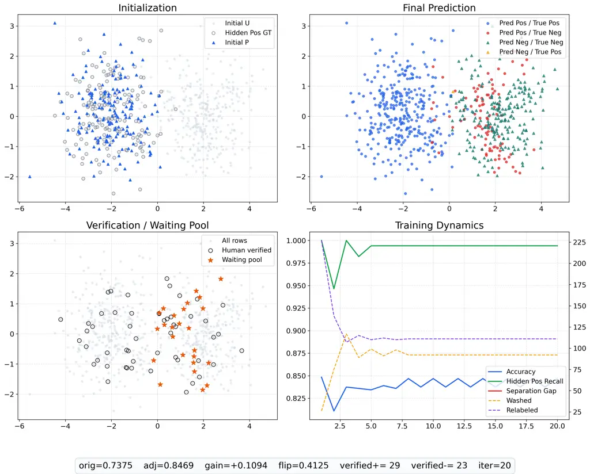

Figure 4: Simulation embedding result under class-dependent (CD) noise
with SCAR verification.

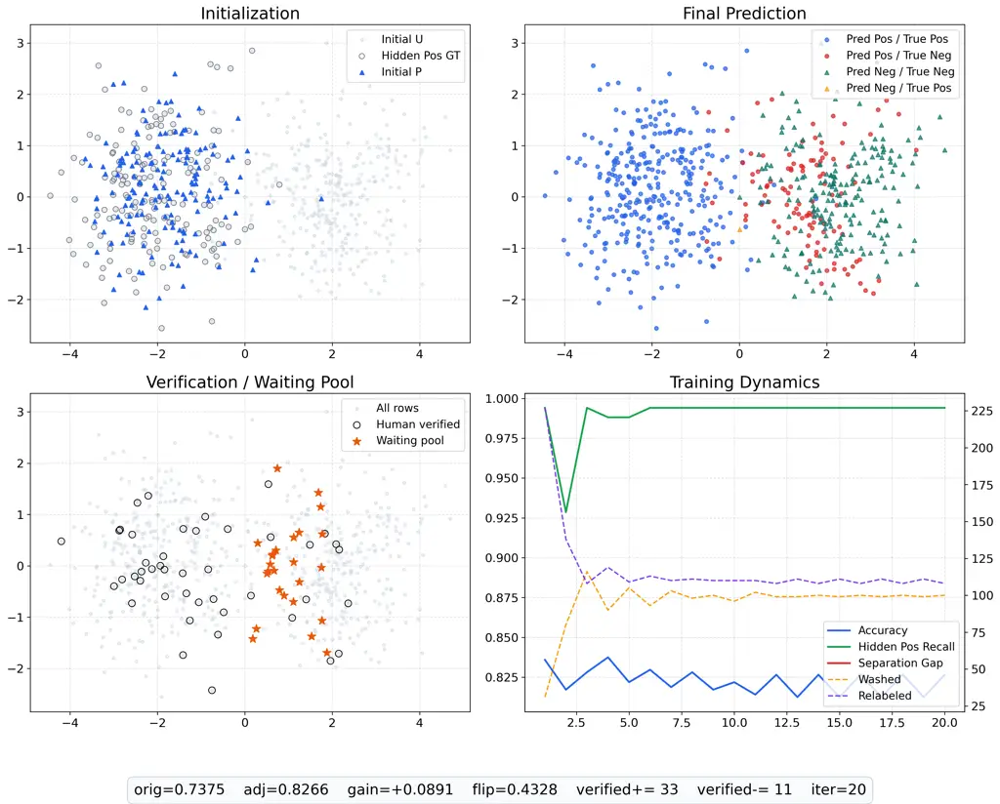

Figure 5: Simulation embedding result under class-dependent (CD) noise
with SAR verification.

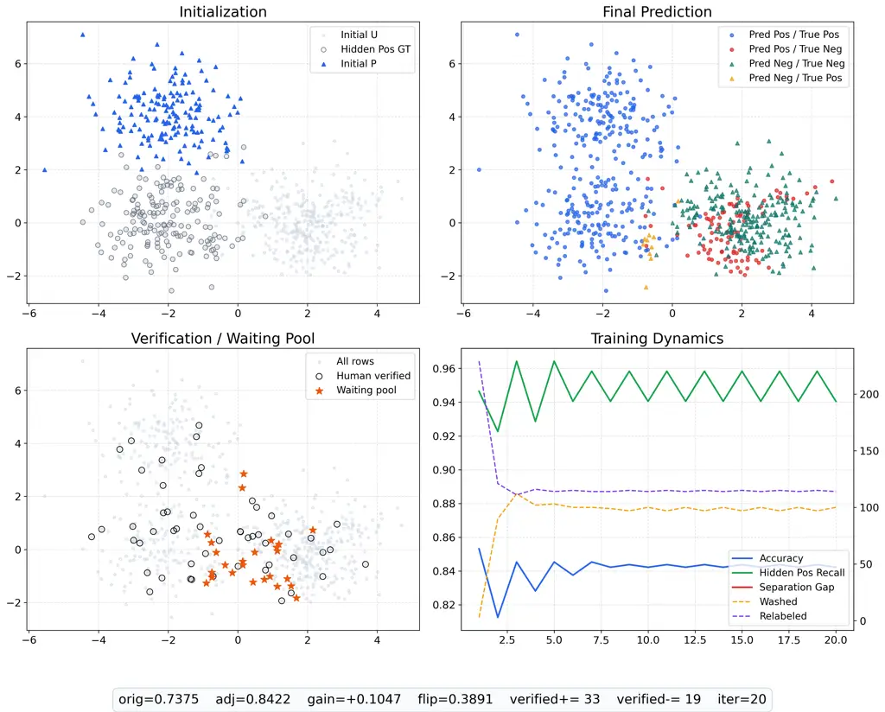

Figure 6: Simulation embedding result under distribution-dependent (DD)
noise with SCAR verification.

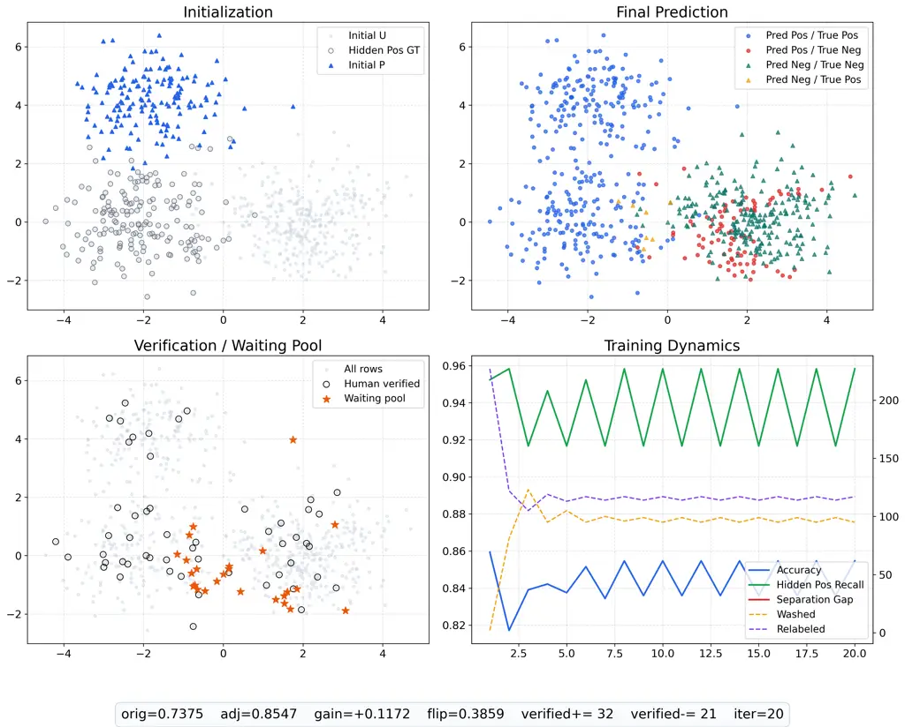

Figure 7: Simulation embedding result under distribution-dependent (DD)
noise with SAR verification.

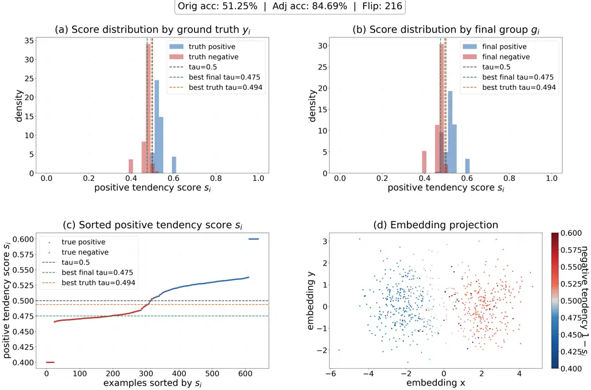

Figure 8: Threshold diagnostic under class-dependent (CD) noise with
SCAR verification. Panels (a) and (b) compare score distributions by
ground-truth consistency label $`y_{i}`$ and final group assignment
$`g_{i}`$, respectively. Panel (c) sorts examples by the diagnostic
score $`s_{i}=0.6(1-r_{i})+0.4(1-d_{i})`$, with reference thresholds for
the default rule, final groups, and ground truth. Panel (d) shows a
two-dimensional projection of the reward-model embeddings colored by
negative tendency $`1-s_{i}`$. The summary box reports original
accuracy, adjusted accuracy, and the number of flipped examples.

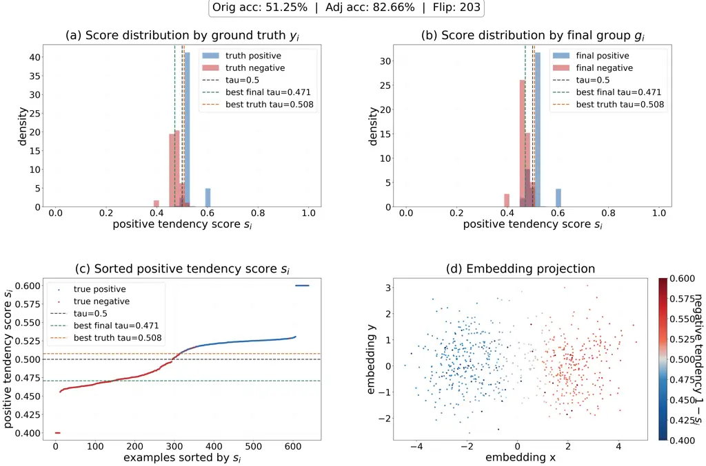

Figure 9: Threshold diagnostic under class-dependent (CD) noise with SAR
verification. Details follow the same reporting as Figure 8.

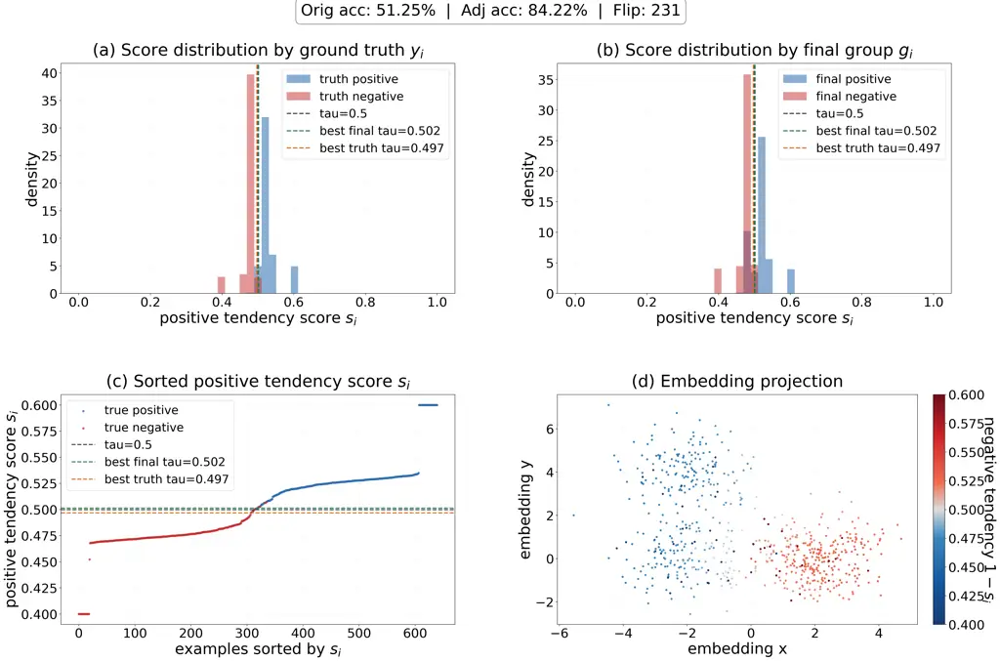

Figure 10: Threshold diagnostic under distribution-dependent (DD) noise
with SCAR verification. Details follow the same reporting as Figure 8.

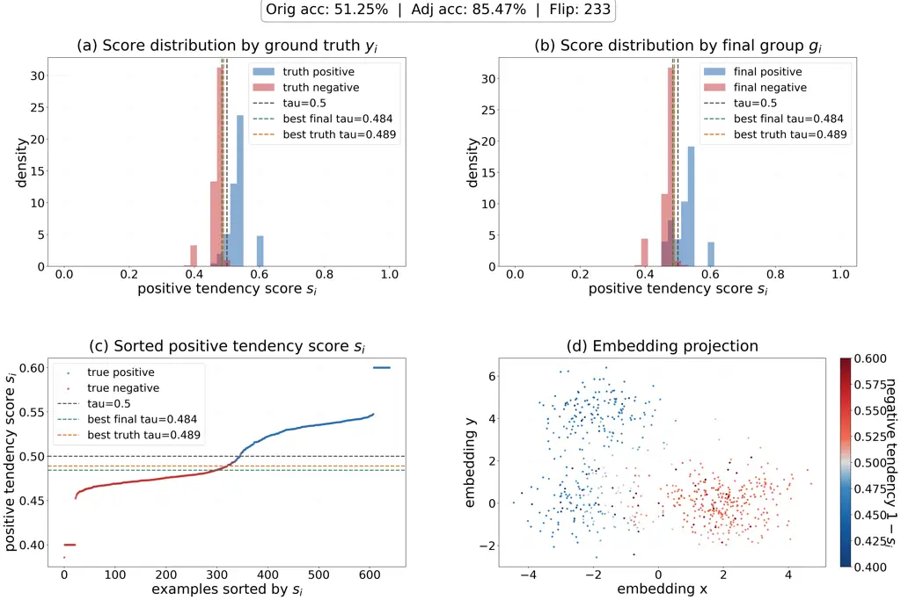

Figure 11: Threshold diagnostic under distribution-dependent (DD) noise
with SAR verification. Details follow the same reporting as Figure 8.

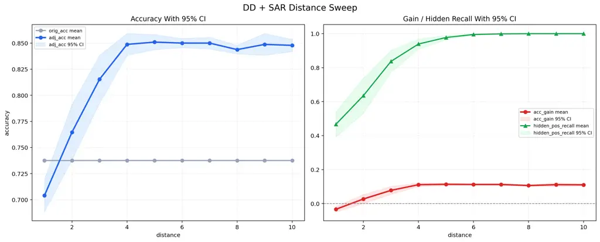

Figure 12: Distance analysis under the DD+SAR simulation setting with
latent dimension fixed at $`d=2`$. The class-separation distance
controls how distinguishable the latent human-consistent and
human-inconsistent groups are. AURA performs best when the latent groups
are sufficiently separated, while performance weakens when the two
groups heavily overlap.

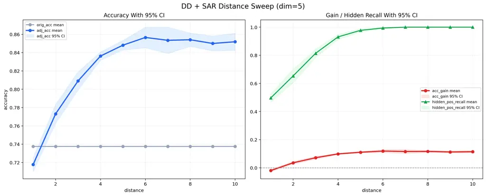

Figure 13: Distance analysis under the DD+SAR simulation setting with
latent dimension fixed at $`d=5`$.

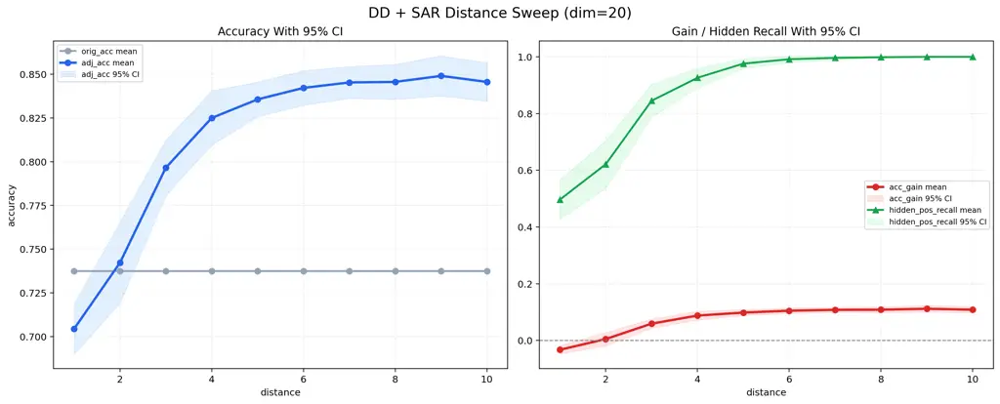

Figure 14: Distance analysis under the DD+SAR simulation setting with
latent dimension fixed at $`d=20`$.

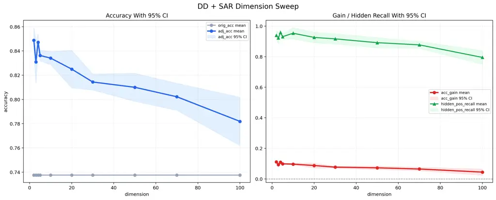

Figure 15: Dimension analysis under the DD+SAR simulation setting with
class-center distance fixed at $`\|\bm{\mu}_{1}-\bm{\mu}_{0}\|=4`$. The
latent dimension controls the difficulty of estimating reliable local
neighborhoods and anchor support.

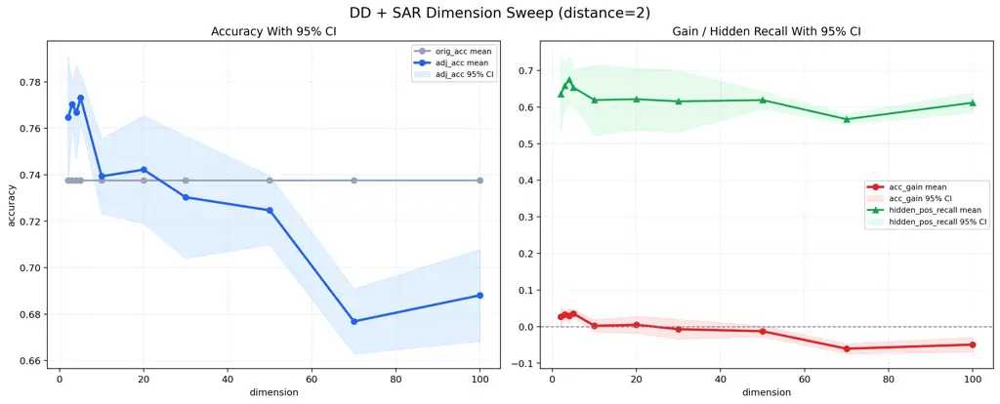

Figure 16: Dimension analysis under the DD+SAR simulation setting with
class-center distance fixed at $`\|\bm{\mu}_{1}-\bm{\mu}_{0}\|=2`$.

### E.6 Additional real-data results

| Real-Data Results with 3% Verified Baseline Data (Coding and MT-Bench) |                       |      |            |                |                 |                   |
| ---------------------------------------------------------------------- | --------------------- | ---- | ---------- | -------------- | --------------- | ----------------- |
| Question Type                                                          | Method                | Data | Orig. Acc. | Adj. Acc.      | Gain            | Human Verif. Req. |
| Model: GPT-5.4                                                         |                       |      |            |                |                 |                   |
| Coding                                                                 | Logistic Regression   | 2949 | 63.92%     | 57.23% (3.57)  | -6.69% (3.57)   | 89 (0)            |
| Coding                                                                 | Multilayer Perceptron | 2949 | 63.92%     | 57.96% (9.13)  | -5.96% (9.13)   | 89 (0)            |
| Coding                                                                 | Random Forest         | 2949 | 63.92%     | 61.82% (4.09)  | -2.10% (4.09)   | 89 (0)            |
| Coding                                                                 | Label Propagation     | 2949 | 63.92%     | 56.34% (18.15) | -7.58% (18.15)  | 89 (0)            |
| Coding                                                                 | nnPU                  | 2949 | 63.92%     | 62.45% (3.25)  | -1.47% (3.25)   | 89 (0)            |
| Coding                                                                 | AURA                  | 2949 | 63.92%     | 67.20% (2.00)  | +3.28% (2.00)   | 100.6 (5)         |
| Model: GPT-5.4-mini                                                    |                       |      |            |                |                 |                   |
| Coding                                                                 | Logistic Regression   | 2971 | 63.24%     | 56.34% (3.78)  | -6.91% (3.78)   | 89 (0)            |
| Coding                                                                 | Multilayer Perceptron | 2971 | 63.24%     | 59.22% (9.58)  | -4.02% (9.58)   | 89 (0)            |
| Coding                                                                 | Random Forest         | 2971 | 63.24%     | 61.47% (1.77)  | -1.77% (1.77)   | 89 (0)            |
| Coding                                                                 | Label Propagation     | 2971 | 63.24%     | 54.55% (19.81) | -8.70% (19.81)  | 89 (0)            |
| Coding                                                                 | nnPU                  | 2971 | 63.24%     | 63.03% (0.32)  | -0.21% (0.32)   | 89 (0)            |
| Coding                                                                 | AURA                  | 2971 | 63.24%     | 66.27% (1.55)  | +3.03% (1.55)   | 102.2 (9)         |
| MT-Bench                                                               | Logistic Regression   | 2565 | 77.82%     | 74.27% (4.34)  | -3.55% (4.34)   | 77 (0)            |
| MT-Bench                                                               | Multilayer Perceptron | 2565 | 77.82%     | 74.12% (14.39) | -3.70% (14.39)  | 77 (0)            |
| MT-Bench                                                               | Random Forest         | 2565 | 77.82%     | 77.46% (1.25)  | -0.36% (1.25)   | 77 (0)            |
| MT-Bench                                                               | Label Propagation     | 2565 | 77.82%     | 64.91% (51.69) | -12.91% (51.69) | 77 (0)            |
| MT-Bench                                                               | nnPU                  | 2565 | 77.82%     | 77.81% (0.00)  | -0.01% (0.00)   | 77 (0)            |
| MT-Bench                                                               | AURA                  | 2575 | 77.82%     | 81.01% (0.94)  | +3.19% (0.94)   | 87.4 (7)          |
| Model: Gemini                                                          |                       |      |            |                |                 |                   |
| Coding                                                                 | Logistic Regression   | 2820 | 63.55%     | 56.37% (3.03)  | -7.18% (3.03)   | 85 (0)            |
| Coding                                                                 | Multilayer Perceptron | 2820 | 63.55%     | 59.33% (5.96)  | -4.21% (5.96)   | 85 (0)            |
| Coding                                                                 | Random Forest         | 2820 | 63.55%     | 61.63% (4.17)  | -1.92% (4.17)   | 85 (0)            |
| Coding                                                                 | Label Propagation     | 2820 | 63.55%     | 46.87% (26.29) | -16.68% (26.29) | 85 (0)            |
| Coding                                                                 | nnPU                  | 2820 | 63.55%     | 63.43% (0.14)  | -0.12% (0.14)   | 85 (0)            |
| Coding                                                                 | AURA                  | 2820 | 63.55%     | 67.17% (2.84)  | +3.62% (2.84)   | 96.6 (8)          |
| Model: Qwen                                                            |                       |      |            |                |                 |                   |
| Coding                                                                 | Logistic Regression   | 8884 | 53.73%     | 53.99% (1.90)  | +0.27% (1.90)   | 266 (0)           |
| Coding                                                                 | Multilayer Perceptron | 8884 | 53.73%     | 53.25% (6.15)  | -0.48% (6.15)   | 266 (0)           |
| Coding                                                                 | Random Forest         | 8884 | 53.73%     | 56.70% (2.23)  | +2.98% (2.23)   | 266 (0)           |
| Coding                                                                 | Label Propagation     | 8884 | 53.73%     | 50.87% (4.55)  | -2.86% (4.55)   | 266 (0)           |
| Coding                                                                 | nnPU                  | 8884 | 53.73%     | 55.74% (1.65)  | +2.01% (1.65)   | 266 (0)           |
| Coding                                                                 | AURA                  | 8884 | 53.73%     | 77.74% (9.78)  | +24.02% (9.78)  | 278.8 (14)        |
| Model: Mistral                                                         |                       |      |            |                |                 |                   |
| Coding                                                                 | Logistic Regression   | 8240 | 50.29%     | 53.24% (3.77)  | +2.95% (3.77)   | 247 (0)           |
| Coding                                                                 | Multilayer Perceptron | 8240 | 50.29%     | 54.12% (6.04)  | +3.83% (6.04)   | 247 (0)           |
| Coding                                                                 | Random Forest         | 8240 | 50.29%     | 57.20% (4.63)  | +6.90% (4.63)   | 247 (0)           |
| Coding                                                                 | Label Propagation     | 8240 | 50.29%     | 50.89% (1.83)  | +0.60% (1.83)   | 247 (0)           |
| Coding                                                                 | nnPU                  | 8240 | 50.29%     | 55.38% (3.31)  | +5.09% (3.31)   | 247 (0)           |
| Coding                                                                 | AURA                  | 8240 | 50.29%     | 72.91% (0.61)  | +22.62% (0.61)  | 261.8 (10)        |

Table 6: Real-data results with 3% verified data for baseline methods
(Coding and MT-Bench). Accuracy and gain values are reported as mean
values with range in parentheses, where the range is computed as maximum
minus minimum across five random seeds. Data is the number of pairwise
comparisons. Human Verif. Req. denotes the number of human-verified
examples required by each method, averaged over five seeds with range in
parentheses. Orig. Acc. and Adj. Acc. denote the original LLM-judge
accuracy and the adjusted accuracy after refinement, respectively. Bold
values indicate AURA results. Green cells highlight the highest Adj.
Acc. or Gain between the best baseline and AURA within each model and
question type.

| Real-Data Results with 3% Verified Baseline Data (Math) |                       |      |            |                |                 |                   |
| ------------------------------------------------------- | --------------------- | ---- | ---------- | -------------- | --------------- | ----------------- |
| Question Type                                           | Method                | Data | Orig. Acc. | Adj. Acc.      | Gain            | Human Verif. Req. |
| Model: GPT-5.4                                          |                       |      |            |                |                 |                   |
| Math                                                    | Logistic Regression   | 2817 | 67.20%     | 61.05% (4.43)  | -6.15% (4.43)   | 85 (0)            |
| Math                                                    | Multilayer Perceptron | 2817 | 67.20%     | 62.00% (8.09)  | -5.20% (8.09)   | 85 (0)            |
| Math                                                    | Random Forest         | 2817 | 67.20%     | 65.92% (2.93)  | -1.28% (2.93)   | 85 (0)            |
| Math                                                    | Label Propagation     | 2817 | 67.20%     | 67.07% (0.48)  | -0.13% (0.48)   | 85 (0)            |
| Math                                                    | nnPU                  | 2817 | 67.20%     | 67.23% (0.05)  | +0.03% (0.05)   | 85 (0)            |
| Math                                                    | AURA                  | 2817 | 67.20%     | 70.05% (1.17)  | +2.85% (1.17)   | 95.8 (5)          |
| Model: GPT-5.4-mini                                     |                       |      |            |                |                 |                   |
| Math                                                    | Logistic Regression   | 2911 | 62.35%     | 58.55% (2.12)  | -3.80% (2.12)   | 87 (0)            |
| Math                                                    | Multilayer Perceptron | 2911 | 62.35%     | 56.88% (12.64) | -5.47% (12.64)  | 87 (0)            |
| Math                                                    | Random Forest         | 2911 | 62.35%     | 63.68% (2.41)  | +1.33% (2.41)   | 87 (0)            |
| Math                                                    | Label Propagation     | 2911 | 62.35%     | 59.89% (12.82) | -2.46% (12.82)  | 87 (0)            |
| Math                                                    | nnPU                  | 2911 | 62.35%     | 62.53% (0.65)  | +0.18% (0.65)   | 87 (0)            |
| Math                                                    | AURA                  | 2911 | 62.35%     | 65.62% (1.79)  | +3.27% (1.79)   | 99 (5)            |
| Model: Gemini                                           |                       |      |            |                |                 |                   |
| Math                                                    | Logistic Regression   | 2770 | 66.35%     | 59.71% (6.44)  | -6.64% (6.44)   | 83 (0)            |
| Math                                                    | Multilayer Perceptron | 2770 | 66.35%     | 59.86% (11.46) | -6.50% (11.46)  | 83 (0)            |
| Math                                                    | Random Forest         | 2770 | 66.35%     | 65.63% (3.13)  | -0.72% (3.13)   | 83 (0)            |
| Math                                                    | Label Propagation     | 2770 | 66.35%     | 56.17% (26.65) | -10.19% (26.65) | 83 (0)            |
| Math                                                    | nnPU                  | 2770 | 66.35%     | 66.19% (0.26)  | -0.16% (0.26)   | 83 (0)            |
| Math                                                    | AURA                  | 2770 | 66.35%     | 68.79% (1.52)  | +2.43% (1.52)   | 96.2 (4)          |
| Model: Qwen                                             |                       |      |            |                |                 |                   |
| Math                                                    | Logistic Regression   | 9145 | 55.10%     | 55.71% (1.54)  | +0.61% (1.54)   | 274 (0)           |
| Math                                                    | Multilayer Perceptron | 9145 | 55.10%     | 54.28% (10.39) | -0.82% (10.39)  | 274 (0)           |
| Math                                                    | Random Forest         | 9145 | 55.10%     | 59.70% (2.19)  | +4.60% (2.19)   | 274 (0)           |
| Math                                                    | Label Propagation     | 9145 | 55.10%     | 53.82% (2.15)  | -1.28% (2.15)   | 274 (0)           |
| Math                                                    | nnPU                  | 9145 | 55.10%     | 58.88% (0.90)  | +3.78% (0.90)   | 274 (0)           |
| Math                                                    | AURA                  | 9145 | 55.10%     | 79.27% (5.47)  | +24.17% (5.47)  | 291.2 (10)        |
| Model: Mistral                                          |                       |      |            |                |                 |                   |
| Math                                                    | Logistic Regression   | 8361 | 50.46%     | 56.73% (2.75)  | +6.27% (2.75)   | 251 (0)           |
| Math                                                    | Multilayer Perceptron | 8361 | 50.46%     | 54.30% (5.60)  | +3.84% (5.60)   | 251 (0)           |
| Math                                                    | Random Forest         | 8361 | 50.46%     | 60.53% (1.94)  | +10.07% (1.94)  | 251 (0)           |
| Math                                                    | Label Propagation     | 8361 | 50.46%     | 51.55% (3.11)  | +1.09% (3.11)   | 251 (0)           |
| Math                                                    | nnPU                  | 8361 | 50.46%     | 55.24% (4.09)  | +4.78% (4.09)   | 251 (0)           |
| Math                                                    | AURA                  | 8361 | 50.46%     | 71.75% (6.54)  | +21.29% (6.54)  | 266 (23)          |

Table 7: Real-data results with 3% verified data for baseline methods
(Math). Values follow the same reporting and highlighting conventions as
Table 6.

| Real-Data Results with 3% Verified Baseline Data (Factual) |                       |      |            |                |                 |                   |
| ---------------------------------------------------------- | --------------------- | ---- | ---------- | -------------- | --------------- | ----------------- |
| Question Type                                              | Method                | Data | Orig. Acc. | Adj. Acc.      | Gain            | Human Verif. Req. |
| Model: GPT-5.4                                             |                       |      |            |                |                 |                   |
| Factual                                                    | Logistic Regression   | 2842 | 64.39%     | 58.72% (7.65)  | -5.68% (7.65)   | 85 (0)            |
| Factual                                                    | Multilayer Perceptron | 2842 | 64.39%     | 59.01% (7.83)  | -5.38% (7.83)   | 85 (0)            |
| Factual                                                    | Random Forest         | 2842 | 64.39%     | 63.40% (2.97)  | -0.99% (2.97)   | 85 (0)            |
| Factual                                                    | Label Propagation     | 2842 | 64.39%     | 54.87% (23.10) | -9.52% (23.10)  | 85 (0)            |
| Factual                                                    | nnPU                  | 2842 | 64.39%     | 64.39% (0.02)  | -0.00% (0.02)   | 85 (0)            |
| Factual                                                    | AURA                  | 2842 | 64.39%     | 67.66% (2.22)  | +3.27% (2.22)   | 95.6 (9)          |
| Model: GPT-5.4-mini                                        |                       |      |            |                |                 |                   |
| Factual                                                    | Logistic Regression   | 2920 | 62.47%     | 57.20% (4.31)  | -5.26% (4.31)   | 88 (0)            |
| Factual                                                    | Multilayer Perceptron | 2920 | 62.47%     | 56.79% (5.19)  | -5.68% (5.19)   | 88 (0)            |
| Factual                                                    | Random Forest         | 2920 | 62.47%     | 61.52% (4.03)  | -0.95% (4.03)   | 88 (0)            |
| Factual                                                    | Label Propagation     | 2920 | 62.47%     | 53.23% (18.50) | -9.24% (18.50)  | 88 (0)            |
| Factual                                                    | nnPU                  | 2920 | 62.47%     | 62.44% (0.11)  | -0.03% (0.11)   | 88 (0)            |
| Factual                                                    | AURA                  | 2920 | 62.47%     | 66.07% (2.09)  | +3.60% (2.09)   | 99 (17)           |
| Model: Gemini                                              |                       |      |            |                |                 |                   |
| Factual                                                    | Logistic Regression   | 2768 | 66.37%     | 59.14% (4.13)  | -7.22% (4.13)   | 83 (0)            |
| Factual                                                    | Multilayer Perceptron | 2768 | 66.37%     | 62.22% (7.82)  | -4.15% (7.82)   | 83 (0)            |
| Factual                                                    | Random Forest         | 2768 | 66.37%     | 65.29% (2.20)  | -1.08% (2.20)   | 83 (0)            |
| Factual                                                    | Label Propagation     | 2768 | 66.37%     | 54.91% (26.63) | -11.45% (26.63) | 83 (0)            |
| Factual                                                    | nnPU                  | 2768 | 66.37%     | 66.03% (0.75)  | -0.34% (0.75)   | 83 (0)            |
| Factual                                                    | AURA                  | 2768 | 66.37%     | 69.21% (1.73)  | +2.85% (1.73)   | 94 (12)           |
| Model: Qwen                                                |                       |      |            |                |                 |                   |
| Factual                                                    | Logistic Regression   | 9333 | 55.94%     | 56.15% (2.88)  | +0.21% (2.88)   | 280 (0)           |
| Factual                                                    | Multilayer Perceptron | 9333 | 55.94%     | 56.51% (5.39)  | +0.57% (5.39)   | 280 (0)           |
| Factual                                                    | Random Forest         | 9333 | 55.94%     | 60.15% (2.14)  | +4.21% (2.14)   | 280 (0)           |
| Factual                                                    | Label Propagation     | 9333 | 55.94%     | 51.89% (6.01)  | -4.05% (6.01)   | 280 (0)           |
| Factual                                                    | nnPU                  | 9333 | 55.94%     | 59.23% (1.63)  | +3.29% (1.63)   | 280 (0)           |
| Factual                                                    | AURA                  | 9333 | 55.94%     | 80.31% (4.76)  | +24.37% (4.76)  | 292.8 (11)        |
| Model: Mistral                                             |                       |      |            |                |                 |                   |
| Factual                                                    | Logistic Regression   | 8260 | 51.05%     | 56.11% (2.91)  | +5.06% (2.91)   | 248 (0)           |
| Factual                                                    | Multilayer Perceptron | 8260 | 51.05%     | 53.90% (7.81)  | +2.84% (7.81)   | 248 (0)           |
| Factual                                                    | Random Forest         | 8260 | 51.05%     | 59.96% (2.97)  | +8.91% (2.97)   | 248 (0)           |
| Factual                                                    | Label Propagation     | 8260 | 51.05%     | 50.87% (2.60)  | -0.19% (2.60)   | 248 (0)           |
| Factual                                                    | nnPU                  | 8260 | 51.05%     | 56.32% (3.73)  | +5.27% (3.73)   | 248 (0)           |
| Factual                                                    | AURA                  | 8260 | 51.05%     | 72.37% (6.49)  | +21.31% (6.49)  | 259 (7)           |

Table 8: Real-data results with 3% verified data for baseline methods
(Factual). Values follow the same reporting and highlighting conventions
as Table 6.

| Real-Data Results with 20% Verified Baseline Data (Coding and MT-Bench) |                       |      |            |                |                |                   |
| ----------------------------------------------------------------------- | --------------------- | ---- | ---------- | -------------- | -------------- | ----------------- |
| Question Type                                                           | Method                | Data | Orig. Acc. | Adj. Acc.      | Gain           | Human Verif. Req. |
| Model: GPT-5.4                                                          |                       |      |            |                |                |                   |
| Coding                                                                  | Logistic Regression   | 2949 | 63.92%     | 59.54% (3.56)  | -4.38% (3.56)  | 590 (0)           |
| Coding                                                                  | Multilayer Perceptron | 2949 | 63.92%     | 60.83% (2.80)  | -3.09% (2.80)  | 590 (0)           |
| Coding                                                                  | Random Forest         | 2949 | 63.92%     | 63.23% (1.87)  | -0.69% (1.87)  | 590 (0)           |
| Coding                                                                  | Label Propagation     | 2949 | 63.92%     | 60.50% (9.92)  | -3.42% (9.92)  | 590 (0)           |
| Coding                                                                  | nnPU                  | 2949 | 63.92%     | 63.86% (0.10)  | -0.06% (0.10)  | 590 (0)           |
| Coding                                                                  | AURA                  | 2949 | 63.92%     | 67.20% (2.00)  | +3.28% (2.00)  | 100.6 (5)         |
| Model: GPT-5.4-mini                                                     |                       |      |            |                |                |                   |
| Coding                                                                  | Logistic Regression   | 2971 | 63.24%     | 59.20% (0.84)  | -4.04% (0.84)  | 594 (0)           |
| Coding                                                                  | Multilayer Perceptron | 2971 | 63.24%     | 61.40% (4.29)  | -1.85% (4.29)  | 594 (0)           |
| Coding                                                                  | Random Forest         | 2971 | 63.24%     | 63.27% (1.22)  | +0.03% (1.22)  | 594 (0)           |
| Coding                                                                  | Label Propagation     | 2971 | 63.24%     | 54.38% (11.11) | -8.87% (11.11) | 594 (0)           |
| Coding                                                                  | nnPU                  | 2971 | 63.24%     | 63.43% (0.73)  | +0.19% (0.73)  | 594 (0)           |
| Coding                                                                  | AURA                  | 2971 | 63.24%     | 66.27% (1.55)  | +3.03% (1.55)  | 102.2 (9)         |
| MT-Bench                                                                | Logistic Regression   | 2565 | 77.82%     | 75.39% (3.61)  | -2.43% (3.61)  | 513 (0)           |
| MT-Bench                                                                | Multilayer Perceptron | 2565 | 77.82%     | 77.66% (0.54)  | -0.16% (0.54)  | 513 (0)           |
| MT-Bench                                                                | Random Forest         | 2565 | 77.82%     | 77.28% (1.80)  | -0.54% (1.80)  | 513 (0)           |
| MT-Bench                                                                | Label Propagation     | 2565 | 77.82%     | 76.74% (3.61)  | -1.07% (3.61)  | 513 (0)           |
| MT-Bench                                                                | nnPU                  | 2565 | 77.82%     | 77.83% (0.00)  | +0.01% (0.00)  | 513 (0)           |
| MT-Bench                                                                | AURA                  | 2575 | 77.82%     | 81.01% (0.94)  | +3.19% (0.94)  | 87.4 (7)          |
| Model: Gemini                                                           |                       |      |            |                |                |                   |
| Coding                                                                  | Logistic Regression   | 2820 | 63.55%     | 59.72% (2.57)  | -3.83% (2.57)  | 564 (0)           |
| Coding                                                                  | Multilayer Perceptron | 2820 | 63.55%     | 61.76% (6.25)  | -1.79% (6.25)  | 564 (0)           |
| Coding                                                                  | Random Forest         | 2820 | 63.55%     | 63.39% (1.68)  | -0.16% (1.68)  | 564 (0)           |
| Coding                                                                  | Label Propagation     | 2820 | 63.55%     | 58.65% (6.12)  | -4.89% (6.12)  | 564 (0)           |
| Coding                                                                  | nnPU                  | 2820 | 63.55%     | 63.51% (0.12)  | -0.04% (0.12)  | 564 (0)           |
| Coding                                                                  | AURA                  | 2820 | 63.55%     | 67.17% (2.84)  | +3.62% (2.84)  | 96.6 (8)          |
| Model: Qwen                                                             |                       |      |            |                |                |                   |
| Coding                                                                  | Logistic Regression   | 8884 | 53.73%     | 58.47% (1.59)  | +4.75% (1.59)  | 1777 (0)          |
| Coding                                                                  | Multilayer Perceptron | 8884 | 53.73%     | 57.44% (1.83)  | +3.72% (1.83)  | 1777 (0)          |
| Coding                                                                  | Random Forest         | 8884 | 53.73%     | 59.20% (0.96)  | +5.47% (0.96)  | 1777 (0)          |
| Coding                                                                  | Label Propagation     | 8884 | 53.73%     | 53.77% (2.11)  | +0.04% (2.11)  | 1777 (0)          |
| Coding                                                                  | nnPU                  | 8884 | 53.73%     | 58.54% (0.48)  | +4.81% (0.48)  | 1777 (0)          |
| Coding                                                                  | AURA                  | 8884 | 53.73%     | 77.74% (9.78)  | +24.02% (9.78) | 278.8 (14)        |
| Model: Mistral                                                          |                       |      |            |                |                |                   |
| Coding                                                                  | Logistic Regression   | 8240 | 50.29%     | 57.52% (1.18)  | +7.22% (1.18)  | 1648 (0)          |
| Coding                                                                  | Multilayer Perceptron | 8240 | 50.29%     | 56.82% (2.64)  | +6.53% (2.64)  | 1648 (0)          |
| Coding                                                                  | Random Forest         | 8240 | 50.29%     | 58.88% (1.27)  | +8.59% (1.27)  | 1648 (0)          |
| Coding                                                                  | Label Propagation     | 8240 | 50.29%     | 53.83% (1.94)  | +3.53% (1.94)  | 1648 (0)          |
| Coding                                                                  | nnPU                  | 8240 | 50.29%     | 57.97% (0.59)  | +7.68% (0.59)  | 1648 (0)          |
| Coding                                                                  | AURA                  | 8240 | 50.29%     | 72.91% (0.61)  | +22.62% (0.61) | 261.8 (10)        |

Table 9: Real-data results with 20% verified data for baseline methods
(Coding and MT-Bench). Values follow the same reporting and highlighting
conventions as Table 6.

| Real-Data Results with 20% Verified Baseline Data (Math) |                       |      |            |               |                |                   |
| -------------------------------------------------------- | --------------------- | ---- | ---------- | ------------- | -------------- | ----------------- |
| Question Type                                            | Method                | Data | Orig. Acc. | Adj. Acc.     | Gain           | Human Verif. Req. |
| Model: GPT-5.4                                           |                       |      |            |               |                |                   |
| Math                                                     | Logistic Regression   | 2817 | 67.20%     | 62.92% (3.77) | -4.28% (3.77)  | 564 (0)           |
| Math                                                     | Multilayer Perceptron | 2817 | 67.20%     | 65.45% (2.75) | -1.75% (2.75)  | 564 (0)           |
| Math                                                     | Random Forest         | 2817 | 67.20%     | 67.98% (1.38) | +0.78% (1.38)  | 564 (0)           |
| Math                                                     | Label Propagation     | 2817 | 67.20%     | 65.28% (2.66) | -1.92% (2.66)  | 564 (0)           |
| Math                                                     | nnPU                  | 2817 | 67.20%     | 67.32% (0.19) | +0.12% (0.19)  | 564 (0)           |
| Math                                                     | AURA                  | 2817 | 67.20%     | 70.05% (1.17) | +2.85% (1.17)  | 95.8 (5)          |
| Model: GPT-5.4-mini                                      |                       |      |            |               |                |                   |
| Math                                                     | Logistic Regression   | 2911 | 62.35%     | 62.18% (2.23) | -0.17% (2.23)  | 582 (0)           |
| Math                                                     | Multilayer Perceptron | 2911 | 62.35%     | 63.31% (1.50) | +0.97% (1.50)  | 582 (0)           |
| Math                                                     | Random Forest         | 2911 | 62.35%     | 65.47% (2.49) | +3.12% (2.49)  | 582 (0)           |
| Math                                                     | Label Propagation     | 2911 | 62.35%     | 62.46% (1.80) | +0.11% (1.80)  | 582 (0)           |
| Math                                                     | nnPU                  | 2911 | 62.35%     | 63.31% (0.77) | +0.96% (0.77)  | 582 (0)           |
| Math                                                     | AURA                  | 2911 | 62.35%     | 65.62% (1.79) | +3.27% (1.79)  | 99 (5)            |
| Model: Gemini                                            |                       |      |            |               |                |                   |
| Math                                                     | Logistic Regression   | 2770 | 66.35%     | 63.61% (2.44) | -2.74% (2.44)  | 554 (0)           |
| Math                                                     | Multilayer Perceptron | 2770 | 66.35%     | 64.50% (2.21) | -1.85% (2.21)  | 554 (0)           |
| Math                                                     | Random Forest         | 2770 | 66.35%     | 67.45% (1.44) | +1.09% (1.44)  | 554 (0)           |
| Math                                                     | Label Propagation     | 2770 | 66.35%     | 65.05% (3.70) | -1.31% (3.70)  | 554 (0)           |
| Math                                                     | nnPU                  | 2770 | 66.35%     | 66.31% (0.13) | -0.04% (0.13)  | 554 (0)           |
| Math                                                     | AURA                  | 2770 | 66.35%     | 68.79% (1.52) | +2.43% (1.52)  | 96.2 (4)          |
| Model: Qwen                                              |                       |      |            |               |                |                   |
| Math                                                     | Logistic Regression   | 9145 | 55.10%     | 61.13% (1.22) | +6.03% (1.22)  | 1829 (0)          |
| Math                                                     | Multilayer Perceptron | 9145 | 55.10%     | 59.60% (3.35) | +4.50% (3.35)  | 1829 (0)          |
| Math                                                     | Random Forest         | 9145 | 55.10%     | 62.85% (1.56) | +7.75% (1.56)  | 1829 (0)          |
| Math                                                     | Label Propagation     | 9145 | 55.10%     | 55.35% (1.18) | +0.25% (1.18)  | 1829 (0)          |
| Math                                                     | nnPU                  | 9145 | 55.10%     | 60.27% (1.58) | +5.17% (1.58)  | 1829 (0)          |
| Math                                                     | AURA                  | 9145 | 55.10%     | 79.27% (5.47) | +24.17% (5.47) | 291.2 (10)        |
| Model: Mistral                                           |                       |      |            |               |                |                   |
| Math                                                     | Logistic Regression   | 8361 | 50.46%     | 61.63% (0.76) | +11.17% (0.76) | 1672 (0)          |
| Math                                                     | Multilayer Perceptron | 8361 | 50.46%     | 60.61% (1.97) | +10.15% (1.97) | 1672 (0)          |
| Math                                                     | Random Forest         | 8361 | 50.46%     | 62.63% (1.38) | +12.17% (1.38) | 1672 (0)          |
| Math                                                     | Label Propagation     | 8361 | 50.46%     | 55.64% (0.78) | +5.18% (0.78)  | 1672 (0)          |
| Math                                                     | nnPU                  | 8361 | 50.46%     | 60.68% (0.62) | +10.22% (0.62) | 1672 (0)          |
| Math                                                     | AURA                  | 8361 | 50.46%     | 71.75% (6.54) | +21.29% (6.54) | 266 (23)          |

Table 10: Real-data results with 20% verified data for baseline methods
(Math). Values follow the same reporting and highlighting conventions as
Table 6.

| Real-Data Results with 20% Verified Baseline Data (Factual) |                       |      |            |               |                |                   |
| ----------------------------------------------------------- | --------------------- | ---- | ---------- | ------------- | -------------- | ----------------- |
| Question Type                                               | Method                | Data | Orig. Acc. | Adj. Acc.     | Gain           | Human Verif. Req. |
| Model: GPT-5.4                                              |                       |      |            |               |                |                   |
| Factual                                                     | Logistic Regression   | 2842 | 64.39%     | 62.19% (2.02) | -2.20% (2.02)  | 568 (0)           |
| Factual                                                     | Multilayer Perceptron | 2842 | 64.39%     | 64.12% (2.07) | -0.27% (2.07)  | 568 (0)           |
| Factual                                                     | Random Forest         | 2842 | 64.39%     | 65.82% (1.72) | +1.43% (1.72)  | 568 (0)           |
| Factual                                                     | Label Propagation     | 2842 | 64.39%     | 61.84% (4.31) | -2.55% (4.31)  | 568 (0)           |
| Factual                                                     | nnPU                  | 2842 | 64.39%     | 65.03% (0.75) | +0.64% (0.75)  | 568 (0)           |
| Factual                                                     | AURA                  | 2842 | 64.39%     | 67.66% (2.22) | +3.27% (2.22)  | 95.6 (9)          |
| Model: GPT-5.4-mini                                         |                       |      |            |               |                |                   |
| Factual                                                     | Logistic Regression   | 2920 | 62.47%     | 61.38% (3.51) | -1.09% (3.51)  | 584 (0)           |
| Factual                                                     | Multilayer Perceptron | 2920 | 62.47%     | 61.44% (3.98) | -1.03% (3.98)  | 584 (0)           |
| Factual                                                     | Random Forest         | 2920 | 62.47%     | 64.77% (1.97) | +2.30% (1.97)  | 584 (0)           |
| Factual                                                     | Label Propagation     | 2920 | 62.47%     | 59.41% (3.17) | -3.06% (3.17)  | 584 (0)           |
| Factual                                                     | nnPU                  | 2920 | 62.47%     | 63.16% (0.57) | +0.69% (0.57)  | 584 (0)           |
| Factual                                                     | AURA                  | 2920 | 62.47%     | 66.07% (2.09) | +3.60% (2.09)  | 99 (17)           |
| Model: Gemini                                               |                       |      |            |               |                |                   |
| Factual                                                     | Logistic Regression   | 2768 | 66.37%     | 61.16% (2.71) | -5.21% (2.71)  | 553 (0)           |
| Factual                                                     | Multilayer Perceptron | 2768 | 66.37%     | 64.81% (6.41) | -1.55% (6.41)  | 553 (0)           |
| Factual                                                     | Random Forest         | 2768 | 66.37%     | 66.58% (0.99) | +0.22% (0.99)  | 553 (0)           |
| Factual                                                     | Label Propagation     | 2768 | 66.37%     | 61.95% (4.38) | -4.42% (4.38)  | 553 (0)           |
| Factual                                                     | nnPU                  | 2768 | 66.37%     | 66.33% (0.08) | -0.04% (0.08)  | 553 (0)           |
| Factual                                                     | AURA                  | 2768 | 66.37%     | 69.21% (1.73) | +2.85% (1.73)  | 94 (12)           |
| Model: Qwen                                                 |                       |      |            |               |                |                   |
| Factual                                                     | Logistic Regression   | 9333 | 55.94%     | 61.22% (0.87) | +5.27% (0.87)  | 1866 (0)          |
| Factual                                                     | Multilayer Perceptron | 9333 | 55.94%     | 60.10% (2.68) | +4.16% (2.68)  | 1866 (0)          |
| Factual                                                     | Random Forest         | 9333 | 55.94%     | 63.01% (1.18) | +7.07% (1.18)  | 1866 (0)          |
| Factual                                                     | Label Propagation     | 9333 | 55.94%     | 55.41% (3.48) | -0.53% (3.48)  | 1866 (0)          |
| Factual                                                     | nnPU                  | 9333 | 55.94%     | 60.63% (1.42) | +4.69% (1.42)  | 1866 (0)          |
| Factual                                                     | AURA                  | 9333 | 55.94%     | 80.31% (4.76) | +24.37% (4.76) | 292.8 (11)        |
| Model: Mistral                                              |                       |      |            |               |                |                   |
| Factual                                                     | Logistic Regression   | 8260 | 51.05%     | 61.67% (0.86) | +10.62% (0.86) | 1652 (0)          |
| Factual                                                     | Multilayer Perceptron | 8260 | 51.05%     | 58.73% (3.65) | +7.68% (3.65)  | 1652 (0)          |
| Factual                                                     | Random Forest         | 8260 | 51.05%     | 62.78% (1.07) | +11.73% (1.07) | 1652 (0)          |
| Factual                                                     | Label Propagation     | 8260 | 51.05%     | 54.42% (1.88) | +3.37% (1.88)  | 1652 (0)          |
| Factual                                                     | nnPU                  | 8260 | 51.05%     | 60.66% (0.60) | +9.61% (0.60)  | 1652 (0)          |
| Factual                                                     | AURA                  | 8260 | 51.05%     | 72.37% (6.49) | +21.31% (6.49) | 259 (7)           |

Table 11: Real-data results with 20% verified data for baseline methods
(Factual). Values follow the same reporting and highlighting conventions
as Table 6.

| Real-Data Results with 80% Verified Baseline Data (Coding and MT-Bench) |                       |      |            |               |                |                   |
| ----------------------------------------------------------------------- | --------------------- | ---- | ---------- | ------------- | -------------- | ----------------- |
| Question Type                                                           | Method                | Data | Orig. Acc. | Adj. Acc.     | Gain           | Human Verif. Req. |
| Model: GPT-5.4                                                          |                       |      |            |               |                |                   |
| Coding                                                                  | Logistic Regression   | 2949 | 63.92%     | 62.17% (1.86) | -1.75% (1.86)  | 2359 (0)          |
| Coding                                                                  | Multilayer Perceptron | 2949 | 63.92%     | 61.93% (3.73) | -1.99% (3.73)  | 2359 (0)          |
| Coding                                                                  | Random Forest         | 2949 | 63.92%     | 64.10% (2.37) | +0.18% (2.37)  | 2359 (0)          |
| Coding                                                                  | Label Propagation     | 2949 | 63.92%     | 60.07% (3.22) | -3.85% (3.22)  | 2359 (0)          |
| Coding                                                                  | nnPU                  | 2949 | 63.92%     | 63.97% (0.26) | +0.05% (0.26)  | 2359 (0)          |
| Coding                                                                  | AURA                  | 2949 | 63.92%     | 67.20% (2.00) | +3.28% (2.00)  | 100.6 (5)         |
| Model: GPT-5.4-mini                                                     |                       |      |            |               |                |                   |
| Coding                                                                  | Logistic Regression   | 2971 | 63.24%     | 62.26% (4.88) | -0.99% (4.88)  | 2377 (0)          |
| Coding                                                                  | Multilayer Perceptron | 2971 | 63.24%     | 61.48% (3.70) | -1.76% (3.70)  | 2377 (0)          |
| Coding                                                                  | Random Forest         | 2971 | 63.24%     | 63.20% (3.03) | -0.05% (3.03)  | 2377 (0)          |
| Coding                                                                  | Label Propagation     | 2971 | 63.24%     | 58.18% (3.54) | -5.06% (3.54)  | 2377 (0)          |
| Coding                                                                  | nnPU                  | 2971 | 63.24%     | 63.77% (0.32) | +0.53% (0.32)  | 2377 (0)          |
| Coding                                                                  | AURA                  | 2971 | 63.24%     | 66.27% (1.55) | +3.03% (1.55)  | 102.2 (9)         |
| MT-Bench                                                                | Logistic Regression   | 2565 | 77.82%     | 78.67% (3.90) | +0.86% (3.90)  | 2052 (0)          |
| MT-Bench                                                                | Multilayer Perceptron | 2565 | 77.82%     | 78.91% (1.36) | +1.09% (1.36)  | 2052 (0)          |
| MT-Bench                                                                | Random Forest         | 2565 | 77.82%     | 77.66% (6.04) | -0.16% (6.04)  | 2052 (0)          |
| MT-Bench                                                                | Label Propagation     | 2565 | 77.82%     | 78.75% (2.92) | +0.94% (2.92)  | 2052 (0)          |
| MT-Bench                                                                | nnPU                  | 2565 | 77.82%     | 77.78% (0.00) | -0.04% (0.00)  | 2052 (0)          |
| MT-Bench                                                                | AURA                  | 2575 | 77.82%     | 81.01% (0.94) | +3.19% (0.94)  | 87.4 (7)          |
| Model: Gemini                                                           |                       |      |            |               |                |                   |
| Coding                                                                  | Logistic Regression   | 2820 | 63.55%     | 61.67% (2.48) | -1.88% (2.48)  | 2256 (0)          |
| Coding                                                                  | Multilayer Perceptron | 2820 | 63.55%     | 62.52% (4.26) | -1.03% (4.26)  | 2256 (0)          |
| Coding                                                                  | Random Forest         | 2820 | 63.55%     | 63.76% (3.19) | +0.21% (3.19)  | 2256 (0)          |
| Coding                                                                  | Label Propagation     | 2820 | 63.55%     | 58.72% (4.79) | -4.82% (4.79)  | 2256 (0)          |
| Coding                                                                  | nnPU                  | 2820 | 63.55%     | 63.33% (0.23) | -0.22% (0.23)  | 2256 (0)          |
| Coding                                                                  | AURA                  | 2820 | 63.55%     | 67.17% (2.84) | +3.62% (2.84)  | 96.6 (8)          |
| Model: Qwen                                                             |                       |      |            |               |                |                   |
| Coding                                                                  | Logistic Regression   | 8884 | 53.73%     | 60.34% (1.80) | +6.61% (1.80)  | 7107 (0)          |
| Coding                                                                  | Multilayer Perceptron | 8884 | 53.73%     | 58.74% (4.05) | +5.01% (4.05)  | 7107 (0)          |
| Coding                                                                  | Random Forest         | 8884 | 53.73%     | 60.30% (1.63) | +6.58% (1.63)  | 7107 (0)          |
| Coding                                                                  | Label Propagation     | 8884 | 53.73%     | 54.58% (1.91) | +0.85% (1.91)  | 7107 (0)          |
| Coding                                                                  | nnPU                  | 8884 | 53.73%     | 58.91% (0.50) | +5.18% (0.50)  | 7107 (0)          |
| Coding                                                                  | AURA                  | 8884 | 53.73%     | 77.74% (9.78) | +24.02% (9.78) | 278.8 (14)        |
| Model: Mistral                                                          |                       |      |            |               |                |                   |
| Coding                                                                  | Logistic Regression   | 8240 | 50.29%     | 59.14% (1.94) | +8.85% (1.94)  | 6592 (0)          |
| Coding                                                                  | Multilayer Perceptron | 8240 | 50.29%     | 58.40% (2.06) | +8.11% (2.06)  | 6592 (0)          |
| Coding                                                                  | Random Forest         | 8240 | 50.29%     | 60.15% (1.40) | +9.85% (1.40)  | 6592 (0)          |
| Coding                                                                  | Label Propagation     | 8240 | 50.29%     | 56.36% (3.16) | +6.07% (3.16)  | 6592 (0)          |
| Coding                                                                  | nnPU                  | 8240 | 50.29%     | 59.11% (0.99) | +8.82% (0.99)  | 6592 (0)          |
| Coding                                                                  | AURA                  | 8240 | 50.29%     | 72.91% (0.61) | +22.62% (0.61) | 261.8 (10)        |

Table 12: Real-data results with 80% verified data for baseline methods
(Coding and MT-Bench). Values follow the same reporting and highlighting
conventions as Table 6.

| Real-Data Results with 80% Verified Baseline Data (Math) |                       |      |            |               |                |                   |
| -------------------------------------------------------- | --------------------- | ---- | ---------- | ------------- | -------------- | ----------------- |
| Question Type                                            | Method                | Data | Orig. Acc. | Adj. Acc.     | Gain           | Human Verif. Req. |
| Model: GPT-5.4                                           |                       |      |            |               |                |                   |
| Math                                                     | Logistic Regression   | 2817 | 67.20%     | 67.16% (1.06) | -0.04% (1.06)  | 2253 (0)          |
| Math                                                     | Multilayer Perceptron | 2817 | 67.20%     | 66.06% (3.72) | -1.14% (3.72)  | 2253 (0)          |
| Math                                                     | Random Forest         | 2817 | 67.20%     | 67.84% (1.95) | +0.64% (1.95)  | 2253 (0)          |
| Math                                                     | Label Propagation     | 2817 | 67.20%     | 65.64% (1.42) | -1.56% (1.42)  | 2253 (0)          |
| Math                                                     | nnPU                  | 2817 | 67.20%     | 67.45% (0.32) | +0.25% (0.32)  | 2253 (0)          |
| Math                                                     | AURA                  | 2817 | 67.20%     | 70.05% (1.17) | +2.85% (1.17)  | 95.8 (5)          |
| Model: GPT-5.4-mini                                      |                       |      |            |               |                |                   |
| Math                                                     | Logistic Regression   | 2911 | 62.35%     | 66.01% (2.23) | +3.66% (2.23)  | 2329 (0)          |
| Math                                                     | Multilayer Perceptron | 2911 | 62.35%     | 65.15% (3.61) | +2.80% (3.61)  | 2329 (0)          |
| Math                                                     | Random Forest         | 2911 | 62.35%     | 66.84% (3.78) | +4.49% (3.78)  | 2329 (0)          |
| Math                                                     | Label Propagation     | 2911 | 62.35%     | 61.79% (3.95) | -0.56% (3.95)  | 2329 (0)          |
| Math                                                     | nnPU                  | 2911 | 62.35%     | 63.85% (1.46) | +1.50% (1.46)  | 2329 (0)          |
| Math                                                     | AURA                  | 2911 | 62.35%     | 65.62% (1.79) | +3.27% (1.79)  | 99 (5)            |
| Model: Gemini                                            |                       |      |            |               |                |                   |
| Math                                                     | Logistic Regression   | 2770 | 66.35%     | 67.58% (3.07) | +1.23% (3.07)  | 2216 (0)          |
| Math                                                     | Multilayer Perceptron | 2770 | 66.35%     | 67.73% (2.89) | +1.37% (2.89)  | 2216 (0)          |
| Math                                                     | Random Forest         | 2770 | 66.35%     | 68.19% (1.81) | +1.84% (1.81)  | 2216 (0)          |
| Math                                                     | Label Propagation     | 2770 | 66.35%     | 66.03% (1.62) | -0.32% (1.62)  | 2216 (0)          |
| Math                                                     | nnPU                  | 2770 | 66.35%     | 67.15% (0.61) | +0.80% (0.61)  | 2216 (0)          |
| Math                                                     | AURA                  | 2770 | 66.35%     | 68.79% (1.52) | +2.43% (1.52)  | 96.2 (4)          |
| Model: Qwen                                              |                       |      |            |               |                |                   |
| Math                                                     | Logistic Regression   | 9145 | 55.10%     | 61.90% (2.08) | +6.80% (2.08)  | 7316 (0)          |
| Math                                                     | Multilayer Perceptron | 9145 | 55.10%     | 62.07% (2.35) | +6.97% (2.35)  | 7316 (0)          |
| Math                                                     | Random Forest         | 9145 | 55.10%     | 63.59% (1.97) | +8.49% (1.97)  | 7316 (0)          |
| Math                                                     | Label Propagation     | 9145 | 55.10%     | 57.89% (2.95) | +2.79% (2.95)  | 7316 (0)          |
| Math                                                     | nnPU                  | 9145 | 55.10%     | 61.12% (1.67) | +6.02% (1.67)  | 7316 (0)          |
| Math                                                     | AURA                  | 9145 | 55.10%     | 79.27% (5.47) | +24.17% (5.47) | 291.2 (10)        |
| Model: Mistral                                           |                       |      |            |               |                |                   |
| Math                                                     | Logistic Regression   | 8361 | 50.46%     | 62.91% (2.39) | +12.45% (2.39) | 6689 (0)          |
| Math                                                     | Multilayer Perceptron | 8361 | 50.46%     | 61.77% (4.31) | +11.31% (4.31) | 6689 (0)          |
| Math                                                     | Random Forest         | 8361 | 50.46%     | 64.10% (2.21) | +13.64% (2.21) | 6689 (0)          |
| Math                                                     | Label Propagation     | 8361 | 50.46%     | 57.97% (2.69) | +7.51% (2.69)  | 6689 (0)          |
| Math                                                     | nnPU                  | 8361 | 50.46%     | 62.26% (1.60) | +11.80% (1.60) | 6689 (0)          |
| Math                                                     | AURA                  | 8361 | 50.46%     | 71.75% (6.54) | +21.29% (6.54) | 266 (23)          |

Table 13: Real-data results with 80% verified data for baseline methods
(Math). Values follow the same reporting and highlighting conventions as
Table 6.

| Real-Data Results with 80% Verified Baseline Data (Factual) |                       |      |            |               |                |                   |
| ----------------------------------------------------------- | --------------------- | ---- | ---------- | ------------- | -------------- | ----------------- |
| Question Type                                               | Method                | Data | Orig. Acc. | Adj. Acc.     | Gain           | Human Verif. Req. |
| Model: GPT-5.4                                              |                       |      |            |               |                |                   |
| Factual                                                     | Logistic Regression   | 2842 | 64.39%     | 65.53% (2.11) | +1.14% (2.11)  | 2274 (0)          |
| Factual                                                     | Multilayer Perceptron | 2842 | 64.39%     | 65.07% (5.63) | +0.68% (5.63)  | 2274 (0)          |
| Factual                                                     | Random Forest         | 2842 | 64.39%     | 65.67% (2.99) | +1.28% (2.99)  | 2274 (0)          |
| Factual                                                     | Label Propagation     | 2842 | 64.39%     | 62.04% (3.35) | -2.35% (3.35)  | 2274 (0)          |
| Factual                                                     | nnPU                  | 2842 | 64.39%     | 65.11% (0.79) | +0.72% (0.79)  | 2274 (0)          |
| Factual                                                     | AURA                  | 2842 | 64.39%     | 67.66% (2.22) | +3.27% (2.22)  | 95.6 (9)          |
| Model: GPT-5.4-mini                                         |                       |      |            |               |                |                   |
| Factual                                                     | Logistic Regression   | 2920 | 62.47%     | 65.17% (5.82) | +2.71% (5.82)  | 2336 (0)          |
| Factual                                                     | Multilayer Perceptron | 2920 | 62.47%     | 64.55% (3.77) | +2.09% (3.77)  | 2336 (0)          |
| Factual                                                     | Random Forest         | 2920 | 62.47%     | 66.16% (2.40) | +3.70% (2.40)  | 2336 (0)          |
| Factual                                                     | Label Propagation     | 2920 | 62.47%     | 61.37% (2.91) | -1.10% (2.91)  | 2336 (0)          |
| Factual                                                     | nnPU                  | 2920 | 62.47%     | 64.42% (1.24) | +1.95% (1.24)  | 2336 (0)          |
| Factual                                                     | AURA                  | 2920 | 62.47%     | 66.07% (2.09) | +3.60% (2.09)  | 99 (17)           |
| Model: Gemini                                               |                       |      |            |               |                |                   |
| Factual                                                     | Logistic Regression   | 2768 | 66.37%     | 65.28% (5.42) | -1.09% (5.42)  | 2215 (0)          |
| Factual                                                     | Multilayer Perceptron | 2768 | 66.37%     | 65.03% (4.16) | -1.34% (4.16)  | 2215 (0)          |
| Factual                                                     | Random Forest         | 2768 | 66.37%     | 66.26% (2.53) | -0.11% (2.53)  | 2215 (0)          |
| Factual                                                     | Label Propagation     | 2768 | 66.37%     | 63.94% (1.27) | -2.42% (1.27)  | 2215 (0)          |
| Factual                                                     | nnPU                  | 2768 | 66.37%     | 66.37% (0.00) | -0.00% (0.00)  | 2215 (0)          |
| Factual                                                     | AURA                  | 2768 | 66.37%     | 69.21% (1.73) | +2.85% (1.73)  | 94 (12)           |
| Model: Qwen                                                 |                       |      |            |               |                |                   |
| Factual                                                     | Logistic Regression   | 9333 | 55.94%     | 64.18% (1.77) | +8.24% (1.77)  | 7467 (0)          |
| Factual                                                     | Multilayer Perceptron | 9333 | 55.94%     | 63.12% (3.11) | +7.18% (3.11)  | 7467 (0)          |
| Factual                                                     | Random Forest         | 9333 | 55.94%     | 64.24% (2.47) | +8.30% (2.47)  | 7467 (0)          |
| Factual                                                     | Label Propagation     | 9333 | 55.94%     | 59.37% (2.04) | +3.43% (2.04)  | 7467 (0)          |
| Factual                                                     | nnPU                  | 9333 | 55.94%     | 62.60% (0.94) | +6.66% (0.94)  | 7467 (0)          |
| Factual                                                     | AURA                  | 9333 | 55.94%     | 80.31% (4.76) | +24.37% (4.76) | 292.8 (11)        |
| Model: Mistral                                              |                       |      |            |               |                |                   |
| Factual                                                     | Logistic Regression   | 8260 | 51.05%     | 62.60% (3.93) | +11.55% (3.93) | 6608 (0)          |
| Factual                                                     | Multilayer Perceptron | 8260 | 51.05%     | 61.74% (4.00) | +10.69% (4.00) | 6608 (0)          |
| Factual                                                     | Random Forest         | 8260 | 51.05%     | 62.65% (2.54) | +11.60% (2.54) | 6608 (0)          |
| Factual                                                     | Label Propagation     | 8260 | 51.05%     | 57.99% (2.24) | +6.94% (2.24)  | 6608 (0)          |
| Factual                                                     | nnPU                  | 8260 | 51.05%     | 60.65% (0.84) | +9.60% (0.84)  | 6608 (0)          |
| Factual                                                     | AURA                  | 8260 | 51.05%     | 72.37% (6.49) | +21.31% (6.49) | 259 (7)           |

Table 14: Real-data results with 80% verified data for baseline methods
(Factual). Values follow the same reporting and highlighting conventions
as Table 6.

### E.7 Runtime and memory usage

|                                                    |              |         |                      |                  |
| -------------------------------------------------- | ------------ | ------- | -------------------- | ---------------- |
| Runtime and Memory Usage for Real-Data Experiments |              |         |                      |                  |
| Question Type                                      | Model        | \# Data | Time (min)           | Memory (GB)      |
| Coding                                             | GPT-5.4      | 2949    | 2.38 (1.75–4.12)     | 1.63 (1.62–1.65) |
| Coding                                             | GPT-5.4-mini | 2971    | 1.89 (1.77–2.03)     | 1.63 (1.62–1.64) |
| Coding                                             | Gemini       | 2820    | 2.28 (1.73–4.33)     | 1.65 (1.62–1.74) |
| Coding                                             | Qwen         | 8884    | 72.99 (61.55–81.50)  | 3.50 (3.24–3.58) |
| Coding                                             | Mistral      | 8240    | 57.16 (48.38–72.73)  | 3.07 (2.89–3.29) |
| Math                                               | GPT-5.4      | 2817    | 1.75 (1.60–2.12)     | 1.63 (1.62–1.64) |
| Math                                               | GPT-5.4-mini | 2911    | 1.75 (1.62–1.93)     | 1.63 (1.62–1.64) |
| Math                                               | Gemini       | 2770    | 1.69 (1.53–1.77)     | 1.63 (1.62–1.64) |
| Math                                               | Qwen         | 9145    | 83.56 (69.88–94.73)  | 4.35 (4.12–4.47) |
| Math                                               | Mistral      | 8361    | 55.92 (46.23–67.93)  | 3.00 (2.87–3.38) |
| Factual                                            | GPT-5.4      | 2842    | 1.84 (1.68–2.10)     | 1.65 (1.64–1.66) |
| Factual                                            | GPT-5.4-mini | 2920    | 1.81 (1.55–2.05)     | 1.62 (1.61–1.63) |
| Factual                                            | Gemini       | 2768    | 1.72 (1.60–1.80)     | 1.64 (1.63–1.65) |
| Factual                                            | Qwen         | 9333    | 96.24 (87.27–101.28) | 4.63 (4.52–4.98) |
| Factual                                            | Mistral      | 8260    | 53.31 (43.03–65.42)  | 2.95 (2.83–3.38) |
| MT-Bench                                           | GPT-5.4-mini | 2575    | 1.58 (1.47–1.63)     | 1.65 (1.64–1.66) |

Table 15: Runtime and memory usage for the real-data experiments. Time
and memory are reported as mean values, with ranges in parentheses.
