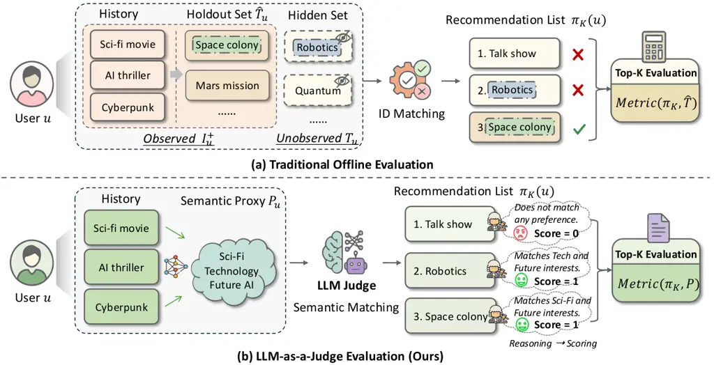

# LLM-as-a-Judge for Reliable and Explainable Offline Evaluation in Top-K Recommendation

Conference: Proceedings of the 32nd ACM SIGKDD Conference on Knowledge
Discovery and Data Mining V.2; August 9–13, 2026; Jeju Island, Republic
of Korea.Proceedings of the 32nd ACM SIGKDD Conference on Knowledge
Discovery and Data Mining V.2 (KDD 2026), August 9–13, 2026, Jeju
Island, Republic of
KoreaISBN: 979-8-4007-2259-2/2026/08DOI: [10.1145/3770855.3818169](https://doi.org/10.1145/3770855.3818169)CCS: Information
systems Recommender systemsCCS: Information systems Relevance assessment

Yue Que
[](https://orcid.org/0009-0001-0468-6631)
email: <yueque2-c@my.cityu.edu.hk> Affiliation: City University of Hong
Kong, Hong Kong, China , Junyi Zhou
[](https://orcid.org/0009-0008-9616-4240)
email: <junyizhou8-c@my.cityu.edu.hk> Affiliation: City University of
Hong Kong, Hong Kong, China , Xiaokun Zhang
[](https://orcid.org/0000-0002-9755-2471)
Note: Corresponding authors email: <dawnkun1993@gmail.com>
Affiliation: City University of Hong Kong, Hong Kong, China , Haiming
Jin
[](https://orcid.org/0000-0001-5178-7198)
email: <jinhaiming@sjtu.edu.cn> Affiliation: Shanghai Jiao Tong
University, Shanghai, China , Qiao Xiang
[](https://orcid.org/0000-0002-3394-6279)
email: <xiangq27@gmail.com> Affiliation: Xiamen University, Xiamen,
China and Chen Ma
[](https://orcid.org/0000-0001-7933-9813)
email: <chenma@cityu.edu.hk> Affiliation: City University of Hong Kong,
Hong Kong, China

© cc

###### Abstract.

Recommendation evaluation plays a crucial role in guiding the refinement
and deployment of recommender systems. Most existing trials rely on
offline evaluation using Top-K metrics computed over holdout user
behaviors. However, we identify two fundamental limitations that
undermine their ability to deliver reliable and explainable evaluations.
Regarding reliability, offline evaluation treats observed user feedback
as a proxy of true preferences and enforces rigid ID matching between
the proxy and recommendation. In practice, feedback collections are
inherently shaped by incomplete and biased item exposure, leading to
distorted and unreliable assessments. Regarding explainability, Top-K
metrics only establish numerical scores without offering meaningful
insights to support them, thereby reinforcing the black-box nature of
offline evaluation.

In this paper, we propose a reliable and explainable LLM-as-a-Judge
framework for offline recommendation evaluation. To enhance reliability,
we introduce a semantic proxy from user textual behaviors to represent
their true preferences. This proxy allows for more flexible matching
between preferences and recommendations in the semantic space, rather
than depending on the holdout feedback. To ensure explainability, the
LLM Judge adopts a reasoning-then-scoring process to generate relevance
judgments along with explicit rationale. Finally, we aggregate the
individual scores into global Top-K metrics to quantify overall
recommendation quality, and provide justification for each preference
hit or miss. Extensive experiments demonstrate that the LLM Judge
achieves solid reliability, explainability, and robustness in
evaluation.

###### Keywords: 

Recommender Systems; Large Language Models; Offline Evaluation

^(†)^(†)cc-license: by

Resource Availability:  
The source code of this paper has been made publicly available at
[https://doi.org/10.5281/zenodo.20283783](https://doi.org/10.5281/zenodo.20283783).

## 1. Introduction

Recommender systems enhance user experience by providing personalized
recommendation to alleviate information overload. Evaluating
recommendation performance is essential for the system design,
refinement and deployment. Serving as the widely adopted paradigm in
research, offline evaluation assesses recommendation quality by
computing common Top-K metrics such as hitting rate, Recall@K, or NDCG@K
on holdout feedback collections (, 2010; Zangerle and Bauer, 2022).

Unfortunately, under the widespread presence of missing-not-at-random
(MNAR) feedback, offline metrics risk being distorted and thus provide
unreliable evaluation results. Ideally, the gold standard for
recommendation assessment can be defined as: to match true preference
space of the user. Offline evaluation simply assumes that collected user
feedback is the proxy for the entire preference space. Based on this
assumption, offline metrics reflect recommendation quality by performing
strict ID matching between the recommended items and the test set. While
in practice, user history collections are largely MNAR, which means they
only represent a subset of the overall interests due to multiple sources
of inherent bias, such as exposure control imposed by the deployed
system or user item-viewing behaviors (Jadidinejad et al., 2020).
Consequently, enforcing rigid ID matching on MNAR data fails to account
for unobserved interests (Zhang et al., 2024a), resulting in an
inevitable deviation from the gold standard.

On the other hand, offline evaluation remains limited in delivering
explainable assessments (Fabbri et al., 2025). With growing attention on
explainable recommendation, explainability in evaluation is also
emphasized to offer meaningful insights into assessment rationality
(Chen et al., 2022; Figueiredo et al., 2025). However, traditional
offline metrics are typically confined to establishing numerical
performance benchmarks and lack the ability to provide sufficient
explanations. Based on these observations, we highlight the fundamental
limitation in current offline evaluation: the absence of reliable and
explainable proxy that consistently aligns with the gold standard.

To move beyond the feedback collection proxy employed in offline
evaluation, Large Language Models (LLMs) demonstrate the capability to
infer a semantic proxy of the gold standard. With extensive world
knowledge and excellent reasoning ability, LLMs can interpret user
behavioral histories to capture latent intentions and unobserved
interests beyond MNAR feedback (Zhang et al., 2024b). Therefore, the
semantic representation offers a more comprehensive summary of user true
preferences, enhancing the reliability of the preference proxy. Building
on this, the emergence of LLM-as-a-Judge paradigm further promotes
explainable evaluation by engaging agents to reason over candidates and
align judgments with human-like criteria (Gu et al., 2025; Faggioli et
al., 2023). Taken together, our approach leverages the semantic
understanding and explainability of LLMs to effectively bridge the gap
toward reliable and explainable evaluation.

In this paper, we propose a novel LLM-as-a-Judge framework to address
the fundamental limitations in offline recommendation evaluation. First,
to enhance the reliability in offline evaluation, we introduce a
semantic proxy to represent user preference space, thus moving beyond
the reliance on supplementary test sets. Based on this proxy, we
establish a semantic matching principle between the proxy and the
recommended content, enabling more flexible and logical alignment with
user interests. Second, to improve the explainability in offline
evaluation, we devise a two-step judging process within the LLM Judge.
In the reasoning step, the Judge summarizes user intentions from the
history to build the semantic proxy, and assesses the relevance between
the proxy and recommendation. In the scoring step, the Judge assigns
pointwise scores to candidates based on the prior reasoning and outputs
explicit rationales. Finally, the judgments are aggregated into global
metrics that reflect overall recommendation performance, accompanied by
individual reasons explaining each decision.

In summary, our contributions are threefold.

- •
  We propose an LLM-as-a-Judge framework that introduces a semantic
  proxy to represent user true preferences. This framework enables
  flexible semantic matching between the proxy and recommended content,
  providing reliable evaluation.
- •
  We devise a reasoning-then-scoring judging process in the LLM Judge to
  produce assessment scores along with explicit rationales, achieving
  explainable evaluation.
- •
  We conduct extensive experiments to demonstrate the reliability and
  explainability of the Judge, as well as the evaluation robustness
  across varying LLM model scales and input configurations.

## 2. Methodology

In this section, we first outline the preliminaries of Top-K
recommendation and common offline metrics to formulate the offline
evaluation problem. Next, we introduce the proposed LLM-as-a-Judge
framework for recommendation evaluation.



Figure 1. Overview of traditional offline evaluation vs. LLM-as-a-Judge
evaluation in Top-K recommendation. method

### 2.1. Problem Formulation

We study the standard Top-K recommendation task in collaborative
filtering, which serves as a fundamental pipeline for building
recommender systems (Hu et al., 2008). Let $`\mathcal{U}`$ and
$`\mathcal{I}`$ denote the user and item sets. The collection of
user-item interactions is represented as
$`\mathcal{D}=\{(u,i)\mid u\in\mathcal{U},i\in\mathcal{I}\}`$, where
each pair $`(u,i)\in\mathcal{D}`$ indicates that user $`u`$ has
interacted with item $`i`$. For each user $`u`$, we denote his
historical feedback set as
$`\mathcal{I}^{+}_{u}=\{i\in\mathcal{I}\mid(u,i)\in\mathcal{D}\}`$.

Ideally, a collaborative filtering recommender is trained on the
observed interactions $`\mathcal{I}^{+}_{u}`$ to learn a scoring
function $`s(u,i)`$ that estimates a user’s preference for each item.
During inference, the model computes scores for user $`u`$ over the set
of unseen items $`\mathcal{I}\setminus\mathcal{I}^{+}_{u}`$, and ranks
them in descending order of $`s(u,i)`$ to produce the Top-K
recommendation list:

```math
\pi_{K}(u)=\operatorname{Top-K}_{i\in\mathcal{I}\setminus\mathcal{I}^{+}_{u}}\,s(u,i), \tag{1}
```

where $`\pi_{K}(u)=\{i_{1},\ldots,i_{K}\}`$ denotes the ordered list of
the $`K`$ highest-scoring items. The recommendation model is evaluated
by comparing $`\pi_{K}(u)`$ with the ground-truth relevant items from
the unseen set. We define the set of items that truly match user $`u`$’s
preference as
$`\mathcal{T}_{u}\subseteq\mathcal{I}\setminus\mathcal{I}^{+}_{u}`$.

To evaluate how effectively $`\pi_{K}`$ captures ground-truth preference
in $`\mathcal{T}`$, two widely used offline metrics are employed, which
are the recall rate and the normalized discounted cumulative gain
(NDCG). Recall@$`K`$ measures the fraction of relevant items that appear
in the Top-K recommendation list:

```math
\mathrm{Recall}@K=\frac{1}{|\mathcal{U}|}\sum_{u\in\mathcal{U}}{\frac{|\pi_{K}(u)\cap\mathcal{T}_{u}|}{|\mathcal{T}_{u}|}}. \tag{2}
```

NDCG@$`K`$ evaluates both the relevance and ranking quality of
recommendations by assigning more scores to correct recommendations with
higher rankings. The discounted cumulative gain (DCG) is first
calculated as:

```math
\mathrm{DCG}@K(u)=\sum_{r=1}^{K}\frac{2^{\mathbb{1}\left\{i_{r}\in\mathcal{T}_{u}|i_{r}\in\pi_{K}(u)\right\}}-1}{\log_{2}(r+1)}. \tag{3}
```

Then ideal DCG is computed by re-ranking hitted items to the top:

```math
\mathrm{iDCG}@K(u)=\sum_{r=1}^{\min(K,|\mathcal{T}_{u}|)}\frac{1}{\log_{2}(r+1)}. \tag{4}
```

Finally, NDCG is obtained based on the ratio of DCG to iDCG:

```math
\mathrm{NDCG}@K=\frac{1}{|\mathcal{U}|}\sum_{u\in\mathcal{U}}\frac{\mathrm{DCG}@K(u)}{\mathrm{iDCG}@K(u)}. \tag{5}
```

In practice, as illustrated in Figure 1 (a), offline evaluation
typically uses a holdout subset $`\hat{\mathcal{T}}`$ from the observed
$`\mathcal{I}^{+}`$ as a proxy for the unobserved true preference
$`\mathcal{T}`$. Traditional Top-K metrics measure performance through
strict ID matching between $`\pi_{K}`$ and $`\hat{\mathcal{T}}`$, i.e.,
$`\mathrm{Metric}(\pi_{K},\hat{\mathcal{T}})`$, thereby resulting in
deviation from the ideal gold standard. To address this issue, we
formulate the offline evaluation problem as identifying a proxy
$`\mathcal{P}`$ that yields evaluation results (e.g., Recall@$`K`$ and
NDCG@$`K`$) consistent with those computed on $`\mathcal{T}`$, that is,
$`\mathrm{Metric}(\pi_{K},\mathcal{P})\rightarrow\mathrm{Metric}(\pi_{K},\mathcal{T})`$.

### 2.2. LLM-as-a-Judge

We introduce the LLM Judge framework in three parts: (1) Judging
Process, which outlines the procedures for performing pointwise semantic
matching and reasoning; (2) Prompt Construction, which defines concrete
principles to effectively guide the agent to judge; and (3) Outcome
Evaluation, which aggregates the generated judgments into standard Top-K
performance metrics.

#### 2.2.1. Judging Process

We assume that each item is associated with side information (Zhang et
al., 2025) in natural language (e.g., title, attributes, or short
description). As shown in Figure 1 (b), given the user historical
interactions and a Top-K recommendation list produced by the
recommender, the Judge is prompted to assess the pointwise relevance
between the user and each candidate item based on their linguistic
features. Central to our LLM Judge is the semantic matching mechanism,
which replaces the traditional ID-based matching employed in holdout
test evaluations. For clarity, we conceptually decompose the judgment
into _reasoning_ and _scoring_ steps, while practically encapsulating
both within a single LLM query.

In the _reasoning step_, the Judge first summarizes user preferences
from the observed textual feedback, forming the semantic proxy that
captures their high-level interests. Based on this proxy, the Judge
performs semantic matching to identify the relevance between
recommendation candidates and the inferred user profile. This
semantic-level inference allows the model to rely on linguistic
information rather than meaningless item IDs, thereby effectively
alleviating the MNAR impact inherent in traditional holdout proxies. For
each candidate item, the matching judgment involves chain-of-thought
reasoning to cite key evidence that leads to an accept or reject
decision. The reasoning outcome is a single-sentence rationale
explaining why the item aligns (or mismatches) the underlying
preferences. This stage guides the Judge to ground its assessment on
observable textual cues, instead of directly guessing the score.

In the _scoring step_, the Judge assigns a pointwise relevance score to
each candidate item conditioned on the preceding reasoning rationale.
The score indicates whether the candidate is relevant to the inferred
user preferences (1 for relevant, 0 for irrelevant). Along with the
score, rationale of the judgment is also reported to ensure transparent
and interpretable evaluation outcome.


Figure 2. Evaluation Prompt applied in our LLM Judge. Basic principles
and output format highlighted in boldface are fixed regions, while the
input fields shaded in gray can be customized for different tasks.prompt

#### 2.2.2. Prompt Construction

Our prompt is designed to implement a strict pointwise relevance
evaluator. To ensure generalizability, the prompt template standardizes
only the general evaluation procedure, while task-specific details are
provided through customizable input fields to maintain scalability
across various recommendation tasks. As shown in Figure 2, the prompt
template explicitly specifies three key aspects in the evaluation
process: _basic principles_, _input fields_, and _output format_.

_Basic principles._ We define two fundamental rules to guide the entire
judgment process, (1) the reasoning-then-scoring principle, and (2) the
reject-by-default policy. The first rule regulates the Judge to follow
our proposed two-step judgment procedure, while the reject-by-default
policy enables a conservative LLM Judge to mitigate the over-approve
tendency in LLMs. Given that LLMs often pursue divergent associations
and may exhibit hallucinations (Huang et al., 2025), we explicitly
constrain the Judge to always reject the candidate unless the provided
evidence clearly supports a perfect match. This rule is therefore
essential for filtering out ambiguous candidates and ensuring an
accurate evaluation process.

_Input fields._ The input fields are serialized into a unified template
consisting of (1) an instruction block that defines the task and
matching criteria, (2) the textual fields representing the user
historical interactions and the recommended candidate information. In
the instruction block, the current recommendation task requires
customized definition. The matching criteria are originally
task-agnostic with a general description of the perfect matching
situation, but we also allow flexible customization to better fit the
corresponding task. This modular design allows the same judging logic to
transfer across different recommendation scenarios by simply adjusting
the instruction block while keeping the remaining template and rubric
unchanged.

_Output format._ Lastly, the Judge is required to output a binary
relevance score (0 or 1) along with a single-sentence rationale
explaining the judgment. The binary scores are then aggregated into
global metrics to reflect the overall recommendation quality, while
their corresponding explanations are retained for further qualitative
analysis or error diagnosis to better understand the Judge’s behaviors
and reasoning patterns.

#### 2.2.3. Outcome Evaluation

Since the judgment score takes binary value, we follow typical offline
evaluation protocol to aggregate the LLM evaluation outcomes with
standard Top-K recommendation metrics. In this study, we select the
representative Recall@$`K`$ and NDCG@$`K`$ as primary evaluation
metrics, while other list-level metrics remain compatible with our
framework. We make minor adjustments to adapt the two metrics to our
evaluation framework.

Formally, given the Top-K list $`\pi_{K}(u)=\{i_{1},\ldots,i_{K}\}`$,
and the LLM judge outcome $`y_{u,i_{r}}\in\{0,1\}`$ for each rank $`r`$.
$`\mathrm{NDCG}_{\text{Judge}}@K`$ is computed in the standard way by
treating $`y_{u,i_{r}}`$ as the relevance signal in DCG. For
Recall@$`K`$, our protocol does not rely on the holdout test set to
represent $`\mathcal{T}_{u}`$, and thus $`|\mathcal{T}_{u}|`$ is
unavailable. Accordingly, we normalize the number of judged hits by
$`K`$:

```math
\mathrm{Recall}_{\text{Judge}}@K=\frac{1}{|\mathcal{U}|}\sum_{u\in\mathcal{U}}\frac{1}{K}\sum_{r=1}^{K}y_{u,i_{r}}. \tag{6}
```

## 3. Experiment

|                     |                     |                |           |          |                |           |          |                |           |          |
| ------------------- | ------------------- | -------------- | --------- | -------- | -------------- | --------- | -------- | -------------- | --------- | -------- |
| Dataset             | Metric              | Normal Testing | LLM Judge | Gain     | Normal Testing | LLM Judge | Gain     | Normal Testing | LLM Judge | Gain     |
| Kuairec             | Top-K               | Recall@20      |           |          | Recall@50      |           |          | Recall@100     |           |          |
| Pearson Correlation | 35.56%              | 87.62%\*       | +52.07%   | 31.93%   | 79.79%\*       | +47.86%   | 27.88%   | 76.71%\*       | +48.83%   |          |
| Spearman’s Rank     | 26.19%              | 85.71%\*       | +59.52%   | 19.05%   | 64.29%         | +45.24%   | 16.67%   | 79.42%\*       | +62.75%   |          |
| Kendall’s $`\tau`$  | 28.57%              | 71.43%\*       | +42.86%   | 28.57%   | 42.86%         | +14.29%   | 21.43%   | 61.83%\*       | +40.40%   |          |
| Top-K               | NDCG@20             |                |           | NDCG@50  |                |           | NDCG@100 |                |           |          |
| Pearson Correlation | 2.65%               | 62.61%         | +59.96%   | -2.88%   | 70.79%\*       | +73.66%   | 2.43%    | 71.35%\*       | +68.92%   |          |
| Spearman’s Rank     | 11.90%              | 71.43%\*       | +59.52%   | 16.67%   | 78.57%\*       | +61.90%   | 16.67%   | 80.95%\*       | +64.29%   |          |
| Kendall’s $`\tau`$  | 14.29%              | 50.00%         | +35.71%   | 21.43%   | 64.29%\*       | +42.86%   | 21.43%   | 64.29%\*       | +42.86%   |          |
| Coat                | Top-K               | Recall@3       |           |          | Recall@5       |           |          | Recall@10      |           |          |
|                     | Pearson Correlation | 38.15%         | 87.41%\*  | +49.25%  | 34.06%         | 85.70%\*  | +51.64%  | -8.91%         | 76.20%\*  | +85.11%  |
|                     | Spearman’s Rank     | 23.81%         | 92.86%\*  | +69.05%  | 9.52%          | 52.41%    | +42.89%  | -16.67%        | 38.10%    | +54.76%  |
|                     | Kendall’s $`\tau`$  | 21.43%         | 78.57%\*  | +57.14%  | 7.14%          | 40.01%    | +32.86%  | -7.14%         | 21.43%    | +28.57%  |
|                     | Top-K               | NDCG@3         |           |          | NDCG@5         |           |          | NDCG@10        |           |          |
|                     | Pearson Correlation | -77.57%        | 73.86%\*  | +151.43% | -48.31%        | 85.61%\*  | +133.93% | -30.12%        | 82.72%\*  | +112.85% |
|                     | Spearman’s Rank     | -76.19%        | 80.95%\*  | +157.14% | -47.62%        | 76.19%\*  | +123.81% | -45.24%        | 83.33%\*  | +128.57% |
|                     | Kendall’s $`\tau`$  | -57.14%        | 64.29%\*  | +121.43% | -28.57%        | 57.14%\*  | +85.71%  | -35.71%        | 71.43%\*  | +107.14% |

Table 1. Consistency performance of normal testing and LLM Judge
evaluation. The best consistency results are highlighted in boldface.
Gain denotes the performance improvement over normal testing.
Superscript \* indicates the statistically significant consistency with
the ground truth (i.e., two-sided t-test with $`\mathbf{p<0.05}`$).

In this section, we conduct extensive experiments to validate the
effectiveness of our LLM Judge in achieving reliable and explainable
evaluation for Top-K recommendation. We aim to answer the following
research questions:

- •
  RQ1: Can the LLM Judge be a reliable proxy for the unbiased offline
  evaluation?
- •
  RQ2: Can the LLM Judge generate logically sound and persuasive
  explanations for its judgment?
- •
  RQ3: How robust are the evaluation results under different LLM model
  scales and input configurations?

### 3.1. Evaluation Pipeline

#### 3.1.1. Data Overview

We employ two real-world datasets, Kuai- rec¹¹ 1
[https://kuairec.com/](https://kuairec.com/) (Gao et al., 2022) and
Coat²² 2
[https://www.cs.cornell.edu/~schnabts/mnar/](https://www.cs.cornell.edu/~schnabts/mnar/)
(Schnabel et al., 2016), both of which are widely used for unbiased
evaluation in recommender systems. Kuairec is a video recommendation
dataset containing 12.5 million interactions between 7.1k users and
10.7k items. Coat dataset records 6.5k ratings provided by 290 users on
300 clothes from a shopping platform. For model training, both datasets
adopt the same MNAR feedback as most recommendation datasets. While for
testing, they support unbiased evaluation with dedicated test sets.
Specifically, Kuairec provides a fully observed test subset containing
1.4k users and 3.3k items, where each user has left feedback on every
item in the subset. Coat offers an unbiased test set in which all users
have rated 16 randomly exposed items. Among available real-world
datasets, only Kuairec, Coat, and Yahoo!R3 (Marlin and Zemel, 2009)
provide unbiased offline test data. We exclude Yahoo!R3 as it contains
only item IDs without textual information, thus being inapplicable to
our setting. We provide the textual information details of Kuairec and
Coat in Appendix A.1.

#### 3.1.2. Baseline Construction

We design two pipelines to establish the lower and upper bounds of
evaluation quality, namely normal testing and unbiased testing. We split
the MNAR feedback of each dataset into training and validation sets with
a 7:3 ratio, and train recommendation models on the training set. In
normal testing, model performances are evaluated by the validation set,
which represents a lower bound of evaluation quality due to incomplete
item exposure. In contrast, unbiased testing assesses the same trained
models on the unbiased test sets, which are collected under full item
exposure, thereby serving as the evaluation upper bound. To enable
unbiased testing, we binarize the fully exposed test data into positive
and negative samples, defining positives as videos watched at least
twice in Kuairec and ratings above 3 in Coat dataset. We then treat the
unbiased testing as the ground truth, and consider both normal testing
and LLM Judge as proxy evaluation schemes that approximate this ground
truth. Among them, normal testing serves as the baseline for comparison
with the LLM Judge. Finally, to characterize the evaluation landscapes
of each proxy and the ground truth, we instantiate them as performance
ranking lists of recommendation models derived from their respective
evaluations.

### 3.2. Experimental Settings

#### 3.2.1. Recommendation Models

To build the model ranking list, we implement a diverse set of
representative collaborative filtering models. They include matrix
factorization methods: MF (Koren et al., 2009) and NeuMF (He et al.,
2017); graph neural network models: NGCF (Wang et al., 2019), LR-GCCF
(Chen et al., 2020), and LightGCN (He et al., 2020); contrastive
learning model: SimGCL (Yu et al., 2022), and graph-based variants that
improve high-order connectivity modeling: MGCCF (Sun et al., 2019), GTN
(Fan et al., 2022), and CAGED (Que et al., 2025). Rather than
identifying an optimal recommender in the list, we focus on the relative
model rankings under the two proxy schemes, and assess their
consistencies with the unbiased ordering to reflect evaluation
reliability. We attach model implementation details in Appendix A.2.

(a) Kuairec

(b) Coat

Figure 3. Scatter plot between proxy evaluation and unbiased evaluation.
Diagonal line $`\boldsymbol{y=x}`$ represents absolute absence of
discrepancy between two evaluation types. Linear regression statistics
($`{\boldsymbol{k}}`$ denotes slope, $`\boldsymbol{\sigma}`$ represents
standard deviation, and $`\boldsymbol{\bar{d}}`$ indicates MAE) of
normal testing and LLM Judge are plotted to illustrate the accuracy
trend.linear

#### 3.2.2. Evaluation Metrics

We employ a variety of evaluation metrics to examine the reliability and
explainability of our LLM Judge separately. To evaluate the reliability
of proxy evaluation, we leverage four statistical metrics as follows:

- •
  Pearson Correlation: measures the consistency of score gaps between
  neighboring ranks.
- •
  Spearman’s Rank: evaluates the consistency of overall ordering
  positions between two ranked lists, irrespective of the score scale.
- •
  Kendall’s $`\boldsymbol{\tau}`$: quantifies the consistency of
  pairwise order relations between all entry pairs across the two lists.
- •
  Mean Absolute Error (MAE): computes the average absolute difference
  between the proxy and unbiased evaluation scores after normalization.

Among these, the first three are correlation-based metrics taking values
within $`[-1,1]`$, where $`1`$ indicates perfect consistency, $`0`$
denotes no correlation, and $`-1`$ reflects complete inverse
correlation. In contrast, MAE serves as an accuracy-based metric that
captures the magnitude of deviation between two normalized evaluation
scores. Since we summarize recommendation performances in Top-K metrics
(i.e., Recall@$`K`$ and NDCG@$`K`$), for comprehensive comparison,
evaluations are conducted on recommendation lists with various lengths
$`K`$. According to the sample size in each dataset, we employ
$`K\in\{20,50,100\}`$ in Kuairec, and $`K\in\{3,5,10\}`$ in Coat.

To assess the explainability of the LLM Judge, we design explanatory
rubrics from three complementary dimensions:

- •
  Coherence: whether the reasoning presented by the LLM Judge follows a
  logically consistent chain of thought that justifies its final
  decision.
- •
  Faithfulness: whether the evidence mentioned in the explanation is
  genuinely supported by historical data rather than being hallucinated.
- •
  Persuasiveness: whether the rationale can convince human evaluators to
  its judgment.

#### 3.2.3. LLM Judge Backbones

To examine the evaluation robustness of the LLM Judge, we experiment
with a series of LLMs with varying scales to build the Judge, including
Qwen3-4B-Instruct-2507 (Yang et al., 2025), Qwen3-8B, Qwen3-14B,
Qwen3-30B-A3B, and DeepSeek-V3.2 (DeepSeek-AI et al., 2025). As we
mainly focus on investigating the effect of LLM capacity on the Judge
performance, we do not introduce more models from other LLM families for
comparison. In the main experiments, Qwen3-30B-A3B is adopted as the
default backbone to balance evaluation performance and computational
cost. We report its runtime overhead in Appendix A.3. For all backbones,
the temperature is fixed at 0 to ensure deterministic outputs.

### 3.3. Study of Evaluation Reliability (RQ1)

To validate the reliability of the LLM Judge as a proxy for unbiased
offline evaluation, we compare the Judge performance with normal testing
from two perspectives. From a relative ranking perspective, we
investigate whether the Judge can accurately recover the relative
performance order of recommendation models by measuring the ranking
consistency between proxy evaluation and unbiased testing across
multiple Top-K metrics. From an absolute score perspective, we examine
whether the Judge can produce consistent performance scores by directly
comparing the normalized proxy scores with the unbiased scores at the
model level and analyzing their overall trends. We present detailed
observations below.

_Ranking analysis._ In Table 1, we report the ranking consistency
between each proxy evaluation scheme and the unbiased testing under
different Top-K metrics, measured by Pearson correlation, Spearman’s
rank, and Kendall’s $`\tau`$. On both datasets, normal testing exhibits
low consistencies across all Top-K metrics, indicating that MNAR
feedback substantially distorts both the relative rankings and the score
gaps among recommendation models. As a result, normal testing fails to
align with unbiased testing, leading to unreliable performance rankings.
In contrast, the LLM Judge consistently achieves strong correlations
across all Top-K metrics, showing solid superiority over normal testing
in maintaining ranking consistency with the ground truth. Notably, on
the NDCG evaluations of Coat, the Judge not only improves the
consistency values but also reverses strong negative correlations of
normal testing into positive agreement. Furthermore, significance tests
confirm that the consistency achieved by the Judge is statistically
significant rather than incidental. Therefore, the LLM Judge
demonstrates promising capability to recover the relative model rankings
much closer to the unbiased testing results.

_Score analysis._ Figure 3 illustrates the score-level agreement between
proxy evaluations and unbiased testing, where each point represents a
recommendation model with normalized performance scores in $`[0,1]`$. We
perform regression analysis for both normal testing and LLM Judge, where
the slope $`k`$ reflects how well each proxy preserves relative score
gaps (ideal value $`k=1`$) and the standard deviation $`\sigma`$
indicates evaluation stability. $`\bar{d}`$, representing the MAE value,
is computed as the average distance of points from the diagonal $`y=x`$
to quantify the absolute discrepancy from unbiased scores. In normal
testing, points are widely dispersed with noticeable deviation from the
diagonal line, exhibiting substantial bias in score alignment. This
pattern is further supported by the regression statistics, where the
slope $`k`$ generally deviates from the ideal value $`1`$, and the
standard deviation $`\sigma`$ indicates greater instability in
evaluation. Additionally, the MAE result $`\bar{d}`$ reveals larger
differences from the ground-truth scores. In contrast, under the LLM
Judge evaluation, performance points cluster more closely around the
diagonal, demonstrating a clearer linear trend. Correspondingly, the
slopes approach $`1`$ with both lower $`\sigma`$ and $`\bar{d}`$,
suggesting that the Judge not only better preserves the relative score
differences among models but also provides more accurate absolute
performance estimates.

These findings confirm that the LLM Judge attains both ranking
consistency and score-level agreement with unbiased testing.
Consequently, the Judge effectively improves the reliability of offline
evaluation over normal testing.

### 3.4. Study of Evaluation Explainability (RQ2)

To investigate the evaluation explainability of the LLM Judge, we
analyze the judgment rationales with both quantitative and qualitative
approaches. In the quantitative analysis, we invite human experts to
assess the quality of the rationales along the three key dimensions:
coherence, faithfulness, and persuasiveness (cf. section 3.2.2). In the
qualitative analysis, we further conduct the case study on rationale
patterns to explore the types of reasoning that the Judge tends to
produce.

_Rationale quality assessment._ We first categorize the Judge outcomes
into Match and Mismatch groups based on the Judge decision, as the two
types of reasons differ significantly. From each group, we randomly
sample 100 judgment rationales, and engage three human evaluators to
manually annotate each rationale with binary scores across the three
dimensions. The average human evaluation results are summarized in
Table 2. For Coat, both Match and Mismatch groups achieve comparable
scores, suggesting that the Judge consistently produces coherent and
well-grounded explanations for its persuasive decisions. For Kuairec
with larger item space and noisier textual information, Match rationales
clearly outperform Mismatch ones across all three criteria. This
indicates that, under a more complex task, the Judge concentrates its
reasoning efforts on identifying logical connections that support Match
judgments. In general, overall performance in both datasets demonstrates
solid explainability in the judgment rationales, effectively addressing
the absence of explainability in traditional offline evaluation.

| Dataset | Judgment | Coherence | Faithfulness | Persuasiveness |
| ------- | -------- | --------- | ------------ | -------------- |
| Kuairec | Match    | 84.67%    | 88.33%       | 86.67%         |
|         | Mismatch | 69.33%    | 75.33%       | 72.33%         |
|         | Overall  | 77.00%    | 81.83%       | 79.50%         |
| Coat    | Match    | 86.67%    | 81.33%       | 80.67%         |
|         | Mismatch | 84.00%    | 85.33%       | 83.67%         |
|         | Overall  | 85.33%    | 83.33%       | 82.17%         |

Table 2. Explainability analysis of the judgment rationales. Fleiss’
$`\boldsymbol{\kappa}`$ of each entry exceeds 0.75, indicating high
inter-rater consistency.

(a) Match

(b) Mismatch

Figure 4. Clustering results of the judgment rationales after Principal
Component Analysis (PCA) dimension reduction.match

|          |         |                                                                                                                                                                                                                                      |
| -------- | ------- | ------------------------------------------------------------------------------------------------------------------------------------------------------------------------------------------------------------------------------------ |
| Judgment | Cluster | Reason Example                                                                                                                                                                                                                       |
| Match    | A       | The candidate jacket type is packable, which aligns with the user’s established preference for lightweight, functional outerwear, indicating a strong stylistic and functional fit.                                                  |
|          | B       | The candidate matches the user’s established preference for packable jackets and brown color, supported by prior purchases of a packable jacket and multiple brown-colored items.                                                    |
|          | C       | The candidate is a black parka, which aligns with the user’s established preference for parkas (purchased in brown, gray, and other colors) and black (seen in insulated and motorcycle jackets).                                    |
| Mismatch | A       | The candidate is for men, while the user’s entire purchase history consists of women’s jackets, indicating a gender mismatch.                                                                                                        |
|          | B       | The candidate is a track jacket in gray, which does not align with the user’s strong preference for black and other specific colors like olive, green, and navy in similar jacket types, and gray is not represented in the history. |

Table 3. Reason examples selected from the cluster centers.

(a) Recall@5

(b) NDCG@5

Figure 5. Evaluation performance on Recall@5 and NDCG@5 of the Coat
dataset. Dashed baseline represents the benchmark of normal
testing.robust

_Case study of rationale patterns._ We design the case study on Coat
dataset to visualize the rationale landscape generated by the Judge.
Specifically, we encode the rationales into sentence embeddings using
the BGE-M3 tokenizer (Chen et al., 2025). Then we apply K-Means
clustering (Ikotun et al., 2023) to the Match and Mismatch groups
separately, and determine the optimal number of clusters using the elbow
method. The resulting clusters are visualized in Figure 4, where each
cluster represents a distinct type of reasoning to the judgments. We
summarize the representative reason example that closest to each cluster
center in Table 3. In the Match group, there are three major categories
of reasons. Cluster A corresponds to logical extension, where the Judge
generalizes user preferences to infer broader matches. Cluster B
reflects direct matching to support decisions through explicit attribute
overlap. Cluster C conforms to cross matching, where the Judge links
elements in the candidate to multiple related signals in the history.
For the Mismatch group, Cluster A is primarily associated with gender
discrepancies, while Cluster B covers various attribute-level conflicts
with user preferences. Overall, these patterns further demonstrate the
Judge’s capability to produce structured and informative rationales,
complementing the quantitative findings to establish comprehensive
evaluation explainability.

### 3.5. Study of Evaluation Robustness (RQ3)

To examine the evaluation robustness, we analyze the Judge sensitivity
from two aspects. First, we report the Judge performance under varying
LLM backbone scales to validate inter-model robustness. Second, we
conduct ablation study on the input configuration, including both
principle designs in prompt and volume of available input context. We
have the following observations.

_LLM scale analysis._ Figure 5 summarizes the evaluation quality of each
backbone in terms of Recall@5 and NDCG@5 on the Coat dataset. In each
subfigure, the dashed horizontal line represents the normal testing
benchmark, serving as a reference for consistency under the conventional
offline evaluation setting. Across both Recall and NDCG, the LLM Judge
demonstrates strong consistency with the ground truth for all backbones
and clearly surpasses the baseline benchmark. In particular,
correlation-based measures such as Pearson, Spearman, and Kendall remain
significant across model scales, indicating that the Judge reliably
preserves the relative ranking of models regardless of underlying LLM
scales. Additionally, the MAE remains consistently lower than the
baseline, reflecting stable and superior score-level agreement with the
unbiased results.

| Variant             | Recall@5 |          |         | NDCG@5  |          |         |
| ------------------- | -------- | -------- | ------- | ------- | -------- | ------- |
|                     | Pearson  | Spearman | Kendall | Pearson | Spearman | Kendall |
| rewrite             | 88.36    | 57.14    | 42.86   | 82.29   | 71.82    | 53.58   |
| w/o-RJ              | 90.74    | 61.90    | 50.00   | 36.33   | 38.10    | 28.57   |
| w/o-RS              | 70.37    | 39.62    | 30.88   | 64.06   | 64.29    | 42.86   |
| $`\mathcal{L}`$=0.6 | 82.85    | 66.67    | 50.00   | 75.28   | 57.14    | 28.57   |
| $`\mathcal{L}`$=0.3 | 76.91    | 60.81    | 54.29   | 51.93   | 54.76    | 35.71   |
| $`\mathcal{L}`$=0.1 | 22.80    | 43.11    | 37.06   | -34.62  | -33.33   | -21.43  |
| Full                | 85.70    | 52.41    | 40.01   | 85.61   | 76.19    | 57.14   |

Table 4. Ablation study of the Judge input configuration on the Coat
dataset.

_Input configuration analysis._ As reported in Table 4, we experiment
with different prompt designs through the first three variants, where
the rewrite variant paraphrases the prompt, while the w/o-RJ and w/o-RS
variants remove corresponding reject-by-default and
reasoning-then-scoring principles, respectively. The rewrite variant
achieves performance comparable to the original Judge, showing that the
framework is largely insensitive to surface-level wording. The w/o-RJ
variant slightly improves Recall consistency by capturing interests in
ambiguous items; however, this over-approval tendency introduces
inevitable ranking noise and causes substantial degradation in NDCG. The
w/o-RS variant underperforms the original Judge mainly due to the
absence of the explicit reasoning step. To further assess the stability
of the Judge under varying input availability, we construct the
remaining three variants by randomly retaining 60%, 30%, and 10% of
input history length, denoted as $`\mathcal{L}`$=0.6, 0.3, and 0.1.
Results show that most metrics remain stable when at least 30% of the
history is retained, but completely fail at 10%. Since user histories in
Coat are bounded within 14–16 items (cf. Table 7), the 10% setting
essentially represents a cold-start scenario, where even traditional
holdout evaluation becomes unreliable due to insufficient test data.
Therefore, this confirms the robustness of the Judge under a reasonable
range of history availability.

In summary, the LLM Judge maintains evaluation robustness across
backbone selection, prompt phrasing, and history availability. The
robustness across varying backbone scales suggests that the framework
does not exclusively depend on specific LLM capacity. The prompt
ablation further demonstrates that the effectiveness of the Judge arises
from our proposed structural principles rather than from surface-level
wording. The analysis on input length reveals high tolerance of the
Judge to various history sparsity levels. Combined together, the LLM
Judge framework provides a reliable proxy evaluation which can be
flexibly deployed under different computational and data constraints.

## 4. Related Work

##### Evaluation in recommender systems.

Existing approaches generally follow two paradigms: online and offline
methods. Online evaluation, such as A/B testing and interleaving
experiments, directly measures user responses in real-world deployments,
thus providing a faithful reflection of system utility (Herlocker et
al., 2004; Beel et al., 2013). To mitigate the heavy dependence on live
traffic, off-policy evaluation (OPE) is applied to estimate online
performance using historical data sampled from the previously deployed
logging policy (Jeunen and Ustimenko, 2024; Narita et al., 2021).
Nevertheless, in many research settings, real-time interaction
environments and logging policies are often unavailable or costly to
obtain. Hence, offline evaluation remains the predominant paradigm for
assessing recommender systems (Bauer et al., 2024; Castells and Moffat,
2022; Cañamares et al., 2020). In offline setting, substantial efforts
have been devoted to addressing the problem of MNAR feedback. For
instance, studies in causal inference utilize propensity-weighting
techniques to model item exposure, approximating a missing-at-random
landscape for unbiased evaluation (Jadidinejad et al., 2021; Khatami et
al., 2025; Yang et al., 2018; Schnabel et al., 2016). However, this
approach stays in the rigid ID matching manner to only focus on
debiasing exposed items, while neglecting false negative samples.
Another direction lies in achieving online-offline alignment, which
employs user dynamics from online experiments to guide offline metric
design (Wilm and Normann, 2025; Kasalický et al., 2023). Yet, as
previously discussed, this method is largely constrained in
applicability.

##### LLM-as-a-Judge.

The emergence of LLM-as-a-Judge enables scalable, explainable, and
human-aligned assessment across a wide range of tasks (Tang et al.,
2024; Wang et al., 2025; Zheng et al., 2023). This paradigm leverages
the reasoning and world knowledge of LLMs to conduct nuanced judgments,
often showing strong agreement with human evaluators (Gu et al., 2025).
In the field of information retrieval, LLM judges are initially
investigated as a substitute for human annotators for relevance
assessment (Thomas et al., 2024; Wu et al., 2024). Recently, this line
of research has expanded into recommender systems. For example, Zhang et
al. (Zhang et al., 2024c) employ LLM evaluators to assess explanations
generated by explainable recommendation models, while Tokutake et al.
(Tokutake et al., 2025) introduce offline serendipity evaluation using
LLMs. These studies focus on specific aspects of recommendation,
differing from our broader perspective. Notably, Fabbri et al. (Fabbri
et al., 2025) propose a profile-based LLM judge for podcast
recommendation evaluation. However, their approach primarily relies on
well-structured user podcast profiles, which restricts its all-scenario
adaptability. In contrast, our judge paradigm transforms user historical
traces into semantic preference representations, ensuring strong
generalizability across various recommendation tasks.

## 5. Conclusion and Future Work

In this paper, we present the LLM-as-a-Judge framework to offer reliable
and explainable offline evaluation in Top-K recommendation. To achieve
reliable evaluation, we introduce a semantic proxy that summarizes user
preferences from behavioral contexts, and replace rigid ID matching on
holdout feedback with flexible semantic matching between the preference
space and recommended items. To realize explainable evaluation, we adopt
a reasoning-then-scoring judging process to generate pointwise judgments
together with informative rationales. Our future work will investigate
the extension of this evaluation paradigm beyond Top-K recommendation to
other mainstream recommendation scenarios, such as sequential,
cross-domain, and real-time recommendation.

###### Acknowledgements.

This work is supported by the Early Career Scheme (No.CityU 21219323)
and the General Research Fund (No.CityU 11220324) of the University
Grants Committee (UGC), the NSFC Young Scientists Fund (No.9240127), and
the Donation for Research Projects (No.9229164 and No.9229216).

## References

- Bauer et al. (2024) C. Bauer, E. Zangerle, and A. Said Exploring the
  landscape of recommender systems evaluation: practices and
  perspectives. ACM Trans. Recomm. Syst. 2 (1). Cited by: §4.
- Beel et al. (2013) J. Beel, M. Genzmehr, S. Langer, A. Nürnberger,
  and B. Gipp A comparative analysis of offline and online evaluations
  and discussion of research paper recommender system evaluation. In
  Proceedings of the International Workshop on Reproducibility and
  Replication in Recommender Systems Evaluation, RepSys ’13, New York,
  NY, USA, pp. 7–14. External Links: ISBN 9781450324656 Cited by: §4.
- Cañamares et al. (2020) R. Cañamares, P. Castells, and A. Moffat
  Offline evaluation options for recommender systems. Inf. Retr. 23 (4),
  pp. 387–410. External Links: ISSN 1386-4564 Cited by: §4.
- Castells and Moffat (2022) P. Castells and A. Moffat Offline
  recommender system evaluation: challenges and new directions. AI
  Magazine 43 (2), pp. 225–238. Cited by: §4.
- Chen et al. (2025) J. Chen, S. Xiao, P. Zhang, K. Luo, D. Lian, and Z.
  Liu M3-embedding: multi-linguality, multi-functionality,
  multi-granularity text embeddings through self-knowledge distillation.
  External Links: 2402.03216 Cited by: §3.4.
- Chen et al. (2020) L. Chen, L. Wu, R. Hong, K. Zhang, and M. Wang
  Revisiting graph based collaborative filtering: a linear residual
  graph convolutional network approach. External Links: 2001.10167 Cited
  by: §3.2.1.
- Chen et al. (2022) X. Chen, Y. Zhang, and J. Wen Measuring "why" in
  recommender systems: a comprehensive survey on the evaluation of
  explainable recommendation. External Links: 2202.06466 Cited by: §1.
- DeepSeek-AI et al. (2025) DeepSeek-AI, A. Liu, B. Feng, et al.
  DeepSeek-v3 technical report. External Links: 2412.19437 Cited by:
  §3.2.3.
- Fabbri et al. (2025) F. Fabbri, G. Penha, E. D’Amico, A. Wang, M. De
  Nadai, J. Doremus, P. Gigioli, A. Damianou, O. Stål, and M. Lalmas
  Evaluating podcast recommendations with profile-aware llm-as-a-judge.
  In Proceedings of the Nineteenth ACM Conference on Recommender
  Systems, RecSys ’25, New York, NY, USA, pp. 1181–1186. External Links:
  ISBN 9798400713644 Cited by: §1, §4.
- Faggioli et al. (2023) G. Faggioli, L. Dietz, C. L. A. Clarke, G.
  Demartini, M. Hagen, C. Hauff, N. Kando, E. Kanoulas, M. Potthast, B.
  Stein, and H. Wachsmuth Perspectives on large language models for
  relevance judgment. In Proceedings of the 2023 ACM SIGIR International
  Conference on Theory of Information Retrieval, ICTIR ’23, New York,
  NY, USA, pp. 39–50. External Links: ISBN 9798400700736 Cited by: §1.
- Fan et al. (2022) W. Fan, X. Liu, W. Jin, X. Zhao, J. Tang, and Q. Li
  Graph trend filtering networks for recommendation. In Proceedings of
  the 45th International ACM SIGIR Conference on Research and
  Development in Information Retrieval, SIGIR ’22, New York, NY, USA,
  pp. 112–121. External Links: ISBN 9781450387323 Cited by: §3.2.1.
- Figueiredo et al. (2025) L. F. d. Figueiredo, A. A. de A. Rocha,
  and A. Paes Tell me why: how explanation can affect recommender
  systems. In Proceedings of the 2025 ACM International Conference on
  Interactive Media Experiences, IMX ’25, New York, NY, USA,
  pp. 492–493. External Links: ISBN 9798400713910 Cited by: §1.
- Gao et al. (2022) C. Gao, S. Li, W. Lei, J. Chen, B. Li, P. Jiang, X.
  He, J. Mao, and T. Chua KuaiRec: a fully-observed dataset and insights
  for evaluating recommender systems. In Proceedings of the 31st ACM
  International Conference on Information & Knowledge Management, CIKM
  ’22, New York, NY, USA, pp. 540–550. External Links: ISBN
  9781450392365 Cited by: §3.1.1.
- Gu et al. (2025) J. Gu, X. Jiang, Z. Shi, H. Tan, X. Zhai, C. Xu, W.
  Li, Y. Shen, S. Ma, H. Liu, S. Wang, K. Zhang, Y. Wang, W. Gao, L. Ni,
  and J. Guo A survey on llm-as-a-judge. External Links: 2411.15594
  Cited by: §1, §4.
- He et al. (2020) X. He, K. Deng, X. Wang, Y. Li, Y. Zhang, and M. Wang
  LightGCN: simplifying and powering graph convolution network for
  recommendation. In Proceedings of the 43rd International ACM SIGIR
  Conference on Research and Development in Information Retrieval, SIGIR
  ’20, New York, NY, USA, pp. 639–648. External Links: ISBN
  9781450380164 Cited by: §3.2.1.
- He et al. (2017) X. He, L. Liao, H. Zhang, L. Nie, X. Hu, and T. Chua
  Neural collaborative filtering. In Proceedings of the 26th
  International Conference on World Wide Web, WWW ’17, Republic and
  Canton of Geneva, CHE, pp. 173–182. External Links: ISBN 9781450349130
  Cited by: §3.2.1.
- Herlocker et al. (2004) J. L. Herlocker, J. A. Konstan, L. G. Terveen,
  and J. T. Riedl Evaluating collaborative filtering recommender
  systems. ACM Trans. Inf. Syst. 22 (1), pp. 5–53. External Links: ISSN
  1046-8188 Cited by: §4.
- \[18\] (2010) Holdout evaluation. In Encyclopedia of Machine
  Learning, C. Sammut and G. I. Webb (Eds.), pp. 506–507. External
  Links: ISBN 978-0-387-30164-8 Cited by: §1.
- Hu et al. (2008) Y. Hu, Y. Koren, and C. Volinsky Collaborative
  filtering for implicit feedback datasets. In Proceedings of the 2008
  Eighth IEEE International Conference on Data Mining, ICDM ’08, USA,
  pp. 263–272. External Links: ISBN 9780769535029 Cited by: §2.1.
- Huang et al. (2025) L. Huang, W. Yu, W. Ma, W. Zhong, Z. Feng, H.
  Wang, Q. Chen, W. Peng, X. Feng, B. Qin, and T. Liu A survey on
  hallucination in large language models: principles, taxonomy,
  challenges, and open questions. ACM Trans. Inf. Syst. 43 (2). External
  Links: ISSN 1046-8188 Cited by: §2.2.2.
- Ikotun et al. (2023) A. M. Ikotun, A. E. Ezugwu, L. Abualigah, B.
  Abuhaija, and J. Heming K-means clustering algorithms: a comprehensive
  review, variants analysis, and advances in the era of big data.
  Information Sciences 622, pp. 178–210. External Links: ISSN 0020-0255
  Cited by: §3.4.
- Jadidinejad et al. (2020) A. H. Jadidinejad, C. Macdonald, and I.
  Ounis Using exploration to alleviate closed loop effects in
  recommender systems. In Proceedings of the 43rd International ACM
  SIGIR Conference on Research and Development in Information Retrieval,
  SIGIR ’20, New York, NY, USA, pp. 2025–2028. External Links: ISBN
  9781450380164 Cited by: §1.
- Jadidinejad et al. (2021) A. H. Jadidinejad, C. Macdonald, and I.
  Ounis The simpson’s paradox in the offline evaluation of
  recommendation systems. ACM Trans. Inf. Syst. 40 (1). External Links:
  ISSN 1046-8188 Cited by: §4.
- Jeunen and Ustimenko (2024) O. Jeunen and A. Ustimenko $`\Delta`$-OPE:
  off-policy estimation with pairs of policies. In Proceedings of the
  18th ACM Conference on Recommender Systems, RecSys ’24, New York, NY,
  USA, pp. 878–883. External Links: ISBN 9798400705052 Cited by: §4.
- Kasalický et al. (2023) P. Kasalický, R. Alves, and P. Kordík Bridging
  offline-online evaluation with a time-dependent and popularity
  bias-free offline metric for recommenders. External Links: 2308.06885
  Cited by: §4.
- Khatami et al. (2025) S. B. Khatami, S. Chakraborty, R. Xu, and B.
  Salimi Towards robust offline evaluation: a causal and information
  theoretic framework for debiasing ranking systems. External Links:
  2504.03997 Cited by: §4.
- Koren et al. (2009) Y. Koren, R. Bell, and C. Volinsky Matrix
  factorization techniques for recommender systems. Computer 42 (8),
  pp. 30–37. Cited by: §3.2.1.
- Marlin and Zemel (2009) B. M. Marlin and R. S. Zemel Collaborative
  prediction and ranking with non-random missing data. In Proceedings of
  the Third ACM Conference on Recommender Systems, RecSys ’09, New York,
  NY, USA, pp. 5–12. External Links: ISBN 9781605584355 Cited by:
  §3.1.1.
- Narita et al. (2021) Y. Narita, S. Yasui, and K. Yata Debiased
  off-policy evaluation for recommendation systems. In Proceedings of
  the 15th ACM Conference on Recommender Systems, RecSys ’21, New York,
  NY, USA, pp. 372–379. External Links: ISBN 9781450384582 Cited by: §4.
- Que et al. (2025) Y. Que, Y. Zhang, X. Zhao, and C. Ma Causality-aware
  graph aggregation weight estimator for popularity debiasing in top-k
  recommendation. In Proceedings of the 34th ACM International
  Conference on Information and Knowledge Management, CIKM ’25, New
  York, NY, USA, pp. 2471–2481. External Links: ISBN 9798400720406 Cited
  by: §3.2.1.
- Schnabel et al. (2016) T. Schnabel, A. Swaminathan, A. Singh, N.
  Chandak, and T. Joachims Recommendations as treatments: debiasing
  learning and evaluation. In Proceedings of the 33rd International
  Conference on International Conference on Machine Learning - Volume
  48, ICML’16, pp. 1670–1679. Cited by: §3.1.1, §4.
- Sun et al. (2019) J. Sun, Y. Zhang, C. Ma, M. Coates, H. Guo, R. Tang,
  and X. He Multi-graph convolution collaborative filtering. In 2019
  IEEE International Conference on Data Mining (ICDM), Vol. ,
  pp. 1306–1311. Cited by: §3.2.1.
- Tang et al. (2024) Y. Tang, E. Dong, and W. Gao LLMs in medicine: the
  need for advanced evaluation systems for disruptive technologies. The
  Innovation 5 (3), pp. . External Links: ISSN 2666-6758 Cited by: §4.
- Thomas et al. (2024) P. Thomas, S. Spielman, N. Craswell, and B. Mitra
  Large language models can accurately predict searcher preferences. In
  Proceedings of the 47th International ACM SIGIR Conference on Research
  and Development in Information Retrieval, SIGIR ’24, New York, NY,
  USA, pp. 1930–1940. External Links: ISBN 9798400704314 Cited by: §4.
- Tokutake et al. (2025) Y. Tokutake, K. Okamoto, K. Harada, A. Shibata,
  and K. Karube A universal framework for offline serendipity evaluation
  in recommender systems via large language models. In Proceedings of
  the 34th ACM International Conference on Information and Knowledge
  Management, CIKM ’25, New York, NY, USA, pp. 5294–5298. External
  Links: ISBN 9798400720406 Cited by: §4.
- Wang et al. (2019) X. Wang, X. He, M. Wang, F. Feng, and T. Chua
  Neural graph collaborative filtering. In Proceedings of the 42nd
  International ACM SIGIR Conference on Research and Development in
  Information Retrieval, SIGIR’19, New York, NY, USA, pp. 165–174.
  External Links: ISBN 9781450361729 Cited by: §3.2.1.
- Wang et al. (2025) Y. Wang, J. Zhao, D. Ones, L. He, and X. Xu
  Evaluating the ability of large language models to emulate
  personality. Scientific Reports 15, pp. . Cited by: §4.
- Wilm and Normann (2025) T. Wilm and P. Normann Identifying offline
  metrics that predict online impact: a pragmatic strategy for
  real-world recommender systems. In Proceedings of the Nineteenth ACM
  Conference on Recommender Systems, RecSys ’25, New York, NY, USA,
  pp. 967–970. External Links: ISBN 9798400713644 Cited by: §4.
- Wu et al. (2024) Z. Wu, Q. Jia, C. Wu, Z. Du, S. Wang, Z. Wang, and Z.
  Dong RecSys arena: pair-wise recommender system evaluation with large
  language models. External Links: 2412.11068 Cited by: §4.
- Yang et al. (2025) A. Yang, A. Li, B. Yang, et al. Qwen3 technical
  report. External Links: 2505.09388 Cited by: §3.2.3.
- Yang et al. (2018) L. Yang, Y. Cui, Y. Xuan, C. Wang, S. Belongie,
  and D. Estrin Unbiased offline recommender evaluation for
  missing-not-at-random implicit feedback. In Proceedings of the 12th
  ACM Conference on Recommender Systems, RecSys ’18, New York, NY, USA,
  pp. 279–287. External Links: ISBN 9781450359016 Cited by: §4.
- Yu et al. (2022) J. Yu, H. Yin, X. Xia, T. Chen, L. Cui, and Q. V. H.
  Nguyen Are graph augmentations necessary? simple graph contrastive
  learning for recommendation. In Proceedings of the 45th International
  ACM SIGIR Conference on Research and Development in Information
  Retrieval, SIGIR ’22, New York, NY, USA, pp. 1294–1303. External
  Links: ISBN 9781450387323 Cited by: §3.2.1.
- Zangerle and Bauer (2022) E. Zangerle and C. Bauer Evaluating
  recommender systems: survey and framework. ACM Comput. Surv. 55 (8).
  External Links: ISSN 0360-0300 Cited by: §1.
- Zhang et al. (2025) X. Zhang, B. Xu, C. Li, B. He, H. Lin, C. Ma,
  and F. Ma A survey on side information-driven session-based
  recommendation: from a data-centric perspective. IEEE Transactions on
  Knowledge and Data Engineering 37 (8), pp. 4411–4431. Cited by:
  §2.2.1.
- Zhang et al. (2024a) X. Zhang, B. Xu, Z. Ren, X. Wang, H. Lin, and F.
  Ma Disentangling id and modality effects for session-based
  recommendation. In Proceedings of the 47th International ACM SIGIR
  Conference on Research and Development in Information Retrieval, SIGIR
  ’24, New York, NY, USA, pp. 1883–1892. External Links: ISBN
  9798400704314 Cited by: §1.
- Zhang et al. (2024b) X. Zhang, B. Xu, Y. Wu, Y. Zhong, H. Lin, and F.
  Ma FineRec: exploring fine-grained sequential recommendation. In
  Proceedings of the 47th International ACM SIGIR Conference on Research
  and Development in Information Retrieval, SIGIR ’24, New York, NY,
  USA, pp. 1599–1608. External Links: ISBN 9798400704314 Cited by: §1.
- Zhang et al. (2024c) X. Zhang, Y. Li, J. Wang, B. Sun, W. Ma, P. Sun,
  and M. Zhang Large language models as evaluators for recommendation
  explanations. In Proceedings of the 18th ACM Conference on Recommender
  Systems, RecSys ’24, New York, NY, USA, pp. 33–42. External Links:
  ISBN 9798400705052 Cited by: §4.
- Zheng et al. (2023) L. Zheng, W. Chiang, Y. Sheng, S. Zhuang, Z.
  Wu, Y. Zhuang, Z. Lin, Z. Li, D. Li, E. Xing, H. Zhang, J. E.
  Gonzalez, and I. Stoica Judging llm-as-a-judge with mt-bench and
  chatbot arena. In Advances in Neural Information Processing Systems,
  Vol. 36, pp. 46595–46623. Cited by: §4.

## Appendix A Additional Details

This appendix provides supplementary details that further clarify the
proposed LLM Judge and support the reproducibility of the experimental
results reported in the main paper.

|         |                            |           |                                                                                                          |
| ------- | -------------------------- | --------- | -------------------------------------------------------------------------------------------------------- |
| Dataset | Field / Attribute          | Type      | Description / Example                                                                                    |
| Kuairec | manual_cover_text          | Caption   | Cover text added by the video author (e.g., "Discovered by the little cutie")                            |
|         | caption                    | Caption   | Video title or description written by the author                                                         |
|         | topic_tag                  | Caption   | Topic tags associated with the video (e.g., \[Pomeranian Shun-suke, Live Streaming, Cute Pets Arrival\]) |
|         | first_level_category_name  | Category  | First-level category name (e.g., _Pet_)                                                                  |
|         | second_level_category_name | Category  | Second-level category name (e.g., _Pet Daily_)                                                           |
|         | third_level_category_name  | Category  | Third-level category name (e.g., _Pet Dog_)                                                              |
| Coat    | gender                     | Attribute | Target gender of the jacket (e.g., women)                                                                |
|         | jackettype                 | Attribute | Jacket type such as cropped, trench, fleece, or parka                                                    |
|         | color                      | Attribute | Dominant color of the jacket (e.g., black, gray, green)                                                  |

Table 5. Field-level textual inputs used by the LLM Judge for each
dataset. Only human-readable fields are used, and all fields are
provided in full without truncation.

| Dataset | Hyper-parameters    | MF                  | NeuMF               | NGCF                | LR-GCCF             | LightGCN            | SimGCL              | MGCCF               | GTN                 | CAGED               |
| ------- | ------------------- | ------------------- | ------------------- | ------------------- | ------------------- | ------------------- | ------------------- | ------------------- | ------------------- | ------------------- |
| Kuairec | Batch Size          | 4096                | 4096                | 4096                | 4096                | 4096                | 4096                | 4096                | 4096                | 4096                |
|         | Layer Number        | 2                   | 2                   | 2                   | 2                   | 2                   | 2                   | 2                   | 2                   | 2                   |
|         | Dimension Size      | 256                 | 256                 | 256                 | 256                 | 256                 | 256                 | 256                 | 256                 | 256                 |
|         | Learning Rate       | $`1\times 10^{-4}`$ | $`5\times 10^{-7}`$ | $`5\times 10^{-5}`$ | $`1\times 10^{-5}`$ | $`1\times 10^{-4}`$ | $`1\times 10^{-4}`$ | $`1\times 10^{-6}`$ | $`1\times 10^{-4}`$ | $`5\times 10^{-4}`$ |
|         | Regularization Rate | $`1\times 10^{-3}`$ | $`0`$               | $`5\times 10^{-3}`$ | $`5\times 10^{-3}`$ | $`1\times 10^{-3}`$ | $`5\times 10^{-3}`$ | $`5\times 10^{-3}`$ | $`7\times 10^{-3}`$ | $`5\times 10^{-3}`$ |
| Coat    | Batch Size          | 512                 | 512                 | 512                 | 512                 | 512                 | 512                 | 512                 | 512                 | 512                 |
|         | Layer Number        | 2                   | 2                   | 2                   | 2                   | 2                   | 2                   | 2                   | 2                   | 2                   |
|         | Dimension Size      | 256                 | 256                 | 256                 | 256                 | 256                 | 256                 | 256                 | 256                 | 256                 |
|         | Learning Rate       | $`5\times 10^{-4}`$ | $`1\times 10^{-5}`$ | $`5\times 10^{-5}`$ | $`1\times 10^{-5}`$ | $`1\times 10^{-4}`$ | $`1\times 10^{-4}`$ | $`1\times 10^{-5}`$ | $`1\times 10^{-4}`$ | $`5\times 10^{-4}`$ |
|         | Regularization Rate | $`1\times 10^{-2}`$ | $`0`$               | $`5\times 10^{-3}`$ | $`5\times 10^{-3}`$ | $`5\times 10^{-3}`$ | $`5\times 10^{-3}`$ | $`5\times 10^{-3}`$ | $`7\times 10^{-3}`$ | $`5\times 10^{-3}`$ |

Table 6. Hyper-parameter settings for training the recommendation
models.

|                                 |              |            |
| ------------------------------- | ------------ | ---------- |
| Statistic                       | Kuairec      | Coat       |
| Number of Users                 | 1,411        | 290        |
| Average History Length          | 49.24        | 15.51      |
| Median History Length           | 50           | 16         |
| History Length Range            | \[26, 50\]   | \[14, 16\] |
| Average Caption Length (Tokens) | 71.94        | 62.99      |
| Caption Length Range (Tokens)   | \[21, 2023\] | \[58, 69\] |

Table 7. Input statistics of user histories.

| Statistic/Call | Input Tokens | Output Tokens | Runtime |
| -------------- | ------------ | ------------- | ------- |
| Kuairec        | 4130.6       | 51.7          | 91.21ms |
| Coat           | 494.6        | 43.0          | 73.45ms |

Table 8. Average runtime overhead of Qwen3-30B-A3B.

### A.1. Input Context Details

To make the evaluation procedure fully transparent, we detail the exact
textual inputs provided to the LLM Judge for each dataset, including
field composition and history statistics.

Table 5 summarizes the dataset-specific textual fields consumed by the
LLM Judge. Across both datasets, the Judge operates exclusively on these
human-readable textual information, which are provided in full with no
truncation or heuristic compression applied. For Kuairec, user histories
and candidate items are represented using raw video-related textual
metadata, including user-written captions, topic tags, and hierarchical
category names. We preserve all such fields to reflect their inherent
variability and semantic richness, representing a context-rich scenario.
For Coat, both user histories and candidate items are described using
short and structured attributes, consisting of gender, jacket type, and
color. This setting serves as a context-limited counterpart to Kuairec,
enabling a controlled comparison at different levels of textual
richness.

To further characterize the input context supplied to the Judge, we
report statistics of user histories across both datasets in Table 7. The
two datasets form complementary landscapes of history composition.
Kuairec represents the setting where user histories vary in length and
are diverse in content, with substantial variation in both the number of
interactions and the length of individual captions. In contrast, Coat
has relatively consistent lengths in both user histories and captions.
Therefore, we conduct the ablation study of history length based on this
fixed-length structure, avoiding interference from length variability.

### A.2. Recommendation Model Details

For reproducibility, we provide the hyper-parameter configurations used
to train the recommendation models. The trained models are then utilized
to generate recommendation lists for evaluation under both traditional
offline metrics and the LLM Judge. The general hyper-parameter settings
are summarized in Table 6, while for other model-specific
hyper-parameters, we follow the optimal settings reported in their
original papers.

### A.3. Runtime Overhead Details

We report the average per-call overhead of Qwen3-30B-A3B deployed on 4
NVIDIA RTX A6000 GPUs in Table 8. The input token count is mainly
determined by the length and density of user histories, where Kuairec
involves richer textual interactions and thus a substantially larger
input volume than Coat. In contrast, both the output token count and the
per-call runtime remain consistently low on the two datasets. This is
because our pointwise reasoning-then-scoring scheme restricts each LLM
call to a single user–candidate judgment, which keeps response
generation lightweight and bounds the overall inference cost.
