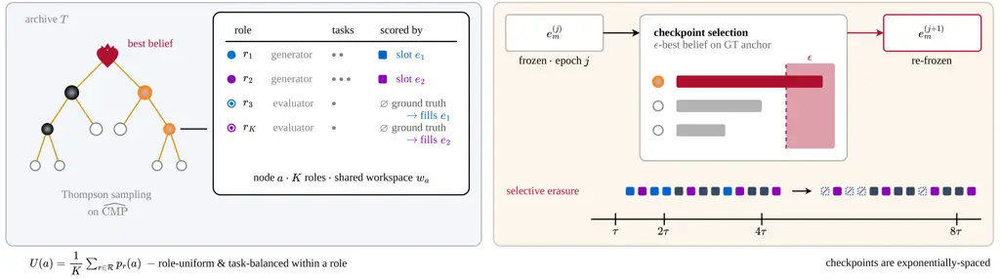
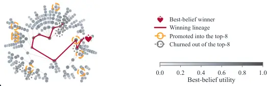
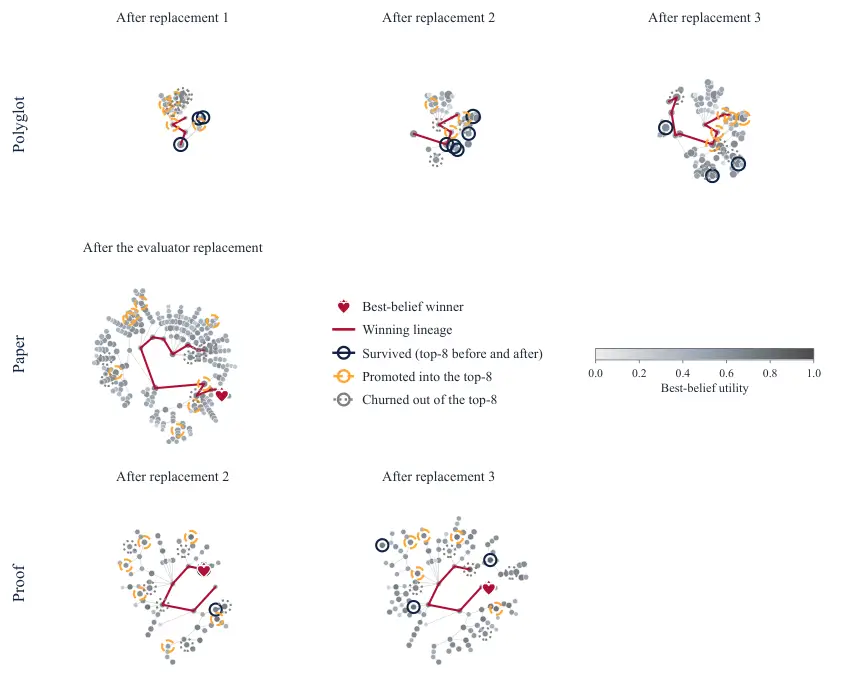
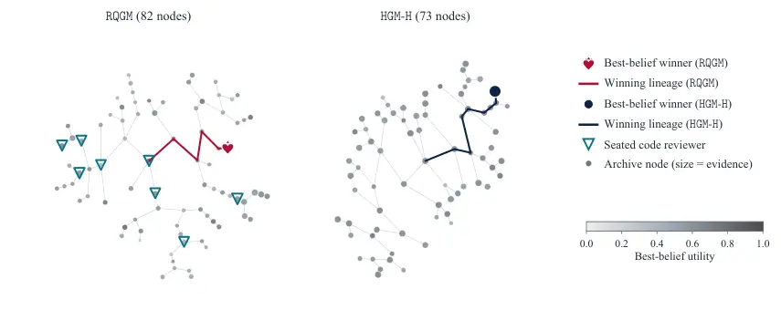

Figure 1: RQGM outperforms the HGM-H baseline on DeepSWE: it matches
HGM-H at equal search cost and keeps improving after HGM-H plateaus,
with harness improvements that transfer to higher reasoning efforts.
_Left:_ held-out pass rate of the best coder harness across reasoning
efforts; both the RQGM and HGM-H searched using low reasoning effort for
the coder. Gray $`\times`$’s show base GPT-6 Astra held-out performance;
diamonds show its performance on full DeepSWE. _Right:_ the leading
agent’s best-belief task utility during search, defined as the 5th
percentile of its Beta working posterior. Orange shows the leading
coder’s utility under the co-evolved code-review objective; teal tracks
the leading reviewer’s utility against ground truth. The RQGM co-evolves
a learned code reviewer, providing a complementary search signal that
improves across evolutionary epochs. Crowns mark epoch boundaries, where
a stronger reviewer replaces the incumbent and reviewer-dependent
utility records are erased, so coder-review utility may shift even when
the leading coder is unchanged; these boundaries coincide with
improvements in the teal curve.

## 1 Introduction

Self-improving agents aim to turn gains in coding and reasoning into a
recursive loop, where each stronger agent can produce better variants of
itself. Search methods such as the Darwin and Huxley Gödel Machines (DGM
and HGM) (Zhang et al., 2026a; Wang et al., 2026a) set the open-source
state-of-the-art on agentic coding tasks by editing their own code and
retaining variants that improve an external utility signal.
HyperAgents (Zhang et al., 2026b) then extended this self-improvement
beyond coding to task agents in arbitrary domains. Despite this
progress, current search methods still depend on stationary evaluation
fixed outside the improvement loop. This is unlike biological evolution,
where, under Van Valen’s Red Queen hypothesis (Van Valen, 1973), each
species adapts to competitors that evolve in turn. This dependence
constrains self-improvement when a target task has no direct benchmark,
as for paper and proof writing, unlike paper reviewing and proof
grading (Lu et al., 2026; Yamada et al., 2025; Luong et al., 2025), when
evaluation is slow or weakly informative (Levine et al., 2018; Burger
et al., 2020; Andrychowicz et al., 2017), and when static benchmarks
saturate or become vulnerable to reward hacking (Yang et al., 2026; Ott
et al., 2022).

We introduce the Red Queen Gödel Machine (RQGM), an evolutionary
framework that treats evaluation as part of the search process. We study
this through _co-evolved_ learned evaluators, which improve alongside
the task agents they guide. Such an evaluator can supply the search
signal when no benchmark exists, add criteria a benchmark cannot
capture, or act as a cheaper proxy. The core mechanism is _controlled
utility evolution_, which divides search into _evolutionary epochs_.
Within an epoch, one evaluator is frozen and grades every task agent,
supplying a stationary utility signal. In parallel, the search
co-evolves challenger evaluators with their task agents and scores them
against a held-out ground-truth dataset. At an epoch boundary, a
challenger replaces the frozen evaluator only if it raises the
incumbent’s best-belief score on a replacement criterion; the RQGM then
applies _selective erasure_, discarding only utility records that
depended on the replaced evaluator. Each epoch is thus a
_fixed-criterion search problem_, so HGM’s guarantees apply within each
epoch (Secs. 3 and F). Since validity requires only a fixed within-epoch
utility and boundary erasure of dependent records, time-varying
benchmarks and adversarial objectives fit the same structure.

On DeepSWE (Huang et al., 2026a), the RQGM coder running at low
reasoning reaches a held-out pass rate of $`\textbf{82.1}\bm{\%}`$
against the HGM-H baseline at $`75.0\bm{\%}`$. The RQGM with low
reasoning also matches the base GPT-6 Astra model in the mini-SWE-agent
harness at high effort, and reaches $`\textbf{85.7}\bm{\%}`$ at medium
or high effort (Fig. 1). On Polyglot, the RQGM reaches
$`\textbf{71.7}\bm{\%}`$ against $`69.9\bm{\%}`$ with fewer search
tokens (Fig. 3). This illustrates a broader advantage of the RQGM:
shared expansions can improve multiple utilities at once, since most
accepted expansions edit code shared by the coder and
reviewer (Fig. 11). We then turn to scientific paper writing and
reviewing, and Olympiad-level proof writing and grading, where only
reviewing and grading have a benchmark. Co-evolved writers raise
reviewer-panel acceptance from $`21.8\bm{\%}`$ to
$`\textbf{40.5}\bm{\%}`$ (Tab. 2), while a co-evolved grader exceeds the
static baselines with a $`\textbf{3}\bm{\times}`$ lower search cost than
HGM-H (Fig. 6). Co-evolution can also regularize evaluators: replaying
AI-generated papers accepted by a displaced reviewer as adversarial
samples produces a reviewer equally stringent on machine-written and
human-written work (Fig. 7). Given the pace of model improvement, we
believe automatically evolving the benchmarking process is needed for AI
systems to exceed what static evaluation alone can achieve.


## 2 Related Work

##### Self-Improving AI.

The Gödel Machine (Schmidhuber, 2003) is a theoretical construct that
rewrites its own code whenever it can _prove_ that doing so is
beneficial. A recent line of work makes this construct empirical by
replacing proof search with archive search over observed utility. The
Darwin Gödel Machine (Zhang et al., 2026a, DGM,) ranks self-modifying
coding agents by benchmark utility, the Huxley-Gödel Machine (Wang
et al., 2026a, HGM,) scores nodes by _clade metaproductivity_ rather
than their own score, and HyperAgents (Zhang et al., 2026b) extends
self-modification beyond coding tasks by making each node an editable
meta-agent/task-agent codebase. These systems hold their evaluation
criterion _fixed_ outside the loop, exposing them to benchmark
saturation (Ott et al., 2022), judge biases (Zheng et al., 2023; Dubois
et al., 2024), and reward hacking (Skalse et al., 2022). The RQGM
departs from this line of work by pulling the evaluation criterion
itself inside the loop, searching over the evaluators that define the
utility.

##### Co-Evolving Evaluation.

Recent work co-adapts generators and rewards within the gradient-based
training of a single model (Yuan et al., 2024; Wang et al., 2025; Zhu
et al., 2026) or co-evolves evaluation metrics with agent skills under
ground-truth guards (Zhang et al., 2026c). By contrast, the RQGM
operates in the search space of agentic codebases, preserving HGM’s
epoch-local validity while gating every evaluator promotion on an
evaluator-independent ground-truth anchor. In doing so, it guards
against the self-referential drift documented in self-rewarding training
(Panickssery et al., 2024; Pan et al., 2024). A further survey of
related work can be found in App. H.

## 3 RQGM: Co-Evolving Agents and Their Evaluators

As visualized in Fig. 2, the RQGM is a search over an archive
$`\mathcal{T}`$ where each node is a shared, evolvable workspace
containing task agents, evaluators, and a meta-agent that oversees the
workspace. Expansion creates an edited child starting from the parent.
Since the meta-agent and role-agent code are editable, roles may reuse
each other’s code if the meta-agent deems it useful. Only the scoring
and orchestration harness are fixed. Departing from prior work, the RQGM
introduces _controlled utility evolution_ to co-evolve agents and their
evaluators (Sec. 3.2). Details are in App. B.



Figure 2: RQGM co-evolves task agents and evaluators in a shared
workspace tree. Evaluators are scored on ground-truth. At checkpoints,
the highest best-belief evaluator is selected, and records dependent on
displaced evaluators are erased (Algorithm 1), we show an expanded view
in Fig. 8.

### 3.1 Search Space and Utility

The RQGM enables the evaluation of tasks without ground-truth signal via
distinct evaluator roles. In addition to evaluator-independent roles
that use fixed benchmarks (Sec. B.1), _evaluator-dependent_ roles use
_learned evaluators_, each held in an independently replaced _evaluator
slot_.

Self-improvement as tree search.  Following Wang et al. (2026a), the
archive $`\mathcal{T}`$ at time $`t`$ ($`\mathcal{T}_{t}`$) grows from a
root agent $`a_{0}`$. Each step either _expands_ a node, adding an
edited child, or _evaluates_ a node on one task, adding a binary outcome
to its successes $`S_{a}`$ or failures $`F_{a}`$. Expansion occurs via a
UCB-Air gate (Wang et al., 2008) when the number of evaluations is
sufficient (see Sec. B.2). A node’s own success rate poorly predicts
what its descendants achieve, so Thompson sampling selects expansion
parents by _clade metaproductivity_, the rate pooled over the subtree
$`C(a)`$ rooted at $`a`$,
$`\widehat{\texttt{CMP}}(a)=S^{C}_{a}/(S^{C}_{a}+F^{C}_{a})`$, and
evaluation targets by their own $`(S_{a},F_{a})`$. Under a fixed
criterion, a CMP oracle suffices to implement the Gödel
Machine (Thm. 1).

Utility definition.  The role-aggregated search utility averages success
rates over each role’s tasks, then over roles. Let $`p_{r,d}(a)`$ be
node $`a`$’s expected success rate on task $`d`$ of role $`r`$ under the
fixed evaluation criteria. With $`K`$ roles and task pools
$`\mathcal{D}_{r}`$, we weight roles uniformly:

```math
U(a)=\frac{1}{K}\sum_{r=1}^{K}\left[\frac{1}{|\mathcal{D}_{r}|}\sum_{d\in\mathcal{D}_{r}}p_{r,d}(a)\right].
```

At each evaluation, the scheduler selects a node, then its
least-evaluated eligible role and task (Sec. B.2). For any fixed
utility, the node’s $`\epsilon`$-best-belief is a lower quantile of a
Beta working posterior, and the search returns its maximizer once the
budget $`B`$ is spent.

```math
BB_{\epsilon}(a)=\operatorname{Quantile}_{\epsilon}\!\left[\operatorname{Beta}(1+S_{a},\,1+F_{a})\right].
```

If all roles and tasks remain eligible and each pair’s empirical success
rate converges to its fixed mean, the pooled rate converges to $`U(a)`$
under balanced sampling (Prop. 1).

### 3.2 Controlled Utility Evolution

In fixed-criterion search, _learned evaluators_ cannot co-evolve with
the agents they score. To enable the co-evolution of evaluators and
their agents, we first assume _epoch-local stationarity_: each
evaluator, node workspace, and scoring rule stays fixed within an epoch,
the interval between two checkpoints (Asm. 2). At specific checkpoints
(epoch boundaries), learned evaluators may be replaced if they fulfill
the following criterion (Sec. B.3).

Ground-truth evaluator replacement.  At each checkpoint, every evaluator
slot compares its incumbent against challengers on a _ground-truth
anchor_, a fixed held-out dataset of objective or human labels. The
highest anchor best-belief wins, with ties retaining the incumbent. A
slot may also reward rejecting an _adversarial pool_ of outputs its
displaced evaluator had accepted (Sec. 4); without one, the
evaluator-independent anchor keeps one criterion across
epochs (Sec. F.2.1).


For fixed $`\epsilon\in(0,1)`$, the Beta mean and quantile converge to
$`Q(e)`$ when their samples consistently estimate that same objective.
Each utility record $`z`$ carries the set $`\operatorname{dep}(z)`$ of
slots whose evaluator affected its generation, sampling, replay, or
scoring. Upon replacement on slot $`m`$, _selective erasure_ removes
every record $`z`$ with $`m\in\operatorname{dep}(z)`$ written under the
displaced evaluator, since keeping or rescaling it would mix evidence
from two utilities. Other records and all artifacts are unaffected, and
node and clade statistics are recomputed (Defs. F.2 and 2).


Amortized utility-transition cost.  Re-scoring the entire archive after
every erasure wastes budget on nodes the search may never revisit. To
avoid this, the RQGM re-scores old nodes on demand, using cached outputs
without additional task-agent calls beyond the new evaluator. In
addition, we use exponentially spaced checkpoints to bound total cost
(Sec. B.3).


## 4 Experimental Design

Domains and ground-truth anchors.  Paper writing and review are paired,
anchored to APReS accept/reject decisions (Zhao et al., 2026). Proof
writing and grading are anchored to IMO-GradingBench human grades (Luong
et al., 2025), where a proof is accepted only when the epoch’s frozen
grader awards full credit ($`7`$ of $`7`$). Coding uses two benchmarks,
each with two anchors. On Polyglot (Gauthier, 2024), the coding agent is
anchored to executable tests, with the code reviewer anchored to
CRAVE (Zhang, 2025), a dataset of accepted/rejected pull requests. On
DeepSWE (Huang et al., 2026a), the coder is anchored to the benchmark’s
tests, and the code reviewer to a balanced dataset of publicly available
accepted/rejected patches (Sec. C.6). Reward design follows
HyperAgents (Zhang et al., 2026b): a task agent writes a reward
function, and a quadruped policy trained on it with PPO is scored on
forward walking during search and on jumping held out. Its utility is
continuous, so we slightly adapt the HGM utility and search
prior (Sec. B.5). Section C.8 details the splits, curriculum, and
protocol.

Data splits.  Every dataset is divided into train, validation, and
held-out test splits. The meta-agent may request task-agent results only
on the train split, which informs its edits. Node selection and
evaluator replacement are driven solely by the validation split. The
held-out test split is never seen during search and is used only for
post-hoc scoring of search-selected agents. Section C.6 describes how
each dataset is split. We show the initialization of each role in
Sec. C.9.

Baselines.  Every headline domain uses a learned baseline, HGM-H (Wang
et al., 2026a; Zhang et al., 2026b), which replaces the DGM search
algorithm of HyperAgents (Zhang et al., 2026b) with the more
sample-efficient HGM, while keeping evaluators frozen. We use the Sakana
prompt reviewer (Lu et al., 2026) for paper writing,
ProofAutoGrader (Luong et al., 2025) for proof grading, and the IMO25
prover (Huang and Yang, 2025) for proof writing. We evaluate the best
published HyperAgents (DGM-H) patches from Zhang et al. (2026b) for
paper reviewing and grading as a proxy for DGM-level performance. We
selected GPT-5.5 (low) for experiments unless otherwise stated. For
DeepSWE, we move to GPT-6 Astra (OpenAI, 2026a), the strongest model on
the DeepSWE leaderboard at the time of writing, with a high-effort
meta-agent and low-effort task agents in both arms. For the reward
design domain we use Nemotron 3 Ultra.

Search interventions.  In paper writing/reviewing and on DeepSWE, we use
controlled utility evolution to challenge evaluators with outputs
accepted by previous evaluators. After replacement, the papers or
patches the displaced evaluator had accepted form an adversarial pool.
Subsequent evaluator selection rewards rejecting these generated outputs
alongside performance on the labeled examples. We ablate these
mechanisms in Sec. D.2. For reward design we use a curriculum over the
difficult of the task as a form of evolving utility.

Costs and reporting.  Best-belief is comparable across epochs only when
it rests on a fixed ground-truth anchor, so a _global_ best-belief
winner exists only for anchored roles: the learned evaluators and the
verifiable coding agent. The paper writer and prover have no anchor and
admit only _epoch-local_ winners, each the best agent under its epoch’s
frozen evaluator; we select these per epoch and score them post-hoc
against fixed external judges (Tabs. 2 and 3). We compare headline runs
at matched search tokens rather than evaluation counts, since
evaluations differ in cost; we report _blended tokens_: input plus
output, with output weighted at $`5\times`$ input cost (OpenAI, 2026b;
Anthropic, 2026), counting both generation and evaluation calls.
Following Wang et al. (2026a), a best-belief agent’s cost is measured
when it first attains its highest $`\epsilon`$-best-belief score, not
when the epoch or run finishes. _Specialist_ nodes are those that
maximize best-belief on one target utility; a _generalist_ is a node
that maximizes the average best-belief across its active
utilities (Sec. C.3). When the specialist and generalist coincide on the
same node, we report a single result.

## 5 Results

Our results show that where ground truth exists, a co-evolved evaluator
provides a complementary objective and finds stronger agents than
fixed-evaluator search (Sec. 5.1). Where no benchmark exists, it
supplies the search signal, and co-evolved agents outperform
fixed-evaluator baselines (Sec. 5.2). Evaluator replacements act as a
curriculum, re-ranking the archive toward new candidates around a
resilient backbone (Sec. 5.3). Finally, co-evolution improves the
evaluators themselves, and adversarial objectives correct failure modes
such as self-preference (Sec. 5.4).

### 5.1 Learned evaluation helps even where ground truth exists (RQ1)

In both coding domains, we co-evolve a code reviewer with the coder,
providing a cheaper, complementary surrogate to the ground-truth signal.
We also study reward design, where ground truth exists but
non-stationary utilities can still improve search.

DeepSWE.  At low reasoning effort, the RQGM coder scores $`82.1\%`$
compared to $`75.0\%`$ for the best HGM-H coder (Fig. 1). At matched
search tokens the two searches reach similar best-belief, but HGM-H
never finds a better coder over the rest of its run, while the RQGM
continues to improve. It exceeds GPT-6 Astra at low ($`68.8\%`$) and
medium ($`76.8\%`$) effort, and nearly matches it at high effort
($`83.0\%`$). These gains transfer to higher reasoning efforts: at
medium and high effort, the RQGM coder passes $`85.7\%`$, ahead of the
HGM-H coder ($`78.6\%`$, $`82.1\%`$) (Sec. C.7). As on Polyglot, the
co-evolved reviewer grades every coder patch, and this signal steers
expansion (Sec. E.4).

Figure 3: RQGM exceeds the HGM-H baseline on Polyglot with
$`1.35\times`$–$`1.72\times`$ fewer search tokens by adding a cheap
evolved code reviewer. _Left:_ held-out pass rate against search cost;
the heart marks the best agent. _Right:_ best-belief utility across
epochs. Crowns mark evaluator replacements, when erasure discards the
displaced reviewer’s utility records.

Polyglot.  The RQGM exceeds the HGM-H held-out pass rate for both the
specialist and generalist at $`1.35\times`$–$`1.72\times`$ lower token
cost (Fig. 3). Examining where the meta-agent edits the codebase shows
the benefits of co-evolution: in the DeepSWE run, $`83\%`$ of accepted
code patches modify shared task-agent functionality or infrastructure
used by both the coder and the reviewer, rather than role-specific code,
and in Polyglot $`90\%`$ do (Fig. 11). This suggests that co-evolution
enriches the search rather than splitting its effort across competing
objectives.

| Search           | Held-out score $`\uparrow`$      | Median             | Runs with jumps  | Nodes/run | Search tokens (blended) |
| ---------------- | -------------------------------- | ------------------ | ---------------- | --------- | ----------------------- |
| Static evaluator | $`0.306`$ $`\pm 0.128`$          | $`0.302`$          | $`3/5`$          | $`22.0`$  | $`48.3`$M               |
| RQGM curriculum  | $`\mathbf{0.365}`$ $`\pm 0.053`$ | $`\mathbf{0.361}`$ | $`\mathbf{5/5}`$ | $`21.2`$  | $`53.8`$M               |

Table 1: A walking curriculum yields reward designers that transfer to
jumping. Five searches per arm at $`125`$ evaluations, six held-out
trials each; mean $`\pm`$ std over $`30`$ trials.

Reward design.  Instead of changing the evaluator at epoch boundaries,
the RQGM changes the task dataset. Meta-agents design reward functions
for reinforcement learning: search scores them on a quadruped learning
to walk forward, while the held-out task is learning to jump (Zhang
et al., 2026b). After a first epoch on the original walking task, the
RQGM adds a progressively larger obstacle in the robot’s
path (Sec. C.8), and we compare it with the same search under a static
evaluator. The held-out mean rises by $`19\%`$, and all five RQGM runs
yield a jumping policy, against three of five for the static
evaluator (Tab. 1). These results match those of HyperAgents (Zhang
et al., 2026b), at $`3.85`$–$`4.33\times`$ lower cost, using Nemotron 3
Ultra rather than Claude Sonnet 4.5.


### 5.2 Learned evaluation improves agents without objective evaluation (RQ2)

We now turn to domains with no objective benchmark, where only
evaluator-dependent task agents exist. We score the artifacts produced
by our paper writer and prover against a broad panel of reviewers and
graders from both our work and prior baselines. Here we evaluate only
the task agents, deferring their co-evolved evaluators to Sec. 5.4,
where anchor data permits further analysis.

Paper writing.  We score writer artifacts against a panel of four
reviewers (Tab. 2). At matched search tokens, the RQGM writer achieves a
$`1.78\times`$ higher average reviewer-panel acceptance rate than the
HGM-H, and the best discovered agent across the full run beats the HGM-H
with a $`1.86\times`$ higher average acceptance rate. We ascribe this
improvement to the regularized search, which favors reviewers that are
harsher on AI-generated text (Sec. 5.4).

[TABLE]

Table 2: Co-evolved writers achieve $`1.78\times`$ higher mean
acceptance at matched search cost, and $`1.86\times`$ for the best-found
specialist. The four Reviewers give the percentage of writer-generated
papers that the specific reviewer accepts (mean $`\pm`$ 95% Jeffreys
half-width). RQGM adversarial is the RQGM reviewer regularized to be
harsher on AI-written text (Sec. 5.4). Best per column in bold.

| Prover                   | Search tokens | Score ($`\uparrow`$)  | Pass@6 ($`\uparrow`$)  | Pass@7 ($`\uparrow`$)  |
| ------------------------ | ------------- | --------------------- | ---------------------- | ---------------------- |
| Static IMO25 prover      | N/A           | $`4.07`$ $`\pm 0.42`$ | $`55.0\%`$ $`\pm 6.4`$ | 55.0% $`\pm 6.4`$      |
| HGM-H prover             | 21.5M         | $`3.73`$ $`\pm 0.43`$ | $`51.7\%`$ $`\pm 6.5`$ | $`45.0\%`$ $`\pm 6.4`$ |
| RQGM prover (generalist) | 37.9M         | $`3.73`$ $`\pm 0.43`$ | $`51.7\%`$ $`\pm 6.5`$ | $`45.0\%`$ $`\pm 6.4`$ |
| RQGM prover (specialist) | 88.0M         | 4.33 $`\pm 0.41`$     | 61.7% $`\pm 6.3`$      | $`48.3\%`$ $`\pm 6.5`$ |

Table 3: The co-evolved RQGM specialist prover attains the best mean
score. A panel of three graders scores every proof. We pool each metric
across graders, with per-grader results in Tab. 10; without the RQGM
grader, the specialist still matches IMO25 ($`4.03`$ vs. $`4.08`$) and
beats HGM-H ($`3.60`$). Score is the mean grade ($`0`$–$`7`$), Pass@6
the fraction scoring at least $`6`$ of $`7`$, and Pass@7 the fraction
earning full credit; all report $`\pm`$ s.e.m. Best per column in bold.

Proof writing.  As shown in Tab. 3, the RQGM generalist performs
similarly to the HGM-H at matched search tokens. Divergence appears at
longer horizons where the HGM-H stagnates. The RQGM specialist prover
achieves the best panel-mean score and Pass@6 score; without our own
grader in the panel, it still matches the static IMO25 prover ($`4.03`$
vs. $`4.08`$) and beats HGM-H ($`3.60`$). As we show in Sec. 5.4, this
is enabled by a co-evolved grader that exceeds ProofAutoGrader and
HGM-H.

A more nuanced comparison is the IMO25 baseline of Huang and Yang
(2025), a human-engineered verification-and-refinement pipeline that
achieved gold-medal performance at IMO 2025. The RQGM specialist attains
a higher panel-mean score despite using no hand-engineered
Olympiad-specific scaffold, but achieves this by finding more
near-complete proofs ($`6`$ of $`7`$). Details appear in App. D.


### 5.3 Evaluator replacements act as a curriculum on the search (RQ3)

A mechanism by which the RQGM can improve task agents is that a
progressively harsher evaluator imposes a curriculum-like effect on the
task agents. For this, each evaluator transition must re-rank the search
under the stricter criterion while preserving strong lineages, so that
the search advances.

Figure 4: Evaluator replacements permanently re-rank the archive. Each
curve tracks one replacement, plotting the Spearman $`\rho`$ between
post- and pre-replacement rankings as evaluations accumulate: $`\rho=1`$
(dotted) is the unchanged order, $`\rho=0`$ indicates an uncorrelated
reordering. Across all three tasks $`\rho`$ settles well below $`1`$ and
never recovers. The no-erasure control (rightmost) stays high
($`\rho\geq 0.90`$), showing erasure is necessary for utility
transitions to guide search.

Macro view: each replacement re-ranks the archive.  If replacements
merely sharpened pass-rate estimates without changing which agents the
search favors, no curriculum could arise. Figure 4 shows that part of
the ranking persists across a transition, since evaluator-independent
evidence carries through, but the re-ordering never recovers. Without
erasure the ranking remains highly stable.



Figure 5: Evaluator replacement preserves the best lineage. The paper
archive after replacement (node color is best-belief utility, size
tracks evidence count). The crimson winning lineage survives. Among the
top-$`8`$ nodes, every prior member is re-ranked (rings mark promotions
and churn).

Micro view: the curriculum advances a backbone lineage.  Figure 5 shows
that the archive concentrates evidence on a few backbone lineages. While
candidates are often re-ranked, the best lineage stays resilient,
suggesting the curriculum improves candidates around a stable backbone.


### 5.4 Co-evolution improves the evaluators themselves (RQ4)

Figure 6: The co-evolved RQGM grader reaches the best IMO-GradingBench
accuracy at $`3\times`$ lower search cost than HGM-H. _Left:_
IMO-GradingBench accuracy of selected graders against grading mean
absolute error (MAE). _Right:_ best-belief utility over tokens for
graders (triangles) and provers (circles). Utility drops at each
evaluator replacement (crown), with shading marking epochs, as erasure
discards the displaced records, then re-climbs.

Proof grading.  As shown in Fig. 6, the co-evolved grader is the
strongest judge, outperforming the static baselines and the best HGM-H
grader at $`3\times`$ lower search cost; the specialist and generalist
coincide in a single node. This better grader drives the prover gains of
Tab. 3. Similarly, on DeepSWE, only the top reviewer rejects most
failing patches (Tab. 15) with the others being overly lenient.

Figure 7: The adversarial RQGM reviewer accepts AI and human papers at
similar rates. _Left:_ APReS accuracy of selected reviewers against
acceptance rate; the dashed line marks the dataset’s $`50\%`$ accept
rate; its $`32\%`$ acceptance matches its $`29`$–$`31\%`$ on writer
papers (Tab. 2). _Right:_ the same run over tokens, showing best-belief
utility for reviewers (triangles) and writers (circles); at the
adversarial-pool replacement the generalist’s average best-belief drops
as erasure re-ranks the affected utilities, then re-climbs under the
harsher criterion.

Paper review.  The HGM-H reviewer scoring writers in Tab. 2 accepts
AI-generated papers at $`1.42\times`$–$`1.91\times`$ the rate of human
ones. After each evaluator replacement in the RQGM, the AI-generated
papers the displaced reviewer had accepted form an adversarial pool, and
the next epoch additionally rewards evolved reviewers for rejecting
them. As shown in Fig. 7, the search then selects a reviewer that is
harsh specifically on AI-generated text, which costs raw accuracy by
construction and leaves our best-found reviewer below the lenient HGM-H.
However, this calibrates the reviewer to accept AI-generated and
human-written papers at similar rates while retaining $`80\%`$
ground-truth accuracy.


## 6 Conclusion

We introduced the Red Queen Gödel Machine (RQGM), a framework in which
evaluators co-evolve with the agents they score. Through controlled
utility evolution, the search objective can change at epoch boundaries
while remaining fixed within each epoch, which has three consequences.
First, where ground truth exists, a co-evolved evaluator adds a
complementary search signal, and co-evolved coders outperform the HGM-H
baseline on both coding benchmarks. Second, co-evolving the evaluator
alongside the generator enables improvement on hard-to-verify tasks such
as paper and proof writing, where a fixed benchmark cannot score the
artifact directly. Third, the search can adopt interventions that a
fixed objective cannot express, such as a curriculum or an adversarial
term. At longer horizons, we believe these mechanisms could help push
the frontier of AI capabilities.

## Acknowledgments

This research was supported by the following entities: NVIDIA, The Royal
Academy of Engineering via DANTE (a RAEng Chair); the European Research
Council, specifically the REDIAL project; SPRIND under the composite
learning challenge; Foresight Institute via the AI Safety Grant; Google
through a Google Academic Research Award. We also thank Mara Darin Agha
for advising on the narrative of this work and its related artifacts,
and for constructing their visual language and design.

## AI Use Statement

We used GPT-5.5, GPT-5.6 Sol, and GPT-6 Astra in the experimental work
reported in this paper. Nemotron 3 Ultra was used for the reward-design
experiment, and Nemotron 3 Super and Nemotron 3 Ultra for ablations
present in the Appendix.

We used GPT-5.5 and GPT-5.6 Sol to polish writing, abbreviate or
rephrase text, evaluate its clarity, and identify areas for improvement.
These models also assisted with discovery of additional papers for our
extended literature review in App. H, building on the authors’ initial
review.

We used GPT-5.5 and GPT-6 Astra to generate plotting code and as general
code assistants. Finally, we used GPT-6 Astra and GPT-5.6 Sol to assist
with experiments and check proofs.

## Ethics statement

This work automates the writing and reviewing of scientific papers,
which carries a dual-use risk: automated writers could be used to flood
peer review with generated submissions, and automated reviewers could be
deployed in place of human judgment. No generated paper was submitted to
any venue or shown to human reviewers, and all reviewing experiments use
the public APReS dataset. Our results bear on this risk directly: fixed
LLM reviewers accept AI-generated papers more readily than human ones,
and the RQGM’s adversarial objective produces a reviewer that is equally
stringent on both. We view calibrated automated evaluation as a
safeguard for peer review, not a replacement for it. The work involves
no human subjects or personal data.

## Reproducibility statement

All implementation details needed to reproduce our results are provided
in App. B, along with the experimental setup in App. C. Additional
results and ablations are in App. D. The supplementary zip contains the
anonymized code together with a README and scripts that give
step-by-step instructions to install the system, check the installation
on a toy domain, and run both RQGM and the HGM-H baseline in every
domai.

## References

- Zhang et al. \[2026a\] Jenny Zhang, Shengran Hu, Cong Lu,
  Robert Tjarko Lange, and Jeff Clune. Darwin Gödel Machine: Open-ended
  evolution of self-improving agents. In _International Conference on
  Learning Representations (ICLR)_, 2026a.
- Wang et al. \[2026a\] Wenyi Wang, Piotr Piękos, Li Nanbo, Firas
  Laakom, Yimeng Chen, Mateusz Ostaszewski, Mingchen Zhuge, and Jürgen
  Schmidhuber. Huxley-Gödel Machine: Human-Level Coding Agent
  Development by an Approximation of the Optimal Self-Improving Machine.
  In _International Conference on Learning Representations (ICLR)_,
  2026a.
- Zhang et al. \[2026b\] Jenny Zhang, Bingchen Zhao, Wannan Yang,
  Jakob N. Foerster, Jeff Clune, Minqi Jiang, Sam Devlin, and Tatiana
  Shavrina. HyperAgents. _arXiv preprint arXiv:2603.19461_, 2026b.
- Van Valen \[1973\] Leigh Van Valen. A new evolutionary law.
  _Evolutionary Theory_, 1973.
- Lu et al. \[2026\] Chris Lu, Cong Lu, Robert Tjarko Lange, Yutaro
  Yamada, Shengran Hu, Jakob Foerster, David Ha, and Jeff Clune. Towards
  end-to-end automation of AI research. _Nature_, 2026.
- Yamada et al. \[2025\] Yutaro Yamada, Robert Tjarko Lange, Cong Lu,
  Shengran Hu, Chris Lu, Jakob Foerster, Jeff Clune, and David Ha. The
  ai scientist-v2: Workshop-level automated scientific discovery via
  agentic tree search. _arXiv preprint arXiv:2504.08066_, 2025.
- Luong et al. \[2025\] Thang Luong, Dawsen Hwang, Hoang H. Nguyen,
  Golnaz Ghiasi, Yuri Chervonyi, Insuk Seo, Junsu Kim, Garrett Bingham,
  Jonathan Lee, Swaroop Mishra, Alex Zhai, Clara Huiyi Hu, Henryk
  Michalewski, Jimin Kim, Jeonghyun Ahn, Junhwi Bae, Xingyou Song,
  Trieu H. Trinh, Quoc V. Le, and Junehyuk Jung. Towards robust
  mathematical reasoning. In _EMNLP_, pages 35418–35442. Association for
  Computational Linguistics, 2025.
- Levine et al. \[2018\] Sergey Levine, Peter Pastor, Alex Krizhevsky,
  Julian Ibarz, and Deirdre Quillen. Learning hand-eye coordination for
  robotic grasping with deep learning and large-scale data collection.
  _Int. J. Robotics Res._, 2018.
- Burger et al. \[2020\] Benjamin Burger, Phillip M. Maffettone,
  Vladimir V. Gusev, Catherine M. Aitchison, Yang Bai, Xiaoyan Wang,
  Xiaobo Li, Ben M. Alston, Buyi Li, Rob Clowes, Nicola Rankin, Brandon
  Harris, Reiner Sebastian Sprick, and Andrew I. Cooper. A mobile
  robotic chemist. _Nature_, 2020.
- Andrychowicz et al. \[2017\] Marcin Andrychowicz, Filip Wolski, Alex
  Ray, Jonas Schneider, Rachel Fong, Peter Welinder, Bob McGrew, Josh
  Tobin, OpenAI Pieter Abbeel, and Wojciech Zaremba. Hindsight
  experience replay. In _Conference on Neural Information Processing
  Systems (NeurIPS)_, 2017.
- Yang et al. \[2026\] Haoyan Yang, Mario Xerri, Solha Park, Huajian
  Zhang, Yiyang Feng, Sai Akhil Kogilathota, and Jiawei Zhou.
  Self-improvement of large language models: A technical overview and
  future outlook. _Transactions on Machine Learning Research_, 2026.
- Ott et al. \[2022\] Simon Ott, Adriano Barbosa-Silva, Kathrin Blagec,
  Jan Brauner, and Matthias Samwald. Mapping global dynamics of
  benchmark creation and saturation in artificial intelligence. _Nature
  Communications_, 2022.
- Huang et al. \[2026a\] Wenqi Huang, Charley Lee, Leonard Tng, and
  Serena Ge. DeepSWE: Measuring frontier coding agents on original,
  long-horizon engineering tasks. _arXiv preprint arXiv:2607.07946_,
  2026a.
- Schmidhuber \[2003\] Jürgen Schmidhuber. Gödel machines:
  Self-referential universal problem solvers making provably optimal
  self-improvements. _CoRR_, cs.LO/0309048, 2003.
- Zheng et al. \[2023\] Lianmin Zheng, Wei-Lin Chiang, Ying Sheng,
  Siyuan Zhuang, Zhanghao Wu, Yonghao Zhuang, Zi Lin, Zhuohan Li,
  Dacheng Li, Eric P. Xing, Hao Zhang, Joseph E. Gonzalez, and Ion
  Stoica. Judging LLM-as-a-judge with MT-bench and chatbot arena. In
  _Conference on Neural Information Processing Systems (NeurIPS)_, 2023.
- Dubois et al. \[2024\] Yann Dubois, Percy Liang, and Tatsunori
  Hashimoto. Length-controlled AlpacaEval: A simple debiasing of
  automatic evaluators. In _Conference on Language Modeling
  (COLM)_, 2024.
- Skalse et al. \[2022\] Joar Skalse, Nikolaus H. R. Howe, Dmitrii
  Krasheninnikov, and David Krueger. Defining and characterizing reward
  gaming. In _Conference on Neural Information Processing Systems
  (NeurIPS)_, 2022.
- Yuan et al. \[2024\] Weizhe Yuan, Richard Yuanzhe Pang, Kyunghyun Cho,
  Xian Li, Sainbayar Sukhbaatar, Jing Xu, and Jason Weston.
  Self-rewarding language models. In _International Conference on
  Machine Learning (ICML)_, 2024.
- Wang et al. \[2025\] Yinjie Wang, Ling Yang, Ye Tian, Ke Shen, and
  Mengdi Wang. Co-evolving LLM coder and unit tester via reinforcement
  learning. In _Conference on Neural Information Processing Systems
  (NeurIPS)_, 2025.
- Zhu et al. \[2026\] Han Zhu, Chengkun Cai, Yuanfeng Song, Xing Chen,
  Sirui Han, and Yike Guo. Self-evolving deep research via joint
  generation and evaluation. _arXiv preprint arXiv:2606.04507_, 2026.
- Zhang et al. \[2026c\] Xing Zhang, Guanghui Wang, Yanwei Cui, Ziyuan
  Li, Wei Qiu, Bing Zhu, and Peiyang He. Who grades the grader?
  co-evolving evaluation metrics and skills for self-improving llm
  agents. _arXiv prepritn arXiv:2607.12790_, 2026c.
- Panickssery et al. \[2024\] Arjun Panickssery, Samuel R. Bowman, and
  Shi Feng. LLM evaluators recognize and favor their own generations. In
  _Conference on Neural Information Processing Systems (NeurIPS)_, 2024.
- Pan et al. \[2024\] Alexander Pan, Erik Jones, Meena Jagadeesan, and
  Jacob Steinhardt. Feedback loops with language models drive in-context
  reward hacking. In _International Conference on Machine Learning
  (ICML)_, 2024.
- Wang et al. \[2008\] Yizao Wang, Jean-yves Audibert, and Rémi Munos.
  Algorithms for infinitely many-armed bandits. In _Advances in Neural
  Information Processing Systems (NIPS)_, 2008.
- Zhao et al. \[2026\] Bingchen Zhao, Jenny Zhang, Chenxi Whitehouse,
  Minqi Jiang, Michael Shvartsman, Abhishek Charnalia, Despoina Magka,
  Tatiana Shavrina, Derek Dunfield, Oisin Mac Aodha, and Yoram Bachrach.
  APReS: an agentic paper revision and evaluation system. _arXiv
  preprint arXiv:2603.03142_, 2026.
- Gauthier \[2024\] Paul Gauthier. o1 tops aider’s new polyglot
  leaderboard.
  [https://aider.chat/2024/12/21/polyglot.html](https://aider.chat/2024/12/21/polyglot.html), 2024.
- Zhang \[2025\] Li Zhang. CRAVE: Code Review Agent Verdict Evaluation.
  Hugging Face dataset, 2025. URL
  [https://huggingface.co/datasets/TuringEnterprises/CRAVE](https://huggingface.co/datasets/TuringEnterprises/CRAVE).
  Code review classification dataset from curated human code reviews.
- Huang and Yang \[2025\] Yichen Huang and Lin F. Yang. Gemini 2.5 pro
  capable of winning gold at IMO 2025. _arXiv preprint
  arXiv:abs/2507.15855_, 2025.
- OpenAI \[2026a\] OpenAI. GPT-6 Astra: A new generation of
  intelligence.
  [https://openai.com/index/gpt-6-astra/](https://openai.com/index/gpt-6-astra/),
  2026a.
- OpenAI \[2026b\] OpenAI. API pricing.
  [https://openai.com/api/pricing/](https://openai.com/api/pricing/),
  2026b.
- Anthropic \[2026\] Anthropic. Pricing.
  [https://platform.claude.com/docs/en/about-claude/pricing](https://platform.claude.com/docs/en/about-claude/pricing), 2026.
- NVIDIA \[2026a\] NVIDIA. Nemotron 3 super: Open, efficient
  mixture-of-experts hybrid mamba-transformer model for agentic
  reasoning. _arXiv preprint arXiv:2604.12374_, 2026a.
- DeepInfra \[2026\] DeepInfra. Pricing.
  [https://deepinfra.com/](https://deepinfra.com/), 2026.
- SWE-agent Team \[2025\] SWE-agent Team. mini-SWE-agent: The 100 line
  AI agent that solves GitHub issues.
  [https://github.com/SWE-agent/mini-swe-agent](https://github.com/SWE-agent/mini-swe-agent), 2025.
- NVIDIA \[2026b\] NVIDIA. Nemotron 3 ultra: Open, efficient
  mixture-of-experts hybrid mamba-transformer model for agentic
  reasoning. _arXiv preprint arXiv:2606.15007_, 2026b.
- Good \[1965\] Irving John Good. Speculations concerning the first
  ultraintelligent machine. _Adv. Comput._, 1965.
- Xia et al. \[2025\] Chunqiu Steven Xia, Zhe Wang, Yan Yang, Yuxiang
  Wei, and Lingming Zhang. Live-SWE-agent: Can software engineering
  agents self-evolve on the fly? _arXiv preprint
  arXiv:2511.13646_, 2025.
- Zelikman et al. \[2024\] Eric Zelikman, Eliana Lorch, Lester Mackey,
  and Adam Tauman Kalai. Self-taught optimizer (STOP): Recursively
  self-improving code generation. In _Conference on Language Modeling
  (COLM)_, 2024.
- Yin et al. \[2025\] Xunjian Yin, Xinyi Wang, Liangming Pan, Li Lin,
  Xiaojun Wan, and William Yang Wang. Gödel agent: A self-referential
  agent framework for recursively self-improvement. In _Association for
  Computational Linguistics (ACL)_, 2025.
- Fernando et al. \[2024\] Chrisantha Fernando, Dylan Banarse, Henryk
  Michalewski, Simon Osindero, and Tim Rocktäschel. Promptbreeder:
  Self-referential self-improvement via prompt evolution. In
  _International Conference on Machine Learning (ICML)_, 2024.
- Zelikman et al. \[2022\] Eric Zelikman, Yuhuai Wu, Jesse Mu, and
  Noah D. Goodman. Star: Bootstrapping reasoning with reasoning. In
  _Conference on Neural Information Processing Systems (NeurIPS)_, 2022.
- Shen et al. \[2026\] William F. Shen, Alex Iacob, Zichen Zhang,
  Daoheng Wang, Wenyi Wang, Rui Liang, Yulong Zhang, Xinchi Qiu, and
  Nicholas D. Lane. Star analyst: Self-tuning alpha research. SSRN
  preprint, 2026. Available at SSRN:
  [https://doi.org/10.2139/ssrn.6823940](https://doi.org/10.2139/ssrn.6823940).
- Robeyns et al. \[2025\] Maxime Robeyns, Martin Szummer, and Laurence
  Aitchison. A self-improving coding agent. _arXiv preprint
  arXiv:2504.15228_, 2025.
- Chen et al. \[2026\] Mingguang Chen et al. Recursive self-improvement
  in AI: From bounded self-refinement to autonomous research loops.
  _arXiv preprint arXiv:2607.07663_, 2026.
- Kirsch and Schmidhuber \[2022\] Louis Kirsch and Jürgen Schmidhuber.
  Eliminating meta optimization through self-referential meta learning.
  _arXiv preprint arXiv:2212.14392_, 2022.
- Lu et al. \[2023a\] Chris Lu, Sebastian Towers, and Jakob N. Foerster.
  Arbitrary order meta-learning with simple population-based evolution.
  _arXiv preprint arXiv:2303.09478_, 2023a.
- Shinn et al. \[2023\] Noah Shinn, Federico Cassano, Ashwin Gopinath,
  Karthik Narasimhan, and Shunyu Yao. Reflexion: language agents with
  verbal reinforcement learning. In _Conference on Neural Information
  Processing Systems (NeurIPS)_, 2023.
- Huang et al. \[2023\] Jiaxin Huang, Shixiang Gu, Le Hou, Yuexin Wu,
  Xuezhi Wang, Hongkun Yu, and Jiawei Han. Large language models can
  self-improve. In _Conference on Empirical Methods in Natural Language
  Processing (EMNLP)_, 2023.
- Lu et al. \[2023b\] Jianqiao Lu, Wanjun Zhong, Wenyong Huang, Yufei
  Wang, Fei Mi, Baojun Wang, Weichao Wang, Lifeng Shang, and Qun Liu.
  SELF: language-driven self-evolution for large language model. _arXiv
  preprint arXiv:2310.00533_, 2023b.
- Chen et al. \[2024\] Zixiang Chen, Yihe Deng, Huizhuo Yuan, Kaixuan
  Ji, and Quanquan Gu. Self-play fine-tuning converts weak language
  models to strong language models. In _International Conference on
  Machine Learning (ICML)_, 2024.
- Kumar et al. \[2025\] Aviral Kumar, Vincent Zhuang, Rishabh Agarwal,
  Yi Su, John D. Co-Reyes, Avi Singh, Kate Baumli, Shariq Iqbal, Colton
  Bishop, Rebecca Roelofs, Lei M. Zhang, Kay McKinney, Disha
  Shrivastava, Cosmin Paduraru, George Tucker, Doina Precup, Feryal
  M. P. Behbahani, and Aleksandra Faust. Training language models to
  self-correct via reinforcement learning. In _International Conference
  on Learning Representations (ICLR)_, 2025.
- Bensal et al. \[2025\] Shelly Bensal, Umar Jamil, Christopher Bryant,
  Melisa Russak, Kiran Kamble, Dmytro Mozolevskyi, Muayad Ali, and
  Waseem AlShikh. Reflect, retry, reward: Self-improving LLMs via
  reinforcement learning. _arXiv preprint arXiv:2505.24726_, 2025.
- Zweiger et al. \[2025\] Adam Zweiger, Jyothish Pari, Han Guo, Ekin
  Akyürek, Yoon Kim, and Pulkit Agrawal. Self-adapting language models.
  _arXiv preprint arXiv:2506.10943_, 2025.
- Huang et al. \[2026b\] Chengsong Huang, Wenhao Yu, Xiaoyang Wang,
  Hongming Zhang, Zongxia Li, Ruosen Li, Jiaxin Huang, Haitao Mi, and
  Dong Yu. R-zero: Self-evolving reasoning llm from zero data. In
  _International Conference on Learning Representations (ICLR)_, 2026b.
- Zhao et al. \[2025\] Andrew Zhao, Yiran Wu, Tong Wu, Quentin Xu, Yang
  Yue, Matthieu Lin, Shenzhi Wang, Qingyun Wu, Zilong Zheng, and Gao
  Huang. Absolute zero: Reinforced self-play reasoning with zero data.
  In _Conference on Neural Information Processing Systems
  (NeurIPS)_, 2025.
- Liu et al. \[2025\] Bo Liu, Chuanyang Jin, Seungone Kim, Weizhe Yuan,
  Wenting Zhao, Ilia Kulikov, Xian Li, Sainbayar Sukhbaatar, Jack
  Lanchantin, and Jason Weston. SPICE: self-play in corpus environments
  improves reasoning. _arXiv preprint arXiv:2510.24684_, 2025.
- Kuba et al. \[2025\] Jakub Grudzien Kuba, Mengting Gu, Qi Ma, Yuandong
  Tian, Vijai Mohan, and Jason Chen. Language self-play for data-free
  training. _arXiv preprint arXiv:2509.07414_, 2025.
- Chen et al. \[2025a\] Yixing Chen, Yiding Wang, Siqi Zhu, Haofei Yu,
  Tao Feng, Muhan Zhang, Mostofa Patwary, and Jiaxuan You. Multi-agent
  evolve: LLM self-improve through co-evolution. _arXiv preprint
  arXiv:2510.23595_, 2025a.
- Ding et al. \[2026\] Hongxin Ding, Baixiang Huang, Yue Fang, Weibin
  Liao, Zheng Li, Jinyang Zhang, Zhijing Wu, Junfeng Zhao, and Yasha
  Wang. Evorubrics: Dynamic rubrics as rewards via adversarial
  co-evolution for llm reinforcement learning. _arXiv preprint
  arXiv:2606.23038_, 2026.
- Gou et al. \[2024\] Zhibin Gou, Zhihong Shao, Yeyun Gong, Yelong Shen,
  Yujiu Yang, Nan Duan, and Weizhu Chen. CRITIC: large language models
  can self-correct with tool-interactive critiquing. In _International
  Conference on Learning Representations (ICLR)_, 2024.
- Zhuge et al. \[2025\] Mingchen Zhuge, Changsheng Zhao, Dylan R.
  Ashley, Wenyi Wang, Dmitrii Khizbullin, Yunyang Xiong, Zechun Liu,
  Ernie Chang, Raghuraman Krishnamoorthi, Yuandong Tian, Yangyang Shi,
  Vikas Chandra, and Jürgen Schmidhuber. Agent-as-a-judge: Evaluate
  agents with agents. In _International Conference on Machine Learning
  (ICML)_, 2025.
- You et al. \[2026\] Runyang You, Hongru Cai, Caiqi Zhang, et al. A
  survey on agent-as-a-judge. _arXiv preprint arXiv:2601.05111_, 2026.
- Wataoka et al. \[2024\] Koki Wataoka, Tsubasa Takahashi, and Ryokan
  Ri. Self-preference bias in llm-as-a-judge. _arXiv preprint
  arXiv:2410.21819_, 2024.
- Pombal et al. \[2026\] José Pombal, Ricardo Rei, and Andre Martins.
  Self-preference bias in rubric-based evaluation of large language
  models. In _Conference on Language Modeling (COLM)_, 2026.
- Chen et al. \[2025b\] Wei-Lin Chen, Zhepei Wei, Xinyu Zhu, Shi Feng,
  and Yu Meng. Do LLM evaluators prefer themselves for a reason? _arXiv
  preprint arXiv:2504.03846_, 2025b.
- Keuper \[2025\] Janis Keuper. Prompt injection attacks on LLM
  generated reviews of scientific publications. _arXiv preprint
  arXiv:2509.10248_, 2025.
- Pataranutaporn et al. \[2025\] Pat Pataranutaporn, Nattavudh
  Powdthavee, Chayapatr Achiwaranguprok, and Pattie Maes. Can AI Solve
  the Peer Review Crisis? A Large Scale Cross Model Experiment of LLMs’
  Performance and Biases in Evaluating over 1000 Economics Papers.
  _arXiv preprint arXiv:2502.00070_, 2025.
- Baumann et al. \[2026\] Joachim Baumann, Jiaxin Pei, Sanmi Koyejo, and
  Dirk Hovy. Stop automating peer review without rigorous evaluation.
  _arXiv preprint arXiv:2605.03202_, 2026.
- Jiang et al. \[2026\] Fengqing Jiang, Yichen Feng, Yuetai Li, Luyao
  Niu, Basel Alomair, and Radha Poovendran. BadScientist: Can a research
  agent write convincing but unsound papers that fool LLM reviewers? In
  _Association for Computational Linguistics (ACL)_, 2026.
- Verga et al. \[2024\] Pat Verga, Sebastian Hofstätter, Sophia
  Althammer, Yixuan Su, Aleksandra Piktus, Arkady Arkhangorodsky, Minjie
  Xu, Naomi White, and Patrick S. H. Lewis. Replacing judges with
  juries: Evaluating LLM generations with a panel of diverse models.
  _arXiv preprint arXiv:2404.18796_, 2024.
- Raina et al. \[2024\] Vyas Raina, Adian Liusie, and Mark J. F. Gales.
  Is LLM-as-a-Judge Robust? Investigating Universal Adversarial Attacks
  on Zero-shot LLM Assessment. In _Conference on Empirical Methods in
  Natural Language Processing (EMNLP)_, 2024.
- Gao et al. \[2023\] Leo Gao, John Schulman, and Jacob Hilton. Scaling
  laws for reward model overoptimization. In _International Conference
  on Machine Learning (ICML)_, 2023.
- Wang et al. \[2026b\] Xiaohua Wang, Muzhao Tian, Yuqi Zeng, Zisu
  Huang, Jiakang Yuan, Bowen Chen, Jingwen Xu, Mingbo Zhou, Wenhao Liu,
  Muling Wu, Zhengkang Guo, Qi Qian, Yifei Wang, Feiran Zhang, Ruicheng
  Yin, Shihan Dou, Changze Lv, Tao Chen, Kaitao Song, Xu Tan, Tao Gui,
  Xiaoqing Zheng, and Xuanjing Huang. Reward hacking in the era of large
  models: Mechanisms, emergent misalignment, challenges. _arXiv preprint
  arXiv:2604.13602_, 2026b.
- Beigi et al. \[2026\] Mohammad Beigi, Ming Jin, and Lifu Huang. Proxy
  reward internalization and mechanistic exploitation: A learned
  precursor to reward hacking and its generalization. _arXiv preprint
  arXiv:2606.09711_, 2026.
- Wang et al. \[2026c\] Binghai Wang, Chenlong Zhang, Dayiheng Liu,
  Jiajun Zhang, Jiawei Chen, Mingze Li, Mouxiang Chen, Rongyao Fang,
  Siyuan Zhang, Xuwu Wang, Yuheng Jing, Zeyao Ma, and Zeyu Cui. The
  verification horizon: No silver bullet for coding agent rewards.
  _arXiv preprint arXiv:2606.26300_, 2026c.
- Jain et al. \[2025\] Naman Jain, King Han, Alex Gu, Wen-Ding Li,
  Fanjia Yan, Tianjun Zhang, Sida Wang, Armando Solar-Lezama, Koushik
  Sen, and Ion Stoica. Livecodebench: Holistic and contamination free
  evaluation of large language models for code. In _International
  Conference on Learning Representations (ICLR)_, 2025.
- Kasai et al. \[2023\] Jungo Kasai, Keisuke Sakaguchi, Yoichi
  Takahashi, Ronan Le Bras, Akari Asai, Xinyan Yu, Dragomir Radev,
  Noah A. Smith, Yejin Choi, and Kentaro Inui. Realtime QA: What’s the
  answer right now? In _Conference on Neural Information Processing
  Systems (NeurIPS)_, 2023.
- Rosin and Belew \[1997\] Christopher D. Rosin and Richard K. Belew.
  New methods for competitive coevolution. _Evol. Comput._, 1997.
- Schmidhuber and Zhao \[1996\] Jürgen Schmidhuber and Jieyu Zhao.
  Multi-agent learning with the success-story algorithm. In Gerhard
  Weiß, editor, _Distributed Artificial Intelligence Meets Machine
  Learning, Learning in Multi-Agent Environments_, 1996.
- Silver et al. \[2016\] David Silver, Aja Huang, Chris J Maddison,
  Arthur Guez, Laurent Sifre, George Van Den Driessche, Julian
  Schrittwieser, Ioannis Antonoglou, Veda Panneershelvam, Marc Lanctot,
  et al. Mastering the game of Go with deep neural networks and tree
  search. _Nature_, 2016.
- Silver et al. \[2018\] David Silver, Thomas Hubert, Julian
  Schrittwieser, Ioannis Antonoglou, Matthew Lai, Arthur Guez, Marc
  Lanctot, Laurent Sifre, Dharshan Kumaran, Thore Graepel, Timothy
  Lillicrap, Karen Simonyan, and Demis Hassabis. A general reinforcement
  learning algorithm that masters chess, shogi, and Go through
  self-play. _Science_, 2018.
- Weng et al. \[2026\] Zhaotian Weng, Antonis Antoniades, Deepak
  Nathani, Zhen Zhang, Sophia Xiao Pu, and Xin Eric Wang. Group-evolving
  agents: Open-ended self-improvement via experience sharing. In
  _Conference on Language Modeling (COLM)_, 2026.
- Sygkounas et al. \[2026\] Alkis Sygkounas, Rishi Hazra, Andreas
  Persson, Pedro Zuidberg Dos Martires, and Amy Loutfi. Covolve:
  Adversarial co-evolution of large-language-model-generated policies
  and environments via two-player zero-sum game. In Leonardo Trujillo
  and Ting Hu, editors, _Genetic and Evolutionary Computation
  Conference, GECCO_, 2026.
- Li et al. \[2026\] Haoran Li, Zengle Ge, Ziyang Zhang, Xiaomin Yuan,
  Yui Lo, Qianhui Liu, Bocheng An, Dongke Rong, Jiaqun Liu, Annan Li,
  Jianmin Wu, Dawei Yin, and Dou Shen. Beyond static evaluation:
  Co-evolutionary mechanisms for llm-driven strategy evolution in
  adversarial games. _arXiv preprint arXiv:2606.10389_, 2026.
- Liu et al. \[2026\] Ziyang Liu, Xinyan Guo, Xuchen Wei, Han Hao, and
  Liu Yang. Escher-loop: Mutual evolution by closed-loop
  self-referential optimization. _arXiv preprint
  arXiv:2604.23472_, 2026.
- Weston and Foerster \[2025\] Jason Weston and Jakob N. Foerster. AI &
  human co-improvement for safer co-superintelligence. _arXiv preprint
  arXiv:2512.05356_, 2025.
- Stanley et al. \[2017\] Kenneth O. Stanley, Joel Lehman, and Lisa
  Soros. Open-endedness: The last grand challenge you’ve never heard of.
  O’Reilly Radar, 2017. URL
  [https://www.oreilly.com/radar/open-endedness-the-last-grand-challenge-youve-never-heard-of/](https://www.oreilly.com/radar/open-endedness-the-last-grand-challenge-youve-never-heard-of/).
- Hughes et al. \[2024\] Edward Hughes, Michael D. Dennis, Jack
  Parker-Holder, Feryal M. P. Behbahani, Aditi Mavalankar, Yuge Shi, Tom
  Schaul, and Tim Rocktäschel. Position: Open-endedness is essential for
  artificial superhuman intelligence. In _International Conference on
  Machine Learning (ICML)_, 2024.
- Mouret and Clune \[2015\] Jean-Baptiste Mouret and Jeff Clune.
  Illuminating search spaces by mapping elites. _arXiv preprint
  arXiv:1504.04909_, 2015.
- Ecoffet et al. \[2021\] Adrien Ecoffet, Joost Huizinga, Joel Lehman,
  Kenneth O. Stanley, and Jeff Clune. First return, then explore.
  _Nature_, 2021.
- Wang et al. \[2024\] Guanzhi Wang, Yuqi Xie, Yunfan Jiang, Ajay
  Mandlekar, Chaowei Xiao, Yuke Zhu, Linxi Fan, and Anima Anandkumar.
  Voyager: An open-ended embodied agent with large language models.
  _Transactions on Machine Learning Research_, 2024.
- Novikov et al. \[2025\] Alexander Novikov, Ngân Vu, Marvin
  Eisenberger, Emilien Dupont, Po-Sen Huang, Adam Zsolt Wagner, Sergey
  Shirobokov, Borislav Kozlovskii, Francisco J. R. Ruiz, Abbas
  Mehrabian, M. Pawan Kumar, Abigail See, Swarat Chaudhuri, George
  Holland, Alex Davies, Sebastian Nowozin, Pushmeet Kohli, and Matej
  Balog. AlphaEvolve: A coding agent for scientific and algorithmic
  discovery. _arXiv preprint arXiv:2506.13131_, 2025.
- Romera-Paredes et al. \[2024\] Bernardino Romera-Paredes, Mohammadamin
  Barekatain, Alexander Novikov, Matej Balog, M. Pawan Kumar, Emilien
  Dupont, Francisco J. R. Ruiz, Jordan S. Ellenberg, Pengming Wang, Omar
  Fawzi, Pushmeet Kohli, and Alhussein Fawzi. Mathematical discoveries
  from program search with large language models. _Nature_, 2024.
- Hu et al. \[2025\] Shengran Hu, Cong Lu, and Jeff Clune. Automated
  design of agentic systems. In _International Conference on Learning
  Representations (ICLR)_, 2025.
- Clune \[2019\] Jeff Clune. AI-GAs: AI-generating algorithms, an
  alternate paradigm for producing general artificial intelligence.
  _arXiv preprint arXiv:1905.10985_, 2019.
- Gottweis et al. \[2026\] Juraj Gottweis, Wei-Hung Weng, Alexander
  Daryin, Tao Tu, Petar Sirkovic, Artiom Myaskovsky, Grzegorz Glowaty,
  Felix Weissenberger, Alessio Orlandi, Dan Popovici, Anil Palepu, Keran
  Rong, Ryutaro Tanno, Khaled Saab, Fan Zhang, Jacob Blum, Andrew
  Carroll, Kavita Kulkarni, Nenad Tomašev, Dina Zverinski, Ivor
  Rendulic, Elahe Vedadi, Florian Hasler, Luka Rimanic, Marina Boia,
  Ivan Budiselic, Ben Feinstein, Mathias Bellaiche, Tom Sheffer, Jan
  Freyberg, Jeremy Ratcliff, Ottavia Bertolli, Katherine Chou, Avinatan
  Hassidim, Burak Gokturk, Amin Vahdat, Yuan Guan, Vikram Dhillon,
  Eeshit Dhaval Vaishnav, Byron Lee, Tiago R. D. Costa, José R. Penadés,
  Gary Peltz, Yossi Matias, James Manyika, Demis Hassabis, Yunhan Xu,
  Pushmeet Kohli, Annalisa Pawlosky, Alan Karthikesalingam, and Vivek
  Natarajan. Accelerating scientific discovery with Co-Scientist.
  _Nature_, 2026.
- Ghareeb et al. \[2026\] Ali E. Ghareeb, Benjamin Chang, Ludovico
  Mitchener, Angela Yiu, Caralyn J. Szostkiewicz, Dmytro Shved, Gavin J.
  Gyimesi, Jon M. Laurent, Samantha M. Wright, Muhammed T. Razzak,
  Andrew D. White, Silvia C. Finnemann, Michaela M. Hinks, and Samuel G.
  Rodriques. A multi-agent system for automating scientific discovery.
  _Nature_, 2026.
- Lyu et al. \[2026\] Yougang Lyu, Xi Zhang, Xinhao Yi, Yuyue Zhao,
  Shuyu Guo, Wenxiang Hu, Jan Piotrowski, Jakub Kaliski, Jacopo Urbani,
  Zaiqiao Meng, Lun Zhou, and Xiaohui Yan. Evoscientist: Towards
  multi-agent evolving AI scientists for end-to-end scientific
  discovery. _arXiv preprint arXiv:2603.08127_, 2026.
- Schmidgall and Moor \[2025\] Samuel Schmidgall and Michael Moor.
  Agentrxiv: Towards collaborative autonomous research. _arXiv preprint
  arXiv:2503.18102_, 2025.
- Luo et al. \[2025\] Ziming Luo, Atoosa Kasirzadeh, and Nihar B. Shah.
  The more you automate, the less you see: Hidden pitfalls of AI
  scientist systems. _arXiv preprint arXiv:2509.08713_, 2025.

Table of Contents

  

## Appendix A Appendix Overview

The appendix gives the full algorithm (App. B), experimental
setup (App. C), extended results (App. D), what the co-evolution changed
in the code (App. E), theory (App. F), limitations (App. G), and
extended related work (App. H).

## Appendix B Method Details and Algorithm

### B.1 Search Space

Roles and task pools.  Each node is a workspace holding $`K`$ roles
$`\mathcal{R}`$ made up of task agents and evaluators, plus a meta-agent
that edits the workspace \[Zhang et al., 2026b\]. Each role $`r`$ is
scored on its own task pool $`\mathcal{D}_{r}`$; a paper reviewer, for
example, has one task for human-written and one for agent-generated
papers. Since each task belongs to one role, we follow HyperAgents in
calling every role’s agent a _task agent_ when the role is clear.

Evaluator slots and epochs.  An evaluator-dependent role is scored
through an _evaluator slot_ whose _epoch index_ counts its replacements.
The $`M\leq K`$ slots are replaced independently, so their indices form
an epoch vector $`\bm{j}\in\mathbb{N}^{M}`$, and replacing one slot
advances one entry.

Epoch-local utility.  Writing $`p_{r,d,\bm{j}}(a)`$ for node $`a`$’s
success rate on task $`d`$ under epoch vector $`\bm{j}`$, the utility of
Sec. 3.1 becomes
$`U_{\bm{j}}(a)=\frac{1}{K}\sum_{r}\frac{1}{|\mathcal{D}_{r}|}\sum_{d\in\mathcal{D}_{r}}p_{r,d,\bm{j}}(a)`$.
We average uniformly rather than by sample count because some tasks can
generate unboundedly many evaluations.

Data isolation.  Feedback that _creates_ nodes is kept apart from
evidence that _selects_ them (Sec. 4). For evaluator-independent roles,
the splits of Sec. C.6 do this directly. For evaluator-dependent roles,
the task agent generates fresh artifacts for training and for search,
and only the search artifacts, scored by the epoch’s frozen evaluator,
enter the utility.

### B.2 Three-Level Sampling Hierarchy

The scheduler of Wang et al. \[2026a\] interleaves expansion and
evaluation. With $`N_{t}`$ evaluations performed and expansion exponent
$`\alpha\in(0,1)`$, a UCB-Air gate \[Wang et al., 2008\] expands when
$`N_{t}^{\alpha}\geq|\mathcal{T}_{t}|`$ and evaluates otherwise, so the
archive grows as $`\mathcal{O}(N_{t}^{\alpha})`$. An expansion draws its
parent $`a^{\star}`$ by Thompson sampling over CMP. An evaluation draws
$`a^{\star}`$ over its own counts, then descends two levels: the
least-evaluated eligible role $`r^{\star}=\argmin_{r}n_{r}(a^{\star})`$,
then its least-evaluated eligible task
$`d^{\star}=\argmin_{d\in\mathcal{D}_{r^{\star}}}n_{d}(a^{\star})`$. A
task is eligible unless its dataset is exhausted; a role is eligible if
any of its tasks is. Outcomes accumulate at the node, and the role and
task counters only balance load. Under this balancing, the pooled Beta
posterior mean converges to $`U_{\bm{j}}(a)`$ (Prop. 1).

### B.3 Co-Evolving Evaluation and Controlled Utility Evolution

Section 3.2 states the replacement rule, selective erasure, and
checkpoint schedule. Formally, a *utility transition* (Def. F.2)
replaces a slot’s evaluator and erases only the records that depended on
it; evaluator replacement is one instance, and time-varying benchmarks
or adversarial objectives fit the same structure. Old nodes are
re-scored only when later evaluations return to them, and the sampling
hierarchy above balances roles and tasks within each selected node.
Exponentially spaced checkpoints keep the total record reprocessing
linear in the budget (Prop. 6) and let later evaluators, each promoted
on its own anchor, steer the rest of the search.

### B.4 The Algorithm in Full

Algorithm 1 shows the RQGM further visualized in Fig. 8. Lines 1–3
freeze every evaluator slot on its incumbent; training is demand-driven,
so a node is train-evaluated only when first chosen for expansion. Lines
4–22 run the CMP-guided search between checkpoints: the gate (line 8)
either expands a parent drawn by metaproductivity into a child (lines
9–16), or spends one validation evaluation on the least-measured
role–task cell of a node (lines 18–21). Lines 23–32 run only at
checkpoints: each slot promotes the candidate with the highest anchor
best-belief, ties to the incumbent, and on a change advances its epoch
and erases the displaced evaluator’s records. Lines 34–36 return highest
best-belief node.

Input: Seed workspace $`a_{0}`$; roles $`\mathcal{R}`$; validation
budget $`B`$; evaluator slots $`1{:}M`$

Input: Anchor sets $`\mathrm{GT}[m]`$; optional adversarial pools
$`P[m]\leftarrow\emptyset`$; checkpoints $`\mathcal{C}`$; caps
$`(\bar{B}_{\rm exp},\bar{B}_{\rm train},\bar{B}_{\rm val})`$;
best-belief level $`\epsilon`$

Output: Archive $`\mathcal{T}`$ and selected agent $`a^{\star}`$

1 Initialize the frozen-epoch archive.

2 $`\mathcal{T}\leftarrow\{a_{0}\}`$; $`N\leftarrow 0`$;
$`j[m]\leftarrow 1`$ for all slots $`m`$

3 $`E[m]\leftarrow\mathrm{Freeze}(\mathrm{Incumbent}(m))`$ for all slots
$`m`$

4 Run CMP-guided search between checkpoints.

5 while _$`N<B`$_ do

      6 $`b\leftarrow\min\{c\in\mathcal{C}:c>N\}\wedge B`$ // next
checkpoint

      7 while _$`N<b`$_ do

           8 if _$`\mathrm{ExpandGate}(\mathcal{T},N)`$_ then

                9
$`a_{p}\leftarrow\mathrm{SampleCladeByCMP}(\mathcal{T})`$

                10 if _$`\neg\mathrm{TrainedEnough}(a_{p})`$_ then

                     11
$`\mathrm{TrainEval}(a_{p},\mathcal{R},E,\bar{B}_{\rm train})`$ //
demand-driven; lineage only

                12 end if

                13
$`a^{\prime}\leftarrow\mathrm{EditWorkspace}(a_{p},\mathcal{T},\bar{B}_{\rm exp})`$

                14 if _$`\mathrm{Valid}(a^{\prime})`$_ then

                     15
$`\mathcal{T}\leftarrow\mathcal{T}\cup\{a^{\prime}\}`$

                16 end if

           17 else

                18
$`a\leftarrow\mathrm{SampleNodeByCounts}(\mathcal{T})`$ // node-level
HGM choice

                19
$`(r,d)\leftarrow\mathrm{LeastMeasuredCell}(a,\mathcal{R})`$ //
role/task balancing

                20
$`o\leftarrow\mathrm{ValEval}(a,r,d,E,P,\bar{B}_{\rm val})`$

                21
$`\mathrm{AddUtilityRecord}(\mathcal{T},a,r,d,o,\mathbf{j})`$;
$`N\leftarrow N+1`$

           22 end if

      23 end while

      24 At checkpoint, replace evaluators by anchor (and pool)
best-belief.

      25 foreach _evaluator slot $`m`$_ do

           26
$`\Gamma_{m}\leftarrow\{E[m]\}\cup\mathrm{Challengers}(m,\mathcal{T})`$

           27
$`\mathrm{BB}[e]\leftarrow\mathrm{SlotBB}_{\epsilon}(e;\mathrm{GT}[m],P[m])`$
for each $`e\in\Gamma_{m}`$ // anchor-only if $`P[m]=\emptyset`$

           28
$`e^{\star}\leftarrow\mathrm{Best}(\Gamma_{m},\mathrm{BB};\ \mathrm{tie}=E[m])`$

           29 if _$`e^{\star}\neq E[m]`$_ then

                30 if _$`m`$ uses an adversarial pool_ then

                     31
$`P[m]\leftarrow\mathrm{AcceptedGenerations}(E[m])`$ // displaced
evaluator’s accepts

                32 end if

                33 $`j[m]\leftarrow j[m]+1`$;
$`E[m]\leftarrow\mathrm{Freeze}(e^{\star})`$

                34 $`\mathrm{EraseSlotRecords}(\mathcal{T},m)`$;
$`\mathrm{RecomputeCMPStats}(\mathcal{T})`$

           35 end if

      36 end foreach

37 end while

38 Select the final agent by best-belief over archive nodes.

39 $`a^{\star}\leftarrow\mathrm{BestBeliefNode}(\mathcal{T},\epsilon)`$

40 return _$`(\mathcal{T},a^{\star})`$_

Algorithm 1 Red Queen Gödel Machine search with anchor-gated evaluator
replacement and an optional adversarial pool.

Figure 8: Expanded view of RQGM. (a) Evaluators remain frozen within
each epoch; geometrically spaced checkpoints compare candidates on
ground-truth anchors, and replacement erases dependent records. (b) Each
archive node contains a shared workspace of task agents, evaluators, and
a meta-agent. (c) Within an epoch, search alternates expansion and
evaluation (Algorithm 1).

### B.5 Continuous Utilities

Reward design scores each evaluation in $`[0,1]`$ rather than as pass or
fail. To accommodate this, we modify the CMP to be the average utility
over a node’s subtree. The Beta posteriors behind Thompson sampling and
best-belief become Student-$`t`$ posteriors over the mean utility, the
exact marginal of a Normal–Gamma prior when the variance is unknown.

## Appendix C Experimental Setup

### C.1 Visualization Guide

Each result figure pairs a _ground-truth panel_, which scores arms such
as the RQGM generalist, specialist, and HGM-H on a fixed anchor, with a
_search-trajectory panel_ of best-belief utility over search tokens.
Circles mark task agents, down-triangles learned evaluators, and the
crowned heart the selected best-belief winner. Trajectory heights are
measured against each arm’s _own_ evaluator, so only the ground-truth
panel compares arms. A crown on a dashed rule marks an evaluator
replacement, and shaded bands mark epochs; best-belief may drop at a
replacement, as erasure discards the displaced evaluator’s records, and
a value of $`0`$ marks an epoch with no surviving record yet. A
trajectory ends where its best-belief agent stops changing, and a dotted
line continues it to the end of the matched budget. When the specialist
and generalist are the same node, as for the DeepSWE coder, we draw a
single line. Arrows give each metric’s preferred direction.

### C.2 Domains and Anchor Pairs

Figure 9 shows how each domain pairs a generator with a learned
evaluator and a ground-truth anchor (Sec. 4). In the Polyglot run, the
co-evolved code reviewer scores every coder patch as it is generated,
alongside the benchmark’s executable tests.

Figure 9: Each domain separates durable anchor evidence from epoch-local
evaluator records. _Left:_ fixed ground-truth anchors (solid lines)
survive evaluator replacement, while epoch-frozen evaluator-slot records
(dashed lines) are local to epoch $`j_{m}`$. _Middle:_ only
evaluator-independent anchor evidence enters the
$`\epsilon`$-best-belief evaluator replacement gate. _Right:_ after
replacement, anchors remain valid while records from the displaced
evaluator slot are erased before epoch $`j_{m}+1`$.

### C.3 Baselines and Agent Selection

Because the RQGM optimizes several utilities at once, we report two
best-belief agents per run (if they dot coincide on the same node): the
_specialist_, best on one target utility, and the _generalist_, best on
their average (Sec. 4). The baselines and adversarial interventions are
those of Sec. 4; we evaluate the available published HyperAgents patches
in the paper and proof domains. Headline writer-panel uncertainties are
$`95\%`$ Jeffreys intervals and proof-panel uncertainties standard
errors (Sec. C.7).

Proof mechanism ablation.  The control is coupled HGM: writer and grader
code may both evolve, while the search evaluator stays fixed and the
adversarial pool is disabled.

### C.4 Models and Run Identities

The headline Polyglot, paper, and proof runs, their held-out
evaluations, and all panel-scoring calls use GPT-5.5 (low); the DeepSWE
runs use GPT-6 Astra (Tab. 6). The cost ablation of Sec. D.4 switches
only the search-time paper task agents to Nemotron 3 Ultra, in addition
to Nemotron 3 Super \[NVIDIA, 2026a\] appears only in the mechanism
ablations (Sec. D.2). Reported token totals include train-time calls.
There are eight headline runs: an RQGM and an HGM-H run in each of the
coding, paper, and proof domains, where one paper RQGM run yields the
writer, reviewer, and adversarial reviewer, and one proof run yields the
prover and grader. All runs share one total budget, and each agent is
read where its search reaches its best-belief selection. The
proof-domain mechanism ablation uses Nemotron 3 Ultra at medium
reasoning for task agents, meta-agents, and downstream graders. It uses
a $`1{,}024`$-evaluation budget to bound the total cost.

### C.5 Search and Scheduling Settings

Replacement and final selection share the $`\epsilon`$-best-belief rule
of Sec. F.2.1, applied to nodes with at least $`5`$ evaluations.
Tables 4 and 5 list the fixed and meta-agent-editable settings;
everything else follows Wang et al. \[2026a\]. Wang et al. \[2026a\] use
$`8{,}000`$ evaluations for one task.

##### DeepSWE expansion warmup.

The DeepSWE runs first build a warmup population, which is then
exploited: the expansion exponent is $`\alpha=2/3`$ until $`600`$ search
evaluations and $`\alpha=1/2`$ afterwards, on the same cumulative
counter, keeping every warmup node and outcome.

|                                            |                                                |
| ------------------------------------------ | ---------------------------------------------- | ---------------- | --- |
| Setting                                    | Value                                          |
| Models and budget                          |                                                |
| Base model                                 | GPT-5.5 (low)                                  |
| Ablation model                             | Nemotron 3 Super                               |
| Total budget per run                       | $`12{,}288`$ evaluations                       |
| Train samples per node                     | $`3`$                                          |
| Selection and scheduling                   |                                                |
| Best-belief quantile                       | $`\epsilon=0.05`$, five-outcome anchor minimum |
| Checkpoint schedule                        | power-of-two ($`\rho=2`$)                      |
| UCB-Air expansion exponent                 | $`\alpha=0.6`$ (inherited, Wang et al., 2026a) |
| Expansion gate                             | expand when $`N\_{t}^{\alpha}\geq              | \mathcal{T}\_{t} | `$  |
| Exploration–exploitation scheduler         | $`B/b`$ ($`b`$ = remaining budget)             |
| Data splits                                |                                                |
| Test sets (APReS/ IMO-GradingBench/ CRAVE) | $`100`$ items each                             |
| Polyglot train split                       | $`10`$ items                                   |
| Polyglot validation split                  | $`49`$ items                                   |
| Polyglot test split                        | $`166`$ items                                  |
| Budget caps                                |                                                |
| Expand cap                                 | \$25, $`1{,}200`$ s                            |
| Train cap                                  | \$8, $`900`$ s                                 |
| Validation cap                             | \$25, $`1{,}200`$ s                            |

Table 4: Fixed search configuration shared by the eight headline runs.
These constants are held fixed across every run and are not exposed to
the meta-agent. No search cool-down is used.

| Setting                        | Initial value                       |
| ------------------------------ | ----------------------------------- |
| Output tokens per call         | $`32{,}768`$                        |
| Timeout, run                   | $`86{,}400`$ s                      |
| Timeout, eval                  | $`1{,}200`$ s                       |
| Timeout, LLM                   | $`300`$ s                           |
| Timeout, shell                 | $`120`$ s                           |
| Coder tool calls per task      | $`\leq 16`$                         |
| Meta-agent tools               | persistent bash ($`120`$ s); editor |
| Meta-agent tool calls per turn | $`\leq 40`$                         |

Table 5: Meta-agent-editable surface and its initial values. The
meta-agent may change any.

Table 6 lists the configuration of the two DeepSWE runs.

|                                      |                                                       |
| ------------------------------------ | ----------------------------------------------------- |
| Setting                              | Value                                                 |
| Models and budget                    |                                                       |
| Meta-agent / task agents             | GPT-6 Astra (high) / GPT-6 Astra (low)                |
| Search tokens to winner              | $`587`$M (RQGM), $`429`$M (HGM-H)                     |
| Measured train results per expansion | $`\leq 16`$                                           |
| Selection and scheduling             |                                                       |
| Best-belief quantile                 | $`\epsilon=0.05`$                                     |
| Expansion exponent                   | $`\alpha=2/3`$ for $`N_{t}<600`$, then $`\alpha=1/2`$ |
| Concurrent expansions                | $`\leq 4`$                                            |
| Data splits                          |                                                       |
| Coder train / validation / test      | $`28`$ / $`57`$ / $`28`$ tasks                        |
| Reviewer train / validation / test   | $`56`$ / $`114`$ / $`56`$ rows                        |
| Limits                               |                                                       |
| Expansion                            | $`6`$ h                                               |
| Coder episode                        | $`250`$ steps, $`3`$ h                                |
| Task container                       | $`2`$ CPUs, $`8`$ GiB                                 |

Table 6: Search configuration of the two DeepSWE runs. Shared by both
runs unless noted. Runs are compared on search tokens, not evaluation
counts; the winners are the coders of Fig. 1.

### C.6 Data Splits

We split every dataset as in Sec. 4; the held-out protocols are in
Sec. C.7. Per dataset:

Coding / Polyglot and CRAVE.  The coder uses $`10`$ train, $`49`$
validation, and $`166`$ held-out Polyglot tasks, disjoint by task. The
code reviewer uses CRAVE’s own train, validation, and test partitions:
from each, we draw $`100`$ pull requests with a fixed seed, balanced at
$`50`$ accepted and $`50`$ rejected, so no row crosses an upstream
partition.

Coding / DeepSWE.  DeepSWE v1.1 \[Huang et al., 2026a\] contains $`113`$
tasks across $`91`$ repositories and five languages, and publishes no
train, validation, or test partition. We derive one from the official
trial record, which reports every leaderboard run on every task.

We order tasks by the failures of three reference models from the trial
record, Claude Fable 5, Claude Opus 5, and GPT-5.6 Sol, across all five
reasoning efforts ($`6{,}679`$ scored trials). A task’s difficulty key
is the lexicographic tuple of its per-effort failure rates, ordered from
max to low effort, so a task that resists a stronger attempt always
ranks as harder. This key separates $`106`$ of the $`113`$ tasks,
against only $`25`$ for a key built from the max-effort failure rate
alone.

We allocate whole repositories, never individual tasks, so no codebase
appears in two splits. Among $`400`$ seeded greedy allocations refined
by equal-size repository swaps, we keep the partition that best matches
the three splits on the max-effort failure rate, the pooled failure rate
across efforts, and language shares. The result has $`28`$ train, $`57`$
validation, and $`28`$ test tasks. Validation is the largest split
because it carries the search signal.

Each task contributes one coder row and two reviewer rows in the same
split: an accepted patch, taken from a real passing trial, and a
rejected patch, taken from a real failing trial of the same three
models. The rejected patch is chosen at the highest reasoning effort
that failed ($`80`$ of $`113`$ come from max effort) and, within it, as
the most nearly correct attempt, with a mean of $`91\%`$ of verifier
tests passing. Both patches are model-written, so the pair differs in
correctness alone. This gives $`56`$, $`114`$, and $`56`$ balanced
review rows. Neither role sees the verifier tests or the reference
solution.

Paper writing / review.  We draw $`100`$ APReS papers for each of train,
validation, and test with a fixed seed, balanced at $`50`$ accepted and
$`50`$ rejected, and disjoint by paper. The writer dataset of APReS
titles and abstracts reuses exactly the same papers in each split, so no
held-out paper is drafted or reviewed at any point during the search.

IMO grading / proof writing.  We draw $`300`$ IMO-GradingBench
human-graded proofs with a fixed seed and split them into $`100`$ train,
$`100`$ validation, and $`100`$ test items, stratified by grade. Provers
are scored on $`20`$ held-out IMO problems by the fixed grader panel of
Tab. 3.

The paper-domain mechanism and cost ablations reuse the paper splits,
same for the proof domain (Secs. D.2 and D.4).

Reward design.  Each of the three populations has six rows, one per
independent reward-generation and PPO episode (Sec. C.8). Train rows are
walking episodes that only the meta-agent can request. Validation rows
are separate walking episodes with identical task text and simulator
settings that score nodes; their composition changes with the
curriculum. Held-out rows are six jumping episodes that no search-time
task pool or scorer ever references.

### C.7 Held-Out Evaluation Protocols

Coding / Polyglot.  Generated patches are checked by execution on
$`166`$ held-out tasks (Tab. 8).

Coding / DeepSWE.  The GPT-6 Astra reference is the official trial
record filtered to our $`28`$ held-out tasks, four attempts per task.
Figure 1 also shows its full-benchmark rates (Tab. 7).

| Tasks                    | low      | medium   | high     | xhigh    | max      |
| ------------------------ | -------- | -------- | -------- | -------- | -------- |
| Held-out ($`n=28`$)      | $`68.8`$ | $`76.8`$ | $`83.0`$ | $`80.4`$ | $`80.4`$ |
| Full DeepSWE ($`n=113`$) | $`67.0`$ | $`72.8`$ | $`73.2`$ | $`74.1`$ | $`73.2`$ |

Official mini-SWE-agent trials, four attempts per task.

Table 7: GPT-6 Astra pass rates (%) on our held-out tasks and on the
full benchmark.

Each evolved coder runs under the benchmark’s container limits and a
three-hour deadline, and the official verifier grades its committed
patch (Tab. 9).

Paper writing / review.  Reviewers are scored on $`100`$ held-out APReS
papers for accuracy and acceptance rate (Tab. 8); each writer produces
$`100`$ papers, judged by the panel of Tab. 2.

IMO grading / proof writing.  Graders are scored on $`100`$ held-out
IMO-GradingBench items for exact match and normalized mean absolute
error. Each prover writes proofs for $`20`$ IMO problems, scored by
three graders (Tab. 10); Pass@6 and Pass@7 count proofs scoring
$`\geq 6`$ and $`7`$.

Uncertainty.  Writer-panel cells (Tab. 2) report $`95\%`$ Jeffreys
half-widths over $`N=100`$ papers, and the Mean column pools all
$`N=400`$ paper–reviewer outcomes. Prover-panel cells (Tab. 3) pool
$`N=60`$ outcomes ($`20`$ problems $`\times`$ $`3`$ graders) and report
one standard error.

Cost-reduction ablation.  The Nemotron 3 Ultra ablation (Sec. D.4)
follows the paper protocol above, with Nemotron 3 Ultra for search-time
task-agent calls and GPT-5.5 (low) for expansion and final APReS
scoring. We convert its cost to GPT-5.5-price-equivalent blended tokens
using \$$`5`$/\$$`30`$ per M input/output tokens for GPT-5.5 \[OpenAI,
2026b\] and \$$`0.5`$/\$$`2.2`$ for Nemotron 3 Ultra \[DeepInfra,
2026\]. About $`20\%`$ of search cost is expansion, charged at GPT-5.5
prices, and $`80\%`$ is input-heavy task-agent evaluation, charged at
the input-price ratio $`0.10`$; a Nemotron 3 Ultra total $`B`$ therefore
costs about $`0.20B+0.80(0.10B)=0.28B`$. The selected reviewer
($`B=6.68`$M) costs $`1.87`$M GPT-5.5-equivalent tokens.

### C.8 Reward-Design Curriculum

Task.  We port the Genesis reward-design domain of HyperAgents \[Zhang
et al., 2026b\]. The task agent receives a one-sentence task description
and writes a compute_reward function for a Unitree Go2 quadruped. A
fixed host then trains a fresh PPO policy on that reward ($`4{,}096`$
parallel environments, $`101`$ iterations) and evaluates checkpoint
$`100`$ for $`1{,}000`$ steps under the host’s own fixed fitness, so the
generated reward shapes training but never scores itself. During search
the task is to walk forward at a commanded speed in $`[0.2,0.8]`$ m/s,
scored by command-tracking fitness in $`[0,1]`$. The held-out task is
jumping as high as possible, scored by maximum torso height in meters; a
trial counts as a jump when it exceeds the $`0.3494`$ score. The static
arm and the curriculum arm share every setting except the curriculum.

Curriculum.  The obstacle is composed of two $`0.8`$ m-high slabs
meeting at a right angle, initially placed $`2`$ m ahead of the robot;
the robot starting positions are spread $`\pm 0.25`$ m sideways, so some
robots walk straight into the obstacle/corner and others pass it. The
observation carries no exteroception, so the policy must respond to the
obstacle from its own state. Stalled forward progress and backing away
from the obstacle cost fitness. The validation pool grows by extension:

- •
  Stage 1 (from evaluation $`1`$): two rows of the original walking
  task.
- •
  Stage 2 (from evaluation $`20`$): adds two rows with $`0.5`$ m-wide
  slabs.
- •
  Stage 3 (from evaluation $`50`$): adds two rows with $`1.0`$ m-wide
  slabs, which are hard to walk around once the robot is caught in the
  corner between them.

The task objective of walking forward remains on obstacle rows, with the
fitness re-weighted partly from speed tracking toward holding heading.
The training rows follow the same schedule, and the static arm keeps its
six walking rows.

Protocol.  We run five searches per arm to $`125`$ evaluations, where
both arms publish comparable numbers of agents ($`22.0`$ and $`21.2`$
per run on average). Each run’s best-belief agent then writes six fresh
jumping rewards; each is trained and evaluated once, and the run’s score
is the mean of the six. A generated reward that fails to load scores
$`0`$. Every PPO run draws a fresh seed.

Cost.  Both arms use Nemotron 3 Ultra at high reasoning for the
meta-agent and task agent. Per run, the static arm spends $`325`$ PPO
trainings and $`48.3`$M blended search tokens, and the curriculum arm
$`291`$ trainings and $`53.8`$M (Tab. 1). HyperAgents reports about
$`600`$ trainings and $`33.6`$M tokens with Claude Sonnet 4.5 over about
$`100`$ agents per run, which would be about \$$`104`$ at list
price \[Anthropic, 2026\], compared with \$$`24`$–\$$`27`$ for our runs
at Nemotron 3 Ultra list price \[DeepInfra, 2026\], a
$`3.85`$–$`4.33\times`$ reduction in cost.

### C.9 Initial Agents and Prompts

All GPT-5.5 experiments start from one workspace. Every task agent is a
single LLM call from the shared template below plus a short per-domain
output format, with no role-specific code. The only engineered prompts
belong to the controls, the frozen Sakana reviewer and ProofAutoGrader;
every checklist, rubric, and acceptance standard reported later was
produced by the search (App. E).


The paper reviewer’s format is shown below; the other roles differ only
in the schema they request. The coder also starts with bash and an
editor, at most $`16`$ tool calls per task.


The meta-agent is instructed to improve any part of the codebase,
including its own loop, prompts, and tools. It reads each ancestor’s
train-split predictions, meta-agent transcript, and code diff, but it is
never shown any validation outcomes during the search.

Runtime constants are in Tab. 5.

DeepSWE workspace.  Both DeepSWE searches start from one mini-SWE-agent
harness \[SWE-agent Team, 2025\]: the coder works in the repository
through a single bash tool, for at most $`250`$ steps, and submits the
patch it commits. The RQGM code reviewer reads the task statement and
the diff, never the verifier tests or reference solution, and co-evolves
with the coder. The meta-agent may edit every workspace file, including
its own loop, but not the fixed scoring harness.


The DeepSWE meta-agent receives the prompt above, adapted to
mini-SWE-agent, then this:


## Appendix D Results and Ablations

### D.1 Held-Out Results

| Reviewer                               | Accuracy (%) | Accept. (%) |
| -------------------------------------- | ------------ | ----------- |
| HGM-H specialist (node 51)             | $`88`$       | $`45`$      |
| RQGM specialist (node 49)              | $`84`$       | $`40`$      |
| RQGM generalist, pre-repl. (node 78)   | $`84`$       | $`42`$      |
| RQGM adversarial, post-repl. (node 31) | $`80`$       | $`32`$      |
| DGM-H (published)                      | $`73`$       | $`25`$      |
| Sakana prompt                          | $`63`$       | $`13`$      |

Reviewers: held-out APReS papers.

| Best-belief agent | Pass rate (%) |
| ----------------- | ------------- |
| RQGM specialist   | $`71.7`$      |
| RQGM generalist   | $`71.7`$      |
| HGM-H             | $`69.9`$      |

Coders: held-out Polyglot tasks.

Table 8: Held-out reviewer and coder results behind Secs. 5.1 and 5.2.

| Coder                        | low      | medium   | high     |
| ---------------------------- | -------- | -------- | -------- |
| RQGM coder                   | 82.1     | 85.7     | 85.7     |
| HGM-H coder                  | $`75.0`$ | $`78.6`$ | $`82.1`$ |
| GPT-6 Astra (mini-SWE-agent) | $`68.8`$ | $`76.8`$ | $`83.0`$ |

GPT-6 Astra is the mean of four official attempts per task.

Table 9: DeepSWE held-out pass rates (%) behind Fig. 1.

Table 10 splits the prover panel by grader. The RQGM specialist’s higher
mean over the IMO25 prover comes from more near-complete ($`6/7`$)
proofs: on Pass@7 it trails IMO25 but beats HGM-H. Excluding the RQGM
grader, which co-evolved with the specialist, the two independent
graders give it $`4.03`$, against $`4.08`$ for IMO25 and $`3.60`$ for
HGM-H.

|                          |                 |          |          |                        |          |          |                       |          |          |
| ------------------------ | --------------- | -------- | -------- | ---------------------- | -------- | -------- | --------------------- | -------- | -------- |
|                          | ProofAutoGrader |          |          | HGM-H grader (node 45) |          |          | RQGM grader (node 22) |          |          |
| Prover                   | Mean            | P@6      | P@7      | Mean                   | P@6      | P@7      | Mean                  | P@6      | P@7      |
| Static IMO25 prover      | $`4.05`$        | $`55.0`$ | $`55.0`$ | $`4.10`$               | $`55.0`$ | $`55.0`$ | $`4.05`$              | $`55.0`$ | $`55.0`$ |
| HGM-H prover             | $`3.55`$        | $`50.0`$ | $`45.0`$ | $`3.65`$               | $`50.0`$ | $`45.0`$ | $`4.00`$              | $`55.0`$ | $`45.0`$ |
| RQGM prover (generalist) | $`3.55`$        | $`50.0`$ | $`45.0`$ | $`3.70`$               | $`50.0`$ | $`45.0`$ | $`3.95`$              | $`55.0`$ | $`45.0`$ |
| RQGM prover (specialist) | 3.85            | 55.0     | 40.0     | 4.20                   | 60.0     | 45.0     | 4.95                  | 70.0     | 60.0     |

Table 10: Per-grader proof scores behind Tab. 3.

### D.2 Mechanism Ablations

We ablate evaluator replacement, the adversarial pool, and selective
erasure in the paper domain with Nemotron 3 Super. In the proof domain,
we compare replacement and pool interventions with Nemotron 3 Ultra
against a coupled HGM control. Setup details are in Secs. C.4, C.6
and C.3.

#### D.2.1 Paper Domain

| Run              | Repl. | Pool | Erase | Writer val. acc. (%)^(†) | Reviewer anchor acc. (%) |
| ---------------- | ----- | ---- | ----- | ------------------------ | ------------------------ |
| Full mechanism   | on    | on   | on    | $`90.1`$ $`\pm 3.5`$     | $`95.0`$ $`\pm 10.3`$    |
| Replacement only | on    | off  | on    | $`89.5`$ $`\pm 13.7`$    | $`91.2`$ $`\pm 7.4`$     |
| No erasure       | on    | on   | off   | $`90.0`$ $`\pm 10.7`$    | $`92.9`$ $`\pm 10.8`$    |
| Fixed reviewer   | off   | off  | –     | $`100.0`$ $`\pm 1.7`$    | $`78.2`$ $`\pm 4.4`$     |

Table 11: Mechanism ablations on the evaluator-independent anchor. All
runs use a $`12{,}288`$-evaluation budget. Reviewer anchor accuracy is
comparable across runs, while writer acceptance ($`\dagger`$), scored by
each run’s own reviewer, is not. Cells report mean $`\pm`$ 95% Jeffreys
interval.

Table 11 compares the full mechanism with runs that drop the pool,
erasure, or replacement.

The fixed reviewer saturates.  Without replacement, the writer ends with
all $`75`$ validation papers accepted, far above the human acceptance
rate of the APReS data.

Replacement escapes that plateau.  With replacement but no pool, the
reviewer reaches $`52/57`$ on the anchor; the writer re-bases after each
replacement instead of saturating one judge. The pool then decides
_which_ reviewer wins (Sec. 5.4), which matters most for reviewing
generated papers.

Without erasure the utility becomes outdated.  Rows scored by retired
reviewers stay in the utility, and replacements stop as outdated
evidence accumulates, making the search revisit the same nodes.

#### D.2.2 Proof Domain

| Condition       | Prover-specialist score $`\uparrow`$ |
| --------------- | ------------------------------------ |
| Full mechanism  | $`3.60`$ $`[2.55,4.67]`$             |
| Pool off        | $`3.14`$ $`[2.13,4.20]`$             |
| Transitions off | $`2.64`$ $`[1.74,3.55]`$             |
| Coupled HGM     | $`3.05`$ $`[2.11,4.04]`$             |

Table 12: Proof-writing mechanism ablations on the full held-out set.
Completed proofs are scored by a common three-grader panel. Cells report
the mean $`0`$–$`7`$ score with $`95\%`$ problem-cluster bootstrap
intervals over all held-out problems in the campaign.

| Condition       | Exact agreement (%) $`\uparrow`$ | MAE$`/7`$ $`\downarrow`$    |
| --------------- | -------------------------------- | --------------------------- |
| Full mechanism  | $`67.3`$ $`[57.6,76.9]`$         | $`0.122`$ $`[0.088,0.160]`$ |
| Pool off        | $`58.8`$ $`[47.6,69.8]`$         | $`0.169`$ $`[0.122,0.217]`$ |
| Transitions off | $`56.0`$ $`[44.7,67.2]`$         | $`0.197`$ $`[0.146,0.247]`$ |
| Coupled HGM     | $`65.7`$ $`[55.9,75.1]`$         | $`0.141`$ $`[0.098,0.185]`$ |

Table 13: Proof-grading mechanism ablations. All four graders are
evaluated on the same $`548`$ human-labeled items across $`20`$
problems. Brackets contain $`95\%`$ problem-cluster bootstrap intervals.

Tables 12 and 13 compare the full mechanism against runs without the
pool, without transitions, and a coupled HGM control. Prover specialists
and grader specialists are selected without held-out scores.

The full mechanism finds the best grader.  It reaches $`67.3\%`$
agreement with human grades, against $`65.7\%`$ for coupled HGM,
$`58.8\%`$ without the pool, and $`56.0\%`$ without transitions, and it
also has the lowest normalized grading error of the four conditions
compared.

The full mechanism finds the best prover.  The full-mechanism specialist
scores $`3.60/7`$, against $`3.05`$ for coupled HGM, $`3.14`$ without
the pool, and $`2.64`$ without transitions.

### D.3 Where Cost and Progress Come From

#### D.3.1 Cost decomposition

Every model call is an expansion, a train-time evaluation, or a
validation evaluation. Validation dominates: across the three GPT-5.5
runs it carries $`65`$–$`69\%`$ of blended tokens, expansion
$`18`$–$`23\%`$, and train-time evaluation $`12`$–$`14\%`$ at three
train samples per node (Fig. 10).

Figure 10: Blended-token cost of the five headline runs by expansion,
train-time evaluation, and validation evaluation, for the three GPT-5.5
runs and the two DeepSWE runs.

The DeepSWE runs follow the same pattern with a smaller expansion share,
since each evaluation is a long agentic episode: validation carries
$`68\%`$ and $`70\%`$ of the RQGM and HGM-H runs, train-time evaluation
$`29\%`$ and $`26\%`$, and expansion $`4\%`$ and $`3\%`$ (Tab. 14).
Before each winner was generated, most tokens went to the train-time
evaluations the meta-agents request while editing.

| Run              | Expansion | Train     | Validation | Total      |
| ---------------- | --------- | --------- | ---------- | ---------- |
| RQGM, to winner  | $`55.5`$  | $`446.1`$ | $`85.6`$   | $`587.2`$  |
| RQGM, full run   | $`107.3`$ | $`821.4`$ | $`1948.2`$ | $`2876.8`$ |
| HGM-H, to winner | $`44.0`$  | $`303.6`$ | $`81.0`$   | $`428.6`$  |
| HGM-H, full run  | $`85.1`$  | $`664.4`$ | $`1783.2`$ | $`2532.7`$ |

Table 14: Blended-token decomposition of the DeepSWE searches
(millions). _To winner_ rows count tokens until each best coder was
generated; _full run_ rows count the full search.

#### D.3.2 Patch surfaces

We classify each accepted patch by the code it modifies. Shared
surfaces, task-agent code and infrastructure used by more than one role,
carry $`59`$–$`90\%`$ of accepted patches in every GPT-5.5 run and
dominate in Polyglot (Fig. 11); the Nemotron 3 Super run instead targets
the meta-agent’s instruction module in $`42\%`$ of edges. On DeepSWE,
$`83\%`$ of RQGM code patches do (Sec. E.5).

Figure 11: Patch surfaces by run, classifying each accepted lineage edge
by the code surface it modifies (task-agent shared, infrastructure,
role-specific, meta-agent module, or notes).

### D.4 Reducing search costs via hybrid-model approaches

Expansion is only about $`20\%`$ of search cost (Fig. 10). We therefore
keep the GPT-5.5 (low) meta-agent and route search-time task-agent calls
through Nemotron 3 Ultra \[NVIDIA, 2026b\].

Figure 12: Nemotron 3 Ultra task-agent calls approach the GPT-5.5-only
run at $`\approx 13.0\times`$ lower price-equivalent search cost.
Held-out APReS accuracy is scored with GPT-5.5 in both runs; costs are
GPT-5.5-price-equivalent blended tokens (Sec. C.7).

This cuts price-equivalent search cost by about $`13\times`$ while
nearly matching the GPT-5.5-only run’s held-out accuracy on the $`100`$
APReS test papers (Fig. 12).

## Appendix E What the Co-Evolution Discovered

Each evaluator is a prompt entry in the shared workspace, so its history
can be read off its lineage. The search’s most common move, in every
role, turns the one-line initial instruction (Sec. C.9) into a specific
rubric, and we quote the rules it produced below.

### E.1 What the Evolved Evaluators Changed

The adversarial reviewer’s lineage rewrote the initial instruction into
a conjunctive acceptance standard; the displaced generalist carries a
two-sided calibration.


Both wordings appeared early; the adversarial pool decided which lineage
was selected, favoring the one that rejects more AI-generated papers
without losing anchor accuracy.

### E.2 The Co-Evolved Grader

The grader took its final form in two patches. The initial instruction
assigns one of four labels with no rubric. The first patch adds a
persona, a two-step milestone procedure, a points mapping, and a
strictness rule, and introduces the prover prompt; a later patch aligns
it with human grades.


The second patch (gen 22) aligns the grader with human grades: it
credits proofs that differ from the reference solution or cite standard
results tersely, and fails proofs with fatal gaps.

These two patches explain its behavior in the panel of Tab. 3.

### E.3 The Polyglot Code Reviewer

The Polyglot code-review slot was replaced three times, starting from a
pass/fail verdict on general code quality. Each incumbent narrows what
counts as a failure to defects visible in the diff. The third branches
from an earlier ancestor than the second, so it does not inherit the
second’s rules.


### E.4 The DeepSWE Code Reviewer

The DeepSWE code-review slot was replaced $`11`$ times across $`8`$
distinct reviewers, three times before the winner was generated, at
$`47`$M, $`160`$M, and $`309`$M search tokens (Fig. 1). The seated
reviewer’s ground-truth score rose at each of those three replacements,
from $`0.03`$ to $`0.12`$, $`0.19`$, and $`0.22`$, and reached $`0.48`$
by the last.

What the seated reviewers changed.  The first replacement kept the
root’s single-call design, so its gain came from evidence. Later
reviewers read the repository before deciding. The second writes an
acceptance checklist from the task statement alone, before seeing the
patch, then inspects source in up to three rounds. The last and
strongest applies the patch to a scratch copy with Git.

Does anchor promotion carry over to the search?  Promotion only checks a
reviewer on the anchor, so we ask whether the promoted reviewer also
judges the coder patches the search produces more accurately. Every
search-time verdict is joined to the test result of the patch it
judged (Tab. 15). Every reviewer seated before the last accepts nearly
every patch, failing or not, so it gives the search almost no signal.
The final reviewer, with the highest anchor score, is the only one that
separates failing from passing patches. On the $`337`$ patches it judged
together with an earlier reviewer, it accepts $`19\%`$ of failing
patches against $`85\%`$ for its predecessors ($`95\%`$ task-bootstrap
interval of the drop $`[0.12,0.80]`$), raising balanced accuracy from
$`0.52`$ to $`0.64`$. It is also harsher on correct work, accepting
$`47\%`$ of passing patches against $`89\%`$.

| Reviewer        | Anchor   | Patches  | Failing | Accepts passing | Accepts failing |
| --------------- | -------- | -------- | ------- | --------------- | --------------- |
| beec9b7         | $`0.22`$ | $`230`$  | $`26`$  | $`95.6\%`$      | $`100.0\%`$     |
| 5f52214         | $`0.19`$ | $`39`$   | $`1`$   | $`100.0\%`$     | $`100.0\%`$     |
| 09e57aa         | $`0.22`$ | $`150`$  | $`14`$  | $`94.1\%`$      | $`92.9\%`$      |
| 03333c6         | $`0.22`$ | $`262`$  | $`37`$  | $`91.6\%`$      | $`83.8\%`$      |
| 8fcb4fe         | $`0.22`$ | $`232`$  | $`33`$  | $`88.9\%`$      | $`81.8\%`$      |
| 0051587         | $`0.36`$ | $`201`$  | $`25`$  | $`92.0\%`$      | $`92.0\%`$      |
| 54ce092 (final) | 0.48     | $`1181`$ | $`298`$ | $`35.0\%`$      | 20.8%           |

Table 15: Only the reviewer with the highest anchor score separates
failing from passing DeepSWE patches during search. Each row is a
distinct seated reviewer in seating order, excluding the root; Anchor is
its ground-truth score at the end of its last tenure, and the acceptance
rates are over every coder patch it judged during search, split by the
patch’s test result.

### E.5 Winning Lineages



Figure 13: What each evaluator replacement keeps versus what it
re-ranks, in all three headline domains. Rows are domains (top to
bottom: Polyglot, paper, proof); columns are that run’s shown evaluator
replacements, each drawing the archive as it stood at that replacement
(radial layout, node color is best-belief utility and size is evidence
count). Among the top-$`8`$ leaderboard nodes at each replacement, navy
rings survived the re-ranking, amber rings are lineages the new
criterion promotes into the top-$`8`$, and gray rings are churned out.
Replacements with fewer than $`20`$ ranked nodes are omitted, as in
Fig. 4, so the proof run’s first replacement is not shown.

Each archive node stores its parent, its cumulative diff, and the
meta-agent transcript that produced it. Figure 13 draws the three
GPT-5.5 archives, Tabs. 16, 17 and 18 list every step, and quotes are
from the meta-agents’ own summaries.

|            |                                                                       |
| ---------- | --------------------------------------------------------------------- |
| Node       | Modification                                                          |
| specialist |                                                                       |
| 4          | coder tool budget $`16{\to}40`$; review calibration; catalog-path fix |
| 35         | coder workflow: one tool call at a time, prefer exact algorithms      |
| 51         | review balance against blindly passing bad patches                    |
| 104        | parse retry; label normalization; concrete-blocker review rule        |
| generalist |                                                                       |
| 5          | parse retry; tool budget $`16{\to}24`$; concrete-blocker review       |
| 19         | untracked-artifact and symlink diff hygiene                           |
| 33         | the same hygiene applied to a second code path                        |
| 42         | one tool call per turn; preserve existing public APIs                 |
| 72         | read problem text and tests first; wider artifact filter              |
| 78         | final-output reminder; conservative label normalization               |
| 93         | dedicated artifact-review format; pass plausible localized fixes      |
| 100        | JSON-serialized tool results (transcript-corruption fix)              |

Table 16: Polyglot winning chains; both final best-belief agents reach
$`71.7\%`$ held out.

|             |                                                                  |
| ----------- | ---------------------------------------------------------------- |
| Node        | Modification                                                     |
| writer      |                                                                  |
| 7           | stronger authoring prompt; runtime prompt nudges                 |
| 11          | parse-repair retry; $`8{,}192`$-token writer output cap          |
| 17          | present raw paper text instead of the input dictionary           |
| 37          | remove global LLM monkeypatch                                    |
| 49          | writer returns raw text, not JSON-wrapped continuations          |
| 78          | two-sided review calibration; no acceptance-seeking prose        |
| 81          | format hygiene in the client; revert import hook that could hang |
| 89          | continue from the exact stopping point; longer word target       |
| 150         | liberal unwrapping of writer output (recovers wrapped papers)    |
| 154         | area-chair review standard; bounded-evidence writing rules       |
| adversarial |                                                                  |
| 4           | conjunctive selective-conference review standard                 |
| 25          | writer-side review treated as a viability gate                   |
| 31          | self-contained revised paper; $`4{,}096`$-token output cap       |

Table 17: Paper-domain winning chains. The writer chain passes through
the reported reviewer (49) and generalist (78); the adversarial reviewer
(31) descends separately.

|        |                                                                |
| ------ | -------------------------------------------------------------- |
| Node   | Modification                                                   |
| grader |                                                                |
| 2      | conservative rubric-aware grading; first prover prompt         |
| 22     | alignment with human grades on terse or compressed proofs      |
| prover |                                                                |
| 3      | parse retry; lemma-justification and case-coverage prompt      |
| 11     | partial-versus-incorrect distinction; hidden-assumption checks |
| 19     | second-pass check with an adversarial checker                  |
| 66     | preserve sound drafts (below)                                  |

Table 18: Proof-domain winning chains. The grader’s alignment step at
node 22 is the largest single-step gain in any winning chain of the
three runs.

The most consequential code edit outside evaluator prompts is node 66’s
change to the prover’s inherited revision pass (), which preserves sound
drafts instead of rewriting them.

Node 66’s change (proof run): the inherited revision pass is off by
default.

diff␣--git a/task_agent.py b/task_agent.py

@@ class TaskAgent(AgentSystem):

- IMO_PROOF_REVISION_ENABLED =
  os.environ.get("HYPERAGENTS_IMO_PROOF_REVISION", "1") != "0"

* IMO_PROOF_REVISION_ENABLED =
  os.environ.get("HYPERAGENTS_IMO_PROOF_REVISION", "0") == "1"

@@ Draft proof:

-Find any hidden gaps ... If the draft is sound, keep it but make it
cleaner.

+Preserve the draft if it is essentially sound; do not replace a
detailed proof

+with a shorter answer that relies on an unproved obscure named
theorem.diff␣



Figure 14: The RQGM and HGM-H DeepSWE archives. Radial layout; node
color is the final best-belief coder utility and size is evidence count.
The winning lineages end in each run’s best coder. Triangles mark nodes
seated as the code reviewer.

On DeepSWE, the RQGM archive holds $`82`$ nodes and the HGM-H archive
$`73`$ (Fig. 14); Tab. 19 lists both winning chains, quoting the
meta-agents’ commit messages. Of the $`52`$ accepted RQGM patches that
change code, $`83\%`$ modify shared code or both roles.

|             |                                                                                                                |
| ----------- | -------------------------------------------------------------------------------------------------------------- |
| Node        | Modification                                                                                                   |
| RQGM coder  |                                                                                                                |
| e28cf32f    | repository-grounded two-call reviewer (research, then audit); contract-checklist coder preamble                |
| 1bf78e50    | – (concise-revision experiment not published)                                                                  |
| f076c908    | – (scenario audit and source-diverse retrieval not published)                                                  |
| 337755f2    | review treated as a fallible hypothesis in revision; final judge no longer shown the investigator’s hypotheses |
| 904d5a2a    | coder adds new regression tests while keeping existing tests and callers unchanged                             |
| HGM-H coder |                                                                                                                |
| 5d7a3a5c    | repair treated as a hypothesis                                                                                 |
| a79459ad    | robust JSON parsing                                                                                            |
| e5acee5a    | coder may add new regression tests; existing tests read-only                                                   |
| 73527b78    | execution-evidence log and verification audit added, both disabled                                             |
| 90c047d6    | task-only contract probes added, disabled after failed replication                                             |
| d229327d    | evidence-first issue adjudication                                                                              |
| 34bcf8a1    | one-paragraph contract map in the coder system prompt                                                          |
| b999b5e7    | compact coder instance template                                                                                |

Table 19: DeepSWE winning chains. The RQGM coder reaches $`82.1\%`$ held
out at low effort, the HGM-H coder $`75.0\%`$. Nodes marked with a dash
published no code change: the host keeps each expansion’s best-measured
submission, which for these two was the inherited code.

What the RQGM chain changed.  Every code change on the chain targets the
reviewer or the coder’s contract. The first expansion split the reviewer
into two calls: a research call reads the problem and diff and requests
up to eight reads of the base repository, and a judge call must back
every rejection with a concrete failing call. The same patch replaced
the coder preamble with a contract workflow.

The next two expansions kept their parent’s code. The fourth stopped
showing the judge the investigator’s unverified hypotheses. The winner
adds regression tests and leaves existing ones unchanged.


What the HGM-H chain changed.  Its third node reached the
regression-test permission the RQGM winner adopted. The RQGM reviewer
was replaced three times under its anchor before the winner.

## Appendix F Theory

### F.1 Setting: the HGM Search Algorithm

We use the tree search of Sec. 3.1, with $`U(a)`$ the expected success
rate under the evaluation protocol.

###### Theorem 1 (Wang et al. \[2026a\]).

Under Asm. 1, access to a CMP oracle is sufficient to implement the
Gödel Machine within the given search budget.

The RQGM keeps HGM’s Thompson sampling over clade counts and its UCB-Air
gate \[Wang et al., 2008\], with the role–task balancing and erasure
described above. The results below concern the stream of binary outcomes
each node receives; what a node contains does not enter.

#### F.1.1 Operating Conditions

###### Assumption 1 (Fixed-criterion search).

Within one fixed-criterion epoch:

1.  C1.
    Only the agent selected after the budget is spent is scored;
    intermediate outcomes guide search but are not rewards.
2.  C2.
    Repeated evaluations of a fixed node–task pair are binary outcomes
    with a time-invariant success probability.
3.  C3.
    Any oracle or proof object in the ideal HGM theorem lies outside the
    empirical budget.
4.  C4.
    Expansions and evaluations are charged against the externally fixed
    budget.

Item C2 is the one RQGM must work to keep. HGM relies on a fixed
evaluator for it; RQGM freezes learned evaluators within an
epoch (Sec. B.3), changes them only at checkpoints, and erases records
that depended on a displaced evaluator (Sec. B.3); all results below
assume Asm. 1.

### F.2 One Rule for Replacement and Selection

Evaluators are frozen within an epoch. At a checkpoint, each slot
promotes the candidate with the highest $`\epsilon`$-best-belief on its
anchor, optionally combined with an adversarial pool, and the winner
stays frozen for the whole next epoch (Sec. B.3).

#### F.2.1 Evaluator replacement rule

At checkpoint $`c`$, slot $`m`$ compares its incumbent
$`e_{m}^{(j_{m})}`$ with the challengers $`\mathcal{C}_{m}(c)`$ that
have anchor evidence on $`\mathrm{GT}_{m}`$, so the candidates are
$`\mathcal{E}_{m}(c)=\{e_{m}^{(j_{m})}\}\cup\mathcal{C}_{m}(c)`$. With
$`S^{\mathrm{gt}}_{e}`$ and $`F^{\mathrm{gt}}_{e}`$ the successes and
failures of $`e`$ on the anchor, each candidate scores

```math
BB_{\epsilon}(e)=I^{-1}_{\epsilon}\bigl(1+S^{\mathrm{gt}}_{e},\,1+F^{\mathrm{gt}}_{e}\bigr),
```

the $`\epsilon`$-quantile of its Beta working posterior (Prop. 4), the
same form of score that selects agents (Sec. 3.1). The slot promotes the
candidate with the highest $`BB_{\epsilon}`$. Ties go to the incumbent,
in which case no transition happens. A slot with an adversarial pool
instead scores a weighted average of its best-beliefs on positive anchor
items, negative anchor items, and the current pool (Sec. F.6). The pool
is rebuilt at each replacement from the displaced evaluator’s accepted
outputs (Sec. F.6).

### F.3 Working-Posterior Consistency

Fix an epoch $`\bm{j}`$ and a node $`a`$. Let $`\mathcal{C}`$ be the set
of eligible role–task cells $`c=(r,d)`$ of $`a`$, fixed during the
epoch, and let $`p_{c}`$ be the success probability of one evaluation of
$`a`$ on $`c`$. For weights $`w_{c}\geq 0`$ summing to one, the
epoch-local utility is
$`U_{\bm{j}}(a)=\sum_{c\in\mathcal{C}}w_{c}p_{c}`$. The least-evaluated
rule of Sec. B.2 drives role counts, and task counts within a role, to
equal shares, so it realizes the weights
$`w_{r,d}=1/(|\mathcal{R}_{\mathrm{elig}}|\,|\mathcal{D}_{r,\mathrm{elig}}|)`$
of the utility in Sec. 3.1.

###### Proposition 1 (Consistency under balanced role–task sampling).

After $`n`$ evaluations of $`a`$ in the epoch, let $`n_{c}(n)`$ count
those on cell $`c`$ and $`S_{a}(n)`$ count the successes. Assume
$`n_{c}(n)/n\to w_{c}`$ for every $`c`$, and that each cell’s running
success rate converges almost surely to $`p_{c}`$, as it does when the
cell’s outcomes are independent Bernoulli$`(p_{c})`$ draws. Then the
mean $`M_{n}=(1+S_{a}(n))/(n+2)`$ of the working posterior
$`\operatorname{Beta}(1+S_{a}(n),\,1+n-S_{a}(n))`$ converges almost
surely to the epoch-local utility $`U_{\bm{j}}(a)`$ of the node.

###### Proof.

Let $`\widehat{p}_{c}`$ be the success rate of cell $`c`$ over its
$`n_{c}(n)`$ trials, so
$`S_{a}(n)/n=\sum_{c}(n_{c}(n)/n)\,\widehat{p}_{c}`$. A cell with
$`w_{c}>0`$ has $`n_{c}(n)\to\infty`$ and hence
$`\widehat{p}_{c}\to p_{c}`$. A cell with $`w_{c}=0`$ contributes at
most $`n_{c}(n)/n\to 0`$. Since $`\mathcal{C}`$ is finite,
$`S_{a}(n)/n\to U_{\bm{j}}(a)`$, and
$`|M_{n}-S_{a}(n)/n|=|n-2S_{a}(n)|/(n(n+2))\leq 1/(n+2)`$. ∎

The pooled Beta thus preserves HGM’s interface, and its mean has the
correct limit.

### F.4 Epoch-Local Fixed-Utility Validity

Each evaluator slot $`m\in\{1,\dots,M\}`$ has an active criterion
$`\kappa_{m}^{(j_{m})}`$. It collects every slot-local object that can
change the distribution of an outcome that depends on the slot: the
frozen evaluator, and any replay, validation, or adversarial
distribution tied to it. Derived search statistics are not part of it.
The epoch vector $`\bm{j}=(j_{1},\dots,j_{M})`$ indexes the active
criteria $`\bm{\kappa}^{\bm{j}}`$.

###### Assumption 2 (Stationary learned evaluation within an epoch).

Within epoch $`\bm{j}`$, for every evaluator-dependent node–role–task
cell $`(a,r,d)`$, the following are fixed: the active criteria that
affect the cell, the workspace of $`a`$, the protocol that generates,
replays, or samples the scored object for task $`d`$, and the binary
scoring rule. Equivalently, the object and outcome are drawn as

```math
X\sim P^{\bm{j}}_{a,r,d},\qquad O\sim K^{\bm{j}}_{r,d}(\cdot\mid X),\qquad O\in\{0,1\},
```

where both laws are time-homogeneous and unaffected by earlier outcomes
in the epoch. A deterministic evaluator has
$`K^{\bm{j}}_{r,d}(1\mid x)\in\{0,1\}`$.

This is the evaluator-dependent form of Item C2. It fixes each outcome’s
mean, all that Prop. 3 uses.

A _utility record_ $`z=(a,r,d,o,\operatorname{dep}(z),\kappa(z))`$
stores the node, role, task, and binary outcome. It also stores
$`\operatorname{dep}(z)\subseteq\{1,\dots,M\}`$, the slots whose
criteria affected the record through generation, sampling, replay, or
scoring, and $`\kappa(z)`$, the criteria active on those slots when it
was written. Evaluator-independent records have
$`\operatorname{dep}(z)=\emptyset`$. Raw artifacts and audit logs are
not records. They may be kept across transitions, but reach search
statistics only through a new record.

###### Definition F.1 (Criterion-valid record).

A record $`z`$ is _valid_ under $`\bm{\kappa}^{\bm{j}}`$ if
$`\kappa_{\ell}(z)=\kappa_{\ell}^{(j_{\ell})}`$ for every
$`\ell\in\operatorname{dep}(z)`$. Records with
$`\operatorname{dep}(z)=\emptyset`$ are always valid. An archive is
_criterion-consistent_ under $`\bm{\kappa}^{\bm{j}}`$ if every record it
retains is valid under those criteria.

###### Definition F.2 (Utility transition on slot $`m`$).

A utility transition on slot $`m`$ moves to the epoch vector
$`\bm{j}^{\prime}`$ that differs from $`\bm{j}`$ only in
$`j^{\prime}_{m}=j_{m}+1`$. The new criterion
$`\kappa_{m}^{(j^{\prime}_{m})}`$ is frozen before any new record is
collected. The transition then filters the records $`\mathcal{Z}_{a}`$
of every node to

```math
\operatorname{Erase}_{m}(\mathcal{Z}_{a})=\bigl\{z\in\mathcal{Z}_{a}:\ m\notin\operatorname{dep}(z)\ \text{or}\ \kappa_{m}(z)=\kappa_{m}^{(j^{\prime}_{m})}\bigr\}
```

and recomputes every derived statistic from the retained records: node
and clade success and failure counts, role and task counters,
Thompson-sampling statistics, slot-local validation counters, and any
cached score summaries derived from them.

###### Proposition 2 (Selective erasure preserves criterion consistency).

If the archive is criterion-consistent under $`\bm{\kappa}^{\bm{j}}`$
before a transition on slot $`m`$, then after it the archive is
criterion-consistent under $`\bm{\kappa}^{\bm{j}^{\prime}}`$, and it
stays so as the new epoch adds records tagged with the active criteria.

###### Proof.

Take a retained record $`z`$ and $`\ell\in\operatorname{dep}(z)`$. If
$`\ell=m`$, retention means
$`\kappa_{m}(z)=\kappa_{m}^{(j^{\prime}_{m})}`$. If $`\ell\neq m`$,
prior consistency gives
$`\kappa_{\ell}(z)=\kappa_{\ell}^{(j_{\ell})}=\kappa_{\ell}^{(j^{\prime}_{\ell})}`$.
New records are valid by construction, and statistics are recomputed
from valid records only. ∎

###### Proposition 3 (Epoch-local fixed-criterion validity).

Fix $`\bm{j}`$ and an archive that is criterion-consistent under
$`\bm{\kappa}^{\bm{j}}`$. Let evaluator-dependent roles satisfy Asm. 2;
evaluator-independent roles satisfy Item C2. Then every eligible
$`(a,r,d)`$ has a success probability
$`p_{r,d,\bm{j}}(a)=\Pr_{\bm{\kappa}^{\bm{j}}}(O=1\mid a,r,d)`$ that is
fixed throughout the epoch. For fixed weights $`w^{\bm{j}}_{r,d}\geq 0`$
normalized over the eligible cells $`\mathcal{C}_{\bm{j}}(a)`$, the
utility

```math
U_{\bm{j}}(a)=\sum_{(r,d)\in\mathcal{C}_{\bm{j}}(a)}w^{\bm{j}}_{r,d}\,p_{r,d,\bm{j}}(a)
```

is fixed as well. The epoch is thus a fixed binary-outcome search
problem. Theorem 1 therefore applies to this problem under
$`U_{\bm{j}}`$, and the Thompson sampler estimates it from retained
records.

###### Proof.

For an evaluator-dependent role,
$`p_{r,d,\bm{j}}(a)=\mathbb{E}_{X\sim P^{\bm{j}}_{a,r,d}}[K^{\bm{j}}_{r,d}(1\mid X)]`$,
and both laws are fixed in the epoch. Item C2 gives the same for
evaluator-independent roles. By criterion consistency, every retained
record was written under the active criteria of the slots it depends on,
and new records use the same frozen criteria. Old and new records are
therefore outcomes of the same fixed problem. ∎

### F.5 Supporting Results for Controlled Utility Evolution

###### Remark 1 (Anchor-only evaluator replacement).

On a slot without a pool, the score $`BB_{\epsilon}(e)`$ of Sec. F.2.1
depends on the anchor counts
$`(S^{\mathrm{gt}}_{e},F^{\mathrm{gt}}_{e})`$ alone; no slot-dependent
record enters it. The incumbent is a candidate and wins ties, so a
transition happens only when a challenger scores strictly higher, and
the promoted evaluator’s anchor best-belief is at least the incumbent’s.

###### Proposition 4 (Best-belief lower-bound trajectory).

Let $`\mathcal{A}`$ be a finite candidate set, each $`a\in\mathcal{A}`$
with working posterior $`\operatorname{Beta}(1+S_{a},1+F_{a})`$ over its
epoch-local utility and
$`BB_{\epsilon}(a)=I^{-1}_{\epsilon}(1+S_{a},1+F_{a})`$. For
$`a^{\star}\in\argmax_{a\in\mathcal{A}}BB_{\epsilon}(a)`$, the working
posterior of $`a^{\star}`$ gives
$`\Pr\bigl(U(a^{\star})\geq BB_{\epsilon}(a^{\star})\bigr)=1-\epsilon`$.
For $`L`$ reported selections, if each selected agent’s utility falls
below its bound with probability at most $`\epsilon`$ under the joint
data and selection process, all $`L`$ bounds hold simultaneously with
probability at least $`1-L\epsilon`$ by a union bound.

###### Proof.

The first claim is the definition of the $`\epsilon`$-quantile of a
continuous distribution. The second is the union bound over the $`L`$
violation events. ∎

Section F.6 gives the conditions under which best-belief approximates
exact comparison.

Piecewise fixed-criterion validity.  Let
$`\tau_{1}<\tau_{2}<\cdots\leq B`$ be the realized transition times,
with $`\tau_{0}=0`$. Let $`\mathcal{F}_{\tau_{k}}`$ be the history at
$`\tau_{k}`$: the archive, records, logs, candidates, checkpoint
statistics, and all earlier random choices made by the search process.

###### Proposition 5 (Piecewise fixed-criterion validity).

Suppose Asm. 2 holds in every epoch, transitions happen only at
checkpoints, and each transition erases and recomputes as in Def. F.2.
Then, conditional on $`\mathcal{F}_{\tau_{k}}`$ and the criteria
selected at $`\tau_{k}`$, the interval $`[\tau_{k},\tau_{k+1})`$ is a
fixed-criterion binary-outcome search problem. Each eligible $`(a,r,d)`$
has a fixed success probability
$`p^{(k)}_{a,r,d}=\Pr(O=1\mid a,r,d,\kappa^{(k)})`$, and the role–task
balanced utility is fixed for the epoch.

###### Proof.

Induct on $`k`$. At $`\tau_{0}`$ every record was written under the
initial criteria, so the archive is criterion-consistent. If it is
consistent before $`\tau_{k}`$, apply the transitions at $`\tau_{k}`$
one slot at a time; Prop. 2 keeps the archive consistent after each and
through the epoch. No transition happens inside
$`[\tau_{k},\tau_{k+1})`$, so Prop. 3 gives the fixed probabilities. The
tree inherited from earlier epochs is part of
$`\mathcal{F}_{\tau_{k}}`$. It fixes which nodes exist but changes no
outcome law inside the interval. ∎

The task-agent objective changes at every transition, so this statement
is per epoch.

Exponential checkpoint overhead.  Fix $`\rho>1`$ and $`h\geq 1`$, and
place checkpoint opportunities at

```math
\mathcal{C}_{B}(\rho,h)=\{\lfloor h\rho^{q}\rfloor:q=0,1,\dots,Q\},
```

where $`Q`$ is the largest integer with $`h\rho^{Q}\leq B`$.

###### Proposition 6 (Linear work under exponential checkpoints).

Let each evaluation write at most one slot-dependent record, so a
checkpoint at time $`c`$ reprocesses at most $`c`$ records. Then all
checkpoints in $`\mathcal{C}_{B}(\rho,h)`$ together reprocess
$`\mathcal{O}(B)`$ records, at most $`\rho B/(\rho-1)`$, counting a
record once for each checkpoint that reprocesses it.

###### Proof.

$`\sum_{q=0}^{Q}h\rho^{q}=h(\rho^{Q+1}-1)/(\rho-1)<\rho\,h\rho^{Q}/(\rho-1)\leq\rho B/(\rho-1)`$.
The base-two schedule, $`\rho=2`$, gives $`2B`$. ∎

###### Remark 2 (Dense uniform checkpointing).

With a checkpoint every $`h`$ steps, the $`q`$-th can reprocess $`qh`$
records, and the $`\lfloor B/h\rfloor`$ checkpoints total
$`h\sum_{q=1}^{\lfloor B/h\rfloor}q=\Theta(B^{2}/h)`$ for $`B\geq h`$.

### F.6 Evaluator Improvement

#### F.6.1 Exact validation

Fix one slot, a finite task set $`\mathcal{D}`$, finite validation sets
$`D_{d}`$ with fixed labels, and sampling weights $`w_{d}\geq 0`$
summing to one. Each immutable evaluator $`e`$ has a fixed correctness
table $`y_{d}(e,x)\in\{0,1\}`$, and

```math
Q(e)=\sum_{d\in\mathcal{D}}\frac{w_{d}}{|D_{d}|}\sum_{x\in D_{d}}y_{d}(e,x). \tag{1}
```

###### Proposition 7 (Exact replacement).

At checkpoint $`j`$, let the finite comparison set $`\mathcal{E}_{j}`$
contain the incumbent $`e^{(j)}`$, and choose
$`e^{(j+1)}\in\argmax_{e\in\mathcal{E}_{j}}Q(e)`$, keeping the incumbent
on ties. Then $`Q(e^{(j+1)})\geq Q(e^{(j)})`$, with strict inequality at
every replacement, and there are finitely many.

###### Proof.

The incumbent is a candidate, so
$`Q(e^{(j+1)})=\max_{\mathcal{E}_{j}}Q\geq Q(e^{(j)})`$, and a tie keeps
it. Each replacement strictly raises $`Q`$, and $`Q`$ takes finitely
many values on a finite binary table, so replacements stop. With $`N`$
equally weighted items, each increase is at least $`1/N`$, so there are
at most $`N`$. ∎

The guarantee concerns the validation objective and survives any
shortlist containing the incumbent.

#### F.6.2 Best-belief approximation

###### Proposition 8 (Comparison error).

If $`|b_{j}(e)-Q(e)|\leq\eta_{j}`$ on $`\mathcal{E}_{j}`$ and
$`e^{(j+1)}`$ maximizes $`b_{j}`$, then

```math
Q(e^{(j+1)})\geq\max_{e\in\mathcal{E}_{j}}Q(e)-2\eta_{j}\geq Q(e^{(j)})-2\eta_{j}. \tag{2}
```

###### Proof.

Let $`e^{\star}`$ maximize $`Q`$ over $`\mathcal{E}_{j}`$. Then
$`Q(e^{(j+1)})\geq b_{j}(e^{(j+1)})-\eta_{j}\geq b_{j}(e^{\star})-\eta_{j}\geq Q(e^{\star})-2\eta_{j}`$.
∎

Best-belief meets this condition when it targets the same objective. For
one candidate with $`n=S_{n}+F_{n}`$ trials,
$`Z_{n}\sim\operatorname{Beta}(1+S_{n},1+F_{n})`$ has mean
$`M_{n}=(1+S_{n})/(n+2)`$ and $`\epsilon`$-quantile $`b_{n}`$ with

```math
|b_{n}-M_{n}|\leq\frac{1}{\sqrt{4(n+3)\min\{\epsilon,1-\epsilon\}}}, \tag{3}
```

because
$`\operatorname{Var}(Z_{n})=M_{n}(1-M_{n})/(n+3)\leq 1/(4(n+3))`$ and
Chebyshev gives
$`\epsilon=\Pr(Z_{n}\leq b_{n})\leq\operatorname{Var}(Z_{n})/(M_{n}-b_{n})^{2}`$
when $`b_{n}<M_{n}`$ (use $`1-\epsilon`$ when $`b_{n}>M_{n}`$). So if
$`S_{n}/n\to Q(e)`$ almost surely, then $`M_{n}\to Q(e)`$ and
$`b_{n}\to Q(e)`$ for fixed $`\epsilon\in(0,1)`$, and Prop. 8 applies
with $`\eta_{j}\to 0`$.

#### F.6.3 Adversarial objectives

A slot with an adversarial pool scores the objective
$`Q_{P}(e)=p_{+}(e)/2+p_{-}(e)/4+r_{P}(e)/4`$, where $`p_{+}`$ and
$`p_{-}`$ are accuracies on positive and ordinary-negative anchor items
and $`r_{P}`$ is the rejection rate on pool $`P`$. Within an epoch the
pool is fixed, so Props. 7 and 8 apply to $`Q_{P}`$ at each checkpoint.
Across checkpoints the pool changes, so improvement is measured against
the current objective: with drift
$`\delta_{j}=\sup_{e}|Q_{j+1}(e)-Q_{j}(e)|`$ and $`b_{j}`$ within
$`\eta_{j}`$ of $`Q_{j}`$,

```math
Q_{j+1}(e^{(j+1)})\geq Q_{j}(e^{(j)})-2\eta_{j}-\delta_{j} \tag{4}
```

by Eq. 2. The anchor terms $`p_{+}`$ and $`p_{-}`$ never change, so the
adversarial term only reweights it.

## Appendix G Limitations

Our analysis assumes stationarity within each epoch (Sec. F.4);
provider-side model updates or nondeterministic tools can weaken this
assumption in practice.

The reviewer panel measures cross-reviewer acceptance, and the generated
papers and proofs were scored by automated panels rather than human
experts.

The anchor bounds what evaluator evolution can achieve. A weak, noisy,
or biased anchor lets evaluators drift across epochs, and APReS
decisions and IMO-GradingBench grades are themselves imperfect. A good
anchor keeps evaluators accurate but confines them to its own decision
boundary, so gains beyond the benchmark must come from objectives
layered on top of it.

## Appendix H Extended Related Work

This section extends Section 2 with a broader overview.

##### Self-Improving AI.

Good \[1965\] proposed a machine that designs better machines long
before one was feasible, and Schmidhuber \[2003\] made the idea precise
with the Gödel Machine. Of its empirical successors (Sec. 2), HGM \[Wang
et al., 2026a\] starts from the observation that an agent’s benchmark
score poorly predicts the value of its descendants, and reports
human-level coding-agent performance while scoring clades instead.
HyperAgents \[Zhang et al., 2026b\] pairs each node’s task agent with a
meta-agent that improves it, so the improvement mechanism is itself
editable. Related systems self-modify scaffolds or runtime logic \[Xia
et al., 2025, Zelikman et al., 2024, Yin et al., 2025\], refine
prompts \[Fernando et al., 2024\] or reasoning traces \[Zelikman et al.,
2022\], self-tune for a domain \[Shen et al., 2026\], or
hill-climb \[Robeyns et al., 2025\]. Two surveys organize the field, as
a closed lifecycle of data, selection, optimization, and inference
supervised by an evaluation layer \[Yang et al., 2026\], and by _what_
is improved and _how fully_ the loop is closed \[Chen et al., 2026\].
Both describe fixed evaluation criteria as the norm.

##### Self-Improvement in Weight Space and Self-Play.

A parallel line closes the loop through parameter updates instead of
code edits. Meta-learning optimizes the learning dynamics
themselves \[Kirsch and Schmidhuber, 2022, Lu et al., 2023a\], while
inference-time refinement improves single outputs through verbal
self-critique without keeping gains across tasks \[Shinn et al., 2023\].
Rejection-sampling self-training \[Zelikman et al., 2022, Huang et al.,
2023\], optionally guided by learned self-critique \[Lu et al., 2023b\],
and self-play fine-tuning \[Chen et al., 2024\] bootstrap a policy from
its own filtered generations. Self-rewarding models \[Yuan et al.,
2024\] also act as their own judge; SCoRe \[Kumar et al., 2025\] trains
self-correction directly, related work rewards the reflection
step \[Bensal et al., 2025\], and SEAL \[Zweiger et al., 2025\] learns
to write its own fine-tuning data and update directives.
Proposer–solver(–judge) frameworks generate their own curricula:
R-Zero \[Huang et al., 2026b\], Absolute Zero \[Zhao et al., 2025\],
SPICE \[Liu et al., 2025\], and Language Self-Play \[Kuba et al., 2025\]
pose increasingly hard challenges, Multi-Agent Evolve \[Chen et al.,
2025a\] trains proposer, solver, and judge from one base model, and
CURE \[Wang et al., 2025\] co-evolves a coder with its unit tester.
Closest to our work, SCORE \[Zhu et al., 2026\] observes that static
evaluators saturate and co-trains evaluator and solver with shared
parameters, and EvoRubrics \[Ding et al., 2026\] co-evolves a rubric
generator adversarially with the policy. These methods mostly co-adapt
generator and reward _inside gradient-based training_. The RQGM instead
searches over agentic codebases and gates evaluator promotion on an
external anchor, in line with evidence that self-correction is
unreliable without external feedback \[Gou et al., 2024\].

##### Learned Evaluation and Its Biases.

Our evaluators build on LLM- and agent-as-a-judge evaluation \[Zheng
et al., 2023, Zhuge et al., 2025, You et al., 2026\], benchmarked for
agreement with human preference \[Zhao et al., 2026\]. Judges show
position, verbosity, and self-preference biases \[Zheng et al., 2023,
Dubois et al., 2024, Wataoka et al., 2024, Pombal et al., 2026\];
self-preference tracks a model’s ability to recognize its own
text \[Panickssery et al., 2024\] and persists even when the judge’s own
output is worse \[Chen et al., 2025b\]. Peer review, our paper domain,
is especially exposed: LLM reviewers lean toward acceptance \[Keuper,
2025\], favor prestigious authors \[Pataranutaporn et al., 2025\], and
are fooled by laundered papers \[Baumann et al., 2026\] and by agents
optimized to write convincing but unsound work \[Jiang et al., 2026\].
Mitigations such as juries \[Verga et al., 2024\], adversarial
hardening \[Raina et al., 2024\], and evaluator lifecycle
management \[Zhang et al., 2026c\] mostly keep the judge outside the
system it scores. Zhang et al. \[2026c\] come closest: they co-evolve
metrics with agent skills under ground-truth guards and show the anchor
keeps the metric reliable. The RQGM shares this anchor discipline but
places it inside recursive self-improvement, and uses epoch boundaries
to add adversarial objectives, such as replaying papers a displaced
reviewer accepted, that target generated artifacts absent from the
anchor.

##### Reward Hacking and Non-Stationary Objectives.

Optimizing a fixed proxy invites exploitation. Reward hacking has been
formalized \[Skalse et al., 2022\] and follows Goodhart-style
overoptimization curves against learned reward models \[Gao et al.,
2023\]; a recent survey frames it as a consequence of compressing intent
into a scalar \[Wang et al., 2026b\], and policies learn proxy gaps as a
reusable skill that adapts when the evaluator changes \[Beigi et al.,
2026\]. Contemporaneous theory argues that a static proxy has a receding
“verification horizon” \[Wang et al., 2026c\]. Live benchmarks \[Jain
et al., 2025, Kasai et al., 2023\] refresh test data against
contamination and saturation \[Ott et al., 2022, Yang et al., 2026\],
but benchmarks are costly to build, and changing one mid-run invalidates
a search’s evidence. Controlled utility evolution addresses this: the
utility changes only at epoch boundaries, and selective erasure keeps
each epoch a fixed-criterion search.

##### Multi-Agent Co-Evolution and Open-Endedness.

Co-evolution against a moving target is old in evolutionary computation:
fitness sharing \[Rosin and Belew, 1997\] and self-modifying
policies \[Schmidhuber and Zhao, 1996\] co-adapt populations, and
self-play trains an agent against stronger versions of itself \[Silver
et al., 2016, Silver et al., 2018\]. LLM-agent versions share experience
across populations \[Weng et al., 2026\], play adversarial
strategy–environment games \[Sygkounas et al., 2026\], co-evolve
evaluators from opponent pools \[Li et al., 2026\], or jointly optimize
interacting components \[Liu et al., 2026\], and human–AI co-improvement
adapts the signal through human feedback \[Weston and Foerster, 2025\].
Open-ended search aims at endless novelty \[Stanley et al., 2017, Hughes
et al., 2024\], often through quality-diversity archives \[Mouret and
Clune, 2015, Ecoffet et al., 2021\] or growing skill libraries \[Wang
et al., 2024\], increasingly with foundation models \[Lu et al., 2026,
Novikov et al., 2025, Romera-Paredes et al., 2024, Hu et al., 2025\] and
toward a closed self-referential loop \[Clune, 2019\]. The RQGM instead
changes the learned evaluation criterion itself at explicit epoch
boundaries, with epoch-local validity.

##### Automated Scientific Discovery.

Our open-ended domains belong to the effort to automate research end to
end. The AI Scientist produced the first fully AI-generated paper to
pass workshop peer review \[Lu et al., 2026, Yamada et al., 2025\], and
Co-Scientist \[Gottweis et al., 2026\], Robin \[Ghareeb et al., 2026\],
AlphaEvolve \[Novikov et al., 2025\], and evolutionary multi-agent
scientists \[Lyu et al., 2026, Schmidgall and Moor, 2025\] now cover
hypothesis generation through experiments and write-up. These pipelines
typically fix their model judges per run, and critiques highlight
automated evaluation as a key reliability risk \[Baumann et al., 2026,
Luo et al., 2025\]. The RQGM lets the reviewer, grader, and code
reviewer co-evolve with the writers, provers, and coders they score,
anchored to APReS decisions \[Zhao et al., 2026\], IMO-GradingBench
grades \[Luong et al., 2025\], and accept/reject labels from
CRAVE \[Zhang, 2025\].
