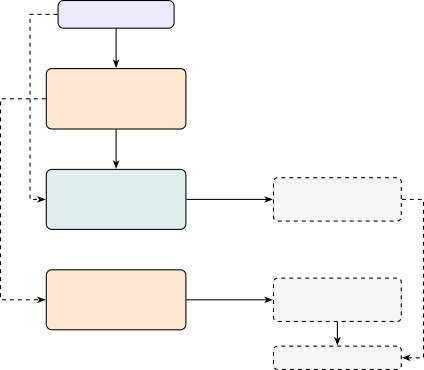

# Can LLMs Judge Better Than They Generate? Evaluating Task Asymmetry, Mechanistic Interpretability and Transferability for In-Context QA

Sambaran Bandyopadhyay Affiliation: Adobe Research
Email: [sambaranb@adobe.com](mailto:)

###### Abstract

LLM-as-a-Judge and self-evaluation pipelines implicitly assume that
evaluation is easier than generation. We test this in a controlled
in-context QA setting where a context passage is the sole information
source and each model judges the answer it generated, removing the
parametric-knowledge confound of open-domain comparisons. Across four
benchmarks (SQuAD 2.0, DROP, HotpotQA, MuSiQue) and two models,
evaluation is not uniformly easier: generation accuracy exceeds
self-evaluation on three of four, with multi-hop MuSiQue the exception.
Attention analysis reveals why: evaluation attends to context 3–5x less
than generation does and barely reads the candidate answer. LoRA
fine-tuning confirms the asymmetry is not a training artifact:
generation fine-tuning induces over-acceptance and evaluation
fine-tuning degrades generation. These findings challenge core
assumptions in self-evaluation pipelines.

## 1 Introduction

LLMs are now deployed not just as generators of content, but as
evaluators of it—a shift with sweeping implications for both research
and industry. LLM-as-a-Judge pipelines (Zheng et al., 2023; Liu et al., 2023) have rapidly become the workhorse of large-scale text evaluation,
powering leaderboards, automatic benchmarking, and production quality
assessment by substituting for prohibitively costly human
annotation (Bavaresco et al., 2025). Self-reflection and self-correction
frameworks (Asai et al., 2024; Bai et al., 2022; Huang et al., 2024) use
the same model to critique and iteratively revise its own outputs,
underpinning the agentic and reasoning systems that have proliferated in
recent product releases. Reinforcement learning from human
feedback (Ouyang et al., 2022) relies on a reward model—often itself an
LLM—to provide the preference signals that align frontier models to
human values, foundational to the post-training pipeline of nearly every
modern instruction-tuned model. Together, these uses make LLM-based
evaluation not a peripheral capability but a load-bearing component of
how LLMs are trained, deployed, and trusted. Yet all of them rest on an
_implicit foundational assumption_, rarely tested directly: that LLMs
can reliably—and often more easily—judge the correctness of an answer
than produce one from scratch.

Yet recent empirical work has pushed back. Oh et al. (2024) find LLMs
achieve _lower_ accuracy judging generated answers than producing them
on TriviaQA; Jiang et al. (2025) show discriminative selection among
self-generated candidates is not reliably superior to direct generation;
and Lin et al. (2025) find only weak correlation between generation and
judgment ability across 21 tasks. These works share an important
confound, however: they operate in the open-domain setting, where both
tasks draw on parametric knowledge. A model that has memorized a fact
can evaluate answers about it even when free recall fails, attributing
any gap to differential memory retrieval rather than to intrinsic task
difficulty.

#### Our contributions.

We address this gap with a controlled in-context QA framework and three
complementary studies. First, we measure the GA–EA gap on four
benchmarks spanning extractive, multi-hop, and numerical reasoning,
where each model judges the answer it just generated—a direct test of
self-evaluation. Second, we probe last-token attention patterns on both
tasks to understand why the gap exists; to our knowledge, this is the
first application of mechanistic interpretability tools to the
generation–evaluation gap. Third, we fine-tune with LoRA on each task
individually and jointly, then evaluate all checkpoints on both tasks,
testing whether the parametric structure for generation and evaluation
is shared or distinct.

We scope the study to in-context factual QA with explicit gold answers:
correctness is binary and unambiguous, sidestepping the subjectivity of
long-form evaluation (Nandy and Bandyopadhyay, 2025), and the context
passage as the sole information source ensures any GA–EA gap reflects
synthesis difficulty versus self-verification rather than differential
memory retrieval.

## 2 Related Work

#### LLMs as evaluators in modern NLP pipelines.

LLMs are now used as judges, critics, and reward models throughout the
model development lifecycle. LLM-as-a-Judge frameworks (Zheng et al.,
2023; Liu et al., 2023; Bavaresco et al., 2025) score or rank generated
text at scale, replacing costly human annotation. Self-reflection and
self-correction pipelines (Asai et al., 2024; Bai et al., 2022; Huang et
al., 2024) have a model critique and revise its own outputs. LLM-based
reward models drive alignment via RLHF (Ouyang et al., 2022), supplying
preference signals for post-training. Known biases such as
self-preference (Panickssery et al., 2024) make systematic
characterization of LLM evaluation behavior consequential.

#### Generation–evaluation asymmetry.

A growing literature compares the same model’s generation and evaluation
abilities directly. Oh et al. (2024) find that LLMs perform worse at
evaluating their TriviaQA generations than at producing them. Jiang et
al. (2025) show that discriminative selection among self-generated
candidates is not reliably better than direct generation. Lin et al.
(2025) examine 21 tasks across 11 models and report only weak
generation–judgment correlation. All three operate in the open-domain
setting where parametric knowledge confounds task difficulty; we
complement them by restricting both tasks to a shared in-context source
and adding mechanistic and transfer-based analyses.

#### Mechanistic interpretability of LLM decisions.

Mechanistic interpretability seeks to explain how transformers route
information internally. Elhage et al. (2021) formalize attention heads
as read/write circuits; Olsson et al. (2022) identify induction heads as
a key mechanism for in-context learning. Meng et al. (2022) and Geva et
al. (2023) localize factual associations to MLP layers, and Belrose et
al. (2023) show that semantic representations consolidate in later
layers of decoder-only transformers. None of these works target the
evaluation task or the generation–evaluation gap specifically.

#### Cross-task transfer with parameter-efficient fine-tuning.

LoRA (Hu et al., 2022) adapters isolate the parametric structure each
task induces by training on one task and evaluating on another.
Dymkiewicz et al. (2025) document asymmetric donor–recipient transfer
patterns across NLP benchmarks. We apply this setup to test whether
generation and evaluation share parametric structure within a single QA
domain.

## 3 Methodology

We address the three studies introduced above in Sections 3.1–3.3.
Figure 1 sketches the shared pipeline they build on.



Figure 1: Core task-asymmetry pipeline. Model $`\mathcal{L}`$ is tested
on two tasks per instance: generation ($`\mathcal{T}_{\text{gen}}`$)
produces answer $`a`$ from $`(c,q)`$; self-evaluation
($`\mathcal{T}_{\text{eval}}`$) judges whether $`a`$ is correct given
$`(c,q,a)`$. Oracle $`\mathcal{L}^{*}`$ scores $`a`$ against gold
$`a^{*}`$, yielding $`y^{*}`$ as ground truth for both metrics. Dashed
arrows are data-passing operations with no LLM call.
$`\boldsymbol{\Delta}=\mathrm{EA}-\mathrm{GA}`$ is the primary asymmetry
measure. The mechanistic and transferability studies extend this
pipeline.

### 3.1 Task Asymmetry Analysis

Each benchmark instance is a triple $`(c,q,a^{*})`$, where $`c`$ is a
context passage, $`q`$ is a question, and $`a^{*}`$ is the gold answer
synthesized directly from $`c`$. We measure a language model
$`\mathcal{L}`$ on two sequential tasks over the same instances.

#### Generation task ($`\mathcal{T}_{\text{gen}}`$).

Given $`(c,q)`$, $`\mathcal{L}`$ produces a free-text answer:

```math
a=\mathcal{L}(c,\,q). \tag{1}
```

#### Evaluation task ($`\mathcal{T}_{\text{eval}}`$).

The generated answer $`a`$ from $`\mathcal{T}_{\text{gen}}`$ is passed
directly to $`\mathcal{L}`$ as a candidate to be judged. Given
$`(c,q,a)`$, $`\mathcal{L}`$ produces a binary judgment:

```math
y=\mathcal{L}(c,\,q,\,a)\;\in\;\{\textsc{Correct},\,\textsc{Incorrect}\}. \tag{2}
```

This sequential design makes $`\mathcal{T}_{\text{eval}}`$ a
self-evaluation task: $`\mathcal{L}`$ judges the quality of an answer it
has just produced. The same sampled instances are used for both tasks,
ensuring direct comparability. We summarize the resulting asymmetry by
$`\Delta=\mathrm{EA}-\mathrm{GA}`$, with EA and GA formally defined in
Section 4.4.

#### Oracle scoring.

We use an oracle LLM $`\mathcal{L}^{*}`$ to score the generated answer
$`a`$ against the gold answer $`a^{*}`$:

```math
\begin{split}y^{*}&=\mathcal{L}^{*}(c,q,a,a^{*})\\
&\in\{\textsc{Correct},\textsc{Incorrect}\}.\end{split} \tag{3}
```

$`y^{*}`$ serves a dual purpose: it defines generation accuracy (whether
$`a`$ is correct) and provides the ground-truth evaluation label against
which $`\mathcal{L}`$’s judgment $`y`$ is compared. Using a single
oracle signal for both tasks ensures GA and EA are grounded in a
consistent external reference.

#### Prompting.

Both tasks use zero-shot prompting with fixed templates. The generation
prompt instructs $`\mathcal{L}`$ to answer using only the provided
context, responding concisely. The evaluation prompt presents
$`(c,q,a)`$ and instructs $`\mathcal{L}`$ to judge whether $`a`$ is
correct given the context, responding with exactly “Correct” or
“Incorrect.” Identical context formatting is used across both tasks.

### 3.2 Mechanistic Interpretation

To understand the mechanism behind any observed gap, we examine how
$`\mathcal{L}`$ internally allocates attention on the two tasks. For
each prompt we perform a single forward pass with attention outputs
enabled and extract the last-token attention row—the distribution over
all input positions the model uses when predicting the first output
token. This is the natural decision point for both tasks, since
$`\mathcal{T}_{\text{gen}}`$ and $`\mathcal{T}_{\text{eval}}`$ both
produce short outputs (typically 1–3 tokens for
$`\mathcal{T}_{\text{gen}}`$ gold answers and a single token for
$`\mathcal{T}_{\text{eval}}`$), making the first-token decision the most
consequential one.

We measure the fraction of attention mass falling on three labeled
prompt spans—context $`c`$, question $`q`$, and candidate answer $`a`$
(the latter only in $`\mathcal{T}_{\text{eval}}`$)—yielding a span-level
fingerprint of each task’s allocation strategy. Attention is averaged
over all heads and over the final eight transformer layers (layers 24–31
of the 32-layer Llama-3.1-8B-Instruct). Late layers in decoder-only
transformers consolidate high-level semantic and task-relevant
representations, while earlier layers focus on lexical and positional
features (Belrose et al., 2023; Geva et al., 2023); we therefore
restrict the ratio computation to this band to isolate the semantic,
decision-relevant attention pattern from low-level token-matching
behavior.

### 3.3 Transferability Analysis

To test whether the parametric structure used for generation and
evaluation is shared, we fine-tune $`\mathcal{L}`$ with LoRA adapters in
three configurations:

- •
  LoRA-Gen: trained only on $`(c,q)\to a^{*}`$ examples.
- •
  LoRA-Eval: trained only on $`(c,q,a)\to y^{*}`$ examples, with $`a`$
  drawn either from a hard-negative pool (described below) or, when
  unavailable, from answer rotation.
- •
  LoRA-Both: trained on a balanced 1:1 union of the two task formats.

Each adapter is then evaluated on _both_ $`\mathcal{T}_{\text{gen}}`$
and $`\mathcal{T}_{\text{eval}}`$ using the same prompting templates and
oracle scoring described in Section 3.1. Asymmetric cross-task gains
would indicate that the two abilities draw on partially distinct
parametric resources; symmetric gains would indicate a shared underlying
capability.

#### Hard-negative generation for evaluator training.

A naive negative for $`\mathcal{T}_{\text{eval}}`$ training—an
arbitrarily picked wrong answer—is trivially distinguishable from a
correct one and produces an evaluator that does not generalize to
plausible mistakes. We instead generate plausible but incorrect
candidates by querying $`\mathcal{L}`$ _without_ the context passage,
forcing it to rely on parametric memory and produce hallucinated
answers. Up to five hallucinations are attempted per record; the first
whose answer does _not_ match the gold $`a^{*}`$ (judged by the same
oracle $`\mathcal{L}^{*}`$) is kept as the hard negative for that
record. Refusal-style outputs (e.g. “I need more information”) are
filtered, since they teach the evaluator to detect non-answers rather
than to verify factual content; records that yield no usable hard
negative fall back to answer rotation, where $`a`$ is sampled from
another instance’s gold answer. The resulting training set thus mirrors
the distribution of mistakes the evaluator will face at test time, where
it judges actual model-generated answers.

## 4 Experimental Setup

### 4.1 Datasets

We use the validation split of each dataset exclusively for the
task-asymmetry and attention analyses, and the training split only for
LoRA fine-tuning. A detailed summary of dataset usage—including
per-experiment sample counts and the rationale for downsampling—is given
in Appendix B (Table 8).

SQuAD 2.0 (Rajpurkar et al., 2018) contains extractive reading
comprehension over Wikipedia paragraphs; we retain only answerable
questions, yielding 5,928 instances. Both tasks make minimal synthesis
demands, providing our most extractive benchmark.

DROP (Dua et al., 2019) tests discrete numerical reasoning over
passage-length texts; we retain number-type answers, yielding 5,889
instances. Generating the correct number requires multi-step arithmetic;
evaluating it reduces to numeric comparison.

HotpotQA (Yang et al., 2018) requires 2-hop reasoning across two
supporting Wikipedia passages plus eight distractors (all provided); we
retain non-yes/no questions, yielding 6,947 instances.

MuSiQue (Trivedi et al., 2022) is a multi-hop benchmark with annotated
hop counts (1,252 $`\times`$ 2-hop; 760 $`\times`$ 3-hop; 405 $`\times`$
4-hop), allowing us to stratify the gap by reasoning depth. We use the
full answerable validation split of 2,417 instances, with 20 paragraphs
provided per question.

### 4.2 Models

We evaluate two models as $`\mathcal{L}`$: Llama-3.1-8B-Instruct (Dubey
and others, 2024), a capable open-source model at modest scale, and
GPT-4o-mini, a stronger proprietary model. Comparing these two lets us
examine whether the generation–evaluation gap varies with capability. We
use GPT-4o as the oracle $`\mathcal{L}^{*}`$ throughout (Zheng et al.,
2023). For the attention analysis, we use only the open-source
Llama-3.1-8B-Instruct, as it provides the internal attention weights
required by the analysis.

### 4.3 Implementation Details

All models are queried at temperature $`\tau=0`$. We sample 500
instances uniformly from each validation split. Each instance is
processed sequentially: $`\mathcal{L}`$ generates answer $`a`$, the
oracle assigns $`y^{*}`$, and $`\mathcal{L}`$ evaluates the same $`a`$.
Responses that do not begin with Correct or Incorrect are treated as
abstentions and excluded from metric computation.

For the attention analysis, we expose raw attention weights via a single
forward pass per prompt and extract the last-token attention row. Span
boundaries are identified via character-to-token offset mapping.
Analysis uses the 184 jointly verified samples (Section 5.1).

For the transferability study, we fine-tune Llama-3.1-8B-Instruct with
LoRA (rank 16, $`\alpha=32`$) on the query, key, value, and output
projections, training on 5,000 instances per dataset. Full
hyperparameters and hardware details are in Appendix A.

### 4.4 Metrics

For each instance, we have the oracle label $`y^{*}`$ and
$`\mathcal{L}`$’s judgment $`y`$, from which we compute:

Generation Accuracy (GA):
$`\mathrm{GA}=\frac{1}{n}\sum_{i}\mathbf{1}[y^{*}_{i}=\textsc{Correct}]`$,
the fraction of generated answers judged correct by the oracle.

Evaluation Accuracy (EA):
$`\mathrm{EA}=\frac{1}{n}\sum_{i}\mathbf{1}[y_{i}=y^{*}_{i}]`$, the
fraction where $`\mathcal{L}`$’s self-judgment matches the oracle. Gap
$`\boldsymbol{\Delta}=\mathrm{EA}-\mathrm{GA}`$ is our primary asymmetry
measure (positive $`\Rightarrow`$ self-evaluation exceeds generation).

Evaluation Precision, Recall, and F1 (EP / ER / EF1) characterize
$`\mathcal{L}`$ as a binary classifier with Correct as the positive
class, and are used to diagnose over-acceptance bias (Liu et al., 2023).

## 5 Results and Discussion

We organize our findings around five research questions, beginning with
the reliability of the oracle that grounds GA and EA.

### 5.1 R1: Is the Oracle LLM Reliable?

Before turning to the substantive questions, we validate the oracle
$`\mathcal{L}^{*}`$ that grounds both GA and EA. A concern with any
LLM-as-oracle framework is that the oracle’s judgments may themselves be
unreliable. In our setting this concern is mitigated by the nature of
the task: answers on all four benchmarks are short factual
responses—typically a single word, number, or key phrase—paired with an
explicit gold answer $`a^{*}`$, making the oracle’s task closer to fuzzy
string matching than open-ended evaluation.

To quantify this empirically, we randomly sampled 50 instances per
dataset (200 total) from the Llama-3.1-8B-Instruct results and presented
each $`(c,q,a,a^{*})`$ tuple to two judges independently: GPT-4o (our
main oracle) and GPT-5.4 (a stronger, more recent model, used as a
super-oracle reference). Table 1 reports inter-model agreement.

| Dataset   | N   | Agree% | FP  | FN  |
| --------- | --- | ------ | --- | --- |
| SQuAD 2.0 | 50  | 98.0   | 1   | 0   |
| DROP      | 50  | 92.0   | 2   | 2   |
| HotpotQA  | 50  | 88.0   | 3   | 3   |
| MuSiQue   | 50  | 90.0   | 5   | 0   |
| Overall   | 200 | 92.0   | 11  | 5   |

Table 1: GPT-4o vs. GPT-5.4 oracle agreement on 50 sampled
Llama-3.1-8B-Instruct outputs per dataset. FP = GPT-4o Cor., GPT-5.4
Inc.; FN = opposite. GPT-4o intra-model consistency (fresh vs. stored
call) is 99.5% across all 200 samples.

GPT-4o and GPT-5.4 agree on 92% of judgments overall, with near-perfect
agreement on extractive SQuAD 2.0 (98%) and no systematic directional
bias across the 16 disagreements. GPT-4o’s re-call consistency is 99.5%.
We therefore treat GPT-4o as a reliable oracle and use the 184 jointly
verified samples (where both judges agree) as the basis for the
attention analysis.

### 5.2 R2: Is Self-Evaluation Easier Than Generation?

|                       |           |      |            |      |      |            |          |      |            |         |      |            |
| --------------------- | --------- | ---- | ---------- | ---- | ---- | ---------- | -------- | ---- | ---------- | ------- | ---- | ---------- |
|                       | SQuAD 2.0 |      |            | DROP |      |            | HotpotQA |      |            | MuSiQue |      |            |
| Model                 | GA        | EA   | $`\Delta`$ | GA   | EA   | $`\Delta`$ | GA       | EA   | $`\Delta`$ | GA      | EA   | $`\Delta`$ |
| Llama-3.1-8B-Instruct | 95.6      | 92.2 | $`-3.4`$   | 63.4 | 62.4 | $`-1.0`$   | 83.2     | 69.0 | $`-14.2`$  | 55.6    | 59.2 | $`+3.6`$   |
| GPT-4o-mini           | 97.8      | 96.6 | $`-1.2`$   | 79.6 | 73.8 | $`-5.8`$   | 88.0     | 86.0 | $`-2.0`$   | 64.8    | 68.8 | $`+4.0`$   |

Table 2: Generation Accuracy (GA) and Evaluation Accuracy (EA) (%) per
model–dataset pair. $`\Delta=\mathrm{EA}-\mathrm{GA}`$; positive
indicates self-evaluation exceeds generation.

Table 2 reports GA, EA and $`\Delta`$ across all model–dataset pairs.
The answer to our titular question is: not in general. $`\Delta<0`$ on
three of four benchmarks for both models, indicating that generation
accuracy _exceeds_ self-evaluation accuracy in the majority of settings.
The lone exception is MuSiQue, where $`\Delta=+3.6`$ (Llama) and
$`+4.0`$ (GPT-4o-mini).

#### Task-type dependence.

The pre-experiment intuition—that verifying a numeric answer reduces to
exact-match checking—is sharply overturned on DROP: $`\Delta=-1.0`$
(Llama) and $`-5.8`$ (GPT-4o-mini), indicating that numeric
self-evaluation is _harder_, not easier, than generation. A plausible
explanation is that a model relying on a faulty arithmetic procedure to
produce an answer cannot detect the resulting error during evaluation,
because the same flawed procedure underlies its verification attempt.
The largest negative gap overall belongs to HotpotQA for Llama
($`-14.2`$); the presence of the candidate answer $`a`$ in the
evaluation prompt appears to disrupt the model’s ability to
independently trace the 2-hop reasoning chain needed to assess it.
SQuAD 2.0 shows the smallest absolute gaps for both models, consistent
with minimal synthesis demands in the extractive setting.

|                       | SQuAD 2.0 |      |      | DROP |      |      | HotpotQA |      |      | MuSiQue |      |      |
| --------------------- | --------- | ---- | ---- | ---- | ---- | ---- | -------- | ---- | ---- | ------- | ---- | ---- |
| Model                 | EP        | ER   | EF1  | EP   | ER   | EF1  | EP       | ER   | EF1  | EP      | ER   | EF1  |
| Llama-3.1-8B-Instruct | 97.0      | 94.8 | 95.9 | 74.5 | 61.8 | 67.6 | 87.4     | 73.3 | 79.7 | 67.5    | 51.4 | 58.4 |
| GPT-4o-mini           | 98.0      | 98.6 | 98.3 | 81.9 | 86.2 | 84.0 | 90.9     | 93.4 | 92.2 | 70.8    | 88.3 | 78.6 |

Table 3: Full evaluation breakdown: Precision (EP), Recall (ER), and F1
(EF1, %) per model–dataset pair.

#### Acquiescence bias.

The EP/ER decomposition (Table 3) reveals opposite biases: Llama
exhibits EP $`>`$ ER on all four datasets—most pronounced on DROP
($`74.5/61.8`$) and MuSiQue ($`67.5/51.4`$)—indicating a _conservative
bias_ that over-predicts Incorrect and directly explains its severe
negative $`\Delta`$ on HotpotQA. GPT-4o-mini shows the inverse on three
of four datasets, most pronounced on MuSiQue (ER $`=88.3`$%, EP
$`=70.8`$%)—a mild over-acceptance bias that inflates EA there and
partially drives $`\Delta>0`$. Counter-intuitively, the stronger model
is the more over-accepting evaluator.

### 5.3 R3: How Does Reasoning Complexity Modulate the Gap?

MuSiQue’s per-question hop annotations let us stratify the gap by
reasoning depth within a single dataset—an analysis impossible with
HotpotQA, which is uniformly 2-hop.

| Model        | Hops  | \#Samples | GA   | EA   | $`\Delta`$ |
| ------------ | ----- | --------- | ---- | ---- | ---------- |
| Llama-3.1-8B | 2-hop | 282       | 57.8 | 56.7 | $`-1.1`$   |
|              | 3-hop | 140       | 55.0 | 65.7 | $`+10.7`$  |
|              | 4-hop | 78        | 48.7 | 56.4 | $`+7.7`$   |
| GPT-4o-mini  | 2-hop | 282       | 67.4 | 72.0 | $`+4.6`$   |
|              | 3-hop | 140       | 66.4 | 68.6 | $`+2.1`$   |
|              | 4-hop | 78        | 52.6 | 57.7 | $`+5.1`$   |

Table 4: Generation–evaluation gap on MuSiQue stratified by hop count.
The sharp $`\Delta`$ increase from 2 to 3 hops for Llama reflects
generation quality degrading faster than evaluation accuracy as depth
grows.

Table 4 shows the evolution of $`\Delta`$ across hop counts. For Llama,
$`\Delta`$ transitions sharply from $`-1.1`$ at 2 hops to $`+10.7`$ at 3
hops and $`+7.7`$ at 4 hops: generation accuracy falls to 55.0% and
48.7% at 3 and 4 hops respectively, while evaluation accuracy remains
comparatively stable (65.7%, 56.4%). This asymmetry is consistent with a
_candidate-answer-insulation_ hypothesis: when $`a`$ is already present
in the evaluation prompt, the model need not reconstruct the full
reasoning chain, gaining a partial advantage over generation at high
depth. GPT-4o-mini exhibits a consistently positive $`\Delta`$ at all
hop counts ($`+4.6`$, $`+2.1`$, $`+5.1`$), with less variation,
reflecting its greater robustness on both tasks. The modest compression
at 3 hops for both models suggests a qualitative threshold between 2-hop
and higher-order reasoning rather than smooth linear degradation.

### 5.4 R4: What Internal Mechanisms Underlie the Gap?

To probe the mechanism behind the observed gap, we analyze last-token
attention patterns of Llama-3.1-8B-Instruct on
$`\mathcal{T}_{\text{gen}}`$ and $`\mathcal{T}_{\text{eval}}`$ across
the 184 jointly verified samples (Section 5.1). The single forward pass
per prompt extracts the attention distribution that the model assigns
over input positions when predicting the first output token. Attention
is averaged over all heads and over layers 24–31. We measure the
fraction of attention mass directed at three labeled spans: context
$`c`$, question $`q`$, and candidate answer $`a`$
($`\mathcal{T}_{\text{eval}}`$ only). The remaining mass—typically
80–98%—is absorbed by tokens outside these spans (system prompt, chat
template markers, instruction text).

Figure 2: Mean last-token attention fraction directed to context ($`c`$)
and candidate answer ($`a`$) for $`\mathcal{T}_{\text{gen}}`$ and
$`\mathcal{T}_{\text{eval}}`$, averaged over layers 24–31 and 184
jointly verified Llama-3.1-8B-Instruct samples.
$`\mathcal{T}_{\text{eval}}`$ consistently de-attends to context by
3–5$`\times`$ relative to $`\mathcal{T}_{\text{gen}}`$ and allocates
negligible attention (0.3–0.5%) to the candidate answer it is judging.

Figure 2 reports the mean attention fractions.
$`\mathcal{T}_{\text{gen}}`$ directs 11.3–20.7% of last-token attention
to the context passage, with the fraction growing with task complexity
(SQuAD 2.0/DROP: 11.3% $`<`$ HotpotQA: 16.7% $`<`$ MuSiQue: 20.7%),
consistent with multi-hop generation requiring deeper context
engagement. $`\mathcal{T}_{\text{eval}}`$, by contrast, allocates only
1.4–5.4% of attention to context—a 3–5$`\times`$ reduction across all
four datasets. More strikingly, $`\mathcal{T}_{\text{eval}}`$ devotes
only 0.3–0.5% of attention to the candidate answer $`a`$ it is tasked
with judging.

#### Interpretation.

The consistent context de-attention in $`\mathcal{T}_{\text{eval}}`$ is
a _structural signature_ of the evaluation task: rather than re-reading
the passage to verify the answer, the model’s last-token decision relies
primarily on structural and instructional tokens. This pattern directly
explains why $`\Delta`$ is negative on three of the four benchmarks. On
SQuAD 2.0, DROP, and HotpotQA, $`\mathcal{T}_{\text{gen}}`$ allocates
11.3–16.7% of last-token attention to the context while
$`\mathcal{T}_{\text{eval}}`$ allocates only 1.4–4.1%—insufficient to
re-trace the lookup $`\mathcal{T}_{\text{gen}}`$ performs at synthesis
time. The gap widens precisely where context engagement matters most:
HotpotQA’s largest negative $`\Delta=-14.2`$ (Llama) coincides with the
largest gen-to-eval reduction in context attention (16.7% $`\to`$ 4.1%),
and SQuAD 2.0’s smaller $`\Delta=-3.4`$ matches the smallest such
reduction (11.3% $`\to`$ 1.4%) on a task whose synthesis demands are
minimal. The lone exception is MuSiQue, where $`\Delta>0`$ despite an
even sharper context-attention drop ($`\Delta_{\text{ctx}}=-0.153`$);
the attention pattern alone is therefore not sufficient to explain this
inversion, and we defer a fuller discussion of it to the Limitations
section.

#### Extended analyses.

Appendix C extends this analysis along three orthogonal
axes—paragraph-level selectivity (supporting vs. distractor),
answer-mention concentration within the context, and causal ablations of
the candidate-answer slot—which together sharpen the mechanistic picture
sketched above.

|                            |           |      |            |      |      |            |          |      |             |         |      |            |
| -------------------------- | --------- | ---- | ---------- | ---- | ---- | ---------- | -------- | ---- | ----------- | ------- | ---- | ---------- |
|                            | SQuAD 2.0 |      |            | DROP |      |            | HotpotQA |      |             | MuSiQue |      |            |
| Checkpoint                 | GA        | EA   | $`\Delta`$ | GA   | EA   | $`\Delta`$ | GA       | EA   | $`\Delta`$  | GA      | EA   | $`\Delta`$ |
| Base (Llama-3.1-8B)        | 95.6      | 92.2 | $`-3.4`$   | 63.4 | 62.4 | $`-1.0`$   | 83.2     | 69.0 | $`-14.2`$   | 55.6    | 59.2 | $`+3.6`$   |
| \+ LoRA-Gen (joint)        | 94.0      | 94.6 | $`+0.6`$   | 61.2 | 62.0 | $`+0.8`$   | 84.0     | 84.4 | $`+0.4`$    | 49.0    | 56.8 | $`+7.8`$   |
|       + LoRA-Gen (per-ds)  | 92.4      | 93.2 | $`+0.8`$   | 64.0 | 65.2 | $`+1.2`$   | 83.4     | 84.2 | $`+0.8`$    | 48.4    | 53.1 | $`+4.7`$   |
| \+ LoRA-Eval (joint)       | 94.4      | 78.4 | $`-16.0`$  | 46.6 | 57.8 | $`+11.2`$  | 76.6     | 63.6 | $`-13.0`$   | 38.0    | 60.8 | $`+22.8`$  |
|       + LoRA-Eval (per-ds) | 90.6      | 88.4 | $`-2.2`$   | 41.4 | 61.2 | $`+19.8`$  | 77.2     | 47.5 | $`-29.7`$   | 36.8    | 59.6 | $`+22.8`$  |
| \+ LoRA-Both (joint)       | 92.8      | 93.2 | $`+0.4`$   | 58.8 | 61.4 | $`+2.6`$   | 82.4     | 83.0 | $`+0.6`$    | 49.4    | 58.4 | $`+9.0`$   |
|       + LoRA-Both (per-ds) | 92.2      | 92.0 | $`-0.2`$   | 62.5 | 61.7 | $`-0.8`$   | 83.2     | 83.2 | $`\pm 0.0`$ | 44.3    | 53.5 | $`+9.2`$   |

Table 5: GA, EA, and $`\Delta`$ (%) under LoRA fine-tuning. Joint trains
on all datasets; per-ds on one at a time. EA gains under LoRA-Gen/Both
are acquiescence-driven (Table 6), not genuine transfer.

|                      | SQuAD 2.0 |      |      | DROP |      |      | HotpotQA |       |      | MuSiQue |       |      |
| -------------------- | --------- | ---- | ---- | ---- | ---- | ---- | -------- | ----- | ---- | ------- | ----- | ---- |
| Checkpoint           | EP        | ER   | EF1  | EP   | ER   | EF1  | EP       | ER    | EF1  | EP      | ER    | EF1  |
| Base (Llama-3.1-8B)  | 97.0      | 94.8 | 95.9 | 74.5 | 61.8 | 67.6 | 87.4     | 73.3  | 79.7 | 67.5    | 51.4  | 58.4 |
| \+ LoRA-Gen (joint)  | 94.9      | 99.6 | 97.2 | 62.5 | 94.8 | 75.3 | 84.3     | 100.0 | 91.5 | 56.3    | 100.0 | 72.0 |
| \+ LoRA-Eval (joint) | 95.3      | 81.1 | 87.6 | 57.9 | 34.8 | 43.4 | 81.5     | 67.9  | 74.1 | 54.0    | 58.8  | 56.3 |
| \+ LoRA-Both (joint) | 93.4      | 99.8 | 96.5 | 60.7 | 97.3 | 74.8 | 83.3     | 99.3  | 90.6 | 57.5    | 99.2  | 72.8 |

Table 6: EP, ER, and EF1 (%) per checkpoint, Correct as positive.
LoRA-Gen/Both drive ER $`{\to}\,100\%`$ (acquiescence); LoRA-Eval drives
it too low. MuSiQue abstention: 13.0% (Gen/Both), 15.4% (Eval).

| Checkpoint        | $`\Delta`$GA (avg) | $`\Delta`$EA (avg) |
| ----------------- | ------------------ | ------------------ |
| LoRA-Gen (joint)  | $`-2.4`$           | $`+3.7`$           |
| LoRA-Eval (joint) | $`-10.6`$          | $`-5.6`$           |
| LoRA-Both (joint) | $`-3.6`$           | $`+3.3`$           |

Table 7: Average gain over base across four datasets (pp), joint
adapters only.

### 5.5 R5: Does Cross-Task Transfer Occur Under LoRA Fine-Tuning?

To test whether the parametric structure underlying generation and
evaluation is shared, we fine-tune Llama-3.1-8B-Instruct with LoRA in
three configurations (LoRA-Gen, LoRA-Eval, LoRA-Both; see Section 3.3)
and evaluate each on both tasks across all four datasets.

#### Hypotheses.

We pre-register three expectations: (i) LoRA-Gen should raise GA;
whether EA follows tests generation-to-evaluation transfer. (ii)
LoRA-Eval should raise EA; whether GA improves tests the reverse. (iii)
LoRA-Both tests whether joint training delivers both gains or one
ability dominates the parameter budget. Asymmetric outcomes would
indicate the two abilities draw on overlapping but not identical
parametric structure (Dymkiewicz et al., 2025).

#### LoRA-Gen flips $`\Delta`$ on every dataset—but via acquiescence.

After LoRA-Gen, $`\Delta\geq 0`$ on all four datasets (Table 5), with
the largest swing on HotpotQA ($`-14.2\to+0.4`$, driven by EA rising
from $`69.0`$ to $`84.4\%`$). However, the EP/ER decomposition (Table 6)
reveals this is entirely a recall-side bias shift: evaluator recall
reaches $`100\%`$ on HotpotQA and MuSiQue, $`99.6\%`$ on SQuAD 2.0, and
$`94.8\%`$ on DROP—the adapters predict Correct for nearly every input.
LoRA-Both shows the same acquiescence pattern ($`\mathrm{ER}\geq 97\%`$
on every dataset). EA rises only because the underlying GA is high
enough that near-uniform Correct responses happen to match the oracle
most of the time. This is the acquiescence failure mode flagged in
Section 5.2, driven to an extreme by training.

#### LoRA-Eval degrades both tasks.

Training only on the evaluation task is the most striking failure mode.
GA falls by $`16.8`$ pp on DROP, $`17.6`$ pp on MuSiQue, and $`6.6`$ pp
on HotpotQA, even though the adapter never saw a generation objective.
EA also drops on SQuAD 2.0 and HotpotQA. The EP/ER pattern is the
inverse of LoRA-Gen: ER drops to $`34.8\%`$ on DROP and $`58.8\%`$ on
MuSiQue, making the model overly conservative. LoRA-Eval as configured
is not a usable adapter.

#### The MuSiQue $`\Delta>0`$ inversion is structural.

MuSiQue is the only dataset where the base model had $`\Delta>0`$. The
inversion persists across all three adapters at progressively larger
magnitudes ($`+7.8`$, $`+22.8`$, $`+9.0`$). The invariance across very
different training regimes directly evidences that this reflects the
underlying task pair—multi-hop generation is intrinsically harder than
verifying a presented answer—rather than a base-model artifact,
supporting the candidate-answer-insulation hypothesis of Section 5.3.
Detailed per-dataset analyses (why LoRA-Gen fails to improve GA, the
HotpotQA evaluator collapse, and per-dataset LoRA-Both calibration) are
given in Appendix D.

#### Takeaway.

Generation SFT suppresses evaluation discrimination (acquiescence,
$`\mathrm{ER}\to 100\%`$); evaluation SFT suppresses generation and can
destroy the evaluator on individual datasets. Per-dataset LoRA-Both is
the only configuration achieving $`|\Delta|\leq 1`$ pp without
acquiescence on three of four datasets—but cannot recover base GA on
harder datasets. The generation–evaluation asymmetry is an intrinsic
property of in-context QA that SFT can redistribute but not eliminate.

## 6 Conclusion

Across four benchmarks and two models, generation accuracy exceeds
self-evaluation on three of four—self-evaluation is not uniformly
easier—with MuSiQue the exception due to a generation-difficulty ceiling
at high hop counts. Attention analysis reveals a consistent structural
cause: the evaluation task attends to context 3–5x less than generation
does and barely reads the candidate answer. LoRA fine-tuning confirms
this asymmetry is not a training artifact: generation fine-tuning
induces over-acceptance and evaluation fine-tuning degrades generation.

Evaluation failures in self-assessment pipelines are structurally rooted
in the model’s attention-routing strategy at inference time, not in
insufficient training signal. Pipelines relying on
self-assessment—especially on multi-hop or numerical tasks—should
account for the direction and magnitude of the $`\Delta`$ gap reported
here, and treat acquiescence bias as a real risk whenever generation
fine-tuning is part of the training recipe.

## Limitations

The attention analysis is restricted to the open-source
Llama-3.1-8B-Instruct; GPT-4o-mini’s internals are inaccessible. We also
analyze only the first-token decision point—i.e. the attention
distribution at the position predicting the first output token. For
short-answer QA this is the most consequential position (gold answers
are typically 1–3 tokens, and $`\mathcal{T}_{\text{eval}}`$’s output is
exactly one token), but the analysis does not generalize directly to
long-form generation, where later positions could exhibit qualitatively
different attention patterns.

Our mechanistic account is most informative for the three benchmarks
where $`\Delta<0`$ (SQuAD 2.0, DROP, HotpotQA); we do not isolate a
corresponding mechanism for the positive $`\Delta`$ on MuSiQue. The
MuSiQue inversion is more parsimoniously explained by generation
difficulty reaching a floor at high hop counts (Section 5.3) than by any
attention-level advantage in $`\mathcal{T}_{\text{eval}}`$ specific to
that dataset. The fact that the model barely attends to the candidate
answer is itself surprising and a target for follow-up: it suggests that
decisions on $`\mathcal{T}_{\text{eval}}`$ may often be driven by
structural priors rather than by a genuine semantic comparison. Locating
the layer at which the candidate slot fuses with the context (e.g. via
logit-lens or tuned-lens analysis) is a natural next step we leave to
future work.

All prompts are fixed and zero-shot; results may differ with few-shot
demonstrations or paraphrased prompts, and we leave prompt sensitivity
analysis to future work. All benchmarks are English-only; cross-lingual
generalization is not guaranteed. Our framework is scoped to QA settings
where answer correctness admits an unambiguous binary label; abstractive
or opinion-based QA presents a fundamentally different evaluation
challenge outside our current scope.

## Ethical Considerations

This work studies the behavior of publicly available LLMs
(Llama-3.1-8B-Instruct, GPT-4o-mini, GPT-4o) on existing
English-language QA benchmarks (SQuAD 2.0, DROP, HotpotQA, MuSiQue), all
of which are released for research use. No new data was collected, no
human subjects were involved, and the findings are descriptive and
analytical in nature. We do not foresee any direct harms arising from
this research. There are no major ethical concerns with this submission.

## References

- Asai et al. (2024) A. Asai, Z. Wu, Y. Wang, A. Sil, and H. Hajishirzi
  Self-RAG: learning to retrieve, generate, and critique through
  self-reflection. In The Twelfth International Conference on Learning
  Representations, External Links:
  [Link](https://arxiv.org/abs/2310.11511) Cited by: §1, §2.
- Bai et al. (2022) Y. Bai, A. Jones, K. Ndousse, A. Askell, A. Chen, N.
  DasSarma, D. Drain, S. Fort, D. Ganguli, T. Henighan, et al.
  Constitutional AI: harmlessness from AI feedback. arXiv preprint
  arXiv:2212.08073. External Links:
  [Link](https://arxiv.org/abs/2212.08073) Cited by: §1, §2.
- Bavaresco et al. (2025) A. Bavaresco, R. Bernardi, L. Bertolazzi, D.
  Elliott, R. Fernández, A. Gatt, E. Ghaleb, M. Giulianelli, M.
  Hanna, A. Koller, A. F. T. Martins, P. Mondorf, V. Neplenbroek, S.
  Pezzelle, B. Plank, D. Schlangen, A. Suglia, A. K. Surikuchi, E.
  Takmaz, and A. Testoni LLMs instead of human judges? A large scale
  empirical study across 20 NLP evaluation tasks. In Proceedings of the
  63rd Annual Meeting of the Association for Computational Linguistics
  (Volume 2: Short Papers), Vienna, Austria, pp. 238–255. Cited by: §1,
  §2.
- Belrose et al. (2023) N. Belrose, Z. Furman, L. Smith, D. Halawi, I.
  Ostrovsky, L. McKinney, S. Biderman, and J. Steinhardt Eliciting
  latent predictions from transformers with the tuned lens. arXiv
  preprint arXiv:2303.08112. External Links:
  [Link](https://arxiv.org/abs/2303.08112) Cited by: §2, §3.2.
- Dua et al. (2019) D. Dua, Y. Wang, P. Dasigi, G. Stanovsky, S. Singh,
  and M. Gardner DROP: a reading comprehension benchmark requiring
  discrete reasoning over paragraphs. In Proceedings of the 2019
  Conference of the North American Chapter of the Association for
  Computational Linguistics: Human Language Technologies, Volume 1 (Long
  and Short Papers), pp. 2368–2378. External Links:
  [Link](https://aclanthology.org/N19-1246) Cited by: §4.1.
- Dubey et al. (2024) A. Dubey et al. The Llama 3 herd of models. arXiv
  preprint arXiv:2407.21783. External Links:
  [Link](https://arxiv.org/abs/2407.21783) Cited by: §4.2.
- Dymkiewicz et al. (2025) K. Dymkiewicz, I. Vulic, H. Yannakoudakis, E.
  Shapira, R. Reichart, and A. Korhonen Donors and recipients: on
  asymmetric transfer across tasks and languages with
  parameter-efficient fine-tuning. External Links: 2511.13368 Cited by:
  §2, §5.5.
- Elhage et al. (2021) N. Elhage, N. Nanda, C. Olsson, T. Henighan, N.
  Joseph, B. Mann, A. Askell, et al. A mathematical framework for
  transformer circuits. Transformer Circuits Thread. External Links:
  [Link](https://transformer-circuits.pub/2021/framework/index.html)
  Cited by: §2.
- Geva et al. (2023) M. Geva, J. Bastings, K. Filippova, and A.
  Globerson Dissecting recall of factual associations in auto-regressive
  language models. In Proceedings of the 2023 Conference on Empirical
  Methods in Natural Language Processing (EMNLP), External Links:
  [Link](https://aclanthology.org/2023.emnlp-main.751) Cited by: §2,
  §3.2.
- Ho et al. (2020) X. Ho, A. Duong Nguyen, S. Sugawara, and A. Aizawa
  Constructing a multi-hop QA dataset for comprehensive evaluation of
  reasoning steps. In Proceedings of the 28th International Conference
  on Computational Linguistics (COLING), pp. 6609–6625. External Links:
  [Link](https://aclanthology.org/2020.coling-main.580) Cited by: §C.4.
- Hu et al. (2022) E. J. Hu, Y. Shen, P. Wallis, Z. Allen-Zhu, Y. Li, S.
  Wang, L. Wang, and W. Chen LoRA: low-rank adaptation of large language
  models. In International Conference on Learning Representations
  (ICLR), External Links: [Link](https://arxiv.org/abs/2106.09685) Cited
  by: §2.
- Huang et al. (2024) J. Huang, X. Chen, S. Mishra, H. S. Zheng, A. W.
  Yu, X. Song, and D. Zhou Large language models cannot self-correct
  reasoning yet. In The Twelfth International Conference on Learning
  Representations, External Links:
  [Link](https://arxiv.org/abs/2310.01798) Cited by: §1, §2.
- Jiang et al. (2025) D. Jiang, J. Zhang, O. Weller, N. Weir, B. Van
  Durme, and D. Khashabi SELF-\[IN\]CORRECT: LLMs struggle with
  discriminating self-generated responses. In Proceedings of the 39th
  AAAI Conference on Artificial Intelligence, External Links:
  [Link](https://ojs.aaai.org/index.php/AAAI/article/view/34603) Cited
  by: §1, §2.
- Lin et al. (2025) W. Lin, S. Wei, H. Huang, and H. Chen Do before you
  judge: self-reference as a pathway to better LLM evaluation. In
  Findings of the Association for Computational Linguistics: EMNLP 2025,
  Suzhou, China, pp. 24651–24672. External Links:
  [Document](https://dx.doi.org/10.18653/v1/2025.findings-emnlp.1342)
  Cited by: §1, §2.
- Liu et al. (2023) Y. Liu, D. Iter, Y. Xu, S. Wang, R. Xu, and C. Zhu
  G-Eval: NLG evaluation using GPT-4 with better human alignment. In
  Proceedings of the 2023 Conference on Empirical Methods in Natural
  Language Processing, pp. 2511–2522. External Links:
  [Link](https://aclanthology.org/2023.emnlp-main.153) Cited by: §1, §2,
  §4.4.
- Meng et al. (2022) K. Meng, D. Bau, A. Andonian, and Y. Belinkov
  Locating and editing factual associations in GPT. In Advances in
  Neural Information Processing Systems (NeurIPS), External Links:
  [Link](https://proceedings.neurips.cc/paper_files/paper/2022/hash/6f1d43d5a82a37e89b0665b33bf3a182-Abstract-Conference.html)
  Cited by: §2.
- Nandy and Bandyopadhyay (2025) A. Nandy and S. Bandyopadhyay Language
  models of code are few-shot planners and reasoners for multi-document
  summarization with attribution. In Proceedings of the AAAI Conference
  on Artificial Intelligence, Vol. 39, pp. 24930–24938. Cited by: §1.
- Oh et al. (2024) J. Oh, E. Kim, I. Cha, and A. Oh The generative AI
  paradox on evaluation: “what it can solve, it may not evaluate”. In
  Proceedings of the Student Research Workshop at the 18th Conference of
  the European Chapter of the Association for Computational Linguistics,
  St. Julian’s, Malta, pp. 248–257. External Links:
  [Link](https://aclanthology.org/2024.eacl-srw.19) Cited by: §1, §2.
- Olsson et al. (2022) C. Olsson, N. Elhage, N. Nanda, N. Joseph, N.
  DasSarma, T. Henighan, B. Mann, A. Askell, et al. In-context learning
  and induction heads. Transformer Circuits Thread. External Links:
  [Link](https://transformer-circuits.pub/2022/in-context-learning-and-induction-heads/index.html)
  Cited by: §2.
- Ouyang et al. (2022) L. Ouyang, J. Wu, X. Jiang, D. Almeida, C. L.
  Wainwright, P. Mishkin, C. Zhang, S. Agarwal, K. Slama, A. Ray, et al.
  Training language models to follow instructions with human feedback.
  In Advances in Neural Information Processing Systems, Vol. 35.
  External Links: [Link](https://arxiv.org/abs/2203.02155) Cited by: §1,
  §2.
- Panickssery et al. (2024) A. Panickssery, S. R. Bowman, and S. Feng
  LLM evaluators recognize and favor their own generations. In Advances
  in Neural Information Processing Systems, Vol. 37. External Links:
  [Link](https://proceedings.neurips.cc/paper_files/paper/2024/hash/7f1f0218e45f5414c79c0679633e47bc-Abstract-Conference.html)
  Cited by: §2.
- Rajpurkar et al. (2018) P. Rajpurkar, R. Jia, and P. Liang Know what
  you don’t know: unanswerable questions for SQuAD. In Proceedings of
  the 56th Annual Meeting of the Association for Computational
  Linguistics (Volume 2: Short Papers), pp. 784–789. External Links:
  [Link](https://aclanthology.org/P18-2124) Cited by: §4.1.
- Trivedi et al. (2022) H. Trivedi, N. Balasubramanian, T. Khot, and A.
  Sabharwal MuSiQue: multistep question answering via single-hop
  question composition. Transactions of the Association for
  Computational Linguistics 10, pp. 539–554. External Links:
  [Link](https://aclanthology.org/2022.tacl-1.31) Cited by: §4.1.
- Yang et al. (2018) Z. Yang, P. Qi, S. Zhang, Y. Bengio, W. W.
  Cohen, R. Salakhutdinov, and C. D. Manning HotpotQA: a dataset for
  diverse, explainable multi-hop question answering. In Proceedings of
  the 2018 Conference on Empirical Methods in Natural Language
  Processing, pp. 2369–2380. External Links:
  [Link](https://aclanthology.org/D18-1259) Cited by: §4.1.
- Zheng et al. (2023) L. Zheng, W. Chiang, Y. Sheng, S. Zhuang, Z.
  Wu, Y. Zhuang, Z. Lin, Z. Li, D. Li, E. P. Xing, H. Zhang, J. E.
  Gonzalez, and I. Stoica Judging LLM-as-a-judge with MT-bench and
  chatbot arena. In Advances in Neural Information Processing Systems,
  Vol. 36. External Links: [Link](https://arxiv.org/abs/2306.05685)
  Cited by: §1, §2, §4.2.

## Appendix

## Appendix A Reproducibility

#### General setup.

All models are queried at temperature $`\tau=0`$ with greedy decoding.
API calls use fixed seeds where supported. Evaluation responses that do
not begin with Correct or Incorrect after stripping leading whitespace
are treated as abstentions and excluded from metric computation;
abstention rates are reported alongside all results.

#### Attention analysis.

We set attn_implementation="eager" in the Llama-3.1-8B-Instruct forward
pass to expose raw attention tensors. A single forward pass is performed
per prompt; only the last-token attention row is retained to keep memory
bounded. Context, question, and answer spans are located via the
tokenizer’s character-to-token offset mapping. Attention weights are
averaged over all heads and over layers 24–31 (the final eight layers of
the 32-layer model).

#### LoRA fine-tuning.

We fine-tune Llama-3.1-8B-Instruct with LoRA adapters (rank 16,
$`\alpha=32`$) applied to q_proj, k_proj, v_proj, and o_proj. Training
uses cross-entropy loss on response tokens only
(completion_only_loss=True), 3 epochs, effective batch size 16, learning
rate 2e-4 with a cosine schedule, and bfloat16 precision. Hard negatives
are generated with up to 5 hallucination attempts per record
(Section 3.3). After training, each adapter is evaluated on the same
500-instance validation split used for the task-asymmetry analysis.

#### Hardware.

All API-based experiments (oracle scoring, GPT-4o-mini generation and
evaluation, oracle reliability study) are run from a standard CPU host.
Llama-3.1-8B-Instruct inference, the attention analysis, and all LoRA
training and evaluation are run on a server with $`4\times`$ NVIDIA
A100-SXM4-80GB GPUs (CUDA 13.0).

## Appendix B Use of Datasets

This appendix documents the per-experiment sampling choices and the
rationale behind them. Table 8 lists the full official split sizes, the
per-experiment sample counts, and the average context length per
dataset.

|           |            |             |                  |                     |                        |                      |
| --------- | ---------- | ----------- | ---------------- | ------------------- | ---------------------- | -------------------- |
|           |            | Full splits |                  | Used per experiment |                        |                      |
| Dataset   | Type       | \#Train     | \#Val (filtered) | LoRA train          | Task-asym. / LoRA eval | Attention (verified) |
| SQuAD 2.0 | Extractive | 130,319     | 5,928            | 5,000               | 500                    | 49                   |
| DROP      | Numerical  | 77,409      | 5,889            | 5,000               | 500                    | 46                   |
| HotpotQA  | 2-hop      | 90,447      | 6,947            | 5,000               | 500                    | 44                   |
| MuSiQue   | 2–4-hop    | 19,938      | 2,417            | 5,000               | 500                    | 45                   |

Table 8: Extended split usage. \#Train is the official training split
size; \#Val (filtered) is the validation size after the dataset-specific
filters described in §4 (e.g., answerable only for SQuAD 2.0,
number-type only for DROP). LoRA train: per-dataset budget drawn from
the train split for LoRA-Gen, LoRA-Eval, and LoRA-Both.
Task-asym. / LoRA eval: shared evaluation sample, drawn once and reused
across the base model and all LoRA checkpoints for direct comparability.
Attention (verified): subset of the 50-per-dataset oracle-reliability
sample where GPT-4o and GPT-5.4 agree, used as the basis for the
attention analysis (184 total). MuSiQue validation hop distribution:
1,252 / 760 / 405 for 2 / 3 / 4 hops.

#### Cost and compute.

The most expensive operation per evaluation instance is the oracle call
(GPT-4o), invoked once for every $`(c,q,a,a^{*})`$ tuple. Across two
models (Llama-3.1-8B-Instruct and GPT-4o-mini) and four datasets, the
full filtered validation sets would total roughly 42,000 oracle-bearing
instances, against $`\sim`$4,000 at 500 per (model, dataset). Each
task-asymmetry instance further triggers a generation call and a
self-evaluation call, tripling the API budget. For the attention
analysis the binding constraint is GPU memory rather than API cost: each
forward pass with output_attentions=True requires
$`O(L\cdot H\cdot S^{2})`$ activations, which for MuSiQue’s
$`\sim`$2–4 k-token contexts is already GPU-heavy on an A100. The LoRA
fine-tuning runs are similarly compute-bound—three independent adapter
trainings, 3 epochs each at effective batch 16, total $`\sim`$30
GPU-hours even at the 5,000-per-dataset training budget.

#### Statistical sufficiency for a binary outcome.

GA, EA, EP, ER, and $`\Delta`$ are all binomial-proportion quantities.
At $`n=500`$ the 95% confidence half-width is at most $`\pm 4.4`$ pp (at
$`p=0.5`$) and tighter at the observed values (e.g. $`\pm 2.4`$ pp at
$`\mathrm{GA}=95\%`$). The $`\Delta`$ values reported in Table 2 range
from $`-14.2`$ to $`+4.0`$ pp; on MuSiQue stratified by hop count
(Table 4) they reach $`+10.7`$ pp—all well outside the noise floor of a
500-instance sample. Even the smallest cell in the hop analysis (MuSiQue
4-hop, $`n=78`$) has a half-width of $`\pm 11`$ pp, still narrower than
its observed $`\Delta=+7.7`$. Increasing $`n`$ beyond 500 would refine
the precision of individual cells but would not change the sign or
qualitative pattern of any reported $`\Delta`$. Binary-outcome inference
is unusually efficient in this respect: in contrast to continuous
metrics such as ROUGE or BLEU where 500 samples are often borderline,
accuracy-style metrics over Bernoulli outcomes are well-resolved at this
scale.

#### Comparability across models, datasets, and conditions.

Using a fixed seed and the same 500-instance sample per dataset across
all conditions gives every model and every checkpoint exactly the same
evaluation set. Two consequences follow. First, comparisons across
models (Llama vs. GPT-4o-mini) and across LoRA checkpoints (Base vs.
LoRA-Gen / LoRA-Eval / LoRA-Both) isolate the variable of interest from
sampling variance—if a metric moves, it moved because of the model or
the training, not because the underlying instance pool changed. Second,
datasets carry equal weight in cross-dataset averages: a free-floating
evaluation on full validation sets would let HotpotQA (6,947 filtered)
and SQuAD 2.0 (5,928) dominate MuSiQue (2,417) when reporting any
aggregate.

#### LoRA training budget.

The 5,000-per-dataset training budget (20,000 total for LoRA-Gen, 40,000
for LoRA-Eval after hard negatives, 40,000 for LoRA-Both) serves the
same comparability goal: it balances the four datasets in joint
training, preventing the much larger SQuAD 2.0 and HotpotQA training
pools from dwarfing MuSiQue. It also sits comfortably within the data
regime where rank-16 LoRA adapters reliably saturate, so the choice
trades off little expected adapter quality for substantial training-cost
savings.

#### Attention-analysis sub-sample.

The further restriction to the 184 jointly verified samples (where
GPT-4o and GPT-5.4 agree) is a methodological choice rather than a
budgetary one. The attention analysis interpretation depends on knowing
whether $`\mathcal{T}_{\text{gen}}`$’s output is genuinely correct and
$`\mathcal{T}_{\text{eval}}`$’s judgment genuinely right or wrong;
restricting to instances where two strong oracles agree removes
ambiguity introduced by single-oracle noise. The per-dataset verified
counts (49, 46, 44, 45) yield per-cell standard errors of $`\sim`$2–3 pp
on the attention-fraction estimates—comfortably tighter than the 9–15 pp
$`\Delta_{\text{ctx}}`$ effects we report in Section 5.4.

## Appendix C Extended Attention and Causal Ablation Analyses

This appendix reports three additional analyses that decompose the
last-token attention findings of Section 5.4 and provide a more granular
mechanistic account of why $`\Delta<0`$ on three of the four benchmarks.
The analyses are: (i) a paragraph-level decomposition of context
attention into gold-supporting vs. distractor spans (Appendix C.1);
(ii) attention to context tokens that mention the candidate answer
(Appendix C.2); and (iii) causal ablations of the candidate-answer slot
in $`\mathcal{T}_{\text{eval}}`$ (Appendix C.3). All experiments use the
same Llama-3.1-8B-Instruct model and analysis configuration
(layers 24–31, head-averaged, last-token attention row) as Section 5.4.
Analyses (i) and (ii) reuse the 184 jointly verified samples; (iii) is
run on the full 500-instance subset per dataset for statistical power on
accuracy estimates. Across the three analyses, MuSiQue’s positive
$`\Delta`$ is consistently the case the experiments are _not_ sufficient
to explain; we revisit this limitation at the end of Appendix C.3.

### C.1 Paragraph-level selectivity: supporting vs. distractor

#### Motivation.

Section 5.4 reports that $`\mathcal{T}_{\text{eval}}`$ directs only
1.4–5.4% of last-token attention at the context—a 3–5$`\times`$
reduction relative to $`\mathcal{T}_{\text{gen}}`$. A natural hypothesis
is that this smaller budget is more _selectively_ concentrated on the
gold supporting paragraphs (with the candidate answer acting as a
retrieval anchor), which would be especially advantageous on MuSiQue,
where retrieval cost is highest (2 of 20 paragraphs are gold).

#### Method.

For HotpotQA and MuSiQue we re-fetch the per-paragraph is_supporting
annotations from the source HuggingFace datasets, split the concatenated
context into paragraphs by the join delimiter used in preprocessing, and
sum the head-averaged last-token attention mass into each paragraph’s
token range. Per-token concentration normalizes for paragraph length:
sup_per_tok is the mass on supporting paragraphs divided by the number
of supporting-paragraph tokens, analogously for distractors.

| Dataset  | Task                          | n   | sup share | ratio |
| -------- | ----------------------------- | --- | --------- | ----- |
| HotpotQA | $`\mathcal{T}_{\text{gen}}`$  | 44  | 0.410     | 4.59  |
|          | $`\mathcal{T}_{\text{eval}}`$ | 44  | 0.188     | 1.38  |
| MuSiQue  | $`\mathcal{T}_{\text{gen}}`$  | 45  | 0.306     | 3.58  |
|          | $`\mathcal{T}_{\text{eval}}`$ | 45  | 0.155     | 1.21  |

Table 9: Paragraph-level selectivity of last-token attention. sup share
is the fraction of paragraph-level context attention falling on gold
supporting paragraphs (uniform-attention baseline: 0.20 for HotpotQA’s
2-of-10, 0.10 for MuSiQue’s 2-of-20). ratio is the per-token attention
concentration on supporting paragraphs divided by the same quantity on
distractors; a value of 1 indicates no per-token preference.
$`\mathcal{T}_{\text{gen}}`$ is sharply selective (3.6–4.6$`\times`$);
$`\mathcal{T}_{\text{eval}}`$ is essentially uniform
(1.2–1.4$`\times`$).

#### Result.

Table 9 reports the per-token concentration ratio.
$`\mathcal{T}_{\text{gen}}`$ allocates 3.6–4.6$`\times`$ more attention
per token to supporting paragraphs than to distractors.
$`\mathcal{T}_{\text{eval}}`$ collapses this ratio to
1.2–1.4$`\times`$—essentially uniform across the context. The supporting
share itself drops similarly: from 0.41 to 0.19 on HotpotQA, from 0.31
to 0.16 on MuSiQue (both eval values barely above the respective uniform
baselines of 0.20 and 0.10).

#### Interpretation.

On HotpotQA the generator’s 4.59$`\times`$ per-token preference for
supporting paragraphs reflects the targeted retrieval needed to chain
the two relevant passages. The evaluator’s near-uniform ratio
(1.38$`\times`$) shows that no equivalent re-retrieval happens at the
verification decision point, providing a paragraph-level mechanism for
HotpotQA’s large negative $`\Delta=-14.2`$: the generator selectively
reads what it needs to answer; the evaluator does not selectively read
what it would need to verify. On MuSiQue, $`\mathcal{T}_{\text{eval}}`$
exhibits the same collapse in selectivity (1.21$`\times`$) but
$`\Delta>0`$, so the inversion is _not_ attributable to sharper context
routing. As Section 5.3 argues, MuSiQue’s inversion is more
parsimoniously explained by generation accuracy bottoming out at higher
hop counts.

### C.2 Answer-mention concentration in the context

#### Motivation.

A second hypothesis is that $`\mathcal{T}_{\text{eval}}`$ performs
needle-in-haystack verification: locate tokens in the context that
mention the candidate answer and concentrate attention there. The
candidate’s presence in the prompt should make this strategy especially
natural for $`\mathcal{T}_{\text{eval}}`$ relative to
$`\mathcal{T}_{\text{gen}}`$.

#### Method.

For each prompt we identify token positions in the context that match
content words ($`\geq 3`$ characters) of the candidate answer,
case-insensitively and with non-alphanumeric word boundaries (with a
fallback to shorter words for single-digit DROP answers). We then
compare the per-token attention concentration on those positions to that
of the remaining (non-mention) context tokens.

| Dataset   | Task                          | n   | mention / non-mention |
| --------- | ----------------------------- | --- | --------------------- |
| SQuAD 2.0 | $`\mathcal{T}_{\text{gen}}`$  | 49  | 13.03                 |
|           | $`\mathcal{T}_{\text{eval}}`$ | 49  | 1.35                  |
| DROP      | $`\mathcal{T}_{\text{gen}}`$  | 46  | 5.05                  |
|           | $`\mathcal{T}_{\text{eval}}`$ | 46  | 1.03                  |
| HotpotQA  | $`\mathcal{T}_{\text{gen}}`$  | 44  | 17.24                 |
|           | $`\mathcal{T}_{\text{eval}}`$ | 44  | 1.86                  |
| MuSiQue   | $`\mathcal{T}_{\text{gen}}`$  | 45  | 22.66                 |
|           | $`\mathcal{T}_{\text{eval}}`$ | 45  | 2.12                  |

Table 10: Per-token attention concentration ratio between context tokens
that match content words of the candidate answer (“mentions”) and the
remainder of the context. A value of 1 indicates no per-token
preference. $`\mathcal{T}_{\text{gen}}`$ concentrates sharply on
answer-mention positions (5–23$`\times`$); $`\mathcal{T}_{\text{eval}}`$
is near-uniform (1.0–2.1$`\times`$).

Figure 3: Per-token attention ratio on answer-mention tokens vs.
non-mention context tokens. $`\mathcal{T}_{\text{gen}}`$ exhibits sharp
needle-in-haystack lookup behaviour; $`\mathcal{T}_{\text{eval}}`$ does
not.

#### Result.

Table 10 and Figure 3 show that $`\mathcal{T}_{\text{gen}}`$
concentrates 5–23$`\times`$ more attention per token on answer-mention
positions than on the rest of the context, with the ratio largest on the
multi-hop benchmarks (HotpotQA 17.24, MuSiQue 22.66) where the answer
span must be located within long, distractor-heavy contexts.
$`\mathcal{T}_{\text{eval}}`$ collapses this ratio to 1.0–2.1$`\times`$.

#### Interpretation.

$`\mathcal{T}_{\text{gen}}`$, not $`\mathcal{T}_{\text{eval}}`$, is the
task that performs the answer-locating lookup. This asymmetry provides a
complementary mechanistic explanation for $`\Delta<0`$ on all three
benchmarks where the gap is negative: the generator’s sharp lookup
converts context engagement into a correct span—most strongly on the
multi-hop HotpotQA (17.24$`\times`$, $`\Delta=-14.2`$) and the
extractive SQuAD 2.0 (13.03$`\times`$, $`\Delta=-3.4`$), with a milder
but qualitatively identical pattern on DROP (5.05$`\times`$,
$`\Delta=-1.0`$)—while the evaluator’s near-uniform attention leaves it
unable to perform the same lookup at verification time, so
subtly-correct answers are misjudged as wrong (and vice versa) more
often than the generator misses them in the first place. On MuSiQue the
eval-side ratio is similarly diffuse (2.12$`\times`$) yet $`\Delta>0`$,
again indicating that the inversion is not produced by the attention
pattern at the last-token decision and is instead consistent with the
generation-floor account of Section 5.3. Together with Appendix C.1, the
picture across negative-$`\Delta`$ datasets is consistent:
$`\mathcal{T}_{\text{eval}}`$’s last-token attention is _structurally
diffuse_, not selectively targeted at task-relevant content, and this
diffuseness is what costs the evaluator the accuracy that synthesis
enjoys.

### C.3 Causal ablations of the candidate-answer slot

#### Motivation.

The analyses above are correlational. To probe _causally_ how much of
$`\mathcal{T}_{\text{eval}}`$’s behavior is driven by the candidate
answer $`a`$ in the prompt, we intervene on the candidate-answer slot in
two complementary ways.

- •
  C-MASK replaces $`a`$ with the placeholder \[REDACTED\]. The original
  oracle verdict remains the reference label, so EA under C-MASK
  measures how often the model recovers the right answer _without_
  access to the candidate.
- •
  C-SWAP replaces $`a`$ with the gold answer of another instance from
  the same dataset, selected by a fixed index offset for reproducibility
  (swap-collisions with the original gold are dropped). The new
  candidate is almost always wrong, so the reference label is Incorrect;
  the rejection rate measures whether $`\mathcal{T}_{\text{eval}}`$ is
  performing real verification or merely rubber-stamping the candidate.

Both ablations are run on all 500 instances per dataset; the binary
judgment is recovered from a single forward pass by comparing the logits
of the first BPE tokens of “Correct” and “Incorrect”.

| Dataset   | n   | EA base | EA C-MASK | $`\Delta`$ | flip |
| --------- | --- | ------- | --------- | ---------- | ---- |
| SQuAD 2.0 | 500 | 92.2    | 68.8      | $`-23.4`$  | 31.0 |
| DROP      | 500 | 62.4    | 56.6      | $`-5.8`$   | 38.6 |
| HotpotQA  | 500 | 69.0    | 49.4      | $`-19.6`$  | 37.2 |
| MuSiQue   | 500 | 59.2    | 50.0      | $`-9.2`$   | 36.4 |

Table 11: C-MASK ablation: candidate $`a`$ replaced by \[REDACTED\].
$`\Delta=\mathrm{EA}_{\text{C-MASK}}-\mathrm{EA}_{\text{base}}`$ (all
four are drops). flip: fraction of instances where the C-MASK judgment
differs from baseline. MuSiQue’s EA collapses to exactly chance (50.0%).

| Dataset   | n   | Rej.% | Rej.% (base=Cor.) |
| --------- | --- | ----- | ----------------- |
| SQuAD 2.0 | 500 | 99.0  | 98.9  (n = 467)   |
| DROP      | 492 | 95.7  | 95.4  (n = 259)   |
| HotpotQA  | 500 | 99.6  | 99.4  (n = 349)   |
| MuSiQue   | 499 | 99.8  | 100.0  (n = 211)  |

Table 12: C-SWAP ablation: candidate $`a`$ replaced by another
instance’s gold answer (same dataset; 9 collisions with the original
gold were dropped). Reference label is Incorrect; Rej.% is the fraction
of judgments that correctly say Incorrect. The final column conditions
on the baseline judgment being Correct, isolating cases where the model
flipped from endorsement to rejection. C-SWAP rejection on MuSiQue is
universal under this conditioning.

#### Result.

C-MASK (Table 11) drops EA by 5.8–23.4 pp and flips 31–39% of judgments;
the candidate-answer slot is materially load-bearing on every dataset.
MuSiQue’s EA collapses from $`59.2`$% to chance (50.0%) under C-MASK—the
strongest single signal of candidate dependence in the experiment.
C-SWAP (Table 12) rejects the swapped (incorrect) candidate on
95.7–99.8% of instances, and _universally_ (100%) on the MuSiQue subset
where the baseline had said Correct.

#### Interpretation.

The two probes are mutually supportive. C-SWAP shows that
$`\mathcal{T}_{\text{eval}}`$ _is_ performing genuine verification when
the candidate is unambiguously wrong (it does not rubber-stamp), and
C-MASK shows that the candidate slot is also _required_—when it is
removed, EA degrades sharply on every dataset. The evaluator’s strategy
is therefore best characterized as candidate-anchored shallow
verification: a fast check anchored at the candidate-answer slot in the
prompt rather than at the last-token attention row over the context.
This account directly explains the consistent pattern of $`\Delta<0`$ on
SQuAD 2.0, DROP, and HotpotQA: when the generator produces a near-miss,
the evaluator’s shallow check is insufficient to detect the subtle
error—even though, as C-SWAP confirms, it would readily reject an
unrelated answer. Combined with Appendices C.1–C.2, the mechanistic
picture across these three datasets is consistent: verification is
integrated into the residual stream by earlier layers around the
candidate-answer slot, after which the last-token attention serves
mainly to read out a decision that has already been formed, with the
evaluator paying for that efficiency in lost accuracy relative to the
more attention-engaged generator.

#### Note on MuSiQue.

The eval-side attention pattern on MuSiQue is qualitatively the same as
on the negative-$`\Delta`$ datasets (diffuse paragraph attention, low
mention concentration), the C-MASK drop is in the same direction
(post-ablation EA reaches exactly chance), and C-SWAP rejection is
similarly near-universal. The three analyses thus do not isolate a
MuSiQue-specific mechanism; we discuss this limitation and the most
plausible alternative account in the Limitations section.

### C.4 Additional multi-hop dataset: 2WikiMultiHopQA

#### Motivation.

The four benchmarks of the main analysis include two multi-hop datasets
(HotpotQA, MuSiQue) that already display divergent behavior:
$`\Delta<0`$ on HotpotQA but $`\Delta>0`$ on MuSiQue. To test whether
the mechanistic findings of Section 5.4 generalize beyond these two
datasets, we replicate the task-asymmetry and attention analyses on a
third multi-hop benchmark, 2WikiMultiHopQA (Ho et al., 2020), which has
the additional benefit of providing human-annotated question-type labels
(bridge-comparison, comparison, compositional, inference). This enables
a within-dataset breakdown of how reasoning structure modulates the gap
and the underlying attention pattern.

#### Method.

We sample 500 validation instances from 2WikiMultiHopQA following the
same protocol used in Section 4, run Llama-3.1-8B-Instruct as
$`\mathcal{L}`$ for both $`\mathcal{T}_{\text{gen}}`$ and
$`\mathcal{T}_{\text{eval}}`$ at $`\tau=0`$, and score the generations
with GPT-4o as the oracle $`\mathcal{L}^{*}`$. The attention analysis
follows Appendix C: attn_implementation="eager", last-token attention
row, head-averaged, restricted to layers 24–31. We use all $`n=495`$
valid instances (those with a non-error oracle verdict) rather than the
GPT-4o $`\cap`$ GPT-5.4 verified subset; the GPT-5.4 endpoint used in
Section 5.1 was unavailable for this supplementary run.

#### Behavioral result.

Table 13 reports the task-asymmetry metrics. The overall
$`\Delta=-11.1`$ on 2WikiMultiHopQA places this benchmark in the
negative-$`\Delta`$ regime, qualitatively closer to HotpotQA ($`-14.2`$)
than to MuSiQue ($`+3.6`$). However, the within-dataset breakdown
reveals substantial heterogeneity: three of the four question types
yield negative $`\Delta`$ (with bridge-comparison reaching $`-25.2`$),
while the inference subset—requiring composing a one-hop deduction over
an explicitly stated relation—exhibits a strongly positive
$`\Delta=+21.6`$. This mirrors the MuSiQue inversion within a single
dataset and isolates it to a specific reasoning structure rather than a
dataset-level artifact.

| Subset            | n   | GA   | EA   | $`\Delta`$ |
| ----------------- | --- | ---- | ---- | ---------- |
| Overall           | 495 | 67.9 | 56.8 | $`-11.1`$  |
| bridge-comparison | 111 | 70.3 | 45.0 | $`-25.2`$  |
| comparison        | 118 | 77.1 | 60.2 | $`-16.9`$  |
| compositional     | 215 | 70.7 | 62.3 | $`-8.4`$   |
| inference         | 51  | 29.4 | 51.0 | $`+21.6`$  |

Table 13: 2WikiMultiHopQA task asymmetry for Llama-3.1-8B-Instruct,
overall and by question type. The inference subset is the only one with
$`\Delta>0`$, replicating the MuSiQue-style inversion within a single
multi-hop dataset.

#### Attention result.

Table 14 reports the last-token attention fractions. The aggregate
pattern of Section 5.4 reproduces cleanly: $`\mathcal{T}_{\text{eval}}`$
allocates only 3.8% of last-token attention to context, compared with
15.6% for $`\mathcal{T}_{\text{gen}}`$—a $`4.08\times`$ drop, squarely
within the 3–5$`\times`$ range reported on the four primary benchmarks.
The candidate answer $`a`$ receives only $`0.33`$% of attention overall
(range $`0.21`$–$`0.43`$% across question types), matching the
$`0.3`$–$`0.5`$% range from the main analysis. The context-attention
de-allocation is consistent across all four question types ($`-8.5`$ to
$`-14.2`$ pp).

| Subset            | $`\mathcal{T}_{\text{gen}}{\to}c`$ | $`\mathcal{T}_{\text{eval}}{\to}c`$ | $`\mathcal{T}_{\text{eval}}{\to}a`$ | $`\Delta_{\text{ctx}}`$ |
| ----------------- | ---------------------------------- | ----------------------------------- | ----------------------------------- | ----------------------- |
| Overall           | 15.6                               | 3.8                                 | 0.33                                | $`-11.8`$               |
| bridge-comparison | 13.9                               | 3.9                                 | 0.31                                | $`-10.0`$               |
| comparison        | 11.8                               | 3.3                                 | 0.43                                | $`-8.5`$                |
| compositional     | 17.9                               | 4.0                                 | 0.32                                | $`-13.9`$               |
| inference         | 18.3                               | 4.1                                 | 0.21                                | $`-14.2`$               |

Table 14: 2WikiMultiHopQA last-token attention fractions (%) directed to
context $`c`$ and candidate answer $`a`$, averaged over layers 24–31 and
all heads. $`\Delta_{\text{ctx}}`$ is the eval-minus-gen difference on
context (in percentage points). The 3–5$`\times`$ context de-attention
pattern of Section 5.4 reproduces uniformly across all four question
types.

#### Interpretation.

The structural attention signature of $`\mathcal{T}_{\text{eval}}`$—a
3–5$`\times`$ reduction in context attention coupled with negligible
attention on the candidate answer—generalizes to a third multi-hop
dataset, supporting its status as a general property of the evaluation
task rather than a feature of any single benchmark. The within-dataset
breakdown additionally suggests that the sign of $`\Delta`$ is governed
by an interaction between this structural pattern (which is broadly
invariant across reasoning types) and the difficulty of the generation
task itself: on inference questions, where Llama’s generation accuracy
collapses to $`29.4`$%, evaluation becomes easier than generation
despite the same attention de-allocation. This is consistent with the
generation-floor account proposed for MuSiQue in Section 5.3, and
indicates that the same mechanism produces both signs of the gap
depending on where generation accuracy lands.

#### Caveat and outlook.

Two qualifications constrain the conclusions of this section. First, the
$`n=495`$ samples here are not filtered through a GPT-5.4 super-oracle
(Section 5.1), so the verdicts that enter the analysis are slightly
noisier than those of the main paper; we do not expect this to invert
any sign, but exact magnitudes (especially in the small inference
subset, $`n=51`$) should be treated as indicative. Second, this remains
a single additional dataset and a single model, with one specific
multi-hop ontology of question types; the bridge-comparison vs.
inference dissociation observed here is suggestive but does not yet
establish a typology. More broadly, the pattern emerging across our
three multi-hop benchmarks—HotpotQA, MuSiQue, and 2WikiMultiHopQA—is
that the mechanistic attention signature is robust, but the behavioral
$`\Delta`$ depends sensitively on the underlying reasoning structure and
on the model’s generation ceiling for that structure. Disentangling
these two factors—ideally with controlled variations of hop count,
distractor density, and supporting-fact configuration on a common
context substrate, and with stronger models—is a natural direction for
future work.

## Appendix D Detailed LoRA Transfer Analysis

This appendix provides the per-dataset analyses that underlie the
summary results of Section 5.5.

#### Why does LoRA-Gen not improve GA?

Contrary to the pre-experiment expectation, LoRA-Gen _lowers_ GA on
three of four datasets (SQuAD 2.0: $`-1.6`$, DROP: $`-2.2`$, MuSiQue:
$`-6.6`$); only HotpotQA improves ($`+0.8`$). Three mechanisms plausibly
contribute. (i) Saturation: Llama-3.1-8B’s pretraining and
instruction-tuning data very likely cover these benchmarks closely,
leaving little headroom (SQuAD 2.0 starts at GA $`=95.6\%`$). (ii)
Format shift: cross-entropy on response tokens pushes the model toward
the exact gold-string form, which can be more brittle to the oracle’s
paraphrase-tolerant scoring than the base model’s pre-finetuning output.
(iii) Joint-training interference: the four datasets span extractive,
numerical, $`2`$-hop, and $`2{-}4`$-hop reasoning with very different
response distributions; the rank-$`16`$ adapter must encode all four
styles simultaneously, and MuSiQue—the most heterogeneous response
distribution—shows the largest GA regression ($`-6.6`$ pp), consistent
with averaging across styles. Training loss converges smoothly on all
three runs (final $`1.29`$, $`1.16`$, $`1.16`$ for LoRA-Gen, LoRA-Eval,
LoRA-Both); validation loss, tracked with a 500-instance held-out split
in the per-dataset experiments below, is monotonically decreasing across
all twelve per-dataset adapters, ruling out overfitting.

#### Per-dataset adapters confirm over-acceptance is intrinsic, not interference-driven.

To isolate mechanism (iii), we train one adapter per dataset per task
variant (twelve adapters total; Table 5, per-ds rows). If joint-training
interference were the primary cause of GA regression, per-dataset
LoRA-Gen should substantially recover GA. Instead, GA regressions
persist on SQuAD 2.0 ($`-3.2`$ pp vs. base), HotpotQA ($`-\,0.2`$ pp),
and MuSiQue ($`-7.2`$ pp); only DROP improves ($`+0.6`$ pp, $`64.0`$ vs.
$`63.4`$ base), suggesting that dataset had genuine headroom that joint
training was suppressing. Crucially, evaluator recall remains near
$`100\%`$ under per-dataset LoRA-Gen on SQuAD 2.0 and HotpotQA, and the
MuSiQue adapter—despite having ER $`=40.6\%`$ and a conservative
$`13\%`$ abstention rate—still shows a GA regression of $`7.2`$ pp.
Over-acceptance is therefore an intrinsic consequence of generation-only
SFT rather than a multi-dataset averaging artifact.

#### Per-dataset LoRA-Eval exposes a HotpotQA evaluator collapse.

Per-dataset LoRA-Eval degrades GA even more severely than the joint
variant (MuSiQue: $`36.8\%`$ vs. $`38.0\%`$; DROP: $`41.4\%`$ vs.
$`46.6\%`$), confirming that evaluation-only SFT universally suppresses
generation. The most striking finding is HotpotQA: the per-dataset
evaluator collapses to EA $`=47.5\%`$ ($`\Delta=-29.7`$ pp), well below
the base model’s $`69.0\%`$, despite GA remaining reasonable at
$`77.2\%`$. The joint variant, trained on all four datasets, had
EA $`=63.6\%`$ on HotpotQA—worse than base but far less catastrophic.
Isolating to HotpotQA therefore _worsens_ the evaluator on that very
dataset, which is paradoxical if evaluation is task-specific. The
dissociation—competent generation, broken evaluation—on the same model
and dataset is consistent with $`2`$-hop reasoning drawing on
representational resources that are shared between the two tasks;
evaluation-only SFT disrupts that shared substrate without the
counterbalance of a generation signal.

#### Per-dataset LoRA-Both is the only calibrated regime.

Joint LoRA-Both already reduced GA regressions relative to LoRA-Gen, but
its ER remained near $`100\%`$ (Table 6), indicating persistent
over-acceptance. Per-dataset LoRA-Both breaks this pattern:
$`|\Delta|\leq 1`$ pp on SQuAD 2.0 ($`-0.2`$), DROP ($`-0.8`$), and
HotpotQA ($`0.0`$), with no ER collapse. MuSiQue retains
$`\Delta=+9.2`$, consistent across all variants and attributable to the
structural difficulty of multi-hop generation rather than training bias.
However, even the most balanced training regime cannot recover the base
GA: MuSiQue falls from $`55.6`$ to $`44.3\%`$, a $`11.3`$ pp regression
that survives both joint and per-dataset training. The
generation–evaluation gap is therefore not an artifact that SFT can
straightforwardly correct; it reflects an allocation of parametric
capacity that fine-tuning reallocates but does not expand.

## Appendix E Case Studies: Self-Evaluation Error Analysis

We present four representative instances from the base
Llama-3.1-8B-Instruct evaluation (SQuAD 2.0 and DROP) illustrating the
four possible outcomes of the generation–self-evaluation pipeline. Each
example shows the context $`c`$, question $`q`$, gold answer $`a^{*}`$,
generated answer $`a`$, oracle verdict $`y^{*}`$ (Eq. 3), and
self-evaluation judgment $`y`$ (Eq. 2). Key spans are bolded.

#### True Positive (TP) — DROP.

The model generates the correct answer and correctly judges it as
correct.

> Context: … Baltimore continued to suppress Tampa Bay in the second
> half, as Stover kicked a 42-yard field goal in the third quarter to
> put Baltimore up 20–0. …
>
> Question: How many yards did Stover kick in the third?
>
> Gold ($`a^{*}`$): 42   Generated ($`a`$): 42 yards.
>
> Oracle ($`y^{*}`$): Correct   Self-eval ($`y`$): Correct $`\surd`$

The answer is explicitly stated in the context. The self-evaluator has
no difficulty confirming a direct numerical match.

#### True Negative (TN) — SQuAD 2.0.

The model confuses two entities and the self-evaluator correctly catches
the error.

> Context: Gasquet (1908) claimed that the Latin name atra mors (Black
> Death) first appeared in modern times in 1631 in a book on Danish
> history by J.I. Pontanus: “Vulgo & ab effectu atram mortem
> vocatibant.” The name spread through Scandinavia and then Germany,
> gradually becoming attached to the mid 14th-century epidemic as a
> proper name.
>
> Question: Who allegedly coined the name Black Death?
>
> Gold ($`a^{*}`$): J.I. Pontanus   Generated ($`a`$): Gasquet
>
> Oracle ($`y^{*}`$): Incorrect   Self-eval ($`y`$): Incorrect $`\surd`$

The model is misled by sentence position: Gasquet is the grammatical
subject of the opening clause while J.I. Pontanus—the alleged
coiner—appears only in a subordinate clause. The model returns the
historian who _cited_ Pontanus rather than Pontanus himself. Crucially,
the self-evaluator correctly identifies “Gasquet” $`\neq`$ “J.I.
Pontanus” and flags the answer as incorrect.

#### False Positive (FP) — SQuAD 2.0.

The model returns a context-grounded but wrong answer; the
self-evaluator fails to detect the error.

> Context: British imperialism often used the concept of Terra nullius
> (Latin expression which stems from Roman law meaning ‘empty land’).
> The country of Australia serves as a case study: British settlement
> was premised on terra nullius, and its settlers considered it unused
> by its sparse Aboriginal inhabitants.
>
> Question: What law justified British imperialism?
>
> Gold ($`a^{*}`$): Terra nullius   Generated ($`a`$): Roman law.
>
> Oracle ($`y^{*}`$): Incorrect   Self-eval ($`y`$): Correct $`\times`$

The model confuses the _origin_ of the legal concept (“stems from Roman
law”) with the concept itself (Terra nullius). Because “Roman law”
appears verbatim in the context and is semantically adjacent to the
correct answer, the self-evaluator accepts it as plausible. Detecting
the error requires composing the relation “$`X`$ stems from $`Y`$”
$`\neq`$ “$`X=Y`$”—an inference the evaluator fails to make,
illustrating how surface-level context grounding misleads
self-evaluation.

#### False Negative (FN) — SQuAD 2.0.

The model generates a factually correct but concise answer; the
self-evaluator over-penalises the omission of descriptive detail.

> Context: … Washington left with a small party, picking up along the
> way Jacob Van Braam as an interpreter; Christopher Gist, a company
> surveyor working in the area; and a few Mingo led by Tanaghrisson.
>
> Question: Who was added to the party as Washington went on his way?
>
> Gold ($`a^{*}`$): Jacob Van Braam as an interpreter; Christopher Gist,
> a company surveyor working in the area; and a few Mingo led by
> Tanaghrisson
>
> Generated ($`a`$): Jacob Van Braam, Christopher Gist, and a few Mingo
> led by Tanaghrisson.
>
> Oracle ($`y^{*}`$): Correct   Self-eval ($`y`$): Incorrect $`\times`$

The generated answer names all three correct parties but omits the role
descriptors (“as an interpreter”, “a company surveyor working in the
area”). The oracle correctly judges the core factual content as
sufficient; the self-evaluator applies a stricter criterion and marks
the answer wrong. This illustrates a systematic source of false
negatives: the evaluator conflates _completeness_ with _correctness_,
penalising concise but accurate answers.
