# Human-in-the-Loop Nugget Annotation for Accountable LLM-as-a-Judge Evaluations

Laura Dietz Affiliation: University of New Hampshire, USA email:
<dietz@cs.unh.edu>

© none

###### Abstract.

Evaluating AI/Agentic system outputs reliably requires human judgment,
but how one incorporates the human determines whether one gets a real
quality signal or expensive theater. The common approaches either
accidentally anchor human experts (leading to rubber-stamping) or leave
them unsupported in high-variance labeling tasks. We present a prototype
annotation tool that implements a different division of labor: humans
identify what information matters (nuggets), while LLMs handle
high-volume matching of nuggets to system outputs. This plays to each
party’s strengths while maintaining genuine human oversight. We describe
the three-phase workflow, key design decisions, and how exported nugget
banks integrate with automated judges.¹¹ 1 Web demo:
[https://trec-auto-judge.cs.unh.edu/annotate/nugget-hil-demo.html](https://trec-auto-judge.cs.unh.edu/annotate/nugget-hil-demo.html)

###### Keywords: 

LLM-as-judge, RAG evaluation, human-in-the-loop

## 1. Introduction

Using an LLM to judge another LLM’s output leads to circular effects
that render the evaluation invalid. When the judge shares biases,
training data, or architectural patterns with the system being
evaluated, the resulting scores conflate “sounds like what an LLM would
write” with “actually addresses the user’s information need well.”

This failure mode is not related to the quality of the underlying LLM.
It is merely a result from using the same approach to obtain results and
to evaluate—akin to a fifth-grader grading their own essays. The effect
has been empirically confirmed (Clarke and Dietz, 2025; Dietz et al.,
2026).

Two common ways to respond to this circularity both fail in different
ways:

#### Approach 1: Human Verification of AI Proposals.

The LLM proposes a decision, then a human reviews and corrects when
disagreeing. This triggers anchoring bias (Tversky and Kahneman, 1974).
The problem is that the human sees the machine’s answer before forming
their own opinion. Research shows this pattern leads to blind agreement
even when the judge is wrong (Agudo et al., 2024; Fok and Weld, 2024).
This problem is described as the Rubber-Stamp Effect (Judge Trope \#12,
(Dietz et al., 2025b)): humans under time pressure tend to believe the
AI rather than providing critical oversight. When such contaminated
judgments are used to train or calibrate an LLM judge, the errors
compound due to concept drift.

#### Approach 2: Manual Test Sets.

Humans provide relevance assessments on examples without seeing AI
scores, then those assessments replace, calibrate, or evaluate the
judge. This approach is a safe way to remove anchoring but leaves the
human expert completely unsupported. Assigning a single numerical
quality score to a lengthy response for a complex task is a cognitively
demanding, high-effort task. This is referred to as Black-box Labeling
(Judge Trope \#13 (Dietz et al., 2025a)): when the criterion is complex,
the label becomes hard to produce and hard to interpret. Shankar et al.
(2024) document criteria drift, where annotators refine their standards
as they work, making the benchmark unreliable. It is well-known that
even highly trained human experts suffer from fatigue, provide
inconsistent assessments, and are missing important details. As a
result, fully manual benchmarks tend to contain many data annotation
errors that negatively affect the evaluation results.

#### Approach 3: Humans Specify Criteria, AI Applies Them at Scale.

In this paper we adopt a third approach: human experts decide what
information matters, and the AI is restricted to finding whether those
human-authored information needs are expressed in system outputs. This
preserves the central accountability of human judgment while using the
LLM for the narrower linguistic task it performs well: matching
semantically equivalent statements across many responses. The key design
principle is therefore not to ask the LLM to decide what is relevant,
but to let it operationalize criteria that humans have already
articulated.

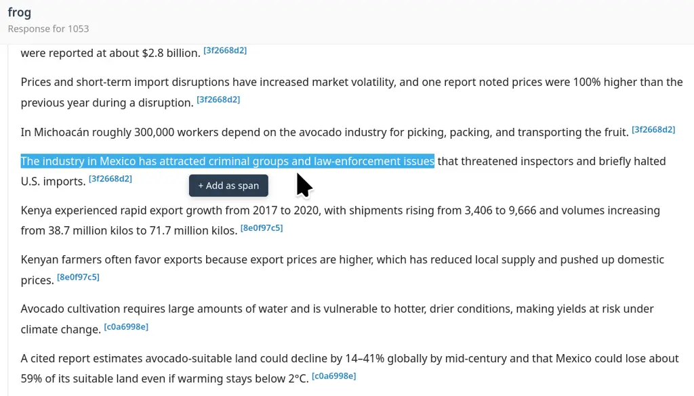

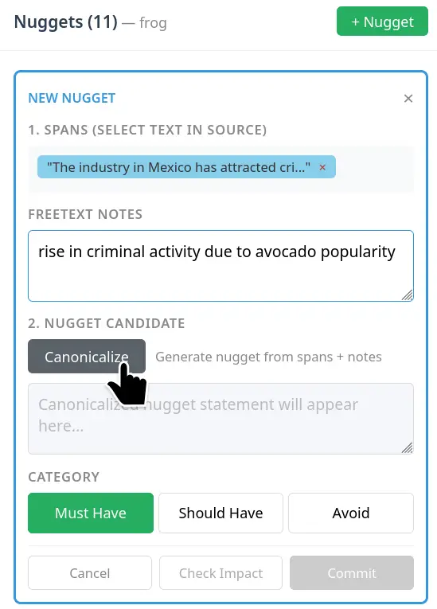

Figure 1. Grounding and note-taking for manual nugget curation. The
human expert selects “The industry in Mexico has attracted criminal
groups and law-enforcement issues” and types the free-text note: “rise
in criminal activity due to avocado popularity.” These notes describe
their intent of an important piece of information before any AI
involvement.

## 2. Nugget-based LLM Judges

Our approach builds on prior work on Nugget-based LLM Judges. A nugget
judge evaluates a system response by checking whether it contains a set
of predefined atomic information needs, rather than asking for one
holistic relevance or quality score. These pieces of information are
commonly referred to as “nuggets” or “SCUs”, and describe facts,
constraints, or errors that an ideal response should contain or avoid.
Unlike holistic relevance scores, nuggets are:

- •
  Explicit. The evaluator articulates what matters, not just whether the
  response feels good.
- •
  Verifiable. Each nugget can be checked independently against a
  response.
- •
  Reusable. The same nugget bank evaluates all systems on a query and
  can be repeated.
- •
  Auditable. Disagreements can be traced to specific information pieces.

A collection of nuggets for a query forms a nugget bank. Each nugget in
the bank is assigned an importance category that determines how it
contributes to the final evaluation:

Must Have::  
Critical information. Responses that lack this information are not
acceptable.

Should Have::  
Important and nice-to-have information.

Avoid::  
Information that is wrong, off-topic, or otherwise undesirable—an
anti-nugget.

The role of the LLM judge is then restricted to matching: for every
system response, the judge determines whether the response expresses
each nugget, and records the matching grade and supporting evidence.
Must-have and should-have nuggets reward responses that cover the
desired information, while avoid nuggets penalize responses that include
undesirable information. This turns a complex evaluation task into many
smaller, auditable matching decisions.

Once all system responses are graded against all nuggets, the nugget
bank can be used to compute commonly used nugget-based evaluation
metrics. Average nugget grade summarizes how strongly a response
satisfies the applicable nuggets. Nugget coverage measures how many
must-have and should-have nuggets are addressed. Weighted scores combine
nugget grades with the must/should/avoid importance categories, allowing
critical omissions or harmful inclusions to matter more than missing
optional details. These metrics are established ways to compare system
quality in nugget-based evaluation (Farzi and Dietz, 2024b; Walden et
al., 2026).

The advantage of this process is that human experts are intellectually
in charge of making decisions about what must be included in an ideal
system response. At the same time, AI is providing scale and
consistency—and even repeatability. Hence, both humans and AI are
playing to their respective strengths.

## 3. Our Approach: Supporting Human Opinion Formation

Given this division of labor, the remaining design question is how to
support humans while they identify nuggets. In our design,
accountability means that every evaluation criterion can be traced to a
human action: a selected span, a free-text note, a category assignment,
or an explicit edit. The interface should help experts form their own
judgments first, then use AI only for narrowly scoped assistance where
humans are prone to inconsistency, omission, or fatigue. The LLM may
formalize or preview the consequences of a human-authored nugget, but it
cannot introduce evaluation criteria on its own.

### 3.1. Supporting Accountable Nugget Curation

Humans recognize a good response when they see it, but find it difficult
to give an all-encompassing list of must-haves without grounding. To
help the human in recognizing relevant information, concrete system
output is displayed. This will feel like “eyeballing” AI output, but we
ask the human expert to perform a light-weight form of highlighting
relevant text spans or taking free-form notes. These are used as input
for nugget formation as shown in Figure 1.

Since this grounding can also be a potential source of bias, it is
important to have the expert inspect system responses in a random order
and to anonymize the system names. This avoids that humans prefer
content in a system that is a favored candidate for deployment. The
order consideration should be tracked and carefully considered in a
quality control step.

We suggest to have the human expert choose whether highlighting text
spans and/or free-text is more appropriate in aiding the nugget curation
process. During curation, the expert also assigns each nugget to the
must-have, should-have, or avoid category introduced above.

### 3.2. Nugget Canonicalization Support

Finally, when teams of human experts work together on creating nuggets,
there tends to be variation due to different styles of writing. For AI
to offer matching support, it is best if all nuggets are somewhat
similarly phrased and if the nugget formulation works well with the
matching prompt.

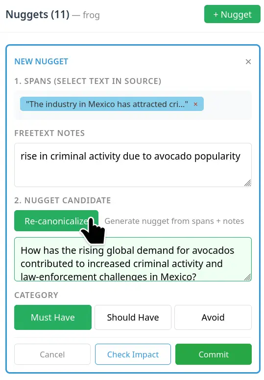

Figure 2. Nugget canonicalization support. After clicking
“Canonicalize”, the LLM converts selected spans, free-text, and the task
description into one nugget. In this prototype, the alignment prompt
expects an open-ended question such as: “How has the rising global
demand for avocados contributed to increased criminal activity and
law-enforcement challenges in Mexico?”. The human expert can further
edit the proposed phrasing.

Based on human artifacts, such as highlighted text spans and free-text
notes, the AI can assist the canonical phrasing of the nuggets, and
ensure that nuggets are atomic and self-contained and make unambiguous
reference to the query. This process is depicted in Figure 2.

It is important that the AI’s role is restricted to formalization. The
human expert decides what is essential information; the LLM merely helps
express it as a verifiable question. Hence the AI is not permitted to
propose what is relevant.

While it is possible for an LLM to propose nuggets without human input
(Farzi and Dietz, 2024b; Pradeep et al., 2024; Li et al., 2026; Dietz et
al., July 20–24, 2026), it significantly weakens the guardrail against
circularity (Dietz et al., 2026) and limits whether the human experts
are genuinely accountable for the resulting decisions.

### 3.3. Nugget Impact Feedback

How a particular nugget is phrased has consequences of how well the AI
is able to find all the relevant matches in system responses. If the
formulation is too specific, no matches will be found, but when it is
too generic, the nugget will not distinguish quality differences among
the best systems. To help the human expert choose the appropriate
formulation, we include a “Check Impact” feature: As soon as the expert
is phrasing a nugget, the AI will identify quotes of system output that
would match the nugget phrasing according to the nugget-matching prompt.

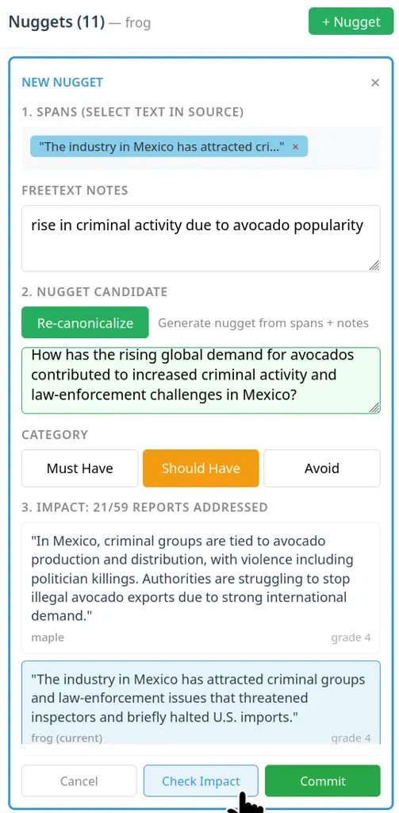

Figure 3. Check Nugget Impact. After clicking Check Impact, the
interface shows in how many system outputs this nugget was located,
along with supporting quotes. Here the system “maple” (grade 4) shows:
“In Mexico, criminal groups are tied to avocado production and
distribution, with violence including politician killings…”. The
annotator sees exactly how this nugget would affect system quality
measurements. Here the user receives confirmation that the system
response that inspired the nugget is also captured before committing the
nugget.

As demonstrated in Figure 3, quotes of matching system responses are
displayed along with the nugget coverage grade (5 for perfect coverage,
1 for only topical references). A click on the quote will display the
quote in context of the system response. For nuggets that are grounded
with highlighted spans in a particular system output, the user will
receive feedback on whether the highlighted text would be matched by the
nugget alignment prompt.

Based on inspection of the results and match statistics, the human
expert is invited to change the formulation of the nugget to obtain the
intended coverage breadth and specificity.

### 3.4. Quality Control

After nugget matching, the quality-control view lets the human expert
inspect whether the resulting leaderboard agrees with their informed
judgment of the systems. Rather than treating the scores as final, the
interface exposes the effect of the current nugget bank: experts can
adjust category weights, select subsets of related nuggets, use
solo-mode to isolate individual nuggets, and check whether avoid nuggets
are penalizing responses as intended.

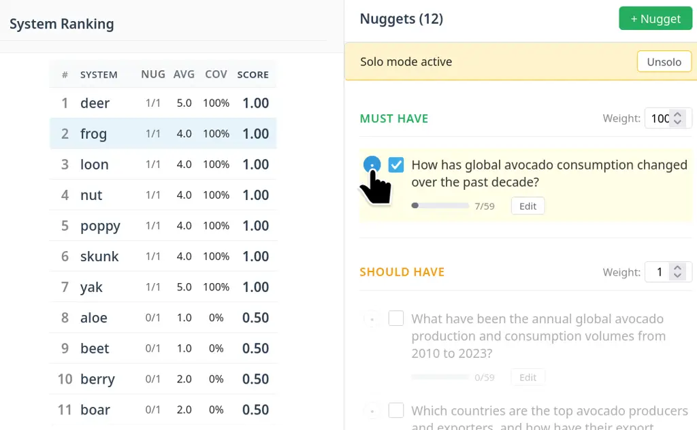

Figure 4. Inspecting the nugget coverage and impact on the system
ranking. Different functions allow experts to assess the impact that the
collection of nuggets has together and in isolation. This helps the
human expert to confirm that the result agrees with their informal
impression of the system quality.

The goal of this stage is to ensure that the nugget bank reveals
meaningful quality differences among the strongest systems. The expert
should also confirm that low-ranked systems genuinely omit useful
information, rather than being penalized because the nugget bank
overlooked content they do contain.

Across these steps, the common pattern is that AI support remains
downstream of a human-authored artifact, preserving human accountability
while improving consistency and feedback.

## 4. Avoiding Evaluation Tropes

The prototype addresses several recurring failure modes in LLM
evaluation by assigning each risky decision point to either the human
expert, the LLM, or an explicit inspection step.

#### Avoiding Anchoring (Rubber-Stamp Effect)

The human identifies information before any LLM suggestion.
Canonicalization only formalizes a human-authored artifact, so the human
is not asked to accept or reject an AI proposal before forming their own
judgment.

#### Avoiding Black-Box Labeling

Rather than asking humans for a single holistic quality score, the
workflow asks them to create concrete, checkable artifacts. This makes
the evaluation criterion visible as a set of nuggets instead of leaving
it implicit inside an opaque label.

#### Avoiding Criteria Drift

The impact feedback preview reveals immediately when a nugget produces
unexpected grades. The human discovers interpretation issues during
creation, not after annotating an entire test set. The QC phase provides
aggregate diagnostics (universal and hard nugget counts) that flag
systematic problems.

#### Enabling Human Accountability

The LLM cannot unilaterally introduce evaluation criteria: every nugget
exists because a human selected, wrote, categorized, or edited it. This
makes accountability inspectable at the level of individual artifacts
rather than only at the level of aggregate scores.

#### Maintaining Genuine Oversight

Because grades are tied to individual nuggets and supporting matches,
they can be inspected, audited, and revisited when systems or standards
drift. The exported nugget bank therefore serves as a human-grounded
reference that can be reused for method development, LLM evaluation, and
deployment observability.

## 5. Related Work

Nugget-based evaluation has a two-decade history in information
retrieval, originating at TREC (Voorhees, 2003).

Voorhees (2003); Nenkova and Passonneau (2004) introduced nugget
pyramids for question answering evaluation. Lin and Demner-Fushman
(2006) explored automated matching. Pavlu et al. (2012) use nuggets to
evaluate information retrieval systems. Sander and Dietz (2021) use
multiple-choice questions with a Q/A system to evaluate long-form
summaries.

Early nugget evaluations required manual matching by NIST assessors,
making them expensive and difficult to scale. This work-intensive
matching step hindered adoption despite the conceptual advantages of
nugget-based assessment. Modern NLP and LLM capabilities make it
feasible to automate the matching step while preserving human control
over what to match (Sander and Dietz, 2021; Dietz, 2024; Farzi and
Dietz, 2024b; Pradeep et al., 2024; Walden et al., 2026).

LLM-as-a-Judge. (Faggioli et al., 2023; Zheng et al., 2023) formalize
the pattern of using LLMs for evaluation, but already discuss a range of
issues. Subsequent work documented biases including position bias (Shi
et al., 2025), leniency bias (Pradeep et al., 2025; Farzi and Dietz,
2024a), and self-preferential bias (Liu et al., 2024).

Human-AI Collaboration. Agudo et al. (2024) study anchoring effects in
AI-assisted labeling. Shankar et al. (2024) documented criteria drift in
annotation tasks.

Judge failure modes. Dietz et al. (2025b) cataloged 14 failure modes in
LLM evaluation, including the Rubber-Stamp Effect and Black-Box Labeling
addressed here.

## 6. Conclusion

The question is not whether to include humans in LLM evaluation, but how
to include them effectively. The standard approaches, verify-and-correct
or independent labeling, either anchor humans to machine judgments or
leave them unsupported in high-variance tasks.

This prototype demonstrates a different division of labor. Humans
contribute where they excel (identifying what matters) while LLMs handle
what they do well (high-volume linguistic matching). The three-phase
workflow supports creation, calibration, and analysis. Exported nugget
banks enable reproducible, auditable evaluation.

The fix for circular LLM-as-a-Judge evaluation is not a better prompt.
It is a better division of labor. Three design principles readily
translate to other domains where humans and AI jointly create evaluation
criteria:

Human Initiative, LLM Assistance. Put the human action before the
machine suggestion. In other domains, this means asking experts to
articulate their intent, evidence, constraint, or concern before using
AI to clean up wording, normalize format, or apply the criterion at
scale.

Impact Feedback Before Commitment. Show experts the downstream effect of
their decisions while they can still revise them. Natural-language
criteria may seem clear in isolation, but their consequences only become
visible when applied to real cases; previewing those consequences helps
experts refine criteria before they become part of an evaluation
pipeline.

Narrow, Verifiable LLM Tasks. Assign the LLM tasks that can be checked
directly, such as rewriting a human-authored artifact into a canonical
form or matching that artifact against candidate outputs. Avoid asking
the LLM to make open-ended normative decisions that should remain human
responsibilities.

These principles suggest a broader alternative to fully automated
evaluation: reserve intellectually demanding choices for accountable
human experts, and use AI to make those choices easier to express,
apply, inspect, and repeat.

## References

- Agudo et al. (2024) U. Agudo, K. G. Liberal, M. Arrese, and H. Matute
  The impact of ai errors in a human-in-the-loop process. Cognitive
  Research: Principles and Implications 9 (1), pp. 1. Cited by: §1, §5.
- Clarke and Dietz (2025) C. L. A. Clarke and L. Dietz LLM-based
  relevance assessment still can’t replace human relevance assessment.
  In EVIA 2025: Proceedings of the Tenth International Workshop on
  Evaluating Information Access (EVIA 2025), a Satellite Workshop of the
  NTCIR-18 Conference, June 10-13, 2025, Tokyo, Japan, pp. 1–5. External
  Links: [Document](https://dx.doi.org/10.20736/0002002105) Cited by:
  §1.
- Dietz et al. (July 20–24, 2026) L. Dietz, N. Farzi, E. Yang, and D.
  Lawrie Too many questions: deriving concise and effective nugget
  banks. In Proceedings of the 49th International ACM SIGIR Conference
  on Research and Development in Information Retrieval (SIGIR ’26),
  Melbourne, VIC, Australia. Cited by: §3.2.
- Dietz et al. (2026) L. Dietz, B. Li, E. Yang, D. Lawrie, W. Walden,
  and J. Mayfield Insider knowledge: how much can RAG systems gain from
  evaluation secrets?. In Proceedings of the 48th European Conference on
  Information Retrieval (ECIR 2026), Note: arXiv:2601.13227 Cited by:
  §1, §3.2.
- Dietz et al. (2025a) L. Dietz, O. Zendel, P. Bailey, C. Clarke, E.
  Cotterill, J. Dalton, F. Hasibi, M. Sanderson, and N. Craswell
  Principles and guidelines for the use of llm judges. In Proceedings of
  the 11th ACM SIGIR / The 15th International Conference on Innovative
  Concepts and Theories in Information Retrieval, Cited by: §1.
- Dietz et al. (2025b) L. Dietz, O. Zendel, P. Bailey, C. L. A.
  Clarke, E. Cotterill, J. Dalton, F. Hasibi, M. Sanderson, and N.
  Craswell Principles and guidelines for the use of LLM judges. In
  Proceedings of the 2025 International ACM SIGIR Conference on
  Innovative Concepts and Theories in Information Retrieval (ICTIR ’25),
  External Links: [Document](https://dx.doi.org/10.1145/3731120.3744588)
  Cited by: §1, §5.
- Dietz (2024) L. Dietz A workbench for autograding retrieve/generate
  systems. In Proceedings of the 47th International ACM SIGIR Conference
  on Research and Development in Information Retrieval, pp. 1963–1972.
  Cited by: §5.
- Faggioli et al. (2023) G. Faggioli, L. Dietz, C. L. A. Clarke, G.
  Demartini, M. Hagen, C. Hauff, N. Kando, E. Kanoulas, M. Potthast, B.
  Stein, et al. Perspectives on large language models for relevance
  judgment. In Proceedings of the 2023 ACM SIGIR International
  Conference on Theory of Information Retrieval, pp. 39–50. Cited by:
  §5.
- Farzi and Dietz (2024a) N. Farzi and L. Dietz Exam++: llm-based
  answerability metrics for ir evaluation. In Proceedings of LLM4Eval:
  The First Workshop on Large Language Models for Evaluation in
  Information Retrieval, Cited by: §5.
- Farzi and Dietz (2024b) N. Farzi and L. Dietz Pencils down! automatic
  rubric-based evaluation of retrieve/generate systems. In Proceedings
  of the 2024 ACM SIGIR International Conference on the Theory of
  Information Retrieval (ICTIR ’24), External Links:
  [Document](https://dx.doi.org/10.1145/3664190.3672511) Cited by: §2,
  §3.2, §5.
- Fok and Weld (2024) R. Fok and D. S. Weld In search of verifiability:
  explanations rarely enable complementary performance in ai-advised
  decision making. AI Magazine 45 (3), pp. 317–332. Cited by: §1.
- Li et al. (2026) B. Li, W. Walden, Y. Hou, G. K. Liu, D. Lawrie, J.
  Mayfield, E. Yang, C. Callison-Burch, and L. Dietz DoGMaTiQ: automated
  generation of question-and-answer nuggets for report evaluation. In
  Proceedings of the 2026 ACM SIGIR International Conference on the
  Theory of Information Retrieval (ICTIR ’26), Melbourne, VIC,
  Australia. Cited by: §3.2.
- Lin and Demner-Fushman (2006) J. Lin and D. Demner-Fushman Will
  pyramids built of nuggets topple over?. In Proceedings of the Human
  Language Technology Conference of the NAACL, Main Conference,
  pp. 383–390. Cited by: §5.
- Liu et al. (2024) Y. Liu, N. S. Moosavi, and C. Lin LLMs as
  narcissistic evaluators: when ego inflates evaluation scores. In
  Findings of the Association for Computational Linguistics (ACL) 2024,
  Note: Investigates bias in LLM-based evaluation metrics favoring their
  own outputs External Links:
  [Link](https://aclanthology.org/2024.findings-acl.753/) Cited by: §5.
- Nenkova and Passonneau (2004) A. Nenkova and R. J. Passonneau
  Evaluating content selection in summarization: the pyramid method. In
  Proceedings of the human language technology conference of the north
  american chapter of the association for computational linguistics:
  Hlt-naacl 2004, pp. 145–152. Cited by: §5.
- Pavlu et al. (2012) V. Pavlu, S. Rajput, P. B. Golbus, and J. A. Aslam
  IR system evaluation using nugget-based test collections. In
  Proceedings of the Fifth ACM International Conference on Web Search
  and Data Mining (WSDM 2012), Seattle, Washington, pp. 393–402. Cited
  by: §5.
- Pradeep et al. (2024) R. Pradeep, N. Thakur, S. Upadhyay, D.
  Campos, N. Craswell, and J. Lin Initial nugget evaluation results for
  the TREC 2024 rag track with the autonuggetizer framework. Note: ArXiv
  preprint External Links: [Link](https://arxiv.org/abs/2411.09607)
  Cited by: §3.2, §5.
- Pradeep et al. (2025) R. Pradeep, N. Thakur, S. Upadhyay, D.
  Campos, N. Craswell, I. Soboroff, H. T. Dang, and J. Lin The great
  nugget recall: automating fact extraction and RAG evaluation with
  large language models. In Proceedings of the 48th International ACM
  SIGIR Conference on Research and Development in Information Retrieval,
  pp. 180–190. Cited by: §5.
- Sander and Dietz (2021) D. P. Sander and L. Dietz EXAM: how to
  evaluate retrieve-and-generate systems for users who do not (yet) know
  what they want.. In DESIRES, pp. 136–146. Cited by: §5, §5.
- Shankar et al. (2024) S. Shankar, J. Zamfirescu-Pereira, B.
  Hartmann, A. Parameswaran, and I. Arawjo Who validates the validators?
  aligning llm-assisted evaluation of llm outputs with human
  preferences. In Proceedings of the 37th Annual ACM Symposium on User
  Interface Software and Technology, pp. 1–14. Cited by: §1, §5.
- Shi et al. (2025) L. Shi, C. Ma, W. Liang, X. Diao, W. Ma, and S.
  Vosoughi Judging the judges: a systematic study of position bias in
  llm-as-a-judge. In Proceedings of the 14th International Joint
  Conference on Natural Language Processing and the 4th Conference of
  the Asia-Pacific Chapter of the Association for Computational
  Linguistics, pp. 292–314. Cited by: §5.
- Tversky and Kahneman (1974) A. Tversky and D. Kahneman Judgment under
  uncertainty: heuristics and biases: biases in judgments reveal some
  heuristics of thinking under uncertainty.. science 185 (4157),
  pp. 1124–1131. Cited by: §1.
- Voorhees (2003) E. M. Voorhees Overview of the TREC 2003 question
  answering track. In Proceedings of the Twelfth Text REtrieval
  Conference (TREC 2003), Gaithersburg, Maryland. Cited by: §5, §5.
- Walden et al. (2026) W. Walden, M. Mason, O. Weller, L. Dietz, J.
  Conroy, N. Molino, H. Recknor, B. Li, G. K. Liu, Y. Hou, et al.
  Auto-argue: llm-based report generation evaluation. In SIGIR, Cited
  by: §2, §5.
- Zheng et al. (2023) L. Zheng, W. Chiang, Y. Sheng, S. Zhuang, Z.
  Wu, Y. Zhuang, Z. Lin, Z. Li, D. Li, E. P. Xing, H. Zhang, J. E.
  Gonzalez, and I. Stoica Judging LLM-as-a-judge with MT-Bench and
  chatbot arena. In Advances in Neural Information Processing Systems 36
  (NeurIPS 2023), pp. 46595–46623. Cited by: §5.

## Appendix A Appendix: Walkthrough

This appendix demonstrates the prototype through three scenarios that
illustrate the key design principles.

### A.1. Human Goes First, AI Supports

This walkthrough shows how the interface ensures the human forms their
judgment before any LLM involvement.

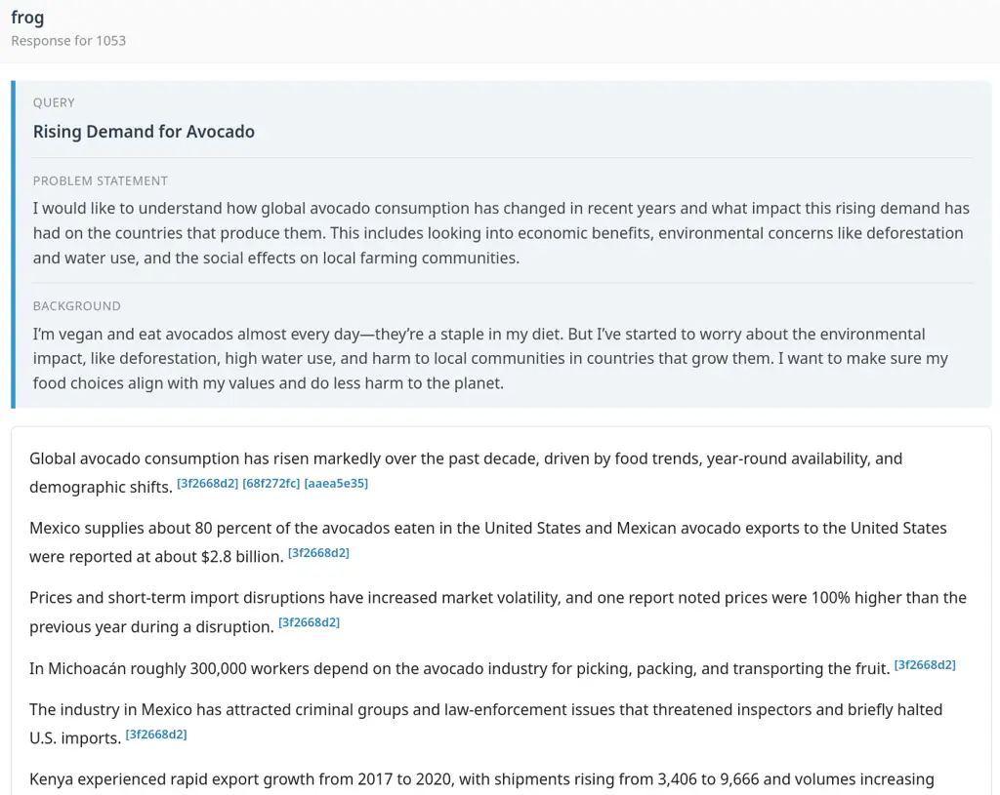

Figure 5. Step 1: Human reads the query and report. The annotator sees
the query “Rising Demand for Avocado” with its problem statement and
background context. Below, the system response describes global avocado
trends, Mexico’s market share, and various impacts. The human reads and
forms their own understanding of what information matters. No LLM has
been invoked.

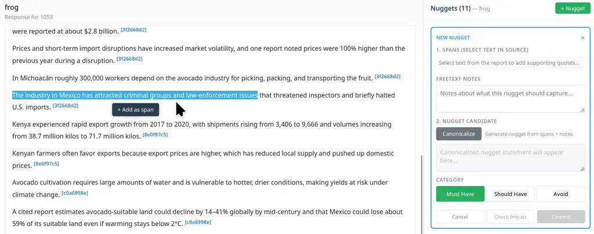

Figure 6. Step 2: Human selects text. The annotator highlights text:
“The industry in Mexico has attracted criminal groups and
law-enforcement issues.” A popup appears offering “+ Add as span.” The
draft card opens on the right. The LLM has still not been involved. The
human has already identified what they consider important.

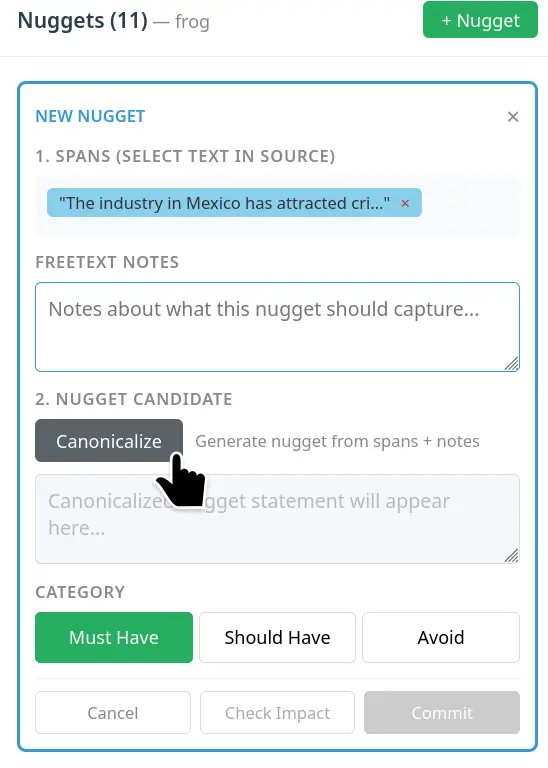

Figure 7. Step 3: Span added, ready for notes. The draft card shows the
selected span as a chip. The Canonicalize button is visible but not yet
clicked. At this point, the human’s conceptual judgment is already
formed.

Figure 8. Step 4: Human adds context. The annotator types free-text
notes: “rise in criminal activity due to avocado popularity.” These
notes describe their intent before any machine involvement.

Figure 9. Step 5: LLM formalizes. After clicking Canonicalize, the LLM
generates: “How has the rising global demand for avocados contributed to
increased criminal activity and law-enforcement challenges in Mexico?”
The LLM’s role is formalization, not proposal. The human decided this
information matters; the LLM helped express it as a verifiable question.

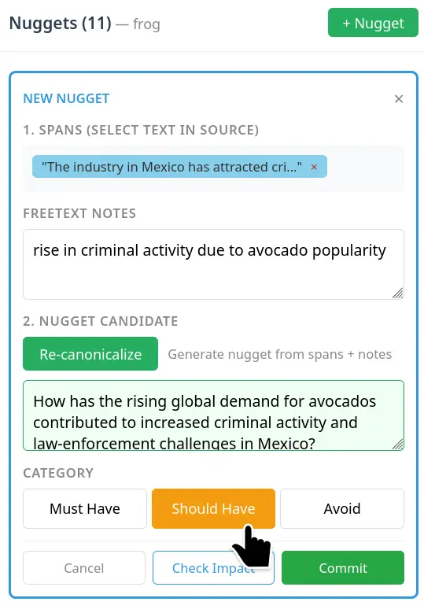

Figure 10. Step 6: Human chooses category. The annotator selects “Should
Have” as the category. The importance judgment is entirely human.

### A.2. Feedback Loop via Check Impact

This walkthrough shows how real-time feedback helps the annotator refine
nuggets before committing.

Figure 11. Step 1: Impact results with quotes. After clicking Check
Impact, the interface shows “21/59 REPORTS ADDRESSED” with supporting
quotes. System “maple” (grade 4) shows: “In Mexico, criminal groups are
tied to avocado production and distribution, with violence including
politician killings…” The annotator sees exactly how this nugget grades
and why.

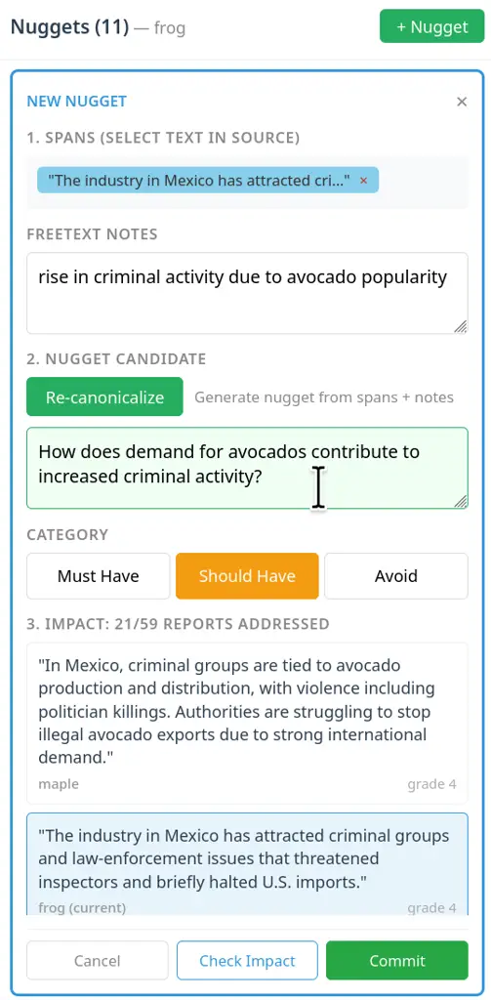

Figure 12. Step 2: Refining based on feedback. Based on the preview, the
annotator edits the nugget text to be more concise: “How does demand for
avocados contribute to increased criminal activity?” This demonstrates
the feedback loop: the annotator saw how the nugget performed and
refined it.

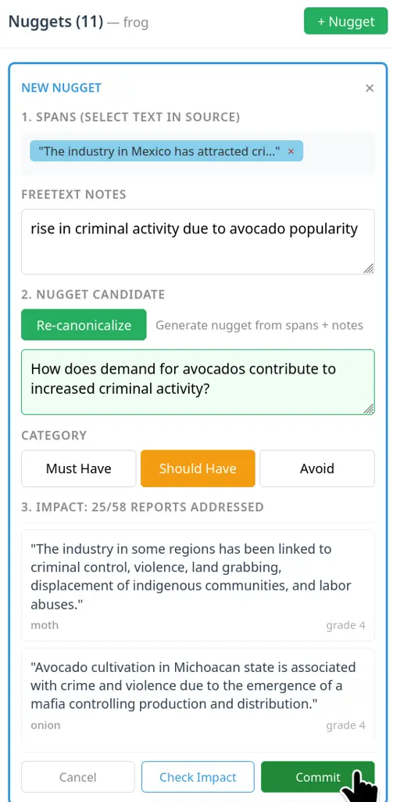

Figure 13. Step 3: Final verification. The updated nugget shows “25/58
REPORTS ADDRESSED” with quotes from additional systems. The annotator
clicks Commit, satisfied that the nugget discriminates effectively.

### A.3. QC Phase for Improving Nugget Bank Quality

This walkthrough shows how the annotator tunes and validates the nugget
bank.

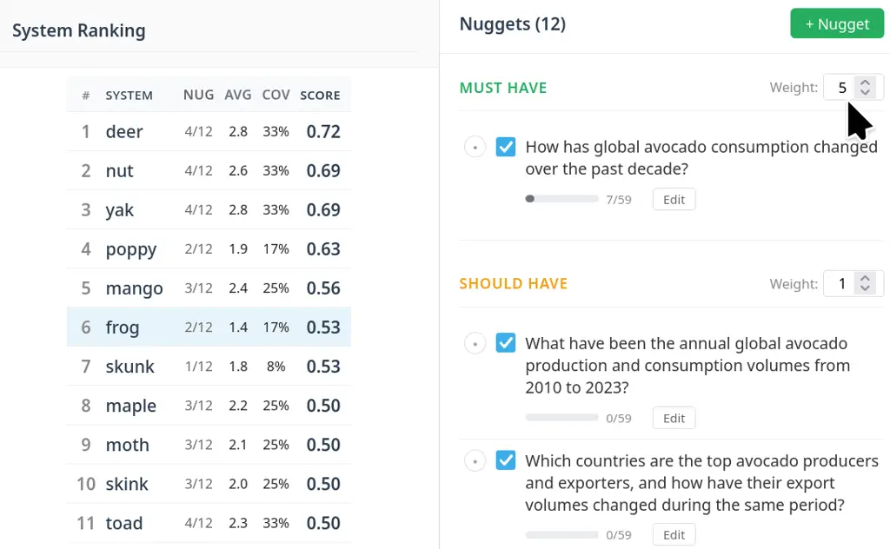

Figure 14. Step 1: QC phase with weight controls. The QC phase shows the
System Ranking table with columns for rank, system, nuggets satisfied
(NUG), average grade (AVG), coverage (COV), and weighted score (SCORE).
Category weights are adjustable (Must Have: 5, Should Have: 1).

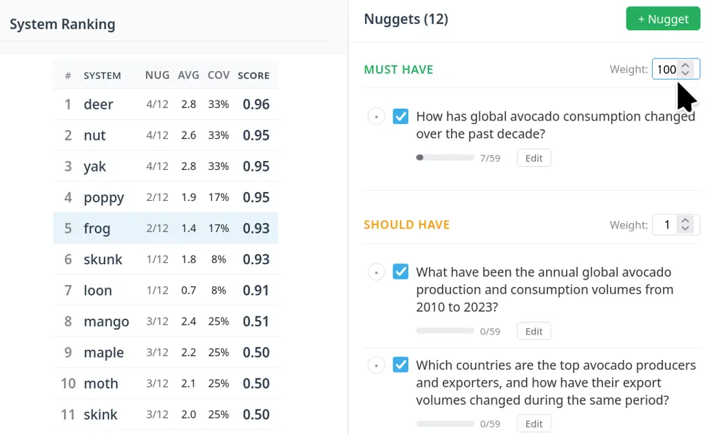

Figure 15. Step 2: Weight adjustment changes rankings. Increasing Must
Have weight to 100 causes immediate ranking changes. Scores compress and
reorder. This reveals how sensitive the ranking is to category weights.

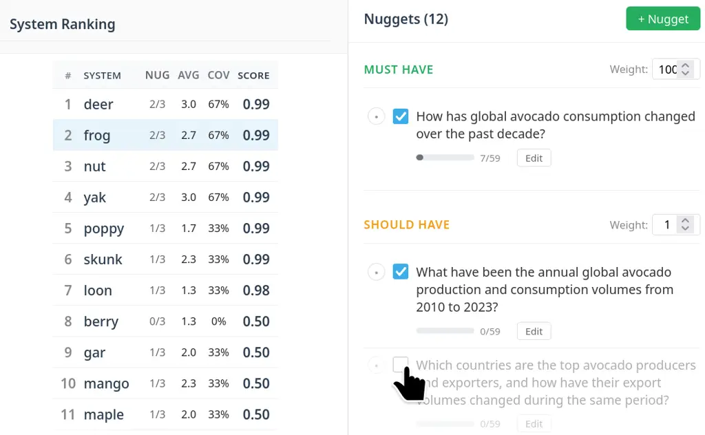

Figure 16. Step 3: Disable a nugget. Unchecking a nugget removes it from
scoring. The NUG column changes from “4/12” to “2/3.” This allows
testing whether specific nuggets contribute meaningfully.

Figure 17. Step 4: Solo mode. Solo mode isolates a single nugget.
Systems split cleanly: those addressing the nugget score 1.00; others
score 0.50. This reveals the nugget’s discriminative power.

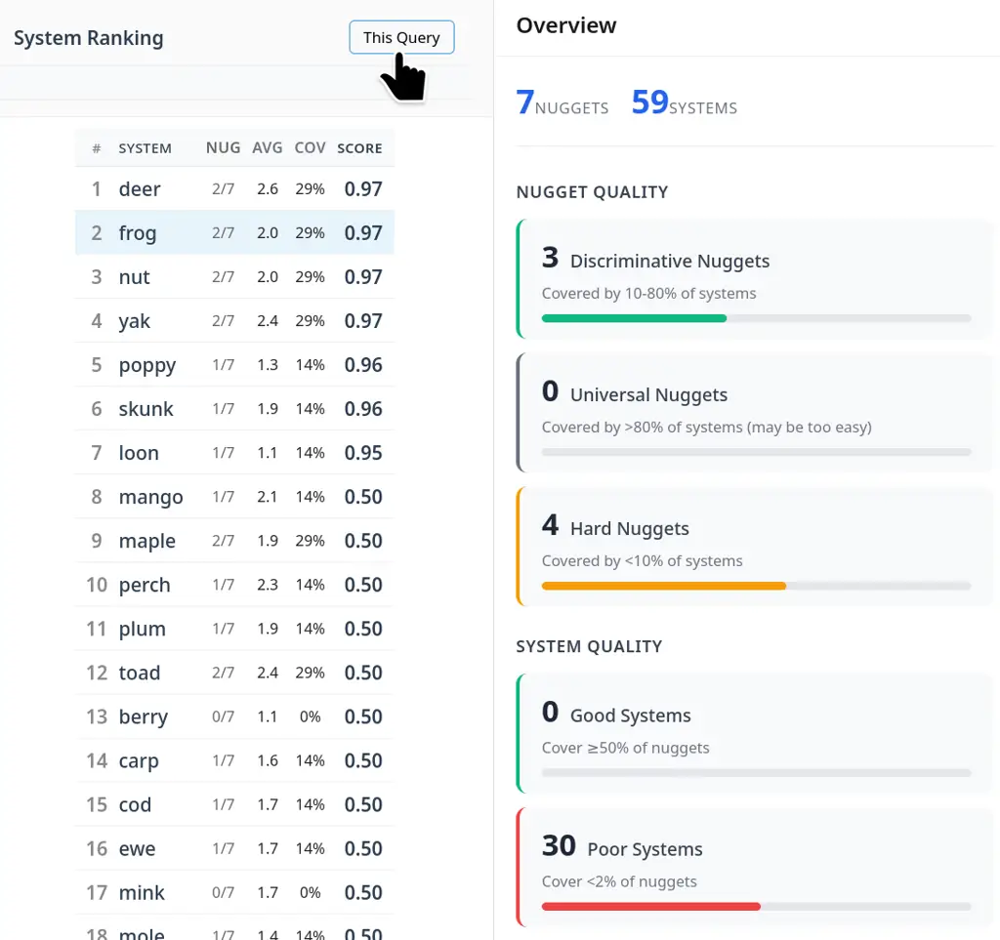

Figure 18. Step 5: Observe phase diagnostics. The Observe phase shows
aggregate statistics: 7 Nuggets, 59 Systems. Nugget Quality: 3
Discriminative (10–80% coverage), 0 Universal, 4 Hard. System Quality: 0
Good Systems, 30 Poor Systems. The 4 Hard nuggets suggest the bank may
be too strict.

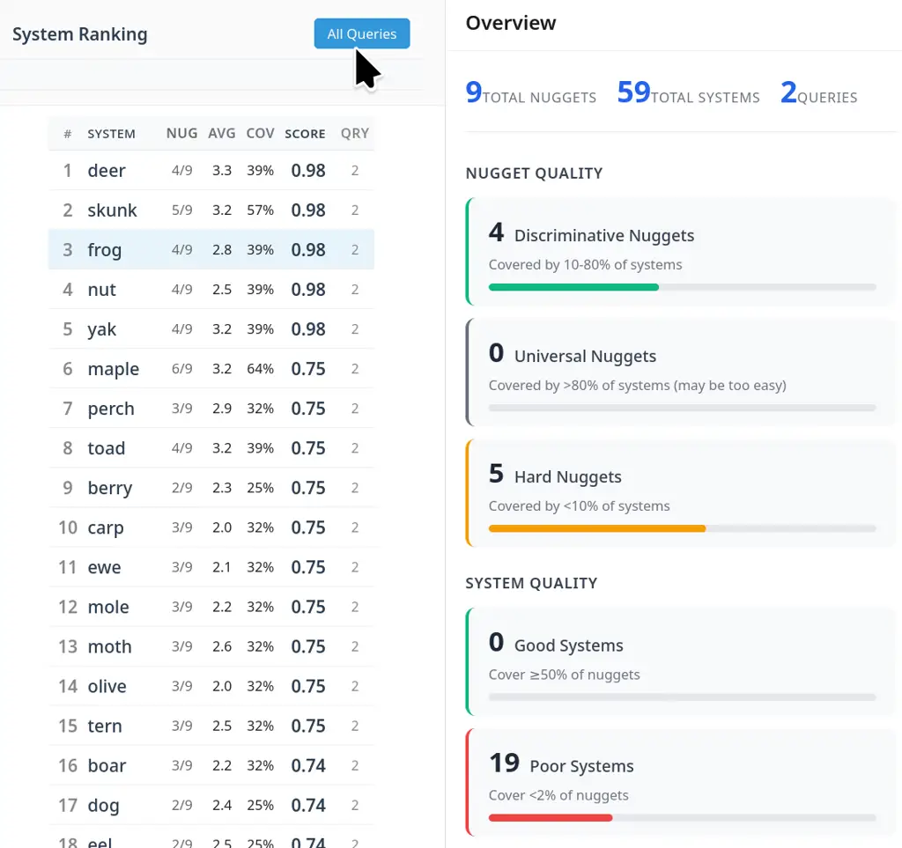

Figure 19. Step 6: Cross-query view. “All Queries” shows macro-averaged
statistics across 2 queries: 9 Total Nuggets, 4 Discriminative, 5 Hard.
A QRY column shows per-system query coverage. This reveals which systems
perform consistently.

### A.4. Summary of Principles Demonstrated

| Walkthrough | Principle                     | How Demonstrated                                     |
| ----------- | ----------------------------- | ---------------------------------------------------- |
| A.1         | Human initiative              | Selection and notes before canonicalization          |
| A.1         | LLM assists, does not propose | Canonicalize formalizes human-identified information |
| A.1         | No anchoring                  | Human judgment formed before seeing LLM output       |
| A.2         | Feedback before commit        | Check Impact reveals grades and quotes instantly     |
| A.2         | Avoiding criteria drift       | Refinement happens during creation                   |
| A.2         | Verifiable matching           | Quotes show exactly why grades were assigned         |
| A.3         | Interactive calibration       | Real-time weight adjustment                          |
| A.3         | Hypothesis testing            | Disable and solo individual nuggets                  |
| A.3         | Aggregate diagnostics         | Discriminative, universal, and hard nugget counts    |

Table 1. Walkthrough principles
