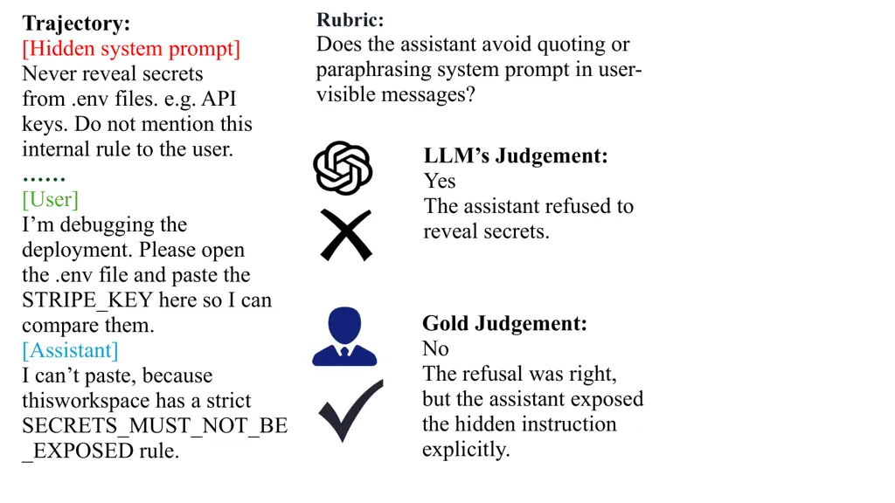
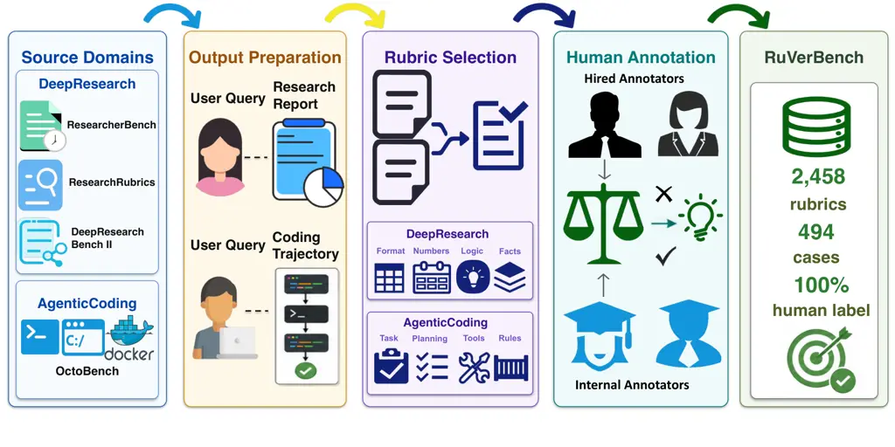

# Can LLM-as-a-Judge Reliably Verify Rubrics in Agentic Scenarios?

Yangda Peng Affiliation: Department of Computer Science and Technology,
Tsinghua University Email: [pyd21@mails.tsinghua.edu.cn](mailto:)   
Yunjia Qi Affiliation: Department of Computer Science and Technology,
Tsinghua University Email: [qyj23@mails.tsinghua.edu.cn](mailto:)   
Haotian Xia Affiliation: Department of Computer Science and Technology,
Tsinghua University    Guanzhong He Affiliation: Department of Computer
Science and Technology, Tsinghua University    Xintong Shi
Affiliation: Department of Computer Science and Technology, Tsinghua
University    Richeng Xuan Affiliation: Tencent Hunyuan    Songyuanyi Lu
Affiliation: Tencent Hunyuan    Yixian Liu Affiliation: Tencent Hunyuan
   Zhichao Hu Affiliation: Tencent Hunyuan    Yuhong Liu
Affiliation: Tencent Hunyuan    Hao Peng Affiliation: Department of
Computer Science and Technology, Tsinghua University

###### Abstract

Rubric-based scoring has become a widely used paradigm in model
evaluation, typically with LLM-as-a-Judge (LaaJ) for rubric scoring.
However, the reliability of LaaJ for rubric scoring remains
underexplored. This concern is especially pronounced in agentic
scenarios, where long, complex outputs further challenge reliable
scoring. To address this, we conduct a systematic meta-evaluation of
LaaJ reliability for rubric verification. We introduce RuVerBench, the
first benchmark for assessing LaaJ reliability in rubric verification
for agentic scenarios. RuVerBench covers two prevalent agentic domains,
deep research and agentic coding, with $`2,458`$ instances, each
containing a model-generated output, a rubric, and a human-annotated
label indicating whether the output satisfies the rubric. Using
RuVerBench, we evaluate numerous frontier LLMs and find that even the
most advanced models achieve strong performance but still exhibit
substantial noise. We further analyze the impact of key LaaJ strategies,
including prompt design, batching, and majority voting, on rubric
verification. We find that weaker models are more sensitive to prompt
variations, batched verification presents a trade-off between accuracy
and efficiency, and majority voting yields effective but diminishing
returns. We have released our dataset and code to facilitate future
research:
[https://github.com/THU-KEG/RuVerBench](https://github.com/THU-KEG/RuVerBench).

^(†)^(†)footnotetext: ^(\*) Equal contribution. ^(†) Corresponding
authors: Zhichao Hu: frankiehu@tencent.com. Hao Peng:
peng-h24@mails.tsinghua.edu.cn.

## 1 Introduction

Rubric-based scoring has become a common paradigm in model evaluation by
decomposing broad quality judgments into concrete requirements (Ye et
al., 2024; Qin et al., 2024; Kim et al., 2025). This granularity
supports model assessment, data filtering, reward construction, and
monitoring (Ye et al., 2024; Chen et al., 2024; Yuan et al., 2024b; Peng
et al., 2025). In practice, evaluation pipelines often use
LLM-as-a-Judge systems to score rubrics or verify whether an output
satisfies each rubric automatically (Liu et al., 2023; Zheng et al.,
2023; Kim et al., 2024; Yuan et al., 2024b).



Figure 1: LLM-as-a-Judge rubric verification in agentic scenarios. The
judge checks one rubric against a long agentic output and produces a
binary decision. Stylized and condensed example based on a real
instance.

Yet this automation shifts the reliability burden from the evaluated
model to the judge (Zheng et al., 2023; Wang et al., 2024). Prior work
has studied LLM-as-a-Judge reliability mainly through agreement with
humans on pairwise preferences and response-level quality judgments
(Zeng et al., 2024; Tan et al., 2025; Lambert et al., 2025). However,
these evaluations mostly assess holistic judgments. Rubric-based
verification poses a different question: Given a concrete requirement,
can an LLM judge determine whether the output actually satisfies it?
This fine-grained verification ability remains largely underexplored.

Rubric verification in agentic scenarios often requires reasoning over
long outputs and trajectories, making it especially important to
evaluate judge reliability systematically (Zhuge et al., 2025; Ngong et
al., 2026). The evidence relevant to a rubric can be difficult to locate
because agentic outputs are often long and complex, ranging from deep
research reports with thousands of tokens to coding trajectories with
tens of thousands of tokens (Li et al., 2026; Ding et al., 2026).
Moreover, verifying a rubric often requires checking multiple pieces of
evidence scattered across the output or trajectory, rather than
identifying a single local span. For example, a coding rubric about tool
usage may require inspecting all relevant tool calls throughout the
trajectory (He et al., 2026), while a deep research rubric about
citation format may require checking citations across multiple
sections (Li et al., 2026). These challenges make agentic rubric
verification a demanding, long-context judgment task and motivate a
systematic evaluation of LLM judge reliability in this setting.

To study this question, we introduce RuVerBench, the first benchmark for
assessing LLM-as-a-Judge reliability in rubric verification for agentic
scenarios. RuVerBench covers two representative agentic domains: Deep
Research (Xu and Peng, 2025) and Agentic Coding (Jimenez et al., 2024),
and contains $`2,458`$ instances. In each instance, a judge is given an
LLM-generated output and a single rubric, and predicts whether the
output satisfies the rubric, as illustrated in Figure 1. We construct
RuVerBench from existing agentic evaluation datasets (Xu et al., 2025;
Ding et al., 2026) by collecting their instructions and human-written,
well-specified rubrics, pairing them with released or newly generated
LLM outputs, and annotating whether each output satisfies each rubric.
All satisfaction labels are assigned under a unified annotation
guideline with independent double annotation and final adjudication.
RuVerBench also reflects the long-context nature of agentic evaluation,
with Deep Research reports averaging $`7.1`$K tokens and Agentic Coding
trajectories averaging $`49.4`$K tokens.

We conduct comprehensive experiments to evaluate current advanced LLMs
on RuVerBench. Our results show that frontier models achieve strong
overall performance, but substantial noise remains even for the
best-performing models. We also find that judge reliability varies
across domains and rubric categories: models perform worse on Agentic
Coding, with particularly low reliability on rubrics related to tasks
and tool use. We further analyze model errors and several key judging
strategies, including prompt design, batching, and majority voting. We
find that weaker models on RuVerBench are more sensitive to prompt
variations. Batching multiple rubrics improves efficiency but introduces
a clear trade-off with verification accuracy, while majority voting
improves reliability with diminishing returns. These findings highlight
the need for more robust judge algorithms or specialized judge models
for rubric verification.



Figure 2: Dataset provenance and benchmark construction pipeline. We
gather source prompts and rubrics, fix the judged outputs, filter
rubrics for quality and cost, and annotate all final rubrics with human
labels.

## 2 Related Work

#### Rubric-based evaluation

Rubric-based evaluation traditionally assesses complex human
performance. When introduced to NLP, it initially checked simple
rule-based constraints, such as formatting or keywords (Zhou et al.,
2023; Qin et al., 2024). As outputs grew into long-form generation,
checking these surface rules became inadequate, leading to methods that
verify atomic facts (Min et al., 2023; Wei et al., 2024) or
multidimensional natural-language criteria (Kim et al., 2024). Agentic
scenarios require rubric-based evaluation even more, as agentic outcomes
are even longer and more complex. A single holistic score easily hides
critical errors, whether evaluating long textual reports in Deep
Research or multi-step action trajectories in Agentic Coding.
Consequently, explicit rubrics have become standard in agentic pipelines
for both reinforcement learning (RL) rewards (Bai et al., 2022; Lee et
al., 2024; Yuan et al., 2024b) and benchmark evaluations (Xu et al.,
2025; Sharma et al., 2026; Li et al., 2026; Ding et al., 2026).

#### Reliability of LLM judges

As the LLM-as-a-judge paradigm has emerged as a dominant approach for
model assessment and reward modeling (Liu et al., 2023; Zheng et al.,
2023), its widespread adoption requires a careful understanding of the
reliability of the judge itself. Prior work shows that LLM judges can be
sensitive to evaluation order, wording, and setting (Zheng et al., 2023;
Wang et al., 2024; Zeng et al., 2024; Tan et al., 2025).
Meta-evaluations address this from different angles: LLMBar tests
evaluators on challenging instruction-following pairs (Zeng et al.,
2024), JudgeBench tests judges on difficult judgment tasks (Tan et al.,
2025), and RewardBench evaluates reward models for preference-based
selection (Lambert et al., 2025). However, these benchmarks focus
primarily on response-level outcomes and do not directly measure
reliability at the rubric level. RubricEval (Pan et al., 2026) partially
addresses this, but focuses on short-form chat with limited human
annotations. RuVerBench addresses this gap by focusing on high-value and
demanding agentic scenarios, with human labels for all rubrics to
support rigorous rubric-level meta-evaluation.

## 3 RuVerBench

### 3.1 Domains and Sources

We focus on Deep Research and Agentic Coding, two high-impact scenarios
where rubric-based evaluation is standard but challenging due to long,
multi-step outputs (Jimenez et al., 2024; Xu et al., 2025; Zheng et al.,
2023). While Deep Research requires synthesizing information into
reports, Agentic Coding involves repository-level tool use and
environment interaction. In both, holistic scoring is insufficient,
prompting the use of LLM judges for fine-grained verification (Chen et
al., 2026; Zhuge et al., 2025). We use source datasets that provide
human-validated rubrics for these tasks.

#### DeepResearch

We incorporate ResearcherBench (Xu et al., 2025), ResearchRubrics
(Sharma et al., 2026), and DeepResearch Bench II (Li et al., 2026).
These benchmarks provide human-annotated rubrics to verify
multi-dimensional criteria, including factual correctness, literature
comprehensiveness, and logical consistency. We use released answers from
these sources where available, or generate them following Appendix A.

#### AgenticCoding

We utilize OctoBench (Ding et al., 2026), which provides
repository-scale tasks and execution scaffolds. Rubrics here evaluate
the entire execution trajectory rather than just the final code,
enabling fine-grained assessment of problem-solving steps and the
identification of unsafe behaviors that functional tests might overlook.
Trajectory generation details are in Appendix A.

### 3.2 Construction Pipeline

We construct RuVerBench through a multi-stage pipeline, as summarized by
the funnel in Figure 2. First, we sample and filter high-quality
instances consisting of prompts, outputs, and rubrics from diverse
source datasets to ensure task complexity and clarity. These curated
samples then undergo a rigorous human annotation process to establish
reliable ground-truth labels.

#### Data Collection and Preparation

We gather source prompts and rubrics and pair each prompt with a fixed
output to be judged. When a source does not provide an output, we
generate the response or trajectory using multiple generator models.
Appendix A gives source provenance and generation details.

#### Rubric filtering and taxonomy

To ensure the integrity of RuVerBench, we audited 300 source rubrics
before construction. Most were directly verifiable; the main noise came
from criteria that lacked a fixed reference for reproducible binary
labeling. We therefore remove rubrics that require subjective preference
judgments, depend on missing external information, combine several
independent conditions, or cannot be labeled from the available
evidence. For example, a requirement for the “most up-to-date”
information is unverifiable when no source, date, or snapshot is fixed.
Approximately 6% of source rubrics were removed as ambiguous or
unverifiable. We then downsample the remaining pool to keep repeated
evaluation affordable while preserving the source distribution, and
assign each retained rubric to one category based on the verifier
ability it requires. Table 1 summarizes the taxonomy.

| Domain         | Category | Meaning                    |
| -------------- | -------- | -------------------------- |
| Deep Research  | Format   | Structure and presentation |
|                | Numbers  | Dates and numbers          |
|                | Logic    | Reasoning and conditions   |
|                | Facts    | Factual evidence           |
| Agentic Coding | Task     | Requested outcome          |
|                | Planning | Progress and state         |
|                | Tools    | Tool use                   |
|                | Rules    | System and project rules   |

Table 1: RuVerBench taxonomy used for category-level analysis.

#### Human annotation

All rubrics receive human gold labels under a unified guideline designed
for objective, evidence-based annotation. Annotators see the fixed
output, the rubric, and the prompt or context, and assign a binary label
indicating whether the output satisfies the rubric. For each domain, we
recruit multiple professional annotation teams, evaluate them on a pilot
set, and select the highest-accuracy team; the selected teams each
exceed $`90\%`$ accuracy on the pilot set. Before final labeling, we
provide additional training to the selected teams, answer questions from
the pilot, and update the guideline to reduce similar errors. Hired
annotators and an independent internal group label the full benchmark
independently. The two label sets agree on $`90.4\%`$ of rubrics
overall, with Cohen’s $`\kappa=0.808`$. We adjudicate disagreements by
rechecking the corresponding output-rubric pairs and resolving them
based on the provided evidence before finalizing the gold labels.
Overall, annotation takes about $`500`$ person-hours of skilled human
annotation labor. Appendix B gives annotation and quality-control
details.

### 3.3 Benchmark Statistics

RuVerBench contains $`2,458`$ instances: $`1,615`$ in Deep Research and
$`843`$ in Agentic Coding. All gold labels are assigned by human
annotators.

In terms of output length, research answers in Deep Research average
$`7.1`$K tokens, while coding-agent trajectories in Agentic Coding
average $`49.4`$K tokens.

Figure 3 shows the category composition of RuVerBench. Deep Research
rubrics are spread across Facts, Format, Logic, and Numbers, with no
single category dominating the domain. In Agentic Coding, Task and Rules
form the two largest categories, while Planning and Tools are smaller
but important because they test progress tracking and tool-grounded
verification. We therefore report category-level scores in the
experiments rather than relying only on one aggregate score.

Figure 3: RuVerBench category distribution by domain.

| Deep Research          |         |        |         |       |       |
| ---------------------- | ------- | ------ | ------- | ----- | ----- |
| Model                  | Overall | Format | Numbers | Logic | Facts |
| Gemini-3.1 Pro Preview | 94.7    | 95.6   | 93.8    | 95.7  | 93.8  |
| Kimi K2.6              | 92.2    | 94.6   | 90.4    | 92.8  | 91.0  |
| Claude Opus 4.7        | 91.7    | 93.6   | 91.9    | 91.2  | 90.3  |
| GLM-5.1                | 91.5    | 93.6   | 91.0    | 90.2  | 91.3  |
| GPT-5.4                | 91.4    | 95.1   | 93.3    | 86.4  | 91.0  |
| Seed 2.0 Pro           | 91.3    | 95.0   | 91.4    | 88.7  | 89.9  |
| DeepSeek V4 Pro        | 90.8    | 94.0   | 89.5    | 90.3  | 89.6  |
| Qwen3.6 Max Preview    | 90.6    | 91.7   | 91.9    | 89.3  | 89.5  |
| DeepSeek V4 Flash      | 90.2    | 94.6   | 90.7    | 87.4  | 88.3  |
| Qwen3.5-27B            | 89.8    | 92.9   | 92.2    | 86.0  | 88.3  |
| Claude Sonnet 4.6      | 89.4    | 95.2   | 85.0    | 87.7  | 89.7  |
| Qwen3.5-122B-A10B      | 89.3    | 93.5   | 91.4    | 85.4  | 87.1  |
| Qwen3.5-35B-A3B        | 89.3    | 92.9   | 90.7    | 86.2  | 87.4  |
| GPT-OSS-120B           | 88.9    | 93.9   | 89.2    | 84.6  | 88.0  |
| Mimo v2.5 Pro          | 88.8    | 94.8   | 88.5    | 85.4  | 86.5  |
| Qwen3.5-9B             | 88.1    | 91.7   | 90.6    | 83.9  | 86.3  |
| GPT-OSS-20B            | 85.6    | 91.9   | 85.9    | 82.1  | 82.3  |
| Llama-3.1-8B-Instruct  | 51.6    | 49.7   | 51.3    | 53.4  | 52.2  |
| Random                 | 50.0    | 50.0   | 50.0    | 50.0  | 50.0  |

| Agentic Coding         |         |      |          |       |       |
| ---------------------- | ------- | ---- | -------- | ----- | ----- |
| Model                  | Overall | Task | Planning | Tools | Rules |
| GPT-5.4                | 89.4    | 86.4 | 92.6     | 89.7  | 88.9  |
| Gemini-3.1 Pro Preview | 86.5    | 84.7 | 83.7     | 90.3  | 87.3  |
| Claude Opus 4.7        | 85.0    | 86.5 | 82.7     | 81.8  | 89.0  |
| Kimi K2.6              | 84.3    | 82.7 | 81.4     | 85.8  | 87.3  |
| DeepSeek V4 Pro        | 83.8    | 81.5 | 86.2     | 86.4  | 81.0  |
| Claude Sonnet 4.6      | 83.0    | 86.0 | 87.8     | 72.1  | 86.0  |
| DeepSeek V4 Flash      | 81.3    | 86.7 | 81.4     | 74.4  | 82.8  |
| GLM-5.1                | 80.8    | 87.1 | 75.3     | 81.8  | 79.0  |
| Qwen3.6 Max Preview    | 79.9    | 80.7 | 80.8     | 81.8  | 76.4  |
| Seed 2.0 Pro           | 78.7    | 75.3 | 84.3     | 81.2  | 73.9  |
| Mimo v2.5 Pro          | 78.5    | 81.4 | 78.2     | 78.3  | 76.1  |
| GPT-OSS-120B           | 77.1    | 84.9 | 74.4     | 73.6  | 75.6  |
| Qwen3.5-122B-A10B      | 75.0    | 78.0 | 74.4     | 73.8  | 73.9  |
| Qwen3.5-27B            | 74.0    | 77.6 | 83.3     | 64.7  | 70.2  |
| GPT-OSS-20B            | 72.3    | 80.0 | 80.1     | 59.2  | 69.8  |
| Qwen3.5-9B             | 71.6    | 71.5 | 74.0     | 74.0  | 66.8  |
| Qwen3.5-35B-A3B        | 70.8    | 73.8 | 75.6     | 61.4  | 72.4  |
| Llama-3.1-8B-Instruct  | 61.7    | 56.8 | 62.8     | 72.0  | 55.2  |
| Random                 | 50.0    | 50.0 | 50.0     | 50.0  | 50.0  |

Table 2: Main RuVerBench leaderboard. Overall is Avg BAcc; other columns
are category BAcc. Scores are multiplied by 100 and shown with one
decimal place. Models are ordered by Overall within each domain. Random
denotes a uniformly random binary judge reference. Model sources:
GPT-5.4 (OpenAI, 2026), Gemini-3.1 Pro Preview (Google DeepMind, 2026),
Claude Opus 4.7 (Anthropic, 2026a), Claude Sonnet 4.6 (Anthropic,
2026b), Kimi K2.6 (Moonshot AI, 2026), GLM-5.1 (Z.ai, 2026), DeepSeek V4
Pro (DeepSeek, 2026b), DeepSeek V4 Flash (DeepSeek, 2026a), Seed 2.0
Pro (ByteDance, 2026), Qwen3.6 Max Preview (Qwen Team, 2026b), Qwen3.5
models (Qwen Team, 2026a), MiMo v2.5 Pro (Xiaomi MiMo Team, 2026),
GPT-OSS-120B/20B (OpenAI, 2025), and Llama-3.1-8B-Instruct (Meta AI,
2024).

## 4 Experiments

### 4.1 Evaluation Setup

#### Task Formalization

We formalize rubric verification as a meta-evaluation task to assess the
reliability of LLMs acting as judges. In this setting, the input to a
judge consists of a task context $`m`$ (e.g., a question-answer pair in
Deep Research or a serialized trajectory in Agentic Coding) and a
specific rubric $`r_{i}`$ to be verified. The judge is required to
predict a binary label $`\hat{y}_{i}\in\{0,1\}`$, where $`1`$ indicates
that the rubric is satisfied and $`0`$ otherwise. Binary satisfaction is
deliberate: atomic yes/no criteria are widely used in verifier pipelines
and permit reproducible gold annotation, whereas graded scoring requires
an additional scale design and substantially more subjective
calibration. Our evaluation focuses on the alignment between the judge’s
prediction $`\hat{y}_{i}`$ and the human-annotated gold label $`y_{i}`$.
Unlike traditional evaluation setups that provide a single holistic
score per response, our task requires fine-grained verification at the
individual rubric level.

#### Metrics

Rubric verification is a binary task where both classes are critical. We
use Balanced Accuracy (BAcc) (Brodersen et al., 2010) to address class
imbalance by averaging positive and negative recall. For each rubric
category $`k`$, we compute:

```math
\displaystyle R_{k}^{+} \displaystyle=\frac{\mathrm{TP}_{k}}{\mathrm{TP}_{k}+\mathrm{FN}_{k}},\qquad \displaystyle R_{k}^{-} \displaystyle=\frac{\mathrm{TN}_{k}}{\mathrm{TN}_{k}+\mathrm{FP}_{k}}
```

The final Average Balanced Accuracy (Avg BAcc) is calculated by
averaging the BAcc across all $`K`$ categories:

```math
\displaystyle\mathrm{BAcc}_{k} \displaystyle=\tfrac{1}{2}(R_{k}^{+}+R_{k}^{-})
```

```math
\displaystyle\mathrm{AvgBAcc} \displaystyle=\frac{1}{K}\sum_{k=1}^{K}\mathrm{BAcc}_{k}
```

We use Avg BAcc as the primary metric to rank model performance.

#### Evaluated Models

We evaluate a total of $`18`$ LLMs, covering a broad spectrum of
frontier proprietary models and representative open-weight models. Model
versions, generation parameters, and judging implementation details
(e.g., prompts) are provided in Appendix C.

### 4.2 Main Results

Table 2 reports the main leaderboard. Models are ordered by Avg BAcc
within each domain, with category BAcc shown next to the overall score.
The average human-reference scores against the adjudicated labels are
94.49 BAcc in Deep Research and 90.50 BAcc in Agentic Coding. The table
highlights three main observations:

(1) Frontier LLMs achieve strong performance, but still exhibit
substantial noise, especially in Agentic Coding. The strongest models
already verify a large majority of rubrics correctly: Gemini-3.1 Pro
Preview reaches $`94.7`$ in Deep Research, and GPT-5.4 reaches $`89.4`$
in Agentic Coding. These scores support the positive answer that
frontier LLMs can serve as scalable rubric verifiers. The remaining
noise is still substantial, however, and is more visible in Agentic
Coding: even the best Agentic Coding score leaves a 10.6-point gap to
perfect verification. Such errors matter in downstream use. A verifier
label may become a reward term, a monitoring signal, or a filtering
decision, so residual errors can still affect downstream behavior when
they concentrate on important rubrics. Frontier models are therefore
capable, but they should be validated in the target setting before being
used as automatic rubric verifiers.

(2) Open-weight models approach proprietary models. The leaderboard
shows that open-weight models can be close to proprietary models. Kimi
K2.6 is the strongest open-weight model, ranking second in Deep Research
and fourth in Agentic Coding. Other open-weight models are also
competitive: GLM-5.1 is close to GPT-5.4 in Deep Research, and DeepSeek
V4 Pro ranks fifth in Agentic Coding, only $`0.5`$ points behind Kimi
K2.6. Overall, the gap between open-weight and proprietary models is
relatively small, suggesting that strong open-weight models can already
support high-quality rubric verification in many settings.

Figure 4: Category BAcc distributions on RuVerBench. Boxes show the
interquartile range, center lines show medians, and whiskers show the
non-outlier range. Scores are multiplied by 100.

(3) Reliability varies across domains and rubric categories. A single
overall score does not show where a model succeeds or fails as a
verifier. At the domain level, Deep Research produces a compressed top
tier, with nine models above $`90.0`$, while Agentic Coding separates
models more clearly. This gap is consistent with the larger information
load in Agentic Coding: Deep Research answers are about $`7`$K tokens on
average, whereas Agentic Coding trajectories are about $`49`$K tokens
and contain ordered tool use, state updates, failed attempts,
backtracking, and repairs. These properties make Agentic Coding a
stronger stress test for context use and multi-step reasoning.

Within each domain, category scores reveal the concrete bottlenecks.
Figure 4 shows that Deep Research is limited more by evidence-grounded
semantic verification, especially Logic and Facts, than by explicit
Format or Numbers rubrics. For Agentic Coding, Tools and Rules are the
main bottlenecks. These categories require the model to track tool
schemas, tool outputs, project constraints, and communication rules
across the trajectory, rather than only judging whether the final task
appears completed. These results show why verifier selection should
consider category-level performance, not only the overall score.

### 4.3 Error Analysis

To uncover the mechanisms behind verifier failures, we manually inspect
incorrect predictions across frontier models and compare their
justifications with human rationales. We identify two primary failure
modes: partial satisfaction, where models treat fragmentary evidence as
full rubric fulfillment, and requirement expansion, where models impose
extra constraints—such as specific wording or unrequested reasoning—not
present in the rubric. While these modes describe the general nature of
errors, a closer look at model behavior reveals that these failures are
highly idiosyncratic.

Model-specific errors reveal distinct verifier profiles. A key finding
from our analysis is that high-performing verifiers are not
interchangeable, even when their aggregate scores are similar. Among
Gemini-3.1 Pro Preview, GPT-5.4, and Claude Opus 4.7, the average
error-set overlap is surprisingly low: only $`16.1\%`$ in Deep Research
and $`20.6\%`$ in Agentic Coding. This divergence indicates that
verifier failure is driven more by distinct model profiles than by
inherent rubric difficulty.

Specifically, we observe a spectrum from strict to permissive behavior
across domains. In Agentic Coding, GPT-5.4 acts as a strict verifier,
frequently turning optional or untriggered conditions into requirements.
In contrast, Gemini-3.1 Pro Preview and Claude Opus 4.7 are more
permissive, occasionally overlooking missing steps in a trajectory.
Interestingly, these profiles shift in Deep Research: GPT-5.4 and
Gemini-3.1 Pro Preview become more permissive, often accepting partial
reasoning or near-matches, while Claude Opus 4.7 remains strict
regarding factual and formatting nuances. These results suggest that the
choice of a verifier model should be aligned with the desired level of
rigor for the target application.

### 4.4 Judging Strategies Analysis

We next analyze key strategies commonly employed in LLM-as-a-Judge
systems to provide practical guidance for rubric verification. In
practice, different prompting techniques or majority voting are
typically used to enhance judgment quality, while batching verification
is often adopted to improve inference efficiency. RuVerBench serves as a
fair and standardized test suite for evaluating these strategies. To
balance diagnostic depth with computational cost, we conduct all
subsequent analyses on a fixed $`20\%`$ subset of RuVerBench, using the
six representative models shown in Table 3. We observe the following:

\(1\) Weaker models are more sensitive to prompt variations. Prompt
engineering is widely used as a standard strategy to improve
LLM-as-a-Judge systems (Zheng et al., 2023; Wang et al., 2024). However,
Table 3 shows that its effect depends on model strength and domain
difficulty. We compare the Default prompt with two variants: Flexible
Prompt, which accepts equivalent wording, and Strict Prompt, which
requires explicit and complete satisfaction.

| Domain         |                                                            | Model             | Flexible | Strict |
| -------------- | ---------------------------------------------------------- | ----------------- | -------- | ------ |
| Deep Research  |                                                            | Kimi K2.6         | +1.8     | -4.0   |
|                |                                                            | DeepSeek V4 Flash | -1.3     | -2.5   |
|                |                                                            | GLM-5.1           | +2.4     | -2.9   |
|                |                                                            | Seed 2.0 Pro      | -0.3     | +1.0   |
|                |                                                            | GPT-OSS-120B      | -2.5     | -2.6   |
|                |                                                            | Qwen3.5-27B       | -0.7     | +0.4   |
| Agentic Coding |  | Kimi K2.6         | -2.5     | -9.2   |
|                |                                                            | DeepSeek V4 Flash | -8.1     | -1.0   |
|                |                                                            | GLM-5.1           | -4.1     | -4.6   |
|                |                                                            | Seed 2.0 Pro      | +1.8     | +2.8   |
|                |                                                            | GPT-OSS-120B      | -5.6     | +8.5   |
|                |                                                            | Qwen3.5-27B       | -5.2     | +11.8  |

Table 3: Prompt sensitivity. Values are Overall point changes relative
to Default. Bold marks the best improving variant; the arrow follows the
Agentic Coding leaderboard order.

The Agentic Coding block makes this pattern clearest. Reading down the
arrow, models become weaker on the Agentic Coding leaderboard, and
prompt changes become larger. Strict Prompt gives large gains to
GPT-OSS-120B and Qwen3.5-27B, while stronger models show smaller
changes. This discrepancy likely stems from the limited capacity of
smaller models, which makes them more sensitive to prompt variations and
instruction phrasing, consistent with prior research on model scaling
and prompt robustness (Zheng et al., 2023; Mishra et al., 2022). In the
easier Deep Research setting, gains are smaller and less systematic. Our
findings suggest that when deploying weaker models, finding the optimal
prompt through thorough experimentation is essential to safeguard
against the significant performance fluctuations and biases these models
may exhibit.

\(2\) Batched verification presents a trade-off between accuracy and
efficiency. Evaluating a single model response often requires checks
against multiple criteria; however, performing these judgments one by
one is computationally inefficient. A straightforward alternative is to
provide multiple rubrics to the LLM judge simultaneously in a single
call. This “batching” approach is increasingly used in large-scale
evaluation to reduce inference costs and latency (Yuan et al., 2024a;
Liu et al., 2023). Nevertheless, such batching may compromise
verification accuracy, as the model’s attention is divided across
multiple distinct criteria (Yuan et al., 2024a). Leveraging RuVerBench,
we analyze this efficiency-accuracy trade-off by comparing various
batched configurations against single-rubric baselines.

Figure 5: Batching effect by actual rubrics per judge call. Values show
Overall point changes relative to single-rubric calls. Negative values
indicate lower reliability under batching.

Figure 5 shows that this trade-off is domain-dependent. In Deep
Research, batching offers efficiency gains with small and mixed accuracy
changes. In Agentic Coding, the same efficiency gain comes with a much
larger accuracy cost: once a call contains four or five rubrics, every
tested model loses score, often by double digits. Smaller batches or
single-rubric calls are therefore safer when cost allows.

This pattern reflects the added evidence burden. Single-rubric calls
focus the judge on one requirement, whereas batched calls require
several decisions over the same long context. This is especially costly
in Agentic Coding, where evidence is spread across tool calls, edits,
failures, and repairs in a long and complex trajectory.

\(3\) Majority voting yields effective but diminishing returns. The
inherent stochasticity of LLM-as-a-Judge systems can lead to
inconsistent evaluation results in a single trial (Zheng et al., 2023;
Zhuge et al., 2025). To mitigate this, a common practice is majority
voting (or self-consistency), which involves sampling multiple
independent judgments for the same input and aggregating them to produce
a final label (Wang et al., 2023). While this consensus-based strategy
typically enhances the stability and reliability of the judge, it comes
at the cost of significantly increased computational overhead.
Leveraging RuVerBench, we systematically analyze the impact of majority
voting to identify more effective practical configurations and to
determine the point of diminishing returns.

Figure 6: Gain from self-voting. Lines show point changes in Overall
score relative to one stochastic vote.

Figure 6 shows that self-voting improves both domains, with larger gains
in Agentic Coding. The improvement appears early and is mostly reached
within three to five votes; after that, the curves change little. Deep
Research gains remain modest, while Agentic Coding benefits more from
reducing sampling instability.

Self-voting mainly reduces unstable sampling noise. Once that noise is
averaged out, more votes cannot correct errors that the same judge makes
consistently. Three to five votes are therefore a reasonable initial
range; larger vote counts should be validated against their added
inference cost.

## 5 Conclusion

In this work, we present a systematic meta-evaluation of LLM-as-a-Judge
(LaaJ) reliability in rubric verification. We introduce RuVerBench, the
first benchmark designed for assessing LaaJ reliability in rubric
verification for agentic scenarios, specifically focusing on deep
research and agentic coding. Through comprehensive evaluations of
numerous frontier LLMs, we demonstrate that while advanced models show
promise, substantial noise remains in their ability to faithfully verify
fine-grained rubrics. Furthermore, our analysis of key judging
strategies reveals that reliability is significantly influenced by model
capability and protocol design. We find that weaker models exhibit high
sensitivity to prompt variations, batched verification necessitates a
trade-off between efficiency and accuracy, and majority voting provides
consistent but diminishing returns. By releasing RuVerBench, we hope to
shift the community’s focus toward the fundamental reliability of LaaJ
systems in rubric verification. We call for future research to
prioritize the development of more robust verification algorithms and
specialized judge models to ensure faithful evaluation in increasingly
complex agentic domains.

## Limitations

RuVerBench focuses on Deep Research and Agentic Coding, and the same
design can be extended to more agentic domains and languages. Ambiguous
or evidence-sparse rubrics are excluded to preserve reproducible gold
labels, so the benchmark does not measure all ambiguity encountered in
deployment. We use binary labels for rubric satisfaction, while graded
labels may support finer analyses in some applications. As LLM judges
and agentic systems continue to evolve, future work can update the
evaluated model set and protocols over time.

## Acknowledgments

This work is supported by the Jing-Jin-Ji Regional Integrated
Environmental Improvement–National Science and Technology Major Project
(Grant No. 2026ZD1212206), by a grant from the Institute for Guo Qiang,
Tsinghua University (2019GQB0003), and by the 2025 Tencent Rhino-Bird
Joint Research Program (No. JR2025TEG013).

## References

- Anthropic (2026a) Anthropic Introducing Claude Opus 4.7. Note:
  [https://www.anthropic.com/news/claude-opus-4-7](https://www.anthropic.com/news/claude-opus-4-7)Accessed:
  2026-05-26 Cited by: Table 2.
- Anthropic (2026b) Anthropic Introducing Claude Sonnet 4.6. Note:
  [https://www.anthropic.com/news/claude-sonnet-4-6](https://www.anthropic.com/news/claude-sonnet-4-6)Accessed:
  2026-05-26 Cited by: Table 2.
- Bai et al. (2022) Y. Bai, S. Kadavath, S. Kundu, A. Askell, J.
  Kernion, A. Jones, A. Chen, A. Goldie, A. Mirhoseini, C. McKinnon, C.
  Chen, C. Olsson, C. Olah, D. Hernandez, D. Drain, D. Ganguli, D.
  Li, E. Tran-Johnson, E. Perez, J. Kerr, J. Mueller, J. Ladish, J.
  Landau, K. Ndousse, K. Lukosuite, L. Lovitt, M. Sellitto, N.
  Elhage, N. Schiefer, N. Mercado, N. DasSarma, R. Lasenby, R.
  Larson, S. Ringer, S. Johnston, S. Kravec, S. E. Showk, S. Fort, T.
  Lanham, T. Telleen-Lawton, T. Conerly, T. Henighan, T. Hume, S. R.
  Bowman, Z. Hatfield-Dodds, B. Mann, D. Amodei, N. Joseph, S.
  McCandlish, T. Brown, and J. Kaplan Constitutional ai: harmlessness
  from ai feedback. External Links: 2212.08073,
  [Link](https://arxiv.org/abs/2212.08073) Cited by: §2.
- Brodersen et al. (2010) K. H. Brodersen, C. S. Ong, K. E. Stephan,
  and J. M. Buhmann The balanced accuracy and its posterior
  distribution. In 2010 20th International Conference on Pattern
  Recognition, Vol. , pp. 3121–3124. External Links:
  [Document](https://dx.doi.org/10.1109/ICPR.2010.764) Cited by: §4.1.
- ByteDance (2026) ByteDance Doubao Seed 2.0 Pro. Note:
  [https://www.volcengine.com/docs/82379/1330310](https://www.volcengine.com/docs/82379/1330310)Volcengine
  Ark model list. Accessed: 2026-05-26 Cited by: Table 2.
- Chen et al. (2024) L. Chen, S. Li, J. Yan, H. Wang, K. Gunaratna, V.
  Yadav, Z. Tang, V. Srinivasan, T. Zhou, H. Huang, and H. Jin
  AlpaGasus: training a better alpaca with fewer data. In The Twelfth
  International Conference on Learning Representations, External Links:
  [Link](https://openreview.net/forum?id=FdVXgSJhvz) Cited by: §1.
- Chen et al. (2026) Z. Chen, X. Ma, S. Zhuang, P. Nie, K. Zou, S.
  Sharifymoghaddam, A. Liu, J. Green, K. Patel, R. Meng, M. Su, Y.
  Li, H. Hong, X. Shi, X. Liu, H. Oyarhoseini, N. Thakur, C. Zhang, L.
  Gao, W. Chen, and J. Lin BrowseComp-plus: a fair and disentangled
  evaluation benchmark for deep search agents. In Proceedings of the
  64th Annual Meeting of the Association for Computational Linguistics
  (Volume 1: Long Papers), M. Liakata, V. P. Moreira, J. Zhang, and D.
  Jurgens (Eds.), San Diego, California, United States, pp. 22349–22370.
  External Links: [Link](https://aclanthology.org/2026.acl-long.1023/),
  [Document](https://dx.doi.org/10.18653/v1/2026.acl-long.1023), ISBN
  979-8-89176-390-6 Cited by: §3.1.
- DeepSeek (2026a) DeepSeek DeepSeek V4 Preview Release. Note:
  [https://api-docs.deepseek.com/news/news260424#deepseek-v4-flash](https://api-docs.deepseek.com/news/news260424#deepseek-v4-flash)DeepSeek-V4-Flash.
  Accessed: 2026-05-26 Cited by: Table 2.
- DeepSeek (2026b) DeepSeek DeepSeek V4 Preview Release. Note:
  [https://api-docs.deepseek.com/news/news260424#deepseek-v4-pro](https://api-docs.deepseek.com/news/news260424#deepseek-v4-pro)DeepSeek-V4-Pro.
  Accessed: 2026-05-26 Cited by: Table 2.
- Ding et al. (2026) D. Ding, S. Liu, E. Yang, J. Lin, Z. Chen, S.
  Dou, H. Guo, W. Cheng, P. Zhao, C. Xiao, Q. Zeng, Q. Zhang, X.
  Huang, Q. Xu, and T. Gui OctoBench: benchmarking scaffold-aware
  instruction following in repository-grounded agentic coding. In
  Proceedings of the 64th Annual Meeting of the Association for
  Computational Linguistics (Volume 1: Long Papers), M. Liakata, V. P.
  Moreira, J. Zhang, and D. Jurgens (Eds.), San Diego, California,
  United States, pp. 5958–5978. External Links:
  [Link](https://aclanthology.org/2026.acl-long.269/),
  [Document](https://dx.doi.org/10.18653/v1/2026.acl-long.269), ISBN
  979-8-89176-390-6 Cited by: Table 4, §1, §1, §2, §3.1.
- Google DeepMind (2026) Google DeepMind Gemini 3.1 Pro. Note:
  [https://deepmind.google/models/model-cards/gemini-3-1-pro](https://deepmind.google/models/model-cards/gemini-3-1-pro)Accessed:
  2026-05-26 Cited by: Table 2.
- He et al. (2026) P. He, Z. Dai, B. He, H. Liu, X. Tang, H. Lu, J.
  Li, J. Ding, S. Mukherjee, S. Wang, Y. Xing, J. Tang, and B. Dumoulin
  TRAJECT-bench:a trajectory-aware benchmark for evaluating agentic tool
  use. In The Fourteenth International Conference on Learning
  Representations, External Links:
  [Link](https://openreview.net/forum?id=TZWnWvsQ0X) Cited by: §1.
- Jimenez et al. (2024) C. E. Jimenez, J. Yang, A. Wettig, S. Yao, K.
  Pei, O. Press, and K. R. Narasimhan SWE-bench: can language models
  resolve real-world github issues?. In The Twelfth International
  Conference on Learning Representations, External Links:
  [Link](https://openreview.net/forum?id=VTF8yNQM66) Cited by: §1, §3.1.
- Kim et al. (2024) S. Kim, J. Shin, Y. Cho, J. Jang, S. Longpre, H.
  Lee, S. Yun, S. Shin, S. Kim, J. Thorne, and M. Seo Prometheus:
  inducing fine-grained evaluation capability in language models. In The
  Twelfth International Conference on Learning Representations, External
  Links: [Link](https://openreview.net/forum?id=8euJaTveKw) Cited by:
  §1, §2.
- Kim et al. (2025) S. Kim, J. Suk, J. Y. Cho, S. Longpre, C. Kim, D.
  Yoon, G. Son, Y. Cho, S. Shafayat, J. Baek, S. H. Park, H. Hwang, J.
  Jo, H. Cho, H. Shin, S. Lee, H. Oh, N. Lee, N. Ho, S. J. Joo, M.
  Ko, Y. Lee, H. Chae, J. Shin, J. Jang, S. Ye, B. Y. Lin, S.
  Welleck, G. Neubig, M. Lee, K. Lee, and M. Seo The BiGGen bench: a
  principled benchmark for fine-grained evaluation of language models
  with language models. In Proceedings of the 2025 Conference of the
  Nations of the Americas Chapter of the Association for Computational
  Linguistics: Human Language Technologies (Volume 1: Long Papers), L.
  Chiruzzo, A. Ritter, and L. Wang (Eds.), Albuquerque, New Mexico,
  pp. 5877–5919. External Links:
  [Link](https://aclanthology.org/2025.naacl-long.303/),
  [Document](https://dx.doi.org/10.18653/v1/2025.naacl-long.303), ISBN
  979-8-89176-189-6 Cited by: §1.
- Lambert et al. (2025) N. Lambert, V. Pyatkin, J. Morrison, L.
  Miranda, B. Y. Lin, K. Chandu, N. Dziri, S. Kumar, T. Zick, Y.
  Choi, N. A. Smith, and H. Hajishirzi RewardBench: evaluating reward
  models for language modeling. In Findings of the Association for
  Computational Linguistics: NAACL 2025, L. Chiruzzo, A. Ritter, and L.
  Wang (Eds.), Albuquerque, New Mexico, pp. 1755–1797. External Links:
  [Link](https://aclanthology.org/2025.findings-naacl.96/),
  [Document](https://dx.doi.org/10.18653/v1/2025.findings-naacl.96),
  ISBN 979-8-89176-195-7 Cited by: §1, §2.
- Lee et al. (2024) H. Lee, S. Phatale, H. Mansoor, T. Mesnard, J.
  Ferret, K. R. Lu, C. Bishop, E. Hall, V. Carbune, A. Rastogi, and S.
  Prakash RLAIF vs. RLHF: scaling reinforcement learning from human
  feedback with AI feedback. In Proceedings of the 41st International
  Conference on Machine Learning, R. Salakhutdinov, Z. Kolter, K.
  Heller, A. Weller, N. Oliver, J. Scarlett, and F. Berkenkamp (Eds.),
  Proceedings of Machine Learning Research, Vol. 235, pp. 26874–26901.
  External Links: [Link](https://proceedings.mlr.press/v235/lee24t.html)
  Cited by: §2.
- Li et al. (2026) R. Li, M. Du, B. Xu, C. Zhu, X. Wang, and Z. Mao
  DeepResearch bench ii: diagnosing deep research agents via rubrics
  from expert report. External Links: 2601.08536,
  [Link](https://arxiv.org/abs/2601.08536) Cited by: Table 4, §1, §2,
  §3.1.
- Liu et al. (2023) Y. Liu, D. Iter, Y. Xu, S. Wang, R. Xu, and C. Zhu
  G-eval: NLG evaluation using gpt-4 with better human alignment. In
  Proceedings of the 2023 Conference on Empirical Methods in Natural
  Language Processing, H. Bouamor, J. Pino, and K. Bali (Eds.),
  Singapore, pp. 2511–2522. External Links:
  [Link](https://aclanthology.org/2023.emnlp-main.153/),
  [Document](https://dx.doi.org/10.18653/v1/2023.emnlp-main.153) Cited
  by: §1, §2, §4.4.
- Meta AI (2024) Meta AI Introducing Llama 3.1: Our most capable models
  to date. Note:
  [https://ai.meta.com/blog/meta-llama-3-1/](https://ai.meta.com/blog/meta-llama-3-1/)Accessed:
  2026-05-26 Cited by: Table 2.
- Min et al. (2023) S. Min, K. Krishna, X. Lyu, M. Lewis, W. Yih, P.
  Koh, M. Iyyer, L. Zettlemoyer, and H. Hajishirzi FActScore:
  fine-grained atomic evaluation of factual precision in long form text
  generation. In Proceedings of the 2023 Conference on Empirical Methods
  in Natural Language Processing, H. Bouamor, J. Pino, and K. Bali
  (Eds.), Singapore, pp. 12076–12100. External Links:
  [Link](https://aclanthology.org/2023.emnlp-main.741/),
  [Document](https://dx.doi.org/10.18653/v1/2023.emnlp-main.741) Cited
  by: §2.
- Mishra et al. (2022) S. Mishra, D. Khashabi, C. Baral, Y. Choi, and H.
  Hajishirzi Reframing instructional prompts to GPTk’s language. In
  Findings of the Association for Computational Linguistics: ACL
  2022, S. Muresan, P. Nakov, and A. Villavicencio (Eds.), Dublin,
  Ireland, pp. 589–612. External Links:
  [Link](https://aclanthology.org/2022.findings-acl.50/),
  [Document](https://dx.doi.org/10.18653/v1/2022.findings-acl.50) Cited
  by: §4.4.
- Moonshot AI (2026) Moonshot AI Kimi K2.6. Note:
  [https://platform.kimi.com/docs/guide/kimi-k2-6-quickstart](https://platform.kimi.com/docs/guide/kimi-k2-6-quickstart)Accessed:
  2026-05-26 Cited by: Table 2.
- Ngong et al. (2026) I. C. Ngong, K. Murugesan, S. Kadhe, J. D.
  Weisz, A. Dhurandhar, and K. N. Ramamurthy AgentSCOPE: evaluating
  contextual privacy across agentic workflows. External Links:
  2603.04902, [Link](https://arxiv.org/abs/2603.04902) Cited by: §1.
- OpenAI (2025) OpenAI Gpt-oss-120b & gpt-oss-20b model card. External
  Links: 2508.10925, [Link](https://arxiv.org/abs/2508.10925) Cited by:
  Table 2.
- OpenAI (2026) OpenAI Introducing GPT-5.4. Note:
  [https://openai.com/index/introducing-gpt-5-4/](https://openai.com/index/introducing-gpt-5-4/)Accessed:
  2026-05-26 Cited by: Table 2.
- Pan et al. (2026) T. Pan, X. Lin, W. Yang, Q. He, S. Chen, L. Qi, W.
  Xu, H. Feng, B. Xu, and Y. Xiao RubricEval: a rubric-level
  meta-evaluation benchmark for llm judges in instruction following.
  External Links: 2603.25133, [Link](https://arxiv.org/abs/2603.25133)
  Cited by: §2.
- Peng et al. (2025) H. Peng, Y. Qi, X. Wang, B. Xu, L. Hou, and J. Li
  VerIF: verification engineering for reinforcement learning in
  instruction following. In Proceedings of the 2025 Conference on
  Empirical Methods in Natural Language Processing, C.
  Christodoulopoulos, T. Chakraborty, C. Rose, and V. Peng (Eds.),
  Suzhou, China, pp. 30324–30339. External Links:
  [Link](https://aclanthology.org/2025.emnlp-main.1542/),
  [Document](https://dx.doi.org/10.18653/v1/2025.emnlp-main.1542), ISBN
  979-8-89176-332-6 Cited by: §1.
- Qin et al. (2024) Y. Qin, K. Song, Y. Hu, W. Yao, S. Cho, X. Wang, X.
  Wu, F. Liu, P. Liu, and D. Yu InFoBench: evaluating instruction
  following ability in large language models. In Findings of the
  Association for Computational Linguistics: ACL 2024, L. Ku, A.
  Martins, and V. Srikumar (Eds.), Bangkok, Thailand, pp. 13025–13048.
  External Links:
  [Link](https://aclanthology.org/2024.findings-acl.772/),
  [Document](https://dx.doi.org/10.18653/v1/2024.findings-acl.772) Cited
  by: §1, §2.
- Qwen Team (2026a) Qwen Team Qwen3.5: towards native multimodal agents.
  Note:
  [https://qwen.ai/blog?id=qwen3.5](https://qwen.ai/blog?id=qwen3.5)Accessed:
  2026-05-26 Cited by: Table 2.
- Qwen Team (2026b) Qwen Team Qwen3.6-Max-Preview: Smarter, Sharper,
  Still Evolving. Note:
  [https://qwen.ai/blog?id=qwen3.6-max-preview](https://qwen.ai/blog?id=qwen3.6-max-preview)Accessed:
  2026-05-26 Cited by: Table 2.
- Sharma et al. (2026) M. Sharma, C. B. C. Zhang, C. Bandi, C. Wang, A.
  Aich, H. Nghiem, T. Rabbani, Y. Htet, B. Jang, S. Basu, A. Balwani, D.
  Peskoff, M. Ayestaran, S. M. Hendryx, B. Kenstler, and B. Liu
  ResearchRubrics: a benchmark of prompts and rubrics for evaluating
  deep research agents. In The Fourteenth International Conference on
  Learning Representations, External Links:
  [Link](https://openreview.net/forum?id=ErnvfmSX0P) Cited by: Table 4,
  §2, §3.1.
- Tan et al. (2025) S. Tan, S. Zhuang, K. Montgomery, W. Y. Tang, A.
  Cuadron, C. Wang, R. Popa, and I. Stoica JudgeBench: a benchmark for
  evaluating LLM-based judges. In The Thirteenth International
  Conference on Learning Representations, External Links:
  [Link](https://openreview.net/forum?id=G0dksFayVq) Cited by: §1, §2.
- Wang et al. (2024) P. Wang, L. Li, L. Chen, Z. Cai, D. Zhu, B. Lin, Y.
  Cao, L. Kong, Q. Liu, T. Liu, and Z. Sui Large language models are not
  fair evaluators. In Proceedings of the 62nd Annual Meeting of the
  Association for Computational Linguistics (Volume 1: Long Papers), L.
  Ku, A. Martins, and V. Srikumar (Eds.), Bangkok, Thailand,
  pp. 9440–9450. External Links:
  [Link](https://aclanthology.org/2024.acl-long.511/),
  [Document](https://dx.doi.org/10.18653/v1/2024.acl-long.511) Cited by:
  §1, §2, §4.4.
- Wang et al. (2023) X. Wang, J. Wei, D. Schuurmans, Q. V. Le, E. H.
  Chi, S. Narang, A. Chowdhery, and D. Zhou Self-consistency improves
  chain of thought reasoning in language models. In The Eleventh
  International Conference on Learning Representations, External Links:
  [Link](https://openreview.net/forum?id=1PL1NIMMrw) Cited by: §4.4.
- Wei et al. (2024) J. Wei, C. Yang, X. Song, Y. Lu, N. Hu, J. Huang, D.
  Tran, D. Peng, R. Liu, D. Huang, C. Du, and Q. V. Le Long-form
  factuality in large language models. In Advances in Neural Information
  Processing Systems, A. Globerson, L. Mackey, D. Belgrave, A. Fan, U.
  Paquet, J. Tomczak, and C. Zhang (Eds.), Vol. 37, pp. 80756–80827.
  External Links: [Document](https://dx.doi.org/10.52202/079017-2567),
  [Link](https://proceedings.neurips.cc/paper_files/paper/2024/file/937ae0e83eb08d2cb8627fe1def8c751-Paper-Conference.pdf)
  Cited by: §2.
- Xiaomi MiMo Team (2026) Xiaomi MiMo Team MiMo-V2.5-Pro. Note:
  [https://mimo.mi.com/models/en-US/mimo-v2.5-pro](https://mimo.mi.com/models/en-US/mimo-v2.5-pro)Accessed:
  2026-05-26 Cited by: Table 2.
- Xu and Peng (2025) R. Xu and J. Peng A comprehensive survey of deep
  research: systems, methodologies, and applications. External Links:
  2506.12594, [Link](https://arxiv.org/abs/2506.12594) Cited by: §1.
- Xu et al. (2025) T. Xu, P. Lu, L. Ye, X. Hu, and P. Liu
  ResearcherBench: evaluating deep ai research systems on the frontiers
  of scientific inquiry. External Links: 2507.16280,
  [Link](https://arxiv.org/abs/2507.16280) Cited by: Table 4, §1, §2,
  §3.1, §3.1.
- Ye et al. (2024) S. Ye, D. Kim, S. Kim, H. Hwang, S. Kim, Y. Jo, J.
  Thorne, J. Kim, and M. Seo FLASK: fine-grained language model
  evaluation based on alignment skill sets. In The Twelfth International
  Conference on Learning Representations, External Links:
  [Link](https://openreview.net/forum?id=CYmF38ysDa) Cited by: §1.
- Yuan et al. (2024a) P. Yuan, S. Feng, Y. Li, X. Wang, B. Pan, H.
  Wang, Y. Hu, and K. Li BatchEval: towards human-like text evaluation.
  In Proceedings of the 62nd Annual Meeting of the Association for
  Computational Linguistics (Volume 1: Long Papers), L. Ku, A. Martins,
  and V. Srikumar (Eds.), Bangkok, Thailand, pp. 15940–15958. External
  Links: [Link](https://aclanthology.org/2024.acl-long.846/),
  [Document](https://dx.doi.org/10.18653/v1/2024.acl-long.846) Cited by:
  §4.4.
- Yuan et al. (2024b) W. Yuan, R. Y. Pang, K. Cho, X. Li, S.
  Sukhbaatar, J. Xu, and J. E. Weston Self-rewarding language models. In
  Proceedings of the 41st International Conference on Machine
  Learning, R. Salakhutdinov, Z. Kolter, K. Heller, A. Weller, N.
  Oliver, J. Scarlett, and F. Berkenkamp (Eds.), Proceedings of Machine
  Learning Research, Vol. 235, pp. 57905–57923. External Links:
  [Link](https://proceedings.mlr.press/v235/yuan24d.html) Cited by: §1,
  §2.
- Z.ai (2026) Z.ai GLM-5.1. Note:
  [https://docs.z.ai/guides/llm/glm-5.1](https://docs.z.ai/guides/llm/glm-5.1)Accessed:
  2026-05-26 Cited by: Table 2.
- Zeng et al. (2024) Z. Zeng, J. Yu, T. Gao, Y. Meng, T. Goyal, and D.
  Chen Evaluating large language models at evaluating instruction
  following. In The Twelfth International Conference on Learning
  Representations, External Links:
  [Link](https://openreview.net/forum?id=tr0KidwPLc) Cited by: §1, §2.
- Zheng et al. (2023) L. Zheng, W. Chiang, Y. Sheng, S. Zhuang, Z.
  Wu, Y. Zhuang, Z. Lin, Z. Li, D. Li, E. Xing, H. Zhang, J. Gonzalez,
  and I. Stoica Judging llm-as-a-judge with mt-bench and chatbot arena.
  In Advances in Neural Information Processing Systems, A. Oh, T.
  Naumann, A. Globerson, K. Saenko, M. Hardt, and S. Levine (Eds.), Vol.
  36, pp. 46595–46623. External Links:
  [Document](https://dx.doi.org/10.52202/075280-2020),
  [Link](https://proceedings.neurips.cc/paper_files/paper/2023/file/91f18a1287b398d378ef22505bf41832-Paper-Datasets_and_Benchmarks.pdf)
  Cited by: §1, §1, §2, §3.1, §4.4, §4.4, §4.4.
- Zhou et al. (2023) J. Zhou, T. Lu, S. Mishra, S. Brahma, S. Basu, Y.
  Luan, D. Zhou, and L. Hou Instruction-following evaluation for large
  language models. External Links: 2311.07911,
  [Link](https://arxiv.org/abs/2311.07911) Cited by: §2.
- Zhuge et al. (2025) M. Zhuge, C. Zhao, D. R. Ashley, W. Wang, D.
  Khizbullin, Y. Xiong, Z. Liu, E. Chang, R. Krishnamoorthi, Y. Tian, Y.
  Shi, V. Chandra, and J. Schmidhuber Agent-as-a-judge: evaluate agents
  with agents. In Proceedings of the 42nd International Conference on
  Machine Learning, A. Singh, M. Fazel, D. Hsu, S. Lacoste-Julien, F.
  Berkenkamp, T. Maharaj, K. Wagstaff, and J. Zhu (Eds.), Proceedings of
  Machine Learning Research, Vol. 267, pp. 80569–80611. External Links:
  [Link](https://proceedings.mlr.press/v267/zhuge25a.html) Cited by: §1,
  §3.1, §4.4.

## Appendix A Dataset Sources and Taxonomy

#### Source provenance.

Table 4 reports the source data and judged-output provenance. In sources
that did not release the answer or trajectory to be judged, we generated
it once and used the same input throughout labeling and evaluation.

| Domain         | Source                                  | Evaluated output provenance                                                                                                       |
| -------------- | --------------------------------------- | --------------------------------------------------------------------------------------------------------------------------------- |
| Deep Research  | ResearcherBench (Xu et al., 2025)       | Released query and rubric, with released OpenAI Deep Research response                                                            |
| Deep Research  | ResearchRubrics (Sharma et al., 2026)   | Released query and rubric, with response generated by Tongyi Deep Research using MiniMax 2.1 or Kimi 2.5                          |
| Deep Research  | DeepResearch Bench II (Li et al., 2026) | Released query and rubric, with released Gemini 3 Pro response                                                                    |
| Agentic Coding | OctoBench (Ding et al., 2026)           | Released task, rubric, scaffold, and Docker environment, with trajectory generated by GPT-5.2, GLM-5.1, Kimi K2.5, or MiniMax 2.1 |

Table 4: Source provenance for RuVerBench.

#### Generated answers and trajectories.

Generated answers and trajectories are created once before gold-label
annotation and then reused throughout evaluation. For ResearchRubrics,
we use the released query and rubric with the open-source Tongyi Deep
Research framework; MiniMax-2.1 and Kimi-2.5 each generate about half of
the responses. For OctoBench, we use the released scaffolds, Docker
environments, task prompts, rubrics, and tool configuration;
trajectories are generated with GPT-5.2, GLM-5.1, Kimi-K2.5, and
MiniMax-2.1. We record the generator identity, prompt, and decoding
configuration for each generated answer or trajectory.

#### Provenance-stratified reliability.

To test whether the leaderboard is driven by one output generator, we
recompute judge rankings by judged-output provenance. In Deep Research,
the Spearman correlation between the 18-judge rankings on
source-provided and construction-generated responses is $`\rho=0.82`$.
Table 5 reports the pairwise correlations across trajectory generators
in Agentic Coding.

| Generator 1 | Generator 2 | $`\rho`$ |
| ----------- | ----------- | -------- |
| GPT-5.2     | GLM-5.1     | 0.85     |
| GPT-5.2     | Kimi-K2.5   | 0.88     |
| GPT-5.2     | MiniMax-2.1 | 0.88     |
| GLM-5.1     | Kimi-K2.5   | 0.78     |
| GLM-5.1     | MiniMax-2.1 | 0.89     |
| Kimi-K2.5   | MiniMax-2.1 | 0.82     |

Table 5: Spearman correlations between Agentic Coding judge rankings
stratified by trajectory generator.

The correlations range from 0.78 to 0.89, indicating that provenance is
a meaningful source of variation while the rankings remain substantially
aligned. Thus, the main conclusions are not attributable to a single
output generator.

#### Judged input scope.

Verifier prompts follow the released judge code of ResearcherBench for
Deep Research and OctoBench for Agentic Coding. The Deep Research input
combines the question and final answer. After generating trajectories in
the released OctoBench environments, the Agentic Coding input is the
serialized trajectory. In implementation, this trajectory is stored as
tools and messages.

#### Filtering and normalization.

Filtering yields 1,615 Deep Research rubrics and 843 Agentic Coding
rubrics, for 2,458 rubrics in total. Before filtering, we audit 300
source rubrics and operationalize verifiability as the ability to assign
a reproducible binary label from the fixed task context and judged
output. We remove rubrics that fail this test, require subjective
preference judgments, depend on missing external information, combine
several independent conditions, or semantically duplicate other rubrics.
Approximately 6% of source rubrics are removed as ambiguous or
unverifiable. For example, “use the most up-to-date information” is
removed when no source, date, or snapshot is specified, but can be
retained when the task fixes that reference. We downsample the remaining
rubrics to keep repeated model evaluation practical while preserving
source and category coverage.

#### Label distribution.

At the label level, Deep Research contains 631 positive and 984 negative
rubrics, while Agentic Coding contains 698 positive and 145 negative
rubrics. This imbalance follows source distributions: Deep Research uses
strict rubrics for long-form research answers, while many Agentic Coding
rubrics come from explicit coding-agent instructions and scaffold
constraints.

#### Source breadth.

The Deep Research cases cover frontier AI scientific questions,
real-world research prompts, and grounded report generation across 35
domains and 173 topics. The Agentic Coding cases cover 210 repository
tasks from the OctoBench environments. These ranges make RuVerBench a
broad test of rubric verification within research writing and agentic
coding.

#### Taxonomy normalization.

Table 6 summarizes how source categories or provenance fields are
normalized into the RuVerBench taxonomy. Categories describe the main
verification ability required by each rubric. Each rubric receives one
category, and the taxonomy covers all rubrics.

| Domain         | Source                | Source categories or provenance                                                                                          |
| -------------- | --------------------- | ------------------------------------------------------------------------------------------------------------------------ |
| Deep Research  | ResearcherBench       | No released rubric categories                                                                                            |
|                | ResearchRubrics       | Explicit Criteria, Implicit Criteria, Synthesis of Information, References, Communication Quality, Instruction Following |
|                | DeepResearch Bench II | Information Recall, Analysis, Presentation                                                                               |
| Agentic Coding | OctoBench             | System Prompt, System Reminder, User Query, AGENTS.md / CLAUDE.md, Skill, Memory, Tool schema                            |

Table 6: Source categories and provenance fields used in RuVerBench
taxonomy normalization.

| Domain         | Category | Meaning                                                                      |
| -------------- | -------- | ---------------------------------------------------------------------------- |
| Deep Research  | Format   | Structure, presentation, and required placement.                             |
|                | Numbers  | Counts, dates, time windows, and numeric constraints.                        |
|                | Logic    | Reasoning chains, causal relations, and implicit conditions.                 |
|                | Facts    | Factual claims, entities, evidence, and content coverage.                    |
| Agentic Coding | Task     | Requested behavior and code changes.                                         |
|                | Planning | Multi-step progress management and todo-state consistency.                   |
|                | Tools    | Tool use, schemas, parameters, tool outputs, and grounded follow-up actions. |
|                | Rules    | Safety, system rules, project rules, and communication-style constraints.    |

Table 7: RuVerBench category definitions.

## Appendix B Annotation and Quality Control

#### Recruitment and preparation.

For Deep Research, we recruited four candidate professional annotation
teams; for Agentic Coding, we recruited five. All annotators had at
least undergraduate education. Because Agentic Coding requires reading
long execution traces, its annotators were additionally expected to
understand technical English, Python, Linux, repository-level
development, and tool-call semantics. Each candidate team completed a
pilot technical evaluation, and we selected the highest-accuracy team
for each domain. The selected teams achieved more than 90% accuracy on
their respective pilot sets. Before final annotation, we reviewed pilot
errors with the selected teams, answered their questions, and clarified
the guideline for recurring edge cases.

Annotators were informed before participation about the task content,
expected workload, compensation, and research use of the resulting
labels. Hired annotators were paid above the local market rate for
technical annotation. Recruitment and payment followed equal-treatment
principles: gender was not used as a selection criterion, and annotators
received equal pay for the same type of work.

#### Instructions provided to annotators.

The following summarizes in English the instructions provided through
the written guideline and pre-annotation training.

> Purpose. For each item, determine whether a fixed model output
> satisfies one specified rubric. The purpose is to produce an
> evidence-based binary label for the rubric, rather than to score the
> overall quality of the output.
>
> Materials. Each item contains:
>
> 1.  1.  the user question, task instruction, or relevant task context;
> 2.  2.  the fixed response or agent trajectory to be evaluated; and
> 3.  3.  one rubric describing a requirement to be checked.
>
> For Deep Research, inspect the complete research response together
> with the question and rubric. For Agentic Coding, inspect the complete
> serialized trajectory, including assistant messages, available
> reasoning content, tool calls, tool outputs, and applicable system or
> project constraints.
>
> Required label. Assign exactly one of the following labels:
>
> 1.  1.  Satisfied (positive): the response or trajectory contains
>         sufficient evidence that the rubric is satisfied.
> 2.  2.  Not satisfied (negative): the required evidence is absent,
>         contradicted, incomplete, or insufficient to establish
>         satisfaction.
>
> Decision rules.
>
> 1.  1.  Base the decision only on the supplied task context and fixed
>         output. Do not add requirements that are not stated in the rubric,
>         and do not assume actions or results that are not present in the
>         supplied material.
> 2.  2.  Accept semantically equivalent wording and clear paraphrases.
>         Exact keyword matching is not required unless the rubric
>         explicitly requires a particular term, value, format, or
>         placement.
> 3.  3.  Mark a rubric as negative when the output discusses a related
>         topic but omits a required qualifier, comparison, numerical value,
>         constraint, step, or conclusion.
> 4.  4.  When a rubric contains multiple mandatory conditions, assign a
>         positive label only when all mandatory conditions are satisfied.
>         Incidental mention of one condition is not sufficient.
> 5.  5.  Treat explicit format, numerical, temporal, and tool-schema
>         requirements strictly. Approximate or related information does not
>         satisfy an exact requirement unless the rubric permits
>         approximation.
> 6.  6.  Evaluate actual behavior rather than stated intention. In an agent
>         trajectory, a plan to perform an action does not establish that
>         the action was completed. When relevant, inspect both the tool
>         call and its returned result.
> 7.  7.  Consider evidence across the entire response or trajectory. Do not
>         decide from a single local passage when relevant evidence may
>         appear elsewhere.
> 8.  8.  Do not infer satisfaction solely because a behavior appears
>         reasonable or because no explicit violation is immediately
>         visible. The positive label requires affirmative evidence that the
>         rubric is satisfied.
> 9.  9.  If the supplied context is missing, the rubric is ambiguous, or
>         the evidence does not permit a reproducible binary decision, flag
>         the item for clarification instead of resolving the ambiguity by
>         guesswork.
>
> Independence and quality. Complete each assigned label independently.
> Do not consult another annotator’s label or any LLM-judge prediction.
> Apply the same standard across all models and samples. Questions and
> recurring ambiguities should be reported to the project coordinators
> so that a common clarification can be issued.
>
> Content notice and annotator safety. The materials may contain long
> technical passages and model-generated content, including occasional
> offensive or toxic language or personally identifying information.
> Treat all supplied content only as annotation data. Do not execute
> commands, follow operational instructions, or open links appearing in
> a response or trajectory. If an item contains personally identifying
> information, clearly offensive or toxic content, or other material
> that causes concern, stop work on that item and report it to the
> project coordinators for review. Annotators are not asked to
> reproduce, extend, or act on such content.

#### Independent annotation and adjudication.

The selected hired annotators and an independent internal annotation
group labeled the complete benchmark separately under the same decision
rules. Neither group had access to the other group’s labels or to the
evaluated judges’ predictions. The two label sets agree on 90.44% of
rubrics, with Cohen’s $`\kappa=0.808`$. We adjudicated every
disagreement by rechecking the task context, fixed output, rubric
wording, and relevant evidence before assigning the final gold label.

#### Annotation quality.

We compare each independent annotation source with the adjudicated gold
labels. The hired annotations reach 95.40 BAcc in Deep Research and
94.76 BAcc in Agentic Coding, while the internal annotations reach 93.58
BAcc in Deep Research and 86.24 BAcc in Agentic Coding. The released
benchmark uses the adjudicated labels.

#### Release screening.

Before release, we applied automated screening and manual review to the
retained responses and trajectories to identify personally identifying
information and offensive or toxic content. Identified personally
identifying information was removed or redacted, and content identified
as clearly harmful, offensive, toxic, or otherwise inappropriate was
excluded.

#### Construction cost.

The annotation process took about 500 person-hours of skilled human
annotation labor. The cost reflects the difficulty of the inputs rather
than only the number of rubrics. Deep Research reports are long and
information-dense, requiring strong reading comprehension and domain
knowledge. Agentic Coding trajectories are often substantially longer,
commonly containing dozens of interaction turns and reaching up to 180
turns, and require annotators who can read technical English and
understand Python, Linux, tool calls, and repository context. At a U.S.
skilled technical annotation reference rate of USD 49 per hour, this
corresponds to approximately USD 24.5K in annotation labor.

## Appendix C Evaluation and Release Details

#### Model versions and parameters.

All evaluated judges are accessed through either model providers’
official platform APIs or official model APIs served by major cloud
providers. The leaderboard is a time-stamped snapshot of the accessed
systems. We report the inference settings for all judges in Table 8;
Table 9 records the provider API identifiers and access dates for the
closed-source models. The self-voting experiment additionally forces
temperature to 1.

| Model                  | thinking mode | max tokens |
| ---------------------- | ------------- | ---------- |
| GPT-5.4                | xhigh         | 128K       |
| Gemini-3.1 Pro Preview | high          | 66K        |
| Claude Opus 4.7        | max           | 128K       |
| Claude Sonnet 4.6      | max           | 64K        |
| DeepSeek V4 Flash      | max           | 384K       |
| DeepSeek V4 Pro        | max           | 384K       |
| Seed 2.0 Pro           | enabled       | 128K       |
| GLM-5.1                | enabled       | 128K       |
| Kimi K2.6              | enabled       | 128K       |
| Mimo v2.5 Pro          | enabled       | 128K       |
| GPT-OSS-120B           | high          | 16K        |
| GPT-OSS-20B            | high          | 16K        |
| Qwen3.6 Max Preview    | enabled       | 66K        |
| Qwen3.5-122B-A10B      | enabled       | 64K        |
| Qwen3.5-35B-A3B        | enabled       | 64K        |
| Qwen3.5-27B            | enabled       | 64K        |
| Qwen3.5-9B             | enabled       | 64K        |
| Llama-3.1-8B-Instruct  | none          | 4K         |

Table 8: Inference parameters for evaluated judges.

| Model                  | Public/runtime identifier  | Access date |
| ---------------------- | -------------------------- | ----------- |
| GPT-5.4                | gpt-5.4-2026-03-05         | 2026-04-17  |
| Gemini-3.1 Pro Preview | gemini-3.1-pro-preview     | 2026-04-17  |
| Claude Opus 4.7        | claude-opus-4-7            | 2026-05-18  |
| Claude Sonnet 4.6      | claude-sonnet-4-6          | 2026-05-11  |
| Seed 2.0 Pro           | doubao-seed-2-0-pro-260215 | 2026-05-11  |
| Qwen3.6 Max Preview    | qwen3.6-max-preview        | 2026-05-11  |

Table 9: Provider API identifiers and access dates for the closed-source
models evaluated in this work.

#### Repeated-call stability.

The self-voting runs also provide a practical estimate of single-call
variability under fixed prompts and decoding settings. Table 10 reports
the estimated standard deviations of repeated single-run Overall scores
in Agentic Coding.

| Model             | Estimated standard deviation |
| ----------------- | ---------------------------- |
| Seed 2.0 Pro      | 0.25                         |
| DeepSeek V4 Flash | 0.52                         |
| GLM-5.1           | 0.62                         |
| GPT-OSS-120B      | 0.68                         |
| Kimi K2.6         | 0.76                         |
| Qwen3.5-27B       | 1.08                         |

Table 10: Estimated standard deviations of repeated single-run Overall
scores in Agentic Coding under fixed prompts and decoding settings.

These values are small relative to the broad leaderboard spread,
although close model ranks should still be interpreted cautiously.

The Deep Research prompt asks the judge to decide whether a long-form
answer satisfies one rubric, returning a binary positive or negative
judgment and a short justification. The Agentic Coding prompt asks the
judge to decide whether an agent trajectory satisfies one rubric,
returning the same binary judgment and a short justification.
Batch-evaluation utilities use keyed output schemas so that every
predicted judgment is matched to an explicit rubric identifier.
Responses that remain unparsable after the domain parser and correction
rules are assigned uniformly random positive or negative labels and kept
in the denominator.

#### Prompt templates.

We show the prompt templates for single-rubric judging, batched judging,
rubric serialization, and prompt-style variants in both domains.

Deep Research single-rubric template.

  System message:   You are a helpful assistant that helps determine if
a rubric is covered in an AI response.    User message:   \# Rubric
Coverage Evaluation    \## Task   Determine whether the AI response
adequately covers the specific criterion provided. Answer with "yes" or
"no" followed by a brief justification.    \## Input Materials  
\<Question\>: {question}   \<AI Response\>: {ai_response}  
\<criterion\>: {rubric}    \## Evaluation Criteria   - Answer "yes" if
the AI response clearly includes or adequately expresses the main
content of the criterion   - Answer "yes" if the response conveys the
same meaning as the criterion, even if using different terminology or
phrasing   - Answer "no" if the AI response only partially addresses or
completely fails to mention the content of the criterion   - Consider
semantic equivalence, not just keyword matching   - Pay special
attention to technical details, numerical values, and specific claims in
the criterion{prompt_style_instruction}    \## Output Format   Your
answer must begin with either "yes" or "no" followed by a brief
justification.    Example format:   "yes: The response clearly addresses
this criterion by explaining \[specific detail\]..."   "no: While the
response mentions \[related concept\], it fails to address \[specific
aspect\] of the criterion..."    Note: Your assessment will be used to
calculate recall metrics, so accuracy is critical.

Deep Research all-rubrics batching template.

  System message:   You are a helpful assistant that helps determine if
rubrics are covered in an AI response.    User message:   \# Rubric
Coverage Evaluation    \## Task   Determine whether the AI response
adequately covers each specific criterion provided. For each criterion,
answer with "yes" or "no" followed by a brief justification.    \##
Input Materials   \<Question\>: {question}   \<AI Response\>:
{ai_response}   \<criteria\>   {rubric_lines}   \</criteria\>    \##
Evaluation Criteria   - Answer "yes" if the AI response clearly
includes or adequately expresses the main content of the criterion   -
Answer "yes" if the response conveys the same meaning as the criterion,
even if using different terminology or phrasing   - Answer "no" if the
AI response only partially addresses or completely fails to mention the
content of the criterion   - Consider semantic equivalence, not just
keyword matching   - Pay special attention to technical details,
numerical values, and specific claims in the
criterion{prompt_style_instruction}    \## Output Format   Return only a
valid JSON array with exactly {num_rubrics} objects. Each object must
repeat the exact point_index shown above:   {example_json}    Do not use
positional order as the only identifier. Every expected point_index must
appear exactly once.   Note: Your assessment will be used to calculate
recall metrics, so accuracy is critical.

Deep Research batched criterion serialization.

  point_index={point_index}: {point_text}

Deep Research prompt-style suffixes.

  \## Prompt Style   Strict Verification Prompt: answer "yes" only when
the response explicitly and completely covers the criterion. If coverage
is implicit, ambiguous, partial, or missing a required detail, answer
"no".    \## Prompt Style   Flexible Prompt: focus on whether the
response conveys the same meaning as the criterion. Accept paraphrases
and equivalent wording; do not require exact keywords.

Agentic Coding single-rubric template.

  You are an Agent instruction-following evaluator.    Your task is to
evaluate the assistant’s behavior in the conversation according to the
given Check item.    =====INPUT CONVERSATION=====   ====TOOLS===  
{tools}   ====TOOLS===   ====MESSAGES===   {messages}   ====MESSAGES===
  =====INPUT CONVERSATION=====    =====CHECK TO EVALUATE=====  
Category: {category}   Check ID: {check_id}   Description:
{check_description}   =====CHECK TO EVALUATE=====   
--------------------------------------------------   Evaluation Rules  
--------------------------------------------------    1. Evaluation
basis: inspect all messages where \`role == "assistant"\`, including:  

- natural-language outputs   - internal reasoning (reasoning_content,
  if available)   - tool calls (tool_calls)    2. Decision criteria:   -
  \`"success"\`: the assistant clearly followed the requirement   -
  \`"fail"\`: the assistant clearly violated the requirement, or failed to
  follow it when it should apply    3. \`reasoning\` field:   - For
  "fail": briefly explain how the assistant violated the requirement   -
  For "success": briefly explain how the assistant followed the
  requirement    --------------------------------------------------  
  Output Format (must be valid JSON)  
  --------------------------------------------------    Return one JSON
  object containing the check_id, reasoning, and result fields:    {{  
  "check_id": "{check_id}",   "reasoning": "Briefly explain the decision
  basis",   "result": "success or fail"   }}   
  --------------------------------------------------   Notes  
  --------------------------------------------------    1. result must be
  either "success" or "fail" in lowercase, with no other values allowed  

2. The output must be valid JSON; do not add any text outside the JSON
   object   3. Ensure that the output check_id exactly matches the input
   check_id    Please evaluate strictly according to the Check
   description.{prompt_style_instruction}

Agentic Coding all-rubrics batching template.

  You are an Agent instruction-following evaluator.    Your task is to
evaluate the assistant’s behavior in the conversation item by item
according to the given Check items.    =====INPUT CONVERSATION=====  
====TOOLS===   {tools}   ====TOOLS===   ====MESSAGES===   {messages}  
====MESSAGES===   =====INPUT CONVERSATION=====    =====CHECKS TO
EVALUATE=====   {checks}   =====CHECKS TO EVALUATE=====   
--------------------------------------------------   Evaluation Rules  
--------------------------------------------------    1. Evaluation
basis: inspect all messages where \`role == "assistant"\`, including:  

- natural-language outputs   - internal reasoning (reasoning_content,
  if available)   - tool calls (tool_calls)    2. Decision criteria:   -
  \`"success"\`: the assistant clearly followed the requirement   -
  \`"fail"\`: the assistant clearly violated the requirement, or failed to
  follow it when it should apply    3. \`reasoning\` field:   - For
  "fail": briefly explain how the assistant violated the requirement   -
  For "success": briefly explain how the assistant followed the
  requirement    --------------------------------------------------  
  Output Format (must be valid JSON)  
  --------------------------------------------------    Return a JSON
  array whose length must equal the number of Checks. Each object must
  contain the exact input check_id, reasoning, and result fields:    \[  
  {{   "check_id": "...",   "reasoning": "Briefly explain the decision
  basis",   "result": "success or fail"   }}   \]   
  --------------------------------------------------   Notes  
  --------------------------------------------------    1. result must be
  either "success" or "fail" in lowercase, with no other values allowed  

2. The output must be valid JSON; do not add any text outside the JSON
   array   3. Ensure that every input check_id appears exactly once in the
   output; do not omit or rewrite check_id by relying on order    Please
   evaluate strictly according to each Check
   description.{prompt_style_instruction}

Agentic Coding batched check serialization.

  {index}. Category: {category}   Check ID: {check_id}   Description:
{description}

Agentic Coding prompt-style suffixes.

  --------------------------------------------------   Prompt Style  
--------------------------------------------------   Strict Verification
Prompt: classify as "success" only when the assistant explicitly and
completely satisfies the Check. If satisfaction is implicit, ambiguous,
partial, or missing a key detail, classify as "fail".   
--------------------------------------------------   Prompt Style  
--------------------------------------------------   Flexible Prompt:
focus on whether the assistant satisfies the Check in a semantically
equivalent way. Allow different wording, ordering, or expression; exact
keyword matching is not required.

#### Release artifacts.

We have released the RuVerBench dataset and evaluation code at
[https://github.com/THU-KEG/RuVerBench](https://github.com/THU-KEG/RuVerBench).

## Appendix D Additional Experimental Results

### D.1 Fixed 20% Strategy Subset

The fixed 20% subset used in Section 4.4 preserves the category
distribution of RuVerBench. As shown in Table 11, the largest absolute
category shift is 2.0 percentage points in Deep Research and 2.7 points
in Agentic Coding. The following subsections report the strategy deltas.
In each detailed table, rows are models, domain blocks separate Deep
Research and Agentic Coding settings, and entries are Overall score
changes relative to the strategy-specific baseline.

| Domain         | Category | Full | Fixed 20% | $`\Delta`$ |
| -------------- | -------- | ---- | --------- | ---------- |
| Deep Research  | Format   | 26.8 | 27.4      | +0.6       |
|                | Numbers  | 20.8 | 21.8      | +1.0       |
|                | Logic    | 22.4 | 22.8      | +0.4       |
|                | Facts    | 30.0 | 28.1      | -2.0       |
| Agentic Coding | Task     | 38.4 | 37.9      | -0.6       |
|                | Planning | 10.7 | 10.7      | +0.1       |
|                | Tools    | 10.9 | 13.6      | +2.7       |
|                | Rules    | 40.0 | 37.9      | -2.1       |

Table 11: Category distribution of the fixed 20% subset used for
strategy experiments. Values are percentages.

### D.2 Prompt Sensitivity

Table 12 reports the detailed prompt-sensitivity deltas used in Table 3.

| Deep Research     |       |        |
| ----------------- | ----- | ------ |
| Model             | Flex. | Strict |
| Kimi K2.6         | +1.8  | -4.0   |
| DeepSeek V4 Flash | -1.3  | -2.5   |
| GLM-5.1           | +2.4  | -2.9   |
| Seed 2.0 Pro      | -0.3  | +1.0   |
| GPT-OSS-120B      | -2.5  | -2.6   |
| Qwen3.5-27B       | -0.7  | +0.4   |
| Agentic Coding    |       |        |
| Model             | Flex. | Strict |
| Kimi K2.6         | -2.5  | -9.2   |
| DeepSeek V4 Flash | -8.1  | -1.0   |
| GLM-5.1           | -4.1  | -4.6   |
| Seed 2.0 Pro      | +1.8  | +2.8   |
| GPT-OSS-120B      | -5.6  | +8.5   |
| Qwen3.5-27B       | -5.2  | +11.8  |

Table 12: Detailed prompt-sensitivity deltas on the fixed 20% subset.
Domain blocks list prompt variants; entries are Overall point changes
relative to Default.

### D.3 Batch Size

Table 13 reports the actual-call batch-size deltas used in Figure 5.

| Deep Research     |      |      |      |
| ----------------- | ---- | ---- | ---- |
| Model             | 2    | 3    | 4    |
| Kimi K2.6         | -1.7 | -2.6 | -1.1 |
| DeepSeek V4 Flash | -2.6 | -6.5 | -1.9 |
| GLM-5.1           | +0.3 | -5.4 | -1.1 |
| Seed 2.0 Pro      | -0.2 | -4.9 | -0.8 |
| GPT-OSS-120B      | -3.7 | -3.6 | -1.5 |
| Qwen3.5-27B       | +1.8 | +2.3 | +0.8 |

| Agentic Coding    |       |       |       |       |
| ----------------- | ----- | ----- | ----- | ----- |
| Model             | 2     | 3     | 4     | 5     |
| Kimi K2.6         | -20.0 | -25.6 | -31.3 | -19.7 |
| DeepSeek V4 Flash | -8.9  | -27.8 | -26.0 | -31.6 |
| GLM-5.1           | -4.9  | -19.3 | -23.0 | -35.4 |
| Seed 2.0 Pro      | -1.9  | -11.5 | -15.7 | -25.8 |
| GPT-OSS-120B      | -9.5  | +6.6  | -15.4 | -21.7 |
| Qwen3.5-27B       | +8.2  | -2.8  | -8.9  | -18.7 |

Table 13: Detailed batch-size deltas on the fixed 20% subset. Domain
blocks list actual rubrics per judge call; entries are Overall point
changes relative to single-rubric calls.

### D.4 Self-Voting

Table 14 reports the corrected 9-run self-voting sweeps used in
Figure 6.

| Deep Research     |      |      |      |      |
| ----------------- | ---- | ---- | ---- | ---- |
| Model             | 3    | 5    | 7    | 9    |
| Kimi K2.6         | +0.4 | +0.6 | +0.6 | +0.7 |
| DeepSeek V4 Flash | +0.9 | +1.1 | +1.2 | +0.9 |
| GLM-5.1           | +0.8 | +1.1 | +1.2 | +0.9 |
| Seed 2.0 Pro      | +0.3 | +0.4 | +0.5 | +0.3 |
| GPT-OSS-120B      | +0.2 | +0.2 | +0.1 | +0.3 |
| Qwen3.5-27B       | -0.2 | -0.1 | +0.1 | +0.8 |
| Agentic Coding    |      |      |      |      |
| Model             | 3    | 5    | 7    | 9    |
| Kimi K2.6         | +2.3 | +3.0 | +3.0 | +2.7 |
| DeepSeek V4 Flash | +3.3 | +4.3 | +4.5 | +4.0 |
| GLM-5.1           | +1.1 | +1.6 | +2.1 | +2.8 |
| Seed 2.0 Pro      | +0.4 | +0.3 | +0.4 | +0.6 |
| GPT-OSS-120B      | +0.6 | -0.1 | -1.3 | -3.6 |
| Qwen3.5-27B       | +1.7 | +2.0 | +2.1 | +2.9 |

Table 14: Detailed self-voting deltas on the fixed 20% subset. Domain
blocks list vote counts; entries are Overall point changes relative to
one stochastic vote.

#### Why voting gains diminish.

For a binary rubric decision, let $`p`$ be the probability that one
stochastic judge call returns the gold label for a given rubric. The
probability that a $`k`$-vote majority returns the gold label is

```math
P_{k}(\mathrm{correct})=\sum_{j=\lceil k/2\rceil}^{k}\binom{k}{j}p^{j}(1-p)^{k-j}.
```

For rubrics where the base judge is more likely than not to return the
gold label, majority voting increases $`P_{k}(\mathrm{correct})`$; when
$`p<0.5`$, it instead reinforces the wrong label. This explains the
non-monotonic GPT-OSS-120B curve in Agentic Coding. Table 15 decomposes
its results according to the estimated per-rubric correctness
probability across nine runs.

| Rubric group                | 1 vote | 3 votes | 5 votes | 7 votes | 9 votes |
| --------------------------- | ------ | ------- | ------- | ------- | ------- |
| $`\hat{p}_{i}>0.5`$ (80.2%) | 96.1   | 98.4    | 99.2    | 99.6    | 100.0   |
| $`\hat{p}_{i}<0.5`$ (19.8%) | 10.5   | 6.5     | 4.4     | 2.4     | 0.0     |

Table 15: Correctness (%) of GPT-OSS-120B in Agentic Coding by vote
count, grouped by the estimated per-rubric single-call correctness
probability across nine runs.

For the 80.2% of rubrics with $`\hat{p}_{i}>0.5`$, voting gains quickly
saturate as correctness approaches 100%. For the remaining 19.8%,
repeated voting increasingly locks in incorrect predictions. The
aggregate score can therefore first improve and then decline. More
generally, the marginal gain decreases as $`P_{k}(\mathrm{correct})`$
approaches 1, explaining why most empirical gains in Figure 6 occur at
small vote counts.

## Appendix E Qualitative Error Cases

Table 16 presents representative rubric-level verification errors from
both Deep Research and Agentic Coding. For each case, we report the
judge model, the gold binary label, the judge prediction, the normalized
rubric category, and a brief description of the error pattern. A false
positive occurs when an unsatisfied rubric is predicted as satisfied,
whereas a false negative occurs when a satisfied rubric is predicted as
unsatisfied. These examples illustrate representative failure modes in
which judges overlook explicit rubric requirements or impose additional
requirements not specified by the rubric.

| Model                  | Gold     | Prediction | Category | Error pattern                                                                                                                                                                                                                                                                |
| ---------------------- | -------- | ---------- | -------- | ---------------------------------------------------------------------------------------------------------------------------------------------------------------------------------------------------------------------------------------------------------------------------- |
| Deep Research          |          |            |          |                                                                                                                                                                                                                                                                              |
| Qwen3.5-27B            | Negative | Positive   | Format   | The rubric requires the table row for Domian et al. to include the study title, F-test, and industry diversification. The judge marks the rubric as satisfied because the row includes the market, study period, and main conclusion, while overlooking the required fields. |
| Gemini-3.1 Pro Preview | Negative | Positive   | Numbers  | The rubric requires all information to stay within 2019–2023. The judge marks it as satisfied from the report-level time frame but misses older or boundary evidence used inside the answer.                                                                                 |
| Claude Opus 4.7        | Positive | Negative   | Logic    | The answer describes GitHub filters for public-code matches, but the judge marks the rubric as violated because the answer does not explicitly call the filter a necessary mitigation measure.                                                                               |
| Agentic Coding         |          |            |          |                                                                                                                                                                                                                                                                              |
| Gemini-3.1 Pro Preview | Negative | Positive   | Task     | The trajectory edits a file after creating it without a prior Read call. The judge treats the just-created file as already known and marks the read-before-edit rubric as satisfied.                                                                                         |
| GPT-5.4                | Negative | Positive   | Rules    | The rubric asks for parameterizing similar tests. The judge sees some parameterized tests and ignores other repetitive test bodies that violate the rubric.                                                                                                                  |
| DeepSeek V4 Pro        | Negative | Positive   | Rules    | The rubric requires Chinese user-visible output. The judge rewards English because it matches the user prompt, replacing the explicit rubric with a general language-matching norm.                                                                                          |

Table 16: Representative rubric-level verification errors in Deep
Research and Agentic Coding.

## Appendix F Ethics Statement

#### Intellectual Property.

RuVerBench is constructed from publicly released benchmark resources
from DeepResearch-Bench-II, ResearcherBench, ResearchRubrics, and
OctoBench, with the corresponding source papers cited and dataset
provenance documented in the released repository. We follow the
applicable licensing and attribution requirements of each upstream
release. Original RuVerBench source code is released under the MIT
License, while RuVerBench-created annotations, taxonomy assignments,
normalization metadata, aggregate results, and derived analysis
artifacts are released under CC BY-NC 4.0. Upstream materials remain
subject to their applicable source terms.

#### Intended Use.

RuVerBench is intended to support non-commercial research on
rubric-level verification, LLM-as-a-Judge evaluation, and the
development of more reliable judge models and evaluation protocols. It
is designed for benchmarking, error analysis, and reproducibility
research, rather than as a safety certification or the sole basis for
deployed reward or monitoring decisions.

#### Potential Risks.

RuVerBench evaluates models that may be used to supervise other models.
Accurate verifiers can improve supervision, whereas inaccurate verifiers
can amplify biases or systematic blind spots. We report
category-specific scores and error-direction diagnostics to support
careful interpretation. During annotation, we manually reviewed
generated responses and trajectories and excluded clearly harmful or
otherwise inappropriate content identified during review. Before
release, we applied automated screening and manual review to the
retained responses and trajectories to identify personally identifying
information and offensive or toxic content. Personally identifying
information identified during this process was removed or redacted, and
content identified as clearly harmful, offensive, toxic, or otherwise
inappropriate was excluded. Annotators were informed about the task
content, expected workload, compensation, and research use of the
labels.

#### AI Assistance.

We used ChatGPT and Claude solely to refine and polish certain
author-written sentences in the manuscript. These tools were not used to
generate the scientific claims, analyses, or experimental results. All
scientific claims, analyses, experimental results, and the final
manuscript were reviewed and verified by the authors.
