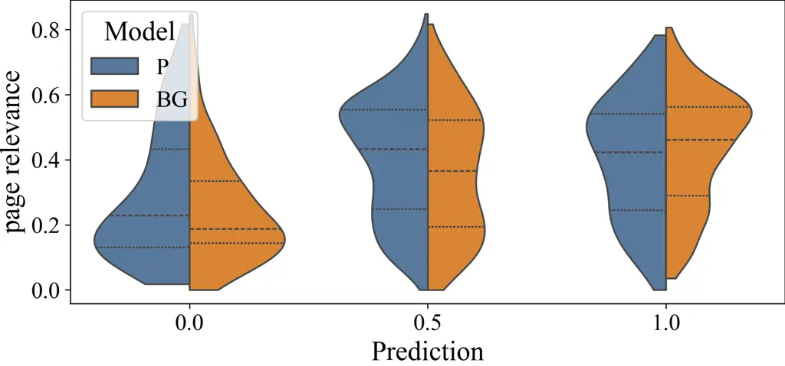
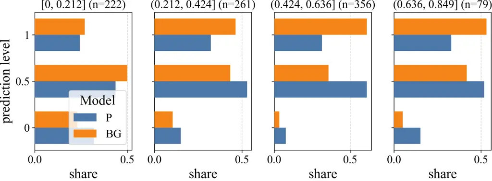
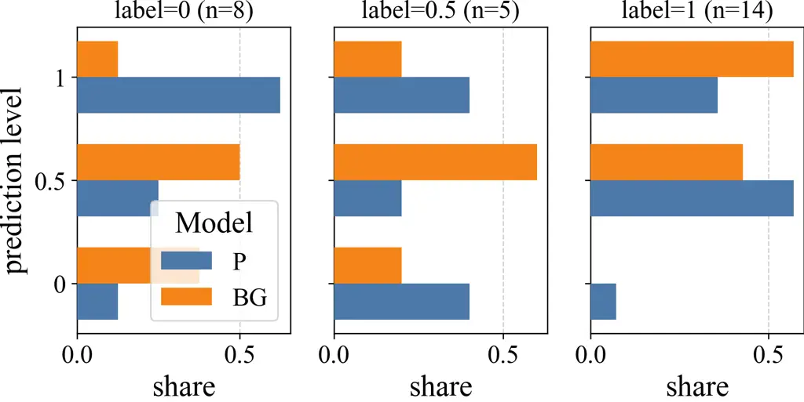
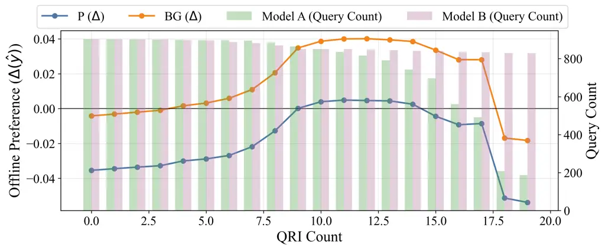

# As It Was: Aligning LLM Search Evaluation with Historical User Preferences

Conference: Proceedings of the 49th International ACM SIGIR Conference
on Research and Development in Information Retrieval; July 20–24, 2026;
Melbourne, VIC, AustraliaProceedings of the 49th International ACM SIGIR
Conference on Research and Development in Information Retrieval (SIGIR
’26), July 20–24, 2026, Melbourne, VIC,
AustraliaDOI: [10.1145/3805712.3808488](https://doi.org/10.1145/3805712.3808488)ISBN: 979-8-4007-2599-9/2026/07CCS: Information
systems Information retrieval

Ali Vardasbi Affiliation: Spotify, Netherlands email: <aliv@spotify.com>
, Gustavo Penha Affiliation: Spotify, United States email:
<gustavop@spotify.com> , Enrico Palumbo Affiliation: Spotify, Italy
email: <enricop@spotify.com> , Claudia Hauff Affiliation: Spotify,
Netherlands email: <claudiah@spotify.com> , Hugues Bouchard
Affiliation: Spotify, Spain email: <hb@spotify.com> and Mounia Lalmas
Affiliation: Spotify, United Kingdom email: <mounia@acm.org>

© cc

###### Abstract.

Large-scale search systems evolve faster than human quality assurance
scales, especially for long-tail intents and multilingual queries.
LLM-as-a-judge approaches are a scalable alternative for evaluating the
relevance of search engine result pages (SERPs), but judgments based
solely on semantic similarity or world knowledge can drift from actual
user preferences, particularly for ambiguous queries.

We introduce a _behavior-grounded_ LLM judge that augments each SERP
item with a lightweight, auditable behavioral prior in the form of a
_Query–Relevance–Impressions_ (QRI) card. Each card summarizes how users
have historically interacted with similar queries and results, providing
compact empirical evidence that the judge can cite to resolve ambiguity
and make more consistent relevance judgments, while still relying on
semantic reasoning.

In a large-scale music search evaluation at Spotify, using relevance
estimates derived from historical user interactions across 6,000
recomposed SERPs, the behavior-grounded judge achieves stronger
alignment with user preferences, improving Spearman rank correlation by
approximately +5% overall and yielding a +91% relative improvement on
disagreement cases. On a multilingual human-judged dataset spanning five
languages, grounding further increases correlation with human relevance
judgments by +15%. Importantly, when evaluated against outcomes from a
live A/B test, the grounded judge shows consistently higher alignment
with the observed winning model. While absolute alignment remains
moderate, these findings demonstrate that lightweight behavioral
grounding can improve the reliability and practical usefulness of
LLM-based evaluation in real-world search systems.

###### Keywords: 

LLM-as-a-judge, behavioral grounding, user preference alignment

^(†)^(†)cc-license: by

## 1. Introduction

Search systems in production evolve continuously, with frequent updates
to ranking models, retrieval stacks, and user experiences. Ensuring that
evaluation keeps pace with these changes requires scalable and reliable
assessment methods. As a result, _LLM-as-a-judge_ approaches have become
attractive as a scalable evaluation layer, enabling relevance assessment
and rationales directly from a query, context, and the SERP. This work
is grounded in production music search at Spotify, where search
surfaces, ranking models, and user expectations evolve rapidly across
languages and regions.

_Plain_ LLM judges that rely solely on semantic similarity and
catalog-centric reasoning may not fully capture how users interpret and
engage with results (Li et al., 2024; Jiang et al., 2025). While
effective for clearly specified queries, their judgments can diverge
from observed user preferences for underspecified or ambiguous queries,
regionally dominant interpretations, and SERPs containing closely
related variants.

Grounding through retrieval or external evidence has emerged as a common
strategy for improving factual consistency and reliability in LLM
systems (Gao et al., 2024; Ni et al., 2025). Modern search systems
already contain a rich signal of user intent in the form of aggregated
interaction data, yet this signal is rarely incorporated into LLM-based
evaluation. We argue that behavioral signals provide empirical evidence
of how queries are interpreted in practice, including which results
users engage with most frequently and how preferences are distributed
across competing interpretations or variants.

To leverage this signal, we propose behavior grounding for LLM judges
via aggregated interaction summaries. For each SERP item, we attach a
_Query–Relevance–Impressions_ card that summarizes historically
associated queries and their interaction statistics. The
behavior-grounded judge is particularly useful when direct relevance
estimates for the evaluated SERP are unavailable or unreliable. This
occurs in long-tail or emerging queries with limited historical
coverage, and in off-policy evaluation settings where the current
ranking configuration has not been previously exposed to users.

Across evaluation setups, behavior grounding improves alignment with
both interaction signals and human judgments. Its impact is most
pronounced when semantic reasoning alone is insufficient.

## 2. Related Work

#### LLMs for evaluation.

In Information Retrievl (IR), LLMs are increasingly used for scalable
relevance labeling and scoring (Li et al., 2024; Li et al., 2025;
Vardasbi et al., 2026). Prior work highlights that LLM judgments can be
poorly calibrated, prompt-sensitive, and may diverge from human
annotators in some settings (Li et al., 2024; Jiang et al., 2025). They
may also hallucinate or drift when not grounded in external
evidence (Singh et al., 2025; Iwashima et al., 2025). Recent studies
emphasize the importance of evidence-grounded and auditable evaluation
mechanisms to improve reliability and alignment (Genovese et al., 2026;
Sudjianto et al., 2024). Our work builds on these insights by
_grounding_ the LLM judge with compact, auditable behavioral evidence,
with the goal of improving robustness and alignment with observed user
preferences.

#### Behavioral signals and debiasing.

User interaction logs provide rich implicit feedback (e.g., clicks), but
are inherently biased (Li et al., 2015; Zhuang et al., 2022; Vardasbi et
al., 2020a). Counterfactual and propensity-based methods are widely used
to correct these biases and obtain more reliable relevance estimates
from logged data (Zhu et al., 2020; Saito, 2020; Vardasbi et al.,
2020b). However, even debiased estimates reflect historical interaction
patterns rather than underlying semantic intent (Wang et al., 2023),
which can limit their suitability as standalone relevance judgments. We
therefore combine debiased query–entity relevance estimates with an LLM
judge, using behavioral signals as grounded quantitative evidence.

#### Grounded decision-making and auditability.

Grounding is a common strategy for improving reliability in LLM-based
systems, often by incorporating external evidence through
retrieval-augmented generation (RAG) (Gao et al., 2024; Ni et al.,
2025). Prior work highlights that grounding can improve factual
consistency, transparency, and trustworthiness (Gao et al., 2024; Zhou
et al., 2024). In industry evaluation workflows, auditability is
critical: reviewers must be able to verify the evidence underlying a
judgment (Kenthapadi et al., 2024; Ojewale et al., 2026). QRI cards are
designed to support this requirement by providing interpretable
behavioral summaries that fit within prompt budgets while remaining
explicit enough to be cited in judge rationales, enabling grounded and
reviewable evaluation decisions.

## 3. Behavior-Grounded LLM Judge

We formalize SERP evaluation as follows. Given a query $`q`$, optional
context $`c`$ (e.g., locale), and a SERP containing items
$`\mathcal{E}=\{e_{1},\dots,e_{n}\}`$, an LLM judge assigns a graded
relevance label $`y\in\{0,0.5,1\}`$. Each result item is presented with
standard descriptive metadata such as title, type, and basic attributes.

#### Evaluation variants.

We compare two LLM-based evaluation variants that share the same
relevance rubric, output space, and prompting structure, differing only
in the information provided to the judge. The first, Plain (P),
evaluates the SERP using only the query, context, and item metadata,
without access to behavioral evidence. Judgments are therefore based on
semantic similarity, available metadata, and the model’s general
knowledge. The second, Behavior-Grounded (BG), receives the same inputs
as P, augmented with a lightweight behavioral summary for each result
item in the form of QRI cards. The prompt further specifies that QRI
should be used as supporting behavioral context rather than as direct
ground truth for the current query.

#### QRI Cards: Query–Relevance–Impressions

QRI cards summarize historical interactions associated with each result
item. They are constructed by aggregating a recent window of search
logs, capturing how users engaged with similar queries and results prior
to evaluation. Each log entry corresponds to a historical query
$`q^{\prime}\neq q`$ and an entity $`e\in\mathcal{E}`$ shown in
response. We aggregate both interacted and non-interacted impressions to
record overall exposure volume and downstream engagement signals (e.g.,
clicks). From these data, we compute a debiased relevance estimate for
each $`(e,q^{\prime})`$ pair, yielding a signal that reflects user
preference while mitigating systematic exposure effects. Each
$`(e,q^{\prime})`$ pair contributes a single QRI line of the form
$`\{q^{\prime}:\big(\hat{r}(e,q^{\prime}),\;I(e,q^{\prime})\big)\}`$,
where $`\hat{r}`$ is the relevance estimate and $`I`$ is the total
impressions of $`e`$ for $`q^{\prime}`$. This line is appended to the
result item $`e`$ in the input of BG judge.

#### Debiased relevance estimate.

We compute the debiased relevance estimate $`\hat{r}(e,q^{\prime})`$
using an inverse propensity scoring (IPS) correction over result
positions (Joachims et al., 2017). Propensities, representing the
probability of examination at each rank, can be obtained from randomized
experiments when available or estimated using standard click models. Our
approach requires only a monotonic propensity curve and does not depend
on a specific click model formulation.

For a given result item, many historical queries may be associated with
it. To limit prompt length, we rank these queries by semantic similarity
to the evaluated query $`q`$ and retain only the top-$`k`$ entries. We
set $`k{=}10`$ as a conservative cap to bound prompt length and prevent
highly popular entities from dominating the evidence budget. In
practice, many items have fewer than $`k`$ eligible historical queries
after filtering, so the effective evidence size is often much smaller.

#### Why QRI helps.

QRI cards provide an empirical prior that complements semantic reasoning
by indicating which results users most frequently engage with for
similar queries. Importantly, grounding does not override semantic or
instructional reasoning. Instead, behavioral evidence is applied
selectively: serving as a tie-breaker under ambiguity, or as a
comparator among plausible candidates (Section 6). For clearly specified
queries, QRI typically plays a confirmatory rather than decisive role.

## 4. Experimental Design

We evaluate whether grounding LLM-based judges with behavioral evidence
improves alignment with user preferences and human judgments, using
real-world music search data from Spotify. All experiments are conducted
on production SERPs, with behavioral summaries constructed from user
interaction logs aggregated the month preceding evaluation. Judgments
are produced by a recent-generation commercial large language model
accessed via API.

### 4.1. Log-Derived Preference Evaluation

To measure alignment with relevance estimated from historical user
interactions at scale, we construct a log-derived evaluation dataset
(hereafter, Logs). We sample approximately 5,000 queries issued by
between 20 and 400 users over a 10-day period. This sampling ensures
sufficient interaction volume for reliable relevance estimation while
excluding highly popular head queries whose relevance is typically
unambiguous.

For each sampled query, we compute unbiased item-level relevance
estimates from interaction logs. We then construct recomposed SERPs by
recombining real items previously associated with each query, sampling
3–5 items per SERP. This recomposition creates SERPs with controlled
differences in quality, including cases where highly relevant items
(according to the log-derived estimates) are omitted or ranked lower
than less relevant ones. The resulting dataset contains 5,965 SERPs
spanning both high-quality and degraded configurations. Because the
judge assigns labels at the page level, we compute a page relevance
score as a DCG-weighted average of item relevance estimates.

#### Preventing query leakage.

If a QRI card were to include the evaluation query itself, the BG judge
could effectively recover prior user behavior, overstating the
incremental contribution of grounding. To prevent this, we exclude
historical queries that are near-duplicates of the evaluation query,
defined as having a cosine similarity greater than $`0.9`$. For example,
for the query _“basketball warmup music”_, the near-duplicate
_“basketball warmup playlist”_ is excluded, while _“basketball training
music”_ is retained. This filtering is applied only in the controlled
evaluation setting to assess generalization. In production,
near-duplicate queries are retained to leverage all available historical
evidence.

### 4.2. Human-Judged Multilingual Evaluation

Alignment with human annotators is a key evaluation criterion for LLM
judges (Jiang et al., 2025; Sudjianto et al., 2024). We therefore assess
whether behavior grounding also improves agreement with human relevance
judgments, using an internal multilingual dataset of 265 SERP instances
across five languages, referred to as the HJM (Human-Judged
Multilingual) dataset. Each instance is annotated by human raters using
a three-level graded relevance scale.

For both Logs and HJM, we report Spearman’s $`\rho`$ and Kendall’s
$`\tau`$ between judge predictions and human-assigned relevance scores,
and analyze the subset of instances where P and BG disagree.

| Dataset | Subset  | Size | Spearman $`\rho`$ |           | Kendall $`\tau`$ |           |
| ------- | ------- | ---- | ----------------- | --------- | ---------------- | --------- |
|         |         |      | P                 | BG        | P                | BG        |
| Logs    | All     | 5965 | 0.416             | 0.438     | 0.336            | 0.354     |
| Logs    | Flipped | 918  | 0.147             | 0.281^(†) | 0.114            | 0.221^(†) |
| Logs    | Equal   | 5047 | 0.457             |           | 0.371            |           |
| HJM     | All     | 265  | 0.450             | 0.516     | 0.413            | 0.476     |
| HJM     | Flipped | 27   | -0.127            | 0.530^(†) | -0.108           | 0.486^(†) |
| HJM     | Equal   | 238  | 0.525             |           | 0.486            |           |

$`\dagger`$: statistically significant improvement ($`p<0.05`$

).

Table 1. Correlation between judge predictions and relevance. “Flipped”
refers to instances where P and BG disagree; “Equal” denotes agreement.

## 5. Alignment with Logs-Derived Relevance and Human Judgments

We first evaluate alignment with historical user preferences using the
Logs dataset. On the full set of instances, the behavior-grounded (BG)
judge achieves higher correlation with page relevance than the plain (P)
judge (Table 1, Logs, All), indicating improved alignment with user
preference at scale. The effect of behavior grounding is most pronounced
on flipped instances (Logs, Flipped), where the two judges assign
different graded relevance levels. On this subset, BG substantially
outperforms P, achieving more than a twofold increase in both Spearman’s
$`\rho`$ and Kendall’s $`\tau`$. This suggests that grounding is
particularly effective in cases where semantic-only reasoning is
insufficient to resolve ambiguity or ranking trade-offs. In contrast, on
the much larger subset of instances where the two judges agree (Logs,
Equal), both variants exhibit similarly strong correlation with
interaction-derived relevance. This indicates that grounding
concentrates its impact on ambiguous or contested cases without
degrading performance on straightforward evaluations.

(a) Flipped Logs: interaction-derived relevance vs. judge label.

(b) Flipped Logs: relevance buckets.

(c) Flipped HJM: human labels.

Figure 1. Diagnostics on flipped instances (where P and BG disagree).

We next assess alignment with human judgments using the HJM dataset. As
in the log-derived evaluation, BG achieves higher rank correlation with
human-assigned graded relevance than the P judge (Table 1, HJM, All),
indicating more consistent ordering of pages by perceived usefulness.
Absolute correlations remain moderate, leaving a substantial gap to
perfect agreement with human annotators. However, on the disagreement
subset (HJM, Flipped), BG exhibits substantially higher correlation with
human judgments, while P shows negative correlation. As in the
log-derived setting, grounding consistently shifts predictions closer to
human judgments when it changes a decision.

#### Diagnostic Analysis of Flipped Instances

Figure 1 analyzes flipped instances (P $`\neq`$ BG), where grounding
alters the predicted label. Figure 1(a) shows the distribution of
interaction-derived page relevance conditioned on the graded relevance
level predicted by each judge. For pages assigned the highest level
(label=1), BG’s predictions are consistently associated with higher
relevance than those of P. Conversely, pages that BG assigns low
relevance labels tend to have lower underlying page relevance than pages
receiving the same low labels from P.

Figures 1(b) and 1(c) further decompose this effect across
page-relevance quantiles. Across both datasets, BG assigns high
relevance more frequently to pages in the top relevance buckets and
avoids over-assigning high relevance to pages with low
interaction-derived or human-assigned relevance.

Taken together, these diagnostics indicate that grounding reallocates
labels toward empirically supported pages, particularly where
semantic-only judgments are least reliable.

## 6. Analysis of Grounding Effects

Our findings show that QRI grounding changes judgments in systematic and
interpretable ways, rather than inducing a uniform shift toward higher
or lower relevance labels. Across both datasets, BG diverges from P
along recurring patterns: resolving ambiguous intent, recalibrating the
severity of near-miss cases, and adjusting judgments when multiple
plausible results are ranked differently. These differences are
auditable, as they can be traced directly to specific QRI evidence
surfaced to the judge.

#### Resolving ambiguity.

Grounding is most impactful for ambiguous or underspecified queries,
such as lyric fragments, short titles with multiple plausible referents,
or regionally overloaded terms. In these cases, QRI provides of how
users interpret the query in practice. BG often anchors a different
primary entity than P, based on on observed engagement patterns. For
example, for the query _“when you say you love me”_, P assumes a
title-based search and penalizes the SERP for missing a track with that
exact title. In contrast, QRI shows strong engagement with Miley Cyrus’
_Adore You_, suggesting that users interpret the query as a lyric
search. BG therefore assigns a higher relevance score to the SERP
accordingly.

#### Calibrating severity.

Grounding also affects how strongly errors are penalized in near-miss
scenarios. When QRI indicates strong demand for a specific entity, BG is
stricter than P if that entity is missing or poorly ranked. For example,
for query _“dark til daylight”_, P assigns partial credit because
thematically related results are present, whereas BG assigns a clear
failure after observing that the track with the exact same title (by
Morgan Wallen) is absent and substitutes receive little engagement from
similar historical queries. Conversely, when QRI indicates that users
consistently engage with related but indirect results, BG may assign a
more lenient judgment. For instance, if a playlist surfaces the intended
track prominently, BG treats the SERP as acceptable in practice rather
than than applying a stricter penalty.

#### Ranking sensitivity.

A third effect of grounding is increased sensitivity to ranking quality.
When multiple plausible results are present, BG compares their relative
QRI strength and penalizes cases where the entity most strongly favored
by user engagement is not ranked first, even when P considers the SERP
acceptable. For example, if a later re-recording is ranked above the
historically preferred original, BG is more likely to assign a lower
relevance score to the page by recognizing that user interactions
consistently favor the original version. In such cases, grounding
reinforces ranking distinctions that are weakly signaled by semantics
alone but strongly supported by user behavior.

## 7. Online A/B Test Alignment

Beyond offline alignment with interaction and human signals, we evaluate
whether grounding improves agreement with live system outcomes. We
therefore test the judges against results from a production A/B
experiment comparing two ranking systems (Model A and Model B). The
experiment ran for one week, from which we sampled 904 queries.

Behavioral evidence used to construct QRI cards was drawn from one month
of historical search interactions ending one week prior to the A/B test,
ensuring no temporal overlap between interaction signals and evaluation
outcomes. As in our offline setup, we applied the same leakage-avoidance
procedure (cosine similarity threshold of $`0.9`$) when constructing QRI
cards. For each query, we sampled three SERP instances from each model.
Judge predictions and online outcomes were aggregated at the query level
by averaging across the three instances per model. We then measure _sign
alignment_: whether the judge predicts the same winning model per query
as observed online. As shown in Table 2, BG achieves higher alignment
than P, and the difference is statistically significant.

| Query Count | P aligned (%) | BG aligned (%) |
| ----------- | ------------- | -------------- |
| 904         | 30.6          | 36.8^(†)       |

$`\dagger`$: statistically significant improvement ($`p<0.01`$).

Table 2. Sign alignment with online A/B outcomes.

Figure 2. Offline judge preference $`\Delta(\hat{y})`$ as a function of
the minimum SERP-level qri_count threshold $`t`$. Each data point
represents a cumulative subset of queries where
$`\texttt{qri\_count}\geq t`$. The online ground truth indicates a
preference for Model A ($`\Delta(y)>0`$).

To understand when behavior grounding is most beneficial, we further
analyze performance as a function of qri_count, the total number of
historical queries included across all QRI cards in a SERP. This measure
reflects the amount of available behavioral support for the evaluated
items—a loose proxy for their historical exposure and relative
popularity.

Online results indicate that Model A outperforms Model B (i.e.,
$`\Delta(y)>0`$). Figure 2 illustrates the evolution of the judges’
implied preference difference, $`\Delta(\hat{y})`$, as a function of the
qri_count threshold. Specifically, each point on the $`x`$-axis
represents a cumulative subset; for instance, the value at $`x=5`$
aggregates all queries with at least five QRI cards. At low qri_count,
BG remains closer to the neutral (zero) line, indicating smaller
directional error, whereas P exhibits a larger deviation. As behavioral
support increases, BG crosses the zero threshold earlier and moves more
decisively into the positive region, aligning with the online result at
moderate levels of support. Specifically, BG becomes directionally
consistent with the online preference for thresholds
$`\texttt{qri\_count}\geq 5`$, with statistically significant positive
alignment by $`\texttt{qri\_count}\geq 9`$. In contrast, P approaches
zero more gradually and does not reach statistically significant
positive alignment. Low qri_count corresponds to the
cold-start/long-tail regime where behavioral evidence is sparse; here BG
largely falls back to semantic reasoning. At the other extreme, the
highest qri_count bins contain relatively few queries (see the count
bars), so the estimated $`\Delta(\hat{y})`$ is higher-variance and more
sensitive to bucket composition. Overall, these results suggest that
behavior grounding enables faster and more reliable convergence toward
the observed online preference as behavioral evidence accumulates.

Taken together, these findings indicate that grounding improves
alignment not only with interaction data and human judgments, but also
with live A/B outcomes. Absolute alignment remains moderate, reflecting
the difficulty of predicting online preferences. Further gains may
require richer behavioral signals.

## 8. Conclusion

We studied the impact of incorporating user behavior signals into
LLM-based evaluation of music search SERPs at Spotify. Our framework
bridges counterfactual estimation from interaction logs (Li et al., 2015) with grounding mechanisms developed for reliable LLM systems (Gao
et al., 2024). By comparing a plain semantic judge with a
behavior-grounded variant multiple evaluation settings—including
interaction-derived relevance, human judgments, and live A/B outcomes,
we showed that behavioral evidence leads to systematic and interpretable
changes in evaluation decisions, rather than indiscriminate shifts
toward higher or lower relevance labels.

Behavior grounding is most impactful in three recurring scenarios:
resolving ambiguous intent, calibrating the severity of near-miss cases,
and increasing sensitivity to ranking differences among plausible
results. These findings highlight the value of behavior-grounded LLM
evaluation in practice. Behavioral signals complement rubric-driven
judgment by providing targeted, auditable evidence that improves
alignment with observed user preferences.

Future work should investigate stronger safeguards to ensure behavioral
evidence is used appropriately and does not amplify residual biases in
interaction logs, as well as improved debiasing and aggregation methods.

## 9. Presenter Bio

Ali Vardasbi is a Research Scientist for Tech Research at Spotify, where
he works on improving Search and Recommendation systems using LLMs. His
work centers on evaluation, optimization, and advancing the
effectiveness of LLM-powered experiences.

## Acknowledgements

The authors would like to thank Anders Nyman, Tyra Areskoug, Nicolo
Felicioni, and Poppy Newdick for their invaluable assistance with data
collection and for sharing their insights.

## References

- Gao et al. (2024) Y. Gao, Y. Xiong, X. Gao, K. Jia, J. Pan, Y. Bi, Y.
  Dai, J. Sun, M. Wang, and H. Wang Retrieval-augmented generation for
  large language models: a survey. External Links: 2312.10997,
  [Link](https://arxiv.org/abs/2312.10997) Cited by: §1, §2, §8.
- Genovese et al. (2026) A. Genovese, L. Hegstrom, S. Prabha, C. A.
  Gomez-Cabello, S. A. Haider, B. Collaco, N. G. Wood, and A. J. Forte
  Artificial authority: the promise and perils of llm judges in
  healthcare. Bioengineering 13 (1). External Links:
  [Link](https://www.mdpi.com/2306-5354/13/1/108), ISSN 2306-5354,
  [Document](https://dx.doi.org/10.3390/bioengineering13010108) Cited
  by: §2.
- Iwashima et al. (2025) G. C. Iwashima, C. S. Rodrigues, C. Dipolitto,
  and G. Xexéo Factors that support grounded responses in llm
  conversations: a rapid review. External Links: 2511.21762,
  [Link](https://arxiv.org/abs/2511.21762) Cited by: §2.
- Jiang et al. (2025) R. Jiang, K. Chen, X. Bai, Z. He, J. Li, M.
  Yang, T. Zhao, L. Nie, and M. Zhang A survey on human preference
  learning for aligning large language models. ACM Comput. Surv. 58 (6).
  External Links: ISSN 0360-0300,
  [Link](https://doi.org/10.1145/3773279),
  [Document](https://dx.doi.org/10.1145/3773279) Cited by: §1, §2, §4.2.
- Joachims et al. (2017) T. Joachims, A. Swaminathan, and T. Schnabel
  Unbiased learning-to-rank with biased feedback. In Proceedings of the
  Tenth ACM International Conference on Web Search and Data Mining, WSDM
  ’17, New York, NY, USA, pp. 781–789. External Links: ISBN
  9781450346757, [Link](https://doi.org/10.1145/3018661.3018699),
  [Document](https://dx.doi.org/10.1145/3018661.3018699) Cited by: §3.
- Kenthapadi et al. (2024) K. Kenthapadi, M. Sameki, and A. Taly
  Grounding and evaluation for large language models: practical
  challenges and lessons learned (survey). In Proceedings of the 30th
  ACM SIGKDD Conference on Knowledge Discovery and Data Mining, KDD ’24,
  New York, NY, USA, pp. 6523–6533. External Links: ISBN 9798400704901,
  [Link](https://doi.org/10.1145/3637528.3671467),
  [Document](https://dx.doi.org/10.1145/3637528.3671467) Cited by: §2.
- Li et al. (2025) D. Li, B. Jiang, L. Huang, A. Beigi, C. Zhao, Z.
  Tan, A. Bhattacharjee, Y. Jiang, C. Chen, T. Wu, K. Shu, L. Cheng,
  and H. Liu From generation to judgment: opportunities and challenges
  of LLM-as-a-judge. In Proceedings of the 2025 Conference on Empirical
  Methods in Natural Language Processing, C. Christodoulopoulos, T.
  Chakraborty, C. Rose, and V. Peng (Eds.), Suzhou, China,
  pp. 2757–2791. External Links:
  [Link](https://aclanthology.org/2025.emnlp-main.138/),
  [Document](https://dx.doi.org/10.18653/v1/2025.emnlp-main.138), ISBN
  979-8-89176-332-6 Cited by: §2.
- Li et al. (2024) H. Li, Q. Dong, J. Chen, H. Su, Y. Zhou, Q. Ai, Z.
  Ye, and Y. Liu LLMs-as-judges: a comprehensive survey on llm-based
  evaluation methods. External Links: 2412.05579,
  [Link](https://arxiv.org/abs/2412.05579) Cited by: §1, §2.
- Li et al. (2015) L. Li, S. Chen, J. Kleban, and A. Gupta
  Counterfactual estimation and optimization of click metrics in search
  engines: a case study. In Proceedings of the 24th International
  Conference on World Wide Web, WWW ’15 Companion, New York, NY, USA,
  pp. 929–934. External Links: ISBN 9781450334730,
  [Link](https://doi.org/10.1145/2740908.2742562),
  [Document](https://dx.doi.org/10.1145/2740908.2742562) Cited by: §2,
  §8.
- Ni et al. (2025) B. Ni, Z. Liu, L. Wang, Y. Lei, Y. Zhao, X. Cheng, Q.
  Zeng, L. Dong, Y. Xia, K. Kenthapadi, R. Rossi, F. Dernoncourt, M. M.
  Tanjim, N. Ahmed, X. Liu, W. Fan, E. Blasch, Y. Wang, M. Jiang, and T.
  Derr Towards trustworthy retrieval augmented generation for large
  language models: a survey. External Links: 2502.06872,
  [Link](https://arxiv.org/abs/2502.06872) Cited by: §1, §2.
- Ojewale et al. (2026) V. Ojewale, H. Suresh, and S. Venkatasubramanian
  Audit trails for accountability in large language models. External
  Links: 2601.20727, [Link](https://arxiv.org/abs/2601.20727) Cited by:
  §2.
- Saito (2020) Y. Saito Unbiased pairwise learning from biased implicit
  feedback. In Proceedings of the 2020 ACM SIGIR on International
  Conference on Theory of Information Retrieval, ICTIR ’20, New York,
  NY, USA, pp. 5–12. External Links: ISBN 9781450380676,
  [Link](https://doi.org/10.1145/3409256.3409812),
  [Document](https://dx.doi.org/10.1145/3409256.3409812) Cited by: §2.
- Singh et al. (2025) R. Singh, P. Singh, A. Malik, and D. Sukmawan
  Understanding and mitigating hallucinations in large language models:
  insights from a systematic literature review. In 2025 International
  Conference on Metaverse and Current Trends in Computing (ICMCTC), Vol.
  , pp. 1–10. External Links:
  [Document](https://dx.doi.org/10.1109/ICMCTC62214.2025.11196493) Cited
  by: §2.
- Sudjianto et al. (2024) A. Sudjianto, A. Zhang, S. Neppalli, T. Joshi,
  and M. Malohlava Human-calibrated automated testing and validation of
  generative language models. External Links: 2411.16391,
  [Link](https://arxiv.org/abs/2411.16391) Cited by: §2, §4.2.
- Vardasbi et al. (2020a) A. Vardasbi, M. de Rijke, and I. Markov
  Cascade model-based propensity estimation for counterfactual learning
  to rank. In Proceedings of the 43rd International ACM SIGIR Conference
  on Research and Development in Information Retrieval, SIGIR ’20, New
  York, NY, USA, pp. 2089–2092. External Links: ISBN 9781450380164,
  [Link](https://doi.org/10.1145/3397271.3401299),
  [Document](https://dx.doi.org/10.1145/3397271.3401299) Cited by: §2.
- Vardasbi et al. (2020b) A. Vardasbi, H. Oosterhuis, and M. de Rijke
  When inverse propensity scoring does not work: affine corrections for
  unbiased learning to rank. In Proceedings of the 29th ACM
  International Conference on Information & Knowledge Management, CIKM
  ’20, New York, NY, USA, pp. 1475–1484. External Links: ISBN
  9781450368599, [Link](https://doi.org/10.1145/3340531.3412031),
  [Document](https://dx.doi.org/10.1145/3340531.3412031) Cited by: §2.
- Vardasbi et al. (2026) A. Vardasbi, G. Penha, C. Hauff, and H.
  Bouchard Adaptive repetition for mitigating position bias in llm-based
  ranking. In Advances in Bias, Fairness, and Understudied Users in
  Information Retrieval, Cham, pp. 3–15. External Links: ISBN
  978-3-032-12717-4,
  [Document](https://dx.doi.org/10.1007/978-3-032-12717-4%5F1),
  [Link](https://link.springer.com/chapter/10.1007/978-3-032-12717-4_1)
  Cited by: §2.
- Wang et al. (2023) X. Wang, Q. Li, D. Yu, P. Cui, Z. Wang, and G. Xu
  Causal disentanglement for semantic-aware intent learning in
  recommendation. IEEE Transactions on Knowledge and Data Engineering 35
  (10), pp. 9836–9849. External Links:
  [Document](https://dx.doi.org/10.1109/TKDE.2022.3159802) Cited by: §2.
- Zhou et al. (2024) Y. Zhou, Y. Liu, X. Li, J. Jin, H. Qian, Z. Liu, C.
  Li, Z. Dou, T. Ho, and P. S. Yu Trustworthiness in retrieval-augmented
  generation systems: a survey. External Links: 2409.10102,
  [Link](https://arxiv.org/abs/2409.10102) Cited by: §2.
- Zhu et al. (2020) Z. Zhu, Y. He, Y. Zhang, and J. Caverlee Unbiased
  implicit recommendation and propensity estimation via combinational
  joint learning. In Proceedings of the 14th ACM Conference on
  Recommender Systems, RecSys ’20, New York, NY, USA, pp. 551–556.
  External Links: ISBN 9781450375832,
  [Link](https://doi.org/10.1145/3383313.3412210),
  [Document](https://dx.doi.org/10.1145/3383313.3412210) Cited by: §2.
- Zhuang et al. (2022) S. Zhuang, H. Li, and G. Zuccon Implicit feedback
  for dense passage retrieval: a counterfactual approach. In Proceedings
  of the 45th International ACM SIGIR Conference on Research and
  Development in Information Retrieval, SIGIR ’22, New York, NY, USA,
  pp. 18–28. External Links: ISBN 9781450387323,
  [Link](https://doi.org/10.1145/3477495.3531994),
  [Document](https://dx.doi.org/10.1145/3477495.3531994) Cited by: §2.
