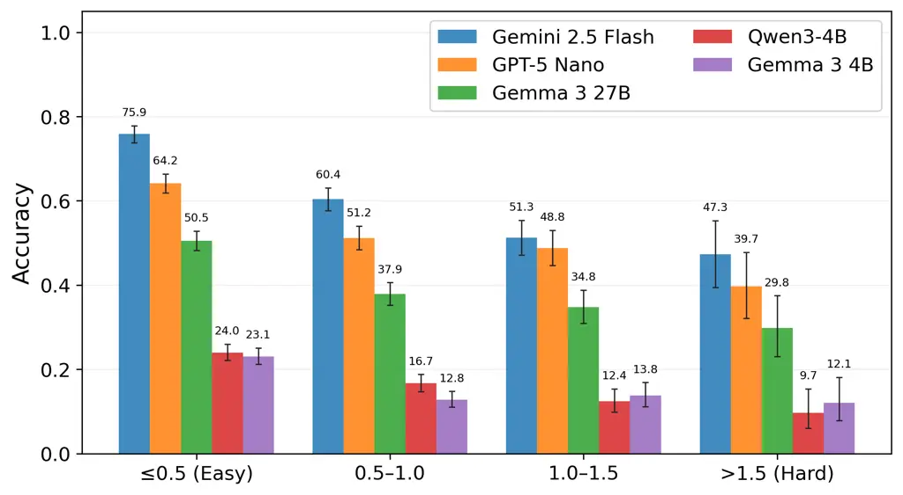
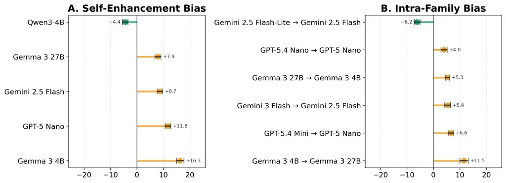

Evaluating Large Language Model Raters for German Open-Response Clinical
Questions: A Physician-Annotated Benchmark Study of Agreement, Evaluator
Bias, and Abstention

William Philipp, MSc^(1,\*), Finn Fassbender, BSc^(2,4), Daniel
Fister^(3,4), Thorsten Langer, Prof. Dr. med.⁵, Martje G. Pauly, Dr.
med.⁶, Rebecca Herzog, Dr. med.⁶, Markus A. Hobert, Dr. med.⁶, Theresa
Paulus, Dr. med.⁶, Alexander Baumann, Dr. med.⁷, Chi Wang Ip, Prof. Dr.
med.⁸, Lukas L. Goede, Dr. med.⁹, Johanna Engelhard, Dr. med.⁹,
Sebastian Loens, Dr. med.¹⁰, Ronald Böck, Prof. Dr.-Ing.¹¹, Sebastian
Fudickar, Prof. Dr. rer. nat.^(1,12)

1 Section for Clinical Research-IT, Institute of Medical Biometry and
Statistics, University of Luebeck, Luebeck, Germany

2 Medical Faculty, University of Tübingen, Tübingen, Germany

3 Medical Faculty, Martin Luther University Halle-Wittenberg, Halle,
Germany

4 German Medical Students’ Association (bvmd), Berlin, Germany

5 Department of Pediatric and Adolescent Medicine, University of Luebeck
/ University Hospital Schleswig-Holstein, Luebeck, Germany

6 Department of Neurology, University of Luebeck, Luebeck, Germany

7 Department of Neurology, University of Kiel, Kiel, Germany

8 Department of Neurology, University Hospital Würzburg, Würzburg,
Germany

9 Department of Neurology, Charité – Universitätsmedizin Berlin, Berlin,
Germany

10 Institute of Systems Motor Science, University of Luebeck, Luebeck,
Germany

11 Faculty of Digital Administration, Meissen University of Applied
Administrative Sciences (UAAS), Meissen, Germany

12 Fraunhofer Research Institution for Individualized Medical Technology
and Engineering (IMTE), Luebeck, Germany

\* w.philipp@uni-luebeck.de

## Abstract

Background: LLM increasingly support clinical language tasks, but their
evaluation on non-English open-response questions is constrained by a
lack of expert-annotated benchmarks. LLM-as-a-judge evaluators could
make such assessments scalable, but their suitability for clinical
evaluation requires validation.

Objective: To introduce MedQADE, a standardized German open-response
clinical benchmark with physician reference annotations, and to evaluate
LLM-as-a-judge systems for alignment with physician judgments, self- and
intra-family evaluation bias, and abstention behavior.

Methods: MedQADE comprises 3,800 question-answer sets, each containing
answers from five student LLM and reference annotations from a panel of
ten physicians. The 200-question core was rated by all ten raters; the
3,600-question extension was assigned two primary raters per question,
with the tenth physician resolving disagreements. We applied nine LLM
evaluators to all sets and assessed physician reliability, student-model
accuracy, alignment with physician consensus, evaluator bias, and
abstention.

Results: Physicians showed moderate-to-substantial agreement on answer
correctness, with an unweighted mean pairwise Cohen’s $`\kappa`$ of
0.612, but limited agreement on question difficulty
(Krippendorff’s $`\alpha=0.208`$ with squared distances between numeric
difficulty scores). Student-model accuracy ranged from 17.8% to 66.0%
and generally decreased with physician-rated difficulty. The strongest
evaluator, Gemini 3 Flash, approached the leave-one-out physician
reference ($`\kappa=0.694`$ versus 0.709). Paired analyses identified
these biases: four of five models rated their own responses more
favorably than out-of-family evaluators, and five of six same-family
comparisons were positive. Physician abstention increased with perceived
difficulty, whereas seven of nine LLM evaluators abstained in no more
than 0.51% of evaluations; two of the strongest evaluators assigned
definitive labels to every response.

Conclusions: MedQADE supports physician-anchored evaluation of German
open-response clinical answers. Strong LLM evaluators can approach
physician agreement in this setting, but evaluator bias and low observed
abstention warrant physician validation and further assessment of
selective deferral before fully automated benchmark evaluation. These
results do not establish clinical safety.

Keywords: artificial intelligence; large language models; medical
education; clinical natural language processing; question answering;
benchmarking; automated evaluation; German language.

## Introduction

### Clinical NLP and the Need for Benchmarking

Clinical NLP (NLP) supports medical workflows, such as referral-letter
triage, patient-journey processing, and AI (AI)-assisted screening of
clinical referrals \[1, 2, 3\]. The corresponding extraction and
structuring of relevant information from routine clinical texts can
improve tasks such as prioritization and care coordination in practice
\[1, 3\]. With the emergence of LLM (LLM), the scope of clinical
language processing has expanded beyond traditional rule-based
approaches toward a wider range of clinical applications including
summarization, generation, question answering, and patient-facing
communication tasks \[4, 5, 6\]. As LLM become more widely integrated
into clinical practice, their reliable evaluation and appropriate
regulatory oversight become increasingly important.

Clinical AI applications may fall under the high-risk provisions of the
EU AI Act and may also be subject to the Medical Device Regulation
(MDR). The MDR mandates clinical evaluation based on sufficient clinical
evidence for devices within its scope \[7\]. Therefore, suitable
evaluation of clinical LLM is increasingly important. However, to
characterize the diverse outputs and behaviors of modern LLM,
conventional task-specific metrics and evaluation methods are often
insufficient, since they must account for the variability in generated
texts and differences in model performance across languages. Reliable
and reproducible benchmarks are therefore needed to systematically
compare model capabilities and to support the validation of clinical AI
systems.

### Limitations of Current Medical Benchmarks

Current medical LLM evaluation relies heavily on selected-response,
particularly multiple-choice formats. English resources such as PubMedQA
\[8\], MedMCQA \[9\], and MedQA \[10\] have played an important role in
benchmarking biomedical and medical language models. Similar approaches
have also been adopted for other languages, including Swedish \[11\],
Polish \[12\], and Chinese \[13\].

Although Germany has the highest healthcare expenditure in the EU (per a
2023 survey) \[14\], German-language resources remain limited. GerMedIQ
provides a German corpus of simulated anamnesis question-response pairs
\[15\]. More recently, DeFineMed \[16\] employed machine-translated
versions of MMLU \[17\] and MedQA \[10\] to evaluate specialized German
medical language models, explicitly identifying the reliance on
translated data as a limitation resulting from the lack of publicly
available, expert-curated German medical QA (QA) datasets. Despite this
need for native German evaluation resources, large-scale native German
clinical knowledge benchmarks with expert reference annotations are, to
our knowledge, still unavailable.

The reliance on selected-response formats (such as multiple-choice
tests) introduces a more fundamental limitation. Multiple-choice tests
measure whether a model can identify the correct answer among provided
alternatives, whereas many clinical tasks require independently
retrieving, formulating, and synthesizing relevant information. In human
assessment, free recall is generally more demanding than
recognition-based testing \[18\], and open-response formats can provide
information about competence that is not captured by selected-response
formats \[19, 20\]. Recent evidence suggests that the same distinction
is relevant for LLM. Singh et al. found that medical LLM performance
decreased by 39.43% when questions were changed from multiple-choice to
an open-response format \[21\]. More broadly, recent work has shown that
high multiple-choice performance can mask sensitivity to answer format
and other superficial characteristics of the benchmark \[22\]. Thus,
performance on selected-response questions does not necessarily
translate into the ability to independently produce clinically
appropriate answers or support open-ended reasoning in clinical
practice.

### Open-Response Evaluation

Open-response evaluation addresses this limitation by requiring models
to generate an answer without being presented with candidate solutions.
Such evaluation is increasingly being explored in medical LLM
benchmarking. MORQA combines multilingual medical open-response QA with
multiple expert-authored reference answers and expert ratings, and shows
that LLM-based evaluation metrics can better capture agreement with
human judgments than traditional lexical metrics \[23\]. MediQAl extends
an examination-derived medical benchmark with 4,969 open-response
questions alongside multiple-choice tasks \[24\].

However, the flexibility of open-response questions introduces an
additional evaluation challenge. Whereas the correctness of a
multiple-choice response can usually be determined from a discrete
label, an open response can take many forms while still being clinically
correct. Responses may differ in wording, level of detail, ordering, or
terminology, and may contain both correct and incorrect information.
Simple string matching or other rule-based metrics are therefore
insufficient for many clinical open-response tasks.

Expert physician judgments remain important for establishing and
validating reference assessments of open-ended medical responses, but
manual annotation can be costly and difficult to scale. This creates a
practical bottleneck for systematic comparisons of modern LLM: removing
answer options broadens the assessment task while increasing the need
for judgments that accommodate clinically acceptable variations in
responses.

### LLM-as-a-Judge

The LLM-as-a-Judge paradigm offers an automated alternative to manual
evaluation, enabling open-response outputs to be evaluated at scale
while potentially reducing the physician annotation workload. It
leverages LLM as judges to assess the quality of another model’s
response \[25\]. The judge receives the original question, the candidate
response, and either a reference answer or an evaluation rubric, and is
prompted to produce a structured assessment of correctness,
completeness, or other task-specific criteria.

Recent work has shown that automated judges can achieve robust agreement
with expert physicians \[26\] and, in some cases, produce a more stable
consensus than individual human raters \[27\]. Recent clinical
benchmarking work has further demonstrated the feasibility of combining
expert-developed evaluation criteria with automated judging and
validating the resulting scores against human assessments \[28\]. While
the LLM-as-a-Judge paradigm may reduce manual annotation demands, the
judge as part of the evaluation system must itself be validated.
Validation against physician assessments is therefore important before
using automated judges to compare medical LLM at scale. For evaluation,
the following two dimensions stand out:

- •
  LLM evaluators may exhibit self-enhancement bias, especially when
  scoring their own outputs \[29, 30\]. Such biases could distort model
  comparisons even when overall agreement with human judgments appears
  high.
- •
  Although medical LLM have been shown to frequently fail to abstain
  under clinical uncertainty \[31\], it remains unclear whether an
  automated judge can recognize uncertainty and abstain when it lacks a
  sufficient basis for a reliable judgment.

### Study Objectives and Contributions

The primary objective of this study is to investigate whether LLM can
serve as reliable automated annotators for German open-response clinical
questions. Establishing such reliability requires both a physician
reference standard and an evaluation framework that distinguishes
agreement from systematic evaluator behavior. We therefore address five
research questions:

RQ1:  
How consistently do physicians judge the correctness of student-LLM
answers?

RQ2:  
How well do student LLM perform on German open-response clinical
questions?

RQ3:  
How does individual and ensemble LLM-evaluator alignment compare with
physician reliability?

RQ4:  
Do LLM evaluators show bias when rating their own or same-family
responses compared with out-of-family evaluators rating the same
responses?

RQ5:  
How do physician and LLM-evaluator abstention patterns compare?

By answering these questions, this study makes three main contributions:

- •
  We introduce the MedQADE benchmark, a German open-response clinical
  benchmark comprising 3,800 physician-annotated question-answer sets
  and 19,000 answer slots sampled from a filtered pool of 26,598 German
  medical examination-style questions. The associated research materials
  comprise the question text, physician annotations, generated answers,
  reference labels, automated-evaluator outputs, and analysis code.
- •
  We quantify physician reliability and the performance of five student
  LLM, characterizing the consistency of the physician reference and the
  performance range represented in the benchmark.
- •
  We evaluate nine LLM as automated evaluators against the physician
  reference standard along three dimensions: alignment with physician
  judgments, evaluator bias, and abstention behavior. These analyses
  identify limitations that can affect the reliability of fully
  automated benchmark evaluation.

## Methods

Figure 1: MedQADE benchmark construction, annotation, and analysis
framework. (A) Five student large language models (LLMs) answered
single-cloze questions derived from a collection of German medical
flashcards. Stratified sampling based on lexical agreement with the
reference answer yielded 3,800 five-answer question-answer sets. (B)
Physicians and nine LLM evaluators assessed the same question-answer
sets using a shared rubric covering answer correctness, abstention, and
question difficulty. The 200-question core was rated by all ten raters.
Extension questions were assigned two primary raters; the tenth
physician provided additional ratings when consensus was absent.
Physician ratings and consensus labels form the benchmark annotations;
LLM judgments constitute evaluation data. (C) Analyses examine physician
reliability, student-LLM performance, LLM–physician alignment, evaluator
bias, and physician-versus-LLM abstention patterns. The dataset includes
the complete 26,598-question pool and generated answers. GPT-5.6 Sol
assisted with creation of this overview figure; the authors reviewed its
final content.

### Study Design

The study comprised two phases (Figure 1). First, we constructed MedQADE
by preprocessing a source corpus, generating answers with five student
LLM, selecting question-answer sets for annotation, and establishing
physician reference labels. Second, we used the resulting benchmark to
quantify physician reliability and student-model performance and to
evaluate nine LLM annotators with respect to alignment, evaluator bias,
and abstention behavior. Benchmark construction and the
automated-evaluator protocol are described below, followed by
research-question-specific quantitative analyses. Because this was a
benchmark-construction and evaluator-validation study rather than a
clinical trial, diagnostic-accuracy study, or patient-level
prediction-model study, no established design-specific reporting
checklist directly applied.

### MedQADE Benchmark Construction

#### Source Corpus and Preprocessing

The source question pool for MedQADE was derived from version 5 of the
Ankizin project \[32\], a digital flashcard collection for Anki, an
open-source spaced-repetition platform widely used by German medical
students preparing for the German Second State Examination in Medicine.
Although developed as a study tool, the collection provided a suitable
foundation for our benchmark because of its scale, grounding in medical
education, quality-control procedures, and open-answer format. It
contains German-language clinical questions and is actively maintained
by medical students and domain experts. Each flashcard undergoes peer
review for medical accuracy before inclusion \[33\]. All questions
follow a cloze-style, open-answer format, in contrast to comparable
medical question-answering datasets, which typically use multiple-choice
questions.

The raw Ankizin v5 dataset contains 44,185 flashcards. We converted the
native Anki export into a standardized format and retained only items
containing exactly one cloze deletion. This filtering produced a source
pool of 26,598 single-cloze items. An English translation of a
representative retained item is shown below:

> Question: What is the trigger for Guillain-Barré syndrome (GBS) in
> $`\frac{2}{3}`$ of cases?
>
>    
> Target Answer: Previous infections

#### Synthetic Student Answer Generation

To investigate RQ 1 and 2, we used five LLM as proxies for medical
students to answer all 26,598 items: Gemini 2.5 Flash \[34\], GPT-5 Nano
\[35\], Gemma 3 27B \[36\], Gemma 3 4B \[36\], and Qwen3-4B \[37\].
Exact implementation identifiers and execution details are documented in
Multimedia Appendix 1; the student prompt is reproduced in Multimedia
Appendix 2. The model selection allowed comparisons between proprietary
and open-weight models, while the two Gemma variants provided a
within-family comparison across parameter scales. The proprietary models
were accessed through their official APIs, whereas the open-weight
models were run locally using Ollama, an LLM serving framework.

Each model received a German-language system prompt designed to
approximate a testing environment (see Multimedia Appendix 2). The
prompt instructed the model to assume the role of an examinee completing
a time-critical, high-stakes medical examination, building on previous
work on role-play and emotion-oriented prompting \[38, 39\].

Student generation used model-specific temperatures and the lowest
available reasoning or thinking settings documented in Multimedia
Appendix 1; GPT-5 Nano used the provider’s default temperature because
user-defined values were not supported.

#### Sampling Stratified by Lexical Match

3,800 items were selected for annotation from the filtered 26,598 items
using lexical-match-based stratification: We defined a binary sampling
variable based on exact lexical agreement between the generated and
reference answers. Items were classified as exact lexical match if at
least one of the five student models reproduced the reference answer
verbatim under strict string equality; all other items were classified
as no exact lexical match. We expected items in the former stratum to
yield higher answer accuracy, whereas the latter would contain a greater
proportion of generated answers that were incorrect or expressed
non-verbatim.

Among the 3,800 items, we applied a 20:80 allocation of 760 exact
lexical match and 3,040 no exact lexical match items. This allocation
enriched the benchmark for items whose generated answers were expected
to be incorrect or non-verbatim while retaining a comparison stratum
with direct lexical agreement.

#### Physician Annotation Task and Guidelines

Human annotation was done via a custom interface in the Label Studio
platform, with items showing the clinical question, the five generated
student answers, and the original Ankizin reference answer. The
reference answer was provided as guidance.

Raters completed two annotation tasks:

1.  1.  Categorical correctness: Each student answer was assigned one of
        three labels:
    - •
      Correct: The answer was medically accurate and sufficiently
      complete, without false statements. Variations in phrasing or
      level of detail were acceptable if the core medical meaning was
      preserved.
    - •
      Incorrect: The answer contained factual errors, omitted
      information necessary for a complete response, or was too vague to
      establish correctness. This category also included technically
      inaccurate or potentially unsafe medical statements.
    - •
      Abstain: The rater lacked the specific medical expertise required
      to judge the answer confidently.

2.  2.  Subjective difficulty: Raters classified each question as Easy,
        Medium, or Hard according to its perceived clinical difficulty. This
        rating was used only for downstream statistical stratification and
        did not affect the correctness labels assigned to the generated
        answers.

The complete annotation guidelines, including clinical examples and
resolutions for edge cases, are available in Multimedia Appendix 3.

#### Physician Annotation and Reference-Standard Construction

The 3,800 items were assigned to nine primary physician raters using a
split annotation design. Within this sample, we randomly selected a
shared core of 200 items while preserving the 20:80 lexical-match
allocation. The core was independently rated by all ten raters. The
remaining 3,600 items were distributed among the primary physicians
using a deterministic round-robin offset, with two primary raters
assigned per item. Each primary physician was assigned 1,000 items: the
200-item shared core and 800 items from the split allocation. Analyses
used available parseable ratings; missing or unparseable ratings were
excluded. Both item assignment and presentation order were randomized.

To create physician consensus labels, consensus for each student answer
was defined as a simple majority among the available non-abstaining
ratings. For the split-annotation items, the tenth physician
independently evaluated all five answers and question difficulty when
the initial ratings lacked a simple majority for at least one answer.
Consensus was then recomputed from all available non-abstaining ratings,
with the tenth physician’s ratings included as additional votes. All
physicians annotated independently, without discussion or calibration
between panel members.

The resulting MedQADE benchmark comprises 3,800 physician-annotated
question-answer sets (a 200-item dense core and a 3,600-item set), each
containing five generated answers (19,000 answer slots). Each benchmark
record contains the question, original reference answer, student-model
outputs and identities, physician correctness and difficulty ratings,
and consensus correctness labels. The complete filtered pool of 26,598
questions and all generated answers are part of the question text and
evaluation data described in Data Availability. The automated-evaluator
judgments described below are experimental outputs included in the
evaluation data rather than components of the physician reference
standard.

### Automated LLM Evaluator Protocol

After constructing the physician-annotated benchmark, we applied nine
language models as automated evaluators to all 3,800 question-answer
sets. Each model independently rated the five generated answers and
question difficulty using the same label set and medical criteria as the
physician panel. The evaluator panel included the five student models:
Gemini 2.5 Flash \[34\], Gemma 3 4B \[36\], Gemma 3 27B \[36\], GPT-5
Nano \[35\], and Qwen3-4B \[37\]. It additionally included Gemini 3
Flash \[40\], Gemini 2.5 Flash-Lite \[34\], GPT-5.4 Nano \[41\], and
GPT-5.4 Mini \[41\]. Exact evaluator identifiers, provider aliases, and
approximate recorded run-completion times are documented in Multimedia
Appendix 1. Including models not represented in the student pool enabled
assessment of evaluator bias by comparing their ratings with those from
out-of-family evaluators.

Evaluator temperature was set to 0 where supported; GPT-5 Nano used the
provider’s default temperature because user-defined values were not
supported. The lowest available reasoning or thinking settings were
selected, with model-specific settings documented in Multimedia Appendix

1.

The prompts retained the medical criteria used for human annotation
while incorporating the following components:

- •
  Role-play prompting: Each model was assigned the role of an expert
  medical evaluator, aligning the task framing with that of the
  physician panel \[38\].
- •
  Rubric-based prompting: The prompts reproduced the human criteria for
  Correct, Incorrect, and Abstain. Explicit categorical rubrics have
  been reported to improve the consistency of LLM-based evaluation
  \[42\].
- •
  Pointwise evaluation: All five answers were included in the same
  prompt to mirror the human annotation interface, but the model was
  instructed to assess each answer independently against the rubric
  rather than rank the answers against one another.
- •
  Structured output: Responses were constrained using a JSON Schema
  containing the predefined correctness and difficulty labels. This
  facilitated automated parsing and prevented outputs outside the
  permitted label set.

The full evaluator rubric and prompt are reproduced in Multimedia
Appendix 3.

### Ethical Considerations

The unit of analysis was a clinical question-answer set and the study
evaluated model-generated responses and expert annotations of
nonidentifiable educational materials. All physician annotators were
study investigators and coauthors who contributed professional
assessments; individual ratings supported the reliability and abstention
analyses, but results were reported as panel summaries rather than
identifiable evaluations of individual physicians. The study involved no
patients, clinical care or clinical decision-making, intervention,
participant recruitment, qualitative interviews, biobank or registry
data, or patient-identifiable information. As such, no ethics committee
approval was sought or obtained.

### Quantitative Analyses

#### Physician Reliability (RQ1)

On the 200-item core subset, we assessed the reliability of the
categorical correctness labels using raw PA (PA), Cohen’s $`\kappa`$,
and PABAK (PABAK). Let $`n`$ denote the number of available paired
ratings for which neither physician abstained, $`n_{\mathrm{agree}}`$
the number of these pairs with matching labels, $`p_{o}`$ the observed
agreement, and $`p_{e}`$ the agreement expected from the physicians’
marginal Correct and Incorrect proportions. For each physician pair and
answer slot,

```math
\mathrm{PA}=p_{o}=\frac{n_{\mathrm{agree}}}{n},\qquad\kappa=\frac{p_{o}-p_{e}}{1-p_{e}},\qquad\mathrm{PABAK}=2p_{o}-1.
```

The three metrics were calculated for all 45 unique physician pairs and
averaged without weighting within each answer slot. Cohen’s $`\kappa`$
adjusts for agreement expected by chance, whereas PABAK was included
because it is less sensitive to prevalence and marginal bias effects
\[43\]. Cohen’s $`\kappa`$ values were interpreted using the Landis and
Koch scale \[44\].

To assess all ten physicians jointly while allowing missing ratings, we
additionally calculated Krippendorff’s $`\alpha=1-D_{o}/D_{e}`$, where
$`D_{o}`$ and $`D_{e}`$ denote observed and expected disagreement.
Correctness used nominal disagreement and was analyzed separately for
each answer slot.

Nonparametric 95% confidence intervals were estimated by bootstrapping
the 200 core questions. In each of 1,000 iterations, 200 questions were
sampled with replacement while retaining all associated ratings from the
ten physicians. Krippendorff’s $`\alpha`$, mean pairwise
Cohen’s $`\kappa`$, and mean pairwise PA were then recalculated
separately for each answer slot. The 2.5th and 97.5th percentiles of the
resulting bootstrap distributions defined the confidence intervals.
Missing ratings remained missing during resampling and were handled
according to the valid-rating rules of each metric. The PABAK confidence
limits were obtained by applying the same linear transformation to the
PA confidence limits.

For each correctness metric, the overall value was calculated as the
unweighted mean of the five slot-specific point estimates; an overall
confidence interval was not calculated. The bootstrap intervals
therefore quantify uncertainty arising from the sampled questions
conditional on the participating physician panel.

Reliability of the subjective difficulty ratings was assessed on the
same core subset using Krippendorff’s $`\alpha`$ with squared distances
between numeric difficulty scores. The categories were encoded as
$`\textit{Easy}=0`$, $`\textit{Medium}=1`$, and $`\textit{Hard}=2`$, and
the disagreement distance between scores $`x`$ and $`y`$ was
$`(x-y)^{2}`$. This numeric-score distance differs from the standard
frequency-dependent ordinal distance. Consequently, an Easy–Hard
disagreement had four times the weight of an adjacent-category
disagreement.

#### Student-Model Performance (RQ2)

Student-model accuracy was calculated against the physician consensus
labels. For consensus-dependent analyses, answer slots without a
resolved physician consensus were treated as missing. Items were
assigned to four equally spaced tiers of mean physician-rated question
difficulty: $`[0,0.5]`$, $`(0.5,1.0]`$, $`(1.0,1.5]`$, and
$`(1.5,2.0]`$.

Accuracy per student model was defined as the proportion of its
responses labeled Correct. Two-sided 95% confidence intervals for the
overall and stratified accuracy estimates were calculated using the
Wilson score method with $`z=1.96`$. Accuracy was stratified by both the
pre-annotation lexical-match variable and the mean physician-rated
difficulty tiers. The former analysis assessed whether the sampling
strata differentiated model performance, whereas the latter examined how
accuracy varied with physician-perceived difficulty. Comparing these
stratifications enabled the assessment of the observed association
between lexical-match status and subsequent physician difficulty
ratings. For the reported between-stratum accuracy contrasts, 95%
percentile confidence intervals were calculated from 5,000
independent-subgroup bootstrap iterations resampling question rows
within each stratum.

#### LLM Evaluator Alignment and Ensembles (RQ3)

Alignment between the LLM annotators and the ten-physician consensus was
assessed on the 200-item core subset. For each annotator, PA,
Cohen’s $`\kappa`$, and PABAK were calculated separately for each of the
five answer slots and then averaged without weighting. Annotator
abstentions and unresolved physician consensus labels were excluded
pairwise.

Because agreement between a single rater and an aggregated consensus is
not directly comparable to pairwise agreement between individual
physicians, we calculated a leave-one-out physician reference. Each
physician $`r`$ was held out in turn, and a leave-one-out consensus
$`C^{(-r)}`$ was constructed separately for each answer slot from the
available non-abstaining ratings of the other nine physicians. A strict
majority was required; ties and cases without substantive ratings
remained unresolved. The held-out physician was compared with
$`C^{(-r)}`$ using PA, Cohen’s $`\kappa`$, and PABAK. Comparisons
excluded abstentions. Each metric was averaged first across the five
answer slots for each physician and then across the ten physicians.

For both the physician reference and each LLM comparison, 95% confidence
intervals were estimated using 1,000 question-level bootstrap iterations
that preserved all five answer slots within each sampled question.

We additionally conducted an exploratory, in-sample combinatorial search
for majority-vote LLM ensembles. Gemma 3 4B and Qwen3-4B were excluded
because their individual alignment suggested that they were unlikely to
improve majority-vote performance. The resulting pool comprised Gemini 3
Flash, Gemini 2.5 Flash, Gemini 2.5 Flash-Lite, GPT-5.4 Mini, GPT-5.4
Nano, GPT-5 Nano, and Gemma 3 27B. All possible subsets of sizes 1, 3,
5, and 7 were evaluated on the core subset. Abstentions were removed
before majority voting. Ensemble predictions were treated as missing
when all members abstained, whereas post-abstention ties were assigned
Incorrect. Separate optimal ensembles were selected by maximizing
$`\kappa`$, PA, and PABAK, respectively. Because both candidate
screening and ensemble selection were performed on the same core subset,
the resulting estimates represent exploratory, in-sample alignment.

#### Evaluator Bias (RQ4)

We assessed self- and intra-family evaluation bias by testing whether,
on responses generated by their own model or by another model from the
same architectural model family, LLM annotators assigned more favorable
ratings than did out-of-family annotators for the complete 3,800-item
dataset. The architectural model-family groups were Gemini, Gemma, GPT,
and Qwen; Gemini and Gemma were treated as separate families despite
sharing Google as their provider. We used a response-level paired
comparison: for each response, the target annotator’s score was compared
with the mean score assigned by out-of-family annotators to the same
response. Because both scores refer to identical response content and
the same clinical question, their difference cannot be attributed to
variation in student performance or question difficulty. Using the mean
of several out-of-family annotators also reduced the influence of
idiosyncratic ratings from any single comparison model.

We first quantified self-evaluation bias. Let $`A`$ denote the target
annotator, $`R_{\text{self}}`$ the set of eligible responses generated
by the same model as $`A`$, and $`S(a,r_{i})\in\{0,1\}`$ the score
assigned by annotator $`a`$ to response $`r_{i}`$, with 1 representing
Correct and 0 representing Incorrect. For each response $`r_{i}`$, let
$`A_{\text{peer}}`$ denote the annotators outside $`A`$’s architectural
model family that provided a non-abstaining rating. Their mean score was
defined as

```math
\bar{S}_{\text{peer}}(r_{i})=\frac{1}{|A_{\text{peer}}|}\sum_{a\in A_{\text{peer}}}S(a,r_{i})
```

This bias was defined as the mean paired difference between the target
annotator’s score and the out-of-family mean for the same responses:

```math
\Delta_{\text{self}}(A)=\frac{1}{|R_{\text{self}}|}\sum_{r_{i}\in R_{\text{self}}}\left[S(A,r_{i})-\bar{S}_{\text{peer}}(r_{i})\right]
```

A positive value indicates that the target model rated its own responses
more favorably than did the out-of-family annotators, whereas a negative
value indicates less favorable self-evaluation.

The same paired comparison was used to assess intra-family evaluation
bias on same-family responses. Let $`m`$ denote a sibling student model
from the same architectural model family as $`A`$, but not the identical
model, and let $`R_{m}`$ denote the eligible responses generated by that
sibling. The corresponding paired difference was defined as

```math
\Delta_{\text{family}}(A,m)=\frac{1}{|R_{m}|}\sum_{r_{i}\in R_{m}}\left[S(A,r_{i})-\bar{S}_{\text{peer}}(r_{i})\right]
```

Each target-annotator–sibling-model pairing was analyzed separately and
responses from different sibling models were not pooled into a single
family estimate. Abstentions and missing evaluator records were excluded
from the target scores and the corresponding peer means.

Uncertainty was quantified using 1,000 bootstrap iterations. Questions
were sampled with replacement, with each sampled question contributing
the paired difference for the relevant student-answer slot. The 2.5th
and 97.5th percentiles of the bootstrapped mean differences defined the
95% confidence intervals for $`\Delta_{\text{self}}(A)`$ and each
$`\Delta_{\text{family}}(A,m)`$.

#### Physician and LLM Abstention (RQ5)

We analyzed physician abstention separately within each difficulty tier.
For each physician and tier, the abstention rate was defined as the
number of answer-slot ratings labeled Abstain divided by the total
number of non-missing answer-slot ratings provided by that physician.
The resulting per-physician rates were used to examine the association
between perceived item difficulty and abstention behavior.

For each LLM evaluator, we calculated both the global abstention rate
and abstention rates within the same four physician-derived difficulty
tiers used for the physician analysis. Within each tier, the rate was
defined as the number of answer slots labeled Abstain divided by all
answer-slot ratings provided by that evaluator. Because every LLM
evaluated all five responses for every question, the four tier-specific
denominators were 9,010, 6,330, 2,860, and 800 ratings, respectively.
Difficulty ratings assigned by the LLM were not used for this
stratification.

## Results

### Physician Reliability (RQ1)

Physician agreement on answer correctness was moderate to substantial
across the five student models (Table 1). Mean pairwise
Cohen’s $`\kappa`$ ranged from 0.555 to 0.656; the unweighted means for
$`\kappa`$ and Krippendorff’s $`\alpha`$ were 0.612 and 0.598,
respectively. Although mean PA was 80.1–89.1%, its divergence from
$`\kappa`$ was greatest for Gemma 3 4B and Qwen3-4B, for which only
13.6% and 16.6% of resolved responses were classified as Correct,
respectively.

| Student model    | Cohen’s $`\kappa`$     | PA (%)              | PABAK                  | Krippendorff’s $`\alpha`$ |
| ---------------- | ---------------------- | ------------------- | ---------------------- | ------------------------- |
| Gemini 2.5 Flash | 0.555 \[0.494, 0.613\] | 80.1 \[77.2, 82.9\] | 0.601 \[0.544, 0.659\] | 0.548 \[0.486, 0.604\]    |
| Gemma 3 4B       | 0.618 \[0.514, 0.711\] | 89.1 \[86.3, 91.7\] | 0.783 \[0.726, 0.834\] | 0.599 \[0.502, 0.690\]    |
| Gemma 3 27B      | 0.656 \[0.595, 0.713\] | 82.9 \[79.9, 85.7\] | 0.659 \[0.598, 0.714\] | 0.642 \[0.576, 0.700\]    |
| GPT-5 Nano       | 0.587 \[0.526, 0.646\] | 80.4 \[77.5, 83.3\] | 0.609 \[0.551, 0.666\] | 0.578 \[0.517, 0.637\]    |
| Qwen3-4B         | 0.644 \[0.556, 0.721\] | 87.9 \[85.2, 90.4\] | 0.757 \[0.703, 0.808\] | 0.625 \[0.538, 0.701\]    |
| Unweighted mean  | 0.612                  | 84.1                | 0.682                  | 0.598                     |

Values are point estimates \[95% confidence interval\] for the 200-item
core subset. Pairwise metrics were averaged across the 45 physician
pairs for each answer slot; Krippendorff’s $`\alpha`$ used ratings from
the ten-physician panel. Confidence intervals were obtained by
question-level bootstrap. The unweighted means do not have confidence
intervals.

Table 1: Physician inter-rater reliability for answer correctness. PA
denotes percent agreement; PABAK denotes prevalence-adjusted
bias-adjusted kappa; $`\kappa`$ denotes Cohen’s kappa; and $`\alpha`$
denotes Krippendorff’s alpha.

In the extension, the additional physician rating resolved 2,537 of
2,770 initially unresolved answer slots (91.6%). The remaining 233
unresolved slots and 120 newly tied slots left 353 of 18,000 extension
slots without consensus; together with 21 core slots, this yielded 374
of 19,000 slots (2.0%) excluded from consensus-dependent analyses.
Agreement on question difficulty in the core subset was limited
(Krippendorff’s $`\alpha=0.208`$ with squared distances between numeric
difficulty scores) and was substantially lower than agreement on answer
correctness.

### Student-Model Performance (RQ2)

Student-model accuracy ranged from 17.8% to 66.0% overall, and every
model performed better on items with an exact lexical match to the
reference answer (Table 2). The observed exact-match advantage ranged
from 9.8 to 33.3 percentage points; for Gemini 2.5 Flash, it was 33.3
percentage points (95% percentile bootstrap CI 30.7-36.0).

| Student model    | Overall accuracy    | Exact match         | No exact match      | Difference (pp) |
| ---------------- | ------------------- | ------------------- | ------------------- | --------------- |
| Gemini 2.5 Flash | 66.0 \[64.4, 67.5\] | 92.5 \[90.4, 94.1\] | 59.2 \[57.4, 61.0\] | 33.3            |
| GPT-5 Nano       | 56.6 \[55.0, 58.2\] | 76.2 \[73.0, 79.1\] | 51.6 \[49.8, 53.4\] | 24.6            |
| Gemma 3 27B      | 43.1 \[41.5, 44.7\] | 63.3 \[59.8, 66.6\] | 37.9 \[36.2, 39.7\] | 25.3            |
| Qwen3-4B         | 19.2 \[18.0, 20.5\] | 28.1 \[25.0, 31.4\] | 17.0 \[15.7, 18.4\] | 11.2            |
| Gemma 3 4B       | 17.8 \[16.6, 19.1\] | 25.6 \[22.6, 28.9\] | 15.9 \[14.6, 17.2\] | 9.8             |

Accuracy values are percentages \[two-sided 95% Wilson confidence
interval\] among responses with a resolved physician consensus.
Exact-match status indicates whether at least one student model
reproduced the reference answer exactly. Differences are exact-match
minus no-exact-match accuracy in percentage points (pp). Resolved
answer-slot denominators (overall/exact/no match), in table order:
3,720/757/2,963; 3,704/752/2,952; 3,720/757/2,963; 3,737/754/2,983;
3,745/753/2,992. Totals before exclusions were 3,800/760/3,040 per
model.

Table 2: Student-model accuracy by lexical-match stratum.

Lexical-match status partially tracked physician-rated difficulty:
exact-match items constituted 27.1% (489/1,802) of the lowest difficulty
tier and 14.4% (182/1,266), 12.8% (73/572), and 10.0% (16/160) of the
successive tiers. Accuracy was generally lower at greater difficulty
(Figure 2); for Gemini 2.5 Flash, it was 75.9% (1,353/1,783 resolved
answer slots) in the lowest tier versus 47.3% (70/148) in the highest, a
difference of 28.6 percentage points (95% percentile bootstrap CI
20.5-36.8).



Figure 2: Student-model accuracy by physician-rated difficulty. Accuracy
across four tiers of mean physician-rated difficulty. The tiers
contained 1,802, 1,266, 572, and 160 questions, respectively. Bars show
the proportion of responses labeled Correct among those with a resolved
physician consensus; error bars indicate two-sided 95% Wilson score
confidence intervals. Per-model resolved answer-slot denominators ranged
from 1,771 to 1,783, 1,231 to 1,243, 548 to 564, and 146 to 157 across
the four tiers, respectively.

### LLM Evaluator Alignment and Ensembles (RQ3)

Gemini 3 Flash was closest to the leave-one-out physician reference on
the 200-item core subset, with $`\kappa=0.694`$ versus 0.709 and
overlapping confidence intervals for all three agreement metrics
(Table 3). GPT-5.4 Mini also overlapped the physician reference for all
three metrics; Gemini 2.5 Flash-Lite overlapped only for $`\kappa`$,
whereas Gemini 2.5 Flash overlapped only for PA and PABAK. The two 4B
evaluators had the lowest $`\kappa`$ values: 0.444 for Qwen3-4B and
0.327 for Gemma 3 4B.

| Evaluator             | Cohen’s $`\kappa`$     | PA (%)              | PABAK                  |
| --------------------- | ---------------------- | ------------------- | ---------------------- |
| Physician reference   | 0.709 \[0.668, 0.746\] | 88.3 \[86.7, 89.8\] | 0.766 \[0.733, 0.796\] |
| Gemini 3 Flash        | 0.694 \[0.619, 0.754\] | 87.8 \[84.9, 90.3\] | 0.756 \[0.697, 0.807\] |
| GPT-5.4 Mini          | 0.616 \[0.544, 0.682\] | 84.5 \[81.5, 87.5\] | 0.691 \[0.629, 0.749\] |
| Gemini 2.5 Flash-Lite | 0.602 \[0.520, 0.674\] | 83.0 \[79.5, 86.1\] | 0.659 \[0.591, 0.723\] |
| Gemini 2.5 Flash      | 0.595 \[0.523, 0.667\] | 83.6 \[80.3, 86.8\] | 0.672 \[0.606, 0.736\] |
| GPT-5.4 Nano          | 0.560 \[0.478, 0.638\] | 82.1 \[78.7, 85.5\] | 0.643 \[0.574, 0.711\] |
| Gemma 3 27B           | 0.558 \[0.479, 0.625\] | 81.0 \[77.6, 84.2\] | 0.620 \[0.552, 0.684\] |
| GPT-5 Nano            | 0.541 \[0.460, 0.617\] | 82.0 \[78.8, 85.1\] | 0.641 \[0.575, 0.703\] |
| Qwen3-4B              | 0.444 \[0.365, 0.520\] | 78.8 \[75.6, 82.2\] | 0.576 \[0.511, 0.643\] |
| Gemma 3 4B            | 0.327 \[0.252, 0.403\] | 69.2 \[65.5, 73.1\] | 0.383 \[0.310, 0.462\] |

Values are point estimates \[question-level bootstrap 95% confidence
interval\]. The physician reference is the mean agreement between each
held-out physician and the consensus of the other nine physicians; each
LLM was compared with the ten-physician consensus. Italicized LLM cells
indicate metric-specific confidence-interval overlap with the
corresponding physician reference. Interval overlap is descriptive and
does not establish equivalence.

Table 3: Large language model (LLM) evaluator alignment with physician
consensus. PA denotes percent agreement; PABAK denotes
prevalence-adjusted bias-adjusted kappa; and $`\kappa`$ denotes Cohen’s
kappa.

The selected five-model ensemble—Gemini 3 Flash, Gemini 2.5 Flash, GPT-5
Nano, GPT-5.4 Nano, and Gemma 3 27B—had unweighted
macro-$`\kappa=0.6947`$ versus 0.6936 for Gemini 3 Flash alone
(exploratory in-sample difference $`+0.0011`$, 95% paired item-bootstrap
percentile CI $`-0.057`$ to $`+0.058`$); candidate screening and
ensemble selection used the same core subset. Gemini 3 Flash alone
remained optimal for PA (87.8%) and PABAK (0.756).

### Evaluator Bias (RQ4)

These biases were observed in both comparison sets (Figure 3). Four of
five evaluators rated their own model’s responses more favorably than
did out-of-family evaluators, with differences from $`+7.91`$ to
$`+16.29`$ percentage points; Qwen3-4B was the exception ($`-4.42`$
percentage points). Five of six same-family comparisons were also
positive ($`+4.00`$ to $`+11.54`$ percentage points), whereas Gemini 2.5
Flash-Lite rated Gemini 2.5 Flash responses less favorably ($`-6.17`$
percentage points). All 11 bootstrap 95% confidence intervals excluded
zero.



Figure 3: Bias in large language model (LLM) evaluators. Mean paired
differences between each target annotator’s correctness ratings and the
mean ratings assigned by out-of-family annotators to the same responses.
Values are expressed as percentage points. Panel A shows responses
generated by the same model as the annotator; Panel B shows responses
generated by another model from the same architectural model family.
Families were Gemini, Gemma, GPT, and Qwen, with Gemini and Gemma
treated separately. Positive values indicate more favorable ratings by
the target annotator, whereas negative values indicate less favorable
ratings. Error bars indicate question-level bootstrap 95% confidence
intervals. The notation Model A $`\rightarrow`$ Model B denotes Model A
evaluating responses generated by Model B.

### Physician and LLM Abstention (RQ5)

Physician abstention increased monotonically with physician-rated
difficulty, with the median per-physician rate rising from 2.68% in the
lowest tier to 13.74% in the highest (Table 4). Most LLM evaluators
showed little or no increase across difficulty tiers. GPT-5 Nano was an
exception, with rates of 0.08%, 0.08%, 0.21%, and 1.38% across the four
tiers. Gemini 3 Flash and GPT-5.4 Mini did not abstain in any tier.
Gemma 3 4B and Qwen3-4B had the highest global rates (6.41% and 4.23%),
while each of the other seven evaluators had a global rate of at most
0.51%.

| Evaluator group       | $`\leq 0.5`$ (Easy) | $`0.5`$–$`1.0`$     | $`1.0`$–$`1.5`$     | $`>1.5`$ (Hard)      |
| --------------------- | ------------------- | ------------------- | ------------------- | -------------------- |
| Physicians            | 2.68 \[0.81–4.12\]  | 4.73 \[1.60–12.73\] | 5.97 \[2.93–33.04\] | 13.74 \[7.48–41.33\] |
| Gemini 3 Flash        | 0.00 (0)            | 0.00 (0)            | 0.00 (0)            | 0.00 (0)             |
| GPT-5.4 Mini          | 0.00 (0)            | 0.00 (0)            | 0.00 (0)            | 0.00 (0)             |
| Gemini 2.5 Flash-Lite | 0.08 (7)            | 0.00 (0)            | 0.03 (1)            | 0.00 (0)             |
| Gemini 2.5 Flash      | 0.00 (0)            | 0.16 (10)           | 0.00 (0)            | 0.00 (0)             |
| GPT-5.4 Nano          | 0.51 (46)           | 0.54 (34)           | 0.45 (13)           | 0.50 (4)             |
| Gemma 3 27B           | 0.11 (10)           | 0.11 (7)            | 0.10 (3)            | 0.12 (1)             |
| GPT-5 Nano            | 0.08 (7)            | 0.08 (5)            | 0.21 (6)            | 1.38 (11)            |
| Qwen3-4B              | 4.86 (438)          | 3.71 (235)          | 3.57 (102)          | 3.62 (29)            |
| Gemma 3 4B            | 5.26 (474)          | 7.65 (484)          | 6.99 (200)          | 7.50 (60)            |

Values are percentages. Physician entries are median \[interquartile
range\] across physician-specific abstention rates; the four tiers
contained 23,630, 19,145, 8,070, and 2,120 physician ratings,
respectively. LLM entries are abstention rate (number of abstentions);
each evaluator provided 9,010, 6,330, 2,860, and 800 ratings across the
four tiers. Tiers were defined using mean physician-rated question
difficulty.

Table 4: Physician and large language model (LLM) evaluator abstention
by physician-rated difficulty.

## Discussion

### Principal Findings

MedQADE provides a physician-annotated benchmark for evaluating German
open-response clinical answers. Across the five research questions,
strong LLM evaluators approached individual-physician agreement in this
setting, while evaluator bias and low observed abstention raised
additional evaluation concerns. The benchmark’s heterogeneous student
responses and physician-derived difficulty strata revealed both
performance differences and evaluator behaviors that aggregate agreement
alone would miss. Together, these findings motivate prospective
assessment of physician-supervised annotation workflows, including
evaluator provenance and the effectiveness of selective deferral.

### Physician Reliability (RQ1)

The physician panel provided a practical reference standard for an
inherently interpretive annotation task. The correctness-agreement
estimates (Table 1), together with the high consensus coverage reported
in the Results, show that multi-rater aggregation resolved most labels
while retaining information about observed disagreement. Compared with
relying on a single adjudicator, the combination of dense core ratings
and targeted extension ratings reduced dependence on any one physician
and offered a pragmatic strategy for constructing physician-anchored
labels at scale.

The metric pattern also illustrates why agreement should not be
summarized by a single statistic. For student models whose responses
were predominantly judged incorrect (Gemma 3 4B and Qwen3-4B), high
observed agreement coexisted with lower chance-corrected agreement
because of label-prevalence imbalance. Reporting PA, Cohen’s $`\kappa`$,
PABAK, and Krippendorff’s $`\alpha`$ therefore provided complementary
views of panel consistency rather than competing conclusions.

The lower agreement on question difficulty means that the resulting
tiers are best understood as aggregate physician perceptions rather than
intrinsic item properties. They nevertheless provide a transparent
exploratory stratification of how the panel collectively experienced the
questions, without requiring the tiers to represent an immutable measure
of clinical difficulty.

### Student-Model Performance (RQ2)

The broad performance spread across student models (Table 2) shows that
MedQADE contains the response-quality variation needed to distinguish
model capabilities and to test automated evaluators. Question-answer
sets containing at least one exact lexical match were enriched for
correct responses, but the models remained separable among
question-answer sets for which no student response exactly matched the
reference answer. Here, lexical match served as a scalable sampling and
enrichment heuristic rather than as a correctness criterion. This
finding complements prior evidence that automated metrics can capture
human judgments more effectively than lexical metrics in medical
open-response evaluation \[23\].

The generally lower accuracy point estimates in higher physician-rated
tiers (Figure 2) are consistent with the aggregate ratings providing a
behaviorally meaningful exploratory stratification. Lexical-match status
and physician-rated difficulty provide complementary views of the
benchmark: the former is an inexpensive pre-annotation signal, whereas
the latter summarizes the panel’s post-annotation assessment of question
difficulty.

By including question-answer sets in which none of the generated answers
exactly matched the reference answer, the benchmark focuses evaluation
on responses for which expert assessment is most informative; its
absolute accuracy estimates characterize this deliberately challenging
evaluation set. The open-response format also removes recognition cues
supplied by answer options, a distinction that can affect model
performance \[21, 22\]. Isolating that format effect within MedQADE
would require a matched comparison with the same questions presented in
multiple-choice form and is separate from the present model comparisons.

### LLM Evaluator Alignment and Ensembles (RQ3)

The strongest LLM evaluators (Gemini 3 Flash, GPT-5.4 Mini) were close
to the physician reference (Table 3), consistent with prior reports of
strong agreement between automated judges and clinical experts \[26, 27,
28\]. This makes them candidates for physician-supervised first-pass
annotators or quality-control tools, where automation could accelerate
evaluation while physicians remain the reference for adjudication and
periodic validation.

The selected ensemble’s small point-estimate gain over Gemini 3 Flash
had a wide confidence interval spanning zero and was estimated after
in-sample selection. A single strong evaluator may therefore offer a
simpler and more resource-efficient workflow than coordinating several
weaker evaluators in this setting. Held-out comparisons are needed to
determine whether aggregation improves alignment.

### Implications of Evaluator Bias (RQ4)

The paired analysis identified these biases (Figure 3). These findings
are consistent with previously reported self-preference in LLM-based
evaluation \[29, 30\]. Because each target evaluator was compared with
out-of-family evaluators judging the same responses, the observed
differences cannot be attributed to variation in question composition or
student-response quality between comparison sets. The bias was not
uniformly positive: Qwen3-4B rated its own responses less favorably than
out-of-family evaluators, and Gemini 2.5 Flash-Lite rated Gemini 2.5
Flash responses less favorably.

This dependence on evaluator identity has direct implications for model
comparison. When student-model scores are close, differences of the
observed magnitude could influence rankings or apparent performance
differences. Automated benchmarks should therefore disclose evaluator
identity, separate student and evaluator model families where feasible,
and validate ratings against an independent physician-labeled subset.
Multi-family evaluator panels may further reduce reliance on the scoring
tendencies of any single model family.

### Physician and LLM Abstention (RQ5)

The joint analysis reveals differences in abstention behavior between
physicians and LLM (Table 4). Physician abstention increased with
difficulty, consistent with the rubric’s instruction to abstain when
medical expertise was insufficient for a confident judgment. The two
evaluators closest to the physician reference never abstained. GPT-5
Nano’s abstention rates were nondecreasing across tiers, but this
pattern was not shared consistently across the evaluator panel. Thus,
the observed association between abstention and physician-rated
difficulty was model-specific rather than uniformly absent.

The physician entries summarize distributions of per-rater rates,
whereas each LLM entry is a pooled model-specific rate. The comparison
consequently characterizes observable label use rather than providing a
matched test of human and model uncertainty calibration. Nevertheless,
using the same question tiers supports the central operational
observation that physicians and LLM used the available abstention label
differently.

Low abstention raises an operational concern for automated
medical-evaluation pipelines: an incorrect definitive label does not
itself provide an abstention-based routing signal for physician review.
This observation is relevant to concerns about LLM failure to abstain
under clinical uncertainty \[31\], but abstention frequency alone does
not establish whether deferral would effectively identify likely errors.
The conclusion concerns observed behavior rather than an internal
psychological state: the study establishes how often the abstention
label was used, not whether models represented uncertainty internally or
translated it appropriately into deferral.

Automated evaluators should therefore be assessed on agreement and
coverage jointly. Risk–coverage curves, calibrated deferral thresholds,
error enrichment among abstained cases, and the downstream benefit of
physician review would establish whether abstention functions as an
effective safety mechanism. The objective is not indiscriminately higher
abstention, but selective deferral of likely errors while preserving
useful coverage.

### Limitations

First, MedQADE was derived from a single German medical-education source
and was restricted to examination-style questions with one cloze
deletion. The findings may not generalize to longer free-text answers,
clinical dialogue, other languages or specialties, or documentation and
decision-making in clinical practice. The study evaluated neither
patient data nor patient outcomes; consequently, agreement with the
physician panel should not be interpreted as evidence of clinical safety
or deployment readiness.

Second, the 20:80 lexical-match sampling deliberately enriched the
benchmark for responses anticipated to be difficult and therefore does
not estimate performance on the complete 26,598-item source pool or on a
natural distribution of clinical cases. The difficulty tiers were based
on subjective physician ratings with low agreement and should be
interpreted as exploratory aggregate perceptions rather than intrinsic
item properties. Although the physician panel provided expert review, it
was not sampled to represent every specialty or practice setting, and
the split-annotation design assigned two primary raters per extension
item, with the tenth physician providing an additional rating when
consensus was absent. The resulting consensus may not capture every
clinically acceptable interpretation.

Third, evaluator alignment and the observed biases are specific to the
tested model versions, providers, prompts, and access periods and may
change as proprietary systems are updated. The ensemble search selected
and evaluated candidates on the same 200-item core subset, making its
results exploratory and potentially optimistic, and evaluator alignment
was not validated on an external benchmark. Confidence-interval overlap
was descriptive rather than a test of equivalence.

Finally, abstention was elicited by an expertise-based rubric rather
than a calibrated error-risk threshold. Output-label frequencies do not
reveal whether models represented uncertainty internally, whether their
judgments were calibrated, or whether abstention selectively identified
likely errors. Held-out and external validation, broader physician
panels, and prospective assessment of risk–coverage behavior are needed
before applying these evaluators beyond the present benchmark setting.

### Conclusions

MedQADE addresses the scarcity of expert-curated German medical QA
resources by providing a physician-annotated benchmark built from native
German single-cloze questions and model-generated open responses in
German. Rather than relying on translated or multiple-choice material,
it enables direct evaluation of medical answer generation and automated
grading in German. Its multi-rater design yielded a practical consensus
reference, while the heterogeneous response set differentiated student
models and automated evaluators. The strongest LLM evaluators achieved
agreement profiles descriptively close to individual-physician
agreement, supporting their prospective evaluation in
physician-supervised annotation workflows.

Dependable automated evaluation, however, requires more than high
aggregate agreement. Paired comparisons identified evaluator bias, with
more favorable ratings in most, but not all, comparisons. Abstention was
rare in most evaluators; GPT-5 Nano showed a nondecreasing pattern with
physician-rated difficulty, whereas the two evaluators closest to the
physician reference never abstained. These findings motivate attention
to evaluator provenance and further testing of selective deferral rather
than establishing its effectiveness.

Together, the results support physician-anchored, LLM-assisted
evaluation in the tested setting of model-generated German answers to
single-cloze clinical questions. Automated evaluators should be selected
independently of the models being assessed where feasible, periodically
validated against physician-labeled data, and assessed jointly for
agreement and coverage. MedQADE provides a physician-annotated framework
for comparing medical LLM and automated evaluators directly on native
German questions without depending on translated benchmarks.

## Acknowledgments

No additional contributors beyond the authors are acknowledged. Use of
Generative AI. GPT-5.6 Sol assisted with Figure 1 and manuscript
writing, GPT-5.6 Terra with literature searches \[45\], and DeepSeek V4
Flash with code implementation and review \[46\]. The authors reviewed
all AI-assisted outputs and take responsibility for the final content.

## Funding

This work was supported by BMFTR grant agreement no. 16SV8958 (SEPE).
The funder had no role in study design, data collection, analysis,
interpretation, manuscript writing, or the publication decision.

## Data Availability

The source questions were derived from the Ankizin v5 resources \[32,
33\]. The complete question text, physician annotations, generated
answers, reference labels, evaluator outputs, prompts and
configurations, and analysis code have been deposited in an embargoed
Zenodo archive (DOI: 10.5281/zenodo.21722212). Full redistribution
rights for the question text have been confirmed. The archived materials
will be released publicly upon publication under the CC BY-NC 4.0
license. During peer review, editors and reviewers can obtain
credentialed access to the embargoed archive upon request to the
corresponding author.

## Authors’ Contributions

Conceptualization: William Philipp. Methodology: William Philipp.
Software: William Philipp, Finn Fassbender. Formal analysis: William
Philipp. Data curation: Finn Fassbender, Martje G. Pauly, Rebecca
Herzog, Markus A. Hobert, Theresa Paulus, Alexander Baumann, Chi Wang
Ip, Lukas L. Goede, Johanna Engelhard, Sebastian Loens, Thorsten Langer.
Investigation: Martje G. Pauly, Rebecca Herzog, Markus A. Hobert,
Theresa Paulus, Alexander Baumann, Chi Wang Ip, Lukas L. Goede, Johanna
Engelhard, Sebastian Loens, Thorsten Langer. Resources: Daniel Fister.
Writing—original draft: William Philipp. Writing—review & editing:
Sebastian Fudickar, Finn Fassbender, Ronald Böck. Supervision: Sebastian
Fudickar. Funding acquisition: Sebastian Fudickar. All authors approved
the final manuscript.

## Conflicts of Interest

None declared.

## Abbreviations

AI: artificial intelligence; API: application programming interface;
BMFTR: German Federal Ministry of Research, Technology and Space; CI:
confidence interval; EU: European Union; GBS: Guillain-Barré syndrome;
JSON: JavaScript Object Notation; LLM: large language model; MDR:
Medical Device Regulation; MMLU: Massive Multitask Language
Understanding; NLP: natural language processing; PA: percent agreement;
PABAK: prevalence-adjusted bias-adjusted kappa; QA: question answering;
RQ: research question.

## Multimedia Appendices

##### Multimedia Appendix 1. Model Configuration and Execution

Student-model roster and deployment. The five student models served as
proxies for medical students: Gemini 2.5 Flash, GPT-5 Nano, Gemma 3 27B,
Gemma 3 4B, and Qwen3-4B.

The corresponding implementation identifiers, in the roster order above,
were gemini-2.5-flash, gpt-5-nano, gemma3:27b, gemma3:4b, and qwen3:4b,
respectively.

The proprietary student models were accessed through their official
APIs, whereas Gemma 3 27B, Gemma 3 4B, and Qwen3-4B were run locally
using Ollama.

Approximate recorded student-run completion times (YYYY-MM-DD HH:MM)
were Gemini 2.5 Flash: 2025-12-07 17:58; Gemma 3 4B: 2025-12-11 14:06;
Qwen3-4B: 2025-12-15 15:35; GPT-5 Nano: 2025-12-17 10:07; and Gemma 3
27B: 2025-12-17 10:48.

Student execution settings. Student generation used temperature 0.2 for
Gemini 2.5 Flash, Gemma 3 27B, Gemma 3 4B, and Qwen3-4B; GPT-5 Nano used
the provider’s default temperature because user-defined values were not
supported. GPT-5 Nano used low reasoning effort, Gemini 2.5 Flash used a
thinking budget of 0, and thinking was disabled for the Ollama-hosted
models using think=false.

Evaluator roster and identifiers. The same five models were also used as
automated evaluators, and the four added evaluators were Gemini 3 Flash,
Gemini 2.5 Flash-Lite, GPT-5.4 Nano, and GPT-5.4 Mini.

The five shared models use the identifiers given above. Gemini 3 Flash
used gemini-3-flash-preview, requested through the provider alias
gemini-flash-latest; Gemini 2.5 Flash-Lite used gemini-2.5-flash-lite,
requested through gemini-flash-lite-latest. GPT-5.4 Nano and GPT-5.4
Mini used gpt-5.4-nano and gpt-5.4-mini, respectively.

Evaluator execution settings. Evaluator temperature was 0 where
supported, with the provider’s default used for GPT-5 Nano. GPT-5 Nano,
GPT-5.4 Nano, and GPT-5.4 Mini used reasoning effort none; Gemini 2.5
Flash used a thinking budget of 256 tokens; Gemini 3 Flash used the
minimal thinking level, the lowest supported setting; Gemini 2.5
Flash-Lite had no explicit thinking configuration; and thinking was
disabled for the Ollama-hosted models using think=false.

Approximate recorded evaluator-run completion times (YYYY-MM-DD HH:MM)
were GPT-5 Nano: 2026-02-16 18:53; Gemma 3 4B: 2026-02-17 14:01;
Qwen3-4B: 2026-02-17 23:16; Gemini 3 Flash: 2026-03-13 21:48; Gemini 2.5
Flash: 2026-03-16 12:07; Gemini 2.5 Flash-Lite: 2026-03-16 13:15; Gemma
3 27B: 2026-03-19 09:55; GPT-5.4 Nano: 2026-03-19 11:25; and GPT-5.4
Mini: 2026-03-19 12:36.

Evaluator output format. Evaluator responses were constrained using a
JSON Schema containing the predefined correctness and difficulty labels,
which facilitated automated parsing and prevented outputs outside the
permitted label set.

##### Multimedia Appendix 2. Student-Model Prompt

System prompt (German; used for generation). The following listing is
the verbatim German system prompt used for all LLM student models to
generate cloze-question answers:

Du bist ein erfahrener Medizinstudent in einer anspruchsvollen,
zeitkritischen Prüfung.

Deine Aufgabe ist es, eine medizinische Lückentext-Frage (Cloze-Frage)
mit genau einer Lücke zu beantworten. Fülle diese einzelne Lücke
fachlich korrekt aus.

Regeln für die Ausgabe:

1. Liefere ausschliesslich das fehlende Wort oder den fehlenden kurzen
   Fachbegriff als deine Antwort.

2. Verwende ausschließlich die korrekte deutsche medizinische
   Fachterminologie.

3. Gib genau eine präzise und spezifische Antwort.

4. Keine zusätzlichen Erklärungen, Sätze, Anführungszeichen, Nummern,
   Satzzeichen oder Formatierungen.

Beispiel:

Eingabe: Das Hormon, das den Blutzuckerspiegel senkt, ist \_\_\_.

Erwartete Ausgabe: Insulin

English translation (for readability; not supplied to models):

You are an experienced medical student in a demanding, time-critical
exam.

Your task is to answer a medical cloze question with exactly one gap.
Fill this single gap correctly.

Output rules:

1. Deliver only the missing word or short technical term as your answer.

2. Use only correct German medical terminology.

3. Give exactly one precise and specific answer.

4. No additional explanations, sentences, quotation marks, numbers,
   punctuation, or formatting.

Example:

Input: The hormone that lowers blood sugar is \_\_\_.

Expected output: Insulin

##### Multimedia Appendix 3. Human Annotation Guidelines and Evaluator Prompt

System prompt (German; verbatim). The following German listing is the
verbatim system prompt used for all LLM rater models to evaluate the
correctness of student-generated answers and the difficulty of the
corresponding questions. Apart from the role-prompting element, this
prompt is identical to the annotation guidelines provided to the human
expert panel. The difficulty rating was collected as part of the LLM
annotation process but was not analyzed in this study.

User input. Each evaluation request included the clinical question, the
original reference answer as context (not a grading key), and five
student answers. The system instructed independent assessment of each
answer.

Evaluator structured-output contract. The parser recorded the fields
shown below. The angle-bracket notation denotes the permitted value set,
not a literal output.

{

"resp_1": "\<Richtig\|Falsch\|Keine Angabe\>",

"resp_2": "\<Richtig\|Falsch\|Keine Angabe\>",

"resp_3": "\<Richtig\|Falsch\|Keine Angabe\>",

"resp_4": "\<Richtig\|Falsch\|Keine Angabe\>",

"resp_5": "\<Richtig\|Falsch\|Keine Angabe\>",

"difficulty": "\<Einfach\|Mittel\|Schwer\>"

}

\# Rolle

Sie sind eine medizinisch fachkundige Person mit Erfahrung in der
Bewertung medizinischer Prüfungsfragen.

Ihre Aufgabe ist es, mehrere generierte Antworten zu derselben
medizinischen Prüfungsfrage fachlich korrekt, sachlich und konsistent
anhand der untenstehenden Kriterien zu bewerten.

Jede Antwort ist einzeln anhand der Kriterien zu beurteilen.

\# Anleitung zur Bewertung von medizinischen Prüfungsantworten

\## Ziel

Zu jeder medizinischen Prüfungsfrage werden mehrere generierte Antworten
vorgelegt.

Bewerten Sie jede einzelne Antwort anhand der folgenden Kategorien.

Eine Beispielantwort wird zur Orientierung bereitgestellt, dient jedoch
nicht der Beurteilung der generierten Antworten selbst.

Auch wenn mehrere Antworten gleichzeitig vorliegen, ist jede Antwort für
sich anhand der Kriterien zu bewerten.

\## Bewertungskategorien

\### 1. Richtig

Die Antwort ist inhaltlich korrekt, medizinisch präzise und beantwortet
die Frage vollständig.

- Alle wesentlichen Punkte sind enthalten.

- Es sind keine medizinisch falschen oder irreführenden Aussagen
  enthalten.

- Kleinere Unterschiede in Formulierung oder Detailtiefe sind
  akzeptabel, solange die Aussage vollständig korrekt ist.

- Fachlich korrekte Synonyme oder spezifischere Bezeichnungen gelten als
  richtig.

\### 2. Falsch

Die Antwort ist ganz oder teilweise inhaltlich falsch, unvollständig
oder missverständlich, sodass sie keine korrekte Lösung darstellt.

Bewerten Sie auch folgende Fälle als falsch:

- Die Antwort nennt nur Teilaspekte, ohne die vollständige Lösung zu
  liefern.

- Die Antwort ist sehr unpräzise oder spekulativ.

- Die Antwort enthält medizinische Fehler.

- Die Antwort enthält potenziell gefährliche Aussagen.

- Die Antwort klingt plausibel, ist aber fachlich nicht korrekt.

- Eine notwendige Spezifikation fehlt.

\### 3. Keine Angabe

Wählen Sie diese Option nur, wenn Sie nicht über die notwendige
medizinische Expertise verfügen, um die Antwort fachlich sicher zu
bewerten.

- Es geht nicht darum, ob die Antwort gut oder schlecht ist, sondern
  ausschließlich darum, dass die fachliche Beurteilung nicht sicher
  getroffen werden kann.

\## Beispiele zur Verdeutlichung

\### Beispiel 1

Frage: Welches Vitamin ist wichtig für die Blutgerinnung?

Beispielantwort: Vitamin K

Generierte Antworten:

- Vitamin K -\> Richtig

- Fettlösliche Vitamine -\> Falsch (zu allgemein, nur ein fettlösliches
  Vitamin ist korrekt)

- Phyllochinon -\> Richtig (chemischer Name von Vitamin K, korrekt)

\### Beispiel 2

Frage: Welches Organ produziert Insulin?

Beispielantwort: Bauchspeicheldrüse

Generierte Antworten:

- Bauchspeicheldrüse -\> Richtig

- Pankreas Langerhans-Inseln -\> Richtig (sehr spezifisch, korrekt)

- Leber -\> Falsch (falsches Organ)

- Drüse im Bauchraum -\> Falsch (zu vage, beschreibt nur allgemein)

\### Beispiel 3

Frage: Welche Blutgruppe gilt als Universalspender?

Beispielantwort: 0 negativ

Generierte Antworten:

- 0 negativ -\> Richtig

- 0 -\> Falsch (zu vage, muss negativ sein)

- 0 Rh-negativ -\> Richtig (präzise, korrekt)

\## Einschätzung der Schwierigkeit

Zusätzlich ist die Schwierigkeit der Frage nach eigenem Empfinden zu
bewerten.

Optionen:

- Einfach

- Mittel

- Schwer

Diese Einschätzung ist subjektiv und dient ausschließlich der
statistischen Auswertung der Fragen, nicht der Bewertung der einzelnen
Antworten.

English translation (for readability; not supplied to models):

\# Role

You are a medically knowledgeable person with experience in evaluating
medical exam questions. Your task is to professionally, objectively, and
consistently evaluate multiple generated answers to the same medical
exam question according to the criteria below. Each answer is to be
assessed individually against the criteria.

\# Instructions for Evaluating Medical Exam Answers

\## Objective

Multiple generated answers are presented for each medical exam question.
Evaluate each individual answer according to the following categories. A
sample answer is provided for orientation but is not to be used for
judging the generated answers themselves. Even when multiple answers are
presented simultaneously, each answer is to be evaluated independently
against the criteria.

\## Evaluation Categories

\### 1. Correct

The answer is substantively correct, medically precise, and fully
addresses the question.

- All essential points are included.

- No medically incorrect or misleading statements are present.

- Minor differences in phrasing or level of detail are acceptable as
  long as the statement is entirely correct.

- Medically correct synonyms or more specific terms are considered
  correct.

\### 2. Incorrect

The answer is wholly or partially incorrect, incomplete, or ambiguous
such that it does not constitute a correct solution. Also evaluate the
following cases as incorrect:

- The answer addresses only partial aspects without providing the
  complete solution.

- The answer is very imprecise or speculative.

- The answer contains medical errors.

- The answer contains potentially dangerous statements.

- The answer sounds plausible but is not technically correct.

- A necessary specification is missing.

\### 3. Abstain

Select this option only if you lack the necessary medical expertise to
confidently evaluate the answer.

- This is not about whether the answer is good or bad, but solely about
  whether a confident professional assessment cannot be made.

\## Illustrative Examples

\### Example 1

Question: Which vitamin is important for blood clotting?

Sample answer: Vitamin K

Generated answers:

- Vitamin K -\> Correct

- Fat-soluble vitamins -\> Incorrect (too general, only one fat-soluble
  vitamin is correct)

- Phylloquinone -\> Correct (chemical name of Vitamin K, correct)

\### Example 2

Question: Which organ produces insulin?

Sample answer: Pancreas

Generated answers:

- Pancreas -\> Correct

- Pancreatic islets of Langerhans -\> Correct (very specific, correct)

- Liver -\> Incorrect (wrong organ)

- Gland in the abdominal cavity -\> Incorrect (too vague, only describes
  generally)

\### Example 3

Question: Which blood type is considered the universal donor?

Sample answer: 0 negative

Generated answers:

- 0 negative -\> Correct

- 0 -\> Incorrect (too vague, must be negative)

- 0 Rh-negative -\> Correct (precise, correct)

\## Difficulty Assessment

Additionally, assess the difficulty of the question based on your own
judgement.

Options:

- Easy

- Medium

- Hard

This assessment is subjective and is used exclusively for statistical
analysis of the questions, not for evaluating the individual answers.

## References

-  1. Fudickar S, Bantel C, Spieker J, Töpfer H, Stegeman P,
  Schiphorst Preuper HR, et al. Natural Language Processing of Referral
  Letters for Machine Learning–Based Triaging of Patients With Low Back
  Pain to the Most Appropriate Intervention: Retrospective Study.
  Journal of Medical Internet Research. 2024 Jan;26:e46857.
  [doi:10.2196/46857](http://dx.doi.org/10.2196/46857).
-  2. Klug K, Beckh K, Antweiler D, Chakraborty N, Baldini G, Laue K,
  et al. From admission to discharge: a systematic review of clinical
  natural language processing along the patient journey. BMC Medical
  Informatics and Decision Making. 2024 Aug;24(1).
  [doi:10.1186/s12911-024-02641-w](http://dx.doi.org/10.1186/s12911-024-02641-w).
-  3. Maarseveen TD, Glas HK, Veris-van Dieren J, van den Akker E,
  Knevel R. Improving musculoskeletal care with AI enhanced triage
  through data driven screening of referral letters. npj Digital
  Medicine. 2025 Feb;8(1).
  [doi:10.1038/s41746-025-01495-4](http://dx.doi.org/10.1038/s41746-025-01495-4).
-  4. Busch F, Hoffmann L, Rueger C, van Dijk EH, Kader R, Ortiz-Prado
  E, et al. Current applications and challenges in large language models
  for patient care: a systematic review. Communications Medicine. 2025
  Jan;5(1):26.
  [doi:10.1038/s43856-024-00717-2](http://dx.doi.org/10.1038/s43856-024-00717-2).
-  5. Oliveira JD, Santos HDP, Ulbrich AHDPS, Couto JC, Arocha M, Santos
  J, et al. Development and evaluation of a clinical note summarization
  system using large language models. Communications Medicine. 2025
  Aug;5(1).
  [doi:10.1038/s43856-025-01091-3](http://dx.doi.org/10.1038/s43856-025-01091-3).
-  6. Mandal S, Wiesenfeld BM, Szerencsy AC, Small WR, Major V,
  Richardson S, et al. Utilization of Generative AI-drafted Responses
  for Managing Patient-Provider Communication. npj Digital Medicine.
  2025 Oct;8(1):591.
  [doi:10.1038/s41746-025-01972-w](http://dx.doi.org/10.1038/s41746-025-01972-w).
-  7. European Parliament and Council of the European Union. Regulation
  (EU) 2017/745 of the European Parliament and of the Council of 5 April
  2017 on Medical Devices; 2017. Accessed: 2026-10-02. Official Journal
  of the European Union. Available from:
  [https://eur-lex.europa.eu/eli/reg/2017/745/oj](https://eur-lex.europa.eu/eli/reg/2017/745/oj).
-  8. Jin Q, Dhingra B, Liu Z, Cohen W, Lu X. PubMedQA: A Dataset for
  Biomedical Research Question Answering. In: Proceedings of the 2019
  Conference on Empirical Methods in Natural Language Processing and the
  9th International Joint Conference on Natural Language Processing
  (EMNLP-IJCNLP). Association for Computational Linguistics; 2019. p.
  2567-77.
  [doi:10.18653/v1/d19-1259](http://dx.doi.org/10.18653/v1/d19-1259).
-  9. Pal A, Umapathi LK, Sankarasubbu M. MedMCQA : A Large-scale
  Multi-Subject Multi-Choice Dataset for Medical domain Question
  Answering. arXiv preprint. 2022. arXiv:2203.14371. Available from:
  [https://arxiv.org/abs/2203.14371](https://arxiv.org/abs/2203.14371).
  [doi:10.48550/ARXIV.2203.14371](http://dx.doi.org/10.48550/ARXIV.2203.14371).
-  10. Jin D, Pan E, Oufattole N, Weng WH, Fang H, Szolovits P. What
  Disease Does This Patient Have? A Large-Scale Open Domain Question
  Answering Dataset from Medical Exams. Applied Sciences. 2021
  Jul;11(14):6421.
  [doi:10.3390/app11146421](http://dx.doi.org/10.3390/app11146421).
-  11. Moëll B, Farestam F, Beskow J. Swedish Medical LLM Benchmark:
  development and evaluation of a framework for assessing large language
  models in the Swedish medical domain. Frontiers in Artificial
  Intelligence. 2025 Jul;8:1557920.
  [doi:10.3389/frai.2025.1557920](http://dx.doi.org/10.3389/frai.2025.1557920).
-  12. Rosoł M, Gąsior JS, Łaba J, Korzeniewski K, Młyńczak M.
  Evaluation of the performance of GPT-3.5 and GPT-4 on the Polish
  Medical Final Examination. Scientific Reports. 2023 Nov;13(1).
  [doi:10.1038/s41598-023-46995-z](http://dx.doi.org/10.1038/s41598-023-46995-z).
-  13. Luo D, Liu M, Yu R, Liu Y, Jiang W, Fan Q, et al. Evaluating the
  performance of GPT-3.5, GPT-4, and GPT-4o in the Chinese National
  Medical Licensing Examination. Scientific Reports. 2025 Apr;15(1).
  [doi:10.1038/s41598-025-98949-2](http://dx.doi.org/10.1038/s41598-025-98949-2).
-  14. Wozniak-Holecka J, Smólka J, Sobczyk K, Holecki T. Change in
  healthcare costs in Europe 2018–2023 (data report). Frontiers in
  Public Health. 2026;14:1774180. Available from:
  [https://doi.org/10.3389/fpubh.2026.1774180](https://doi.org/10.3389/fpubh.2026.1774180).
  [doi:10.3389/fpubh.2026.1774180](http://dx.doi.org/10.3389/fpubh.2026.1774180).
-  15. Hofenbitzer J, Schöning S, Sebastian B, Lammert J, Modersohn L,
  Boeker M, et al. GerMedIQ: A Resource for Simulated and Synthesized
  Anamnesis Interview Responses in German. In: Proceedings of the 63rd
  Annual Meeting of the Association for Computational Linguistics
  (Volume 4: Student Research Workshop). Association for Computational
  Linguistics; 2025. p. 1064-78.
  [doi:10.18653/v1/2025.acl-srw.84](http://dx.doi.org/10.18653/v1/2025.acl-srw.84).
-  16. Doll N, Buschhoff JS, Satheesh S, Abdelwahab H, Allende-Cid H,
  Klug K. Can Continual Pre-training Bridge the Performance Gap between
  General-purpose and Specialized Language Models in the Medical
  Domain?. arXiv; 2026. Available from:
  [https://arxiv.org/abs/2604.19394](https://arxiv.org/abs/2604.19394).
  [doi:10.48550/ARXIV.2604.19394](http://dx.doi.org/10.48550/ARXIV.2604.19394).
-  17. Hendrycks D, Burns C, Basart S, Zou A, Mazeika M, Song D, et al.
  Measuring Massive Multitask Language Understanding. In: Proceedings of
  the International Conference on Learning Representations (ICLR); 2021.
  Accessed: 2026-10-02. Available from:
  [https://openreview.net/forum?id=d7KBjmI3GmQ](https://openreview.net/forum?id=d7KBjmI3GmQ).
-  18. Rowland CA. The effect of testing versus restudy on retention: A
  meta-analytic review of the testing effect. Psychological Bulletin.
  2014;140(6):1432-63.
  [doi:10.1037/a0037559](http://dx.doi.org/10.1037/a0037559).
-  19. Procop GW, McCarthy T, Schlinsog A, Ghofrani M. A comparison of
  free-response and multiple-choice questions on the American Board of
  Pathology primary certification examinations. Academic Pathology. 2026
  Apr;13(2):100248.
  [doi:10.1016/j.acpath.2026.100248](http://dx.doi.org/10.1016/j.acpath.2026.100248).
-  20. Sheaffer EA, Addo RT. Pharmacy Student Performance on
  Constructed-Response Versus Selected-Response Calculations Questions.
  American Journal of Pharmaceutical Education. 2013 Feb;77(1):6.
  [doi:10.5688/ajpe7716](http://dx.doi.org/10.5688/ajpe7716).
-  21. Singh S, Alyakin A, Alber DA, Stryker J, Tong APS, Sangwon K,
  et al. The pitfalls of multiple-choice questions in generative AI and
  medical education. Scientific Reports. 2025 Nov;15(1):42096.
  [doi:10.1038/s41598-025-26036-7](http://dx.doi.org/10.1038/s41598-025-26036-7).
-  22. Cocchieri A, Ragazzi L, Tagliavini G, Moro G. ReMedQA: Are We
  Done With Medical Multiple-Choice Benchmarks? In: Proceedings of the
  19th Conference of the European Chapter of the Association for
  Computational Linguistics (Volume 1: Long Papers). Association for
  Computational Linguistics; 2026. p. 2706-38.
  [doi:10.18653/v1/2026.eacl-long.124](http://dx.doi.org/10.18653/v1/2026.eacl-long.124).
-  23. Yim Ww, Ben Abacha A, Yu Z, Doerning R, Xia F, Yetisgen M. MORQA:
  Benchmarking Evaluation Metrics for Medical Open-Ended Question
  Answering; 2025. Available from:
  [https://arxiv.org/abs/2509.12405](https://arxiv.org/abs/2509.12405).
  [arXiv:2509.12405](http://arxiv.org/abs/2509.12405).
  [doi:10.48550/arXiv.2509.12405](http://dx.doi.org/10.48550/arXiv.2509.12405).
-  24. Bazoge A. MediQAl: A French Medical Question Answering Dataset
  for Knowledge and Reasoning Evaluation. Scientific Data. 2026;13:356.
  Available from:
  [https://www.nature.com/articles/s41597-026-06680-y](https://www.nature.com/articles/s41597-026-06680-y).
  [doi:10.1038/s41597-026-06680-y](http://dx.doi.org/10.1038/s41597-026-06680-y).
-  25. Zheng L, Chiang WL, Sheng Y, Zhuang S, Wu Z, Zhuang Y, et al.
  Judging LLM-as-a-Judge with MT-Bench and Chatbot Arena. In: Advances
  in Neural Information Processing Systems 36. NeurIPS 2023. Neural
  Information Processing Systems Foundation, Inc. (NeurIPS); 2023. p.
  46595-623.
  [doi:10.52202/075280-2020](http://dx.doi.org/10.52202/075280-2020).
-  26. Croxford E, Gao Y, First E, Pellegrino N, Schnier M, Caskey J,
  et al. Evaluating clinical AI summaries with large language models as
  judges. npj Digital Medicine. 2025 Nov;8(1).
  [doi:10.1038/s41746-025-02005-2](http://dx.doi.org/10.1038/s41746-025-02005-2).
-  27. Chen Y, Wen B, Zulkernine F. A Multiagent Summarization and
  Auto-Evaluation Framework for Medical Text: Development and Evaluation
  Study. JMIR AI. 2025 Dec;4:e75932.
  [doi:10.2196/75932](http://dx.doi.org/10.2196/75932).
-  28. Zhang M, Shen Y, Li Z, Sha H, Hu B, Wang Y, et al. LLMEval-Med: A
  Real-world Clinical Benchmark for Medical LLMs with Physician
  Validation. In: Findings of the Association for Computational
  Linguistics: EMNLP 2025. Association for Computational
  Linguistics; 2025. p. 4888-914. Available from:
  [https://aclanthology.org/2025.findings-emnlp.263/](https://aclanthology.org/2025.findings-emnlp.263/).
  [doi:10.18653/v1/2025.findings-emnlp.263](http://dx.doi.org/10.18653/v1/2025.findings-emnlp.263).
-  29. Panickssery A, Bowman S, Feng S. LLM Evaluators Recognize and
  Favor Their Own Generations. In: Advances in Neural Information
  Processing Systems 37. NeurIPS 2024. Neural Information Processing
  Systems Foundation, Inc. (NeurIPS); 2024. p. 68772-802.
  [doi:10.52202/079017-2197](http://dx.doi.org/10.52202/079017-2197).
-  30. Ackerman C, Panickssery N. Inspection and Control of
  Self-Generated-Text Recognition Ability in Llama3-8b-Instruct.
  arXiv; 2024. Available from:
  [https://arxiv.org/abs/2410.02064](https://arxiv.org/abs/2410.02064).
  [doi:10.48550/ARXIV.2410.02064](http://dx.doi.org/10.48550/ARXIV.2410.02064).
-  31. Cocchieri A, Ragazzi L, Tagliavini G, Moro G. LLMs (Almost) Never
  Abstain Under Medical Uncertainty. In: Proceedings of the 64th Annual
  Meeting of the Association for Computational Linguistics (Volume 1:
  Long Papers). San Diego, California, United States: Association for
  Computational Linguistics; 2026. p. 29573-613. Available from:
  [https://aclanthology.org/2026.acl-long.1365/](https://aclanthology.org/2026.acl-long.1365/).
  [doi:10.18653/v1/2026.acl-long.1365](http://dx.doi.org/10.18653/v1/2026.acl-long.1365).
-  32. Ankizin Project Team, Bundesvertretung der Medizinstudierenden in
  Deutschland (bvmd) e V . Ankizin: Digitale Karteikarten für das
  Medizinstudium; 2024. Accessed: 2026-10-02.
  [https://www.ankizin.de](https://www.ankizin.de).
-  33. Ankizin Project Team, Bundesvertretung der Medizinstudierenden in
  Deutschland (bvmd) e V . Ankizin Leitfaden 2024 / 2025 / 2026; 2024.
  Accessed: 2026-10-02.
  [https://docs.google.com/presentation/d/1llOCWYl9SHc_QfiplK0a-Vu-atvpwjWOkqqWLNR_ZEU](https://docs.google.com/presentation/d/1llOCWYl9SHc_QfiplK0a-Vu-atvpwjWOkqqWLNR_ZEU).
-  34. Gemini Team, Google DeepMind. Gemini 2.5: Pushing the Frontier
  with Advanced Reasoning, Multimodality, Long Context, and Next
  Generation Agentic Capabilities. arXiv; 2025.
  [doi:10.48550/ARXIV.2507.06261](http://dx.doi.org/10.48550/ARXIV.2507.06261).
-  35. OpenAI. GPT-5 System Card. arXiv; 2025. Available from:
  [https://arxiv.org/abs/2601.03267](https://arxiv.org/abs/2601.03267).
  [doi:10.48550/ARXIV.2601.03267](http://dx.doi.org/10.48550/ARXIV.2601.03267).
-  36. Gemma Team, Google DeepMind. Gemma 3 Technical Report.
  arXiv; 2025.
  [doi:10.48550/ARXIV.2503.19786](http://dx.doi.org/10.48550/ARXIV.2503.19786).
-  37. Qwen Team, Alibaba Group. Qwen3 Technical Report. arXiv; 2025.
  [doi:10.48550/ARXIV.2505.09388](http://dx.doi.org/10.48550/ARXIV.2505.09388).
-  38. Kong A, Zhao S, Chen H, Li Q, Qin Y, Sun R, et al. Better
  Zero-Shot Reasoning with Role-Play Prompting. In: Proceedings of the
  2024 Conference of the North American Chapter of the Association for
  Computational Linguistics: Human Language Technologies (Volume 1: Long
  Papers). Association for Computational Linguistics; 2024. p. 4099-113.
  [doi:10.18653/v1/2024.naacl-long.228](http://dx.doi.org/10.18653/v1/2024.naacl-long.228).
-  39. Li C, Wang J, Zhang Y, Zhu K, Hou W, Lian J, et al. Large
  Language Models Understand and Can be Enhanced by Emotional Stimuli.
  arXiv; 2023.
  [doi:10.48550/ARXIV.2307.11760](http://dx.doi.org/10.48550/ARXIV.2307.11760).
-  40. Google DeepMind. Gemini 3 Flash – Model Card; 2025. Accessed:
  2026-10-02.
  [https://deepmind.google/models/model-cards/gemini-3-flash/](https://deepmind.google/models/model-cards/gemini-3-flash/).
-  41. OpenAI. GPT-5.4 Thinking System Card; 2026. Accessed: 2026-10-02.
  [https://openai.com/index/gpt-5-4-thinking-system-card/](https://openai.com/index/gpt-5-4-thinking-system-card/).
-  42. Kim S, Shin J, Cho Y, Jang J, Longpre S, Lee H, et al.
  Prometheus: Inducing Fine-Grained Evaluation Capability in Language
  Models. In: The Twelfth International Conference on Learning
  Representations; 2024. Accessed: 2026-10-02. Available from:
  [https://openreview.net/forum?id=8euJaTveKw](https://openreview.net/forum?id=8euJaTveKw).
-  43. Byrt T, Bishop J, Carlin JB. Bias, prevalence and kappa. Journal
  of Clinical Epidemiology. 1993 May;46(5):423-9.
  [doi:10.1016/0895-4356(93)90018-v](<http://dx.doi.org/10.1016/0895-4356(93)90018-v>).
-  44. Landis JR, Koch GG. The Measurement of Observer Agreement for
  Categorical Data. Biometrics. 1977;33(1):159-74.
  [doi:10.2307/2529310](http://dx.doi.org/10.2307/2529310).
-  45. OpenAI. GPT-5.6: Frontier intelligence that scales with your
  ambition; 2026. Accessed: 2026-10-05.
  [https://openai.com/index/gpt-5-6/](https://openai.com/index/gpt-5-6/).
-  46. DeepSeek-AI. DeepSeek-V4: Towards Highly Efficient Million-Token
  Context Intelligence. arXiv; 2026. Accessed: 2026-10-02. Available
  from:
  [https://arxiv.org/abs/2606.19348](https://arxiv.org/abs/2606.19348).
  [doi:10.48550/ARXIV.2606.19348](http://dx.doi.org/10.48550/ARXIV.2606.19348).
