# Many Voices, One Reward: Multi-Role Rubric Generation for LLM Judging and Reward Modeling

Dazhi Fu Affiliation: School of Data Science, The Chinese University of
Hong Kong, Shenzhen, China Affiliation: LIGHTSPEED
Email: <mailto:dazhifu@link.cuhk.edu.cndazhifu@link.cuhk.edu.cn>   
Jiuding Yang Affiliation: LIGHTSPEED
Email: <mailto:jiudingyang@tencent.comjiudingyang@tencent.com>    Yiwen
Guo Affiliation: Independent Researcher
Email: <mailto:guoyiwen89@gmail.comguoyiwen89@gmail.com>    Jicong Fan
Affiliation: School of Data Science, The Chinese University of Hong
Kong, Shenzhen, China
Email: <mailto:fanjicong@cuhk.edu.cnfanjicong@cuhk.edu.cn>

###### Abstract

Reliable reward and preference signals are critical for evaluating and
optimizing large language models on open-ended tasks. Rubric-based
judges offer a transparent way to decompose such judgments into explicit
evaluation criteria, but existing annotation-free rubric generators
typically rely on a single generic evaluator. As a result, they may
overlook important dimensions of human preference, a failure mode we
term _dimensional blind spots_. To address this limitation, we propose
Multi-Role Rubric Generation (MRRG), a training-free and reference-free
framework that elicits evaluation criteria from multiple complementary
roles and consolidates them into an auditable rubric-based scorer. This
scorer can be used both to validate pairwise preferences and to provide
rewards for GRPO-style Reinforcement Learning with Verifiable Rewards
(RLVR). Experiments on preference validation benchmarks show that MRRG
consistently outperforms single-role rubric generation baselines across
multiple backbone models. Further RLVR experiments demonstrate that MRRG
yields a stronger reward signal for improving open-ended generation. Our
code is available
[here](https://github.com/fudazhiaka/Many-Voices-One-Reward-Multi-Role-Rubric-Generation-for-LLM-Judging-and-Reward-Modeling).

¹¹footnotetext: indicates corresponding authors

## 1 Introduction

Large language models (LLMs) Brown et al. (2020); Achiam et al. (2023);
Yang et al. (2025) have achieved remarkable capabilities across a wide
range of open-ended generation tasks. A key driver of this progress is
post-training, which aligns pretrained models with human intentions
through techniques such as Reinforcement Learning with Human Feedback
(RLHF) Ouyang et al. (2022); Bai et al. (2022) and Reinforcement
Learning with Verifiable Rewards (RLVR) Lambert et al. (2024); Guo
et al. (2025). Despite their differences in reward acquisition, both
approaches share a common dependency: reliable reward or preference
signals that distinguish better responses from worse ones. Constructing
such signals is especially challenging for open-ended tasks, where
response quality is multidimensional, context-dependent, and difficult
to reduce to a single opaque score. How these signals are defined,
produced, and validated has therefore emerged as a central challenge for
both evaluation Zheng et al. (2023); Lambert et al. (2025) and
optimization.

A natural way to make these signals more transparent — inspired by how
humans evaluate open-ended work — is to express evaluation criteria as
rubrics or checklists Viswanathan et al. (2025); Que et al. (2024); Saha
et al. (2024). Rather than collapsing quality into a single opaque
judgment, a rubric decomposes evaluation into concrete, verifiable
sub-questions. Prior work has shown that rubric- or criteria-conditioned
judges can substantially narrow the gap with human raters Shen et al.
(2026); Kawabata and Sugawara (2026), and that rubric-style process
supervision can stabilize reasoning-oriented reinforcement learning
Lightman et al. (2023); Uesato et al. (2022). Together, these results
position rubrics as a promising interface for both evaluation and
optimization. However, existing approaches typically rely on gold
responses, expert-written references, large-scale preference datasets,
or extensive human annotations to construct effective rubrics —
requirements that are costly and frequently unavailable in realistic
open-ended settings.

Recent annotation-free approaches Zhang et al. (2025); Shen et al.
(2026) reduce this cost by generating rubrics directly from the query.
Yet they typically rely on a single generic evaluator to enumerate all
quality criteria at once. This _single-voiced_ formulation assumes that
one evaluator can recover the full structure of human preference,
overlooking the fact that human judgment is inherently distributed
across complementary perspectives: users emphasize usefulness, domain
experts prioritize correctness, and educators focus on clarity,
evidence, and safety. Consequently, single-voiced rubrics tend to omit
preference-relevant dimensions — a failure mode we term _dimensional
blind spots_.

Dimensional blind spots lead to two concrete failures. First, they make
judging accuracy highly domain-dependent: as shown in Figure 1a,
single-voiced rubric judgment performs well in technically structured
domains but degrades when domain-specific quality criteria are
insufficiently covered. Second, they enable _rubric hacking_: as shown
in Figure 1b, responses can score well by optimizing for covered
criteria while remaining low quality. Table 1 illustrates this mechanism
concretely: for a broad NASDAQ-related question, a single-voiced rubric
rewards surface-level task completion while overlooking feasibility,
epistemic calibration, and unverifiable claims. Additional analyses are
provided in Appendix C.

To address these blind spots, we propose _Multi-Role Rubric Generation_
(MRRG), a training-free and reference-free framework that recasts rubric
generation as multi-role elicitation. Rather than relying on a single
generic evaluator, MRRG instructs an LLM to adopt complementary
evaluative roles — such as user, domain expert, educator, AI researcher,
and linguist — each generating compact, atomic, and verifiable rubric
items. These are then pooled and deduplicated into an auditable
rubric-based scorer suitable for both preference validation and as a
reward model in GRPO-style RLVR. Figure 2 illustrates the overall
framework. Our contributions are as follows:

- •
  Dimensional blind spots. We identify dimensional blind spots as a key
  failure mode of single-voiced rubric generation and demonstrate that
  they cause domain-dependent judging accuracy and rubric hacking, as
  illustrated in Figure 1.
- •
  Multi-Role Rubric Generation. We propose MRRG, a training-free and
  reference-free framework that elicits rubric criteria from multiple
  complementary roles and aggregates them into an auditable scorer for
  both LLM-as-a-judge evaluation and RLVR reward modeling.
- •
  Empirical validation. On RewardBench-2, JudgeBench, and PPE, MRRG
  consistently outperforms the strongest listed baseline across Qwen2.5
  and GPT-series models, with gains of 3.1–16.4 percentage points. In
  GRPO-style RLVR experiments, MRRG improves over the strongest
  single-voice reward baseline by 1.7 points on BiGGen Bench and 3.4
  points on HealthBench-Hard.

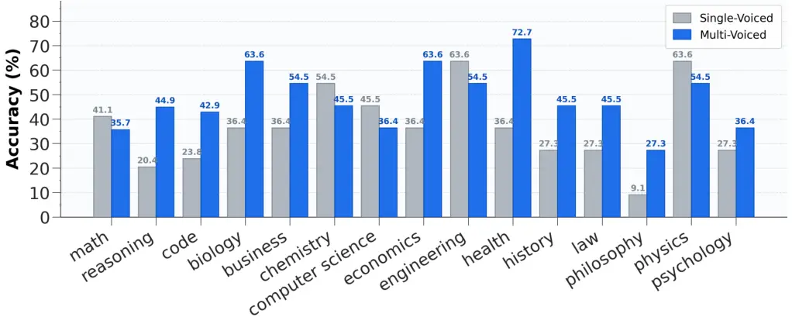

(a) Domain-dependent judging accuracy in single-voiced rubric

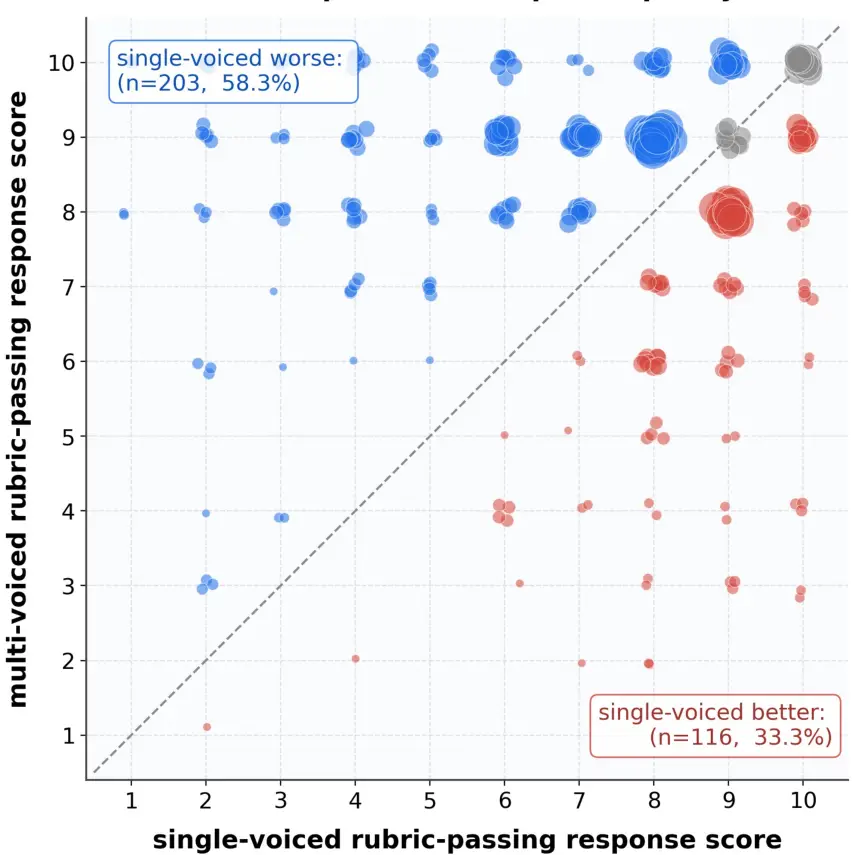

(b) Rubric hacking

Figure 1: Two main problems caused by dimensional blind spots in
single-voiced rubrics.

| Question: Can you list and analyse the investment strategies and history of operation for each company listed on the NASDAQ?                                                                                                                                                                                                                                                                                                                                                                    |                                                                                                                                                                                                                                                                                                                                                                                                                                                                                                                                                                                                                              |
| ----------------------------------------------------------------------------------------------------------------------------------------------------------------------------------------------------------------------------------------------------------------------------------------------------------------------------------------------------------------------------------------------------------------------------------------------------------------------------------------------- | ---------------------------------------------------------------------------------------------------------------------------------------------------------------------------------------------------------------------------------------------------------------------------------------------------------------------------------------------------------------------------------------------------------------------------------------------------------------------------------------------------------------------------------------------------------------------------------------------------------------------------- |
| Single-voiced rubric                                                                                                                                                                                                                                                                                                                                                                                                                                                                            | Multi-voiced rubric                                                                                                                                                                                                                                                                                                                                                                                                                                                                                                                                                                                                          |
| • Lists all NASDAQ-listed companies. \[W3\] • Describes investment strategies for each company. \[W3\] • Provides historical analysis of operations for each company. \[W3\] • Uses reliable and verifiable sources. \[W2\] • Organizes information clearly, e.g., by company. \[W2\] • Avoids irrelevant or extraneous information. \[W2\] • Uses precise and professional language. \[W1\] • Includes recent and up-to-date information. \[W2\] • Clarifies technical terms or jargon. \[W1\] | • Acknowledges impracticality of covering every company; sets scope boundaries. \[W3\] • Avoids unsupported generalizations about companies. \[W2\] • Flags potentially outdated or incomplete data. \[W2\] • Provides a methodology/framework instead of exhaustive listing. \[W3\] • Avoids unverifiable or speculative claims. \[W3\] • Clearly defines “investment strategies” and “history of operation”. \[W3\] • Avoids misleading implications or over generalizations. \[W3\] • Avoids conflating market trends with individual strategies. \[W3\] • Acknowledges if the request is too broad or infeasible. \[W3\] |
| Single-voiced rubric passing answer                                                                                                                                                                                                                                                                                                                                                                                                                                                             | Multi-voiced rubric passing answer                                                                                                                                                                                                                                                                                                                                                                                                                                                                                                                                                                                           |
| Apple Inc.: strategy centers on brand loyalty, ecosystem integration, and R&D; history includes the Macintosh, iPod, iPhone, and iPad. Amazon.com, Inc.: strategy spans e-commerce, AWS, logistics, and streaming; history includes its start as an online bookstore, AWS launch, and Whole Foods acquisition. This gives a brief company-by-company overview.                                                                                                                                  | A complete firm-by-firm analysis of all NASDAQ-listed companies is impractical in one response. A better answer defines the scope, selects firms or sectors, and analyzes each using filings, annual reports, investor presentations, and market data. Key dimensions include capital allocation, acquisitions, R&D, revenue model, operational milestones, risks, and recent performance.                                                                                                                                                                                                                                   |

Table 1: Case study comparing single-voiced and multi-voiced rubrics
with corresponding passing answers. i in \[Wi\] indicates the weight for
each criteria.

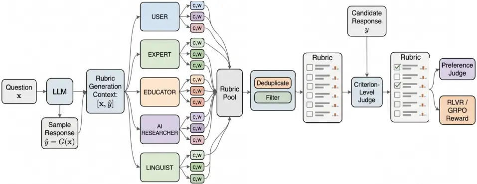

Figure 2: Framework of MRRG.

## 2 Method

This section develops MRRG in four steps. We first formalize
_rubric-based scoring_ as a unified interface that subsumes both
LLM-as-a-judge and RLVR reward modeling (Sec. 2.1). We then introduce
our multi-role rubric generator, MRRG (Multi-Role Rubric Generation,
Sec. 2.2), and describe how the resulting per-role rubrics are pooled
into a scalar score (Sec. 2.3) that can be used, without modification,
as both a preference validator and an RLVR reward (Sec. 2.4).

### 2.1 Preliminaries: Rubric-Based Scoring

Let $`x\in\mathcal{X}`$ denote an input prompt and $`y\in\mathcal{Y}`$ a
candidate response. Every alignment signal aims to approximate the
latent human quality function
$`q^{\star}:\mathcal{X}\times\mathcal{Y}\to\mathbb{R}`$. Classical
reward models parametrize $`q^{\star}`$ as a scalar network
$`r_{\theta}(x,y)`$ trained on preference pairs (Ouyang et al., 2022;
Bai et al., 2022); LLM-as-a-judge approaches instantiate it as a
prompted language model,
$`q^{\star}(x,y)\approx G\big({prompt}_{{judge}}(x,y)\big)`$ (Zheng
et al., 2023). Both collapse the multi-dimensional structure of
$`q^{\star}`$ into an opaque scalar.

#### Notation.

Throughout the paper, $`G(\cdot)`$ denotes a call to a pretrained
language model. Different uses of $`G`$ are distinguished by the prompt
template provided to the model. We use $`{prompt}_{{judge}}`$ to denote
the per-criterion evaluation template, $`{prompt}_{m}`$ for
role-conditioned rubric generation under role $`p_{m}`$, and
$`{prompt}_{r}`$ for generic rubric generation.

#### Rubric-based scoring.

A rubric-based scorer breaks this collapse by introducing an
interpretable intermediate variable. A _rubric_
$`R(x)=\{c_{k},w_{k}\}_{k=1}^{K}`$ is a set of _criteria_, each
$`c_{k}`$ being an atomic, verifiable proposition about the response
(e.g., _“The answer cites the correct theorem”_). Each criterion is
evaluated by the same language model to
$`s_{k}=G\big({prompt}_{{judge}}(x,y,c_{k})\big)\in\{0,1\}`$, and the
overall score aggregates criterion-level judgments:

```math
\displaystyle S(x,y;R)\; \tag{1}
```

```math
\displaystyle=\;\frac{\sum_{k=1}^{K}w_{k}\cdot G\big({prompt}_{{judge}}(x,y,c_{k})\big)}{\sum_{k=1}^{K}w_{k}},
```

where $`w_{k}>0`$ is the importance of the $`k`$-th criterion. This
decomposition makes the signal simultaneously _auditable_ (every
contribution $`w_{k}s_{k}`$ is attributable to a named criterion),
_verifier-like_ (each $`s_{k}`$ is a constrained yes/no or graded
judgment), and _model-agnostic_ (any sufficiently capable LLM can serve
as $`G`$). The central design question thus becomes: _how should
$`R(x)`$ be constructed so as to cover more comprehensive evaluative
dimensions and thus be close to $`q^{\star}`$?_

### 2.2 Multi-Role Rubric Generation

Existing rubric generators (Gunjal et al., 2025; Zhang et al., 2025; Liu
et al., 2025b) construct initial $`R(x)`$ with one or a few LLM calls,
e.g., $`R(x)=G\big({prompt}_{r}\big(x,\hat{y}\big)\big)`$ with
$`\hat{y}=G(x)`$ a sample response, where a “universal evaluator” is
asked to enumerate every relevant criterion at once. As argued in
Sec. 1, this single-voice formulation compresses genuinely distinct
viewpoints into a shared prior and could lead to dimensional blind
spots.

#### Role-conditioned elicitation.

A straightforward approach to broadening the evaluative dimensions in
rubric generation is to repeat the generation process multiple times.
Although this can increase the apparent diversity of the resulting
rubrics, it remains constrained by the inherent biases and limitations
of a single evaluative perspective or role. To address this limitation,
we recast rubric generation as a _multi-role elicitation_ problem. Let
$`\mathcal{P}=\{p_{1},\ldots,p_{M}\}`$ be a small, fixed set of
evaluative _roles_; by default
$`\mathcal{P}=\{\textsc{User},\ \textsc{Domain Expert},\ \textsc{Educator},\\
\textsc{AI Researcher},\ \textsc{Linguist}\}`$. For each role $`p_{m}`$
we supply a role-specific template $`{prompt}_{m}`$ that foregrounds the
concerns most salient to that role—e.g., the User template emphasizes
problem-solving utility and intent satisfaction, while the Educator
template emphasizes evidential support, communication quality and
safety. This produces a role-specific rubric

```math
\displaystyle R_{m}(x) \displaystyle=\;G\big({prompt}_{m}(x,\hat{y})\big)\; \tag{2}
```

```math
\displaystyle=\;\{(c_{m,k},w_{m,k})\}_{k=1}^{K_{m}},
```

where $`m=1,\ldots,M`$ and $`\hat{y}=G(x)`$ is a sample response. Each
$`R_{m}(x)`$ is compact ($`K_{m}\in[3,7]`$ in practice) and internally
coherent, because the generator only has to reason from one viewpoint at
a time. Importantly, $`w_{m,k}`$ is produced _jointly_ with $`c_{m,k}`$
inside the same role-conditioned call: the role that writes a criterion
is also the one best positioned to judge its importance.

#### Criterion format and self-assessed importance.

Each role is also instructed to emit _binary_ criteria paired with a
_self-assessed_ importance weight $`w_{m,k}\in\{1,2,3\}`$ on a
three-point scale:

```math
w_{m,k}=\begin{cases}3&\text{core need}\\
2&\text{significant issue }\\
1&\text{non-critical polish}\end{cases} \tag{3}
```

#### Selection of Roles.

One might consider selecting a question-specific subset of roles, since
the perspectives most relevant to evaluation can in principle depend on
the input question. We instead adopt a fixed but carefully chosen role
pool $`\mathcal{P}`$, motivated by four considerations. _(i)_
Determining the “most relevant” roles for an arbitrary question is
itself ill-posed and would likely require an LLM-based role selector.
Such a selector could inherit, or even amplify, the same dimensional
biases that MRRG aims to mitigate. _(ii)_ The Domain Expert role is
already instantiated conditionally on the input question, providing
question-aware specialization without exposing the high-level
role-selection process to additional model bias. _(iii)_ The default
roles cover the principal axes along which humans evaluate open-ended
generation: _practical utility_ (User), _technical correctness_ (Domain
Expert), _communicative clarity_ (Educator), _AI-specific reasoning and
model behavior_ (AI Researcher), and _linguistic quality_ (Linguist).
_(iv)_ Keeping the role pool small, with $`|\mathcal{P}|=M`$ and $`M=5`$
in our experiments, bounds the rubric-generation cost by
$`\mathcal{O}(M)`$ LLM calls per prompt, independent of dataset size. We
study the sensitivity of MRRG to the choice of $`\mathcal{P}`$ in
Section 3.2.

### 2.3 Rubric Deduplication

The per-role rubrics $`\{R_{m}(x)\}_{m=1}^{M}`$ may contain repeated
criteria, since different roles can independently produce the same
requirement. In practice, we also observe that LLMs sometimes generate
identical criteria within role-specific rubrics, potentially due to
hallucinated redundancy. If left untreated, such exact duplicates may be
counted multiple times and distort the final rubric-based judgment. To
address this issue, we apply a simple deterministic post-processing
step.

We first concatenate all role-specific rubrics into a single list,

```math
R_{1:M}(x)=\big[(c_{m,k},w_{m,k})\big]_{m=1,k=1}^{M,K_{m}}. \tag{4}
```

We then scan this list in order and remove criteria whose text exactly
matches a criterion that has already appeared. The first occurrence is
kept together with its original weight, while subsequent duplicate
occurrences are discarded. The final rubric is

```math
\widetilde{R}(x)=\big[(\tilde{c}_{j},\tilde{w}_{j})\big]_{j=1}^{N}, \tag{5}
```

where $`N`$ is the number of criteria in the final rubric.

Importantly, this procedure only removes exact duplicates and leaves all
non-identical criteria unchanged, including criteria that are
semantically similar or potentially in tension with one another.
Although one could apply semantic deduplication or consolidation
methods, such as using an LLM to merge redundant criteria or resolve
conflicting ones, we avoid this design choice for two reasons. First,
LLM-based consolidation introduces an additional judgment step, where
decisions about redundancy and conflict may themselves be biased and may
propagate such bias into the final rubric. Second, merging or removing
semantically similar criteria from different roles may inadvertently
weaken important evaluation dimensions: when multiple roles
independently emphasize similar criteria, this agreement can signal that
the criterion is important. Collapsing these criteria into a single item
may reduce their effective influence and thus affect the final judgment.
We therefore adopt exact-match deduplication as a conservative,
deterministic, and reproducible choice. Additional empirical analysis is
provided in Appendix C.3.

### 2.4 From Rubric Score to Alignment Signal

The scalar $`S(x,y;\widetilde{R}(x))\in[0,1]`$ plugs into both
downstream settings without modification.

#### Preference validation (LLM-as-a-judge).

Given two candidates $`(y_{A},y_{B})`$ for the same prompt $`x`$, we
predict the preferred response as
$`\arg\max_{i\in\{A,B\}}S(x,y_{i};\widetilde{R}(x))`$.

#### Reward modeling for RLVR.

We use $`S(x,y;\widetilde{R}(x))`$ directly as the reward inside
GRPO-style optimization (Guo et al., 2025). For a prompt $`x`$ with a
rollout group $`\{y_{i}\}_{i=1}^{G_{\text{roll}}}`$, the group-relative
advantage of $`y_{i}`$ is

```math
A_{i}\;=\;\frac{S(x,y_{i};\widetilde{R}(x))-\mu_{S}(x)}{\sigma_{S}(x)+\varepsilon}, \tag{6}
```

where $`\mu_{S}(x)`$ and $`\sigma_{S}(x)`$ denote the mean and standard
deviation of $`\{S(x,y_{i};\widetilde{R}(x))\}_{i=1}^{G_{\text{roll}}}`$
taken _within the rollout group for prompt $`x`$_ and $`\varepsilon`$ is
a small constant for numerical stability. Because $`\widetilde{R}(x)`$
is generated once per prompt and cached, the per-rollout reward cost
reduces to $`N`$ yes/no judge calls, which parallelize trivially across
the group.

## 3 Experimental Results

We evaluate MRRG along the two downstream settings it was designed for:
(i) _preference validation_, where MRRG acts as an LLM-as-a-judge on
benchmark preference pairs (Sec. 3.2); and (ii) _reward modeling for
RLVR_, where the same rubric-based scorer drives GRPO-style policy
optimization (Sec. 3.3). Across the experimental part we answer the
following questions:

- Q1.
  Can MRRG outperform single-voiced rubric generators and other
  baselines in both preference validation and RLVR reward modeling?
- Q2.
  Is MRRG robust to the choice of roles, or does it rely critically on
  any specific role?
- Q3.
  Does MRRG expand the coverage of evaluative dimensions beyond
  single-voiced generation, or are its gains simply due to producing
  more criteria?

|                      |               |      |      |      |            |      |      |      |      |      |      |      |
| -------------------- | ------------- | ---- | ---- | ---- | ---------- | ---- | ---- | ---- | ---- | ---- | ---- | ---- |
| Model                | RewardBench-2 |      |      |      | JudgeBench |      |      |      | PPE  |      |      |      |
|                      | S0            | S1   | CtT  | MRRG | S0         | S1   | CtT  | MRRG | S0   | S1   | CtT  | MRRG |
| Qwen2.5 Series       |               |      |      |      |            |      |      |      |      |      |      |      |
| Qwen2.5-3B-Instruct  | 29.4          | 40.3 | 21.3 | 51.2 | 35.1       | 40.9 | 31.1 | 55.1 | 31.2 | 36.3 | 31.3 | 46.2 |
| Qwen2.5-7B-Instruct  | 37.6          | 50.7 | 36.5 | 59.2 | 32.3       | 35.1 | 40.5 | 56.9 | 34.0 | 42.3 | 37.5 | 48.5 |
| Qwen2.5-32B-Instruct | 42.3          | 54.9 | 59.4 | 65.3 | 37.1       | 47.4 | 52.0 | 65.1 | 44.0 | 48.2 | 49.5 | 53.9 |
| GPT Series           |               |      |      |      |            |      |      |      |      |      |      |      |
| GPT-OSS-20B          | 51.2          | 62.4 | 60.3 | 73.7 | 54.3       | 67.7 | 63.1 | 74.0 | 40.1 | 52.2 | 53.2 | 56.3 |
| GPT-OSS-120B         | 52.3          | 64.4 | 61.3 | 74.5 | 56.5       | 67.8 | 64.0 | 74.8 | 43.3 | 52.8 | 54.4 | 57.8 |

Table 2: Accuracy (%) performance comparison of different models on
RewardBench-2, JudgeBench, and PPE. S0 denotes SVRG w/o SR, S1 denotes
SVRG w/ SR, and CtT denotes Chasing the Tail. For each model–benchmark
pair, the best result is marked in bold.

### 3.1 Experimental Setup

#### Rubric generator and judge models.

For preference validation experiments, we instantiate $`G(\cdot)`$ with
a diverse range of models including Qwen2.5-3B-Instruct,
Qwen2.5-7B-Instruct, Qwen2.5-32B-Instruct, GPT-oss-20b and GPT-oss-120b
for rubric generation and per-criterion judging. And all methods are
evaluated on JudgeBench Tan et al. (2024), RewardBench-2 (Malik et al., 2025) and PPE Frick et al. (2024). As for RLVR experiments, we use
Qwen2.5-3B-Instruct as base model for GRPO, while GPT-4o is used for
rubric generation for different strategies and gpt-oss-120b is used for
per-criterion judging. We select $`2000`$ questions from Wildchat Zhao
et al. (2024) as training set, and models are evaluated on two widely
used open-ended-task datasets: BiGGen Bench Kim et al. (2024) and
HealthBench-Hard Arora et al. (2025).

Detailed description for these two datasets is provided in Appendix A.
Also, full prompt templates for all five roles, and the judge template
are provided in Appendix D.

#### Baselines.

We compare MRRG against three methods: _(i) Single-voice rubric
generator without sample responses (SVRG w/o SR)_: the method generates
rubrics for questions without sample responses. _(ii) Single-voice
rubric generators with sample responses (SVRG w/ SR)_: the method
generates rubrics for specific questions with sample responses. _(iii)
Chasing the TailZhang et al. (2025)_: the method generates and refines
rubrics by comparing great and diverse responses.

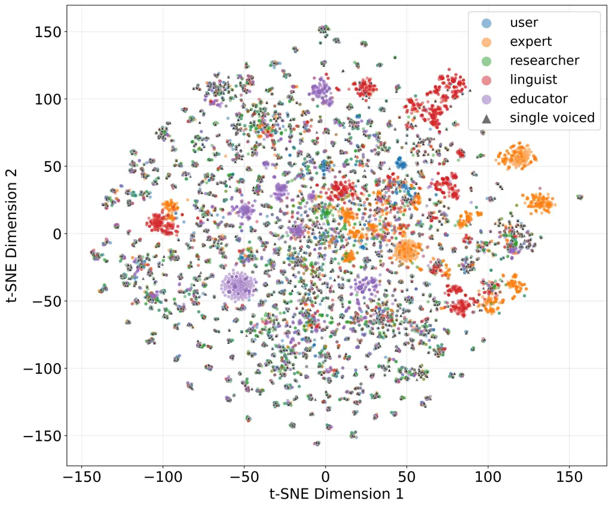

Figure 3: T-SNE visualization of rubrics proposed by different roles and
methods.

### 3.2 Preference Validation

Table 2 shows that MRRG consistently achieves the strongest performance
across all three benchmarks and all backbone models, often with
substantial margins over the baselines. On the Qwen2.5 series, MRRG
improves upon the SVRG w/o SR baseline by more than $`20`$ points on
RewardBench-2 for the 3B, 7B, and 32B variants, and yields comparable
improvements on JudgeBench. On the GPT series, MRRG remains uniformly
superior, raising GPT-OSS-120B from $`52.3`$ to $`74.5`$ on
RewardBench-2 and from $`56.5`$ to $`74.8`$ on JudgeBench. These
consistent gains across model scales and families demonstrate that the
advantage of multi-role rubric generation is not tied to a particular
backbone. They also suggest that MRRG constructs more comprehensive and
discriminative rubrics for open-ended evaluation.

We also visualize the rubrics generated by different roles and by the
single-voiced process in Figure 3. The visualization shows that
role-specific rubrics largely cover the regions occupied by
single-voiced rubrics. Meanwhile, they also extend to additional regions
where few or no single-voiced rubrics are present, suggesting that the
multi-role process captures evaluative dimensions that are underexplored
by single-voiced generation. This provides qualitative evidence that
MRRG yields more diverse and comprehensive criteria.

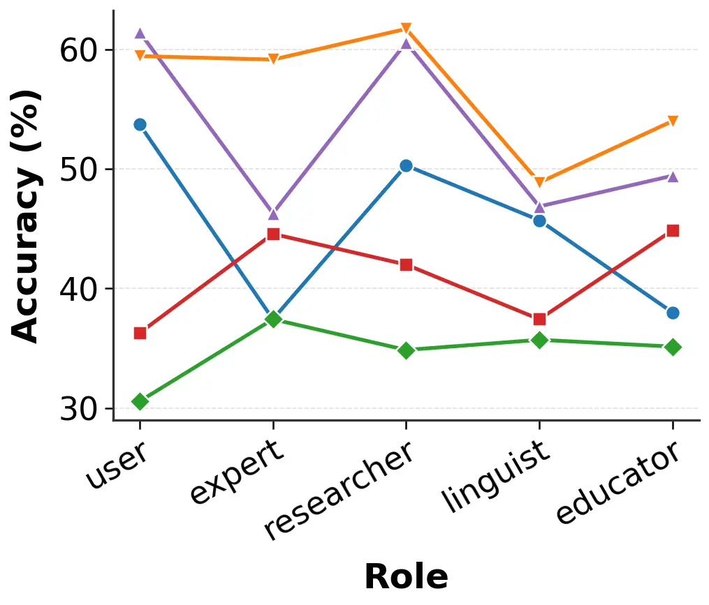

(a) Single role on JudgeBench

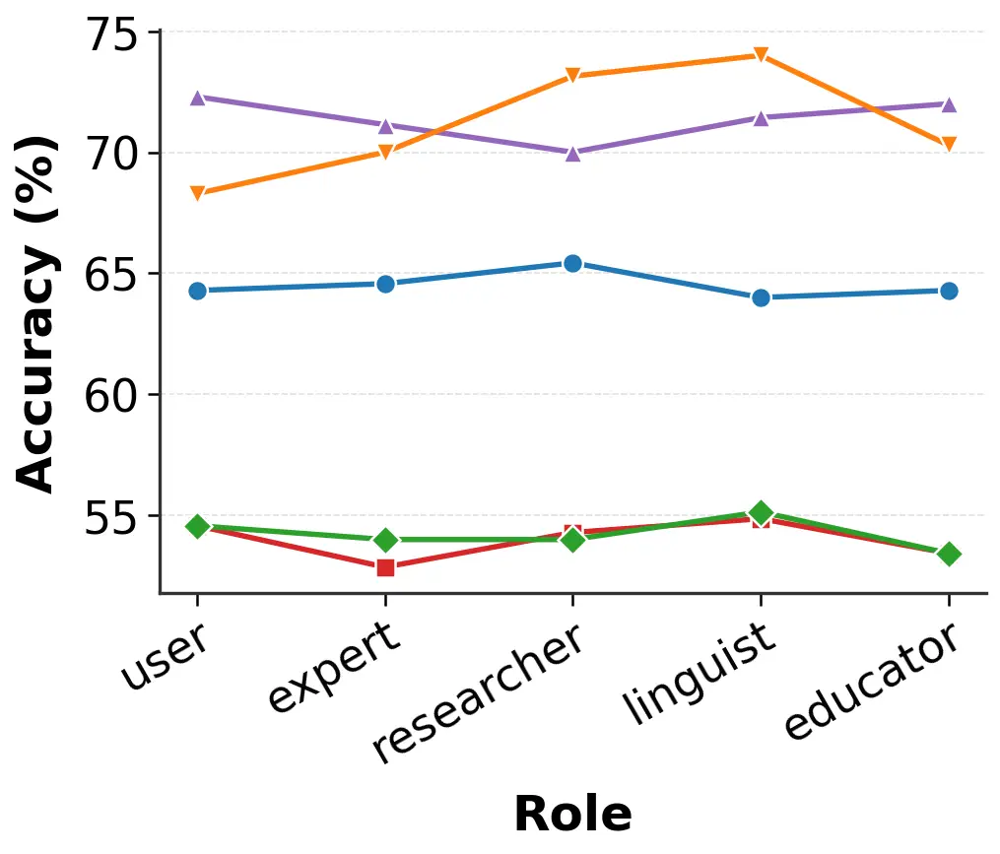

(b) leave-one-role-out MRRG on JudgeBench

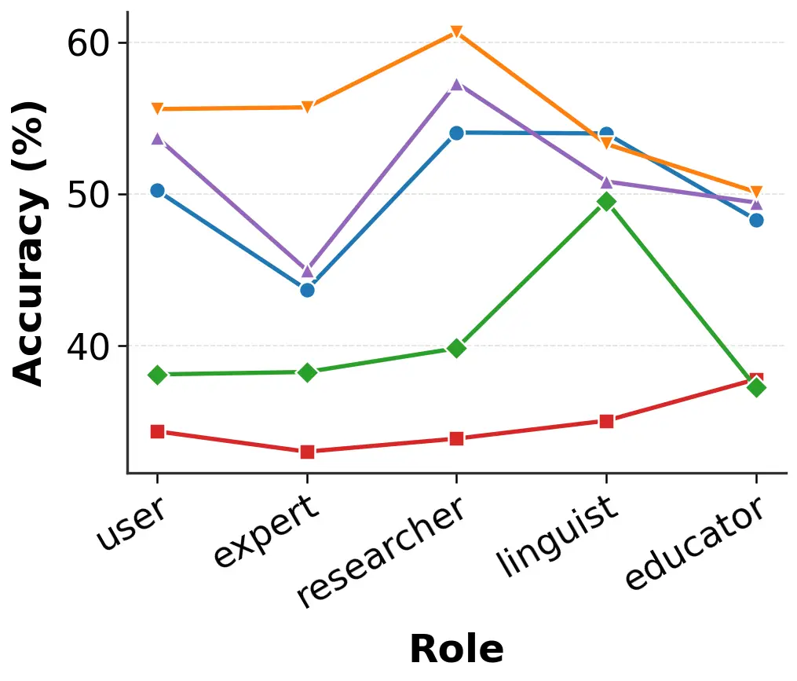

(c) Single role on RewardBench-2


(d) leave-one-role-out MRRG on RewardBench-2

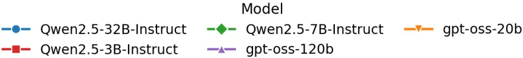

(e)

Figure 4: comparison of single-role baselines with leave-one-role-out
variants of MRRG

#### Ablations.

Table 3 isolates the contribution of different components of MRRG. _(i)
Role ablation_: using rubrics from any single role leads to a clear
performance drop compared with MRRG, indicating that no individual
perspective is sufficient to construct a comprehensive evaluation
rubric. Among the single-role variants, Educator performs best on both
RewardBench-2 and JudgeBench, achieving 37.8 and 44.8, respectively.
Nevertheless, it still lags behind MRRG by 13.4 points on RewardBench-2
and 10.3 points on JudgeBench, highlighting the importance of
aggregating complementary evaluative perspectives. _(ii) Repeated
single-voiced rubric generation_: To examine whether the advantage of
MRRG simply comes from generating more criteria, we introduce a repeated
single-voiced rubric generation baseline, denoted as RSVRG.
Specifically, RSVRG repeats the single-voiced rubric generation process
$`5`$ times and then applies the same post-processing pipeline as MRRG.
As shown in Table 3, RSVRG improves over individual-role variants in
some cases, especially when sample responses are enabled, suggesting
that repeated sampling can increase rubric diversity to a limited
extent. However, RSVRG w/ SR remains substantially below MRRG, with gaps
of $`7.3`$ points on RewardBench-2 and $`10.0`$ points on JudgeBench.
This indicates that simply generating more single-voiced rubrics cannot
fully substitute for explicitly eliciting rubrics from multiple
complementary roles. Overall, these results suggest that the gains of
MRRG arise from role-based diversity rather than merely from an
increased number of generated criteria.

In addition, we conducted an experiment to compare single-role baselines
with leave-one-role-out MRRG variants, as shown in Figure 4. The results
show that the most effective single role varies across backbone models,
suggesting that no single evaluative perspective is uniformly optimal.
In contrast, removing a role from MRRG leads only to moderate
performance changes in most cases. Although excluding stronger single
roles tends to result in larger drops, the overall degradation remains
limited. This indicates that MRRG does not depend critically on any
particular role; rather, its effectiveness comes from aggregating
complementary perspectives to construct more comprehensive rubrics.

|               |               |            |
| ------------- | ------------- | ---------- |
| Variant       | RewardBench-2 | JudgeBench |
| User          | 34.4          | 36.2       |
| Domain Expert | 33.0          | 44.5       |
| Educator      | 37.8          | 44.8       |
| Researcher    | 33.9          | 42.0       |
| Linguist      | 35.1          | 37.4       |
| RSVRG w/o SR  | 39.1          | 38.5       |
| RSVRG w/ SR   | 43.9          | 45.1       |
| MRRG          | 51.2          | 55.1       |

Table 3: Ablation of MRRG components using Qwen2.5-3B-Instruct on the
domain benchmark. “role $`m`$” denotes using only rubrics from role
$`m`$.

### 3.3 Reward Modeling for RLVR

#### Setup.

We plug $`S(x,y;\widetilde{R}(x))`$ into GRPO as the per-rollout reward,
using the same rubric $`\widetilde{R}(x)`$ cached per prompt across the
rollout group. The base policy is Qwen2.5-3B-Instruct; we train it on
$`2000`$ open-ended prompts drawn from WildChat Zhao et al. (2024).

#### Main results.

Table 4 reports the post-RL policy performance under different reward
sources. Using MRRG as the reward consistently yields the best results
on both in-domain and domain-transfer evaluations. On BiGGen Bench, MRRG
achieves a score of $`63.7`$, outperforming the strongest baseline, SVRG
w/ SR, by $`1.7`$ points. The improvement is even larger on the
domain-transfer benchmark HealthBench-Hard, where MRRG reaches $`32.1`$
and exceeds the second-best method by $`3.4`$ points. Notably, all
rubric-based rewards improve over the base policy, while MRRG provides
the largest gains across both benchmarks. These results suggest that
multi-role rubric rewards provide a more comprehensive and robust
training signal than single-voiced alternatives, leading to better
generalization under distribution shift. Detailed experimental results
are provided in Appendix C.4.

| Reward source                     | BiGGen Bench | HealthBench-Hard |
| --------------------------------- | ------------ | ---------------- |
| Base policy (Qwen2.5-3B-Instruct) | 57.8         | 25.6             |
| SVRG w/o SR                       | 60.0         | 26.0             |
| SVRG w/ SR                        | 62.0         | 28.7             |
| Chasing the Tail                  | 61.1         | 27.0             |
| MRRG                              | 63.7         | 32.1             |

Table 4: Post-RL policy Accuracy (%) performance under different reward
sources. Best performance in each column is in bold.

## 4 Related Work

### 4.1 Reward Modeling and LLM-as-a-Judge

Scalar reward models. Aligning LLMs with human intent typically relies
on a learned reward model trained on Bradley–Terry-style pairwise
preferences. InstructGPT Ouyang et al. (2022) and HH-RLHF Bai et al.
(2022) train a Bradley–Terry head on top of a base language model (LM)
using human-labeled pairwise preferences, and use the resulting scalar
as the reward for RLHF. PPE Frick et al. (2024) subsequently shows that
such reward models are brittle proxies of downstream policy quality and
proposes a preference-proxy benchmark to measure that gap.
LLM-as-a-judge. Other methods like MT-Bench / Chatbot Arena Zheng et al.
(2023) prompts a strong LLM (GPT-4) to directly score or
pairwise-compare two responses, and AlpacaFarm Dubois et al. (2023) uses
this LLM-judge signal as a stand-in for human feedback when simulating
RLHF.

### 4.2 Rubric-Based Evaluation and RLVR

A recent line of work makes evaluation criteria explicit through rubrics
or checklists. These methods typically generate rubrics using one or a
few LLM calls under a single “universal evaluator” prompt, and the
resulting criteria can further be used as verifiable rewards for RLVR.
For example, Chasing the Tail (Zhang et al., 2025) emphasizes that
rubric generation should account for distinctions among high-quality and
diverse responses, and proposes a workflow for constructing rubrics that
capture such distinctions. Rubrics as Rewards (RaR) (Gunjal et al., 2025) generates question-specific rubrics from the input question and a
reference answer, and uses them as rewards for RLVR. OpenRubrics  (Liu
et al., 2025b) collects large-scale and diverse question–rubric pairs to
train rubric-generation models capable of producing reliable and
scalable rubrics.

While these approaches demonstrate the effectiveness of rubric-based
evaluation and reward modeling, they often depend on additional
supervision, such as reference answers for rubric construction or
preference-labeled data for training rubric generators. This reliance
can limit their applicability in realistic settings where reference
answers or preference annotations are unavailable or expensive to
obtain.

### 4.3 Multi-Role Prompting for Evaluation and Reasoning

Prior work has shown that role conditioning can substantially affect the
knowledge and reasoning patterns elicited from LLMs. In-Context
Impersonation Salewski et al. (2023) shows that asking a LLM to act as a
domain expert / a child systematically changes the knowledge it surfaces
on QA and bandit tasks; Role-Play Prompting extends role-play to
chain-of-thought reasoning and reports gains across MMLU and GSM8K.
Multi-Agent Debate Chan et al. (2024) runs several LLM instances that
iteratively critique and revise each other’s answers, improving
factuality on TriviaQA-style tasks; Encouraging Divergent Thinking (EDT)
Liang et al. (2024) shows that explicitly encouraging divergent
viewpoints across agents further reduces mode collapse in reasoning.
These methods primarily use multiple roles to produce better answers. In
contrast, MRRG generates the evaluation criteria themselves. Moreover,
unlike debate-based methods, MRRG does not require iterative
interaction, critique, or consensus among agents. Instead, role-specific
rubrics are generated independently and then combined through
deterministic deduplication.

## 5 Conclusion

We presented Multi-Role Rubric Generation (MRRG), a training-free
framework that recasts rubric construction as a multi-role elicitation
process and pool per-role rubrics into a powerful scorer. The same
scorer serves uniformly as an LLM-as-a-judge for preference validation
and as a reward inside RLVR, with no architectural change between the
two uses. Empirically, MRRG consistently outperforms single-voice rubric
generators, and rubric-refinement baselines on JudgeBench,
RewardBench-2, and PPE, and it also delivers stronger downstream
policies under GRPO on BiGGen-Bench and HealthBench-Hard.

## Limitations

While MRRG mitigates the dimensional blind spots of single-voiced rubric
generation, it still has one notable limitation. The pool of roles used
to instantiate the multiple voices is predefined and remains fixed
across all questions. In practice, however, the set of perspectives that
are truly relevant for judging a response is inherently
question-dependent: a coding task and a moral-reasoning task, for
instance, call for largely disjoint expert viewpoints. Using a static
role pool may therefore introduce uninformative voices on some questions
while omitting critical ones on others. A natural extension is to
incorporate adaptive, question-conditioned role selection — for example,
by retrieving or generating roles on the fly based on the input — which
is an important direction for future work.

## References

- Achiam et al. (2023) Josh Achiam, Steven Adler, Sandhini Agarwal, Lama
  Ahmad, Ilge Akkaya, Florencia Leoni Aleman, Diogo Almeida, Janko
  Altenschmidt, Sam Altman, Shyamal Anadkat, and 1 others. 2023. Gpt-4
  technical report. _arXiv preprint arXiv:2303.08774_.
- Arora et al. (2025) Rahul K Arora, Jason Wei, Rebecca Soskin Hicks,
  Preston Bowman, Joaquin Quiñonero-Candela, Foivos Tsimpourlas, Michael
  Sharman, Meghan Shah, Andrea Vallone, Alex Beutel, and 1 others. 2025.
  Healthbench: Evaluating large language models towards improved human
  health. _arXiv preprint arXiv:2505.08775_.
- Bai et al. (2022) Yuntao Bai, Andy Jones, Kamal Ndousse, Amanda
  Askell, Anna Chen, Nova DasSarma, Dawn Drain, Stanislav Fort, Deep
  Ganguli, Tom Henighan, and 1 others. 2022. Training a helpful and
  harmless assistant with reinforcement learning from human feedback.
  _arXiv preprint arXiv:2204.05862_.
- Brown et al. (2020) Tom Brown, Benjamin Mann, Nick Ryder, Melanie
  Subbiah, Jared D Kaplan, Prafulla Dhariwal, Arvind Neelakantan, Pranav
  Shyam, Girish Sastry, Amanda Askell, and 1 others. 2020. Language
  models are few-shot learners. _Advances in neural information
  processing systems_, 33:1877–1901.
- Casper et al. (2023) Stephen Casper, Xander Davies, Claudia Shi,
  Thomas Krendl Gilbert, Jérémy Scheurer, Javier Rando, Rachel Freedman,
  Tomasz Korbak, David Lindner, Pedro Freire, and 1 others. 2023. Open
  problems and fundamental limitations of reinforcement learning from
  human feedback. _arXiv preprint arXiv:2307.15217_.
- Chan et al. (2024) Chi-Min Chan, Weize Chen, Yusheng Su, Jianxuan Yu,
  Wei Xue, Shanghang Zhang, Jie Fu, and Zhiyuan Liu. 2024. Chateval:
  Towards better llm-based evaluators through multi-agent debate. In
  _International conference on learning representations_, volume 2024,
  pages 9079–9093.
- Chen et al. (2024) Lichang Chen, Chen Zhu, Davit Soselia, Jiuhai Chen,
  Tianyi Zhou, Tom Goldstein, Heng Huang, Mohammad Shoeybi, and Bryan
  Catanzaro. 2024. Odin: Disentangled reward mitigates hacking in rlhf.
  _arXiv preprint arXiv:2402.07319_.
- Dubois et al. (2023) Yann Dubois, Chen Xuechen Li, Rohan Taori, Tianyi
  Zhang, Ishaan Gulrajani, Jimmy Ba, Carlos Guestrin, Percy S Liang, and
  Tatsunori B Hashimoto. 2023. Alpacafarm: A simulation framework for
  methods that learn from human feedback. _Advances in Neural
  Information Processing Systems_, 36:30039–30069.
- Eisenstein et al. (2023) Jacob Eisenstein, Chirag Nagpal, Alekh
  Agarwal, Ahmad Beirami, Alex D’Amour, DJ Dvijotham, Adam Fisch,
  Katherine Heller, Stephen Pfohl, Deepak Ramachandran, and 1
  others. 2023. Helping or herding? reward model ensembles mitigate but
  do not eliminate reward hacking. _arXiv preprint arXiv:2312.09244_.
- Frick et al. (2024) Evan Frick, Tianle Li, Connor Chen, Wei-Lin
  Chiang, Anastasios N Angelopoulos, Jiantao Jiao, Banghua Zhu, Joseph E
  Gonzalez, and Ion Stoica. 2024. How to evaluate reward models for
  rlhf. _arXiv preprint arXiv:2410.14872_.
- Gunjal et al. (2025) Anisha Gunjal, Anthony Wang, Elaine Lau, Vaskar
  Nath, Yunzhong He, Bing Liu, and Sean Hendryx. 2025. Rubrics as
  rewards: Reinforcement learning beyond verifiable domains. _arXiv
  preprint arXiv:2507.17746_.
- Guo et al. (2025) Daya Guo, Dejian Yang, Haowei Zhang, Junxiao Song,
  Peiyi Wang, Qihao Zhu, Runxin Xu, Ruoyu Zhang, Shirong Ma, Xiao Bi,
  and 1 others. 2025. Deepseek-r1: Incentivizing reasoning capability in
  llms via reinforcement learning. _arXiv preprint arXiv:2501.12948_.
- Kaelbling et al. (1996) Leslie Pack Kaelbling, Michael L Littman, and
  Andrew W Moore. 1996. Reinforcement learning: A survey. _Journal of
  artificial intelligence research_, 4:237–285.
- Kawabata and Sugawara (2026) Akira Kawabata and Saku Sugawara. 2026.
  C2: Scalable rubric-augmented reward modeling from binary preferences.
  _arXiv preprint arXiv:2604.13618_.
- Kim et al. (2024) Seungone Kim, Juyoung Suk, Ji Yong Cho, Shayne
  Longpre, Chaeeun Kim, Dongkeun Yoon, Guijin Son, Yejin Cho, Sheikh
  Shafayat, Jinheon Baek, Sue Hyun Park, Hyeonbin Hwang, Jinkyung Jo,
  Hyowon Cho, Haebin Shin, Seongyun Lee, Hanseok Oh, Noah Lee, Namgyu
  Ho, and 13 others. 2024. [The biggen bench: A principled benchmark for
  fine-grained evaluation of language models with language
  models](https://arxiv.org/abs/2406.05761). _Preprint_,
  arXiv:2406.05761.
- Lambert et al. (2024) Nathan Lambert, Jacob Morrison, Valentina
  Pyatkin, Shengyi Huang, Hamish Ivison, Faeze Brahman, Lester James V
  Miranda, Alisa Liu, Nouha Dziri, Shane Lyu, and 1 others. 2024. Tulu
  3: Pushing frontiers in open language model post-training. _arXiv
  preprint arXiv:2411.15124_.
- Lambert et al. (2025) Nathan Lambert, Valentina Pyatkin, Jacob
  Morrison, Lester James Validad Miranda, Bill Yuchen Lin, Khyathi
  Chandu, Nouha Dziri, Sachin Kumar, Tom Zick, Yejin Choi, and 1
  others. 2025. Rewardbench: Evaluating reward models for language
  modeling. In _Findings of the Association for Computational
  Linguistics: NAACL 2025_, pages 1755–1797.
- Li (2017) Yuxi Li. 2017. Deep reinforcement learning: An overview.
  _arXiv preprint arXiv:1701.07274_.
- Liang et al. (2024) Tian Liang, Zhiwei He, Wenxiang Jiao, Xing Wang,
  Yan Wang, Rui Wang, Yujiu Yang, Shuming Shi, and Zhaopeng Tu. 2024.
  Encouraging divergent thinking in large language models through
  multi-agent debate. In _Proceedings of the 2024 conference on
  empirical methods in natural language processing_, pages 17889–17904.
- Lightman et al. (2023) Hunter Lightman, Vineet Kosaraju, Yuri Burda,
  Harrison Edwards, Bowen Baker, Teddy Lee, Jan Leike, John Schulman,
  Ilya Sutskever, and Karl Cobbe. 2023. Let’s verify step by step. In
  _The twelfth international conference on learning representations_.
- Liu et al. (2025a) Chris Yuhao Liu, Liang Zeng, Yuzhen Xiao, Jujie He,
  Jiacai Liu, Chaojie Wang, Rui Yan, Wei Shen, Fuxiang Zhang, Jiacheng
  Xu, Yang Liu, and Yahui Zhou. 2025a. Skywork-reward-v2: Scaling
  preference data curation via human-ai synergy. _arXiv preprint
  arXiv:2507.01352_.
- Liu et al. (2025b) Tianci Liu, Ran Xu, Tony Yu, Ilgee Hong, Carl Yang,
  Tuo Zhao, and Haoyu Wang. 2025b. Openrubrics: Towards scalable
  synthetic rubric generation for reward modeling and llm alignment.
  _arXiv preprint arXiv:2510.07743_.
- Liu et al. (2025c) Ziyu Liu, Zeyi Sun, Yuhang Zang, Xiaoyi Dong,
  Yuhang Cao, Haodong Duan, Dahua Lin, and Jiaqi Wang. 2025c.
  Visual-rft: Visual reinforcement fine-tuning. In _Proceedings of the
  IEEE/CVF International Conference on Computer Vision_, pages
  2034–2044.
- Malik et al. (2025) Saumya Malik, Valentina Pyatkin, Sander Land,
  Jacob Morrison, Noah A. Smith, Hannaneh Hajishirzi, and Nathan
  Lambert. 2025. [Rewardbench 2: Advancing reward model
  evaluation](https://arxiv.org/abs/2506.01937). _Preprint_,
  arXiv:2506.01937.
- Ouyang et al. (2022) Long Ouyang, Jeffrey Wu, Xu Jiang, Diogo Almeida,
  Carroll Wainwright, Pamela Mishkin, Chong Zhang, Sandhini Agarwal,
  Katarina Slama, Alex Ray, and 1 others. 2022. Training language models
  to follow instructions with human feedback. _Advances in neural
  information processing systems_, 35:27730–27744.
- Panickssery et al. (2024) Arjun Panickssery, Samuel R Bowman, and Shi
  Feng. 2024. Llm evaluators recognize and favor their own generations.
  _Advances in Neural Information Processing Systems_, 37:68772–68802.
- Que et al. (2024) Haoran Que, Feiyu Duan, Liqun He, Yutao Mou,
  Wangchunshu Zhou, Jiaheng Liu, Wenge Rong, Zekun Moore Wang, Jian
  Yang, Ge Zhang, and 1 others. 2024. Hellobench: Evaluating long text
  generation capabilities of large language models. _arXiv preprint
  arXiv:2409.16191_.
- Saha et al. (2024) Swarnadeep Saha, Omer Levy, Asli Celikyilmaz, Mohit
  Bansal, Jason Weston, and Xian Li. 2024. Branch-solve-merge improves
  large language model evaluation and generation. In _Proceedings of the
  2024 Conference of the North American Chapter of the Association for
  Computational Linguistics: Human Language Technologies (Volume 1: Long
  Papers)_, pages 8352–8370.
- Salewski et al. (2023) Leonard Salewski, Stephan Alaniz, Isabel
  Rio-Torto, Eric Schulz, and Zeynep Akata. 2023. In-context
  impersonation reveals large language models’ strengths and biases.
  _Advances in neural information processing systems_, 36:72044–72057.
- Shen et al. (2026) William F Shen, Xinchi Qiu, Chenxi Whitehouse, Lisa
  Alazraki, Shashwat Goel, Francesco Barbieri, Timon Willi, Akhil
  Mathur, and Ilias Leontiadis. 2026. Rethinking rubric generation for
  improving llm judge and reward modeling for open-ended tasks. _arXiv
  preprint arXiv:2602.05125_.
- Singhal et al. (2023) Prasann Singhal, Tanya Goyal, Jiacheng Xu, and
  Greg Durrett. 2023. A long way to go: Investigating length
  correlations in rlhf. _arXiv preprint arXiv:2310.03716_.
- Skalse et al. (2022) Joar Skalse, Nikolaus Howe, Dmitrii
  Krasheninnikov, and David Krueger. 2022. Defining and characterizing
  reward gaming. _Advances in Neural Information Processing Systems_,
  35:9460–9471.
- Tan et al. (2024) Sijun Tan, Siyuan Zhuang, Kyle Montgomery,
  Willian Yuan Tang, Alejandro Cuadron, Chenguang Wang, Raluca Ada Popa,
  and Ion Stoica. 2024. [Judgebench: A benchmark for evaluating
  llm-based judges](https://arxiv.org/abs/2410.12784).
- Uesato et al. (2022) Jonathan Uesato, Nate Kushman, Ramana Kumar,
  Francis Song, Noah Siegel, Lisa Wang, Antonia Creswell, Geoffrey
  Irving, and Irina Higgins. 2022. Solving math word problems with
  process-and outcome-based feedback. _arXiv preprint arXiv:2211.14275_.
- Viswanathan et al. (2025) Vijay Viswanathan, Yanchao Sun, Shuang Ma,
  Xiang Kong, Meng Cao, Graham Neubig, and Tongshuang Wu. 2025.
  Checklists are better than reward models for aligning language models.
  _arXiv preprint arXiv:2507.18624_.
- Wang et al. (2024) Peiyi Wang, Lei Li, Liang Chen, Zefan Cai, Dawei
  Zhu, Binghuai Lin, Yunbo Cao, Lingpeng Kong, Qi Liu, Tianyu Liu, and 1
  others. 2024. Large language models are not fair evaluators. In
  _Proceedings of the 62nd Annual Meeting of the Association for
  Computational Linguistics (Volume 1: Long Papers)_, pages 9440–9450.
- Wen et al. (2024) Jiaxin Wen, Ruiqi Zhong, Akbir Khan, Ethan Perez,
  Jacob Steinhardt, Minlie Huang, Samuel R Bowman, He He, and Shi
  Feng. 2024. Language models learn to mislead humans via rlhf. _arXiv
  preprint arXiv:2409.12822_.
- Wiering and Van Otterlo (2012) Marco A Wiering and Martijn
  Van Otterlo. 2012. Reinforcement learning. _Adaptation, learning, and
  optimization_, 12(3):729.
- Yang et al. (2025) An Yang, Anfeng Li, Baosong Yang, Beichen Zhang,
  Binyuan Hui, Bo Zheng, Bowen Yu, Chang Gao, Chengen Huang, Chenxu Lv,
  and 1 others. 2025. Qwen3 technical report. _arXiv preprint
  arXiv:2505.09388_.
- Zhang et al. (2025) Junkai Zhang, Zihao Wang, Lin Gui,
  Swarnashree Mysore Sathyendra, Jaehwan Jeong, Victor Veitch, Wei Wang,
  Yunzhong He, Bing Liu, and Lifeng Jin. 2025. Chasing the tail:
  Effective rubric-based reward modeling for large language model
  post-training. _arXiv preprint arXiv:2509.21500_.
- Zhao et al. (2024) Wenting Zhao, Xiang Ren, Jack Hessel, Claire
  Cardie, Yejin Choi, and Yuntian Deng. 2024. [Wildchat: 1m chatGPT
  interaction logs in the
  wild](https://openreview.net/forum?id=Bl8u7ZRlbM). In _The Twelfth
  International Conference on Learning Representations_.
- Zheng et al. (2023) Lianmin Zheng, Wei-Lin Chiang, Ying Sheng, Siyuan
  Zhuang, Zhanghao Wu, Yonghao Zhuang, Zi Lin, Zhuohan Li, Dacheng Li,
  Eric Xing, and 1 others. 2023. Judging llm-as-a-judge with mt-bench
  and chatbot arena. _Advances in neural information processing
  systems_, 36:46595–46623.

## Appendix A Dataset description

- •
  JudgeBench Tan et al. (2024): Using a novel pipeline that transforms
  any dataset with ground truth labels and verification algorithms into
  a corresponding dataset specifically tailored for LLM-based judges, It
  constructs a challenging dataset consisting of 350 response pairs
  across four categories:general knowledge, reasoning, mathematics, and
  coding. Each pair contains one objectively correct response and one
  objectively incorrect response, with the incorrect response designed
  to contain subtle errors, making it difficult for LLM-based judges to
  distinguish between the two.
- •
  RewardBench-2 Malik et al. (2025): The benchmark contains 1865
  preference validation data containing the following categories:
  factuality, precise instruction following, math, safety, focus and
  ties. Each instance contains at least one correct answer and three
  wrong answers. For each sample, the judgment is identified as correct
  only if all the chosen answers obtain higher score than all the
  rejected answers.
- •
  PPE: Frick et al. (2024) Preference Proxy Evaluations is an evaluation
  benchmark for reward models and LLM-judges, which are used to
  replicate human preferences for large-scale LLM training and
  evaluation. PPE contains more than 16000 real human preference data
  sourced from Chatbot Arena as well as verifiable correctness
  preference data sourced from reputable LLM benchmarks, such as
  MMLU-Pro and MATH. PPE provides various metrics across the benchmarks,
  and includes analysis on which metrics correlated the most with
  post-RLHF outcomes. PPE is correlated to downstream outcomes to ensure
  using PPE as a reference evaluation signal when tuning reward models
  and LLM Judges leads to tangible downstream improvements in post-RLHF
  LLM performance.
- •
  WildChat: Zhao et al. (2024) WildChat is a collection of 650K
  conversations between human users and ChatGPT. The authors collected
  WildChat by offering online users free access to OpenAI’s GPT-3.5 and
  GPT-4. The dataset contains a broad spectrum of user-chatbot
  interactions that are not previously covered by other instruction
  fine-tuning datasets: for example, interactions include ambiguous user
  requests, code-switching, topic-switching, political discussions, etc.
  WildChat can serve both as a dataset for instructional fine-tuning and
  as a valuable resource for studying user behaviors.
- •
  BiGGen Bench: Kim et al. (2024) BIGGEN BENCH evaluates 9 core
  capabilities of LMs–namely instruction following, grounding, planning,
  reasoning, refinement, safety, theory of mind, tool usage, and
  multilingualism–across 77 tasks and 765 instances.
- •
  HealthBench-Hard Arora et al. (2025): A subset of 1,000 HealthBench
  examples chosen because they are difficult for current frontier
  models. HealthBench Hard is designed to be a difficult target for
  future models, with many current models achieving a score of zero on
  it.

## Appendix B Implementation Details

All experiments were conducted on a system equipped with approximately
500 GB of GPU memory, with GRPO training taking approximately 7 hours.
Detailed hyperparameters for GRPO are provided in Table 5.

|                             |                          |
| --------------------------- | ------------------------ |
| Hyperparameter              | Value                    |
| Base model                  | Qwen/Qwen2.5-3B-Instruct |
| Use PEFT                    | False                    |
| Number of rollout           | $`8`$                    |
| Temperature                 | $`1.0`$                  |
| Top-$`p`$                   | $`1.0`$                  |
| Top-$`k`$                   | $`-1`$                   |
| $`\beta`$                   | $`0.001`$                |
| Learning rate               | $`1\times 10^{-6}`$      |
| Batch size per device       | $`8`$                    |
| Gradient accumulation steps | $`4`$                    |
| Number of epochs            | $`3`$                    |
| Warmup ratio                | $`0.1`$                  |
| LR scheduler                | constant with warmup     |
| Optimizer                   | adamw                    |

Table 5: Hyperparameters for GRPO training.

## Appendix C Detailed experimental results

### C.1 Experimental judging results in different domains

In Figure 1a, we report the experimental results of Qwen2.5-7b-Instruct
on each domain from JudgeBench. In this subsection, we report the
performance of each method on each domain from RewardBench-2 and
JudgeBench in Figure 5 and Figure 6. From the figures, we can observe
domain-dependent judging accuracy in single-voiced rubric and other
single-role rubric caused dimensional blind spots.

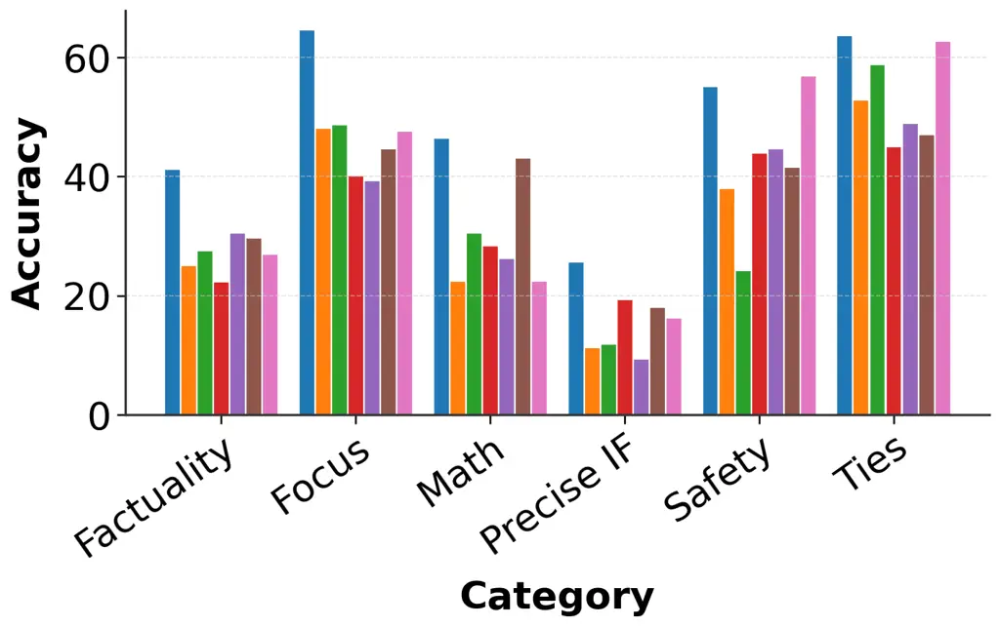

(a) Qwen2.5-3b-Instruct

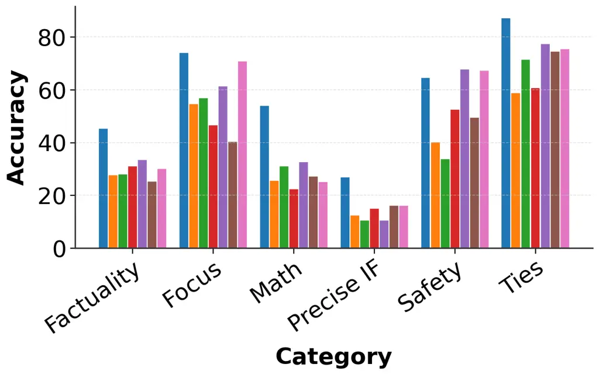

(b) Qwen2.5-7b-Instruct

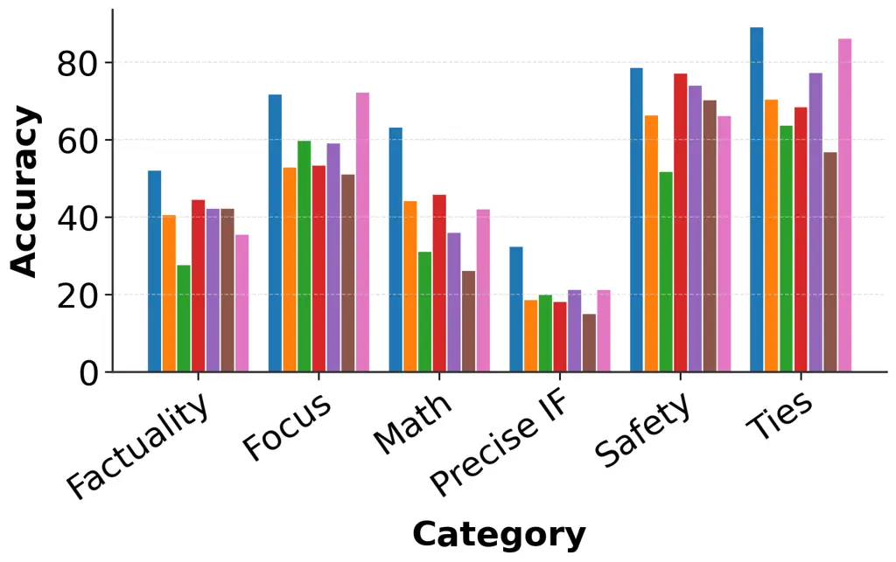

(c) Qwen2.5-32b-Instruct

    

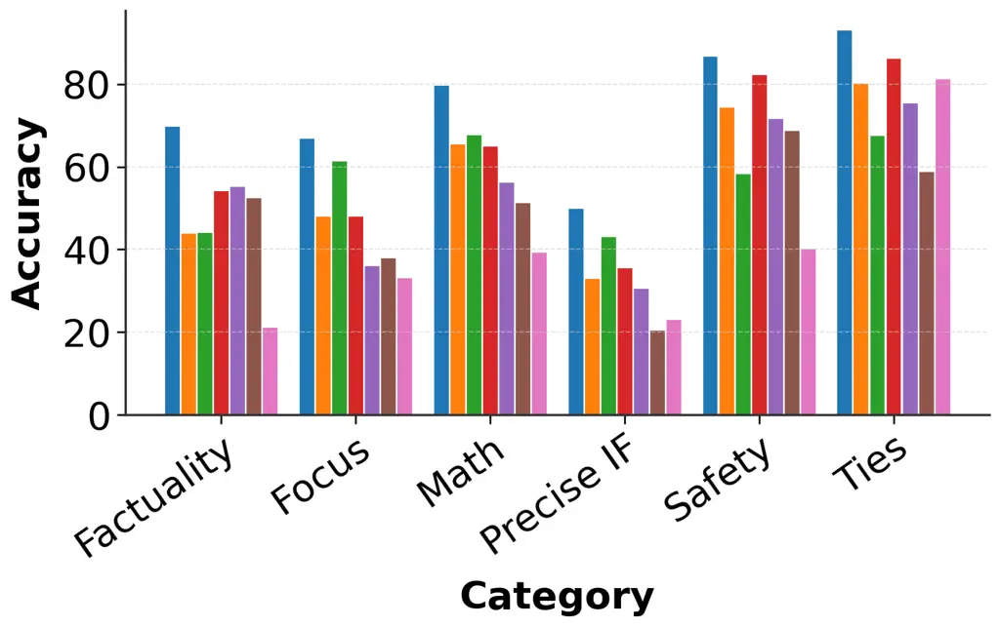

(d) GPT-OSS20b

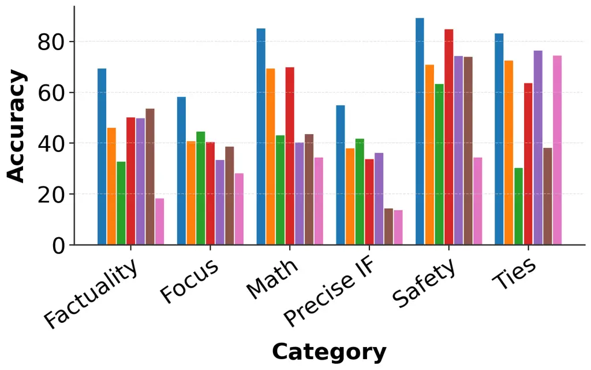

(e) GPT-OSS120b


(f)

Figure 5: Comparison of different methods on each domain from
RewardBench-2.

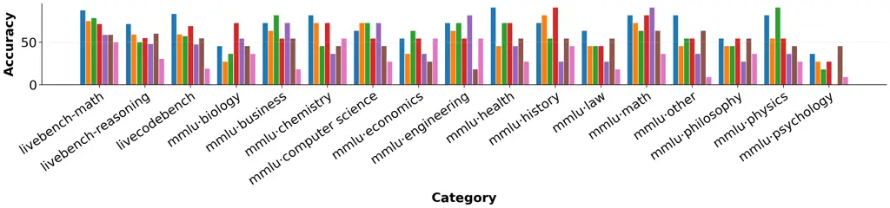

(a) GPT-OSS-20b

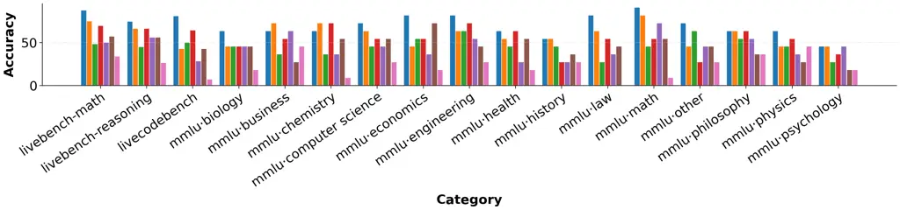

(b) GPT-OSS-120b

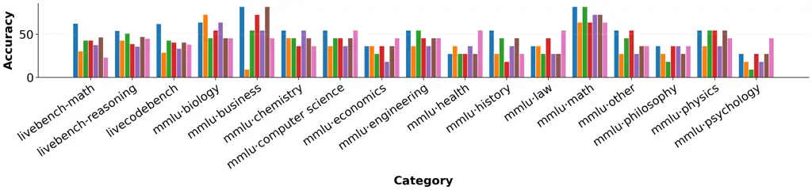

(c) Qwen2.5-3b-Instruct

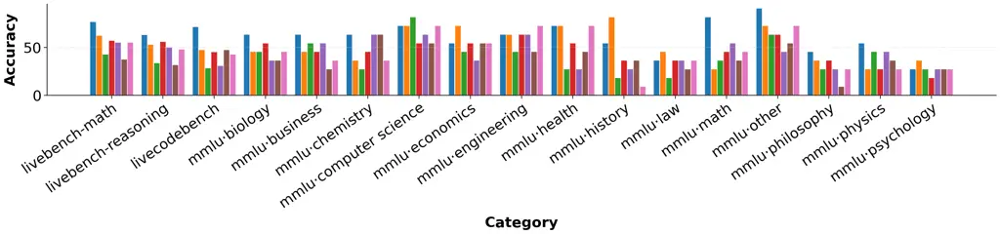

(d) Qwen2.5-32b-Instruct


(e)

Figure 6: comparison of different methods on each domain from
JudgeBench.

### C.2 Experimental Setup for Rubric-Hacking Experiments

Figure 1b reports our rubric-hacking experiments. The experimental
procedure is as follows. We first sample $`400`$ query prompts and use
Qwen2.5-3B-Instruct to generate both single-voiced and multi-voiced
rubrics for each query. Given each generated rubric, we then prompt
GPT-4o to produce an adversarial answer that attempts to satisfy the
rubric while remaining low-quality along evaluative dimensions not
covered by the rubric. The prompt template used for this adversarial
answer generation is shown in Figure 7. Finally, GPT-4o is asked to
evaluate the generated answers on a $`0`$–$`10`$ scale using the prompt
template in Figure 8.

The motivation behind this experiment is that a more comprehensive
rubric should be harder to hack. If a rubric covers a broader set of
evaluative dimensions, it becomes more difficult for an adversary to
generate an answer that both satisfies the rubric and remains
low-quality by exploiting dimensional blind spots. Conversely, if such a
low-quality yet rubric-passing answer can be easily generated, this
suggests that the rubric fails to capture important aspects of answer
quality. Therefore, the quality of these adversarial rubric-passing
answers serves as an indirect measure of rubric comprehensiveness and
robustness: higher evaluated answer quality indicates that the rubric
leaves fewer exploitable blind spots, whereas lower quality indicates
greater vulnerability to rubric hacking.

### C.3 Ablation on LLM-Based Rubric Consolidation

In this subsection, we empirically examine whether an additional
LLM-based consolidation step benefits MRRG. Specifically, after
generating rubrics with the multi-role process, we prompt an LLM to
consolidate them by merging semantically overlapping criteria and
removing mutually conflicting ones using prompt in Figure 14. This
ablation allows us to assess whether semantic rubric refinement improves
upon our default exact-match deduplication strategy.

| Model                | RewardBench-2 |      | JudgeBench |      |
| -------------------- | ------------- | ---- | ---------- | ---- |
|                      | MRRGC         | MRRG | MRRGC      | MRRG |
| Qwen2.5 Series       |               |      |            |      |
| Qwen2.5-3B-Instruct  | 46.2          | 51.2 | 47.1       | 55.1 |
| Qwen2.5-7B-Instruct  | 52.7          | 59.2 | 43.7       | 56.9 |
| Qwen2.5-32B-Instruct | 59.2          | 65.3 | 57.1       | 65.1 |

Table 6: Ablation on LLM-based rubric consolidation. MRRGC denotes MRRG
with LLM-based consolidation. For each model–benchmark pair, the better
result is marked in bold.

| Reward source                     | grounding | instruction following | multilingual | planning | reasoning | refinement | safety | theory of mind | tool usage | average |
| --------------------------------- | --------- | --------------------- | ------------ | -------- | --------- | ---------- | ------ | -------------- | ---------- | ------- |
| Base policy (Qwen2.5-3B-Instruct) | 72.5      | 67.5                  | 32.9         | 52.1     | 68.2      | 54.6       | 61.7   | 62.2           | 30.7       | 57.8    |
| SVRG w/o SR                       | 73.0      | 69.8                  | 35.0         | 58.6     | 70.0      | 57.9       | 56.7   | 64.8           | 38.6       | 60.0    |
| SVRG w/ SR                        | 73.3      | 72.0                  | 32.1         | 60.0     | 72.3      | 63.2       | 61.1   | 67.8           | 40.4       | 62.0    |
| Chasing the Tail                  | 73.3      | 71.3                  | 34.3         | 59.3     | 72.5      | 60.2       | 55.7   | 66.8           | 40.7       | 61.1    |
| MRRG                              | 74.0      | 70.2                  | 38.9         | 57.9     | 74.3      | 66.1       | 66.7   | 68.2           | 42.1       | 63.7    |

Table 7: Detailed post-RL policy performance on BiGGen Bench under
different reward sources. Best annotation-free reward per column in
bold.

| Reward source                     | accuracy | communication quality | completeness | context awareness | instruction following | average |
| --------------------------------- | -------- | --------------------- | ------------ | ----------------- | --------------------- | ------- |
| Base policy (Qwen2.5-3B-Instruct) | 21.5     | 40.6                  | 14.9         | 16.9              | 34.0                  | 25.6    |
| SVRG w/o SR                       | 22.9     | 40.0                  | 17.1         | 18.9              | 30.9                  | 26.0    |
| SVRG w/ SR                        | 25.8     | 43.0                  | 19.5         | 19.5              | 35.5                  | 28.7    |
| Chasing the Tail                  | 21.9     | 48.7                  | 15.3         | 13.1              | 35.9                  | 27.0    |
| MRRG                              | 24.3     | 55.1                  | 18.7         | 20.5              | 42.0                  | 32.1    |

Table 8: Detailed post-RL policy performance on HealthBench-Hard under
different reward sources. Best annotation-free reward per column in
bold.

As shown in Table 6, LLM-based consolidation does not improve MRRG.
Instead, MRRG consistently outperforms MRRGC across all backbone models
and both benchmarks. On RewardBench-2, MRRG exceeds MRRGC by $`5.0`$ to
$`15.0`$ points, while on JudgeBench the gains range from $`8.0`$ to
$`14.6`$ points. The degradation is particularly pronounced for the
GPT-OSS models, where consolidation leads to more than $`12`$-point
drops on both benchmarks.

These results suggest that semantic consolidation is not a free
improvement for rubric generation. Although consolidation can reduce
surface-level redundancy, it may also remove useful role-specific
criteria or suppress legitimate differences between evaluative
perspectives. Moreover, the LLM used for consolidation must itself
decide which criteria are redundant or conflicting, introducing an
additional source of subjective bias. We therefore adopt exact-match
deduplication as the default aggregation strategy, as it preserves
complementary multi-role criteria while remaining deterministic and
reproducible.

### C.4 Detailed experimental results on BigGen Bench and Health-Bench-Hard

In this subsection, we provide detailed post-RL policy performance on
BiGGen Bench and HealthBench-Hard under different reward sources in
Table 7 and 8 respectively.

### C.5 More case studies

Table 9 illustrates a case where the single-voiced rubric fails to
separate a well-grounded answer from a superficially plausible one. The
query “What is huli?” is inherently ambiguous, since the term may refer
to a Hawaiian verb, the food-related expression “huli huli”, or other
language-specific meanings. The rejected answer appears fluent and
informative, but it adds weakly supported associations such as mischief,
idiomatic usage, and unrelated food references. Because the
single-voiced rubric mainly checks whether the response defines the
term, provides context, and includes examples, it assigns the rejected
answer the same score as the chosen answer. By contrast, the
multi-voiced rubric includes more discriminative criteria concerning
ambiguity resolution, calibrated uncertainty, precise wording, and
avoidance of unsupported or tangential details. These criteria allow
MRRG to prefer the chosen answer, which presents the main plausible
meanings, explains the relevant usage of “huli huli”, and appropriately
asks for additional context. This example demonstrates that MRRG better
captures factual reliability under ambiguity, where the key challenge is
not producing more information, but selecting information that is
grounded, relevant, and properly scoped.

## Appendix D Prompt template for rubric generation and evaluation

In this section, we provide all the prompting template in our
experiments in the following figures:

- •
  Rubric passing answer generation prompt template used in
  rubric-hacking experiments are shown in Figure 7.
- •
  Answer evaluation prompt template used in rubric-hacking experiments
  are shown in Figure 8.
- •
  Rubric generation prompt template for
  $`\{\textsc{AI Researcher},\textsc{User},\ \textsc{Domain Expert},\\
  \ \textsc{Educator},\ \textsc{Linguist}\}`$ are shown in Figure 13, 9,
  10, 11 and 12 respectively.
- •
  Rubric consolidation prompt template used in LLM consolidation
  experiments is shown in Figure 14.
- •
  Rubric generation prompt template for single voiced methods are shown
  in Figure 15 and 16 respectively.
- •
  Criterion judging prompt is shown in Figure 17.

| Question: What is huli?                                                                                                                                                                                                                                                                                                                                                                                                                                                                                                                                                                                                                                                          |                                                                                                                                                                                                                                                                                                                                                                                                                                                                                                                                                                                                                                                                                                                                                                                                                                                                                                                                                                                            |
| -------------------------------------------------------------------------------------------------------------------------------------------------------------------------------------------------------------------------------------------------------------------------------------------------------------------------------------------------------------------------------------------------------------------------------------------------------------------------------------------------------------------------------------------------------------------------------------------------------------------------------------------------------------------------------- | ------------------------------------------------------------------------------------------------------------------------------------------------------------------------------------------------------------------------------------------------------------------------------------------------------------------------------------------------------------------------------------------------------------------------------------------------------------------------------------------------------------------------------------------------------------------------------------------------------------------------------------------------------------------------------------------------------------------------------------------------------------------------------------------------------------------------------------------------------------------------------------------------------------------------------------------------------------------------------------------ |
| Single-voiced rubric                                                                                                                                                                                                                                                                                                                                                                                                                                                                                                                                                                                                                                                             | Multi-voiced rubric                                                                                                                                                                                                                                                                                                                                                                                                                                                                                                                                                                                                                                                                                                                                                                                                                                                                                                                                                                        |
| • Does the response clearly define what “huli” refers to? \[W3\] • Does the response specify the context or domain in which “huli” is used, such as language, culture, or field? \[W3\] • Does the response provide accurate and verifiable information about “huli”? \[W3\] • Does the response address potential multiple meanings or interpretations of “huli” if applicable? \[W2\] • Does the response include examples or additional details to clarify the meaning of “huli”? \[W2\] • Does the response avoid including irrelevant or unrelated information? \[W2\] • Does the response use clear and concise language to explain “huli”? \[W1\]                         | • Does the response define “huli” in a way that aligns with the user’s likely intent or context? \[W3\] • Does the response specify the relevant context or domain, such as language, culture, or food? \[W3\] • Does the response acknowledge and address ambiguity or multiple possible meanings? \[W3\] • Does the response avoid unsupported, incorrect, or misleading information about “huli”? \[W3\] • Does the response use precise and unambiguous wording throughout? \[W3\] • Does the response provide sufficient context or examples to clarify the meaning? \[W2\] • Does the response indicate when further clarification from the user is needed? \[W2\] • Does the response avoid unnecessary or irrelevant information that distracts from the definition? \[W2\] • Does the response calibrate certainty appropriately when the term has multiple meanings? \[W2\] • Does the response clearly distinguish the key concept from secondary or tangential details? \[W1\] |
| Answer preferred by single-voiced rubric                                                                                                                                                                                                                                                                                                                                                                                                                                                                                                                                                                                                                                         | Answer preferred by multi-voiced rubric                                                                                                                                                                                                                                                                                                                                                                                                                                                                                                                                                                                                                                                                                                                                                                                                                                                                                                                                                    |
| “Huli” is a Hawaiian word that translates to “turning” or “to reverse.” In Hawaiian culture, “huli” can be associated with turning, rotating, or reversing. Here are a few contexts where “huli” might be used: • Physical movement, such as a hula dancer performing a “huli” movement. • Reversal, such as “the tide huli,” meaning the tide has turned. • Inverting or flipping something over. • A change in direction or state. • Playful mischief or trickery, similar to the English word “trick.” The word is commonly used in various Hawaiian phrases and idioms. If you mean a character name, brand, or a Hawaiian dish such as laulau, please provide more context. | “Huli” can have different meanings depending on the context. Here are a few possible interpretations: • Huli in Hawaiian: In Hawaiian, “huli” means “to turn” or “to change.” It is a common word used in Hawaiian language and culture. • Huli huli food: “Huli huli” refers to a Hawaiian-style barbecue method where meat, often chicken or pork, is marinated and grilled. The name literally means “turn, turn,” referring to the repeated turning of the meat while grilling. • Other meanings: In some other Pacific Island language contexts, “huli” may refer to meanings such as “behind” or “back.” Without more context, it is difficult to pinpoint a specific meaning. If you can share where you encountered the term, I can help clarify it further.                                                                                                                                                                                                                       |

Table 9: Case study comparing single-voiced and multi-voiced rubrics
with corresponding preferred answers. i in \[Wi\] indicates the weight
for each criterion.


Figure 7: Rubric passing answer generation prompt template.


Figure 8: Answer evaluation prompt template for GPT-4o.


Figure 9: Rubric Generation Prompt Template for User.


Figure 10: Rubric Generation Prompt Template for Domain Expert.


Figure 11: Rubric Generation Prompt Template for Educator.


Figure 12: Rubric Generation Prompt Template for Linguist.


Figure 13: Rubric Generation Prompt Template for AI Researcher.


Figure 14: Rubric Consolidation Prompt Template.


Figure 15: Single-Voiced Rubric Generation without Sampling Response
Prompt.


Figure 16: Single-Voiced Rubric Generation with Sampling Response
Prompt.


Figure 17: Answer Evaluation Prompt.
