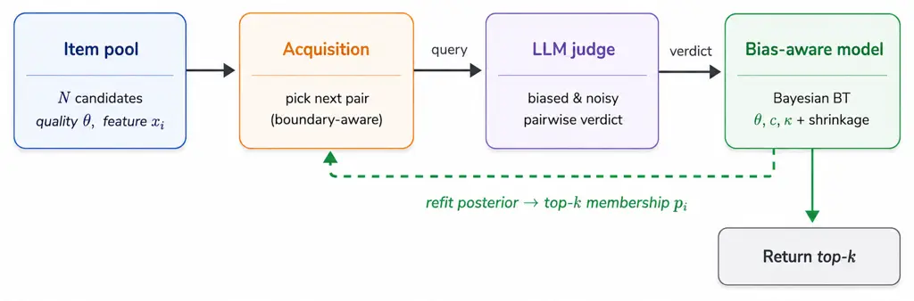

# When Can You Debias an LLM Judge? Identifiability Limits, a Test, and Designs for Top-$`k`$ Ranking

Jian Xu    Delu Zeng    John Paisley    Qibin Zhao

###### Abstract

Large language models (LLMs) are increasingly used as cheap, scalable
judges that compare candidate outputs pairwise. Because such judges
prefer verbose or well-formatted answers, the natural fix is to add bias
covariates to a Bradley–Terry model and estimate the bias away. We show
this cannot work as advertised: the quality/bias split is _not
identified_ by pairwise comparisons, and the failure is exact—across
$`48`$ real judge-pools the profile likelihood over the coefficient is
flat to $`\mathbf{0.0000}`$ nats, and scaling the comparisons
$`26\times`$ buys none. A “debiased” score is selected by the prior, not
recovered from data. Our contribution is accordingly not a better
estimator but a characterization of _when prior-based correction is
justified_, plus designs that supply the missing information when it is
not. The assumption the prior encodes—quality is a priori uncorrelated
with the covariate—pays only while $`\mathrm{corr}(\theta,x)`$ stays
below a crossing point (configuration-dependent, $`0.22`$–$`0.60`$),
which is what makes the same model help on LLMBar and hurt on SummEval
and Nectar. We give two escapes: a trusted-anchor gate that decides per
(judge, covariate, task) (no false enables in $`6{,}000`$ decisions at
$`K\geq 10`$ anchors, a rate our sample bounds at $`\leq 6\%`$), and a
paired rendering design—the only design-based intervention _we study_
that restores likelihood identification, turning $`0.0000`$ nats into
$`172.7`$ and making a prior-free estimate exist. A secondary
top-$`k`$-aware acquisition heuristic beats budget-agnostic and
D-optimal allocation under both a frozen and a stochastic judge, but its
edge over Thompson/LUCB is specific to the frozen protocol. Across
fifteen real LLM judges bias is heterogeneous and capability-dependent:
correction improves top-$`k`$ recall by $`0.20`$–$`0.32`$ on five
biased-but-competent cheap judges and is a no-op on frontier ones
(Spearman $`\rho{=}{-}0.84`$ between competence and gain over the $`14`$
competent judges, $`p{<}10^{-3}`$), concentrating the benefit where
at-scale evaluation happens.

¹RIKEN iTHEMS ²RIKEN AIP ³South China University of Technology ⁴Columbia
University

jian.xu@riken.jp

## 1 Introduction

Pairwise comparison by an LLM “judge” has become a default tool for
evaluating and selecting natural-language outputs: ranking chatbot
responses, scoring model variants, filtering generated candidates, and
triaging documents. The appeal is cost—an LLM judge is orders of
magnitude cheaper than a human annotator—but the cost comes with two
well-documented liabilities. LLM judges are _noisy_, returning
inconsistent verdicts across paraphrases and runs, and they are
_systematically biased_, preferring longer, more elaborate, or
better-formatted answers and favoring whichever candidate appears in a
particular position (Zheng et al. 2023; Wang et al. 2024; Zeng et al.
2024; Dubois et al. 2024). The consequence is subtle but damaging: if we
simply count wins, the resulting ranking reflects
_presentation_—verbosity and formatting—as much as it reflects quality.

In most applications we do not need the full ranking; we need the
top-$`k`$ items: the best few responses to keep, the strongest models to
promote, the papers worth a human read. This reframing has two
implications that prior work on LLM judging has not jointly addressed.
First, recovering the correct top-$`k`$ under a biased judge is a
_statistical estimation_ problem—and, as we show, one the comparison
data alone cannot solve: quality and the judge’s presentation preference
are perfectly confounded, so any separation rests on an assumption we
must state and test. Second, comparisons cost money, so _which_ pairs we
query matters: effort spent distinguishing items far from the top-$`k`$
boundary is wasted.

We address both (Fig. 1). We model judging as a Bayesian Bradley–Terry
process over latent item quality, augmented with _bias
covariates_—observable item features such as elaboration, together with
a position term—whose coefficients are fit jointly with quality. This is
the model a practitioner would naturally reach for, and our first
finding is about its limits rather than its performance: the shrinkage
prior on the covariate coefficient does not merely regularize, it
_selects_ the quality/bias split, because the comparisons themselves
carry exactly zero information about that split. Reporting its output as
“debiased quality” is thus a category error—the number is a restatement
of the prior’s assumption, and it is right precisely when that
assumption is. What can be done honestly is to make the assumption
explicit, map the regime where it pays, assess its operational validity
per (judge, covariate, task) with a few trusted labels, and—where the
evaluator controls how items are rendered—design the comparison set so
the split becomes estimable at all. That is the arc of this paper. On
top of the resulting posterior we additionally define a top-$`k`$-aware
acquisition function that selects the next comparison to most reduce
uncertainty about top-$`k`$ _membership_. We treat this as a secondary,
applied contribution rather than a headline: it is a heuristic, its
advantage over budget-agnostic allocation is solid but its advantage
over standard information-theoretic and bandit rules is not, and we
report the regimes where it vanishes as carefully as the ones where it
holds.

Our position is therefore not that we estimate and remove judge bias,
but that _we characterize when prior-based correction is justified, and
supply identifiable or supervised designs when it is not_. Concretely:

- •
  An exact non-identifiability result: the item-level covariate
  coefficient is not identified by comparisons (only apparent quality
  $`\theta{+}cx`$ and the position term are), and this is not a
  small-sample artifact—on all $`48`$ real judge-pools the profile
  likelihood over $`c`$ is flat to $`0.0000`$ nats, unchanged as
  comparisons scale $`26\times`$. “Debiasing” is thus an assumption the
  prior encodes, not a quantity the data reveal.
- •
  A characterization of when the assumption pays: the benefit falls
  monotonically with $`\mathrm{corr}(\theta,x)`$ and reverses at a
  configuration-dependent crossing ($`0.22`$–$`0.60`$), predicting the
  split between benchmarks where correction helps and hurts.
- •
  Two designs that escape the assumption: a trusted-anchor gate that
  tests it per (judge, covariate, task) with a few labels, and a paired
  rendering design that restores identifiability by construction—the
  only design-based intervention we study that restores likelihood
  identification.
- •
  A secondary, applied top-$`k`$-aware acquisition heuristic: it beats
  budget-agnostic and D-optimal allocation, though its edge over
  Thompson/LUCB is specific to a frozen judge.
- •
  Evidence on fifteen real LLM judges: verbosity bias is prevalent but
  _capability-dependent_—strong on cheap judges, absent on frontier
  ones—so it must be tested per judge, not assumed.



Figure 1: Overview. A budget-limited active loop: the top-$`k`$-aware
rule picks the next pair for a biased, noisy LLM judge; the verdict
updates a bias-aware Bayesian Bradley–Terry posterior over quality
$`\theta`$ and bias $`(c,\kappa)`$; the refreshed top-$`k`$-membership
probabilities $`p_{i}`$ drive the next pick. The $`\theta`$/$`c`$ split
is an _assumption_ the prior selects (Prop. 2).

## 2 Related Work

#### LLM-as-a-judge and its biases.

LLM judges are now standard for open-ended evaluation (Zheng et al.
2023; Li et al. 2024), with well-documented position/order (Wang et al.
2024), verbosity/length (Dubois et al. 2024; Saito et al. 2023) and
self-preference biases; LLMBar (Zeng et al. 2024) shows judges are
fooled by superficially appealing but worse answers. Mitigations are
largely heuristic (order-swapping, calibration prompts, majority vote).
Placing bias inside a generative model and estimating it is the natural
next step and is the model we study—but our contribution is to show it
cannot identify the item-level coefficient, so the “correction” is the
prior’s assumption, not a measured property of the judge (the position
term excepted, identified by within-pair order variation).

#### Bayesian methods around LLMs.

A growing line treats LLM components probabilistically (Tonolini et al.
2024; Ross et al. 2025; Huang and others 2026). Closest is BAL-PM (Melo
et al. 2024), Bayesian active learning that selects informative
preference pairs for reward-model training; our target is top-$`k`$
_identification_ under a _biased_ judge, with the bias modeled
explicitly, rather than reward-model data efficiency.

#### Identification in measurement models.

The impossibility behind Prop. 2 is not new, and we say so plainly:
granting each item a free effect makes an item-level covariate collinear
with the item block, a close relative of the
fixed-effects/incidental-parameter problem (Neyman and Scott 1948;
Lancaster 2000), and the standard remedy—conditioning on or designing
for within-unit variation (Chamberlain 1980; Andersen 1970)—is exactly
what our paired rendering design does. Related ideas recur in
psychometrics (Linacre 1989; Holland and Wainer 2012; Meredith 1993). We
claim no theorem that would surprise a psychometrician; our contribution
is that this known impossibility silently governs LLM-judge debiasing,
which is performed and reported as if the coefficient were estimated.
The supplementary material expands the correspondence.

#### Ranking from comparisons and active selection.

Recovering quality from pairwise outcomes is the Bradley–Terry/Thurstone
problem (Bradley and Terry 1952). Active and budgeted variants—dueling
bandits, active ranking, and top-$`k`$ identification—choose comparisons
adaptively (Szörényi et al. 2015; Heckel et al. 2019). Our acquisition
rule is a top-$`k`$-aware, bias-aware instance of Bayesian experimental
design (Houlsby et al. 2011): it uses the posterior over _membership_ in
the top-$`k`$ set, and it is computed under a judge model that contains
nuisance bias parameters.

## 3 Problem Setup and Model

#### Setup.

We have $`N`$ items with unknown scalar quality
$`\theta\in\mathbb{R}^{N}`$. A query presents an ordered pair $`(a,b)`$
to an LLM judge, which returns $`y=1`$ if it prefers the _first-shown_
item $`a`$ and $`y=0`$ otherwise. Each item $`i`$ carries observable
covariates $`x_{i}\in\mathbb{R}^{d}`$ that may bias the judge.
Throughout the controlled benchmark $`x_{i}`$ is a _single binary
elaboration indicator_, $`x_{i}\in\{0,1\}`$, recording whether item
$`i`$ was rendered tersely or with elaboration clauses; we use the
binary indicator rather than raw length because our benchmark
manipulates elaboration directly and holds the statement count fixed, so
the indicator is the manipulated variable and length is its consequence.
(The external-data study of §5 instead uses standardized word count,
which is the only covariate available there; we say so explicitly at
each such use.) Given a budget of $`B`$ comparisons we want to return
the set of the $`k`$ highest-quality items,
$`S_{k}(\theta)=\arg\!top-`$k$`{}_{i}\theta_{i}`$.

#### Bias-aware Bradley–Terry model.

We model the judge’s verdict as

```math
\Pr(y=1\mid a,b)=\sigma\!\Big(\theta_{a}-\theta_{b}+\textstyle\sum_{m=1}^{d}c_{m}(x_{a,m}-x_{b,m})+\kappa\Big), \tag{1}
```

where $`\sigma`$ is the logistic function, $`c\in\mathbb{R}^{d}`$ are
_bias coefficients_ on the item covariates (e.g. a positive $`c`$ for
length encodes verbosity bias), and $`\kappa`$ is a _position_ term
capturing a constant preference for the first-shown answer (its sign
gives the direction of position bias). Setting $`c=0,\kappa=0`$ recovers
the ordinary Bradley–Terry model used by naive win-counting; we call
that the _naive_ model and Eq. (1) the _bias-aware_ model.

#### Priors and adaptive shrinkage.

We place $`\theta\sim\mathcal{N}(0,\lambda^{-1}I)`$ and a shrinkage
prior on the bias coefficients,
$`c_{m},\kappa\sim\mathcal{N}(0,\tau^{2})`$ with a finite, moderate
$`\tau`$ (our $`\lambda_{b}{=}\tau^{-2}{=}0.1`$ is
$`\tau\!\approx\!3.2`$, not a tight prior). It is tempting to describe
this as letting the data decide which biases are active, and that
description is wrong: by Prop. 2 the comparisons determine only the
apparent quality $`\phi=\theta+cx`$ and the position term $`\kappa`$,
never the item-level split between $`\theta`$ and $`c`$. What the data
can decide is $`\kappa`$—a genuine per-comparison effect, identified
because presentation order varies _within_ an item pair—and the overall
fit. What the prior decides is the decomposition of $`\phi`$, via
Eq. (3). A smaller $`\tau`$ does not detect that a judge is unbiased; it
_assumes_ more strongly that the covariate-aligned part of apparent
quality is real quality, and the estimate follows.

Two consequences we state plainly rather than paper over. First, when a
judge is truly unbiased the shrinkage prior does keep the model close to
ordinary Bradley–Terry, but “close” is not “free”: on our unbiased
synthetic judge the bias-aware model reaches $`0.79`$ top-$`k`$ recall
against naive’s $`0.86`$—a $`7`$-point drop from estimating a
coefficient that should be zero, which is a real cost, not a rounding
error. Second, a hierarchical or empirical-Bayes $`\tau`$ does _not_
rescue identifiability: tuning $`\tau`$ on the marginal likelihood
selects adaptively among prior-induced decompositions, and every one of
them is a different assumption about $`\theta\perp x`$, not a
measurement of the judge. Nothing in the hyperprior can recover a
direction the likelihood is flat along. A horseshoe prior is a drop-in
alternative with the same caveat. We use a fixed moderate $`\tau`$ in
the main results and report a sensitivity sweep in the appendix.

## 4 Analysis

We give three results that explain the empirical findings: naive
aggregation is _inconsistent_ for top-$`k`$ recovery under a biased
judge; the quality/bias split in the bias-aware model is
_non-identifiable_, so the prior rather than the data selects it, and a
paired rendering design restores identifiability; and the acquisition
score (S2) is a boundary-targeted surrogate rather than an exact
information rule. The first and third are unsurprising instantiations of
omitted-variable bias and a delta-method-style heuristic. The second is
the paper’s centre of gravity: it is what makes the natural fix
inadmissible as stated, and everything downstream—the gate, the paired
design, the $`\mathrm{corr}(\theta,x)`$ characterization—exists to
answer it. Proof sketches are given here; details are in the appendix.

#### Naive aggregation recovers the wrong top-$`k`$.

We state the cleanest result in the linear (Thurstone) comparison model,
where the judge prefers $`a`$ iff
$`\theta_{a}-\theta_{b}+c^{\star}(x_{a}-x_{b})+\varepsilon>0`$ with
symmetric noise $`\varepsilon`$ and randomized order; the logistic case
behaves analogously.

###### Assumption 1.

The bias covariate is non-degenerate and uncorrelated with quality
across items, $`\tfrac{1}{N}\sum_{i}x_{i}\theta_{i}\to 0`$, and
$`c^{\star}\neq 0`$.

###### Proposition 1 (Confounded estimand).

Let $`\tilde{\theta}`$ be the population minimizer of the naive
objective (Eq. (4) with $`c=\kappa=0`$). Then
$`\tilde{\theta}_{i}=\theta_{i}+c^{\star}x_{i}`$ up to an additive
constant. Consequently, for any items $`i,j`$ with
$`\theta_{i}>\theta_{j}`$ but
$`\theta_{i}-\theta_{j}<c^{\star}(x_{j}-x_{i})`$, the naive ranking
places $`j`$ above $`i`$; whenever such a pair straddles the top-$`k`$
boundary, $`S_{k}(\tilde{\theta})\neq S_{k}(\theta)`$, and no amount of
additional comparisons removes the error.

_Sketch._ Omitting $`x`$ from a correctly specified linear comparison
model is an omitted-variable problem: because each item appears with its
own indicator, the naive fit assigns to item $`i`$ the quantity that
best explains its win rate, namely $`\theta_{i}+c^{\star}x_{i}`$. Under
Assumption 1 the $`c^{\star}x_{i}`$ term does not average out at the
item level, so it shifts the per-item estimand and reorders items whose
quality gap is smaller than their verbosity gap. The shift is a property
of the estimand, not of finite samples, giving the budget-independent
plateau in Table 1. $`\square`$

#### The quality/bias split is _not_ identified by comparisons alone.

###### Proposition 2 (Non-identifiability of the item-level bias coefficient).

With a free quality parameter $`\theta_{i}`$ per item and a fixed
item-level covariate $`x_{i}`$, the likelihood of Eq. (1) is invariant
under

```math
\theta_{i}^{\prime}=\theta_{i}+\delta x_{i},\qquad c^{\prime}=c-\delta,\qquad\forall\delta\in\mathbb{R}. \tag{2}
```

Hence no set of comparisons—within-$`x`$, cross-$`x`$, in any
number—identifies $`c`$ or $`\theta`$ separately; only the _apparent
quality_ $`\phi_{i}=\theta_{i}+c\,x_{i}`$ (up to an additive constant)
and the position term $`\kappa`$ are identified.

_Proof._ Substituting (2) into the logit gives
$`(\theta_{a}{+}\delta x_{a})-(\theta_{b}{+}\delta x_{b})+(c{-}\delta)(x_{a}{-}x_{b})+\kappa=\theta_{a}-\theta_{b}+c(x_{a}-x_{b})+\kappa`$,
so every comparison probability is unchanged. Equivalently, the design
column for $`c`$, whose entries are $`x_{a}-x_{b}`$, equals
$`\sum_{i}x_{i}\,(\text{item-indicator column }i)`$ and therefore lies
in the span of the $`\theta`$ columns. Numerically, the design matrix
for our $`N{=}30`$ pools has rank $`30`$ rather than $`32`$: two null
directions, the usual Bradley–Terry constant and exactly (2). $`\kappa`$
_is_ identified, because order randomization makes its column
independent of the item block. $`\square`$

#### What the prior does—and the assumption it encodes.

The Gaussian priors make the MAP unique, but they _choose_ a point on
the unidentified ray (2) rather than letting the data locate it. The
likelihood is flat along two directions—(2) and the Bradley–Terry
constant $`\theta\mapsto\theta+\alpha\mathbf{1}`$—so a candidate
reconstruction is $`\theta=\phi-c\,x+\alpha\mathbf{1}`$, and the prior
selects _both_ free parameters. Profiling $`\alpha`$ out of
$`\tfrac{\lambda}{2}\|\phi-c\,x+\alpha\mathbf{1}\|^{2}+\tfrac{1}{2\tau^{2}}c^{2}`$
gives $`\alpha^{\star}=c\bar{x}-\bar{\phi}`$, hence
$`\theta=(\phi-\bar{\phi}\mathbf{1})-c\,(x-\bar{x}\mathbf{1})`$ and

```math
\hat{c}_{\mathrm{MAP}}=\frac{\lambda\,\langle\phi-\bar{\phi}\mathbf{1},\;x-\bar{x}\mathbf{1}\rangle}{\lambda\|x-\bar{x}\mathbf{1}\|^{2}+\tau^{-2}}\;=\;\frac{\lambda N\,\widehat{\mathrm{Cov}}(\phi,x)}{\lambda N\,\widehat{\mathrm{Var}}(x)+\tau^{-2}}, \tag{3}
```

where the centering is not cosmetic: $`x`$ is a binary elaboration
indicator with mean $`\approx\!\tfrac{1}{2}`$, and using the uncentered
inner products misstates $`\hat{c}_{\mathrm{MAP}}`$ by up to a factor of
five in our pools. The right reading is the second form: the prior
attributes to bias precisely the part of apparent quality that
_co-varies_ with the covariate, shrunk by $`\tau`$. Our estimator is
therefore not “separating quality from presentation using the data”; it
is applying the assumption that true quality is a priori uncorrelated
with the presentation covariate, and reading off the corresponding
decomposition. This assumption is not directly observable without
trusted labels; our gate instead tests its operational
consequence—whether the induced correction improves agreement on a small
anchor set. When it holds the estimate is right, and when it fails the
correction removes real signal. The empirical sweep in Fig. 3 confirms
this: the benefit of the correction decreases monotonically with
$`\mathrm{corr}(\theta,x)`$ and changes sign at a point that, in our
simulation setting, sits near $`0.45`$—which is why the method helps on
LLMBar’s adversarial pairs and hurts on SummEval and Nectar. Eq. (3)
also explains _why_ that quantity is the governing one:
$`\hat{c}_{\mathrm{MAP}}`$ tracks $`\widehat{\mathrm{Cov}}(\phi,x)`$, so
the correction subtracts real quality exactly to the extent that quality
and covariate co-vary. Restoring genuine identifiability requires extra
structure—e.g. rendering the same content at two verbosity levels so a
shared $`\theta_{i}`$ appears with two different $`x`$ values, which
breaks (2); we verify this design below.

## 5 Experiments

#### Controlled benchmark.

To measure top-$`k`$ recovery we need known ground truth, so we
construct items whose true quality is controlled. Each item is an answer
to a fixed factual question, assembled from a bank of _true_ and _false_
statements; with a fixed statement count per item, quality
$`\theta_{i}`$ is the number of correct minus incorrect statements.
Independently of quality we assign a _verbosity_ level—terse statements
vs. the same statements with an added authoritative-sounding
(content-free) elaboration clause—so that length is decoupled from
quality by construction
($`\mathrm{corr}(\theta,\text{verbosity})\approx 0`$). We use
$`N{=}30`$, $`k{=}5`$, and each pool is built to contain _exactly_
$`k{=}5`$ fully-correct items ($`\theta{=}6`$, all statements true),
separated by a one-point gap from the rest
($`\theta_{(5)}{=}6>\theta_{(6)}`$ in every pool), so the true top-$`k`$
set is unique and free of boundary ties. top-$`k`$ recall is the
fraction of the $`5`$ returned items that lie in this set; equivalently
our tie-robust estimator counts item $`i`$ when $`\hat{\theta}_{i}`$
ranks it in the top $`5`$ and its _true_ $`\theta_{i}\geq\theta_{(5)}`$,
which here coincides with membership in the fully-correct set.

#### Judges.

We collect the full matrix of ordered pairwise verdicts from fifteen
real LLM judges spanning open and proprietary families and a wide
capability range: open-weight Llama-3.1-8B, Qwen-2.5-Coder-7B, Phi-4 and
DeepSeek-Coder-6.7B (served locally); and API judges GPT-4o-mini/5.1,
Gemini-2.5-flash-lite/pro, DeepSeek-chat/V4-flash/V4-pro, and Claude
Haiku-4.5/Sonnet-4.6/Opus-4.8. Collecting the full oracle once lets us
evaluate every acquisition strategy offline against the same judge, with
seeds controlling the strategy’s randomization. Both presentation orders
are collected for every unordered pair ($`N(N{-}1)`$ ordered queries);
acquisition methods then select among the resulting ordered queries, so
the rule—not a coin flip—decides which item is shown first.

#### Do real judges exhibit the modeled biases?

Before the ranking task we probe each bias in isolation with
equal-quality pairs. The verdict is unambiguous: GPT-4o-mini prefers the
elaborated answer in $`100\%`$ of length-contrasted pairs of equal
content, and a markdown-formatted answer in $`100\%`$ of
format-contrasted pairs, while showing a strong second-position
preference. Plain length _padding_ with obvious filler, by contrast, is
penalized—verbosity bias is about apparent substance, not raw length,
which is why our covariate is an elaboration indicator.

|                                                                                                                                            |       |                         |                             |              |                   |                |
| ------------------------------------------------------------------------------------------------------------------------------------------ | ----- | ----------------------- | --------------------------- | ------------ | ----------------- | -------------- |
| Judge                                                                                                                                      | $`n`$ | $`\hat{c}`$ (verbosity) | $`\hat{\kappa}`$ (position) | naive recall | bias-aware recall | $`\Delta`$     |
| _Biased but competent judges — bias-aware modeling recovers the top-$`k`$_                                                                 |       |                         |                             |              |                   |                |
| Llama-3.1-8B                                                                                                                               | 10    | $`+1.78`$               | $`+0.35`$                   | $`0.50`$     | $`\mathbf{0.82}`$ | $`+0.32`$      |
| Qwen-2.5-Coder-7B                                                                                                                          | 10    | $`+1.45`$               | $`+1.08`$                   | $`0.64`$     | $`\mathbf{0.86}`$ | $`+0.22`$      |
| Gemini-2.5-flash-lite                                                                                                                      | 3     | $`+1.32`$               | $`-1.30`$                   | $`0.60`$     | $`\mathbf{0.87}`$ | $`+0.27`$      |
| DeepSeek-chat                                                                                                                              | 5     | $`+1.00`$               | $`-2.40`$                   | $`0.80`$     | $`\mathbf{1.00}`$ | $`+0.20`$      |
| GPT-4o-mini                                                                                                                                | 5     | $`+0.98`$               | $`-0.84`$                   | $`0.56`$     | $`\mathbf{0.76}`$ | $`+0.20`$      |
| _Frontier / near-neutral judges — naive already accurate; correction has small effects (mostly negligible, occasionally a small downside)_ |       |                         |                             |              |                   |                |
| DeepSeek-V4-flash                                                                                                                          | 3     | $`+0.63`$               | $`-0.08`$                   | $`1.00`$     | $`1.00`$          | $`\;\;\,0.00`$ |
| Claude-Sonnet-4.6                                                                                                                          | 3     | $`+0.46`$               | $`+1.42`$                   | $`1.00`$     | $`1.00`$          | $`\;\;\,0.00`$ |
| DeepSeek-V4-pro                                                                                                                            | 2     | $`+0.44`$               | $`+0.01`$                   | $`1.00`$     | $`1.00`$          | $`\;\;\,0.00`$ |
| GPT-4.1                                                                                                                                    | 3     | $`+0.38`$               | $`+1.18`$                   | $`1.00`$     | $`1.00`$          | $`\;\;\,0.00`$ |
| Phi-4                                                                                                                                      | 10    | $`+0.34`$               | $`+0.32`$                   | $`0.86`$     | $`\mathbf{0.92}`$ | $`+0.06`$      |
| Gemini-2.5-pro                                                                                                                             | 1     | $`+0.22`$               | $`-0.31`$                   | $`1.00`$     | $`1.00`$          | $`\;\;\,0.00`$ |
| GPT-5.1                                                                                                                                    | 3     | $`+0.14`$               | $`+0.95`$                   | $`1.00`$     | $`1.00`$          | $`\;\;\,0.00`$ |
| Claude-Opus-4.8                                                                                                                            | 1     | $`+0.05`$               | $`+1.36`$                   | $`1.00`$     | $`1.00`$          | $`\;\;\,0.00`$ |
| Claude-Haiku-4.5                                                                                                                           | 3     | $`-0.50`$               | $`+0.05`$                   | $`0.93`$     | $`0.87`$          | $`-0.07`$      |
| _Judge too weak to be useful — little quality signal to recover_                                                                           |       |                         |                             |              |                   |                |
| DeepSeek-Coder-6.7B                                                                                                                        | 5     | $`-0.98`$               | $`+1.74`$                   | $`0.12`$     | $`0.08`$          | $`-0.04`$      |

Table 1: Fifteen LLM judges, full-data fits with the binary elaboration
covariate ($`\lambda_{b}{=}0.1`$), sorted by the length-bias coefficient
$`\hat{c}`$; $`\Delta`$ is the bias-aware model’s top-$`k`$ recall gain
over naive. _Reading $`\hat{c}`$:_ since the $`\theta`$/$`c`$ split is
prior-selected (Prop. 2), $`\hat{c}`$ is not a likelihood-identified
constant but the covariate-aligned component of apparent quality
(Eq. (3)), comparable across rows only because all share the same pools,
prior and covariate.

#### Q1: bias modeling recovers the correct top-$`k`$ (correctness).

Table 1 gives the central result. The biased judges (Llama, Qwen,
Gemini, DeepSeek, GPT-4o-mini) have positive verbosity coefficients and
naive estimates that correlate with verbosity ($`+0.22`$ to $`+0.49`$):
naive aggregation is partly ranking by presentation (Fig. 4, appendix).
There the naive model’s top-$`k`$ recall is stuck and—critically—does
_not improve with more comparisons_ (it converges to the wrong set),
while the bias-aware model, which attributes the covariate-aligned
component of apparent quality to bias (under the prior of Eq. (3)),
lifts recall by $`+0.20`$ to $`+0.32`$, reaching $`0.76`$–$`1.0`$, a gap
that persists at full data. The gain tracks the bias magnitude: it
shrinks to $`+0.06`$ for the nearly-neutral Phi-4, and correction
slightly _hurts_ the mildly brevity-preferring Claude-Haiku
($`0.93\!\to\!0.87`$, $`\hat{c}{=}{-}0.50`$), a small but honest
reminder that modeling a covariate is not free when the judge barely has
that bias. This is the intended pattern: the benefit holds because the
covariate is spurious in these pools; when it is not, correction
actively hurts (Fig. 3), which is what the gate is for.

#### Significance and baselines.

Table 4 (appendix) puts the correctness result on a statistical footing,
with the same care about the unit of analysis as the acquisition study.
The independent unit is the pool (one item draw), and—importantly—the
_same_ pools are reused across judges (seed $`s`$ gives identical
items), so pool-level differences are not independent across judges. We
therefore test each judge separately at the pool level with an exact
paired permutation test, Holm-corrected across the five judges. The gain
is significant on the two judges with $`10`$ pools (Llama $`+.32`$,
$`p{=}.010`$; Qwen $`+.22`$, $`p{=}.016`$) and _underpowered elsewhere_:
at $`n{=}3`$–$`5`$ pools an exact test cannot reach $`p{<}.05`$ at all,
so the $`+.20`$–$`.27`$ gains on Gemini-flash, GPT-4o-mini and
DeepSeek-chat are point estimates we do not call significant—even where
a bootstrap CI excludes zero, which at $`n{=}5`$ is anti-conservative.
For a single pooled statement we take the _judge_ as the cluster ($`5`$
judge-mean gains), giving $`+.24`$ with $`t`$-test $`p{=}.0005`$; this
is far more conservative than pooling all pool-differences as if
independent (which the shared-pool structure forbids) and is the number
we stand behind. On baselines: _order-swap majority vote_, the standard
position-debias, does not help ($`.61`$, vs. naive $`.61`$) because it
leaves verbosity uncorrected, while _post-hoc length residualization_
matches the bias-aware model at full data ($`.85`$ vs. $`.85`$). We
therefore claim no full-data accuracy advantage over a well-chosen
residualization heuristic; the joint model’s value is that it
(i) handles verbosity _and_ position in one estimator, (ii) supplies the
calibrated posterior the active rule needs, and (iii) admits a tunable
shrinkage that reduces, though does not eliminate, the downside on
unknown judges—none of which a post-hoc residual provides.

#### Q2: top-$`k`$-aware acquisition (secondary).

Given a usable posterior, our top-$`k`$-aware rule targets the
membership boundary rather than the full ranking. Tested at the pool
level (seeds within a pool share its frozen verdict matrix and are not
independent), it beats every baseline—Thompson and LUCB included—on the
two judges with enough pools to support a test (Holm $`p\leq.023`$), and
leads on the rest where $`3`$–$`5`$ pools cannot reach significance. Its
edge over Thompson/LUCB is specific to the frozen protocol (under a
stochastic judge it still beats round-robin and D-optimality but no
longer separates from the bandits). As a heuristic with narrow scope we
treat it as secondary and defer the budget curves, baselines,
stochastic-judge robustness, score ablation and $`2{\times}2`$ synergy
to the supplementary material.

#### External validity on LLMBar.

Our controlled benchmark isolates spurious verbosity by construction;
LLMBar (Zeng et al. 2024) tests the same phenomenon in the wild, with
human-annotated pairs whose _adversarial_ subsets are built so the worse
answer is superficially attractive. We judge all $`419`$ pairs with
GPT-4o-mini in both orders and ask whether modeling the presentation
features recovers the gold preference. Fig. 2 shows the judge is
genuinely length-biased on the adversarial subsets—it prefers the longer
answer far more often than gold does (e.g. Neighbor: prefers-longer
$`0.40`$ vs. gold-longer $`0.13`$)—whereas on the Natural subset length
is legitimate ($`0.55`$ vs. $`0.56`$). Correcting for length and format
(a cross-validated logistic model on the judge score plus length/format
differences, the pairwise analogue of our covariate model) improves
agreement with gold on exactly the biased subsets—Neighbor
$`0.58\!\to\!0.86`$, Manual $`0.63\!\to\!0.80`$—while leaving the
unbiased Natural subset unchanged ($`0.94\!\to\!0.93`$). This is direct
evidence that modeling the spurious feature recovers ground truth when
the feature is in fact spurious. We are explicit about what this does
_not_ show: the correction here is fitted using _supervision_ from gold
labels, so it validates the mechanism—the judge’s length preference is
spurious on these pairs and conditioning on length recovers the human
verdict—rather than the unsupervised top-$`k`$ pipeline. Given Prop. 2,
that separation is the honest reading: with gold labels the split is
identified by supervision; without them it is chosen by the prior.

Figure 2: External validity on LLMBar (judge: GPT-4o-mini, both orders).
On the adversarial subsets—where the judge prefers the longer answer far
more than gold does (e.g. Neighbor $`0.40`$ vs. $`0.13`$)—a
length/format correction recovers gold agreement (Neighbor
$`0.58\!\to\!0.86`$); the unbiased Natural subset is unchanged. This is
the positive counterpart to the SummEval limitation, where length
legitimately signals quality.

#### Restoring identifiability: a paired rendering design.

Prop. 2 says the flat direction exists because each item carries both
its own $`\theta_{i}`$ and a single fixed $`x_{i}`$. Rendering the
_same_ content at two verbosity levels removes it: a shared
$`\theta_{i}`$ then appears at two covariate values, so a within-content
comparison has the $`\theta`$ terms cancel and its logit reduces to
$`c\,(x_{\text{verbose}}-x_{\text{terse}})+\kappa`$—a direct read on
$`c`$. We built such pools ($`15`$ base contents $`\times`$
terse/verbose $`=30`$ items) and collected the full verdict matrix from
_four_ open judges $`\times`$ $`6`$ pools each ($`24`$ pools,
$`20{,}880`$ verdicts), which lets us compare the two _analyses of
identical data_: an unpaired model that gives every rendering its own
$`\theta`$, versus the paired model that ties the two renderings of a
base to one $`\theta`$.

The structural fix is unambiguous and reproduces on every pool. The
unpaired design carries two null directions and the paired design
exactly one—the unavoidable Bradley–Terry constant—in $`24/24`$ pools
across all four judges. The decisive measurement is the _profile_
likelihood $`\max_{\theta,\kappa}\ell(\theta,c,\kappa)`$ at fixed $`c`$,
which is the right test because non-identifiability means $`\theta`$ can
absorb any shift in $`c`$: under the unpaired design, moving $`c`$ by
$`0.5`$ and re-optimizing $`\theta`$ costs $`\mathbf{0.000}`$ nats on
all $`24`$ pools—the data are not merely uninformative about $`c`$, they
are _exactly_ silent—whereas under the paired design the profile is
curved and a prior-free maximum-likelihood estimate of $`c`$ exists. (An
earlier version of this test that shifted $`c`$ _without_ re-optimizing
$`\theta`$ reports a large likelihood drop even in the unpaired design;
that number measures nothing, as the compensating $`\theta`$ shift is
exactly what the invariance provides.)

#### No amount of data substitutes for the design.

A natural hope is that non-identifiability is really a small-sample
problem that more comparisons would cure. It is not, and the paired
design lets us show this sharply. We swept the pool size over
$`8,15,25,40`$ base contents ($`4`$ judges $`\times`$ $`3`$ seeds each;
the largest pools are $`80`$ items and $`6{,}320`$ ordered comparisons)
and measured the profile likelihood range over
$`c\in[\hat{c}{-}1,\hat{c}{+}1]`$—the total evidence the data carry
about the split. In the unpaired design it is $`\mathbf{0.0000}`$ nats
at every size, in $`48/48`$ pools: multiplying the comparisons
$`26\times`$ buys _exactly zero_ information about $`c`$ (Table 2, top).
In the paired design the same sweep gives
$`10.8\to 30.8\to 75.3\to 172.7`$ nats. Identifiability is a property of
_what you compare_, not of _how much_ you compare, and this is the
practical reason the paired design matters: it is the only one of our
interventions that restores likelihood identification rather than adding
an assumption.

#### What kind of prior dependence remains.

The paired estimate is still not prior-_free_ in practice, and it is
worth being precise about which of two very different dependencies
survives. Sensitivity of $`\hat{c}`$ to its own prior $`\tau`$ falls
$`3.2\times`$ ($`0.402\!\to\!0.124`$, $`p{<}10^{-12}`$), but sensitivity
to the _quality_ prior $`\lambda`$ falls only $`1.5\times`$ even at
$`40`$ bases. That residue, however, is ordinary ridge attenuation
rather than the pathology. The decisive check is that in the paired
design a prior-free maximum-likelihood estimate $`\hat{c}_{\text{MLE}}`$
_exists_, and a weak-prior MAP recovers it to within $`0.092`$ on
average ($`\lambda{=}0.2`$, $`12`$ pools at $`40`$ bases); increasing
$`\lambda`$ then pulls the estimate monotonically toward zero ($`0.30`$
at $`\lambda{=}1`$, $`0.66`$ at $`\lambda{=}5`$)—the textbook signature
of shrinkage bias, which shrinks with $`\lambda`$ and vanishes with
$`n`$. The per-judge pattern confirms the mechanism: DeepSeek-Coder,
whose verdicts are nearly a function of elaboration alone and whose
profile is therefore sharply curved, barely moves at all
($`-1.234\!\to\!-1.211`$ as $`\lambda`$ goes from $`0.2`$ to $`5`$),
whereas Llama, for whom $`c`$ is a small correction to a mostly
quality-driven verdict, moves most. In the unpaired design this
comparison cannot even be posed: the profile is exactly flat, no
$`\hat{c}_{\text{MLE}}`$ exists, and $`100\%`$ of the estimate is the
prior’s choice. So the paired design does not merely reduce prior
dependence—it converts a dependence no amount of care can remove into
one a practitioner controls by not over-shrinking $`\theta`$.

| (a) Evidence the data carry about $`c`$ (profile range, nats)            |                                                    |                          |                    |                    |
| ------------------------------------------------------------------------ | -------------------------------------------------- | ------------------------ | ------------------ | ------------------ | --- | --- |
| base contents                                                            | $`8`$                                              | $`15`$                   | $`25`$             | $`40`$             |
| unpaired design                                                          | $`\mathbf{.0000}`$                                 | $`\mathbf{.0000}`$       | $`\mathbf{.0000}`$ | $`\mathbf{.0000}`$ |
| paired design                                                            | $`10.8`$                                           | $`30.8`$                 | $`75.3`$           | $`\mathbf{172.7}`$ |
| (b) Is the residue the pathology, or just shrinkage?                     |                                                    |                          |                    |                    |
| $`                                                                       | \hat{c}_{\text{MAP}}(\lambda)-\hat{c}_{\text{MLE}} | `$, paired, $`40`$ bases |                    |                    |     |     |
| $`\lambda`$                                                              | $`0.2`$                                            | $`1.0`$                  | $`5.0`$            |                    |
| deviation from prior-free MLE                                            | $`\mathbf{.09}`$                                   | $`.30`$                  | $`.66`$            |                    |
| _unpaired_: $`\hat{c}_{\text{MLE}}`$ does not exist—profile exactly flat |                                                    |                          |                    |                    |

Table 2: The paired design adds information; more data does not.
(a) Profile-likelihood range over $`c`$ (evidence the comparisons carry
about the split); (b) $`\hat{c}`$’s deviation from its prior-free MLE
across prior strengths $`\lambda`$. Discussed in the text.

Figure 3: The prior assumption governs the outcome. Sweeping the true
$`\mathrm{corr}(\theta,x)`$ in a synthetic judge ($`c^{\star}{=}1`$,
$`30`$ runs/point), the correction’s benefit falls monotonically and
changes sign near $`0.45`$—helping when the covariate is spurious and
hurting when it tracks quality.

#### Gating: when to enable correction.

Because a covariate can be spurious (LLMBar) or legitimate (SummEval),
the practitioner needs an operational rule for whether to turn
correction on. We propose a _trusted-anchor gate_: obtain a small set of
ground-truth pairwise labels (from a strong judge or a few human
comparisons) and enable the covariate correction only if the bias-aware
model agrees with these anchors at least as well as naive. Evaluating a
safety claim demands care about what a run of zeros can support, so we
depart from a single anchor draw on one judge: we resample the anchor
set $`100`$ times per pool across $`5`$ judges and $`60`$ pools
($`6{,}000`$ gate decisions per anchor budget), and report
Clopper–Pearson intervals with the _pool_ as the independent unit
(Table 3).

The gate is strongly safety-biased but not infallible. False enables are
rare and confined to the smallest budget—$`2`$ of $`6{,}000`$ decisions
at $`K{=}5`$ (touching $`2`$ of $`60`$ pools), none at $`K\geq 10`$—so
our earlier claim that $`5`$ anchors suffice for safety does not survive
the stronger test. Two honest qualifications follow. First, zero
_observed_ failures is not a zero rate: $`0/60`$ pools bounds the
pool-level false-enable rate at $`\leq 6.0\%`$ (Clopper–Pearson), not at
$`0`$. What holds is that across five judges the gate never enabled on a
legitimate covariate at any $`K\geq 10`$, the behavior that avoids the
SummEval/Nectar harm. Second, capturing the _gain_ costs labels: the
spurious-pool enable-rate climbs from $`22\%`$ ($`K{=}5`$) to $`59\%`$
($`K{=}40`$), and $`40`$ anchors—$`9\%`$ of an $`N{=}30`$ pool’s pairs,
$`\approx`$\$$`0.14`$ at strong-judge prices—is about an order of
magnitude more than the cheap judge’s own $`\approx`$\$$`0.014`$
evaluation (Fig. 8, appendix) for a single pool, but amortizes across
reused pools. The reading is: the gate buys real protection, its
residual risk is bounded at $`\leq 6\%`$ rather than shown to be zero,
and recovering most of the gain costs about an order of magnitude more
than the cheap-judge evaluation for a single pool, but amortizes across
reused pools.

|                                       |                   |                |                |                   |                |
| ------------------------------------- | ----------------- | -------------- | -------------- | ----------------- | -------------- |
| anchors $`K`$                         | $`5`$             | $`10`$         | $`20`$         | $`40`$            | $`60`$         |
| enable-rate, spurious pools           | $`22\%`$          | $`34\%`$       | $`49\%`$       | $`\mathbf{59\%}`$ | $`51\%`$       |
| enable-rate, legitimate pools         | $`0\%`$           | $`0\%`$        | $`0\%`$        | $`0\%`$           | $`0\%`$        |
| false enables / $`6{,}000`$ decisions | $`2`$             | $`\mathbf{0}`$ | $`\mathbf{0}`$ | $`\mathbf{0}`$    | $`\mathbf{0}`$ |
| pools with $`\geq 1`$ false enable    | $`2/60`$          | $`0/60`$       | $`0/60`$       | $`0/60`$          | $`0/60`$       |
| CP $`95\%`$ upper bound               | $`11.5\%`$        | $`6.0\%`$      | $`6.0\%`$      | $`6.0\%`$         | $`6.0\%`$      |
| gated recall, spurious                | $`.67`$           | $`.70`$        | $`.73`$        | $`\mathbf{.76}`$  | $`.74`$        |
| (oracle-on / best possible)           | $`.85`$ / $`.85`$ |                |                |                   |                |
| gated recall, legitimate              | $`.61`$           | $`.61`$        | $`.61`$        | $`.61`$           | $`.61`$        |

Table 3: Trusted-anchor gate: anchor sets resampled $`100\times`$ per
pool across $`5`$ judges and $`60`$ pools ($`6{,}000`$ decisions per
column). Enable-rate on spurious/legitimate pools, false-enable count
with Clopper–Pearson bound, and gated recall vs. anchor budget $`K`$.

#### Q3: where does the method help?

The bias-aware gain $`\Delta`$ is strongly negatively correlated with a
judge’s raw competence (naive recall) across the $`14`$ judges with
quality to recover: Spearman $`\rho{=}{-}0.84`$ ($`p{<}10^{-3}`$; partly
a ceiling artifact, since a judge at recall $`1.0`$ can only have
$`\Delta{=}0`$). We exclude the one _sub-competent_ judge (Coder-6.7B,
naive recall $`0.12`$) from this correlation: it has almost no quality
signal, so neither model recovers a top-$`k`$ and its
$`\Delta{=}{-}0.04`$ is a small artifact rather than a failure of the
trend. The method thus helps most on judges competent enough to rank but
corrupted by bias, and is a no-op on those that already rank perfectly.
The practically relevant regime is clear: frontier judges _in our set_
rank well but cost $`10`$–$`100\times`$ more per comparison, while the
cheap judges at-scale evaluation actually uses are the ones our model
helps (Fig. 5, appendix).

## 6 Discussion and Conclusion

Bias across our fifteen judges is _heterogeneous_—common but neither
universal nor capability-independent, with position bias flipping
direction—and because each $`\hat{c}`$ is prior-selected, Table 1
supports a _relative_ reading across judges, not an absolute
coefficient. The larger point is that “debiasing” an LLM judge from
comparisons alone is not estimation but an assumption the prior selects;
the useful questions are when it holds—which we characterize via
$`\mathrm{corr}(\theta,x)`$—and what to do when it does not: gate on
trusted anchors, or use a paired design that makes the split estimable.
A per-judge-bias _multi-fidelity_ escalation, spending a strong judge
only at the top-$`k`$ boundary, is a natural next step; naively mixing
two judges in a single-bias model backfires, since their biases differ.

## References

- Andersen (1970) E. B. Andersen Asymptotic properties of conditional
  maximum-likelihood estimators. Journal of the Royal Statistical
  Society Series B: Statistical Methodology 32 (2), pp. 283–301. Cited
  by: Appendix A, §2.
- Bradley and Terry (1952) R. A. Bradley and M. E. Terry Rank analysis
  of incomplete block designs: i. the method of paired comparisons.
  Biometrika 39 (3/4), pp. 324–345. Cited by: §2.
- Chamberlain (1980) G. Chamberlain Analysis of covariance with
  qualitative data. The review of economic studies 47 (1), pp. 225–238.
  Cited by: Appendix A, §2.
- Dubois et al. (2024) Y. Dubois, B. Galambosi, P. Liang, and T. B.
  Hashimoto Length-controlled AlpacaEval: a simple way to debias
  automatic evaluators. arXiv preprint arXiv:2404.04475. Cited by: §1,
  §2.
- Heckel et al. (2019) R. Heckel, N. B. Shah, K. Ramchandran, and M. J.
  Wainwright Active ranking from pairwise comparisons and when
  parametric assumptions do not help. Vol. 47. Cited by: §2.
- Holland and Wainer (2012) P. W. Holland and H. Wainer Differential
  item functioning. Routledge. Cited by: Appendix A, §2.
- Houlsby et al. (2011) N. Houlsby, F. Huszár, Z. Ghahramani, and M.
  Lengyel Bayesian active learning for classification and preference
  learning. Cited by: §2.
- Huang et al. (2026) H. Huang et al. BayesAgent: bayesian agentic
  reasoning under uncertainty via verbalized probabilistic graphical
  modeling. Proceedings of the AAAI Conference on Artificial
  Intelligence. Cited by: §2.
- Lancaster (2000) T. Lancaster The incidental parameter problem since 1948. Journal of econometrics 95 (2), pp. 391–413. Cited by: Appendix
  A, §2.
- Li et al. (2024) D. Li, B. Jiang, L. Huang, et al. From generation to
  judgment: opportunities and challenges of LLM-as-a-judge. arXiv
  preprint arXiv:2411.16594. Cited by: §2.
- Linacre (1989) J. M. Linacre Many-faceted rasch measurement. Ph.D.
  Thesis, The University of Chicago. Cited by: Appendix A, §2.
- Melo et al. (2024) L. C. Melo, P. Tigas, A. Abate, and Y. Gal Deep
  bayesian active learning for preference modeling in large language
  models. In Advances in Neural Information Processing Systems
  (NeurIPS), Cited by: §2.
- Meredith (1993) W. Meredith Measurement invariance, factor analysis
  and factorial invariance. Psychometrika 58 (4), pp. 525–543. Cited by:
  Appendix A, §2.
- Neyman and Scott (1948) J. Neyman and E. L. Scott Consistent estimates
  based on partially consistent observations. Econometrica: journal of
  the Econometric Society, pp. 1–32. Cited by: Appendix A, §2.
- Ross et al. (2025) B. L. Ross, N. Vouitsis, A. Ashari Ghomi, et al.
  Textual Bayes: quantifying uncertainty in LLM-based systems. arXiv
  preprint arXiv:2506.10060. Cited by: §2.
- Saito et al. (2023) K. Saito, A. Wachi, K. Wataoka, and Y. Akimoto
  Verbosity bias in preference labeling by large language models. arXiv
  preprint arXiv:2310.10076. Cited by: §2.
- Szörényi et al. (2015) B. Szörényi, R. Busa-Fekete, A. Paul, and E.
  Hüllermeier Online rank elicitation for Plackett-Luce: a dueling
  bandits approach. In Advances in Neural Information Processing Systems
  (NeurIPS), Cited by: §2.
- Tonolini et al. (2024) F. Tonolini, J. Massiah, E. Kazemi, et al.
  Bayesian prompt ensembles: model uncertainty estimation for black-box
  large language models. In Findings of the Association for
  Computational Linguistics (ACL), Cited by: §2.
- Wang et al. (2024) P. Wang, L. Li, L. Chen, et al. Large language
  models are not fair evaluators. In Proceedings of the Association for
  Computational Linguistics (ACL), Cited by: §1, §2.
- Zeng et al. (2024) Z. Zeng, J. Yu, T. Gao, et al. Evaluating large
  language models at evaluating instruction following. In International
  Conference on Learning Representations (ICLR), Cited by: §1, §2, §5.
- Zheng et al. (2023) L. Zheng, W. Chiang, Y. Sheng, et al. Judging
  LLM-as-a-judge with MT-Bench and chatbot arena. In Advances in Neural
  Information Processing Systems (NeurIPS), Cited by: §1, §2.

## Technical Appendix

### Limitations

#### Limitations.

Four caveats bound our claims. (i) *The covariate must capture a
spurious preference.* Our controlled benchmark isolates content-free
verbosity; on data where length legitimately signals quality this
assumption breaks. On SummEval—real machine summaries with human quality
scores—raw summary length correlates with the human score
($`\hat{c}{=}{+}0.79`$), and debiasing on it _hurts_ top-$`k`$ recovery
(naive $`0.52`$ vs. bias-aware $`0.43`$ over $`20`$ articles). This is
the mirror image of the LLMBar result (Fig. 2), where length is spurious
and modeling it helps: the method is warranted precisely when the
covariate captures a presentation preference that is plausibly _not_ a
quality signal. A second real multi-candidate top-$`k`$ task, Nectar
($`7`$ answers per prompt with GPT-4 rankings), behaves like SummEval:
length legitimately tracks the ground-truth ranking (the GPT-4 ranker
itself rewards detail; $`\hat{c}{=}{+}0.53`$), so blind debiasing again
slightly hurts (top-$`2`$ recall $`0.58\!\to\!0.52`$). The pattern is
consistent—the method helps only when the ground truth does _not_ share
the judge’s presentation preference (LLMBar’s human gold), and hurts
when it does (SummEval, Nectar). The trusted-anchor gate above makes
this decision operational, avoiding the SummEval/Nectar-type harm while
keeping the LLMBar-type gain. (ii) *The acquisition advantage is
protocol-dependent.* Our main protocol caches one verdict per ordered
pair, which isolates systematic bias but is not how an API judge behaves
($`43\%`$ of pairs are genuinely uncertain under the judge’s own logits;
at temperature $`1`$, GPT-4o-mini flips $`8\%`$ of verdicts). Under a
stochastic oracle with re-queries ($`10`$ pools), our rule still beats
round-robin and D-optimality but no longer separates from Thompson
sampling or LUCB at any budget, so the part of its advantage that is
specific to strong bandit baselines belongs to the repeat-free protocol
rather than to the rule. The bias-correction results, which use the full
matrix, are unaffected by this caveat. (iii) *Small samples for frontier
judges.* Gemini-2.5-pro and Opus-4.8 ($`n{=}1`$ each), and V4-pro
($`n{=}2`$) have few oracles; their perfect-recall entries mean “no bias
detected in a small sample,” not a strong guarantee. (iv) Statements
about frontier judges being unbiased hold only for the specific models
and prompt we tested.

### Deferred method details and experiments

Figure 4: Why naive aggregation fails (Llama judge, full data). Each
item is placed at its true quality $`\theta_{i}`$ (x) and its naive
quality estimate $`\tilde{\theta}_{i}`$ (y). Verbosity inflates the
naive estimate, so verbose low-quality items (circled) rise above the
naive top-$`k`$ cut-off (dotted) while a terse truly-top item falls
below it: the naive ranking selects on presentation, realizing Prop. 1.
The bias-aware model removes the vertical verbosity shift and recovers
the true top-$`k`$ (right of the dashed line).

|                                                      |                                            |         |          |                    |                 |
| ---------------------------------------------------- | ------------------------------------------ | ------- | -------- | ------------------ | --------------- |
| Biased judge                                         | $`n`$                                      | naive   | bias-aw. | $`\Delta`$         | boot. 95% CI    |
| Llama-3.1-8B                                         | 10                                         | $`.50`$ | $`.82`$  | $`+.32^{*}`$       | $`[+.24,+.40]`$ |
| Qwen-2.5-Coder-7B                                    | 10                                         | $`.64`$ | $`.86`$  | $`+.22^{*}`$       | $`[+.16,+.28]`$ |
| Gemini-flash                                         | 3                                          | $`.60`$ | $`.87`$  | $`+.27^{\dagger}`$ | $`[+.20,+.40]`$ |
| GPT-4o-mini                                          | 5                                          | $`.56`$ | $`.76`$  | $`+.20^{\dagger}`$ | $`[+.08,+.32]`$ |
| DeepSeek-chat                                        | 5                                          | $`.80`$ | $`1.00`$ | $`+.20^{\dagger}`$ | $`[+.04,+.40]`$ |
| _Debiasing baselines (mean over the biased judges):_ |                                            |         |          |                    |                 |
| order-swap+maj.                                      | $`.61`$   (vs. naive $`.61`$)              |         |          |                    |                 |
| length-resid.                                        | $`.85`$   ($`\approx`$ bias-aware $`.85`$) |         |          |                    |                 |

Table 4: Correctness with statistics, pool as the unit of analysis.
$`\Delta`$ is the per-pool bias-aware$`-`$naive gain (mean; bootstrap
$`95\%`$ CI over pools). $`p`$-values are exact paired permutation
tests, Holm-corrected across the five judges: $`{}^{*}p{<}.05`$ (Llama
$`.010`$, Qwen $`.016`$). ^(†): underpowered—with $`n`$ pools an exact
test cannot return $`p{<}2/2^{n}`$, i.e. $`.063`$ at $`n{=}5`$ and
$`.25`$ at $`n{=}3`$, so significance is unobtainable, not absent (point
estimates favor bias-aware on all five). DeepSeek-chat is the case to
read carefully: its bootstrap CI excludes $`0`$ yet its exact $`p`$ is
$`.25`$—the percentile bootstrap is anti-conservative at $`n{=}5`$ while
the exact test cannot reject, so we treat it as not established.
_Pooled_ across judges is delicate because all judges reuse the _same_
item pools (seed $`s\!\to\!`$ identical items), so pool differences are
not independent across judges; taking the judge as the cluster ($`5`$
judge-mean $`\Delta`$s) gives mean $`+.24`$, $`t`$-test
$`p{=}.0005`$—far more conservative than a naive oracle-level pooling
would suggest. Order-swap majority vote (the standard position-debias)
leaves verbosity uncorrected; length residualization matches bias-aware
at full data—its advantage is the joint estimate, calibrated uncertainty
for acquisition, and adaptive shrinkage.

Figure 5: Where the method helps (our tested judges). Each point is a
judge, colored by model family, at its naive top-$`k`$ recall (x, its
raw competence) and verbosity coefficient $`\hat{c}`$ (y); marker size
grows with the bias-aware gain $`\Delta`$. The gain concentrates on
competent-but-biased judges (top-left, large markers; Spearman
$`\rho{=}{-}0.84`$ over the $`14`$ competent judges, between naive
recall and $`\Delta`$); the frontier judges we tested already rank
perfectly with $`\hat{c}\!\approx\!0`$, and the weakest judge
(bottom-left) has too little quality signal to help. Within-family
trends are visible (e.g. Gemini flash-lite $`\to`$ 2.5-pro). As in
Table 1, $`\hat{c}`$ is a prior-selected decomposition, not a
likelihood-identified judge constant (Prop. 2); the $`y`$-axis is
comparable across judges only because every point uses the same pools,
prior and covariate, and should not be read as an absolute bias
measurement.

Figure 6: top-$`k`$ recall vs. comparison budget (Llama-3.1-8B judge).
Curves are means over $`10`$ pools $`\times\,8`$ acquisition seeds.
Error bars are $`\pm`$s.e. across the $`10`$ pools, computed after
averaging seeds within each pool—seeds share a pool’s frozen oracle, so
a seed-level s.e. would be pseudo-replicated and roughly $`\sqrt{8}`$
too narrow. Curve separation here is therefore descriptive; the
pool-level tests are in Table 5. The top-$`k`$-aware rule reaches high
recall with the fewest comparisons; global-uncertainty is worst at small
budgets; the naive model (no bias term) plateaus at a wrong top-$`k`$
regardless of budget.

Figure 7: How the budget is spent (Llama judge, $`B{=}200`$).
top-$`k`$-aware acquisition concentrates comparisons on items near the
top-$`k`$ boundary ($`\sim`$$`3\times`$ more than round-robin at
distance $`0`$) and starves items far from it, whereas round-robin
spreads effort uniformly. This is the mechanism behind the budget
savings in Fig. 6.

Figure 8: Cost–quality frontier _for this workload and this pricing
snapshot_. A cheap biased judge (GPT-4o-mini) with our correction
reaches $`0.89`$ recall (at its best budget $`B\!\approx\!200`$) for
$`\approx`$$`20\times`$ less than a frontier judge (GPT-5.1). The ratio
is an instance, not a constant: it is computed from our prompts (a
comparison averages $`\approx`$$`293`$ input tokens, range
$`165`$–$`427`$, estimated at $`1.3`$ tokens/word, with
max_tokens$`=16`$ on output and no reasoning tokens) at July 2026 list
prices, and it moves with prompt length, output budget, vendor pricing,
and whether the frontier judge spends hidden reasoning
tokens—Gemini-2.5-pro, which spends $`\approx`$$`500`$, is far costlier
per verdict than its list price suggests. Longer answers or a
reasoning-heavy cheap judge would compress the gap; the qualitative
point (frontier judges buy the last few points of recall at a large
multiple) is what we rely on.

#### What the covariates capture.

The vector $`x_{i}`$ collects the presentation attributes a judge might
reward independently of quality. Our controlled experiments use this
single binary elaboration indicator, but the same slot admits response
length in tokens, a formatting indicator (markdown/structure), or a
self-preference feature (whether a candidate comes from the judge’s own
model family); each adds one coefficient $`c_{m}`$ and one column to the
design. Because Eq. (1) depends only on the _difference_
$`x_{a}-x_{b}`$, the model is a logistic regression of the verdict on
paired quality-indicator and covariate-difference features—which is what
makes estimation convex and gives each $`c_{m}`$ a clean reading as the
number of preference logits that one unit of the feature buys. The
position term $`\kappa`$ is a special covariate that is a property of
the _query_ (which slot an item occupies) rather than of the item;
collecting both presentation orders makes it separable from quality
(see *Inference*).

#### Inference.

Write $`\beta=(\theta,c,\kappa)`$ and let
$`z_{ab}=(e_{a}-e_{b},\,x_{a}-x_{b},\,1)`$ be the design vector of a
comparison, so Eq. (1) is $`\Pr(y=1)=\sigma(\beta^{\top}z_{ab})`$. Given
revealed comparisons $`\mathcal{D}`$ we minimize the penalized negative
log-posterior

```math
\displaystyle\mathcal{L}(\beta)= \displaystyle-\!\!\sum_{(a,b,y)\in\mathcal{D}}\!\!\big[y\log\sigma(\beta^{\top}z_{ab})+(1{-}y)\log\sigma(-\beta^{\top}z_{ab})\big] \tag{4}
```

```math
\displaystyle+\tfrac{\lambda}{2}\|\theta\|^{2}+\tfrac{1}{2\tau^{2}}(\|c\|^{2}+\kappa^{2}),
```

which is convex in $`\beta`$; we solve it with L-BFGS (warm-started
across acquisition steps). The Laplace posterior is
$`\beta\approx\mathcal{N}(\hat{\beta},H^{-1})`$ with
$`H=\nabla^{2}\mathcal{L}(\hat{\beta})=\sum_{\mathcal{D}}\pi_{ab}(1{-}\pi_{ab})\,z_{ab}z_{ab}^{\top}+\Lambda`$,
where $`\pi_{ab}=\sigma(\hat{\beta}^{\top}z_{ab})`$ and $`\Lambda`$ is
the prior precision; the quality block of $`H^{-1}`$ gives $`\Sigma`$.
This is an $`(N{+}d{+}1)`$-dimensional convex problem and yields both
the point ranking and the uncertainty the acquisition rule needs. The
Monte-Carlo top-$`k`$-membership probabilities $`p_{i}`$ are read off
$`S`$ samples from $`\mathcal{N}(\hat{\theta},\Sigma)`$. A refit
therefore costs, consistent with the L-BFGS solver above,
$`O\!\big(T\,|\mathcal{D}|\,(N{+}d)\big)`$ for the $`T`$ optimization
steps, plus a _single_ Laplace-covariance construction:
$`O\!\big(|\mathcal{D}|\,(N{+}d)^{2}\big)`$ to form the Hessian at the
mode and $`O\!\big((N{+}d)^{3}\big)`$ to factor/invert it for
$`\Sigma`$—the cubic term, which we do not hide—plus $`O(SN\log N)`$ for
the membership samples and $`O(N^{2})`$ to score candidate pairs. We
refit every $`8`$ acquisitions rather than every step, so the amortized
per-acquisition cost is one eighth of the above. Concretely, a full
$`N{=}30`$ run (Laplace refits plus scoring, $`600`$ acquisitions) takes
a few seconds on one CPU core, and our $`N{=}100`$ pools remain
interactive; the cubic term is what would bite first at $`N`$ in the
high hundreds, where low-rank or block updates of $`\Sigma`$ (rather
than full inversion) would be the natural remedy. We do not claim to
have validated $`N{=}300`$.

#### Posterior summaries.

Two summaries drive the method. The returned answer is the point set
$`\arg\!top-`$k$`{}_{i}\hat{\theta}_{i}`$. The acquisition rule instead
needs the top-$`k`$-membership probabilities
$`p_{i}=\Pr\!\big(i\in S_{k}(\theta)\big)`$, which have no closed form;
we estimate them by drawing $`S`$ samples
$`\theta^{(s)}\sim\mathcal{N}(\hat{\theta},\Sigma)`$ and counting how
often item $`i`$ lands in the top $`k`$, a Monte-Carlo estimate with
$`O(1/\sqrt{S})`$ error ($`S{=}1500`$ was ample for stable values). The
Laplace approximation is well suited here: the Bradley–Terry
log-posterior is concave and, as comparisons accumulate, increasingly
Gaussian around the mode, so a single mode-plus-curvature fit captures
the uncertainty the acquisition needs at a fraction of the cost of MCMC.

#### Presentation order is part of the query, not an afterthought.

Order deserves care, because $`\hat{\kappa}`$ reaches
$`|\hat{\kappa}|\approx 1`$–$`2.4`$ on some judges and a rule that
ignored it would be scoring the wrong quantity. We therefore let the
acquisition range over _ordered_ pairs: the candidate set is
$`\{(i,j):i\neq j\}`$, selecting $`(i,j)`$ means “show $`i`$ first,” and
$`\hat{p}_{ij}`$ in Eq. (5) is evaluated at exactly that order, with
$`+\hat{\kappa}`$ for the first-shown item. Score and query therefore
refer to the same object, and the rule may exploit $`\hat{\kappa}`$ by
choosing which item leads. This is the alternative to fixing the
unordered pair and randomizing the order afterwards—a design under which
the information term would have to be averaged over both orders,
$`\tfrac{1}{2}w(i\text{ first})+\tfrac{1}{2}w(j\text{ first})`$, since
the two carry different Fisher weight whenever $`\kappa\neq 0`$; scoring
one nominal order and then flipping it at random would be incoherent.
What keeps $`\kappa`$ identifiable is not randomization per se but that
order varies _within_ a pair across the collected data: our verdict
matrices contain _both_ orders of every unordered pair ($`N(N{-}1)`$
ordered queries), so disagreement between $`(i,j)`$ and $`(j,i)`$ pins
$`\kappa`$ down independently of $`\theta`$.

## Appendix A Top-$`k`$-Aware Active Acquisition

A budget should be spent where it changes the _answer_—the membership of
the top-$`k`$ set—not where it merely sharpens the global ranking. Let
$`p_{i}=\Pr\big(i\in S_{k}(\theta)\big)`$ be the posterior probability
that item $`i`$ is in the top-$`k`$, estimated by Monte Carlo from
$`\mathcal{N}(\hat{\theta},\Sigma)`$. Items with $`p_{i}`$ near $`0`$ or
$`1`$ are settled; items with $`p_{i}`$ near $`\tfrac{1}{2}`$ sit on the
boundary and are where comparisons are valuable. We score a candidate
ordered pair $`(i,j)`$ by

```math
\displaystyle s(i,j)= \displaystyle\underbrace{\hat{p}_{ij}(1-\hat{p}_{ij})}_{\text{informativeness}}\;\underbrace{\big(\Sigma_{ii}+\Sigma_{jj}-2\Sigma_{ij}\big)}_{\mathrm{Var}(\theta_{i}-\theta_{j})} \tag{5}
```

```math
\displaystyle\times\;\underbrace{\big(\mathcal{H}(p_{i})+\mathcal{H}(p_{j})\big)}_{\text{boundary relevance}},
```

where
$`\hat{p}_{ij}=\sigma\big(\hat{\theta}_{i}-\hat{\theta}_{j}+\hat{c}\,(x_{i}-x_{j})+\hat{\kappa}\big)`$
is the judge’s _predicted_ response probability under the full model of
Eq. (1) (not a bias-free surrogate), $`\Sigma`$ is the quality block of
the _joint_ Laplace covariance $`H^{-1}`$—so it already marginalizes the
nuisance parameters $`(c,\kappa)`$ and their covariance with
$`\theta`$—and $`\mathcal{H}`$ is the binary entropy. The first two
factors are the usual one-step uncertainty/D-optimal term—the expected
information about $`\theta_{i}-\theta_{j}`$; the third factor focuses
that effort on pairs whose top-$`k`$ membership is still in doubt.
Dropping the third factor recovers a _global-uncertainty_ rule, which we
show wastes budget on clearly-in or clearly-out items. We greedily query
$`\arg\max_{(i,j)}s(i,j)`$ over _ordered_ pairs, reveal the judge’s
verdict, refit, and repeat (Alg. 1).

1:  Input: items with covariates $`x`$, budget $`B`$, target $`k`$

2:  $`\mathcal{D}\leftarrow\emptyset`$

3:  for $`t=1`$ to $`B`$ do

4:   fit $`(\hat{\theta},\hat{c},\hat{\kappa},\Sigma)`$ on
$`\mathcal{D}`$ (Laplace)

5:   estimate $`p_{i}=\Pr(i\in S_{k})`$ by sampling
$`\mathcal{N}(\hat{\theta},\Sigma)`$

6:   pick $`(i,j)\leftarrow\arg\max s(i,j)`$ over unqueried _ordered_
pairs \[Eq. (5)\]

7:   show $`i`$ first, $`j`$ second; observe judge verdict $`y`$

8:
  $`\mathcal{D}\leftarrow\mathcal{D}\cup\{(i,j,\text{first}{=}i,y)\}`$

9:  end for

10:  return $`\arg\!top-`$k$`{}_{i}\hat{\theta}_{i}`$

Algorithm 1 Bias-Aware Bayesian Active Top-$`k`$. Shown with refit
interval $`R{=}1`$ (refit every step) for clarity; our experiments refit
every $`R{=}8`$ acquisitions.

#### Motivation for the acquisition score.

The score (5) is a heuristic, not an exact expected-information rule,
but it has a clear rationale in two factors. First, adding a comparison
at $`(i,j)`$ updates the quality precision by the rank-one term
$`\pi_{ij}(1{-}\pi_{ij})(e_{i}-e_{j})(e_{i}-e_{j})^{\top}`$, so by
Sherman–Morrison the posterior variance of the contrast
$`\theta_{i}-\theta_{j}`$ shrinks by an amount that grows with
$`\pi_{ij}(1{-}\pi_{ij})\,\mathrm{Var}(\theta_{i}-\theta_{j})`$—this is
the usual one-step information (D-optimality) term. Second, we weight
that term by the _boundary-uncertainty_ factor
$`\mathcal{H}(p_{i})+\mathcal{H}(p_{j})`$: the binary entropy
$`\mathcal{H}(p)`$ is maximal when an item’s top-$`k`$-membership
probability is $`p\!\approx\!\tfrac{1}{2}`$ (its membership is genuinely
in doubt and a single comparison can flip it) and vanishes for items
that are already clearly in or out. The product thus steers comparisons
to informative _and_ decision-relevant pairs. Dropping the boundary
factor recovers the global D-optimal rule, which spends precision on
already-settled items and is therefore wasteful for top-$`k`$
identification—matching the poor small-budget behavior of
global-uncertainty in Table 5. We do not claim (5) optimizes expected
top-$`k`$-entropy reduction exactly; it is a cheap boundary-targeted
surrogate, and we validate its benefit empirically.

### Acquisition: full evaluation

#### Analyzed at the right level.

Fig. 6 plots top-$`k`$ recall versus comparison budget under the
bias-aware model, and Table 5 tests the comparison across all five
biased judges against Thompson sampling and LUCB as well as the
budget-agnostic rules. How the test is constructed matters more here
than any modeling choice, so we state it first. Each pool is run with
several acquisition seeds, but seeds within a pool share the same frozen
verdict matrix, so they are _not_ independent replicates: treating
$`10`$ pools $`\times\,6`$ seeds as $`60`$ samples is pseudo-replication
and inflates significance by roughly an order of magnitude. We therefore
average seeds within a pool, treat the pool as the unit, use an exact
paired permutation test, and Holm-correct across baselines. Fig. 7 shows
the mechanism (our rule pours comparisons onto boundary items and
starves the rest); naive variants never exceed their wrong-top-$`k`$
plateau regardless of budget or acquisition rule.

On the two judges with $`10`$ pools, the rule beats _every_
baseline—Thompson and LUCB included—at $`B{=}120`$ (Holm $`p\leq.023`$).
On the remaining three the point estimates also favor it, but we draw no
conclusion there, for a reason worth stating precisely: with $`n`$ pools
an exact permutation test cannot return $`p`$ below $`2/2^{n}`$, so at
$`n{=}5`$ ($`p_{\min}{=}.063`$) and $`n{=}3`$ ($`p_{\min}{=}.25`$)
significance is _unobtainable by construction_. Absence of stars in
those columns measures our pool count, not the method. Two caveats bound
even the positive result: it holds under the frozen verdict matrix—a
_deterministic, repeat-free_ protocol—and the score is a heuristic
product of three factors rather than an optimal rule. This is why we
present acquisition as a secondary, applied contribution.

#### Stronger acquisition baselines, across five judges.

Beating round-robin and D-optimality is a low bar, so we also compare
against the standard strong strategies for top-$`k`$
identification—_Thompson sampling_ (posterior boundary sampling: draw
$`\theta\!\sim\!`$ posterior and contest the sampled top-$`k`$ boundary)
and _LUCB_ (query the weakest lower bound inside the current top-$`k`$
against the strongest upper bound outside)—on all five biased judges,
with the _pool_ as the unit of analysis (Table 5). Our rule has the
highest point estimate against _every_ baseline—random, round-robin,
global uncertainty, Thompson and LUCB—on all five judges. Pool-level
significance, however, is established only on Llama and Qwen, the two
judges with enough pools: there our rule beats _every_ baseline
including Thompson and LUCB (Holm-corrected $`p\in[.010,.023]`$). On the
remaining three judges the comparison is _underpowered by
construction_—with $`n`$ pools an exact permutation test cannot return
$`p<2/2^{n}`$, i.e. $`.063`$ at $`n{=}5`$ (4o-mini, DeepSeek) and
$`.25`$ at $`n{=}3`$ (Gemini)—so we report point estimates there but
claim no significance. We therefore do not claim a general advantage
over posterior-sampling bandits: what our score adds is determinism
given the posterior (no sampling variance) and an interpretable factor
structure we can ablate.

| $`B{=}120`$ recall     | Llama            | Qwen             | 4o-mini          | DeepSeek         | Gemini           |
| ---------------------- | ---------------- | ---------------- | ---------------- | ---------------- | ---------------- |
| pools $`n`$            | $`10`$           | $`10`$           | $`5`$            | $`5`$            | $`3`$            |
| Top-$`k`$-aware (ours) | $`\mathbf{.81}`$ | $`\mathbf{.82}`$ | $`\mathbf{.85}`$ | $`\mathbf{.93}`$ | $`\mathbf{.88}`$ |
| Thompson               | $`.72^{*}`$      | $`.77^{*}`$      | $`.72`$          | $`.88`$          | $`.83`$          |
| LUCB                   | $`.67^{*}`$      | $`.71^{*}`$      | $`.71`$          | $`.84`$          | $`.77`$          |
| Global-uncertainty     | $`.60^{*}`$      | $`.70^{*}`$      | $`.68`$          | $`.84`$          | $`.67`$          |
| Round-robin            | $`.61^{*}`$      | $`.65^{*}`$      | $`.69`$          | $`.79`$          | $`.69`$          |
| Random                 | $`.61^{*}`$      | $`.67^{*}`$      | $`.66`$          | $`.76`$          | $`.67`$          |
| min. attainable $`p`$  | $`.002`$         | $`.002`$         | $`.063`$         | $`.063`$         | $`.25`$          |

Table 5: Acquisition rules on the five biased judges, pool as the unit
(seeds averaged within pool; exact paired permutation; Holm-corrected
over the five baselines within each judge). ^(∗): $`p{<}.05`$ vs. ours
(Llama $`p{\in}[.010,.018]`$, Qwen $`[.010,.023]`$). The last row is
essential for reading the right-hand columns: with $`n`$ pools the
smallest attainable exact $`p`$ is $`2/2^{n}`$, so on 4o-mini/DeepSeek
($`n{=}5`$) and Gemini ($`n{=}3`$) no pool-level test can reach
$`p{<}.05`$—the absence of stars there reflects unobtainable power, not
absence of effect, and point estimates favor our rule on all five
judges. On the two judges with enough pools we beat every baseline,
including Thompson sampling and LUCB.

#### Full-data recall is not the acquisition ceiling.

One number deserves explicit comment because it looks paradoxical. On
GPT-4o-mini the top-$`k`$-aware rule reaches $`0.89`$ recall at its best
budget ($`B\!\approx\!200`$) but the _full_-data bias-aware fit (all
$`870`$ comparisons) is only $`0.76`$ (Table 1). Recall is therefore
_non-monotone_ in budget here: the curve peaks near $`B{=}200`$ and
settles back to $`0.76`$ by full data. This can arise under a frozen,
mildly misspecified oracle because adaptive subset selection acts as a
form of implicit regularization; we treat the non-monotonicity as a
protocol-specific empirical effect rather than attributing it to a
single mechanism. The discrepancy is most pronounced on GPT-4o-mini
(which carries a strong second-position preference,
$`\hat{\kappa}{=}{-}0.84`$); on Llama and Qwen the selected-budget and
full-data results are substantially closer. We therefore do not describe
the rule as “reaching the full-data ceiling fastest” for such judges.

#### Robustness check: a stochastic judge.

All results above use a frozen verdict matrix (each ordered pair queried
once and cached), which suits repeat-free comparison algorithms but is
not how an API judge behaves. We therefore built a _stochastic_ oracle:
instead of caching the argmax we store the judge’s own Bernoulli
probability $`p_{ij}=\sigma(\text{logit}_{A}-\text{logit}_{B})`$ and
draw a _fresh_ verdict at every query, allowing a pair to be re-queried.
The judge is genuinely stochastic under this reading—$`43\%`$ of pairs
have $`p_{ij}\in(0.2,0.8)`$—so the frozen protocol does discard real
judge uncertainty. We collected $`10`$ such pools (enough that an exact
pool-level permutation test can reach $`p{=}.002`$) and re-ran every
acquisition rule with fresh verdicts, refitting every $`2`$ steps;
frequent refits matter here, because with a stale posterior a
deterministic greedy rule re-picks the _same_ pair until the next refit
while Thompson’s sampling diversifies for free.

The result splits cleanly, and the split is the honest headline. Our
rule leads in point estimate at every budget ($`0.64/0.71/0.78/0.83`$ at
$`B{=}60/120/200/320`$), and against the budget-agnostic and
information-theoretic rules the advantage survives the switch to a
stochastic judge: we beat round-robin at $`B{=}60,120,320`$ (Holm
$`p{=}.039/.020/.031`$) and D-optimality at $`B{=}120,320`$
($`p{=}.031/.020`$). But against the strong bandit baselines it does
_not_: we never separate from Thompson (Holm $`p{=}.19`$–$`1.0`$) or
LUCB ($`p{=}.27`$–$`1.0`$) at any budget, despite leading them on
points. Contrast this with the frozen protocol, where we beat Thompson
and LUCB outright (Table 5). We therefore scope the claim exactly:
targeting the top-$`k`$ boundary beats budget-agnostic and
global-uncertainty allocation under both protocols, but its edge over
posterior-sampling bandits is an artifact of the repeat-free setting.
Designing a rule that keeps the boundary focus while diversifying under
noise—which is what Thompson gets for free—is the clearest open problem
this work leaves.

#### Ablation: the two contributions are complementary.

A $`2{\times}2`$ ablation (Llama, $`B{=}120`$; Table 6, left) shows the
bias-aware model and the top-$`k`$-aware rule are _synergistic_.
Acquisition alone barely helps ($`0.50\!\to\!0.51`$ under the naive
model): efficiently querying is pointless when you are sharpening the
_wrong_ ranking. Bias correction alone helps ($`0.50\!\to\!0.61`$), and
the two together reach $`0.82`$—the acquisition gain materializes
($`+0.21`$) only once the model recovers the right quality signal. The
correctness gain also holds across $`k`$ (Table 6, right): bias-aware
beats naive at $`k{=}1,3,5,10`$, most at $`k{=}5`$
($`0.61\!\to\!0.85`$). It also scales: at $`N{=}100`$ items the gain
persists ($`0.60\!\to\!0.80`$ at $`k{=}10`$, Llama), at a runtime that
stays interactive; we validate $`N{\leq}100`$ and do not claim the
method has been demonstrated at $`N`$ in the hundreds (see the
complexity discussion).

| $`B{=}120`$ | r-robin | top-$`k`$        |
| ----------- | ------- | ---------------- |
| naive       | $`.50`$ | $`.51`$          |
| bias-aware  | $`.61`$ | $`\mathbf{.82}`$ |

| $`k`$ | naive   | bias              |
| ----- | ------- | ----------------- |
| 1     | $`.97`$ | $`\mathbf{1.00}`$ |
| 3     | $`.79`$ | $`\mathbf{.90}`$  |
| 5     | $`.61`$ | $`\mathbf{.85}`$  |
| 10    | $`.82`$ | $`\mathbf{.87}`$  |

Table 6: Left: $`2{\times}2`$ ablation (model $`\times`$ acquisition),
Llama, recall at $`B{=}120`$—the two contributions combine
super-additively. Right: recall@$`k`$ on full data (mean over biased
judges)—bias-aware wins at every $`k`$.

#### Acquisition-score ablation.

The score (5) is a product of three factors, and each earns its place
(Llama, $`B{=}120`$): dropping the boundary-entropy term—the
top-$`k`$-aware part—costs the most ($`0.76\!\to\!0.62`$, collapsing to
global D-optimality), while dropping the variance or the $`p(1{-}p)`$
informativeness terms costs less ($`0.76\!\to\!0.75`$ and $`0.73`$); all
three beat entropy-alone ($`0.67`$) and random ($`0.61`$). The score is
thus not an arbitrary product—the boundary term (its novel ingredient)
contributes most, atop two standard information factors (Fig. 9).

Figure 9: Acquisition-score ablation (Llama, $`B{=}120`$, $`\pm`$s.e.).
Each factor of the score (5) helps; dropping the top-$`k`$-boundary
entropy term costs the most (it collapses to global D-optimality). All
variants beat random.

#### Cost-effectiveness.

The practical payoff is that debiasing a cheap judge beats paying for a
frontier one at a given recall (Fig. 8).¹¹ 1 Cost snapshot (public list
prices, July 2026): GPT-4o-mini \$0.15/\$0.60 per 1M input/output
tokens; GPT-5.1 \$1.25/\$10 per 1M. A comparison is $`\approx`$$`293`$
input $`+`$ $`16`$ output tokens ($`1.3`$ tokens/word). These are a
snapshot for reproducibility, not a stable claim—prompt length, output
budget, hidden reasoning tokens, and vendor repricing all move the
ratio, so we report the multiplier as an instance, not a property of the
method. Pricing each comparison at these rates (GPT-4o-mini vs. GPT-5.1,
$`\approx`$$`30\times`$ apart on output), GPT-4o-mini with our
bias-aware model and top-$`k`$-aware acquisition reaches recall $`0.89`$
for $`\approx`$\$$`0.014`$, whereas the unbiased GPT-5.1 needs
$`\approx`$\$$`0.28`$ to reach $`0.93`$—a $`\approx`$$`20\times`$ cost
gap around $`0.89`$ recall at July 2026 list prices for our
$`\approx`$$`293`$-token comparisons; the multiplier is workload- and
price-dependent, not a constant. The frontier judge _does_ attain
perfect recall ($`1.00`$ at $`\approx`$\$$`0.42`$), so the last few
points of recall are worth paying for; but for the common regime of
high-but-not-perfect top-$`k`$ recovery, correcting a cheap judge is far
cheaper than upgrading the judge.

#### The crossing point is a property of the setting, not a threshold.

Because we lean on the sign change, we must not let it read as a
universal constant. It is not. Sweeping the crossing over the factors it
could plausibly depend on (Table 7), it moves between $`0.22`$ and
$`0.60`$. Two factors drive it: the _true_ bias magnitude ($`0.22`$ at
$`c^{\star}{=}0.5`$ rising to $`0.60`$ at $`c^{\star}{=}3`$—a strongly
biased judge tolerates more genuine correlation before correction
backfires) and the pool size ($`0.22`$ at $`N{=}15`$ vs. $`0.52`$ at
$`N{=}60`$). It is comparatively insensitive to the priors
($`0.45`$–$`0.51`$ over two decades of $`\tau`$; $`0.46`$–$`0.50`$ over
$`\lambda`$), to the quality spread ($`0.42`$–$`0.50`$), and to $`k`$
($`0.44`$–$`0.50`$). What is robust is the _qualitative law_—the benefit
decreases monotonically in $`\mathrm{corr}(\theta,x)`$ and eventually
reverses—and it is that law, not the number, that our story rests on.
The $`\approx`$$`0.45`$ figure describes our simulation configuration
and should not be used as a decision threshold on a new task; the gate,
which directly assesses the operational validity of correction, is what
we recommend instead.

| factor varied                 | values          | crossing $`\mathrm{corr}(\theta,x)`$ |
| ----------------------------- | --------------- | ------------------------------------ |
| true bias $`c^{\star}`$       | $`0.5/1/2/3`$   | $`\mathbf{.22/.50/.55/.60}`$         |
| pool size $`N`$               | $`15/30/60`$    | $`\mathbf{.22/.50/.52}`$             |
| quality spread $`\sigma`$     | $`0.6/1.2/2.5`$ | $`.50/.50/.42`$                      |
| quality prior $`\lambda`$     | $`0.2/1/5`$     | $`.50/.50/.46`$                      |
| covariate prior $`\tau^{-2}`$ | $`.01/.1/1`$    | $`.45/.50/.51`$                      |
| $`k`$                         | $`2/5/10`$      | $`.44/.50/.49`$                      |

Table 7: Where the benefit of correction changes sign, as the simulation
configuration varies (one factor at a time from the baseline, which
crosses at $`0.50`$). The crossing ranges over $`0.22`$–$`0.60`$ and is
governed mainly by the true bias magnitude and the pool size, not by the
priors. The monotone decrease in $`\mathrm{corr}(\theta,x)`$ is robust;
the specific value is not a transferable threshold.

#### Amortizing the anchor cost.

That last comparison is, however, the worst case for us, because the
anchor cost is paid _once per (judge, covariate, task family)_ while the
comparison cost is paid _per pool_: the gate asks whether this judge’s
verbosity preference is spurious for this task family, and that answer
is reused for every pool judged afterwards. Table 8 charges the full
$`\approx`$\$$`0.14`$ of $`40`$ anchors against $`P`$ reused pools. At
$`P{=}1`$ the anchors dominate ($`11\times`$ overhead over ungated
evaluation); by $`P{=}10`$ the overhead is $`2.0\times`$ and by
$`P{=}100`$ it is $`1.1\times`$, i.e. essentially free. The comparison
that matters for a practitioner is not gated-vs-ungated but
gated-cheap-judge vs. simply paying for a frontier judge, which needs no
correction: the gated pipeline is already $`1.8\times`$ cheaper at
$`P{=}1`$ and $`18\times`$ cheaper at $`P{=}100`$, at $`0.89`$ vs.
$`0.93`$ recall. The caveat is that this amortization assumes the gate’s
verdict transfers across the reused pools—i.e. that
$`\mathrm{corr}(\theta,x)`$ is stable within the task family; a pool
drawn from a family where verbosity becomes legitimate would need
re-gating: a meaningful shift in the task family can change
$`\mathrm{corr}(\theta,x)`$, and the synthetic crossing near $`0.45`$ is
illustrative rather than a transferable drift threshold.

|                                                 |               |               |                       |
| ----------------------------------------------- | ------------- | ------------- | --------------------- |
| pools reusing one gate decision, $`P`$          | $`1`$         | $`10`$        | $`100`$               |
| anchor labels ($`\$0.14`$ once), per pool       | $`\$.140`$    | $`\$.014`$    | $`\$.0014`$           |
| cheap-judge comparisons, per pool               | $`\$.014`$    | $`\$.014`$    | $`\$.014`$            |
| total per pool (recall $`0.89`$)                | $`\$.154`$    | $`\$.028`$    | $`\$.0154`$           |
| overhead vs. ungated cheap judge                | $`11\times`$  | $`2.0\times`$ | $`1.1\times`$         |
| vs. frontier judge ($`\$.28`$, recall $`0.93`$) | $`1.8\times`$ | $`10\times`$  | $`\mathbf{18\times}`$ |

Table 8: Anchor cost amortizes over reused pools. The one-time
$`40`$-anchor gate decision is charged against $`P`$ pools judged with
the same judge and covariate; the last row is how much cheaper the gated
cheap judge is than simply using a frontier judge, which needs no
correction. Even at $`P{=}1`$ the gated pipeline is cheaper than the
frontier judge; the $`10\times`$ anchor overhead quoted above is a
single-pool artifact.

#### A second task domain.

To check that the phenomenon is not an artifact of one topic, we rebuilt
the pool in an unrelated domain—_Python and basic algorithms_ factual QA
(e.g. “dictionary lookup is on average $`O(1)`$” vs. the false “…is
$`O(n)`$ because dictionaries are sorted linked lists”), with the same
fixed-statement-count construction and an independent elaboration
manipulation. The effect replicates and is if anything stronger: the
Llama judge shows a larger length coefficient than on the Moon pool
($`\hat{c}{=}{+}1.74`$ vs. $`+0.99`$), naive recall is $`0.46{\pm}.03`$,
and bias-aware recovers $`0.72{\pm}.06`$ ($`\Delta{=}{+}0.26`$, $`95\%`$
CI $`[+0.12,+0.38]`$, paired $`t`$ $`p{=}0.006`$, $`10`$ pools).
Verbosity bias and its correction are therefore not tied to a single
topic—though both pools share the property that verbosity is spurious
_by construction_, which is exactly the condition Fig. 3 shows to
matter.

#### Item construction.

Each item answers the prompt “Give an accurate and informative overview
of _the Moon_.” from a bank of $`12`$ true and $`12`$ false statements
about the topic. With a fixed number of statements per item, quality is
$`\theta_{i}=(\#\text{true})-(\#\text{false})`$; the true top-$`k`$ are
the fully-correct items. The verbosity covariate is binary: the terse
form lists the chosen statements, the elaborated form appends to each a
content-free but authoritative-sounding clause (identical factual
content, more tokens). Verbosity is assigned by a balanced shuffle
rejected unless $`|\mathrm{corr}(\theta,\text{verb})|<0.12`$. We use
$`N{=}30`$, $`k{=}5`$.

#### Oracle collection and offline evaluation.

For each judge we query all $`N(N{-}1)`$ ordered pairs once and cache
the verdict matrix. Acquisition strategies are then evaluated _offline_
against this fixed oracle: a strategy reveals matrix entries up to its
budget, refits, and is scored by top-$`k`$ recall. This makes every
strategy face the identical judge and makes results exactly
reproducible; randomness enters only through the strategy’s own seed. We
report means over oracles (random item draws) and acquisition seeds
($`8`$ for the budget curves, $`6`$ for the paired significance tests).

#### Hyperparameters and protocol.

Unless noted we use quality-prior precision $`\lambda{=}1`$, bias-prior
precision $`\lambda_{b}{=}1/\tau^{2}{=}0.1`$, $`S{=}1500`$ membership
samples, and refit the Laplace fit every $`8`$ acquisitions with
warm-started L-BFGS. Items: $`N{=}30`$, $`k{=}5`$, $`C{=}6`$ statements
per item from a bank of $`12`$ true and $`12`$ false statements. Oracle
(item-pool) counts per judge match the $`n`$ column of Table 1 exactly:
$`10`$ for the locally served Llama-3.1-8B, Qwen-2.5-Coder-7B and Phi-4
(unmetered, so we could collect more pools); $`5`$ for GPT-4o-mini,
DeepSeek-chat and Coder-6.7B; $`3`$ for Gemini-flash-lite,
DeepSeek-V4-flash, GPT-4.1, GPT-5.1 and Claude Haiku/Sonnet-4.6; $`2`$
for DeepSeek-V4-pro; $`1`$ for the spend-capped Gemini-2.5-pro and
Opus-4.8. A pool counts only if at least $`80\%`$ of its
$`N(N{-}1){=}870`$ ordered verdicts were collected (a few
metered/reasoning judges time out on individual queries); pools below
this are dropped, and GPT-5.5 is excluded entirely because all of its
pools fell to $`\approx`$$`30\%`$ completeness. This is why some
frontier judges have $`n{=}1`$–$`2`$: a small-sample caveat we flag
rather than hide. The separate Python/algorithms domain contributes a
further $`10`$ Llama pools, reported only in its own paragraph and never
pooled with the Moon pools. Each budget curve averages over oracles and
acquisition seeds ($`8`$ for curves, $`6`$ for significance); bands are
$`\pm 1`$ s.e. The judge prompt is: given answers $`A`$ and $`B`$ to
“Give an accurate and informative overview of _the Moon_,” ask “Which
answer is more accurate and complete? Respond with ONLY the single
letter A or B,” with $`A,B`$ filled by the two items in the drawn order.

#### Open-weight and closed (API) judge details.

Open-weight judges (Llama-3.1-8B, Qwen-2.5-Coder-7B, Phi-4,
DeepSeek-Coder-6.7B) are served locally on a single 48 GB GPU via
HuggingFace transformers; the verdict is the $`\arg\max`$ of the “A”/“B”
next-token logits, which is faster than sampling and removes decoding
noise. Closed judges are queried through their official APIs with the
exact ids gpt-4o-mini, gpt-4.1, gpt-5.1 (OpenAI); gemini-2.5-flash-lite,
gemini-2.5-pro (Google, via the OpenAI-compatible endpoint);
deepseek-chat, deepseek-v4-flash, deepseek-v4-pro (DeepSeek); and
claude-haiku-4-5, claude-sonnet-4-6, claude-opus-4-8 (Anthropic).
Non-reasoning chat models use temperature $`0`$ and max_tokens$`=16`$,
and we parse the first “A”/“B” token. Reasoning models emit hidden
thinking tokens and need a completion budget: for GPT-5.x we set
max_completion_tokens$`=64`$ (and omit temperature, which these models
fix to $`1`$); Gemini-2.5-pro is run with reasoning_effort=low and a
$`2000`$-token cap (it spends $`\approx`$$`500`$ hidden reasoning tokens
per verdict); DeepSeek-V4 models likewise use a $`2000`$-token cap.
Claude models are queried _without_ a temperature override (some reject
temperature $`\neq 1`$), with extended thinking left off, parsing the
returned text block. In all cases we query _both_ orders of every
unordered pair—all $`N(N{-}1)`$ ordered queries—recording which item was
shown first, and each ordered pair is queried once and cached.

We are precise about what that caching does and does not buy, because
the three settings above are not equally deterministic. Only the
open-weight judges are genuinely deterministic: we read the verdict as
$`\arg\max`$ over the next-token “A”/“B” logits, which is a fixed
function of the checkpoint. Among API judges, the non-reasoning chat
models are queried at temperature $`0`$—which makes them
near-deterministic in practice but is not a vendor guarantee—while
GPT-5.x fixes temperature to $`1`$ and Claude rejects a temperature
override, so for those judges a cached verdict is a _single draw from a
stochastic judge_, not a deterministic value. Caching therefore
constructs a frozen oracle _by protocol_, not because the underlying
judges are deterministic. This is a deliberate choice—it isolates the
systematic bias we study from run-to-run noise—and we quantify what it
hides rather than assume it away: $`43\%`$ of pairs are genuinely
uncertain under an open judge’s own logits, and our stochastic-judge
experiment re-runs the acquisition comparison without the freeze.

#### Reproducibility of API judges.

The open-weight judges (Llama-3.1-8B, Qwen-2.5-Coder-7B, Phi-4,
DeepSeek-Coder-6.7B) are fully reproducible from public checkpoints, and
our central claims—bias correction on biased-but-competent judges, the
$`2{\times}2`$ synergy, and the acquisition ablation—rest on them. The
proprietary judges were queried through their APIs in July 2026 at the
exact model ids listed above; because vendors update models behind an
id, we treat those numbers as a snapshot and do not hinge conclusions on
any single frontier version. Each ordered pair is queried once and
cached, so the reported error bars reflect variation across oracles
(item pools) and acquisition seeds rather than decoding randomness—but,
as noted above, this is a property of the _frozen protocol_ and not a
claim that the judges are deterministic: two of the API families cannot
be queried at temperature $`0`$ at all. A re-collection would therefore
not reproduce every cached verdict for those judges; the
temperature-$`1`$ flip rate we measure for GPT-4o-mini ($`8\%`$) is the
right order of magnitude to expect.

#### Bias probes.

The isolated-bias probes hold quality fixed and vary one factor.
Position: equal-quality pairs shown in both orders; a judge with no
position bias prefers the same underlying answer regardless of order.
Verbosity/format: the same statements presented terse vs. elaborated, or
plain vs. markdown. We measure
$`\Pr(\text{prefer the contrasted side})`$ with Wilson $`95\%`$
intervals.

#### Synthetic simulator.

The simulator draws $`\theta_{i}\sim\mathcal{N}(0,1.25^{2})`$ and an
independent verbosity covariate, and generates verdicts from Eq. (1)
with controllable $`c^{\star},\kappa^{\star}`$. It reproduces the two
real-judge effects and isolates the _unbiased-judge_ control
($`c^{\star}{=}\kappa^{\star}{=}0`$): there the bias-aware model stays
close to the naive model but pays a real price ($`0.79`$ vs. $`0.86`$
top-$`k`$ recall): the prior limits, but does not eliminate, the
variance cost under an unbiased judge. This is one reason the gate is
necessary rather than optional. The simulator also shows the
global-uncertainty rule’s small-budget deficit is present even without
bias, i.e. it is a property of top-$`k`$ targeting, not of debiasing.

#### Shrinkage strength.

The prior precision $`1/\tau^{2}`$ (reported as $`\lambda_{b}`$) trades
off correction against protection. Sweeping
$`\lambda_{b}\in\{0.1,1,2\}`$, the bias-aware gain on biased judges
decreases gently but stays clearly positive (e.g. Llama drops from
$`+0.32`$ toward $`+0.24`$ as $`\lambda_{b}`$ grows). The fixed prior
preserves most of the gain on biased judges, while _small negative
changes remain possible_ on near-neutral or sub-competent judges—the
mildly brevity-preferring Claude-Haiku ($`\Delta{=}{-}0.07`$) and the
sub-competent Coder-6.7B ($`\Delta{=}{-}0.04`$) in Table 1—because
modeling a covariate a judge barely has is not free. A single moderate
$`\lambda_{b}{=}0.1`$ keeps essentially all of the gain where there is
bias to correct, at this small and bounded downside where there is not.
We also implemented a _hierarchical_ version that learns $`\tau`$ per
judge by empirical Bayes (alternating the Laplace fit with the evidence
update
$`\tau^{2}\!\leftarrow\!\tfrac{1}{2}(\hat{c}^{2}+\hat{\kappa}^{2}+\mathrm{Var}[\hat{c}]+\mathrm{Var}[\hat{\kappa}])`$).
It removes the need to tune $`\lambda_{b}`$ and learns small $`\tau`$
for near-unbiased judges and larger $`\tau`$ for biased ones; on our
data, however, a fixed moderate $`\lambda_{b}`$ already matches the
learned-$`\tau`$ version, which gives no consistent improvement (and
occasionally over-shrinks). We therefore report the fixed prior in the
main results and view the hierarchical variant as a way to avoid
hand-tuning $`\lambda_{b}`$ rather than as a source of additional
accuracy.

#### External-validity details.

The LLMBar experiment (Fig. 2) judges each pair in both presentation
orders with GPT-4o-mini; the judge score is the order-averaged
preference for output 1, and the length/format features are the
word-count and markdown-marker differences. The corrected column is the
$`5`$-fold cross-validated accuracy of an $`\ell_{2}`$-regularized
logistic model predicting the gold label from the judge score and these
features. The SummEval check uses the $`100`$ articles of the SummEval
benchmark, taking each article’s machine summaries as items, the mean of
the four human scores as ground-truth quality, and standardized word
count as the covariate (no elaboration manipulation exists in this
external corpus, so the binary indicator used on the controlled
benchmark is unavailable here).

### Proofs

#### Proposition 1 (confounded estimand).

Work in the Thurstone model
$`\Pr(a\succ b)=\Phi\!\big((\mu_{a}-\mu_{b})/\sigma\big)`$ with
augmented score $`\mu_{i}=\theta_{i}+c^{\star}x_{i}`$ (the position term
averages out under randomized order). The map from a score gap to a
probability is a strictly increasing bijection, so the population
win-rates $`\{\Pr(a\succ b)\}`$ determine the gaps
$`\{\mu_{a}-\mu_{b}\}`$ uniquely. The naive model fits
$`\Pr(a\succ b)=\Phi\!\big((\tilde{\theta}_{a}-\tilde{\theta}_{b})/\sigma\big)`$;
matching all population win-rates forces
$`\tilde{\theta}_{a}-\tilde{\theta}_{b}=\mu_{a}-\mu_{b}`$ for every
$`a,b`$, so $`\tilde{\theta}_{i}=\theta_{i}+c^{\star}x_{i}`$ up to an
additive constant. Under Assumption 1 the added term is non-constant
across items and uncorrelated with $`\theta`$, so $`\tilde{\theta}`$ is
not order-equivalent to $`\theta`$: any $`i,j`$ with
$`0<\theta_{i}-\theta_{j}<c^{\star}(x_{j}-x_{i})`$ have
$`\tilde{\theta}_{j}>\tilde{\theta}_{i}`$. If such a pair straddles the
boundary (one truly in $`S_{k}`$, one not), then
$`S_{k}(\tilde{\theta})\neq S_{k}(\theta)`$. As this concerns the
estimand $`\tilde{\theta}`$, not a finite sample, more comparisons
cannot remove the error. The logistic case is identical with $`\Phi`$
replaced by the (also bijective) logistic link. $`\square`$

#### Proposition 2 (non-identifiability), full argument.

Write the design vector of a comparison as
$`z_{ab}=(e_{a}-e_{b},\;x_{a}-x_{b},\;1)`$. The covariate entry
satisfies the identity

```math
x_{a}-x_{b}=\sum_{i}x_{i}\,(e_{a,i}-e_{b,i}), \tag{6}
```

i.e. the $`c`$ column of the design is the fixed linear combination
$`\sum_{i}x_{i}\cdot(\text{item
column }i)`$ of the $`\theta`$ columns, _for every comparison,
regardless of which pairs are observed_. Hence
$`v_{\delta}=(\delta x_{1},\dots,\delta x_{N},\,-\delta,\,0)`$ satisfies
$`z_{ab}^{\top}v_{\delta}=\delta(x_{a}-x_{b})-\delta(x_{a}-x_{b})=0`$
for all $`a,b`$: it is a null direction of the whole design, so
$`\beta`$ and $`\beta+v_{\delta}`$ give identical likelihoods. This is
exactly the reparametrization
$`\theta_{i}^{\prime}=\theta_{i}+\delta x_{i},\;c^{\prime}=c-\delta`$ of
Eq. (2). Adding same-$`x`$ comparisons, cross-$`x`$ comparisons, both
orders, or arbitrarily many repeats cannot remove $`v_{\delta}`$,
because (6) holds comparison-by-comparison; no design over a fixed item
pool with one free $`\theta_{i}`$ per item escapes it. The Hessian
$`H=\sum_{\mathcal{D}}\pi(1{-}\pi)zz^{\top}`$ is therefore singular
along $`v_{\delta}`$ (in addition to the usual Bradley–Terry constant
$`(\mathbf{1},0,0)`$), which we confirm numerically: rank $`30`$ for a
$`32`$-column design. Only $`\phi=\theta+cx`$ (up to a constant) and
$`\kappa`$—whose column is made independent of the item block by order
randomization—are identified. Adding the Gaussian prior makes
$`H+\Lambda\succ 0`$ and hence the MAP unique, but this is the prior
selecting a point along $`v_{\delta}`$, and the selected point is given
by (3); it is not the data identifying $`c`$. $`\square`$

#### Why the paired design escapes the argument.

The proof of (6) uses that each item has both its own free
$`\theta_{i}`$ _and_ a single fixed $`x_{i}`$. In the paired design the
parameter attached to item $`a`$ is $`\theta_{b(a)}`$ for its _base
content_ $`b(a)`$, and two items with the same base carry different
covariate values. The would-be null direction now requires
$`\delta x_{a}=\delta x_{a^{\prime}}`$ for two items
$`a\neq a^{\prime}`$ sharing a base but with
$`x_{a}\neq x_{a^{\prime}}`$, forcing $`\delta=0`$. Concretely, a
within-base comparison has $`e_{b(a)}-e_{b(a^{\prime})}=0`$ but
$`x_{a}-x_{a^{\prime}}\neq 0`$, so its logit is
$`c(x_{a}-x_{a^{\prime}})+\kappa`$ and depends on $`c`$ alone. The only
remaining null direction is the Bradley–Terry constant, which matches
the observed rank of $`16`$ out of $`17`$ columns. $`\square`$

#### Paired-design experiment details.

Each base content is a fixed-length list of $`6`$ statements drawn from
the same true/false bank as the main benchmark, so its quality is
$`\theta=(\#\text{true})-(\#\text{false})`$ exactly as before; the terse
rendering lists the statements and the verbose rendering appends an
elaboration clause to each, leaving the statement count—and therefore
$`\theta`$—unchanged. Each base thus contributes two items sharing one
$`\theta`$ at two covariate values, which is what breaks the invariance.
We collect the _full_ ordered verdict matrix ($`N(N{-}1)`$ comparisons,
$`N{=}2\times`$bases) from each judge. The main paired study is $`4`$
open judges $`\times`$ $`6`$ pools at $`15`$ bases ($`24`$ pools,
$`20{,}880`$ verdicts); the design-size sweep adds $`4`$ judges
$`\times`$ $`3`$ seeds at $`8`$, $`25`$ and $`40`$ bases ($`108{,}120`$
further verdicts, the largest pools being $`80`$ items and $`6{,}320`$
comparisons each). The two analyses in Table 2 differ _only_ in the
design matrix built from identical data: the unpaired analysis gives
each rendering its own $`\theta`$ column, the paired analysis maps both
renderings of a base to one column. Profile likelihoods
$`\max_{\theta,\kappa}\ell`$ at fixed $`c`$ are computed by L-BFGS on
the unpenalized objective, and the reported range is over a $`9`$-point
grid $`c\in[\hat{c}{-}1,\hat{c}{+}1]`$.

#### Acquisition score (derivation of the heuristic).

A comparison at $`(i,j)`$ with Fisher weight
$`w=\pi_{ij}(1{-}\pi_{ij})`$ updates the quality precision by
$`w\,uu^{\top}`$, $`u=e_{i}-e_{j}`$. By Sherman–Morrison the posterior
variance of the contrast $`v=\theta_{i}-\theta_{j}`$ strictly decreases,
by an amount that grows with $`w`$ and with the current
$`\mathrm{Var}(v)`$; this is the D-optimal / one-step information term
$`\pi_{ij}(1{-}\pi_{ij})\mathrm{Var}(v)`$ in the score. We multiply it
by a _boundary-uncertainty_ weight
$`\mathcal{H}(p_{i})+\mathcal{H}(p_{j})`$, where $`p_{m}`$ is the
posterior probability that item $`m`$ is in the top-$`k`$. The binary
entropy $`\mathcal{H}(p)`$ is maximal at $`p{=}\tfrac{1}{2}`$ and zero
at $`p\in\{0,1\}`$, so this weight is large exactly for items whose
membership is still in doubt—the items a single comparison can move
across the top-$`k`$ boundary—and negligible for items already clearly
in or out. We emphasize that $`\mathcal{H}(p)`$ is used as a
boundary-uncertainty weight, _not_ as an approximation to the
entropy-reduction sensitivity $`|\mathcal{H}^{\prime}(p)|`$ (which
instead vanishes at $`p{=}\tfrac{1}{2}`$); the score is therefore a
motivated surrogate rather than an exact expected-entropy-reduction
rule. Dropping the boundary weight recovers the pure D-optimal rule,
which is information-optimal for $`v`$ but indifferent to whether $`v`$
affects top-$`k`$ membership, explaining its poor small-budget behavior
in Table 5. $`\square`$

### Expanded related work

#### Covariates, fixed effects, and identification in measurement models.

The mathematics behind our Prop. 2 is not new, and we want to be
explicit about that rather than let it be discovered. Our immediate
problem is exact collinearity in the design matrix, and hence
non-identification—formally distinct from the Neyman–Scott
_incidental-parameter problem_, which concerns the inconsistency of a
structural parameter as nuisance parameters proliferate with the sample.
But it is a close relative, and belongs to the broader
fixed-effects/incidental-parameter literature (Neyman and Scott 1948;
Lancaster 2000): both arise from granting each unit a free effect, and
here those effects do not merely contaminate the covariate
coefficient—they absorb it entirely, leaving the likelihood flat. The
remedies we invoke are equally standard—condition on, or design for,
_within-unit_ variation, as in conditional logit for panel data with
fixed effects (Chamberlain 1980) and conditional maximum likelihood for
the Rasch model (Andersen 1970). In that language, our paired rendering
design is a within-item repeated-measures design, and it works for
exactly the reason those methods work. Measurement theory has likewise
long separated rater effects from ability (Linacre 1989), studied when
an item behaves differently across groups (Holland and Wainer 2012), and
formalized when an instrument may be compared across populations at all
(Meredith 1993).

We therefore claim no theorem that would surprise a psychometrician.
What we claim is that this known impossibility silently governs a
practice the ML community is building on: LLM-judge debiasing is
performed and reported as if the covariate coefficient were estimated,
and the field has neither noticed that it cannot be, nor asked what the
resulting numbers mean. Our contribution is the transfer and its
consequences—measuring that the flat direction is exact and data-proof
on real judges ($`0.0000`$ nats, $`48`$ pools), showing that reported
“debiasing” is a prior-induced decomposition governed by
$`\widehat{\mathrm{Cov}}(\phi,x)`$ (Eq. 3), characterizing when that
assumption pays and when it silently destroys signal, and giving a gate
and a design that make the choice operational for practitioners who are
not going to derive conditional likelihoods.
