# WebRetriever: A Large-Scale Comprehensive Benchmark for Efficient Web Agent Evaluation

Wei
Dong^(∗)[](https://orcid.org/https://orcid.org/0009-0001-1085-8735)
Affiliation: Mininglamp Technology    Tianyu
Fu^(∗)[](https://orcid.org/https://orcid.org/0009-0001-7656-350X)
Affiliation: Mininglamp Technology    Zhe
Yu[](https://orcid.org/https://orcid.org/0009-0001-7896-8412)
Affiliation: Mininglamp Technology    Hanning
Wang[](https://orcid.org/https://orcid.org/0009-0003-1474-3657)
Affiliation: Mininglamp Technology    Anyang
Su[](https://orcid.org/https://orcid.org/0000-0002-0085-3527)
Affiliation: Mininglamp Technology    Zhizhou
Fang[](https://orcid.org/https://orcid.org/0009-0002-7141-7121)
Affiliation: Mininglamp Technology    Yuyang
Chen[](https://orcid.org/https://orcid.org/0009-0006-0256-4979)
Affiliation: Mininglamp Technology    Shuo
Wang[](https://orcid.org/https://orcid.org/0009-0003-9907-6186)
Affiliation: Mininglamp Technology    Minghui
Wu[](https://orcid.org/https://orcid.org/0009-0001-4577-3002)
Affiliation: Mininglamp Technology    Ping
Jiang[](https://orcid.org/https://orcid.org/0009-0008-6161-060X)
Affiliation: Mininglamp Technology    Zhen
Lei[](https://orcid.org/https://orcid.org/0000-0002-0791-189X)
Affiliation: School of Artificial Intelligence, University of Chinese
Academy of Sciences Affiliation: MAIS, Institute of Automation, Chinese
Academy of Sciences

[https://github.com/Mininglamp-AI/WebRetriever](https://github.com/Mininglamp-AI/WebRetriever)
E-mail <zhaochenxu@mininglamp.com>    Chenxu
Zhao^(†)[](https://orcid.org/https://orcid.org/0000-0003-4044-5701)
Affiliation: Mininglamp Technology

###### Abstract

As web agents increasingly demonstrate capabilities in automated task
execution, the development of robust evaluation frameworks for assessing
their navigation and task completion performance has emerged as a
critical research priority. However, existing benchmarks exhibit several
fundamental limitations. First, they suffer from insufficient scale and
limited domain diversity, thereby constraining comprehensive evaluation
of cross-domain generalization. Second, prevailing LLM-as-Judge
evaluation methodologies inadequately capture fine-grained interaction
semantics, particularly regarding precise query formulation and
filtering operations. Third, current benchmarks predominantly emphasize
navigation success metrics while neglecting critical requirements for
real-world deployment scenarios. To address these limitations, we
introduce WebRetriever, a large-scale benchmark encompassing 800
websites and 1,550 tasks across diverse domains, including consumer,
professional, and enterprise sectors, with comprehensive coverage of
user intent patterns. We propose NavEval (Navigation Evaluation), a
novel LLM-as-Judge framework that leverages rich interaction context
beyond visual screenshots, achieving state-of-the-art alignment with
human judgment across multiple evaluation datasets. Furthermore, we
establish three complementary evaluation protocols that collectively
provide holistic assessment of web agent capabilities: navigation
proficiency, knowledge-assisted interaction, and end-to-end task
completion with information extraction. Extensive experimental analysis
reveals substantial performance disparities across evaluation protocols,
demonstrating that navigation success alone serves as an insufficient
predictor of real-world application effectiveness. WebRetriever delivers
fine-grained diagnostic insights into agent capabilities and establishes
a rigorous foundation for advancing web agent research and development.

###### Keywords: 

Web Agent Dataset and Benchmark LLM-as-a-Judge Large Language Models
Vision Language Action

^(†)^(†)footnotetext: ^(∗)Equal contribution. ^(†)Corresponding author.

## 1 Introduction

Recent advances in large language models have significantly improved
language understanding, reasoning, and decision making, driving
multimodal web agents to emerge as a key paradigm for automating complex
online tasks \[3, 35, 14, 24, 19, 17\]. By jointly perceiving the visual
content, structural information, and textual semantics of web pages,
these agents can interact with real websites and have demonstrated
strong potential in e-commerce \[42, 7\], customer service \[10\], and
enterprise automation \[11, 5\]. As model capability and system
complexity continue to grow, accurate, reliable, and scalable evaluation
of web agents has become a critical bottleneck for further progress.

Web agent evaluation benchmarks are divided into offline and online
settings. Offline benchmarks \[9, 29, 21, 28, 30, 31, 42, 46, 23, 6,
16\] provide controlled, reproducible environments but suffer from
limited fidelity to real-world complexity, creating gaps between
benchmark scores and actual performance. Recent online benchmarks \[11,
5, 43, 12, 41, 38\] enable live website interaction for better
real-world characterization. However, they remain limited in website
scale, domain coverage, and intent diversity, failing to systematically
capture the breadth required for practical deployment, leading to biased
assessments and overly optimistic performance conclusions.

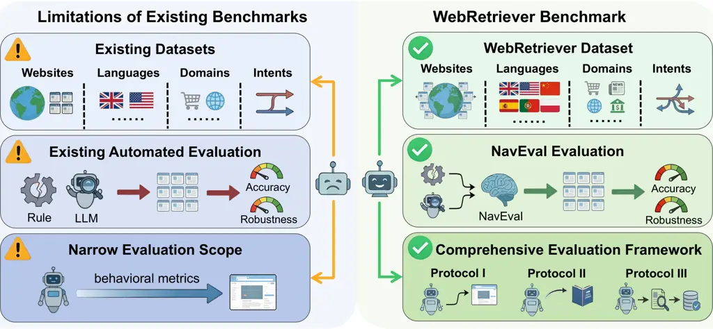

Figure 1: Motivation for the WebRetriever benchmark. WebRetriever
addresses key limitations of prior work from three aspects: dataset
scale and diversity, automated evaluation reliability, and
deployment-oriented evaluation protocols.

Beyond benchmark limitations, evaluation scalability presents an equally
critical challenge. Quality assessment relies heavily on costly,
unscalable human annotation \[36, 46, 23, 34\]. While automated methods
\[18, 33, 40, 41, 37\] have been explored, they often exhibit
insufficient accuracy on complex query conditions. Moreover, existing
evaluation protocols assess limited dimensions. Real-world agents must
navigate, leverage external knowledge, and execute end-to-end tasks like
extracting information from complex websites. Current benchmarks
overlook these requirements, failing to assess agents’ ability to
utilize external knowledge and complete full task workflows. These
limitations underscore the urgent need for comprehensive benchmarks,
reliable automated evaluation, and deployment-oriented protocols.

To address these challenges, as illustrated in Fig. 1, we introduce
WebRetriever, a large-scale benchmark for evaluating web agents in
realistic online environments. It comprises 1,550 tasks on 800 websites,
covering diverse domains and user intents, and provides substantially
broader website scale, domain coverage, and intent diversity than
existing benchmarks. By unifying evaluation across a wide spectrum of
user-intent tasks, WebRetriever mitigates biases in prior benchmarks and
enables a more representative and systematic assessment of web agents’
overall capabilities. To enhance the scalability and accuracy of
automated evaluation, we propose NavEval, an LLM-as-Judge method that
integrates multi-source agent interaction information, achieving over
90% agreement with human judgments in large-scale experiments. We design
three complementary evaluation protocols for comprehensive assessment:
(1) Protocol I evaluates basic navigation ability to reach target pages;
(2) Protocol II assesses navigation performance when provided with
operational knowledge; (3) Protocol III measures end-to-end task
completion by jointly evaluating navigation and information extraction,
avoiding the limitation of equating page arrival with task success.
Extensive experiments validate WebRetriever, NavEval, and our evaluation
protocols, providing fine-grained capability insights and establishing a
foundation for advancing web agent development.

In summary, the main contributions of this work are as follows:

1.  1.  A large-scale, comprehensive benchmark for realistic web agent
        evaluation: We curate 1,550 tasks across 800 real websites spanning
        diverse domains and user intents. Compared with prior benchmarks,
        WebRetriever provides unprecedented scale, diversity, and coverage,
        enabling more comprehensive and representative evaluation of web
        agents in realistic online environments.
2.  2.  A general and high-precision automated evaluation method: We propose
        NavEval, an automated evaluation method that attains approximately
        90% human-level agreement in large-scale experiments, thereby
        enabling practical and reliable assessment of web agent performance
        at scale and in real-time.
3.  3.  Comprehensive evaluation framework: We propose three complementary
        evaluation protocols to systematically assess web agents, explicitly
        disentangling navigation success from answer correctness and
        characterizing behavioral reliability under injected operational
        knowledge, thereby providing diagnostic signals missing from prior
        benchmarks.

## 2 Related Work

### 2.1 Benchmarks for Web Agents

Web agent evaluation benchmarks are commonly divided into offline and
online settings. Offline environments provide controlled and
reproducible setups for stable capability assessment. Early environments
such as MiniWoB \[36\], MiniWoB++ \[27\], and CompWoB \[15\] provide
controllable synthetic interactions, but the substantial domain gap from
real websites limits their ability to reflect real-world generalization.
Subsequent efforts, including WebShop \[42\], WebArena \[46\],
VisualWebArena \[23\], ST-WebAgentBench \[25\] and Wonderbread \[39\],
construct synthetic environments from real website snapshots, partially
alleviating this issue, but their limited website coverage restricts
robustness evaluation. Mind2Web \[9\] and WebLINX \[31\] adopt offline
evaluation based on real HTML snapshots, enabling faster iteration and
broader coverage; however, offline settings struggle to capture agents’
exploration behavior and robustness to dynamic changes. Consequently,
recent work has increasingly shifted toward online benchmarks. More
recent benchmarks—including WorkArena \[11\], WorkArena++ \[5\],
Mind2Web-Live \[34\], AssistantBench \[43\], WebVoyager \[18\],
Bearcubs \[37\], and Online-Mind2Web \[41\]—support live evaluation and
further mitigate the realism gap. However, existing online benchmarks
remain limited in website scale, domain diversity, and coverage of user
intent.

### 2.2 Automatic Evaluation for Web Agents

Offline environments provide stable, reproducible settings, while online
evaluation faces challenges from dynamic websites \[41\]. SeeAct \[44\]
pioneered human evaluation on live sites, but manual assessment does not
scale with increasing task complexity. This motivates automated
evaluation methods, which fall into rule-based \[46, 34\] and
LLM-as-a-judge methods \[45, 26, 13, 4\]. Rule-based methods, such as
Mind2Web-Live \[34\] and AssistantBench \[43\], suffer from brittleness
to webpage dynamics and demand continuous maintenance, whereas
LLM-as-judge approaches constrained to single-modality inputs
demonstrate limited evaluation accuracy. Early approaches, such as Pan
et al. \[33\], focus on final screenshot, providing only coarse-grained
assessments and missing intermediate interactions. WebVoyager \[18\]
extends evaluation to full trajectories, though at substantial token
cost. AgentTrek \[40\] incorporates task descriptions and action traces
to provide richer context, yet hallucinations still limit agreement with
human judgments. WebJudge \[41\] generates key steps and extracts key
screenshots for LLM judgment, but the quality of key step generation and
matching precision directly constrain the final accuracy.

### 2.3 Evaluation Protocols for Web Agents

Current benchmarks predominantly assess web navigation success rates
\[23, 11, 5, 43, 34, 30, 41\], step correctness \[9, 21\], answer
accuracy \[37\], and execution efficiency \[22\] under settings where
users provide only task objectives. However, in real-world scenarios,
agents must leverage external knowledge and fulfill end-to-end user
queries, encompassing both navigation and information extraction.
Existing benchmarks fail to assess agents’ navigation capabilities when
augmented with external knowledge, nor can they evaluate whether
end-to-end execution retrieves correct and complete data.

## 3 WebRetriever

To address the limitations discussed in Sec. 2, this chapter presents
WebRetriever’s construction methodology and evaluation framework. We
first describe our large-scale benchmark dataset composition. Next, we
detail NavEval, our automated evaluation framework that integrates
multi-modal interaction signals, applies rule-based filtering, and
leverages LLMs for final assessment. Finally, we introduce three
complementary evaluation protocols that emulate real-world deployment
scenarios while providing multi-dimensional capability assessment.

[TABLE]

Table 1: Comparison between WebRetriever and related benchmarks.
Intent-Type: task intent type (G: general, P: professional, G&P: both);
Setting: the evaluation environment configuration; Online: whether
online live connection evaluation is supported in real-world
environments; Interactive: whether the environment allows interaction;
Websites: number of websites; Eval-Tasks: number of evaluation tasks.
Statistics are reported for the web-related evaluation subsets only.

### 3.1 Dataset Construction

Given the limitations of existing benchmarks in website scale, domain
coverage, and intent diversity, our WebRetriever design ensures
comprehensive dataset diversity and coverage. As shown in Tab. 1,
compared with prior benchmarks, WebRetriever encompasses 1,550
cross-industry tasks and over 800 carefully curated high-quality active
websites. To capture the fundamental landscape of mainstream internet
behavior, we leverage SimilarWeb traffic data as our baseline, targeting
eight core sectors including Technology & Internet, Business & Finance,
Education & Research, Culture, Entertainment & Travel, Life Services,
Healthcare, Industrial Manufacturing, and Public Services, as
illustrated in Fig. 2(a), WebRetriever spans eight core industry sectors
closely related to everyday life and work.

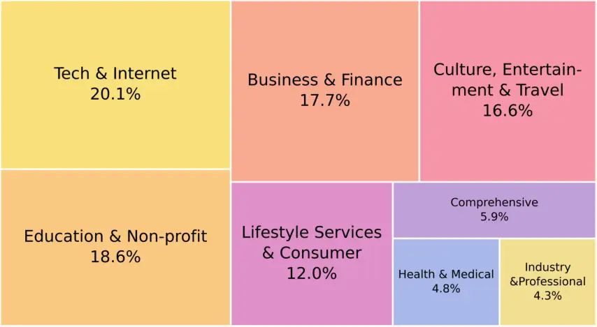

(a) Domain Coverage

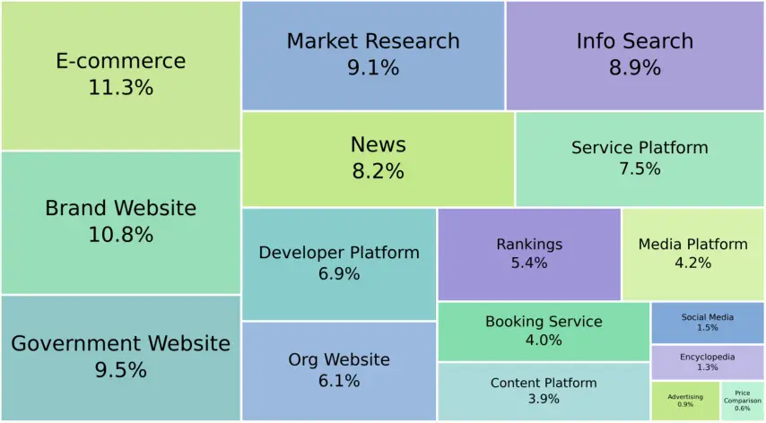

(b) Website Type

Figure 2: Visualization of WebRetriever’s website coverage: (a)
distribution across industry domains, (b) distribution of website types.

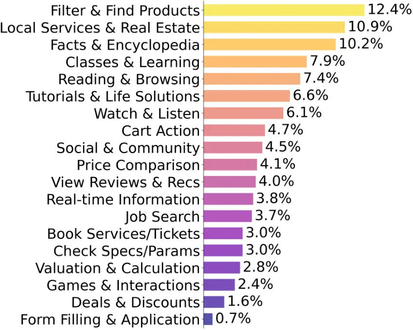

(a) General User Intents

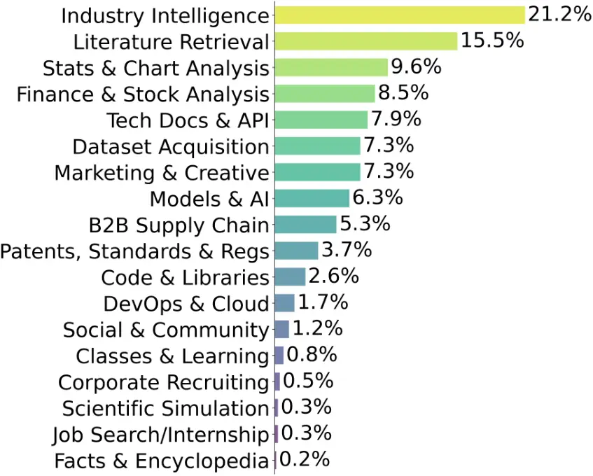

(b) Professional User Intents

Figure 3: Visualization of user intent distributions in WebRetriever
tasks: (a) distribution of general user intents, (b) distribution of
professional user intents.

We select the top 30 sites by traffic within each sector, and
additionally incorporate specialized vertical sites from authoritative
internet research institutions (e.g., 199it) that maintain comprehensive
data navigation repositories. This approach particularly strengthens our
dataset’s evaluation capabilities in business intelligence domains while
ensuring broad website type distribution (Fig. 2(b)). At the task design
level, a diverse team comprising industry experts, mid-level managers,
senior data analysts, and university students contributes tasks for
websites within their domains of expertise, grounded in authentic user
intents. Building upon this foundation, we categorize task intents into
two orthogonal dimensions: "general intents" and "professional intents"
(Fig. 3). By combining these intent types with domain-specific "Fact
Elements," we generate numerous tasks with distinct scenario
characteristics. This approach evaluates not only whether agents can
navigate websites, but crucially, whether they understand the underlying
business logic. To ensure rigorous executability and business
authenticity for each generated task, we conduct multiple rounds of
cross-validation during the task refinement phase, guided by three core
principles: uniqueness, stability, and logical authenticity. While
traditional datasets often feature flat task structures, WebRetriever
tasks must align with expert operational intuition. For instance, in the
financial domain, when a task involves low-frequency trading in
over-the-counter markets, expert validation led us to eliminate
unrealistic requirements for "intraday high-frequency data" queries,
instead directing agents toward long-term quarterly or annual reports
that reflect actual financial data disclosure patterns. Furthermore, to
systematically characterize agent performance across varying difficulty
levels, we categorize tasks based on the number of action steps
$`{Step}_{n}`$ required by human annotators: tasks with $`n<6`$ are
defined as easy, $`6\leq n\leq 15`$ as medium, and $`n>15`$ as hard.

Considering the dynamic nature of web content, WebRetriever will be
continuously maintained: when a task becomes obsolete or unreproducible
due to page updates, it will be replaced with a new task of matching
difficulty, ensuring comparability and long-term validity across dataset
versions.

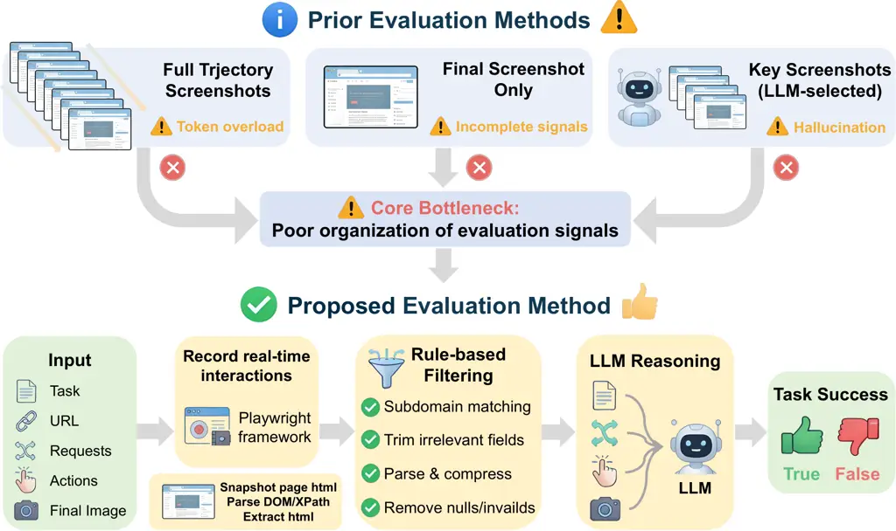

Figure 4: Workflow of NavEval. Compared to existing methods, NavEval
applies rule-based filtering to extract fine-grained intermediate
signals, which are then jointly reasoned with the task description,
action trajectory, and final screenshot by an LLM to determine task
success, enabling robust evaluation with higher human agreement rates.

### 3.2 NavEval

Evaluating web agents in real-world environments is crucial yet
inherently challenging due to the continuous evolution of web content.
Human assessment is costly and difficult to scale, while existing
automated approaches—whether rule-based or LLM-based—struggle to
simultaneously achieve high accuracy and robustness in dynamic online
evaluation settings. Current LLM-based evaluation pipelines exhibit
limitations in organizing and utilizing evaluation signals. As
illustrated in Fig. 4, existing methods employ three screenshot
strategies: (1) full-trajectory screenshots, which provide comprehensive
coverage but suffer from redundancy and high computational costs; (2)
final screenshot only, which captures task completion status but misses
critical intermediate process information; and (3) LLM-selected key
screenshots, which reduce redundancy but lack sufficient accuracy in key
step selection and matching. These limitations reveal the core challenge
of automated evaluation: how to extract critical information to enhance
LLM judgment accuracy.

To address these limitations, we propose NavEval (Fig. 4), which
integrates more diverse information from agent-browser interactions.
Beyond actions and final screenshots, NavEval leverages all navigation
URLs and network requests generated during interactions. Through
rule-based filtering to eliminate substantial noise, these signals are
restructured into organized information that enhances LLM judgment
accuracy. Formally, given an input consisting of a task description
$`T`$, a website URL $`U`$, a sequence of web requests
$`R=(r_{1},r_{2},...,r_{n})`$, a sequence of executed actions
$`A=(a_{1},a_{2},...,a_{n})`$, and the final screenshot $`I`$, NavEval
produces a binary classification output indicating task success or
failure:

```math
P=\text{NavEval}(T,U,R,A,I), \tag{1}
```

where $`P\in\{\text{True},\text{False}\}`$ denotes whether the task was
successfully completed. To robustly extract intermediate interaction
information, we develop an online task evaluation framework based on
Playwright, which enables real-time assessment of web agents in live
environments. During task execution, the system records the web page
screenshots, executed actions, and triggered requests at each step.
Formally, the process can be expressed as:

```math
\mathcal{R}_{l}^{\prime}=\mathcal{F}_{rule}(R,U), \tag{2}
```

where $`\mathcal{F}_{rule}(\cdot)`$ denotes the rule-based filtering
function, and $`\mathcal{R}_{l}^{\prime}`$ represents the filtered
request sequence. Specifically, NavEval first matches the triggered
request set $`R`$ against task URL $`U`$ at the subdomain level to
retain relevant requests. Rule-based filtering then removes
task-irrelevant or random fields, normalizes structured payloads, and
eliminates invalid entries, yielding a compact intermediate
representation $`\mathcal{R}_{l}^{\prime}`$. This representation
captures critical query and filtering information that images alone
cannot convey. Finally, NavEval integrates the task description, action
sequence, filtered intermediate signals, and final screenshot to
generate a comprehensive task completion assessment.

### 3.3 Evaluation Protocols

As discussed in Sec. 2.3, existing benchmarks evaluate agents within
narrow scopes, overlooking their ability to leverage external knowledge
or execute critical operations after reaching target pages in realistic
scenarios. Consequently, strong benchmark performance fails to translate
into practical capability, revealing a significant gap between
evaluation metrics and real-world utility.

To comprehensively evaluate web agent capabilities, we design three
protocols reflecting realistic deployment scenarios. Protocol I assesses
fundamental navigation ability by measuring whether agents can reach
target pages given user tasks. Protocol II evaluates navigation
performance when agents are provided with operational documentation.

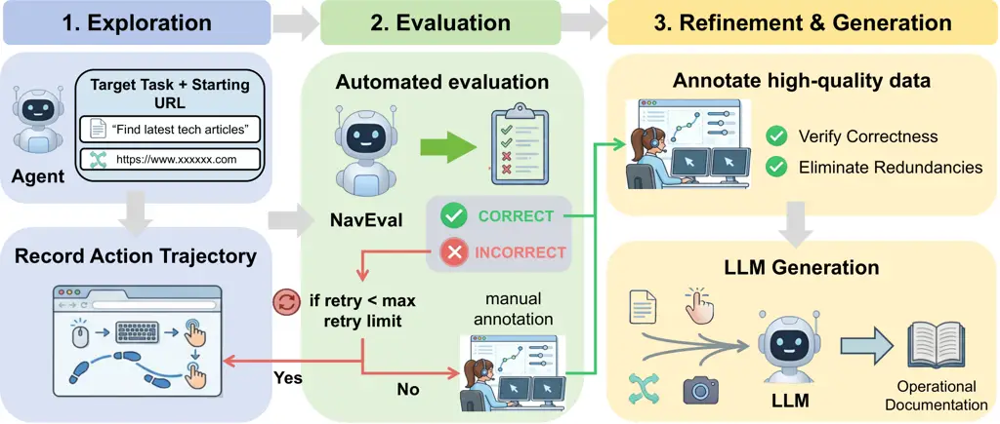

Figure 5: Workflow of the semi-automated pipeline for constructing
operational documentation in Protocol II. The process integrates
automated exploration, evaluation, manual refinement, and LLM-based
generation to produce high-quality operational documentation.

For Protocol II, operational knowledge is consolidated into structured
documentation through a closed-loop framework (Fig. 5). Web agents first
generate action trajectories for target tasks, which NavEval evaluates
automatically. Correct trajectories proceed to annotation, while
incorrect ones are regenerated until reaching retry limits, after which
human annotators refine them. The annotation platform further verifies
accepted trajectories and streamlines redundant operations. Finally,
LLMs generate operation manuals from these refined trajectories,
completing the documentation pipeline.

While Protocols I and II focus on navigation, realistic web environments
require capabilities beyond page navigation. Agents must demonstrate
deep page understanding, multi-source information integration, and
precise extraction capabilities critical for holistic evaluation.
Protocol III mirrors realistic deployment by assessing whether agents
can accurately retrieve target information across multiple modalities
(text, documents, charts). Task construction follows three principles:
(1) Authoritativeness: information from professional platforms ensures
reliability; (2) Interaction Necessity: answers require browser-based
interactions, not simple search; (3) Determinism: explicit queries yield
unique, fact-based answers that remain stable for reproducible
evaluation. Detailed specifications are in the supplementary material.

Based on these designs, we collect 1,000, 1,000, and 100 tasks for
Protocols I, II, and III, respectively. Notably, Protocols I and II
share 550 overlapping tasks, with the sole difference being the
availability of operational documentation.

### 3.4 Evaluation Metrics

To rigorously evaluate WebRetriever and NavEval, we report two metrics
using human annotations as reference: Success Rate (SR) measures web
agent performance across the three protocols, while Human Agreement Rate
(AR) evaluates NavEval’s reliability. For task set $`\mathcal{T}`$, with
human annotation $`y_{t}\in\{0,1\}`$ and automated prediction
$`\hat{y}_{t}`$:

```math
\text{SR}=\frac{1}{|\mathcal{T}|}\sum_{t\in\mathcal{T}}\hat{y}_{t}. \tag{3}
```

```math
\text{AR}=\frac{1}{|\mathcal{T}|}\sum_{t\in\mathcal{T}}\begin{cases}1,&\text{if }\hat{y}_{t}=y_{t},\\
0,&\text{otherwise}.\end{cases} \tag{4}
```

Higher AR indicates stronger alignment with human judgments, reflecting
evaluation fidelity.

## 4 Experiments and Results

### 4.1 Experimental Setup

To evaluate the effectiveness of the proposed benchmark, we develop an
online task testing framework based on Playwright, enabling real-time
assessment of web agents in live environments. Using this framework, we
systematically evaluate a suite of state-of-the-art agents on
WebRetriever across the three proposed evaluation protocols: Protocol I,
Protocol II, and Protocol III. The evaluated agents include
SeeAct \[44\], Browser-Use \[47\], UI-TARS-1.5 \[35\], Agent-E \[1\], as
well as Claude-4.5 \[2\] and Gemini-2.5-Pro \[8\] in their Computer-Use
mode. To more precisely assess agent navigation and task execution in
realistic web settings, we adopt a controlled experimental setup. Each
task starts from a predefined website entry URL, with search engine
access explicitly restricted to prevent reliance on real-time retrieval
shortcuts. This design ensures the evaluation faithfully reflects
agents’ intrinsic decision-making and interaction capabilities.

Based on the execution trajectories generated by the web agents, we
further assess the reliability of the automated evaluation stage by
systematically comparing NavEval with representative existing methods,
including Autonomous Eval \[33\], AgentTrek Eval \[40\],
WebVoyager \[18\], and WebJudge \[41\]. For a comprehensive comparison,
we instantiate multiple LLM-as-a-Judge backbones, including
GPT-4o \[20\], O4-mini \[32\], and Claude-4.5-Sonnet \[2\]. In our
implementation, NavEval’s judgment module adopts Claude-4.5-Sonnet to
ensure stable semantic understanding and reasoning. Further
implementation details and experimental settings are provided in the
supplementary material.

### 4.2 Results and Analysis

|                               |            |       |             |       |              |
| ----------------------------- | ---------- | ----- | ----------- | ----- | ------------ |
| Agent                         | Protocol I |       | Protocol II |       | Protocol III |
|                               | NavEval    | Human | NavEval     | Human | Human        |
| SeeAct                        | 11.3       | 9.2   | 18.9        | 17.1  | 6.0          |
| Agent-E                       | 12.9       | 11.6  | 22.5        | 20.4  | 9.0          |
| UI-TARS-1.5                   | 18.3       | 16.5  | 27.0        | 24.8  | 8.0          |
| Browser-Use                   | 26.6       | 24.0  | 35.2        | 31.6  | 11.0         |
| Gemini-2.5-Pro (Computer-Use) | 40.9       | 37.1  | 50.1        | 45.2  | 21.0         |
| Claude-4.5 (Computer-Use)     | 31.3       | 28.1  | 40.1        | 36.3  | 16.0         |
| Avg SR                        | 23.6       | 21.1  | 32.3        | 29.2  | 11.8         |

Table 2: Task Success Rate (SR) of web agent trajectories on
WebRetriever across the three proposed evaluation protocols, assessed
using NavEval and human annotation, respectively. All values are
reported as percentages (%).

As shown in Tab. 2, human evaluation indicates that web agents perform
poorly on WebRetriever across all three protocols. This sharply
contrasts with their high scores on existing benchmarks and highlights
the comprehensiveness and realism of WebRetriever: unlike prior
benchmarks, it exposes agents to challenges closer to real-world
scenarios, including a large number of websites spanning multiple
geographic regions and industry domains, and diverse user-intent tasks.
Under Protocol I, which evaluates basic navigation skills, agents
achieve an average human-assessed success rate of only 21.1%. The scale,
domain diversity, geographic breadth, and variety of user intents in
WebRetriever make even seemingly straightforward path-planning tasks
highly demanding. Compared with existing benchmarks, WebRetriever
encompasses both general intent and professional intent tasks, with the
latter requiring agents to navigate domain-specific websites at a level
comparable to skilled human operators. This dual coverage allows for
realistic evaluation of both types of capabilities within a single
framework, providing critical insights into agents’ practical
effectiveness. Building on this, Protocol II introduces operational
documentation to simulate agents’ ability to integrate external
knowledge for automated web tasks in realistic scenarios. With access to
this operational guidance, the average success rate increases to 29.2%,
with Gemini-2.5-Pro in Computer-Use mode achieving the highest score of
45.2%. These results indicate that operational manuals can effectively
support agents in navigating unfamiliar websites, reducing
hallucinations and improving task completion. Finally, Protocol III
further increases the challenge by requiring end-to-end task execution,
combining navigation with downstream information extraction. As shown in
Tab. 2, the average human-assessed success drops to 11.8%, indicating
that even when agents reach the target pages, they struggle to
accurately extract and integrate the required information. Most existing
benchmarks do not evaluate this capability, which is critical for
realistic end-to-end deployment. Collectively, these results demonstrate
that current agents remain far from reliably handling practical
end-to-end web tasks, revealing a significant gap between traditional
benchmark performance and real-world applicability.

|                    |                 |        |         |             |                               |                           |        |
| ------------------ | --------------- | ------ | ------- | ----------- | ----------------------------- | ------------------------- | ------ |
| Model              | Auto-Eval       | SeeAct | Agent-E | Browser-Use | Gemini-2.5-Pro (Computer-Use) | Claude-4.5 (Computer-Use) | Avg AR |
| GPT-4o             | Autonomous Eval | 69.8   | 67.0    | 66.6        | 65.4                          | 65.9                      | 66.9   |
|                    | AgentTrek Eval  | 60.2   | 52.5    | 55.1        | 55.2                          | 54.6                      | 55.5   |
|                    | WebVoyager      | 69.1   | 66.7    | 62.2        | 64.7                          | 63.1                      | 65.2   |
|                    | WebJudge        | 71.9   | 70.5    | 72.6        | 70.8                          | 70.3                      | 71.2   |
| O4-mini            | Autonomous Eval | 70.3   | 75.1    | 69.8        | 67.1                          | 69.1                      | 70.3   |
|                    | WebVoyager      | 71.6   | 75.9    | 70.5        | 67.3                          | 68.6                      | 70.8   |
|                    | WebJudge        | 76.5   | 77.6    | 75.9        | 72.5                          | 73.1                      | 75.1   |
| Claude-4.5 -Sonnet | Autonomous Eval | 79.5   | 76.5    | 75.2        | 74.1                          | 74.4                      | 75.9   |
|                    | AgentTrek Eval  | 66.8   | 60.7    | 61.7        | 62.4                          | 61.7                      | 62.7   |
|                    | WebVoyager      | 78.7   | 80.4    | 74.6        | 75.4                          | 76.5                      | 77.1   |
|                    | WebJudge        | 80.9   | 81.1    | 81.7        | 80.7                          | 80.8                      | 81.0   |
| Claude-4.5 -Sonnet | NavEval (Ours)  | 92.2   | 91.3    | 90.9        | 91.4                          | 90.1                      | 91.2   |

Table 3: Human Agreement Rate (AR) of web agent trajectories on
WebRetriever across automated evaluation methods with different
LLM-as-a-Judge models. Avg AR denotes the average human agreement rate.
All values are reported as percentages (%).

Given the substantial challenges revealed by WebRetriever, a reliable
and fine-grained evaluation framework is crucial. As Tab. 2 shows, the
task success rates evaluated by NavEval closely match those from human
assessment across Protocols I and II, demonstrating both the accuracy of
NavEval and its robustness across diverse task scenarios. As further
illustrated in Tab. 3, NavEval consistently achieves human agreement
rates above 90% across all web agents, outperforming existing
methods—including Autonomous Eval, AgentTrek Eval, WebVoyager, and
WebJudge—which exhibit wide variability, with average ARs ranging from
55% to 81%. This improvement stems not only from leveraging LLM
reasoning via Claude-4.5-Sonnet, but also from incorporating
fine-grained interaction data: beyond screenshots, NavEval analyzes the
request sequences generated during task execution on web pages, allowing
precise assessment of query execution and filtering. By combining these
detailed trajectories with rule-based constraints, NavEval detects
subtle behavioral differences that conventional automated methods often
miss, closely approximating human judgment. These results establish
NavEval as a reliable, discriminative, and fine-grained framework for
evaluating web agents in realistic, instruction-guided scenarios.

|                    |                 |        |         |             |        |
| ------------------ | --------------- | ------ | ------- | ----------- | ------ |
| Model              | Auto-Eval       | SeeAct | Agent-E | Browser-Use | Avg AR |
| GPT-4o             | Autonomous Eval | 84.7   | 85.0    | 76.0        | 81.9   |
|                    | AgentTrek Eval  | 73.0   | 64.3    | 63.3        | 66.9   |
|                    | WebVoyager      | –      | 75.3    | 71.3        | –      |
|                    | WebJudge        | 86.7   | 86.0    | 81.4        | 84.7   |
| O4-mini            | Autonomous Eval | 79.7   | 85.7    | 86.0        | 83.8   |
|                    | WebVoyager      | –      | 80.3    | 79.0        | –      |
|                    | WebJudge        | 85.3   | 86.3    | 89.3        | 87.0   |
| WebJudge-7B\[41\]  | WebJudge        | 86.0   | 87.3    | 88.3        | 87.2   |
| Claude-4.5 -Sonnet | NavEval (Ours)  | 96.5   | 97.4    | 97.1        | 97.0   |

Table 4: Human Agreement Rate (AR) of web agent trajectories on
Online-Mind2Web across automated evaluation methods with different
LLM-as-a-Judge models. Avg AR denotes the average human agreement rate.
All values are reported as percentages (%).

To further demonstrate the generalizability and effectiveness of
NavEval, we conduct additional evaluation on Online-Mind2Web \[41\], a
comprehensive benchmark comprising 300 high-quality real-world tasks
across 136 popular websites from diverse domains. In addition to the
previously used LLM-based judge models, we include WebJudge-7B, proposed
in Online-Mind2Web, for a more comprehensive comparison. As shown in
Tab. 4, NavEval consistently outperforms existing automated evaluation
methods by a clear margin on this external benchmark. Prior approaches,
including Autonomous Eval, AgentTrek Eval, WebVoyager, and WebJudge,
exhibit noticeable variability across evaluator backbones and agent
trajectories, with average agreement rates generally below 88%. In
contrast, NavEval achieves a substantially higher Avg AR of 97%,
demonstrating strong robustness and cross-benchmark stability. This
advantage stems from NavEval’s fine-grained design. By jointly
leveraging rule-based constraints and structured interaction signals,
particularly the request sequences generated during webpage execution,
NavEval more accurately verifies query execution and filtering
correctness, thereby reducing the ambiguity that commonly affects
screenshot-only evaluators. Overall, the results on Online-Mind2Web
confirm that NavEval generalizes effectively beyond WebRetriever and
provides a reliable, high-fidelity automated evaluation framework for
realistic web agent assessment.

### 4.3 Ablation Analysis

|             |         |                               |                           |
| ----------- | ------- | ----------------------------- | ------------------------- |
| Protocol    | Setting | Gemini-2.5-Pro (Computer-Use) | Claude-4.5 (Computer-Use) |
| Protocol I  | –       | 40.9                          | 31.3                      |
|             | w/ Doc  | 49.2 (+8.3)                   | 39.7 (+8.4)               |
| Protocol II | –       | 50.1                          | 40.1                      |
|             | w/o Doc | 41.4 (-8.7)                   | 31.9 (-8.2)               |

Table 5: Ablation study on operational documentation (Doc). Protocol I
is originally defined without Doc, while Protocol II includes Doc.
Reported values are task Success Rates (SR, %) of web agent trajectories
on WebRetriever under different protocol settings. Settings indicate
whether Doc is provided (w/ or w/o Doc).

To evaluate the effect of operational documentation, we conduct an
ablation study under Protocols I and II (Tab. 5). Adding documentation
to Protocol I, which was originally defined without it, consistently
improves performance, with success rates increasing by 8.3% for
Gemini-2.5-Pro and 8.4% for Claude-4.5 in Computer-Use mode. Conversely,
removing documentation from Protocol II, originally defined with it,
leads to substantial drops of 8.7% and 8.2%, respectively. These results
demonstrate that operational documentation provides crucial guidance on
unfamiliar websites, helping agents reduce hallucinations and achieve
more reliable task completion. At the same time, the moderate magnitude
of improvement indicates that agents still face significant challenges
in fully understanding and leveraging external knowledge, emphasizing
the need for further advances in knowledge integration.

|              |             |                               |                           |
| ------------ | ----------- | ----------------------------- | ------------------------- |
| Protocol     | Setting     | Gemini-2.5-Pro (Computer-Use) | Claude-4.5 (Computer-Use) |
| Protocol III | –           | 21.0                          | 16.0                      |
|              | w/o Extract | 43.0 (+22.0)                  | 34.0 (+18.0)              |

Table 6: Ablation on end-to-end task completion in Protocol III,
reporting task Success Rates (SR, %) of web agent trajectories on
WebRetriever under different protocol settings. Settings indicate
whether exact information extraction from webpages is required (w/ or
w/o Extract).

We further conduct an ablation study on Protocol III, which requires
end-to-end navigation and information extraction (see Tab. 6).
Strikingly, even when agents successfully reach the target pages, their
ability to extract the required information remains far from reliable:
success rates for Gemini-2.5-Pro and Claude-4.5 in Computer-Use mode are
only 43% and 34%, respectively. When evaluating full end-to-end task
completion—combining navigation with information extraction—success
rates drop almost by half, to 21% and 16%. This sharp decline reveals a
critical blind spot in current agents: reaching the correct page does
not guarantee successful task execution. Protocol III thus exposes the
true difficulty of realistic end-to-end tasks, highlighting limitations
largely overlooked by existing benchmarks and underscoring the
importance of evaluating both navigation and actionable information
processing capabilities. In addition to the protocol-level ablations, we
provide further analyses of NavEval, including judge backbone self-bias
and rule-based filtering ablations, in the supplementary material.

## 5 Conclusion

In this paper, we address the limitations of existing benchmarks for web
agent evaluation, including insufficient scale, limited domain coverage,
and lack of task diversity. To overcome these challenges, we introduce
WebRetriever, a large-scale benchmark for realistic online evaluation,
and NavEval, a scalable automated evaluation method that reduces human
effort while maintaining high fidelity with human judgments. Building
upon this foundation, we further propose three deployment-oriented
evaluation protocols, namely Protocol I, Protocol II, and Protocol III,
to systematically assess agents’ core navigation abilities, ability to
leverage external knowledge, and end-to-end task execution capabilities,
respectively. Extensive experiments demonstrate that our benchmark,
evaluation method, and protocols provide fine-grained insights into
agent performance, reveal capability gaps overlooked by conventional
evaluations, and establish a solid foundation for the development of
more capable and reliable web agents in practical settings.

## Acknowledgements

This work was supported by Mininglamp Technology. We thank the
annotation and engineering teams for their contributions to dataset
construction and the design of the evaluation framework. We also thank
Han Lin and Yuting Liao for their valuable support throughout this
project.

## References

- \[1\] T. Abuelsaad, D. Akkil, P. Dey, A. Jagmohan, A. Vempaty, and R.
  Kokku (2024) Agent-e: from autonomous web navigation to foundational
  design principles in agentic systems. arXiv preprint arXiv:2407.13032.
  Cited by: §4.1.
- \[2\] Anthropic (2025) Introducing claude sonnet 4.5. Note: Official
  Product Announcement External Links:
  [Link](https://www.anthropic.com/news/claude-sonnet-4-5) Cited by:
  §4.1, §4.1.
- \[3\] S. Bai, K. Chen, X. Liu, J. Wang, W. Ge, S. Song, K. Dang, P.
  Wang, S. Wang, J. Tang, et al. (2025) Qwen2. 5-vl technical report.
  arXiv preprint arXiv:2502.13923. Cited by: §1.
- \[4\] Y. Bai, J. Ying, Y. Cao, X. Lv, Y. He, X. Wang, J. Yu, K.
  Zeng, Y. Xiao, H. Lyu, et al. (2023) Benchmarking foundation models
  with language-model-as-an-examiner. Advances in Neural Information
  Processing Systems 36, pp. 78142–78167. Cited by: §2.2.
- \[5\] L. Boisvert, M. Thakkar, M. Gasse, M. Caccia, T. L. De
  Chezelles, Q. Cappart, N. Chapados, A. Lacoste, and A. Drouin (2024)
  Workarena++: towards compositional planning and reasoning-based common
  knowledge work tasks. Advances in Neural Information Processing
  Systems 37, pp. 5996–6051. Cited by: §1, §1, §2.1, §2.3, Table 1.
- \[6\] Q. Chen, D. Pitawela, C. Zhao, G. Zhou, H. Chen, and Q.
  Wu (2024) Webvln: vision-and-language navigation on websites. In
  Proceedings of the AAAI Conference on Artificial Intelligence, Vol.
  38, pp. 1165–1173. Cited by: §1.
- \[7\] S. Chen, S. Wiseman, and B. Dhingra (2024) Chatshop: interactive
  information seeking with language agents. arXiv preprint
  arXiv:2404.09911. Cited by: §1.
- \[8\] G. Comanici, E. Bieber, M. Schaekermann, I. Pasupat, N.
  Sachdeva, I. Dhillon, M. Blistein, O. Ram, D. Zhang, E. Rosen, et
  al. (2025) Gemini 2.5: pushing the frontier with advanced reasoning,
  multimodality, long context, and next generation agentic capabilities.
  arXiv preprint arXiv:2507.06261. Cited by: §4.1.
- \[9\] X. Deng, Y. Gu, B. Zheng, S. Chen, S. Stevens, B. Wang, H. Sun,
  and Y. Su (2023) Mind2web: towards a generalist agent for the web.
  Advances in Neural Information Processing Systems 36, pp. 28091–28114.
  Cited by: §1, §2.1, §2.3, Table 1.
- \[10\] Y. Deng, X. Zhang, W. Zhang, Y. Yuan, S. K. Ng, and T.
  Chua (2024) On the multi-turn instruction following for conversational
  web agents. In Proceedings of the 62nd Annual Meeting of the
  Association for Computational Linguistics (Volume 1: Long Papers),
  pp. 8795–8812. Cited by: §1.
- \[11\] A. Drouin, M. Gasse, M. Caccia, I. H. Laradji, M. Del Verme, T.
  Marty, L. Boisvert, M. Thakkar, Q. Cappart, D. Vazquez, et al. (2024)
  Workarena: how capable are web agents at solving common knowledge work
  tasks?. arXiv preprint arXiv:2403.07718. Cited by: §1, §1, §2.1, §2.3,
  Table 1.
- \[12\] Y. Fan, X. Ma, R. Wu, Y. Du, J. Li, Z. Gao, and Q. Li (2024)
  Videoagent: a memory-augmented multimodal agent for video
  understanding. In European Conference on Computer Vision, pp. 75–92.
  Cited by: §1.
- \[13\] P. Fernandes, D. Deutsch, M. Finkelstein, P. Riley, A. F.
  Martins, G. Neubig, A. Garg, J. H. Clark, M. Freitag, and O.
  Firat (2023) The devil is in the errors: leveraging large language
  models for fine-grained machine translation evaluation. arXiv preprint
  arXiv:2308.07286. Cited by: §2.2.
- \[14\] T. Fu, A. Su, C. Zhao, H. Wang, M. Wu, Z. Yu, F. Hu, M. Shi, W.
  Dong, J. Wang, et al. (2025) Mano technical report. arXiv preprint
  arXiv:2509.17336. Cited by: §1.
- \[15\] H. Furuta, Y. Matsuo, A. Faust, and I. Gur (2023) Language
  model agents suffer from compositional generalization in web
  automation. In NeurIPS 2023 Foundation Models for Decision Making
  Workshop, Cited by: §2.1.
- \[16\] D. Garg, S. VanWeelden, D. Caples, A. Draguns, N. Ravi, P.
  Putta, N. Garg, T. Abraham, M. Lara, F. Lopez, et al. (2025) Real:
  benchmarking autonomous agents on deterministic simulations of real
  websites. arXiv preprint arXiv:2504.11543. Cited by: §1, Table 1.
- \[17\] D. Guo, F. Wu, F. Zhu, F. Leng, G. Shi, H. Chen, H. Fan, J.
  Wang, J. Jiang, J. Wang, et al. (2025) Seed1. 5-vl technical report.
  arXiv preprint arXiv:2505.07062. Cited by: §1.
- \[18\] H. He, W. Yao, K. Ma, W. Yu, Y. Dai, H. Zhang, Z. Lan, and D.
  Yu (2024) WebVoyager: building an end-to-end web agent with large
  multimodal models. arXiv preprint arXiv:2401.13919. Cited by: §1,
  §2.1, §2.2, Table 1, §4.1.
- \[19\] W. Hong, W. Wang, Q. Lv, J. Xu, W. Yu, J. Ji, Y. Wang, Z.
  Wang, Y. Dong, M. Ding, et al. (2024) Cogagent: a visual language
  model for gui agents. In Proceedings of the IEEE/CVF Conference on
  Computer Vision and Pattern Recognition, pp. 14281–14290. Cited by:
  §1.
- \[20\] A. Hurst, A. Lerer, A. P. Goucher, A. Perelman, A. Ramesh, A.
  Clark, A. Ostrow, A. Welihinda, A. Hayes, A. Radford, et al. (2024)
  Gpt-4o system card. arXiv preprint arXiv:2410.21276. Cited by: §4.1.
- \[21\] R. Kapoor, Y. P. Butala, M. Russak, J. Y. Koh, K. Kamble, W.
  AlShikh, and R. Salakhutdinov (2024) Omniact: a dataset and benchmark
  for enabling multimodal generalist autonomous agents for desktop and
  web. In European Conference on Computer Vision, pp. 161–178. Cited by:
  §1, §2.3, Table 1.
- \[22\] S. Kara, F. Faisal, and S. Nath (2025) Waber: evaluating
  reliability and efficiency of web agents with existing benchmarks. In
  ICLR 2025 Workshop on Foundation Models in the Wild, Cited by: §2.3.
- \[23\] J. Y. Koh, R. Lo, L. Jang, V. Duvvur, M. C. Lim, P. Huang, G.
  Neubig, S. Zhou, R. Salakhutdinov, and D. Fried (2024) VisualWebArena:
  evaluating multimodal agents on realistic visual web tasks. arXiv
  preprint arXiv:2401.13649. Cited by: §1, §1, §2.1, §2.3, Table 1.
- \[24\] H. Lai, X. Liu, I. L. Iong, S. Yao, Y. Chen, P. Shen, H. Yu, H.
  Zhang, X. Zhang, Y. Dong, et al. (2024) Autowebglm: a large language
  model-based web navigating agent. In Proceedings of the 30th ACM
  SIGKDD Conference on Knowledge Discovery and Data Mining,
  pp. 5295–5306. Cited by: §1.
- \[25\] I. Levy, B. Wiesel, S. Marreed, A. Oved, A. Yaeli, and S.
  Shlomov (2024) St-webagentbench: a benchmark for evaluating safety and
  trustworthiness in web agents. arXiv preprint arXiv:2410.06703. Cited
  by: §2.1, Table 1.
- \[26\] X. Li, T. Zhang, Y. Dubois, R. Taori, I. Gulrajani, C.
  Guestrin, P. Liang, and T. B. Hashimoto (2023) Alpacaeval: an
  automatic evaluator of instruction-following models. Cited by: §2.2.
- \[27\] E. Z. Liu, K. Guu, P. Pasupat, T. Shi, and P. Liang (2018)
  Reinforcement learning on web interfaces using workflow-guided
  exploration. arXiv preprint arXiv:1802.08802. Cited by: §2.1, Table 1.
- \[28\] J. Liu, Y. Song, B. Y. Lin, W. Lam, G. Neubig, Y. Li, and X.
  Yue (2024) Visualwebbench: how far have multimodal llms evolved in web
  page understanding and grounding?. arXiv preprint arXiv:2404.05955.
  Cited by: §1.
- \[29\] X. Liu, H. Yu, H. Zhang, Y. Xu, X. Lei, H. Lai, Y. Gu, H.
  Ding, K. Men, K. Yang, et al. (2023) Agentbench: evaluating llms as
  agents. arXiv preprint arXiv:2308.03688. Cited by: §1.
- \[30\] X. Liu, T. Zhang, Y. Gu, I. L. Iong, Y. Xu, X. Song, S.
  Zhang, H. Lai, X. Liu, H. Zhao, et al. (2024) VisualAgentBench:
  towards large multimodal models as visual foundation agents. arXiv
  preprint arXiv:2408.06327. Cited by: §1, §2.3.
- \[31\] X. H. Lù, Z. Kasner, and S. Reddy (2024) WebLINX: real-world
  website navigation with multi-turn dialogue. External Links:
  2402.05930 Cited by: §1, §2.1, Table 1.
- \[32\] OpenAI (2025) O4-mini: fast and cost-efficient reasoning model.
  Note: Official Product Announcement External Links:
  [Link](https://openai.com/index/introducing-o3-and-o4-mini/) Cited by:
  §4.1.
- \[33\] J. Pan, Y. Zhang, N. Tomlin, Y. Zhou, S. Levine, and A.
  Suhr (2024) Autonomous evaluation and refinement of digital agents.
  arXiv preprint arXiv:2404.06474. Cited by: §1, §2.2, §4.1.
- \[34\] Y. Pan, D. Kong, S. Zhou, C. Cui, Y. Leng, B. Jiang, H. Liu, Y.
  Shang, S. Zhou, T. Wu, et al. (2024) Webcanvas: benchmarking web
  agents in online environments. arXiv preprint arXiv:2406.12373. Cited
  by: §1, §2.1, §2.2, §2.3, Table 1.
- \[35\] Y. Qin, Y. Ye, J. Fang, H. Wang, S. Liang, S. Tian, J.
  Zhang, J. Li, Y. Li, S. Huang, et al. (2025) Ui-tars: pioneering
  automated gui interaction with native agents. arXiv preprint
  arXiv:2501.12326. Cited by: §1, §4.1.
- \[36\] T. Shi, A. Karpathy, L. Fan, J. Hernandez, and P. Liang (2017)
  World of bits: an open-domain platform for web-based agents. In
  International Conference on Machine Learning, pp. 3135–3144. Cited by:
  §1, §2.1, Table 1.
- \[37\] Y. Song, K. Thai, C. M. Pham, Y. Chang, M. Nadaf, and M.
  Iyyer (2025) Bearcubs: a benchmark for computer-using web agents.
  arXiv preprint arXiv:2503.07919. Cited by: §1, §2.1, §2.3, Table 1.
- \[38\] S. Tian, Z. Zhang, L. Chen, and Z. Liu (2025) Mmina:
  benchmarking multihop multimodal internet agents. In Findings of the
  Association for Computational Linguistics: ACL 2025, pp. 13682–13697.
  Cited by: §1, Table 1.
- \[39\] M. Wornow, A. Narayan, B. Viggiano, I. Khare, T. Verma, T.
  Thompson, M. Hernandez, S. Sundar, C. Trujillo, K. Chawla, et
  al. (2024) Wonderbread: a benchmark for evaluating multimodal
  foundation models on business process management tasks. Advances in
  Neural Information Processing Systems 37, pp. 115963–116021. Cited by:
  §2.1, Table 1.
- \[40\] Y. Xu, D. Lu, Z. Shen, J. Wang, Z. Wang, Y. Mao, C. Xiong,
  and T. Yu (2024) Agenttrek: agent trajectory synthesis via guiding
  replay with web tutorials. arXiv preprint arXiv:2412.09605. Cited by:
  §1, §2.2, §4.1.
- \[41\] T. Xue, W. Qi, T. Shi, C. H. Song, B. Gou, D. Song, H. Sun,
  and Y. Su (2025) An illusion of progress? assessing the current state
  of web agents. In Second Conference on Language Modeling, External
  Links: [Link](https://openreview.net/forum?id=6jZi4HSs6o) Cited by:
  §1, §1, §2.1, §2.2, §2.3, Table 1, §4.1, §4.2, Table 4.
- \[42\] S. Yao, H. Chen, J. Yang, and K. Narasimhan (preprint) WebShop:
  towards scalable real-world web interaction with grounded language
  agents. In ArXiv, Cited by: §1, §1, §2.1, Table 1.
- \[43\] O. Yoran, S. J. Amouyal, C. Malaviya, B. Bogin, O. Press,
  and J. Berant (2024) Assistantbench: can web agents solve realistic
  and time-consuming tasks?. arXiv preprint arXiv:2407.15711. Cited by:
  §1, §2.1, §2.2, §2.3, Table 1.
- \[44\] B. Zheng, B. Gou, J. Kil, H. Sun, and Y. Su (2024) Gpt-4v
  (ision) is a generalist web agent, if grounded. arXiv preprint
  arXiv:2401.01614. Cited by: §2.2, §4.1.
- \[45\] L. Zheng, W. Chiang, Y. Sheng, S. Zhuang, Z. Wu, Y. Zhuang, Z.
  Lin, Z. Li, D. Li, E. Xing, et al. (2023) Judging llm-as-a-judge with
  mt-bench and chatbot arena. Advances in neural information processing
  systems 36, pp. 46595–46623. Cited by: §2.2.
- \[46\] S. Zhou, F. F. Xu, H. Zhu, X. Zhou, R. Lo, A. Sridhar, X.
  Cheng, Y. Bisk, D. Fried, U. Alon, et al. (2024) WebArena: a realistic
  web environment for building autonomous agents. ICLR. Cited by: §1,
  §1, §2.1, §2.2, Table 1.
- \[47\] G. Zunic (2024) Browser use = state of the art web agent. Note:
  Blog Technical Report External Links:
  [Link](https://browser-use.com/posts/sota-technical-report) Cited by:
  §4.1.

## Appendix 0.A Overview

This supplementary material is structured into four main sections.
First, we detail data construction, including the design of the three
evaluation protocols, task creation procedures, and operational
documentation generation. Second, we describe the experimental setup,
covering model types and configurations, agents’ observation scopes
during testing, and an ablation study of NavEval. Third, we present
representative case studies from the WebRetriever benchmark. Finally, we
provide the prompts used for NavEval evaluation and LLM-based
operational documentation generation.

## Appendix 0.B Data Construction Details

In this section, we provide detailed descriptions of the construction
procedures for the three protocols in WebRetriever. Specifically, we
propose three evaluation protocols: (1) Protocol I evaluates the basic
navigation ability required to reach target pages; (2) Protocol II
assesses navigation performance when agents are provided with
operational knowledge; and (3) Protocol III measures end-to-end task
completion by jointly evaluating navigation and information extraction,
thereby avoiding the limitation of treating page arrival as task
success.

### 0.B.1 Task Construction for Protocol I

Protocol I and Protocol II are both designed to evaluate the navigation
capability of agents under the WebRetriever benchmark. In Protocol I,
agents must navigate to the target page based solely on the user task
description, without additional guidance. In contrast, Protocol II
additionally provides structured operational documentation describing
the required interaction steps, simulating the use of knowledge bases in
realistic scenarios. Although the evaluation settings differ, the task
construction procedure for Protocol I and Protocol II remains the same.
Task descriptions in both protocols are written by domain experts to
ensure professional accuracy and realism.

### 0.B.2 Task Construction for Protocol II

For Protocol II, the corresponding operational documentation is
generated through a semi-automated pipeline that integrates automated
exploration, evaluation, manual refinement, and LLM-based generation.
Within this closed-loop framework, the specified task description and
the initial URL are first provided to the web agent, which explores and
executes the task to generate action trajectories. These trajectories
are then evaluated by NavEval using the prompts designed in Sec. 0.E.1
to determine task success. Successful trajectories are subsequently sent
to a human annotation platform for refinement, producing high-quality
trajectories. Trajectories that fail the NavEval check are retried, and
if they still do not meet success criteria after a maximum number of
attempts, they are directly refined manually to obtain high-quality
trajectories. Finally, using the prompts designed in Sec. 0.E.2,
Gemini-2.5-Pro generates operational documentation from these
high-quality trajectories. Fig. 6 illustrates this process with an
example of a successful task trajectory, showing each step of the
operational documentation generation pipeline.

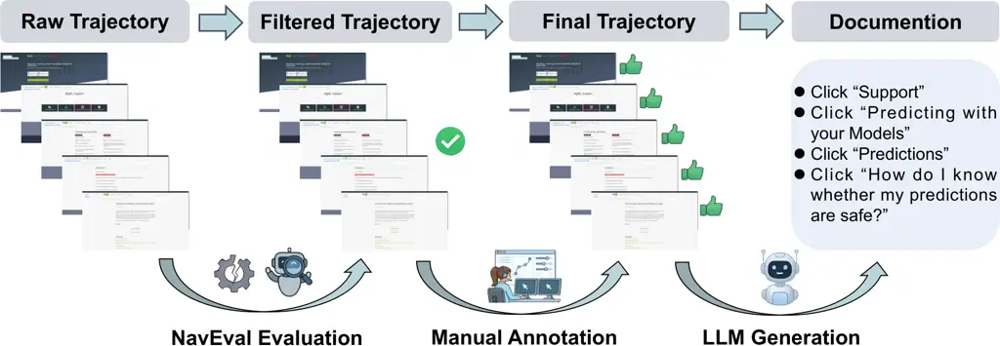

Figure 6: Example of the semi-automated operational documentation
generation pipeline for the task "If I want to make predictions using a
model, how can I ensure that my predictions are safe?" For clarity, the
figure shows only the trajectory screenshots and omits other
intermediate information.

### 0.B.3 Task Construction for Protocol III

Compared with the first two protocols, Protocol III evaluates whether
web agents can complete user tasks end-to-end in realistic deployment
scenarios, substantially increasing task difficulty. Beyond successful
navigation, it also assesses whether agents can accurately integrate and
extract the required information from target pages to accomplish the
task. To strictly prevent agents from completing tasks using general web
search engines without interacting with the specified websites, Protocol
III tasks are designed as Deep Research–style end-to-end tasks. While
search engines typically locate relevant sources or provide summarized
results, Deep Research requires agents to enter these sources and
perform systematic analysis, including reading, filtering,
cross-referencing, and verifying information completeness.

|                                                                                                                                                                                                                                      |                                                                                                                             |
| ------------------------------------------------------------------------------------------------------------------------------------------------------------------------------------------------------------------------------------ | --------------------------------------------------------------------------------------------------------------------------- |
| Scenario Examples                                                                                                                                                                                                                    | Challenges                                                                                                                  |
| Document Extraction                                                                                                                                                                                                                  |                                                                                                                             |
| – Financial report footnotes – Engineering standards – Insurance rate tables – Legal judgments                                                                                                                                       | – Embedded content cannot be fully indexed – Requires reasoning based on table headers                                      |
| Form Interaction                                                                                                                                                                                                                     |                                                                                                                             |
| – Patent searches – Court docket queries – Credit transfer systems – Government license records                                                                                                                                      | – Requires simulating human operations                                                                                      |
| Multi-source Comparison                                                                                                                                                                                                              |                                                                                                                             |
| – Code repository diffs (PR vs Commit) – Amended bills (Amendments vs Original) – Environmental impact reports (Before vs After mitigation)                                                                                          | – Must identify the latest or a specific version – Must exclude outdated documents                                          |
| Complete Data Retrieval                                                                                                                                                                                                              |                                                                                                                             |
| – Retrieve all records matching certain criteria                                                                                                                                                                                     | – Answers are sets – Missing any item is considered a failure                                                               |
| Multi-dimensional Chart                                                                                                                                                                                                              |                                                                                                                             |
| – Bidding (e.g., second-lowest bid) – Sports statistics (e.g., ranking excluding certain conditions) – Census data (e.g., specific demographics in a region) – Multi-step filtering (e.g., among the top-5 X, identify the lowest Y) | – Requires multiple analyses of raw data, reports, or charts – Involves both visual reasoning and data correlation analysis |

Table 7: Representative Deep Research–style web interaction tasks, with
example scenarios and associated challenges.

As summarized in Tab. 7, we categorize representative Deep
Research–style tasks into several common scenarios, including document
extraction, form interaction, multi-source comparison, complete data
retrieval, and multi-dimensional chart analysis. These tasks require
agents to navigate complex interfaces, interact with structured or
semi-structured content, and reason across heterogeneous information
sources. Due to the inherent challenges of these realistic end-to-end
tasks, they place significant demands on web agents, requiring advanced
capabilities in long-horizon planning, precise information extraction,
and cross-page reasoning. To systematically construct such challenging
tasks, we deliberately introduce path obstacles during the dataset
design process, forcing agents to obtain answers through genuine
retrieval, reading, and reasoning rather than relying on search-engine
snippets or shallow matching. This process can be organized into four
stages:

- –
  Data Source Selection: Appropriate data sources must be selected.
  Highly popular websites are generally avoided because their content is
  often heavily structured by search engines and easily summarized.
  Instead, tasks should rely on authoritative yet less exposed sources
  such as government portals, academic archives, professional
  organizations, or regulatory databases. Incorporating multilingual or
  region-specific websites can further increase retrieval complexity and
  better reflect real-world information environments.
- –
  Task Specification: Tasks should target fine-grained objectives with
  explicit constraints. Rather than asking broad questions that can be
  answered directly by search engines, the task should focus on specific
  details embedded in documents or databases. This often involves
  applying multiple filtering conditions, interacting with search
  interfaces, or retrieving complete sets of records, which requires
  agents to perform multi-step navigation and information extraction.
- –
  Adversarial Design: Introduce adversarial elements to increase
  reasoning difficulty. These may include multiple document versions,
  complex document layouts, or exception-based rules that require
  careful interpretation. Such designs ensure that successful completion
  depends not only on retrieval but also on accurate understanding of
  document structure and semantics.
- –
  Ground Truth Validation: The ground truth must be carefully validated
  and fixed. Answers should rely on stable historical data from
  authoritative sources and be cross-verified to ensure correctness and
  uniqueness. For reliable automated evaluation, the final answers
  should be manually confirmed and represented in a structured form,
  allowing precise comparison during evaluation.

### 0.B.4 Annotation Details

WebRetriever was annotated by a 14-member team comprising domain
experts, managers, data analysts, and university students. The
annotation process followed a five-stage pipeline consisting of task
design, annotation, cross-validation, quality review, and final
verification, with strict annotator–reviewer separation and 12
calibration sessions conducted throughout the annotation cycle. Rather
than relying on parallel annotation for inter-annotator agreement (IAA),
we adopted a sequential multi-stage quality control process in which
every task underwent three independent review stages, with mandatory
revision whenever disagreements arose. The corresponding correction
rates at each stage were 30%, 26%, and 27%, respectively, with 54% of
tasks receiving at least one correction, demonstrating the complementary
role of successive review stages.

### 0.B.5 More Details About Dataset

(a) Geographic Distribution

(b) Language Distribution

Figure 7: Details of websites in the WebRetriever benchmark. (a)
Geographic distribution of websites. (b) Language distribution of
websites.

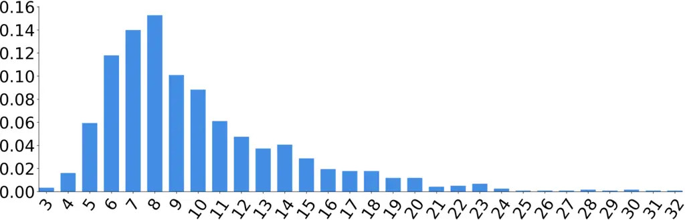

Figure 8: Distribution of task reference steps in WebRetriever, with
x-axis as steps per trajectory and y-axis as task proportion (0–1
scale).

We provide additional details on WebRetriever from multiple
perspectives. Designed to reflect the heterogeneous nature of the global
web, the dataset ensures evaluations capture diverse platforms and
regions rather than being dominated by a few major markets. As shown in
Fig. 7(a), WebRetriever covers both cross-border platforms and
region-specific services, including major ecosystems such as China and
the US, as well as other geographic regions, including Europe (e.g.,
France, Spain), Asia, Africa, and Latin America. Complementing this
geographic coverage, Fig. 7(b) shows the language distribution. In
addition to English and Chinese, the dataset incorporates regional
languages such as Spanish and French, enabling rigorous assessment of
agents’ cross-lingual comprehension and interaction capabilities while
addressing the predominance of English content in prior benchmarks. This
diverse geographic and linguistic composition makes WebRetriever a
realistic and challenging benchmark for evaluating web agents in global,
multilingual scenarios.

|                     |                                                                                                                                                                                                                                                                                                                                                                                           |
| ------------------- | ----------------------------------------------------------------------------------------------------------------------------------------------------------------------------------------------------------------------------------------------------------------------------------------------------------------------------------------------------------------------------------------- |
| Website             | Task Description                                                                                                                                                                                                                                                                                                                                                                          |
| Protocol I          |                                                                                                                                                                                                                                                                                                                                                                                           |
| www.wjx.cn          | Look up an introduction to informed consent.                                                                                                                                                                                                                                                                                                                                              |
| www.datajobs.com    | Find a data science position around Boston.                                                                                                                                                                                                                                                                                                                                               |
| www.kaggle.com      | Recommend a BigQuery-type dataset on Kaggle that has a Usability Rating of 10 and the highest number of downloads.                                                                                                                                                                                                                                                                        |
| www.aol.com         | On the AOL website, search for “the best gifts for women” and browse the list of videos updated in the past week with a duration of 5–20 minutes.                                                                                                                                                                                                                                         |
| www.ci.nii.ac.jp    | Using the advanced search functionality, find books whose publication period is between 2021 and 2025, with the data source set to “CiNii Books”, and whose full-text fields contain the term “Artificial Intelligence”.                                                                                                                                                                  |
| Protocol II         |                                                                                                                                                                                                                                                                                                                                                                                           |
| www.district.in     | List the Hindi 2D action movies currently showing in Ahmedabad.                                                                                                                                                                                                                                                                                                                           |
| www.va.gov          | Find out whether the U.S. Department of Veterans Affairs provides guide dogs for blind veterans.                                                                                                                                                                                                                                                                                          |
| www.backstage.com   | Find jobs within 500 km of London, England that are suitable for women aged 20 to 50.                                                                                                                                                                                                                                                                                                     |
| www.nih.gov         | Find information on brain health charts within research institutes related to aging studies.                                                                                                                                                                                                                                                                                              |
| www.komoot.com      | Find a hiking trail within 100 km of New York City that takes under 3 hours to complete, is easy, has paved paths, an elevation gain below 200 meters, and has cafés along the route.                                                                                                                                                                                                     |
| Protocol III        |                                                                                                                                                                                                                                                                                                                                                                                           |
| www.cwur.org        | On the 2024 GLOBAL 2000 LIST BY THE CENTER FOR WORLD UNIVERSITY RANKINGS, identify which universities in France are ranked in the top 0.2%.                                                                                                                                                                                                                                               |
| www.cbre.com        | On the CBRE Global Prime Office Rent Tracker for Q3 2025, identify which city in Europe had the lowest office rent level and is expected to see rent increases going forward.                                                                                                                                                                                                             |
| www.deloitte.com    | Filter Deloitte articles published before 2025 with Sector: Food, Topic: Marketing, and Industry: Consumer Products, list the titles of the articles, and identify the first author of each article.                                                                                                                                                                                      |
| www.pewresearch.org | One year after the start of Donald Trump’s second term, besides healthcare, goods, and housing costs, what economic issue were Americans somewhat most concerned about?                                                                                                                                                                                                                   |
| www.catalog.mit.edu | Find the Massachusetts Institute of Technology (MIT) Course Catalog for the 2021–2022 academic year, locate the Computer Science course numbered ‘6.006’ (Introduction to Algorithms), and list the course numbers of the explicitly required direct prerequisites in the course description. If prerequisites are connected with “or” relationships, retain the full logical expression. |

Table 8: Examples of tasks from the three protocols in the WebRetriever
benchmark. Fifteen tasks are randomly sampled, with 5 from each
protocol.

Extending the analysis to task complexity, Fig. 8 illustrates the
long-tailed distribution of reference steps across WebRetriever tasks.
While many tasks involve moderate interactions, a substantial portion
requires extended, multi-step operation sequences, highlighting the
benchmark’s coverage of both simple and complex real-world navigation
scenarios. This variability enables comprehensive evaluation of agents’
capabilities, from basic information retrieval to long-horizon planning.
To further demonstrate the diversity of task structures and difficulty
levels captured by WebRetriever, examples from all three protocols are
provided in Tab. 8.

## Appendix 0.C Experiment Details

### 0.C.1 Base Model

We evaluate a set of web agents on the WebRetriever benchmark, including
SeeAct, Browser-Use, UI-TARS-1.5, Agent-E, and the Computer Use modes of
Claude-4.5-Sonnet and Gemini-2.5-Pro. The backbone model for SeeAct,
Browser-Use, and Agent-E is gpt-4o-2024-08-06. For the automatic
evaluation method, the backbone models are gpt-4o-2024-08-06,
o4-mini-2025-04-16, and Claude-4.5-Sonnet. GPT-4o is configured with a
temperature of 0, o4-mini uses its default reasoning effort level of
medium, and Claude-4.5-Sonnet operates with standard settings.

### 0.C.2 Observation Scope

Different web agents adopt different viewpoints when interacting with
webpages in automated tasks. Specifically, SeeAct and Agent-E operate
under a full-page view, capturing the entire page content, whereas
Browser-Use, UI-TARS-1.5, and the Computer Use modes of Claude-4.5 and
Gemini-2.5-Pro operate under a visible-area view, interacting only with
the portion of the page currently displayed on the screen.

### 0.C.3 Evaluation Independence

To ensure evaluation integrity, NavEval and human reviewers
independently assessed the same agent trajectories. The NavEval
development team and the human reviewers were completely independent,
with no personnel overlap. Moreover, the human reviewers had no access
to NavEval’s outputs during their assessment. This separation ensures
that the human agreement rates reported in the main text reflect genuine
alignment rather than information leakage between the two evaluation
pipelines.

### 0.C.4 Ablation Study on NavEval

|         |                   |        |         |             |        |
| ------- | ----------------- | ------ | ------- | ----------- | ------ |
| Method  | Model             | SeeAct | Agent-E | Browser-Use | Avg AR |
| NavEval | GPT-4o            | 87.6   | 86.1    | 85.6        | 86.4   |
|         | O4-mini           | 89.9   | 88.7    | 88.5        | 89.0   |
|         | Claude-4.5-Sonnet | 92.2   | 91.3    | 90.9        | 91.5   |

Table 9: Ablation study of NavEval performance with different LLMs. Avg
AR denotes the average human agreement rate. All values are reported as
percentages (%).

In the main text, we noted that NavEval’s judgment module uses
Claude-4.5-Sonnet to ensure stable semantic understanding and reasoning.
To evaluate the impact of this design choice and assess the robustness
and generalizability of the framework, we conduct an ablation study on
NavEval’s LLM backbone. Specifically, while keeping all other components
unchanged, we replace Claude-4.5-Sonnet with GPT-4o and O4-mini, and
measure the resulting changes in task evaluation agreement with human
judgments. Tab. 9 summarizes the effect of different LLM backbones on
NavEval. Claude-4.5-Sonnet achieves the highest agreement with human
judgments, with an average AR of 91.5%, while replacing it with O4-mini
or GPT-4o results in modest drops to 89% and 86.4%, respectively.
Agent-specific results follow the same trend. These findings indicate
that NavEval is robust across LLM backbones, maintaining high
performance overall, with Claude-4.5-Sonnet providing the best semantic
reasoning and alignment with human evaluation.

|         |            |        |         |             |                               |                           |        |
| ------- | ---------- | ------ | ------- | ----------- | ----------------------------- | ------------------------- | ------ |
| Method  | Setting    | SeeAct | Agent-E | Browser-Use | Gemini-2.5-Pro (Computer-Use) | Claude-4.5 (Computer-Use) | Avg AR |
| NavEval | w/o Filter | 87.8   | 88.6    | 87.5        | 87.9                          | 87.1                      | 87.8   |
|         | w/ Filter  | 92.2   | 91.3    | 90.9        | 91.4                          | 90.1                      | 91.2   |

Table 10: Ablation study on rule-based filtering in NavEval. Avg AR
denotes the average human agreement rate. All values are reported as
percentages (%). Settings indicate whether rule-based filtering is
applied (w/ or w/o Filter).

We further analyze the role of rule-based filtering within NavEval by
removing this component while keeping all other settings unchanged. As
shown in Tab. 10, removing rule-based filtering reduces NavEval’s Avg AR
from 91.2% to 87.8%, a drop of 3.4 percentage points. Nevertheless, even
without filtering, NavEval still outperforms the best prior method
(WebJudge at 81.0% in the main text), suggesting that the primary
performance gains primarily come from the network-request signal itself
rather than the filtering heuristics. The filtering module instead
serves as a refinement step, reducing noise and normalizing payloads,
which leads to consistent improvements across all evaluated agents.

## Appendix 0.D Case Study

In this section, we present representative case studies from the
WebRetriever benchmark, using the Computer Use mode of Gemini-2.5-Pro to
illustrate agent performance across scenarios of varying complexity.

### 0.D.1 Pop-up Window

Fig. 9 shows a task involving unexpected pop-up windows that appear
during execution. Agents must interact with these elements to access
hidden information.


Figure 9: Task: "Find the introduction to autonomous driving functions
provided by VDA."

### 0.D.2 Collapsible Content

Fig. 10 presents tasks with collapsible sections. Agents are required to
expand hidden content to retrieve the relevant information.


(a) Click "Show more" to display additional information.


(b) Click "COVID-19" to view available vaccination locations.

Figure 10: Task: "List the locations in Washington where vaccines are
available".

### 0.D.3 Alphabetical Index

Fig. 11 illustrates tasks with information organized by an alphabetical
index, requiring agents to navigate to specific entries and retrieve
targeted information.

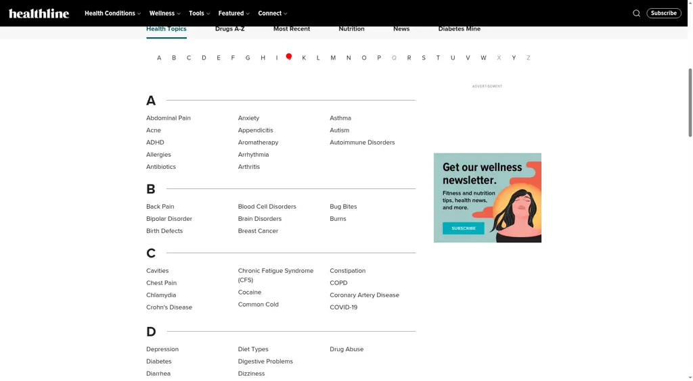

(a) Click the ’J’ category on the A–Z index page to further browse
related entries.


(b) Click ’Joint Pain’ on the ’J’ category page to view the possible
causes.

Figure 11: Task: "Find information about the possible causes of joint
pain".

### 0.D.4 Hallucinations

The Web agent occasionally exhibits hallucinations, performing
unnecessary or incorrect interactions. In Fig. 12, the reasoning process
for the executed action is as follows: "The current page already
displays the relevant information and search results for NVIDIA Corp
(NVDA), but in order to view more detailed company information and stock
trends, it is necessary to enter its detailed stock page. Clicking
“NVIDIA Corp” can enter the company’s detailed information page, thereby
obtaining more information about its stock performance, analysis, and
comparison options". However, as shown in Fig. 12, the agent
hallucinates and treats the click location as an interactive component.

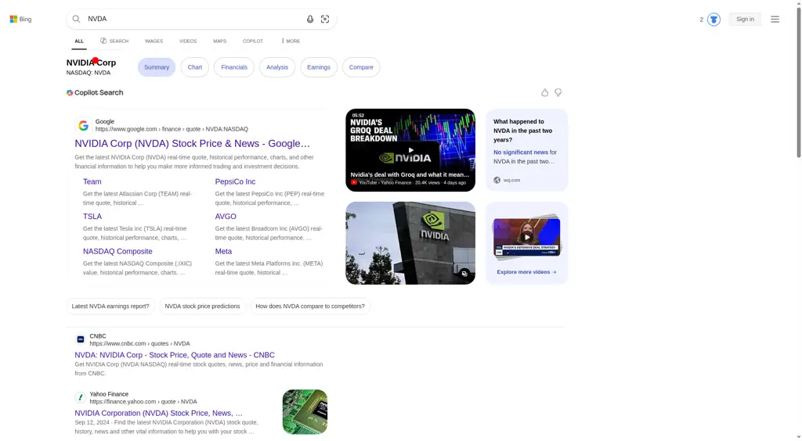

Figure 12: Task: "View a comparative trend chart showing the
year-to-date stock performance of NVIDIA (NVDA) and Microsoft (MSFT)."

Similarly, in Fig. 13, the reasoning process is: "The current page
already displays detailed information about Stephen Curry, including
basic information, season statistics, and the game log. In order to view
the scoring situation of his most recent game, it is necessary to find
the first game in the “Game Log” section and click the corresponding
“Score” data. In this way, the detailed scoring information of that game
can be obtained". Yet, as shown in Fig. 13, the score of the most recent
game is already visible, and the agent still hallucinates by attempting
an unnecessary interaction.

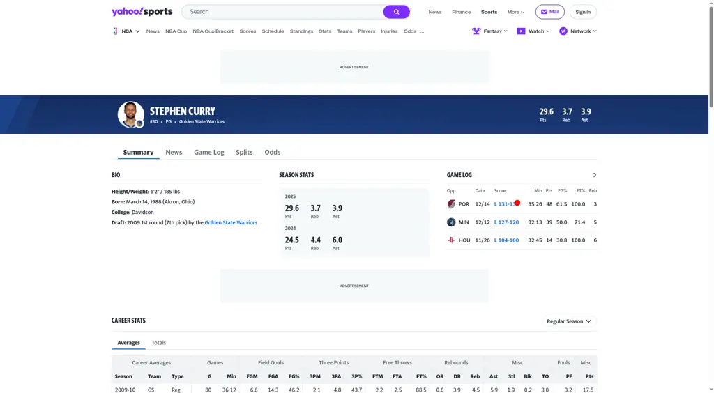

Figure 13: Task: "View the scoring performance of Stephen Curry in his
most recent game."

## Appendix 0.E Prompt Template

### 0.E.1 NavEval Evaluation


### 0.E.2 Generation Operational Documentation


