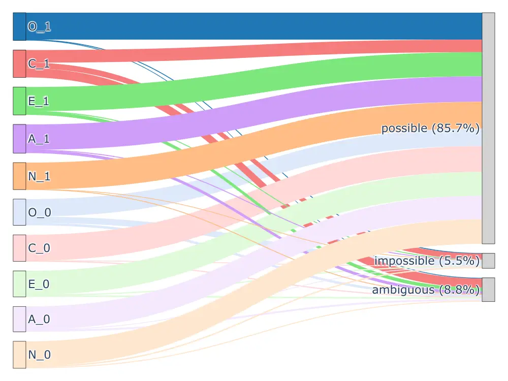
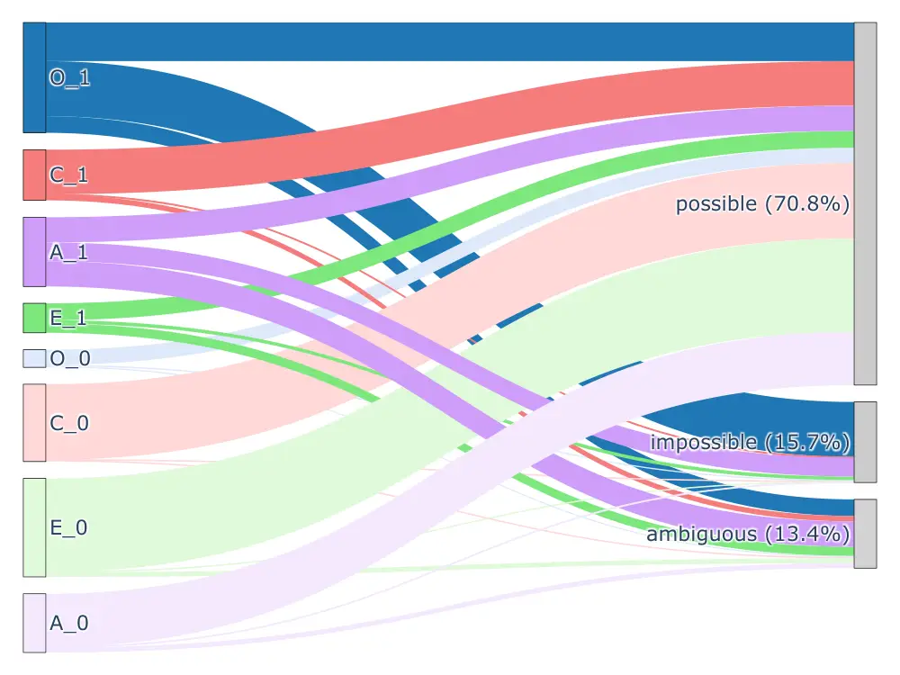
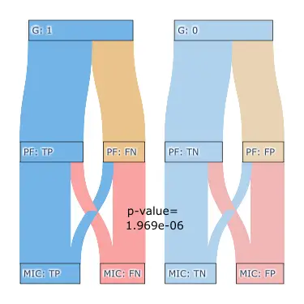
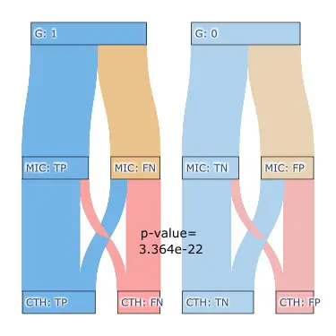
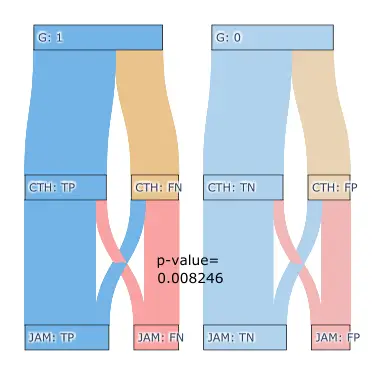
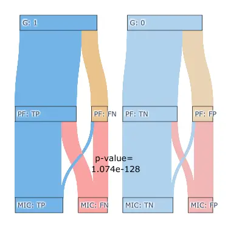
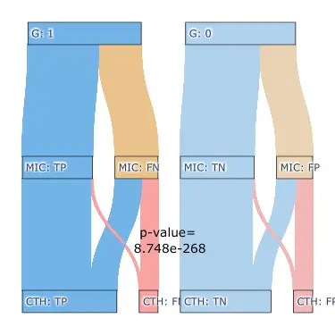
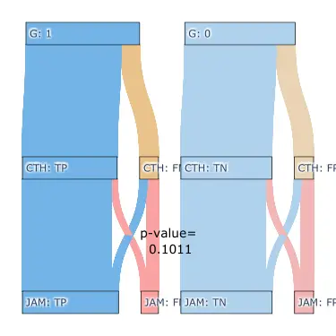

# Large-Language-Models-as-a-Judge in Theory-Agnostic Adaptive Metric-Alignment for Prototypical Networks in Personality Recognition

Jing Jie Tan¹, Ban-Hoe Kwan¹, Danny Wee-Kiat Ng¹, Yan-Chai Hum¹,  
Shih-Yu Lo ², Po-An Chen ³, Noriyuki Kawarazaki⁴, Kosuke Takano⁴, Anissa
Mokraoui⁵ Affiliation:  Affiliation: ¹Department of Mechatronics and
Biomedical Engineering, Lee Kong Chian Faculty of Engineering and
Science,  
Universiti Tunku Abdul Rahman, Malaysia Affiliation: 
Affiliation: ²Institute of Communication Studies, National Yang Ming
Chiao Tung University, Taiwan Affiliation:  Affiliation: ³Institute of
Information Management, National Yang Ming Chiao Tung University, Taiwan
Affiliation:  Affiliation: ⁴Faculty of Information Technology, Kanagawa
Institute of Technology, Japan Affiliation:  Affiliation: ⁵Laboratoire
de Traitement et Transport de l’Information, Université Sorbonne Paris
Nord, France Affiliation:  Email: tanjingjie@1utar.my, {kwanbh, ngwk,
humyc}@utar.edu.my,{shihyulo, poanchen}@nycu.edu.tw,{kawara@rm,
takano@ic}.kanagawa-it.ac.jp, anissa.mokraoui@univ-paris13.fr

###### Abstract

Personality recognition has traditionally been constrained by
theory-dependent formulations, where models are trained to fit
predefined psychological taxonomies rather than uncovering shared
underlying behavioral structure. This limits generalization, as
personality itself is better understood as theory-invariant, emerging
from stable psychological patterns that should manifest consistently
across different frameworks, while existing annotations reflect only
partial and sometimes inconsistent views of the same latent traits. In
this work, we introduce JAM ((J)udge for (A)daptive (M)etric-Alignment),
a theory-agnostic framework that shifts learning from adapting to
predefined personality theories toward discovering unified latent
“pseudo-facets” that capture shared psychological structure. Rather than
constraining the model to any personality taxonomy during training or
inference, the framework learns generalizable psychological
representations and can infer an individual’s latent psychological
profile directly from the textual samples, without requiring
theory-specific labels. JAM achieves this through an Attention-Pooled
Graph Prototypical Network that learns structured representations via
clustering in embedding space, together with a Cross-Theory
Harmonization (CTH) approach that integrates (i) Human-Guided Linkage
and (ii) Machine-Induced Consensus to unify heterogeneous datasets
without relying on predefined labels. To further improve robustness and
data quality, we incorporate an LLM-as-a-Judge mechanism operating in
two configurations, (i) LLM-before-the-loop and (ii) LLM-in-the-loop
which identifies ambiguous, mislabeled, and boundary samples to guide
adaptive metric learning. Experiments on Essays and Kaggle personality
datasets show that JAM improves cross-framework generalization and
performance, establishing a strong step toward theory-agnostic
personality inference and supporting low-resource personality theories.
The related code repository, model weights, and artifacts are available
at
[https://research.jingjietan.com/JAM](https://research.jingjietan.com/JAM).

###### Index Terms: 

Personality Classification, Large Language Models (LLMs), N-Shot
Prompting, Prototypical Networks, Fine-Tuning, Natural Language
Understanding

## I Introduction

Personality recognition has become increasingly important, especially in
recommendation systems \[1\]. By understanding user personalities, these
systems can provide personalized suggestions, enhancing user
satisfaction and trust. Understanding user personality is crucial for
delivering a superior user experience, making this an important area of
study \[2\]. By tailoring interactions and recommendations to individual
personality traits, AI systems and robots can achieve higher levels of
personalization, leading to increased user satisfaction and trust \[3\].
Furthermore, incorporating personality traits into recommendation
algorithms can help address issues such as the cold start and data
sparsity problems, resulting in more accurate and user-centric
recommendations \[4, 5\]. Additionally, this approach can contribute to
explainable AI by providing clearer explanations for the recommendations
made.

Despite these advancements, current personality-recognition models
remain constrained by several fundamental limitations. Most approaches
are built around specific psychological theories, such as the Big-5 or
MBTI, limiting their ability to generalize across datasets and cultural
contexts. This dependence is further exacerbated by the scarcity of
large-scale annotated data. The widely used myPersonality dataset \[6\],
which originally contained data from millions of users, was discontinued
due to privacy concerns, leaving only relatively small public datasets.
Moreover, existing methods treat personality recognition as a static
classification task, without leveraging psychological insights, limiting
their generalizability.

These limitations motivate a theory-agnostic framework that eliminates
dependence on predefined personality taxonomies during both training and
inference. Instead of learning theory-specific representations, the
model discovers latent pseudo-facets that capture underlying
psychological structure across heterogeneous data sources. At inference
time, the model directly infers an individual’s latent psychological
profile from behavioral or textual samples without requiring
theory-specific labels or adherence to a particular personality
framework. This design enables the integration of heterogeneous datasets
while improving generalization across existing personality theories.

### I-A Contributions

In this study, we make the following key contributions:

1.  1.  We incorporate a psychology-based methodology for integrating
        datasets constructed under different personality theories and
        generalize the model through human-guided linkage, supporting
        low-resource personality theory.
2.  2.  We enhance the prototypical network by incorporating machine-induced
        consensus for pseudo-facet construction, improving cross-theory
        harmonization and mitigating class imbalance, leading to improved
        performance.
3.  3.  We investigate the LLM-as-a-Judge mechanism, assessing its
        comparative effectiveness when applied during the pre-learning stage
        (LLM-before-the-loop) versus within the learning process
        (LLM-in-the-loop) for filtering ambiguous or noisy
        personality-related text samples.

## II Literature Review

### II-A Personality Theory

Recent studies have demonstrated that humans express their personality
through language use, providing a rich source of data for personality
recognition \[7, 8, 9, 10\]. The rise of social media platforms has
provided a rich source of data to understand how particular individuals
often leave behind a personality footprint through their online
activities \[7\]. This creates a significant opportunity to extract
personality information from such indirect background data, which is
particularly beneficial for initializing personality-aware
functionalities in new robots or applications. There are two primary
types of assessments to measure, quantify, and classify personality
traits \[11, 12\]:

- •
  Self-report tests: These tests require test-takers to understand the
  provided statements and evaluate how well they describe themselves.
  The results can be quantitatively standardized, ensuring high
  reliability and validity \[13\].
- •
  Projective tests: These tests involve asking test-takers to provide
  their interpretations of scenes, scenarios, or objects \[14\]. This
  type of test considers various aspects, such as tone, message, or body
  language, making it more capable of addressing potential issues like
  misinterpretation of questions or dishonesty from the test-taker
  \[15\].

Various personality theories have been proposed to model personality
using distinct sets of dimensions \[16, 17\]. For instance, the
Myers–Briggs Type Indicator (MBTI), sometimes described in relation to 4
dichotomies, categorizes personality across paired preferences \[18,
19\]. The Big-5 framework (OCEAN) defines five broad traits: Openness to
Experience, Conscientiousness, Extraversion, Agreeableness, and
Neuroticism \[20, 21\]. The HEXACO model extends this structure by
adding Honesty–Humility to Emotionality, Extraversion, Agreeableness,
Conscientiousness, and Openness \[22, 23\]. Table I summarizes the
correspondence among these three major frameworks, offering a general
comparison of their dimensions. Basically, facets are commonly regarded
as the lower-level constructs or descriptions that collectively define a
broader personality dimension or trait. They provide a more granular
representation of personality by capturing specific behavioral and
psychological tendencies within each dimension. The terminology can be
summarized as in Fig. 1.

|        |                            |                               |                       |                                      |
| ------ | -------------------------- | ----------------------------- | --------------------- | ------------------------------------ |
| Symbol | Big-5                      | MBTI                          | HEXACO                | General Description                  |
| O      | Openness to Experience (O) | Sensors (S)-Intuitive (N)     | Openness (O)          | Creativity, curiosity, novelty       |
| C      | Conscientiousness (C)      | Perceivers (P)-Judgers (J)    | Conscientiousness (C) | Organise, responsibility, discipline |
| E      | Extraversion (E)           | Introverts (I)-Extroverts (E) | Extraversion (X)      | Sociability, energy, assertiveness   |
| A      | Agreeableness (A)          | Thinkers (T)-Feelers (F)      | Agreeableness (A)     | Empathy, kindness, cooperativeness   |
| N      | Neuroticism (N)            | -                             | Emotionality (E)      | Sensitivity, anxiety, hostility      |
| H      | -                          | -                             | Honesty-Humility (H)  | Sincerity, fairness, modesty         |

Note: The correlations presented are intended as reference points,
aligning these theories to the widely recognized Big-5 framework. This
alignment supports evaluating model performance across diverse
personality theories, fostering comparative analysis and deeper insights
into their unique characteristics.

TABLE I: Mapping the dimensions of three prominent personality
frameworks: Big-5, MBTI, and HEXACO.

Fig. 1: Overview of the relationship, terminology, and theoretical
structure of personality assessment models, illustrating how theories
define dimensions, traits, facets, and personality types.

These mappings should be interpreted cautiously: they reflect partial
conceptual overlap rather than equivalence. For example, Big-5 Openness
includes facets such as curiosity and preference for novelty, whereas
MBTI’s Sensing–Intuition dimension distinguishes concrete,
detail-oriented perception from abstract, future-oriented thinking.
Similarly, related constructs are distributed differently across
frameworks; emotional reactivity in Big-5 Neuroticism only loosely
corresponds to the MBTI Thinking–Feeling dimension, which primarily
reflects decision-making style rather than affective stability.

This highlights a limitation: personality models are human-constructed
abstractions rather than directly observable ground truth categories.
Consequently, their use in machine learning can introduce systematic
noise and inconsistency, especially at the facet level where definitions
differ across studies. In practice, available datasets seldom provide
sufficiently fine-grained and consistently annotated signals to support
reliable bottom-up learning of stable psychological components, not only
due to annotation cost but also because personality is inherently
composite and context-dependent. To our knowledge, no prior work has
directly addressed this mismatch between psychologically defined trait
hierarchies and their operationalization in data-driven settings, or
proposed effective strategies to mitigate the resulting label ambiguity.

### II-B Related Algorithms

Personality recognition has evolved alongside advances in natural
language processing and representation learning \[24\]. Early research
primarily focused on developing task-specific models for predicting
personality labels defined by a particular framework, such as the Big-5
or MBTI. As language models became increasingly capable of capturing
semantic and contextual information, researchers began adopting
pretrained Transformer architectures as general-purpose representations
for personality-related tasks. More recently, large language models have
enabled prompting-based inference, reducing reliance on
framework-specific training procedures and expanding the possibility of
transferring personality knowledge across different theoretical
formulations.

To contextualize these developments, this section first reviews the
language-model foundations underlying modern personality recognition,
including (i) sentence transformer language models (encoder-only models)
and (ii) autoregressive transformer large language models (decoder-only
models). It then surveys (iii) prior personality recognition methods
built upon these representations, followed by (iv) recent generative
approaches that increasingly support flexible personality inference.
Together, these developments provide the foundation for investigating
personality recognition beyond a single predefined personality theory.

#### II-B1 Sentence Transformer Language Model (Encoder-only Model)

These models are trained on large corpora of text data, enabling them to
capture complex linguistic patterns and relationships \[25, 26, 27, 28,
29\]. The produced embeddings represent the semantic meaning of the
input text, facilitating downstream tasks such as text classification,
clustering, and similarity analysis. MiniLM \[25\] compresses large
Transformer models through deep self-attention distillation, where a
small student model mimics the self-attention of the teacher’s last
layer. It retains over 99% accuracy on SQuAD 2.0 and GLUE benchmarks
while reducing Transformer parameters and computation by 50%. Moreover,
MPNet \[26\] integrates permuted language modeling (PLM) and auxiliary
position information, improving dependency modeling and reducing
position discrepancy. It surpasses BERT, XLNet, and RoBERTa across GLUE
and SQuAD. Furthermore, Sentence-T5 \[27\] explores sentence embeddings
from T5 models, introducing an encoder-only approach that outperforms
Sentence-BERT and SimCSE in STS tasks. Scaling T5 to billions of
parameters further enhances performance, setting new state-of-the-art
results for sentence embeddings. Given the efficiency and strong
semantic representation capabilities of these models, we select a
relatively lightweight yet effective encoder-only model tailored for the
personality domain, ensuring optimal performance while balancing
computational efficiency.

#### II-B2 Autoregressive Transformer Large Language Model (Decoder-only Model)

Generative Pretrained Transformer 3 (GPT-3) was the first to demonstrate
effectiveness in Natural Language Understanding (NLU) through its
few-shot learning capability, facilitated by techniques such as
Chain-of-Thought (CoT) prompting. This family of decoder-only models
enhances reasoning, coherence, and adaptability in tasks such as emotion
detection, sentiment analysis, and personality recognition \[30, 31,
32\]. The open-source LLaMA model introduced a family of models with
varying parameter sizes, achieving competitive performance while
maintaining efficiency in training and inference \[33\]. Following this,
Mistral AI released the Mistral 7B model, which, despite its relatively
smaller size, demonstrated remarkable capabilities in code generation,
mathematics, and reasoning tasks, benefiting from an extended context
window of 128k tokens \[34\]. Qwen models have been proposed as strong
open-weight alternatives, exhibiting robust performance across
reasoning, multilingual understanding tasks \[35\]. OpenAI’s GPT-4
further pushed the boundaries by introducing multimodal capabilities,
allowing the model to process both text and images, thereby enhancing
its applicability across diverse domains \[36\].

Later, reasoning models further extended their capabilities in
scientific and mathematical contributions. OpenAI’s o1 model introduced
a novel approach by generating extended chains of thought before
arriving at a final answer, thereby improving the model’s reasoning
depth and accuracy \[37\]. DeepSeek’s R1 model emerged as a notable
open-source contribution, achieving performance comparable to OpenAI’s
o1 model across mathematics, coding, and reasoning tasks \[38\] with a
relatively low computational complexity. The R1 model employs a unique
training methodology that emphasizes reinforcement learning to enhance
its reasoning capabilities. These developments underscore a growing
trend toward integrating advanced reasoning processes within large
language models, aiming to improve their problem-solving abilities and
decision-making processes.

#### II-B3 Prior Works for Personality Recognition

Prior research has consistently highlighted the importance of large,
high-quality datasets for training machine learning models that
generalize effectively \[39, 40\]. However, in privacy-sensitive
domains, the development and utilization of such datasets are often
constrained by regulatory and ethical considerations. In contrast, other
research areas are better positioned to achieve scale by aggregating or
integrating existing public datasets. A frequently cited example is the
myPersonality Project \[6\], once a prominent open dataset for
computational personality research, which was discontinued in 2018 due
to increasing challenges related to regulatory compliance, controlled
data access, and governance obligations. In personality recognition, we
are limited by personality theory; hence, few researchers are tackling
algorithmic improvements, including architecture, feature exploration,
graph neural networks, loss reweighted contributions, etc.

Building on the importance of data and representation, prior work has
explored a range of modeling approaches for personality classification
from text. Early advances include BiLSTM-based models \[41\], which
leverage bidirectional context to outperform traditional machine
learning methods such as SVM, RF, and DT, highlighting the role of
sequential modeling and hyperparameter tuning. To further enhance
representation learning, \[42\] proposes Personality2vec, which
integrates semantic, linguistic, and structural information from social
networks through biased random walks and skip-gram modeling,
demonstrating robustness particularly in data-scarce settings. After
that, \[40\] further explored the dataset splitting and proposed a
stratification feature, as well as focal loss for reweighting the
contribution in the neural network, and analyzed the evaluation
metrices.

Subsequent studies have focused on enriching deep contextual
representations with complementary linguistic and structural
information. For example, a hybrid Transformer–BLSTM framework \[43\]
integrates psycholinguistic features with attention mechanisms to
improve both predictive performance and interpretability. Graph-based
methods have also emerged as an effective direction. KGrAt-Net \[44\]
leverages knowledge graph attention over DBpedia entities to model
richer semantic relationships, while TranSentGAT \[45\] combines BERT
with sentiment knowledge and graph attention to enhance contextual
representations and improve personality prediction.

Nonetheless, these advances in modeling and feature integration do not
resolve the core bottleneck of limited and fragmented data. Performance
in personality recognition remains constrained by dataset scale,
diversity, and ecological validity under strict privacy and governance
requirements. From this perspective, expanding datasets in a
cost-efficient and flexible manner is essential to overcoming current
theoretical and empirical limits. However, collecting such data is often
difficult, particularly for low-resource settings, due to time, cost,
and regulatory constraints, while cross-institutional approaches such as
federated learning remain limited in practice (to the best of our
knowledge), partly because of heterogeneous theoretical frameworks and
incompatible data assumptions. These challenges motivate a shift toward
more theory-agnostic approaches.

#### II-B4 Generative Approaches to Personality Recognition

Recent work on generative AI for personality inference has explored both
data-centric and architecture-centric improvements. Early studies focus
on data augmentation and heterogeneous graph-based models for dialogue
understanding. For instance, Wu et al. \[46\] introduce personality
trait interpolation to generate synthetic training data and propose
HC-GNN to capture both inter- and intra-speaker dependencies, improving
conversational personality recognition. Similarly, Semi-PerGCN \[47\]
adopts a semi-supervised framework with multi-view graph augmentation
and heterogeneous graph construction, addressing limited labeled data
and enhancing robustness in low-resource settings. Collectively, these
approaches reflect a transition from sequential modeling toward
graph-based and hybrid architectures, with increasing emphasis on
representation richness and data efficiency.

More recent studies have investigated large language models as direct
inference engines for personality recognition. ChatGPT has been shown to
exhibit strong zero-shot capability and partial interpretability in
personality prediction tasks \[48\]. Related work integrates emotional
knowledge with structured prompting strategies for trait
inference \[32\], while PICEPR \[49\] not only proposes embedding-based
knowledge elicitation, but it also demonstrates that modular prompting
can improve classification performance.

Compared with traditional approaches that require task-specific feature
engineering or model training, these methods leverage in-context
learning, enabling models to infer personality labels directly from
instructions, label descriptions, or a small number of exemplars.
Consequently, prompting-based approaches move toward a more
theory-agnostic paradigm, as the same pretrained model can be adapted to
different personality frameworks by modifying the prompt and label
definitions rather than redesigning or retraining the prediction
architecture. While the provided labels may still originate from a
specific theory, the underlying inference mechanism is not inherently
bound to a specific personality theory. Through in-context learning, the
same model can perform personality inference in few-shot settings using
a small number of labeled examples or in zero-shot settings using only
trait descriptions and task instructions, without requiring model
retraining.

However, these approaches also introduce important limitations. First,
decoder-only large language models rely on inference-time reasoning,
which is computationally expensive and often impractical for large-scale
deployment. Second, they do not produce explicit intermediate
representations of psychological states, limiting their usefulness for
downstream modeling of structured cognitive or behavioral processes.
More critically, since these models are trained on internet-scale
corpora, there is a non-trivial risk of implicit exposure to similar
evaluation data, weakening the assumption of strict zero-shot
generalization and introducing potential dataset leakage concerns. These
issues suggest that encoder-based models remain necessary for stable and
controllable representation learning in personality recognition systems.

## III Methodologies

Fig. 2 illustrates the proposed JAM architecture, which targets
tailoring generalization across datasets annotated under different
psychological theories, thus achieving a theory-agnostic model.

Fig. 2: Overview of the proposed JAM architecture for theory-agnostic
personality recognition. The framework integrates a language embedding
backbone with an attention-pooled graph prototypical network to learn
representations that capture latent pseudo-facets through clustering in
the embedding space. A Cross-Theory Harmonization module is introduced
to bridge heterogeneous psychological annotations and consists of
Human-Guided Linkage and Machine-Induced Consensus for constructing
consistent pseudo-facet structures. Under this harmonization process,
Essays and Kaggle datasets are organized into support–query pairs for
prototypical learning. Two training pipelines are explored: (A)
LLM-before-the-loop, where an LLM filters and refines data prior to
training, and (B) LLM-in-the-loop, where the LLM dynamically assesses
sample quality during training to identify ambiguous, mislabeled, or
boundary cases. The resulting embeddings are attention-pooled and passed
through a projection layer. The model is optimized using a meta-learning
objective with contrastive loss, followed by a classification head
trained with cross-entropy, enabling the formation of machine-induced
pseudo-facets.

### III-A Datasets

We utilized Tan’s train-validation-test split algorithm for the standard
Essays and Kaggle datasets \[40\]. This stratified algorithm ensures an
even distribution of personality traits across all dimensions within
each split, promoting fairness in comparison and validating the
effectiveness of our model. Table II summarizes the datasets used in
this study. Note that, due to the nature of the JAM’s prototypical
learning, the training sets are resampled into support and query sets
for each episode in training; while evaluating, the existing validation
set will serve as the support set, and the existing test set will be the
query set.

[TABLE]

TABLE II: Datasets and their descriptions with the number of samples in
train, validation, and test splits

As in Eq. 1, we treated the dataset, $`\mathcal{D}_{\text{standard}}`$,
as a multi-label (or multi-task) classification problem instead of a
multi-class classification problem, where: $`n`$ is the total number of
samples in the dataset, $`x`$ represents the sample text, and $`y`$
represents the labels (the number of labels depends on the dimensions of
the personality theory, $`d=\{d_{1},d_{2},\dots,d_{|d|}\}`$) associated
with $`x`$. This is because personality theory treats each dimension as
independent from the others \[52, 53\]. However, certain research argues
that there are interdependencies or correlations between personality
dimensions, suggesting that traits might not be entirely independent but
could interact in complex ways \[16, 53\]. Nevertheless, we adopt a
multilabel classification approach to ensure that the model outputs a
probability distribution over the dimensions. This approach avoids
framing the task as a binary classification problem, instead allowing
the intermediate layers of the neural network to automatically capture
potential correlations between the labels via gradient backpropagation.
In addition to the labels $`y`$, we include a vector of sample-specific
confidence $`z`$, where each $`z_{i}`$ adjusts the influence of the
corresponding label $`y_{i}`$ during training.

```math
\mathcal{D}_{\text{standard}}=\left\{(x,y,z)^{n}\;\left|\;\begin{aligned} &x=\text{sample text}\\
&y=(y_{0},y_{1},\dots,y_{|d|-1}),\\
&z=(z_{0},z_{1},\dots,z_{|d|-1}),\\
&y_{i}\in\{0,1\},\;z_{i}\in\mathbb{R}\;\;\forall i\end{aligned}\right.\right\} \tag{1}
```

### III-B Proposed Algorithms

As illustrated in Fig. 2, the JAM framework comprises three major
components designed to achieve the overall objectives. We design an
Attention-Pooled Graph Prototypical Network to learn representations
that capture underlying pseudo-facets through clustering in the
embedding space. JAM incorporates a Cross-Theory Harmonization module,
which includes Human-Guided Linkage and Machine-Induced Consensus,
enabling the model to derive pseudo-facets from learned representations
rather than relying solely on predefined human annotations, as discussed
in Section II-A. We further investigate an LLM-as-a-Judge mechanism
operating under two configurations: LLM-before-the-loop and
LLM-in-the-loop. These configurations differ in the stage and manner in
which the LLM influences training. The mechanism is incorporated to
assess training sample quality and identify hard examples, including
ambiguous, mislabeled, or boundary-adjacent instances, thereby guiding
more focused learning.

#### III-B1 Attention-Pooled Graph Prototypical Network

We adopt the Longformer model as the language embedding backbone due to
its ability to efficiently process long textual sequences, which is
particularly important for personality recognition tasks involving
extensive user-generated content. Longformer employs a combination of
local and global attention mechanisms, enabling scalable encoding of
long documents while maintaining computational efficiency \[54\]. Given
an input text $`x`$, we first tokenize it and feed it into the
Longformer encoder to obtain contextualized hidden representations. The
encoder produces layer-wise hidden states across all transformer layers.
From these, we derive a set of $`L`$ pooled representations, where each
node corresponds to a layer-wise pooled representation of the input in
$`\mathbb{R}^{v}`$ obtained via pooling over token embeddings within
that layer. The resulting node feature matrix is defined in Eq. 2.

```math
\mathbf{H}=\text{Longformer}(x),\quad\mathbf{H}\in\mathbb{R}^{L\times v} \tag{2}
```

Later, the output $`\mathbf{H}`$ is used as input to the graph neural
network, which refines the representations by modeling interactions
among embedding vectors derived from the language encoder. We construct
a normalized adjacency matrix $`\mathbf{\tilde{A}}`$ from an adjacency
matrix $`\mathbf{A}`$ that defines the relationships between nodes. In
this work, we adopt a fully connected weighted graph, where each node is
connected to all other nodes, to enable unrestricted and symmetric
information exchange across all representation nodes. The number of
nodes in the graph neural network corresponds to the number of layers
($`L`$) in the selected encoder, and the adjacency matrix remains shared
across all layers. The node aggregation process is illustrated in Eq. 3.

```math
\displaystyle\mathbf{\tilde{A}} \displaystyle=\mathbf{D}^{-1/2}\mathbf{A}\mathbf{D}^{-1/2},\mathbf{D}_{ii}=\sum_{j}\mathbf{A}_{ij}, \tag{3}
```

```math
\displaystyle\mathbf{A}_{ij} \displaystyle=1,\;\forall i\neq j,\mathbf{A}_{ii}=0,\mathbf{\tilde{A}}\in\mathbb{R}^{L\times L}.
```

This design treats all layer-wise representations as mutually
interacting components without imposing predefined hierarchical or
locality constraints, thereby allowing the model to learn how
information should be integrated across different abstraction levels in
a data-driven manner. While this choice provides a simple and uniform
mechanism for cross-layer fusion, it does not explicitly encode
heterogeneous or sparse inter-layer dependencies. Investigating adaptive
or learned graph structures that could more finely capture
layer-specific relationships is therefore left as a promising direction
for future work.

Through matrix multiplication with the normalized adjacency matrix
$`\mathbf{\tilde{A}}`$, information is aggregated from neighboring nodes
to update node embeddings. This propagation is performed iteratively
across GNN layers, where $`\mathbf{H}^{(k)}`$ denotes the node
representations at the $`k`$-th layer. Eq. 4 illustrates the node update
process. Here, $`\sigma(\cdot)`$ denotes the LeakyReLU activation
function with negative slope coefficient $`\alpha=0.01`$, and
$`\mathbf{W}^{(k)}`$ is the trainable weight matrix at the $`k`$-th
layer.

```math
\displaystyle\mathbf{H}^{(k)} \displaystyle=\sigma\left(\mathbf{\tilde{A}}\mathbf{H}^{(k-1)}\mathbf{W}^{(k)}\right), \tag{4}
```

```math
\displaystyle\sigma(x)=\max(\alpha x, \displaystyle x),\mathbf{W}^{(k)}\in\mathbb{R}^{v\times v},\mathbf{H}^{(k)}\in\mathbb{R}^{L\times v}.
```

Lastly, we apply attention-based pooling to obtain the final graph
representation, denoted as $`\mathbf{h}_{\text{graph}}`$, as shown in
Eq. 5. The attention mechanism computes a scalar importance score for
each node based on its interaction with a trainable query vector $`q`$.
These scores are normalized via a softmax function to obtain attention
weights $`\alpha_{i}`$, which determine the contribution of each node to
the final representation. This operation is fully differentiable,
allowing gradients to propagate not only to the query vector $`q`$, but
also to each dimension of the node embeddings $`\mathbf{H}_{i}^{(k)}`$.
This enables the model to jointly learn which nodes are important and
how the inferred embeddings should be adjusted to optimize personality
trait prediction.

```math
\displaystyle\mathbf{h}_{\text{graph}}=\sum_{i=1}^{L}\alpha_{i}\mathbf{H}_{i}^{(k)},\alpha_{i}=\frac{\exp\left(\mathbf{H}_{i}^{(k)}q\right)}{\sum_{j=1}^{L}\exp\left(\mathbf{H}_{j}^{(k)}q\right)},q\in\mathbb{R}^{v} \tag{5}
```

#### III-B2 Cross-Theory Harmonization (CTH)

In order to achieve theory-agnostic modeling, we aim to ensure that the
model captures the core personality features embedded within the text.
Given the presence of personality theories across different datasets,
this setting provides an opportunity for the model to learn not only
surface-level patterns but also to structure the representation space in
a more disentangled manner. Fig. 3 illustrates the overall idea behind
this motivation.

(a) Regular CE

(b) Weighted CE

(c) Prototypical Finetuning (PF)

(d) PF + HGL

(e) PF + MIC

(f) PF + HGL + MIC (Full CTH)

Fig. 3: The conceptual schematic visualization comparing the effects of
the baseline (prior) algorithm, the proposed CTH algorithm, and its
ablation variants. Each particle represents a pseudo-facet that belongs
to the respective cluster of the personality theory: red and blue
correspond to the respective personality theories used during inference.
The numbers inside each particle represent shared features that can
potentially be learned and aligned. Identical numbers (e.g., 1, 2, 3, …)
indicate the same feature across theories, while the numerical values
themselves are only used as indices and do not carry intrinsic meaning.
Alphabetic labels denote features unique to each personality theory;
letters (a, b, c, …) are also meaningless sequential identifiers. Purple
particles indicate shared features that have been successfully learned
and aligned, while grey particles represent incorrectly aligned
features. The values are presented by \tiny{\$\cdot\|\cdot\$}⃝, where the
left side corresponds to the Big-5 representation and the right side
corresponds to the MBTI representation.

Under a standard cross-entropy (CE) formulation, different personality
theories are treated as independent labels. As a result, the model tends
to prioritize dominant and easily separable signals during optimization,
while underutilizing or completely ignoring subtler but potentially
shared representational facets across theories. Although weighted CE
(eg., focal loss) can rebalance gradient contributions and improve
sensitivity to harder samples, these approaches primarily amplify
already-learned discriminative cues rather than fundamentally
restructuring the representation space. Consequently, the underlying
bias toward dominant features remains largely unchanged.

To address this limitation, we adopt prototypical fine-tuning (PF). The
class prototypes are computed from the support set
$`\mathcal{D}^{(S)}`$, where each prototype $`s_{i}`$ is defined as the
(weighted) centroid of embeddings belonging to a given class. As shown
in Eq. 6, each prototype is obtained as a weighted mean of support
embeddings, where sample weights are denoted by $`z`$ (set to $`z=1`$ in
our current setting). The encoder $`f_{\phi}(x)`$ maps each input $`x`$
into an embedding space parameterized by $`\phi`$, and classification is
performed by comparing query embeddings against class prototypes in this
space. In particular, the model minimizes the distance between a query
embedding and the prototype of its ground-truth class while maximizing
its distance to all other prototypes. A softmax over negative Euclidean
distances is then used to define the probability of assigning a query
$`q`$ to class $`d_{i}`$. The training objective is formulated as a
weighted negative log-likelihood over the query set
$`\mathcal{D}^{(Q)}`$, where each query is also associated with a
sample-specific weight.

```math
\displaystyle\mathcal{L}_{\text{PF}}=-w^{(Q)} \displaystyle\cdot\log\frac{\exp\left(-\|f_{\phi}(q)-s_{i}\|^{2}\right)}{\sum_{j}\exp\left(-\|f_{\phi}(q)-s_{j}\|^{2}\right)},\; \tag{6}
```

```math
\displaystyle s_{i} \displaystyle=\frac{\sum_{(x,w)\in\mathcal{D}^{(S)}_{i}}w\cdot f_{\phi}(x)}{\sum_{(x,w)\in\mathcal{D}^{(S)}_{i}}w}
```

Through sampling combinations of instances and prototypes, PF naturally
alleviates data imbalance and reduces representational bias. This
induces a structured clustering behavior in which distinct facets are
progressively aligned with their corresponding theory-specific
prototypes, while latent shared structures begin to emerge. However, at
this stage, certain facets remain under-trained or ambiguously
represented, which may still lead to misclassification. Overall, PF
encourages the representation space to organize around theory-aware
prototypes, as illustrated in Fig. 3(c).

We extend this with Human-Guided Linkage (HGL), where external
human-defined supervision is introduced to explicitly align shared
facets across personality theories, encouraging the emergence of a more
unified shared representation space. As in Fig.  3(d), while this
strategy improves cross-theory alignment, it may also introduce noise
due to imperfect or overly rigid mappings that do not always reflect
true semantic correspondence. Nevertheless, these guided linkages are
particularly valuable for handling edge cases: even when the provided
alignments are partially inaccurate, they still gently steer the
representations toward shared regions, facilitating the re-discovery and
re-association of related facets.

In parallel, we explore Machine-Induced Consensus (MIC). We employ a
cross-entropy objective (Eq. 7) to guide cross-dataset adaptation via a
lightweight adaptation layer that projects embeddings into a shared
space. This layer is not treated as part of the core model architecture;
instead, it serves as a training-time mechanism to facilitate
convergence toward representations that remain discriminative across
different personality theories.

```math
\mathcal{L}_{\text{MIC}}^{(D\in\{\text{Essays},\text{Kaggle}\})}(y,\hat{y})=-\left[\begin{aligned} &y\log\hat{y}\\
&+(1-y)\log(1-\hat{y})\end{aligned}\right] \tag{7}
```

As illustrated in Fig. 3(e), consensus is learned through joint
optimization over paired tasks, enabling the model to infer shared
structure from agreement signals rather than explicit manual
supervision. This process helps refine and further “clean” the shared
space established by prototypical fine-tuning (PF), while also revealing
latent pseudo-facets that are consistently aligned across theories.
However, MIC exhibits a conservative alignment tendency, prioritizing
high-confidence correspondences and potentially down-weighting weaker
but still informative relationships. Consequently, it is most effective
when applied after Human-Guided Linkage (HGL), where it acts as a
stabilizing mechanism that regularizes and consolidates the previously
introduced human-guided alignments.

Lastly, we integrate PF, HGL, and MIC, termed Cross-Theory Harmonization
(CTH). This hybrid design leverages the complementary strengths of each
component: PF provides stable prototypical anchors for organizing the
representation space, HGL introduces external guidance for soft
alignment of potentially shared facets across theories, and MIC further
refines these relations through data-driven consensus. Together, these
mechanisms progressively reshape the representation space from one
dominated by isolated theory-specific signals into a coherent shared
manifold, where both distinct and overlapping pseudo-facets are more
faithfully encoded, and previously under-represented or unlearned
features are systematically recovered and integrated.

#### III-B3 LLM-as-a-Judge (LAJ)

While CTH aims to align representations across personality theories,
residual noise may still hinder effective learning and lead to incorrect
connections, as shown in Fig. 3(c), despite MIC efforts, which cannot
fully address noise arising from mislabeled data. Moreover, while
LLM-based augmentation has been shown to improve performance \[49\], it
introduces potential risks of data leakage. We therefore argue that LLMs
are better positioned as auxiliary evaluators rather than primary
predictors. In particular, encoder-based architectures remain the
backbone for representation learning and classification, while LLMs are
employed as reasoning-based judges for data quality assessment rather
than direct personality inference. They evaluate label consistency,
contradictions, and noisy or implausible samples, improving dataset
integrity and reducing leakage into core predictions. This preserves the
theoretical grounding of encoder-based personality modeling while
leveraging LLMs’ world knowledge and reasoning capabilities.

In this work, we adopt LAJ to evaluate data correctness, specifically
using (i) OpenAI’s ChatGPT model (gpt, gpt-4o-2024-08-06), (ii) Alibaba
Qwen model (qwen, Qwen3.6-35B-A3B), (iii) Meta Llama model (llama,
Llama-3.1-8B-Instruct), and (iv) DeepSeek model (ds, DeepSeek-V4-Flash).
We employ Chain-of-Thought (CoT) prompting to guide the LLMs in
analyzing and determining whether a labeled sample is Possible,
Impossible, or Ambiguous with respect to its associated personality
label, as in Fig. 4.

Fig. 4: The CoT System Prompt generates output in a structured JSON
schema. It performs an analysis of text samples and provides
recommendations on whether to ‘maintain’, ‘mute,’ or ‘lower’
contributions for training.

We further conduct QLoRA fine-tuning experiments on open-source LLMs.
Training is performed exclusively on the training split using the
reasoning-data synthesis method proposed by \[49\], where ground-truth
labels are leveraged to generate reasoning traces that supervise the
model’s decision-making process. However, the original dataset consists
only of prototypical binary personality labels and lacks ambiguous cases
that require reasoning over mixed or conflicting personality signals. To
address this limitation, we augment the training data by constructing
ambiguous samples through the combination of two distinct personality
profiles, randomly selecting sentences from each profile to form a
single input. This augmentation exposes the model to more realistic
borderline cases and enables us to investigate whether LLM-based judges
exhibit systematic failures or introduce new prediction biases when
personality evidence is ambiguous. The augmentation is applied
exclusively to the training data, while the test set remains untouched,
ensuring that no data leakage occurs.

As shown in Fig. 2, we study two pipelines. In the LLM-before-the-loop
(LBL) approach (Algorithm 1), the LLM is employed prior to training to
assess and refine training samples based on label plausibility. In
contrast, the LLM-in-the-loop (LIL) strategy (Algorithm 2) integrates
the LLM during training, where it dynamically evaluates samples in real
time based on their loss values.

0:  $`\mathcal{D}_{\text{standard}}=\{(x,y,z)\}`$, where $`z_{i}=1`$ by
default, system_prompt, JSON_output_schema

0:  Updated $`\mathcal{D}_{\text{standard}}`$ with modified $`z`$

1:  for all $`(x,y,z)`$ in $`\mathcal{D}_{\text{standard}}`$ do

2:    for $`i=0`$ to $`|d|-1`$ do

3:     Build $`x`$ and $`y_{i}`$ content and format as the "user" role,
and Merge with system_prompt

4:     repeat

5:      Send to LLM using JSON_output_schema

6:      Attempt to parse LLM output

7:     until valid JSON is returned

8:     Extract LLM judgment and update the corresponding $`z`$.

9:    end for

10:  end for

11:  return $`\mathcal{D}_{\text{standard}}`$

Algorithm 1 LLM-before-the-loop (LBL)

0:  $`\mathcal{D}_{\text{standard}}=\{(x,y,z)\}`$, where $`z_{i}=1`$ by
default, model $`f_{\phi}`$, system prompt, JSON_output_schema,
threshold $`\tau`$

0:  Updated model parameters and possibly revised labels and weights

1:  for each training episode do

2:    Sample support and query sets
$`(\mathcal{D}^{(S)},\mathcal{D}^{(Q)})`$ from
$`\mathcal{D}_{\text{standard}}`$,

3:    Compute prototypes $`\{s_{j}\}`$ from $`\mathcal{D}^{(S)}`$

4:    for all $`(x,y,w^{(Q)})`$ in $`\mathcal{D}^{(Q)}`$ do

5:     Compute query embedding $`f_{\phi}(q)`$ for
$`\mathcal{L}_{\text{JAM}^{\text{(LIL)}}}`$

6:     if $`\mathcal{L}_{\text{JAM}^{\text{(LIL)}}}>\tau`$ then

7:      Build $`x`$ and $`y_{i}`$ content and format as the "user" role,
and Merge with system_prompt

8:      repeat

9:        Send message to LLM with JSON_output_schema

10:        Receive and attempt to parse response

11:      until valid JSON is returned

12:      Extract LLM judgment and update the corresponding $`z`$.

13:     end if

14:    end for

15:    Aggregate and minimize total $`\text{JAM}^{\text{(LIL)}}`$ loss
over query set

16:    Update model parameters $`\phi`$ using gradient descent

17:  end for

Algorithm 2 LLM-in-the-loop (LIL)

Regardless of the pipeline, the outcomes, depending on the LLM’s
judgment, update $`z`$ in $`\mathcal{D}_{\text{standard}}`$. This
updated $`z`$ thereby influences each example’s contribution during
prototype computation and training. The resulting examples are later
sampled to form $`\mathcal{D}_{\text{prototypical}}`$ in each episode
and are organized into Support ($`\mathcal{D}^{(S)}`$) and Query
($`\mathcal{D}^{(Q)}`$) sets for training. We implemented an $`N`$-way
$`K`$-shot classification task. In our setting,
$`\mathcal{D}^{(S)}=K*N`$ and $`\mathcal{D}^{(Q)}=q*N`$, where $`N=|d|`$
and $`q`$ depends on the GPU RAM capacity. These were designed to
facilitate representational learning, enabling the model to generalize
to new personality theories. Eq. 8 illustrates the structure of the
dataset for prototypical model training, while Eq. 9 shows the weighting
in this experiment (modified later for sensitivity testing). We also
used the weighted mean of the $`N`$ embeddings as the support set for
few-shot learning.

```math
\displaystyle\mathcal{D}_{\text{prototype}} \tag{8}
```

```math
\displaystyle=\left\{\begin{aligned} &\mathcal{D}^{(S)}=\bigcup_{i=1}^{N}\left\{\left(x_{ij}^{(S)},y_{ij}^{(S)},z_{ij}^{(S)}\right)\;\middle|\;j=1,\dots,K\right\},\\
&\mathcal{D}^{(Q)}=\bigcup_{i=1}^{N}\left\{\left(x_{ij}^{(Q)},y_{ij}^{(Q)},z_{ij}^{(Q)}\right)\;\middle|\;j=1,\dots,q\right\}\end{aligned}\right\}
```

```math
z=\begin{cases}1.0&\parbox[t]{224.2479pt}{if $\zeta\in\{\texttt{Possible}\}$, the LLM judgment is {{Possible}} (valid); maintain contributions.}\\[6.0pt]
0.2&\parbox[t]{224.2479pt}{if $\zeta\in\{\texttt{Ambiguous}\}$, the LLM judgment is {{Ambiguous}};
lower the contribution.}\\[6.0pt]
0&\parbox[t]{224.2479pt}{if $\zeta\in\{\texttt{Impossible}\}$, the LLM judgment is {{Impossible}} (invalid); mute the contribution.}\end{cases} \tag{9}
```

Finally, we incorporate the LLM-as-a-Judge mechanism to weight the
contributions of each loss term. We then summarize the overall
formulation in Eq. 10, where the joint loss combines multiple components
from different datasets and tasks.

```math
\mathcal{L}_{\text{JAM}}=\phi\Big(\mathcal{L}_{\text{PF}}^{(\text{Essays})}+\mathcal{L}_{\text{PF}}^{(\text{Kaggle})}\Big)+\psi\,\mathcal{L}_{\text{HGL}}^{(\text{Essays $\Leftrightarrow$ Kaggle})}+\rho\,\mathcal{L}_{\text{MIC}} \tag{10}
```

### III-C Experiment Design

We train the model individually on the Essays-only dataset and the
Kaggle-only dataset to establish the baseline reference for the ablation
study. Next, we train on the combined dataset to evaluate whether the
JAM can generalize to new personality theories. Subsequently, we study
the JAM algorithm to determine whether it can improve dataset quality
and model performance. The experiments use a batch size of 32, a
learning rate of $`1\times 10^{-5}`$, a maximum of 30,000 training
episodes with early stopping, a random seed of 42, and 4 NVIDIA A100
GPUs. Table III presents the acronyms used and the corresponding
experiment configurations.

|                                                  |                                                                                                                                                                         |
| ------------------------------------------------ | ----------------------------------------------------------------------------------------------------------------------------------------------------------------------- | ----------- |
| Notation                                         | Description                                                                                                                                                             |
| $`\text{CE}^{\dagger}`$                          | Regular cross-entropy serves as a standard classification baseline.                                                                                                     |
| $`\text{PO}^{\dagger}`$                          | Off-the-shelf model as the few-shot prototypical baseline. (No training)                                                                                                |
| $`\text{PF}^{\dagger}`$                          | Fine-tuning the model using regular meta-learning for the few-shot prototypical baseline.($`\phi=1`$; $`\psi=0`$; $`\rho=0`$; $`\left.\text{Eq.~\ref{eq:PF-loss}}\right | \_{z=1}`$)  |
| $`\text{HGL}^{\ddagger}`$                        | PF with HGL. ($`\phi=1`$; $`\psi=1`$; $`\rho=0`$; $`\left.\text{Eq.~\ref{eq:PF-loss}}\right                                                                             | \_{z=1}`$)  |
| $`\text{MIC}^{\ddagger}`$                        | PF with MIC. ($`\phi=1`$; $`\psi=0`$; $`\rho=1`$; $`\left.\text{Eq.~\ref{eq:PF-loss}}\right                                                                             | \_{z=1}`$)  |
| $`\text{CTH}^{\ddagger}`$                        | PF with (HGL + MIC). ($`\phi=1`$; $`\psi_{e+1}\leq\psi_{e},\forall e\geq 1`$; $`\rho=1`$; $`\left.\text{Eq.~\ref{eq:PF-loss}}\right                                     | \_{z=1}`$). |
| $`\text{JAM}^{\text{(LBL)}}_{\textit{<model>}}`$ | Proposed JAM approach with the LBL pipeline on CTH.                                                                                                                     |
| $`\text{JAM}^{\text{(LIL)}}_{\textit{<model>}}`$ | Proposed JAM approach with the LIL pipeline on CTH.                                                                                                                     |
| \[Essays\]                                       | Training using only the Essays Dataset.                                                                                                                                 |
| \[Kaggle\]                                       | Training using only the Kaggle Dataset.                                                                                                                                 |
| \[Both\]                                         | Training using both Essays Dataset and Kaggle Dataset.                                                                                                                  |

Notes:

- ^(†)
  Baseline performance without any CTH modules.
- ^(‡)
  Ablation setting experiments for CTH modules of the JAM approach.
- ^(†) ^(‡)
  Experiments conducted without any weighting (no LAJ involved).
- $`{}_{\textit{<model>}}`$
  Indicates which LLM was used as judge in the JAM experiments.
- \[·\]
  Indicates the training dataset, attached after the notation.

TABLE III: Overview of experimental configurations and notations

### III-D Evaluation

To evaluate the performance, we adopted the following metrics: Regular
Accuracy (RA) (Eq. 11) to determine the overall accuracy of the model,
Balanced Accuracy (BA) (Eq. 12) to assess performance on imbalanced
datasets, and the F1 Score (Eq. 13) to measure the model’s bias. Here,
$`TP`$, $`FP`$, $`TN`$, and $`FN`$ represent true positives, false
positives, true negatives, and false negatives, respectively.

```math
RA=\frac{TP+TN}{TP+TN+FP+FN}. \tag{11}
```

```math
BA=\frac{1}{2}\left(\frac{TP}{TP+FN}+\frac{TN}{TN+FP}\right). \tag{12}
```

```math
F1=\frac{2\cdot TP}{2\cdot TP+FP+FN}. \tag{13}
```

## IV Results

|                                                       |              |        |        |                       |        |        |                  |        |        |                   |        |        |                 |        |        |
| ----------------------------------------------------- | ------------ | ------ | ------ | --------------------- | ------ | ------ | ---------------- | ------ | ------ | ----------------- | ------ | ------ | --------------- | ------ | ------ |
| Experiment                                            | O - Openness |        |        | C - Conscientiousness |        |        | E - Extraversion |        |        | A - Agreeableness |        |        | N - Neuroticism |        |        |
|                                                       | BA           | F1     | RA     | BA                    | F1     | RA     | BA               | F1     | RA     | BA                | F1     | RA     | BA              | F1     | RA     |
| Psycholinguistic MLP \[55\]                           |              |        | 0.6460 |                       |        | 0.5920 |                  |        | 0.6000 |                   |        | 0.5880 |                 |        | 0.6050 |
| BERT MLP \[55\]                                       | -            | -      | 0.6040 |                       | -      | 0.5730 |                  | -      | 0.5690 |                   | -      | 0.5700 |                 | -      | 0.5980 |
| CoT with Emotion \[32\]                               | -            | 0.6093 | 0.6102 | -                     | 0.6864 | 0.6800 | -                | 0.6302 | 0.6201 | -                 | 0.6501 | 0.6498 | -               | 0.5600 | 0.5600 |
| Baseline Representative \[Essays\]                    | 0.6030       | 0.6278 | 0.6032 | 0.5346                | 0.5287 | 0.5344 | 0.6036           | 0.6117 | 0.6032 | 0.5760            | 0.6190 | 0.5749 | 0.5536          | 0.6258 | 0.5573 |
| HGL \[Both\]                                          | 0.5144       | 0.5482 | 0.5162 | 0.5003                | 0.4907 | 0.5000 | 0.5424           | 0.5794 | 0.5445 | 0.5575            | 0.5680 | 0.5567 | 0.5061          | 0.5396 | 0.5061 |
| MIC \[Both\]                                          | 0.6388       | 0.6564 | 0.6397 | 0.5426                | 0.5407 | 0.5425 | 0.5843           | 0.6019 | 0.5850 | 0.5928            | 0.5976 | 0.5911 | 0.6032          | 0.6157 | 0.6032 |
| CTH \[Both\]                                          | 0.6734       | 0.6874 | 0.6741 | 0.6118                | 0.6000 | 0.6113 | 0.6278           | 0.6320 | 0.6275 | 0.6389            | 0.6341 | 0.6356 | 0.6640          | 0.6693 | 0.6640 |
| $`\text{JAM}^{\text{(LBL)}}_{\textit{gpt}}`$ \[Both\] | 0.7163       | 0.7255 | 0.7166 | 0.6422                | 0.6305 | 0.6417 | 0.6423           | 0.6424 | 0.6417 | 0.6511            | 0.6463 | 0.6478 | 0.6842          | 0.6917 | 0.6842 |
| $`\text{JAM}^{\text{(LIL)}}_{\textit{gpt}}`$ \[Both\] | 0.6752       | 0.6911 | 0.6761 | 0.6036                | 0.5934 | 0.6032 | 0.6162           | 0.6138 | 0.6154 | 0.6192            | 0.6107 | 0.6154 | 0.6781          | 0.6762 | 0.6781 |

TABLE IV: Performance comparison on the Essays dataset, including prior
work, the baseline, ablation, and LAJ mechanisms.

|                                                       |              |        |        |                       |        |        |                  |        |        |                   |        |        |
| ----------------------------------------------------- | ------------ | ------ | ------ | --------------------- | ------ | ------ | ---------------- | ------ | ------ | ----------------- | ------ | ------ |
| Experiment                                            | O - Openness |        |        | C - Conscientiousness |        |        | E - Extraversion |        |        | A - Agreeableness |        |        |
|                                                       | BA           | F1     | RA     | BA                    | F1     | RA     | BA               | F1     | RA     | BA                | F1     | RA     |
| BERT MLP \[55\]                                       | -            | -      | 0.6840 | -                     | -      | 0.6440 | -                | -      | 0.7830 | -                 | -      | 0.7440 |
| TrigNet \[56\]                                        | -            | 0.6717 | -      | -                     | 0.6769 | -      | -                | 0.6954 | -      | -                 | 0.7906 | -      |
| TAE \[57\]                                            | -            | 0.8117 | -      | -                     | 0.7020 | -      | -                | 0.7090 | -      | -                 | 0.6621 | -      |
| DGCN \[58\]                                           | -            | 0.6719 | -      | -                     | 0.6816 | -      | -                | 0.6952 | -      | -                 | 0.8053 | -      |
| Baseline Representative \[Kaggle\]                    | 0.8163       | 0.9397 | 0.8974 | 0.7837                | 0.7392 | 0.7914 | 0.8182           | 0.7218 | 0.8720 | 0.8412            | 0.8552 | 0.8427 |
| HGL \[Both\]                                          | 0.5901       | 0.6717 | 0.5499 | 0.6409                | 0.5869 | 0.6398 | 0.6232           | 0.4333 | 0.6231 | 0.7583            | 0.7626 | 0.7556 |
| MIC \[Both\]                                          | 0.7695       | 0.9039 | 0.8409 | 0.6902                | 0.6390 | 0.6893 | 0.6825           | 0.5010 | 0.7049 | 0.8058            | 0.8177 | 0.8058 |
| CTH \[Both\]                                          | 0.8144       | 0.9260 | 0.8761 | 0.7634                | 0.7177 | 0.7660 | 0.7739           | 0.6480 | 0.8334 | 0.8408            | 0.8559 | 0.8427 |
| $`\text{JAM}^{\text{(LBL)}}_{\textit{gpt}}`$ \[Both\] | 0.8133       | 0.9287 | 0.8801 | 0.7721                | 0.7280 | 0.7735 | 0.7872           | 0.6659 | 0.8403 | 0.8498            | 0.8648 | 0.8519 |
| $`\text{JAM}^{\text{(LIL)}}_{\textit{gpt}}`$ \[Both\] | 0.7941       | 0.9194 | 0.8651 | 0.7538                | 0.7072 | 0.7556 | 0.7356           | 0.5818 | 0.7879 | 0.8171            | 0.8372 | 0.8202 |

TABLE V: Performance comparison on the Kaggle dataset, including prior
work, the baseline, ablation, and LAJ mechanisms.

### IV-A Baseline Acquisition

First, we establish a baseline for comparison by training the model
separately on the Essays dataset, the Kaggle dataset, or both. Fig. 5
illustrates the balanced accuracy of each approach under different
dataset settings: Cross-Entropy (CE), Off-the-shelf Prototypical (PO),
and Fine-tuned Prototypical (PF).

(a) Essays Dataset

(b) Kaggle Dataset

Fig. 5: Visualization of balanced accuracy for regular classification
using cross-entropy (CE), prototypical few-shot learning using
off-the-shelf ready model (PO), and fine-tuned prototypical few-shot
learning (PF) on the Essays and Kaggle datasets. Each line in the legend
corresponds to an individual experiment, with the dataset used for
training indicated in the respective brackets, while the dotted lines
with numbers represent the average value across dimensions of the
respective experiment.

In the CE experiment, there is no doubt that when the model is trained
and evaluated on the same personality theory dataset, it achieves
relatively good performance. However, when the model is trained on one
dataset and evaluated on another, there is a significant drop in
performance, indicating that the model struggles to generalize across
different personality theories. We also observe that a combination of
datasets does not improve performance; rather, it degrades it. This is
likely because the model is confused by the conflicting signals from the
two different personality theories.

On the other hand, in the PO experiment, we observe that the Essays
dataset shows very poor performance, while the Kaggle dataset is still
able to capture relationships. This can be attributed to the nature of
how the datasets are collected. The Essays dataset comes from a
constrained environment, whereas the Kaggle dataset is sourced from
social media, which is more informal and diverse. This provides
confidence that few-shot learning can be effective in personality
recognition tasks. One interesting observation is that it naturally
solves the class imbalance problem, as the algorithm focuses on learning
the class prototypes rather than being biased towards the majority
class.

When the model is fine-tuned using PF, we see a significant improvement
in performance within the same dataset (training and evaluation). This
is especially evident for the Kaggle dataset, giving confidence that the
model can learn the underlying personality patterns in the data. An
interesting observation is that a model trained on the Kaggle dataset
can generalize to the Essays dataset, but not vice versa, further
demonstrating the quality of the Kaggle dataset. Additionally, the
results show that the model trained on the Kaggle dataset achieves
similar results to the CE approach trained on the Essays dataset,
further justifying that a prototypical network has potential in
capturing personality features from text.

### IV-B Performance

#### IV-B1 Cross-Theory Harmonization (CTH) Performance

Table IV and Table V tabulate the performance of each CTH module under
different dataset settings with its ablation study. To provide a
reference baseline, we include the row corresponding to the highest
performance (BA) from the aforementioned experiments (as shown in Fig. 5) as representative baseline. We also include prior work; however, it
is not fully comparable since they focus on training on a single
dataset, whereas we train 1 model for 2 personalities theories.
Nevertheless, our performance remains competitive and significant in
most cases, highlighting the advantage of our approach for
generalization.

By observing the results on the Essays dataset, we find that the model
improves on average by more than 9% in balanced accuracy across all
traits compared to the best-performing baseline. We further analyze the
contribution of each component. Across both datasets, when only HGL is
included, performance actually degrades regardless of the dataset. This
supports the aforementioned hypothesis that human knowledge is limited;
in the Essays dataset, due to its constrained data collection
environment, such limitations may hinder the model and expose it to
suboptimal supervision, obscuring the ultimate learning objective
through self-consensus. Considering MIC alone, it only outperforms the
baseline on the Essays dataset but not on Kaggle, further strengthening
the observation that the combination of Essays data introduces
additional noise. Nevertheless, the combination of both components (CTH)
is able to restore performance to a level comparable with the baseline
on Kaggle and further improve results on the Essays dataset, suggesting
that integrating HGL and MIC allows the model to better merge
complementary knowledge sources, achieving theory-agnostic modeling.

#### IV-B2 LLM-as-a-Judge (LAJ) Performance

Next, we study the impact of the LAJ mechanism. Generally, the
$`\text{JAM}^{\text{(LBL)}}_{\textit{gpt}}`$ \[Both\] approach
consistently outperforms the
$`\text{JAM}^{\text{(LIL)}}_{\textit{gpt}}`$ \[Both\] approach across
all personality traits in both datasets. This suggests that
pre-evaluating and refining the dataset before training is more
effective than dynamically assessing samples during training. The
$`\text{JAM}^{\text{(LBL)}}_{\textit{gpt}}`$ \[Both\] model converges
within approximately 3000 episodes, whereas
$`\text{JAM}^{\text{(LIL)}}`$ \[Both\] requires around 7000 episodes to
converge. This difference arises because the
$`\text{JAM}^{\text{(LIL)}}_{\textit{gpt}}`$ \[Both\] approach only
gradually obtains a cleaner dataset over multiple iterative episodes,
and not all samples are evaluated by the LLM due to the thresholding
mechanism applied during training. As a result, an initially noisy
dataset may mislead the model toward suboptimal local minima, which
helps explain why the $`\text{JAM}^{\text{(LIL)}}_{\textit{gpt}}`$
\[Both\] approach is less effective than
$`\text{JAM}^{\text{(LBL)}}_{\textit{gpt}}`$ \[Both\]. This trend is
also reflected in the Essays dataset, where the performance of
$`\text{JAM}^{\text{(LBL)}}_{\textit{gpt}}`$ \[Both\] is comparable to
CTH \[Both\].

Fig. 6 illustrates the distribution of Possible and Impossible judgments
across personality traits for both datasets. The Essays dataset contains
a higher proportion of Possible judgments (85.7%) compared to the Kaggle
dataset (70.8%). Given that only a limited proportion of the dataset is
estimated to be noisy (approximately $`>8\%`$), the observed 2%
improvement is within a reasonable range. This indicates that the
filtering process effectively reduces the influence of noisy samples,
while also suggesting that the achievable performance gain is naturally
bounded by the proportion of removable noise in the dataset.



(a) Essays Dataset



(b) Kaggle Dataset

Fig. 6: Distribution of $`\text{LLM}_{\text{gpt}}`$ judgments on
personality trait implications across datasets. The figure illustrates
the proportion of LLM-judged outcomes—Possible, Impossible, and
Ambiguous—based on the binary labels for each of the personality traits.
Labels in the form d_y represent trait d with label y, where y = 1
denotes a positive class (presence of the trait) and y = 0 denotes a
negative class. The divergence in distributions highlights the influence
of annotation conditions and data origin on interpretability judgments
made by language models.

Fig. 7 shows the performance of different LLMs under varying
hyperparameter settings. Overall, gpt performs the best. On the Kaggle
dataset, LLMs generally do not improve over the baseline, which is
consistent with the CTH stage (without LAJ). In contrast, the Essays
dataset shows a different trend: with the involvement of LAJ,
performance generally improves over CTH alone. This supports the
generalisability claims for the low-resource theory (Essays dataset)
compared with the Kaggle dataset, showing that in most cases, model
selection does not degrade performance.

(a) Essays Dataset

(b) Kaggle Dataset

Fig. 7: Visualization of different large language models (gpt, qwen,
llama, ds) and their performance under respective hyperparameter
settings on $`\zeta`$ to $`z`$ values in
$`\text{JAM}^{\text{(LBL)}}_{\textit{gpt}}`$ \[Both\], including a
reduced contribution of the ambiguous and impossible flags by
down-weighting them at certain levels. We further incorporate
fine-tuning for open-source models using QLoRA, while for gpt we conduct
an experiment in which 80% of the minor (relatively underrepresented)
labels/classes are removed to address class imbalance, under the
assumption that the LLM significantly underperforms on the task, in
order to study the potential effects of such imbalance induction.

We observed that setting $`z_{\zeta\in\{\texttt{Impossible}\}}=0`$
(muting the Impossible samples) often leads to better performance in the
Essays dataset, supporting the generalisation claim. However, this
effect is less consistent in the Kaggle dataset and depends more on the
choice of LLM. From the results of the Kaggle dataset,
$`z_{\zeta\in\{\texttt{Impossible}\}}=0`$ generally has relatively low
performance compared to other hyperparameters, suggesting that the model
is not only incapable of filtering data but also introduces more noise
by removing some important contributions. In addition, we conduct an
experiment in which 80% of the minor (relatively underrepresented)
labels/classes are removed (in gpt) using the setting
$`z_{\zeta\in\{\texttt{Ambiguous}\}}=0.2`$ and
$`z_{\zeta\in\{\texttt{Impossible}\}}=0`$, to simulate a worse model
scenario. The results show a significant drop across all dimensions,
despite this being the best observed hyperparameter setting for gpt.
This again supports the claim that a worse LLM can negatively affect
training, and shows that $`z_{\zeta\in\{\texttt{Impossible}\}}`$ is
sensitive.

Across different models, $`z_{\zeta\in\{\texttt{Ambiguous}\}}`$ does not
significantly affect performance (evaluated under settings
$`z_{\zeta\in\{\texttt{Ambiguous}\}}=0.2`$ and
$`z_{\zeta\in\{\texttt{Impossible}\}}=0.8`$, as well as
$`z_{\zeta\in\{\texttt{Impossible}\}}=0`$). This suggests that it
primarily acts as a tunable non-sensitive hyperparameter rather than a
structural factor. On the other hand, in terms of their fine-tuned
model, the results show that although there is improvement in certain
dimensions for some LLMs on the Kaggle dataset, the gains are not
statistically significant. In some cases, performance even drops on the
Essays dataset, likely due to imbalance, as Kaggle is more dominant and
relatively easier to learn. These findings suggest that well-trained
LLMs are already sufficiently capable, and additional fine-tuning is
unnecessary and induces higher costs for the judging task.

### IV-C Statistical Findings

We conducted the McNemar test to support our findings, as illustrated in
Fig. 8. The results indicate its potential utility in constrained
environments, while the CTH method addresses the challenges of merging
datasets, suggesting a pathway toward a theory-agnostic model.
Furthermore, this demonstrates that our proposed approaches are able to
reduce noise that appeared in the native collection of the dataset,
where it statistically further improves through LAJ (an average of 2%
improvement in the Essays dataset).



(a) Essays Dataset (PF$`\rightarrow`$MIC)\[Both\]



(b) Essays Dataset (MIC$`\rightarrow`$CTH)\[Both\]



(c) Essays Dataset
(CTH$`\rightarrow\text{JAM}^{\text{(LBL)}}_{\textit{gpt}}`$)\[Both\]



(d) Kaggle Dataset (PF$`\rightarrow`$MIC)\[Both\]



(e) Kaggle Dataset (MIC$`\rightarrow`$CTH)\[Both\]



(f) Kaggle Dataset
(CTH$`\rightarrow\text{JAM}^{\text{(LBL)}}_{\textit{gpt}}`$)\[Both\]

Fig. 8: The Sankey diagram illustrates the transitions between 4
approaches: from the PF \[Both\] to the MIC-involved method (first MIC
\[Both\], and then to CTH \[Both\] method, and to the proposed full
approach $`\text{JAM}^{\text{(LBL)}}_{\textit{gpt}}`$ \[Both\]). Note
that the HGL-only is excluded from this test since it functions as early
generalization guidance. It encapsulates noise and performs worse when
functioning alone. Each method’s outcomes are compared against the
original ground truth (G). Statistical significance is determined using
the McNemar $`p`$-value test. Due to the fact that personality
encompasses multiple dimensions, we flatten and concatenate these
dimensions to facilitate clearer visualization.

To visualize the effectiveness of the proposed algorithm, we visualized
the personality embeddings using t-SNE in Fig. 9. Compared to the
off-the-shelf PO approach, the embeddings produced by
$`\text{JAM}^{\text{(LBL)}}_{\textit{gpt}}`$ \[Both\] are noticeably
more structured and exhibit clearer separation between clusters
corresponding to distinct personality trait combinations. This improved
separation indicates that the proposed method captures and preserves
subtle personality cues from textual data more effectively. In
particular, the cluster centers in the
$`\text{JAM}^{\text{(LBL)}}_{\textit{gpt}}`$ \[Both\] visualizations are
more distinct and less overlapping, suggesting that the model can better
differentiate between similar personality profiles. This pattern is
consistent across both datasets, with the effect being particularly
pronounced in the Kaggle dataset, where clusters are clearer due to a
larger number of samples and relatively higher classification accuracy,
further highlighting the robustness and generalizability of
$`\text{JAM}^{\text{(LBL)}}_{\textit{gpt}}`$ \[Both\].

(a) Essays Dataset PO \[Essays\]

(b) Essays Dataset $`\text{JAM}^{\text{(LBL)}}_{\textit{gpt}}`$\[Both\]

(c) Kaggle Dataset PO \[Kaggle\]

(d) Kaggle Dataset $`\text{JAM}^{\text{(LBL)}}_{\textit{gpt}}`$\[Both\]

Fig. 9: The t-SNE visualization of personality embeddings on both Essays
and Kaggle datasets. Subplots 9(a) and 9(c) show embeddings using the
off-the-shelf model (PO), while subplots 9(b) and 9(d) show embeddings
using the proposed $`\text{JAM}^{\text{(LBL)}}_{\textit{gpt}}`$ \[Both\]
approach. Each color represents a distinct personality trait
combination, with annotated labels indicating cluster centers. Compared
to the PO approach, $`\text{JAM}^{\text{(LBL)}}_{\textit{gpt}}`$
\[Both\] produces embeddings that are more structured and better
separated, reflecting improved modeling of personality cues obtained
from text.

### IV-D Computational Analysis

Fig. 10 compares the proposed JAM with previous approaches in terms of
Floating Point Operations (FLOPs) and the corresponding computational
cost. This comparison applies to both LLM-before-the-loop (LBL) and
LLM-in-the-loop (LIL) settings. Technically, the former achieves lower
computational cost because the filtering mechanism depends only on the
loss values; therefore, not all samples in the dataset require full
inference.

Fig. 10: Visualization of Cost and FLOPs Comparison. In this analysis,
we assume that input and output tokens incur identical costs, adopting
the estimated FLOPs per token and the corresponding pricing model used
in \[49\] to enable direct comparison. We assume a constant inference
cost of 3.2 GFLOPs per token and a pricing rate of \$0.25 per 10M
tokens. The visualization is based on three components: (i) single
inference (grey, with pink representing search time, e.g.,
retrieval-augmented generation lookup or similarity measurement,
quantified according to the respective approach used to achieve the
reported performance), (ii) training time (purple, covering all
experiments), and (iii) pre-inference (yellow and orange). Pre-inference
(e.g., retrieval-augmented generation indexing or prototype preparation)
is difficult to standardize because greater involvement can improve
performance for certain methods. To address this, we divide the
pre-inference stage into yellow and orange segments to represent an
estimated ratio of involved classes or prototypes, where this is
quantified according to the respective approach used to achieve the
reported performance. Note that this visualization excludes the training
cost of the pretrained decoder-only model, as it is common across all
approaches and assumed to be comparable.

Overall, the proposed method achieves the lowest inference time compared
to the $`\text{PICEPR}^{(\mathrm{Embeddings})}`$ method \[49\]. Although
a slight additional overhead is introduced due to prototype retrieval,
this overhead is negligible because it only involves retrieving and
averaging 4–5 embedding vectors. Despite this, the method still achieves
approximately $`8\times`$ lower training FLOPs. Furthermore, the
proposed approach demonstrates the feasibility of incorporating LLMs to
improve performance, while simultaneously reducing the risk of data
leakage, which is difficult to achieve with purely decoder-only
model-driven approaches such as $`\text{PICEPR}^{(\mathrm{Contents})}`$
\[49\]. Overall, JAM maintains very low inference latency, which is
particularly important for test-time deployment and real-world inference
scenarios, while also reducing inference FLOPs, thereby lowering energy
consumption and carbon footprint and improving the environmental
sustainability especially on large-scale deployment.

### IV-E Limitations and Future Works

Although JAM demonstrates consistent improvements across heterogeneous
personality datasets, it is currently validated on only two personality
theories (MBTI and Big-5), and further evaluation on additional theories
and culturally diverse datasets is needed to validate the robustness of
the proposed Cross-Theory Harmonization (CTH). In addition, as
personality recognition relies on sensitive personal data, future work
should prioritize privacy, informed consent, and fairness. One promising
direction is to integrate JAM with a federated learning framework,
enabling collaboration across institutions or countries while keeping
data local and aggregating only model updates, thereby improving
generalizability without compromising data privacy.

## V Conclusion

In this work, we introduced Large-Language-Models-as-a-Judge in
Theory-Agnostic Adaptive Metric-Alignment for Prototypical Networks in
Personality Recognition (JAM), a novel prototypical framework designed
to enhance personality prediction and generalizability by leveraging
Cross-Theory Harmonization (Human-Guided Linkage and Machine-Induced
Consensus) and LLM-as-a-Judge mechanisms, enabling the learning of
latent pseudo-facets that capture shared behavioral structure across
heterogeneous personality theories under an embedding space.

Through experiments on the Essays and Kaggle datasets, we demonstrated
that JAM consistently outperforms existing baselines and prior work
across multiple personality traits, with no class imbalance issues.
Specifically, JAM achieves an average BA improvement of 12% on the
Essays dataset and 14% on the Kaggle dataset compared to the regular
prototypical few-shot learning approach. When combining datasets, it
becomes possible to leverage the dataset for generalization in
low-resource situations, where the performance of the Kaggle dataset is
not affected. Moreover, incorporating the LLM-as-a-Judge mechanism
further improves performance on the Essays dataset by an additional
2.4%, by reweighting the contribution of each data row during model
training. These results indicate that JAM is particularly effective in
constrained environments while maintaining robust performance across
diverse datasets.

## VI Acknowledgments

This research was funded by the Universiti Tunku Abdul Rahman Research
Fund (IPSR/RMC/UTARRF/2021-C1/K03). The authors also appreciate the
support of Grid5000, France, for providing the computational resources
used in this study. The authors thank the Advanced Artificial
Intelligence Research Center at the Kanagawa Institute of Technology,
Japan, for supporting OpenAI’s model inferences. The first author, Jing
Jie Tan, also appreciates National Yang Ming Chiao Tung University for
providing the Research Scholarship to establish a professional
connection for guidance related to psychology. Additionally, he
appreciate the Embassy of France to Malaysia for the Doctoral Research
Mobility Grant and the Japan Student Services Organization (JASSO)
Scholarships, which facilitated the research collaboration between
Universiti Tunku Abdul Rahman, Malaysia, Université Sorbonne Paris Nord,
France, and Kanagawa Institute of Technology, Japan.

## References

- \[1\] S. Dhelim, N. Aung, M. A. Bouras, H. Ning, and E. Cambria (2021)
  A survey on personality-aware recommendation systems. Artificial
  Intelligence Review 55 (3), pp. 2409–2454. External Links: ISSN
  1573-7462, [Link](http://dx.doi.org/10.1007/s10462-021-10063-7),
  [Document](https://dx.doi.org/10.1007/s10462-021-10063-7) Cited by:
  §I.
- \[2\] T. Ait Baha, M. El Hajji, Y. Es-Saady, and H. Fadili (2023) The
  power of personalization: a systematic review of personality-adaptive
  chatbots. SN Computer Science 4 (5). External Links: ISSN 2661-8907,
  [Link](http://dx.doi.org/10.1007/s42979-023-02092-6),
  [Document](https://dx.doi.org/10.1007/s42979-023-02092-6) Cited by:
  §I.
- \[3\] Z. Li, S. Yang, and S. Wang (2024) Exploring personality-driven
  personalization in xai: enhancing user trust in gameplay. External
  Links: 2408.04778, [Link](https://arxiv.org/abs/2408.04778) Cited by:
  §I.
- \[4\] S. Omidvar and T. Tran (2023) Tackling cold-start with deep
  personalized transfer of user preferences for cross-domain
  recommendation. International Journal of Data Science and Analytics.
  External Links: ISSN 2364-4168,
  [Link](http://dx.doi.org/10.1007/s41060-023-00467-9),
  [Document](https://dx.doi.org/10.1007/s41060-023-00467-9) Cited by:
  §I.
- \[5\] S. Dhelim, L. L. Chen, N. Aung, W. Zhang, and H. Ning (2021)
  Big-five, mpti, eysenck or hexaco: the ideal personality model for
  personality-aware recommendation systems. External Links: 2106.03060,
  [Link](https://arxiv.org/abs/2106.03060) Cited by: §I.
- \[6\] D. Stillwell and M. Kosinski (2015) MyPersonality project
  website. Cited by: §I, §II-B3.
- \[7\] L. V. Phan and J. F. Rauthmann (2021) Personality computing: new
  frontiers in personality assessment. Social and Personality Psychology
  Compass 15 (7). External Links: ISSN 1751-9004,
  [Link](http://dx.doi.org/10.1111/spc3.12624),
  [Document](https://dx.doi.org/10.1111/spc3.12624) Cited by: §II-A.
- \[8\] M. Dalvi-Esfahani, A. Niknafs, Z. Alaedini, H. Barati
  Ahmadabadi, D. J. Kuss, and T. Ramayah (2021) Social media addiction
  and empathy: moderating impact of personality traits among high school
  students. Telematics and Informatics 57, pp. 101516. External Links:
  ISSN 0736-5853, [Link](http://dx.doi.org/10.1016/j.tele.2020.101516),
  [Document](https://dx.doi.org/10.1016/j.tele.2020.101516) Cited by:
  §II-A.
- \[9\] G. Lampropoulos, T. Anastasiadis, K. Siakas, and E.
  Siakas (2022) The impact of personality traits on social media use and
  engagement: an overview.. International Journal on Social and
  Education Sciences 4 (1), pp. 34–51. Cited by: §II-A.
- \[10\] E. Ahmed and S. Ahmed (2024) Social media addiction,
  personality traits, and disorders: an overview of recent literature.
  Current Opinion in Psychiatry 38 (1), pp. 72–77. External Links: ISSN
  1473-6578, [Link](http://dx.doi.org/10.1097/YCO.0000000000000969),
  [Document](https://dx.doi.org/10.1097/yco.0000000000000969) Cited by:
  §II-A.
- \[11\] R. M. Spielman, K. Dumper, W. Jenkins, A. Lacombe, M. Lovett,
  and M. Perlmutter (2021) Personality assessment. Introduction to
  Psychology (A critical approach). Cited by: §II-A.
- \[12\] R. W. Robins, J. L. Tracy, and J. W. Sherman (2023) What kinds
  of methods do personality psychologists use?: a survey of journal
  editors and editorial board members. Cited by: §II-A.
- \[13\] M. H. Waugh, C. M. McClain, E. C. Mariotti, A. L. Mulay, E. N.
  DeVore, K. A. Lenger, A. N. Russell, A. R. Florimbio, K. C.
  Lewis, J. M. Ridenour, and L. G. Beevers (2020) Comparative content
  analysis of self-report scales for level of personality functioning.
  Journal of Personality Assessment 103 (2), pp. 161–173. External
  Links: ISSN 1532-7752,
  [Link](http://dx.doi.org/10.1080/00223891.2019.1705464),
  [Document](https://dx.doi.org/10.1080/00223891.2019.1705464) Cited by:
  1st item.
- \[14\] I. MUKHTASAR and M. MAVLUDA (2021) The study of projective
  methods in psychology. JournalNX 7 (02), pp. 66–69. Cited by: 2nd
  item.
- \[15\] R. Tett and D. Simonet (2021) Applicant faking on personality
  tests: good or bad and why should we care?. Personnel Assessment and
  Decisions 7 (1). External Links: ISSN 2377-8822,
  [Link](http://dx.doi.org/10.25035/pad.2021.01.002),
  [Document](https://dx.doi.org/10.25035/pad.2021.01.002) Cited by: 2nd
  item.
- \[16\] B. W. Roberts and H. J. Yoon (2022) Personality psychology.
  Annual Review of Psychology 73 (1), pp. 489–516. External Links: ISSN
  1545-2085,
  [Link](http://dx.doi.org/10.1146/annurev-psych-020821-114927),
  [Document](https://dx.doi.org/10.1146/annurev-psych-020821-114927)
  Cited by: §II-A, §III-A.
- \[17\] D. Cervone and L. A. Pervin (2022) Personality: theory and
  research. John Wiley & Sons. Cited by: §II-A.
- \[18\] I. B. Myers (1962) The myers-briggs type indicator: manual
  (1962).. Consulting Psychologists Press. External Links:
  [Document](https://dx.doi.org/10.1037/14404-000) Cited by: §II-A.
- \[19\] A. Furnham (2017) Myers-briggs type indicator (mbti).
  Encyclopedia of Personality and Individual Differences, pp. 1–4.
  External Links:
  [Document](https://dx.doi.org/10.1007/978-3-319-28099-8%5F50-1) Cited
  by: §II-A.
- \[20\] L. R. Goldberg (1993) The structure of phenotypic personality
  traits.. American Psychologist 48, pp. 26–34. External Links:
  [Document](https://dx.doi.org/10.1037/0003-066X.48.1.26), ISSN
  1935-990X Cited by: §II-A.
- \[21\] X. Luo, Y. Ge, and W. Qu (2023) The association between the big
  five personality traits and driving behaviors: a systematic review and
  meta-analysis. Accident Analysis and Prevention 183, pp. 106968.
  External Links: ISSN 0001-4575,
  [Document](https://dx.doi.org/https%3A//doi.org/10.1016/j.aap.2023.106968),
  [Link](https://www.sciencedirect.com/science/article/pii/S0001457523000155)
  Cited by: §II-A.
- \[22\] M. C. Ashton, K. Lee, M. Perugini, P. Szarota, R. E. de
  Vries, L. D. Blas, K. Boies, and B. D. Raad (2004) A six-factor
  structure of personality-descriptive adjectives: solutions from
  psycholexical studies in seven languages.. Journal of Personality and
  Social Psychology 86, pp. 356–366. External Links:
  [Document](https://dx.doi.org/10.1037/0022-3514.86.2.356), ISSN
  1939-1315 Cited by: §II-A.
- \[23\] P. William and A. Badholia (2021) Analysis of personality
  traits from text based answers using hexaco model. In 2021
  International Conference on Innovative Computing, Intelligent
  Communication and Smart Electrical Systems (ICSES), Vol. , pp. 1–10.
  External Links:
  [Document](https://dx.doi.org/10.1109/ICSES52305.2021.9633794) Cited
  by: §II-A.
- \[24\] J. J. Tan, B. Kwan, D. W. Ng, and Y. C. Hum (2025)
  Psychology-informed natural language understanding: integrating
  personality and emotion-aware features for comprehensive sentiment
  analysis and depression detection. Pertanika Journal of Science and
  Technology 33 (S4). External Links: ISSN 2231-8526,
  [Link](http://dx.doi.org/10.47836/pjst.33.S4.04),
  [Document](https://dx.doi.org/10.47836/pjst.33.s4.04) Cited by: §II-B.
- \[25\] W. Wang, F. Wei, L. Dong, H. Bao, N. Yang, and M. Zhou (2020)
  MiniLM: deep self-attention distillation for task-agnostic compression
  of pre-trained transformers. In Advances in Neural Information
  Processing Systems, H. Larochelle, M. Ranzato, R. Hadsell, M.F.
  Balcan, and H. Lin (Eds.), Vol. 33, pp. 5776–5788. External Links:
  [Link](https://proceedings.neurips.cc/paper_files/paper/2020/file/3f5ee243547dee91fbd053c1c4a845aa-Paper.pdf)
  Cited by: §II-B1.
- \[26\] K. Song, X. Tan, T. Qin, J. Lu, and T. Liu (2020) MPNet: masked
  and permuted pre-training for language understanding. In Advances in
  Neural Information Processing Systems, H. Larochelle, M. Ranzato, R.
  Hadsell, M.F. Balcan, and H. Lin (Eds.), Vol. 33, pp. 16857–16867.
  External Links:
  [Link](https://proceedings.neurips.cc/paper_files/paper/2020/file/c3a690be93aa602ee2dc0ccab5b7b67e-Paper.pdf)
  Cited by: §II-B1.
- \[27\] J. Ni, G. H. Ábrego, N. Constant, J. Ma, K. B. Hall, D. Cer,
  and Y. Yang (2021) Sentence-t5: scalable sentence encoders from
  pre-trained text-to-text models. arXiv. External Links:
  [Document](https://dx.doi.org/10.48550/ARXIV.2108.08877),
  [Link](https://arxiv.org/abs/2108.08877) Cited by: §II-B1.
- \[28\] D. Bear and P. Cook (2023) Fine-tuning sentence-RoBERTa to
  construct word embeddings for low-resource languages from bilingual
  dictionaries. In Proceedings of the Workshop on Natural Language
  Processing for Indigenous Languages of the Americas (AmericasNLP), M.
  Mager, A. Ebrahimi, A. Oncevay, E. Rice, S. Rijhwani, A. Palmer,
  and K. Kann (Eds.), Toronto, Canada, pp. 47–57. External Links:
  [Link](https://aclanthology.org/2023.americasnlp-1.7/),
  [Document](https://dx.doi.org/10.18653/v1/2023.americasnlp-1.7) Cited
  by: §II-B1.
- \[29\] J. Han and L. Yang (2024) Sentence embedding generation
  framework based on kullback–leibler divergence optimization and
  roberta knowledge distillation. Mathematics 12 (24), pp. 3990.
  External Links: ISSN 2227-7390,
  [Link](http://dx.doi.org/10.3390/math12243990),
  [Document](https://dx.doi.org/10.3390/math12243990) Cited by: §II-B1.
- \[30\] S. G. Tesfagergish, J. Kapočiūtė-Dzikienė, and R.
  Damaševičius (2022) Zero-shot emotion detection for semi-supervised
  sentiment analysis using sentence transformers and ensemble learning.
  Applied Sciences 12 (17). External Links:
  [Link](https://www.mdpi.com/2076-3417/12/17/8662), ISSN 2076-3417,
  [Document](https://dx.doi.org/10.3390/app12178662) Cited by: §II-B2.
- \[31\] M. Shafikuzzaman, M. R. Islam, A. C. Rolli, S. Akhter, and N.
  Seliya (2024) An empirical evaluation of the zero-shot, few-shot, and
  traditional fine-tuning based pretrained language models for sentiment
  analysis in software engineering. IEEE Access 12 (),
  pp. 109714–109734. External Links:
  [Document](https://dx.doi.org/10.1109/ACCESS.2024.3439450) Cited by:
  §II-B2.
- \[32\] Z. Li, D. Zhu, Q. Ma, W. Xiong, and S. Li (2024) EERPD:
  leveraging emotion and emotion regulation for improving personality
  detection. External Links: 2406.16079,
  [Link](https://arxiv.org/abs/2406.16079) Cited by: §II-B2, §II-B4,
  TABLE IV.
- \[33\] H. Touvron, T. Lavril, G. Izacard, X. Martinet, M. Lachaux, T.
  Lacroix, B. Rozière, N. Goyal, E. Hambro, F. Azhar, A. Rodriguez, A.
  Joulin, E. Grave, and G. Lample (2023) LLaMA: open and efficient
  foundation language models. arXiv. External Links:
  [Document](https://dx.doi.org/10.48550/ARXIV.2302.13971),
  [Link](https://arxiv.org/abs/2302.13971) Cited by: §II-B2.
- \[34\] A. Q. Jiang, A. Sablayrolles, A. Mensch, C. Bamford, D. S.
  Chaplot, D. d. l. Casas, F. Bressand, G. Lengyel, G. Lample, L.
  Saulnier, L. R. Lavaud, M. Lachaux, P. Stock, T. L. Scao, T.
  Lavril, T. Wang, T. Lacroix, and W. E. Sayed (2023) Mistral 7b. arXiv.
  External Links:
  [Document](https://dx.doi.org/10.48550/ARXIV.2310.06825),
  [Link](https://arxiv.org/abs/2310.06825) Cited by: §II-B2.
- \[35\] J. Bai, S. Bai, Y. Chu, Z. Cui, K. Dang, X. Deng, Y. Fan, W.
  Ge, Y. Han, F. Huang, B. Hui, L. Ji, M. Li, J. Lin, R. Lin, D. Liu, G.
  Liu, C. Lu, K. Lu, J. Ma, R. Men, X. Ren, X. Ren, C. Tan, S. Tan, J.
  Tu, P. Wang, S. Wang, W. Wang, S. Wu, B. Xu, J. Xu, A. Yang, H.
  Yang, J. Yang, S. Yang, Y. Yao, B. Yu, H. Yuan, Z. Yuan, J. Zhang, X.
  Zhang, Y. Zhang, Z. Zhang, C. Zhou, J. Zhou, X. Zhou, and T.
  Zhu (2023) Qwen technical report. arXiv. External Links:
  [Document](https://dx.doi.org/10.48550/ARXIV.2309.16609),
  [Link](https://arxiv.org/abs/2309.16609) Cited by: §II-B2.
- \[36\] OpenAI, J. Achiam, S. Adler, S. Agarwal, L. Ahmad, I.
  Akkaya, F. L. Aleman, D. Almeida, J. Altenschmidt, S. Altman, S.
  Anadkat, R. Avila, I. Babuschkin, S. Balaji, V. Balcom, P.
  Baltescu, H. Bao, M. Bavarian, J. Belgum, I. Bello, J. Berdine, G.
  Bernadett-Shapiro, C. Berner, L. Bogdonoff, O. Boiko, M. Boyd, A.
  Brakman, G. Brockman, T. Brooks, M. Brundage, K. Button, T. Cai, R.
  Campbell, A. Cann, B. Carey, C. Carlson, R. Carmichael, B. Chan, C.
  Chang, F. Chantzis, D. Chen, S. Chen, R. Chen, J. Chen, M. Chen, B.
  Chess, C. Cho, C. Chu, H. W. Chung, D. Cummings, J. Currier, Y.
  Dai, C. Decareaux, T. Degry, N. Deutsch, D. Deville, A. Dhar, D.
  Dohan, S. Dowling, S. Dunning, A. Ecoffet, A. Eleti, T. Eloundou, D.
  Farhi, L. Fedus, N. Felix, S. P. Fishman, J. Forte, I. Fulford, L.
  Gao, E. Georges, C. Gibson, V. Goel, T. Gogineni, G. Goh, R.
  Gontijo-Lopes, J. Gordon, M. Grafstein, S. Gray, R. Greene, J.
  Gross, S. S. Gu, Y. Guo, C. Hallacy, J. Han, J. Harris, Y. He, M.
  Heaton, J. Heidecke, C. Hesse, A. Hickey, W. Hickey, P. Hoeschele, B.
  Houghton, K. Hsu, S. Hu, X. Hu, J. Huizinga, S. Jain, S. Jain, J.
  Jang, A. Jiang, R. Jiang, H. Jin, D. Jin, S. Jomoto, B. Jonn, H.
  Jun, T. Kaftan, K. Kaiser, A. Kamali, I. Kanitscheider, N. S.
  Keskar, T. Khan, L. Kilpatrick, J. W. Kim, C. Kim, Y. Kim, J. H.
  Kirchner, J. Kiros, M. Knight, D. Kokotajlo, K. Kondraciuk, A.
  Kondrich, A. Konstantinidis, K. Kosic, G. Krueger, V. Kuo, M.
  Lampe, I. Lan, T. Lee, J. Leike, J. Leung, D. Levy, C. M. Li, R.
  Lim, M. Lin, S. Lin, M. Litwin, T. Lopez, R. Lowe, P. Lue, A.
  Makanju, K. Malfacini, S. Manning, T. Markov, Y. Markovski, B.
  Martin, K. Mayer, A. Mayne, B. McGrew, S. M. McKinney, C. McLeavey, P.
  McMillan, J. McNeil, D. Medina, A. Mehta, J. Menick, L. Metz, A.
  Mishchenko, P. Mishkin, V. Monaco, E. Morikawa, D. Mossing, T. Mu, M.
  Murati, O. Murk, D. Mély, A. Nair, R. Nakano, R. Nayak, A.
  Neelakantan, R. Ngo, H. Noh, L. Ouyang, C. O’Keefe, J. Pachocki, A.
  Paino, J. Palermo, A. Pantuliano, G. Parascandolo, J. Parish, E.
  Parparita, A. Passos, M. Pavlov, A. Peng, A. Perelman, F. d. A. B.
  Peres, M. Petrov, H. P. d. O. Pinto, P. Michael, M. Pokrass, V. H.
  Pong, T. Powell, A. Power, B. Power, E. Proehl, R. Puri, A.
  Radford, J. Rae, A. Ramesh, C. Raymond, F. Real, K. Rimbach, C.
  Ross, B. Rotsted, H. Roussez, N. Ryder, M. Saltarelli, T. Sanders, S.
  Santurkar, G. Sastry, H. Schmidt, D. Schnurr, J. Schulman, D.
  Selsam, K. Sheppard, T. Sherbakov, J. Shieh, S. Shoker, P. Shyam, S.
  Sidor, E. Sigler, M. Simens, J. Sitkin, K. Slama, I. Sohl, B.
  Sokolowsky, Y. Song, N. Staudacher, F. P. Such, N. Summers, I.
  Sutskever, J. Tang, N. Tezak, M. B. Thompson, P. Tillet, A.
  Tootoonchian, E. Tseng, P. Tuggle, N. Turley, J. Tworek, J. F. C.
  Uribe, A. Vallone, A. Vijayvergiya, C. Voss, C. Wainwright, J. J.
  Wang, A. Wang, B. Wang, J. Ward, J. Wei, C. Weinmann, A. Welihinda, P.
  Welinder, J. Weng, L. Weng, M. Wiethoff, D. Willner, C. Winter, S.
  Wolrich, H. Wong, L. Workman, S. Wu, J. Wu, M. Wu, K. Xiao, T. Xu, S.
  Yoo, K. Yu, Q. Yuan, W. Zaremba, R. Zellers, C. Zhang, M. Zhang, S.
  Zhao, T. Zheng, J. Zhuang, W. Zhuk, and B. Zoph (2023) GPT-4 technical
  report. arXiv. External Links:
  [Document](https://dx.doi.org/10.48550/ARXIV.2303.08774),
  [Link](https://arxiv.org/abs/2303.08774) Cited by: §II-B2.
- \[37\] T. Zhong, Z. Liu, Y. Pan, Y. Zhang, Y. Zhou, S. Liang, Z.
  Wu, Y. Lyu, P. Shu, X. Yu, C. Cao, H. Jiang, H. Chen, Y. Li, J.
  Chen, H. Hu, Y. Liu, H. Zhao, S. Xu, H. Dai, L. Zhao, R. Zhang, W.
  Zhao, Z. Yang, J. Chen, P. Wang, W. Ruan, H. Wang, H. Zhao, J.
  Zhang, Y. Ren, S. Qin, T. Chen, J. Li, A. H. Zidan, A. Jahin, M.
  Chen, S. Xia, J. Holmes, Y. Zhuang, J. Wang, B. Xu, W. Xia, J. Yu, K.
  Tang, Y. Yang, B. Sun, T. Yang, G. Lu, X. Wang, L. Chai, H. Li, J.
  Lu, L. Sun, X. Zhang, B. Ge, X. Hu, L. Zhang, H. Zhou, L. Zhang, S.
  Zhang, N. Liu, B. Jiang, L. Kong, Z. Xiang, Y. Ren, J. Liu, X.
  Jiang, Y. Bao, W. Zhang, X. Li, G. Li, W. Liu, D. Shen, A. Sikora, X.
  Zhai, D. Zhu, and T. Liu (2024) Evaluation of openai o1: opportunities
  and challenges of agi. arXiv. External Links:
  [Document](https://dx.doi.org/10.48550/ARXIV.2409.18486),
  [Link](https://arxiv.org/abs/2409.18486) Cited by: §II-B2.
- \[38\] DeepSeek-AI, D. Guo, D. Yang, H. Zhang, J. Song, R. Zhang, R.
  Xu, Q. Zhu, S. Ma, P. Wang, X. Bi, X. Zhang, X. Yu, Y. Wu, Z. F.
  Wu, Z. Gou, Z. Shao, Z. Li, Z. Gao, A. Liu, B. Xue, B. Wang, B. Wu, B.
  Feng, C. Lu, C. Zhao, C. Deng, C. Zhang, C. Ruan, D. Dai, D. Chen, D.
  Ji, E. Li, F. Lin, F. Dai, F. Luo, G. Hao, G. Chen, G. Li, H.
  Zhang, H. Bao, H. Xu, H. Wang, H. Ding, H. Xin, H. Gao, H. Qu, H.
  Li, J. Guo, J. Li, J. Wang, J. Chen, J. Yuan, J. Qiu, J. Li, J. L.
  Cai, J. Ni, J. Liang, J. Chen, K. Dong, K. Hu, K. Gao, K. Guan, K.
  Huang, K. Yu, L. Wang, L. Zhang, L. Zhao, L. Wang, L. Zhang, L. Xu, L.
  Xia, M. Zhang, M. Zhang, M. Tang, M. Li, M. Wang, M. Li, N. Tian, P.
  Huang, P. Zhang, Q. Wang, Q. Chen, Q. Du, R. Ge, R. Zhang, R. Pan, R.
  Wang, R. J. Chen, R. L. Jin, R. Chen, S. Lu, S. Zhou, S. Chen, S.
  Ye, S. Wang, S. Yu, S. Zhou, S. Pan, S. S. Li, S. Zhou, S. Wu, S.
  Ye, T. Yun, T. Pei, T. Sun, T. Wang, W. Zeng, W. Zhao, W. Liu, W.
  Liang, W. Gao, W. Yu, W. Zhang, W. L. Xiao, W. An, X. Liu, X. Wang, X.
  Chen, X. Nie, X. Cheng, X. Liu, X. Xie, X. Liu, X. Yang, X. Li, X.
  Su, X. Lin, X. Q. Li, X. Jin, X. Shen, X. Chen, X. Sun, X. Wang, X.
  Song, X. Zhou, X. Wang, X. Shan, Y. K. Li, Y. Q. Wang, Y. X. Wei, Y.
  Zhang, Y. Xu, Y. Li, Y. Zhao, Y. Sun, Y. Wang, Y. Yu, Y. Zhang, Y.
  Shi, Y. Xiong, Y. He, Y. Piao, Y. Wang, Y. Tan, Y. Ma, Y. Liu, Y.
  Guo, Y. Ou, Y. Wang, Y. Gong, Y. Zou, Y. He, Y. Xiong, Y. Luo, Y.
  You, Y. Liu, Y. Zhou, Y. X. Zhu, Y. Xu, Y. Huang, Y. Li, Y. Zheng, Y.
  Zhu, Y. Ma, Y. Tang, Y. Zha, Y. Yan, Z. Z. Ren, Z. Ren, Z. Sha, Z.
  Fu, Z. Xu, Z. Xie, Z. Zhang, Z. Hao, Z. Ma, Z. Yan, Z. Wu, Z. Gu, Z.
  Zhu, Z. Liu, Z. Li, Z. Xie, Z. Song, Z. Pan, Z. Huang, Z. Xu, Z.
  Zhang, and Z. Zhang (2025) DeepSeek-r1: incentivizing reasoning
  capability in llms via reinforcement learning. arXiv. External Links:
  [Document](https://dx.doi.org/10.48550/ARXIV.2501.12948),
  [Link](https://arxiv.org/abs/2501.12948) Cited by: §II-B2.
- \[39\] J. J. Tan, B. Kwan, D. W. Ng, Y. Hum, N. Kawarazaki, K. Takano,
  and A. Mokraoui (2026) Cross-lingual attention distillation with
  personality-informed generative augmentation for multilingual
  personality recognition. IEEE Transactions on Cognitive and
  Developmental Systems, pp. 1–16. External Links: ISSN 2379-8939,
  [Link](http://dx.doi.org/10.1109/TCDS.2026.3682672),
  [Document](https://dx.doi.org/10.1109/tcds.2026.3682672) Cited by:
  §II-B3.
- \[40\] J. J. Tan, B. Kwan, D. W. Ng, and Y. Hum (2025) Adaptive focal
  loss with personality stratification for stably mitigating hard class
  imbalance in multi-dimensional personality recognition. Scientific
  Reports 15 (1). External Links: ISSN 2045-2322,
  [Link](http://dx.doi.org/10.1038/s41598-025-22853-y),
  [Document](https://dx.doi.org/10.1038/s41598-025-22853-y) Cited by:
  §II-B3, §II-B3, §III-A.
- \[41\] A. Khattak, N. Jellani, M. Z. Asghar, and U. Asghar (2023)
  Personality classification from text using bidirectional long
  short-term memory model. Multimedia Tools and Applications 83 (10),
  pp. 28849–28873. External Links: ISSN 1573-7721,
  [Link](http://dx.doi.org/10.1007/s11042-023-16661-7),
  [Document](https://dx.doi.org/10.1007/s11042-023-16661-7) Cited by:
  §II-B3.
- \[42\] Z. Guan, B. Wu, B. Wang, and H. Liu (2020) Personality2vec:
  network representation learning for personality. In 2020 IEEE Fifth
  International Conference on Data Science in Cyberspace (DSC), Vol. ,
  pp. 30–37. External Links:
  [Document](https://dx.doi.org/10.1109/DSC50466.2020.00013) Cited by:
  §II-B3.
- \[43\] E. Kerz, Y. Qiao, S. Zanwar, and D. Wiechmann (2022) Pushing on
  personality detection from verbal behavior: a transformer meets text
  contours of psycholinguistic features. In Proceedings of the 12th
  Workshop on Computational Approaches to Subjectivity, Sentiment &
  Social Media Analysis, J. Barnes, O. De Clercq, V. Barriere, S.
  Tafreshi, S. Alqahtani, J. Sedoc, R. Klinger, and A. Balahur (Eds.),
  Dublin, Ireland, pp. 182–194. External Links:
  [Link](https://aclanthology.org/2022.wassa-1.17/),
  [Document](https://dx.doi.org/10.18653/v1/2022.wassa-1.17) Cited by:
  §II-B3.
- \[44\] M. Ramezani, M. Feizi-Derakhshi, and M. Balafar (2022)
  Text-based automatic personality prediction using kgrat-net: a
  knowledge graph attention network classifier. Scientific Reports 12
  (1). External Links: ISSN 2045-2322,
  [Link](http://dx.doi.org/10.1038/s41598-022-25955-z),
  [Document](https://dx.doi.org/10.1038/s41598-022-25955-z) Cited by:
  §II-B3.
- \[45\] S. S. Bajestani, M. M. Khalilzadeh, M. Azarnoosh, and H. R.
  Kobravi (2024) TranSentGAT: a sentiment-based lexical psycholinguistic
  graph attention network for personality prediction. IEEE Access 12 (),
  pp. 59630–59642. External Links:
  [Document](https://dx.doi.org/10.1109/ACCESS.2024.3390126) Cited by:
  §II-B3.
- \[46\] M. Wu, Z. Xu, and L. Zheng (2024) Heterogeneous graph
  contrastive learning with adaptive data augmentation for
  semi‐supervised short text classification. Expert Systems 42 (2).
  External Links: ISSN 1468-0394,
  [Link](http://dx.doi.org/10.1111/exsy.13744),
  [Document](https://dx.doi.org/10.1111/exsy.13744) Cited by: §II-B4.
- \[47\] H. Zhu, X. Zhang, J. Lu, Y. Wu, Z. Bai, C. Min, L. Yang, B.
  Xu, D. Zhang, and H. Lin (2024) Enhancing textual personality
  detection toward social media: integrating long-term and short-term
  perspectives. arXiv. External Links:
  [Document](https://dx.doi.org/10.48550/ARXIV.2404.15067),
  [Link](https://arxiv.org/abs/2404.15067) Cited by: §II-B4.
- \[48\] Y. Ji, W. Wu, H. Zheng, Y. Hu, X. Chen, and L. He (2023) Is
  chatgpt a good personality recognizer? a preliminary study. External
  Links: 2307.03952, [Link](https://arxiv.org/abs/2307.03952) Cited by:
  §II-B4.
- \[49\] J. J. Tan, B. Kwan, D. W. Ng, Y. Hum, A. Mokraoui, and S.
  Lo (2025) Prompting-in-a-series: psychology-informed contents and
  embeddings for personality recognition with decoder-only models. IEEE
  Transactions on Computational Social Systems, pp. 1–15. External
  Links: ISSN 2373-7476,
  [Link](http://dx.doi.org/10.1109/TCSS.2025.3593323),
  [Document](https://dx.doi.org/10.1109/tcss.2025.3593323) Cited by:
  §II-B4, §III-B3, §III-B3, Fig. 10, §IV-D.
- \[50\] J. W. Pennebaker and L. A. King (1999) Linguistic styles:
  language use as an individual difference.. Journal of Personality and
  Social Psychology 77, pp. 1296–1312. External Links:
  [Document](https://dx.doi.org/10.1037/0022-3514.77.6.1296), ISSN
  1939-1315 Cited by: TABLE II.
- \[51\] M. J. (2017) (MBTI) myers-briggs personality type dataset.
  External Links:
  [Link](https://www.kaggle.com/datasets/datasnaek/mbti-type) Cited by:
  TABLE II.
- \[52\] I. Zettler, I. Thielmann, B. E. Hilbig, and M. Moshagen (2020)
  The nomological net of the hexaco model of personality: a large-scale
  meta-analytic investigation. Perspectives on Psychological Science 15
  (3), pp. 723–760. External Links: ISSN 1745-6924,
  [Link](http://dx.doi.org/10.1177/1745691619895036),
  [Document](https://dx.doi.org/10.1177/1745691619895036) Cited by:
  §III-A.
- \[53\] I. Thielmann, M. Moshagen, BenjaminE. Hilbig, and I.
  Zettler (2021) On the comparability of basic personality models:
  meta-analytic correspondence, scope, and orthogonality of the big five
  and hexaco dimensions. European Journal of Personality 36 (6),
  pp. 870–900. External Links: ISSN 1099-0984,
  [Link](http://dx.doi.org/10.1177/08902070211026793),
  [Document](https://dx.doi.org/10.1177/08902070211026793) Cited by:
  §III-A.
- \[54\] I. Beltagy, M. E. Peters, and A. Cohan (2020) Longformer: the
  long-document transformer. arXiv. External Links:
  [Document](https://dx.doi.org/10.48550/ARXIV.2004.05150),
  [Link](https://arxiv.org/abs/2004.05150) Cited by: §III-B1.
- \[55\] Y. Mehta, S. Fatehi, A. Kazameini, C. Stachl, E. Cambria,
  and S. Eetemadi (2020) Bottom-up and top-down: predicting personality
  with psycholinguistic and language model features. In 2020 IEEE
  International Conference on Data Mining (ICDM), Vol. , pp. 1184–1189.
  External Links:
  [Document](https://dx.doi.org/10.1109/ICDM50108.2020.00146) Cited by:
  TABLE IV, TABLE IV, TABLE V.
- \[56\] T. Yang, F. Yang, H. Ouyang, and X. Quan (2021)
  Psycholinguistic tripartite graph network for personality detection.
  In Proceedings of the 59th Annual Meeting of the Association for
  Computational Linguistics and the 11th International Joint Conference
  on Natural Language Processing (Volume 1: Long Papers), C. Zong, F.
  Xia, W. Li, and R. Navigli (Eds.), Online, pp. 4229–4239. External
  Links: [Link](https://aclanthology.org/2021.acl-long.326),
  [Document](https://dx.doi.org/10.18653/v1/2021.acl-long.326) Cited by:
  TABLE V.
- \[57\] L. Hu, H. He, D. Wang, Z. Zhao, Y. Shao, and L. Nie (2024) LLM
  vs small model? large language model based text augmentation enhanced
  personality detection model. Proceedings of the AAAI Conference on
  Artificial Intelligence 38 (16), pp. 18234–18242. External Links:
  [Link](https://ojs.aaai.org/index.php/AAAI/article/view/29782),
  [Document](https://dx.doi.org/10.1609/aaai.v38i16.29782) Cited by:
  TABLE V.
- \[58\] T. Yang, J. Deng, X. Quan, and Q. Wang (2022) Orders are
  unwanted: dynamic deep graph convolutional network for personality
  detection. arXiv. External Links:
  [Document](https://dx.doi.org/10.48550/ARXIV.2212.01515),
  [Link](https://arxiv.org/abs/2212.01515) Cited by: TABLE V.

## Author Biographies

|                                                                                |                                                                                                                                                                                                                                                                                                                                                                                                                                                                                                                                                                                    |
| ------------------------------------------------------------------------------ | ---------------------------------------------------------------------------------------------------------------------------------------------------------------------------------------------------------------------------------------------------------------------------------------------------------------------------------------------------------------------------------------------------------------------------------------------------------------------------------------------------------------------------------------------------------------------------------- |
| ![[Uncaptioned image]](arxiv-2607-08374v1--4d4aaf9a7076.figures/figure-9.webp) | Jing Jie Tan received his Bachelor of Computer Science (Hons) and PhD in Engineering, specializing in machine learning, from Universiti Tunku Abdul Rahman (UTAR). He is currently a Research Fellow at the National University of Singapore (NUS). His research interests include affective computing, health intelligence, natural language processing, computer vision, deep learning, large language models, and vision transformers. He is passionate about translating research into practical applications, with the goal of leveraging technology to better serve society. |

|                                                                                 |                                                                                                                                                                                                                                                                                                                                                                                                |
| ------------------------------------------------------------------------------- | ---------------------------------------------------------------------------------------------------------------------------------------------------------------------------------------------------------------------------------------------------------------------------------------------------------------------------------------------------------------------------------------------- |
| ![[Uncaptioned image]](arxiv-2607-08374v1--4d4aaf9a7076.figures/figure-10.webp) | Ban-Hoe Kwan received the Bachelor of Engineering (Electrical), Master of Engineering Science, and Ph.D. degrees in Engineering from the University of Malaya (UM). He is currently an Associate Professor at Universiti Tunku Abdul Rahman (UTAR). His research interests include image processing, artificial intelligence, medical signal processing, the Internet of Things, and robotics. |

|                                                                                 |                                                                                                                                                                                                                                                                                                                                                                                                                                                                                                                                                                                                                                                                                                  |
| ------------------------------------------------------------------------------- | ------------------------------------------------------------------------------------------------------------------------------------------------------------------------------------------------------------------------------------------------------------------------------------------------------------------------------------------------------------------------------------------------------------------------------------------------------------------------------------------------------------------------------------------------------------------------------------------------------------------------------------------------------------------------------------------------ |
| ![[Uncaptioned image]](arxiv-2607-08374v1--4d4aaf9a7076.figures/figure-11.webp) | Danny Ng Wee Kiat (Senior Member, IEEE) received the Ph.D. degree in Engineering and is a registered Professional Engineer with the Board of Engineers Malaysia. He is currently an Assistant Professor at Universiti Tunku Abdul Rahman (UTAR). His research focuses on robotics and artificial intelligence, particularly AI-driven robotics, generative AI, and autonomous AI agents for industrial and enterprise applications. In addition to his academic role, he serves as the Chief Executive Officer and Chief Technology Officer of Netizen Robotics and as the Technical Director of Netizen Experience, where he leads initiatives in advanced robotics and digital transformation. |

|                                                                                 |                                                                                                                                                                                                                                                                                                                                                                                                                                                                                                                                                                                                                                                                                                                                                                                                  |
| ------------------------------------------------------------------------------- | ------------------------------------------------------------------------------------------------------------------------------------------------------------------------------------------------------------------------------------------------------------------------------------------------------------------------------------------------------------------------------------------------------------------------------------------------------------------------------------------------------------------------------------------------------------------------------------------------------------------------------------------------------------------------------------------------------------------------------------------------------------------------------------------------ |
| ![[Uncaptioned image]](arxiv-2607-08374v1--4d4aaf9a7076.figures/figure-12.webp) | Yan Chai Hum (Senior Member, IEEE) received the Ph.D. degree in Engineering with specialization in artificial intelligence from Universiti Teknologi Malaysia. He is currently an Associate Professor with the Department of Mechatronics and Biomedical Engineering, Lee Kong Chian Faculty of Engineering and Science, Universiti Tunku Abdul Rahman (UTAR). His research interests include artificial intelligence in healthcare, biomedical imaging, computer vision, Internet of Things systems, and intelligent sensing technologies. His recent work focuses on AI-driven diagnostic systems, multimodal medical data analysis, and autonomous sensing platforms. He is also the founder of Promptiq Enterprise, an AI consultancy specializing in generative AI and intelligent systems. |

|                                                                                 |                                                                                                                                                                                                                                                                                                                                                                   |
| ------------------------------------------------------------------------------- | ----------------------------------------------------------------------------------------------------------------------------------------------------------------------------------------------------------------------------------------------------------------------------------------------------------------------------------------------------------------- |
| ![[Uncaptioned image]](arxiv-2607-08374v1--4d4aaf9a7076.figures/figure-13.webp) | Shih-Yu Lo is an Associate Professor at the Institute of Communication Studies, National Yang Ming Chiao Tung University, Taiwan. His research integrates cognitive psychology and human–computer interaction, focusing on how emerging technologies such as AI, virtual reality, and social robots shape memory, decision-making, empathy, and social cognition. |

|                                                                                 |                                                                                                                                                                                                                                                                                                                                                                                                     |
| ------------------------------------------------------------------------------- | --------------------------------------------------------------------------------------------------------------------------------------------------------------------------------------------------------------------------------------------------------------------------------------------------------------------------------------------------------------------------------------------------- |
| ![[Uncaptioned image]](arxiv-2607-08374v1--4d4aaf9a7076.figures/figure-14.webp) | Po-An Chen is a Professor and Director at the Institute of Information Management, National Yang Ming Chiao Tung University, Taiwan. He is generally interested in economics and computation, artificial intelligence, and operations research, specifically including algorithmic game theory, theoretical online/reinforcement learning, social networks, and multiagent and distributed systems. |

|                                                                                 |                                                                                                                                                                                                                                                                                                                             |
| ------------------------------------------------------------------------------- | --------------------------------------------------------------------------------------------------------------------------------------------------------------------------------------------------------------------------------------------------------------------------------------------------------------------------- |
| ![[Uncaptioned image]](arxiv-2607-08374v1--4d4aaf9a7076.figures/figure-15.webp) | Noriyuki Kawarazaki received the Ph.D. degree in Engineering from Kyushu University. He is currently a Professor and Department Chair of Information Systems at Kanagawa Institute of Technology, Japan. His research interests include human-robot interaction, image processing, and artificial intelligence in robotics. |

|                                                                                 |                                                                                                                                                                                                                                                                                                                                                                                                                                                                                            |
| ------------------------------------------------------------------------------- | ------------------------------------------------------------------------------------------------------------------------------------------------------------------------------------------------------------------------------------------------------------------------------------------------------------------------------------------------------------------------------------------------------------------------------------------------------------------------------------------ |
| ![[Uncaptioned image]](arxiv-2607-08374v1--4d4aaf9a7076.figures/figure-16.webp) | Kosuke Takano received a B.A. degree in Environment and Information Studies from Keio University, Japan, and his M.A. and Ph.D. degrees in Media and Governance from Keio University. He is currently a Professor in the Department of Information and Computer Sciences at Kanagawa Institute of Technology, Japan. His research interests include emotional AI and multimodal affective computing, data management systems for real-world monitoring, and AI-driven educational systems. |

|                                                                                 |                                                                                                                                                                                                                                                                                                                                                                                                                                                                                                                                                                                                                                                                                                                                                                                                                                                                                                                                                                                                                                                                                                                                                                                                                                                                                                                                             |
| ------------------------------------------------------------------------------- | ------------------------------------------------------------------------------------------------------------------------------------------------------------------------------------------------------------------------------------------------------------------------------------------------------------------------------------------------------------------------------------------------------------------------------------------------------------------------------------------------------------------------------------------------------------------------------------------------------------------------------------------------------------------------------------------------------------------------------------------------------------------------------------------------------------------------------------------------------------------------------------------------------------------------------------------------------------------------------------------------------------------------------------------------------------------------------------------------------------------------------------------------------------------------------------------------------------------------------------------------------------------------------------------------------------------------------------------- |
| ![[Uncaptioned image]](arxiv-2607-08374v1--4d4aaf9a7076.figures/figure-17.webp) | Anissa Mokraoui received the state engineering degree in electrical engineering from national school of telecommunications in 1989 from Algeria, the M.S degree in information technology in 1990 and the Ph.D. degree in 1994 both from University Paris 11, Orsay France. From 1992 to 1994, she worked at the National Institute of Telecommunications (INT, at Evry France) where her research activities were on digital signal processing, fast filtering algorithms and implementation problems on DSP. In 1997, she was appointed as assistant professor and in December 2011 as associate professor at Galilé Institute of University Paris 13, France. Since 2013, she is full professor at Galilée Institute of Université Sorbonne Paris Nord (USPN), France. From 2016 to 2024, she was the director of the L2TI laboratory of USPN. Her current research interests include source coding (image, video, multi-view, stereoscopic); joint source-channel-protocol decoding, robust mobile transmission, MIMO-OFDM channel estimation (massive), computer vision, few-shot object detection, cross-domain. She is co-author of more than 150 contributions to journals and conference proceedings. She served on program committees for conferences. She acts as a reviewer for many IEEE and EURASIP conferences and journals. |
