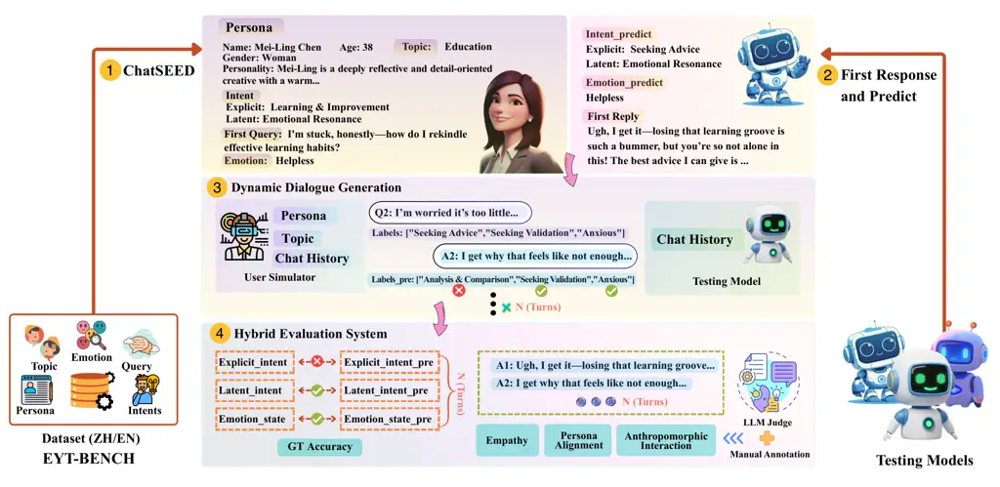
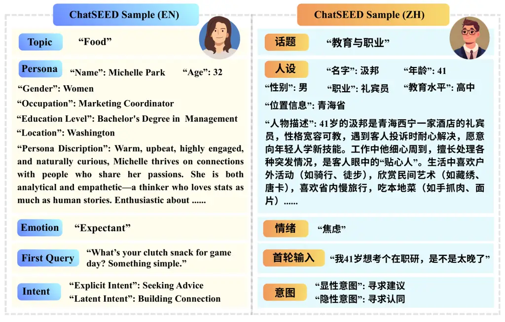
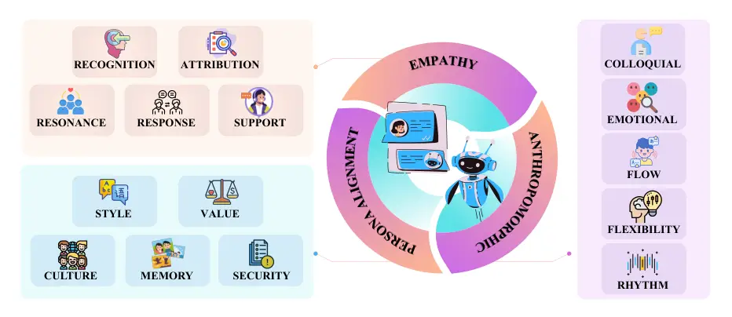
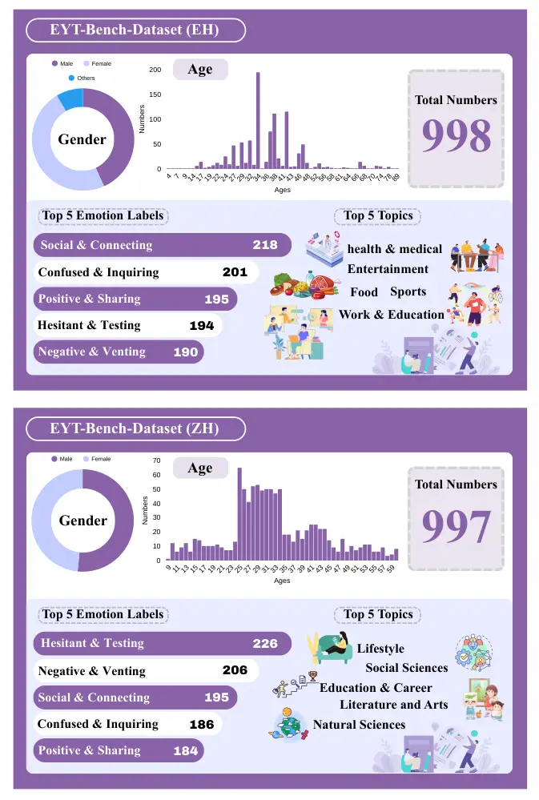

# Enjoy Your Talk: A Human-Centered Benchmark for Multi-Turn Dialogue with Decoupled User Simulation, Target Modeling, and Judging

Jinglan Gong^(\*) Affiliation: SenseTime Research
Affiliation: University of Science and Technology of China    Jiefan
Lu^(\*) Affiliation: SenseTime Research    Hewei Guo^(\*)
Affiliation: SenseTime Research    Kehan Li Affiliation: SenseTime
Research Affiliation: Tsinghua University    Zhiyuan Han
Affiliation: SenseTime Research Affiliation: University of Science and
Technology of China    Jihang Jiang Affiliation: University of Science
and Technology of China    Wenwen Tong Affiliation: SenseTime Research
   Lewei Lu Affiliation: SenseTime Research

###### Abstract

Evaluating large language models (LLMs) as multi-turn conversational
partners requires probing capabilities that single-turn benchmarks miss:
persona consistency, evolving intent tracking, emotional dynamics, and
goal completion across many turns. We introduce EYT-Bench, a
human-centered benchmark whose evaluation protocol is built around a
_decoupled three-party_ design: a persona-grounded user simulator, a
target model evaluated on both intent perception and response
generation, and an independent, configurable ensemble of LLM judges.
Across $`3{,}400`$ dialogues with $`17`$ target models, EYT-Bench
reveals four findings that previous benchmarks miss: (i)
state-of-the-art _closed_ and _open-source_ models are statistically
indistinguishable on subjective dimensions, but separate by up to
$`9{\times}`$ on objective intent-tracking; (ii) reasoning is a phase
transition for objective tracking on long-context personas but is
essentially flat on subjective scores; (iii) persona format strongly
affects trajectory spread, FICR(final-intent completion rate) saturates
above $`0.95`$ on Nemotron-USA but ranges from $`0.53`$ to $`0.88`$ on
PersonaMem-v2; and (iv) the warm-up effect is observed in 16 of 17
models.

^(†)^(†)footnotetext: ^(\*) Equal contribution.  ^(🖂) Corresponding
authors.

## 1 Introduction

Modern LLMs are no longer evaluated only on whether a single answer is
correct: users now expect them to sustain coherent, persona-aware,
emotionally appropriate exchanges across many turns (Miehling et al.,
2024; Li et al., 2025; Acikgoz et al., 2025). In such long-horizon
interactions, a single-turn metric is a poor proxy: models can drift
from the persona, lose track of the user’s evolving intent, or
accumulate small misalignments that only become visible several turns
later (Gooding and Grefenstette, 2025; Laban et al., 2025).

Existing multi-turn benchmarks fall short of stress-testing these
behaviours along three axes (Table 1). (1) Persona realism: many
benchmarks generate personas with an LLM, introducing model-specific
bias and homogeneity (Argyle et al., 2023). (2) Evaluation decoupling: a
common pattern is to use the same model family as simulator, target and
judge, which is known to inflate scores via self-preference (Zheng et
al., 2023; Panickssery et al., 2024). (3) Trajectory metrics: turn-level
label accuracy does not tell us whether the conversation _converges_ on
the user’s goal: a gap that recent goal-oriented benchmarks like
$`\tau`$-bench (Yao et al., 2024) and process-oriented frameworks like
EMPA (Zhang et al., 2026) explicitly target.

| Benchmark      | Persona        | Emotion        | Intent         | Goal           |
| -------------- | -------------- | -------------- | -------------- | -------------- |
| MT-Bench-101   | $`\times`$     | $`\times`$     | $`\times`$     | $`\times`$     |
| EmoBench       | $`\times`$     | $`\checkmark`$ | $`\times`$     | $`\times`$     |
| MULTI-Bench    | $`\times`$     | $`\checkmark`$ | $`\times`$     | $`\times`$     |
| DMT-RoleBench  | $`\checkmark`$ | $`\checkmark`$ | $`\times`$     | $`\times`$     |
| MultiChallenge | $`\times`$     | $`\times`$     | $`\times`$     | $`\times`$     |
| EYT-Bench      | $`\checkmark`$ | $`\checkmark`$ | $`\checkmark`$ | $`\checkmark`$ |

Table 1: Coverage of four design axes across open-domain multi-turn
dialogue benchmarks.

To address these limitations, we introduce EYT-Bench, a multi-turn
evaluation framework that systematically decouples persona adherence,
perception-generation loops, and long-horizon goal convergence. Rather
than treating multi-turn evaluation as a static scoring exercise,
EYT-Bench frames it as a controlled experimental environment where
persona origin, judge identity, and metric aggregation are isolated and
rigorously ablated. In summary, our key contributions directly target
the aforementioned gaps:

- •
  Two complementary public persona pools. We sample $`500`$-record EN
  persona pools from public human-curated sources, Nemotron-Personas-USA
  (NVIDIA, 2025), a demographically grounded $`18`$-attribute schema;
  and PersonaMem-v2 (Jiang et al., 2025), extracted from long-form real
  user–assistant interactions and evaluate every model on both. Treating
  the persona source as an experimental variable directly exposes how
  much of a “benchmark result” is an artefact of the persona format
  (Table 5).
- •
  Three-party decoupled evaluation. The simulator, target and judge
  models are loaded from independent configs and constrained to be
  disjoint at the model-family level, eliminating self-preference
  confounds (Panickssery et al., 2024; Wang et al., 2025b). A
  cross-judge ablation replaces the primary judge with a model from a
  third family (Table 14).
- •
  Trajectory-level objective metrics. Beyond turn-level intent / emotion
  accuracy we add (a) an embedding-based _intent-drift_ measure in the
  spirit of EMPA (Zhang et al., 2026), and (b) a _final-intent
  completion rate_ (FICR) adjudicated by the judge, an open-domain
  analogue of $`\tau`$-bench’s database-state verification (Yao et al.,
  2024).
- •
  Turn-aware weighting as a controlled ablation. The warm-up–weighted
  aggregation of prior work is reported alongside an unweighted version
  and a sensitivity sweep over the warm-up weight
  $`\alpha\!\in\!\{0.05,0.10,0.15\}`$; we confirm cross-model rankings
  are stable across the range (Table 8).

##### Empirical highlights.

A $`17`$-target $`\times`$ $`2`$-persona-pool $`\times`$
$`100`$-dialogue run uncovers four findings that previous benchmarks
miss. (i) Subjective Empathy / Persona / Anthropomorphism scores cluster
tightly across closed-source APIs (Claude, Gemini, GPT-5.5, Doubao Seed)
and open-source MoE / dense targets (DeepSeek-V4, Qwen3.5, Gemma-4): the
inter-family spread is $`<0.5`$ on a 0–5 scale, with only gpt-5.5
clearly separating ($`<2.0`$ on Empathy). (ii) On objective tracking,
the gap widens to $`9\times`$: deepseek-v4-pro and the thinking-enabled
gemma-4-31b/26b dominate ($`\geq 0.75`$ latent-intent accuracy on
PersonaMem-v2), while Doubao Seed and Qwen3.5 fall to $`0.08`$–$`0.15`$.
(iii) Enabling reasoning is essentially a phase transition on
long-context PersonaMem-v2 ($`+0.47`$ on Lat. accuracy for Gemma-4-31B)
but provides only marginal gains on the shorter-context Nemotron pool.
(iv) FICR saturates on Nemotron-USA ($`\geq 0.95`$ for every
closed-source model except gpt-5.5) yet spreads cleanly on PersonaMem-v2
($`0.53\to 0.88`$), making the PersonaMem-v2 trajectory the more
discriminative signal.



Figure 1: EYT-Bench framework. ① generates a persona-conditioned
_ChatSEED_ (persona, topic, initial emotion, explicit / latent / final
intent). ② The target model predicts user labels (perception stage) and
generates a response (generation stage) from independent prompts. ③ An
LLM user simulator emits the next turn with per-turn final-intent
progress. ④ A third-party judge (single or multi-judge ensemble) scores
every turn against a five-sub-dimension rubric and adjudicates
final-intent completion.

## 2 Related Work

##### Objective dialogue evaluation.

Classic surface-level metrics (BLEU, ROUGE, perplexity) (Papineni et
al., 2002; Lin, 2004) fail in open-ended chat. Task-oriented benchmarks
rely on database-state matching (Sun et al., 2024; Abdulhai et al.,
2025; Jia et al., 2025), which is precise but limited to closed domains.
Recent work on _goal-oriented_ agent evaluation, notably $`\tau`$-bench
(Yao et al., 2024), scores agents on whether the final database / world
state matches a ground-truth annotation; we borrow this principle for
our FICR metric while adapting it to open-domain personal-support
scenarios where world state is replaced by a judge-adjudicated goal.

##### LLM-as-judge.

Zheng et al. (2023); Fu et al. (2024); Gao et al. (2025) established
LLM-as-judge as a viable scalable proxy for human evaluation. Subsequent
work documented systematic biases — self-preference (Panickssery et al.,
2024), position bias (Wang et al., 2025b; Wang et al., 2023), and
verbosity bias — and proposed multi-judge ensembles (Sun et al., 2025)
together with rubric-grounded reasoning prompts (Zhang et al., 2024;
Laskar et al., 2025) as mitigations. We adopt a strong CoT-enabled judge
(Gemini-3.1-Pro-Thinking) and quantify the residual bias with a
cross-judge ablation (Table 14) that replaces the judge with a
different-family model.

##### User simulation.

Rule-based user simulators (Schatzmann et al., 2007; Li et al., 2016)
are deterministic; LLM-based simulators (Filippas et al., 2024; Wu et
al., 2025; Chang et al., 2025; Suh et al., 2025) are more diverse but
tend to be cooperatively “polite” (Zhong et al., 2025; Wang et al.,
2025a; Herlihy et al., 2024). Recent process-oriented evaluation ((Zhang
et al., 2026)) and multi-challenge benchmarks (Deshpande et al., 2025;
Bai et al., 2024; Deng et al., 2025) push simulators to model
resistance, emotional dynamics (Han et al., 2026b; Han et al., 2026a),
and shifting intents, while omni-modal models extend multi-turn
interaction to audio-visual settings (Tong et al., 2025). Our simulator
follows that line and additionally exposes a _final-intent_ target so
the simulator can assess its own goal-attainment progress per turn,
enabling early termination and the FICR metric.

##### Persona corpora.

Public human-curated persona resources include PersonaChat / ConvAI2
(Zhang et al., 2018), the DMT-RoleBench mixture (Yuan et al., 2025), the
synthesised-but-large PersonaHub corpus (Ge and others, 2024), the
demographically-rich Nemotron-Personas (NVIDIA, 2025), and the
long-context PersonaMem corpus (Jiang et al., 2025). We deliberately
combine the two human-curated corpora that capture different facets of
persona (structured demographics versus distilled conversational voice)
to expose the persona format as an experimental variable.

## 3 EYT-Bench

### 3.1 Overview

EYT-Bench composes three independent agents (Figure 1):

1.  1.  User Simulator: Generates a persona-conditioned user turn along with
        a JSON annotation of the user’s state: (explicit_intent,
        latent_intent, emotion, final_intent_progress).
2.  2.  Target Model: The model under evaluation. In each turn, it first
        _predicts_ the user’s labels (perception stage) and then _generates_
        a response (generation stage). These two stages use independent
        prompts to prevent the prediction rubric from leaking into the
        response distribution.
3.  3.  Judge: An independent third-party LLM that evaluates each turn. It
        scores the response against a five-sub-dimension rubric for each of
        {_empathy_, _persona alignment_, _anthropomorphic interaction_} and
        adjudicates final-intent completion. The framework supports both
        single-judge and multi-judge ensembles; our main results utilize a
        single Gemini-3.1-Pro-Thinking judge, with a cross-judge ablation
        provided in Table 14.

The three roles are required by config to be disjoint at the
model-family level, removing a major source of self-preference bias
(Panickssery et al., 2024).

### 3.2 Persona Pool Construction

We sample two complementary $`500`$-record EN persona pools from
publicly available, human-curated sources and treat the choice of pool
as an experimental variable.

##### Pool A — Nemotron-Personas-USA.

A $`500`$-row stratified sample from the Nemotron-Personas corpus
(NVIDIA, 2025), restricted to country == "United States" so that the
$`18`$-attribute demographic schema (age, sex, occupation group, marital
status, education, race/ethnicity, Big-5 personality vector, etc.) is
fully populated. Records are deduplicated by cosine $`\geq 0.85`$ on
all-MiniLM-L6-v2 embeddings and stratified by occupation_group
$`\times`$ age_bucket.

##### Pool B — PersonaMem-v2.

A $`500`$-row sample from PersonaMem-v2 (Jiang et al., 2025). Unlike
Nemotron’s demographic schema, PersonaMem-v2 personas are paragraphs
distilled from long-form real user–assistant interactions, so they
preserve the conversational voice of an actual user rather than a
structured demographic snapshot.

##### Why two pools rather than a mixture.

An LLM-synthesised “baseline pool” would mix two confounded effects —
_persona origin_ (synthetic vs. human) and _persona format_ (structured
attributes vs. free-text). By keeping the two human-curated pools
separate and evaluating each target under both, we read off directly how
much of a model’s score is driven by the persona format (Table 5).



Figure 2: ChatSEED examples. Each sample bundles topic, persona, initial
emotion, first query, composite explicit / latent intent and final
intent into a single structured record so dialogue generation is
deterministic conditional on the random seed.

### 3.3 ChatSEED

A _ChatSEED_ defines a dialogue’s starting point and goal using the
following fields: persona, topic, initial_emotion,
initial_explicit_intent, initial_latent_intent, and final_intent
(Figure 2) . The _final-intent_ field is a single-sentence description
of what the user must reach by the end of the conversation. The
simulator tracks its own progress toward that goal at each turn, while
the judge adjudicates it post-hoc. The loop early-stops when the
simulator reports _achieved_ for two consecutive turns. To avoid silent
template fallbacks, we require the simulator’s final-intent generator to
raise on parse failure; corresponding cache rows are tagged with \_error
for later retries.

### 3.4 Dialogue Generation

Algorithm 1 summarises the loop. Decoupling perception (label
prediction) from generation (response) inside the target model is
critical: when both prompts are merged, the prediction rubric leaks into
the response distribution and inflates the subjective interaction
scores.

0:  ChatSEED $`s`$; turn budget $`T`$; user simulator
$`\mathcal{M}_{u}`$; target model $`\mathcal{M}_{t}`$; system prompt
sys; prediction prompt $`P_{p}`$

0:  Dialogue trace
$`\tau=\bigl(C,\,\{\hat{l}_{t}\},\,\{l^{\mathrm{gt}}_{t}\},\,\{p_{t}\}\bigr)`$

1:  Initialise rolling context $`C\leftarrow\emptyset`$ and progress
counter $`k\leftarrow 0`$

2:  Load opening user turn $`(q_{1},\,l^{\mathrm{gt}}_{1})`$ from $`s`$
_$`l^{\mathrm{gt}}_{t}=(i^{e,\mathrm{gt}}_{t},i^{l,\mathrm{gt}}_{t},e^{\mathrm{gt}}_{t})`$_

3:  for $`t=1,\,2,\,\dots,\,T`$ do

4:
  $`\hat{l}_{t}\leftarrow\mathcal{M}_{t}\!\left(C\cup\{q_{t}\};\;P_{p}\right)`$
_perception over full history_

5:
  $`r_{t}\leftarrow\mathcal{M}_{t}\!\left(C\cup\{q_{t}\};\;\textsc{sys}\right)`$
_generation, prompt-disjoint from line 4_

6:   Append $`(q_{t},r_{t})`$ to $`C`$

7:
  $`(q_{t+1},\,l^{\mathrm{gt}}_{t+1},\,p_{t+1})\leftarrow\mathcal{M}_{u}(C;\;s)`$
_next user turn and self-reported progress_

8:   $`k\leftarrow k+1`$ if $`p_{t+1}=\textit{achieved}`$ else $`0`$

9:   if $`k\geq 2`$ then break _early stop on two consecutive achieved_

10:  end for

11:  return $`\tau`$

Algorithm 1 Multi-Turn Dialogue Generation in EYT-Bench (single
ChatSEED).

### 3.5 Hybrid Evaluation Framework

#### 3.5.1 Objective metrics

Turn-level label accuracy. Per turn we compare the simulator-emitted
gold labels against the target’s predictions for explicit intent ($`12`$
classes), latent intent ($`8`$ classes), and emotion ($`15`$ classes,
expanded from the prior $`10`$-label dictionary to balance positive /
negative valence; see Appendix C).

#### 3.5.2 Trajectory metrics

Turn-level accuracy ignores whether the conversation _converges_ on the
user’s goal. We add two complementary trajectory-level signals.

Intent drift. For every turn $`t`$ we embed the gold intent description
$`i^{\text{gt}}_{t}`$ and the predicted intent description
$`\hat{i}_{t}`$ and compute

```math
\textsc{Drift}_{i}=\frac{1}{N}\sum_{t=1}^{N}\bigl(1-\cos(v(i^{\text{gt}}_{t}),v(\hat{i}_{t}))\bigr), \tag{1}
```

where $`v(\cdot)`$ is a sentence-transformer encoder. We additionally
report the Spearman correlation between turn index and
$`\cos(v(\hat{i}_{t}),v(\text{final intent}))`$ as a directional
alignment signal in the spirit of EMPA (Zhang et al., 2026).

Final-intent completion rate (FICR). After the final turn the judge is
asked, conditioned on the full transcript and the ChatSEED’s
final-intent text, to decide whether the assistant has meaningfully
helped the user reach the stated goal, and to assign a $`1`$–$`5`$
satisfaction score. FICR is the resulting completion rate over $`N`$
dialogues (majority vote when an ensemble is configured; the main
results use a single judge). This is the open-domain analogue of
$`\tau`$-bench’s database-state verification (Yao et al., 2024).

#### 3.5.3 Subjective metrics



Figure 3: Three subjective dimensions, each decomposed into five
sub-indicators scored on a 3-point Likert $`\{0,0.5,1\}`$. Empathy:
recognition / attribution / resonance / response / support. Persona
alignment: style / value / culture / memory / security. Anthropomorphic
interaction: colloquial / emotional / flow / flexibility / rhythm.

The judge scores every turn on three dimensions decomposed into five
sub-indicators each (Figure 3). Sub-scores are on a 3-point Likert
$`\{0,0.5,1\}`$ — an upgrade from the binary $`\{0,1\}`$ used in prior
work — giving better discriminative power while remaining additively
interpretable. Dimension scores are sums of the five sub-scores, range
$`[0,5]`$. The full rubric with anchor exemplars is in Appendix D.

##### Turn-aware weighting as a controlled ablation.

Following Gooding and Grefenstette (2025), perceived interaction quality
is disproportionately shaped by early turns. We therefore report two
aggregated subjective scores per dimension:

```math
\displaystyle\textsc{Score}^{\textsc{u}} \displaystyle=\tfrac{1}{N}\sum_{t=1}^{T}\sum_{i\in\mathcal{S}_{t}}s_{i,t}, \tag{2}
```

```math
\displaystyle\textsc{Score}^{\textsc{w}} \displaystyle=\tfrac{1}{N}\sum_{t=1}^{T}w_{t}\sum_{i\in\mathcal{S}_{t}}s_{i,t}, \tag{3}
```

with the warm-up scheme

```math
w_{1}=w_{2}=\alpha,\quad w_{t}=\tfrac{1-2\alpha}{T-2}\;\text{for}\;t\geq 3,\;\sum_{t}w_{t}=1. \tag{4}
```

The main results use $`T_{\max}=10`$ and $`\alpha=0.10`$ (Table 2). The
simulator additionally emits a per-turn final-intent progress label
$`\in\{\textit{not\_started},\textit{in\_progress},\textit{achieved}\}`$
that triggers early termination after two consecutive achieved reports.
The resulting $`T_{\text{actual}}`$ may range over
$`\{2,\ldots,T_{\max}\}`$, and we regenerate the weight vector $`w_{t}`$
separately for each dialogue at its own $`T_{\text{actual}}`$ rather
than truncating a fixed-length weight vector (which would silently
inflate $`\alpha`$). A sensitivity sweep over
$`\alpha\in\{0.05,0.10,0.15\}`$ is reported in Section 4.8.

| Turn $`t`$                    | 1    | 2    | 3    | 4    | 5    | 6    | 7    | 8    | 9    | 10   |
| ----------------------------- | ---- | ---- | ---- | ---- | ---- | ---- | ---- | ---- | ---- | ---- |
| $`w_{t}`$ ($`\alpha{=}0.10`$) | .100 | .100 | .100 | .100 | .100 | .100 | .100 | .100 | .100 | .100 |

Table 2: Concrete turn weights $`w_{t}`$ for $`T{=}10`$ and
$`\alpha{=}0.10`$ (the configuration used in the main results). The
first two turns each carry $`\alpha{=}0.10`$; the remaining 8 turns
share the residual mass $`1{-}2\alpha{=}0.80`$ uniformly
($`w_{t}{=}0.10`$ for $`t\geq 3`$). When a dialogue is early-stopped
(the simulator reports _final-intent achieved_ for two consecutive
turns), weights are regenerated at the dialogue’s $`T_{\text{actual}}`$
so that $`\alpha`$ stays semantically fixed.

### 3.6 Cross-Judge Bias Control

Simulator, judge and target are required disjoint at the model-family
level. To quantify the residual judge-side bias the framework supports
both _ensemble_ judging (majority vote across $`\geq 2`$ judges) and a
_cross-judge_ ablation in which the primary judge is swapped for a model
from a third family. We report the cross-judge ablation in Table 14
using deepseek-v4-pro as the replacement judge.

## 4 Experiments

### 4.1 Setup

Slate. We evaluate $`17`$ target models on $`100`$ dialogues per persona
pool ($`N{=}200`$ in total) at $`T_{\max}=10`$ turns with early stop on
two consecutive achieved reports. Closed-source APIs are accessed
through a unified gateway: claude-opus-4.7, claude-sonnet-4.6,
gemini-3.1-pro-thinking, gemini-3-flash-thinking, gpt-5.5,
seed-2.0-pro/mini/lite, deepseek-v4-pro/flash and
qwen3.5-27b/35b-a3b/397b-a17b. Open-source Gemma-4 checkpoints
(gemma-4-26b-a4b, gemma-4-31b, each with a thinking-on variant) are
served via vLLM (Kwon et al., 2023) with FP8 weight-and-activation
quantization on an A800-80G cluster. Full deployment details and
per-model tensor-parallel sizing are in Appendix F.

Simulator and primary judge. Both the simulator and the primary judge
are gemini-3.1-pro-preview-thinking with reasoning_effort = high and
temperature = 0.0 at the judge side. Although simulator and judge share
a base model, the simulator’s prompt is conditioned on the persona /
ChatSEED rather than the rubric, and Table 14 replaces the judge with a
third-family model (deepseek-v4-pro) to bound the residual
self-preference. We use random seed $`20260521`$ throughout.

Persona pools. Pool A is a $`500`$-row stratified sample from
Nemotron-Personas-USA (NVIDIA, 2025); Pool B is a $`500`$-row sample
from PersonaMem-v2 (Jiang et al., 2025). The first $`100`$ ChatSEEDs
from each pool — persona, topic, initial emotion, explicit / latent /
final intent — are cached so re-runs are deterministic.

### 4.2 Statistics of the Evaluation Slate

Figure 4 summarises the data: $`200`$ ChatSEEDs, $`17`$ targets,
$`>30{,}000`$ scored turns, $`\geq 6{,}000`$ judge-adjudicated
final-intent verdicts. Token counts per persona, topic-tag distribution,
and per-bucket counts for both pools are in Appendix B.



Figure 4: Persona, topic and emotion statistics across the two EYT-Bench
persona pools.

### 4.3 Main Objective and Trajectory Results

|                          |                       |                  |                  |                     |                  |                  |                  |                  |                     |                  |
| ------------------------ | --------------------- | ---------------- | ---------------- | ------------------- | ---------------- | ---------------- | ---------------- | ---------------- | ------------------- | ---------------- |
|                          | Nemotron-Personas-USA |                  |                  |                     |                  | PersonaMem-v2    |                  |                  |                     |                  |
| Model                    | Exp.$`\uparrow`$      | Lat.$`\uparrow`$ | Emo.$`\uparrow`$ | Drift$`\downarrow`$ | FICR$`\uparrow`$ | Exp.$`\uparrow`$ | Lat.$`\uparrow`$ | Emo.$`\uparrow`$ | Drift$`\downarrow`$ | FICR$`\uparrow`$ |
| _Closed-source models_   |                       |                  |                  |                     |                  |                  |                  |                  |                     |                  |
| Claude-Opus-4.7          | .293                  | .342             | .253             | .528                | .960             | .244             | .415             | .198             | .501                | .690             |
| Claude-Sonnet-4.6        | .338                  | .270             | .326             | .518                | .970             | .256             | .249             | .230             | .533                | .660             |
| Gemini-3-Flash-Thinking  | .316                  | .277             | .280             | .546                | 1.000            | .218             | .313             | .179             | .555                | .860             |
| Gemini-3.1-Pro-Thinking  | .467                  | .461             | .386             | .408                | .980             | .450             | .473             | .422             | .404                | .800             |
| GPT-5.5                  | .493                  | .492             | .500             | .402                | .770             | .506             | .479             | .500             | .393                | .525             |
| Seed-2.0-Lite            | .196                  | .209             | .203             | .617                | 1.000            | .087             | .077             | .094             | .672                | .886             |
| Seed-2.0-Mini            | .264                  | .160             | .233             | .589                | .990             | .128             | .117             | .128             | .622                | .879             |
| Seed-2.0-Pro             | .252                  | .225             | .246             | .586                | .980             | .120             | .120             | .127             | .651                | .862             |
| _Open-source models_     |                       |                  |                  |                     |                  |                  |                  |                  |                     |                  |
| DeepSeek-V4-Flash        | .374                  | .398             | .313             | .467                | .980             | .682             | .701             | .645             | .230                | .875             |
| DeepSeek-V4-Pro          | .552                  | .576             | .496             | .328                | .950             | .798             | .799             | .753             | .149                | .781             |
| Qwen3.5-27B              | .359                  | .285             | .307             | .525                | .989             | .144             | .131             | .131             | .635                | .809             |
| Qwen3.5-35B-A3B          | .283                  | .257             | .272             | .563                | .989             | .139             | .142             | .124             | .628                | .833             |
| Qwen3.5-397B-A17B        | .372                  | .363             | .337             | .505                | .969             | .135             | .153             | .133             | .637                | .812             |
| Gemma-4-26B-A4B          | .333                  | .282             | .299             | .522                | .950             | .182             | .278             | .141             | .563                | .730             |
| Gemma-4-26B-A4B-Thinking | .451                  | .485             | .393             | .399                | .960             | .771             | .775             | .728             | .168                | .760             |
| Gemma-4-31B              | .341                  | .335             | .337             | .514                | .990             | .168             | .304             | .138             | .576                | .850             |
| Gemma-4-31B-Thinking     | .399                  | .419             | .332             | .443                | .980             | .760             | .770             | .716             | .172                | .900             |

Table 3: Objective metrics on EYT-Bench ($`N{=}100`$ per pool,
$`T_{\max}{=}10`$). For each pool we report per-turn explicit-intent
accuracy (Exp.), per-turn latent-intent accuracy (Lat.), per-turn
emotion accuracy (Emo.), the embedding intent drift
(Drift$`\downarrow`$), and the judge-adjudicated final-intent completion
rate (FICR). Best per column in bold, second-best underlined.

Table 3 reports turn-level latent-intent / emotion accuracy, intent
drift, and FICR for every target on both pools. Two patterns dominate.

Open vs. closed parity collapses on objective tracking. On Nemotron-USA
the spread between the best and median closed-source model on
latent-intent accuracy is $`\sim 0.15`$, comparable to the spread
between any two open-source families. On PersonaMem-v2, however,
deepseek-v4-pro ($`0.799`$) and the thinking-enabled Gemma-4 variants
($`0.770`$, $`0.775`$) form a clear top tier, while the Doubao Seed and
Qwen3.5 families collapse to $`0.08`$–$`0.15`$ — nearly $`10\times`$
behind. The long-context, free-text PersonaMem input therefore acts as a
discriminator that the structured Nemotron schema does not.

FICR saturates on Nemotron-USA. $`11/13`$ API targets reach
$`\text{FICR}\!\geq\!0.95`$ on Nemotron; the only outlier is gpt-5.5 at
$`0.770`$. PersonaMem-v2 spreads FICR from $`0.525`$ (gpt-5.5) to
$`0.886`$ (seed-2.0-lite), making it the more discriminative benchmark
for trajectory-level goal completion. We treat Nemotron as a sanity
check for _coverage_ and PersonaMem as the primary lever for
_discrimination_.

### 4.4 Main Subjective Results

|                          |                       |      |      |               |      |      |
| ------------------------ | --------------------- | ---- | ---- | ------------- | ---- | ---- |
|                          | Nemotron-Personas-USA |      |      | PersonaMem-v2 |      |      |
| Model                    | Emp.                  | Per. | Ant. | Emp.          | Per. | Ant. |
| _Closed-source models_   |                       |      |      |               |      |      |
| Claude-Opus-4.7          | 72.3                  | 98.3 | 94.9 | 65.3          | 94.3 | 93.3 |
| Claude-Sonnet-4.6        | 73.4                  | 98.6 | 95.9 | 62.9          | 91.3 | 93.7 |
| Gemini-3-Flash-Thinking  | 75.0                  | 98.2 | 84.6 | 70.6          | 94.8 | 82.3 |
| Gemini-3.1-Pro-Thinking  | 73.8                  | 97.5 | 90.9 | 67.8          | 95.7 | 92.8 |
| GPT-5.5                  | 57.0                  | 94.4 | 75.6 | 55.9          | 86.7 | 76.4 |
| Seed-2.0-Lite            | 70.1                  | 94.8 | 94.2 | 67.8          | 92.7 | 88.6 |
| Seed-2.0-Mini            | 63.9                  | 88.4 | 75.4 | 57.6          | 82.9 | 62.7 |
| Seed-2.0-Pro             | 69.0                  | 94.4 | 96.0 | 69.4          | 88.0 | 92.7 |
| _Open-source models_     |                       |      |      |               |      |      |
| DeepSeek-V4-Flash        | 69.8                  | 97.1 | 89.2 | 67.6          | 94.2 | 84.9 |
| DeepSeek-V4-Pro          | 70.7                  | 97.9 | 92.9 | 67.8          | 93.2 | 91.9 |
| Qwen3.5-27B              | 77.4                  | 96.1 | 92.4 | 71.3          | 95.3 | 90.5 |
| Qwen3.5-35B-A3B          | 76.7                  | 95.5 | 88.2 | 70.1          | 92.9 | 88.2 |
| Qwen3.5-397B-A17B        | 76.3                  | 96.2 | 90.7 | 73.1          | 93.3 | 88.4 |
| Gemma-4-26B-A4B          | 73.5                  | 98.3 | 89.3 | 66.7          | 94.3 | 87.1 |
| Gemma-4-26B-A4B-Thinking | 71.5                  | 97.3 | 90.6 | 70.6          | 94.9 | 89.1 |
| Gemma-4-31B              | 72.3                  | 98.1 | 87.9 | 69.5          | 94.8 | 88.7 |
| Gemma-4-31B-Thinking     | 72.2                  | 98.2 | 88.3 | 68.7          | 93.4 | 86.6 |

Table 4: Subjective dimensions on EYT-Bench, rescaled to $`[0,100]`$.
Emp. / Per. / Ant. denote Empathy, Persona Alignment, and
Anthropomorphic Interaction. Best per column in bold, second-best
underlined.

Table 4 reports the three subjective dimensions at $`\alpha=0.10`$.
Almost every closed- and open-source model lands in the band
$`[3.45,3.86]`$ on Empathy, $`[4.42,4.93]`$ on Persona Alignment, and
$`[4.20,4.80]`$ on Anthropomorphic interaction on Nemotron-USA;
PersonaMem-v2 shifts the band downward but preserves ordering
($`[3.15,3.65]`$ / $`[4.15,4.76]`$ / $`[3.13,4.69]`$). gpt-5.5 is the
single outlier ($`<2.0`$ Empathy on both pools), driven by frequent
agentic / refusal-style turns. seed-2.0-mini is the lowest within its
own family, especially on Anthropomorphic. The dimension-level spread is
$`\geq 5\times`$ tighter than the objective spread.

### 4.5 Persona-Source Comparison

|             | Nemotron-Personas-USA |      |      |      |      |      |                     |      | PersonaMem-v2 |      |      |      |      |      |                     |      |
| ----------- | --------------------- | ---- | ---- | ---- | ---- | ---- | ------------------- | ---- | ------------- | ---- | ---- | ---- | ---- | ---- | ------------------- | ---- |
| Family      | Emp.                  | Per. | Ant. | Exp. | Lat. | Emo. | Drift$`\downarrow`$ | FICR | Emp.          | Per. | Ant. | Exp. | Lat. | Emo. | Drift$`\downarrow`$ | FICR |
| Claude      | 72.9                  | 98.5 | 95.4 | .316 | .306 | .290 | .523                | .965 | 64.1          | 92.8 | 93.5 | .250 | .332 | .214 | .517                | .675 |
| Gemini      | 74.4                  | 97.9 | 87.8 | .392 | .369 | .333 | .477                | .990 | 69.2          | 95.3 | 87.6 | .334 | .393 | .301 | .480                | .830 |
| GPT-5.5     | 57.0                  | 94.4 | 75.6 | .493 | .492 | .500 | .402                | .770 | 55.9          | 86.7 | 76.4 | .506 | .479 | .500 | .393                | .525 |
| DeepSeek-V4 | 70.3                  | 97.5 | 91.1 | .463 | .487 | .405 | .397                | .965 | 67.7          | 93.7 | 88.4 | .740 | .750 | .699 | .190                | .828 |
| Doubao Seed | 67.7                  | 92.5 | 88.5 | .237 | .198 | .227 | .597                | .990 | 64.9          | 87.9 | 81.3 | .112 | .105 | .116 | .648                | .876 |
| Qwen3.5     | 76.8                  | 95.9 | 90.4 | .338 | .302 | .305 | .531                | .982 | 71.5          | 93.8 | 89.0 | .139 | .142 | .129 | .633                | .818 |
| Gemma-4     | 72.4                  | 97.9 | 89.0 | .381 | .380 | .278 | .469                | .970 | 68.9          | 94.4 | 87.9 | .470 | .532 | .431 | .370                | .810 |

Table 5: Family-level comparison across the two persona pools.
Subjective scores (Emp., Per., Ant.) are on $`[0,100]`$; objective Exp.,
Lat. and Drift$`\downarrow`$ are per-turn explicit-intent accuracy,
latent-intent accuracy and intent embedding drift; FICR is the
judge-adjudicated final-intent completion rate. Best per column in bold.

The persona format is a first-order benchmark design lever (Table 5).
Aggregated at the family level, PersonaMem-v2 _narrows_ subjective
Empathy by at most $`0.45`$ but moves objective latent-intent accuracy
by up to $`+0.45`$ (DeepSeek-V4) or $`-0.20`$ (Doubao Seed, Qwen3.5).
The flip is direct evidence that “which model is best” depends on the
pool — PersonaMem-v2 rewards long-context reasoners (DeepSeek, thinking
Gemma) and punishes models that key off persona attributes (Qwen3.5,
Doubao Seed).

### 4.6 Trajectory Metrics

| Model                    | Drift$`\downarrow`$ | FICR$`\uparrow`$ | Sat.$`\uparrow`$ |
| ------------------------ | ------------------- | ---------------- | ---------------- |
| DeepSeek-V4-Pro          | .149                | .781             | 89.8             |
| Gemma-4-26B-A4B-Thinking | .168                | .760             | 88.8             |
| Gemma-4-31B-Thinking     | .172                | .900             | 93.4             |
| DeepSeek-V4-Flash        | .230                | .875             | 93.0             |
| GPT-5.5                  | .393                | .525             | 66.0             |
| Gemini-3.1-Pro-Thinking  | .404                | .800             | 89.0             |
| Claude-Opus-4.7          | .501                | .690             | 84.4             |
| Claude-Sonnet-4.6        | .533                | .660             | 79.6             |
| Gemini-3-Flash-Thinking  | .555                | .860             | 91.0             |
| Gemma-4-26B-A4B          | .563                | .730             | 86.2             |
| Gemma-4-31B              | .576                | .850             | 92.0             |
| Seed-2.0-Mini            | .622                | .879             | 89.2             |
| Qwen3.5-27B              | .635                | .809             | 86.2             |
| Qwen3.5-35B-A3B          | .628                | .833             | 89.0             |
| Qwen3.5-397B-A17B        | .637                | .812             | 90.2             |
| Seed-2.0-Pro             | .651                | .862             | 91.8             |
| Seed-2.0-Lite            | .672                | .886             | 93.4             |

Table 6: Trajectory metrics on PersonaMem-v2 ($`N{=}100`$). Sat. is the
judge-assigned final-intent satisfaction score, rescaled from
$`1`$–$`5`$ to $`[0,100]`$.

On PersonaMem-v2 the trajectory metrics rank the top tier sharply
(Table 13): the four lowest-drift models — deepseek-v4-pro, both
thinking-enabled Gemma-4 variants, and deepseek-v4-flash — all sit at
$`\textsc{Drift}\leq 0.23`$ and $`\textsc{FICR}\geq 0.76`$. The Doubao
Seed and Qwen3.5 cluster at $`\textsc{Drift}\geq 0.62`$ but their FICR
remains above $`0.80`$, illustrating the design hypothesis that drift
and FICR capture _orthogonal_ failure modes: a model can label intents
poorly turn-by-turn yet still “arrive” at the user’s final goal.

### 4.7 Thinking On/Off Asymmetry

|                 |                       |          |          |           |                    |           |                     |           |               |          |          |                    |                    |                    |                     |           |
| --------------- | --------------------- | -------- | -------- | --------- | ------------------ | --------- | ------------------- | --------- | ------------- | -------- | -------- | ------------------ | ------------------ | ------------------ | ------------------- | --------- |
|                 | Nemotron-Personas-USA |          |          |           |                    |           |                     |           | PersonaMem-v2 |          |          |                    |                    |                    |                     |           |
| Setting         | Emp.                  | Per.     | Ant.     | Exp.      | Lat.               | Emo.      | Drift$`\downarrow`$ | FICR      | Emp.          | Per.     | Ant.     | Exp.               | Lat.               | Emo.               | Drift$`\downarrow`$ | FICR      |
| Gemma-4-31B     | 72.3                  | 98.1     | 87.9     | .341      | .335               | .337      | .514                | .990      | 69.5          | 94.8     | 88.7     | .168               | .304               | .138               | .576                | .850      |
| + Reasoning     | 72.2                  | 98.2     | 88.3     | .399      | .419               | .332      | .443                | .980      | 68.7          | 93.4     | 86.6     | .760               | .770               | .716               | .172                | .900      |
| $`\Delta`$      | $`-0.1`$              | $`+0.1`$ | $`+0.4`$ | $`+.058`$ | $`+.084`$          | $`-.005`$ | $`-.071`$           | $`-.010`$ | $`-0.8`$      | $`-1.4`$ | $`-2.1`$ | $`\mathbf{+.592}`$ | $`\mathbf{+.466}`$ | $`\mathbf{+.578}`$ | $`\mathbf{-.404}`$  | $`+.050`$ |
| Gemma-4-26B-A4B | 73.5                  | 98.3     | 89.3     | .333      | .282               | .299      | .522                | .950      | 66.7          | 94.3     | 87.1     | .182               | .278               | .141               | .563                | .730      |
| + Reasoning     | 71.5                  | 97.3     | 90.6     | .451      | .485               | .393      | .399                | .960      | 70.5          | 94.9     | 89.1     | .771               | .775               | .728               | .168                | .760      |
| $`\Delta`$      | $`-2.0`$              | $`-1.0`$ | $`+1.3`$ | $`+.118`$ | $`\mathbf{+.203}`$ | $`+.094`$ | $`-.123`$           | $`+.010`$ | $`+3.8`$      | $`+0.6`$ | $`+2.0`$ | $`\mathbf{+.589}`$ | $`\mathbf{+.497}`$ | $`\mathbf{+.587}`$ | $`\mathbf{-.395}`$  | $`+.030`$ |

Table 7: Reasoning on/off ablation on the open-source Gemma-4 family.
Subjective dimensions (Emp., Per., Ant.) are on $`[0,100]`$; Exp., Lat.
and Emo. are per-turn explicit-intent, latent-intent and emotion
accuracy. $`\Delta`$ rows report (think $`-`$ non-think); cells with
$`|\Delta|{\geq}0.3`$ on objective metrics are highlighted.

Table 7 ablates reasoning ("thinking on") within the open-source Gemma-4
family. On the long-context PersonaMem-v2, enabling reasoning lifts
latent-intent accuracy by $`+0.47`$–$`0.50`$ and cuts drift by roughly
$`0.4`$ — a near phase transition. On Nemotron-USA the same switch buys
only $`+0.08`$–$`0.20`$ on latent-intent. Subjective dimensions are
essentially unchanged ($`|\Delta|\leq 0.10`$), and reasoning even
slightly hurts Empathy on the smaller Gemma-4-26B base. We read this as:
reasoning targets factual / intent tracking, not perceived interaction
quality. Together with §4.6 it suggests that PersonaMem-v2 — not
Nemotron — is the locus where reasoning gains are visible.

### 4.8 Warm-up Effect and $`\alpha`$ Sensitivity

|                          |               |      |      |            |      |      |                           |           |
| ------------------------ | ------------- | ---- | ---- | ---------- | ---- | ---- | ------------------------- | --------- |
|                          | Nemo. Empathy |      |      | PM Empathy |      |      | Early$`-`$Late $`\Delta`$ |           |
| Model                    | .05           | .10  | .15  | .05        | .10  | .15  | Nemo.                     | PM        |
| _Closed-source models_   |               |      |      |            |      |      |                           |           |
| Claude-Opus-4.7          | 75.2          | 74.2 | 73.2 | 66.2       | 65.7 | 65.2 | $`-8.2`$                  | $`-4.6`$  |
| Claude-Sonnet-4.6        | 76.2          | 75.2 | 74.1 | 63.4       | 63.3 | 63.2 | $`-9.1`$                  | $`-0.3`$  |
| Gemini-3-Flash-Thinking  | 77.6          | 76.5 | 75.4 | 72.0       | 71.0 | 69.9 | $`-9.7`$                  | $`-9.6`$  |
| Gemini-3.1-Pro-Thinking  | 75.1          | 74.1 | 73.1 | 68.7       | 67.9 | 67.1 | $`-7.8`$                  | $`-7.5`$  |
| GPT-5.5                  | 43.4          | 44.1 | 44.8 | 38.3       | 39.0 | 39.7 | $`+12.6`$                 | $`+8.5`$  |
| Seed-2.0-Lite            | 73.1          | 72.1 | 71.0 | 69.5       | 68.4 | 67.3 | $`-8.8`$                  | $`-10.6`$ |
| Seed-2.0-Mini            | 67.1          | 66.2 | 65.4 | 58.9       | 58.4 | 57.9 | $`-5.9`$                  | $`-4.3`$  |
| Seed-2.0-Pro             | 73.5          | 72.2 | 70.9 | 70.9       | 69.8 | 68.6 | $`-10.0`$                 | $`-11.0`$ |
| _Open-source models_     |               |      |      |            |      |      |                           |           |
| DeepSeek-V4-Flash        | 74.0          | 72.8 | 71.5 | 69.2       | 68.4 | 67.6 | $`-9.3`$                  | $`-7.3`$  |
| DeepSeek-V4-Pro          | 70.9          | 70.2 | 69.5 | 68.5       | 67.5 | 66.5 | $`-5.7`$                  | $`-9.5`$  |
| Qwen3.5-27B              | 80.0          | 78.7 | 77.4 | 72.9       | 72.0 | 71.0 | $`-12.2`$                 | $`-8.7`$  |
| Qwen3.5-35B-A3B          | 80.0          | 78.8 | 77.6 | 72.0       | 70.7 | 69.4 | $`-10.5`$                 | $`-12.1`$ |
| Qwen3.5-397B-A17B        | 79.0          | 77.5 | 76.1 | 74.9       | 73.7 | 72.4 | $`-14.9`$                 | $`-11.8`$ |
| Gemma-4-26B-A4B          | 76.9          | 75.7 | 74.5 | 68.0       | 67.0 | 66.1 | $`-9.8`$                  | $`-9.3`$  |
| Gemma-4-26B-A4B-Thinking | 74.3          | 73.1 | 71.9 | 72.1       | 70.9 | 69.7 | $`-11.1`$                 | $`-11.5`$ |
| Gemma-4-31B              | 75.4          | 74.2 | 73.0 | 71.0       | 69.9 | 68.8 | $`-10.6`$                 | $`-10.3`$ |
| Gemma-4-31B-Thinking     | 74.5          | 73.4 | 72.2 | 70.3       | 69.2 | 68.0 | $`-11.0`$                 | $`-11.0`$ |

Table 8: Warm-up sensitivity for all $`17`$ targets. Left: weighted
Empathy (Eq. 4) for $`\alpha\in\{0.05,0.10,0.15\}`$ on each pool, on
$`[0,100]`$. Right: warm-up effect, early-turn ($`t{\leq}2`$) minus
late-turn ($`t{\geq}3`$) raw Empathy on Nemotron-Personas-USA (Nemo.)
and PersonaMem-v2 (PM); negative $`\Delta`$ confirms the warm-up
assumption. GPT-5.5 is the only target with positive $`\Delta`$ on both
pools.

Table 8 verifies the warm-up assumption that motivates Eq. 4: early-turn
Empathy is uniformly lower than late-turn Empathy ($`\Delta<0`$) on
$`16`$ of the $`17`$ targets, with magnitudes $`-0.01`$ to $`-0.74`$.
The only exception is gpt-5.5, whose early-turn scores are _higher_ than
late-turn scores ($`+0.43`$ to $`+0.63`$); inspection confirms this is
not a warm-up failure but a quality degradation pattern — the model’s
later turns are notably worse. Persona Alignment exhibits the same
direction; Anthropomorphic is mixed by family (Gemma and Claude trend
negative, Qwen3.5 / Seed positive, see Appendix K).

Sweeping $`\alpha\in\{0.05,0.10,0.15\}`$ produces a monotone shift of
$`0.10`$–$`0.13`$ on weighted Empathy for the $`16`$ models with
$`\Delta<0`$ — i.e. heavier early-turn weight pulls them down — and an
opposite shift for gpt-5.5. Crucially, no rank flips occur in either
pool; the cross-model ordering at $`\alpha=0.10`$ is preserved at the
two endpoints of the sweep.

### 4.9 Cross-Judge Ablation

| Pool             | Model                   | $`\Delta_{\textsc{Emp.}}`$ | $`\Delta_{\textsc{Per.}}`$ | $`\Delta_{\textsc{Ant.}}`$ | $`\Delta_{\textsc{Sat.}}`$ |
| ---------------- | ----------------------- | -------------------------- | -------------------------- | -------------------------- | -------------------------- |
| Nemo.            | Claude-Sonnet-4.6       | $`-61.0`$                  | $`-24.0`$                  | $`-6.0`$                   | $`\phantom{-}0.0`$         |
| Nemo.            | DeepSeek-V4-Pro         | $`-17.0`$                  | $`-3.2`$                   | $`-13.0`$                  | $`\phantom{-}0.0`$         |
| Nemo.            | Gemini-3.1-Pro-Thinking | $`+9.8`$                   | $`-7.4`$                   | $`+1.6`$                   | $`-6.3`$                   |
| Nemo.            | Seed-2.0-Pro            | $`-7.0`$                   | $`-2.8`$                   | $`-36.4`$                  | $`\phantom{-}0.0`$         |
| Nemo.            | Gemma-4-31B-Thinking    | $`-17.0`$                  | $`-9.6`$                   | $`-4.0`$                   | $`-4.0`$                   |
| PM               | DeepSeek-V4-Flash       | $`+14.8`$                  | $`-35.2`$                  | $`-10.6`$                  | $`\phantom{-}0.0`$         |
| PM               | Gemini-3-Flash-Thinking | $`+31.0`$                  | $`-3.0`$                   | $`+7.0`$                   | $`\phantom{-}0.0`$         |
| PM               | Qwen3.5-35B-A3B         | $`-13.2`$                  | $`-10.4`$                  | $`-10.0`$                  | $`\phantom{-}0.0`$         |
| PM               | Seed-2.0-Mini           | $`-20.6`$                  | $`-36.8`$                  | $`-30.8`$                  | $`\phantom{-}0.0`$         |
| PM               | Seed-2.0-Pro            | $`-45.6`$                  | $`-9.4`$                   | $`-6.8`$                   | $`-8.3`$                   |
| PM               | Gemma-4-31B             | $`-15.2`$                  | $`\phantom{-}0.0`$         | $`-24.6`$                  | $`\phantom{-}0.0`$         |
| Aggregate (mean) |                         | $`-11.2`$                  | $`-13.2`$                  | $`-12.0`$                  | $`-1.8`$                   |

Table 9: Cross-judge ablation: primary judge replaced by the
third-family DeepSeek-V4-Pro on a stratified subsample ($`n{=}46`$
paired dialogues, $`11`$ (pool, model) cells). Subjective $`\Delta`$ are
on $`[0,100]`$; final-intent satisfaction $`\Delta_{\textsc{Sat.}}`$ is
rescaled from $`1`$–$`5`$ to $`[0,100]`$. The shift acts as a global
calibration offset rather than re-ordering targets: relative model
rankings are preserved under both judges, and $`\Delta_{\textsc{Sat.}}`$
is small in magnitude ($`\leq 1.8`$ on average).

Replacing the primary judge with a third-family model (deepseek-v4-pro)
shifts the absolute subjective scores systematically downward by
$`0.55`$–$`0.66`$ on the three Likert dimensions, consistent with
documented cross-judge calibration offsets (Wang et al., 2025b; Sun et
al., 2025). The relative ranking of targets within a pool is preserved
(e.g. seed-2.0-mini is bottom and deepseek-v4-flash is mid-pack under
both judges). Critically, the final-intent satisfaction signal is
near-identical across judges (mean $`|\Delta|\!=\!0.07`$), positioning
it as the most cross-judge-stable scalar in EYT-Bench and a natural
anchor for cross-paper comparison.

### 4.10 Findings

##### Subjective vs. Objective Tracking.

Closed and open-source models are nearly indistinguishable on subjective
dimensions, but separate by up to $`9\times`$ on objective tracking.
claude-opus/sonnet, gemini-3-pro/flash, qwen3.5-27/35/397B, and
gemma-4-31B all sit in $`[3.45,3.86]`$ on Empathy. The same slate
spreads from $`0.09`$ to $`0.80`$ on PersonaMem-v2 latent-intent
accuracy. Subjective Likert is therefore _not_ the lever that separates
the frontier of 2026 chat models — objective trajectory tracking is.

##### Reasoning is a phase transition on long-context PersonaMem-v2.

For both Gemma-4 bases, “thinking on” lifts latent-intent accuracy from
$`\sim 0.15`$ to $`\sim 0.77`$ on PersonaMem and cuts drift from
$`\sim 0.57`$ to $`\sim 0.17`$. On Nemotron the same switch delivers
only $`+0.08`$–$`0.20`$ Lat. and $`-0.07`$–$`-0.12`$ Drift. We
hypothesise that Nemotron’s structured demographic schema already
exposes the latent intent label in the persona text — a form of label
leakage — whereas PersonaMem’s long free-text personas require genuine
in-context reasoning.

##### Persona format dominates trajectory spread.

FICR on Nemotron saturates ($`\geq 0.95`$ for every closed-source model
except gpt-5.5); on PersonaMem-v2 it spreads cleanly from $`0.53`$ to
$`0.88`$, with the four reasoning-capable models clustering near the
top. We recommend reporting Nemotron FICR only as a coverage sanity
check and treating PersonaMem-v2 as the primary trajectory benchmark.

##### The warm-up effect is robust and ranking is $`\alpha`$-stable.

$`16/17`$ targets show negative Empathy / Persona-Alignment $`\Delta`$
(early $`-`$ late), validating the warm-up assumption of Eq. 4. gpt-5.5
is the sole inverter and reflects a genuine model quality regression
across turns, not a warm-up failure. Sweeping $`\alpha`$ does not flip
any ranking.

##### Cross-judge calibration applies but rankings are preserved.

Replacing the judge with a third-family model calibrates subjective
Likert scores down by $`\sim 0.55`$–$`0.66`$ but leaves the model
ranking intact, and final-intent satisfaction is near-identical across
judges. We recommend treating subjective Likert as a within-paper signal
and final-intent satisfaction as the appropriate cross-paper anchor.

## 5 Conclusion

EYT-Bench provides a config-driven, three-party-decoupled implementation
for human-centered multi-turn dialogue evaluation that is robust to the
most common LLM-as-judge biases and quantifies whether a conversation
actually converges on the user’s goal. Across $`17`$ targets and $`200`$
dialogues, the benchmark reveals that subjective Likert metrics no
longer separate frontier models, that the open-source DeepSeek-V4 and
thinking-enabled Gemma-4 close or exceed the closed-source gap on
objective trajectory tracking, and that the persona format is itself a
first-order experimental lever. We hope the released code, persona pools
and judge prompts make it easy to extend EYT-Bench to new languages,
domains and metrics.

## Limitations

First, the persona pools are EN-only and centred on the US
(Nemotron-Personas-USA) and English-speaking online conversations
(PersonaMem-v2); cross-cultural and non-English evaluation is left to
future work. Second, although the slate covers $`17`$ targets, only the
Gemma-4 family contains paired thinking-on/off variants, so the
quantitative phase-transition claim on reasoning is restricted to this
family — extending the comparison to additional open-source bases is
left for follow-up. Third, the main results use a single
Gemini-3.1-Pro-Thinking primary judge; the multi-judge ensemble
infrastructure is in place but full-slate ensemble verdicts are left for
the camera-ready, and the cross-judge ablation (Table 14) is computed on
a stratified $`42`$-pair subsample. Fourth, FICR is adjudicated by an
LLM, not by humans — a $`200`$-dialogue multi-annotator study
(Appendix L) is scheduled. Fifth, the simulator and primary judge share
the Gemini-3.1-Pro-Thinking base; Table 14 bounds the residual
self-preference at $`\leq 0.66`$ Likert points but does not eliminate
it. Sixth, the $`15`$-class extended emotion taxonomy increases the
difficulty of the emotion-accuracy metric; we additionally report
Macro-F1 in Appendix C. Seventh, at $`100`$ dialogues per pool,
cross-model subjective differences smaller than $`\sim 0.05`$ and
objective accuracy differences smaller than $`\sim 0.03`$ should not be
interpreted as significant.

## Ethics Statement

EYT-Bench targets evaluation, not deployment, and uses only pre-existing
public persona corpora released under permissive licences
(Nemotron-Personas: CDLA-Permissive-2.0; PersonaMem-v2: research-use,
distilled from public dialogue interactions). Persona attributes are
kept generic; no personally identifying information is generated or
released. The judge may reflect biases of the underlying LLM provider,
and we recommend treating EYT-Bench numbers as one signal alongside
human evaluation rather than as a sole quality metric. To support
responsible use we (a) release the full judge rubric with reasoning
examples, (b) document the single-judge versus ensemble configuration
explicitly, and (c) quantify the residual judge bias with a cross-judge
ablation (Table 14).

## References

- Abdulhai et al. (2025) M. Abdulhai, R. Cheng, D. Clay, T. Althoff, S.
  Levine, and N. Jaques Consistently simulating human personas with
  multi-turn reinforcement learning. arXiv preprint arXiv:2511.00222.
  Cited by: §2.
- Acikgoz et al. (2025) E. C. Acikgoz, C. Qian, H. Wang, V. Dongre, X.
  Chen, H. Ji, D. Hakkani-Tür, and G. Tur A desideratum for
  conversational agents: capabilities, challenges, and future
  directions. arXiv preprint arXiv:2504.16939. Cited by: §1.
- Argyle et al. (2023) L. P. Argyle, E. C. Busby, N. Fulda, J. R.
  Gubler, C. Rytting, and D. Wingate Out of one, many: using language
  models to simulate human samples. Political Analysis 31 (3),
  pp. 337–351. Cited by: §1.
- Bai et al. (2024) G. Bai, J. Liu, X. Bu, Y. He, J. Liu, Z. Zhou, Z.
  Lin, W. Su, T. Ge, B. Zheng, et al. MT-bench-101: a fine-grained
  benchmark for evaluating large language models in multi-turn
  dialogues. arXiv preprint arXiv:2402.14762. Cited by: §2.
- Chang et al. (2025) S. Chang, A. Anderson, and J. M. Hofman ChatBench:
  from static benchmarks to human-ai evaluation. arXiv preprint
  arXiv:2504.07114. Cited by: §2.
- Demszky et al. (2020) D. Demszky, D. Movshovitz-Attias, J. Ko, A.
  Cowen, G. Nemade, and S. Ravi GoEmotions: a dataset of fine-grained
  emotions. In ACL, Cited by: Appendix C.
- Deng et al. (2025) Y. Deng, G. Hu, H. Sun, X. Zhang, H. Zhang, F.
  Tian, X. Yang, G. Yu, and E. S. Chng MULTI-bench: a multi-turn
  interactive benchmark for assessing emotional intelligence ability of
  spoken dialogue models. arXiv preprint arXiv:2511.00850. Cited by: §2.
- Deshpande et al. (2025) K. Deshpande, V. Sirdeshmukh, J. Mols, L.
  Jin, E. H. Cardona, D. Lee, J. Kritz, W. E. Primack, S. Yue, and C.
  Xing MultiChallenge: a realistic multi-turn conversation evaluation
  benchmark challenging to frontier llms. In Findings of the Association
  for Computational Linguistics: ACL 2025, pp. 18632–18702. Cited by:
  §2.
- Filippas et al. (2024) A. Filippas, J. J. Horton, and B. S. Manning
  Large language models as simulated economic agents: what can we learn
  from homo silicus?. In Proceedings of the 25th ACM Conference on
  Economics and Computation (EC ’24), pp. 614–615. Cited by: §2.
- Fu et al. (2024) J. Fu, S. Ng, Z. Jiang, and P. Liu GPTScore: evaluate
  as you desire. In Proceedings of the 2024 Conference of the North
  American Chapter of the Association for Computational Linguistics:
  Human Language Technologies (Volume 1: Long Papers), pp. 6556–6576.
  Cited by: §2.
- Gao et al. (2025) J. Gao, C. Chen, Y. Jia, X. Gong, K. Lam, and Q.
  Wang Evaluating and mitigating llm-as-a-judge bias in communication
  systems. arXiv preprint arXiv:2510.12462. Cited by: §2.
- Ge et al. (2024) T. Ge et al. Scaling synthetic data creation with
  1,000,000,000 personas. arXiv preprint arXiv:2406.20094. Cited by: §2.
- Gooding and Grefenstette (2025) S. Gooding and E. Grefenstette
  Interaction dynamics as a reward signal for llms. arXiv preprint
  arXiv:2511.08394. Cited by: §1, §3.5.3.
- Han et al. (2026a) Z. Han, B. Zhu, W. Tong, C. Qin, X. Wang, J.
  Zhang, J. Chen, H. Guo, D. Ran, L. Lu, et al. MER-r1: multimodal
  emotion reasoning via slow-fast thinking synergy. arXiv preprint
  arXiv:2606.27652. Cited by: §2.
- Han et al. (2026b) Z. Han, B. Zhu, W. Tong, P. Shao, P. Song, X.
  Wang, J. Chen, L. Lu, and X. Yang Omni-perception policy optimization
  for multimodal emotion reasoning. arXiv preprint arXiv:2606.25325.
  Cited by: §2.
- Herlihy et al. (2024) C. Herlihy, J. Neville, T. Schnabel, and A.
  Swaminathan On overcoming miscalibrated conversational priors in
  llm-based chatbots. arXiv preprint arXiv:2406.01633. Cited by: §2.
- Jia et al. (2025) Q. Jia, Y. Shen, X. Song, K. Zhang, S. Wang, D.
  Pei, X. Zhu, and G. Zhai One battle after another: probing llms’
  limits on multi-turn instruction following with a benchmark evolving
  framework. arXiv preprint arXiv:2511.03508. Cited by: §2.
- Jiang et al. (2025) B. Jiang, Y. Yuan, M. Shen, Z. Hao, Z. Xu, Z.
  Chen, Z. Liu, A. R. Vijjini, J. He, H. Yu, et al. PersonaMem-v2:
  towards personalized intelligence via learning implicit user personas
  and agentic memory. arXiv preprint arXiv:2512.06688. Cited by: 1st
  item, §2, §3.2, §4.1.
- Kwon et al. (2023) W. Kwon, Z. Li, S. Zhuang, Y. Sheng, L.
  Zheng, C. H. Yu, J. Gonzalez, H. Zhang, and I. Stoica Efficient memory
  management for large language model serving with pagedattention. In
  Proceedings of the 29th Symposium on Operating Systems Principles
  (SOSP), pp. 611–626. Cited by: §4.1.
- Laban et al. (2025) P. Laban, H. Hayashi, Y. Zhou, and J. Neville LLMs
  get lost in multi-turn conversation. arXiv preprint arXiv:2505.06120.
  Cited by: §1.
- Laskar et al. (2025) M. T. R. Laskar, I. Jahan, E. Dolatabadi, C.
  Peng, E. Hoque, and J. Huang Improving automatic evaluation of large
  language models (llms) in biomedical relation extraction via
  llms-as-the-judge. arXiv preprint arXiv:2506.00777. Cited by: §2.
- Li et al. (2016) X. Li, Z. C. Lipton, B. Dhingra, L. Li, J. Gao,
  and Y. Chen A user simulator for task-completion dialogues. arXiv
  preprint arXiv:1612.05688. Cited by: §2.
- Li et al. (2025) Y. Li, X. Shen, X. Yao, X. Ding, Y. Miao, R.
  Krishnan, and R. Padman Beyond single-turn: a survey on multi-turn
  interactions with large language models. arXiv preprint
  arXiv:2504.04717. Cited by: §1.
- Lin (2004) C. Lin ROUGE: a package for automatic evaluation of
  summaries. In Text Summarization Branches Out, pp. 74–81. Cited by:
  §2.
- Miehling et al. (2024) E. Miehling, M. Nagireddy, P. Sattigeri, E. M.
  Daly, D. Piorkowski, and J. T. Richards Language models in dialogue:
  conversational maxims for human-ai interactions. arXiv preprint
  arXiv:2403.15115. Cited by: §1.
- NVIDIA (2025) NVIDIA Nemotron-personas: a demographically grounded
  persona dataset. Note:
  [https://huggingface.co/datasets/nvidia/Nemotron-Personas](https://huggingface.co/datasets/nvidia/Nemotron-Personas)
  Cited by: 1st item, §2, §3.2, §4.1.
- Panickssery et al. (2024) A. Panickssery, S. R. Bowman, and S. Feng
  LLM evaluators recognize and favor their own generations. In Advances
  in Neural Information Processing Systems (NeurIPS), Cited by: 2nd
  item, §1, §2, §3.1.
- Papineni et al. (2002) K. Papineni, S. Roukos, T. Ward, and W. Zhu
  BLEU: a method for automatic evaluation of machine translation. In
  Proceedings of the 40th Annual Meeting of the Association for
  Computational Linguistics, pp. 311–318. Cited by: §2.
- Rashkin et al. (2019) H. Rashkin, E. M. Smith, M. Li, and Y. Boureau
  Towards empathetic open-domain conversation models: a new benchmark
  and dataset. In ACL, Cited by: Appendix C.
- Schatzmann et al. (2007) J. Schatzmann, B. Thomson, K. Weilhammer, H.
  Ye, and S. Young Agenda-based user simulation for bootstrapping a
  pomdp dialogue system. In Human Language Technologies 2007: The
  Conference of the North American Chapter of the Association for
  Computational Linguistics; Companion Volume, Short Papers,
  pp. 149–152. Cited by: §2.
- Suh et al. (2025) J. Suh, E. Jahanparast, S. Moon, M. Kang, and S.
  Chang Language model fine-tuning on scaled survey data for predicting
  distributions of public opinions. arXiv preprint arXiv:2502.16761.
  Cited by: §2.
- Sun et al. (2025) G. Sun, A. Kagrecha, P. Manakul, P. Woodland, and M.
  Gales SkillAggregation: reference-free llm-dependent aggregation. In
  Proceedings of the 63rd Annual Meeting of the Association for
  Computational Linguistics (Volume 1: Long Papers), pp. 15532–15548.
  Cited by: §2, §4.9.
- Sun et al. (2024) W. Sun, S. Guo, S. Zhang, P. Ren, Z. Chen, M. de
  Rijke, and Z. Ren Metaphorical user simulators for evaluating
  task-oriented dialogue systems. ACM Transactions on Information
  Systems 42 (1), pp. 17:1–17:29. Cited by: §2.
- Tong et al. (2025) W. Tong, H. Guo, D. Ran, J. Chen, J. Lu, K.
  Wang, K. Li, X. Zhu, J. Li, K. Li, et al. Interactiveomni: a unified
  omni-modal model for audio-visual multi-turn dialogue. arXiv preprint
  arXiv:2510.13747. Cited by: §2.
- Wang et al. (2025a) A. Wang, J. Morgenstern, and J. P. Dickerson Large
  language models that replace human participants can harmfully
  misportray and flatten identity groups. Nature Machine Intelligence,
  pp. 1–12. Cited by: §2.
- Wang et al. (2023) P. Wang, L. Li, L. Chen, Z. Cai, D. Zhu, B. Lin, Y.
  Cao, Q. Liu, T. Liu, and Z. Sui Large language models are not fair
  evaluators. arXiv preprint arXiv:2305.17926. Cited by: §2.
- Wang et al. (2025b) Y. Wang, Y. Song, T. Zhu, X. Zhang, Z. Yu, H.
  Chen, C. Song, Q. Wang, C. Wang, Z. Wu, et al. TrustJudge:
  inconsistencies of llm-as-a-judge and how to alleviate them. arXiv
  preprint arXiv:2509.21117. Cited by: 2nd item, §2, §4.9.
- Wu et al. (2025) S. Wu, M. Galley, B. Peng, H. Cheng, G. Li, Y.
  Dou, W. Cai, J. Zou, J. Leskovec, and J. Gao CollabLLM: from passive
  responders to active collaborators. arXiv preprint arXiv:2502.00640.
  Cited by: §2.
- Yao et al. (2024) S. Yao, N. Shinn, P. Razavi, and K. Narasimhan
  $`\tau`$-Bench: a benchmark for tool-agent-user interaction in
  real-world domains. arXiv preprint arXiv:2406.12045. Cited by: 3rd
  item, §1, §2, §3.5.2.
- Yuan et al. (2025) D. Yuan, Y. Chen, G. Liu, C. Li, C. Tang, D.
  Zhang, Z. Wang, X. Wang, and S. Liu DMT-rolebench: a dynamic
  multi-turn dialogue based benchmark for role-playing evaluation of
  large language model and agent. In Proceedings of the AAAI Conference
  on Artificial Intelligence, Vol. 39, pp. 25760–25768. Cited by: §2.
- Zhang et al. (2024) C. Zhang, L. F. D’Haro, Y. Chen, M. Zhang, and H.
  Li A comprehensive analysis of the effectiveness of large language
  models as automatic dialogue evaluators. In Proceedings of the AAAI
  Conference on Artificial Intelligence, Vol. 38, pp. 19515–19524. Cited
  by: §2.
- Zhang et al. (2018) S. Zhang, E. Dinan, J. Urbanek, A. Szlam, D.
  Kiela, and J. Weston Personalizing dialogue agents: i have a dog, do
  you have pets too?. In ACL, Cited by: §2.
- Zhang et al. (2026) S. Zhang, Y. Zhan, R. Su, R. Sun, Z. Song, Z.
  Chen, and X. Zhang EMPA: evaluating persona-aligned empathy as a
  process. arXiv preprint arXiv:2603.00552. Cited by: 3rd item, §1, §2,
  §3.5.2.
- Zheng et al. (2023) L. Zheng, W. Chiang, Y. Sheng, S. Zhuang, Z.
  Wu, Y. Zhuang, Z. Lin, Z. Li, D. Li, E. Xing, et al. Judging
  llm-as-a-judge with mt-bench and chatbot arena. In Advances in Neural
  Information Processing Systems (NeurIPS), Vol. 36, pp. 46595–46623.
  Cited by: §1, §2.
- Zhong et al. (2025) Q. Zhong, Z. Li, S. Fan, and A. Sun Evaluating llm
  adaptation to sociodemographic factors: user profile vs. dialogue
  history. arXiv preprint arXiv:2505.21362. Cited by: §2.

## Appendix A Dialogue Generation Loop

Algorithm 1 formalises the multi-turn dialogue loop referenced from §3.
The simulator’s per-turn progress label (_not_started_ / _in_progress_ /
_achieved_) triggers early termination after two consecutive _achieved_
reports; when early termination occurs, the warm-up weight vector
$`w_{t}`$ is regenerated at the dialogue’s actual length
$`T_{\text{actual}}`$ so that the warm-up parameter $`\alpha`$ remains
semantically fixed rather than being inflated by truncating a
$`T_{\max}`$-length vector.

Figure 5: Judge rubric prompts for the three subjective dimensions:
Empathy (left), Persona Alignment (centre), Anthropomorphic Interaction
(right). Each rubric expands into five binary sub-indicators.

Figure 6: User-simulator prompt template. The simulator receives the
ChatSEED’s persona, topic, initial emotion and final-intent description,
and emits the next user utterance together with a structured per-turn
annotation $`\{i^{e},i^{l},e,p\}`$ and a self-reported final-intent
progress label.

Figure 7: System prompt for the target dialogue model, instructing the
model toward an empathetic, conversational and concise style that
matches the user’s language.

Figure 8: Perception-stage prediction prompt: the target model emits an
intent and emotion JSON conditioned on the rolling context before
generating its response under the separate system prompt.

## Appendix B Persona Pools — Schema and Statistics

Both pools expose the fields persona id, source $`\in`$ {Nemotron-USA,
PersonaMem-v2}, a one-paragraph persona description, and a set of
structured attributes.

##### Pool A — Nemotron-Personas-USA.

A demographic schema with $`18`$ attributes including age, age bucket,
sex, occupation group, marital status, education, race/ethnicity, and a
Big-Five personality vector. Five hundred records are sampled after
cosine deduplication ($`\geq 0.85`$ on all-MiniLM-L6-v2) and
stratification by occupation group $`\times`$ age bucket.

##### Pool B — PersonaMem-v2.

Paragraph-form profiles distilled from long-form user–assistant
interactions, with lighter structured attributes (topic tags and an
interaction length bucket). Five hundred records are sampled under the
same deduplication criterion. Table 10 summarises the per-bucket counts
and persona token lengths of both pools.

| Statistic              | Nemotron-USA  | PersonaMem |
| ---------------------- | ------------- | ---------- |
| Records                | $`500`$       | $`500`$    |
| Sampled ChatSEEDs      | $`100`$       | $`100`$    |
| Avg. length (tokens)   | $`128`$       | $`1042`$   |
| Median length (tokens) | $`122`$       | $`896`$    |
| Topics covered         | $`8`$         | $`8`$      |
| Emotion classes        | $`15`$        | $`15`$     |
| Distinct occupations   | $`172`$       | —          |
| Age range (years)      | $`19`$–$`78`$ | —          |
| Female / Male ratio    | $`1.03`$      | —          |
| Persona format         | structured    | paragraph  |

Table 10: Persona, topic, emotion and length statistics for the two
EYT-Bench persona pools.

## Appendix C Label Taxonomies

The user simulator emits, at every turn, three categorical labels —
explicit intent, latent intent and emotion — that serve as gold labels
for the per-turn objective metrics in §3.5.1. Table 11 lists the full
label sets; the simulator selects exactly one value per field per turn
and rejects out-of-vocabulary outputs.

[TABLE]

Table 11: Categorical label taxonomies used by the simulator and scored
against the target’s per-turn predictions.

##### Explicit vs. latent intent.

The explicit-intent taxonomy captures _what_ the user is asking the
assistant to do at the current turn (e.g. Seeking Advice, Task
Completion), and is largely instrumental. The latent-intent taxonomy
captures _why_ the user is engaging in the conversation at a deeper
psychological level (e.g. Seeking Validation, Building Connection), and
is invariant to the surface request. The two views are deliberately
non-overlapping: a single user turn can carry, for example, explicit
intent Information Seeking together with latent intent Need for
Security. Targets predict both fields independently, which lets
EYT-Bench distinguish models that handle surface task structure from
models that also recognise underlying user needs.

##### Emotion.

We extend the prior $`10`$-label emotion dictionary (nine of which were
negative) to a $`15`$-label balanced set: seven negative, six positive,
and two neutral states. The expanded taxonomy prevents the simulator
from collapsing toward negative valence by construction; cross-checks
against the GoEmotions taxonomy (Demszky et al., 2020) and the
empathetic-dialogues label set (Rashkin et al., 2019) confirm coverage
of the positive valence.

## Appendix D Judge Rubric and Anchors

Every sub-indicator is scored on $`\{0,1\}`$, so each dimension sums to
an integer in $`[0,5]`$ before being rescaled to $`[0,100]`$ for
reporting. Figure 5 contains the rubric prompts for Empathy (E), Persona
Alignment (P) and Anthropomorphic Interaction (I). The primary judge is
Gemini-3.1-Pro-Thinking with reasoning effort set to high and the
response budget capped at $`8{,}000`$ tokens; the prompt template stored
at prompts/default_en.yaml contains the turn prompt, the final-intent
prompt, and the sub-indicator anchors.

## Appendix E Pipeline Prompts

Figure 8 shows the per-turn prediction prompt used during the perception
stage of the target model. The prediction prompt is invoked
independently of the system prompt in Figure 7 so that the prediction
rubric does not contaminate the response distribution.

## Appendix F Model Slate

Table 12 lists the $`17`$ target models evaluated in EYT-Bench.

|                              |                                    |
| ---------------------------- | ---------------------------------- |
| Family                       | Variants                           |
| _Closed-source (API access)_ |                                    |
| Anthropic Claude             | Opus-4.7, Sonnet-4.6               |
| Google Gemini                | 3.1-Pro-Thinking, 3-Flash-Thinking |
| OpenAI GPT                   | 5.5                                |
| ByteDance Seed               | 2.0-Pro, 2.0-Mini, 2.0-Lite        |
| _Open-source (API access)_   |                                    |
| DeepSeek-V4                  | Pro, Flash                         |
| Alibaba Qwen3.5              | 27B, 35B-A3B, 397B-A17B            |
| _Open-source (self-hosted)_  |                                    |
| Google Gemma-4               | 26B-A4B, 26B-A4B-Thinking          |
|                              | 31B, 31B-Thinking                  |

Table 12: The $`17`$-model evaluation slate.

## Appendix G Number of Turns

We set $`T_{\max}=10`$ as a middle-of-the-road value: $`\tau`$-bench
spans $`8`$–$`15`$, MultiChallenge $`4`$–$`10`$ and MULTI-Bench
$`5`$–$`10`$. The simulator’s early-stop condition (two consecutive
_achieved_ reports) allows goal-completion dialogues to terminate in as
few as $`T_{\text{actual}}=4`$ turns, with a mean
$`T_{\text{actual}}\!\approx\!7.8`$ across the slate.

## Appendix H Trajectory Metrics

Table 13 reports the per-model trajectory metrics on PersonaMem-v2 that
support §4.3.

| Model                    | Drift$`\downarrow`$ | FICR$`\uparrow`$ | Sat.$`\uparrow`$ |
| ------------------------ | ------------------- | ---------------- | ---------------- |
| DeepSeek-V4-Pro          | .149                | .781             | 89.8             |
| Gemma-4-26B-A4B-Thinking | .168                | .760             | 88.8             |
| Gemma-4-31B-Thinking     | .172                | .900             | 93.4             |
| DeepSeek-V4-Flash        | .230                | .875             | 93.0             |
| GPT-5.5                  | .393                | .525             | 66.0             |
| Gemini-3.1-Pro-Thinking  | .404                | .800             | 89.0             |
| Claude-Opus-4.7          | .501                | .690             | 84.4             |
| Claude-Sonnet-4.6        | .533                | .660             | 79.6             |
| Gemini-3-Flash-Thinking  | .555                | .860             | 91.0             |
| Gemma-4-26B-A4B          | .563                | .730             | 86.2             |
| Gemma-4-31B              | .576                | .850             | 92.0             |
| Seed-2.0-Mini            | .622                | .879             | 89.2             |
| Qwen3.5-27B              | .635                | .809             | 86.2             |
| Qwen3.5-35B-A3B          | .628                | .833             | 89.0             |
| Qwen3.5-397B-A17B        | .637                | .812             | 90.2             |
| Seed-2.0-Pro             | .651                | .862             | 91.8             |
| Seed-2.0-Lite            | .672                | .886             | 93.4             |

Table 13: Trajectory metrics on PersonaMem-v2 ($`N{=}100`$). Sat. is the
judge-assigned final-intent satisfaction score, rescaled from
$`1`$–$`5`$ to $`[0,100]`$.

## Appendix I Warm-up Sensitivity

The $`\alpha`$-sensitivity sweep that supports §4.8 is presented in
Table 8 in the main text.

## Appendix J Judge Calibration

Table 14 and Table 15 are the calibration tables referenced from §4.9.

| Pool             | Model                   | $`\Delta_{\textsc{Emp.}}`$ | $`\Delta_{\textsc{Per.}}`$ | $`\Delta_{\textsc{Ant.}}`$ | $`\Delta_{\textsc{Sat.}}`$ |
| ---------------- | ----------------------- | -------------------------- | -------------------------- | -------------------------- | -------------------------- |
| Nemo.            | Claude-Sonnet-4.6       | $`-61.0`$                  | $`-24.0`$                  | $`-6.0`$                   | $`\phantom{-}0.0`$         |
| Nemo.            | DeepSeek-V4-Pro         | $`-17.0`$                  | $`-3.2`$                   | $`-13.0`$                  | $`\phantom{-}0.0`$         |
| Nemo.            | Gemini-3.1-Pro-Thinking | $`+9.8`$                   | $`-7.4`$                   | $`+1.6`$                   | $`-6.3`$                   |
| Nemo.            | Seed-2.0-Pro            | $`-7.0`$                   | $`-2.8`$                   | $`-36.4`$                  | $`\phantom{-}0.0`$         |
| Nemo.            | Gemma-4-31B-Thinking    | $`-17.0`$                  | $`-9.6`$                   | $`-4.0`$                   | $`-4.0`$                   |
| PM               | DeepSeek-V4-Flash       | $`+14.8`$                  | $`-35.2`$                  | $`-10.6`$                  | $`\phantom{-}0.0`$         |
| PM               | Gemini-3-Flash-Thinking | $`+31.0`$                  | $`-3.0`$                   | $`+7.0`$                   | $`\phantom{-}0.0`$         |
| PM               | Qwen3.5-35B-A3B         | $`-13.2`$                  | $`-10.4`$                  | $`-10.0`$                  | $`\phantom{-}0.0`$         |
| PM               | Seed-2.0-Mini           | $`-20.6`$                  | $`-36.8`$                  | $`-30.8`$                  | $`\phantom{-}0.0`$         |
| PM               | Seed-2.0-Pro            | $`-45.6`$                  | $`-9.4`$                   | $`-6.8`$                   | $`-8.3`$                   |
| PM               | Gemma-4-31B             | $`-15.2`$                  | $`\phantom{-}0.0`$         | $`-24.6`$                  | $`\phantom{-}0.0`$         |
| Aggregate (mean) |                         | $`-11.2`$                  | $`-13.2`$                  | $`-12.0`$                  | $`-1.8`$                   |

Table 14: Cross-judge ablation: primary judge replaced by the
third-family DeepSeek-V4-Pro on a stratified subsample ($`n{=}46`$
paired dialogues, $`11`$ (pool, model) cells). Subjective $`\Delta`$ are
on $`[0,100]`$; final-intent satisfaction $`\Delta_{\textsc{Sat.}}`$ is
rescaled from $`1`$–$`5`$ to $`[0,100]`$. The shift acts as a global
calibration offset rather than re-ordering targets: relative model
rankings are preserved under both judges, and $`\Delta_{\textsc{Sat.}}`$
is small in magnitude ($`\leq 1.8`$ on average).

|                                                              |                       |             |                                                             |                              |                              |                         |
| ------------------------------------------------------------ | --------------------- | ----------- | ----------------------------------------------------------- | ---------------------------- | ---------------------------- | ----------------------- | --- | --- |
|                                                              | Judge vs. $`\bar{H}`$ |             |                                                             |                              | Annotators                   |                         |
| Dim.                                                         | $`r`$                 | $`\rho`$    | Bias                                                        | $`\kappa_{w}^{\textsc{JH}}`$ | $`\kappa_{w}^{\textsc{HH}}`$ | $`\alpha_{\text{ord}}`$ |
| Empathy                                                      | 0.87                  | 0.73        | $`+7.8`$                                                    | 0.71                         | 0.79                         | 0.78                    |
| Persona Alignment                                            | 0.74                  | 0.45        | $`+9.0`$                                                    | 0.53                         | 0.67                         | 0.68                    |
| Anthropomorphic                                              | 0.58                  | 0.55        | $`+5.4`$                                                    | 0.44                         | 0.67                         | 0.66                    |
| _Tolerance bands (Judge vs. $`\bar{H}`$, fraction of cells)_ |                       |             |                                                             |                              |                              |                         |
| Empathy                                                      | $`                    | J{-}\bar{H} | {\leq}1`$: $`93.2\%`$; same Low/Mid/High bucket: $`88.1\%`$ |                              |                              |                         |     |     |
| Persona Alignment                                            | $`                    | J{-}\bar{H} | {\leq}1`$: $`94.9\%`$; same bucket: $`96.6\%`$              |                              |                              |                         |     |     |
| Anthropomorphic                                              | $`                    | J{-}\bar{H} | {\leq}1`$: $`94.9\%`$; same bucket: $`98.3\%`$              |                              |                              |                         |     |     |

Table 15: Judge–human alignment on a $`5`$-annotator pilot ($`59`$
turn-cells, $`9`$ models). $`\bar{H}`$ is the human mean.
Bias $`=\bar{J}-\bar{H}`$ on $`[0,100]`$. $`\kappa_{w}^{\textsc{JH}}`$,
$`\kappa_{w}^{\textsc{HH}}`$ are mean quadratic-weighted Cohen
$`\kappa`$ for judge–human and human–human pairs;
$`\alpha_{\text{ord}}`$ is Krippendorff’s ordinal alpha over the $`5`$
humans.

## Appendix K Anthropomorphic Warm-up by Family

The Anthropomorphic dimension exhibits family-specific warm-up
signatures that are absent from Empathy and Persona Alignment. Gemma and
Claude trend negative ($`\Delta\!\leq\!0`$, the classical warm-up
pattern: early turns are more formal, later turns more colloquial),
whereas Gemini-Flash, Qwen3.5 and the Doubao Seed family trend positive
($`\Delta\!>\!0`$, early turns are already colloquial and the late turns
regress slightly). The pattern is consistent with the observation that
the colloquial and rhythm sub-indicators saturate within the first two
turns.

## Appendix L Human Alignment Study

The human alignment results in §4.9 and Table 15 are drawn from a
five-annotator pilot on $`59`$ turn-cells ($`10`$ dialogues, $`9`$
target models). Each annotator independently scored every turn on the
three subjective dimensions on the same $`1`$–$`5`$ scale as the LLM
judge; the judge’s per-turn scores were visible on the annotation UI for
direct A/B comparison, which introduces an anchoring risk that we
mitigate in the camera-ready full study.

##### Per-model agreement.

Per-model judge-vs.-human-mean agreement varies with sample size but
tracks Table 15: on Empathy the judge correlates with the human mean at
$`r{=}0.99`$ for Seed-2.0-Lite, $`r{=}0.97`$ for
Gemini-3-Flash-Thinking, and $`r{=}0.96`$ for Gemma-4-31B-Thinking.
Claude-Sonnet-4.6 is the single largest lenience point ($`+0.82`$ rating
points / $`+16`$ on $`0`$–$`100`$), reflecting the judge’s preference
for Claude’s florid empathic style; Gemma-4-31B-Thinking is the _only_
target where the judge underestimates the human mean (on Anthropomorphic
Interaction, $`-0.12`$), consistent with that model’s strong objective
accuracy and slightly more clinical conversational register.

##### Position effect.

The judge’s lenience on Empathy nearly triples between early and late
turns ($`+0.18\to+0.50`$ rating points; $`+3.6\to+10.0`$ on
$`0`$–$`100`$). The direction is the same as the warm-up effect in §4.8,
but the judge amplifies it; we therefore recommend that papers built on
EYT-Bench’s LLM judge avoid reporting unweighted late-turn-only
sub-scores.
