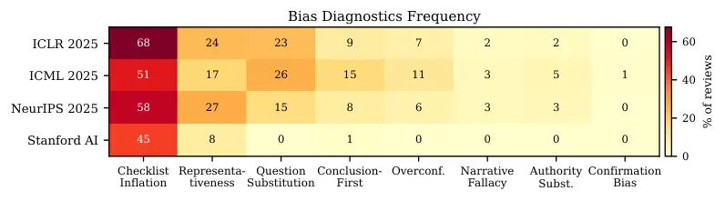
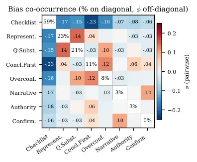

# Articulate Intuition or Genuine Analysis? Benchmarking Epistemic Reliability in LLM-as-a-Judge Peer Review

Nuo Chen    Qian Wang    Qingyun Zou    Bingsheng He Affiliation:
National University of Singapore

###### Abstract

When an LLM judge calls a peer review “analytical” and a human committee
calls another review “high quality,” are they tracking the same thing?
We argue they are not, and that the difference matters philosophically.
We operationalise Kahneman’s dual-process theory into a structured
rubric for peer review and release Kahneman4Review, a benchmark of
$`3{,}563`$ rated reviews scored along nine theoretically motivated
textual dimensions, eight bias diagnostics, and a continuous
reasoning-quality score. Three findings bear on _trustworthiness_:
decision tier is not detectably aligned with the rubric’s text-grounded
epistemic-quality proxy; public-showcase agentic reviews receive higher
raw scores than pooled human reviews, but length and venue explain most
of the gap and the samples are not paper-paired; and ICLR review-text
diagnostics shift at the 2022–2023 transition, temporally coincident
with widespread LLM availability but without identifying its cause. A
matched function-probe pilot further shows that the rubric distinguishes
textual probes designed to contrast genuine fault-finding with surface
fluency. We argue that a trustworthy reliability benchmark for LLM
judges must separate _analytical form_ from _epistemic function_, and
propose concrete design choices toward that goal. An interactive demo is
available at
[https://huggingface.co/spaces/nuojohnchen/Kahneman4Review](https://huggingface.co/spaces/nuojohnchen/Kahneman4Review).

## 1 Introduction

Peer review is the most widely used epistemic gatekeeping mechanism in
science, and large language models are increasingly proposed both to
_produce_ reviews ^(13, 10) and to _judge_ review quality ^(24, 2).
Deploying LLMs in either role invites a philosophical question that the
machine learning community rarely poses directly: what counts as a good
review? An answer is usually smuggled in through training objectives and
benchmark design (acceptance prediction, score agreement,
human-preference alignment), yet philosophers have long argued that
epistemic quality is not a scalar outcome but a property of the
reasoning itself ^(8, 14, 4). A review may be technically correct and
still textually under-justified; a negative review may be high-quality
if it is grounded, falsifiable, and responsive to rebuttal.

Peer review offers an unusually clean test bed for this problem. First,
the review is a written artefact amenable to fine-grained analysis.
Second, there exist outcomes (acceptance, meta-review, AC flags) that
are typically treated as ground truth but which our data will show are
_not detectably aligned_ with the rubric’s text-grounded
epistemic-quality proxy. Third, the recent appearance of agentic AI
reviewers ^(10, 13) creates a natural textual contrast between reviews
written by humans under deadline and outputs from retrieval-augmented
LLM pipelines with full paper access. The contrast motivates a
dual-process-inspired question for ML evaluation: can an LLM judge
identify textual evidence that separates _articulate intuition_ from
_genuine analysis_ without mistaking analytical form for verified
epistemic function?

Contributions. (1) We propose nine theoretically motivated textual
dimensions, eight bias diagnostics, a four-label taxonomy, and a
continuous reasoning-quality score, grounded in analytic epistemology
and philosophy of explanation. (2) We rate $`3{,}563`$ reviews using
claude-sonnet-4-6 as the judge: $`1{,}155`$ stratified-sample human
reviews from ICLR, ICML, and NeurIPS 2025; $`2{,}307`$ ICLR
2021/2022/2023 human reviews for the longitudinal study; and $`101{}`$
reviews from an open agentic AI-reviewer pipeline. The released code,
rubric prompt, ratings, and provenance metadata are available through
the [Kahneman4Review
demo](https://huggingface.co/spaces/nuojohnchen/Kahneman4Review). (3) We
report three empirical findings bearing directly on trustworthiness: (a)
analytical-trace scores exhibit a field-wide ceiling across venues (RQS
$`\in[2.80,2.94]`$); (b) decision tier does not predict RQS; (c)
public-showcase agentic and pooled human reviews are statistically
separable on precisely those dimensions trained LLMs can fluently
imitate. (4) Although the rubric proposes nine theoretically distinct
dimensions, the current LLM judge collapses them into one dominant
analytical-trace factor. We treat this as a _failure-mode finding_ for
textual benchmarks, not evidence of multidimensional measurement.

## 2 Related Work

Peer-review analysis has focused largely on outcome signals: score
agreement, bias by author identity, and strategic behaviour
^(23, 22, 20, 12). These framings implicitly equate review reliability
with inter-rater consistency or score-validity. We instead
operationalise review quality as a property of the reasoning text.

LLM-as-a-judge systems are used for preference scoring ^(24, 2, 15), and
recent work documents their systematic biases, including
self-recognition and in-distribution favoritism ¹⁷. Concurrent work ¹³
uses an LLM to _generate_ review feedback; our rubric is instead a
structured _judge_ whose outputs are auditable per dimension and per
span, so the question of judge reliability can be posed at finer
granularity than scalar agreement.

Philosophy and ML evaluation. Work in interpretable ML has increasingly
borrowed from philosophy and cognitive science ^(16, 3). Our framing
draws on analytic accounts of explanation ^(8, 14), understanding ⁴, and
epistemic luck ¹⁹, and connects to FAccT-adjacent discussions of trust
and reliability ⁹ that treat trustworthiness as more than predictive
accuracy.

## 3 A Dual-Process Rubric for Review Epistemics

From theory to rubric. Kahneman Super distinguishes System 1 (fast,
associative, impression-based) from System 2 (slow, deliberative,
evidence-integrating). We use this distinction as inspiration for
textual diagnostics of epistemic reasoning: System-1-like traces include
compressed impressions and unsupported labels, whereas System-2-like
traces include explicit evidence linkage, rebuttability, and uncertainty
handling ^(5, 7). These labels describe textual traces relevant to
articulate intuition and genuine analysis, not the reviewer’s cognitive
state. Without paper access, they cannot establish that genuine analysis
occurred or that a critique is correct.

Dimensions. Each review is scored on nine 0–3 dimensions. Two
(impression reliance, heuristic shortcut usage) are System-1-valenced;
the other seven are System-2-valenced. Each dimension anchors to a
specific philosophical desideratum: falsifiability to Popper Super,
evidence specificity to inference-to-the-best-explanation ¹⁴,
uncertainty handling to the contrastive view of understanding ⁴, issue
prioritisation to virtue epistemology ²¹, reasoning density to empirical
adequacy ⁶, reasoning chain to the structure of explanation ⁸, heuristic
shortcut to fast-and-frugal cognition ⁷. The full map, with rubric cues,
is in Table 1.

|                      |                         |                            |
| -------------------- | ----------------------- | -------------------------- |
| Dimension            | Anchor                  | Cue                        |
| Impression rel.^(†)  | intuitive judgment ¹¹   | global labels (“novel”)    |
| Reasoning chain      | argument structure ⁸    | premise $`\to`$ conclusion |
| Evidence specificity | IBE ¹⁴                  | numbers, eqns., quotes     |
| Falsifiability       | demarcation ¹⁸          | concrete refutability      |
| Heuristic use^(†)    | fast-and-frugal ⁷       | venue-fit shortcuts        |
| Uncertainty handling | understanding ⁴         | conditionals, updating     |
| Issue prioritisation | virtue epist. ²¹        | core vs. peripheral        |
| Reasoning density    | empirical adequacy ⁶    | support per claim          |
| Core criticality     | rebuttability ^(18, 14) | decision-moving            |

^(†)System-1-valenced: low scores indicate analytical reasoning.

Table 1: Nine rubric dimensions and their philosophical anchor points.
The third column is the rubric cue the judge looks for.

Continuous scores. The judge emits two textual-trace scalars
$`s_{1},s_{2}\!\in\![1,5]`$ and a Reasoning Quality Score
$`\text{RQS}\!\in\![1,5]`$ intended to separate impression-like form
from explicitly justified form. The label
$`\ell\in\{\textsc{System 1},\textsc{System 2},\textsc{Mixed},\textsc{Non-evaluative}\}`$
is a discretisation of the $`(s_{1},s_{2},\text{RQS})`$ joint. We
explicitly require a _nearest alternative label_ and a counterfactual
justification (“why not X?”), which is the rubric’s nod to contrastive
explanation ^(14, 16).

Bias diagnostics. Eight bias categories (Checklist Inflation,
Representativeness, Question Substitution, Conclusion-First,
Overconfidence, Narrative Fallacy, Authority Substitution, Confirmation
Bias) are detected as open-set tags.

What does the rubric actually measure? A principal-components analysis
of the nine dimensions across the $`1{,}155`$ cross-venue human ratings
finds a single dominant factor explaining 65% of variance; one
eigenvalue exceeds the Kaiser threshold, maximum off-diagonal
correlation is $`0.91`$, and PC1 loads positively on every sign-flipped
dimension (Figure 7). Thus, although the rubric is theoretically
multidimensional, the present judge does not recover nine empirically
distinct constructs. We treat this as a _failure-mode finding_: the
ratings collapse to a near-unidimensional analytical-trace axis, so a
well-prompted LLM may saturate the benchmark globally rather than on one
axis (returned to in Section 5).

## 4 Empirical Study

### 4.1 Data and protocol

We stratified-sample 100 papers per venue from ICLR, ICML, NeurIPS 2025
by tier (6 oral, 10 spotlight, 84 poster), yielding $`1{,}155`$ human
reviews; we additionally rate 200 random papers each from ICLR
2021/2022/2023 ($`2{,}307`$ further reviews) under the same judge for
the longitudinal study, and $`101{}`$ reviews from a public showcase of
an open agentic-reviewer pipeline ^(10, 1) ($`3{,}563`$ ratings in
total) (full provenance and the curation caveat are in Appendix G). All
ratings use claude-sonnet-4-6 with a frozen prompt. The LLM judge rates
each review from its text, venue, and rating metadata alone; the
reviewed paper is not included in the judge’s input. We use Mann–Whitney
U, Kruskal–Wallis, one-way ANOVA, and $`\chi^{2}`$ as appropriate;
per-dimension comparisons use Bonferroni correction for 9 tests.

Figure 1: Label distribution across three human venues and the Stanford
agentic reviewer. Venue-level differences are significant
($`\chi^{2},\ p<10^{-4}`$).

### 4.2 Analytical-trace scores show a field-wide ceiling and temporal decline

Mean RQS in 2025 is $`2.80{}`$ (ICLR), $`2.83{}`$ (ICML), $`2.94{}`$
(NeurIPS), on a 1–5 scale; venue-level Kruskal–Wallis is significant
($`p=0.003`$) but the absolute spread is small. ICLR is a statistical
outlier in label distribution: $`35\%`$ of ICLR reviews are System 1 vs.
$`21\%`$ (ICML) and $`20\%`$ (NeurIPS) (Figure 1).

Temporal trend. Rating ICLR 2021, 2022, and 2023 with the same judge and
prompt as 2025 (total $`n{=}2{,}683`$ reviews) reveals a discontinuity
at the 2022–2023 transition, temporally coincident with widespread LLM
availability: mean RQS is identical in 2021 and 2022 ($`3.03`$ vs
$`3.03`$), then drops to $`2.91`$ (2023) and $`2.80`$ (2025); the
System-1-like share triples, $`11\%\to 35\%`$; the System-2-like share
nearly halves, $`23\%\to 16\%`$ (Figure 2). K–W $`p<10^{-4}`$, label
$`\chi^{2}`$ $`p<10^{-4}`$. Length-controlled regression with 2021 as
reference and $`\log`$-length included puts _2022 vs 2021 at $`-0.03`$
RQS ($`p{=}0.20`$, n.s.)_ but _2023 vs 2021 at $`-0.15`$
($`p<10^{-8}`$)_ and _2025 vs 2021 at $`-0.21`$ ($`p<10^{-11}`$)_. This
pattern is descriptive, not causal: reviewer composition, review policy,
conference scale, changing norms, and LLM-assisted drafting are all
possible explanations.

Figure 2: ICLR review-text diagnostics across years. Left: label
distribution shifts from fewer System-1-like and more System-2-like
traces (2021/2022) toward a more System-1-like mix (2025). Right: RQS
distribution declines monotonically. K–W $`p<10^{-4}`$; length-adjusted
residual gap $`-0.21`$ RQS, $`p<10^{-11}`$.

### 4.3 Outcomes do not predict the epistemic-quality proxy

We find no detectable main effect of acceptance tier on RQS, pooled
across venues ($`p=0.260`$, Figure 3); within each venue, tier means
fall within 0.2 RQS points. This null is informative under either
reading: _either_ the conference system’s most visible outcome signal
does not track the rubric’s textual proxy, _or_ the rubric and outcome
are tracking related properties at a level our $`n`$ cannot resolve. In
either case, tier agreement is at best a weak proxy for articulated
reasoning quality in our data.

Figure 3: Mean RQS by acceptance tier per venue. Sample sizes:
ICLR/ICML/NeurIPS Oral $`n=23`$/$`23`$/$`26`$, Spotlight
$`36`$/$`40`$/$`43`$, Poster $`317`$/$`313`$/$`334`$. Within-venue
differences are within standard error; pooled one-way ANOVA is null
($`p=0.260`$).

As an auxiliary probe, we rate 149 reviewers whose quality was
explicitly commented on by area chairs. AC-flagged negatively-commented
reviewers ($`n{=}37`$) and their same-paper peers ($`n{=}109`$) differ
on RQS at $`p=0.578`$ (n.s.), observed $`d=-0.03`$ against a
minimum-detectable effect of $`d=0.53`$ at 80% power. We do not read
this as proof of orthogonality (our sample is underpowered for
$`|d|<0.5`$), only as evidence that AC-level scalar judgments and
rubric-level signals are not strongly aligned in our data (Figure 4).

Figure 4: RQS distribution by AC annotation group from in-metareview
commentary. The null result ($`p=0.578{}`$, observed $`d=-0.03{}`$
against MDES $`0.53{}`$) shows AC scalar judgments and rubric-level
signals are not strongly aligned in our data; the sample is underpowered
to distinguish true orthogonality from a small effect.

### 4.4 Agentic AI reviews exhibit more System-2-like traces: mostly via length

Stanford agentic-reviewer outputs are classified System 2 at $`74\%`$
versus $`21\%`$ for pooled humans. Mean RQS is $`3.50`$ versus $`2.86`$:
Cohen’s $`d=1.26`$ with 95% bootstrap CI $`[+1.19,+1.33]`$ (2000
resamples). Per-dimension effect sizes are large and tightly bounded:
_evidence specificity_ $`d=+1.57`$ \[+1.50, +1.67\], _falsifiability_
$`d=+1.39`$ \[+1.31, +1.47\], and _impression reliance_ $`d=-1.23`$
\[-1.38, -1.08\] (Figure 5b). All 9/9 dimensions remain significant at
$`\alpha{=}0.05`$ after Bonferroni correction. Across the full RQS
distributions (Figure 5a), the agentic reviewer’s scores are tight and
elevated, while the human venues are broader and centred lower.

Because these public-showcase outputs are potentially curated and not
paper-paired, this result is not evidence that AI reviewers are
epistemically better than human reviewers.

(a)

(b)

Figure 5: Human reviewers vs. the Stanford agentic reviewer. (a) RQS
distribution per group (violin, mean line): the public-showcase agentic
distribution has higher raw RQS (mean 3.50, SD 0.12), while humans are
broader (means $`\in[2.80,2.94]`$, SDs $`\in[0.48,0.57]`$). This
unpaired descriptive comparison does not establish reviewer competence.
(b) Mean score per rubric dimension; error bars $`\pm 1`$ SD;
$`{\dagger}`$ marks System-1-valenced dimensions, for which lower is
more analytical. All 9 dimensions differ at $`p<0.05`$ after Bonferroni
correction, with $`|d|\geq 0.54`$ in every case.

Length is a confound. Agentic outputs are systematically longer than
human reviews. To separate the analytical-trace score from verbosity we
fit

```math
\text{RQS}_{i}=\beta_{0}+\beta_{1}\,\mathbb{1}[\text{AI}]_{i}+\beta_{2}\log(\text{length}_{i})+\bm{\gamma}^{\top}\bm{V}_{i}+\varepsilon_{i}, \tag{1}
```

where $`\bm{V}_{i}`$ is a one-hot venue vector (Stanford = reference).
This shrinks the AI coefficient from a naive $`+0.65`$ to
$`\hat{\beta}_{1}=+0.17`$ (95% CI $`[+0.03,+0.31]`$, $`p{=}0.014`$),
with $`\hat{\beta}_{2}=+0.36`$ per log-character; length and venue
jointly explain $`74\%`$ of the naive gap. The residual signal is real
but small, and the “System 2” label should be read with this control in
mind.

Bias patterns. Bias tags co-occur non-trivially: 83% of human reviews
carry at least one bias tag, and the strongest pairwise association
($`\phi=0.14`$) is between Representativeness Heuristic and Question
Substitution (full $`\phi`$ matrix in Figure 9). This is a modest
co-occurring System-1-like trace pattern: a review that substitutes an
easier question for the one posed by the paper also tends to answer it
via representativeness. The Stanford agentic reviewer is dominated by
Checklist Inflation (45%) with some Representativeness (8%) and never
Question Substitution or Authority Substitution (Figure 6).



Figure 6: Bias-diagnostic frequency (% of reviews in which the tag
appears), per group. Checklist Inflation dominates in all human venues;
the agentic reviewer is also dominated by Checklist Inflation (45%, less
than humans) with some Representativeness Heuristic (8%) and essentially
no Question Substitution or Authority Substitution.

This AI-vs-human pattern, with the sampling and length-control caveats,
is the paper’s central diagnostic finding.

Measurement validation. On a fixed $`n{=}100`$ subset (Appendix C for
the protocol), frozen-prompt test-retest of claude-3-7-sonnet gives
$`\kappa{=}0.77`$, $`\alpha_{\text{ord}}{=}0.94`$; cross-judge vs.
gpt-4o gives $`\kappa{=}0.58`$, $`\alpha{=}0.76`$ (Table 2). The earlier
$`\kappa{=}0.09`$ figure was a prompt-revision artefact. Cross-_version_
agreement is the weakest link ($`\kappa{=}0.14`$ between sonnet-4-6 and
sonnet-3.7), so reliability claims about LLM judges should be reported
as model-conditional throughout.

|                                           |       |             |            |                              |
| ----------------------------------------- | ----- | ----------- | ---------- | ---------------------------- |
| Comparison                                | $`n`$ | label agree | $`\kappa`$ | $`\alpha_{\text{ord}}`$(RQS) |
| Sonnet-3.7 run1 vs. run2 (test-retest)    | 76    | 84%         | 0.77       | 0.94                         |
| Sonnet-3.7 vs. GPT-4o (cross-judge)       | 84    | 71%         | 0.58       | 0.76                         |
| Sonnet-3.7 vs. Sonnet-4-6 (cross-version) | 85    | 33%         | 0.14       | 0.23                         |

Table 2: Inter-run, cross-judge, and cross-version agreement on the
fixed $`n{=}100`$ validation subset, with the original claude-sonnet-4-6
ratings as a comparator. After dropping malformed-JSON outputs,
$`n{=}76`$ reviews are paired across all three rating conditions.

Function-probe pilot. For $`n{=}35`$ ICLR-2025 papers, claude-3-7-sonnet
identifies one falsifiable concern and emits two $`\sim`$250-word
reviews matched on length and specificity markers: review A’s primary
weakness IS that concern, B’s are surface peripheral asks. Result:
$`33/35`$ have $`\text{RQS}(A){>}\text{RQS}(B)`$, $`d_{z}{=}+2.52`$,
sign-test $`p<.001`$; all A-reviews labeled System 2, only 26% of B’s.
Caveat: same model family generates and rates; curated public-errata
faults are the necessary follow-up.

## 5 Discussion: Analytical Form and Epistemic Function

The rubric separates venues and yields auditable dimension- and
span-level outputs, but it also gives public-showcase agentic outputs
high scores on dimensions a well-prompted LLM can manufacture. Because
PCA shows these dimensions moving together, we treat the rubric as a
_partially-validated diagnostic of textual-benchmark failure_, not a
settled reliability metric.

An LLM reviewer that fluently produces the form of analytical discourse
without establishing that genuine analysis was performed is the modern
epistemic analogue of an empirically adequate theory that is not
explanatory ^(8, 6, 14); Elgin Super’s account of understanding as
competence-over-a-domain says the relevant competence is saying what
would change one’s verdict: _attempting to falsify_, not paraphrase. Our
probe pilot shows that the rubric distinguishes textual signatures
designed to contrast genuine fault-finding with surface fluency under
matched form, but the AI-vs-human gap indicates that much of the
headline signal still rides on analytical form rather than verified
epistemic function.

What a trustworthy LLM judge would look like. Three design choices
suggested by the results: (i) _Audit by span, not by score_, since
judgments without text spans are unfalsifiable ¹⁸; (ii) _Require a
counterfactual label_, forcing contrastive reasoning ^(14, 16); (iii)
_Separate analytical form from epistemic function via probes_: our
$`n{=}35`$ pilot finds the rubric discriminates $`33/35`$ matched pairs
in favour of the genuine-fault condition ($`d_{z}{=}+2.52`$,
$`p<.001`$), and scaling to a curated 200-item probe set with
public-errata faults is the natural next step.

## 6 Conclusion

Frozen-prompt ratings are stable and discriminate $`33/35`$ matched-form
probes, but decision tier does not predict RQS and length and venue
explain $`74\%`$ of the naive AI–human gap. These scores capture
articulated traces, not verified epistemic function: without the
reviewed paper, they cannot establish genuine analysis, critique
correctness or fidelity, or reviewer competence. Further limitations are
judge self-favoritism ¹⁷, model-version sensitivity ($`\kappa{=}0.14`$),
and omitted social epistemology and causal modelling; future work needs
model-conditional reporting, public-errata probes, and expert anchors.

## Impact Statement

This work aims to make LLM-assisted peer review more auditable. A judge
rewarding only linguistic surface form could legitimise AI review
pipelines whose analytical competence is overstated; function probes and
span-level audits are intended to resist that risk.

## References

- Analemma Intelligence (2026) Analemma Intelligence FARS: fully
  automated research system. Note:
  [https://analemma.ai/fars/](https://analemma.ai/fars/)Public showcase
  corpus; reviews generated by the Stanford Agentic Reviewer
  (paperreview.ai). Accessed 2026-06-12 Cited by: Appendix G, §4.1.
- Chiang and Lee (2023) C. Chiang and H. Lee Can large language models
  be an alternative to human evaluations?. In Annual Meeting of the
  Association for Computational Linguistics (ACL), Cited by: §1, §2.
- Doshi-Velez and Kim (2017) F. Doshi-Velez and B. Kim Towards a
  rigorous science of interpretable machine learning. arXiv preprint
  arXiv:1702.08608. Cited by: §2.
- Elgin (2017) C. Z. Elgin True enough. MIT Press. Cited by: §1, §2,
  Table 1, §3, §5.
- Evans and Stanovich (2013) J. St. B. T. Evans and K. E. Stanovich
  Dual-process theories of higher cognition: advancing the debate.
  Perspectives on Psychological Science. Cited by: §3.
- Fraassen (1980) Bas. C. v. Fraassen The scientific image. Oxford
  University Press. External Links: ISBN 9780198244271,
  [Document](https://dx.doi.org/10.1093/0198244274.001.0001),
  [Link](https://doi.org/10.1093/0198244274.001.0001) Cited by: Table 1,
  §3, §5.
- Gigerenzer and Gaissmaier (2011) G. Gigerenzer and W. Gaissmaier
  Heuristic decision making. Annual Review of Psychology 62,
  pp. 451–482. Cited by: Table 1, §3, §3.
- Hempel and Oppenheim (1948) C. G. Hempel and P. Oppenheim Studies in
  the logic of explanation. Philosophy of Science 15 (2), pp. 135–175.
  Cited by: §1, §2, Table 1, §3, §5.
- Jacovi et al. (2021) A. Jacovi, A. Marasović, T. Miller, and Y.
  Goldberg Formalizing trust in artificial intelligence: prerequisites,
  causes and goals of human trust in AI. In Proceedings of the 2021 ACM
  Conference on Fairness, Accountability, and Transparency (FAccT),
  External Links: [Document](https://dx.doi.org/10.1145/3442188.3445923)
  Cited by: §2.
- Jiang and Ng (2025) Y. Jiang and A. Ng Stanford agentic reviewer.
  Note: [https://paperreview.ai](https://paperreview.ai)Stanford Machine
  Learning Group. Accessed 2026-06-12 Cited by: §1, §1, §4.1.
- Kahneman (2011) D. Kahneman Thinking, fast and slow. Farrar, Straus
  and Giroux, New York. Cited by: Table 1, §3.
- Langford and Guzdial (2015) J. Langford and M. Guzdial The
  arbitrariness of reviews, and advice for school administrators.
  Communications of the ACM 58 (4), pp. 12–13. External Links:
  [Document](https://dx.doi.org/10.1145/2732417) Cited by: Appendix G,
  §2.
- Liang et al. (2024) W. Liang, Y. Zhang, H. Cao, B. Wang, D. Y.
  Ding, X. Yang, K. Vodrahalli, S. He, D. S. Smith, Y. Yin, D. A.
  McFarland, and J. Zou Can large language models provide useful
  feedback on research papers? a large-scale empirical analysis. NEJM AI
  1 (8). External Links:
  [Document](https://dx.doi.org/10.1056/AIoa2400196) Cited by: §1, §1,
  §2.
- Lipton (2004) P. Lipton Inference to the best explanation. 2nd
  edition, Routledge. Cited by: §1, §2, Table 1, Table 1, §3, §3, §5,
  §5.
- Liu et al. (2024) Y. Liu, H. Zhou, Z. Guo, E. Shareghi, I. Vulić, A.
  Korhonen, and N. Collier Aligning with human judgement: the role of
  pairwise preference in large language model evaluators. In Conference
  on Language Modeling (COLM), Cited by: §2.
- Miller (2019) T. Miller Explanation in artificial intelligence:
  insights from the social sciences. Artificial Intelligence 267,
  pp. 1–38. Cited by: §2, §3, §5.
- Panickssery et al. (2024) A. Panickssery, S. R. Bowman, and S. Feng
  LLM evaluators recognize and favor their own generations. In Advances
  in Neural Information Processing Systems (NeurIPS), Cited by: §2, §6.
- Popper (1959) K. Popper The logic of scientific discovery. Hutchinson,
  London. Cited by: Table 1, Table 1, §3, §5.
- Pritchard (2005) D. Pritchard Epistemic luck. Oxford University Press.
  Cited by: §2.
- Shah (2022) N. B. Shah Challenges, experiments, and computational
  solutions in peer review. Communications of the ACM 65 (6), pp. 76–87.
  External Links: [Document](https://dx.doi.org/10.1145/3528086) Cited
  by: §2.
- Sosa (2007) E. Sosa A virtue epistemology: apt belief and reflective
  knowledge. Oxford University Press. Cited by: Table 1, §3.
- Stelmakh et al. (2021) I. Stelmakh, N. B. Shah, and A. Singh Catch me
  if I can: detecting strategic behaviour in peer assessment. In
  Proceedings of the AAAI Conference on Artificial Intelligence, Cited
  by: §2.
- Tomkins et al. (2017) A. Tomkins, M. Zhang, and W. D. Heavlin Reviewer
  bias in single- versus double-blind peer review. Proceedings of the
  National Academy of Sciences (PNAS) 114 (48), pp. 12708–12713. Cited
  by: §2.
- Zheng et al. (2023) L. Zheng, W. Chiang, Y. Sheng, S. Zhuang, Z.
  Wu, Y. Zhuang, Z. Lin, Z. Li, D. Li, E. P. Xing, H. Zhang, J. E.
  Gonzalez, and I. Stoica Judging llm-as-a-judge with mt-bench and
  chatbot arena. In Advances in Neural Information Processing Systems
  (NeurIPS), Cited by: §1, §2.

## Appendix A Rubric details

Labels. System 1, System 2, Mixed, Non-evaluative. A review is labelled
System 1 if its text is dominated by impression-like, compressed, and
conclusion-first traces; System 2 if it is dominated by explicit,
evidence-grounded, and uncertainty-sensitive traces; Mixed if both
textual patterns are substantively present; and Non-evaluative if it is
administrative or clarificatory rather than judgemental. These labels do
not identify the reviewer’s cognitive state.

Dimensions (0–3).

- •
  Impression reliance (S1-valenced): reliance on global labels and
  unsupported overall claims.
- •
  Explicit reasoning chain: observable premise–conclusion structure.
- •
  Evidence specificity: citation of concrete figures, numbers,
  equations, or prior work passages.
- •
  Falsifiability/rebuttability: whether each concern admits a concrete
  refutation.
- •
  Heuristic shortcut usage (S1-valenced): venue-fit, familiarity,
  authority shortcuts.
- •
  Uncertainty handling & belief updating: hedging, conditioning,
  responsiveness to rebuttal in principle.
- •
  Issue prioritisation: acceptance-critical vs. peripheral weighting.
- •
  Reasoning density: analytical support per sentence.
- •
  Core criticality: whether weaknesses would actually move a decision if
  true.

Continuous scalars. $`s_{1},s_{2}\in[1,5]`$ are independent
scale-of-presence scores for System-1-like and System-2-like textual
traces; $`\text{RQS}\in[1,5]`$ is a judge-scaled, text-grounded proxy
for epistemic quality independent of conclusion polarity; the
reasoning-balance index is $`s_{2}-s_{1}`$; and the System-2 trace level
is a $`\{0,\ldots,4\}`$ coarse marker of visible analytical elaboration.

Structured output. The judge emits: the label; the three scalars;
dimension scores; a primary rationale; three supporting_spans with
signal direction and a why; up to three counterevidence entries; bias
diagnostics (open-set, drawn from the eight-bias menu); a
nearest_alternative_label plus why_not_nearest_alternative; a composite
$`[0,1]`$ score; and three derived indices (heuristic dominance,
analytic strength, mixedness). The full system prompt and implementation
are available in the [demo
code](https://huggingface.co/spaces/nuojohnchen/Kahneman4Review).

## Appendix B Additional analyses

Figure 7: PCA of the 9 rubric dimensions (S1-valenced dimensions
sign-flipped). Fitted on human reviews; Stanford agentic reviews
projected. Humans form a broad cluster around the origin; the agentic
reviewer is shifted $`+1.7`$ on PC1 (the single analytical-trace axis).
Arrows are dimension loadings.

Figure 8: Latent $`(s_{1},s_{2})`$ space. Human reviews cluster on the
diagonal; the agentic AI reviewer ($`\blacktriangle`$) is displaced
up-and-left: simultaneously lower System-1 and higher System-2 traces.



Figure 9: Bias co-occurrence on human reviews. Diagonal is marginal
frequency; off-diagonal is pairwise $`\phi`$ correlation. Positive
clusters (Representativeness $`\leftrightarrow`$ Question Substitution,
Conclusion-First $`\leftrightarrow`$ Overconfidence) support a weak
co-occurring System-1-like trace pattern; most $`|\phi|`$ values are
below 0.15.

## Appendix C Measurement validation details

We re-rate a fixed 100-review subset (deterministic seed 42, balanced by
venue and label) under three conditions: two independent runs of
claude-3-7-sonnet-20250219 with a frozen system prompt and concurrency
4, and one run of gpt-4o with the same prompt. After dropping the small
number of malformed-JSON outputs, $`n{=}76`$ reviews are paired across
all three; the resulting agreement statistics are reported in Table 2.

Two takeaways. (i) The earlier $`\kappa{=}0.09`$ stability figure was an
artefact of prompt-version drift, not the rubric’s actual stability
under controlled re-runs. (ii) Cross-_version_ agreement is the weakest
link: with the same frozen prompt, sonnet-4-6 and sonnet-3.7 produce
materially different label distributions (notably, sonnet-3.7 more
frequently emits Non-evaluative for short reviews). This is a real
model-version sensitivity, not a deprecation artefact: both models
remain available and were used in this paper. The implication is that
some headline numbers in Section 4.4 are model-version-specific, and
reliability claims about LLM judges should be reported as
model-conditional throughout.

## Appendix D Length-controlled regression details

The length-controlled model of Equation 1 is fit by OLS with Stanford as
the venue reference. Estimates: $`\hat{\beta}_{1}=+0.17`$ (95% CI
$`[+0.03,+0.31]`$, $`p{=}0.014`$); $`\hat{\beta}_{2}=+0.36`$ per
log-character. The naive RQS gap (AI $`-`$ human) is $`+0.65{}`$; the
$`\hat{\beta}_{1}`$ residual after adjustment is roughly $`74\%`$
smaller. Conclusion: length is the largest single explainer of the
headline effect, and the residual signal is real but small.

## Appendix E Qualitative case studies

The following two rubric outputs are illustrative, not representative;
we chose them because they exemplify the shape of a System 1 human
rating and a System 2 agentic-reviewer rating. Raw review text is not
reproduced (see Appendix G).

Case 1: Human, ICLR 2025 (System 1, RQS 1.8). _Primary rationale._ “The
strengths section compresses the entire evaluation into two abstract
labels (‘novel’ and ‘rigorous’) without any supporting reasoning or
evidence. The weaknesses are peripheral completeness requests (missing
conclusion section, statistical tests) that are entirely disconnected
from the paper’s core claims about constrained optimization and weak
supervision. There is no analytical linkage between any concern raised
and the validity of the paper’s central methodology.” _Bias
diagnostics:_ Question Substitution, Checklist Inflation. _Nearest
alternative:_ Mixed (rejected because the statistical-testing suggestion
is the only partially analytical point, and it is brief and
underdeveloped).

Case 2: Stanford agentic reviewer, RQS 3.7. _Primary rationale._ “The
passage is dominated by explicit, operational critique grounded in
methodological reasoning. The weaknesses section in particular
articulates specific technical concerns (Bayesian credible intervals
used as frequentist confidence bounds under adaptive sampling, lack of
union-over-time error control, absence of formal sample-complexity
bounds), each with a clear causal link to why the gap undermines the
paper’s central claims.” _Bias diagnostics:_ none. _Nearest
alternative:_ Mixed.

The pair supports the paper’s central point: the agentic output exhibits
the textual _form_ of methodological critique at a level the human
rating does not. Whether the specific claims in Case 2 are _correct_
(whether adaptive-sampling intervals are really what the paper used,
whether the cited concerns actually obtain) cannot be read off the
rubric, which is why dimension-level scores on their own are
insufficient for a trustworthiness benchmark.

## Appendix F Short and template-inflated reviews

A useful sanity check on what the rubric is responding to: do reviews
that humans would intuitively recognise as textually underdeveloped map
to System 1? We find a partial yes.

Ultra-short reviews (bottom 10% of our sample by length, $`\leq 495{}`$
characters; $`n=116`$): mean RQS $`2.66`$ vs $`2.88`$ for the rest;
$`34\%`$ are labelled System 1 vs $`24\%`$. The dominant bias is
_Checklist Inflation_ ($`59\%`$ of ultra-short reviews carry the tag),
followed by _Question Substitution_, the same pair that drives the
broader co-occurring System-1-like trace pattern (Figure 9).

Template-inflated long reviews. A different textual failure mode is the
“40 numbered weaknesses, 40 numbered questions” template, in which the
surface specificity is high but the items are uniform peripheral asks
(“please report standard deviations,” “please add multilingual
evaluation,” “please compare with method X”). Two anonymised excerpts
illustrate the pattern. Both reviewers gave the paper a low rating with
maximum confidence.

Anonymised excerpt 1 (single-paragraph summary, then 40 numbered
weaknesses, 40 numbered questions, near 1-to-1 mirrored): “(31) The
paper does not report the standard deviation of experimental results.
(32) The paper’s handling of background categories is unclear. …(38) The
paper’s geometric feature calculation is not detailed. (39) The paper
does not compare with multi-scale feature fusion methods. (40) The
paper’s conclusion overstates its contributions.”

Anonymised excerpt 2 (40 numbered weaknesses + 40 mirrored questions on
a different paper): “(15) Inference speed on different hardware
platforms is not provided. …(28) Latency introduced by visual memory
replay is not discussed. …(40) Performance in multilingual scenarios is
not tested.”

Both reviewers issued ratings of “4 (marginally below acceptance) /
confidence 5 (absolutely certain),” a confidence-rating combination that
is itself a System-1-like textual signature (_Overconfidence_
co-occurring with _Conclusion-First Justification_). The rubric labels
both as System 1 and tags both with Checklist Inflation and Question
Substitution. A scan over all ICLR-2025 reviews in the bundle finds only
nine with $`\geq`$30 numbered items in this template-inflated style;
this is rare in absolute terms but is exactly the failure mode the
rubric is designed to surface.

Caveat: brevity is not low quality. Ultra-short reviews are not labelled
System 1 mechanically: $`16\%`$ carry no bias tag in our sample. Some
short reviews are terse precisely because the paper is straightforward
and a long analysis is unwarranted. The rubric responds to the _shape_
of the analytic move, not to length per se; the length-controlled
regression of Appendix D confirms that, even within length strata, the
signal that distinguishes the agentic AI reviewer from humans persists
at smaller magnitude.

## Appendix G Data, code, and reproducibility

Human reviews. ICLR/ICML/NeurIPS 2025 reviews are drawn from
publicly-available OpenReview decision pages; rating files reference
reviews by OpenReview paper ID and reviewer ID. We do not redistribute
review text verbatim due to OpenReview licence constraints. The
longitudinal subset (ICLR 2021/2022/2023) follows the same convention.

AI reviews. The 101 agentic-reviewer outputs are drawn from a public
showcase of an open agentic-reviewer system ¹, downloaded as a 102-file
plaintext archive (FA0001–FA0234, with gaps); source details are
available in the [demo
code](https://huggingface.co/spaces/nuojohnchen/Kahneman4Review). The
reviews are produced by submitting recent ML papers to the system; the
corresponding source papers are not identified in the archive, so we use
the reviews as a population-level distribution rather than as
paper-paired comparisons to our human sample. We treat the resulting
AI-vs-human gap as an upper bound on agentic-reviewer analytical-trace
prevalence: if the showcase is curated for “interesting” or
“high-quality” reviews, our sample over-represents the system’s better
outputs.

Code. The released rubric prompt, implementation, ratings, and
provenance information are available in the [Kahneman4Review demo
repository](https://huggingface.co/spaces/nuojohnchen/Kahneman4Review).

12
