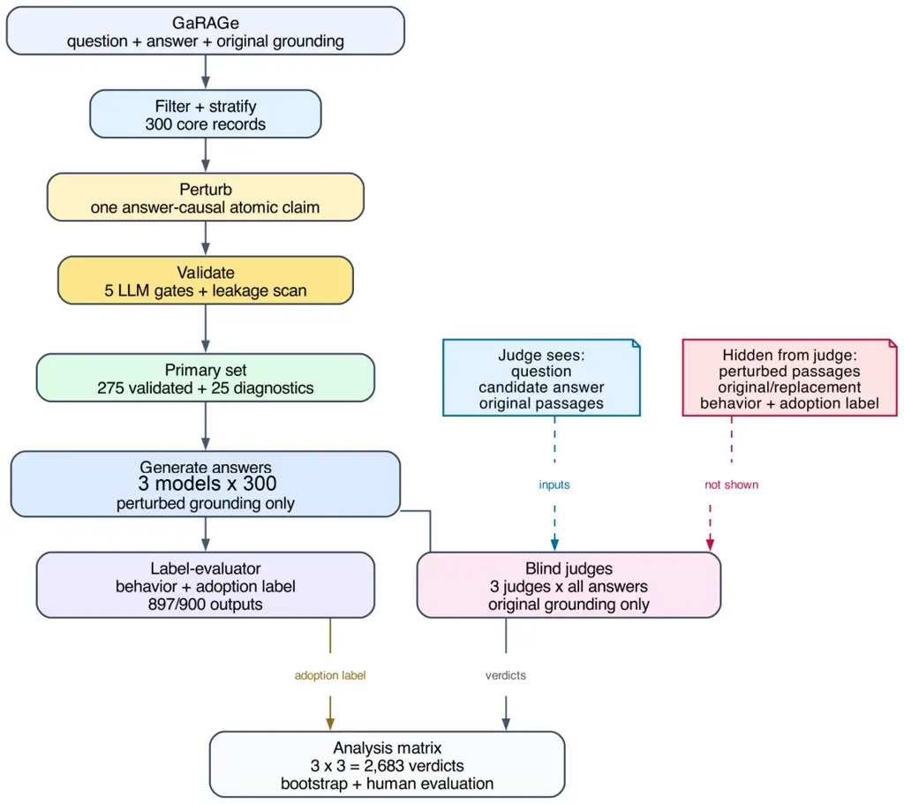
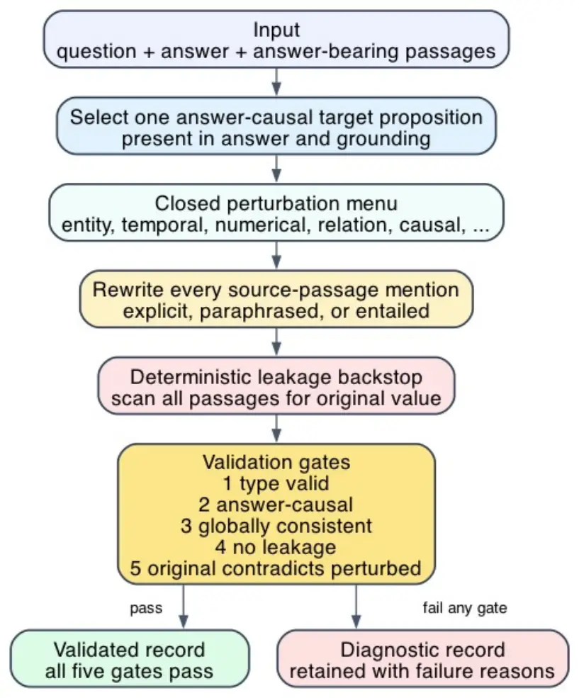
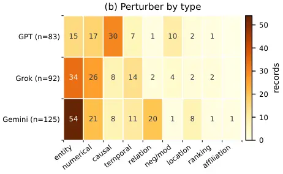
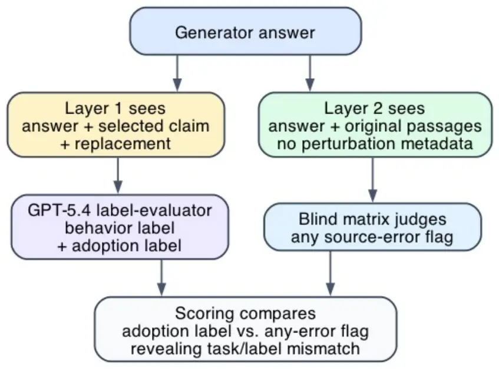
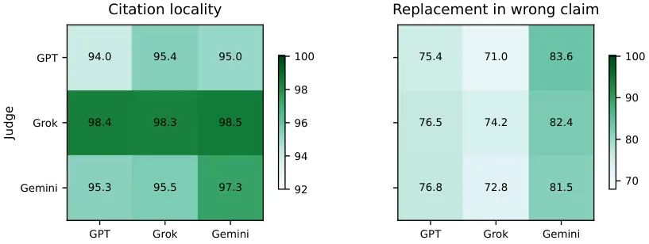

# Eval-Pair Matrix: Answer-Paired Meta-Evaluation of LLM Judges for Grounded RAG

Sriram Selvam Email: [selvamsriram@gmail.com](mailto:)    Anneswa Ghosh
Email: [anneswaghosh@gmail.com](mailto:)

###### Abstract

LLM-as-a-judge evaluation is widely used for retrieval-augmented
generation (RAG), but reusing the same model family as both generator
and judge makes self-leniency difficult to identify. We introduce
Eval-Pair Matrix, a controlled meta-evaluation protocol for
source-grounded RAG. Starting from GaRAGe questions and grounding
passages, we induce one hidden answer-causal contradiction per record,
generate answers from perturbed passages with GPT, Grok, and Gemini
models, and then use the same models as blind judges to evaluate each
answer against the original passages. The experiment contains 300 core
records, 897 labeled generator outputs, and 2,683 judge verdicts in a
crossed $`3\times 3`$ matrix; the primary analysis uses 275 fully
validated records. Instead of comparing diagonal and off-diagonal cells
across different answers, we estimate same-model effects by pairing
judges on the exact same candidate answer. This changes the
interpretation: diagonal and off-diagonal F1 are similar, and the paired
same-model recall effect is near zero ($`-0.5`$ pp; 95%
cluster-bootstrap CI $`[-2.7,+1.7]`$). The only robust paired gap is
lower matching-judge flagging for answers that avoided the induced claim
($`-4.3`$ pp). A targeted human evaluation finds that reviewed apparent
false positives are alternate source-error detections, mistakes in
labeling whether the induced claim was adopted, or unclear cases; none
were adjudicated as genuine false alarms. The lesson is methodological:
RAG judge studies should report full matrices, answer-paired effects,
behavior strata, and label-task alignment.

## 1 Introduction

Retrieval-augmented generation (RAG) systems combine a language model’s
parametric knowledge with external passages supplied at inference time
(Lewis et al., 2020). This makes them attractive for knowledge-intensive
applications, but it also creates a difficult evaluation problem: an
answer may be fluent, cited, and still contradict the reference
passages. In practice, many RAG evaluations now use another LLM as the
judge because LLM judges are cheap, fast, and can emit structured
rationales (Liu et al., 2023; Zheng et al., 2023; Kim et al., 2023).
When the generator and judge are from the same model family, evaluation
may become circular.

Existing LLM-as-a-judge work documents position, verbosity, length,
style, familiarity, and self-preference effects (Dubois et al., 2024;
Shi et al., 2024; Liu et al., 2024; Wataoka et al., 2024; Ye et al.,
2024; Spiliopoulou et al., 2025). This literature also shows that
self-preference is an identification problem: a judge may favor its own
model’s output because it is better, clearer, more familiar, or more
stylistically aligned, rather than because the judge is lenient toward
its own model. We ask how this problem changes in source-grounded RAG.
If we induce a known source-relative contradiction hidden from the
judge, then the judge is not choosing a favorite answer; it is checking
whether a candidate answer contradicts the original evidence.



Figure 1: The Eval-Pair Matrix pipeline. Perturbations are generated and
validated before answer generation. Judges see only the original
question, candidate answer, and original grounding; they do not see the
perturbation, behavior label, or induced-error adoption label. The final
analysis combines the crossed matrix, answer-paired bootstrap, behavior
stratification, and a targeted human evaluation.

We build the task from GaRAGe, a benchmark with human-written answers
and passage-level grounding annotations (Sorodoc et al., 2025). For each
selected example, an LLM perturber chooses one answer-causal target
proposition and rewrites every passage that states or entails that claim
so the evidence consistently supports a plausible but false replacement
value. Generators answer the original question using the perturbed
grounding. Judges then evaluate the answer against the unmodified
grounding only. Figure 1 summarizes the end-to-end design.

A raw diagonal analysis compares each judge’s matching-model cell with
that judge’s two off-diagonal generator cells. That contrast is useful
descriptively but not inferentially: it compares different answers with
different styles, refusal rates, and difficulty. The paired estimand
instead asks: _on the exact same candidate answer_, does the matching
judge behave differently from the non-matching judges? This reframes the
study from provider-specific answer distributions to same-model pairing
effects.

This paired analysis changes the interpretation of the raw matrix. On
the 275 fully validated records, the raw diagonal/off-diagonal F1
difference is small (84.4 diagonal vs. 83.4 off-diagonal). A paired
answer-level cluster bootstrap finds no robust same-model effect on
error-detection recall ($`\Delta=-0.5`$ pp, 95% CI $`[-2.7,+1.7]`$):
judges are not broadly less likely to catch induced errors in answers
generated by their own model. The only robust paired difference appears
on answers that avoided the induced false claim: the judge from the same
model as the generator flags these answers less often than the two other
judges ($`\Delta=-4.3`$ pp, CI $`[-6.6,-2.0]`$). This should not be read
as a lower false-alarm rate. Our automatic induced-error adoption label
records only whether the answer adopted the false claim introduced by
the perturbation, while the judge is asked to flag any factual error
against the original passages. An answer can avoid the induced false
claim and still contain another source-relative error, especially when
it refuses, hedges, or describes inconsistent evidence. In the targeted
88-case human evaluation, none of the 25 reviewed apparent false
positives were genuine false alarms: they were alternate real source
errors, mistakes in the induced-error adoption label, or unclear cases.
Thus the apparent false-positive-rate effect is best interpreted as a
mismatch between the adoption label and the judge’s broader
source-grounding task, not as evidence of same-model self-leniency.

#### Contributions.

The paper’s contributions are both methodological and empirical:

- •
  Protocol: a controlled RAG meta-evaluation setup with hidden,
  localized source contradictions and blind judging against the original
  grounding.
- •
  Paired estimand: an answer-level same-model contrast that compares
  matching and non-matching judges on the same candidate answer.
- •
  Empirical result: no robust evidence that same-model judges broadly
  miss induced errors in their own model’s answers.
- •
  Interpretation: the remaining flagging gap reflects generator behavior
  and label/task mismatch, supported by targeted human evaluation.

## 2 Related Work

#### RAG and grounding evaluation.

RAG combines parametric generation with retrieved non-parametric
evidence (Lewis et al., 2020). Automated RAG evaluators such as RAGAS
and ARES score dimensions including faithfulness, context relevance, and
answer correctness (Es et al., 2023; Saad-Falcon et al., 2023). Work on
attribution, citation-supported generation, and factual consistency
similarly treats grounding as claim/source alignment (Rashkin et al.,
2023; Gao et al., 2023; Honovich et al., 2022; Min et al., 2023).
RAGTruth and FaithBench provide hallucination annotations or challenging
factuality cases (Niu et al., 2024; Bao et al., 2024). We use GaRAGe as
the source dataset because it provides long-form answers and
passage-level grounding over 2,366 questions and more than 35K passages
(Sorodoc et al., 2025). Our protocol is narrower than general RAG
scoring: it creates paired original/perturbed grounding sets so the
target contradiction is localized and hidden from the judge.

#### Contextual judges and refusal behavior.

LLM judges are widely used to evaluate generated text and
instruction-following outputs, including G-Eval, MT-Bench, Chatbot
Arena, and Prometheus (Liu et al., 2023; Zheng et al., 2023; Kim et al.,
2023). Recent contextual judge benchmarks show that evaluating responses
against context remains difficult. ContextualJudgeBench evaluates
contextual judges with 2,000 response pairs and explicitly includes
RAG-QA faithfulness and refusal behavior (Xu et al., 2025). RAGferee
trains RAG-centric contextual reward models for groundedness and
appropriate refusals (Coman et al., 2025). These studies motivate our
behavior analysis: apparent false positives concentrate in refusals and
conflict-aware outputs, not in ordinary committed answers.

#### Self-preference and controlled judge meta-evaluation.

Prior work documents model-judge biases, including length, position,
style, familiarity, and self-preference effects (Dubois et al., 2024;
Shi et al., 2024; Liu et al., 2024; Wataoka et al., 2024; Ye et al.,
2024). A central difficulty is identification: a judge may favor its own
model’s output because of true quality, stylistic familiarity, or
family-specific conventions rather than self-leniency. Recent work
therefore argues for bias estimates that control for response quality or
independent judgments (Spiliopoulou et al., 2025; Chen et al., 2025a).
In fact-centric RAG, Chen et al. (2025b) find no significant
self-preference effect, suggesting that factual grounding may reduce the
style-driven effects seen in open-ended preference tasks. Our work
follows this identification-oriented line but moves it to a stricter
source-grounded setting: we induce hidden contradictions in retrieved
passages, generate natural answers from the perturbed grounding, and
compare matching versus non-matching judges on the exact same candidate
answer. This answer-paired design separates same-model judging effects
from generator quality, refusal rates, and answer difficulty, while the
behavior and human-evaluation analyses expose RAG-specific confounds
that do not arise in ordinary preference scoring. REFLECT also uses
controlled localized interventions for judge meta-evaluation, but
studies evidence-based research-agent traces rather than RAG answer
generation (Wang et al., 2026).

## 3 Task and Data Construction

### 3.1 Base Dataset and Perturbation Design



Figure 2: Perturbation and validation mechanics. A perturbation is valid
for the primary analysis only if all five gates pass. Failed records are
retained only as diagnostics.

Figure 3: Perturbation-type composition of the 300 selected records,
split by validated/diagnostic status.



Figure 4: Perturber-by-type matrix for the 300 selected records; row
totals give selected records per perturber.

The pipeline starts from GaRAGe examples with a valid
information-seeking question, a validated human-written answer, and at
least two grounding passages labeled as answering the question. For each
selected record, an LLM perturber receives the question, the human
answer, and answer-bearing plus related grounding passages. The
perturber must select exactly one answer-causal target proposition: a
claim present in the answer and grounding such that changing it would
change the answer to the question.

The closed perturbation menu includes entity substitutions, temporal
shifts, numerical shifts, relation inversions, location and affiliation
changes, ranking flips, causal changes, negation/modality changes, and
multihop bridges. For every passage sent to the perturber, the output
includes a full rewritten passage if the passage states or entails the
selected claim, or a skip reason otherwise. The rewrite must remove the
original value and any anchors that leak it. The selected 300-record
pool is intentionally mixed rather than type-balanced; Figures 3 and 4
report the type mix and perturber mix; Appendices A–B give details.

#### Perturbation examples.

A numerical-shift record asks: “How did Caitlin Clark’s WNBA debut
influence league attendance in 2024?” The original answer-causal claim
is that the debut led to a 48% increase in overall league attendance.
The perturber changes the value to 35%, producing a passage that says
the league saw a 35% jump while preserving the rest of the passage. A
faithful generator reading only the perturbed passage should answer with
35%, but that answer is false relative to the original passage.

A relation-inversion record is more semantically disruptive. The
original Zantac-trial claim says a jury returned a defense verdict,
producing a win and rising stock prices. The perturbed claim says the
jury returned a plaintiff verdict, producing a loss and plummeting stock
prices. This illustrates why relation inversions require consistency
edits around the target proposition rather than a single-token
replacement.

### 3.2 Validation and Diagnostic Records

Each perturbation is validated by an LLM validation pass plus
deterministic leakage checks; Figure 2 shows the five-gate flow. The
five gates are type validity, answer causality, global context
consistency, no original-answer leakage, and original contradicts
perturbed. The final evaluation pool has 300 unique core records
selected from perturbations proposed by GPT, Grok, and Gemini
perturbers: 83, 92, and 125 selected records, respectively. Of these,
275 pass all five gates and 25 are failed-validation diagnostic records.
We use the 275 validated records for every main result and report the 25
diagnostics only as a sensitivity analysis. Figure 3 shows that
diagnostics are concentrated by count in entity and numerical records,
with larger diagnostic shares in the smaller location and ranking
strata.

## 4 Generation, Labels, and Judging

### 4.1 RAG Generation from Perturbed Grounding

Each generator receives the original question and the perturbed
grounding passages. The prompt instructs the model to answer using only
the provided passages, cite passage IDs supporting factual claims, and
refuse if the evidence is insufficient or inconsistent. We run three
generator models over all 300 records, yielding 900 intended outputs and
897 usable outputs; the prompt is in Appendix C.

The box illustrates the central case: the generator follows the modified
grounding and becomes false against the original passages.

Context-Follow Generation Example Question How did Caitlin Clark’s WNBA
debut influence league attendance in 2024? Value swap 48%
$`\rightarrow`$ 35% Original passage In her rookie WNBA season, the
league saw a 48% jump in attendance from 2023. The league’s total
attendance of 2,353,735 was the highest in 22 seasons. Modified passage
In her rookie WNBA season, the league saw a 35% jump in attendance from 2023. The league’s total attendance of 2,353,735 was the highest in 22
seasons. GPT answer Leaguewide attendance rose 35% from 2023, reaching
2,353,735 total fans, the highest in 22 seasons. Behavior label Context
follow: the answer adopts the perturbed 35% value, so it is false
relative to the original grounding.

### 4.2 Answer Labels and Blind Judging



Figure 5: Two-layer setup. The induced-error adoption label comes from a
GPT-5.4 label-evaluator with perturbation access; the matrix judges are
blind and are asked for any source-relative factual error. This
task/label mismatch is central to interpreting apparent false positives.

Figure 5 shows the key separation: labels use perturbation metadata,
while the matrix judges are blind to it.

After generation, we assign two answer-level labels before judging. The
behavior label describes how an answer responds to the perturbed
evidence. We use six generator-behavior labels:

- Context follow: asserts the perturbed value.

- Memory override: asserts the original value.

- Both claims: includes both original and perturbed values.

- Conflict awareness: reports inconsistent evidence.

- Refusal/insuff.: refuses or says the evidence is insufficient.

- Unrelated/failed: gives an off-task or unusable answer.

A separate LLM label-evaluation step assigns these labels using
paraphrase-aware criteria; deterministic string matching is retained
only as a diagnostic signal.

As Table 1 shows, the share of non-context-following outputs differs by
model: Grok refuses or declares insufficiency far more often than GPT,
while GPT more often produces an answer that avoids the specific
perturbed span. These behavior differences later explain much of the
judge matrix.

|                  |             |             |             |
| ---------------- | ----------- | ----------- | ----------- |
| Behavior label   | GPT         | Grok        | Gemini      |
| Context follow   | 153 (51.2%) | 141 (47.2%) | 143 (47.8%) |
| Memory override  | 10 (3.3%)   | 8 (2.7%)    | 4 (1.3%)    |
| Both claims      | 20 (6.7%)   | 15 (5.0%)   | 18 (6.0%)   |
| Conflict aware   | 3 (1.0%)    | 12 (4.0%)   | 4 (1.3%)    |
| Refusal/insuff.  | 16 (5.4%)   | 74 (24.7%)  | 54 (18.1%)  |
| Unrelated/failed | 97 (32.4%)  | 49 (16.4%)  | 76 (25.4%)  |

Table 1: Generator behavior labels over 897/900 LLM-labeled outputs.
Percentages use the labeled denominator for each generator (299).

#### Induced-error adoption labels and blind judging.

The experiment has two LLM-evaluation layers. Layer 1 is a single
GPT-5.4 label-evaluator that sees the answer and perturbation metadata
and returns a behavior label plus entails_perturbed_claim. The
induced-error adoption label is derived from that entailment flag: did
the answer adopt the false value introduced by the perturbation? Layer 2
consists of the three crossed matrix judges. They see only the question,
candidate answer, and original passages. They are blind to the perturbed
grounding, original value, replacement value, generator behavior label,
and induced-error adoption label.

For judging, each judge outputs a verdict, factual-error flag, wrong
claim, source passage ID, explanation, and confidence; schemas are in
Appendix D. The main run uses one exact model endpoint per provider
family: GPT-5.4, Grok 4.3, and Gemini 3.5 Flash. We use _same-model_ to
mean the matched generator-judge cells (GPT–GPT, Grok–Grok,
Gemini–Gemini), not a broader provider-family claim.

## 5 Results

### 5.1 Validated Judge Matrix

Table 2 shows the validated-only judge-by-generator matrix. Across
cells, F1 ranges from 79.7% to 87.9%. The diagonal is not obviously
inflated: mean diagonal F1 is 84.4 and mean off-diagonal F1 is 83.4.
Grok-generated answers are the hardest column for every judge, showing
that raw diagonal-vs-off-diagonal comparisons mix possible same-model
effects with generator-column difficulty.

|        |             |      |      |              |      |      |                |      |      |        |
| ------ | ----------- | ---- | ---- | ------------ | ---- | ---- | -------------- | ---- | ---- | ------ |
|        | GPT answers |      |      | Grok answers |      |      | Gemini answers |      |      |        |
| Judge  | P           | R    | F1   | P            | R    | F1   | P              | R    | F1   | Row F1 |
| GPT    | 94.0        | 78.1 | 85.3 | 77.9         | 81.6 | 79.7 | 81.6           | 83.2 | 82.4 | 82.5   |
| Grok   | 90.0        | 77.8 | 83.4 | 80.1         | 79.6 | 79.9 | 85.8           | 85.8 | 85.8 | 83.0   |
| Gemini | 89.2        | 86.4 | 87.8 | 78.1         | 85.0 | 81.4 | 85.4           | 90.6 | 87.9 | 85.7   |
| Col F1 |             |      | 85.5 |              |      | 80.3 |                |      | 85.4 |        |

Table 2: Validated-only matrix (275 validated records; diagonal =
same-model cells, bold). Per cell: precision/recall/F1 (%). Mean
diagonal F1 $`=84.4`$, mean off-diagonal F1 $`=83.4`$.

### 5.2 Answer-Paired Same-Model Effects

Every candidate answer is judged by all three judges, so we can compare
judges on the same answer rather than comparing different generator
columns. For answer $`a`$ generated by model $`g`$, the matching judge
is $`g`$ and the two non-matching judges are the other models. Let
$`Y_{j,a}`$ be judge $`j`$’s binary flag. The same-answer contrast is

```math
\Delta_{a}=Y_{g,a}-\frac{1}{2}\sum_{j\neq g}Y_{j,a}.
```

A positive $`\Delta_{a}`$ means the matching judge flags more often than
the other two judges on that answer; a negative value means it flags
less often. We average this contrast three ways: over answers that
adopted the induced false claim (recall $`\Delta`$), over answers that
avoided that claim (avoided-claim flag $`\Delta`$), and over all answers
(all-answer flag $`\Delta`$). Confidence intervals use a cluster
bootstrap by core record ID with 10,000 replicates.

Table 3 gives the paired estimates. The prespecified global recall
effect is near zero ($`-0.5`$ pp, 95% CI $`[-2.7,+1.7]`$), so the paired
analysis does not support the hypothesis that same-model judges broadly
miss induced errors in their own model’s answers. The robust negative
avoided-claim flag effect means that matching judges flag answers that
avoided the induced false claim less often than the two non-matching
judges. This should not be read as a lower false-alarm rate, because
these answers can still contain other source-relative errors;
Section 5.4 audits that mismatch. Appendices E.1 and E.3 give
raw-vs-paired, behavior-sliced, and dataset-slice sensitivity checks.

|                             |                    |                               |                            |
| --------------------------- | ------------------ | ----------------------------- | -------------------------- |
| Set                         | Recall $`\Delta`$  | Avoided-claim flag $`\Delta`$ | All-answer flag $`\Delta`$ |
| _Confirmatory_              |                    |                               |                            |
| Global                      | -0.5 \[-2.7,+1.7\] | -4.3 \[-6.6,-2.0\]            | -2.2 \[-3.8,-0.6\]         |
| _Exploratory, by generator_ |                    |                               |                            |
| GPT                         | -3.8 \[-8.0,+0.3\] | -6.7 \[-11.4,-2.6\]           | -5.0 \[-8.1,-2.0\]         |
| Grok                        | -3.7 \[-8.7,+0.7\] | -4.7 \[-9.3,-0.4\]            | -4.2 \[-7.5,-1.1\]         |
| Gemini                      | +6.0 \[+2.9,+9.6\] | -1.6 \[-4.7,+1.6\]            | +2.6 \[+0.2,+5.0\]         |

Table 3: Paired same-model effect: matching judge minus the mean of the
two non-matching judges on the same answer. Each numeric cell is
$`\Delta`$ \[95% cluster-bootstrap CI\] in percentage points.
Per-generator rows are exploratory and uncorrected.

### 5.3 Generator Behavior Explains the Matrix

Table 4 stratifies judge outcomes by generator behavior. Here
TP/FP/FN/TN are computed against the induced-error adoption label: TP =
adopted and flagged, FP = avoided but flagged, FN = adopted but
unflagged, and TN = avoided and unflagged. Recall is concentrated in
context-following answers: 1,025 of 1,139 true positives. Apparent false
positives concentrate in conflict-aware and refusal/insufficient
answers: 176 of 209. Memory override is a useful control: when the
generator uses the original value, judges almost never flag an error.

|                    |          |         |      |     |     |     |                           |
| ------------------ | -------- | ------- | ---- | --- | --- | --- | ------------------------- |
| Generator behavior | verdicts | answers | TP   | FP  | FN  | TN  | Headline rate \[95% CI\]  |
| context-follow     | 1212     | 405     | 1025 | 0   | 187 | 0   | recall 84.6 \[81.5,87.6\] |
| both-claims        | 135      | 45      | 88   | 0   | 44  | 3   | recall 66.7 \[54.5,78.8\] |
| memory-override    | 42       | 14      | 0    | 0   | 0   | 42  | FPR 0.0 \[0.0,7.1\]       |
| conflict-aware     | 54       | 18      | 3    | 46  | 0   | 5   | FPR 90.2 \[76.5,100.0\]   |
| refusal/insuff.    | 400      | 134     | 23   | 130 | 1   | 246 | FPR 34.6 \[27.4,42.2\]    |
| unrelated/failed   | 606      | 202     | 0    | 25  | 0   | 581 | FPR 4.1 \[2.1,6.3\]       |
| unlabeled          | 9        | 3       | 0    | 8   | 0   | 1   | FPR 88.9 \[66.7,100.0\]   |

Table 4: Judge outcomes pooled over all nine cells, stratified by LLM
behavior labels. The reported rate is recall for answers that adopted
the induced false claim and apparent false-positive rate otherwise.

### 5.4 Human Evaluation of Apparent False Positives

The avoided-claim flagging gap in Table 3 creates an interpretive
question: when the induced-error adoption label calls a judge flag a
false positive, is the judge actually wrong? In our setup, an apparent
false positive is an answer that avoids the induced false claim but is
still flagged by the judge. The label is narrower than the judge task:
judges flag _any_ factual error against the original passages, so these
answers can still contain another source-relative error.

We reviewed a targeted behavior-by-cell queue, capped at 12 cases per
populated stratum, and adjudicated the first 88/153 cases in a shuffled,
seed-fixed queue (mechanism audit, not prevalence estimate;
codebook/counts: Appendices D.1, E.3). None of the 25 reviewed apparent
false positives were genuine false alarms: 22 were valid alternate-error
detections, 2 were adoption-label mistakes, and 1 was unclear.

Apparent False Positive Example Question How have recent SEC changes
affected operating lease reporting practices? Induced claim proactive
initiatives targeting compliance failures $`\rightarrow`$ detailed
audits of financial reporting accuracy Original passage SEC’s fiscal
year 2024 report saw unprecedented financial penalties, proactive
initiatives targeting compliance failures, and heightened scrutiny of
executives and gatekeepers. Modified passage SEC’s fiscal year 2024
report saw unprecedented financial penalties, detailed audits of
financial reporting accuracy, and heightened scrutiny of executives and
gatekeepers. GPT answer Avoids the induced SEC claim, but says recent
changes made operating leases more balance-sheet focused and cites ASC 842. Grok flag Valid: the source attributes ASC 842 to FASB, not the
SEC, and no source links SEC changes to those lease rules. Why FP? The
adoption label says “avoided induced claim”; the judge task says
“contains another source-relative error.” Human evaluation treats it as
a valid alternate-error detection.

This supports a different interpretation from self-leniency. The robust
avoided-claim gap is better read as a label/task mismatch: the adoption
label asks whether the answer took up the induced false claim, while the
judge is allowed to catch any source-relative error. The boxed SEC/FASB
case shows the distinction. The answer avoids the induced SEC claim, but
it makes a separate source-grounding error by attributing an ASC 842
lease-accounting effect to recent SEC changes. Thus, under the any-error
judge task, this is a valid detection; under the narrower induced-error
adoption label, it is counted as an apparent FP. Table 5 summarizes the
reviewed cases.

|                |          |                        |                                                           |
| -------------- | -------- | ---------------------- | --------------------------------------------------------- |
| Automatic case | Reviewed | Human finding          | Interpretation                                            |
| Apparent FP    | 25       | 0 genuine false alarms | mostly alternate source errors or adoption-label mistakes |
| TN             | 31       | 31 genuine TN          | no missed errors found in this control set                |
| TP             | 23       | 21 genuine TP          | recall labels mostly valid                                |
| FN             | 9        | 6 genuine misses       | some adoption labels too broad                            |

Table 5: Human evaluation summary. Rule-of-three upper bounds are about
12% for genuine false alarms among reviewed apparent FPs and about 10%
for missed errors among reviewed TNs.

### 5.5 Localization Remains Strong

For downstream debugging, a judge is more useful when it points to the
contradicted source. Figure 6 summarizes full-set localization metrics;
Appendix E.4 gives cell-level values. When judges flag an error, their
supporting passage lies in the known modified passage set 94.0–98.5% of
the time. Wrong-claim strings contain the replacement value 71.0–83.6%
of the time, reflecting paraphrase rather than passage-localization
failure.



Figure 6: Localization metrics from the raw judge verdicts.
Passage-level localization is consistently high; exact replacement
containment in the wrong-claim text is lower because judges often
paraphrase the erroneous claim.

## 6 Discussion

#### Same-model effects are identification claims.

The full judge-by-generator matrix is valuable because it reveals
heterogeneous generator difficulty and judge behavior. But a raw
diagonal-vs-off-diagonal contrast compares different answers, so it
cannot by itself distinguish self-leniency from answer quality, style,
refusal rates, or cell difficulty. This mirrors the identification
problem emphasized in prior self-preference work. The paired estimand
changes the claim being tested: after holding the candidate answer fixed
and comparing matching versus non-matching judges on that same answer,
the global recall effect is near zero.

#### Fact-centric RAG changes the failure mode.

The near-zero paired recall result is consistent with recent evidence
that factual grounding can reduce broad style-driven self-preference in
RAG. In this setting, the judge is not choosing which response it likes
better; it is checking whether the response contradicts the source
passages. That does not make the measurement problem disappear. Instead,
the main ambiguity moves from generic preference bias to RAG-specific
behavior and label/task alignment.

#### Behavior and labels determine the apparent flagging gap.

The robust avoided-claim flagging gap is not evidence that judges simply
over- or under-flag same-model outputs. The automatic adoption label
records whether the answer used the induced false claim, while the judge
task asks for any factual error against the original grounding.
Context-following answers therefore create ordinary induced-error recall
cases. Refusals, hedges, and conflict-aware answers can avoid the
induced claim while still making another source-relative error. The
human evaluation found no genuine false alarms among 25 reviewed
apparent FPs, which supports interpreting the gap as a label/task
mismatch rather than as evidence of same-model self-leniency.

#### Implications for practice.

LLM judges can be useful source-grounding evaluators: the matrix shows
strong precision/recall and high passage localization. But evaluations
that reuse a model family as both generator and judge should report the
full matrix, answer-paired same-vs-cross contrasts, and behavior strata.
Apparent false positives should also be adjudicated into induced-error
detection, alternate valid error detection, label error, and genuine
false alarm. Aggregated same-model metrics are not enough, especially
when refusal behavior differs by generator.

## 7 Conclusion

We introduced Eval-Pair Matrix, a controlled protocol for testing
same-model LLM judging in source-grounded RAG. The design induces one
hidden answer-causal contradiction in the grounding, elicits answers
from perturbed evidence, and judges those answers against the original
evidence in a crossed judge-by-generator matrix. This makes the central
estimand answer-paired: for the same candidate answer, does the matching
judge behave differently from non-matching judges?

On 275 validated records, the answer-paired recall effect is near zero,
despite heterogeneous generator behavior and raw cell differences. The
remaining robust gap, lower matching-judge flagging on answers that
avoided the induced claim, does not support a simple false-alarm
interpretation under the any-error judge task. A targeted human
evaluation finds that reviewed apparent false positives are alternate
valid source-error detections, adoption-label mistakes, or unclear cases
rather than genuine false alarms.

The broader lesson is that same-model RAG judging is an identification
problem, not a yes/no prohibition. Full judge-by-generator matrices are
useful descriptively, but claims about self-leniency require
answer-level pairing, behavior stratification, and explicit alignment
between the ground-truth label and the error task assigned to the judge.

## Reproducibility and Artifacts

The artifact repository contains the frozen 300-record manifest and
selected record IDs, perturbation metadata, original/perturbed claim
pairs, validation-gate outputs, prompts, JSON schemas, generator
outputs, behavior/adoption labels, judge verdicts, paired-analysis
inputs, human-review codebook, seed-fixed review queue, and analysis
scripts:
[https://anonymous.4open.science/r/eval-pair-matrix-emnlp-2026/](https://anonymous.4open.science/r/eval-pair-matrix-emnlp-2026/).
Where source-passage redistribution is restricted by upstream licensing,
the release provides passage IDs and derived perturbation metadata
sufficient to reproduce the reported analyses from GaRAGe.

## Limitations

The dataset is controlled and moderate in scale: 275 validated records
and 25 failed-validation diagnostics. We evaluate one exact model
endpoint per provider, so the design cannot separate model identity from
provider-family or style-familiarity effects. The behavior labels and
induced-error adoption labels come from a single GPT-5.4 label-evaluator
rather than independent human annotation; the human evaluation found low
but nonzero internal contradiction and about 8% adoption-label issues in
reviewed refusal/conflict cases. The human evaluation is targeted and
single-adjudicator, not a double-annotated study with agreement
statistics, and is used to diagnose the apparent-FP mechanism rather
than estimate population false-alarm prevalence. Judge calls are
single-shot, so stochastic flip rates are not estimated. Finally, the
strict source-grounding stance used in the human evaluation is
defensible but consequential: an alternative adoption-only
interpretation would classify some conflict/refusal flags as artifacts
rather than alternate errors, though not as genuine false alarms.

## Ethics Statement

The work creates controlled factual perturbations for evaluation.
Perturbed passages should not be presented as factual information, and
any release should preserve provenance, validation metadata, and
original/perturbed labels. The benchmark does not evaluate people or
make consequential decisions about individuals. The main risk is misuse
of the perturbation pipeline to produce misleading text; the mitigation
is to release it only as a traceable evaluation artifact with clear
documentation that the corrupted passages are synthetic counterfactuals.

## References

- Bao et al. (2024) Forrest Sheng Bao, Miaoran Li, Renyi Qu, Ge Luo,
  Erana Wan, Yujia Tang, Weisi Fan, Manveer Singh Tamber, Suleman Kazi,
  Vivek Sourabh, Mike Qi, Ruixuan Tu, Chenyu Xu, Matthew Gonzales, Ofer
  Mendelevitch, and Amin Ahmad. 2024. FaithBench: A diverse
  hallucination benchmark for summarization by modern LLMs. _arXiv
  preprint arXiv:2410.13210_.
- Chen et al. (2025a) Zhi-Yuan Chen, Hao Wang, Xinyu Zhang, Enrui Hu,
  and Yankai Lin. 2025. Beyond the Surface: Measuring Self-Preference in
  LLM Judgments. In _Proceedings of the 2025 Conference on Empirical
  Methods in Natural Language Processing_, pages 1653–1672, Suzhou,
  China. Association for Computational Linguistics. DOI:
  10.18653/v1/2025.emnlp-main.86.
- Chen et al. (2025b) Yen-Shan Chen, Jing Jin, Peng-Ting Kuo, Chao-Wei
  Huang, and Yun-Nung Chen. 2025. LLMs are Biased Evaluators But Not
  Biased for Fact-Centric Retrieval Augmented Generation. In _Findings
  of the Association for Computational Linguistics: ACL 2025_, pages
  26669–26684, Vienna, Austria. Association for Computational
  Linguistics. DOI: 10.18653/v1/2025.findings-acl.1369.
- Coman et al. (2025) Andrei C. Coman, Ionut-Teodor Sorodoc,
  Leonardo F. R. Ribeiro, Bill Byrne, James Henderson, and Adrià de
  Gispert. 2025. RAGferee: Building Contextual Reward Models for
  Retrieval-Augmented Generation. _arXiv preprint arXiv:2509.26011_.
- Dubois et al. (2024) Yann Dubois, Balázs Galambosi, Percy Liang, and
  Tatsunori B. Hashimoto. 2024. Length-controlled AlpacaEval: A simple
  way to debias automatic evaluators. _arXiv preprint arXiv:2404.04475_.
- Es et al. (2023) Shahul Es, Jithin James, Luis Espinosa-Anke, and
  Steven Schockaert. 2023. RAGAS: Automated evaluation of retrieval
  augmented generation. _arXiv preprint arXiv:2309.15217_.
- Gao et al. (2023) Tianyu Gao, Howard Yen, Jiatong Yu, and Danqi
  Chen. 2023. Enabling Large Language Models to Generate Text with
  Citations. In _Proceedings of the 2023 Conference on Empirical Methods
  in Natural Language Processing_, pages 6465–6488, Singapore.
  Association for Computational Linguistics. DOI:
  10.18653/v1/2023.emnlp-main.398.
- Honovich et al. (2022) Or Honovich, Roee Aharoni, Jonathan Herzig,
  Hagai Taitelbaum, Doron Kukliansy, Vered Cohen, Thomas Scialom, Idan
  Szpektor, Avinatan Hassidim, and Yossi Matias. 2022. TRUE:
  Re-evaluating Factual Consistency Evaluation. In _Proceedings of the
  2022 Conference of the North American Chapter of the Association for
  Computational Linguistics: Human Language Technologies_, pages
  3905–3920, Seattle, United States. Association for Computational
  Linguistics. DOI: 10.18653/v1/2022.naacl-main.287.
- Kim et al. (2023) Seungone Kim, Jamin Shin, Yejin Cho, Joel Jang,
  Shayne Longpre, Hwaran Lee, Sangdoo Yun, Seongjin Shin, Sungdong Kim,
  James Thorne, and Minjoon Seo. 2023. Prometheus: Inducing fine-grained
  evaluation capability in language models. _arXiv preprint
  arXiv:2310.08491_.
- Lewis et al. (2020) Patrick Lewis, Ethan Perez, Aleksandra Piktus,
  Fabio Petroni, Vladimir Karpukhin, Naman Goyal, Heinrich Küttler, Mike
  Lewis, Wen-tau Yih, Tim Rocktäschel, Sebastian Riedel, and Douwe
  Kiela. 2020. Retrieval-augmented generation for knowledge-intensive
  NLP tasks. In _Advances in Neural Information Processing Systems_.
- Liu et al. (2023) Yang Liu, Dan Iter, Yichong Xu, Shuohang Wang,
  Ruochen Xu, and Chenguang Zhu. 2023. G-Eval: NLG evaluation using
  GPT-4 with better human alignment. _arXiv preprint arXiv:2303.16634_.
- Liu et al. (2024) Yiqi Liu, Nafise Sadat Moosavi, and Chenghua
  Lin. 2024. LLMs as narcissistic evaluators: When ego inflates
  evaluation scores. In _Findings of the Association for Computational
  Linguistics: ACL 2024_.
- Min et al. (2023) Sewon Min, Kalpesh Krishna, Xinxi Lyu, Mike Lewis,
  Wen-tau Yih, Pang Koh, Mohit Iyyer, Luke Zettlemoyer, and Hannaneh
  Hajishirzi. 2023. FActScore: Fine-grained Atomic Evaluation of Factual
  Precision in Long Form Text Generation. In _Proceedings of the 2023
  Conference on Empirical Methods in Natural Language Processing_, pages
  12076–12100, Singapore. Association for Computational Linguistics.
  DOI: 10.18653/v1/2023.emnlp-main.741.
- Niu et al. (2024) Cheng Niu, Yuanhao Wu, Juno Zhu, Siliang Xu, Kashun
  Shum, Randy Zhong, Juntong Song, and Tong Zhang. 2024. RAGTruth: A
  hallucination corpus for developing trustworthy retrieval-augmented
  language models. _arXiv preprint arXiv:2401.00396_.
- Rashkin et al. (2023) Hannah Rashkin, Vitaly Nikolaev, Matthew Lamm,
  Lora Aroyo, Michael Collins, Dipanjan Das, Slav Petrov, Gaurav Singh
  Tomar, Iulia Turc, and David Reitter. 2023. Measuring Attribution in
  Natural Language Generation Models. _Computational Linguistics_,
  49(4):777–840. DOI: 10.1162/coli_a_00486.
- Saad-Falcon et al. (2023) Jon Saad-Falcon, Omar Khattab, Christopher
  Potts, and Matei Zaharia. 2023. ARES: An automated evaluation
  framework for retrieval-augmented generation systems. _arXiv preprint
  arXiv:2311.09476_.
- Shi et al. (2024) Lin Shi, Chiyu Ma, Wenhua Liang, Weicheng Ma, and
  Soroush Vosoughi. 2024. Judging the judges: A systematic study of
  position bias in LLM-as-a-judge. _arXiv preprint arXiv:2406.07791_.
- Sorodoc et al. (2025) Ionut Teodor Sorodoc, Leonardo F. R. Ribeiro,
  Rexhina Blloshmi, Christopher Davis, and Adrià de Gispert. 2025.
  GaRAGe: A Benchmark with Grounding Annotations for RAG Evaluation. In
  _Findings of the Association for Computational Linguistics: ACL 2025_,
  pages 17030–17049, Vienna, Austria. Association for Computational
  Linguistics. DOI: 10.18653/v1/2025.findings-acl.875.
- Spiliopoulou et al. (2025) Evangelia Spiliopoulou, Riccardo Fogliato,
  Hanna Burnsky, Tamer Soliman, Jie Ma, Graham Horwood, and Miguel
  Ballesteros. 2025. Play favorites: A statistical method to measure
  self-bias in LLM-as-a-judge. _arXiv preprint arXiv:2508.06709_.
- Wang et al. (2026) Leyao Wang, Yanan He, Peng Chen, Asaf Yehudai,
  Yixin Liu, Rex Ying, Michal Shmueli-Scheuer, and Arman Cohan. 2026.
  Time to REFLECT: Can We Trust LLM Judges for Evidence-based Research
  Agents? _arXiv preprint arXiv:2605.19196_.
- Wataoka et al. (2024) Koki Wataoka, Tsubasa Takahashi, and Ryokan
  Ri. 2024. Self-preference bias in LLM-as-a-judge. _arXiv preprint
  arXiv:2410.21819_.
- Xu et al. (2025) Austin Xu, Srijan Bansal, Yifei Ming, Semih Yavuz,
  and Shafiq Joty. 2025. Does Context Matter? ContextualJudgeBench for
  Evaluating LLM-based Judges in Contextual Settings. In _Proceedings of
  the 63rd Annual Meeting of the Association for Computational
  Linguistics (Volume 1: Long Papers)_, pages 9541–9564, Vienna,
  Austria. Association for Computational Linguistics. DOI:
  10.18653/v1/2025.acl-long.470.
- Ye et al. (2024) Jiayi Ye, Yanbo Wang, Yue Huang, Dongping Chen, Qihui
  Zhang, Nuno Moniz, Tian Gao, Werner Geyer, Chao Huang, Pin-Yu Chen,
  Nitesh V. Chawla, and Xiangliang Zhang. 2024. Justice or prejudice?
  Quantifying biases in LLM-as-a-judge. _arXiv preprint
  arXiv:2410.02736_.
- Zheng et al. (2023) Lianmin Zheng, Wei-Lin Chiang, Ying Sheng, Siyuan
  Zhuang, Zhanghao Wu, Yonghao Zhuang, Zi Lin, Zhuohan Li, Dacheng Li,
  Eric P. Xing, Hao Zhang, Joseph E. Gonzalez, and Ion Stoica. 2023.
  Judging LLM-as-a-judge with MT-Bench and Chatbot Arena. _arXiv
  preprint arXiv:2306.05685_.

## Appendix

This appendix follows the same order as the main paper so that a reader
can move from the construction of the benchmark to the final sensitivity
checks without changing mental frames. Section A documents how the
300-record pool was selected. Section B shows how records were rewritten
and validated. Section C records the generator prompt, behavior
examples, and generator-side diagnostics. Section D gives the judge and
label-evaluation details, including the human-evaluation codebook.
Section E then collects supporting result tables, sensitivity analyses,
and reproducibility details.

## Appendix A Dataset Selection

The experiment starts from GaRAGe and freezes a controlled 300-record
pool before perturbation, generation, and judging. Table 6 summarizes
the selection path. The initial filter keeps examples with a valid
information-seeking question, no false premise, a validated human
answer, and at least two grounding passages labeled as answering the
question. The selected pool is then stratified across question
popularity, complexity, and category.

|                           |                                                                                                   |         |
| ------------------------- | ------------------------------------------------------------------------------------------------- | ------- |
| Stage                     | Rule or source                                                                                    | Records |
| Raw GaRAGe train split    | Full local source file used for sampling                                                          | 2,366   |
| Eligible after filter     | Valid, seeking question; no false premise; validated answer; at least two answer-bearing passages | 1,723   |
| Base selection            | Round-robin stratified sample over popularity, complexity, and category; seed 17                  | 300     |
| Final multi-provider pool | Selected from GPT, Grok, and Gemini perturbation/validation runs                                  | 300     |
| Primary analysis set      | All five validation gates pass                                                                    | 275     |
| Diagnostic set            | One or more validation gates fail; retained only for diagnostics and sensitivity                  | 25      |

Table 6: Dataset-selection funnel. The final 300 records are frozen
before generator and judge runs; the main paper reports the 275 fully
validated records as the primary set.

|            |       |                       |       |
| ---------- | ----- | --------------------- | ----- |
| Popularity | $`n`$ | Complexity            | $`n`$ |
| Tail       | 129   | Multi-hop             | 83    |
| Torso      | 99    | Post-processing heavy | 65    |
| Head       | 72    | Set                   | 49    |
|            |       | Simple w. condition   | 42    |
|            |       | Comparison            | 40    |
|            |       | Simple                | 13    |
|            |       | Aggregation           | 8     |

Table 7: Question mix in the frozen 300-record pool. The most frequent
top-level categories are Law & Government, Arts & Entertainment, Sports,
Finance, and Business & Industrial.

The example below illustrates the kind of record retained by this
filter: the question is grounded by multiple passages, has a validated
answer, and is neither trivia-like nor underspecified.

Example How did Caitlin Clark’s WNBA debut influence league attendance
in 2024? Metadata Sports; torso-popularity; multi-hop; slow-changing.
Grounding Eleven answer-bearing passages were available; the later
perturbation modified passages 1, 3, and 12. Why kept The question is
answer-seeking, the human answer is validated, and multiple passages
directly support the answer.

## Appendix B Perturbation

Each selected record is sent to an LLM perturber with the question,
human answer, answer-bearing passages, and related grounding passages.
The perturber must choose one answer-causal value and rewrite every
passage that states or entails that value. The prompt excerpt below is
taken from the implementation.

Input: question, human answer, grounding passages.

Task: pick one atomic value present in both answer and grounding.

The value must be answer-causal: a faithful answer to the rewritten

grounding should materially differ from the original answer.

Choose one perturbation type from a closed menu.

Rewrite every passage mention consistently; remove the original value

and contextual anchors that would reveal it.

Return JSON only: perturbation_type, original_value, perturbed_value,

atomic_claim_original, atomic_claim_perturbed, plausibility,

deducibility_note, and one doc_modifications entry per passage.

The validation step has two roles. It removes records where the rewrite
is not a clean counterfactual, and it keeps diagnostic failures visible
so readers can see what kinds of examples were excluded from the primary
analysis.

|                    |                                                                                           |
| ------------------ | ----------------------------------------------------------------------------------------- |
| Validation gate    | What it checks                                                                            |
| Type validity      | The rewrite preserves grammar and entity/value type.                                      |
| Answer causality   | A faithful answer would change under the perturbed claim.                                 |
| Global consistency | Every rewritten passage supports the perturbed claim and none still support the original. |
| No leakage         | The original value and unique contextual anchors disappear from perturbed passages.       |
| Contradiction      | Original passages support the original claim and contradict the perturbed claim.          |

Table 8: Five validation gates used to decide whether a perturbation
enters the primary analysis set.

|                     |       |        |       |
| ------------------- | ----- | ------ | ----- |
| Perturbation type   | Total | Valid. | Diag. |
| Entity substitution | 103   | 93     | 10    |
| Numerical shift     | 64    | 56     | 8     |
| Causal change       | 46    | 46     | 0     |
| Temporal shift      | 32    | 31     | 1     |
| Relation inversion  | 23    | 21     | 2     |
| Negation/modality   | 15    | 15     | 0     |
| Location change     | 12    | 9      | 3     |
| Ranking flip        | 4     | 3      | 1     |
| Affiliation change  | 1     | 1      | 0     |

Table 9: Perturbation-type distribution in the 300-record pool. Counts
are computed before generator runs; the primary analysis uses the
validated subset.

|                   |         |                   |         |
| ----------------- | ------- | ----------------- | ------- |
| Modified passages | Records | Modified passages | Records |
| 1                 | 108     | 5                 | 21      |
| 2                 | 63      | 6–8               | 34      |
| 3                 | 39      | 9+                | 15      |
| 4                 | 20      |                   |         |

Table 10: How many grounding passages were rewritten per selected
record. The median is 2, the mean is 3.08, and the maximum is 14.

The next table makes the validation rules concrete. The first two rows
are representative validated rewrites; the third is a diagnostic failure
retained only to show why failed-validation records are separated from
the main conclusions.

[TABLE]

Table 11: Representative perturbation and validation cases. The
diagnostic example shows why the 25 failed-validation records are not
used for the main conclusions.

## Appendix C Generation

Generators receive the original question and the perturbed grounding
only. They are asked to answer from the passages, cite passage IDs, and
refuse when the evidence is insufficient or internally inconsistent.

You answer a question using ONLY the provided grounding passages.

Base every factual claim on the passages.

Cite passage IDs using markers such as \[3\] or \[3\]\[7\].

If the passages are insufficient, internally inconsistent, or you

cannot find the answer, set is_refusal=true and explain briefly.

Return JSON: answer, cited_passage_ids, is_refusal, notes.

After generation, a separate label-evaluator assigns the behavior label.
Table 12 shows four cases where a strict string match would be too
brittle: answers can paraphrase the replacement, revert to background
knowledge, refuse, or explicitly report inconsistent evidence.

[TABLE]

Table 12: Representative generation outputs and behavior-label
rationales. These examples show why paraphrase-aware LLM labels were
used instead of strict string matching.

|           |                      |                       |                               |
| --------- | -------------------- | --------------------- | ----------------------------- |
| Generator | LLM-labeled refusals | Self-flagged refusals | Context-follow cites modified |
| GPT       | 16                   | 19                    | 152/153                       |
| Grok      | 74                   | 90                    | 141/141                       |
| Gemini    | 54                   | 57                    | 143/143                       |

Table 13: Additional generation diagnostics. Refusal rates differ
sharply by generator, while context-following answers almost always cite
a modified passage.

Figure 7: Generator-side self-affinity, retained as descriptive only.
Same-perturber context-follow rates are confounded by provider-specific
perturbation type preferences.

Figure 8: Context-following on validated versus diagnostic records.
Diagnostic records are excluded from the primary analysis but still show
meaningful generation behavior.

Figure 9: Relation-inversion pushback. Relation inversions elicit more
memory override and conflict awareness than simpler substitutions.

## Appendix D Evaluation

The experiment has two evaluation layers. The label-evaluator sees
perturbation metadata and assigns behavior and induced-error adoption
labels. The matrix judges are blind: they see only the question,
candidate answer, and original grounding passages.

Label-evaluator input: question, original value, perturbed value,

original claim, perturbed claim, modified passages, generator answer.

Output: behavior_label, entails_original_claim,

entails_perturbed_claim, rationale, confidence.

Judge input: question, answer, original source passages.

Output: verdict, contains_factual_error, wrong_claim,

supporting_source_passage_id, explanation, confidence.

|      |                        |                |                                                                                                     |
| ---- | ---------------------- | -------------- | --------------------------------------------------------------------------------------------------- |
| Cell | Adopted induced claim? | Judge flagged? | Interpretation                                                                                      |
| TP   | yes                    | yes            | Judge caught an answer that adopted the induced false claim.                                        |
| FP   | no                     | yes            | Apparent false positive: the answer avoided the induced claim but may contain another source error. |
| FN   | yes                    | no             | Judge missed an answer that adopted the induced false claim.                                        |
| TN   | no                     | no             | Answer avoided the induced claim and judge did not flag an error.                                   |

Table 14: Confusion-cell definitions used in the matrix. These cells are
computed against the induced-error adoption label, while judges are
asked to flag any source-relative factual error.

### D.1 Human Evaluation Codebook

The targeted human evaluation records two judgments per case. The first
checks whether the automatic induced-error adoption label is correct.
The second asks whether the judge’s flag/no-flag decision is correct
against the original passages under a strict source-grounding stance. We
adjudicated the first 88 completed cases in a shuffled, seed-fixed
review queue before submission; all sampling strata and unreviewed cases
are retained in the released queue. Because the audit is targeted rather
than prevalence-estimating, it diagnoses the apparent-FP mechanism
rather than estimating a population false-alarm rate.

|                            |                                                                                                  |
| -------------------------- | ------------------------------------------------------------------------------------------------ |
| Call pattern               | Derived outcome and interpretation                                                               |
| TP, label ok, judge ok     | Genuine TP: judge caught a valid source error in an answer that adopted the induced false claim. |
| TP, label ok, judge not ok | Right verdict, wrong reason: flag is correct but rationale/localization is not.                  |
| FP, label ok, judge ok     | Alternate error: answer avoids the induced false claim but contains another valid source error.  |
| FP, label ok, judge not ok | Genuine false alarm: judge flagged without a source error.                                       |
| FP, label not ok           | Adoption-label mistake: answer actually adopted the induced false claim.                         |
| FN, label ok, judge not ok | Genuine miss: induced error was missed.                                                          |
| FN, label not ok           | Adoption label too broad: answer did not actually adopt the induced false claim.                 |
| TN, label ok, judge ok     | Genuine TN: no induced error and no other source error found.                                    |
| TN, judge not ok           | Missed error: judge stayed silent despite a source error.                                        |

Table 15: Human evaluation derivation rules. Apparent FPs in the
automatic matrix can be false alarms, alternate valid source-error
detections, or induced-error adoption-label mistakes.

|                    |       |       |      |       |
| ------------------ | ----- | ----- | ---- | ----- |
| Behavior           | TP    | FP    | FN   | TN    |
| Context follow     | 8/12  | –     | 9/12 | –     |
| Both claims        | 0/12  | –     | 0/12 | 0/3   |
| Memory override    | –     | –     | –    | 10/12 |
| Conflict awareness | 3/3   | 7/12  | –    | 0/5   |
| Refusal/insuff.    | 12/12 | 8/12  | 0/1  | 10/12 |
| Unrelated/failed   | –     | 10/12 | –    | 11/12 |
| Unlabeled          | –     | 0/8   | –    | 0/1   |

Table 16: Human-evaluation review coverage by behavior and confusion
cell, reported as completed adjudications over sampled queue entries.
The queue sampled at most 12 cases per populated stratum.

The examples in Table 17 illustrate why the matrix needs both automatic
labels and human review. In particular, an apparent FP can be a real
judge detection if the answer avoided the induced claim but introduced a
different source-relative error.

[TABLE]

Table 17: Representative judge outcomes. The apparent FP is a key
example: the answer avoids the induced false claim but appears to be a
valid alternate source-error detection.

## Appendix E Results

The result appendix separates exploratory summaries from the paired
estimands used in the main conclusions. We first show how the older raw
diagonal contrast differs from the answer-paired contrast, then provide
full-set counts and sensitivity checks.

### E.1 Raw Diagonal Signatures Versus Paired Contrasts

Figure 10: Raw diagonal recall deltas versus answer-paired recall deltas
on the validated set. The paired analysis preserves some exploratory
provider-level patterns but removes the basis for a broad self-leniency
claim.

The raw diagonal contrast compares a judge’s diagonal cell against that
judge’s two cross-generator cells. It is retained only as a descriptive
diagnostic because it compares different answers. The paired contrast
compares the matching judge with non-matching judges on the same answer.

### E.2 Full-Set Judge Metrics

The full 300-record matrix below is included for completeness. It
differs from the main paper’s validated-only matrix because it includes
the 25 diagnostic records; the agreement between the full and validated
slices is summarized in Section E.3.

|        |        |       |         |     |     |     |     |       |      |      |
| ------ | ------ | ----- | ------- | --- | --- | --- | --- | ----- | ---- | ---- |
| Judge  | Gen.   | $`n`$ | Adopted | TP  | FP  | FN  | TN  | Prec. | Rec. | F1   |
| GPT    | GPT    | 297   | 173     | 134 | 9   | 39  | 115 | 93.7  | 77.5 | 84.8 |
| GPT    | Grok   | 299   | 159     | 131 | 38  | 28  | 102 | 77.5  | 82.4 | 79.9 |
| GPT    | Gemini | 296   | 165     | 140 | 30  | 25  | 101 | 82.4  | 84.8 | 83.6 |
| Grok   | GPT    | 299   | 175     | 136 | 15  | 39  | 109 | 90.1  | 77.7 | 83.4 |
| Grok   | Grok   | 300   | 159     | 128 | 31  | 31  | 110 | 80.5  | 80.5 | 80.5 |
| Grok   | Gemini | 296   | 164     | 142 | 22  | 22  | 110 | 86.6  | 86.6 | 86.6 |
| Gemini | GPT    | 299   | 175     | 151 | 19  | 24  | 105 | 88.8  | 86.3 | 87.5 |
| Gemini | Grok   | 300   | 159     | 136 | 37  | 23  | 104 | 78.6  | 85.5 | 81.9 |
| Gemini | Gemini | 297   | 165     | 151 | 25  | 14  | 107 | 85.8  | 91.5 | 88.6 |

Table 18: Full 300-record confusion counts and metrics from the raw
judge run. Metrics are percentages. The main paper uses the 275
validated-record matrix.

### E.3 Sensitivity and Human Evaluation Findings

These sensitivity checks ask whether the main paired conclusions depend
on excluding diagnostic records or on refusal-heavy and conflict-aware
generator behavior. The answer is no for the recall conclusion: the
full-set estimate is almost identical to the validated-only estimate,
and the behavior-sliced checks show that the near-zero global recall
effect is not an artifact of refusals, conflict-aware answers, or
unrelated outputs.

|                 |                    |                               |                      |
| --------------- | ------------------ | ----------------------------- | -------------------- |
| Set             | Recall $`\Delta`$  | Avoided-claim flag $`\Delta`$ | Flag-rate $`\Delta`$ |
| Validated (275) | -0.5 \[-2.7,+1.7\] | -4.3 \[-6.6,-2.0\]            | -2.2 \[-3.8,-0.6\]   |
| Full (300)      | -0.7 \[-2.8,+1.4\] | -4.2 \[-6.3,-2.1\]            | -2.2 \[-3.8,-0.7\]   |
| Diagnostic (25) | -2.4 \[-8.8,+2.6\] | -2.9 \[-6.9,+0.0\]            | -2.7 \[-6.7,+0.7\]   |

Table 19: Global paired effects by dataset slice. The validated and full
results agree; diagnostic records are small and uncertain.

|                                    |         |                    |                               |                            |
| ---------------------------------- | ------- | ------------------ | ----------------------------- | -------------------------- |
| Slice                              | Answers | Recall $`\Delta`$  | Avoided-claim flag $`\Delta`$ | All-answer flag $`\Delta`$ |
| All validated                      | 819     | -0.5 \[-2.7,+1.7\] | -4.3 \[-6.6,-2.0\]            | -2.2 \[-3.8,-0.6\]         |
| Context-follow only                | 403     | +0.1 \[-2.0,+2.3\] | –                             | +0.1 \[-2.0,+2.3\]         |
| Context + both-claims              | 448     | -0.7 \[-2.9,+1.6\] | –                             | -0.7 \[-2.9,+1.6\]         |
| No refusal, conflict, or unrelated | 462     | -0.7 \[-2.9,+1.6\] | +0.0 \[+0.0,+0.0\]            | -0.6 \[-2.8,+1.6\]         |

Table 20: Behavior-sliced paired sensitivities on validated records.
Deltas are matching judge minus the mean of the two non-matching judges
on the same answer, in percentage points with 95% cluster-bootstrap CIs.
Avoided-claim flag $`\Delta`$ is omitted when the slice has too few
avoided-claim answers by construction.

|                |          |                                                                  |
| -------------- | -------- | ---------------------------------------------------------------- |
| Automatic cell | Reviewed | Human finding                                                    |
| TP             | 23       | 21 genuine TP; 1 right verdict/wrong reason; 1 label mistake     |
| FP             | 25       | 22 alternate errors; 2 label mistakes; 1 unclear; 0 false alarms |
| FN             | 9        | 6 genuine misses; 3 labels too broad                             |
| TN             | 31       | 31 genuine TN; 0 missed errors                                   |

Table 21: Expanded human-evaluation findings for the 88 reviewed cases.

### E.4 Localization and Reproducibility

The final support check is whether judge flags localize to the expected
evidence. Table 22 reports this in two ways: whether the cited source
lies in the modified-passage set, and whether the free-text wrong-claim
string explicitly contains the replacement value.

|        |                                              |                                              |
| ------ | -------------------------------------------- | -------------------------------------------- |
| Judge  | Citation locality                            | Wrong claim contains replacement             |
| GPT    | Gen=GPT 94.0; Gen=Grok 95.4; Gen=Gemini 95.0 | Gen=GPT 75.4; Gen=Grok 71.0; Gen=Gemini 83.6 |
| Grok   | Gen=GPT 98.4; Gen=Grok 98.3; Gen=Gemini 98.5 | Gen=GPT 76.5; Gen=Grok 74.2; Gen=Gemini 82.4 |
| Gemini | Gen=GPT 95.3; Gen=Grok 95.5; Gen=Gemini 97.3 | Gen=GPT 76.8; Gen=Grok 72.8; Gen=Gemini 81.5 |

Table 22: Localization quality across matrix cells in the full-set
analysis. Citation locality is consistently higher than exact
replacement containment.

Reproducibility scripts. audit/paired_audit.py;
audit/behavior_stratified.py; behavior_paired_sensitivity.py;
audit/build_cell_review_queue.py. Paired tables use seed 20260627 and
10,000 cluster-bootstrap replicates by core ID. Checks verify 300
records, 275 validated records, 897 labeled outputs, and 2,683 judge
verdicts.
