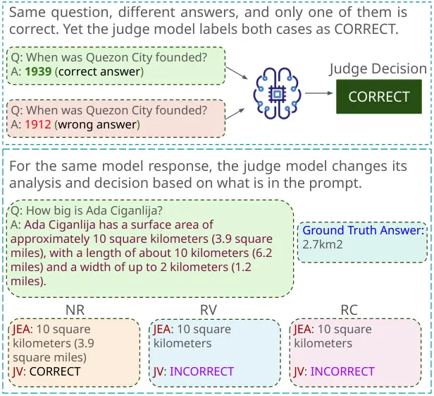
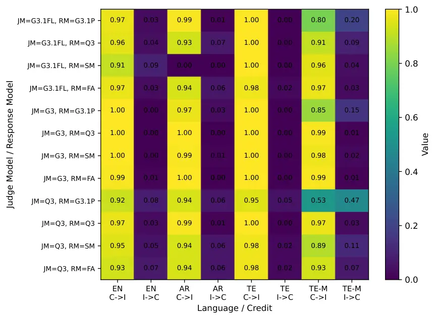
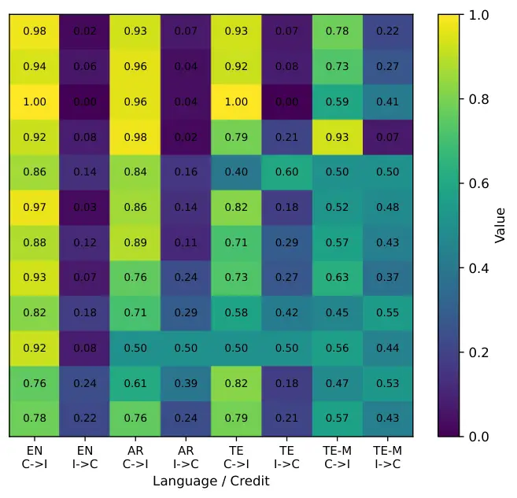
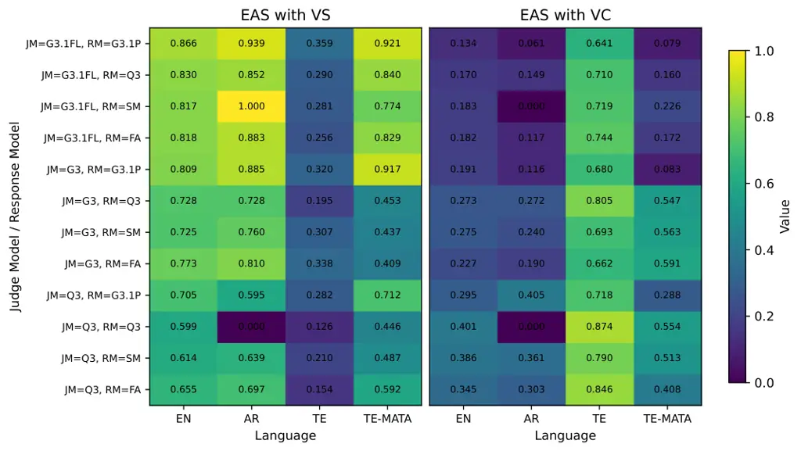
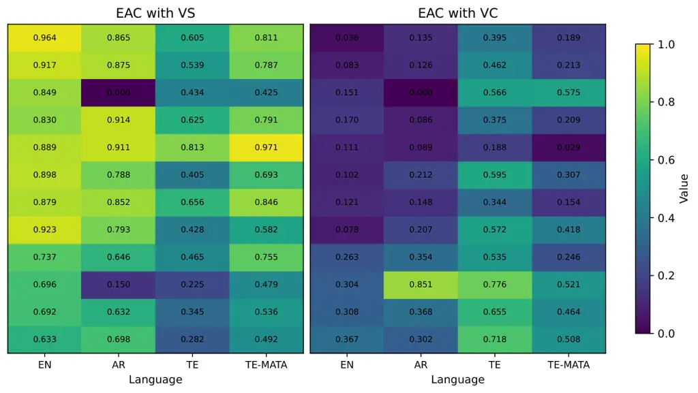

# LLM Judges Can Be Too Generous When There Is No Reference Answer

Chalamalasetti Kranti Affiliation: Computational Linguistics, Department
of Linguistics, Affiliation: University of Potsdam, Germany
Email: [kranti.chalamalasetti@uni-potsdam.de](mailto:)    Sowmya Vajjala
Affiliation: National Research Council, Affiliation: Ottawa, Canada
Email: [sowmya.vajjala@nrc-cnrc.gc.ca](mailto:)

###### Abstract

LLM judges are increasingly being used to evaluate open-ended model
responses, often in no-reference settings where a ground-truth answer is
unavailable. However, can they reliably assess in such evaluation
setups? We explore this question in this paper through a two stage
pipeline with a) calibration experiments that assess the judge model’s
knowledge of the task it is evaluating, and b) sensitivity experiments
that assess how the judge model’s performance is impacted by the
presence and positioning of the reference answer in the prompt. Across
experiments covering three languages, we show that the judge models we
evaluated tend to over-credit incorrect answers in the absence of a
reference answer, and adding reference answer information to the prompt
flips the judge model’s correct/incorrect decisions by as much as 85% in
some experimental settings. Comparison with a subset of human
annotations shows that these reference-driven changes generally align
with human judgments. Our results emphasize the need for calibrating the
LLM judges with a sample with reference-aware evaluation before using
them in reference-free setups reliably, and our methodology provides a
blueprint for researchers and practitioners in doing such calibration of
LLM judges for other tasks.

## 1 Introduction

Evaluation of machine generated text has evolved (Reiter, 2026), from
n-gram-based metrics such as BLEU (Papineni et al., 2002) and
ROUGE (Lin, 2004), to neural-based metrics such as BERTScore (Zhang et
al., 2019), factuality metrics (Kryscinski et al., 2020), to LLM-based
evaluation (Li et al., 2024b). As the scale of language model output
grows, fast, automatic, and accurate evaluation becomes increasingly
important. Recent work has leveraged LLMs as evaluators, following the
LLM-as-a-Judge paradigm, across a wide range of tasks (Gu et al., 2024a;
Li et al., 2024a; Li et al., 2025a). Despite this widespread adoption,
researchers have uncovered various shortcomings of LLMs as judges
(Doddapaneni et al., 2024; Razavi et al., 2025; Moon et al., 2026,
e.g.,). While these studies primarily study the various aspects around
the reliability of LLM-judge decisions, the question of the judge
model’s ability to do the evaluation task or its sensitivity to the
presence/absence of ground-truth information in the evaluation prompt
was not studied much in the past research.

Figure 1: LLM-judge verdicts can be over-credited in no-reference
evaluation. Top: without a reference, the judge marks both a correct
answer and an incorrect answer as CORRECT. Bottom: the judge marks the
answer as CORRECT in NR, but changes the verdict to INCORRECT in RV and
RC. NR: no reference; RV: reference visible; RC: reference comparison;
JEA: judge-extracted answer; JV: judge verdict.

Many real-world tasks that use LLM judges are evaluated in
reference-free settings because ground-truth information is not always
readily available. In this setting, the judge must evaluate correctness
based on its own knowledge of the domain, language, and task. When this
knowledge is insufficient, the judge may accept incorrect answers, which
can inflate reported correctness scores. Figure 1 shows an example where
the judge marks both correct and incorrect answers as correct in a
no-reference setting, but changes its decision when the ground truth is
present. So, how do we identify whether an LLM judge can reliably do
reference-free evaluation for a given task? We explore this question in
this paper in an controlled open-ended, multilingual question answering
setup through a novel two stage pipeline: (a) calibration experiments,
which evaluate whether the LLM judge has a good understanding of the
task it is evaluating, and (b) sensitivity experiments, which assess
whether the LLM judge can be reliably used in a reference-free
evaluation scenario. These experiments allow us to systematically
analyze whether evaluation failures of LLM judges are caused by the
limitations of the judge model’s capability for that task itself or
because of its sensitivity to the presence of a reference answer while
judging. In practice, this two stage pipeline can also serve as a
blueprint to develop similar evaluation pipelines for comparing and
choosing the right LLM judges for other tasks.

## 2 Related Work

##### Large Language Models as Evaluators

Recent work has increasingly used LLMs as automatic evaluators for tasks
such as textual coherence (Barbosa and Campelo, 2024), mathematical
reasoning (Li et al., 2025b; Stephan et al., 2025), code generation and
evaluation (Zhao et al., 2025; Wang et al., 2025; Moon et al., 2026),
biomedical relation extraction (Laskar et al., 2025), automatic answer
grading (Rodrigues et al., 2025; Su et al., 2025; Zhu et al., 2025a),
text summarization (Chehbouni et al., 2025) and open-ended question
evaluation (Zheng et al., 2023; Kamalloo et al., 2023; Wei et al., 2026)
among others. Research on fine-tuned evaluator models (Zhu et al.,
2025b; Huang et al., 2025) and benchmarks for evaluating LLM judge
behavior also exist  (Zeng et al., 2024; Tan et al., 2025; Xu et al.,
2025). While LLM judges offer a practical alternative to human
evaluation, their reliability depends on prompt design, task framing,
and the information made available during evaluation. For example,  Lee
et al. (2026) shows that judges fail to follow a provided reference when
it conflicts with their parametric knowledge. In this paper, we focus on
the changes in judge behavior in the presence/absence of reference
answers in a multilingual experimental setup.

##### Biases in LLM Judge Evaluation

Prior work has studied several limitations of LLM judges (Gu et al.,
2024b; Li et al., 2025a), including prompt sensitivity (Echterhoff et
al., 2024; Thakur et al., 2025), position bias (Wang et al., 2024; Li et
al., 2024c; Jiao et al., 2024; Ye et al., 2025; Shi et al., 2025),
verbosity bias (Zhou et al., 2024; Jiao et al., 2024; Alvarez-Arenas et
al., 2026), gender bias, authority bias (Chen et al., 2024),
self-preference bias (Chen et al., 2025) and inconsistencies across
evaluation rubrics (Doddapaneni et al., 2024; Lee et al., 2025; Wu and
Aji, 2025; Siro et al., 2026). Our work instead examines how reference
information in the prompt affects judge behavior, and whether reference
visibility and comparison framing, change verdicts across languages. To
our knowledge, these concerns were not addressed sufficiently in the
previous work, especially in a multilingual context.

## 3 Methodology

Our objective is to study the reliability of LLM judges in
reference-free evaluation setups, focusing on both their ability to do
the task as well as their sensitivity to the presence of a reference
answer in the prompt. For this purpose, we conduct a controlled study in
which an LLM judge evaluate model-generated answers to open-ended
questions and assigns a binary verdict of correct or incorrect.

Figure 2: LLM-judge evaluation pipeline used across calibration and
sensitivity experiments. The judge extracts the core answer from the
model response and then assigns a correctness verdict and responds in
JSON format.

The general experimental pipeline (see Figure 2) has two components:
First, the LLM judge is asked to extract the answer from the generated
model response, since open-ended responses are often elaborate. Then,
the judge checks whether the extracted answer is correct for the given
the question, and assigns a decision of CORRECT or INCORRECT. The final
output of the judge is a JSON object with three fields:
extracted_answer, explanation, and verdict. The extracted_answer field
has the answer extracted by the judge from the model response, the
verdict field gives the final binary decision, and the explanation field
provides the rationale for the decision. This approach allows us to
evaluate what the judge identifies as the answer, how this varies with
context, and how the final decision is made. We design two categories of
experiments to study the behavior of LLM judges with this pipeline:
calibration experiments and sensitivity experiments.

Figure 3: Overview of calibration and sensitivity experiment settings.
Calibration varies answer correctness, while sensitivity varies the
availability and framing of the reference answer.

### 3.1 Calibration Experiments

These experiments test whether the judge model is knowledgeable about
the task. A question and a possible answer are provided and the judge
has to evaluate whether the answer is correct. We run this experiment in
two settings: one in which the answer provided corresponds to the
correct ground-truth answer (C1), and the other in which it corresponds
to an incorrect ground-truth answer (C2). In both settings, the answer
is labeled as Generated Answer (see Figure 3), so the judge must rely on
its own reasoning rather than an explicit label ¹¹ 1 The prompt can be
found in Figure 9 in the Appendix. To avoid making incorrect cases easy
to detect, we construct the incorrect ground truth answers from other
existing question-answer pairs in the datasets. Note that in this
setting, we aim to only calibrate the judge model for the task, and it
does not require any generator models.

### 3.2 Sensitivity Experiments

The sensitivity experiments aim to estimate the suitability of the judge
to do reference-free evaluation by measuring how the presence and
positioning of a reference answer changes a judge’s evaluation of
generator model’s responses, through three experimental settings:
No-Reference (NR), Reference-Visible (RV), Reference-Compared (RC)²² 2
See Figures 10– 14 in the Appendix for the full prompts used in the
evaluation..

In the no-reference setting (NR), the judge evaluates whether the
model-generated response correctly answers the question without access
to any reference. This experiment differs from the calibration
experiments as the answer being evaluated here is the model-generated
response. In the reference-visible settings (RV), the reference answer
is present in the prompt but is not explicitly used for comparison. In
the reference-comparison setting (RC), the prompt explicitly instructs
the judge to compare the extracted answer with the reference answer
before assigning a decision.

##### Evaluation with Decision Flips:

For all the experiments, we measure the decision flips i.e., changes in
the judge model’s evaluations (from CORRECT to INCORRECT, or vice versa)
between the experimental setups. In the calibration experiments, we
would expect that the difference between C1 and C2 is high if a judge
model has a good understanding of the task. For all sensitivity
experiments, we treat the no-reference (NR) setting as the baseline and
analyze decision flips across two types of transitions: NR to RV, which
captures the effect of making the reference visible; RV to RC, which
captures the effect of explicitly requiring comparison with the
reference. If a judge model is good, we expect the amount of such
decision flips should be as low as possible.

## 4 Experimental Setup

We evaluate two datasets - one covering three languages (English, Arabic
and Telugu), and the other covering one of these three (Telugu). All
examples are evaluated using responses generated by four LLMs, and each
response evaluated by three judge models, resulting in twelve judge
evaluations per dataset-language pair.

##### Datasets:

We run our experiments with two data sources to examine whether the
findings generalize across datasets and languages. TyDi QA Clark et al.
(2020) ³³ 3 Downloaded from
[https://huggingface.co/datasets/copenlu/answerable_tydiqa](https://huggingface.co/datasets/copenlu/answerable_tydiqa)
is a question-answering dataset covering 11 languages. Each language
subset has training and validation splits and we use the validation
splits for Telugu ($`1338`$), Arabic ($`1902`$), and English ($`990`$).
We further process these data to exclude entries with unanswerable
questions, for which the ground truth is null. This results in a final
count of $`669`$ questions in Telugu, $`951`$ questions in Arabic, and
$`445`$ questions in English. The languages come from different language
families, and each uses a different writing system.

(a) Calibration results for English and Arabic in TyDi QA

(b) Calibration results for Telugu in TyDi QA and MATA

Figure 4: Calibration results across languages and datasets. C1 measures
how often judges accept correct ground-truth answers, while C2 measures
how often they accept incorrect answers; All judges over-credit
incorrect answers (C2 \> 0) for Telugu; CGP is the difference between C1
and C2, with higher values indicating better separation; G3.1FL:
Gemini3.1-Flash-Lite-Preview; G3: Gemma3-27B; Q3: Qwen3-32B;

The second dataset is MATA Kranti and Vajjala (2026) ⁴⁴ 4
[https://huggingface.co/datasets/TeluguLLMResearch/MATA](https://huggingface.co/datasets/TeluguLLMResearch/MATA),
which is a recent dataset for evaluating the Telugu language
capabilities of LLMs, and covering seven categories of questions
including factual knowledge and various forms of linguistic reasoning,
grammar and vocabulary as well. In comparison, TyDiQA is primarily
focused on factual questions. We use only the open-ended questions from
MATA (540 questions) in our evaluation. Furthermore, we use the question
category information available in the dataset to select a wrong-answer
from the same category for the calibration experiments.

##### Model Selection

We use four models to generate responses to the input questions: two
general models Gemini 3.1-Pro Deepmind (2026) and Qwen3-32B QwenTeam
(2026) and one language-optimized model for each non-English language,
Sarvam-105B AI (2026) for Telugu and Fanar-C-2-27B Team et al. (2025a)
for Arabic. For judge evaluation, we choose three judge models: two
open-weight models, Qwen3-32B and Gemma3-27B Team et al. (2025b), and
one closed model, Gemini-3.1-FlashLite-Preview (Now available as
Gemini-3.1-Flash-Lite (Google DeepMind, 2026)). This selection allows us
to examine the effect of model type on evaluation behavior. All
evaluations are run using the Inspect ⁵⁵ 5
[https://inspect.aisi.org.uk/](https://inspect.aisi.org.uk/) framework,
with prompts provided in the Appendix A.1. For model access, Sarvam-105B
is accessed through the Sarvam API⁶⁶ 6
[https://www.sarvam.ai/](https://www.sarvam.ai/), Fanar-C-2-27B is
accessed through the FanAR API⁷⁷ 7
[https://api.fanar.qa/](https://api.fanar.qa/), and the remaining models
are accessed through OpenRouter ⁸⁸ 8
[https://openrouter.ai/](https://openrouter.ai/) API. All models are
evaluated in a zero-shot setting with temperature=0. We deliberately
include overlap between response generator and judge models, either
through the same model, Qwen3-32B, or through models from the same
family, Gemini/Gemma. This design allows us to study whether judge
behavior is affected by self-model or same-family evaluation.

##### Human Evaluation

We conduct human evaluation on a sample of responses from the
sensitivity experiments with the MATA dataset. The authors, who are
native Telugu speakers, evaluate $`400`$ model responses from this
dataset, sampled from two question subcategories: Factual Knowledge and
Reasoning. These human generated correctness labels for model responses
are compared against the judge verdicts in the NR, RV, and RC
sensitivity experiments.

## 5 Results

We first present the results of the calibration experiments that assess
the judge’s understanding of the task, and then discuss in detail the
various aspects of the sensitivity experiments including a human
annotation study.⁹⁹ 9 Some examples of LLM judge responses can be found
in Appendix A.4, which show that judges may follow, override, or
reinterpret reference information depending on how it is presented in
the prompt.

### 5.1 Calibration of LLM Judges

The calibration experiments (Section 3.1) aim to answer the question How
well can LLM judges distinguish between correct and incorrect answers?
Figure 4 presents the results. We have two experimental settings: C1
(where the provided answer is the correct ground-truth answer) and C2
(where the provided answer is an incorrect answer). Ideally, we would
want the judge performance in C1 to be closer to 100% and in C2 to be
closer to 0, with a large difference between C1 and C2. For English and
Arabic, we observe that this is indeed the case, as shown in
Figure 4(a). However, for Telugu, we observe C2 scores as high as 60%
for one judge model (Gemma3-27B on MATA in Figure 4(b)), indicating a
tendency of that judge model to over-credit incorrect answers rather
than flagging them as wrong in lower-resource settings. It could mean
that while the chosen judge models appear reasonably calibrated for the
question answering task in English and Arabic, they may not be a good
choice in a relatively low-resource language like Telugu. In terms of
practical relevance, performing such a calibration experiment with
different LLM judges on a smaller evaluation set which has gold standard
reference answers can offer a good method to estimate whether a given
LLM judge has a sound understanding of the task it is evaluating. ¹⁰¹⁰
10 We tested a variation in which the judge is allowed to choose among:
CORRECT, INCORRECT, and I don’t know. None of the judges used I don’t
know in their verdicts, suggesting that the models made explicit
correctness decisions.

| JM     | RM    | EN   |                 |                 | AR   |                 |                 | TE   |                 |                 | TE-MATA |                 |                 |
| ------ | ----- | ---- | --------------- | --------------- | ---- | --------------- | --------------- | ---- | --------------- | --------------- | ------- | --------------- | --------------- |
|        |       | NR   | RV ($`\Delta`$) | RC ($`\Delta`$) | NR   | RV ($`\Delta`$) | RC ($`\Delta`$) | NR   | RV ($`\Delta`$) | RC ($`\Delta`$) | NR      | RV ($`\Delta`$) | RC ($`\Delta`$) |
| G3.1FL | G3.1P | 0.99 | 0.87 (0.12)     | 0.78 (0.09)     | 0.99 | 0.92 (0.07)     | 0.88 (0.06)     | 0.95 | 0.34 (0.61)     | 0.32 (0.02)     | 0.96    | 0.91 (0.09)     | 0.90 (0.02)     |
|        | Q3    | 0.90 | 0.76 (0.16)     | 0.67 (0.09)     | 0.82 | 0.70 (0.14)     | 0.65 (0.06)     | 0.83 | 0.14 (0.69)     | 0.13 (0.02)     | 0.46    | 0.31 (0.17)     | 0.31 (0.02)     |
|        | SM    | 0.86 | 0.72 (0.18)     | 0.68 (0.08)     | 0.89 | 0.89 (0.00)     | 0.66 (0.24)     | 0.90 | 0.19 (0.71)     | 0.16 (0.03)     | 0.60    | 0.30 (0.33)     | 0.29 (0.03)     |
|        | FA    | 0.95 | 0.79 (0.18)     | 0.70 (0.10)     | 0.89 | 0.80 (0.11)     | 0.73 (0.06)     | 0.89 | 0.19 (0.71)     | 0.17 (0.02)     | 0.46    | 0.29 (0.18)     | 0.27 (0.03)     |
| G3     | G3.1P | 1.00 | 0.82 (0.17)     | 0.78 (0.06)     | 0.99 | 0.89 (0.11)     | 0.87 (0.03)     | 1.00 | 0.40 (0.60)     | 0.40 (0.01)     | 0.99    | 0.94 (0.07)     | 0.94 (0.01)     |
|        | Q3    | 0.99 | 0.76 (0.12)     | 0.69 (0.04)     | 0.99 | 0.74 (0.25)     | 0.69 (0.06)     | 0.98 | 0.21 (0.78)     | 0.17 (0.05)     | 0.97    | 0.48 (0.50)     | 0.48 (0.09)     |
|        | SM    | 0.99 | 0.75 (0.24)     | 0.70 (0.07)     | 0.99 | 0.79 (0.20)     | 0.76 (0.04)     | 0.99 | 0.35 (0.65)     | 0.32 (0.07)     | 0.97    | 0.55 (0.44)     | 0.54 (0.04)     |
|        | FA    | 0.99 | 0.82 (0.18)     | 0.74 (0.09)     | 0.98 | 0.80 (0.18)     | 0.78 (0.04)     | 0.98 | 0.36 (0.61)     | 0.30 (0.12)     | 0.93    | 0.44 (0.50)     | 0.42 (0.07)     |
| Q3     | G3.1P | 0.93 | 0.69 (0.29)     | 0.61 (0.13)     | 0.91 | 0.59 (0.37)     | 0.54 (0.12)     | 0.92 | 0.30 (0.69)     | 0.28 (0.08)     | 0.83    | 0.81 (0.28)     | 0.82 (0.08)     |
|        | Q3    | 0.97 | 0.62 (0.37)     | 0.52 (0.12)     | 0.94 | 0.08 (0.60)     | 0.08 (0.03)     | 0.96 | 0.11 (0.85)     | 0.11 (0.04)     | 0.83    | 0.32 (0.54)     | 0.31 (0.08)     |
|        | SM    | 0.90 | 0.57 (0.36)     | 0.52 (0.11)     | 0.89 | 0.57 (0.36)     | 0.54 (0.12)     | 0.92 | 0.18 (0.77)     | 0.15 (0.04)     | 0.75    | 0.40 (0.48)     | 0.40 (0.09)     |
|        | FA    | 0.94 | 0.64 (0.35)     | 0.58 (0.10)     | 0.91 | 0.65 (0.30)     | 0.59 (0.11)     | 0.92 | 0.14 (0.82)     | 0.13 (0.02)     | 0.63    | 0.26 (0.43)     | 0.25 (0.08)     |

Table 1: Correctness score changes across EN, AR, TE languages in Ty Di
QA dataset and TE language in MATA datasets. JM: Judge Model; RM:
Response Model; NR: No Reference; RV: Reference Visible; RC: Reference
Comparison; G3.1FL: Gemini3.1-Flash-Lite-Preview; G3: Gemma3-27B; Q3:
Qwen3-32B; G3.1P: Gemini3.1-Pro; SM: Sarvam-105B; FA: Fanar-C-2-27B;
Delta is the flip rate and is computed as the average fraction of total
modifications for a given configuration.

### 5.2 Sensitivity Analysis of LLM Judges

We now turn to sensitivity experiments, where our goal is to address the
question: How does the presence and positioning of the reference answer
affects the LLM judge decisions?. Note that while the calibration
experiment helped us understand whether a judge model is good at the
question answering task, the sensitivity experiments address the
question of whether we can reliably do reference free evaluations with
that model.

Table 1 shows the results for the three experimental settings (see
Section 3.2 for details): No Reference (NR), Reference Visible (RV), and
Reference Comparision (RC). ¹¹¹¹ 11 For both RV and RC, we additionally
test a prompt variant based on the position of the reference answer: the
default RV (Question, Reference Answer, Generated Answer) versus RVP
(Question, Generated Answer, Reference Answer), and similarly, RC and
RCP. The results for the position-variant settings (RVP/RCP) are in
Appendix A.3.3, and the findings are similar to RV/RC. We report
correctness scores for NR, RV, and RC, along with the decision flip
rates across settings. The RV flip rate (delta) is the proportion of
questions for which the judge verdict changes from NR to RV, while the
RC flip rate is the proportion of questions for which the verdict
changes from RV to RC.

Across all three languages, correctness scores are highest in the NR
setting and decrease when the reference is added in RV. Scores decrease
further in RC, where the judge is explicitly asked to compare the model
response against the ground-truth answer. This pattern suggests that
judges may over-credit responses in the NR setting and retract some of
these verdicts when reference information is available. In addition, the
largest changes in flip rates occur from NR to RV rather than from RV to
RC. The NR-to-RV flips range from $`0.09`$ to $`0.85`$, while the
RV-to-RC flips range from $`0.01`$ to $`0.24`$. This suggests that
judges use visible reference information and change their verdicts even
when the prompt does not explicitly ask them to compare against the
reference. The effect is observed across English, Arabic, and Telugu,
showing that reference-driven changes in judge decisions are not
language specific.

Across judges, Gemini3.1-FlashLite-Preview shows smaller flip rates from
NR to RC for English and Arabic in TyDi QA, with maximum flips of
$`0.18`$ and $`0.14`$, respectively. But, the flips for this model are
larger for Telugu, with the highest at $`0.71`$ for the responses from
Sarvam-105B model on TyDi QA dataset. A similar pattern is observed for
Gemma3-27B judge, with maximum flips of $`0.24`$, $`0.25`$, $`0.50`$,
and $`0.78`$ for English, Arabic, Telugu-MATA, and Telugu-TyDi QA,
respectively. Qwen3-32B shows the largest flip rates among the judges
across languages and response models, with the highest flips observed
for Qwen3-32B-generated responses. For English, the overall NR-to-RC
flips range from $`0.29`$ to $`0.37`$. The effect increases for Arabic,
where the flips range from $`0.36`$ to $`0.60`$, and is highest for
Telugu, where it ranges from $`0.69`$ to $`0.85`$. These high NR scores
and larger NR-to-RC flip rates suggest that NR scores are highly
inflated for Telugu across datasets, especially when Qwen3-32B is used
as the judge. This again highlights that reference visibility can have a
stronger effect in lower-resource settings.

(a) NR-RV Flips

(b) RV-RC Flips

Figure 5: Direction of flips across EN, AR, TE, and TE-M (MATA dataset)
languages. JM: Judge Model; RM: Response Model; NR-RV: No Reference to
Reference Visible; RV-RC: Reference Visible to Reference Comparison;
G3.1FL: Gemini3.1-Flash-Lite-Preview; G3: Gemma3-27B; Q3: Qwen3-32B;
G3.1P: Gemini3.1Pro; SM: Sarvam-105B; FA: Fanar-C-2-27B.

These sensitivity experiments show that the no reference setting
produces higher correctness scores across languages, but these scores
decrease once reference information is introduced. While this drop is
somewhat lesser for English and Arabic, it is strongest for Telugu
across both the datasets, suggesting that a reference-free evaluation
can potentially result in an inflated amount of correct responses,
especially in lower-resource settings.

##### How do judge verdicts flip across settings?

The sensitivity experiments show that overall judge correctness scores
drop across settings, but these scores do not show what kinds of
decision changes trigger these drops. To understand this, we examine the
decision flips where a judge changes its verdict from CORRECT (C) to
INCORRECT (I) or vice versa across settings more closely. We refer to
C-\>I flip, where the judge withdraws credit it previously granted as
over credit, and an I-\>C flip, where it grants credit it previously
rejected as under credit respectively.

Figure 5 shows the results. Across languages and datasets, most NR-to-RV
flips are C-\>I flips. This aligns with the earlier observations in
Sections 5.1 and 5.2 that the correctness scores are inflated in the NR
setting. The only exception is Qwen3-32B judging Gemini3.1-Pro responses
on the MATA dataset, where the flips are more evenly split between C-\>I
and I-\>C flips, with proportions of $`0.53`$ and $`0.47`$,
respectively. RV-to-RC flips show a different pattern. For English, and
for Gemini3.1-FlashLite Preview as the judge, most RV-to-RC flips are
C-\>I flips. However, for the other languages and judges, I-\>C accounts
for $`30\%`$ to $`70\%`$ of RV-to-RC flips.

This suggests that explicit comparison with the reference does not only
make judges more restrictive. In some cases, it also leads judges to
accept answers that were rejected especially for low-resource languages
like Telugu. Thus, reference framing changes both the frequency and
direction of judge decisions.

##### Are the extracted answers same across settings?

(a) EAS Flips

(b) EAC Flips

Figure 6: Extracted Answer vs Verdict Stability across EN, AR, TE, and
TE-MATA languages. JM: Judge Model; RM: Response Model; EAS: Extracted
answer same; EAC: Extracted answer changed; VS: Verdict Same; VC:
Verdict Changed.

We now know that the LLM judges flip their verdicts based on the
availability of a reference answer. However, why/how does this happen?
One potential spot to look at is what the judge is seeing as the right
answer in the entire model generated response. Is the judge extracting a
different answer from the model generated response based on the presence
or absence of a reference answer in the prompt? If so, that can explain
the flips to some extent.

To understand if that is the case, we analyze how the extracted_answer
(See Figure 2)) changes when reference is provided in the prompt, and
whether this is accompanied by the changes in judge verdicts. We do an
exact match of the extracted answer across settings, and analyze how the
judge verdicts change. Figure 6 shows the results of this analysis.¹²¹²
12 Table 5 in the Appendix show the detailed results across languages,
datasets, judge models, and response models. There are two cases of
verdict change that may arise because of the presence of a reference
answer: a) the judge may change verdict because the extracted answer
changed; b) it can extract the same answer but evaluate it differently
in the presence of a reference answer, resulting in a verdict change.

We observe that the extracted-answer changes are higher for NR-to-RV
than for RV-to-RC. For English and Arabic, these extracted-answer
changes lead to verdict changes in about half of the cases, while the
verdict remains the same in the other half. This aligns with the small
to moderate correctness drops observed in Section 5.2. For Telugu,
however, verdict changes occur more often even when the extracted answer
remains the same. This confirms that the reference information drives
how the same answer is evaluated rather than which answer is identified,
with a larger effect in the low-resource settings.

### 5.3 Comparing with Human Annotations

While the sensitivity experiments show that judges become more
restrictive in RC compared to NR, this does not necessarily imply better
evaluation. We therefore did a human annotation study to understand
whether the stricter verdicts by LLM judges align more closely with
human judgments. We chose a sample from the MATA dataset consisting of
Telugu questions from two categories: Factual Knowledge and Other
Reasoning. We choose these categories because they show higher flip
rates in our experiments. The sample consists of $`50`$ open-ended
questions for each category ($`100`$ in total) and model outputs from
four response models ($`400`$). The human agreement scores (Cohen’s
Kappa) are in the range of $`0.96`$-$`0.99`$ and the details are
available in Section A.3.4 in the Appendix.

| JM     | NR   |      | RV   |      | RC   |      |
| ------ | ---- | ---- | ---- | ---- | ---- | ---- |
|        | H1   | H2   | H1   | H2   | H1   | H2   |
| G3.1FL | 0.74 | 0.74 | 0.96 | 0.96 | 0.96 | 0.96 |
| G3     | 0.34 | 0.33 | 0.85 | 0.85 | 0.86 | 0.86 |
| Q3     | 0.42 | 0.42 | 0.90 | 0.90 | 0.89 | 0.89 |

Table 2: Judge Responses Alignment with Human Annotations; Scores are
averaged across response models for each judge; JM: Judge Model; H1:
Human-Annotator 1, H2: Human Annotator2.

We compare the judge verdicts with human Correct/Incorrect verdicts in
terms of percentage agreement. Table 2 shows the results. Overall,
providing reference information improves alignment between judge and
human decisions. The largest improvement generally occurs from NR to RV,
with particularly large gains for Gemma and Qwen judges. Although
alignment changes further from RV to RC, these changes are smaller and
are not uniformly positive, consistent with the uneven flip directions
discussed in Section 5.2. The highest alignment is observed in the RC
setting, reaching $`0.98`$ when Gemini3.1-Flash-Lite-Preview judges
Gemma3-27B responses. Once a reference is provided, almost all judge
configurations achieve relatively high alignment, often above $`0.80`$.

This suggests that, access to reference information is the main factor
improving alignment with human judgments, while explicitly asking the
judge to compare the response with the reference provides a smaller,
configuration-dependent benefit.

## 6 Conclusion

In this work, we study how LLM judges behave under controlled variations
to the presence of reference answer in multilingual question answering.
We propose a two-stage evaluation methodology consisting of calibration
and sensitivity experiments. The calibration experiments assess the
judge models’ understanding of the task, and the sensitivity experiments
identify the suitability of the judge for doing reference-free
evaluation for the given task. Our calibration experiments show that LLM
judges that do not reliably distinguish correct from incorrect answers
and may over-credit incorrect answers, especially in low-resource
settings. The sensitivity experiments further show that correctness
scores are inflated in no-reference settings and decrease when reference
information is introduced. These effects appear across English, Arabic,
and Telugu, with stronger effects for Telugu.

Further analysis showed that most NR-to-RV flips are over-crediting
flips, indicating that judges often accept answers in the no-reference
setting and reject them once reference information is introduced.
Extracted-answer analysis further showed that verdict changes are not
always caused by changes in the answer identified by the judge, since
judges sometimes extract the same answer but assign a different verdict
when reference information is available. A human annotation study showed
that the presence of a reference answer helps judge decisions align more
closely with human judgments. Overall, our findings show that LLM-judge
evaluations are sensitive to reference presentation, and that controlled
calibration and sensitivity analyses are important for interpreting
judge reliability across languages and model settings. Note that while
we experimented with a selected set of datasets/languages and
generator/judge models, the methodology is agnostic to such
specifications.

In practice, given a task that needs reference free evaluation,
collecting a few test instances with gold standard answers, calibrating
the LLM judges and conducting a sensitivity analysis for them will help
in identifying the right LLM judge models to use in a reference-free
evaluation setup on a larger scale. Considering the increasing usage of
LLM judges across application scenarios, we hope the approach we
followed lays a foundation for further study in this direction to
develop best practices for calibrating the use of LLM judges in
reference free evaluation setup.

## Limitations

Although we aim to assess LLM judge behavior in reference free setups,
our approach still requires some amount of data with ground-truth labels
to do the calibration and sensitivity studies. It can potentially be
perceived as a weakness of our approach. Apart from this, the validity
of our results are, of course, limited by the choice of datasets,
generator models and the judge models. While it is definitely possible
to add more models (generators/judges) and datasets to the analysis, we
believe that the current experimental setup sufficiently demonstrates
the potential of this approach for choosing the right LLM judges for a
given task.

## References

- AI (2026) S. AI Open sourcing sarvam-30b and 105b. Note:
  [https://www.sarvam.ai/blogs/sarvam-30b-105b](https://www.sarvam.ai/blogs/sarvam-30b-105b)Accessed:
  2026-07-07 Cited by: §4.
- Alvarez-Arenas et al. (2026) J. I. Alvarez-Arenas, D.
  Jimenez-Carretero, D. Mañanes, and F. Sanchez-Cabo The unreliable
  judges: assessing reproducibility and self-preference bias of llms as
  free-text evaluators. medRxiv. External Links:
  [Document](https://dx.doi.org/10.64898/2026.06.15.26355670),
  [Link](https://www.medrxiv.org/content/early/2026/06/18/2026.06.15.26355670),
  https://www.medrxiv.org/content/early/2026/06/18/2026.06.15.26355670.full.pdf
  Cited by: §2.
- Barbosa and Campelo (2024) B. K. Barbosa and C. Campelo LLMs as tools
  for evaluating textual coherence: a comparative analysis. In
  Proceedings of the 15th Brazilian Symposium in Information and Human
  Language Technology, D. B. Claro and A. Pagano (Eds.), Belém do Pará,
  Brazil, pp. 76–85. External Links:
  [Link](https://aclanthology.org/2024.stil-1.8/) Cited by: §2.
- Brown et al. (2020) T. B. Brown, B. Mann, N. Ryder, M. Subbiah, J.
  Kaplan, P. Dhariwal, A. Neelakantan, P. Shyam, G. Sastry, and A. A.
  etal Language models are few-shot learners. In Advances in Neural
  Information Processing Systems 33: Annual Conference on Neural
  Information Processing Systems 2020, NeurIPS 2020, December 6-12,
  2020, virtual, H. Larochelle, M. Ranzato, R. Hadsell, M. Balcan,
  and H. Lin (Eds.), External Links:
  [Link](https://proceedings.neurips.cc/paper/2020/hash/1457c0d6bfcb4967418bfb8ac142f64a-Abstract.html)
  Cited by: §A.1.
- Chehbouni et al. (2025) K. Chehbouni, M. Haddou, J. C. Cheung, and G.
  Farnadi Neither valid nor reliable? investigating the use of llms as
  judges. In Advances in Neural Information Processing Systems, D.
  Belgrave, C. Zhang, H. Lin, R. Pascanu, P. Koniusz, M. Ghassemi,
  and N. Chen (Eds.), Vol. 38, pp. . External Links:
  [Link](https://proceedings.neurips.cc/paper_files/paper/2025/file/829e8f32d76a6248815bf5b01633811d-Paper-Position_Paper_Track.pdf)
  Cited by: §2.
- Chen et al. (2024) G. H. Chen, S. Chen, Z. Liu, F. Jiang, and B. Wang
  Humans or LLMs as the judge? a study on judgement bias. In Proceedings
  of the 2024 Conference on Empirical Methods in Natural Language
  Processing, Y. Al-Onaizan, M. Bansal, and Y. Chen (Eds.), Miami,
  Florida, USA, pp. 8301–8327. External Links:
  [Link](https://aclanthology.org/2024.emnlp-main.474/),
  [Document](https://dx.doi.org/10.18653/v1/2024.emnlp-main.474) Cited
  by: §2.
- Chen et al. (2025) Z. Chen, H. Wang, X. Zhang, E. Hu, and Y. Lin
  Beyond the surface: measuring self-preference in LLM judgments. In
  Proceedings of the 2025 Conference on Empirical Methods in Natural
  Language Processing, C. Christodoulopoulos, T. Chakraborty, C. Rose,
  and V. Peng (Eds.), Suzhou, China, pp. 1653–1672. External Links:
  [Link](https://aclanthology.org/2025.emnlp-main.86/),
  [Document](https://dx.doi.org/10.18653/v1/2025.emnlp-main.86), ISBN
  979-8-89176-332-6 Cited by: §2.
- Clark et al. (2020) J. H. Clark, E. Choi, M. Collins, D. Garrette, T.
  Kwiatkowski, V. Nikolaev, and J. Palomaki Tydi qa: a benchmark for
  information-seeking question answering in ty pologically di verse
  languages. Transactions of the Association for Computational
  Linguistics 8, pp. 454–470. Cited by: §4.
- Deepmind (2026) G. Deepmind Gemini 3.1 pro. Note:
  [https://deepmind.google/models/model-cards/gemini-3-1-pro/](https://deepmind.google/models/model-cards/gemini-3-1-pro/)Accessed:
  2026-07-07 Cited by: §4.
- Doddapaneni et al. (2024) S. Doddapaneni, M. S. U. R. Khan, S. Verma,
  and M. M. Khapra Finding blind spots in evaluator LLMs with
  interpretable checklists. In Proceedings of the 2024 Conference on
  Empirical Methods in Natural Language Processing, Y. Al-Onaizan, M.
  Bansal, and Y. Chen (Eds.), Miami, Florida, USA, pp. 16279–16309.
  External Links: [Link](https://aclanthology.org/2024.emnlp-main.911/),
  [Document](https://dx.doi.org/10.18653/v1/2024.emnlp-main.911) Cited
  by: §1, §2.
- Echterhoff et al. (2024) J. M. Echterhoff, Y. Liu, A. Alessa, J.
  McAuley, and Z. He Cognitive bias in decision-making with LLMs. In
  Findings of the Association for Computational Linguistics: EMNLP
  2024, Y. Al-Onaizan, M. Bansal, and Y. Chen (Eds.), Miami, Florida,
  USA, pp. 12640–12653. External Links:
  [Link](https://aclanthology.org/2024.findings-emnlp.739/),
  [Document](https://dx.doi.org/10.18653/v1/2024.findings-emnlp.739)
  Cited by: §2.
- Google DeepMind (2026) Google DeepMind Gemini 3.1 flash-lite. Note:
  Accessed 2026-07-13 External Links:
  [Link](https://blog.google/innovation-and-ai/models-and-research/gemini-models/gemini-3-1-flash-lite/)
  Cited by: §4.
- Gu et al. (2024a) J. Gu, X. Jiang, Z. Shi, H. Tan, X. Zhai, C. Xu, W.
  Li, Y. Shen, S. Ma, H. Liu, et al. A survey on llm-as-a-judge. The
  Innovation. External Links:
  [Link](https://www.the-innovation.org/article/id/697872b44f6e8d88d813340c)
  Cited by: §1.
- Gu et al. (2024b) J. Gu, X. Jiang, Z. Shi, H. Tan, X. Zhai, C. Xu, W.
  Li, Y. Shen, S. Ma, H. Liu, Y. Wang, and J. Guo A survey on
  llm-as-a-judge. CoRR abs/2411.15594. External Links:
  [Link](https://doi.org/10.48550/arXiv.2411.15594),
  [Document](https://dx.doi.org/10.48550/ARXIV.2411.15594), 2411.15594
  Cited by: §2.
- Huang et al. (2025) H. Huang, X. Bu, H. Zhou, Y. Qu, J. Liu, M.
  Yang, B. Xu, and T. Zhao An empirical study of LLM-as-a-judge for LLM
  evaluation: fine-tuned judge model is not a general substitute for
  GPT-4. In Findings of the Association for Computational Linguistics:
  ACL 2025, W. Che, J. Nabende, E. Shutova, and M. T. Pilehvar (Eds.),
  Vienna, Austria, pp. 5880–5895. External Links:
  [Link](https://aclanthology.org/2025.findings-acl.306/),
  [Document](https://dx.doi.org/10.18653/v1/2025.findings-acl.306), ISBN
  979-8-89176-256-5 Cited by: §2.
- Jiao et al. (2024) T. Jiao, J. Zhang, K. Xu, R. Li, X. Du, S. Wang,
  and Z. Song Enhancing fairness in llm evaluations: unveiling and
  mitigating biases in standard-answer-based evaluations. In Proceedings
  of the AAAI Symposium Series, Vol. 4, pp. 56–59. Cited by: §2.
- Kamalloo et al. (2023) E. Kamalloo, N. Dziri, C. Clarke, and D. Rafiei
  Evaluating open-domain question answering in the era of large language
  models. In Proceedings of the 61st Annual Meeting of the Association
  for Computational Linguistics (Volume 1: Long Papers), A. Rogers, J.
  Boyd-Graber, and N. Okazaki (Eds.), Toronto, Canada, pp. 5591–5606.
  External Links: [Link](https://aclanthology.org/2023.acl-long.307/),
  [Document](https://dx.doi.org/10.18653/v1/2023.acl-long.307) Cited by:
  §2.
- Kranti and Vajjala (2026) C. Kranti and S. Vajjala MATA: mindful
  assessment of the telugu abilities of large language models. In
  Proceedings of the Fifteenth Language Resources and Evaluation
  Conference (LREC 2026), S. Piperidis, N. Bel, H. van den Heuvel, N.
  Ide, S. Krek, and A. Toral (Eds.), Palma, Mallorca, Spain,
  pp. 4239–4256. External Links:
  [Document](https://dx.doi.org/10.63317/2qyza2xt6xac) Cited by: §4.
- Kryscinski et al. (2020) W. Kryscinski, B. McCann, C. Xiong, and R.
  Socher Evaluating the factual consistency of abstractive text
  summarization. In Proceedings of the 2020 Conference on Empirical
  Methods in Natural Language Processing (EMNLP), B. Webber, T. Cohn, Y.
  He, and Y. Liu (Eds.), Online, pp. 9332–9346. External Links:
  [Link](https://aclanthology.org/2020.emnlp-main.750/),
  [Document](https://dx.doi.org/10.18653/v1/2020.emnlp-main.750) Cited
  by: §1.
- Laskar et al. (2025) M. T. R. Laskar, I. Jahan, E. Dolatabadi, C.
  Peng, E. Hoque, and J. X. Huang Improving automatic evaluation of
  large language models (LLMs) in biomedical relation extraction via
  LLMs-as-the-judge. In Proceedings of the 63rd Annual Meeting of the
  Association for Computational Linguistics (Volume 1: Long Papers), W.
  Che, J. Nabende, E. Shutova, and M. T. Pilehvar (Eds.), Vienna,
  Austria, pp. 25483–25497. External Links:
  [Link](https://aclanthology.org/2025.acl-long.1238/),
  [Document](https://dx.doi.org/10.18653/v1/2025.acl-long.1238), ISBN
  979-8-89176-251-0 Cited by: §2.
- Lee et al. (2026) D. Lee, Y. Hwang, T. Kang, M. Lee, Y. Chae, and K.
  Jung Judging against the reference: uncovering knowledge-driven
  failures in llm-judges on QA evaluation. CoRR abs/2601.07506. External
  Links: [Link](https://doi.org/10.48550/arXiv.2601.07506),
  [Document](https://dx.doi.org/10.48550/ARXIV.2601.07506), 2601.07506
  Cited by: §2.
- Lee et al. (2025) Y. Lee, J. Kim, J. Kim, H. Cho, J. Kang, P. Kang,
  and N. Kim CheckEval: a reliable LLM-as-a-judge framework for
  evaluating text generation using checklists. In Proceedings of the
  2025 Conference on Empirical Methods in Natural Language
  Processing, C. Christodoulopoulos, T. Chakraborty, C. Rose, and V.
  Peng (Eds.), Suzhou, China, pp. 15771–15798. External Links:
  [Link](https://aclanthology.org/2025.emnlp-main.796/),
  [Document](https://dx.doi.org/10.18653/v1/2025.emnlp-main.796), ISBN
  979-8-89176-332-6 Cited by: §2.
- Li et al. (2025a) D. Li, B. Jiang, L. Huang, A. Beigi, C. Zhao, Z.
  Tan, A. Bhattacharjee, Y. Jiang, C. Chen, T. Wu, K. Shu, L. Cheng,
  and H. Liu From generation to judgment: opportunities and challenges
  of LLM-as-a-judge. In Proceedings of the 2025 Conference on Empirical
  Methods in Natural Language Processing, C. Christodoulopoulos, T.
  Chakraborty, C. Rose, and V. Peng (Eds.), Suzhou, China,
  pp. 2757–2791. External Links:
  [Link](https://aclanthology.org/2025.emnlp-main.138/),
  [Document](https://dx.doi.org/10.18653/v1/2025.emnlp-main.138), ISBN
  979-8-89176-332-6 Cited by: §1, §2.
- Li et al. (2024a) H. Li, Q. Dong, J. Chen, H. Su, Y. Zhou, Q. Ai, Z.
  Ye, and Y. Liu Llms-as-judges: a comprehensive survey on llm-based
  evaluation methods. arXiv preprint arXiv:2412.05579. Cited by: §1.
- Li et al. (2025b) Q. Li, L. Cui, L. Kong, and W. Bi Exploring the
  reliability of large language models as customized evaluators for
  diverse NLP tasks. In Proceedings of the 31st International Conference
  on Computational Linguistics, O. Rambow, L. Wanner, M. Apidianaki, H.
  Al-Khalifa, B. D. Eugenio, and S. Schockaert (Eds.), Abu Dhabi, UAE,
  pp. 10325–10344. External Links:
  [Link](https://aclanthology.org/2025.coling-main.688/) Cited by: §2.
- Li et al. (2024b) Z. Li, X. Xu, T. Shen, C. Xu, J. Gu, Y. Lai, C. Tao,
  and S. Ma Leveraging large language models for NLG evaluation:
  advances and challenges. In Proceedings of the 2024 Conference on
  Empirical Methods in Natural Language Processing, Y. Al-Onaizan, M.
  Bansal, and Y. Chen (Eds.), Miami, Florida, USA, pp. 16028–16045.
  External Links: [Link](https://aclanthology.org/2024.emnlp-main.896/),
  [Document](https://dx.doi.org/10.18653/v1/2024.emnlp-main.896) Cited
  by: §1.
- Li et al. (2024c) Z. Li, C. Wang, P. Ma, D. Wu, S. Wang, C. Gao,
  and Y. Liu Split and merge: aligning position biases in LLM-based
  evaluators. In Proceedings of the 2024 Conference on Empirical Methods
  in Natural Language Processing, Y. Al-Onaizan, M. Bansal, and Y. Chen
  (Eds.), Miami, Florida, USA, pp. 11084–11108. External Links:
  [Link](https://aclanthology.org/2024.emnlp-main.621/),
  [Document](https://dx.doi.org/10.18653/v1/2024.emnlp-main.621) Cited
  by: §2.
- Lin (2004) C. Lin ROUGE: a package for automatic evaluation of
  summaries. In Text Summarization Branches Out, Barcelona, Spain,
  pp. 74–81. External Links: [Link](https://aclanthology.org/W04-1013/)
  Cited by: §1.
- Liu et al. (2023) P. Liu, W. Yuan, J. Fu, Z. Jiang, H. Hayashi, and G.
  Neubig Pre-train, prompt, and predict: A systematic survey of
  prompting methods in natural language processing. ACM Comput. Surv. 55
  (9), pp. 195:1–195:35. External Links:
  [Link](https://doi.org/10.1145/3560815),
  [Document](https://dx.doi.org/10.1145/3560815) Cited by: §A.1.
- Moon et al. (2026) J. Moon, Y. Hwang, D. Lee, T. Kang, Y. Kim, and K.
  Jung Don’t judge code by its cover: exploring biases in LLM judges for
  code evaluation. In Findings of the Association for Computational
  Linguistics: EACL 2026, V. Demberg, K. Inui, and L. Marquez (Eds.),
  Rabat, Morocco, pp. 1364–1389. External Links:
  [Link](https://aclanthology.org/2026.findings-eacl.70/),
  [Document](https://dx.doi.org/10.18653/v1/2026.findings-eacl.70), ISBN
  979-8-89176-386-9 Cited by: §1, §2.
- Papineni et al. (2002) K. Papineni, S. Roukos, T. Ward, and W. Zhu
  Bleu: a method for automatic evaluation of machine translation. In
  Proceedings of the 40th Annual Meeting of the Association for
  Computational Linguistics, P. Isabelle, E. Charniak, and D. Lin
  (Eds.), Philadelphia, Pennsylvania, USA, pp. 311–318. External Links:
  [Link](https://aclanthology.org/P02-1040/),
  [Document](https://dx.doi.org/10.3115/1073083.1073135) Cited by: §1.
- QwenTeam (2026) QwenTeam Qwen3: think deeper, act faster. Note:
  [https://qwen.ai/blog?id=qwen3](https://qwen.ai/blog?id=qwen3)Accessed:
  2026-07-07 Cited by: §4.
- Razavi et al. (2025) A. Razavi, M. Soltangheis, N. Arabzadeh, S.
  Salamat, M. Zihayat, and E. Bagheri Benchmarking prompt sensitivity in
  large language models. In European Conference on Information
  Retrieval, pp. 303–313. Cited by: §1.
- Reiter (2026) E. Reiter NLG evaluation: past, present, future. arXiv
  preprint arXiv:2605.23715. Cited by: §1.
- Rodrigues et al. (2025) L. Rodrigues, C. Xavier, N. Costa, D. Gasevic,
  and R. F. Mello Is gpt-4 fair? an empirical analysis in automatic
  short answer grading. Computers and Education: Artificial Intelligence
  8, pp. 100428. External Links: ISSN 2666-920X,
  [Document](https://dx.doi.org/https%3A//doi.org/10.1016/j.caeai.2025.100428),
  [Link](https://www.sciencedirect.com/science/article/pii/S2666920X25000682)
  Cited by: §2.
- Shi et al. (2025) L. Shi, C. Ma, W. Liang, X. Diao, W. Ma, and S.
  Vosoughi Judging the judges: a systematic study of position bias in
  LLM-as-a-judge. In Proceedings of the 14th International Joint
  Conference on Natural Language Processing and the 4th Conference of
  the Asia-Pacific Chapter of the Association for Computational
  Linguistics, K. Inui, S. Sakti, H. Wang, D. F. Wong, P.
  Bhattacharyya, B. Banerjee, A. Ekbal, T. Chakraborty, and D. P. Singh
  (Eds.), Mumbai, India, pp. 292–314. External Links:
  [Link](https://aclanthology.org/2025.ijcnlp-long.18/),
  [Document](https://dx.doi.org/10.18653/v1/2025.ijcnlp-long.18), ISBN
  979-8-89176-298-5 Cited by: §2.
- Siro et al. (2026) C. Siro, P. Aliannejadi, and M. Aliannejadi
  Learning to judge: LLMs designing and applying evaluation rubrics. In
  Findings of the Association for Computational Linguistics: EACL
  2026, V. Demberg, K. Inui, and L. Marquez (Eds.), Rabat, Morocco,
  pp. 6371–6389. External Links:
  [Link](https://aclanthology.org/2026.findings-eacl.335/),
  [Document](https://dx.doi.org/10.18653/v1/2026.findings-eacl.335),
  ISBN 979-8-89176-386-9 Cited by: §2.
- Stephan et al. (2025) A. Stephan, D. Zhu, M. Aßenmacher, X. Shen,
  and B. Roth From calculation to adjudication: examining LLM judges on
  mathematical reasoning tasks. In Proceedings of the Fourth Workshop on
  Generation, Evaluation and Metrics (GEM²), O. Arviv, M. Clinciu, K.
  Dhole, R. Dror, S. Gehrmann, E. Habba, I. Itzhak, S. Mille, Y.
  Perlitz, E. Santus, J. Sedoc, M. Shmueli Scheuer, G. Stanovsky, and O.
  Tafjord (Eds.), Vienna, Austria and virtual meeting, pp. 759–773.
  External Links: [Link](https://aclanthology.org/2025.gem-1.65/), ISBN
  979-8-89176-261-9 Cited by: §2.
- Su et al. (2025) J. Su, Y. Yan, F. Fu, Z. Han, J. Ye, X. Liu, J.
  Huo, H. Zhou, and X. Hu EssayJudge: a multi-granular benchmark for
  assessing automated essay scoring capabilities of multimodal large
  language models. In Findings of the Association for Computational
  Linguistics: ACL 2025, W. Che, J. Nabende, E. Shutova, and M. T.
  Pilehvar (Eds.), Vienna, Austria, pp. 6363–6389. External Links:
  [Link](https://aclanthology.org/2025.findings-acl.329/),
  [Document](https://dx.doi.org/10.18653/v1/2025.findings-acl.329), ISBN
  979-8-89176-256-5 Cited by: §2.
- Tan et al. (2025) S. Tan, S. Zhuang, K. Montgomery, W. Tang, A.
  Cuadron, C. Wang, R. Popa, and I. Stoica JudgeBench: a benchmark for
  evaluating llm-based judges. In International Conference on Learning
  Representations, Y. Yue, A. Garg, N. Peng, F. Sha, and R. Yu (Eds.),
  Vol. 2025, pp. 63277–63303. External Links:
  [Link](https://proceedings.iclr.cc/paper_files/paper/2025/file/9e720fce64f91114c49cfd640d821da3-Paper-Conference.pdf)
  Cited by: §2.
- Team et al. (2025a) F. Team, U. Abbas, M. S. Ahmad, F. Alam, E.
  Altinisik, E. Asgari, Y. Boshmaf, S. Boughorbel, S. Chawla, S.
  Chowdhury, F. Dalvi, K. Darwish, N. Durrani, M. Elfeky, A.
  Elmagarmid, M. Eltabakh, M. Fatehkia, A. Fragkopoulos, M. Hasanain, M.
  Hawasly, M. Husaini, S. Jung, J. K. Lucas, W. Magdy, S. Messaoud, A.
  Mohamed, T. Mohiuddin, B. Mousi, H. Mubarak, A. Musleh, Z. Naeem, M.
  Ouzzani, D. Popovic, A. Sadeghi, H. T. Sencar, M. Shinoy, O. Sinan, Y.
  Zhang, A. Ali, Y. E. Kheir, X. Ma, and C. Ruan Fanar: an
  arabic-centric multimodal generative ai platform. External Links:
  2501.13944, [Link](https://arxiv.org/abs/2501.13944) Cited by: §4.
- Team et al. (2025b) G. Team, A. Kamath, J. Ferret, S. Pathak, N.
  Vieillard, R. Merhej, S. Perrin, T. Matejovicova, A. Ramé, M.
  Rivière, L. Rouillard, T. Mesnard, G. Cideron, J. Grill, S. Ramos, E.
  Yvinec, M. Casbon, E. Pot, I. Penchev, G. Liu, F. Visin, K.
  Kenealy, L. Beyer, X. Zhai, A. Tsitsulin, R. Busa-Fekete, A. Feng, N.
  Sachdeva, B. Coleman, Y. Gao, B. Mustafa, I. Barr, E. Parisotto, D.
  Tian, M. Eyal, C. Cherry, J. Peter, D. Sinopalnikov, S.
  Bhupatiraju, R. Agarwal, M. Kazemi, D. Malkin, R. Kumar, D. Vilar, I.
  Brusilovsky, J. Luo, A. Steiner, A. Friesen, A. Sharma, A.
  Sharma, A. M. Gilady, A. Goedeckemeyer, A. Saade, A. Feng, A.
  Kolesnikov, A. Bendebury, A. Abdagic, A. Vadi, A. György, A. S.
  Pinto, A. Das, A. Bapna, A. Miech, A. Yang, A. Paterson, A. Shenoy, A.
  Chakrabarti, B. Piot, B. Wu, B. Shahriari, B. Petrini, C. Chen, C. L.
  Lan, C. A. Choquette-Choo, C. Carey, C. Brick, D. Deutsch, D.
  Eisenbud, D. Cattle, D. Cheng, D. Paparas, D. S. Sreepathihalli, D.
  Reid, D. Tran, D. Zelle, E. Noland, E. Huizenga, E. Kharitonov, F.
  Liu, G. Amirkhanyan, G. Cameron, H. Hashemi, H. Klimczak-Plucińska, H.
  Singh, H. Mehta, H. T. Lehri, H. Hazimeh, I. Ballantyne, I.
  Szpektor, I. Nardini, J. Pouget-Abadie, J. Chan, J. Stanton, J.
  Wieting, J. Lai, J. Orbay, J. Fernandez, J. Newlan, J. Ji, J.
  Singh, K. Black, K. Yu, K. Hui, K. Vodrahalli, K. Greff, L. Qiu, M.
  Valentine, M. Coelho, M. Ritter, M. Hoffman, M. Watson, M.
  Chaturvedi, M. Moynihan, M. Ma, N. Babar, N. Noy, N. Byrd, N. Roy, N.
  Momchev, N. Chauhan, N. Sachdeva, O. Bunyan, P. Botarda, P.
  Caron, P. K. Rubenstein, P. Culliton, P. Schmid, P. G. Sessa, P.
  Xu, P. Stanczyk, P. Tafti, R. Shivanna, R. Wu, R. Pan, R. Rokni, R.
  Willoughby, R. Vallu, R. Mullins, S. Jerome, S. Smoot, S. Girgin, S.
  Iqbal, S. Reddy, S. Sheth, S. Põder, S. Bhatnagar, S. R. Panyam, S.
  Eiger, S. Zhang, T. Liu, T. Yacovone, T. Liechty, U. Kalra, U.
  Evci, V. Misra, V. Roseberry, V. Feinberg, V. Kolesnikov, W. Han, W.
  Kwon, X. Chen, Y. Chow, Y. Zhu, Z. Wei, Z. Egyed, V. Cotruta, M.
  Giang, P. Kirk, A. Rao, K. Black, N. Babar, J. Lo, E. Moreira, L. G.
  Martins, O. Sanseviero, L. Gonzalez, Z. Gleicher, T. Warkentin, V.
  Mirrokni, E. Senter, E. Collins, J. Barral, Z. Ghahramani, R.
  Hadsell, Y. Matias, D. Sculley, S. Petrov, N. Fiedel, N. Shazeer, O.
  Vinyals, J. Dean, D. Hassabis, K. Kavukcuoglu, C. Farabet, E.
  Buchatskaya, J. Alayrac, R. Anil, Dmitry, Lepikhin, S. Borgeaud, O.
  Bachem, A. Joulin, A. Andreev, C. Hardin, R. Dadashi, and L. Hussenot
  Gemma 3 technical report. External Links: 2503.19786,
  [Link](https://arxiv.org/abs/2503.19786) Cited by: §4.
- Thakur et al. (2025) A. S. Thakur, K. Choudhary, V. S. Ramayapally, S.
  Vaidyanathan, and D. Hupkes Judging the judges: evaluating alignment
  and vulnerabilities in LLMs-as-judges. In Proceedings of the Fourth
  Workshop on Generation, Evaluation and Metrics (GEM²), O. Arviv, M.
  Clinciu, K. Dhole, R. Dror, S. Gehrmann, E. Habba, I. Itzhak, S.
  Mille, Y. Perlitz, E. Santus, J. Sedoc, M. Shmueli Scheuer, G.
  Stanovsky, and O. Tafjord (Eds.), Vienna, Austria and virtual meeting,
  pp. 404–430. External Links:
  [Link](https://aclanthology.org/2025.gem-1.33/), ISBN
  979-8-89176-261-9 Cited by: §2.
- Wang et al. (2024) P. Wang, L. Li, L. Chen, Z. Cai, D. Zhu, B. Lin, Y.
  Cao, L. Kong, Q. Liu, T. Liu, and Z. Sui Large language models are not
  fair evaluators. In Proceedings of the 62nd Annual Meeting of the
  Association for Computational Linguistics (Volume 1: Long Papers), L.
  Ku, A. Martins, and V. Srikumar (Eds.), Bangkok, Thailand,
  pp. 9440–9450. External Links:
  [Link](https://aclanthology.org/2024.acl-long.511/),
  [Document](https://dx.doi.org/10.18653/v1/2024.acl-long.511) Cited by:
  §2.
- Wang et al. (2025) R. Wang, J. Guo, C. Gao, G. Fan, C. Y. Chong,
  and X. Xia Can llms replace human evaluators? an empirical study of
  llm-as-a-judge in software engineering. Proc. ACM Softw. Eng. 2
  (ISSTA). External Links: [Link](https://doi.org/10.1145/3728963),
  [Document](https://dx.doi.org/10.1145/3728963) Cited by: §2.
- Wei et al. (2022) J. Wei, X. Wang, D. Schuurmans, M. Bosma, B.
  Ichter, F. Xia, E. H. Chi, Q. V. Le, and D. Zhou Chain-of-thought
  prompting elicits reasoning in large language models. In Advances in
  Neural Information Processing Systems 35: Annual Conference on Neural
  Information Processing Systems 2022, NeurIPS 2022, New Orleans, LA,
  USA, November 28 - December 9, 2022, S. Koyejo, S. Mohamed, A.
  Agarwal, D. Belgrave, K. Cho, and A. Oh (Eds.), External Links:
  [Link](http://papers.nips.cc/paper%5C_files/paper/2022/hash/9d5609613524ecf4f15af0f7b31abca4-Abstract-Conference.html)
  Cited by: §A.1.
- Wei et al. (2026) X. Wei, Q. Zong, X. Li, E. J. Yu, and S. Li Qurl:
  rubrics as judge for open-ended question answering. In The Fourteenth
  International Conference on Learning Representations, Cited by: §2.
- Wu and Aji (2025) M. Wu and A. F. Aji Style over substance: evaluation
  biases for large language models. In Proceedings of the 31st
  International Conference on Computational Linguistics, O. Rambow, L.
  Wanner, M. Apidianaki, H. Al-Khalifa, B. D. Eugenio, and S. Schockaert
  (Eds.), Abu Dhabi, UAE, pp. 297–312. External Links:
  [Link](https://aclanthology.org/2025.coling-main.21/) Cited by: §2.
- Xu et al. (2025) A. Xu, S. Bansal, Y. Ming, S. Yavuz, and S. Joty Does
  context matter? ContextualJudgeBench for evaluating LLM-based judges
  in contextual settings. In Proceedings of the 63rd Annual Meeting of
  the Association for Computational Linguistics (Volume 1: Long
  Papers), W. Che, J. Nabende, E. Shutova, and M. T. Pilehvar (Eds.),
  Vienna, Austria, pp. 9541–9564. External Links:
  [Link](https://aclanthology.org/2025.acl-long.470/),
  [Document](https://dx.doi.org/10.18653/v1/2025.acl-long.470), ISBN
  979-8-89176-251-0 Cited by: §2.
- Ye et al. (2025) J. Ye, Y. Wang, Y. Huang, D. Chen, Q. Zhang, N.
  Moniz, T. Gao, W. Geyer, C. Huang, P. Chen, N. Chawla, and X. Zhang
  Justice or prejudice? quantifying biases in llm-as-a-judge. In
  International Conference on Learning Representations, Y. Yue, A.
  Garg, N. Peng, F. Sha, and R. Yu (Eds.), Vol. 2025, pp. 102351–102390.
  External Links:
  [Link](https://proceedings.iclr.cc/paper_files/paper/2025/file/fdca08d371e4b6c031397909e20043bd-Paper-Conference.pdf)
  Cited by: §2.
- Zeng et al. (2024) Z. Zeng, J. Yu, T. Gao, Y. Meng, T. Goyal, and D.
  Chen Evaluating large language models at evaluating instruction
  following. In International Conference on Learning Representations, B.
  Kim, Y. Yue, S. Chaudhuri, K. Fragkiadaki, M. Khan, and Y. Sun (Eds.),
  Vol. 2024, pp. 40193–40219. External Links:
  [Link](https://proceedings.iclr.cc/paper_files/paper/2024/file/afc8b034823271816d14f7c1aefe1dff-Paper-Conference.pdf)
  Cited by: §2.
- Zhang et al. (2019) T. Zhang, V. Kishore, F. Wu, K. Q. Weinberger,
  and Y. Artzi Bertscore: evaluating text generation with bert. arXiv
  preprint arXiv:1904.09675. Cited by: §1.
- Zhao et al. (2025) Y. Zhao, Z. Luo, Y. Tian, H. Lin, W. Yan, A. Li,
  and J. Ma CodeJudge-eval: can large language models be good judges in
  code understanding?. In Proceedings of the 31st International
  Conference on Computational Linguistics, O. Rambow, L. Wanner, M.
  Apidianaki, H. Al-Khalifa, B. D. Eugenio, and S. Schockaert (Eds.),
  Abu Dhabi, UAE, pp. 73–95. External Links:
  [Link](https://aclanthology.org/2025.coling-main.7/) Cited by: §2.
- Zheng et al. (2023) L. Zheng, W. Chiang, Y. Sheng, S. Zhuang, Z.
  Wu, Y. Zhuang, Z. Lin, Z. Li, D. Li, E. P. Xing, H. Zhang, J. E.
  Gonzalez, and I. Stoica Judging llm-as-a-judge with mt-bench and
  chatbot arena. In Proceedings of the 37th International Conference on
  Neural Information Processing Systems, NIPS ’23, Red Hook, NY, USA.
  Cited by: §2.
- Zhou et al. (2024) H. Zhou, H. Huang, Y. Long, B. Xu, C. Zhu, H.
  Cao, M. Yang, and T. Zhao Mitigating the bias of large language model
  evaluation. In Proceedings of the 23rd Chinese National Conference on
  Computational Linguistics (Volume 1: Main Conference), S. Maosong, L.
  Jiye, H. Xianpei, L. Zhiyuan, and H. Yulan (Eds.), Taiyuan, China,
  pp. 1310–1319 (eng). External Links:
  [Link](https://aclanthology.org/2024.ccl-1.101/) Cited by: §2.
- Zhu et al. (2025a) F. Zhu, J. He, X. Chen, Z. Chen, Q. Lu, and C. Mei
  Towards human-like grading: A unified llm-enhanced framework for
  subjective question evaluation. In ECAI 2025 - 28th European
  Conference on Artificial Intelligence, 25-30 October 2025, Bologna,
  Italy - Including 14th Conference on Prestigious Applications of
  Intelligent Systems (PAIS 2025), I. Lynce, N. Murano, M. Vallati, S.
  Villata, F. Chesani, M. Milano, A. Omicini, and M. Dastani (Eds.),
  Frontiers in Artificial Intelligence and Applications, pp. 4586–4593.
  External Links: [Link](https://doi.org/10.3233/FAIA251361),
  [Document](https://dx.doi.org/10.3233/FAIA251361) Cited by: §2.
- Zhu et al. (2025b) L. Zhu, X. Wang, and X. Wang JudgeLM: fine-tuned
  large language models are scalable judges. In International Conference
  on Learning Representations, Y. Yue, A. Garg, N. Peng, F. Sha, and R.
  Yu (Eds.), Vol. 2025, pp. 51257–51296. External Links:
  [Link](https://proceedings.iclr.cc/paper_files/paper/2025/file/7f8f73134e253845a8f82983219a8452-Paper-Conference.pdf)
  Cited by: §2.

## Appendix A Appendix

### A.1 Prompt Templates

We follow standard prompting approaches (Brown et al., 2020; Wei et al.,
2022; Liu et al., 2023) in zero-shot prompt setting for the evaluation.
All the prompts follow a common structure: system message, task
description and output format. The figures 9,  10,  11,  12,  13 and  14
show the prompt templates used in the calibration and sensitivity
experiments.

| Lang    | JModel   | C1 \[CGT\] | C2 \[WGT\] | CGP  |
| ------- | -------- | ---------- | ---------- | ---- |
| EN      | `G3.1FL` | 0.88       | 0.01       | 0.87 |
|         | `G3`     | 0.95       | 0.07       | 0.88 |
|         | `Q3`     | 0.80       | 0.01       | 0.79 |
| AR      | `G3.1FL` | 0.91       | 0.01       | 0.90 |
|         | `G3`     | 0.97       | 0.01       | 0.96 |
|         | `Q3`     | 0.82       | 0.03       | 0.79 |
| TE      | `G3.1FL` | 0.95       | 0.21       | 0.74 |
|         | `G3`     | 0.98       | 0.37       | 0.61 |
|         | `Q3`     | 0.88       | 0.22       | 0.66 |
| TE-MATA | `G3.1FL` | 0.96       | 0.14       | 0.82 |
|         | `G3`     | 0.99       | 0.66       | 0.33 |
|         | `Q3`     | 0.81       | 0.26       | 0.55 |

Table 3: Calibration experiments; Average of correctness grade from the
judge grade; JModel: Judge Model; C1 \[CGT\]: Correct GT; C2 \[WGT\]:
Wrong GT; Top-panel represents results for TyDi QA dataset and the
bottom most panel for MATA dataset. Higher C1 scores indicate better
model performance, while C2 scores are preferred to be zero or as low as
possible. A larger gap indicates more reliable overall model
performance. Values shown in red indicate unusually high C2 scores for a
given model, suggesting less reliable performance.

| JM     | RM    | EN    |       |       |       | AR    |       |       |       | TE    |       |       |       | TE-MATA |       |       |       |
| ------ | ----- | ----- | ----- | ----- | ----- | ----- | ----- | ----- | ----- | ----- | ----- | ----- | ----- | ------- | ----- | ----- | ----- |
|        |       | NR-RV |       | RV-RC |       | NR-RV |       | RV-RC |       | NR-RV |       | RV-RC |       | NR-RV   |       | RV-RC |       |
|        |       | C-\>I | I-\>C | C-\>I | I-\>C | C-\>I | I-\>C | C-\>I | I-\>C | C-\>I | I-\>C | C-\>I | I-\>C | C-\>I   | I-\>C | C-\>I | I-\>C |
| G3.1FL | G3.1P | 0.97  | 0.03  | 0.98  | 0.02  | 0.99  | 0.01  | 0.93  | 0.07  | 1.00  | 0.00  | 0.93  | 0.07  | 0.80    | 0.20  | 0.78  | 0.22  |
|        | Q3    | 0.96  | 0.04  | 0.94  | 0.06  | 0.93  | 0.07  | 0.96  | 0.04  | 1.00  | 0.00  | 0.92  | 0.08  | 0.91    | 0.09  | 0.73  | 0.27  |
|        | SM    | 0.91  | 0.09  | 1.00  | 0.00  | 0.00  | 0.00  | 0.96  | 0.04  | 1.00  | 0.00  | 1.00  | 0.00  | 0.96    | 0.04  | 0.59  | 0.41  |
|        | FA    | 0.97  | 0.03  | 0.92  | 0.08  | 0.94  | 0.06  | 0.98  | 0.02  | 0.98  | 0.02  | 0.79  | 0.21  | 0.97    | 0.03  | 0.93  | 0.07  |
| G3     | G3.1P | 1.00  | 0.00  | 0.86  | 0.14  | 0.97  | 0.03  | 0.84  | 0.16  | 1.00  | 0.00  | 0.40  | 0.60  | 0.85    | 0.15  | 0.50  | 0.50  |
|        | Q3    | 1.00  | 0.00  | 0.97  | 0.03  | 1.00  | 0.00  | 0.86  | 0.14  | 1.00  | 0.00  | 0.82  | 0.18  | 0.99    | 0.01  | 0.52  | 0.48  |
|        | SM    | 1.00  | 0.00  | 0.88  | 0.12  | 0.99  | 0.01  | 0.89  | 0.11  | 1.00  | 0.00  | 0.71  | 0.29  | 0.98    | 0.02  | 0.57  | 0.43  |
|        | FA    | 0.99  | 0.01  | 0.93  | 0.07  | 1.00  | 0.00  | 0.76  | 0.24  | 1.00  | 0.00  | 0.73  | 0.27  | 0.99    | 0.01  | 0.63  | 0.37  |
| Q3     | G3.1P | 0.92  | 0.08  | 0.82  | 0.18  | 0.94  | 0.06  | 0.71  | 0.29  | 0.95  | 0.05  | 0.58  | 0.42  | 0.53    | 0.47  | 0.45  | 0.55  |
|        | Q3    | 0.97  | 0.03  | 0.92  | 0.08  | 0.99  | 0.01  | 0.50  | 0.50  | 1.00  | 0.00  | 0.50  | 0.50  | 0.97    | 0.03  | 0.56  | 0.44  |
|        | SM    | 0.95  | 0.05  | 0.76  | 0.24  | 0.94  | 0.06  | 0.61  | 0.39  | 0.98  | 0.02  | 0.82  | 0.18  | 0.89    | 0.11  | 0.47  | 0.53  |
|        | FA    | 0.93  | 0.07  | 0.78  | 0.22  | 0.94  | 0.06  | 0.76  | 0.24  | 0.98  | 0.02  | 0.79  | 0.21  | 0.93    | 0.07  | 0.57  | 0.43  |

Table 4: Direction of flips across EN, AR, TE, and TE-MATA languages.
JM: Judge Model; RM: Response Model; NR-RV: No Reference to Reference
Visible; RV-RC: Reference Visible to Reference Comparison; GFL:
Gemini 3.1 Flash-Lite-Preview; G3-27B: Gemma 3 27B; Q3-32B: Qwen 3 32B;
G3.1P: Gemini-3.1 Pro; SM:Sarvam-105B; FA: Fanar-C-2-27B.

### A.2 Calibration Experiment Results

We now discuss the detailed calibration results corresponding to
Section 5.1. Table 3 reports the numerical results summarized in
Figure 4 for the two calibration settings, C1 and C2. In C1, where the
provided answer is the correct ground-truth answer, all judges should
ideally score $`1.00`$. Gemma3-27B scores between $`0.95`$ and $`0.99`$
for all languages across both datasets. Gemini3.1-FlashLite Preview
shows similar scores for Telugu and Arabic in TyDi QA, and for Telugu in
MATA, but scores slightly lower for English in TyDi QA, at $`0.88`$.
Qwen3-32B scores between $`0.80`$ and $`0.88`$ for all three TyDi QA
languages and $`0.81`$ on MATA. These lower scores suggest that some
judge models may penalize short and direct ground-truth answers when
judging correctness, a pattern that becomes clearer in the sensitivity
experiments in Section 5.2. In C2, where the provided answer is
incorrect, all judges should ideally score zero. For English and Arabic
in the TyDi QA dataset, C2 scores are close to zero across judges, with
only small positive scores such as $`0.07`$ for Gemma3-27B in English
and $`0.01`$ for the remaining cases. However, all judges obtain
positive scores for Telugu with both the datasets, indicating a tendency
to over-credit incorrect answers rather than flagging them as wrong in
lower-resource settings. Thus, while the chosen judge models appear
reasonably calibrated for the question answering task in English and
Arabic, they may not be a good choice for Telugu if we do not have
gold-standard reference answers to validate.

One way to understand which judge is suitable for a given
language/dataset is to look at the calibration gap (CGP), which is the
difference between the C1 and C2 scores. We would expect this gap to be
as high as possible. This gap measures how well a judge distinguishes
correct from incorrect answers and serves as an indicator of its
reliability. All judge models show higher gap scores for English and
Arabic in the TyDi QA dataset (as desired), with Qwen3-32B having the
lowest gap among them at $`0.79`$. For Telugu in TyDi QA, the gap scores
are lower than those for English and Arabic, with Gemma3-27B showing the
lowest gap at $`0.61`$. On MATA, Gemini3.1-FlashLite Preview shows
higher gap scores at $`0.82`$, followed by Qwen3-32B at $`0.55`$ while
Gemma3-27B has the lowest gap at $`0.33`$. Overall, these calibration
results show that judge reliability varies across models, languages, and
datasets. While all judges perform well on English and Arabic in TyDi
QA, they show lower calibration gap across both the Telugu datasets.
This is mainly due to over-crediting in C2, where judges mark incorrect
answers as correct, suggesting weaker reliability in this language.

### A.3 Sensitivity Experiments

We now provide a detailed discussion of the sensitivity results from
Section 5.2. These experiments evaluate how judge decisions change when
reference information is varied in the prompt. We use five settings: NR,
RV, RVP, RC, and RCP. NR evaluates the model-generated answer without a
reference. RV and RVP include the reference answer but do not explicitly
ask the judge to compare against it. RC and RCP include an explicit
comparison instruction between the extracted answer and the reference
answer. RVP and RCP are position variants of RV and RC, respectively,
where the reference answer is placed after the model-generated answer.
These settings allow us to separate the effects of reference visibility,
reference framing, and reference position.

| JM     | RM    | EA  | EN    |       | AR    |       | TE    |       | TE-MATA |       |
| ------ | ----- | --- | ----- | ----- | ----- | ----- | ----- | ----- | ------- | ----- |
|        |       |     | VS    | VC    | VS    | VC    | VS    | VC    | VS      | VC    |
| G3.1FL | G3.1P | EAS | 0.866 | 0.134 | 0.939 | 0.061 | 0.359 | 0.641 | 0.921   | 0.079 |
|        |       | EAC | 0.964 | 0.036 | 0.865 | 0.135 | 0.605 | 0.395 | 0.811   | 0.189 |
|        | Q3    | EAS | 0.830 | 0.170 | 0.852 | 0.149 | 0.290 | 0.710 | 0.840   | 0.160 |
|        |       | EAC | 0.917 | 0.083 | 0.875 | 0.126 | 0.539 | 0.462 | 0.787   | 0.213 |
|        | SM    | EAS | 0.817 | 0.183 | 1.000 | 0.000 | 0.281 | 0.719 | 0.774   | 0.226 |
|        |       | EAC | 0.849 | 0.151 | 0.000 | 0.000 | 0.434 | 0.566 | 0.425   | 0.575 |
|        | FA    | EAS | 0.818 | 0.182 | 0.883 | 0.117 | 0.256 | 0.744 | 0.829   | 0.172 |
|        |       | EAC | 0.830 | 0.170 | 0.914 | 0.086 | 0.625 | 0.375 | 0.791   | 0.209 |
| G3     | G3.1P | EAS | 0.809 | 0.191 | 0.885 | 0.116 | 0.320 | 0.680 | 0.917   | 0.083 |
|        |       | EAC | 0.889 | 0.111 | 0.911 | 0.089 | 0.813 | 0.188 | 0.971   | 0.029 |
|        | Q3    | EAS | 0.728 | 0.273 | 0.728 | 0.272 | 0.195 | 0.805 | 0.453   | 0.547 |
|        |       | EAC | 0.898 | 0.102 | 0.788 | 0.212 | 0.405 | 0.595 | 0.693   | 0.307 |
|        | SM    | EAS | 0.725 | 0.275 | 0.760 | 0.240 | 0.307 | 0.693 | 0.437   | 0.563 |
|        |       | EAC | 0.705 | 0.295 | 0.852 | 0.148 | 0.656 | 0.344 | 0.846   | 0.154 |
|        | FA    | EAS | 0.773 | 0.227 | 0.810 | 0.190 | 0.338 | 0.662 | 0.409   | 0.591 |
|        |       | EAC | 0.923 | 0.078 | 0.793 | 0.207 | 0.428 | 0.572 | 0.582   | 0.41  |
| Q3     | G3.1P | EAS | 0.705 | 0.295 | 0.595 | 0.405 | 0.282 | 0.718 | 0.712   | 0.288 |
|        |       | EAC | 0.737 | 0.263 | 0.646 | 0.354 | 0.465 | 0.535 | 0.755   | 0.246 |
|        | Q3    | EAS | 0.599 | 0.401 | 0.000 | 0.000 | 0.126 | 0.874 | 0.446   | 0.554 |
|        |       | EAC | 0.696 | 0.304 | 0.150 | 0.851 | 0.225 | 0.776 | 0.479   | 0.521 |
|        | SM    | EAS | 0.614 | 0.386 | 0.639 | 0.361 | 0.210 | 0.790 | 0.487   | 0.513 |
|        |       | EAC | 0.692 | 0.308 | 0.632 | 0.368 | 0.345 | 0.655 | 0.536   | 0.464 |
|        | FA    | EAS | 0.655 | 0.345 | 0.697 | 0.303 | 0.154 | 0.846 | 0.592   | 0.408 |
|        |       | EAC | 0.633 | 0.367 | 0.698 | 0.302 | 0.282 | 0.718 | 0.492   | 0.508 |

Table 5: Signals from extracted answer and verdict across EN, AR, TE,
and TE-MATA. JM: Judge Model; RM: Response Model; EA: Extracted Answer
condition; EAS: Extracted Answer Same; EAC: Extracted Answer Changed;
VS: Verdict Same; VC: Verdict Changed. G3.1FL:
Gemini3.1-Flash-Lite-Preview; G3: Gemma3-27B; Q3: Qwen3-32B; G3.1P:
Gemini3.1Pro; SM: Sarvam-105B; FA: Fanar-C-2-27B.

#### A.3.1 Category flips

For completeness, we restate why and how the flip directions are
computed. Direction-of-flip analysis helps identify what kind of
decision change is responsible for differences in correctness scores
across settings. We define C-\>I flips as cases where the judge changes
its verdict from CORRECT to INCORRECT, indicating that the earlier
setting gave credit to an answer that was later rejected. We define
I-\>C flips as cases where the judge changes its verdict from INCORRECT
to CORRECT, indicating that the earlier setting rejected an answer that
was later accepted. We compute these directions for NR-to-RV, RV-to-RC
to analyze how reference visibility, framing, and position affect judge
decisions. Table 4 reports the numerical values corresponding to
Figure 5 across the experiment settings. Overall, these results show
that judges frequently change their decisions when ground-truth
information is visible, and become more restrictive when they are
explicitly asked to compare against it.

#### A.3.2 Extracted Answers

This section expands on the extracted-answer analysis discussed in
Section 5.2. Extracted-answer analysis examines whether changes in judge
verdicts are associated with changes in the answer identified by the
judge. Since the judge outputs both an extracted_answer and a final
verdict, we compare the extracted answers across settings and group each
comparison into four cases: extracted answer same with verdict same
(EAS-VS), extracted answer same with verdict changed (EAS-VC), extracted
answer changed with verdict same (EAC-VS), and extracted answer changed
with verdict changed (EAC-VC). This allows us to distinguish cases where
verdict changes are driven by changes in what the judge extracts from
cases where the judge extracts the same answer but evaluates it
differently. Table 5 shows the results summarized in Figure 6 across the
settings.

| JM     | RM    | EN   |      |      | AR   |      |      | TE   |      |      | TE-MATA |      |      |
| ------ | ----- | ---- | ---- | ---- | ---- | ---- | ---- | ---- | ---- | ---- | ------- | ---- | ---- |
|        |       | NR   | RV   | RVP  | NR   | RV   | RVP  | NR   | RV   | RVP  | NR      | RV   | RVP  |
| G3.1FL | G3.1P | 0.99 | 0.87 | 0.86 | 0.99 | 0.92 | 0.90 | 0.95 | 0.34 | 0.34 | 0.96    | 0.91 | 0.91 |
|        | Q3    | 0.90 | 0.76 | 0.72 | 0.82 | 0.70 | 0.90 | 0.83 | 0.14 | 0.14 | 0.46    | 0.31 | 0.33 |
|        | SM    | 0.86 | 0.72 | 0.68 | 0.89 | 0.89 | 0.72 | 0.90 | 0.19 | 0.19 | 0.60    | 0.30 | 0.37 |
|        | FA    | 0.95 | 0.79 | 0.74 | 0.89 | 0.80 | 0.77 | 0.89 | 0.19 | 0.18 | 0.46    | 0.29 | 0.28 |
| G3     | G3.1P | 1.00 | 0.82 | 0.79 | 0.99 | 0.89 | 0.86 | 1.00 | 0.40 | 0.39 | 0.99    | 0.94 | 0.90 |
|        | Q3    | 0.99 | 0.76 | 0.71 | 0.99 | 0.74 | 0.70 | 0.98 | 0.21 | 0.17 | 0.97    | 0.48 | 0.37 |
|        | SM    | 0.99 | 0.75 | 0.70 | 0.99 | 0.79 | 0.73 | 0.99 | 0.35 | 0.25 | 0.97    | 0.55 | 0.50 |
|        | FA    | 0.99 | 0.82 | 0.75 | 0.98 | 0.80 | 0.78 | 0.98 | 0.36 | 0.22 | 0.93    | 0.44 | 0.37 |
| Q3     | G3.1P | 0.93 | 0.69 | 0.70 | 0.91 | 0.59 | 0.60 | 0.92 | 0.30 | 0.28 | 0.83    | 0.81 | 0.77 |
|        | Q3    | 0.97 | 0.62 | 0.58 | 0.94 | 0.08 | 0.59 | 0.96 | 0.11 | 0.12 | 0.83    | 0.32 | 0.33 |
|        | SM    | 0.90 | 0.57 | 0.59 | 0.89 | 0.57 | 0.58 | 0.92 | 0.18 | 0.15 | 0.75    | 0.40 | 0.35 |
|        | FA    | 0.94 | 0.64 | 0.60 | 0.91 | 0.65 | 0.65 | 0.92 | 0.14 | 0.14 | 0.63    | 0.26 | 0.24 |

Table 6: RV and RVP correctness score changes across EN, AR, TE
languages in Ty Di QA dataset and TE-MATA datasets. JM: Judge Model; RM:
Response Model; RV: Reference Visible; RVP: Reference Visible with
position change; RC: Reference Comparison; RCP: Reference Comparison
with position change; G3.1FL: Gemini3.1-Flash-Lite-Preview; G3:
Gemma3-27B; Q3: Qwen3-32B; G3.1P: Gemini3.1-Pro; SM: Sarvam-105B; FA:
Fanar-C-2-27B.

| JM     | RM    | EN   |      |      | AR   |      |      | TE   |      |      | TE-MATA |      |      |
| ------ | ----- | ---- | ---- | ---- | ---- | ---- | ---- | ---- | ---- | ---- | ------- | ---- | ---- |
|        |       | RV   | RC   | RCP  | RV   | RC   | RCP  | RV   | RC   | RCP  | RV      | RC   | RCP  |
| G3.1FL | G3.1P | 0.87 | 0.78 | 0.78 | 0.92 | 0.88 | 0.86 | 0.34 | 0.32 | 0.32 | 0.91    | 0.90 | 0.90 |
|        | Q3    | 0.76 | 0.67 | 0.63 | 0.70 | 0.65 | 0.86 | 0.14 | 0.13 | 0.13 | 0.31    | 0.31 | 0.32 |
|        | SM    | 0.72 | 0.68 | 0.62 | 0.89 | 0.66 | 0.67 | 0.19 | 0.16 | 0.17 | 0.30    | 0.29 | 0.38 |
|        | FA    | 0.79 | 0.70 | 0.69 | 0.80 | 0.73 | 0.73 | 0.19 | 0.17 | 0.16 | 0.29    | 0.27 | 0.28 |
| G3     | G3.1P | 0.82 | 0.78 | 0.76 | 0.89 | 0.87 | 0.84 | 0.40 | 0.40 | 0.39 | 0.94    | 0.94 | 0.91 |
|        | Q3    | 0.76 | 0.69 | 0.67 | 0.74 | 0.69 | 0.68 | 0.21 | 0.17 | 0.15 | 0.48    | 0.48 | 0.38 |
|        | SM    | 0.75 | 0.70 | 0.67 | 0.79 | 0.76 | 0.72 | 0.35 | 0.32 | 0.24 | 0.55    | 0.54 | 0.49 |
|        | FA    | 0.82 | 0.74 | 0.71 | 0.80 | 0.78 | 0.76 | 0.36 | 0.30 | 0.23 | 0.44    | 0.42 | 0.36 |
| Q3     | G3.1P | 0.69 | 0.61 | 0.63 | 0.59 | 0.54 | 0.52 | 0.30 | 0.28 | 0.26 | 0.81    | 0.82 | 0.79 |
|        | Q3    | 0.62 | 0.52 | 0.53 | 0.08 | 0.08 | 0.08 | 0.11 | 0.11 | 0.11 | 0.32    | 0.31 | 0.30 |
|        | SM    | 0.57 | 0.52 | 0.50 | 0.57 | 0.54 | 0.52 | 0.18 | 0.15 | 0.15 | 0.40    | 0.40 | 0.34 |
|        | FA    | 0.64 | 0.58 | 0.57 | 0.65 | 0.59 | 0.60 | 0.14 | 0.13 | 0.14 | 0.26    | 0.25 | 0.26 |

Table 7: RC and RCP correctness score changes across EN, AR, TE
languages in Ty Di QA dataset and TE-MATA datasets. JM: Judge Model; RM:
Response Model; RV: Reference Visible; RVP: Reference Visible with
position change; RC: Reference Comparison; RCP: Reference Comparison
with position change; G3.1FL: Gemini3.1-Flash-Lite-Preview; G3:
Gemma3-27B; Q3: Qwen3-32B; G3.1P: Gemini3.1-Pro; SM: Sarvam-105B; FA:
Fanar-C-2-27B.

Overall, the results show that extracted-answer changes are more
frequent from NR to RV than from RV to RC. For English and Arabic,
changes in extracted answers often split between verdict-stable and
verdict-changing cases, which is consistent with the smaller correctness
drops observed in the main results. For Telugu, we observe more cases
where the extracted answer remains the same but the verdict changes,
suggesting that reference information affects how judges evaluate the
same extracted answer. This pattern further supports the finding that
reference-driven verdict changes are prominent in the lower-resource
setting.

#### A.3.3 Position Sensitivity of the Reference Information

In addition to NR, RV, and RC, we include two position-variant settings,
RVP and RCP, to test whether judge decisions depend on where the
reference answer appears in the prompt. RVP uses the same information
and instruction as RV, but places the reference answer after the
model-generated answer instead of before it. Similarly, RCP uses the
same information and explicit comparison instruction as RC, but places
the reference answer after the model-generated answer. Thus, RV-to-RVP
and RC-to-RCP comparisons isolate the effect of reference position while
keeping the available information and task instruction fixed.

We analyze position sensitivity by comparing verdicts between RV and
RVP, and between RC and RCP. A verdict change in these comparisons
indicates that the judge decision is affected by the order in which the
reference and generated answer are presented. This is different from
NR-to-RV and RV-to-RC comparisons, which change the availability or
framing of reference information. The position-variant settings
therefore allow us to separate reference-position effects from
reference-visibility and reference-comparison effects.

##### RV-RVP Sensitivity

The RV-to-RVP results (Table 6) show that changing the reference
position has an effect and changes scores in several settings. For
Gemini3.1-FlashLite Preview, the position effect is generally small for
Arabic, except for Sarvam-105B responses, where the score decreases from
$`0.89`$ to $`0.72`$. For English, the largest drops are also observed
for Sarvam-105B and FanAR-C-27B responses, where scores decrease from
$`0.72`$ to $`0.68`$ and from $`0.79`$ to $`0.74`$, respectively. For
Telugu in TyDi QA, scores remain the same across RV and RVP. In MATA,
however, some scores increase, such as Qwen3-32B responses from $`0.31`$
to $`0.33`$ and Sarvam-105B responses from $`0.30`$ to $`0.37`$. This
suggests that Gemini3.1-FlashLite Preview shows position sensitivity in
some settings, particularly when judging responses from other model
families.

For Gemma3-27B as judge, RVP scores are consistently lower than RV
scores across languages and response models. The decreases are usually
small for English and Arabic, but are more visible for some Telugu
settings, especially Sarvam-105B and FanAR-C-27B responses in TyDi QA,
where scores decrease from $`0.35`$ to $`0.25`$ and from $`0.36`$ to
$`0.22`$, respectively. In MATA, the largest drop appears for Qwen3-32B
responses, from $`0.48`$ to $`0.37`$. This indicates that Gemma3-27B
becomes more restrictive when the reference answer is placed after the
generated answer.

For Qwen3-32B as judge, the position effect is more mixed. Several
scores decrease slightly from RV to RVP, such as English scores across
response models, languages and datasets. Overall, RV-to-RVP results show
that reference position affects judge decisions.

##### RC-RCP Sensitivity

The RC-to-RCP results (Table 7) show that changing the reference
position affects scores in several settings. For Gemini3.1-FlashLite
Preview, scores show slight drops across most models and languages, with
one exception in Telugu-MATA for Sarvam-105B responses, where the score
increases from $`0.29`$ to $`0.38`$. Gemma3-27B shows consistent score
drops across languages, and these drops are larger for Telugu across
datasets, mainly for Sarvam-105B and FanAR-C-27B responses. Qwen3-32B
also shows mostly small drops across models, languages, and datasets.

Overall, the RC-to-RCP changes are smaller than the RV-to-RVP changes,
but both comparisons show that judge decisions are sensitive to where
the reference information appears in the prompt. The score decreases
also suggest that placing the reference later in the prompt does not
necessarily improve judge reliability, even though it makes the
reference more recent in the input context.

#### A.3.4 Human Evaluation

Human evaluation is conducted on a subset of the MATA dataset to assess
how LLM-judge verdicts compare with native-speaker judgments. The
evaluators are the authors of this work, both native speakers of Telugu.
We first analyze flip rates across MATA categories and select the two
categories with the highest number of flips: Factual Knowledge and Other
Reasoning (Riddles). From these categories, we randomly sample $`50`$
questions each, resulting in $`100`$ questions in total.

| RM    | FK   |      | OR   |      | Cohen’s Kappa |
| ----- | ---- | ---- | ---- | ---- | ------------- |
|       | H1   | H2   | H1   | H2   |               |
| G3.1P | 0.80 | 0.78 | 0.88 | 0.88 | 0.98          |
| Q3    | 0.06 | 0.06 | 0.10 | 0.12 | 0.97          |
| SM    | 0.12 | 0.10 | 0.18 | 0.18 | 0.99          |
| FA    | 0.20 | 0.20 | 0.08 | 0.08 | 0.96          |

Table 8: Human evaluation correctness scores and inter-annotator
agreement across response models and categories. FK: Factual Knowledge;
OR: Other Reasoning; H1: Human Annotator 1; H2: Human Annotator 2.
Cohen’s $`\kappa`$ is computed from item-level labels assigned by the
two annotators; RM: Response Model; G3.1FL:
Gemini3.1-Flash-Lite-Preview; G3: Gemma3-27B; Q3: Qwen3-32B; G3.1P:
Gemini3.1Pro; Q3:Qwen3-32B; SM:Sarvam-105B; FA: FanAR-C-27B.

For each selected question, we include responses generated by the four
response models, resulting in $`400`$ question-response pairs. Each
evaluator is shown the question, the ground-truth answer, and the model
response. The evaluators then assign one of three labels: C for correct,
I for incorrect, and P for partially correct. The human evaluation
scores and inter-annotator agreement are reported in Table 8. We report
Cohen’s kappa to measure agreement between the two evaluators. The
scores show that both annotators assign similar correctness rates across
response models and categories. Gemini3.1-Pro has the highest human
correctness scores in both Factual Knowledge and Other Reasoning, while
Qwen3-32B, Sarvam-105B, and FanAR-C-27B receive lower scores.
Inter-annotator agreement is high across all response models, with
Cohen’s $`\kappa`$ ranging from $`0.96`$ to $`0.99`$, indicating strong
agreement between the two annotators.

| JM     | RM    | NR   |      | RV   |      | RC   |      |
| ------ | ----- | ---- | ---- | ---- | ---- | ---- | ---- |
|        |       | H1   | H2   | H1   | H2   | H1   | H2   |
| G3.1FL | G3.1P | 0.88 | 0.87 | 0.96 | 0.95 | 0.94 | 0.93 |
|        | Q3    | 0.77 | 0.76 | 0.97 | 0.96 | 0.98 | 0.97 |
|        | SM    | 0.65 | 0.67 | 0.94 | 0.96 | 0.95 | 0.97 |
|        | FA    | 0.67 | 0.67 | 0.96 | 0.96 | 0.96 | 0.96 |
| G3     | G3.1P | 0.83 | 0.82 | 0.91 | 0.90 | 0.92 | 0.91 |
|        | Q3    | 0.11 | 0.12 | 0.82 | 0.81 | 0.78 | 0.77 |
|        | SM    | 0.17 | 0.16 | 0.81 | 0.83 | 0.84 | 0.86 |
|        | FA    | 0.23 | 0.23 | 0.87 | 0.87 | 0.89 | 0.89 |
| Q3     | G3.1P | 0.72 | 0.71 | 0.82 | 0.83 | 0.82 | 0.83 |
|        | Q3    | 0.23 | 0.24 | 0.92 | 0.91 | 0.92 | 0.91 |
|        | SM    | 0.29 | 0.29 | 0.89 | 0.91 | 0.89 | 0.91 |
|        | FA    | 0.43 | 0.43 | 0.95 | 0.95 | 0.91 | 0.91 |

Table 9: Judge Responses Alignment with Human Annotations; JM: Judge
Model; RM: Response Model; G3.1FL: Gemini3.1-Flash-Lite-Preview; G3:
Gemma3-27B; Q3: Qwen3-32B; G3.1P: Gemini3.1Pro; Q3:Qwen3-32B;
SM:Sarvam-105B; H1: Human-Annotator 1, H2: Human Annotator2.

After collecting human annotations, we compare them with the verdicts
assigned by each judge model. For this comparison, we use the judge
verdicts produced in the sensitivity experiments and measure how often
each judge agrees with the human labels across evaluation settings. The
resulting judge-human alignment scores are reported in Table 9.
Gemini3.1-Pro responses receive consistently high alignment scores
across judges and settings, with the highest alignment generally
observed in the RC setting. For Gemini3.1-FlashLite Preview as judge,
the other response models show lower alignment in the NR setting, but
their alignment increases in the reference-based settings and is highest
in RC. A similar pattern is observed for Gemma3-27B and Qwen3: except
for Gemini3.1-Pro responses, alignment is low in NR but improves
substantially in RV and RC, often reaching above $`0.80`$.

These results show that although overall judge correctness scores
decrease in the RC setting, judge decisions align more closely with
human annotations in this setting. This supports the interpretation that
NR correctness scores are inflated for some model families, and that
reference-based evaluation helps judges make decisions that are closer
to human judgments.

### A.4 Qualitative Analysis

We analyze judge responses across settings to understand qualitative
failure patterns. Figures 7 and 8 show examples from English across
different judge and response models.

Figure 7(a) shows Qwen3-32B judging its own response. In the
no-reference (NR) setting, the judge marks its own response as
INCORRECT. When the reference is visible in RV, the judge changes the
verdict to CORRECT and states that the model response matches the ground
truth, although the two answers do not match. In RC, the judge changes
the verdict back to INCORRECT, similar to NR, and states that both the
ground truth and the generated response are incorrect. This suggests
that even when the extracted answer remains the same across settings,
the judge decision can change with reference availability and framing.

Figure 7(b) shows Gemma3-27B evaluating Sarvam-105B’s response. For this
question, the model gives an empty response. However, during evaluation,
the judge hallucinates an answer that is not present in the model
response. For the same hallucinated answer, the verdict is CORRECT in NR
but INCORRECT in RV. In RC, the hallucinated answer changes to match the
ground truth, and the judge assigns a CORRECT verdict. This suggests
that judges may fill in missing answers during evaluation rather than
strictly extracting from the model response.

Figure 8(a) shows Gemini3.1-FlashLite Preview judging a FANAR-C-27B
response. The extracted answer remains the same across all three
settings, but the verdict changes. In NR, the judge marks the response
as CORRECT. In RV, it rejects the response by comparing it strictly with
the visible ground-truth answer. However, in RC, where the prompt
explicitly asks for comparison, the judge again marks the response as
CORRECT. This shows unstable behavior for responses that are close to,
but not identical to, the ground truth.

Figure 8(b) shows Gemini3.1-FlashLite Preview judging a response from
Gemini3.1-Pro, a model from the same family. In NR, the judge marks the
response as CORRECT. In RV, it changes the verdict to INCORRECT because
the response does not match the visible ground-truth answer. In RC,
however, the judge rejects the ground-truth answer itself and marks the
model response as CORRECT. This shows that the judge is sensitive to
reference availability in RV, but may override the reference during
explicit comparison. Since this occurs when judging a same-family model
response, it may also suggest a self-family bias.

Overall, these failures show that judge behavior changes not only with
the presence of reference information, but also with how the reference
is framed in the prompt. Judges may apply the reference strictly,
override it with their own knowledge, or even fill in missing answers
that are not present in the model response.

Figure 7: Qualitative examples of judge sensitivity across NR, RV, and
RC settings. The examples show verdict changes caused by reference
framing and answer extraction failures; JM: Judge Model; RM: Response
Model.

Figure 8: Qualitative examples where RV and RC produce different
verdicts.

Figure 9: Calibration prompt template used in C1 and C2. The ground
truth answer is shown as the generated answer, and the judge is asked to
extract the answer and assign a correctness verdict without an explicit
ground-truth label.

Figure 10: Sensitivity prompt template for the no-reference (NR)
setting. The judge receives the question and model-generated answer,
extracts the answer, and assigns a correctness verdict without access to
the reference answer.

Figure 11: Sensitivity prompt template for the reference-visible setting
(RV). The judge receives the question, reference (ground truth) answer,
and model-generated answer, but is not explicitly instructed to compare
the generated answer with the reference.

Figure 12: Sensitivity prompt template for the reference-visible
position setting (RVP). This setting uses the same information and
context as RV, but places the reference (ground truth) answer after the
model-generated answer to test sensitivity to reference position.

Figure 13: Sensitivity prompt template for the reference-comparison
setting (RC). The judge receives the question, reference (ground truth)
answer, and model-generated answer, and is explicitly instructed to
compare the extracted answer with the reference answer before assigning
a verdict.

Figure 14: Sensitivity prompt template for the reference-comparison
position setting (RCP). This setting uses the same information and
context instruction as RC, but places the reference (ground truth)
answer after the model-generated answer to test sensitivity to reference
position.
