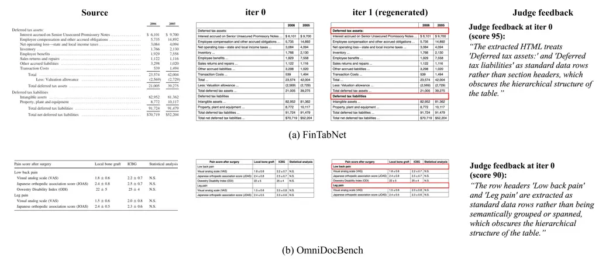
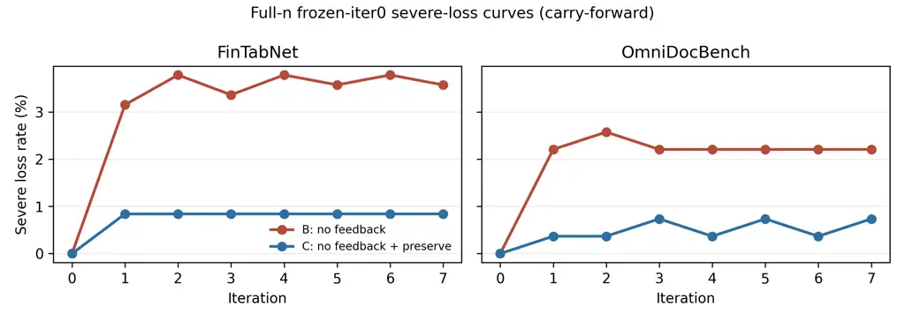
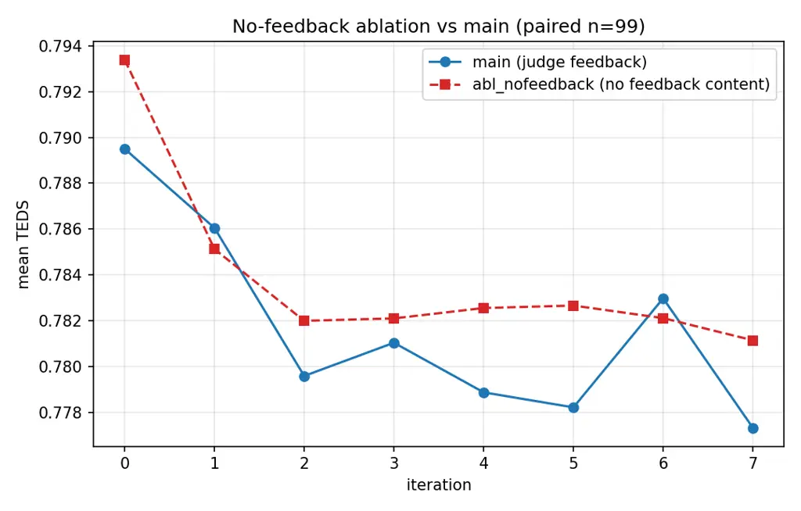
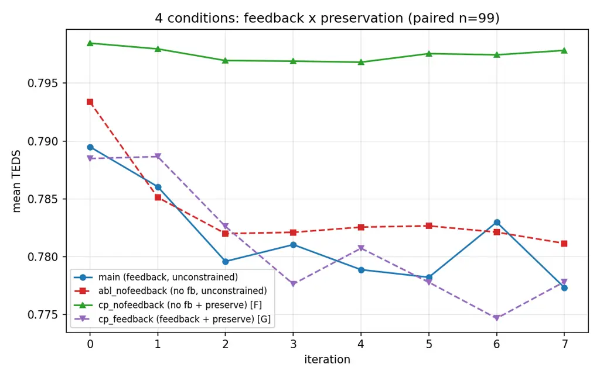
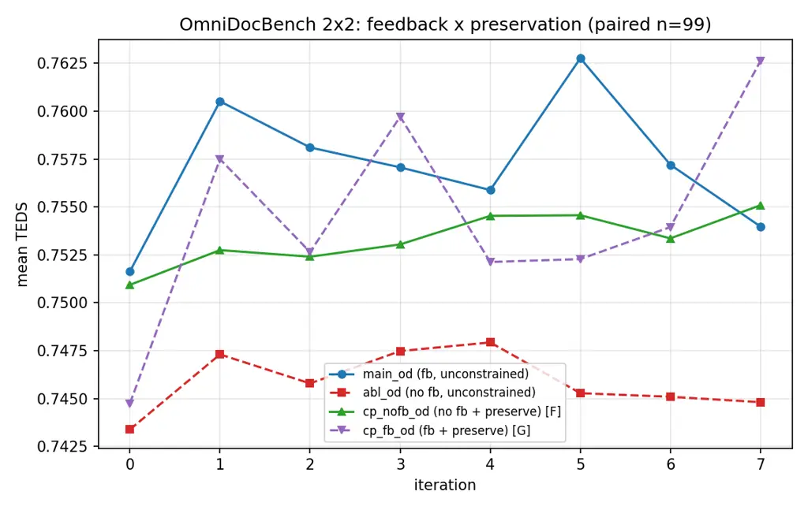
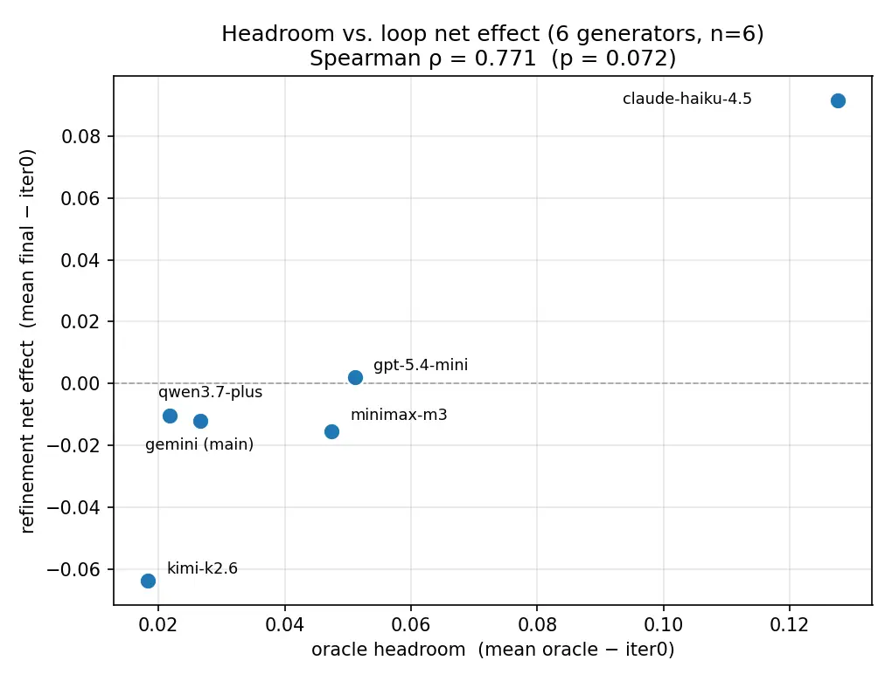
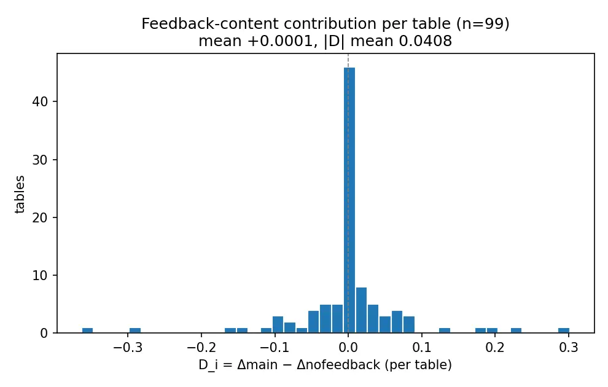

# LLM-as-a-Judge Scores Are Unreliable Optimization Signals in Closed-Loop Table Recognition

Donghwan Kim Affiliation: Aidentyx Inc., San Jose, CA, USA
Email: [david.kim@aidentyx.com](mailto:)

###### Abstract

LLM-as-a-judge is widely used to provide feedback and selection signals
in closed-loop regeneration, but this use remains insufficiently
validated. We study it in table recognition, where deterministic TEDS
evaluation provides a controlled testbed, using FinTabNet and
OmniDocBench. Three findings emerge. First, judge signals were weak on
both datasets: scores frequently tied, rankings were not reproducible,
and no tested judge-score policy, whether selecting among candidates or
accepting revisions under a conservative score margin, improved on the
first output on both datasets. Iteration produced better candidates, but
the judge recovered them at most partially on one dataset and not at all
on the other. Second, severe losses occurred even without specific judge
feedback, supporting target-preservation failure under unconstrained
regeneration as a proximate mechanism. Third, a structure-preserving
instruction reduced the severe-loss rate, significantly on FinTabNet and
directionally on OmniDocBench, but produced no improvement, and in an
exploratory 2$`\times`$2 analysis this protection was not stably
observed when judge feedback was retained. These results do not dispute
the value of LLMs as evaluators, but show that the tested reference-free
judge signals were too weak and unstable to drive candidate selection in
this setup, and that evaluation-style evidence alone was insufficient to
establish closed-loop optimization utility. Iterative refinement
requires, at minimum, a verification signal that deterministically
detects structural change, rather than judge scores alone.

## 1 Introduction

LLM-as-a-judge uses an LLM to score output quality and has rapidly
spread as a way to reduce evaluation costs (Zheng et al., 2023; Gu
et al., 2026). Reported alignment with human evaluation has expanded its
role beyond evaluation. Closed-loop pipelines now commonly use judge
scores for best-of-$`n`$ selection and inject the judge’s error claims
into the prompt for repeated regeneration. This extension rests on an
unvalidated assumption: a judge able to evaluate an output can also
guide its optimization.

We test this assumption empirically. The question is not whether a judge
can evaluate outputs, but whether its decisions are reliable enough to
guide optimization. The two capabilities have different requirements.
Aggregate alignment across many outputs may suffice for evaluation,
whereas an optimization signal must reproducibly rank subtly different
candidates for the same input. Recent work shows that aggregate judge
alignment can overstate utility for best-of-$`n`$ decisions (Landesberg,
2026), and that judge scores can diverge from independent quality
signals during iterative optimization with reference-free judges (Pan
et al., 2024a; Zhou, 2026). We study a distinct inference-time setting:
closed-loop image-to-HTML regeneration. Without exposing a reference
inside the loop, we use a deterministic structural metric to audit
selection, feedback, and copy-preserving interventions at the instance
level. Unlike preference optimization or open-ended revision, we isolate
whether degradation arises from judge feedback itself or from
unconstrained regeneration.

Table recognition, which converts an image into an HTML table, provides
an unusually suitable setting for this test. TEDS is computed
deterministically against a fixed GT, allowing every judge decision to
be compared against the same benchmark objective. On two benchmarks
comprising 476 FinTabNet tables and 272 OmniDocBench tables, we run 8
iterations of judge-feedback-based regeneration and observe judge scores
and TEDS at every iteration. We compare selection performance against a
random baseline across multiple judge configurations, two scoring
formats (pointwise and pairwise), and three tie-breaking rules
(Section 3).

Our results are threefold. First, judge signals were weak on both
datasets. Scores from the judge that drove the loop tied on 37.5 to
49.1% of distinct-output candidate pairs, including, among pairs
separated by at least 0.05 TEDS, 23.6 to 42.2%. More granular scoring
configurations also failed to produce TEDS-aligned rankings, and
rankings were not reproducible across repeated scoring. One combination
using the earliest tie-breaking rule beat random selection on both
datasets, but its advantage depended on the tie rule and cannot be
attributed to the judge scores alone. No other combination of judge,
scoring format, and tie-breaking rule robustly beat random selection on
both datasets. Iteration produced better candidates, as indicated by
significant oracle headroom, but the judge failed to recover them.
Guarded, margin-based acceptance did not change this conclusion: no
margin improved on the first output on both datasets, and on FinTabNet
the margins that avoided degradation accepted no revisions. Second, the
loop’s net effect differed across datasets, ranging from significant
degradation on FinTabNet to a statistically neutral mean on
OmniDocBench. A stratified feedback audit identifies the pattern behind
this sign difference: it is consistent with variation in the frequency
of convention-sensitive structures. Third, we decompose a proximate
cause of degradation through a four-condition contrast. At the table
level, applying GT-inconsistent claims co-varied with breakage, but in
the paired comparison over the 99 tables shared with the original run,
net degradation remained the same without feedback content. A
structure-preservation constraint reduced the severe-loss rate without
feedback. This reduction was statistically significant in the
full-sample frozen-iter0 contrast on FinTabNet and was directionally
consistent on OmniDocBench. Thus, a proximate cause consistent with
these observations is target-preservation failure triggered by an
unconstrained improvement instruction, rather than feedback content.

Our contributions are as follows. (1) We show the absence of a robust
selection signal across model families, tiers, prompts, and scoring
formats, find near-zero net contribution from feedback content in a
paired control, and examine variation across generators. (2) We
decompose a proximate cause of degradation: severe losses occur without
specific judge feedback, and a full-sample contrast branching from the
same initial output shows that a structure-preservation constraint
significantly reduces the severe-loss rate on FinTabNet and is
directionally consistent on OmniDocBench. (3) We identify boundary
conditions and a mitigation. The net effect shows a monotonic
association with headroom, and a prompt-level structure-preservation
constraint acts as a conservative safeguard that reduces degradation or
tail risk on both datasets. The constraint leaves a safety-improvement
trade-off, however, and exploratory results further suggest that
retaining judge feedback does not reliably preserve this safety benefit.
These conclusions are supported by a reproducible verification package
comprising independent metric validation, judge repeatability, an
independent-candidate control, artifact audits, a feedback-content
contrast, and a structure-preservation contrast. Our findings do not
reject judges as evaluators. They show that, in this setup,
evaluation-style evidence for the judges did not translate into
closed-loop optimization utility, and they identify the source of the
gap.

## 2 Related Work

#### LLM judges as evaluators.

MT-Bench and Chatbot Arena popularized general-purpose LLM evaluation
(Zheng et al., 2023), and G-Eval reported dataset-level correlations
between GPT-4 scores and human evaluation for summarization and dialogue
generation (Liu et al., 2023). Prometheus, trained with rubrics and
reference answers, and JudgeLM, trained to judge response pairs,
demonstrate the potential of customized judges (Kim et al., 2024; Zhu
et al., 2025). In the table domain, a GT-referenced judge has also been
shown to score extraction quality effectively (Horn and Keuper, 2026).
These positive results establish that judges can be useful evaluators,
although their validity varies with the task and evaluation design
(Bavaresco et al., 2025).

#### Reliability and decision validity.

Dataset-level human alignment does not ensure correct within-input
selection. On LLMBar, even strong judges favored superficially better
responses that violated instructions (Zeng et al., 2024). Order reversal
reveals position bias (Wang et al., 2024), while repeated identical
scoring can be self-inconsistent (Haldar and Hockenmaier, 2025). Factual
errors, fabricated citations, and format can shift both human and LLM
judgments (Chen et al., 2024). Trained judges degrade outside their
training evaluation methods (Huang et al., 2025), and a comparison
across 20 NLP tasks found that agreement varies by task, attribute, and
annotator expertise (Bavaresco et al., 2025). IF-RewardBench, which
evaluates rankings over preference graphs with multiple responses,
likewise found substantial gaps in constraint-violation detection and
complex-instruction ranking (Wen et al., 2026).

#### Selection and optimization signals, and reward hacking.

A generation-verification gap can prevent a verifier from recovering an
available correct answer (Saad-Falcon et al., 2025). In one-step
best-of-$`n`$ selection, Landesberg (2026) found that a judge with
reasonable global correlation ($`r=0.47`$) recovered only 21% of the
oracle-available improvement; ties and weak within-prompt rankings
accounted for the gap, and pairwise comparison raised recovery to 61%.
Evidence from iterative loops is mixed (Gu et al., 2026):
judge-generated rewards have improved instruction following in iterative
alignment training (Yuan et al., 2024; Wu et al., 2025), but model
scores diverged from human evaluation in self-evaluated essay revision
(Pan et al., 2024a), and self-play against a reference-free judge raised
judge pass rates while actual accuracy stagnated (Zhou, 2026),
consistent with the broader risk of over-optimizing a proxy (Gao et al.,
2023). Verifiers trained with external correctness supervision or
step-level human labels can succeed in mathematical best-of-N selection
(Cobbe et al., 2021; Lightman et al., 2024; Zhang et al., 2025); our
claim is therefore limited to zero-shot reference-free judges, a
boundary further supported by evidence that cross-family verification is
more useful on average than self- or same-family verification (Lu
et al., 2025).

#### Feedback-driven self-correction.

Automated correction is distinguished by the source and timing of its
feedback (Pan et al., 2024b). Self-Refine accumulates purely
self-generated feedback (Madaan et al., 2023), whereas Reflexion,
CRITIC, and MAF ground revision in environmental rewards, tool results,
or error-specific feedback modules (Shinn et al., 2023; Gou et al.,
2024; Nathani et al., 2023), showing why reliable external signals must
be distinguished from self-feedback. Evidence that prompted LLM feedback
alone enables intrinsic self-correction remains insufficient (Huang
et al., 2024; Kamoi et al., 2024), and repeated self-evaluation can
amplify a preference for the model’s own outputs (Xu et al., 2024).
Multi-role critique has improved table reasoning (Yu et al., 2025), but
over-correction of correct answers can offset the gains at high baseline
accuracy (Shaikh, 2026), and even high-quality external feedback
grounded in GT may not be fully incorporated (Jiang et al., 2025). In
our setting, judge signal quality and selection utility are major
bottlenecks, and target preservation during revision may be an
independent one. Our loop uses reference-free self-feedback from the
same model without accumulating history and runs a fixed number of
zero-shot iterations (Appendix G).

#### Table recognition, GT conventions, and structural verification.

PubTabNet introduced HTML tree-edit-based TEDS (Zhong et al., 2020), GTE
constructed FinTabNet from financial documents (Zheng et al., 2021), and
OmniDocBench spans diverse document types (Ouyang et al., 2025). GT,
however, is not a convention-independent representation: PubTables-1M
canonicalizes oversegmented annotations (Smock et al., 2022), and GriTS
compares tables as 2D cell matrices rather than trees (Smock et al.,
2023b). Table-extraction work has used neighbor-guided visual tools
(Zhou et al., 2025) and combined symbolic checks with an LLM (Mehrotra
et al., 2026). Grammar-constrained decoding reduces formatting errors
(Scholak et al., 2021; Ugare et al., 2025) but does not guarantee
deterministic execution or semantic agreement with image content, merge
structure, or GT conventions.

Our contribution is not the closed loop itself: prior work documents
both the potential and the failure of iterative evaluation and revision.
We instead audit, table by table, whether a reference-free judge
improves structural accuracy in image-based table recognition against
fixed GT and TEDS, jointly contrasting pointwise and pairwise selection,
the presence or absence of feedback, and unconstrained versus
copy-preserving regeneration from the same initial output. This design
separates selection failure, errors in feedback content, and
target-preservation failure.

## 3 Experimental Setup

### 3.1 Task and Iterative Loop

Figure 1: Experimental framework. The generator produces HTML from a
table image, and the judge returns a score and an error list based only
on the image and the immediately preceding output. This feedback is
injected into the next regeneration step (7 iterations). GT and TEDS
computation are used only for evaluation after the loop terminates and
are not exposed during either generation or scoring (right of the dashed
line). The instruction variants in the $`2\times 2`$ contrast
(Section 4.4) are injected into the generator prompt.

Our task is table recognition: given a table image, produce HTML table
markup that reproduces its structure and content. We use Gemini 3.1
Flash Lite (version fixed at call time; Appendix A) as the generator
through OpenRouter. Both generation and scoring use temperature 0 and
thinking level low. The output-token limits are 8192 for generation and
2048 for scoring.

The loop proceeds as follows (Figure 1). At iteration 0 (iter0), the
generator produces an initial HTML output from the table image alone. At
each subsequent iteration $`t`$ ($`1\leq t\leq 7`$), (i) the judge takes
the table image and preceding output and returns a quality score from 0
to 100 together with an error list in JSON (enforced by the API’s JSON
schema), and (ii) the generator produces a revision from the image,
preceding output, and judge feedback. The error list is inserted into a
fixed template; when 0 errors are reported, the template instead
supplies a generic improvement instruction. We run a fixed total of 8
iterations, driven by judge_v1 (Section 3.3).

Ground truth (GT) is never exposed at any generation or scoring step. At
manifest load, the runner does not load GT paths into memory, and it
hooks file opening so that any access to a GT directory fails
immediately. Guard installation and violations were recorded in audit
logs, with 0 violations on both datasets.

Failure handling, routing variability, temperature selection, and the
fixed iteration budget are detailed in Appendix I.

### 3.2 Datasets

#### FinTabNet.

FinTabNet is a financial-table dataset introduced by GTE, which aligned
PDF and HTML representations from annual reports of U.S. S&P 500
companies to produce cell annotations (Zheng et al., 2021). Stratified
sampling over four complexity strata yielded $`n=476`$ after iter0
failures. Financial-table conventions such as section-label rows and
currency-symbol columns are carried into GT serialization. Provenance
and sampling details are in Appendix I.

#### OmniDocBench.

OmniDocBench is a document-parsing benchmark spanning academic papers,
textbooks, newspapers, and handwritten notes (Ouyang et al., 2025).
Approximate stratification yielded $`n=272`$ after an iter0 failure.
Because some GT tables contain within-cell LaTeX expressions, directly
comparing absolute TEDS levels across the two datasets is inappropriate.
We compare only relative patterns under the same protocol.

The two datasets share the entire protocol, including the generator,
judge, prompts, iteration count, and temperature. Only the
stratification criteria differ approximately as described above.

### 3.3 Judge Configurations

We evaluate selection and ranking using five judge configurations. All
judges are reference-free: they score only the table image and candidate
HTML, without GT. This design reflects the operating condition of the
loop, because the extraction task itself would be unnecessary if GT were
available.

The configurations vary model family, tier, and score-production prompt.
Cross judges re-score stored outputs for counterfactual selection
without rerunning the loop. Evaluation sizes and selection procedures
are in Appendix I; prompts, model versions, and logs are in Appendix A.

### 3.4 Metrics, Selection Policies, and Statistics

#### Metrics.

TEDS (Zhong et al., 2020) is widely used in table recognition. It
represents an HTML table as a tree and computes a tree-edit-distance
similarity from 0 to 1, jointly evaluating structure and cell content.
We also report S-TEDS, a structure-only variant. GriTS is a
complementary metric that compares tables as 2D cell matrices and
evaluates topology, location, and content in a common framework (Smock
et al., 2023b). GT is accessed only for post hoc evaluation.
Implementation validation and convention-dependent limitations are
detailed in Appendices B, C, and I.

#### Selection policies.

We compare iter0, judge, pairwise, random, final, and oracle selection,
together with two guarded acceptance policies simulated post hoc on the
logged candidate stream: a margin rule that replaces the accepted output
(initially iter0) only when a later candidate’s judge score exceeds it
by at least $`\delta`$, and a stop-on-clean rule that returns the first
iteration whose judge report contains no errors. Applied to candidates
generated by the original loop, these rules measure selection utility
and do not alter the generation trajectory. Recovery is the mean
improvement over iter0 divided by oracle headroom. “Robustly beats”
requires cluster-bootstrap 95% CIs supporting an advantage over random
on both datasets and under all tie-breaking rules. Full policy and
false-improvement definitions are in Appendix I.

#### Statistics.

We report both Spearman correlation and Kendall tau-b because ties are
frequent, together with 95% bootstrap CIs clustered by table. Paired
comparisons use the Wilcoxon signed-rank test. Given the nondeterminism
of judge scoring (Appendix V2), selection-related point estimates are
reported together with the range of variation across repeated scoring.

## 4 Results

|                           |                    |           |                 |              |                                     |              |                 |          |                                     |
| ------------------------- | ------------------ | --------- | --------------- | ------------ | ----------------------------------- | ------------ | --------------- | -------- | ----------------------------------- |
|                           |                    | FinTabNet |                 |              |                                     | OmniDocBench |                 |          |                                     |
| Policy                    | Tie-breaking rule  | $`n`$     | Mean $`\Delta`$ | Recovery     | vs. random (95% CI)                 | $`n`$        | Mean $`\Delta`$ | Recovery | vs. random (95% CI)                 |
| always-iter0              | —                  | 476       | 0.0000          | 0.0%         | Baseline ($`\Delta=0`$)             | 272          | 0.0000          | 0.0%     | Baseline ($`\Delta=0`$)             |
| best-by-judge_v1          | earliest           | 476       | $`-0.0062`$     | $`-33.2\%`$  | Better $`[+0.0043,+0.0118]`$        | 272          | $`+0.0072`$     | 27.7%    | Better $`[+0.0003,+0.0092]`$        |
| best-by-judge_v1          | latest             | 476       | $`-0.0179`$     | $`-96.4\%`$  | Worse $`[-0.0070,-0.0007]`$         | 272          | $`+0.0052`$     | 20.2%    | No difference $`[-0.0011,+0.0061]`$ |
| best-by-judge_v1          | random (100 draws) | 476       | $`-0.0138`$     | $`-74.4\%`$  | No difference $`[-0.0020,+0.0025]`$ | 272          | $`+0.0056`$     | 21.5%    | Better $`[+0.0001,+0.0060]`$        |
| best-by-calibrated_v2     | earliest           | 476       | $`-0.0030`$     | $`-16.2\%`$  | Better $`[+0.0071,+0.0153]`$        | —            |                 |          |                                     |
| best-by-cross_gpt_nano    | earliest           | 143       | $`-0.0061`$     | $`-30.7\%`$  | No difference $`[-0.0034,+0.0075]`$ | —            |                 |          |                                     |
| best-by-cross_gpt_54      | earliest           | 75        | $`-0.0102`$     | $`-43.4\%`$  | No difference $`[-0.0103,+0.0142]`$ | —            |                 |          |                                     |
| best-by-cross_claude_opus | earliest           | 75        | $`-0.0046`$     | $`-19.6\%`$  | No difference $`[-0.0081,+0.0217]`$ | —            |                 |          |                                     |
| random-among-8            | —                  | 476       | $`-0.0143`$     | $`-76.8\%`$  | Reference                           | 272          | $`+0.0026`$     | 10.0%    | Reference                           |
| always-final              | —                  | 476       | $`-0.0200`$     | $`-107.9\%`$ | —                                   | 272          | $`+0.0020`$     | 7.8%     | —                                   |
| oracle-best               | —                  | 476       | $`+0.0186`$     | 100.0%       | Upper bound                         | 272          | $`+0.0260`$     | 100.0%   | Upper bound                         |

Bold marks the best executable policy for each dataset; oracle-best is
excluded because it requires ground truth. “Better”, “worse”, and “no
difference” compare against random-among-8 using the clustered bootstrap
interval shown.

Table 1: TEDS change relative to iter0 and recovery rate by selection
policy. Recovery is the fraction of attainable improvement (oracle $`-`$
iter0) recovered (Section 3.4). best-by-judge is reported under 3
tie-breaking rules, and the “vs. random” column compares against
random-among-8 and gives the cluster-bootstrap 95% CI verdict. The
pairwise protocol is in the appendix. Bold marks the best executable
policy for each dataset.

Detailed judge diagnostics are reported in Appendix I.

Figure 2: The same type of breakage observed on both datasets. Top (a),
FinTabNet (TDG.2006); bottom (b), OmniDocBench (scihub). Each row, from
left to right, shows the source image, the iter0 output, the iter1
output regenerated using judge feedback (changed cells marked in red),
and the verbatim judge feedback injected into that regeneration
(iteration 0 record, with score). In both examples, iter0 places a
section label in a regular first-column cell according to the GT
convention. The judge flags this as an error that obscures hierarchy,
and the generator converts the label into a full-width merged header,
departing from GT. The iter0-to-iter1 difference is limited to the
marked row, as verified by pixel comparison. A comparison with the GT
structure is in the appendix.

### 4.1 Does the Loop Improve Quality? (RQ1)

Figure 3: Mean TEDS and S-TEDS by iteration on both datasets. Values are
changes relative to iter0. Shading gives table-cluster bootstrap 95%
CIs.

The net effect of the iterative loop differs by dataset. On FinTabNet,
the loop degrades quality: the output after all 8 iterations (final) is
on average 0.020 below the first output (iter0), with TEDS falling from
0.792 to 0.772 (Wilcoxon signed-rank $`p<10^{-7}`$). As Figure 3 shows,
the decline is gradual but begins quickly: 44% of the total drop occurs
immediately after the first regeneration, between iter0 and iter1.
Because generation is near-deterministic (Section 3.1), this first
decline reflects the effects of the elements newly introduced at
regeneration: judge feedback, the preceding output, and the improvement
instruction. We separated these elements in a control experiment. In a
control loop that removed judge feedback content and retained only
conditioning on the preceding output and a generic improvement
instruction, net degradation remained the same size in the paired
comparison over the 99 tables completed in both runs (the net
contribution of feedback content was $`+0.0001`$, not significant;
Appendix B). Thus, feedback content is not the source of net
degradation. Feedback does, however, increase the amount of output
change: without feedback, the proportion of stagnant transitions whose
consecutive iterations were unchanged rose from 54% to 84%. Section 4.4
analyzes the conditions under which regeneration produces severe loss
through a frozen-iter0 condition contrast. On OmniDocBench, in contrast,
the net effect of the loop is neutral (final $`-`$ iter0 = $`+0.002`$,
not significant).

However, “neutral” does not mean “safe.” When decomposed table by table
(Appendix F), the loop substantially perturbs outputs on both datasets.
On FinTabNet, 41.6% of tables worsen and only 23.9% improve. On
OmniDocBench, 25.7% worsen and 20.6% improve, but the upward
contribution ($`+0.020`$) and downward contribution ($`-0.018`$) almost
exactly cancel, leaving the mean near 0. Among tables that changed, the
magnitude of change is larger on OmniDocBench than on FinTabNet (mean
absolute change 0.082 vs. 0.066). Severe breakage ($`\Delta<-0.10`$)
occurs in 11.8% and 4.4% of tables, respectively, and as Section 4.2
shows, the judge fails to detect it. In short, the loop produces large
table-level variation on both datasets; the dataset changes only the
mean sign of this variation.

Section 4.3 explains why the datasets diverge. The breakage type that
dominates the decline is the same on both datasets; what differs is the
surface area on which that type can occur.

### 4.2 Can the Judge Select? (RQ2)

Table 1 compares the selection policies. On FinTabNet, every judge
policy has negative recovery: the output selected by the judge is on
average worse than the first output, iter0. The trivial always-iter0
baseline beats every judge policy. Only one combination significantly
beats random selection, namely the self-judge combined with the
earliest-iteration rule, and this advantage depended on the tie-breaking
rule. Because quality tends to decline across iterations (Figure 3), the
rule “on a tie, choose the earlier iteration” can win without using the
judge score. On FinTabNet, the policy was statistically
indistinguishable from a tie-block permutation null in which judge
scores carry no information (Appendix I.3); its advantage therefore
cannot be attributed to the judge signal alone. On OmniDocBench,
recovery is positive (+20 to 28%). Yet every per-candidate judge policy
misses more than 72% of the attainable improvement, the best guarded
margin misses over half (Appendix J), and the gap to the oracle is
significant on both datasets ($`p<10^{-29}`$ and $`p<10^{-16}`$,
respectively). Hereafter, “robustly beats” follows the definition in
Section 3.4.

#### Guarded acceptance.

Guarded rules did not recover the missed improvements (Appendix J,
Table 32). On FinTabNet, no margin improved mean TEDS over iter0: point
estimates were negative for $`\delta\leq 40`$, and every margin with
$`\delta\geq 60`$ accepted zero revisions, so the most cautious rules
coincided with always-iter0. On OmniDocBench, the best margin
($`\delta=20`$, selected post hoc from the grid) improved mean TEDS by
$`+0.0116`$ over iter0 (95% CI $`[+0.0032,+0.0214]`$; recovery 44.5%);
hence no margin improved on iter0 on both datasets. The $`\delta=20`$
rule beat random selection on both datasets; on FinTabNet, however, this
advantage reflects rejecting nearly all revisions (12 of 476 tables
changed) rather than recovering better candidates. The stop-on-clean
rule was worse than iter0 on FinTabNet ($`-0.0164`$) and statistically
neutral on OmniDocBench ($`+0.0059`$, CI includes zero).

The loop-driving judge tied on 49.1% and 37.5% of distinct-output
candidate pairs on FinTabNet and OmniDocBench, respectively, including
42.2% and 23.6% of pairs separated by at least 0.05 TEDS. Conversely,
cross judges with distinct-output tie rates as low as 6.4% and 12.7%
still showed near-zero or negative TEDS rank correlations, and rankings
were not reproducible across repeated scorings (Kendall’s $`W=0.36`$).

The failure was not merely low score resolution: rankings remained weak
or negative against TEDS and were not reproducible across repeated
scoring, models, prompts, or independent candidates. Pairwise comparison
also failed to beat random. This suggests that the bottleneck is the
lack of a stable within-instance selection signal in this candidate
pool, not pointwise scoring alone. We do not claim that pairwise
comparison is generally invalid. Full tie, null-model, and pairwise
diagnostics are in Appendix I.

### 4.3 Why Does It Fail? (RQ3)

In a stratified audit, GT-inconsistent claims were concentrated among
the largest losses, while real claims were concentrated among
improvements. Addressing GT-inconsistent claims co-varied with breakage,
but this small-sample association should not be read as causal. Most
conflicts favored semantic HTML conventions over GT serialization, and
S-TEDS confirmed structural damage. Qualitatively similar
convention-driven breakage was observed in examples from both datasets.
Breakage also occurred with no specific claim, and net degradation
remained unchanged without feedback content. Thus, feedback can promote
a shared model prior, but unconstrained regeneration is sufficient for
the observed damage. Full label counts, confidence intervals,
validation, and examples are in Appendix I.

| Dataset      | $`n`$ | B severe      | C severe     | C$`-`$B (pp) | B-only/C-only discordant pairs | two-sided exact McNemar $`p`$ |
| ------------ | ----- | ------------- | ------------ | ------------ | ------------------------------ | ----------------------------- |
| FinTabNet    | 476   | 17/476 (3.6%) | 4/476 (0.8%) | $`-2.7`$     | 15/2                           | 0.0023                        |
| OmniDocBench | 272   | 6/272 (2.2%)  | 2/272 (0.7%) | $`-1.5`$     | 4/0                            | 0.1250                        |

B is no-feedback unconstrained regeneration and C is no-feedback
copy-preserving regeneration from the same frozen iter0. Carry-forward
is the primary failure handling rule. Because bootstrap intervals can be
optimistic with few discordant events, the primary decision uses the
two-sided exact McNemar test; bootstrap intervals and complete-case
sensitivity are reported in Appendix B.

Table 2: Full-n frozen-iter0 B/C contrast of severe-loss rates. B is
no-feedback unconstrained regeneration, and C is no-feedback
copy-preserving regeneration. Both conditions re-fork from the same
frozen iter0. Carry-forward is the primary analysis. The difference is
C$`-`$B in percentage points (pp), and the primary test is the two-sided
exact McNemar test. Because bootstrap CIs can be optimistic with sparse
events, they are reported as sensitivity evidence in Appendix B.

Figure 4: Severe-loss rate by iteration in the full-n frozen-iter0 B/C
re-fork. The final rate on FinTabNet fell from 3.6% to 0.8% (C$`-`$B =
$`-2.7`$ pp, two-sided exact McNemar $`p=0.0023`$); OmniDocBench was
directionally consistent, from 2.2% to 0.7% ($`p=0.1250`$).

### 4.4 What Causes the Degradation? (RQ4)

The preceding sections showed that net degradation does not arise from
feedback content. To narrow its cause, we used a condition contrast
crossing two factors: the presence of judge feedback and the presence of
a structure-preserving instruction (Table 2; Figure 4). The instruction
directs the generator to retain the preceding HTML unless clear visual
evidence supports a change and not to needlessly alter the numbers of
rows and columns, merges, or placement of empty cells. The primary
analysis is a paired full-sample rerun in which both conditions branch
from the same stored iter0 output (hereafter, the frozen-iter0 B/C
contrast), fixed before inspecting the results. B supplies only a
generic improvement instruction without feedback; C adds the
structure-preserving instruction under the same no-feedback condition.
Carry-forward is the primary failure handling rule, with complete-case
results reported as an appendix sensitivity analysis.

The primary result appears in the severe-loss tail. On FinTabNet, B had
a final severe-loss rate of 17/476 = 3.6%, compared with 4/476 = 0.8%
for C. The paired C$`-`$B difference was $`-2.7`$ pp, with 15/2
B-only/C-only discordant pairs and a two-sided exact McNemar
$`p=0.0023`$. OmniDocBench was directionally consistent: B 6/272 = 2.2%,
C 2/272 = 0.7%, C$`-`$B = $`-1.5`$ pp, 4/0 discordant pairs, and
$`p=0.1250`$. We retained the severe-loss threshold of $`\Delta`$TEDS
$`<-0.10`$ from the main-run analysis (Section 4.1), and the analysis
plan and primary endpoint were fixed before inspecting the frozen-iter0
contrast results. The effect was statistically significant on FinTabNet
and was directionally consistent on OmniDocBench.

Absolute run-level mean effects differed from the original experiment
(see Limitations); we therefore restrict inference to the paired
severe-loss contrast within the frozen-iter0 contrast.

We interpret mean changes as descriptive statistics only, not as
equivalence results. The mean $`\Delta`$ under B was $`-0.0030`$ on
FinTabNet, with a distinguishable location shift by the Wilcoxon
signed-rank test ($`p=0.0059`$). It was $`+0.0064`$ on OmniDocBench,
where the location shift was not distinguishable ($`p=0.1836`$). These
results do not show that a structure-preservation constraint is an
optimization method that produces improvement. The narrower conclusion
is that copy-preserving regeneration without feedback reduces the
severe-loss tail of unconstrained regeneration without feedback.

This contrast shows that severe loss can occur without specific judge
feedback. Severe loss remains in B without feedback, while adding a
structure-preserving instruction under the same no-feedback condition in
C reduces that tail. The contrasts support target-preservation failure
as a proximate mechanism of the observed degradation: rather than a
specific judge claim, an improvement instruction given without a
structure-preservation constraint causes a structure already aligned
with GT to be rewritten toward a learned convention. The
transition-level analysis of the main run also supports this
interpretation: 85.2% of severe declines involved structural changes,
and large declines (greater than 0.05) occurred about 3 times as often
in transitions with structural changes as in content-only transitions
(26.9% vs. 8.2%; Appendix H). This is directionally consistent with the
breakage mechanism in Section 4.3, but the claim in this section is
limited to the severe-loss rate.

We do not elevate the interaction between feedback and the
structure-preservation constraint to a primary analysis in the main
text. The initial 100-table $`2\times 2`$ experiment and complete-case
sensitivity results are retained in the appendix, while the
carry-forward result from the full-sample B/C analysis is primary. The
conclusion is therefore conservative: combining regeneration without
feedback with a structure-preservation constraint reduced the
severe-loss rate. This effect was statistically significant on FinTabNet
and was directionally consistent on OmniDocBench. We do not claim
recovery of improvements or an increase in mean performance.

## 5 Discussion

#### Evaluation ability and optimization utility are different capabilities.

Our results do not dispute the success of LLM-as-a-judge as an
evaluator. Results that establish dataset-level alignment with human
evaluation or successful GT-referenced table evaluation, including
G-Eval, Prometheus, and Horn and Keuper, can coexist with our findings
(Liu et al., 2023; Kim et al., 2024; Horn and Keuper, 2026). The absence
of a reference is one important distinction between prior evaluation
settings and our closed-loop setting. Without GT, a judge must supply
its own scoring criterion. As our audit shows, that criterion is not the
convention of the target data, but the markup convention learned by the
judge. Because the absence of GT is a defining condition inside the
loop, judge performance on evaluation benchmarks does not guarantee
performance as a loop signal.

#### Practical implications.

The loop’s net effect is difficult to predict without labeled
validation, and a neutral mean can conceal severe failures. Iter0 was
the safest baseline. No-feedback regeneration with a
structure-preservation constraint reduced severe loss, with statistical
significance on FinTabNet and directional consistency on OmniDocBench,
but neither improved mean performance nor, in an exploratory analysis,
remained stably protective with feedback. Deterministic HTML guards can
detect structural changes missed by prompts. In this setting, judge
scores alone should not gate deployment; feedback requires claim
verification, which still cannot prevent regeneration damage. Details
and the random-relative recovery comparison are in Appendix I.

## 6 Conclusion

We analyzed an iterative table-recognition loop driven by an LLM judge
using a deterministic structural metric. The judge signal was weak or
absent on both datasets: scores frequently tied even across large TEDS
gaps, more granular configurations failed to produce TEDS-aligned
rankings, and rankings outside ties were not reproducible. One policy
beat random only under an earliest-iteration tie rule, consistent with
exploiting the declining trend rather than the judge signal; pairwise
comparison did not help. The net effect ranged from significant
degradation on FinTabNet to a statistically neutral mean on
OmniDocBench, consistent with a difficult-to-predict surface on which
markup preferences and data conventions conflict. Better candidates
existed, but no judge-driven policy recovered them on both datasets.
Removing feedback left mean degradation unchanged on the 99 paired
FinTabNet tables, and copy-preserving no-feedback regeneration reduced
severe loss in the full-sample frozen-iter0 contrast (significant on
FinTabNet, directionally consistent on OmniDocBench; Section 4.4)
without producing mean improvement. A proximate cause consistent with
these observations is target-preservation failure triggered by an
unconstrained improvement instruction. Guarded, margin-based acceptance
did not alter these conclusions: no margin improved on the first output
on both datasets, and the margins that avoided degradation on FinTabNet
accepted no revisions. In this setup, evaluation-style evidence for the
judges did not translate into closed-loop optimization utility.
Retaining the first output was the safest baseline.

## Limitations

#### Measurement.

The TEDS implementation evaluates only the first table in an output, so
quality is underestimated for records in which the generator split a
table (0.71% of all outputs). The conclusions are identical when these
records are excluded or corrected by merging the tables (Appendix C).
The asymmetry by which the judge sees the complete output while TEDS
sees only the first table also mechanically widens the judge-metric gap
for these records. In addition, TEDS depends on the GT serialization
convention, so part of the proxy gap we report is a convention conflict
rather than a judge error. Oversegmentation and canonicalization issues
in table GT have also been documented in prior dataset work (Smock
et al., 2022; Smock et al., 2023a), and we did not apply an alternative
matrix-based metric such as GriTS throughout the experiment (Smock
et al., 2023b). However, S-TEDS also declined in the breakage examples,
so the structural damage itself cannot be reduced to a convention issue.
We did not perform human evaluation. Our claims concern optimization of
the benchmark objective, TEDS, rather than human-perceived table
usability.

#### Scoring nondeterminism.

Repeated scoring of the same input did not agree completely even at
temperature 0 (3-run exact agreement 68.6%). Prior work reports that, in
some evaluation settings, averaging scores from sampling can align
better with human judgment than greedy decoding (Yamauchi et al., 2026).
Our experiment instead measured the selection stability of a single call
as used in deployment, not an average over repeated calls.
Selection-related point estimates such as recovery varied by tens of
percentage points across re-scoring runs. We therefore take the sign and
policy ordering, rather than a point estimate of recovery, as the unit
of our claims. The use of more than one serving backend is a possible
cause, but we could not confirm it.

#### Design confounds and rule dependence.

The independent-candidate control (Appendix V4) removed feedback while
also changing generation temperature, so these two effects are not fully
separated. Self-judge recovery and its advantage over random depend
strongly on the tie-breaking rule, which exploits the decline in quality
across iterations. The calibrated_v2 prompt was selected against TEDS
using 20 development tables. Although the main evaluation is held out,
we do not treat positive signals by stratum as established claims. The
single-elimination bracket in the pairwise experiment may be sensitive
to its seed, but repetition on 40 tables under 4 seeds produced an exact
reproduction rate of only 20.5% for the best iteration. This reflects
nondeterminism in the judge decisions, rather than the bracket structure
alone. The guarded-acceptance margin $`\delta`$ was selected post hoc
from a grid, so the OmniDocBench improvement at $`\delta=20`$ is
exploratory; the full grid is reported in Appendix J. Guarded rules were
simulated on the logged candidate stream and do not capture how
acceptance decisions would change subsequent generations in a deployed
loop.

#### Scope.

Feedback labeling (Table 31) was performed by an LLM. We release the
rationale for each item to permit third-party verification and validated
the labels through a blinded author assessment (Appendix B.4), but did
not obtain an independent annotation from a second annotator. We
supplemented the generator axis with a trend check using 5 other
families on 100 tables, holding the judge and protocol fixed and
changing only the generator (Appendix E). Judge-score ties dominated for
all five generators. In contrast, the sign of the loop’s net effect and
the utility of judge selection differed by generator. Both measures
showed a positive monotonic association with headroom, defined as oracle
minus iter0 (Appendix E; 6-point Spearman correlation 0.771 including
main, $`n=6`$). The generator with low baseline performance and large
headroom showed a positive net effect (approximately $`+0.09`$), and
judge selection for that generator exceeded random under all three
tie-breaking rules on a single dataset of 100 tables. The generator with
high baseline performance and limited headroom showed a negative net
effect (approximately $`-0.06`$). However, headroom cannot be measured
without ground truth, so we retain the conclusion that whether the loop
will help a particular generator or table cannot be predicted at
deployment time. This is trend evidence from 100 tables rather than an
established claim, and it does not determine whether the significant net
degradation in main generalizes across generators. Differences in iter0
baseline performance may confound comparisons of net effects across
generators. We use two datasets. Our conclusions are limited to the
judge configurations we tested and reference-free table-recognition
loops; they do not generalize to domains with verifiable answers, such
as code with unit tests.

#### Condition-asymmetric parsing failures.

Because the four conditions are repeated measures on the same tables,
condition-asymmetric parsing failures require a repeated-measures test
rather than an ordinary chi-squared test; we used Cochran’s Q. These
failures may confound interactions involving feedback and structure
preservation, so those interactions are reported as exploratory only.
Detailed test and sensitivity results are in Appendix I.

#### Non-replication of run-level mean effects.

The mean net degradation in the unconstrained condition of the original
$`2\times 2`$ experiment ($`-0.0122`$) did not recur in re-forking runs
at later times (unconstrained-condition means $`+0.0000`$ and
$`+0.0007`$). The re-forking was designed to detect paired contrasts
between conditions and has limited power to re-estimate run-level means.
The use of more than one serving backend is again a possible cause, but
we could not confirm it. This non-replication is directionally
consistent with the implication in Section 5 that the net effect of the
loop is difficult to predict before deployment.

## References

- Bavaresco et al. (2025) Anna Bavaresco, Raffaella Bernardi, Leonardo
  Bertolazzi, Desmond Elliott, Raquel Fernández, Albert Gatt, Esam
  Ghaleb, Mario Giulianelli, Michael Hanna, Alexander Koller, Andre
  Martins, Philipp Mondorf, Vera Neplenbroek, Sandro Pezzelle, Barbara
  Plank, David Schlangen, Alessandro Suglia, Aditya K. Surikuchi, Ece
  Takmaz, and Alberto Testoni. 2025. [LLMs instead of human judges? a
  large scale empirical study across 20 NLP evaluation
  tasks](https://doi.org/10.18653/v1/2025.acl-short.20). In _Proceedings
  of the 63rd Annual Meeting of the Association for Computational
  Linguistics (Volume 2: Short Papers)_, pages 238–255. Association for
  Computational Linguistics.
- Chen et al. (2024) Guiming Hardy Chen, Shunian Chen, Ziche Liu, Feng
  Jiang, and Benyou Wang. 2024. [Humans or LLMs as the judge? a study on
  judgement bias](https://doi.org/10.18653/v1/2024.emnlp-main.474). In
  _Proceedings of the 2024 Conference on Empirical Methods in Natural
  Language Processing_, pages 8301–8327. Association for Computational
  Linguistics.
- Cobbe et al. (2021) Karl Cobbe, Vineet Kosaraju, Mohammad Bavarian,
  Mark Chen, Heewoo Jun, Lukasz Kaiser, Matthias Plappert, Jerry Tworek,
  Jacob Hilton, Reiichiro Nakano, Christopher Hesse, and John
  Schulman. 2021. [Training verifiers to solve math word
  problems](https://arxiv.org/abs/2110.14168). _Preprint_,
  arXiv:2110.14168.
- Gao et al. (2023) Leo Gao, John Schulman, and Jacob Hilton. 2023.
  [Scaling laws for reward model
  overoptimization](https://proceedings.mlr.press/v202/gao23h.html). In
  _Proceedings of the 40th International Conference on Machine
  Learning_, volume 202 of _Proceedings of Machine Learning Research_,
  pages 10835–10866. PMLR. ArXiv:2210.10760.
- Gou et al. (2024) Zhibin Gou, Zhihong Shao, Yeyun Gong, Yelong Shen,
  Yujiu Yang, Nan Duan, and Weizhu Chen. 2024. [CRITIC: Large language
  models can self-correct with tool-interactive
  critiquing](https://openreview.net/forum?id=WSrRF5Wy6v). In _The
  Twelfth International Conference on Learning Representations_.
- Gu et al. (2026) Jiawei Gu, Xuhui Jiang, Zhichao Shi, Hexiang Tan,
  Xuehao Zhai, Chengjin Xu, Wei Li, Yinghan Shen, Shengjie Ma, Honghao
  Liu, Saizhuo Wang, Kun Zhang, Zhouchi Lin, Bowen Zhang, Lionel Ni, Wen
  Gao, Yuanzhuo Wang, and Jian Guo. 2026. [A survey on
  LLM-as-a-judge](https://doi.org/10.1016/j.xinn.2025.101253). _The
  Innovation_, 7(6):101253. Open access; arXiv:2411.15594.
- Haldar and Hockenmaier (2025) Rajarshi Haldar and Julia
  Hockenmaier. 2025. [Rating roulette: Self-inconsistency in
  LLM-as-a-judge
  frameworks](https://doi.org/10.18653/v1/2025.findings-emnlp.1361). In
  _Findings of the Association for Computational Linguistics: EMNLP
  2025_, pages 24986–25004. Association for Computational Linguistics.
  ArXiv:2510.27106.
- Horn and Keuper (2026) Pius Horn and Janis Keuper. 2026. [Beyond
  string matching: Semantic evaluation of PDF table
  extraction](https://arxiv.org/abs/2603.18652). _Preprint_,
  arXiv:2603.18652.
- Huang et al. (2025) Hui Huang, Xingyuan Bu, Hongli Zhou, Yingqi Qu,
  Jing Liu, Muyun Yang, Bing Xu, and Tiejun Zhao. 2025. [An empirical
  study of LLM-as-a-judge for LLM evaluation: Fine-tuned judge model is
  not a general substitute for
  GPT-4](https://doi.org/10.18653/v1/2025.findings-acl.306). In
  _Findings of the Association for Computational Linguistics: ACL 2025_,
  pages 5880–5895. Association for Computational Linguistics.
  ArXiv:2403.02839.
- Huang et al. (2024) Jie Huang, Xinyun Chen, Swaroop Mishra,
  Huaixiu Steven Zheng, Adams Wei Yu, Xinying Song, and Denny
  Zhou. 2024. [Large Language Models Cannot Self-Correct Reasoning
  Yet](https://openreview.net/forum?id=IkmD3fKBPQ). In _The Twelfth
  International Conference on Learning Representations_.
  ArXiv:2310.01798.
- Jiang et al. (2025) Dongwei Jiang, Alvin Zhang, Andrew Wang, Nicholas
  Andrews, and Daniel Khashabi. 2025. [Feedback friction: LLMs struggle
  to fully incorporate external
  feedback](https://proceedings.neurips.cc/paper_files/paper/2025/hash/4eb5cc598a6271528ed9b84bb9879e9b-Abstract-Conference.html).
  In _Advances in Neural Information Processing Systems_, volume 38.
  ArXiv:2506.11930.
- Kamoi et al. (2024) Ryo Kamoi, Yusen Zhang, Nan Zhang, Jiawei Han, and
  Rui Zhang. 2024. [When can LLMs actually correct their own mistakes? a
  critical survey of self-correction of
  LLMs](https://doi.org/10.1162/tacl_a_00713). _Transactions of the
  Association for Computational Linguistics_, 12:1417–1440.
  ArXiv:2406.01297.
- Kim et al. (2024) Seungone Kim, Jamin Shin, Yejin Cho, Joel Jang,
  Shayne Longpre, Hwaran Lee, Sangdoo Yun, Seongjin Shin, Sungdong Kim,
  James Thorne, and Minjoon Seo. 2024. [Prometheus: Inducing
  fine-grained evaluation capability in language
  models](https://proceedings.iclr.cc/paper_files/paper/2024/hash/803485352e61e3ebf41221e4776c9fd4-Abstract-Conference.html).
  In _The Twelfth International Conference on Learning Representations_.
- Landesberg (2026) Eddie Landesberg. 2026. [When LLM judge scores look
  good but best-of-n decisions fail](https://arxiv.org/abs/2603.12520).
  _Preprint_, arXiv:2603.12520.
- Lightman et al. (2024) Hunter Lightman, Vineet Kosaraju, Yura Burda,
  Harri Edwards, Bowen Baker, Teddy Lee, Jan Leike, John Schulman, Ilya
  Sutskever, and Karl Cobbe. 2024. [Let’s verify step by
  step](https://proceedings.iclr.cc/paper_files/paper/2024/hash/aca97732e30bcf1303bc22ac3924fd16-Abstract-Conference.html).
  In _The Twelfth International Conference on Learning Representations_.
  ArXiv:2305.20050.
- Liu et al. (2023) Yang Liu, Dan Iter, Yichong Xu, Shuohang Wang,
  Ruochen Xu, and Chenguang Zhu. 2023. [G-Eval: NLG evaluation using
  GPT-4 with better human
  alignment](https://doi.org/10.18653/v1/2023.emnlp-main.153). In
  _Proceedings of the 2023 Conference on Empirical Methods in Natural
  Language Processing_, pages 2511–2522. Association for Computational
  Linguistics.
- Lu et al. (2025) Jack Lu, Ryan Teehan, Jinran Jin, and Mengye
  Ren. 2025. [When does verification pay off? a closer look at LLMs as
  solution verifiers](https://arxiv.org/abs/2512.02304). _Preprint_,
  arXiv:2512.02304. Accepted at the ICLR 2026 AI with Recursive
  Self-Improvement Workshop.
- Lysak et al. (2023) Maksym Lysak, Ahmed Nassar, Nikolaos Livathinos,
  Christoph Auer, and Peter Staar. 2023. [Optimized table tokenization
  for table structure
  recognition](https://doi.org/10.1007/978-3-031-41679-8_3). In
  _Document Analysis and Recognition – ICDAR 2023_, volume 14188 of
  _Lecture Notes in Computer Science_, pages 37–50. Springer Nature
  Switzerland. ArXiv:2305.03393.
- Madaan et al. (2023) Aman Madaan, Niket Tandon, Prakhar Gupta, Skyler
  Hallinan, Luyu Gao, Sarah Wiegreffe, Uri Alon, Nouha Dziri, Shrimai
  Prabhumoye, Yiming Yang, Shashank Gupta, Bodhisattwa Prasad Majumder,
  Katherine Hermann, Sean Welleck, Amir Yazdanbakhsh, and Peter
  Clark. 2023. [Self-refine: Iterative refinement with
  self-feedback](https://proceedings.neurips.cc/paper_files/paper/2023/hash/91edff07232fb1b55a505a9e9f6c0ff3-Abstract-Conference.html).
  In _Advances in Neural Information Processing Systems_, volume 36,
  pages 46534–46594. ArXiv:2303.17651.
- Mehrotra et al. (2026) Nikita Mehrotra, Aayush Kumar, Sumit Gulwani,
  Arjun Radhakrishna, and Ashish Tiwari. 2026. [TEN: Table
  explicitization,
  neurosymbolically](https://doi.org/10.18653/v1/2026.acl-industry.138).
  In _Proceedings of the 64th Annual Meeting of the Association for
  Computational Linguistics (Volume 6: Industry Track)_, pages
  2050–2086. Association for Computational Linguistics.
  ArXiv:2508.09324.
- Nathani et al. (2023) Deepak Nathani, David Wang, Liangming Pan, and
  William Yang Wang. 2023. [MAF: Multi-aspect feedback for improving
  reasoning in large language
  models](https://doi.org/10.18653/v1/2023.emnlp-main.407). In
  _Proceedings of the 2023 Conference on Empirical Methods in Natural
  Language Processing_, pages 6591–6616. Association for Computational
  Linguistics.
- Ouyang et al. (2025) Linke Ouyang, Yuan Qu, Hongbin Zhou, Jiawei Zhu,
  Rui Zhang, Qunshu Lin, Bin Wang, Zhiyuan Zhao, Man Jiang, Xiaomeng
  Zhao, Jin Shi, Fan Wu, Pei Chu, Minghao Liu, Zhenxiang Li, Chao Xu,
  Bo Zhang, Botian Shi, Zhongying Tu, and Conghui He. 2025.
  [OmniDocBench: Benchmarking diverse PDF document parsing with
  comprehensive
  annotations](https://doi.org/10.1109/CVPR52734.2025.02313). In
  _Proceedings of the IEEE/CVF Conference on Computer Vision and Pattern
  Recognition_, pages 24838–24848.
- Pan et al. (2024a) Jane Pan, He He, Samuel R. Bowman, and Shi Feng.
  2024a. [Spontaneous reward hacking in iterative
  self-refinement](https://arxiv.org/abs/2407.04549). _Preprint_,
  arXiv:2407.04549.
- Pan et al. (2024b) Liangming Pan, Michael Saxon, Wenda Xu, Deepak
  Nathani, Xinyi Wang, and William Yang Wang. 2024b. [Automatically
  correcting large language models: Surveying the landscape of diverse
  automated correction
  strategies](https://doi.org/10.1162/tacl_a_00660). _Transactions of
  the Association for Computational Linguistics_, 12:484–506.
- Saad-Falcon et al. (2025) Jon Saad-Falcon, E. Kelly Buchanan, Mayee F.
  Chen, Tzu-Heng Huang, Brendan McLaughlin, Tanvir Bhathal, Shang Zhu,
  Ben Athiwaratkun, Frederic Sala, Scott Linderman, Azalia Mirhoseini,
  and Christopher Ré. 2025. [Weaver: Shrinking the
  generation-verification gap by scaling compute for
  verification](https://proceedings.neurips.cc/paper_files/paper/2025/hash/715f48023c26ad210321a4c0da67f27c-Abstract-Conference.html).
  In _Advances in Neural Information Processing Systems_.
  ArXiv:2506.18203.
- Scholak et al. (2021) Torsten Scholak, Nathan Schucher, and Dzmitry
  Bahdanau. 2021. [PICARD: Parsing incrementally for constrained
  auto-regressive decoding from language
  models](https://doi.org/10.18653/v1/2021.emnlp-main.779). In
  _Proceedings of the 2021 Conference on Empirical Methods in Natural
  Language Processing_, pages 9895–9901. Association for Computational
  Linguistics.
- Shaikh (2026) Farseen Shaikh. 2026. [Can LLMs self-correct table
  reasoning errors?](https://doi.org/10.18653/v1/2026.surgellm-1.19) In
  _Proceedings of the First Workshop on Structured Understanding,
  Retrieval, and Generation in the LLM Era_, pages 298–312. Association
  for Computational Linguistics.
- Shinn et al. (2023) Noah Shinn, Federico Cassano, Ashwin Gopinath,
  Karthik Narasimhan, and Shunyu Yao. 2023. [Reflexion: Language agents
  with verbal reinforcement
  learning](https://proceedings.neurips.cc/paper_files/paper/2023/hash/1b44b878bb782e6954cd888628510e90-Abstract-Conference.html).
  In _Advances in Neural Information Processing Systems_, volume 36,
  pages 8634–8652.
- Smock et al. (2022) Brandon Smock, Rohith Pesala, and Robin
  Abraham. 2022. [PubTables-1M: Towards comprehensive table extraction
  from unstructured
  documents](https://doi.org/10.1109/CVPR52688.2022.00459). In
  _Proceedings of the IEEE/CVF Conference on Computer Vision and Pattern
  Recognition_, pages 4634–4642.
- Smock et al. (2023a) Brandon Smock, Rohith Pesala, and Robin Abraham.
  2023a. [Aligning benchmark datasets for table structure
  recognition](https://doi.org/10.1007/978-3-031-41734-4_23). In
  _Document Analysis and Recognition – ICDAR 2023_, volume 14191 of
  _Lecture Notes in Computer Science_, pages 371–386. Springer.
  ArXiv:2303.00716.
- Smock et al. (2023b) Brandon Smock, Rohith Pesala, and Robin Abraham.
  2023b. [GriTS: Grid table similarity metric for table structure
  recognition](https://doi.org/10.1007/978-3-031-41734-4_33). In
  _Document Analysis and Recognition – ICDAR 2023_, volume 14191 of
  _Lecture Notes in Computer Science_, pages 535–549. Springer.
  ArXiv:2203.12555.
- Ugare et al. (2025) Shubham Ugare, Tarun Suresh, Hangoo Kang, Sasa
  Misailovic, and Gagandeep Singh. 2025. [SynCode: LLM generation with
  grammar augmentation](https://openreview.net/forum?id=HiUZtgAPoH).
  _Transactions on Machine Learning Research_. ArXiv:2403.01632.
- Wang et al. (2024) Peiyi Wang, Lei Li, Liang Chen, Zefan Cai, Dawei
  Zhu, Binghuai Lin, Yunbo Cao, Lingpeng Kong, Qi Liu, Tianyu Liu, and
  Zhifang Sui. 2024. [Large language models are not fair
  evaluators](https://doi.org/10.18653/v1/2024.acl-long.511). In
  _Proceedings of the 62nd Annual Meeting of the Association for
  Computational Linguistics (Volume 1: Long Papers)_, pages 9440–9450.
  Association for Computational Linguistics.
- Wen et al. (2026) Bosi Wen, Yilin Niu, Cunxiang Wang, Xiaoying Ling,
  Ying Zhang, Pei Ke, Hongning Wang, and Minlie Huang. 2026.
  [IF-RewardBench: Benchmarking judge models for instruction-following
  evaluation](https://doi.org/10.18653/v1/2026.acl-long.1092). In
  _Proceedings of the 64th Annual Meeting of the Association for
  Computational Linguistics (Volume 1: Long Papers)_, pages 23816–23843.
  Association for Computational Linguistics.
- Wu et al. (2025) Tianhao Wu, Weizhe Yuan, Olga Golovneva, Jing Xu,
  Yuandong Tian, Jiantao Jiao, Jason E Weston, and Sainbayar
  Sukhbaatar. 2025. [Meta-rewarding language models: Self-improving
  alignment with
  LLM-as-a-meta-judge](https://doi.org/10.18653/v1/2025.emnlp-main.583).
  In _Proceedings of the 2025 Conference on Empirical Methods in Natural
  Language Processing_, pages 11537–11554. Association for Computational
  Linguistics.
- Xu et al. (2024) Wenda Xu, Guanglei Zhu, Xuandong Zhao, Liangming Pan,
  Lei Li, and William Yang Wang. 2024. [Pride and prejudice: LLM
  amplifies self-bias in
  self-refinement](https://doi.org/10.18653/v1/2024.acl-long.826). In
  _Proceedings of the 62nd Annual Meeting of the Association for
  Computational Linguistics (Volume 1: Long Papers)_, pages 15474–15492.
  Association for Computational Linguistics.
- Yamauchi et al. (2026) Yusuke Yamauchi, Taro Yano, and Masafumi
  Oyamada. 2026. [An empirical study of LLM-as-a-judge: How design
  choices impact evaluation
  reliability](https://doi.org/10.18653/v1/2026.gem-main.19). In
  _Proceedings of the Fifth Workshop on Generation, Evaluation and
  Metrics_, pages 167–176. Association for Computational Linguistics.
- Yu et al. (2025) Peiying Yu, Guoxin Chen, and Jingjing Wang. 2025.
  [Table-critic: A multi-agent framework for collaborative criticism and
  refinement in table
  reasoning](https://doi.org/10.18653/v1/2025.acl-long.853). In
  _Proceedings of the 63rd Annual Meeting of the Association for
  Computational Linguistics (Volume 1: Long Papers)_, pages 17432–17451.
  Association for Computational Linguistics.
- Yuan et al. (2024) Weizhe Yuan, Richard Yuanzhe Pang, Kyunghyun Cho,
  Xian Li, Sainbayar Sukhbaatar, Jing Xu, and Jason Weston. 2024.
  [Self-rewarding language
  models](https://proceedings.mlr.press/v235/yuan24d.html). In
  _Proceedings of the 41st International Conference on Machine
  Learning_, volume 235 of _Proceedings of Machine Learning Research_,
  pages 57905–57923. PMLR.
- Zeng et al. (2024) Zhiyuan Zeng, Jiatong Yu, Tianyu Gao, Yu Meng,
  Tanya Goyal, and Danqi Chen. 2024. [Evaluating large language models
  at evaluating instruction
  following](https://proceedings.iclr.cc/paper_files/paper/2024/hash/afc8b034823271816d14f7c1aefe1dff-Abstract-Conference.html).
  In _The Twelfth International Conference on Learning Representations_.
  Introduces LLMBar; arXiv:2309.07688.
- Zhang et al. (2025) Lunjun Zhang, Arian Hosseini, Hritik Bansal,
  Seyed Mehran Kazemi, Aviral Kumar, and Rishabh Agarwal. 2025.
  [Generative verifiers: Reward modeling as next-token
  prediction](https://iclr.cc/virtual/2025/poster/30506). In _The
  Thirteenth International Conference on Learning Representations_.
  ArXiv:2408.15240.
- Zheng et al. (2023) Lianmin Zheng, Wei-Lin Chiang, Ying Sheng, Siyuan
  Zhuang, Zhanghao Wu, Yonghao Zhuang, Zi Lin, Zhuohan Li, Dacheng Li,
  Eric P. Xing, Hao Zhang, Joseph E. Gonzalez, and Ion Stoica. 2023.
  [Judging LLM-as-a-judge with MT-bench and Chatbot
  Arena](https://proceedings.neurips.cc/paper_files/paper/2023/hash/91f18a1287b398d378ef22505bf41832-Abstract-Datasets_and_Benchmarks.html).
  In _Advances in Neural Information Processing Systems_, volume 36,
  pages 46595–46623. ArXiv:2306.05685.
- Zheng et al. (2021) Xinyi Zheng, Douglas Burdick, Lucian Popa,
  Xu Zhong, and Nancy Xin Ru Wang. 2021. [Global table extractor (GTE):
  A framework for joint table identification and cell structure
  recognition using visual
  context](https://doi.org/10.1109/WACV48630.2021.00074). In
  _Proceedings of the IEEE/CVF Winter Conference on Applications of
  Computer Vision_, pages 697–706.
- Zhong et al. (2020) Xu Zhong, Elaheh ShafieiBavani, and Antonio
  Jimeno Yepes. 2020. [Image-Based Table Recognition: Data, Model, and
  Evaluation](https://doi.org/10.1007/978-3-030-58589-1_34). In
  _Computer Vision – ECCV 2020_, pages 564–580. Springer International
  Publishing. Introduces TEDS; arXiv:1911.10683.
- Zhou (2026) Chenyu Zhou. 2026. [More convincing, not more correct:
  Self-play reward hacking of reference-free LLM
  judges](https://arxiv.org/abs/2607.05904). _Preprint_,
  arXiv:2607.05904.
- Zhou et al. (2025) Yitong Zhou, Mingyue Cheng, Qingyang Mao, Jiahao
  Wang, Feiyang Xu, and Xin Li. 2025. [Enhancing table recognition with
  vision LLMs: A benchmark and neighbor-guided toolchain
  reasoner](https://doi.org/10.24963/ijcai.2025/279). In _Proceedings of
  the Thirty-Fourth International Joint Conference on Artificial
  Intelligence_, pages 2503–2511. International Joint Conferences on
  Artificial Intelligence Organization. Main Track; arXiv:2412.20662.
- Zhu et al. (2025) Lianghui Zhu, Xinggang Wang, and Xinlong Wang. 2025.
  [JudgeLM: Fine-tuned large language models are scalable
  judges](https://proceedings.iclr.cc/paper_files/paper/2025/hash/7f8f73134e253845a8f82983219a8452-Abstract-Conference.html).
  In _The Thirteenth International Conference on Learning
  Representations_. ArXiv:2310.17631.

## Appendix A Prompts and Model Versions

This section preserves snapshots of the prompts used in the experiments
and the resolved model versions. The prompt text is not translated or
rewritten; it is included verbatim from the repository.

### A.1 Generation prompts

GEN_SYSTEM = "You are an expert at converting table images into faithful
HTML tables."

GEN_REQUIREMENTS = """Requirements:

- Reproduce ALL cell contents exactly as shown, including numbers,

symbols, and formatting-relevant text.

- Reproduce the table structure faithfully: use rowspan/colspan for

merged cells, and preserve header rows/hierarchy using \<thead\> and

\<th\> where appropriate.

- If a cell contains a run of leader dots/periods used for visual

alignment (e.g. "Item . . . . . . . 123"), collapse the run to a

single ellipsis "..." rather than reproducing every dot. Never repeat

any character or token in a loop.

- Output ONLY the HTML table, starting with \<table\> and ending with

\</table\>. No markdown, no explanation, no code fences."""

GEN_V1 = f"""Convert this table image into a complete HTML table.

{GEN_REQUIREMENTS}"""

GEN_FEEDBACK_V1 = f"""Convert this table image into a complete HTML
table.

{GEN_REQUIREMENTS}

A previous attempt is shown below, along with reviewer feedback.

Produce an improved version that fixes the identified issues while

preserving everything that was already correct.

Previous attempt:

{{previous_html}}

Reviewer feedback (issues found):

{{judge_errors_formatted}}

Output ONLY the corrected HTML table."""

GEN_GENERIC_V1 = f"""A previous attempt at converting this table image
to HTML is shown

below. Carefully compare it against the table image and produce a

corrected HTML table. Preserve everything that is already correct.

{GEN_REQUIREMENTS}

Previous attempt:

{{previous_html}}

Output ONLY the corrected HTML table."""

### A.2 Actual no-feedback wording for B

The no-specific-issues fallback used in the actual B prompt was:

> - (no specific issues listed; improve overall fidelity)

### A.3 Pointwise judge_v1 prompt

#### System prompt.

You are a meticulous evaluator of table extraction quality. You will be

shown the original image of a table and the raw HTML code extracted from

it. Judge the extracted HTML by considering how it would render as a

table. Do not evaluate stylistic HTML code quality; evaluate whether the

rendered table implied by the HTML preserves the content, structure, and

cell-to-header associations of the original image. Respond ONLY with a
single JSON object matching the required schema.

#### User prompt template.

Extracted HTML (raw code):

{candidate_html}

Evaluate the extracted HTML against the table shown in the image.

Judge semantic preservation of values, headers, and their associations,

as well as the table structure (rows, columns, merged cells, header

hierarchy).

Apply this key test: Could a reader who sees ONLY the rendered form of

the extracted HTML — without access to the original image —
unambiguously

reconstruct every cell-to-header mapping and all content of the original

table? If not, consider the extraction as failed in that respect and

lower the score accordingly.

First, enumerate up to 5 of the most significant errors or ambiguities

you can find (empty list if none). Then assign an integer score from 0

to 100 using this scoring guide:

- 100: Perfect reproduction; all content, structure, merged cells, and

header associations are correct.

- 90: Only trivial formatting differences; no ambiguity in

cell-to-header mapping.

- 75: Mostly correct, but contains minor structural or content errors

that do not affect most interpretations.

- 50: Partially correct, but important rows, columns, merged cells, or

header associations are missing or ambiguous.

- 25: Major extraction failure; only small parts of the table are
  usable.

- 0: The output is unrelated, empty, or not a table.

Return ONLY this JSON object:

{

"errors": \[

{"description": "\<specific error\>", "severity":
"critical\|major\|minor"}

\],

"score": \<integer 0-100\> }

#### JSON schema.

{

"type": "object",

"properties": {

"errors": {

"type": "array",

"items": {

"type": "object",

"properties": {

"description": {

"type": "string"

},

"severity": {

"type": "string",

"enum": \[

"critical",

"major",

"minor"

\]

}

},

"required": \[

"description",

"severity"

\],

"additionalProperties": false

}

},

"score": {

"type": "integer"

}

},

"required": \[

"errors",

"score"

\],

"additionalProperties": false }

### A.4 calibrated_v2 pointwise judge prompt

#### System prompt.

You are a meticulous evaluator of table extraction quality, using a
strict,

decomposed scoring rubric. You will be shown the original image of a

table and the raw HTML extracted from it. In past evaluations, scores

clustered too high (most extractions scored 90+) even when many cells

or structural elements were actually wrong. Assume errors exist unless

you can positively verify otherwise, and use the FULL 0-100 range —

do not default to high scores. Respond ONLY with a single JSON object
matching the required schema.

#### User prompt template.

Extracted HTML (raw code):

{candidate_html}

Step 1 — Cell-level content accuracy: Compare every data cell (not

headers) in the image to the extracted HTML. Estimate

content_accuracy_pct: the percentage of data cells whose text content

is completely and exactly correct (integer 0-100).

Step 2 — Structural accuracy: Compare row/column layout, merged cells

(rowspan/colspan), and header hierarchy between the image and the HTML.

Estimate structure_accuracy_pct: the percentage of structural elements

(rows, columns, merges, header levels) that are correctly reproduced

(integer 0-100).

Step 3 — Enumerate up to 5 of the most significant errors (empty list

if none), each tagged with severity.

Calibration anchors (your percentages should behave like these):

- 100%: every cell/structural element verified correct.

- ˜90%: 1-2 minor mismatches out of many elements.

- ˜70%: a handful of cells/structural elements wrong, most correct.

- ˜50%: roughly half right, half wrong or unverifiable.

- ˜25%: only a small fraction correct.

- 0%: unrelated, empty, or not a table.

If you are unsure whether a cell or structural element is correct,

count it as INCORRECT (do not round up generously).

Return ONLY this JSON object:

{

"content_accuracy_pct": \<integer 0-100\>,

"structure_accuracy_pct": \<integer 0-100\>,

"errors": \[

{"description": "\<specific error\>", "severity":
"critical\|major\|minor"}

\] }

#### JSON schema.

{

"type": "object",

"properties": {

"content_accuracy_pct": {

"type": "integer"

},

"structure_accuracy_pct": {

"type": "integer"

},

"errors": {

"type": "array",

"items": {

"type": "object",

"properties": {

"description": {

"type": "string"

},

"severity": {

"type": "string",

"enum": \[

"critical",

"major",

"minor"

\]

}

},

"required": \[

"description",

"severity"

\],

"additionalProperties": false

}

}

},

"required": \[

"content_accuracy_pct",

"structure_accuracy_pct",

"errors"

\],

"additionalProperties": false }

### A.5 Pairwise judge_pairwise_v1 prompt

#### System prompt.

You are a meticulous evaluator of table extraction quality. You will be

shown the original image of a table and two candidate HTML extractions

of it, labeled A and B. Judge each candidate by considering how it would

render as a table. Do not evaluate stylistic HTML code quality; evaluate

whether the rendered table implied by the HTML preserves the content,

structure, and cell-to-header associations of the original image.

Respond ONLY with a single JSON object matching the required schema.
\`\`\`

#### User prompt template.

Candidate A (raw HTML code):

{candidate_a}

Candidate B (raw HTML code):

{candidate_b}

Evaluate each candidate against the table shown in the image.

Judge semantic preservation of values, headers, and their associations,

as well as the table structure (rows, columns, merged cells, header

hierarchy).

Apply this key test to each candidate: Could a reader who sees ONLY the

rendered form of the extracted HTML — without access to the original

image — unambiguously reconstruct every cell-to-header mapping and all

content of the original table? A candidate that fails this test in more

places is the less faithful one.

Decide which candidate more faithfully reproduces the content,

structure, and cell-to-header associations of the original table. You

must pick exactly one winner, even if the two candidates are very close

or the difference is small.

Return ONLY this JSON object:

{

"choice": "A" or "B"

} \`\`\`

#### JSON schema.

{

"type": "object",

"properties": {

"choice": {

"type": "string",

"enum": \["A", "B"\]

}

},

"required": \["choice"\],

"additionalProperties": false

} \`\`\`

### A.6 gen_cp_v1 structure-preserving generation prompt

#### System prompt.

You are an expert at converting table images into faithful HTML tables.

\`\`\`

#### Structure-preservation constraints.

Preservation constraints (IMPORTANT):

- Treat the previous HTML as the default answer: keep it unchanged
  unless

you have clear visual evidence from the image that a specific change is

required.

- Do NOT needlessly change the number of rows or columns, the

rowspan/colspan structure, or the placement of empty cells.

- Only make minimal edits that fix a clear omission or clear

misrecognition; preserve everything else exactly as it is.

- If you find nothing that clearly needs fixing, output the previous
  HTML verbatim.

#### No-feedback template.

A previous attempt at converting this table image to HTML is shown

below. Carefully compare it against the table image.

Requirements:

- Reproduce ALL cell contents exactly as shown, including numbers,

symbols, and formatting-relevant text.

- Reproduce the table structure faithfully: use rowspan/colspan for

merged cells, and preserve header rows/hierarchy using \<thead\> and

\<th\> where appropriate.

- If a cell contains a run of leader dots/periods used for visual

alignment (e.g. "Item . . . . . . . 123"), collapse the run to a

single ellipsis "..." rather than reproducing every dot. Never repeat

any character or token in a loop.

- Output ONLY the HTML table, starting with \<table\> and ending with

\</table\>. No markdown, no explanation, no code fences.

Preservation constraints (IMPORTANT):

- Treat the previous HTML as the default answer: keep it unchanged
  unless

you have clear visual evidence from the image that a specific change is

required.

- Do NOT needlessly change the number of rows or columns, the

rowspan/colspan structure, or the placement of empty cells.

- Only make minimal edits that fix a clear omission or clear

misrecognition; preserve everything else exactly as it is.

- If you find nothing that clearly needs fixing, output the previous
  HTML

verbatim.

Previous attempt:

{previous_html}

Output ONLY the HTML table. \`\`\`

#### Feedback template.

Convert this table image into a complete HTML table.

Requirements:

- Reproduce ALL cell contents exactly as shown, including numbers,

symbols, and formatting-relevant text.

- Reproduce the table structure faithfully: use rowspan/colspan for

merged cells, and preserve header rows/hierarchy using \<thead\> and

\<th\> where appropriate.

- If a cell contains a run of leader dots/periods used for visual

alignment (e.g. "Item . . . . . . . 123"), collapse the run to a

single ellipsis "..." rather than reproducing every dot. Never repeat

any character or token in a loop.

- Output ONLY the HTML table, starting with \<table\> and ending with

\</table\>. No markdown, no explanation, no code fences.

A previous attempt is shown below, along with reviewer feedback.

Produce an improved version that fixes the identified issues while

preserving everything that was already correct.

Preservation constraints (IMPORTANT):

- Treat the previous HTML as the default answer: keep it unchanged
  unless

you have clear visual evidence from the image that a specific change is

required.

- Do NOT needlessly change the number of rows or columns, the

rowspan/colspan structure, or the placement of empty cells.

- Only make minimal edits that fix a clear omission or clear

misrecognition; preserve everything else exactly as it is.

- If you find nothing that clearly needs fixing, output the previous
  HTML

verbatim.

Previous attempt:

{previous_html}

Reviewer feedback (issues found):

{judge_errors_formatted}

Output ONLY the HTML table. \`\`\`

### A.7 Resolved model versions

| Role                   | Configuration           | Resolved version string               |
| ---------------------- | ----------------------- | ------------------------------------- |
| generator / self-judge | judge_v1, calibrated_v2 | google/gemini-3.1-flash-lite-20260507 |
| cross-judge            | cross_gpt_nano          | openai/gpt-5.4-nano-20260317          |
| cross-judge            | cross_gpt_54            | openai/gpt-5.4-20260305               |
| cross-judge            | cross_claude_opus       | anthropic/claude-4.6-opus-20260205    |

Table 3: Model versions resolved from the execution logs.

OpenRouter routing was not fixed to a single backend. The two main runs
used both the “Google AI Studio” and “Google” backends, but the model
version string recorded in the logs was identical across calls.

## Appendix B Verification Package

### B.1 V1: Cross-check against an independent TEDS implementation

We cross-checked the stored metrics against
table_recognition_metric==0.0.6 from SWHL’s independent
TableRecognitionMetric repository.¹¹ 1
[https://github.com/SWHL/TableRecognitionMetric](https://github.com/SWHL/TableRecognitionMetric)
We applied both implementations to the same outputs.

Across 98 evaluation points, Pearson $`r=0.99597`$
($`p=2.42\mathrm{e}{-102}`$) and Spearman $`\rho=0.99634`$
($`p=2.25\mathrm{e}{-104}`$). Absolute differences had mean=0.00609,
median=0.00310, p95=0.01827, and max=0.07340. $`|\Delta|>0.01`$ occurred
in 14/98 points and $`|\Delta|>0.05`$ in 1/98. Recomputing the stored
values with the same code produced absolute differences of mean=0.000000
and max=0.000000. Differences between the independent implementations
arose from the normalization denominator when inline tags were present,
and the report records a PASS decision.

### B.2 V2: Repeatability of judge scoring

Repeated identical scoring can have low intra-rater reliability (Haldar
and Hockenmaier, 2025). We re-scored the same 39 tables, each with 8
iteration outputs, 3 times with judge_v1.

All three scores agreed in 68.6% of cases (214/312). Pairwise
exact-agreement rates across repetitions were 76.3%, 81.1%, and 79.8%.
For scores on the same input, $`|\max-\min|`$ had mean=2.58, median=0.0,
p95=10.0, and max=25. Kendall’s $`W`$ for within-table iteration
rankings had mean=0.362 and median=0.333; for $`W<0.5`$, the table
proportion was 64.1%. The set of highest-scoring iterations was
identical across all three repetitions for 41.0% of tables (16/39),
while selection under the earliest-iteration rule agreed for 64.1%
(25/39).

| Score source         | mean(best$`-`$iter0) | recovery    |
| -------------------- | -------------------- | ----------- |
| original main scores | $`-0.0088`$          | $`-42.2\%`$ |
| rep1                 | $`-0.0064`$          | $`-30.5\%`$ |
| rep2                 | $`-0.0012`$          | $`-5.5\%`$  |
| rep3                 | $`-0.0015`$          | $`-7.1\%`$  |

Table 4: Recovery under the earliest-iteration rule by scoring
repetition.

### B.3 V3: Feedback-labeling protocol

We classified feedback items in the stratified sample as REAL, PARTIAL,
GT-inconsistent, or UNVERIFIABLE. The analysis source data are preserved
in feedback_labels.csv and feedback_sample40.csv. The HALLUCINATED
column name in the source CSV corresponds to the GT-inconsistent
category in the paper and is preserved verbatim.

| Stratum | REAL | PARTIAL | GT-inconsistent | UNVERIFIABLE | Total |
| ------- | ---- | ------- | --------------- | ------------ | ----- |
| L1      | 1    | 0       | 12              | 0            | 13    |
| L2      | 1    | 1       | 9               | 1            | 12    |
| L3      | 2    | 1       | 5               | 2            | 10    |
| L4      | 8    | 3       | 2               | 0            | 13    |
| Overall | 12   | 5       | 28              | 3            | 48    |

Table 5: Feedback-audit label counts by stratum.

Under the LLM-assisted labels, TEDS declined after 13/16 addressed
GT-inconsistent items (81.2%, Wilson 95% CI \[57.0%, 93.4%\]). TEDS
increased after 11/12 addressed REAL items (91.7%, \[64.6%, 98.5%\]),
and 12/13 L1 items were GT-inconsistent (92.3%, \[66.7%, 98.6%\]).
Recalculations under the blinded author validation are reported in V3a.

### B.4 V3a: Blinded author validation and Pass 2 re-tagging

The author validated the 48 feedback-audit labels in a separate blinded
local viewer. Top-level agreement was 39/48 = 81.2%, increasing to 38/45
= 84.4% among high-confidence items, with Cohen’s $`\kappa=0.648`$. The
author-label distribution was REAL 8, PARTIAL 5, GT-INCONSISTENT 34, and
UNVERIFIABLE 1.

| Metric                                       | LLM labels                       | Author labels                    |
| -------------------------------------------- | -------------------------------- | -------------------------------- |
| L1 GT-inconsistent proportion                | 12/13 (92.3%; Wilson 66.7–98.6%) | 12/13 (92.3%; Wilson 66.7–98.6%) |
| Decline after GT-inconsistent item addressed | 13/16 (81.2%; 57.0–93.4%)        | 13/20 (65.0%; 43.3–81.9%)        |
| Increase after REAL item addressed           | 11/12 (91.7%; 64.6–98.5%)        | 7/8 (87.5%; 52.9–97.8%)          |

Table 6: Key recalculations comparing the LLM-assisted labels and
blinded author validation.

The 9 disagreements were VRSN.2006 item0 (UNVERIFIABLE$`\to`$PARTIAL),
HOG.2014 item0 (UNVERIFIABLE$`\to`$GT-INCONSISTENT), KEY.2015 item0
(PARTIAL$`\to`$UNVERIFIABLE), ZBRA.2013 item0
(UNVERIFIABLE$`\to`$GT-INCONSISTENT), CHD.2012 item0
(REAL$`\to`$GT-INCONSISTENT), KMB.2010 item0
(REAL$`\to`$GT-INCONSISTENT), PEP.2017 item0
(PARTIAL$`\to`$GT-INCONSISTENT), PEP.2017 item1 (REAL$`\to`$PARTIAL),
and PKI.2014 page 32 item0 (REAL$`\to`$GT-INCONSISTENT). The original
claims for CHD.2012, KMB.2010, and PKI.2014 page 32, all relabeled from
REAL to GT-INCONSISTENT, assumed that the leader dots or ellipses were
absent from the image.

The 34 author-labeled GT-INCONSISTENT items were re-tagged in the
calibrated Pass 2 v2. The 2-button-plus-BOUNDARY scheme defined
HALLUCINATION as cases in which the target was not present in the image,
CONVENTION as cases in which the target was present but the prescription
departed from the GT serialization, and BOUNDARY as cases that could not
be fixed confidently to either category. The v1 tags were preserved but
hidden in the v2 interface. The final distribution was CONVENTION 28/34,
HALLUCINATION 4/34, and BOUNDARY 2/34. Restricting the analysis to the
28 items with an LLM subtype, the author v2 distribution was CONVENTION
25/28, HALLUCINATION 2/28, and BOUNDARY 1/28. Among v1-to-v2 changes, of
the 27 items projected as HALLUCINATION in v1, 24 moved to CONVENTION.

Pass 1 contained 4 GT-error-related notes and Pass 2 v2 contained 2
BOUNDARY items, producing 5 unique candidates for the final
GT-error/boundary record. PKI.2014 page 32 item0 was tagged BOUNDARY in
Pass 2 v2, with the note: “Recheck the Pass 1 label: the premise of the
claim is true and its direction is toward GT; REAL/PARTIAL candidate.”
This item does not change the final main-text numbers and is retained
only as a recheck record.

### B.5 V4: IID independent-candidate contrast

We used 8 independently generated candidates with no feedback chain to
separate candidate-pool contamination from the judge’s ranking ability.

| Tie rule   | $`n`$ | best mean $`\Delta`$ | recovery | best$`-`$random \[95% CI\]     | Decision      |
| ---------- | ----- | -------------------- | -------- | ------------------------------ | ------------- |
| earliest   | 40    | $`+0.0053`$          | 14.2%    | $`+0.0027\ [-0.0138,+0.0184]`$ | no difference |
| latest     | 40    | $`+0.0023`$          | 6.1%     | $`-0.0003\ [-0.0176,+0.0145]`$ | no difference |
| random 100 | 40    | $`+0.0071`$          | 19.1%    | $`+0.0045\ [-0.0065,+0.0136]`$ | no difference |

Table 7: judge_v1 selection versus a random baseline in IID best-of-8.

### B.6 V5: No-feedback control loop

We omitted judge calls and injected only a fixed generic improvement
instruction, then paired the results with the same tables in the main
experiment.

| Run            | $`n`$ | mean $`\Delta`$ | Wilcoxon $`p`$ | win/tie/loss | severe loss | stagnation rate |
| -------------- | ----- | --------------- | -------------- | ------------ | ----------- | --------------- |
| abl_nofeedback | 99    | $`-0.0122`$     | 0.005371       | 17/48/34     | 8 (8.1%)    | 83.7%           |
| main           | 99    | $`-0.0122`$     | 0.04448        | 25/34/40     | 11 (11.1%)  | 54.1%           |

Table 8: Paired results for the no-feedback control and main experiment.

The mean paired difference was $`+0.0001`$ (Wilcoxon signed-rank
$`p=0.7612`$).

Figure 5: Iteration curves for the no-feedback control.

### B.7 V6: 4-condition preservation contrast

We applied a paired $`2\times 2`$ design crossing the presence of
feedback with the presence of a structure-preserving instruction on
FinTabNet and OmniDocBench. Table 2 in the main text reports the
contrast from the full-sample frozen-iter0 re-fork. The following two
tables give condition-level values from the original experiment, in
which each condition had its own iter0 and all four conditions completed
a common set of $`n=99`$ tables.

| Dataset      | Handling      | $`n`$ | B severe      | C severe     | C$`-`$B \[bootstrap 95% CI\]       | two-sided exact McNemar $`p`$ |
| ------------ | ------------- | ----- | ------------- | ------------ | ---------------------------------- | ----------------------------- |
| FinTabNet    | carry-forward | 476   | 17/476 (3.6%) | 4/476 (0.8%) | $`-2.7`$ pp \[$`-4.4`$, $`-1.1`$\] | 0.0023                        |
| FinTabNet    | complete-case | 450   | 16/450 (3.6%) | 3/450 (0.7%) | $`-2.9`$ pp \[$`-4.7`$, $`-1.3`$\] | 0.0010                        |
| OmniDocBench | carry-forward | 272   | 6/272 (2.2%)  | 2/272 (0.7%) | $`-1.5`$ pp \[$`-2.9`$, $`-0.4`$\] | 0.1250                        |
| OmniDocBench | complete-case | 268   | 6/268 (2.2%)  | 2/268 (0.7%) | $`-1.5`$ pp \[$`-3.0`$, $`-0.4`$\] | 0.1250                        |

Table 9: Sensitivity analyses and bootstrap CIs for the full-n
frozen-iter0 B/C severe-loss-rate contrast.

| Condition      | mean $`\Delta`$ | Wilcoxon $`p`$ | w/t/l    | severe-loss rate | stagnation rate | full convergence |
| -------------- | --------------- | -------------- | -------- | ---------------- | --------------- | ---------------- |
| main           | $`-0.0122`$     | 0.0445         | 25/34/40 | 11.1%            | 54.1%           | 20.2%            |
| abl_nofeedback | $`-0.0122`$     | 0.00537        | 17/48/34 | 8.1%             | 83.7%           | 39.4%            |
| cp_nofeedback  | $`-0.0006`$     | 0.583          | 15/68/16 | 1.0%             | 88.7%           | 59.6%            |
| cp_feedback    | $`-0.0107`$     | 0.133          | 27/31/41 | 12.1%            | 60.0%           | 18.2%            |

Table 10: 4-condition preservation contrast on FinTabNet.

The paired differences were main$`-`$abl $`+0.0001`$ ($`p=0.761`$),
cp_nofeedback$`-`$abl $`+0.0116`$ ($`p=0.0225`$), and
cp_feedback$`-`$main $`+0.0015`$ ($`p=0.632`$).

| Condition         | mean $`\Delta`$ | $`p`$ | w/t/l    | severe | loss mass  | improvement mass | stagnation rate | structural-change rate |
| ----------------- | --------------- | ----- | -------- | ------ | ---------- | ---------------- | --------------- | ---------------------- |
| main_od           | $`+0.0023`$     | 0.75  | 19/57/23 | 3.0%   | $`-1.750`$ | $`+1.982`$       | 62.2%           | 23.2%                  |
| abl_nofeedback_od | $`+0.0014`$     | 0.856 | 18/61/20 | 3.0%   | $`-0.888`$ | $`+1.030`$       | 83.3%           | 18.2%                  |
| cp_nofeedback_od  | $`+0.0042`$     | 0.681 | 15/68/16 | 0.0%   | $`-0.304`$ | $`+0.716`$       | 89.8%           | 15.2%                  |
| cp_feedback_od    | $`+0.0179`$     | 0.801 | 17/58/24 | 1.0%   | $`-0.679`$ | $`+2.450`$       | 70.1%           | 26.3%                  |

Table 11: 4-condition preservation contrast on OmniDocBench.

On OmniDocBench, main_od$`-`$abl_od was $`+0.0009`$ ($`p=0.911`$),
cp_fb_od$`-`$cp_nofb_od was $`+0.0137`$ ($`p=0.815`$),
cp_nofb_od$`-`$abl_od was $`+0.0027`$ ($`p=0.589`$), and
cp_fb_od$`-`$main_od was $`+0.0155`$ ($`p=0.328`$).

Figure 6: Iteration curves for the 4 FinTabNet preservation conditions.

Figure 7: Iteration curves for the 4 OmniDocBench preservation
conditions.

### B.8 V7: Decomposition of tie statistics

The initial statistic $`(N-U)/N`$, computed from the total number of
scores $`N`$ and the number of unique score values $`U`$, measures the
coarseness of the score alphabet rather than the actual probability of a
candidate-pair tie. The corrected statistics use unordered within-table
candidate pairs as the denominator.

| Dataset      | Judge             | $`N;U`$   | $`(N-U)/N`$ | all-pair ties | distinct-output tie rate | gap tie rate |
| ------------ | ----------------- | --------- | ----------- | ------------- | ------------------------ | ------------ |
| FinTabNet    | judge_v1          | 3,806; 12 | 99.68%      | 65.95%        | 49.09%                   | 42.24%       |
| FinTabNet    | calibrated_v2     | 3,804; 20 | 99.47%      | 68.91%        | 50.42%                   | 44.64%       |
| FinTabNet    | cross_gpt_nano    | 1,144; 47 | 95.89%      | 7.79%         | 6.42%                    | 4.57%        |
| FinTabNet    | cross_gpt_54      | 600; 43   | 92.83%      | 20.24%        | 12.74%                   | 13.19%       |
| FinTabNet    | cross_claude_opus | 600; 30   | 95.00%      | 56.29%        | 32.88%                   | 25.46%       |
| OmniDocBench | judge_v1          | 2,175; 16 | 99.26%      | 68.92%        | 37.50%                   | 23.58%       |

Table 12: Comparison of score-alphabet coarseness and candidate-pair tie
statistics.

FinTabNet and OmniDocBench contained 6,358 and 4,540 byte-identical
candidate pairs, respectively. Their conditional distinct-output tie
rates were 49.1% and 37.5%. When restricted to distinct outputs with
$`|\Delta\mathrm{TEDS}|>0.05`$, the gap tie rates were 42.2% and 23.6%.

Recomputation using strict $`t-1\rightarrow t`$ transitions did not
change the reported direction-agreement or false-improvement rates for
any configuration at the displayed precision.

| Judge             | Dataset      | $`n`$ | Spearman $`\rho`$ TEDS \[95% CI\] | Spearman $`\rho`$ S-TEDS \[95% CI\] | Distinct score values | Saturation $`\geq 95`$ (%) | Conditional direction agreement | False-improvement rate | Repeatability Kendall’s $`W`$ |
| ----------------- | ------------ | ----- | --------------------------------- | ----------------------------------- | --------------------- | -------------------------- | ------------------------------- | ---------------------- | ----------------------------- |
| judge_v1          | FinTabNet    | 476   | 0.0956 $`[0.0177,0.1746]`$        | 0.0580 $`[-0.0192,0.1368]`$         | 12                    | 79.82                      | 0.6503                          | 0.2000                 | 0.362                         |
| calibrated_v2     | FinTabNet    | 476   | 0.1231 $`[0.0562,0.1910]`$        | 0.0926 $`[0.0244,0.1616]`$          | 20                    | 89.20                      | 0.7154                          | 0.1671                 | —                             |
| cross_gpt_nano    | FinTabNet    | 143   | $`-0.0639`$ $`[-0.1738,0.0515]`$  | $`-0.0758`$ $`[-0.1894,0.0379]`$    | 47                    | 4.63                       | 0.5539                          | 0.2180                 | —                             |
| cross_gpt_54      | FinTabNet    | 75    | $`-0.0299`$ $`[-0.2149,0.1589]`$  | $`-0.0548`$ $`[-0.2453,0.1514]`$    | 43                    | 9.67                       | 0.4520                          | 0.3164                 | —                             |
| cross_claude_opus | FinTabNet    | 75    | $`-0.0654`$ $`[-0.2704,0.1541]`$  | $`-0.1341`$ $`[-0.3341,0.0790]`$    | 30                    | 48.83                      | 0.5973                          | 0.2215                 | —                             |
| judge_v1          | OmniDocBench | 272   | 0.0294 $`[-0.0723,0.1353]`$       | $`-0.0175`$ $`[-0.1222,0.0905]`$    | 16                    | 78.80                      | 0.4477                          | 0.3073                 | —                             |

Table 13: Judge diagnostic metrics for five judge configurations.
Conditional direction accuracy and false-improvement rates use
transitions not tied on either score or TEDS. Repeatability $`W`$ is
Kendall’s $`W`$ for iteration rankings from 3 scorings of the same input
and was measured only for judge_v1 on FinTabNet. — indicates unverified.

## Appendix C Artifact Audit

### C.1 Correction for outputs containing multiple tables

Because the stored TEDS implementation evaluates the first table in
multi-table HTML, we audited this artifact using an exclusion variant
and a merge-corrected variant.

Among 3,808 records, outputs containing at least 2 \<table\> tags
numbered 27 (0.71%) and occurred in 9 tables.

| Variant              | $`n`$ | mean(final$`-`$iter0) | median      |
| -------------------- | ----- | --------------------- | ----------- |
| reported             | 476   | $`-0.0200`$           | $`+0.0000`$ |
| multi-table excluded | 467   | $`-0.0178`$           | $`+0.0000`$ |
| merge-corrected      | 476   | $`-0.0182`$           | $`+0.0000`$ |

Table 14: Three result variants for the multi-table artifact.

The difference in means between the merge-corrected and reported
variants was $`+0.0018`$. The sign of final$`-`$iter0 remained negative
after correction.

### C.2 Audit across all tie-breaking rules

When multiple iterations shared the highest judge score, we applied the
earliest, latest, and random rules to test the dependence of selection
conclusions on the rule.

| Judge             | $`n`$ | tables with ties | mean tied iterations | recovery (earliest) | recovery (latest) | recovery (random 100) |
| ----------------- | ----- | ---------------- | -------------------- | ------------------- | ----------------- | --------------------- |
| judge_v1          | 476   | 90.3%            | 5.32                 | $`-33.2\%`$         | $`-96.4\%`$       | $`-73.4\%`$           |
| calibrated_v2     | 476   | 92.0%            | 5.82                 | $`-16.2\%`$         | $`-89.2\%`$       | $`-68.3\%`$           |
| cross_gpt_nano    | 143   | 17.5%            | 1.23                 | $`-30.7\%`$         | $`-33.5\%`$       | $`-31.6\%`$           |
| cross_gpt_54      | 75    | 26.7%            | 1.87                 | $`-43.4\%`$         | $`-35.1\%`$       | $`-41.2\%`$           |
| cross_claude_opus | 75    | 69.3%            | 4.48                 | $`-19.6\%`$         | $`-22.8\%`$       | $`-23.9\%`$           |

Table 15: Complete audit of tie-breaking rules by judge.

Recovery for judge_v1 was $`-173.3\%`$ in large, 12.8% in simple, 33.6%
in span, and $`-104.6\%`$ in span_large. Recovery for calibrated_v2 in
the same order was $`-81.5\%`$, $`-21.4\%`$, 13.5%, and $`-21.3\%`$.

## Appendix D Pairwise Evaluation Details

The pairwise tournament used calls in both directions with candidate
order reversed. Because neither candidate is more faithful when two
candidates are byte-identical, we excluded such pairs from conditional
direction accuracy and report only their frequency and positional
inconsistency.

| Dataset      | Strategy         | $`n`$ | mean $`\Delta`$ | recovery     |
| ------------ | ---------------- | ----- | --------------- | ------------ |
| FinTabNet    | best-by-pairwise | 476   | $`-0.0191`$     | $`-102.7\%`$ |
| FinTabNet    | random-among-8   | 476   | $`-0.0142`$     | $`-76.3\%`$  |
| OmniDocBench | best-by-pairwise | 271   | $`+0.0060`$     | 23.2%        |
| OmniDocBench | random-among-8   | 271   | $`+0.0027`$     | 10.3%        |

Table 16: Pairwise-selection recovery by dataset.

On FinTabNet, best-by-pairwise$`-`$random was
$`-0.0049\ [-0.0081,-0.0018]`$, significantly worse than random. On
OmniDocBench, it was $`+0.0034\ [+0.0000,+0.0069]`$, significantly
better than random.

### D.1 Separating identical candidates and directional agreement

Table 17 shows that identical candidates accounted for 53.6% of
FinTabNet and 63.8% of OmniDocBench calls. Among distinct candidates,
agreement between the winner and the TEDS direction was 48.4% and 49.1%,
respectively.

| Dataset      | identical share | distinct matches | distinct position inconsistency | winner-TEDS direction agreement |
| ------------ | --------------- | ---------------- | ------------------------------- | ------------------------------- |
| FinTabNet    | 53.6%           | 1,547            | 24.2%                           | 48.4% ($`n=2,536`$)             |
| OmniDocBench | 63.8%           | 687              | 30.1%                           | 49.1% ($`n=1,117`$)             |

Table 17: Identical-candidate share and conditional direction accuracy
for pairwise calls.

### D.2 Candidate diversity and selection gain

The mean number of unique candidates per table was 3.31 on FinTabNet and
2.71 on OmniDocBench, and the proportions of fully converged tables were
20.8% and 39.1%, respectively.

Spearman correlation between the number of unique candidates and the
best-minus-random gain was $`-0.182\ [-0.277,-0.085]`$ on FinTabNet and
$`+0.178\ [+0.037,+0.329]`$ on OmniDocBench. We did not observe a shared
direction in which greater diversity consistently increased selection
gain.

### D.3 Seed repetitions

Table 18 shows that exact agreement across four seeds was 20.5% for
iteration index but 79.5% for the hash of the selected HTML.

| Reproduction criterion | exact agreement | Interpretation             |
| ---------------------- | --------------- | -------------------------- |
| iteration index        | 8/39 = 20.5%    | lower bound                |
| best HTML hash         | 31/39 = 79.5%   | substantive repeatability  |
| best TEDS              | 33/39 = 84.6%   | metric-level repeatability |

Table 18: Pairwise-best repeatability across four seeds.

## Appendix E Generator Trend Check

We performed a 100-table trend check that held the judge and protocol
fixed while changing only the generator. This is a scope-limited
analysis of the relation between signs across generators and oracle
headroom, not a full replication.

| Generator             | mean(final$`-`$iter0) | Wilcoxon $`p`$ | Decision        |
| --------------------- | --------------------- | -------------- | --------------- |
| gemini-3.1-flash-lite | $`-0.0121`$           | 0.04448        | significant     |
| gpt-5.4-mini          | $`+0.0020`$           | 0.683          | not significant |
| qwen3.7-plus          | $`-0.0104`$           | 0.3135         | not significant |
| claude-haiku-4.5      | $`+0.0917`$           | 1.961e-10      | significant     |
| minimax-m3            | $`-0.0153`$           | 0.1152         | not significant |
| kimi-k2.6             | $`-0.0638`$           | 5.765e-08      | significant     |

Table 19: Net loop effect by generator.

| Generator             | mean iter0 | mean oracle | headroom    |
| --------------------- | ---------- | ----------- | ----------- |
| gemini-3.1-flash-lite | 0.7884     | 0.8150      | $`+0.0266`$ |
| gpt-5.4-mini          | 0.7174     | 0.7685      | $`+0.0511`$ |
| qwen3.7-plus          | 0.7830     | 0.8047      | $`+0.0217`$ |
| claude-haiku-4.5      | 0.5675     | 0.6951      | $`+0.1276`$ |
| minimax-m3            | 0.7764     | 0.8239      | $`+0.0474`$ |
| kimi-k2.6             | 0.8559     | 0.8743      | $`+0.0184`$ |

Table 20: Oracle headroom by generator.

Across 6 points including main, Spearman correlation between oracle
headroom and the net effect of the loop was 0.771 ($`n=6`$).

Figure 8: Oracle headroom versus the net effect of the loop (100-table
means by generator, 6 points). The judge and protocol are fixed and only
the generator is changed. The horizontal axis is oracle minus iter0; the
vertical axis is final minus iter0. The dotted line marks a net effect
of 0. Spearman correlation is 0.771 ($`n=6`$).

## Appendix F Additional Splits, Stratification, and Cost

### F.1 Sensitivity to including the development set

The 20 development tables used in prompt design were excluded from the
main results. We also report results that include the development tables
already generated under the same conditions.

| Sample                        | $`n`$ | TEDS iter0 | TEDS final | best-by-judge | oracle |
| ----------------------------- | ----- | ---------- | ---------- | ------------- | ------ |
| main excluding dev (480)      | 476   | 0.7919     | 0.7718     | 0.7857        | 0.8104 |
| including dev (500=480+dev20) | 496   | 0.7895     | 0.7707     | 0.7839        | 0.8102 |

Table 21: Four-point comparison with and without the development set.

### F.2 Table-level outcome decomposition

Because a mean can hide offsetting table-level outcomes, we jointly
report win/tie/loss counts, improvement and loss mass, the mean absolute
change among changed tables, and the severe-loss rate.

| Dataset      | $`n`$ | win         | tie         | loss        | win contribution | loss contribution | mean $`\Delta`$ | non-tie mean$` | \Delta     | `$  | $`\Delta<-0.10`$ |
| ------------ | ----- | ----------- | ----------- | ----------- | ---------------- | ----------------- | --------------- | -------------- | ---------- | --- | ---------------- |
| FinTabNet    | 476   | 114 (23.9%) | 164 (34.5%) | 198 (41.6%) | $`+0.0117`$      | $`-0.0317`$       | $`-0.0200`$     | 0.0663         | 56 (11.8%) |
| OmniDocBench | 272   | 56 (20.6%)  | 146 (53.7%) | 70 (25.7%)  | $`+0.0199`$      | $`-0.0179`$       | $`+0.0020`$     | 0.0815         | 12 (4.4%)  |

Table 22: Table-level decomposition of final$`-`$iter0 on FinTabNet and
OmniDocBench.

For the FinTabNet loss group, the mean was $`-0.0763`$ and the median
was $`-0.0486`$; for the win group, they were $`+0.0489`$ and
$`+0.0229`$. The means for the OmniDocBench win and loss groups were
$`+0.0965`$ and $`-0.0694`$.

### F.3 Stratified decomposition

| Stratum    | $`n`$ | TEDS iter0 | $`\Delta`$ final$`-`$iter0 | selection gap | Spearman $`\rho`$ |
| ---------- | ----- | ---------- | -------------------------- | ------------- | ----------------- |
| large      | 22    | 0.8391     | $`-0.0144`$                | $`+0.0102`$   | 0.0898            |
| simple     | 154   | 0.7629     | $`-0.0041`$                | $`+0.0194`$   | 0.0227            |
| span       | 55    | 0.6805     | $`+0.0268`$                | $`+0.0179`$   | 0.0514            |
| span_large | 41    | 0.7771     | $`+0.0005`$                | $`+0.0222`$   | 0.1334            |

Table 23: OmniDocBench refinement results by complexity stratum.

FinTabNet selection stratification is reported in Appendix C. No source
report was dedicated to FinTabNet refinement win/tie/loss by stratum, so
we do not newly aggregate those values here.

### F.4 Measured cost and time

The main run in Table 24 used 3,812 calls, cost \$13.0436, and took 7.03
hours in serial execution.

| Run                                         | Calls | Cost (USD) | Serial time |
| ------------------------------------------- | ----- | ---------- | ----------- |
| main generation (480$`\times`$8, gen+judge) | 3,812 | \$13.0436  | 7.03h       |
| calibrated_v2 re-scoring                    | 3,808 | \$3.7846   | 2.25h       |
| cross_gpt_nano re-scoring                   | 1,144 | \$0.8161   | 0.89h       |
| cross_gpt_54 re-scoring                     | 600   | \$4.5235   | 0.46h       |
| cross_claude_opus re-scoring                | 600   | \$9.0049   | 0.91h       |

Table 24: Measured API cost and serial runtime.

## Appendix G Comparison with Self-Refine

Our loop shares the iterative feedback-and-revision pattern of
Self-Refine, in which the same model performs both operations. This
study does not reproduce the original paper. It tests a closed-loop
configuration used in practice, in which a reference-free judge supplies
feedback and selection signals. We specify the structural differences
below.

| \#  | Component      | Original Self-Refine                              | Our loop (main)                                      | Difference                                                            |
| --- | -------------- | ------------------------------------------------- | ---------------------------------------------------- | --------------------------------------------------------------------- |
| 1   | FEEDBACK       | same model, few-shot, free-form text              | same model in judge role, zero-shot JSON             | natural language$`\rightarrow`$JSON; few-shot$`\rightarrow`$zero-shot |
| 2   | REFINE history | full history accumulated                          | preceding output and latest feedback only            | no history accumulation                                               |
| 3   | termination    | stop indicator, maximum 4 iterations              | fixed 8 iterations, no early stopping                | no stop indicator                                                     |
| 4   | prompt format  | few-shot, actionable/specific                     | zero-shot, JSON schema, preserve-correct instruction | few-shot$`\rightarrow`$zero-shot                                      |
| 5   | self condition | same model generates, gives feedback, and revises | generator=judge=Gemini                               | same                                                                  |

Table 25: Structural comparison between Self-Refine Algorithm 1 and our
loop.

The results therefore should not be interpreted as evidence against the
original Self-Refine implementation as a whole. The tested object is our
closed-loop configuration, which does not accumulate history and uses
zero-shot structured feedback and a fixed iteration count.

## Appendix H Novelty Reanalysis

For the 99 tables shared by the main and no-feedback conditions, we
define
$`D_{i}=\Delta_{\mathrm{main},i}-\Delta_{\mathrm{nofeedback},i}`$. A
value $`D_{i}>0`$ indicates that feedback benefits that table, while
$`D_{i}<0`$ indicates harm.

Mean $`D=+0.0001`$, median $`=+0.0000`$, and Wilcoxon signed-rank
$`p=0.761`$. Win/tie/loss counts were 35/34/30. Mean $`|D|`$ was 0.0408,
whereas $`|\mathrm{mean}\ D|`$ was 0.0001. Spearman correlation between
table-level changes in the two conditions was 0.465
($`p=1.21\mathrm{e}{-06}`$).

Figure 9: Distribution of the table-level difference $`D_{i}`$ between
the main and no-feedback conditions.

### H.1 Decomposition by iter0 quality, headroom, and complexity

| Quartile  | $`n`$ | Range            | mean $`D`$  | w/t/l   |
| --------- | ----- | ---------------- | ----------- | ------- |
| Q1 (low)  | 25    | \[0.359, 0.717\] | $`+0.0298`$ | 11/10/4 |
| Q2        | 25    | \[0.718, 0.836\] | $`-0.0053`$ | 8/9/8   |
| Q3        | 24    | \[0.842, 0.899\] | $`-0.0041`$ | 7/9/8   |
| Q4 (high) | 25    | \[0.901, 0.955\] | $`-0.0203`$ | 9/6/10  |

Table 26: Decomposition of $`D_{i}`$ by iter0 TEDS quartile.

Concentration of values collapsed the headroom decomposition into two
groups. Q1 contained 74 tables, range \[0.000, 0.012\], mean
$`D=-0.0122`$, and w/t/l=17/31/26. Q2 contained 25 tables, range
\[0.015, 0.441\], mean $`D=+0.0363`$, and w/t/l=18/3/4. We interpret
these results only as descriptive statistics.

| Stratum    | $`n`$ | mean $`D`$  | w/t/l   | mean $`\Delta_{\rm main}`$ | mean $`\Delta_{\rm abl}`$ |
| ---------- | ----- | ----------- | ------- | -------------------------- | ------------------------- |
| large      | 20    | $`-0.0372`$ | 6/4/10  | $`-0.0512`$                | $`-0.0140`$               |
| simple     | 16    | $`+0.0155`$ | 4/11/1  | $`+0.0193`$                | $`+0.0038`$               |
| span       | 31    | $`+0.0247`$ | 12/10/9 | $`+0.0083`$                | $`-0.0165`$               |
| span_large | 32    | $`-0.0083`$ | 13/9/10 | $`-0.0233`$                | $`-0.0151`$               |

Table 27: Decomposition of $`D_{i}`$ by complexity stratum.

### H.2 Intersection with V3 labels

The intersection between the V3 labeled sample and the common 99 tables
contained 8 tables. Of these, 6 tables containing a GT-inconsistent item
had mean $`D=-0.0191`$, while the other 2 had mean $`D=-0.0115`$.
Because the denominators are small, we report these as raw descriptive
statistics without a directional claim.

### H.3 Predictive association of churn and structural change with decline

| Metric                                       | main        | abl_nofeedback               |
| -------------------------------------------- | ----------- | ---------------------------- | ------ | ------ |
| changed-transition rate                      | 45.9%       | 16.3%                        |
| mean $`                                      | \Delta      | `$ per transition            | 0.0237 | 0.0063 |
| mean $`                                      | \Delta      | `$ among changed transitions | 0.0517 | 0.0387 |
| decline share among changed transitions      | 43.1%       | 43.4%                        |
| standard deviation of table-level $`\Delta`$ | 0.0841      | 0.0653                       |
| mean gross movement $`\sum\_{t}              | \Delta\_{t} | `$                           | 0.1660 | 0.0441 |

Table 28: Comparison of churn with and without feedback.

Both conditions had a net effect of $`-0.0122`$, and the difference
between their net effects was 0.0001.

|                                                           |                     |
| --------------------------------------------------------- | ------------------- |
| Metric                                                    | Value               |
| $`P(\text{decline}>0.05\mid\text{structural change})`$    | 26.9% ($`n=171`$)   |
| $`P(\text{decline}>0.05\mid\text{content-only change})`$  | 8.2% ($`n=147`$)    |
| severe declines accompanied by structural change          | 85.2% (23/27)       |
| declines accompanied by structural change                 | 79.3% (46/58)       |
| share of total decline from structural-change transitions | 73.4% (6.469/8.819) |

Table 29: Transition-level association between structural change and
decline in the main condition.

These values are offline transition-level associations and do not
reflect changes in later states that would result from placing a guard
inside the actual loop. They should therefore be interpreted as an upper
bound on preventability.

## Appendix I Additional Main-Text Details

### I.1 Experimental details moved for the page limit

#### Failure handling.

API calls were retried up to 5 times with exponential backoff, although
both main runs required 0 actual retries. HTML was extracted from the
first table tag through the last closing tag using a regular expression.
Extraction failed for 1.0% of main outputs and 1.3% of OmniDocBench
outputs. When this occurred at iter0, the affected table was excluded
from analysis (4 main tables: 3 cases exceeding the token limit and 1
API error); when it occurred at iteration 1 or later, the last
successful output was carried forward. When judge JSON parsing failed
(0.2% in main and 0.09% in OmniDocBench), the iteration proceeded with a
generic improvement instruction and no error list. No prompt correction
or selective retry was applied.

#### Temperature and iteration budget.

We chose temperature 0 to maintain a clean causal interpretation. Under
near-deterministic generation, the difference between iteration $`t`$
and iteration $`t+1`$ is attributable mainly to feedback injected into
the prompt. Full determinism does not hold, as measured in
Appendix V2.²² 2 The same model version was routed through two serving
backends (log literals “Google AI Studio” and “Google”; main 1,952/1,860
calls, OmniDocBench 1,081/1,096 calls). We cannot rule out serving
variability as a contributor to scoring non-reproducibility at
temperature 0. A higher-temperature condition (0.2) increased output
diversity in pilot experiments but did not improve quality (Appendix B).
We adopted 8 iterations after frequent score ties made judge-based early
stopping effectively inoperative. Section 4.2 compares fixed-$`k`$
termination policies.

#### Sampling details.

For FinTabNet, we used the docling-project/FinTabNet_OTSL test split
(Lysak et al., 2023), downloaded on 2026/7/2, and the original FinTabNet
HTML in its html field as GT. This differs from the corrected and
canonicalized FinTabNet.c (Smock et al., 2023a). We defined 4 mutually
exclusive complexity strata using OTSL merge tokens and a cell-count
threshold of 104 (test-split p90): simple 80, span 160, large 100, and
span_large 160. Of 500 sampled tables, 20 development tables (5 per
stratum) were excluded, leaving 480 (75/155/95/155); 4 iter0 failures
yielded $`n=476`$. Results including the 20 development tables are in
Appendix F. For OmniDocBench, we used the 1,651-page release downloaded
on 2026/7/2, which extends the 981-page release described in the CVPR
paper. Approximate stratification of 273 English or mixed
English-Chinese tables used HTML span attributes and a 100-cell
threshold: simple 154, span 56, large 22, and span_large 41. One iter0
failure yielded $`n=272`$.

#### Data licenses and terms.

The original FinTabNet release is documented as CDLA-Permissive-1.0,
whereas the FinTabNet_OTSL dataset card labels the converted release’s
license as ‘‘other.’’³³ 3
[https://huggingface.co/datasets/docling-project/FinTabNet_OTSL](https://huggingface.co/datasets/docling-project/FinTabNet_OTSL)
OmniDocBench’s dataset copyright statement limits use to research and
excludes commercial use; its repository’s Apache-2.0 license covers the
evaluation code, not necessarily the dataset.⁴⁴ 4
[https://huggingface.co/datasets/opendatalab/OmniDocBench](https://huggingface.co/datasets/opendatalab/OmniDocBench)
We used both datasets only for evaluation, trained no model on them, and
do not redistribute either dataset or its source PDFs in the submission
package.

#### Judge and metric details.

The five configurations comprised the self configuration (476/272
tables), a redesigned score-production configuration (476), another
family at the same tier (143), a higher-tier same-family model (75), and
a third family (75). The redesigned configuration was selected on 20
development tables. The 143-table sample came from a pre-specified 150
after excluding 6 overlaps and 1 failure; the two 75-table
configurations share a fixed-seed subset. The 3 cross judges re-score
stored outputs without re-running the loop.

TEDS is deterministic under fixed GT and implementation, but is not
independent of GT serialization and canonicalization conventions. We
cross-validated our implementation on 98 points (Pearson and Spearman
0.996; Appendix B). It evaluates only the first table in an output,
affecting 0.71% of outputs; exclusion and merged-table correction
preserve every conclusion (final minus iter0
$`=-0.0200/-0.0178/-0.0182`$; Appendix C). Selection policies were
always-iter0, best-by-judge under 3 tie-breaking rules, best-by-pairwise
with 7 matches and 2 reversed-order calls, random-among-8 with 1,000
draws, always-final, and oracle-best. Recovery rate is mean($`\Delta`$
vs. iter0) divided by mean(oracle $`-`$ iter0). “Robustly beats”
requires a table-cluster bootstrap 95% CI supporting an advantage over
random on both datasets and under all three tie-breaking rules.

### I.2 Repeated-Measures Test: Cochran’s Q

In the re-forked $`2\times 2`$ experiment, all 203 parsing failures were
truncations at the output-token limit. Re-testing the four conditions as
repeated measures on each table found differences in per-table
any-failure on FinTabNet (Cochran’s $`Q(3)=18.60`$, $`p=0.0003307`$),
but not on OmniDocBench ($`Q(3)=6.65`$, $`p=0.084`$). In six post hoc
paired exact McNemar tests, only the FinTabNet B-D comparison remained
significant after Holm correction (raw $`p=0.00098`$, Holm
$`p=0.0059`$). The severe-loss contrast yielded the same decision under
complete-case and carry-forward handling, mitigating this confound.
Interactions involving feedback and structure preservation remain
entangled with condition-asymmetric parsing failures and are therefore
reported as exploratory only.

### I.3 Detailed selection diagnostics

| Judge             | Dataset      | $`n`$ | Distinct-output tie rate | Gap tie rate | Conditional direction accuracy | Mean $`\Delta`$ vs. iter0 | vs.-random verdict       |
| ----------------- | ------------ | ----- | ------------------------ | ------------ | ------------------------------ | ------------------------- | ------------------------ |
| judge_v1          | FinTabNet    | 476   | 49.1%                    | 42.2%        | 61.5%                          | $`-0.0062`$               | sig. better than random  |
| calibrated_v2     | FinTabNet    | 476   | 50.4%                    | 44.6%        | 65.1%                          | $`-0.0030`$               | sig. better than random  |
| cross_gpt_nano    | FinTabNet    | 143   | 6.4%                     | 4.6%         | 54.8%                          | $`-0.0061`$               | not disting. from random |
| cross_gpt_54      | FinTabNet    | 75    | 12.7%                    | 13.2%        | 45.9%                          | $`-0.0102`$               | not disting. from random |
| cross_claude_opus | FinTabNet    | 75    | 32.9%                    | 25.5%        | 57.9%                          | $`-0.0046`$               | not disting. from random |
| judge_v1          | OmniDocBench | 272   | 37.5%                    | 23.6%        | 47.2%                          | $`+0.0072`$               | sig. better than random  |

OmniDocBench cross-judge re-scoring was not run. Recovery percentages
are omitted because they duplicate Table 1.

Table 30: Judge discrimination and selection diagnostics (5 judges,
FinTabNet main; judge_v1 also reported for OmniDocBench). The
distinct-output tie rate is the proportion of byte-level different
within-table pairs assigned the same score. The gap tie rate restricts
this to pairs separated by at least 0.05 TEDS. Conditional direction
accuracy is computed among score-distinguished pairs. Mean $`\Delta`$
and the vs.-random verdict use the earliest-iteration tie rule.

The self-judge and redesigned score-production configuration tied on
49.1% and 50.4% of distinct-output pairs (66.0% and 68.9% of all pairs).
They also tied on 42.2% and 44.6% of pairs separated by at least 0.05
TEDS and used only 12 to 20 score values. Yet the lowest-tie
configurations (6.4% and 12.7%) still had low or negative TEDS rank
correlation and did not recover improvement. Rankings changed across
three repeated scorings ($`W=0.36`$), and score-quality correlation was
at most 0.13 for all five judges. The failure also held for independent
candidates (Appendix V4).

For judge_v1, conditional direction accuracy was 61.5% on FinTabNet
(Wilson 95% CI \[59.8%, 63.2%\], treating pairs as independent) and
47.2% on OmniDocBench (\[44.8%, 49.6%\]). The values were at the 83.8th
($`p=0.3257`$) and 97.0th ($`p=0.0619`$) percentiles of a tie-block
permutation null. FinTabNet lay within the central 90% range;
OmniDocBench exceeded the upper boundary, but its two-sided $`p`$-value
was 0.0619. This null does not identify a causal tie-breaking effect or
the share of policy advantage due to the tie rule.

Switching from pointwise scoring to pairwise comparison increased
recovery from 21% to 61% in prior one-step work (Landesberg, 2026), but
did not transfer here. Pairwise selection was significantly worse than
pointwise and random on FinTabNet and was not distinguishable from
pointwise on OmniDocBench. Direction accuracy was 48 to 49%. All 8
candidates were identical for 21 to 39% of tables, but pairwise still
did not beat random among tables with at least 4 unique candidates.

### I.4 Detailed feedback-content audit

| Stratum          | Real | Partial | GT- inconsistent | Unveri- fiable | Total | Real (%) | Addressed items | Down among addressed (%) |
| ---------------- | ---- | ------- | ---------------- | -------------- | ----- | -------- | --------------- | ------------------------ |
| L1 (large loss)  | 1    | 0       | 12               | 0              | 13    | 7.7      | 9               | 66.7                     |
| L2               | 1    | 1       | 9                | 1              | 12    | 8.3      | 7               | 85.7                     |
| L3               | 2    | 1       | 5                | 2              | 10    | 20.0     | 4               | 50.0                     |
| L4 (improvement) | 8    | 3       | 2                | 0              | 13    | 61.5     | 12              | 0.0                      |
| Overall          | 12   | 5       | 28               | 3              | 48    | 25.0     | 32              | 43.8                     |

Strata are defined by $`\Delta(\text{final}-\text{iter0})`$ over 40
sampled tables. Five tables had no error items; the remaining 35 tables
yielded 48 labeled items. The final column is the share of addressed
items whose iter0-to-iter1 table-level TEDS direction was down.

Table 31: Feedback-content labeling (40 stratified tables, 48 items).
Claims about iter0 were classified against GT. Strata are based on
$`\Delta`$(final $`-`$ iter0).

Labeling used an LLM-assisted procedure. In blinded author validation,
top-level agreement was 39/48 = 81.2% (38/45 = 84.4% for high-confidence
items; Cohen’s $`\kappa=0.648`$). Under author labels, the L1
GT-inconsistent rate remained 12/13 = 92.3%, while decline after
addressing a GT-inconsistent claim weakened to 13/20 = 65.0% \[43.3%,
81.9%\]. The main table therefore uses the original labels. L1 claims
were 92% GT-inconsistent (12/13, Wilson 95% CI \[67%, 99%\]), while 62%
of L4 claims were real. Convention-type claims were the majority
(18/28). In the author’s Pass 2 v2 re-tagging, the 34 GT-inconsistent
items comprised 28 CONVENTION, 4 HALLUCINATION, and 2 BOUNDARY; among 28
items with an original subtype, 25/28 were CONVENTION. Under the
LLM-assisted labels, 81% of addressed GT-inconsistent claims co-occurred
with decline (13/16, \[57%, 93%\]), while 92% of addressed real claims
co-occurred with improvement (11/12, \[65%, 99%\]). These small-sample
associations should not be read as causal.

Most of the 28 GT-inconsistent items reflect conflict between semantic
HTML conventions and GT serialization. S-TEDS also fell in these
examples, so the damage was structural. Severe breakage occurred in
11.8% of FinTabNet and 4.4% of OmniDocBench tables. Breakage also
occurred after a score of 100 and 0 reported errors, and real claims
could cause breakage when revision was poorly executed.

### I.5 Iteration curves and random-relative recovery

Prior work reports approximately 21% random-relative oracle recovery,
defined as
$`(E[O_{\mathrm{judge}}]-E[O_{\mathrm{random}}])/(E[O_{\mathrm{oracle}}]-E[O_{\mathrm{random}}])`$.
Under the same ratio-of-means definition, judge_v1 recovered 24.5% on
FinTabNet (bootstrap 95% CI \[12.6%, 36.6%\]) and 19.4% on OmniDocBench
(\[0.4%, 37.5%\]). These values do not change the negative or weak
iter0-relative net effect.

### I.6 Expanded practical implications

The sign of the loop’s net effect is difficult to predict because
opportunities for conflict between GT conventions and judge preferences
are difficult to measure without labeled data. A small labeled audit
should precede deployment. Even a neutral mean concealed individual
breakage in 4 to 12% of tables, and some broken outputs retained perfect
judge scores. Retaining the first output was therefore the safest
baseline, although low-quality generators with large headroom showed a
conditional indication of benefit.

Level 1 is to stop feedback injection and add a prompt-level
structure-preservation constraint. In the paired 99-table comparison,
mean degradation was $`-0.0006`$ and not significant. Severe-loss
reduction was statistically significant in the full-sample FinTabNet
re-fork and directionally consistent on OmniDocBench, but exploratory
results did not show stable protection when feedback was retained. Level
2 is a deterministic structural guard for changes in merge structure and
row or cell counts. TEN, PICARD, and SynCode provide related precedents
(Mehrotra et al., 2026; Scholak et al., 2021; Ugare et al., 2025),
although grammatical validity does not guarantee agreement with content,
merge structure, or GT conventions. Level 3 is not to use judge scores
as a gating signal. Among 12 addressed real claims, 11 co-occurred with
improvement, which suggests that verified feedback can be useful, but
claim verification alone does not prevent net degradation. The
conditional large-table signal from calibrated_v2 is not confirmed given
its sample and selection procedure.

## Appendix J Guarded Acceptance Policies

Both guarded policies are simulated post hoc on the logged candidate
stream of the main loop (Section 3.4). The margin rule scans iterations
in order, starting from iter0 as the accepted output, and replaces the
accepted output only when a candidate’s judge score exceeds the accepted
output’s score by at least $`\delta`$; the 3 of 5,984 candidates whose
judge score failed to parse cannot be accepted. The stop-on-clean rule
returns the first iteration whose judge report contains no errors. A
rollback-to-best-score variant coincides with judge-max selection by
construction and is not reported separately. The grid
$`\delta\in\{0,20,40,60,80,100\}`$ spans the observed judge score scale.
Confidence intervals are paired table-level bootstrap with 10,000
resamples. Recovery follows the definition in Section 3.4. Excluding the
three tables containing an unparsed judge score changes mean TEDS by at
most 0.0005 for every policy and changes no conclusion.

|              |                            |           |                                   |             |       |
| ------------ | -------------------------- | --------- | --------------------------------- | ----------- | ----- |
| Dataset      | Policy                     | Mean TEDS | $`\Delta`$ vs. iter0              | Recovery    | Repl. |
| FinTabNet    | $`\delta=0`$               | 0.7739    | $`-0.0179`$ $`[-0.0250,-0.0108]`$ | $`-96.4\%`$ | 302   |
| FinTabNet    | $`\delta=20`$              | 0.7899    | $`-0.0020`$ $`[-0.0059,+0.0016]`$ | $`-10.8\%`$ | 12    |
| FinTabNet    | $`\delta=40`$              | 0.7906    | $`-0.0013`$ $`[-0.0039,+0.0011]`$ | $`-6.9\%`$  | 5     |
| FinTabNet    | $`\delta\in\{60,80,100\}`$ | 0.7919    | $`+0.0000`$ $`[+0.0000,+0.0000]`$ | $`0.0\%`$   | 0     |
| FinTabNet    | stop-on-clean              | 0.7755    | $`-0.0164`$ $`[-0.0234,-0.0096]`$ | $`-88.3\%`$ | 282   |
| OmniDocBench | $`\delta=0`$               | 0.7598    | $`+0.0052`$ $`[-0.0059,+0.0166]`$ | $`+20.2\%`$ | 124   |
| OmniDocBench | $`\delta=20`$              | 0.7661    | $`+0.0116`$ $`[+0.0032,+0.0214]`$ | $`+44.5\%`$ | 27    |
| OmniDocBench | $`\delta=40`$              | 0.7639    | $`+0.0093`$ $`[+0.0030,+0.0172]`$ | $`+35.8\%`$ | 15    |
| OmniDocBench | $`\delta=60`$              | 0.7546    | $`+0.0001`$ $`[+0.0000,+0.0001]`$ | $`+0.2\%`$  | 2     |
| OmniDocBench | $`\delta\in\{80,100\}`$    | 0.7545    | $`+0.0000`$ $`[+0.0000,+0.0000]`$ | $`0.0\%`$   | 0     |
| OmniDocBench | stop-on-clean              | 0.7604    | $`+0.0059`$ $`[-0.0049,+0.0171]`$ | $`+22.7\%`$ | 100   |

Table 32: Guarded acceptance on the logged candidate stream. $`\Delta`$
is mean TEDS minus iter0 with paired bootstrap 95% CI; Repl. is the
number of tables whose final output differs from iter0.
